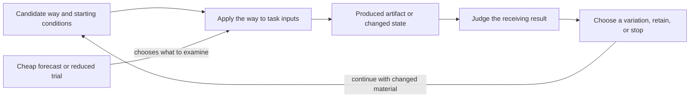
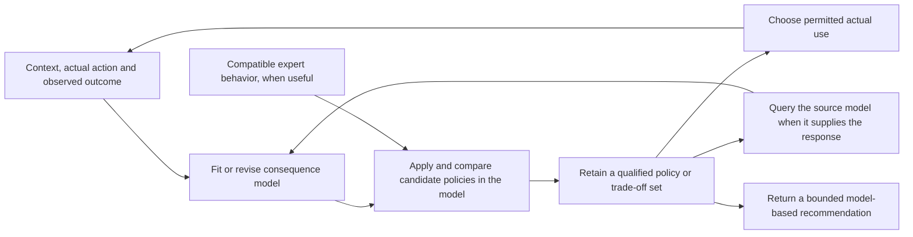
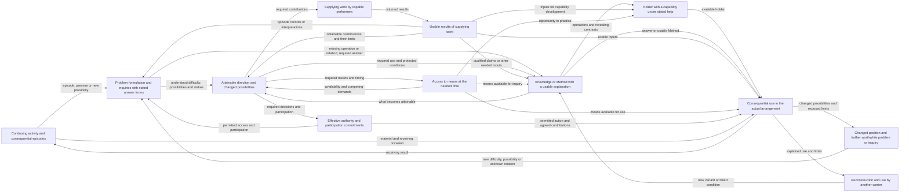

## C.32.PAD - Project Architecture Decision After Candidate Synthesis

> **Type:** Architecture decision pattern under C.32
> **Status:** Stable
> **Normativity:** Normative unless explicitly marked informative

### C.32.PAD:1 - Problem frame

Use this pattern when a project has synthesized candidate architecture configurations and must make the project architecture decision that will guide later design, implementation, construction, operation, governance, or change work.

Primary working reader: an architect or architecture-responsible practitioner who has enough candidate synthesis, comparison input, and architecture-characteristic pressure to decide what architecture will be pursued now.

Typical entry phrases:

```text
"We have three candidate architecture configurations; which one becomes the project decision?"
"The candidate improves maintainability but worsens evidence reuse; what is the accepted trade-off?"
"Developers need to know which architectural style, method, or pattern use is now required."
"The architecture decision must say which structure is fixed by this decision and which refinement remains open."
"The ADR cannot be written yet because the decision relation is not clear."
```

**First-minute use slice.** A product-family architect has a C.32 candidate palette with three module, placement, and evidence-structure variants. C.32.ACS names maintainability, substitutability, and evidence reuse as optimization indicators, and C.32.ACE has evaluated the candidates under one parity frame. Using C.32.PAD, the architect records the exact composite project work, selected configuration, affected selected structures, accepted loss in evidence reuse, method-use instruction for product teams, structures fixed by the decision, refinement left open, source-return condition, and reopen trigger. The result is not an ADR file yet; it is the architecture decision relation concerning that project work which an ADR or another publication form can describe.

The primary `EntityOfConcern` is `ArchitectureDecisionRelation@Project`: an architecture decision relation over one bounded architecture question with one exact composite project `U.Work` as a participant. It links that work, the decision subject, candidate basis, selected architecture option, affected structures, architecture characteristics, rationale, accepted losses, consequences, method and work expectations, publication projection, evidence or eval exits, and reopen conditions.

`ArchitectureDecisionRelation@Project` is not a new `U.*` kind. `@Project` is a compatibility and retrieval cue, not the source of project identity or scope. The relation is project-local only when `projectWorkOccurrenceRef` identifies the exact composite `U.Work` that participates in it. When another slot becomes load-bearing as an FPF object, recover the subject pattern for that object.

When this decision designates a **project system-of-interest**, `projectSystemOfInterestRef?` names only an independently admitted existing `U.System`. Before identity inception, keep the intended referent in `intendedProjectSystemClaimRef?` as `U.WorkPlan`, decision, system description, or other claim content. A local kind is named separately in `systemOfInterestKindRef?`, while `systemOfInterestClassificationRef?` cites an independently obtaining classification judgment; neither entails an assignment. A current assignment uses separate species and occurrence refs, and the occurrence's holder is that System. Route any source phrase such as `SystemOfInterestRole` through `E.10.ROLE` before filling these fields. A taxonomy or scheme is not assignment content. Designation, kind, classification, assignment, Work, change, use facts, and the decision remain distinct. The decision neither establishes a compound project-selection truth nor repairs its missing constructor; when that one truth is required, retain every direct fact and record the A.15.6 result `missing-substrate[project-selection-conjunction]`.

When the decision uses a transformation-flow network, `transformationFlowStructureNetworkRef?` names only an independently selected E.18.NET `TransformationFlowStructureNetwork@Context <: U.Structure`; `projectNetworkSelectionResultRef?` may cite the separate C.2.1 judgment about why that network answers the project question, and `architectureTransformationFlowStructureRelationRef?` cites C.30.TFS-REL when architecture use is current. A network record, a C.32.CONWAY frame or exact pair row, and this decision create no network member, cross-flow occurrence, architecture-influence occurrence, architecture relation, or other world-side fact.

What goes wrong if C.32.PAD is missed: a team writes an architecture record, diagram, shortlist, ranking, or local choice without a recoverable architecture decision relation to exact project work. Later workers cannot tell which architecture configuration is selected, which structures are affected, which method they must use, which losses were accepted, or when the decision must be reopened.

What C.32.PAD buys in practice: practitioners performing the project work can turn a candidate palette into one governed decision relation that is strong enough to guide work, publish an ADR-like record, support review, and reopen under architecture evolution.

Ordinary working move: recover the live decision question, cite the candidate basis, select the architecture option or bounded exception, record the trade-off over declared architecture characteristics, then bind the decision to method-use expectations, work split, source-return, and reopen conditions.

Adoption test: after using C.32.PAD, another practitioner can answer: what architecture option was selected, from which candidate basis, for which affected structures, under which architecture-characteristic trade-off, with which method and work consequences, and under which reopen condition.

Not this pattern when the current work is candidate synthesis, architecture-description adequacy, ADR publication projection, adequacy evaluation, evidence, assurance, gate passage, local choice, or performed work. Use the pattern for the next question named in `Relations` for those claims.

The first useful output is `ArchitectureDecisionRelation@Project`:

```text
ArchitectureDecisionRelation@Project:
  decisionId:
  projectWorkOccurrenceRef: U.EntityRef constrained to exact composite U.Work
  projectSystemOfInterestRef?: U.EntityRef constrained to one independently admitted existing U.System
  intendedProjectSystemClaimRef?: U.WorkPlan, decision, system-description, or other claim episteme ref before identity inception
  systemOfInterestKindRef?: U.KindRef resolving to one exact local system-role kind
  systemOfInterestClassificationRef?: U.RelationRef resolving to the exact classification judgment for projectSystemOfInterestRef under systemOfInterestKindRef
  systemOfInterestAssignmentSpeciesRef?: U.RelationKindRef constrained under U.SystemRoleAssignment
  systemOfInterestAssignmentOccurrenceRef?: U.RelationRef constrained to an obtaining occurrence of systemOfInterestAssignmentSpeciesRef, with actual participants, applicability, extent, and projectSystemOfInterestRef as holder recoverable
  decisionSubjectRef:
  describedHolonRef:
  decisionQuestion:
  intendedDecisionUse:
  claimScopeRef: U.ClaimScope
  decisionWindowRef:
  candidateBasisRefs:
  comparisonOrSelectionRefs?
  structuralInformationLensUseRefs?
  holonTransitionOrBOSCTriggerRefs?
  architectureInfluenceCorrespondenceRef?: C.32.CONWAY frame or exact pair-row ref
  transformationFlowStructureNetworkRef?: exact independently selected E.18.NET TransformationFlowStructureNetwork@Context ref
  projectNetworkSelectionResultRef?: exact C.2.1 result episteme whose EntityOfConcern is transformationFlowStructureNetworkRef
  architectureTransformationFlowStructureRelationRef?: exact C.30.TFS-REL use/trace ref when architecture uses that network
  selectedArchitectureOptionRefs:
  selectedStructureEffects:
    - structureKindRef:
      selectedStructureRef:
      decisionEffect:
      relationFunctionClaimRef:
  architectureCharacteristicTradeoffs:
    - architectureCharacteristicRef:
      criteriaRowRef?
      expectedGain:
      acceptedLoss:
      evalResultRef?
      guardrailRef?
  rationaleRefs:
  rejectedOptionRefs:
  consequenceRows:
  architectureDescriptionRefs:
  methodUseInstructions:
    - methodDescriptionRefOrPatternRef:
      expectedStructureEffect:
      intendedPerformerSystemRef?: U.EntityRef constrained to U.System
      intendedPerformerKindRef?: U.KindRef
      intendedPerformerClassificationRef?: U.RelationRef resolving to an exact classification judgment
      currentPerformerAssignmentSpeciesRef?: U.RelationKindRef constrained under U.SystemRoleAssignment
      currentPerformerAssignmentOccurrenceRef?: U.RelationRef constrained to an obtaining occurrence of currentPerformerAssignmentSpeciesRef, with actual participants, applicability, extent, and intendedPerformerSystemRef as holder recoverable
      intendedAssignmentRequirementRef?: plan, policy, or decision-content ref stating a prospective assignment requirement; does not assert an assignment, commitment, or permission occurrence
      actualImplementationWorkRef?: U.EntityRef constrained to U.Work
      actualImplementationWorkAttributionRef?: U.RelationRef constrained to one obtaining F.6 performedUnderAssignment relation, only when the instruction expressly represents attribution
      responsibilityRelationRef?: U.RelationRef resolving to an independently obtaining admitted domain relation
      responsibilityMissingGovernor?: exact A.6.RCD result when responsibility is required but no predicate is admitted
      authorityRelationRef?: U.RelationRef resolving to an independently obtaining admitted domain relation
      authorityMissingGovernor?: exact A.6.RCD result when authority is required but no predicate is admitted
      permissionRelationRef?: U.RelationRef resolving to an independently obtaining admitted domain relation
      permissionMissingGovernor?: exact A.6.RCD result when permission is required but no predicate is admitted
      commitmentRelationRef?: U.RelationRef resolving to an independently obtaining admitted domain relation
      commitmentMissingGovernor?: exact A.6.RCD result when commitment is required but no predicate is admitted
      workBoundaryRef:
      readinessOrGateExitRef?
  architectDeveloperSplit:
    decisionFixedStructureRefs:
    openRefinementScopeRefs:
    sourceReturnCondition:
  publicationProjectionRef?
  evidenceOrAssuranceExitRefs?
  governanceExitRefs?
  reopenConditions:
  supersedesDecisionRefs?
  status:
```

The filled `ArchitectureDecisionRelation@Project` is the decision result. Its selected option, affected structures, criteria and trade-offs, scope, window, consequences, and status make that result recoverable; a second generic result or context record would only duplicate it.

The field names in this first-output form are publication-friendly filled-reference fields. Durable relation positions must be expressible through `A.6.5` SlotSpecs: each position has a local `SlotKind`, an admitted `ValueKind`, and a by-value or concrete `RefKind` filling mode. A field name such as `decisionSubjectRef` is not a SlotKind, not a U-kind, and not an ADR heading; it is the filled-reference field by which this relation record points to the value governed by the slot-bearing relation.

When an instruction cites actual implementation Work, recover each exact actual performer through A.13 and let `actualImplementationWorkRef` name the `U.Work` occurrence independently admitted through A.15.1. Assignment species and occurrence fields remain optional neighboring claims. Add `actualImplementationWorkAttributionRef` only when the instruction or receiving use expressly represents precise assignment-bound attribution through the same obtaining A.13 assignment; missing or failed F.6 leaves the Work ref intact. The decision record creates none of these facts.

### C.32.PAD:2 - Problem


Architecture synthesis produces candidates; the Systems performing project Work still need a decision, while any local system-role kind, direct assignment species, authority, or responsibility claim remains a separate fact established through its own pattern. The decision is not the candidate palette, the declared selected-set result, its publication, the architecture description, or the ADR file. It is the architecture decision relation that identifies the composite project Work, says which architecture option is now pursued for it, and records what follows from that selection.

The problem is difficult because architecture decisions sit between structures and Methods. C.30 keeps an obtaining `ArchitectureRelation` with its holon and selected `U.Structure` separate from an `ArchitectureClaim` carrying candidate, required, desired, or expected content. A project architecture decision can tell intended developer Systems which Method description, architectural style, pattern use, or work boundary to follow so that later work aims to produce or preserve the intended structures. For example, "use the client-server style here" is a Method-use instruction whose intended result is a module and interaction structure of the described System. The decision relation must keep actual or modal structure content, intended Systems, local kinds, separate System-classification judgments, assignment requirements and current assignment occurrences, plans and commitments, permissions and authority, and actual Work as separate branches. Route unresolved role wording through `E.10.ROLE`. When C.32.CONWAY supplies an influence-source architecture or selected structure, that source remains non-agentive and does not become the performer.

The problem is also multilevel. The architecture decision may fix selected structures at one holon level while leaving lower-level refinement open. It must therefore say which structure is fixed, which refinement remains open, which source detail must remain recoverable, and which result can reopen the decision. If that boundary is missing, the decision becomes either empty advice or uncontrolled micro-management.

Finally, architecture decisions are evolutionary. They are made under current candidate knowledge, current characteristic criteria, current eval readings, and current organization or tool constraints. They should be explicit enough for present work and cheap enough to supersede when a better candidate, changed characteristic pressure, or architecture-influence/transformed-side fit changes.

C.32.PAD solves the post-synthesis decision problem by making the decision relation explicit before any ADR-like publication projection is written.

### C.32.PAD:3 - Forces

| Force | Tension |
|---|---|
| Candidate plurality | Several candidate configurations can be valid under different trade-offs, while project work needs one current direction or a bounded exception. |
| Trade-off visibility | Architecture characteristics compete; a decision that hides accepted losses cannot be responsibly executed or reopened. |
| Structure and method coupling | The decision must govern actual or modal structure content for the described or transformed-side holon and may also prescribe developer methods intended to produce or preserve those structures. |
| Work split | Structures fixed by the decision and refinement left open must be separated without severing source return. |
| Evolution | A decision must close enough work for now while staying reopenable when context, eval readings, or candidates change. |
| Publication pressure | Teams often want an ADR file before the decision relation is recoverable. |

### C.32.PAD:4 - Solution

Create `ArchitectureDecisionRelation@Project` before writing an ADR-like publication record. Treat it as the architecture decision relation that includes the exact composite project `U.Work` and binds it to the candidate basis, selected architecture option, affected structures, architecture-characteristic trade-offs, rationale, consequences, method expectations, work split, and reopen conditions.

Work in this order:

1. Name the composite project `U.Work` participant and the decision subject: described holon, decision question, intended use, ClaimScope, decision window, and status. If the decision designates a project system-of-interest, cite the existing `U.System` or the pre-inception intended-system claim. Add a local kind only when it is current, add a separate System-classification judgment only when that judgment independently obtains, and add an assignment only through its separately declared A.2.1 species and obtaining occurrence whose holder is that System. Route `SystemOfInterestRole` source wording through `E.10.ROLE`; establish every Work, change, and use fact through its own predicate and pattern. A decision designation proves no compound project-selection truth; return `missing-substrate[project-selection-conjunction]` when that stronger truth is required.
2. Cite the candidate basis. Use `C.32` for the candidate palette, `C.32.MLAO` for residual-reducing multilevel candidate frames, `C.32.CONWAY` when an influence-source architecture and transformed-side architecture content shaped the candidate, and `C.32.FAIL` for repaired candidate errors. Cite a C.32.CONWAY synthesis frame while either side is modal or the direct influence relation is unresolved; cite an exact pair row only for its already obtaining direct occurrence and two obtaining C.30 architecture-relation participants.
3. Cite comparison or selection input only when it exists. Use `A.19.CPM` for explicit comparison, `A.19.SelectorMechanism` for set-returning selection, `G.5` for selected-set result declaration, and `C.11` for local choice. For publication, use `E.17` for a source-backed face and source return and `E.24.PUB` for the publication occurrence and audience availability.
4. State the selected architecture option or bounded exception. Name the affected selected structures and the subject pattern for each structure claim.
5. Record the architecture-characteristic trade-off. Use criteria rows from `C.32.ACS`, eval results from `C.32.ACE`, measurement support from `C.16`, Q-Bundles from `C.25`, modularity or scale support from `C.31`, and `C.29` structural-information lens uses for compressed recoverable structure, accepted description loss, hidden dependency, and source-return. None of those lenses, measures, or bundles decides the architecture by itself.
6. Record rationale, rejected options, accepted losses, and consequences. A rejected option can remain useful as a stepping stone or archive item; do not turn it into a failure unless the receiving failure pattern is triggered.
7. Bind the decision to architecture descriptions. Use `C.30.AD` for architecture-description adequacy and `C.30.ASV` for selected-structure view adequacy. A diagram, model, file, or view can describe the decision basis; it does not become the decision relation.
8. Bind the decision to method-use instructions when the architect needs developers to use a method, pattern, style, toolchain step, or work practice so the described or transformed-side holon is intended to gain or preserve the named structure. Use `A.15`, `A.15.1`, `A.15.2`, `A.15.5`, `A.6.M`, `E.8`, `E.11.PUR`, and `C.24` according to the live claim.
9. State the architecture-to-refinement boundary. Name selected structures fixed by the decision, refinement scopes left open, source-return conditions, readiness exits, and patterns for any later governance question. When the boundary depends on holon level, changed whole, or BOSC-triggered pressure, fill `holonTransitionOrBOSCTriggerRefs?` through `B.2.P` claim-kind recovery or `B.2` whole reidentification instead of leaving a generic level note.
10. Choose a publication projection only after the decision relation is clear. Use `C.32.ADR` for ADR-like projection, `E.17` for a source-backed publication face and source return, and `E.24.PUB` for the publication occurrence and audience availability.
11. Add evidence, assurance, gate, and governance exits only when those claims are being made. Use `A.10`, `B.3`, `A.21`, and the local governance pattern rather than adding those statuses to the decision relation by name.
12. Write reopen and supersession conditions. Reopen when the candidate basis changes, a protected architecture characteristic crosses its guardrail, an independently typed influence-source structure or arrangement no longer fits the transformed-side actual or modal architecture content, a stronger source changes the accepted loss, or the decision's method-use instruction proves unusable.

If one project question uses an E.18.NET network, first preserve that network's independent A.22/E.18.NET selection. A persistent project-network judgment stays in its C.2.1 result episteme under A.15.6, and architecture use docks through C.30.TFS-REL. A C.32.CONWAY exact pair row may be cited in `architectureCorrespondenceRowRefs[]` of a network record, but that citation is only a qualified reading: it adds no network member or cross-flow occurrence, and PAD repeats none of the network's member, relation, constraint, endpoint, or use-frame fields.

#### C.32.PAD:4.1 - Decision readiness

A C.32.PAD decision is ready to draft when the current decision relation identifies the composite project `U.Work` participant and can cite at least one candidate basis, one affected selected structure, one architecture-characteristic trade-off or declared reason for no live trade-off, one expected work consequence, one reopen condition, and any triggered `holonTransitionOrBOSCTriggerRefs?` or `structuralInformationLensUseRefs?` needed to preserve source return. When system-of-interest local-kind, separate System-classification, assignment, architecture-influence, or network fields are present, the applicable A.15.6, A.2 and A.2.1, C.32.CONWAY, E.18.NET, and C.30.TFS-REL preconditions must already be satisfied or the reference remains absent.

If the candidate basis is absent, require `C.32`. If architecture-characteristic rows are absent, require `C.32.ACS` or `C.25`. If the decision only says "the metric is best", require `C.32.ACE`, `C.16`, or `A.19.CPM` before deciding. If the intended work method is not recoverable, require `A.15`. If an existing system, role assignment, project-network judgment, network selection, architecture use, or influence pair is unresolved, require its subject pattern and keep only the truthful designation, modal claim, candidate frame, or explicit stop in PAD.

#### C.32.PAD:4.2 - Constructive architecture decision path

Some architecture decisions are constructive: they prescribe Methods that intended developer Systems are expected to use so that later work aims to produce or preserve intended structures. A decision may name intended Systems, local-kind requirements, separate classification requirements, assignment requirements, plans, commitments, permissions, or authority before any assignment or Work obtains. Admit that path only when the decision keeps those claims separate and names:

- the obtaining architecture relation and selected structure to be preserved, or the exact modal `ArchitectureClaim` stating the intended production or preservation effect;
- the method description, architectural style, pattern use, or work practice to be used;
- the intended System when known; an optional local kind and an independently optional System-classification judgment; any current assignment through separate species and obtaining-occurrence refs whose holder is that System; and any merely intended assignment as plan, policy, or decision content rather than an occurrence;
- any responsibility or authority relation only when its admitted direct predicate, actual participants, applicability, and identity obtain; otherwise record the exact A.6.RCD missing governor instead of calling the system-role kind or assignment responsible;
- the expected structure effect on the described or transformed-side holon, kept modal until its direct C.30 architecture predicate obtains;
- the work-planning boundary and readiness or gate exit;
- the source-return condition and reopen trigger.

These requirements connect the architecture decision to work while keeping its expected structure effect distinct from any independently established actual effect.

#### C.32.PAD:4.3 - Minimum sufficient relation and slot-change impact

A small complete PAD instance can be this short:

```text
ArchitectureDecisionRelation@OrderFlow:
  decisionId: OrderFlowArchitectureDecision-2026Q3
  projectWorkOccurrenceRef: ProductFamilyQ3OrderArchitectureWork, exact admitted composite U.Work
  decisionSubjectRef: order-integration architecture for product-family Q3
  describedHolonRef: product-family order-flow system
  decisionQuestion: which candidate architecture should guide Q3 order-flow implementation?
  intendedDecisionUse: direct the Q3 implementation work while preserving the stated refinement boundary
  claimScopeRef: order-flow architecture for ProductFamilyQ3OrderArchitectureWork
  decisionWindowRef: accepted for Q3 implementation; reopen on a listed trigger or superseding decision
  candidateBasisRefs: [C32CandidatePalette:order-flow-2026-06]
  selectedArchitectureOptionRefs: [event-carried integration with payment exception]
  selectedStructureEffects:
    - structureKindRef: module structure
      selectedStructureRef: order events between service modules
      decisionEffect: preserve service substitutability, accept added event-schema governance
      relationFunctionClaimRef: C.30.ASV
  architectureCharacteristicTradeoffs:
    - architectureCharacteristicRef: substitutability
      criteriaRowRef: C.32.ACS order-flow substitutability criterion
      expectedGain: service replacement without order-flow rewrite
      acceptedLoss: additional schema-version coordination
      guardrailRef: version-skew eval band
  methodUseInstructions:
    - methodDescriptionRefOrPatternRef: event-schema change method
      expectedStructureEffect: compatible event schemas across service modules
      intendedPerformerSystemRef: the named service-team System intended by the project decision
      intendedPerformerKindRef: ServiceTeamDeveloperSystemRole
      intendedPerformerClassificationRef: the separate classification judgment, when it obtains
      intendedAssignmentRequirementRef: decision content requiring a suitable service-team assignment before implementation Work
      workBoundaryRef: schema refinement left open inside the event boundary fixed by the decision
  architectDeveloperSplit:
    decisionFixedStructureRefs: [event boundary, payment exception]
    openRefinementScopeRefs: [schema fields inside approved event boundary]
    sourceReturnCondition: return to PAD when refinement changes event boundary or version-skew band
  holonTransitionOrBOSCTriggerRefs?: [B.2.P: no new operational whole claimed for team-local schema refinement]
  structuralInformationLensUseRefs?: [C.29: event-flow view compresses deployment and rollout structure; source-return keeps model refs recoverable]
  publicationProjectionRef?: C.32.ADR:order-flow-adr
  reopenConditions: [payment latency guardrail crossed, schema-version coordination cost guardrail crossed]
  status: acceptedForDeveloperWork
```

When a filled field changes, repair the smallest declaration or claim record that carries the changed content:

| Changed filled field | Immediate repair locus |
|---|---|
| `candidateBasisRefs` or `selectedArchitectureOptionRefs` | Use `C.32`, `C.32.MLAO`, comparison or selection inputs, then update PAD before ADR projection. |
| `projectSystemOfInterestRef?`, `intendedProjectSystemClaimRef?`, `systemOfInterestKindRef?`, `systemOfInterestClassificationRef?`, `systemOfInterestAssignmentSpeciesRef?`, or `systemOfInterestAssignmentOccurrenceRef?` | Use A.15.6 for actual-versus-intended designation and the compound-selection stop, C.3/A.2 for the exact local kind and its separate classification judgment, and A.2.1 for the directly declared assignment species and its separately obtaining occurrence. Route unresolved role wording through `E.10.ROLE`. Keep every independently obtaining Work, change, and use fact; remove any reference the decision alone was being used to prove. |
| `architectureInfluenceCorrespondenceRef?` | Use C.32.CONWAY. Keep a frame for modal or unresolved sides and cite an exact pair row only for the already obtaining direct occurrence and its exact C.30 architecture-relation participants. |
| `transformationFlowStructureNetworkRef?`, `projectNetworkSelectionResultRef?`, or `architectureTransformationFlowStructureRelationRef?` | Use E.18.NET for exact network identity, A.15.6/C.2.1 for the project-question judgment, and C.30.TFS-REL for architecture use. Update or remove only the affected refs; do not copy or repair network members, relations, constraints, endpoints, or use frame inside PAD. |
| `selectedStructureEffects` | Repair the architecture claim or selected-structure view in `C.30`, `C.30.AD`, or `C.30.ASV`; then update PAD consequences. |
| `architectureCharacteristicTradeoffs` | Repair `C.32.ACS`, `C.32.ACE`, `C.25`, `C.16`, or comparison input before relying on the decision. |
| `methodUseInstructions` or `architectDeveloperSplit` | Repair Method, plan, intended-System, local-kind, separate System-classification, assignment, actual-Work, readiness, and work-boundary claims through their subject patterns. Route unresolved role wording through `E.10.ROLE`; use `A.15`, `E.8`, `E.11.PUR`, or `C.24` only for the claim that pattern defines, constrains, or tests. |
| `holonTransitionOrBOSCTriggerRefs?` | Use `B.2.P` for wording and claim-kind recovery; use `B.2` only when the decision depends on whole reidentification. |
| `structuralInformationLensUseRefs?` | Use `C.29` to state which structure is preserved, compressed, hidden, or recoverable; return to source when the accepted loss changes. |
| `publicationProjectionRef?` | Repair only the projection through `C.32.ADR`, the source-backed publication face and source return through `E.17`, and the publication occurrence and audience availability through `E.24.PUB`; do not rewrite the decision by template pressure. |
| `reopenConditions` or `supersedesDecisionRefs?` | Update PAD and the active ADR-like projection; old decisions remain historical unless a governed archival policy says otherwise. |

### C.32.PAD:5 - Archetypal Grounding


**Software service architecture.** A platform team compares synchronous service calls, event-carried integration, and a bounded shared kernel. The selected option is event-carried integration for order events with a bounded exception for payment authorization. C.32.PAD records affected module and information structures, latency and substitutability trade-offs, the method-use instruction for service teams, the event-schema source-return condition, and the reopen trigger when payment volume crosses the declared eval band.

**Manufacturing fixture architecture.** A production architect compares a dedicated fixture per product, a universal fixture with adapters, and a mixed cell layout. The selected option uses a universal fixture only for products inside a scale window. C.32.PAD records module, placement, maintenance, and evidence-structure effects, the accepted setup-time loss, the method instruction for cell design, and the trigger for returning to candidate synthesis when adapter complexity exceeds the guardrail.

**Project system-of-interest and network.** A plant-modernization decision designates already admitted `PumpUnit-3 : U.System` as the project system-of-interest and cites exact composite `PumpUpgradeWork-7`. The designation does not create a project container or the compound truth that the project selected the pump. The source label `SystemOfInterestRole` is recovered through `E.10.ROLE`. Exact local kind `SystemOfInterestSystemRole` is cited through `systemOfInterestKindRef`, and the separate judgment classifying `PumpUnit-3` under it is cited through `systemOfInterestClassificationRef`. `PumpQualificationSystemOfInterestAssignment` is cited as the directly declared species; `PumpUnit-3-QualificationAssignment-7` is cited separately as its obtaining occurrence with `PumpUnit-3` as holder. A taxonomy or scheme is not an assignment participant, and neither kind, classification, nor assignment establishes Work, responsibility, or authority. Each Work-to-pump, Work-to-change, evaluation, production, or use fact keeps its own subject pattern. An independently selected E.18.NET network may connect production-system change, pump change, and qualification flows for the named project question. PAD cites that exact network, the optional C.2.1 selection judgment, and the C.30.TFS-REL architecture-use trace; it does not recreate network identity or infer cross-flow relations from a record or C.32.CONWAY pair row. If the decision needs the still-unsupported compound project-selection truth, the case returns `missing-substrate[project-selection-conjunction]`.

**Method-family architecture.** The team applies a review Method to compare specialized review contributions, peer rotation, and tool-supported triage. `E.10.ROLE` first recovers any local kind, assignment, direct-relation position, function claim, or ordinary label hidden by role wording. The selected option uses peer rotation plus a tool-supported evidence handoff. C.32.PAD records those exact recovered relations, Method, evidence, and information structures, the trade-off between teachability and evidence custody, and the refinement scope left open for local checklists.

**Architecture influence and transformed-side fit.** An automation project changes both a toolchain and the product it is used to change. C.32.CONWAY supplies a synthesis frame or, only after direct settlement, an exact architecture-influence pair row over the obtaining source-side and transformed-side C.30 architecture relations. C.32.PAD records which toolchain structure is decision-relevant, which product-side structure is selected or intended, which Systems are intended, which assignment requirements and Methods are planned, and which fit change reopens the decision. A current assignment or actual Work appears only when it independently obtains. Performance and actual transformation require their own obtaining relations.

**Digital-twin structural information loss.** A built-asset team publishes a 6D-style digital-twin decision view for construction planning. The view intentionally hides supplier-agreement and temporary-work structures. C.32.PAD records the selected building, placement, schedule, cost, operation, and evidence structures that the decision uses; `C.29` records which hidden structures remain recoverable and which accepted loss reopens the decision. The view count, file, and model do not become the decision authority.

### C.32.PAD:6 - Bias-Annotation

| Risk handled | How C.32.PAD handles it |
|---|---|
| Record-before-decision drift | The pattern requires `ArchitectureDecisionRelation@Project` before ADR-like publication projection. |
| Description-as-decision drift | Architecture descriptions remain `C.30.AD` objects; PAD records the decision relation that may cite them. |
| Metric-winner drift | Eval readings and metrics can inform trade-offs but do not select or decide by themselves. |
| Method-structure collapse | Method-use instructions and intended target structures are both recorded and kept distinct. |
| Work-split loss | Structures fixed by the decision, refinement scopes left open, and source-return conditions are explicit. |
| Evolution lock-in | Supersession and reopen conditions are part of the decision relation. |

### C.32.PAD:7 - Conformance Checklist

| Requirement | Required result |
|---|---|
| `CC-PAD-1` | The exact composite project `U.Work` participant, decision subject, described holon, decision question, intended decision use, ClaimScope, and decision window are explicit. |
| `CC-PAD-2` | The decision cites candidate basis from `C.32` or a named receiving candidate pattern, or states why no candidate-set question is live. |
| `CC-PAD-3` | The selected architecture option or bounded exception is named. |
| `CC-PAD-4` | Affected selected structures are named with subject pattern refs. |
| `CC-PAD-5` | Architecture-characteristic trade-offs, accepted losses, and guardrails are recorded. |
| `CC-PAD-6` | Architecture-description refs, method-use instructions, and performed-work boundaries remain distinct. |
| `CC-PAD-7` | The architect-developer split, source-return condition, and reopen conditions are recorded. |
| `CC-PAD-8` | Triggered holon-transition or BOSC boundary pressure cites `B.2.P` or `B.2`, and structural-information loss or compression cites `C.29`. |
| `CC-PAD-9` | ADR-like publication, evidence, assurance, gate, comparison, selection, selected-set result declaration, audience publication, local choice, and work claims exit to their patterns for the next questions. |
| `CC-PAD-10` | Any project system-of-interest ref denotes one independently admitted existing `U.System`; a pre-inception intended referent stays in claim content. `SystemOfInterestRole` wording is recovered through `E.10.ROLE`; any local kind, separate classification judgment, and separately obtaining A.2.1 assignment are cited independently. Decision designation, kind, classification, assignment, and direct facts neither entail one another nor establish the missing compound project-selection truth. |
| `CC-PAD-11` | Any network ref resolves to one independently selected E.18.NET structure, its project-question judgment stays in a separate C.2.1 episteme, and architecture use docks through C.30.TFS-REL. A PAD decision, network record, C.32.CONWAY frame, or exact pair row creates no member, cross-flow occurrence, influence occurrence, architecture relation, or actual structure effect. |

### C.32.PAD:8 - Common Anti-Patterns and How to Avoid Them

| Anti-pattern | Symptom | Repair |
|---|---|---|
| `ADRBeforeDecisionRelation` | The team starts from an ADR template and fills prose before the selected option, trade-off, and work consequences are recoverable. | Draft `ArchitectureDecisionRelation@Project` first; then use `C.32.ADR` only as publication projection. |
| `CandidateWinnerByMetric` | One score, benchmark, or eval reading is treated as the architecture decision. | Use `C.32.ACS`, `C.32.ACE`, `C.16`, and `A.19.CPM`; decide only after trade-offs and accepted losses are recorded. |
| `StructureOnlyDecision` | The decision names a target structure but gives no Method-use or work-boundary instruction for the Systems intended to realize it. | Add Method-description or pattern-use refs, intended System, optional local kind and independently optional classification judgment, any current assignment species and occurrence or prospective assignment requirement without conflating them, work boundary, readiness exit, and expected structure effect. Add responsibility, authority, permission, or commitment only under its independent direct predicate or exact missing governor. If actual Work is claimed, recover each exact performer through A.13 and let A.15.1 independently admit the `U.Work`. Add an F.6 ref only when precise assignment-bound attribution is expressly consumed; its absence or failure leaves the Work intact. |
| `MethodOnlyDecision` | The decision says which style, pattern, or tool to use but not which target structures it is expected to produce or preserve. | Name the intended selected structures and architecture-characteristic trade-offs; use `C.30`, `C.30.ASV`, or `C.32` if the structure is not recoverable. |
| `FrozenArchitectureDecision` | The decision has no source-return or reopen condition. | Add eval guardrails, source-currentness return, architecture-influence/transformed-side fit trigger, or supersession rule. |
| `LensOrQBundleAsDecisionAuthority` | A view, structural-information lens, measurement row, Q-Bundle, or eval reading is treated as if it selected the architecture. | Use the exact subject predicate for the source: `C.29` for lens use, `C.25` for Q-Bundle, `C.16` for measurement, `C.32.ACE` for eval, and PAD for the actual decision relation. |
| `GovernanceByImplication` | Teams are expected to follow the decision, but no readiness, gate, evidence, assurance, or governance exit is named. | Add refs to the patterns for the next questions; do not import those statuses into PAD. |
| `ProjectSelectionOrRoleByDecision` | A PAD field is treated as proof that a project selected a System, or that the System gains a kind, classification, or assignment because the decision names it. | Keep the decision designation and every direct fact; recover role wording through `E.10.ROLE`, apply A.15.6, A.2, and A.2.1 independently, and return `missing-substrate[project-selection-conjunction]` when the compound truth is needed. |
| `NetworkOrInfluenceByCitation` | A cited network record, C.32.CONWAY frame or pair row, or PAD decision is treated as a network member, cross-flow occurrence, architecture-influence occurrence, performer, or actual structure effect. | Restore the exact E.18.NET network and direct relation patterns, use C.30.TFS-REL for architecture use, and keep expected structure effect modal until C.30 independently establishes the actual architecture relation. |

### C.32.PAD:9 - Consequences

| Consequence | Benefit | Cost |
|---|---|---|
| The architecture decision relation to exact composite project work is explicit before publication. | ADRs, design memos, and governance files can describe a recoverable decision rather than inventing one. | The architect performs decision work before publication work. |
| Structure and method are coupled without collapsing. | Developers can see both intended architecture structures and required methods. | The decision record needs enough detail to avoid empty method instructions. |
| Trade-offs and accepted losses are recorded. | Later teams can reopen the decision under changed characteristics instead of guessing the original rationale. | Decisions may look less tidy because loss is visible. |
| Architect-developer split is stated. | Team refinement can proceed without losing source return. | Architecture governance must maintain split and reopen conditions. |

### C.32.PAD:10 - Rationale

Using `C.32`, practitioners synthesize candidate architecture configurations. Using `C.32.PAD`, the architect selects an option or bounded exception for the project work and states the resulting Method-use instructions and work consequences.

The pattern keeps four layers apart: an obtaining C.30 `ArchitectureRelation` over one architecture-bearing holon and selected `U.Structure`; any `ArchitectureClaim` that states actual, negative, unresolved, candidate, required, desired, or expected content about the holon, relation, or structure; `ArchitectureDecisionRelation@Project`, which connects composite project Work to the selected option and declared work consequences; and `ArchitectureDecisionDescription@Project`, which can be published in ADR-like or other forms and whose project use requires the exact composite `U.Work` and an independently obtaining use relation defined by its own pattern. Optional system-of-interest, local-kind, System-classification, assignment-species, assignment-occurrence, architecture-influence, and network references retain their A.15.6, A.2 and A.2.1, C.32.CONWAY, E.18.NET, and C.30.TFS-REL subject patterns. This lets FPF reuse its existing architecture, description, Method, work, evidence, assurance, measurement, publication, project, and network patterns instead of creating a separate architecture-decision ontology for those facts.

The pattern is architecture-reusable across holon kinds, not because every decision target is itself a holon kind. The same decision relation can apply to admitted holons such as systems, organizations-as-systems, built assets, AI-agent setups, epistemes, work occurrences, or disciplines. It can also concern Method, evidence, or an exact object or relation recovered from role wording, provided those values stay under `A.3.1`, `E.10.ROLE`, `A.2.7`, `A.10`, and `A.15` rather than being admitted as holons by label.

### C.32.PAD:11 - SoTA-Echoing

These sources inform the decision-relation fields, boundaries, and reopen conditions used below.

| Source to inspect | Why this source is load-bearing here | Transfer into PAD | Concrete PAD mutation | Blocked overread |
|---|---|---|---|---|
| ISO/IEC/IEEE 42010:2022 official standard (`https://www.iso.org/standard/74393.html`; IEEE page `https://standards.ieee.org/ieee/42010/6846/`) | Current official source for architecture-description requirements; it explicitly scopes itself to AD structure and expression, not architecting methods or the architecture itself. | Keep architecture descriptions as description objects and use PAD for the decision relation that may cite them. | PAD has `architectureDescriptionRefs`, selected-structure effects, and source-return conditions rather than treating a view, viewpoint, file, or model as the decision. | ISO 42010 architecture-description structure does not replace C.32 synthesis, A.15 method work, or PAD decision relation. |
| Michael Nygard, `Documenting Architecture Decisions` (`https://cognitect.com/blog/2011/11/15/documenting-architecture-decisions`) | Practitioner source for small, statused records that preserve context, decision, and consequences across time. | Use context, decision, status, consequences, and supersession as publication-relevant decision-description fields. | PAD requires status, consequences, and supersession or reopen conditions before ADR projection. | ADR records are not the architecture decision relation with its exact project-work participant and do not by themselves ground selected structures. |
| MADR 4.x (`https://adr.github.io/madr/`) | Current ADR practice with options, outcome, status, links, and confirmation pressure. | Require candidate basis, outcome, decision status, links to related decisions, and confirmation or eval exits. | PAD separates candidate basis, selected option, consequence rows, method-use instruction, and reopen conditions. | MADR's broad "any decision" use is not imported as FPF architecture-decision ontology. |
| Ford, Parsons, Kua, and Sadalage, `Building Evolutionary Architectures`, 2nd ed. (`https://www.oreilly.com/library/view/building-evolutionary-architectures/9781492097532/`) | Current practitioner source for guided incremental architecture change and source-side fitness-function wording. | Treat eval support as `C.32.ACE` inputs and reopen conditions, not as the decision itself. | PAD requires eval refs, guardrails, and reopen conditions when evolutionary feedback guides the decision. | Fitness-function terminology is not imported as an FPF object name. |
| Ford, Richards, Sadalage, and Dehghani, `Software Architecture: The Hard Parts` (`https://www.oreilly.com/library/view/software-architecture-the/9781492086888/`) | Current practitioner source for trade-offs, least-worst choices, and architecture characteristics under uncertainty. | Make accepted losses and protected counter-characteristics mandatory decision content. | PAD records architecture-characteristic trade-offs, rejected options, accepted losses, and consequences. | A trade-off discussion does not replace candidate synthesis, comparison, evidence, or governance. |
| NASA Systems Engineering Handbook, decision analysis and trade-study practice (`https://www.nasa.gov/wp-content/uploads/2018/09/nasa_systems_engineering_handbook_0.pdf`) | Non-software engineering source for alternatives, selection criteria, assumptions, limitations, recommendation, impacts, and final decision documentation. | Generalize PAD beyond software ADR practice by requiring candidate basis, selection criteria or comparison refs, assumptions or accepted losses, impacts, and decision-maker commitment. | PAD carries `candidateBasisRefs`, `comparisonOrSelectionRefs?`, trade-offs, consequence rows, status, and reopen conditions for engineering decisions such as fixtures, vehicles, built assets, or methods. | NASA trade-study process is not imported as FPF architecture ontology and does not by itself decide the architecture. |
| Conway and Team Topologies source line, mediated through `C.32.CONWAY` | Independently typed influence-source architecture and transformed-side architecture content can constrain candidate fit without making either architecture an actor. | Use a synthesis frame for modal or unresolved sides and an exact pair row only for one already obtaining direct influence occurrence over two obtaining C.30 architecture relations. | PAD may cite `architectureInfluenceCorrespondenceRef?` and reopen when that qualified fit changes. | The frame, pair row, architecture relations, claims, systems, assignments, Work, actual transformation, network, and decision remain separate; citation proves none of their world-side relations. |
| Current FPF `A.15.6`, `A.2`, `A.2.1`, `E.18.NET`, and `C.30.TFS-REL` | Existing FPF subject patterns for project Work and system-of-interest designation, role interpretation and assignment, selected recursive transformation-flow networks, persistent project-network judgments, and architecture use of those networks. | Let PAD cite already established objects needed by the decision while keeping their identity and truth with those subject patterns. | PAD adds optional system, intended-system-claim, role-assignment, network, project-network-result, and architecture-flow-use refs plus explicit return conditions. | A decision designation establishes no compound project-selection truth; a network, record, or citation creates no member or direct relation occurrence. |
| Current FPF `A.15`, `E.8`, `E.11.PUR`, `C.30`, `C.30.AD`, `C.32`, `C.32.ACS`, `C.32.ACE`, `C.32.ADR`, and `C.32.ADA` | Existing FPF ontology for actual and modal architecture content, method descriptions, pattern use, architecture descriptions, candidate synthesis, evals, publication projection, and adequacy evaluation. | Keep PAD narrow: decision relation after candidate synthesis. | Relation and conformance rows send neighboring claims to their subject patterns. | PAD does not duplicate FPF architecture, method, publication, evidence, assurance, or pattern-form doctrine. |

**Source-currentness boundary.** Recheck a source row when an ADR template, architecture-description standard, evolutionary-architecture practice, FPF pattern, or project governance practice changes the decision field, method-work boundary, or reopen condition that PAD uses. Reopen only the affected optional docks if A.15.6 changes the actual or intended System or project-selection stop, A.2 or A.2.1 changes the role or assignment boundary, C.32.CONWAY changes its frame or qualified-pair threshold, or E.18.NET or C.30.TFS-REL changes network identity or architecture-use requirements.

### C.32.PAD:12 - Relations

- **Builds on:** `A.15.6`, `A.2`, `A.2.1`, `C.30`, `C.30.ASV`, `C.30.AD`, `C.30.TFS-REL`, `E.18.NET`, `C.32.P2S`, `C.32`, `C.32.MLAO`, `C.32.ACS`, `C.32.ACE`, `C.32.CONWAY`, `C.32.FAIL`, `C.25`, `C.16`, `C.29`, `C.31`, and `C.31.ASAP`.
- **Comparison and selection boundary:** Use `A.19.CPM` for comparison, `A.19.SelectorMechanism` for set-returning selection, `G.5` for selected-set result declaration, and `C.11` for local choice. When audience availability is current, use `E.17` for a source-backed publication face and return to source and `E.24.PUB` for the publication occurrence, form, carrier, audience, bounded use, and availability. PAD records the architecture decision relation with its exact composite project-work participant after those inputs are sufficient.
- **Description boundary:** `C.30.AD` and `C.30.ASV` govern architecture-description and selected-structure view adequacy. PAD may cite those descriptions but does not replace them.
- **Structural-information boundary:** Use `C.33` and `C.34` for captured structure, lost structure, and preservation adequacy used by the decision relation. Use `C.35` for the exact generated or discovered result, the obtaining or proposed organization, its next-use condition, and the limit or return. Resolve representation, publication-form, or carrier questions separately when the decision's use depends on them. Use PAD for the decision relation, rationale, consequences, accepted losses, Method consequences, Work consequences, source return, repair, and supersession claims.
- **Publication boundary:** Use `C.32.ADR` to project an `ArchitectureDecisionDescription@Project` into ADR-like form, `E.17` for a source-backed publication face and source return, and `E.24.PUB` for the publication occurrence and audience availability.
- **Adequacy boundary:** `C.32.ADA` evaluates a PAD decision relation, method docking, and publication projection for a declared use.
- **P2S docking:** P2S reaches PAD only when implementation commitment is live; PAD records the decision relation and returns reopen conditions to P2S when actual structures, eval results, or source-return change the architecture question.
- **Project system-of-interest boundary:** Use `A.15.6` for composite project Work, actual-versus-intended System designation, independent Work, change and use facts, project-network judgment, and `missing-substrate[project-selection-conjunction]`. `E.10.ROLE` recovers `SystemOfInterestRole` wording; use `A.2` and `A.2.1` separately for local kind, classification, and obtaining assignment. PAD cites those objects only when the architecture decision uses them and proves none of them.
- **Network and architecture-influence boundary:** use `E.18.NET` to identify the selected network, its members, obtaining cross-flow occurrences, constraints, endpoints, and use frame; `C.30.TFS-REL` defines architecture use; `C.32.CONWAY` is the pattern for the synthesis frame and exact qualified pair row. PAD cites the smallest exact refs and never turns a record or row citation into network membership, a direct relation occurrence, actor identity, performance, or actual structure effect.
- **Method and work boundary:** `A.15`, `A.15.1`, `A.15.2`, `A.15.5`, `E.8`, `E.11.PUR`, and `C.24` govern method descriptions, work plans, readiness, pattern-use recommendations, and agentic tool-use work.
- **Evidence, assurance, and gate boundary:** `A.10`, `B.3`, and `A.21` govern evidence relations, assurance calculus, and gate profiles when those claims are current.

### C.32.PAD:13 - Footer marker

C.32.PAD closes when `ArchitectureDecisionRelation@Project` names the composite project `U.Work`, decision subject, candidate basis, selected architecture option or bounded exception, affected structures, architecture-characteristic trade-offs, accepted losses, rationale, consequences, architecture-description refs, Method-use and work-boundary expectations, source-return condition, triggered holon-transition or BOSC refs, triggered structural-information lens uses, publication projection exit, and reopen or supersession conditions. When the decision also cites a project system-of-interest, local kind, separate System-classification judgment, assignment, architecture-influence correspondence, or transformation-flow network, each ref resolves to its separately established object, every actual world-side relation is independently established, and the applicable A.15.6 project-selection stop and E.18.NET and C.30.TFS-REL non-duplication boundaries remain explicit.

### C.32.PAD:End

## C.32.ADR - Architecture Decision Record Projection

> **Type:** Architecture publication pattern under C.32
> **Status:** Stable
> **Normativity:** Normative unless explicitly marked informative

### C.32.ADR:1 - Problem frame

Use this pattern when an `ArchitectureDecisionRelation@Project` or equivalent project architecture decision must be published as an ADR-like record, decision memo, trade-study record, certification rationale, or similar decision-description record.

Primary working reader: an architect or architecture-responsible practitioner preparing a decision record for developers, reviewers, maintainers, operators, certifiers, or future architects.

Typical entry phrases:

```text
"The project decision is made; now we need an ADR that future developers can use."
"The record must show options, decision, rationale, consequences, and confirmation without becoming the decision itself."
"This is not a software project; can a trade-study memo play the ADR role?"
"The ADR package must link to architecture views without duplicating the whole architecture description."
"A future team must know when this decision is superseded or violated."
```

**First-minute use slice.** A platform architect has a C.32.PAD decision relation selecting event-carried integration with a bounded exception. Using C.32.ADR, the architect creates an ADR projection with section functions for problem frame, candidate options, decision outcome, rationale, consequences, method-use instruction, work split, confirmation eval, source-return links, and supersession. The file is short enough for developers to read, but it remains a publication projection of the decision description, not the decision relation and not the architecture itself.

The primary `EntityOfConcern` is `ArchitectureDecisionRecordProjection@Project`: a publication projection of `ArchitectureDecisionDescription@Project` into an ADR-like record or package. Select this pattern only when the work is to publish or package that decision description for a declared reader use; generic ADR advice that cannot be mapped to decision-section functions stays outside C.32.ADR.

`ArchitectureDecisionRecordProjection@Project` is not a new `U.*` kind and not a new root publication ontology. It is a project publication projection with filled section-function rows. Use `E.17` and `E.24.PUB` for publication-face and publication-use claims; use `C.32.PAD` for the decision relation.

What goes wrong if C.32.ADR is missed: the project either publishes a record-shaped text that hides the actual architecture decision, or it copies architecture descriptions, diagrams, and method material into a record without telling the reader what decision was made and what work must change.

What C.32.ADR buys in practice: a decision record can be small, readable, updateable, and still tied to candidate synthesis, selected structures, architecture characteristics, method-use instructions, work split, confirmation evals, and source-return.

Ordinary working move: start from a PAD decision relation, select the record's publication scope, map each necessary section to the decision content it carries, then publish only what the reader needs to use, check, or reopen the decision.

Adoption test: after using C.32.ADR, a future reader can recover the decision question, considered options, outcome, rationale, consequences, required method or work change, confirmation or eval path, source links, and supersession condition without mistaking the record for the architecture or the decision relation.

Not this pattern when the decision relation is not yet recoverable, the current work is architecture-description adequacy, the record is a general MVPK publication face, or the claim is evidence, assurance, gate passage, local choice, performed work, or pattern authoring. Use the pattern for the next question named in `Relations`.

The first useful output is `ArchitectureDecisionRecordProjection@Project`:

```text
ArchitectureDecisionRecordProjection@Project:
  projectWorkOccurrenceRef?: U.EntityRef constrained to U.Work
  architectureDecisionRecordProjectUseRelationRef?: U.RelationRef governed by the exact record-use, publication-use, or work-use pattern
  projectionId:
  architectureDecisionRelationRef:
  architectureDecisionDescriptionRef:
  publicationCarrierRef:
  publicationScopeRef:
  intendedReaderRefs:
  status:
  sectionFunctionRows:
    - sectionFunction:
      sectionHeadingOrCarrierSlot:
      sourceDecisionSlotRefs:
      requiredReaderUse:
      omittedByDesign?
      sourceReturnCondition?
  architectureDescriptionRefs:
  methodAndWorkRefs:
  confirmationOrEvalRefs:
  supersedesRecordRefs?
  supersededByRecordRef?
  updateOrReopenCondition:
  publicationUseRefs?
```

Here `@Project` is a compatibility and retrieval cue only. It does not make the projection a project, project work, or the architecture decision relation. When this record projection is genuinely local to one actual project, `projectWorkOccurrenceRef` identifies the exact composite `U.Work`, while `architectureDecisionRecordProjectUseRelationRef` identifies the direct relation by which the record is published for, relied on by, or otherwise used in that work under the corresponding subject pattern. The decision relation, its description, the publication projection, any publication occurrence, and the composite project work remain separately identifiable.

### C.32.ADR:2 - Problem

ADR practice is useful because it makes architectural decisions small enough to read and update. It is also easy to misuse. A record can become a substitute for the decision relation, a loose essay about architecture, a copied architecture description, or a method prescription with no recoverable target structure.

C.32.ADR treats ADR as a publication projection. The project decision relation belongs to `C.32.PAD`. The architecture description belongs to `C.30.AD` and related view patterns. The method description or pattern-use recommendation belongs to `A.15`, `E.8`, and `E.11.PUR` when those claims are live. The ADR-like record publishes a decision description for a declared reader and use.

For a principle framework, use C.32.ADR only in the exceptional case where the accepted framework-architecture answer is also an exact project architecture decision with the `ArchitectureDecisionRelation@Project` and `ArchitectureDecisionDescription@Project` required by this pattern. Its prior basis may then cite the accepted answer and the exact `E.9` DRR that records it; acceptance remains a separate decision, and `E.4.PFAD` only profiles the framework-specific content. An ADR-like publication may project the question, selected answer, alternatives, rationale, consequences, status, links, and supersession conditions for declared readers. That projection remains separate from the answer, its acceptance, the DRR, framework realization, pattern quality, and publication adequacy. When the principle-framework answer is not an exact project architecture decision, publish the selected decision episteme or a reader-specific projection through `E.17` and `E.24.PUB`; do not use C.32.ADR.

The section question is therefore not "which headings are allowed?" The section question is "which decision functions must a reader recover?" A heading can vary by organization or industry, but the record must carry the decision question, candidate options or reason no candidate set is live, outcome, rationale, consequences, method-use instruction when the decision guides work, work split, confirmation or eval path, source-return, status, and supersession or reopen condition.

ADR-like projection is not software-only. Engineering trade-study records, safety-certification rationale, design review memos, BIM decision logs, method-governance records, and organization-design records can play the same publication role after the project decision relation and record use are typed. The source form may differ; the FPF section functions stay recoverable.

### C.32.ADR:3 - Forces

| Force | Tension |
|---|---|
| Reader economy | The record should be short enough to use, but not so short that decision content disappears. |
| Section variation | ADR templates and engineering memos differ, while the decision functions must remain recoverable. |
| Publication and decision separation | The record publishes a description of the decision; it does not become the decision relation. |
| Architecture and method coupling | A record often needs to cite both target structures and required developer methods. |
| Evolution | Supersession, violation detection, and update conditions must be visible without making the record a governance system. |
| Cross-domain use | Software ADR practice must generalize to other holon kinds without importing software-only assumptions. |

### C.32.ADR:4 - Solution

Create `ArchitectureDecisionRecordProjection@Project` from an existing `ArchitectureDecisionRelation@Project` and `ArchitectureDecisionDescription@Project`. If the decision relation is missing, require `C.32.PAD` before writing the record.

Work in this order:

1. Name the publication carrier and intended readers. Use a file or other carrier for the Markdown ADR, decision memo, trade-study record, engineering change note, certification rationale, design-review record, or other decision-description form.
2. Cite the decision relation and decision description. If the record cannot cite them, draft them first.
3. Choose the smallest record scope that lets intended readers use the decision. Avoid copying architecture descriptions or full method descriptions; cite them by value where possible.
4. Map section functions to headings or carrier slots. Use local headings if needed, but keep the function rows recoverable.
5. Carry the candidate basis. Record candidate options from `C.32` or the reason no candidate-set question is live. Do not invent options in the ADR after the decision.
6. Carry the decision outcome. State the selected architecture option, bounded exception, or supersession relation from PAD.
7. Carry rationale, accepted losses, and consequences. Include architecture-characteristic trade-offs and guardrails, not only benefits.
8. Carry method-use instruction and work split when the decision guides developer work. Cite `A.15`, method descriptions, pattern-use refs, readiness exits, and expected structure effects rather than burying them in prose.
9. Carry confirmation, eval, or violation-detection exits. Use `C.32.ACE`, `C.16`, `A.10`, `B.3`, `A.21`, or governance patterns when those claims are live.
10. Carry publication and source-return boundaries. Use `E.17` for source-backed publication faces and source return, `E.24.PUB` for publication occurrences and audience availability, and `C.30.AD` for architecture-description claims.
11. Carry status, supersession, and update conditions. Old records remain useful as history when superseded; the active decision relation tells which one governs current work.

#### C.32.ADR:4.1 - Required section functions

The following section functions are required unless the decision relation states why the function is not live for this record use.

| Section function | What the record must let the reader recover |
|---|---|
| Identity and status | Record id, title, status, date or version, relation to superseded or superseding records. |
| Problem frame and decision question | The bounded architecture question, described holon, context, and current reader use. |
| Forces and architecture characteristics | The architecture characteristics, constraints, concerns, and trade-offs that made the decision nontrivial. |
| Candidate options | Candidate options, rejected options, bounded exception, or stated reason no candidate-set question is live. |
| Decision outcome | The selected architecture option and affected selected structures. |
| Rationale | Why this outcome is acceptable now, including accepted losses and protected guardrails. |
| Consequences | Expected effects on structures, methods, teams, costs, risks, evidence, operation, and later change. |
| Method-use instruction | Required style, pattern use, method description, or work practice, when the decision changes developer work. |
| Work split | Prospective allocation or instruction content through the plan, policy, commitment, permission, decision, responsibility, authority, or other direct relation that actually states it; otherwise the exact missing governor. Also show readiness or gate exits and the source-return condition. Professional titles are audience cues, not ownership predicates. |
| Confirmation or eval exit | How the decision can be checked, evaluated, monitored, or found violated. |
| Publication boundary | Links to architecture descriptions, views, evidence, assurance, and source material without making the ADR the source object. |

#### C.32.ADR:4.2 - ADR package use

When several records form a package, create a package map that names active, proposed, superseded, and related records. A package map is a publication navigation aid. It does not merge decisions, replace PAD relations, or decide record priority by file order alone.

When one decision changes another, use explicit supersession or amendment links. Do not rewrite history by deleting the old record unless the project has a governed archival policy.

### C.32.ADR:5 - Archetypal Grounding

**Software ADR.** A team publishes an ADR for event-carried integration. The record uses local headings, but the function rows recover context, options, selected outcome, rationale, consequences, method-use instruction for event schema work, confirmation eval, and supersession. Developers can see what to implement and when the decision reopens.

**Manufacturing trade-study record.** A fixture decision is published as an engineering trade-study memo rather than a Markdown ADR. The memo carries candidate fixture variants, selected universal-fixture scope, accepted setup-time loss, cell-design method instruction, evidence links, and reopen threshold. C.32.ADR admits the memo because it projects the decision description for the intended reader.

**Certification rationale.** A regulated product records a safety-architecture decision in a certification rationale. The record carries the decision outcome, rationale, evidence refs, architecture-description refs, and confirmation path, while evidence and assurance claims stay in `A.10` and `B.3`.

**Method-use record.** A project decision requires reviewers to use an evidence handoff pattern before final review. The ADR-like record cites the Method description and expected evidence-structure effect; the instruction does not by itself establish performed review Work.

### C.32.ADR:6 - Bias-Annotation

| Risk handled | How C.32.ADR handles it |
|---|---|
| Template-first writing | The record starts from a PAD decision relation and section functions, not from a blank template. |
| Publication-as-decision drift | The ADR projection cites the decision relation and remains a publication object. |
| Architecture-copy drift | Architecture descriptions are cited through `C.30.AD`; the record carries only decision-relevant references. |
| Method prose drift | Method-use instruction is typed through `A.15`, `E.8`, or `E.11.PUR` when live. |
| History loss | Status and supersession are record functions; old records stay recoverable unless governed archival policy says otherwise. |
| Software-only overread | ADR-like projection is generalized by section function and reader use, not by software tool convention. |

### C.32.ADR:7 - Conformance Checklist

| Requirement | Required result |
|---|---|
| `CC-ADR-1` | The record cites an `ArchitectureDecisionRelation@Project` or states the equivalent accepted decision relation by value. |
| `CC-ADR-2` | The record's publication carrier, intended readers, scope, and status are explicit. |
| `CC-ADR-3` | Section functions are mapped to headings or carrier slots. |
| `CC-ADR-4` | Problem frame, forces, candidate options, outcome, rationale, consequences, confirmation or eval exit, and supersession or update condition are recoverable. |
| `CC-ADR-5` | Method-use instruction and work split are included when the decision guides developer work. |
| `CC-ADR-6` | Architecture descriptions, views, evidence, assurance, gate, method, work, and publication claims exit to their subject patterns. |
| `CC-ADR-7` | The record does not create new candidate options, new architecture-description adequacy, or new evidence authority by prose. |

### C.32.ADR:8 - Common Anti-Patterns and How to Avoid Them

| Anti-pattern | Symptom | Repair |
|---|---|---|
| `BlankTemplateADR` | A template is filled with plausible prose but no PAD relation can be cited. | Draft or recover `ArchitectureDecisionRelation@Project` with `C.32.PAD`; then project it into the record. |
| `ArchitectureDescriptionDump` | The ADR copies diagrams, views, or model text and the decision outcome is hard to find. | Keep the record small; cite architecture-description refs and restore decision outcome, rationale, consequences, and work effects. |
| `OptionsInventedInRecord` | The ADR lists options that were not part of candidate synthesis or accepted decision basis. | Use `C.32`, `A.19.CPM`, or PAD; update the decision relation before updating the record. |
| `MethodInstructionHiddenInRationale` | A decision requires developers to change their practice, but the instruction is buried in rationale prose. | Record the prospective content through the exact plan, policy, commitment, permission, decision, responsibility, authority, or other direct relation that states it, with Method refs, intended Systems, expected structure effect, and readiness or gate exit; otherwise return its exact missing governor. Do not manufacture a current assignment or performed Work. If performance later occurs, recover every precise performer's A.13 core and independently admit the Work under A.15.1; add F.6 only when precise assignment-bound attribution is current, and add only the other direct relations that independently obtain. |
| `NoConfirmationPath` | Future teams cannot tell whether the decision still holds or has been violated. | Add confirmation, eval, guardrail, source-return, or supersession condition; use the receiving evaluation or governance pattern. |
| `PackageOrderAsGovernance` | The latest file by number is treated as active without explicit status or supersession. | Add package map or status fields; make active, proposed, superseded, and related relations explicit. |

### C.32.ADR:9 - Consequences

| Consequence | Benefit | Cost |
|---|---|---|
| ADR is a publication projection. | Records stay readable while decision authority remains in PAD. | Authors must maintain the relation between record and decision. |
| Section functions are stable even when headings vary. | Software ADR, engineering memo, and certification rationale can be compared by function. | Local templates must be mapped rather than copied blindly. |
| Method and work effects are visible. | Developers can act on the decision instead of only reading rationale. | Records may need exact method refs and work-split refs. |
| Supersession is explicit. | Future readers can distinguish history from current decision. | Record packages need simple upkeep. |

### C.32.ADR:10 - Rationale

ADR practice is valuable when it makes architectural decisions communicable and revisitable. It becomes weak when a record is treated as the decision itself or when a template substitutes for decision work.

C.32.ADR therefore uses the record as a projection. The decision relation is made in `C.32.PAD`; the record publishes a decision description for a declared reader. This preserves the strongest ADR practice, small and updateable records, while adding FPF kind control for architecture descriptions, method descriptions, evidence, assurance, gate, publication, and performed work.

The pattern also generalizes ADR practice beyond software by using section functions rather than software-specific carrier assumptions. A record can be a Markdown file, engineering memo, or certification rationale if it projects the decision description and keeps receiving claims with their subject patterns.

### C.32.ADR:11 - SoTA-Echoing

These sources inform the section functions, projection boundaries, and update conditions used below.

| Source to inspect | Why this source is load-bearing here | Transfer into ADR projection | Concrete ADR mutation | Blocked overread |
|---|---|---|---|---|
| Michael Nygard, `Documenting Architecture Decisions` (`https://cognitect.com/blog/2011/11/15/documenting-architecture-decisions`) | Foundational practitioner source for small decision records with context, decision, status, and consequences. | Preserve the small-record and future-reader practice. | C.32.ADR requires status, context, decision outcome, consequences, and supersession or reopen condition. | The ADR record is not the decision relation or the architecture description. |
| MADR 4.x (`https://adr.github.io/madr/`) | Current Markdown ADR practice with options, outcome, status, links, and confirmation. | Use options, outcome, links, and confirmation as section functions rather than fixed FPF ontology. | Required section functions include candidate options, decision outcome, confirmation or eval exit, and package links. | "Any decision" scope is not imported as architecture-decision kind expansion. |
| ISO/IEC/IEEE 42010:2022 official standard (`https://www.iso.org/standard/74393.html`; IEEE page `https://standards.ieee.org/ieee/42010/6846/`) with the 42010 companion site as secondary reading (`https://iso-architecture.org/42010/`) | Current official source for architecture descriptions, viewpoints, views, correspondence, and rationale. | Keep architecture views as cited description refs inside the ADR projection. | ADR rows carry `architectureDescriptionRefs` and publication boundary instead of copying view content wholesale. | A 42010 architecture description is not an ADR projection and not a PAD relation. |
| 2026 ADR violation-detection research (`https://arxiv.org/abs/2602.07609`) | The study reports higher LLM violation-detection accuracy for explicit, code-inferable decisions and lower accuracy for implicit or deployment-oriented decisions that depend on deployment configuration or organizational knowledge. | Make confirmation, violation-detection scope, and non-code source refs explicit. | ADR section functions require confirmation or eval exit, source-return condition, and method or deployment refs when live. | LLM-detectability is not evidence, assurance, or gate passage. |
| Current FPF `E.8`, `E.17`, `E.24.PUB`, `A.15`, `A.10`, `B.3`, `C.30.AD`, and `C.32.PAD` | Existing FPF patterns define or constrain pattern form, publication, method work, evidence, assurance, architecture description, and decision relation. | Keep ADR projection thin and typed. | The record maps section functions while every neighboring claim retains its exact predicate, defining or constraining ClaimGraph, and non-semantic pattern locator. | ADR projection does not duplicate pattern language, MVPK, method, evidence, assurance, gate, or description doctrine. |
| NASA Systems Engineering Handbook, decision analysis and trade-study practice (`https://www.nasa.gov/wp-content/uploads/2018/09/nasa_systems_engineering_handbook_0.pdf`) plus domain certification-rationale practice where governed locally | Non-software engineering decisions are commonly recorded through trade studies, engineering memos, review records, safety cases, or certification rationale. NASA supplies a concrete source for alternatives, criteria, assumptions, recommendation, impacts, and decision documentation. | Generalize by record function and reader use rather than by Markdown file convention. | `publicationCarrierRef` identifies the carrier used to present the memo, trade-study record, certification rationale, or design-review record, while section functions still recover problem frame, options, outcome, rationale, consequences, confirmation, source return, status, and supersession. | Non-software record form does not change the PAD decision relation or section functions. |

**Source-currentness boundary.** Recheck a source row when ADR template practice, decision-record tooling, violation-detection practice, architecture-description practice, FPF publication patterns, or project governance changes the section function or update rule used by C.32.ADR.

### C.32.ADR:12 - Relations

- **Builds on:** `C.32.PAD`, `C.32.P2S`, `C.30.AD`, `C.30.ASV`, `E.17`, `E.24.PUB`, `A.15`, `E.8`, `E.11.PUR`, and `C.32.ADA`.
- **Decision boundary:** Use `C.32.PAD` for the project architecture decision relation. C.32.ADR publishes an `ArchitectureDecisionDescription@Project`; it is not generic ADR guidance and not a second decision authority.
- **Structural-information boundary:** ADR-like projections may cite `C.33` or `C.34` to show captured structure, lost structure, or preservation adequacy behind the projected decision. Cite `C.35` for the exact generated or discovered result, the obtaining or proposed organization, its next-use condition, and the limit or return. Resolve representation, publication-form, or carrier questions separately when the receiving use depends on them. The ADR projection publishes a decision description; use `C.32.PAD` for the decision relation and `C.35` for the cited result's admissible architecture use.
- **P2S docking:** P2S may cite an ADR projection as one stage where decision, rationale, method expectation, and source-return are published for readers; ADR does not carry the whole architecturing flow.
- **Architecture-description boundary:** Use `C.30.AD` and `C.30.ASV` for architecture-description and view adequacy. ADR carries refs and reader-use slices, not full description authority.
- **Pattern and method boundary:** Use `E.8` when the published object is an FPF pattern, `E.11.PUR` for pattern-use recommendation, and `A.15` for method and work claims.
- **Publication boundary:** Use `E.17` for MVPK faces and source return, and `E.24.PUB` for publication occurrences, forms, carriers, bounded use, and audience availability.
- **Evaluation boundary:** Use `C.32.ADA` for decision adequacy; use `C.32.ACE`, `C.16`, `A.10`, `B.3`, or `A.21` for eval, measurement, evidence, assurance, or gate claims.
- **Package boundary:** A record package map aids navigation among records. It does not decide active architecture by file order; PAD relations and status refs remain governing.

### C.32.ADR:13 - Footer marker

C.32.ADR closes when `ArchitectureDecisionRecordProjection@Project` cites the decision relation and decision description, names carrier, readers, scope, status, section-function mapping, decision outcome, rationale, consequences, method and work refs when live, confirmation or eval exit, publication boundaries, and update or supersession condition.

### C.32.ADR:End

## C.32.ADA - Architecture Decision Adequacy Scales

> **Type:** Architecture evaluation pattern under C.32
> **Status:** Stable
> **Normativity:** Normative unless explicitly marked informative

### C.32.ADA:1 - Problem frame

Use this pattern when a project architecture decision, its method docking, or its ADR-like publication projection must be evaluated for adequacy before use, review, handoff, governance, or improvement.

Primary working reader: an architect, reviewer, or architecture-responsible practitioner checking whether a project architecture decision is good enough for a declared use and which repair should happen next.

Typical entry phrases:

```text
"The decision is written, but can developers actually use it?"
"The ADR looks complete; is the architecture decision itself adequate?"
"Which part is weak: candidate basis, trade-off, method instruction, work split, or publication projection?"
"We need a scale like E.21, but for architecture decisions rather than pattern quality."
"Do not average the decision; tell us what must be repaired."
```

**First-minute use slice.** `ArchitectureReviewService-4` first has the A.13 core for decision-adequacy evaluation, and A.15.1 independently admits `DecisionAdequacyEvaluationWork-12` from 10:00 to 10:20 on 2026-08-12. The Work enacts `DecisionAdequacyEvaluationMethod-2` and occurs within the `U.System` named `ProjectArchitectureReviewService-4`. This slice expressly represents evaluator accountability: `ArchitectureReviewerAssignment-6` is an obtaining occurrence of directly declared species `ArchitectureReviewerAssignment`, held by the already recovered performer and covering the Work, and the separate F.6 relation is recorded. A Work-only ADA record would omit those assignment and attribution refs; failed F.6 would leave the evaluation Work intact. One separate result episteme states the declared use and coordinate outcomes. It does not approve the decision; it directs the exact bounded repairs needed before the decision can guide developer Work.

The primary governed object is `ArchitectureDecisionAdequacyEvaluation@Project`: a C.32.ADA-local evaluation record over one `ArchitectureDecisionRelation@Project`, optional `ArchitectureDecisionRecordProjection@Project`, and declared use. It is not the evaluated decision, evaluation Work, or result episteme.

`ArchitectureDecisionAdequacyEvaluation@Project` is a local record form, not a new `U.*` kind, gate, evidence, assurance, pattern-quality evaluation, or replacement for `C.32.PAD`. Its coordinate table expresses the ADA result content; when that result must be a durable claim, one separately identified C.2.1 episteme states it. The dated evaluation remains separate `U.Work`, and any actual evaluation operation application remains with its subject pattern.

What goes wrong if C.32.ADA is missed: a decision can appear complete because it has a record, rationale, or diagram, while it is unusable for the declared work. Weak candidate basis, hidden trade-offs, missing method instructions, absent source-return, and vague supersession conditions remain invisible until implementation or review fails.

What C.32.ADA buys in practice: the project can evaluate architecture decisions by complete coordinate set, keep kinds distinct, and repair the weakest live coordinates without turning adequacy into a single score.

Ordinary working move: declare the evaluation use, evaluate every coordinate with an ordinal value and rationale, then state the repair condition for each weak coordinate and cite the smallest subject-pattern locus containing the required definition or constraint.

Adoption test: after using C.32.ADA, another practitioner can see the declared use, complete coordinate values, rationales, repair targets, and stop condition for the architecture decision.

Not this pattern when the current object is FPF pattern quality, measurement validity, evidence support, assurance, gate passage, candidate synthesis, comparison, selection, local choice, or ADR publication projection itself. Use the pattern for the next question named in `Relations`.

The first useful output is `ArchitectureDecisionAdequacyEvaluation@Project`:

```text
ArchitectureDecisionAdequacyEvaluation@Project:
  projectWorkOccurrenceRef?: U.EntityRef constrained to U.Work
  architectureDecisionEvaluationProjectUseRelationRef?: U.RelationRef governed by the exact evaluation-use or work-use pattern
  evaluationId:
  claimScopeRef: U.EntityRef referencing one U.ClaimScope
  selectedContextSliceRefs:
  effectiveReferenceScheme:
  referencePlane?:
  evaluationWindow:
  decisionQuestionInputProjectionRef:
  evaluatorSystemRef?: U.EntityRef constrained to U.System
  evaluatorSystemRoleKindRef?: U.KindRef
  evaluatorSystemRoleClassificationJudgmentRef?: U.RelationRef
  evaluatorAssignmentSpeciesRef?: U.RelationKindRef constrained under U.SystemRoleAssignment
  evaluatorAssignmentOccurrenceRef?: U.RelationRef constrained to U.SystemRoleAssignment
  evaluationWorkRef?: U.EntityRef constrained to U.Work
  evaluationPerformedUnderAssignmentRef?: U.RelationRef constrained to one obtaining F.6 performedUnderAssignment relation
  evaluationOperationApplicationRefs?: subject-pattern relation or A.6.1 application references
  adequacyResultEpistemeRef?: U.EpistemeRef
  declaredUse:
  architectureDecisionRelationRef:
  architectureDecisionRecordProjectionRef?:
  coordinateValues:
    - coordinateRef:
      triggerStatus: evaluated | notTriggered
      notTriggeredReason?: required only for notTriggered
      value?: 0|1|2|3|4|5; required only for evaluated
      valueLabel?: absent|namedOnly|partiallyExpressedForDeclaredUse|sufficientlyExpressedForDeclaredUse|wellExpressedForDeclaredUse|exceptionallyExpressedForDeclaredUse; required only for evaluated
      adjacentValueRationale?: required only for evaluated
      evidenceOrSourceRefs?
      repairPatternRef?
      repairInstruction:
  strongestBlockingCoordinates:
  noAveragePolicy: true
  stopCondition:
  reevaluationTrigger:
```

Here `@Project` is a compatibility and retrieval cue only. A project-local ADA record names both the composite `U.Work` in `projectWorkOccurrenceRef` and the obtaining record-use relation in `architectureDecisionEvaluationProjectUseRelationRef`; the evaluated decision's own project relation, the suffix, or either field alone is insufficient. `evaluatorSystemRoleKindRef` and `evaluatorSystemRoleClassificationJudgmentRef` remain optional and separate. When actual evaluation is claimed, the evaluator first has its A.13 core and `evaluationWorkRef` names Work independently admitted under A.15.1. Assignment species, occurrence, and `evaluationPerformedUnderAssignmentRef` are optional and appear only when the record or receiving use expressly represents precise assignment-bound attribution; any present F.6 ref uses the same obtaining A.13 assignment, and its absence or failure leaves the Work intact. Any operation application and result episteme remain separate. Kind, classification, assignment, Work, attribution, application, responsibility, and result do not substitute for one another.

### C.32.ADA:2 - Problem

Architecture-decision adequacy concerns several distinct objects. A decision relation can be strong while its ADR projection is weak. A record can be readable while the decision lacks candidate traceability. A candidate basis can be strong while method docking is absent. A method instruction can be clear while the architecture-characteristic trade-off is hidden.

A single overall grade or average score hides these differences. Adequacy must be evaluated by coordinates tied to the declared use. "Ready for internal architecture review", "ready for developer work", "ready for ADR publication", and "ready for governance enforcement" can require different stop conditions, but each use still needs complete coordinate inspection.

C.32.ADA supplies an E.21-shaped ordinal evaluation pattern for architecture decisions. It uses the E.21 value domain and labels directly, then defines architecture-decision coordinates over PAD relation, method docking, publication projection, structural description, characteristic trade-off, and evolution. Weak coordinates point back to `C.32.PAD`, `C.32.ADR`, `C.30.AD`, `A.15`, `C.32.ACS`, `C.32.ACE`, `C.16`, `C.25`, or another subject pattern.

### C.32.ADA:3 - Forces

| Force | Tension |
|---|---|
| Decision complexity | One architecture decision carries candidate, structure, characteristic, method, work, publication, and evolution content. |
| Declared use | A decision can be adequate for discussion and inadequate for developer work or governance. |
| Repair focus | Review must point to the smallest repair locus, not produce a general complaint. |
| No average | A strong rationale cannot compensate for absent work split or missing source-return. |
| Kind precision | Eval results, evidence, assurance, gates, and publication records must stay distinct from adequacy evaluation. |
| Evolution | The evaluation must expose reopen and supersession weakness before the decision becomes stale. |

### C.32.ADA:4 - Solution

Create `ArchitectureDecisionAdequacyEvaluation@Project` for one declared use. Evaluate the complete coordinate set. Do not average coordinate values. Use the weakest live coordinate to choose the next repair.

#### C.32.ADA:4.1 - Shared value meanings

Use the same ordinal value domain and labels as `E.21`. ADA specializes what counts as expression for architecture-decision adequacy; it does not create a second scale.

| Value | Label | Architecture-decision adequacy meaning |
|---:|---|---|
| `0` | `absent` | The coordinate is not expressed for the declared architecture-decision use. |
| `1` | `namedOnly` | The coordinate is named or implied, but cannot support reliance, action, evaluation, or repair. |
| `2` | `partiallyExpressedForDeclaredUse` | The coordinate is present but incomplete, fragile, misplaced, or too narrow for the declared use. |
| `3` | `sufficientlyExpressedForDeclaredUse` | The coordinate can support the declared use in the current project, with limits visible. |
| `4` | `wellExpressedForDeclaredUse` | The coordinate has clear refs, boundaries, source-return, and repair path for likely project changes. |
| `5` | `exceptionallyExpressedForDeclaredUse` | The coordinate is well expressed and transferable across another team, later slice, or adjacent holon kind with minimal recovery work and no hidden neighbor loss. |

Values are ordinal content evaluations. They are not measures, averages, votes, maturity ladder names, evidence weights, assurance levels, gate statuses, or implementation approval.

The result-bearing coordinate row uses the E.21 label domain with an architecture-decision coordinate:

| Coordinate | Value | Label | ShortRationale |
|---|---:|---|---|
| `<ADA coordinate>` | `<0..5>` | `<E.21 label>` | `<for 1..4, why the lower adjacent value would understate the expressed content and the higher adjacent value would overstate it; for 0, why 1 would overstate it and what would raise or reopen; for 5, what makes 4 too weak and what would lower or reopen>` |

`5` is not required for every use. Stop conditions are declared before evaluation. A lower diagnostic floor may be used for exploration or internal discussion, but it does not make the decision ready for developer work, implementation commitment, or governance enforcement.

#### C.32.ADA:4.2 - Complete coordinate set

Evaluate every coordinate. If a coordinate is not live, mark it `notTriggered` only with a short reason grounded in the declared use.

| Coordinate | What is evaluated | Repair when weak |
|---|---|---|
| `BoundedDecisionQuestionRecoverability` | Decision subject, described holon, exact `U.ClaimScope`, relevant A.2.6 `U.ContextSlice` membership, effective reference scheme and plane, evaluation window, status, and decision question can be recovered; a selected `BoundedModelUseStructure` is named only when it independently changes interpretation. | Repair the exact missing decision-subject, scope, slice, or model-use-structure assertion using `C.32.PAD`, A.2.6, or A.1.1. |
| `CandidateBasisAndSelectionTraceability` | Candidate palette, residual frame, comparison, selection, selected set, or reason no candidate-set question is live is recoverable. | Repair the missing candidate, comparison, or selection assertion using the exact applicable content in `C.32`, `C.32.MLAO`, `A.19.CPM`, `A.19.SelectorMechanism`, `G.5`, or `C.11`. |
| `AffectedStructureAndDescriptionAdequacy` | Affected selected structures, views, architecture descriptions, correspondence, structural-information lens uses, and source-return are recoverable. | Repair the exact missing structure, description, correspondence, or lens-use assertion using `C.30`, `C.30.ASV`, `C.30.AD`, `A.6.F`, `A.6.M`, or `C.29`. |
| `ArchitectureCharacteristicTradeoffAdequacy` | Architecture characteristics, criteria rows, Q-Bundles, eval readings, accepted losses, and guardrails are explicit. | Repair the exact missing characteristic, criterion, reading, loss, or guardrail assertion using `C.32.ACS`, `C.32.HCS`, `C.25`, `C.32.ACE`, `C.16`, `C.31`, or `C.31.ASAP`. |
| `MethodAndWorkDockingAdequacy` | Method-use instructions, exact intended or acting Systems, Work boundaries, readiness, and expected structure effects are usable. Intended assignment requirements remain modal; actual assignment and F.6 attribution are required only when the instruction or evaluation expressly consumes precise assignment-bound attribution. Responsibility remains independently governed. | Repair the exact missing MethodDescription, Method, A.13 performer basis, A.15.1 Work fact, optional direct assignment species and F.6 attribution, responsibility predicate or missing governor, readiness, or expected-effect assertion using `A.15`, `A.15.1`, `A.15.2`, `A.15.5`, `E.8`, `E.11.PUR`, `A.6.RCD`, or `C.24`. |
| `ArchitectDeveloperSplitAdequacy` | Structures fixed by the decision, refinement left open to developers, holon-transition or BOSC-triggered boundary refs, and source-return condition are explicit. | Repair the exact split or claim-kind assertion using `C.32.PAD`, `A.15`, or `B.2.P`; use `B.2` only when whole reidentification is triggered. |
| `PublicationProjectionAdequacy` | ADR-like or other publication projection carries the needed section functions for the declared readers. | Use `C.32.ADR` for the exact projection, `E.17` for a source-backed publication face and source return, and `E.24.PUB` for the publication occurrence, form, carrier bearing, audience, and availability. |
| `EvidenceEvalAndGateExitAdequacy` | Eval, evidence, assurance, gate, or institutional-governance assertions are named only when live, with their exact predicates and subject-pattern locators. | Repair the exact assertion using `C.32.ACE`, `C.16`, `A.10`, `B.3`, `A.21`, or the named institutional-governance content. |
| `EvolutionAndReopenConditionAdequacy` | Reopen, supersession, stronger-source return, and changed-context triggers are clear. | Repair the exact reopen, supersession, archive/front, improvement, or source-currentness assertion using `C.32.PAD`, `C.32.FAIL`, `C.18`, `C.19`, or `E.23`. |
| `TransformerTransformedCorrespondenceAdequacy` | Required correspondence between a separately typed influence-source architecture and the transformed-side architecture is recoverable when the decision depends on it. Keep a modal or unresolved synthesis frame distinct from an exact row about an obtaining influence occurrence under `C.32.CONWAY`. | Use `C.32.CONWAY` to repair the correspondence frame or exact pair row. Use `A.15`, `A.3.4`, `A.3.4.P`, or `E.18` only for a separately current Method/Work, actual-change, or flow-structure claim. |
| `NonOverreadAndSubjectAssertionAdequacy` | The decision, description, publication, Method, eval, evidence, assurance, and gate claims remain distinct subject assertions with exact defining or constraining ClaimGraphs. | Repair the exact overread, relation, wording, or name using `A.7`, `A.6.P`, `E.10`, `F.18`, or the subject pattern for the unresolved question. |
| `ConsequenceAndRepairGuidanceAdequacy` | Consequences, accepted losses, weak coordinates, and next repair instructions are actionable for the declared use. | Repair the exact missing consequence, projection function, or coordinate assertion using PAD, ADR, or the coordinate-specific subject pattern. |

#### C.32.ADA:4.3 - Use-specific stop conditions

Declare the use before scoring. Common uses:

| Declared use | Ordinary stop condition |
|---|---|
| Internal architecture discussion | Every triggered coordinate is evaluated; `0 absent` coordinates block reliance, and values below `3 sufficientlyExpressedForDeclaredUse` name the patterns or sources that must be repaired. |
| Ready for architecture review | No triggered coordinate below `3 sufficientlyExpressedForDeclaredUse`; candidate basis, trade-off, affected structures, work split, and reopen condition are strong enough for reviewers to inspect by value. |
| Ready for developer work or implementation commitment | Every triggered coordinate is at least `4 wellExpressedForDeclaredUse` unless a governing project decision explicitly declares a lower diagnostic floor and says the result is not an implementation commitment. |
| Ready for ADR-like publication | Publication projection, section functions, status, source-return, and supersession are at least `4 wellExpressedForDeclaredUse`; if the record will guide developer work, use the developer-work floor too. |
| Ready for governance enforcement | Every triggered coordinate is at least `4 wellExpressedForDeclaredUse`; enforcement status requires a separate current gate, evidence-use, assurance, or governance result. |

Use these as ordinary defaults. A project can declare stricter stop conditions. It must not weaken a triggered coordinate by hiding it under an average, and it must not call a diagnostic result ready for developer work or governance enforcement.

#### C.32.ADA:4.4 - Small complete evaluation slice

```text
ArchitectureDecisionAdequacyEvaluation@OrderFlow:
  declaredUse: readyForDeveloperWork
  claimScopeRef: OrderFlow developer-work readiness for the named decision and release slice
  selectedContextSliceRefs: OrderFlow service, named product-family release, and current developer-work window slices
  effectiveReferenceScheme: OrderFlow architecture decision scheme edition 4
  referencePlane: selected architecture and developer-work commitment
  evaluationWindow: review session 2026-08-12, 10:00–10:20
  decisionQuestionInputProjectionRef: PAD decision relation plus its declared-use and source-return fields
  evaluatorSystemRef: ArchitectureReviewService-4
  evaluatorAssignmentSpeciesRef: ArchitectureReviewerAssignment
  evaluatorAssignmentOccurrenceRef: ArchitectureReviewerAssignment-6
  evaluationWorkRef: DecisionAdequacyEvaluationWork-12
  evaluationPerformedUnderAssignmentRef: performedUnderAssignment(DecisionAdequacyEvaluationWork-12, ArchitectureReviewerAssignment-6)
  adequacyResultEpistemeRef: DecisionAdequacyResult-12
  architectureDecisionRelationRef: PAD:order-flow-event-integration
  architectureDecisionRecordProjectionRef: ADR:order-flow-event-integration
  noAveragePolicy: true
  stopCondition: every triggered coordinate >= 4 wellExpressedForDeclaredUse
  strongestBlockingCoordinates:
    - MethodAndWorkDockingAdequacy
    - ArchitectureCharacteristicTradeoffAdequacy
  result: repairBeforeUse
```

| Coordinate | Value | Label | Short rationale and repair |
|---|---:|---|---|
| `BoundedDecisionQuestionRecoverability` | `4` | `wellExpressedForDeclaredUse` | Subject, holon, exact claim scope and selected slices, scheme and plane, window, status, and question are explicit for the named use, so `3` understates their clarity and boundaries; `5` would require a reinforcing transfer or source-return case beyond this local slice. |
| `CandidateBasisAndSelectionTraceability` | `4` | `wellExpressedForDeclaredUse` | Candidate palette and selected option are cited in a recoverable local path, so `3` understates the explicit basis; `5` would require a reinforcing replay, such as another team recovering the selection without local assistance. |
| `AffectedStructureAndDescriptionAdequacy` | `4` | `wellExpressedForDeclaredUse` | Module and information structures and the C.30.ASV refs make the affected structures and their local description use recoverable, so `3` understates that explicit fit; `5` would require a reinforcing worked source-return case. |
| `ArchitectureCharacteristicTradeoffAdequacy` | `3` | `sufficientlyExpressedForDeclaredUse` | Substitutability gain and latency loss support a bounded reading of the trade-off, so `2` understates what is usable; incomplete guardrail eval rows prevent `4`. Repair through `C.32.ACS`, `C.32.ACE`, `C.25`, and `C.16`. |
| `MethodAndWorkDockingAdequacy` | `2` | `partiallyExpressedForDeclaredUse` | The directive to use events and the express accountability requirement give more content than `1 namedOnly`. Missing MethodDescription, exact acting System for this instruction, readiness boundary, and expected structure effect prevent `3`. The record also claims implementation Work under `ServiceTeamAssignment` but lacks the exact assignment species/current occurrence and required F.6 attribution. Repair those separate PAD and A.15 assertions; a Work-only instruction would not incur the attribution gap. |
| `ArchitectDeveloperSplitAdequacy` | `3` | `sufficientlyExpressedForDeclaredUse` | The acting Systems and fixed-versus-open Work split are clear enough for a bounded local reading, so `2` understates them; the missing source-return threshold for schema refinement prevents `4`. Repair that PAD boundary. If responsibility is claimed, cite its direct predicate, participants, applicability, and identity or return the missing governor; use B.2.P or B.2 only when the corresponding level or whole question is current. |
| `PublicationProjectionAdequacy` | `4` | `wellExpressedForDeclaredUse` | The ADR maps section functions to the current reader use, so `3` understates the explicit local projection; `5` would require a reinforcing package-update or supersession replay. |
| `EvidenceEvalAndGateExitAdequacy` | `3` | `sufficientlyExpressedForDeclaredUse` | Named evaluation and gate continuation conditions give a usable bounded next step, so `2` understates them; they are not yet replayable enough for developer commitment, preventing `4`. Repair the exact triggered assertions through `C.32.ACE`, `C.16`, `A.10`, `B.3`, or `A.21`. |
| `EvolutionAndReopenConditionAdequacy` | `4` | `wellExpressedForDeclaredUse` | Latency and schema-version-pressure triggers state concrete local reopen conditions, so `3` understates their clarity; `5` would require a reinforcing supersession slice. |
| `TransformerTransformedCorrespondenceAdequacy` | `notTriggered` | — | The OrderFlow decision in this slice does not rely on the locally mentioned toolchain/product-structure correspondence. Keep that observation as a cue; reopen this coordinate and use `C.32.CONWAY` if the correspondence becomes decision-relevant. |
| `NonOverreadAndSubjectAssertionAdequacy` | `4` | `wellExpressedForDeclaredUse` | The decision, ADR, Method, eval, and gate claims retain their separate subject assertions and direct patterns, so `3` understates the explicit local distinctions; `5` would require a reinforcing near-miss showing that the distinction prevents an actual overread. |
| `ConsequenceAndRepairGuidanceAdequacy` | `4` | `wellExpressedForDeclaredUse` | Consequences and coordinate-specific repair loci give actionable instructions for this use, so `3` understates that guidance; `5` would require a reinforcing transfer case, such as another holon kind. |

**PAD adequate, ADR weak.** A fixture architecture decision relation can reach `4 wellExpressedForDeclaredUse` on every triggered PAD, Method, work-split, trade-off, and reopen coordinate while the trade-study memo omits status and supersession. ADA identifies only the missing publication-projection assertion and cites `C.32.ADR`; it does not rewrite the PAD relation.

**ADR readable, PAD weak.** A Markdown ADR can have clear headings, status, context, decision, and consequences while the project relation lacks candidate basis, affected selected structures, and Method/Work docking. ADA identifies those missing assertions and cites `C.32.PAD`, `C.32`, and `A.15` as their subject-pattern locators; template completeness does not make the architecture decision adequate.

### C.32.ADA:5 - Archetypal Grounding

**Developer-work readiness.** A service architecture decision has strong candidate traceability and trade-off rationale, but the ADR only says "teams should use events". ADA gives `MethodAndWorkDockingAdequacy = 2 partiallyExpressedForDeclaredUse` because the acting Systems, MethodDescription, expected structure effect, and readiness condition are not recoverable from the instruction. In this case the ADR also expressly requires accountable implementation under an exact assignment, so the absent assignment species/current occurrence and F.6 relation are additional attribution defects; a Work-only instruction would not require them. Any responsibility claim must cite its direct domain predicate or exact missing governor.

**ADR-publication readiness.** A manufacturing architecture decision is clear, but the trade-study memo omits status and supersession. ADA gives `PublicationProjectionAdequacy = 2 partiallyExpressedForDeclaredUse` and `EvolutionAndReopenConditionAdequacy = 3 sufficientlyExpressedForDeclaredUse`. The repair states the missing record-status and supersession assertions using C.32.ADR.

**Architecture review.** A method-family architecture decision has candidate options and Method instructions, but no declared architecture characteristics. ADA gives `ArchitectureCharacteristicTradeoffAdequacy = 0 absent`. The repair states the missing characteristic assertions using C.32.ACS and C.25 before review can judge the decision.

**Governance enforcement.** A toolchain-product correspondence decision depends on team and tool structures. ADA evaluates `TransformerTransformedCorrespondenceAdequacy`; if the correspondence refs are absent, the repair states the missing correspondence assertion using C.32.CONWAY before institutional governance can constrain Method use.

### C.32.ADA:6 - Bias-Annotation

| Risk handled | How C.32.ADA handles it |
|---|---|
| Record completeness as adequacy | ADR projection is one coordinate, not the whole evaluation. |
| Average-score drift | Coordinate values are not averaged; weak coordinates drive repair. |
| Generic review prose | Each weak coordinate names a governing repair pattern. |
| Gate confusion | ADA does not approve, certify, assure, or pass a gate. |
| Hidden method failure | Method and work docking has its own coordinate. |
| Evolution blindness | Reopen, supersession, and source-return have explicit coordinates. |

### C.32.ADA:7 - Conformance Checklist

| Requirement | Required result |
|---|---|
| `CC-ADA-1` | Declared use and stop condition are written before evaluation. |
| `CC-ADA-2` | The evaluated decision relation and optional ADR projection are cited. |
| `CC-ADA-3` | Every coordinate is scored `0 absent` through `5 exceptionallyExpressedForDeclaredUse` or marked `notTriggered` with a grounded reason. |
| `CC-ADA-4` | Every value has adjacent-value rationale, not only a number. |
| `CC-ADA-5` | No coordinate values are averaged or converted into one global score. |
| `CC-ADA-6` | Weak coordinates name repair pattern refs and repair instructions. |
| `CC-ADA-7` | Evidence, assurance, gate, measurement, eval, publication, Method, Work, and pattern-quality claims remain distinct subject assertions and cite their exact defining or constraining ClaimGraphs. |
| `CC-ADA-8` | A project-local ADA record names both `projectWorkOccurrenceRef` and `architectureDecisionEvaluationProjectUseRelationRef`; the evaluated decision's relation, the suffix, or either field alone asserts no locality. |
| `CC-ADA-9` | A local evaluator kind and a System-classification judgment use separate optional refs and neither requires an assignment. Actual evaluation first recovers the evaluator through A.13 and names independently admitted A.15.1 Work. Assignment species, occurrence, and F.6 refs are optional and appear only when the ADA record or receiving use expressly represents precise assignment-bound attribution; a missing or failed relation leaves the Work intact. An operation application and result episteme remain separate. Kind, classification, assignment, Work, attribution, responsibility, application, and result imply none of the others. |
| `CC-ADA-10` | Every evaluation binds one exact `U.ClaimScope`, relevant A.2.6 `U.ContextSlice` membership, effective reference scheme and plane, evaluation window, and input projection; the declared-use label and coordinate table do not replace them. |

### C.32.ADA:8 - Common Anti-Patterns and How to Avoid Them

| Anti-pattern | Symptom | Repair |
|---|---|---|
| `DecisionAdequacyAverage` | Strong rationale and readable ADR produce a high average despite absent method docking. | Remove the average; use weakest triggered coordinates to choose repair. |
| `ADRCompletenessAsDecisionAdequacy` | The record has all headings, so the decision is treated as adequate. | Evaluate PAD relation, method docking, trade-off, source-return, and reopen conditions separately. |
| `ReviewCommentWithoutRepairPattern` | The reviewer says "unclear" or "not enough detail" without a target repair pattern. | Assign the weak coordinate to `C.32.PAD`, `C.32.ADR`, `A.15`, `C.30.AD`, `C.32.ACS`, or another exact subject pattern. |
| `GateByScale` | A value of `4` or `5` is treated as approval or certification. | Keep ADA as evaluation; use `A.21`, `A.10`, `B.3`, or governance patterns for gate, evidence, assurance, and enforcement claims. |
| `NotTriggeredAsConvenience` | A difficult coordinate is marked not triggered to close the review. | Require a declared-use reason and receiving-pattern boundary; otherwise score it and repair. |
| `MethodDockingSkipped` | The decision is adequate for architecture discussion but then used to direct developer work. | Re-declare use as developer-work readiness and evaluate method docking, work split, and publication handoff. |
| `SystemRoleLabelAsEvaluator` | A reviewer system-role kind, assignment, or ADA record is treated as the performer of evaluation. | Recover the exact admitted evaluator System through A.13 and let A.15.1 independently admit the dated evaluation Work. Add assignment species, occurrence, and F.6 only when precise assignment-bound attribution is expressly represented. Keep any responsibility relation, result episteme, and operation application separate. |
| `ContextLabelAsEvaluationScope` | A project, domain, or bounded-context label stands in for the evaluation boundary. | Bind the exact `U.ClaimScope`, selected context slices, scheme and plane, evaluation window, and decision-question input projection. |

### C.32.ADA:9 - Consequences

| Consequence | Benefit | Cost |
|---|---|---|
| Adequacy is coordinate-based. | Review can point to exact repairs instead of vague approval or rejection. | Evaluation requires inspecting every coordinate and explaining its value. |
| Declared use controls stop condition. | A decision can be adequate for one use and inadequate for another without contradiction. | Teams must state intended use before scoring. |
| No average is allowed. | Weak but critical coordinates stay visible. | Some dashboards and summaries need redesign. |
| Explicit repair conditions and subject-pattern locators are mandatory. | Review results become actionable. | Reviewers must recover the exact missing assertion and the pattern description containing its definition or constraint. |

### C.32.ADA:10 - Rationale

C.32.ADA exists because architecture-decision adequacy is not one property. It is a family of recoverability and use-readiness coordinates across decision relation, selected structures, architecture characteristics, method docking, work split, publication projection, evidence or eval exits, and evolution.

The pattern follows the same discipline as FPF quality evaluation: declared use first, complete coordinate set, ordinal values with rationale, no average, and targeted repair. It remains architecture-specific because the coordinates are tied to PAD, ADR projection, architecture descriptions, candidate synthesis, method-use instructions, and architecture-characteristic trade-offs.

### C.32.ADA:11 - SoTA-Echoing

These sources inform the coordinates, value meanings, stop conditions, and repair exits used below.

| Source to inspect | Why this source is load-bearing here | Transfer into ADA | Concrete ADA mutation | Blocked overread |
|---|---|---|---|---|
| Current FPF `E.21` scale discipline | Existing FPF pattern for declared-use evaluation, exact `0 absent` through `5 exceptionallyExpressedForDeclaredUse` labels, complete coordinates, adjacent-value rationale, and no averaging. | Reuse the value domain and evaluation discipline for architecture decisions without copying pattern-quality coordinates. | ADA requires declared use, complete coordinate set, E.21 value labels with adjacent rationale, no average, and use-specific stop conditions. | E.21 pattern-quality status and coordinates are not architecture-decision adequacy. |
| `C.32.PAD` and `C.32.ADR` | PAD and ADR define the decision relation and publication projection being evaluated. | Make relation adequacy and projection adequacy separate coordinates. | ADA can say a PAD relation is usable while ADR projection needs repair, or the reverse. | A complete ADR does not make the decision relation adequate. |
| ISO/IEC/IEEE 42010:2022 official standard (`https://www.iso.org/standard/74393.html`; IEEE page `https://standards.ieee.org/ieee/42010/6846/`) with the 42010 companion site as secondary reading (`https://iso-architecture.org/42010/`) | Current official source for architecture descriptions, viewpoints, views, correspondence, and rationale; the companion site is used only as secondary reading. | Add coordinates for affected structure, architecture-description adequacy, and source-return. | ADA identifies `C.30.AD` and `C.30.ASV` as subject-pattern locators for weak description assertions. | Architecture-description adequacy does not decide or approve the architecture. |
| Ford, Parsons, Kua, and Sadalage, `Building Evolutionary Architectures`, 2nd ed. (`https://www.oreilly.com/library/view/building-evolutionary-architectures/9781492097532/`) | Current practitioner source for architecture feedback and incremental change under eval-like mechanisms. | Add evolution, reopen, guardrail, and confirmation coordinates. | ADA checks reopen and eval exits before a decision is used for long-running work. | Source-side fitness-function wording is not imported as ADA object naming. |
| Ford, Richards, Sadalage, and Dehghani, `Software Architecture: The Hard Parts` (`https://www.oreilly.com/library/view/software-architecture-the/9781492086888/`) | Current practitioner source for trade-off analysis under competing characteristics. | Add architecture-characteristic trade-off adequacy and accepted-loss repair. | ADA identifies ACS, ACE, C.16, C.25, C.31, or C.31.ASAP as subject-pattern locators for the exact weak trade-off assertion. | Trade-off discussion is not an assurance claim or governance approval. |
| 2026 ADR violation-detection research (`https://arxiv.org/abs/2602.07609`) | LLM detection in the study was more accurate for explicit decisions checkable from code than for decisions left implicit or requiring deployment settings or organizational context. | Add confirmation, source-return, method, deployment, and organization refs to adequacy checks when live. | ADA scores confirmation and method docking separately and blocks hidden organizational knowledge from passing as ready. | Automated violation detection is not proof, evidence, assurance, or gate passage. |

**Source-currentness boundary.** Recheck a source row when FPF evaluation discipline, architecture-decision practice, ADR violation checking, evolutionary-architecture eval practice, or project governance changes a coordinate, value meaning, or repair exit.

### C.32.ADA:12 - Relations

- **Builds on:** `C.32.PAD`, `C.32.ADR`, `C.32.P2S`, `C.32`, `C.32.MLAO`, `C.32.ACS`, `C.32.ACE`, `C.32.CONWAY`, `C.32.FAIL`, `C.30.AD`, `C.30.ASV`, `A.2.1`, `A.2.6`, `A.15`, `A.15.1`, `A.19`, `C.2.1`, `C.16`, `C.25`, `C.29`, `E.17`, and `E.21`; uses A.1.1 only when a selected `BoundedModelUseStructure` changes evaluation interpretation.
- **Evaluation boundary:** Use ADA only to evaluate architecture-decision adequacy for a declared use. It does not perform candidate synthesis, comparison, selection, selected-set result declaration, actual publication, local choice, evidence support, assurance, gate passage, governance enforcement, or pattern-quality evaluation.
- **Decision and projection boundary:** Use `C.32.PAD` to repair the decision relation and `C.32.ADR` to repair ADR-like publication projection.
- **Description and structure boundary:** Use `C.30`, `C.30.AD`, and `C.30.ASV` for architecture claim, description, and view adequacy.
- **P2S docking:** Use `C.32.P2S` when a weak decision-adequacy row must reopen the connected architecturing flow rather than only repair the decision record.
- **Method and work boundary:** Use `A.15`, `A.15.1`, `A.15.2`, `A.15.5`, `E.8`, `E.11.PUR`, and `C.24` for method, work, readiness, pattern-use, and agentic tool-use claims.
- **Characteristic and eval boundary:** Use `C.32.ACS`, `C.32.HCS`, `C.25`, `C.32.ACE`, `C.16`, `C.31`, and `C.31.ASAP` for characteristic rows, Q-Bundles, eval-program framing, typed measurement or evaluation results, modularity, and scale preference. ADA may inspect references to those objects as coordinate evidence; use their subject patterns for any definition change or actual operation.
- **Evidence, assurance, gate, and governance boundary:** Use `A.10`, `B.3`, `A.21`, and local governance patterns when those claims are live.

### C.32.ADA:13 - Footer marker

C.32.ADA closes when `ArchitectureDecisionAdequacyEvaluation@Project` declares the use and stop condition; binds the exact claim scope and selected context slices, reference scheme and plane, evaluation window, and decision-question input projection; cites the evaluated decision relation and optional projection; evaluates every coordinate with an E.21 value label and rationale or grounded not-triggered status; names weakest blocking coordinates, repair patterns, and repair instructions; avoids average-score replacement; and, when actual evaluation is claimed, keeps the A.13-qualified evaluator System, independently admitted A.15.1 Work, operation application, any responsibility relation, and result episteme separately identified. Assignment species, occurrence, and F.6 attribution are present only when the record expressly represents that precise attribution.

### C.32.ADA:End

## C.33 - Assess Structural Information for Architecture Use

> **Type:** Architectural pattern
> **Status:** Stable
> **Normativity:** Normative unless explicitly marked informative

### C.33:1 - Problem frame

Use this pattern when an architect has a description, view, decision record, ADR-like projection, eval report, method handoff, generated relation graph, source model, or realized holon observation that carries or describes selected architecture-relevant structure and needs to know which selected structure is actually recoverable for the next architecture use.

Use the same pattern when the carrier is a narrative rendering or principle-framework publication for architecture work: the carrier may preserve a problem-to-structure ordering, problem-situation architecture, solution-move architecture, candidate trade-off, decision rationale, or missing-structure cue, but it may also hide selected structures that the next architecture use still needs. In architecture-mediated rendering, inspect the chain from carrier to architecture description or view, then to the described holon and its architecture-relevant selected structures in context, then to wider selected source structures, because each relation may have captured and lost different structure.

Primary working reader: an architect, architecture reviewer, method steward, or AI-assisted architecture worker who must use one carrier or observation without letting it stand for the whole architecture, the project decision, evidence sufficiency, or realized structure.

Typical entry phrases:

```text
"This view is useful, but what structure does it actually capture?"
"The ADR says what was decided; which selected structures and hidden losses does it leave behind?"
"The code-agent map found dependencies and invariants; can we rely on them for architecture work?"
"The neural-network architecture review names attention, cache, router, and pruning; what FPF structures are recoverable?"
"The operation observation shows the real system diverged; what actual structure is visible enough to return to synthesis?"
```

The first useful output is `StructuralInformationAdequacyNote@Context`. It is a project-side adequacy note for one declared architecture use. It is not a C.16 characteristic, not a measurement, not an evidence record, not an assurance result, not a project decision, and not an architecture description by itself.

For the first pass, fill only the fields that prevent the next wrong use:

```text
StructuralInformationAdequacyNote@Context:
  architectureClaimRef?:
  describedHolonRef:
  architectureConcern:
  intendedArchitectureUse:
  claimScopeRef?: U.ClaimScope
  qualificationWindowRef?:
  selectedStructureRefs:
  selectedSourceStructureRefs?:
  sourceDescriptionOrViewRefs?:
  narrativeRenderingRefs?:
  constraintGovernedUnfoldingStructureRef?:
  decisionOrRecordCarrierRefs?:
  realizedStructureObservationRefs?:
  capturedSelectedStructure:
  expectedButUncapturedStructureHypothesis?:
  lostOrHiddenStructure:
  compressionOrAbstractionMode?:
  observerOrBudgetBoundary?:
  relationObservationClass?:
  typedRelationSemantics?:
  unexploredRegionRefs?:
  sourceLabelRecoveryRef?:
  mathematicalLensUseOutputRef?:
  measurementOrEvalRefs?:
  adequacyEvidenceRefs:
  admissibleUse:
  nonAdmissibleUse:
  missingStructureReturnCondition:
  nextClaimOrRuleRef?:
  receivingClaimKind:
```

Adoption test: after using C.33, another practitioner can tell what selected structure is captured, what structure is expected but not captured, what is lost or hidden, what use is admissible, which non-admissible uses are blocked, and which practical claim, question, rule, or test comes next. Record a stable reference only when that next use must travel independently.

What C.33 buys in practice: the practitioner can use a partial carrier without pretending it is complete. The pattern turns "this diagram, ADR, graph, report, or observation is useful" into a reviewable statement about captured structure, missing structure, missing-structure return, and the next claim or test that needs that structure.

Ordinary working move: underline the carrier sentence, diagram, graph edge set, or observation being relied on; write what selected structure it captures; write what it leaves out; then name the use that remains admissible.

For a reader-relative comparison of structural amount in an expressed account, use `C.2.8` with the relevant preparation, access and budget. State a qualitative comparison directly in the note, or cite an existing measurement or evaluation through `measurementOrEvalRefs?` when that separate result is needed. Then judge whether the captured structure is sufficient for the declared architecture use. The note retains its capture-and-return purpose when it uses a characteristic result.

When the current question concerns architecture, record, lens, reading, decision, authorization, or publication admissibility beyond structure-capture adequacy, use the pattern that defines or tests that object and question. Use C.33 for the captured and missing structural content on which that use depends.

### C.33:2 - Problem

Architecture work depends on partial carriers. Diagrams, views, relation graphs, ADRs, model queries, code-agent probes, neural-network architecture reviews, eval reports, method descriptions, and operation observations can carry enough structure for one action while losing structure needed for another action.

The practical problem is not "is the carrier good?" The problem is: what selected structure can be recovered from it for this declared architecture use, and what missing-structure return is needed before relying on it further?

Common failures:

- a diagram, model, generated graph, ADR, or benchmark trace starts acting as architecture by presentation;
- structural information is confused with a score, entropy value, epiplexity estimate, dashboard reading, or eval result;
- hidden structure becomes invisible exactly when a later candidate, decision, or work method depends on it;
- source labels such as layer, router, expert, cache, memory, block, gate, SSM, pruning, distillation, or architecture search are copied as FPF ontology instead of being recovered through current FPF rules that define the relevant structures and relations;
- partial-observation outputs from code agents or AI tools are treated as internal belief proof, safe-change authority, evidence sufficiency, or release confidence.

### C.33:3 - Forces

| Force | Tension |
| --- | --- |
| Useful carriers vs overread | A small carrier can guide architecture work, but it cannot carry every selected structure, decision, evidence, or work claim. |
| Capture vs loss | Architecture use often depends as much on what was lost or hidden as on what was captured. |
| Cheap first note vs full record | Many cases need one note before a full architecture description, view correspondence record, measurement, or eval result. |
| Observer boundary | Code agents, learned representations, probes, and epiplexity-like lenses expose structure under observation and budget limits. |
| Source label pressure | Domain labels are useful recognition cues. Resolve an ambiguous label only when its meaning changes the selected structure, relation, bearer, characteristic, or next claim; use the rule or test for that claim. |
| Evolution | Captured structural information may no longer be adequate for the declared use when source publication edition, realized structure, environment, bearer, or holon level changes. |

### C.33:4 - Solution

Create one `StructuralInformationAdequacyNote@Context` for the declared architecture use.

Read the note as a small missing-structure return tool, not as a new documentation format. Its didactic question is simple: "What can I safely take from this carrier, what must I not take, and where do I go if the missing structure matters?"

Work in this order:

1. Name the architecture claim or pre-claim, described holon, architecture concern, intended use, and any ClaimScope or qualification window that changes the adequacy judgment.
2. Name the selected structure refs or structure kinds being relied on. If they are not recoverable, stop and use `C.30`, `C.30.ASV`, `A.22`, or `C.32.P2S`.
3. Name the carrier, selected source structure, description, view, narrative rendering, decision record, eval report, method handoff, generated relation graph, or realized observation being used.
4. State the captured selected structure in relation terms: relations, constraints, invariants, allocations, compositions, variation classes, operations, dynamics refs, or preserved organization.
5. State the expected but uncaptured structure when the next use needs it: hidden placement, data custody, runtime dependency, transformation-flow relation, unexplored region, or missing bearer. State any unresolved source-label semantics or missing confidence class separately when it changes that use.
6. State lost or hidden structure. If no loss is claimed, justify why the carrier is adequate for the declared use rather than for all uses.
7. Add the observer and budget conditions needed to interpret a `C.2.8` comparison or a source obtained from a bounded observer, learned representation, probe, relation graph, or epiplexity-style lens. Keep preparation, source access and actual help visible when they can change the recovery claim.
8. Add source label recovery when unresolved terms from a domain practice such as neural-network architectures, software modules, built assets, organizational roles, methods, or work change an architecture claim or its next use.
9. Use the pattern that defines or tests each mathematical-lens, measurement, eval, decision, evidence, assurance, gate, release, method, work, or publication claim when one of those claims is current.
10. Stop when admissible use, non-admissible use, missing-structure return condition, the next claim or question, and its required rule or test are clear.

CGUS-aware neighbor use: when a carrier, route card, narrative rendering, architecture description, framework publication, or generated relation graph is relied on because it preserves a constraint-governed unfolding structure, C.33 records only what that carrier captures and loses. The selected structure remains `ConstraintGovernedUnfoldingStructure@Context` or a local `U.Structure` block governed by `A.22.CGUS`, `E.18.3`, `C.32.P2S`, `E.23`, or another direct structure pattern. When the carrier is a narrative, `A.6.3.NAR` governs only its selected-source carry-through, ordering and connective account, loss, reader use, and source return; it neither selects nor admits the structure.

A `DemonstrativeUnfoldingSlice@Context` may be the `U.Episteme` slice or presentation whose captured structure and lost structure C.33 records; it is not the selected `U.Structure` by itself. C.33 does not admit the CGUS; it tells the practitioner handling the next question what the carrier actually preserved and where missing selected structure must be inspected or repaired.

### C.33:5 - Archetypal Grounding

Tell: C.33 is the pattern for using a partial carrier that captures or describes selected structure without letting that carrier stand for the whole architecture. The carrier may be a diagram, decision record, query result, eval report, code-agent map, neural-network architecture review, method handoff, or observation of the realized holon. The grounding question is not whether the carrier is impressive. The grounding question is what selected structure it captures, what it leaves out, and which practical claim or question must be addressed next under which concrete rule or test. Add exact C.2.1 identity only if that claim must travel independently.

Show - system case. An ADR-like record says "use event-carried integration with bounded exception." C.33 records that the carrier captures the selected integration style, exception boundary, and method expectation. It does not capture lower-level placement constraints, schema evolution burden, runtime data custody, or deployment topology. The admissible use is decision memory and method handoff; the non-admissible use is proof that the realized modules have the intended architecture. A missing-structure condition reopens the C.32.PAD decision, C.32.ADR projection, C.30.AD description, and, if actual structure diverges, the C.32 synthesis question.

Show - episteme case. A code-agent relation graph finds imports, call edges, inferred module roles, and candidate invariants. C.33 records relation observation class `observed | inferred | unknownRegionPresent`, typed relation semantics, confidence class, active-passive gap when present, unexplored regions, and lost runtime or deployment structure. The graph can inform `C.34` preservation checks or be assessed under `C.35` for its next architecture use; it does not by itself prove an internal-belief claim, qualify as release evidence, or establish full architecture adequacy.

Show - neural architecture case. A neural-network architecture review says a model changed attention, SSM block, router, cache placement, pruning mask, and distillation path. C.33 recovers the selected structures and changes being described: dataflow relation, path-selection relation, memory placement, cache placement, and block substitution. It separately names affected characteristics such as latency, compute, memory, and robustness. Source labels remain source labels until recovered through `C.30.STRAT`, `C.30.TFS-REL`, `C.31`, `C.32`, `C.16`, or `C.32.ACE` as applicable.

Show - architecture narrative case. A team narrative says "we moved from candidate A to candidate B because data custody forced placement P and made latency trade-off T acceptable." C.33 records the structural content and decision context the narrative captures: the move from candidate A to candidate B, data-custody constraint, placement constraint, and trade-off. It separately states the missing-structure return condition. It also records lost or hidden structure such as rejected candidate details, quantitative evals, module interfaces, and realization evidence. The narrative can help decision memory or team orientation; it is not by itself an architecture description, decision authority, or evidence of realized structure.

The small working form is enough when it blocks a wrong next use. It is not enough when the next claim needs an architecture description, structural view, decision repair, eval program, evidence record, assurance case, gate, release, or work authorization. In those cases C.33 produces the missing-structure return condition and then exits.

### C.33:6 - Bias-Annotation

| Bias | How C.33 counters it |
| --- | --- |
| Carrier completeness bias | Require captured selected structure, lost or hidden structure, admissible use, and non-admissible use before relying on the carrier; add expected but uncaptured structure when the next use depends on it. |
| Metric bias | Treat entropy, epiplexity estimate, benchmark score, dashboard value, dependency F1, and invariant F1 as readings only when `C.16` or `C.32.ACE` has opened that claim. |
| Source-label ontology bias | Keep source labels such as layer, router, cache, expert, pruning, distillation, block, DSM cluster, and architecture-search result as source wording. When a label carries an unresolved FPF structure or relation claim, use `C.30.STRAT`, `C.30.TFS-REL`, `A.6.M`, `C.31`, `C.32`, or another direct subject pattern to recover the object and predicate for that claim. |
| Observer-belief bias | Record observation class, confidence, active-passive gap when present, budget boundary, and unexplored regions for agent-produced or probe-produced carriers. Do not infer internal belief, safe change, or assurance from a map. |
| Decision-memory bias | Treat ADR-like records as decision descriptions and method expectations. Use `C.32.PAD` or `C.32.ADR` for decision and projection claims, and use C.33 only for what structural content the record carries or loses. |

### C.33:7 - Conformance checklist

| Check | Pass condition |
| --- | --- |
| `CC-C33-1` | The note names the described holon, architecture concern and intended use, selected structure refs or structure kinds, carrier or observation being used, any evidence supporting an adequacy or insufficiency conclusion, and any material ClaimScope or qualification window. |
| `CC-C33-2` | Captured selected structure is stated as relations, constraints, invariants, allocations, compositions, variation classes, operations, dynamics refs, or preserved organization. |
| `CC-C33-3` | Expected but uncaptured structure and lost or hidden structure are stated when the next use depends on them. |
| `CC-C33-4` | Observer or budget boundary is present for agent-produced, learned, probed, or epiplexity-style carriers, and for maps derived from a named source publication, source model, or source codebase. |
| `CC-C33-5` | Each current mathematical-lens, measurement, eval, decision, evidence, assurance, gate, release, method, work, or publication claim uses the pattern that defines or tests it. |
| `CC-C33-6` | Admissible use, non-admissible use, missing-structure return condition, the next claim or question, and its required rule or test are named. |

### C.33:8 - Common Anti-Patterns and How to Avoid Them

| Anti-pattern | Why it fails | Repair move |
| --- | --- | --- |
| Diagram as complete architecture | The diagram may show modules or links while hiding placement, runtime dependency, control authority, evidence structure, bearer constraints, or data custody. | Write the C.33 note from the diagram: captured structure, missing structure, lost relation semantics, admissible use, and the condition that reopens the next dependent claim or question. Add its exact predicate and assertion identity only when that identity must travel independently. |
| ADR as realized structure proof | A decision record can carry decision memory and method expectation without showing what was built or how it behaves. | Use `C.32.PAD` for the project decision claim and `C.32.ADR` for its record projection; use C.33 only for the structural content and loss carried by the record; state realization claims using the exact architecture or evidence predicate and cite the pattern that defines or tests it when that reference is needed. |
| Narrative as complete architecture | A narrative can preserve a route through selected structures while hiding placement, alternatives, measurements, interfaces, or realized structure. | Use `A.6.3.NAR` for the structure-to-narrative rendering relation and C.33 for captured and lost selected structure before architecture reuse. |
| Code-agent graph as safe-change authority | A graph can expose observed and inferred relations while leaving unknown regions and hidden invariants. | Add observation class, confidence, unexplored regions, and non-admissible use. Use the patterns that define the safe-change, assurance, gate, and release checks when those claims are current. |
| Metric as structural adequacy | A score, entropy value, epiplexity estimate, benchmark trace, or dependency F1 is a reading only under the applicable measurement or eval rule. | Use `C.16` to establish what is measured and how the reading may be used, `C.25` when a Q-bundle claim is current, and `C.32.ACE` for architecture evaluation. Keep any mathematical-lens claim with `C.29`. |
| Neural label import | Terms such as attention, SSM, router, expert, cache, pruning, distillation, and NAS can hide several structure kinds and characteristics. | Recover the selected structure kind, relation, bearer, affected characteristic, preserved structure, and lost structure needed by the architecture claim, and identify the next claim plus the rule or test it needs before relying on the label for that use. |

### C.33:9 - Consequences

Positive consequences:

- A partial carrier becomes usable without becoming authoritative. The architect can take exactly the structure that is recoverable and stop before overreading the carrier.
- Missing-structure return becomes local and reviewable: the note says which missing structure requires C.30, C.30.ASV, C.32.P2S, C.32, PAD, ADR, C.29, C.16, ACE, evidence, assurance, or work checks before the next use.
- AI-produced maps and maps derived from named source publications, source models, or source codebases become safer architecture inputs because observation class, confidence, unexplored regions, and budget boundary are visible.
- Neural-network and code-architecture source labels become usable without importing those labels as FPF ontology.

Costs and trade-offs:

- C.33 adds one small note before some architecture work. The cost is justified only when a next use might overread a carrier.
- The note can be too weak for decision, evidence, assurance, eval, release, or realized-structure claims. In those cases C.33 should stop early and use the pattern that defines or tests the current claim.
- A team may discover that a familiar diagram or ADR is insufficient for the intended use. That is not a failure of C.33; it is the missing-structure return condition doing its job.

### C.33:10 - Rationale

Architecture work often starts from carriers that are neither useless nor complete. Both facts matter for the next architecture use. If C.33 only says "do not confuse the carrier with architecture," it becomes a negative catalogue. If it treats every carrier as an architecture description or measurement, it duplicates C.30, C.16, and C.32.ACE. The chosen solution is a small adequacy note whose center is captured selected structure, lost structure, admissible use, and missing-structure return.

This split keeps P2S as the whole architecturing spine and C.32 as the pattern that describes candidate synthesis. C.33 does not synthesize architecture and does not decide the project architecture. It gives the practitioner and the next check a typed account of what a carrier contributes and what must still be recovered.

The source choices explain the fields. Epiplexity supplies a computational model for observer-bounded structural information; `C.2.8` defines the general characteristic consumed here when the source is an expressed episteme. Captured amount informs the architecture-use adequacy judgment without replacing it. Multi-relational structural entropy motivates relation-kind awareness but not adequacy by number. Sapunov and ToCS motivate partial observability, active-passive gap, invariant fields, confidence, and unexplored regions. GonzoML motivates richer neural architecture operation language without making those labels FPF ontology.

### C.33:11 - SoTA-Echoing

| Source or practice line | Adopt, adapt, or reject | Concrete C.33 locus changed | Boundary and currentness |
| --- | --- | --- | --- |
| Finzi et al., `From Entropy to Epiplexity`, arXiv:2601.03220 | Adapt bounded-observer structural information through the qualified characteristic in `C.2.8`. | Relates `observerOrBudgetBoundary?` and captured/lost-structure comparison to the reader's preparation and access. A formal estimate also uses the `C.29` correspondence. | The amount characterizes extraction from the expressed source under observer conditions. The described architecture and its adequacy for the next use retain their own questions and evidence. Reopen the note when observer conditions, source publication edition, or downstream use changes. |
| Cao et al., `Multi-Relational Structural Entropy`, arXiv:2405.07096 | Adapt relation heterogeneity and graph structural-information pressure. | Strengthens `typedRelationSemantics?`, relation-kind recovery, and measurement or eval routing. | For a graph entropy value, use `C.16` when measurement is claimed and `C.32.ACE` when architecture evaluation is current; it does not establish architecture adequacy. |
| Sapunov, `Theory of Code Space`, and ToCS code-agent architecture-map practice | Adopt the partial-observability and belief-probing lessons; adapt them beyond software code agents. | Adds `relationObservationClass?`, confidence class, active-passive gap, unexplored regions, invariant return to the named architecture source map or the rule that defines the invariant claim, and non-overread of JSON probes and benchmark scores. | A probe, JSON output, dependency F1, invariant F1, active-passive gap, or benchmark score is not architecture adequacy, evidence sufficiency, safe-change authority, assurance, gate passage, or release authority. Reopen when the probed codebase, architecture source map, or observation budget changes. |
| GonzoML neural-network architecture intake | Adapt practitioner operation labels into FPF recovery steps. | Adds neural source-label recovery for block substitution, dataflow change, routing, gating, cache, memory, pruning, distillation, NAS, ablation, and affected characteristics. | Source labels and results do not become FPF ontology or adequacy. Recover the selected structure, relation, bearer, affected characteristic, and loss needed by the architecture claim, and identify the next claim plus its required rule before relying on the label for that use. |

C.33 rejects the shortcut: "the richest available diagram, map, score, or model summary is the architecture content." The better practice is to ask what the carrier captures for one declared use and what it cannot support. Use each SoTA contribution only for the fields, stop conditions, or concrete next-use rules named in its row.

### C.33:12 - Relations

- **Builds on:** `A.22`, `C.30`, `C.30.AD`, `C.30.ASV`, `C.32.P2S`, and `C.32`.
- **Uses:** `C.2.8` for extractable structural amount in an expressed episteme; `C.29` when a mathematical lens exposes or compresses structure; `C.16`, `C.25`, and `C.32.ACE` when a claim about captured or lost structure is recorded as a measurement, Q-bundle slot, criterion, or eval reading.
- **Coordinates with:** `C.30.STRAT`, `C.30.TFS-REL`, `A.6.M`, `A.6.3.NAR`, `C.31`, `C.31.ASAP`, `C.32.PAD`, `C.32.ADR`, `G.5`, `C.18`, `C.19`, `E.18`, `F.9`, and `F.15`.
- **Boundary:** C.33 governs structure-capture adequacy and missing-structure return for a declared architecture use. It does not ground architecture, select candidates, decide projects, publish records, measure values, supply evidence or assurance, authorize work, or claim realization.

### C.33:End

## C.34 - Assess Structural Correspondence for Architecture Use (Equivalence and Morphisms)

> **Type:** Architectural pattern
> **Status:** Stable
> **Normativity:** Normative unless explicitly marked informative

### C.34:1 - Problem frame

Use this pattern when two descriptions, views, models, generated outputs, or realized observations that carry or describe selected structure are being treated as the same enough for architecture work and the practitioner must say what selected structure is preserved, what is lost, and which use the correspondence licenses.

Primary working reader: an architect, reviewer, or model-assisted practitioner comparing views, descriptions, source models, generated graphs, candidate architectures, realized structures, abstraction levels, coarsened models, or transformed models.

Typical entry phrases:

```text
"These two diagrams look equivalent; what relation is actually preserved?"
"The model query and the architecture view should correspond; what was lost in projection?"
"The generated graph matches the module graph; is the semantic relation the same?"
"This candidate preserves dataflow but changes control authority."
"The neural architecture replacement keeps shape but changes routing and memory placement."
"The narrative order preserves the architecture trade-off; what selected source structure is still same enough for this use?"
```

The first useful output is `StructuralPreservationAdequacyNote@Context`:

```text
StructuralPreservationAdequacyNote@Context:
  selectedSourceStructureRefs:
  selectedTargetStructureRefs:
  architectureClaimRef?:
  mappingMode:
    exactEquivalence | isomorphism | homomorphism | correspondence |
    projection | abstraction | coarsening | simulationRelation |
    nearSameness | declaredOther
  preservedRelationsOrConstraints:
  preservedInvariantsOrCompositions?:
  lostStructure:
  relationTypeSemantics?:
  relationObservationClass?:
  directionality:
  scopeOrScaleWindow?:
  lensUseOutputRef?:
  correspondenceRecordRef?:
  constraintGovernedUnfoldingStructureRefs?:
  admissibleUse:
  nonAdmissibleUse:
  preservationLossReturnCondition:
  nextClaimOrRuleRef?:
  receivingClaimKind:
```

Adoption test: after using C.34, another practitioner can tell which mapping mode is being claimed, which structure is preserved, which structure is lost, whether the relation is directional or scoped, and which downstream claim is licensed.

What C.34 buys in practice: the practitioner can say "same enough for this use" without smuggling in stronger equivalence. The pattern makes sameness conditional on preserved relation, declared loss, and receiving use.

Ordinary working move: put the source and target structures side by side, circle the relation or constraint that must survive, name any relation that does not survive, and choose the weakest mapping word that still supports the next use.

Not this pattern when the current claim is only mathematical-lens use, generic bridge translation, measurement, structural view adequacy, architecture-description correspondence, candidate synthesis, decision, evidence, assurance, gate, release, or work authorization. Use the pattern that defines or tests that current claim and keep C.34 only for the architecture-specific preservation claim.

### C.34:2 - Problem

Architecture work often needs "same enough" claims. A view should correspond to a description. A generated graph should preserve selected dependencies. A candidate should preserve required interfaces while changing placement. A realized structure should match an expected selected structure enough for an evaluation or decision repair. A neural-network substitution should preserve dataflow or routing while changing memory and compute trade-offs.

The dangerous shortcut is to accept visual similarity, label sameness, graph isomorphism, or formal vocabulary as adequacy. An edge-isomorphic graph can lose relation semantics. A projection can preserve module names while dropping control authority. A category-theoretic morphism can be useful as a C.29 lens without proving architecture equivalence. A DSM cluster can preserve co-change pressure while losing functional bearer semantics.

C.34 makes the preservation claim explicit before the result is used.

### C.34:3 - Forces

| Force | Tension |
| --- | --- |
| Equivalence vs use | Exact equivalence is rare and often unnecessary; the declared use decides how much preservation is enough. |
| Formal rigor vs practitioner action | Formal mapping modes help only when preserved and lost structure are named in architecture terms. |
| Shape vs semantics | Two graphs, views, or diagrams can have the same shape while their relation types differ. |
| Compression vs loss | Projection, abstraction, coarsening, and simulation relations make work possible by dropping structure. In a chain from selected source structures to architecture, architecture description or view, and narrative or framework carrier, preservation must be checked relation by relation rather than claimed as one global sameness. |
| Cross-context reach | A mapping across teams, source traditions, tool models, or holon levels needs the applicable Bridge predicate and conformance test when substitution or transfer is claimed. |

### C.34:4 - Solution

Create one `StructuralPreservationAdequacyNote@Context` before relying on the same-enough claim.

Read the note as a disciplined "same enough" card. It does not ask for perfect identity unless the use requires it; it asks what must survive for the next architecture action and what loss remains visible.

Work in this order:

1. Name the selected source structures and selected target structures. Do not start from labels, diagrams, or tool objects alone.
2. Name the intended architecture use: view correspondence, candidate comparison, structure recovery, generated-output admission, realization check, eval support, decision repair, or another receiving claim.
3. Choose the weakest mapping mode that is adequate for the use. Use `exactEquivalence` only when empty loss is justified.
4. State preserved relations or constraints in domain and FPF terms. Include relation-type semantics when edge or link meaning changes the use.
5. State lost structure, hidden structure, directionality, and scope or scale window.
6. Cite `C.29` only when a mathematical object, graph match, functor, invariant, entropy, or formal mapping is being used as a lens.
7. Cite `C.30.ASV`, `C.30.AD`, or their correspondence records when the relation is view or architecture-description correspondence.
8. Cite `A.6.3.NAR` when the target episteme or representation is a narrative rendering whose ordering rationale, preserved selected source structure, source-return condition, and any unresolved stronger assertion with the pattern that defines it must stay inspectable.
9. Cite `F.9` when the claim crosses bounded contexts or source traditions; cite `F.15` for later conformance strengthening.
10. Stop when admissible use, non-admissible use, preservation-loss return condition, the next claim or use, and its required mapping, bridge, conformance, or other rule are named.

CGUS-aware neighbor use: when a route-shaped publication card, narrative sequence, generated route card, framework publication, or demonstrative slice is claimed to preserve a constraint-governed unfolding structure, use C.34 only to check the sameness relation. The result names selected source and target structures, mapping mode, preserved constraints, preserved ordering or branching relations, lost alternatives, directionality, and admissible use. `A.22.CGUS`, `E.18.3`, `C.32.P2S`, or another direct structure pattern continues to define or constrain the selected unfolding `U.Structure`; cite an exact `ClaimGraph` only if that structure claim must travel independently. A demonstrative slice is a `U.Episteme` that presents one traversal of a qualified CGUS. Its correspondence to that structure may be checked here; `DemonstrativeUnfoldingSlice@Context` is a readable lineage cue, not an exact slice identity. When that presentation is a narrative, `A.6.3.NAR` defines its source selection, ordering and connective account, preservation/loss, use, and return, not the selected structure. The C.34 result says only whether the target is same enough for the declared architecture use.

### C.34:5 - Archetypal Grounding

Tell: C.34 is the pattern for a declared architecture preservation claim. It is used when a practitioner says that one description, view, model, generated output, or realized observation is same enough as another for a specific architecture use. The pattern does not ask for the strongest possible proof. It asks for the weakest adequate mapping mode, preserved structure, lost structure, directionality, scope, admissible use, and the next claim or use plus the concrete rule it needs.

Show - view and description case. Two architecture diagrams are edge-isomorphic. In one diagram an edge means data dependency; in the other it means control authority. C.34 records mapping mode `nearSameness`, preserved node partition, lost relation-type semantics, and non-admissible use "control separation decision." The repair is to recover relation semantics through `C.30.ASV`, `C.30.TFS-REL`, or `C.30.LCA` before using the mapping for architecture work.

Show - source model and generated graph case. A code-agent dependency graph matches module names in the model used as the source, but marks several edges inferred and several regions unexplored. C.34 records relation observation class, directionality, preserved dependency hints, lost dynamic wiring, and non-admissible use "safe-change authority." The graph may help inspect candidate dependencies, but it cannot prove release readiness.

Show - candidate and realized structure case. A candidate architecture promises that a service split preserves interface substitutability, but the realized structure adds shared storage and a hidden orchestration dependency. C.34 records preserved interface signatures, lost runtime independence, changed coupling, and a preservation-loss condition that requires `A.6.M`, `C.31`, `C.30`, and `C.32.PAD` checks before the decision is reused.

Show - neural substitution case. A candidate replaces an attention block with an SSM block. C.34 asks which selected structures are preserved: sequence dataflow, routing interface, memory access, latency envelope, training resource boundary, or inference resource boundary. Shape sameness or benchmark improvement does not by itself preserve the architecture relation needed by the next claim.

Show - selected source structure and narrative structure case. An architecture narrative orders a candidate set as "pressure, alternative, trade-off, decision, residual." C.34 records mapping mode `correspondence`, preserved structure `candidate alternative and selected trade-off relation`, lost structure `full Pareto-front detail and rejected-candidate evals`, directionality `selected source structure to narrative only`, and admissible use `team orientation and decision memory`. The narrative order is not exact equivalence and does not license implementation, evidence, or assurance use without the rule that defines or tests that downstream claim.

### C.34:6 - Bias-Annotation

| Bias | How C.34 counters it |
| --- | --- |
| Shape-equivalence bias | Require relation-type semantics, preserved structure, and lost structure. Same nodes or edges are not enough. |
| Formalism-laundering bias | Keep graph isomorphism, morphism, functor, entropy, or simulation wording as lens or mapping support until the architecture use, preserved structure, and loss are declared. |
| Symmetric-equivalence overclaim | Require directionality and scope. A projection, abstraction, simulation relation, or coarsening often licenses one direction only. |
| Semantic-loss hiding | Make lost control authority, allocation, bearer semantics, placement, timing, confidence, or source-tradition meaning explicit before the mapping is reused. |
| Bridge-bypass bias | Handle cross-context substitution, source-tradition transfer, and later conformance strengthening under `F.9` or `F.15` instead of letting C.34 authorize the transfer alone. |

### C.34:7 - Conformance checklist

| Check | Pass condition |
| --- | --- |
| `CC-C34-1` | Source and target structures are named before the mapping claim. |
| `CC-C34-2` | Mapping mode is selected and is not stronger than the declared use needs. |
| `CC-C34-3` | Preserved relations or constraints and lost structure are both stated. |
| `CC-C34-4` | Relation-type semantics, observation class, directionality, and scope are present when they affect use. |
| `CC-C34-5` | Each current mathematical-lens, view, description, Bridge, conformance, candidate-synthesis, measurement, eval, decision, evidence, assurance, gate, release, or work-authorization claim uses the pattern that defines or tests it. |
| `CC-C34-6` | Admissible use, non-admissible use, preservation-loss return condition, the next claim or use, and its required rule are named. |

### C.34:8 - Common Anti-Patterns and How to Avoid Them

| Anti-pattern | Why it fails | Repair move |
| --- | --- | --- |
| Edge-isomorphism overread | Isomorphic graphs can preserve shape while changing edge meaning, relation observation class, or use. | Record relation-type semantics, preserved relation, lost relation, and non-admissible use. |
| Semantic-loss hiding | A projection or coarsening can look clean because it drops exactly the structure that the next decision needs. | Name lost structure and preservation-loss return condition before comparison, decision repair, or candidate admission. |
| Exact-equivalence overclaim | Exact equivalence is stronger than most architecture uses need and is often false. | Choose the weakest adequate mapping mode: correspondence, projection, abstraction, coarsening, simulation relation, or near-sameness when that is enough. |
| Generated graph proof overclaim | A generated graph can match labels or topology while hiding dynamic wiring, confidence, or unexplored regions. | Use C.34 only for the preservation claim; handle generated-carrier admission under `C.35`, and apply the rules that define evidence, assurance, gate, or release claims when those claims are current. |
| Narrative-order equivalence overclaim | A narrative can preserve a useful path through selected source structure while dropping alternatives, relation semantics, measurements, or directionality. | Record the weakest adequate correspondence, preserved structure, lost structure, directionality, and non-admissible use; use `A.6.3.NAR` for the narrative rendering relation. |
| Formal lens laundering | A morphism, functor, entropy value, or graph match sounds rigorous but may be local to a mathematical object. | Handle lens use under `C.29`; use C.34 only after preserved structure, lost structure, mapping mode, and architecture use are stated. |
| Bridge-governance bypass | A cross-context or cross-tradition mapping can preserve local structure while losing local sense. | Use `F.9` for the bridge and `F.15` for later regression or conformance strengthening before substitution is relied on. |

### C.34:9 - Consequences

Positive consequences:

- Architects can use partial sameness without pretending to have identity. This keeps comparison, projection, generated-output admission, realization checks, and decision repair usable.
- Formal methods become useful at the right locus: graph matching, category-theoretic morphisms, entropy, and simulation relations can support the mapping without becoming architecture ontology.
- Cross-context and source-tradition risks are visible early because directionality, scope, bridge loss, and the applicable conformance rules are named.
- Later decisions can be repaired locally: the preservation note says which relation failed, which structure was lost, and which claim or check must be reopened.

Costs and trade-offs:

- C.34 adds friction before easy claims such as "same diagram," "same graph," or "same module." That cost prevents stronger authority from entering through weak similarity.
- The pattern does not prove formal equivalence by itself. When proof, measurement, evidence, assurance, gate, release, or work authorization is current, apply the corresponding rule or test.
- Some comparisons will lower from equivalence to correspondence or near-sameness. That lowering is a success when it prevents a false downstream claim.

### C.34:10 - Rationale

Architecture preservation is use-relative. The same two structures can be equivalent for one use, merely corresponding for another, and unusable for a third. For this architecture-specific claim, start from source and target selected structures, then choose the weakest mapping mode that licenses the next architecture use.

This keeps C.34 separate from its neighbors. `C.29` defines mathematical-lens-use accounts. `C.30.AD` and `C.30.ASV` govern architecture-description and structural-view adequacy, with records for uses that need them. `F.9` defines cross-context Bridges. `F.15` supplies static and regression conformance tests over a finite slice of exact governed objects and versions for one receiving use. `C.32` describes candidate synthesis. C.34 contributes the preservation claim those uses may need, but it does not replace them.

The source families explain the safeguards. Structural-equivalence research shows that symmetry can compact search only under explicit conditions. Applied category theory shows why preservation maps are powerful but still formal lenses until tied to the architecture use. MBSE view practice makes projection and omitted structure ordinary. Sapunov and ToCS, plus GonzoML, show why observed relation maps and neural substitution labels need typed relation, confidence, and source-label recovery before architecture use.

### C.34:11 - SoTA-Echoing

| Source or practice line | Adopt, adapt, or reject | Concrete C.34 locus and contribution | Boundary and currentness |
| --- | --- | --- | --- |
| Yang et al., `Structural Equivalence in Subgraph Matching`, arXiv:2301.03161 | Adapt structural-equivalence and symmetry discipline. | Strengthens `mappingMode`, the weakest adequate mapping rule, and the warning against label or shape overread. | Subgraph structural equivalence does not define holon architecture equivalence outside declared structures and use. Reopen when the source graph, target graph, or use changes. |
| Fong and Spivak, `Seven Sketches in Compositionality`, arXiv:1803.05316 | Adapt applied category-theory preservation language through `C.29`. | Keeps morphism, functor, sketch, and composition vocabulary tied to preserved structure, lost structure, mapping mode, and architecture use. | Older source is lineage and still useful as applied compositional practice, but it does not become the default FPF architecture ontology. |
| Multi-view architecture and MBSE query and view practice | Adopt the ordinary need for view correspondence, projection, query, and coarsening. | Adds view and description cases plus requires `C.30.AD` and `C.30.ASV`. | View output or query output is not architecture and not realized structure. Reopen when viewpoint, query rule, model edition, or described structure changes. |
| Sapunov, ToCS, and code-agent architecture-map practice | Adapt partial-observation preservation discipline. | Adds relation observation class, inferred edges, unexplored regions, confidence, and active-passive gap as preservation-lowering conditions. | A code-agent map, JSON probe, dependency F1, invariant F1, or active-passive gap does not prove architecture equivalence, safe change, assurance, gate passage, or release readiness. |
| GonzoML neural-network architecture intake | Adapt neural architecture operation language. | Adds dataflow, routing, memory placement, cache placement, resource boundary, block substitution, and affected-characteristic checks for neural structure substitution. | Neural labels, ablations, pruning masks, distillation success, or benchmark gains remain source cues until selected structures, preserved relations, lost relations, and the next architecture claim plus its required rule are recovered. |

State exactly what survives, what is lost, and what downstream use is licensed.

### C.34:12 - Relations

- **Builds on:** `A.22`, `C.30`, `C.30.ASV`, `C.30.AD`, `C.29`, and `F.9`.
- **Uses:** `C.16`, `C.25`, and `C.32.ACE` when a preservation, similarity, distance, entropy, loss, or compression claim is recorded as a reading or eval result.
- **Coordinates with:** `C.32`, `C.32.PAD`, `C.32.ADR`, `C.30.TFS-REL`, `C.30.STRAT`, `A.6.M`, `A.6.3.NAR`, `C.31`, `C.31.ASAP`, `E.18`, and `F.15`.
- **Boundary:** C.34 tests declared preservation adequacy for an architecture use. It does not make a formalism ontology, select a candidate, decide a project, establish evidence or assurance, or authorize substitution across contexts; that substitution still requires the applicable Bridge predicate and conformance rule.

### C.34:End

## C.35 - Assess Generated or Discovered Results for Architecture Use

> **Type:** Architectural pattern
> **Status:** Stable
> **Normativity:** Normative unless explicitly marked informative

### C.35:1 - Problem frame

Use this pattern when a generated, searched, clustered, queried, learned, transformed, simulated, or discovered result may seed or inform architecturing, and the practitioner must decide what that exact result is and whether it can enter architecture work before or around `C.32` candidate admission.

Primary working reader: an architect, architecture researcher, AI-assisted architecture worker, model-based engineer, or reviewer receiving an exact result from DSM and MDM modularization, MBSE query and view generation, graph grammar, model transformation, NAS, DSE, QD, OEE, and NQD search, LLM-assisted architecture design, code-agent mapping, simulation, benchmark trace, or source discovery.

Typical entry phrases:

```text
"The LLM generated an architecture diagram; can it seed synthesis?"
"The DSM clustering suggests modules; is this a candidate architecture yet?"
"The MBSE query produced a view; does it describe an obtaining structure or only propose one?"
"NAS found a Pareto point; what architecture claim can use it?"
"A graph grammar transformed the model; what preservation and bearer boundary must be checked?"
```

**Primary working object.** The exact generated or discovered result on which the next architecture use would rely.

**First useful move.** Recover that result by its truthful kind, then say what organization it concerns, what the intended next use still requires, and what must not be inferred. If the organization is only proposed, keep it modal in an exact C.30 `ArchitectureClaim`. Treat a graph, diagram, matrix, encoding, or model as a separate C.29 representation when representation operations matter. Publication detail enters only when availability or form changes the use.

**Normal first result.** One sentence containing the same four facts is conforming. When a visible note is clearer, write only:

```text
Result: <exact result relied on>
Organization: <what already obtains or is only proposed>
Next-use condition: <one condition still required>
Limit and return: <forbidden overread and where to return>
```

Stop there when another practitioner can make the intended next move safely. Only when result identity, branch evidence, or a receiving claim must be reidentified independently, extend those four facts into the optional `StructuralSynthesisDiscoveryAdequacyNote@Project` C.2.1 episteme:
~~~text
StructuralSynthesisDiscoveryAdequacyNote@Project:
  resultRef:
  organizationConcern:
  nextArchitectureUseAndCondition:
  forbiddenOverreadOrReturn:
  resultKindAndIdentityRule?:
  admissibleUse?:
  unresolvedConditions?:
  representationRef?:
  representedObjectRef?:
  publicationFormRef?:
  publicationOccurrenceRef?:
  presentationCarrierRef?:
  projectWorkOccurrenceRef?: U.EntityRef constrained to U.Work
  structuralSynthesisAdequacyNoteProjectUseRelationRef?: U.RelationRef under a named architecture-use or work-use predicate when that relation identity is material
  groundedArchitectureQuestionRef?:
  resultBranch?: transformation | discovery | generative-proposal
  generationOrDiscoveryMethodRef?:
  generationOrDiscoveryWorkRef?: U.EntityRef constrained to U.Work
  generationOrDiscoveryWorkAttributionRefs?: refs to obtaining F.6 performedUnderAssignment relations only when the note or receiving use expressly represents attribution
  workToTransformationOrProductionClaimRefs?:
  transformationBranch?:
    exactSourceObjectRefs:
    exactResultObjectRefs:
    transformationTraceRef:
    preservedStructure:
    lostStructure:
    actualTransformationRefs?:
  discoveryBranch?:
    observationOrExtractionBasis:
    observedInferredUnknownStatus:
    coveredRegion:
    unexploredRegion:
    uncertainty:
    validation:
  generativeProposalBranch?:
    constraintRefs:
    proposedOrganizationContent:
    knownOmissions:
    validationNeeds:
    declaredBaselineComparison?:
      exactBaselineObjectRefs:
      preservedStructure:
      lostStructure:
  obtainingConstraintGovernedUnfoldingStructureRef?: exact A.22.CGUS reference only
  sourceLabelRecoveryRef?:
  obtainingStructureRefs?: exact A.22 U.Structure references only
  modalArchitectureClaimRef?: C.30 ArchitectureClaimRef or C.2.1 ClaimAddress to its exact claim
  candidateAdmissionCondition?:
  bearerOrRealizationBoundary?:
  obtainingRealizedHolonStructureRefs?: exact positive A.22 references only
  measurementOrEvalReturnRefs?:
  bearerFeasibilityQuestionRef?:
  nextClaimOrRuleRef?:
  receivingClaimKind?:
~~~
The note's first four fields reproduce the readable minimum; every later field is conditional on an actual dependency of the selected branch or receiving use. Its EntityOfConcern is the exact result designated by `resultRef`, not the reference value, representation, publication occurrence, form, or carrier used to reach it. When publication detail is relied on, `publicationFormRef`, `publicationOccurrenceRef`, and `presentationCarrierRef` each name their truthful object; omit every one that the receiving use does not need. Its ClaimGraph states the organization concerned, intended next use and condition, forbidden overread or return, and any additional admissible use or unresolved condition that the receiving use needs. Do not open or fill the dossier merely to prove completeness.

Here `@Project` is a compatibility and retrieval cue only. It establishes no project entity, composite-work identity, context, authority, viewpoint, or parthood. When the note is genuinely used in one actual project, `projectWorkOccurrenceRef` identifies the exact composite `U.Work` and `structuralSynthesisAdequacyNoteProjectUseRelationRef` identifies the direct relation by which that exact project Work uses the note. The suffix or either reference alone establishes no project locality. The admission-note episteme, its exact result, and the composite project Work remain distinct.

When the admission claim relies on performed generation or discovery, `generationOrDiscoveryWorkRef` is mandatory and names an independently admitted `U.Work` occurrence whose exact actual performers have A.13 cores and which A.15.1 admits independently; otherwise omit the Method and Work fields. `generationOrDiscoveryWorkAttributionRefs` are optional and appear only when the note or receiving use expressly represents precise assignment-bound attribution through the same obtaining A.13 assignment. Missing or failed F.6 leaves the Work ref intact. The Method, Work, attribution, admission-note episteme, generated result, representation, and any publication occurrence or carrier remain different objects.

`actualTransformationRefs` may cite only independently identified A.3.4 bounded changes; a Method label, transformation trace, graph edge, or before-and-after picture does not make a transformation actual. Any positive link from the Work to an actual transformation or produced entity must cite its declared predicate, an admitted A.6.RCD local claim, or the selected A.15.PROD branch in `workToTransformationOrProductionClaimRefs`; otherwise keep the objects separate and return `missing-governor`. An entry in `obtainingStructureRefs` resolves to an independently selected A.22 `U.Structure` with independently identified constituents, exact obtaining relation occurrences, applied constraints, and one named use frame. Whenever the result or a branch proposes an organization, `modalArchitectureClaimRef` is mandatory and identifies the exact C.30 `ArchitectureClaim` or ClaimAddress; its proposed constituents and relations stay modal until the A.22 basis actually exists. A result, representation, publication item, graph, cluster, description, or plausible modal wording supplies none of those four discriminators.

**Adoption test.** After using C.35, another practitioner can state the four-line minimum or an equivalent sentence: the exact result, the organization that already obtains or is only proposed, the one condition required for the next use, and the forbidden overread or return. That practitioner can also distinguish claim content, an obtaining A.22 structure, a C.29 representation, and a publication-side object. Additional identity, branch, Work, bearer, publication, evaluation, or next-claim detail appears only when the receiving use relies on it.

**What C.35 buys in practice.** The practitioner can keep a useful generated or discovered result without handing it architecture authority. Architecture use attaches to the exact result; changing a rendering or file does not silently change the admitted claim, and admitting a carrier does not silently admit claim content.

**Ordinary working move.** Write the one sentence or four lines first. Recover whether the organization already obtains or is only proposed, and stop if the next move and return are clear. Use A.22 only when its four identity discriminators resolve; otherwise keep the proposal modal in its exact architecture claim. Add a C.29 representation, branch basis, Method, Work, bearer, publication, evaluation, or exact next-claim reference only when the intended use depends on it.

**Not this pattern when.** If the current question is how to search, choose, measure, decide, authorize, publish, govern a reusable generator, govern a cultural-evolution case, or run the work itself, use the pattern that defines or decides that question first, including `C.36` for the cultural-evolution relation bundle. Use C.35 only when an exact generated or discovered result must be admitted or rejected before another architecture claim relies on it.

### C.35:2 - Problem

Modern architecture work receives claim-bearing outputs, representations, publication items, and other results from DSM clusters, MDM slices, MBSE queries, generated views, graph grammars, model transformations, LLM architecture proposals, AI-assisted ADD, code-agent relation graphs, NAS graphs, DSE traces, Pareto fronts, QD archives, benchmark traces, simulations, and source-corpus mining.

These results can expose candidate decompositions, relation gaps, hidden invariants, feasible search regions, trade-off points, source labels, or overlooked organization. They are not automatically obtaining A.22 structures, realized holon structures, eval results, evidence sufficiency, or decision authority.

C.35 handles the gap between exact result identity and architecture use. It first asks what the result is; which claim, represented object, or proposed organization it carries; whether representation or publication distinctions matter; and which architecture use is proposed. It then asks only the questions belonging to the actual branch. A transformation names its exact source and result objects, trace, preservation, and loss. A discovery names its observation or extraction basis, what is observed, inferred, or unknown, the covered and unexplored region, uncertainty, and validation. A generative proposal names its constraints, proposed organization or claim content, known omissions, and validation needs; source and preservation enter only when an actual baseline is declared. Method, performed Work, attribution, bearer feasibility, and publication detail enter only when the receiving use relies on them.

### C.35:3 - Forces

| Force | Tension |
| --- | --- |
| Discovery value vs authority overread | Generated and discovered outputs widen the candidate space; any selection, decision, proof, or realization claim still needs its own rule and support. |
| Result, proposal, obtaining structure, and representation | Claim-bearing result, modal architecture proposal, obtaining A.22 structure, represented object, representation, publication form or occurrence, and presentation carrier have different identities; include only the distinctions on which the architecture use relies. |
| Search quality vs architecture adequacy | A Pareto point, benchmark score, archive member, or cluster objective can guide synthesis only through the evidence required by its actual branch and the concrete rule for the next synthesis claim. |
| Model transformation vs preservation | Graph grammars and model transformations can return useful results, but transformation rules, exact source and result objects, trace, preserved structure, and lost structure matter only in the transformation branch. |
| Bearer feasibility | A function or relation found by search is architecturally feasible only when an admitted bearer can carry it under constraints. |
| Reusable generator boundary | One-case generated output stays with C.35 and its declared next use; reusable-generator or mechanism-suite claims require the patterns that define or constrain those claims. |

### C.35:4 - Solution

Start with the readable admission statement. Name the exact result, the organization it concerns, the one condition still required for the intended next use, and the forbidden overread or return. A sentence is enough; use the four-line form when separate lines make the boundary easier to see.

Use the smallest sufficient path:

1. Write the sentence or four lines. If they let the receiver act safely, stop.
2. When the obtaining-versus-proposed distinction affects use, identify the exact C.30 `ArchitectureClaim` or ClaimAddress for a proposal, or apply A.22's four discriminators for a positive structure. Add a C.29 representation only when correspondence or representation operations matter.
3. When the receiving use relies on how the result arose, add exactly one applicable branch. A transformation adds exact source and result objects, trace, preservation, and loss. A discovery adds observation or extraction basis, what is observed, what is inferred, what remains unknown, the covered and unexplored region, uncertainty, and validation. A generative proposal adds constraints, proposed organization content, known omissions, and validation needs; source and preservation enter only for an exact declared baseline.
4. When the admission claim relies on performed generation, discovery, production, or change, add the exact Method, dated `U.Work`, and the direct production, discovery-use, or Work-to-change claim. Otherwise omit them.
5. Add bearer feasibility, realized structure, publication, archive or front policy, evaluation, measurement, decision, reusable-generator, or exact next-claim references only when the intended use relies on that exact claim. Use its direct pattern rather than copying its dossier into C.35.
6. Stop when the receiver knows the admissible next move, the condition still open, and the limit or return. Materialize the optional full note only when those facts or their relied-on branch details need an independently reidentifiable result.

Conditional exits remain direct: `C.32` for candidate-palette use; `C.32.ACE` for eval programs and results; `C.16` for measurement; `C.29` for mathematical-lens use; `C.30.AD` or `C.30.ASV` for descriptions and views; `G.5`, `C.18`, and `C.19` for selected-set, archive, front, and pool claims; `E.24.PUB` for publication occurrence, form, and carrier; `E.17` for reader-facing publication of an accepted account; `C.32.PAD` for project architecture decisions and `C.32.ADR` for their ADR-like publication; and `E.20`, `G.1`, `G.10`, or `G.11` only when a reusable generator or mechanism suite is actually current.

CGUS-aware neighbor use: when a result is useful because it describes, compresses, or demonstrates a constraint-governed unfolding organization, C.35 admits only that exact result for the declared architecture use. Cite an A.22.CGUS structure only when its positive A.22 and A.22.CGUS basis already obtains; otherwise keep the organization as modal claim content. The structure itself, when it exists, remains with `A.22.CGUS`, `E.18.3`, `C.32.P2S`, `E.23`, or another direct structure pattern. If the encountered item is only a route card, narrative sequence, demonstrative slice, generated publication form, or presentation carrier, recover its claim-bearing result and represented object before making any positive structure claim. When it is a narrative sequence, `A.6.3.NAR` governs only the selected-source carry-through, ordering and connective account, loss, reader use, and return.


### C.35:5 - Archetypal Grounding

Tell: C.35 is the pattern for admitting or rejecting an exact generated or discovered result before another architecture claim relies on it. The result may come from search, clustering, query, learning, transformation, simulation, or discovery. C.35 does not search, select, decide, or realize architecture. It asks what the exact result is, whether the organization it concerns already obtains or is only proposed, what the intended use still requires, and what overread or return keeps it from acquiring false authority.

Show - generated claim and diagram not yet architecture. An LLM returns proposal claim `MedicalDeviceProposal-7` and diagram `MedicalDeviceDiagram-7`. The ordinary C.35 result is:

```text
Result: MedicalDeviceProposal-7.
Organization: a proposed device organization; its constituents and relations do not yet obtain.
Next-use condition: C.32 may use it after the missing safety constraint and bearer question are explicit.
Limit and return: do not read the proposal or diagram as A.22 structure or decision; return to the claim when either gap changes.
```

This is enough for the immediate candidate-use boundary. Add the generative-proposal branch only if the receiver relies on its constraints, omissions, or validation needs. Treat `MedicalDeviceDiagram-7` as a separate C.29 representation only when graphical correspondence matters; no source or preservation account is invented without a declared baseline.

Show - DSM and MDM clustering. A DSM modularization returns a clustering result based on co-change and interface hints. This is the discovery branch: C.35 identifies the exact claim-bearing cluster result and its extraction basis and records which dependencies are observed, which modular interpretation is inferred, what remains unknown, which matrix region was covered or unexplored, the uncertainty, and the validation needed before use. The inferred modular organization stays in its exact architecture claim; it is not an A.22 structure until the constituents, obtaining relations, applied constraints, and named use frame resolve. When matrix operations matter, C.29 separately identifies the representation and represented dependency object. A comparison with an earlier modularization may add an exact declared baseline and preservation account, but clustering alone does not require one.


Show - NAS result. A multi-objective NAS run returns a modal architecture claim about a proposed neural organization together with a graph representation and Pareto result. This is the generative-proposal branch: C.35 keeps those identities separate and records the search constraints, proposed organization content, known deployment and evidence omissions, bearer boundary, and validation and eval needs. The graph is a C.29 representation, not proof that the proposed relation occurrences obtain. C.35 does not invent a preserved-dataflow claim unless the run explicitly transforms or compares against a declared baseline. `C.32` may consume the proposal as candidate input; `C.32.ACE` handles evaluation results.

Show - graph grammar or model transformation. A graph-grammar Method is applied in dated generation Work and returns a claim-bearing result plus a graph representation for a product-line model. This is the transformation branch: C.35 names the Method, exact Work when performed-work reliance is current, exact source and result objects, rules, preserved interfaces, lost manufacturing constraints, and transformation trace. If the resulting organization is only proposed, it remains modal content in an exact architecture claim and the graph remains its C.29 representation. Source or result A.22 structures are cited only when their four discriminators independently resolve. If the use additionally asserts an actual formal or world-side change, it cites the exact A.3.4 occurrence and the separately governed Work-to-change or A.15.PROD claim; otherwise `model transformation` remains the Method or operation-family label and no `U.Transformation` is inferred. C.34 may check preservation; C.32 may admit the proposal without actualizing it.

### C.35:6 - Bias-Annotation

| Bias | How C.35 counters it |
| --- | --- |
| Output authority bias | Require only the readable minimum before another architecture claim relies on the result: exact result, actual or proposed organization, next-use condition, and forbidden overread or return. Add representation, publication, branch, or other detail only when the use depends on it. |
| Pareto-point admission bias | Treat a Pareto point, benchmark score, archive member, or search trace as a candidate input cue until its branch-specific basis and the concrete candidate-use rule are named. |
| Reusable-generator collapse | Keep one-case output admission in C.35; handle reusable-generator, mechanism-suite, model-family, or production-pipeline claims with `E.20`, `G.1`, `G.10`, `G.11`, or another pattern that defines or constrains those claims. |
| Bearer-free synthesis bias | Require bearer or realization boundary before treating a discovered function, relation, or candidate form as architecturally feasible. |
| Eval substitution bias | Handle eval programs and eval results under `C.32.ACE`; handle measurement under `C.16`; do not let good eval numbers act as candidate admission or decision authority. |
| Currentness freeze | Reopen when result identity or claim content, represented object or correspondence, source publication edition or source-use record, search space, query rule, validation trace, bearer constraints, realized structure, or eval return changes. A carrier-only change reopens C.35 only when availability or form changes the intended use. |

### C.35:7 - Conformance checklist

| Check | Pass condition |
| --- | --- |
| `CC-C35-1` | A sentence or four-line statement names the exact result, the organization that already obtains or is only proposed, the one condition required for the next use, and the forbidden overread or return. This is a conforming first result. |
| `CC-C35-2` | An optional materialized note has the exact result as its EntityOfConcern and repeats the readable minimum. It adds identity, representation, publication, project-use, branch, Method, Work, attribution, bearer, evaluation, or next-claim fields only when the receiving use relies on them. Any present publication-form, publication-occurrence, or presentation-carrier reference names its truthful object; absent publication apparatus creates no field-filling duty. |
| `CC-C35-3` | When branch evidence is relied on, exactly one branch is selected. Transformation supplies exact source and result objects, trace, preservation, and loss; discovery supplies observation or extraction basis, what is observed, what is inferred, what remains unknown, coverage, uncertainty, and validation; generative proposal supplies constraints, proposed organization content, omissions, and validation needs, with source and preservation only for an exact declared baseline. |
| `CC-C35-4` | A positive structure reference passes all four A.22 discriminators. Otherwise the organization remains modal architecture-claim content, which C.32 may receive as candidate input without treating it as obtaining architecture. |
| `CC-C35-5` | Bearer or realization detail appears only when the intended use relies on feasibility or realization; any such question uses the rule that defines or tests it. |
| `CC-C35-6` | Any current archive, front, pool, publication, eval, measurement, mathematical-lens, decision, evidence, assurance, gate, release, Method, or Work claim uses its direct pattern; an absent claim creates no C.35 field-filling duty. |
| `CC-C35-7` | The first result states the next-use condition and limit or return. An exact next-claim or rule reference is added only when the receiving action relies on reidentifying it independently. |

### C.35:8 - Common Anti-Patterns and How to Avoid Them

| Anti-pattern | Why it fails | Repair move |
| --- | --- | --- |
| LLM output as architecture | Plausible prose and a diagram may denote a modal architecture claim and its representation; neither supplies obtaining relation occurrences, an A.22 structure, bearer feasibility, decision, or realization. | Recover the exact architecture claim or ClaimAddress, identify the diagram as a C.29 representation only when used, state the admission condition and return, and let C.32 consume the modal proposal without actualizing it. Use `C.32.PAD` and `C.32.ADR` for decision and ADR claims. |
| Pareto point as admission | A Pareto result records trade-off position under chosen criteria; its graph, table, or file is a neighboring representation or publication item, not architecture adequacy. | Name the exact result and the current next-use condition. Add search space, criteria, constraints, bearer boundary, and eval return only when the candidate use relies on them; then handle that use under `C.32`. |
| One output as reusable-generator governance | A single generated output does not by itself establish claims about the reusable generator's method, mechanism suite, dataset, prompt policy, or refresh process. | Keep the one-case output in C.35 and open `E.20`, `G.1`, `G.10`, `G.11`, or another pattern that defines or constrains the reusable-generator claim. |
| Cluster as module architecture | A cluster claim can expose co-change or dependency pressure while leaving functional-bearer semantics, interface substitutability, and obtaining relation occurrences unknown; its matrix or file does not settle that gap. | Recover the exact cluster result, extraction basis, observed and inferred content, unknowns, coverage, uncertainty, validation, and any C.29 representation. Keep the inferred organization modal unless A.22 passes; handle modularity and reuse under `C.31` and candidate use under `C.32`. |
| Transformation output as feasibility proof | A graph grammar or model-transformation Method can return a useful claim and representation while proving neither an actual `U.Transformation` nor an obtaining A.22 result structure. | Record the exact result, C.29 representation only when used, Method, Work and attribution when current, transformation trace, exact source and result objects, preservation, loss, and bearer boundary. Keep a proposed result organization in its architecture claim; cite A.22 only after its four discriminators resolve, and cite A.3.4 plus the Work-to-change or A.15.PROD claim for any actual change. |
| Bypassing eval and measurement governance | A search score, benchmark, ablation, or validation trace can look like proof of architecture quality. | Use `C.16` for measurement readings, `C.25` for Q-bundle use, `C.32.ACE` for eval programs and eval results, and `C.32.PAD` for project architecture decisions. |

### C.35:9 - Consequences

Positive consequences:

- Generated or discovered results can enter architecture work without becoming authority. Ordinary use stops after one sentence or four lines; the optional dossier appears only for a real downstream dependency.
- C.35 keeps the result-use return visible. If the exact result cannot support the next architecture claim, repair returns to that result, the obtaining structure or modal organization it concerns, the missing condition, and the required rule or test; the return never turns the proposal into an A.22 member.
- C.32 continues to define candidate-palette admission. C.35 supplies the result-use boundary that C.32 may need.
- Search, query, transformation, and AI-assisted results become auditable without conflating claim-bearing content, represented objects, representations, publication items, and carriers.
- Reusable generator governance stays outside C.35 until explicitly opened, which prevents one-case result review from becoming a hidden method or mechanism-suite pattern.
Costs and trade-offs:

- C.35 adds an admission step before fast use of generated outputs. That is a real cost when teams want quick candidate expansion.
- Some outputs will be useful but not yet admissible. The repair is not to discard them or fill irrelevant preservation rows; it is to supply the missing branch-specific basis, bearer boundary, validation, or next claim plus its required rule.
- The pattern is intentionally narrow. It does not choose among alternatives, manage archives, define eval programs, or authorize work.

### C.35:10 - Rationale

Architecture synthesis increasingly receives results from search, model transformation, LLM proposal, code-agent mapping, DSM modularization, NAS, simulation, benchmark, and source discovery. Refusing those results would waste useful structure. Accepting them as architecture would create false authority. Four readable facts are normally enough to hold the middle position: exact result, actual or proposed organization, next-use condition, and limit or return. The larger record is justified only by a receiving use that depends on its additional distinctions.

The separation among claim-bearing result, modal architecture claim, obtaining A.22 structure, represented object, C.29 representation, publication occurrence or form, presentation carrier, bearer boundary, eval result, and decision authority is the core ontology of the pattern. Without that separation, C.35 would duplicate C.29, C.32, PAD, ADR, ACE, C.16, C.18, C.19, G.5, E.24.PUB, and the patterns for evidence, assurance, gates, release, methods, and Work.
The source families explain why the branches differ. MBSE query practice, DSM and MDM work, and code-agent mapping expose discovery questions about extraction basis, observation, inference, unexplored regions, uncertainty, and validation. Graph grammars and model transformations expose the distinct need for exact source and result objects, trace, preservation, and loss. Multi-objective NAS and LLM-assisted design expose proposal questions about constraints, proposed organization, omissions, and validation without inventing a source structure. GonzoML shows why source labels still need recovery before any branch can support candidate admission.

### C.35:11 - SoTA-Echoing

| Source or practice line | Adopt, adapt, or reject | Concrete C.35 locus changed | Boundary and currentness |
| --- | --- | --- | --- |
| MBSE query and view generation | Adapt query results as discovery while separating the claim-bearing result, represented object, representation, and publication-side availability. | Adds query or extraction basis, separate observed, inferred, and unknown content, covered and unexplored model region, uncertainty, validation, and `C.30.AD` / `C.30.ASV` exits. | Query or view output is not architecture, realized structure, or proof. Reopen when result identity, model edition, query rule, viewpoint, represented object, coverage, or relied-on availability changes. |
| Graph grammars and model transformations | Adapt rule-governed transformation as the transformation branch. | Adds exact source and result objects, transformation trace, preserved structure, lost structure, and C.34 preservation exit. | Grammar or transformation output does not prove adequacy, feasibility, or realization. Reopen when transformation rules, source object, result object, trace, or constraints change. |
| DSM, MDM, and modularization practice including Jiang and Luo, arXiv:2604.28018 | Adapt modularization and LLM-assisted DSM work as discovery. | Adds extraction basis, observed dependencies, inferred clusters, unknown functional-bearer semantics, coverage, uncertainty, validation, and C.31 plus C.32 exits. | Cluster, partition, or MDM slice is not candidate architecture adequacy. Reopen when relation matrix, covered region, modularity objective, functional prior, validation, or solution pool changes. |
| Multi-objective NAS and Sukthanker et al., arXiv:2402.18213 | Adapt multi-objective search as a generative-proposal source. | Adds constraints, proposed neural organization, known omissions, validation needs, search criteria, bearer boundary, eval return, and C.32 admission condition. | A Pareto point or neural graph is not holonic architecture adequacy. Preservation is claimed only against an exact declared baseline. Reopen when search space, constraints, criteria, hardware target, proposal content, or eval trace changes. |
| DSE, QD, OEE, NQD, and evolutionary architecture practice inherited through C.32 | Adapt retained alternatives and stepping-stone pressure as candidate-input practice. | Strengthens candidate-generation input, result-use return, archive exit, front exit, pool-policy exit, and C.32 coordination. | These practices do not make C.35 a second candidate-set admission rule. `C.18`, `C.19`, and `G.5` define archive, front, and pool policy; `C.32` defines candidate-palette admission. |
| AI-assisted architecture design and AI-assisted ADD | Adapt generated decompositions, relation graphs, and decision proposals through the generative-proposal branch. | Adds constraints, proposed organization or claim content, known omissions, source-label recovery, validation needs, and candidate-admission boundary. | An LLM proposal, ADD suggestion, benchmark trace, or agent consensus is not decision authority, evidence sufficiency, realization, or architecture adequacy by itself. |
| Sapunov, `Theory of Code Space`, and code-agent architecture-map practice | Adapt partial-observability mapping through the discovery branch. | Adds observation or extraction basis, separate observed, inferred, and unknown content, confidence, covered and unexplored regions, active-passive comparison, and validation. | A code-agent map, JSON probe, benchmark score, dependency F1, invariant F1, or active-passive gap is not architecture adequacy, internal-state proof, safe-change authority, evidence sufficiency, gate passage, or release authority. |
| GonzoML neural-network architecture intake | Adapt neural architecture operation language as source-label recovery for discovery or generative proposals. | Adds recovery for dataflow change, routing, gating, memory placement, cache placement, block substitution, pruning, distillation, NAS, ablation, and compute, memory, and latency trade-offs without choosing a branch by label. | Neural-network labels, ablation gains, pruning masks, distillation success, and search outputs remain source cues until the branch-specific basis, bearer, affected characteristic, and next architecture claim plus its required rule are recovered. |

C.35 rejects the popular shortcut that a generated result, Pareto point, cluster, graph, or diagram is architecture because it looks useful. Recover the exact result first; add representation or publication details only when they matter; then state the intended use, missing condition, forbidden overread, and return.

### C.35:12 - Relations

- **Builds on:** `C.30`, `C.30.AD`, `C.30.ASV`, `A.22`, `C.32.P2S`, and `C.32`.
- **Uses:** `C.34` when the transformation branch or an explicit baseline comparison must preserve selected source structure; `C.33` when capture and loss in the output are the current issue; `C.29` when a formal search, graph, entropy, category, or learned representation is being used as a mathematical lens.
- **Coordinates with:** `A.3.4` for each actual bounded change; `A.15.1` for performed generation or discovery Work, `A.2.1` for the performers' obtaining assignments, and `F.6` only when precise assignment-bound attribution is current; `A.15.PROD` and `A.6.RCD` for exact production or Work-to-change claims; `C.36` when a cultural-evolution case supplies the generated or discovered result while retaining governance of that case; `C.30.STRAT`, `C.30.TFS-REL`, `A.6.M`, `C.31`, `C.31.ASAP`, `C.32.ACS`, `C.32.ACE`, `C.16`, `C.25`, `G.5`, `C.18`, `C.19`, `E.18`, `C.32.PAD`, and `C.32.ADR`.
- **Boundary:** C.35 governs exact-result use admission before or around C.32 candidate admission. It does not build the candidate palette, select from alternatives, govern reusable generators, define eval programs, measure values, decide projects, supply evidence or assurance, authorize work, publish the result, or prove realization.

### C.35:End

## C.36 - Cultural Evolution and Cultural-Evolution Engineering

> **Tech-name:** `CulturalEvolutionEngineering`
> **Plain-name:** cultural evolution and cultural-evolution engineering
> **Type:** Conceptual and project-use pattern (C)
> **Status:** Stable
> **Normativity:** Normative unless explicitly marked informative

### C.36:1 - Problem frame

Use this pattern when the current project question is about how a culture, style, tradition, discipline practice, method family, work family, canon, recognition regime, selection regime, or mediating system changes and can be deliberately influenced.

When changing participants, tools or questions puts a shared method out of reach, C.36.RP helps make its use and development obtainable: locate the missing contribution, arrange its use and retain the means of renewal.

Typical first-use situations:

- an engineering group treats its product family, toolchain, platform family, research program, or AI-agent framework as an evolving set of variants rather than one fixed system;
- a scientific, medical, pedagogical, engineering, music, dance, organizational, or AI-agent discipline is changing through related methods, work products, training forms, memory epistemes, recognition regimes, and selected variants;
- a music or dance steward needs to compare style, genre, technique, scene, canon, platform, or tradition labels without assuming that the label names one root kind;
- a project lead wants to influence the evolving practice—for example by changing how variants are generated, transmitted, recognized, selected, remembered, measured, or refreshed, or by changing a Method family, Work family, assignment, mediating architecture, or performed intervention.

#### C.36:1.1 - What goes wrong if missed

The team treats culture as shared vocabulary, treats style as a genre tree, treats a platform as the cultural object, treats a QD archive as the decision, or treats one scalar popularity or quality score as cultural development. The project can then generate many variants but still lose the relations that make those variants transmissible, recognizable, selectable, retained, refreshed, or turned into work.

#### C.36:1.2 - What this buys

The practitioner gets one small statement of the cultural relations now supported, what is changing or worth continuing, and the next action or stop. Add collective holons, local system-role kinds, classifications, assignments, Work and Method families, canon or memory epistemes, architectures, measurements, and refresh relations only when the current claim actually needs them.

#### C.36:1.3 - First useful move

Start with one ordinary sentence. For example: `In this dance school, teachers transmit variants through teaching, the festival archive retains and presents records of variants, jury recognition and peer copying select variants, and the current intervention changes how new variants enter the syllabus.` Add the next pattern only when its definition or test changes the action. A qualified current account or a decision to continue the existing arrangement may finish without a new intervention.

When the result must be retained or handed on, use a small card:

```text
CulturalEvolutionCaseCard@Context:
  CaseRef:
  CaseScopeOrModelUseBoundary:
  CollectiveHolonOrDisciplineScope:
  VariantRefsOrDescription:
  TransmissionRecognitionSelectionOrMemoryRelations:
  MediationOrMeasurementRefs?:
  PublicationRefs?:
  CurrentEvolutionaryQuestion:
  ApplicablePatternRefs?:
  NextActionOrStop:
```

`@Context` is part of the card's context-qualified retrieval name. `CaseScopeOrModelUseBoundary` names the actual project, discipline, scene, product-family, publication, or model-use boundary. This boundary stops a local trend from becoming the whole culture merely by wording. `PublicationRefs` is optional: when a publication distinction matters, name only the exact E.17 source-backed face or exact E.24.PUB publication occurrence, publication form, presentation carrier, audience-declaration episteme, bounded-use-declaration episteme, or availability claim needed by this case. The card does not require a complete publication record. Actual access, reliance, use, and Work stay outside this field unless their own direct relations or occurrences are separately current.

Variants may be generated, retained, inherited, or observed. An archive or front claim still uses C.18 or C.19.

Expand the card only when later use needs more detail. Possible additions include direct participation or position relations; local system-role kinds, separate System-classification judgments, assignment species and obtaining occurrences; Work and Method families; Method relation structures and descriptions; canon or memory epistemes; recognition and selection regimes; mediation systems or architectures; characteristic spaces; style or tradition term rows; publication relations; measurement; and refresh. Each addition identifies its own object or obtaining relation; the card creates none of them.

The card is optional and keeps the case's claims together; their definition and testing remain with the applicable patterns.

#### C.36:1.4 - Working scope

Many current projects no longer develop one isolated object. They shape, for example, product families, methods, research directions, medical and pedagogical practices, AI-agent frameworks, artistic styles, engineering traditions, canons, archives, frontiers, and recognition regimes as these evolve. The project often generates variants cheaply, while the hard work shifts to the relations that determine what is produced, recognized, retained, selected, used, changed, or kept current. That work can include, for example, problem production, characterization, archive stewardship, comparison, selected-set result declaration, actual publication, local choice, performed Work, effect measurement, and refresh.

Cultural evolution is current when the question is how a collective or discipline generates, transmits, recognizes, selects, retains, or changes variants. Memory or canon epistemes, recognition and selection relations, comparison, platform or algorithmic mediation, and changing Method families may all matter.

When the case says that Work was performed, recover each exact actual performer through A.13 and let A.15.1 independently admit the dated Work occurrence and enacted Method. Add A.2.1 and F.6 only when the case or receiving use expressly represents precise assignment-bound attribution; missing or failed F.6 leaves the Work intact. A local system-role kind, classification judgment, assignment species, assignment occurrence, Work occurrence, Method, effect claim, responsibility relation, and family description remain separate.

This pattern provides a first-use cultural-evolution case. The same pattern can serve engineering product families, scientific research programs, medical disciplines, pedagogy, music styles, dance styles, organizational cultures, and AI-agent framework evolution because it begins with existing FPF objects and relations rather than domain labels.

### C.36:2 - Problem

Culture, style, tradition, genre, scene, practice, platform, regime, technique, and developmental-machinery wording is useful but dangerous. In source and project prose, one label may point, for example, to:

- a method family or method relation structure;
- a work family or family of performed works;
- an exact local system-role kind, its classification judgment, or a separately obtaining system-role-assignment occurrence;
- a discipline or collective holon;
- a canon or memory episteme;
- a recognition, selection, measurement, or visibility relation;
- a mediation system, product architecture, platform architecture, or algorithmic mediator;
- an archive, front, current pool, selected set, lineage, or edition set;
- a publication label or cross-context term bridge.

If the project accepts the word as ontology, FPF grows a second ontology beside method, Work, system-role kind and assignment, discipline, episteme, architecture, selection, publication, and refresh. If the project hides the case as an example inside open-ended search, the cultural-evolution question becomes invisible and the first useful move is lost.

### C.36:3 - Forces

| Force | Tension |
|---|---|
| Domain recognizability | Music, dance, medicine, science, engineering, and organizations need familiar words such as style, tradition, technique, school, canon, platform, and regime. |
| Ontological parsimony | Those words often name slot positions or bridges over existing FPF values rather than new root kinds. |
| Variant-set usefulness | Open-ended search, archives, fronts, pools, and selected sets help keep evolving alternatives visible. |
| Cultural-evolution specificity | Variant generation and retention alone do not name transmission, recognition, memory, canon, system-role assignment, method-family evolution, or mediation. |
| Continuation and intervention value | A project may keep a sufficiently supported practice or change an identified generation, transmission, recognition, selection, memory, Method, Work, mediation, measurement, or refresh relation. A proposed change must warrant its burden and displaced work. |
| Didactic economy | The first-use pattern must be readable without becoming a cultural-evolution textbook or a list of every possible overread. |

### C.36:4 - Solution

First state the cultural-evolution case in ordinary language: which practice and variants are in play, which relations transmit, recognize, select, retain, or mediate them, what the available basis supports, and whether to continue, change, narrow, or stop. Keep the population, period, uncertainty, and receiving-use limits that matter to this conclusion. Then use the applicable FPF pattern only for a claim whose definition or test matters.

An admitted System may perform dated Work, and that Work may enact a Method. Work and Method families may organize comparison. Variants may be preserved, transmitted, selected, suppressed, or refreshed through canon or memory epistemes, recognition and selection relations, mediation systems or architectures, measurement or visibility relations, and publication forms.

These are separate facts. For every claimed Work occurrence, recover each exact actual performer through A.13 and let A.15.1 independently admit the Work. Add assignment and F.6 only when the case or receiving use expressly represents precise assignment-bound attribution. Keep families, assignments, Methods, epistemes, and selected structures distinct from the actual performers and Work.

Cultural-evolution engineering proposes or performs a deliberate change to one or more of these relations. Proposal, performed Work, actual transformation, measured effect, responsibility, authority, selected structure, and publication are different claims. Assert each as obtaining only when its own predicate is satisfied.

Keep a project choice separate from what happens across a practice or population. A project may choose or authorize an intervention, but that does not show that variants were transmitted, recognized, selected, retained, or lost. Conversely, observed spread or persistence does not authorize the project action or show that it succeeded. When both questions matter, record the project choice and performed intervention through their own patterns, then record the cultural relations and their observed change here.

When the question is how the practice may develop, retain credible hypotheses whose differences could change the continuation, forecast, or warranted use. State the uncertainty that matters; a fixed number of hypotheses is not a completion condition. Use `B.5` and `B.5.2` for a needed hypothesis account and its consequences. A bounded forecast or continuation may be complete on the available basis while a stronger explanation remains unresolved.

Select a new observation or intervention when its attainable result can improve that use enough to warrant its whole cost, delay, participant burden, and displaced work. Include the effort of designing and describing a proposed study, before treating it as an available option. Use `C.11.DUA` when that connection between a demanded inquiry and its receiving value needs recovery, and `C.11` when a named deciding System and an already formed bounded choice exist. The direct DPF or field Method designs and performs a selected inquiry; C.36 is not a general research-budget method. An unavailable or unhelpful probe withholds only the claim that needs it, not an independently supported current account. It creates no study assignment or omitted-experiment record.

Use `A.3.3` when the claim states a state space and transition law, `C.28` when the current use relies on a causal claim, and `A.15.7` for the next action during ongoing Work. Use `A.10`, `C.16`, and `C.27` for the evidence, measurement, and time questions that actually arise.

Use only the smallest form the current task needs:

- `CulturalEvolutionCaseCard@Context` keeps a multi-relation case together;
- `StyleTraditionTermBridgeTable@Context` keeps a familiar local label connected to the recovered FPF value or relation;
- `CulturalEvolutionInterventionCard@Project` retains an intervention when proposal, Work, effect, or later comparison needs explicit identity.

These forms assemble existing FPF values; cultural labels retain the object or relation meaning recovered for this use.

#### C.36:4.1 - Style And Tradition Term Bridge

Use a term bridge when a source or project label must remain usable across contexts.

```text
StyleTraditionTermBridgeTable@Context:
  SourceLabel:
  SourceContext:
  RecoveredFPFValueOrRelation:
  ApplicablePatternRef:
  SenseCellRefs:
  BridgeRefs:
  AdmissibleUse:
  BlockedUse:
  CurrentnessCondition:
```

The table records term use and any actual bridge. F.17 supplies durable term rows, F.18 supplies naming restoration, and F.9 defines bridge relations. C.36 uses the result only to keep the cultural-evolution case connected to those exact contributions.

For music and dance, a label such as `prog`, `post-prog`, `contemporary`, `hip-hop`, `battle`, `TikTok dance`, `canon`, `school`, or `technique` may point to different FPF values in different contexts. The bridge row says which one is current before the project relies on the label.

When the claim concerns a retained style, name what varies and what the comparison retains. Depicting a new scene in a retained visual style changes the represented content; depicting the same scene in different styles changes the style. These are different preservation relations. Say which works or variants are compared, by what relevant features, and for which use. A stylistic similarity alone does not establish that an audience recognizes or likes the work, that a performer can reproduce it, or that its method has been transmitted; those conclusions need the corresponding recognition, response, performance or transmission relation.

#### C.36:4.2 - Intervention Card

Use an intervention card when a project must retain the identity of a proposed or performed intervention. First write the ordinary claim: what relation will change, by what proposed action, what effect is expected, how it will be measured, and what would stop or redirect the attempt. For example: `The festival will change jury feedback timing; adoption in the next teaching cycle is the measured effect; use A.15.2 for the plan and A.3.4 only if an actual change later obtains.`

Keep proposal and performance separate. The full card below is an assurance expansion, not a first-use form.

Open its Work, assignment, transformation, effect, architecture, and publication fields only when those identities matter. `AffectedMediationSystemOrArchitectureRefs` names actual mediating Systems or architectures only. Publication refs name only the exact objects needed by the intervention; omit them otherwise. Actual access, reliance, use, and Work stay outside this field unless separately current. If actual performance is claimed, recover each exact performer through A.13 and let A.15.1 independently admit the `U.Work`. Add assignment and F.6 only when the card or receiving use expressly represents precise assignment-bound attribution; missing or failed F.6 leaves the Work intact. Add actual change and a Work-to-change relation only when each independently obtains. An effect can obtain without manufacturing a performer, assignment, or Work. Recover unresolved claim-bearing *role* wording through E.10.ROLE; a local system-role kind and classification judgment remain independently optional.

```text
CulturalEvolutionInterventionCard@Project:
  ProjectWorkOccurrenceRef?: U.EntityRef constrained to U.Work
  InterventionCardProjectUseRelationRef?: U.RelationRef, only when a named pattern defines this project-use relation and the occurrence obtains
  InterventionRef:
  CulturalEvolutionCaseRef:
  ProblemCardRef?:
  TargetedRelation:
  AffectedMethodFamilyRefs?:
  AffectedWorkFamilyRefs?:
  AffectedAssignmentSpeciesRefs?: U.RelationKindRef, each constrained under U.SystemRoleAssignment
  AffectedAssignmentOccurrenceRefs?: U.RelationRef, each constrained to U.SystemRoleAssignment and paired with its species
  AffectedCanonOrMemoryEpistemeRefs?:
  AffectedSelectionOrRecognitionRegimeRefs?:
  AffectedMediationSystemOrArchitectureRefs?:
  PublicationRefs?: refs to the exact E.17 source-backed face or E.24.PUB publication occurrence, publication form, presentation carrier, audience-declaration episteme, bounded-use-declaration episteme, or availability claim needed by this intervention
  VariantSetOrPortfolioRefs?:
  TransformationFlowStructureRef?: exact independently selected E.18 TransformationFlowStructure
  P2WCarryThroughRef?:
  WorkPlanRef?:
  InterventionSystemRoleKindRef?: U.KindRef resolving to one exact local system-role kind
  InterventionSystemRoleClassificationJudgmentRef?: reference to the exact C.3.2 classification judgment
  InterventionAssignmentSpeciesRef?: U.RelationKindRef constrained under U.SystemRoleAssignment
  InterventionAssignmentOccurrenceRef?: U.RelationRef constrained to U.SystemRoleAssignment
  PerformedInterventionWorkRef?: U.EntityRef constrained to U.Work
  PerformedInterventionWorkAttributionRefs?: refs to obtaining F.6 performedUnderAssignment relations only when the card or receiving use expressly represents attribution
  ActualTransformationRefs?:
  WorkToTransformationOrEffectClaimRefs?:
  MeasurementRefs?:
  EffectClaimOrRelationRefs?:
  RefreshRef?:
```

`@Project` is part of the card's retrieval name. It establishes no project entity, composite-work identity, context, authority, viewpoint, or parthood.

When the card is used in an actual project, `ProjectWorkOccurrenceRef` identifies the composite `U.Work`, and `InterventionCardProjectUseRelationRef` identifies the direct relation by which that Work uses the card. The suffix or either reference alone establishes no project locality. The proposed intervention, card, and project Work remain separate.

Use the expanded identity fields only when a later claim or comparison needs them. For performed intervention Work, recover each exact actual performer through A.13 and let `PerformedInterventionWorkRef` name an independently admitted A.15.1 `U.Work`. `PerformedInterventionWorkAttributionRefs`, assignment species, and assignment occurrence are optional and appear only when the card or receiving use expressly represents precise assignment-bound attribution through the same obtaining A.13 assignment. A proposal omits Work and attribution fields. A local system-role kind and classification judgment remain optional and separate. Assignment establishes no classification, Work, capability, functioning, authority, or responsibility.

**Responsibility and change.** A positive responsibility claim needs an admitted domain predicate through `TargetedRelation` or `EffectClaimOrRelationRefs`; otherwise return A.6.RCD's `missing-governor`. `ActualTransformationRefs` may cite only changes independently identified under A.3.4.

**Flow representation.** `TransformationFlowStructureRef` may cite an E.18 transformation-flow structure selected under A.22. Membership or adjacency in that structure proves neither actual change nor a Work-to-change link.

**Work-to-change.** A positive link from intervention Work to an actual transformation or effect needs a direct predicate that obtains for those participants, an exact A.6.1 application binding when that declaration supplies the link, or an admitted A.6.RCD local claim. If none applies, return the reason-specific non-assertability result.

**Effects and production.** A.15.PROD answers only its production-work, entity-inception, or completion question; it does not supply the Work-to-change link. An effect that does not require Work stays on its own direct relation. Observing a value alone does not prove the effect.

The intervention card keeps the proposed intervention, targeted relation, and next applicable pattern together; it neither authorizes Work nor establishes that a targeted effect obtains.

For planning and performance, use E.18.1 for P2W carry-through, A.15.2 for work planning, A.13 and A.15.1 for exact actual performers and independently admitted Work, and A.2.1/F.6 only when precise assignment-bound attribution is expressly consumed. Use A.3.4 for actual change. A.15.PROD may answer one current production-work, entity-inception, or completion question; the Work-to-change link still uses the direct predicate, A.6.1 binding, A.6.RCD local claim, or non-assertability result above.

For archive or pool treatment use C.18 or C.19; for a selected-set result use G.5; for local choice use C.11; for a generated or discovered result intended for architecture use, use C.35's first result: a sentence identifying the exact result by its truthful kind, its obtaining or proposed organization, the next-use condition, and the limit or return; for an architecture question use C.30; and for refresh use G.11. If audience availability is current, use E.17 for a source-backed publication face and return to source, and E.24.PUB for the publication occurrence, form, carrier, audience, bounded use, and availability.

#### C.36:4.3 - Evolution Sense Split

When generic *development* or *evolution* wording still hides the changed or represented subject, needed continuity or membership, posture, direction or value basis, or direct owner, enter through `E.10.DEV` before this split. A recovered cultural-population or discipline-facing variant claim may continue here. A non-cultural population or lineage without an admitted owner remains the exact architecture gap returned by `E.10.DEV`; do not substitute C.36. Open `E.10.MOVE` afterward only when a separately relied-on trajectory, route, path, ordering, posture, or representation ambiguity remains.

Then use this cultural split:

| Current question | Use |
|---|---|
| Generic development or evolution wording still hides the changed or represented subject, continuity or membership, posture, direction or value basis, or direct owner. | Use `E.10.DEV` first; return to C.36 only if the recovered claim is cultural-population or discipline-facing cultural evolution. |
| A bounded entity changes under conditions. | `A.3.4 U.Transformation`. |
| A temporal aspect, currentness window, rhythm, cadence, or authored temporal claim is current. | `C.27.TA`, `C.27`, or `A.3.3` according to the claim. |
| An engineering project manages an evolving archive, front, current pool, selected set, edition lineage, or family of variants. | `C.18`, `C.19`, `G.5`, `G.11`, and `E.18.1`. |
| A collective-holon or discipline-facing method, Work, system-role kind or assignment, canon, memory, recognition, selection, mediation, style, tradition, or intervention relation is current. | `C.36`. |

An engineering development loop may use C.36, but it does not automatically become cultural evolution. It becomes C.36 work only when the collective-holon or discipline-facing cultural-evolution relations above are current.

#### C.36:4.4 - Platform, Regime, And Attractor Wording

Recover the current object before accepting platform, regime, or attractor wording.

- Platform, recommendation environment, visibility infrastructure, algorithmic mediator, or platform-regime wording may name a System, a System classified under a local system-role kind, another relation participant, a system or product architecture, recognition or selection relation, measurement or visibility relation, publication relation, model-use boundary, project scope, or source-currentness relation.
- Measurement regime wording may name a characteristic space, measurement relation, visibility relation, publication relation, dashboard relation, source-currentness relation, or comparison setup.
- Attractor, basin, stable-dynamics, state-transition-law, and mathematical-model wording uses `A.3.3`, `C.27`, and `C.29` when that claim is current. Loose style metaphor remains term and bridge work through `F.17`, `F.18`, and `F.9`.

### C.36:5 - Archetypal Grounding

**Tell.** The dance-school sentence in the Problem frame is the minimum case: teachers transmit variants through teaching; an archive retains and presents records; recognition and peer copying supply their own selection relations; and one proposed intervention targets how variants enter the syllabus without claiming success.

**Show.** The engineering-product-family and music-and-dance slices below show how unlike projects recover Methods, Work, variants, memory epistemes, recognition or selection relations, mediating Systems, and refresh without inventing one root culture kind.

**Show again.** The AI-agent slice separates a project's benchmark choice from performed change and from later evidence that a wider practice generated, copied, recognized, selected, retained, or lost variants. The neighboring-boundary table then gives reduced non-use cases for claims that stay with their direct patterns.

#### C.36:5.1 - Engineering Product Family

An engineering lead has an archive of candidate cooling-module designs, a Q-front over energy use and maintainability, competitor product families, and a roadmap pressure to keep more than one line current. The first C.36 question is not "which module is best?" but whether the project is shaping a product-family culture: shared methods, work products, review criteria, memory epistemes, exact local system-role kinds and any obtaining assignments needed for Work attribution, architecture-candidate generation, selection regimes, and refresh rhythm.

If the question is only archive or front treatment, use `C.18` and `C.19`. If the team is changing how the engineering organization generates, recognizes, retains, compares, and learns from module variants, write a `CulturalEvolutionCaseCard@Context` and then use `E.18.1` to carry the accepted problem-side distinction into the next use. When that work yields a generated or discovered result intended for architecture use, use `C.35`'s one-sentence first result to state its admissible use and remaining condition before `C.32` candidate synthesis; the cultural-evolution case remains in C.36.

#### C.36:5.2 - Music And Dance Style Engineering

A dance community uses the same label for a battle practice, a theater style, a short-video platform format, a pedagogy, and a canon. C.36 starts by writing a style or tradition bridge row:

```text
StyleTraditionTermBridgeTable@Context:
  SourceLabel: "contemporary"
  SourceContext: festival choreography lab
  RecoveredFPFValueOrRelation: method family plus work family plus canon episteme plus recognition regime
  ApplicablePatternRef: C.36, F.17, F.18, F.9, A.3.1, C.20
  AdmissibleUse: compare variants inside this festival context and state what is being changed
  BlockedUse: treat the word as one root style kind across all dance contexts
  CurrentnessCondition: refresh when the festival, judging, pedagogy, or platform mediation changes
```

The bridge row is not enough when the project is changing the style ecology. Then write the case card:

```text
CulturalEvolutionCaseCard@Context:
  CaseRef: festival-contemporary-2026
  CaseScopeOrModelUseBoundary: festival choreography lab and its short-video circulation scope
  CollectiveHolonRefs: choreographer collective, dancers, teachers, judges, platform-mediated audience
  RoleWordRecoveryRefs: E.10.ROLE recovery for dancer, choreographer, teacher, judge, and viewer in this festival case
  DirectParticipationOrPositionRelationRefs: festival-performance, choreography-contribution, teaching, judging, and mediated-viewing relations when their domain predicates obtain; when an occurrence cannot be asserted, use A.6.RCD's reason-specific boundary: missing-governor, missing-information, factually unsupported, or the governing rule's inapplicable result
  SystemRoleKindRefs: omitted — the familiar dance labels do not establish local kinds without criteria
  SystemRoleClassificationJudgmentRefs: omitted — the familiar dance labels establish no classification judgment
  SystemRoleAssignmentSpeciesRefs: omitted — this family-level card asserts no assignment species
  SystemRoleAssignmentOccurrenceRefs: omitted — this family-level card asserts no assignment occurrence or performed Work; any later Work claim first recovers each exact performer through A.13 and lets A.15.1 independently admit the Work, adding A.2.1/F.6 only when precise assignment-bound attribution is expressly consumed
  WorkFamilyRefs: performance, rehearsal, teaching, judging, remixing, platform publication
  MethodFamilyRefs: floorwork method family, improvisation method family, duet-lift method family
  CanonOrMemoryEpistemeRefs: festival archive, teaching syllabus, exemplar video set
  SelectionOrRecognitionRegimeRefs: jury recognition, peer copying, platform recommendation, class adoption
  MediationSystemOrArchitectureRefs: short-video recommendation System
  PublicationRefs: festival programme form and published-video form under E.24.PUB
  MeasurementOrVisibilityRelationRefs: jury scores, replay counts, class adoption counts
  VariantSetRefs: choreography variants and teaching variants from the lab archive
  CharacteristicSpaceRefs: musical timing, body vocabulary, risk, teachability, audience recognizability
  LevelOrScopeRefs: festival scene, teaching network, platform circulation scope
  StyleOrTraditionTermRows: "contemporary" bridge row above
  CurrentEvolutionaryQuestion: change recognition and teaching methods without collapsing the style label into one root kind
  ApplicablePatternRefs: C.36, C.18, C.19, G.5, F.17, F.18, F.9, A.3.1, G.11
  RefreshRefs: refresh when platform mediation, judging, canon, or teaching adoption changes
```

The next project move may be `C.18` archive generation, `C.19` current-pool treatment, `G.5` selected-set result declaration, or an intervention card that targets recognition, pedagogy, canon, or platform mediation. If publication is current, use `E.17` for a source-backed face and source return and `E.24.PUB` for the publication occurrence and audience availability. The card alone does not prove that the targeted change occurred.

If the case also claims a new level, new holon, model-use or scope reframe, feedback-down relation, whole reidentification, cross-scope frustration residual, or interlevel ethical conflict, keep the C.36 result and test the additional claim separately.

For example, use B.2 or B.2.P for MHT and whole reidentification; A.1 or the applicable System or holon pattern for kind and boundary claims; B.2.5 for an obtaining supervisor-subholon feedback relation; C.30.ILC and C.29 for cross-scope architecture residual or mathematical-lens use; and D.2, D.3, or D.4 for value, harm, responsibility, or admissible sacrifice across levels.

#### C.36:5.3 - AI-Agent Framework Culture

A team develops several AI-agent framework variants and notices that evaluation dashboards change which agent patterns the community copies. The cultural-evolution case includes agent-framework method families, work products, benchmark or dashboard publications, recognition and selection regimes, mediating systems, memory epistemes, and refresh. The case keeps those values visible before the project decides whether to change the benchmark, generate new variants, declare a selected-set result, publish it, or revise the method family.

If the team chooses a new benchmark, that is a project choice, not evidence that the wider practice selected it. Record the choice with `C.11` and any planned or performed change through the applicable Work and change patterns. Use C.36 separately for later evidence that agent patterns were generated, copied, recognized, selected, retained, or lost across the practice. Widespread persistence does not retroactively authorize the project choice.

#### C.36:5.4 - Neighbor boundaries

| If the current question is... | Use... |
|---|---|
| method, technique, algorithm, practice, or developmental-machinery wording as a way of doing work | `A.3.1`, `A.3.2`, `A.15`, and `C.23` as applicable |
| discipline-level composition and comparison | `C.20` |
| term durability, naming restoration, or bridges across contexts | `F.17`, `F.18`, and `F.9` |
| archive, front, Q-front, descriptor, distance, retained exploration value, or stepping-stone value | `C.18` |
| current pool treatment, exploration or exploitation policy, graduation, narrowing, or sunset | `C.19` |
| selector-facing retained set, shortlist, ranked shortlist, specialist handoff, abstain, or escalation | `G.5` |
| refresh, deprecation, edition, source currentness, lineage, or currentness reporting | `G.11` |
| generated or discovered result intended for architecture use, architecture candidate, selected structure, architecture description, or architecture structural view | `C.35` for the exact result's admissible use, obtaining or proposed organization, next-use condition, and limit or return; `C.32` for candidate synthesis; and `C.30`, `C.30.AD`, or `C.30.ASV` for the direct architecture, description, or view question |
| new level, new holon, MHT, whole reidentification, model-use or scope reframe, supervisor-subholon feedback, cross-scope frustration residual, or interlevel ethical conflict | keep the C.36 cultural-evolution result and use A.1, B.2, B.2.P, B.2.5, C.30.ILC, C.29, D.2, D.3, D.4, or the applicable holon, System, architecture, mathematical-lens, or ethics pattern |
| local choice among already available options | `C.11`; use `C.36` separately only when generation, transmission, recognition, selection, retention, or loss across a practice or population is also current |
| problem-to-work carry-through | `E.18.1` |
| dynamics, temporal adequacy, or mathematical-lens use | `A.3.3`, `C.27`, and `C.29` |

#### C.36:5.5 - Continue the Supported Practice or Select a Useful Trial

In a constructed dance-school case, the same teachers and learners have repeatedly used the current archive examples in the stated class, and the available teaching observations support that bounded transmission claim. No participant, access, or protection condition has changed. Continue the arrangement for that class. The teachers' remaining time is needed to run it; an additional comparison would displace useful teaching without changing the present continuation. The account need not invent a rival explanation or a study, and it makes no claim about other schools or long-term retention.

Now suppose the next class must learn from the archive without teacher assistance. The current observations do not support that receiving condition. The school has an authorized preparation session in which the learners can try a representative task, access and support are available, and its result will determine whether the archive-only arrangement can be used or teaching support must remain. Select that bounded trial through the direct teaching Method. This completes the recommendation to test, not the trial or a transmission claim for the new condition. A later tested-change claim must use the actual receiving Work and observations; causal explanation remains a separate question.

### C.36:6 - Bias-Annotation

**Scope:** Limited to cultural-evolution questions about variants and their generation, transmission, recognition, selection, retention, loss, mediation, and deliberate influence across one named practice, population, collective, or Discipline boundary. C.36 is not a universal culture ontology, a project-authority rule, or a claim that every evolving engineering object is cultural evolution.

| Lens | Likely drift | Repair |
|---|---|---|
| **Gov** | A case card, project choice, intervention proposal, or observed population trend is read as authorization, responsibility, acceptance, or policy. | Keep each project decision and authority claim with its direct pattern; C.36 records only the cultural relations and intervention distinctions actually current. |
| **Arch** | One platform, archive, genre tree, lifecycle, or dashboard is treated as the cultural architecture. | Recover the relevant Methods, Work, subjects, memory epistemes, mediation, recognition, selection, measurement, and refresh relations; use architecture patterns only for actual architecture claims. |
| **Onto-Epist** | A familiar label, publication, model, score, or intervention card becomes the practice, population, variant, relation, performed Work, or effect. | Recover the object and relation under the applicable pattern; keep descriptions and records distinct from the subjects and occurrences they describe. |
| **Prag** | Every optional card field is filled, while the project still cannot say what is supported or worth continuing or changing. | Start with the one-sentence case and open only fields whose identities change the current conclusion, proposal, Work, effect, comparison, or return. |
| **Did** | Specialist evolutionary language or formal relation lists hide the recognizable project situation. | Use ordinary language first, then add the smallest exact terms and pattern references needed to make the claim and next action clear, including any boundary against a real overread. |

### C.36:7 - Conformance Checklist

| Check | Passing observation |
|---|---|
| **CC-C36-1 — Recognizable case** | The text names the practice, population, collective, or Discipline boundary; the variants; the cultural-evolution relation currently at issue; and the next action or stop. |
| **CC-C36-2 — Small first result** | A cold reader can use the one-sentence case or small case card before encountering the assurance expansion. Optional fields appear only when their identities change a later claim. |
| **CC-C36-3 — Recovered objects** | Familiar words such as *culture*, *style*, *tradition*, *practice*, *platform*, *regime*, and *technique* do not stand in for several unseparated FPF objects or relations. |
| **CC-C36-4 — Project choice** | A project decision or authorization is recorded through its direct pattern and is not offered as evidence of transmission, recognition, selection, retention, loss, intervention performance, or effect. |
| **CC-C36-5 — Proposal, Work, and effect** | A proposed intervention, planned Work, performed Work, actual transformation, Work-to-change relation, and measured effect remain separate. Every asserted Work occurrence has exact A.13-qualified performers and independent A.15.1 admission. Assignment and F.6 refs appear only when the card or receiving use expressly represents precise assignment-bound attribution. |
| **CC-C36-6 — Population observation** | Observed spread, popularity, persistence, or loss identifies its population, period, measurement, and relation; it neither authorizes the project nor proves the intervention caused the observation. |
| **CC-C36-7 — Mediation** | A platform, recommender, archive, publication, or provider is named by its actual kind and relation. Mediation does not become selection, value, authority, or cultural control by label. |
| **CC-C36-8 — Separate effect test** | The intervention's expected effect, observed value, measurement relation, and effect claim are recoverable separately; observing a value alone does not prove the effect. |
| **CC-C36-9 — Neighbor boundary** | Archive/front, pool, selected-set, local-choice, publication, architecture, currentness, transformation, Work, and mathematical-model claims use their direct patterns when current. |
| **CC-C36-10 — Source and refresh** | Every adopted SoTA move retains its stated limit and currentness trigger; a source label or newer date alone does not establish a cultural relation. |
| **CC-C36-11 — Possible development** | When the question is how the practice may develop, the answer retains credible action-changing hypotheses and relevant uncertainty; it may finish as a bounded forecast or continuation on sufficient available grounds. A selected observation or intervention has a feasible, worthwhile receiving contribution, including study-design effort and displaced work. Use `B.5`/`B.5.2` for needed hypotheses and consequences, `C.11.DUA` for a questionable inquiry demand, `C.11` for an already formed bounded choice, and the direct DPF or field Method for selected inquiry. There is no fixed hypothesis count or compulsory next probe. Actual tested change, temporal, dynamics, and causal claims keep their direct evidence conditions. |

### C.36:8 - Common Anti-Patterns and How to Avoid Them

| Anti-pattern | Why it fails | Repair |
|---|---|---|
| **Project choice means population selection** | A bounded decision says what the project chose, not what a practice or population later recognized or retained. | Keep the project choice with `C.11` or its direct decision pattern and state separately the cultural relations supported by current evidence. Withhold an unsupported stronger claim; obtain new cultural evidence only when its receiving use warrants that inquiry. |
| **Performed intervention means success** | Work can occur without producing the intended transformation or effect. | Keep performed Work, actual change, Work-to-change relation, measurement, and effect claim separate. |
| **Observed spread authorizes the intervention** | Popularity or persistence supplies neither authority nor a retrospective project decision. | State the observation and its limits; use the direct authority or decision pattern for any authorization claim. |
| **One platform controls culture** | A mediating System can change visibility, transmission, or selection conditions without becoming the culture or proving control. | Identify the System, architecture, mediation relation, scope, and observed consequence separately. |
| **Archive or front equals cultural selection** | Retention in an engineering set is not automatically social recognition, population selection, use, or canon formation. | Use `C.18`/`C.19` for archive, front, and pool treatment and C.36 only for separately supported cultural relations. |
| **Popularity score equals value** | Visibility and feedback can amplify variants while measuring neither practitioner value nor effect. | Name the measurement and proxy relation; use `E.13` and the applicable value/evidence patterns when reliance is current. |
| **Local label becomes a root kind** | *Style*, *school*, *tradition*, *technique*, or *regime* can hide different objects and relations across cases. | Use the term bridge and recover the current FPF value or relation before relying on the label. |
| **Card as permission or proof** | A case or intervention card is a working episteme; a recorded Work or effect claim still needs its own grounds. | Use it only to keep exact claims together, then apply the direct pattern for each decision, Work, transformation, effect, or publication claim. |

### C.36:9 - Consequences

Positive consequences:

- practitioners can identify the cultural-evolution question and finish a qualified current account or warranted continuation, selecting a new inquiry only when it contributes enough to the receiving use;
- style, tradition, practice, platform, regime, and technique labels remain usable without becoming root kinds;
- engineering development loops, cultural-evolution cases, archive and front relations, selected-set result declaration, publication, and refresh stay distinct, with the definition and test for each current claim applied;
- music, dance, science, medicine, pedagogy, organization, product-family, and AI-agent cases can share one FPF modeling line.

Costs:

- first use must name more than one value; a cultural-evolution case is not captured by one label;
- projects must decide whether their question is variant-set generation and retention, cultural-evolution structure, architecture work, local choice, or refresh;
- durable style and tradition terms need term rows and bridge refs when they cross contexts.

### C.36:10 - Rationale

C.36 keeps a complex practical situation usable by naming a small bundle of existing FPF objects and relations instead of minting a root kind for every source word. This preserves the gain from cultural-evolution and open-ended-engineering sources while leaving Method, Work, system-role kind and assignment, discipline, episteme, selection, architecture, publication, and refresh claims with the patterns that define or test them.

### C.36:11 - SoTA-Echoing

| Source or source family | Adopted FPF move | Rejected overread | Field or boundary used |
|---|---|---|---|
| Brinkmann et al., `Machine Culture`, arXiv:2311.11388; DOI `10.1038/s41562-023-01742-2`. | Treat intelligent systems as possible mediators or generators of cultural variation, transmission, and selection. | AI agents, recommenders, platforms, or toolchains are only external aids. | `MediationSystemOrArchitectureRefs`, recognition and selection regimes, transmission, memory, and canon refs stay visible in `CulturalEvolutionCaseCard@Context`. |
| Czaplicka, Baumann, and Rahwan, algorithmic mediation and cumulative culture, arXiv:2410.00780; DOI `10.1098/rsif.2024.0686`. | Recover platform or algorithmic mediation by identifying the mediating System or architecture, any local system-role classification or direct participation relation, the recognition or selection relation, the measurement or visibility relation, and the actual scope or model-use boundary. | `platform regime` becomes a root ontology or a mere publication label. | `MediationSystemOrArchitectureRefs`, `SelectionOrRecognitionRegimeRefs`, and `ApplicablePatternRefs` identify the needed rule before platform wording is used. |
| Yaman, Tian, and Lindstrom, semantic knowledge and cultural evolution, arXiv:2510.12837; DOI `10.1073/pnas.2530750123`. | Keep method families, work families, characteristic spaces, canon or memory epistemes, and recognition regimes explicit. | Culture is shared vocabulary, random variation alone, or a genre tree. | `MethodFamilyRefs`, `WorkFamilyRefs`, `CanonOrMemoryEpistemeRefs`, and `CharacteristicSpaceRefs` are required when semantic knowledge is the live claim. |
| Tchernichovski et al., editing constraints in cultural evolution, arXiv:2502.16694. | Treat editing constraints as constraints on variant sets, characteristic spaces, and effect measurement. | Style engineering is unconstrained idea generation or one scalar taste score. | `VariantSetRefs`, `CharacteristicSpaceRefs`, and measurement or refresh exits must be named when a style intervention targets constraints; any claim that constraints actually changed still cites its exact A.3.4 and Work-to-change basis. |
| Marjieh et al., cultural-evolution mechanisms in experimental social networks, arXiv:2502.12847. | Keep topology, selection, reproduction, social-learning, and mediation relations recoverable. | Cultural evolution is one isolated innovation channel. | `CollectiveHolonRefs`, local-kind and separate classification refs, any assignment-species and assignment-occurrence refs, `SelectionOrRecognitionRegimeRefs`, and mediation refs are kept together in the case card. |
| Lee et al., melody and rhythm coevolution, arXiv:2605.05982. | Allow several feature-specific characteristic spaces inside one style or tradition case. | A style label proves one monolithic trajectory. | `CharacteristicSpaceRefs` may carry several feature spaces before selected-set or bridge claims rely on the label. |
| Gautheron et al., popularity feedback in cultural markets, arXiv:2602.09997. | Keep popularity feedback, visibility, recognition, selection, and measurement relations explicit. | Popularity or platform metrics are neutral evidence of value. | `SelectionOrRecognitionRegimeRefs`, measurement refs, and `ApplicablePatternRefs` identify whether to use `C.36`, `C.18`, `G.5`, `G.11`, or an evidence pattern. |
| Current QD and open-ended-engineering rows, including the 2026 Quality-Diversity survey DOI `10.1016/j.swevo.2025.102240`. | Keep archives, fronts, current pools, selected-set result declaration, evaluator relations, generalization pressure, and refresh distinct from the cultural-evolution case. When publication is current, also keep the source-backed face and source return distinct from the publication occurrence and audience availability. | C.36 absorbs archive, front, pool, selected-set, publication, or refresh semantics. | Use `C.18` for archive and front relations, `C.19` for current-pool treatment, `G.5` for selected-set result declaration, `G.11` for currentness and refresh, `E.17` for a source-backed publication face and return to source, and `E.24.PUB` for the publication occurrence, form, carrier, audience, bounded use, and availability. Use C.36 only for the cultural-evolution case. |

**Source-use currentness.** One row's adopted move, rejected overread, and named field or boundary form the smallest source-use decision and stay current only until its cited edition changes, a materially newer cultural-evolution or algorithmic-mediation result challenges that transfer, the current QD/OEE line changes its archive, front, pool, selection, or refresh account, or a directly consumed FPF interface changes. At that trigger, recheck only the affected row and exact field or boundary; revise or withdraw an unsupported transfer and leave unrelated rows current.

### C.36:12 - Relations

Builds on: `A.1`, `A.2.1`, `A.3.1`, `A.3.2`, `A.3.4`, `A.15`, `A.15.1`, `A.15.6`, `A.15.PROD`, `A.22`, `C.18`, `C.19`, `C.20`, `C.23`, `E.18`, `E.18.1`, `F.6`, `F.9`, `F.17`, `F.18`, `G.5`, and `G.11`.

Coordinates with: `E.10.DEV` for generic development or evolution wording before the cultural case is known, `E.10.MOVE` for a remaining independent trajectory or path ambiguity, `C.36.P` for cultural-evolution wording repair, `A.3.3`, `A.6.1`, `A.6.RCD`, `C.11`, `C.11.DUA`, `C.16`, `C.27`, `C.29`, `C.30`, `C.30.AD`, `C.30.ASV`, `C.32`, and `C.35`.

### C.36:End

## C.37 - Select and Use Representations for One Action

> **Type:** Method pattern
> **Status:** Stable
> **Normativity:** Normative unless explicitly marked informative

### C.37:1 - Problem frame

**Plain name.** Selecting and using representations for one action.

**Use this when.** One person, team, organization, or other consuming System must take one exact action or make one exact decision, and several diagrams, tables, models, records, plans, descriptions, views, notations, or other results may each support only part of that use.

This is the one-use selection branch of representation work. The governed move is to decide how the receiver may use independently governed candidate results for that exact action. C.37 does not decide what those results are, whether their subject-side claims obtain, whether an episteme is a view, whether a graph is mathematically admitted, whether evidence may be relied on, or whether the receiving action is authorized. Those answers remain with their direct patterns.

**Primary working reader.** A practitioner who has more than one plausible way of seeing or carrying information into an action and needs a defensible selection without building a universal representation taxonomy.

**First useful move.** Name the receiving System and exact action or decision in one sentence. For each candidate, name the direct result it already has, the exact claim this use would rely on, what the candidate exposes and withholds, and the direct result that permits, declines, or leaves that use unresolved. Stop after one row if one row is enough.

**First useful result.** One logically complete use-bounded representation-selection account: one or more candidate claims with their material loss, direct basis and exact receiving action supported, declined or unresolved. It can be the immediate working answer; the row form and persistent record are not required when no later use needs them. Its use boundary is `<receiving System, exact action or decision>`. If retained as a standalone claim-bearing object, it has ordinary C.2.1 identity, an exact EntityOfConcern and effective reference scheme; the use boundary does not replace episteme identity.

**What goes wrong if missed.** A readable diagram is treated as a conforming view; provenance is treated as approval; an evidence classification is treated as permission; several adjacent results are treated as one coherent structure; or a choice made for one action silently travels into another action with different loss, evidence, and decision conditions.

**What this buys.** The practitioner can say which candidate is selected, declined, or unresolved for one use; which exact claim is being carried; what remains hidden or transformed; what direct result supports the use; and what change requires return or reconsideration.

**Not this pattern when.** Use the direct pattern and stop when it already returns the complete one-result/one-use selection and limits. Use `E.17.0` for view conformance, `C.29` for a mathematical-lens use, `A.6.3.RT` for changing representation while preserving content, `A.22` for selected structure, `C.13` for a construction or collection question, `E.24.PUB` for publication, and `C.2.P.DR` for declarative-representation overread. Use C.37 only when the receiving action still needs the cross-kind selection account after those direct results are available.

### C.37:2 - Problem

Representations are useful because they foreground different things. A workflow diagram may expose order while hiding effort. A work plan may expose intended timing while saying nothing about actual performance. A work record may expose an observed breakdown while saying nothing about whether a proposed change will repair it. A graph may support traversal or calculation while omitting distinctions needed by a receiving decision.

The practical question is therefore not “which representation is best?” It is “which exact candidate result may this receiver use for this action, for which claim, under which limits, and what direct result makes that use available?”

Five recurrent shortcuts make the answer unsafe:

1. **Object shortcut.** A label such as *diagram*, *view*, *model*, *graph*, or *record* substitutes for the direct result that identifies the candidate and its subject-side claim.
2. **Classification shortcut.** An A.2.4 intended first evidence-use classification is treated as evidence sufficiency or permission.
3. **Provenance shortcut.** A source path, current carrier, or authentic publication is treated as a positive `RelianceDisposition` or receiving result.
4. **Decision shortcut.** A selected row is treated as the choice, authorization, permission, or gate result without the direct receiving pattern.
5. **Composition shortcut.** Several rows are treated as a collection, structure, integrated view, world model, or graph merely because one receiver reads them together.

### C.37:3 - Forces

| Force | Tension |
| --- | --- |
| Useful foregrounding vs visible loss | A representation helps by emphasizing some distinctions, but the same emphasis can hide uncertainty, conditions, or alternative readings. |
| Cross-kind comparison vs direct authority | Candidate results may be diagrams, plans, records, views, or mathematical objects, while each keeps a different identity and obtaining rule. |
| Cheap orientation vs bounded reliance | Reversible inspection may need only a direct result and limit; consequential use may require an exact A.10 path and disposition. |
| Co-use vs invented whole | Several candidates may be needed for one action without forming a collection, structure, composite view, or unified world account. |
| Stable source vs changing action | The same candidate can be selected for one action and declined for another because the relied-on claim and tolerated loss differ. |
| Clear decision support vs borrowed authority | The account must help a decision without becoming the choice, gate, permission, authorization, assurance, or domain result. |

### C.37:4 - Solution

Use one action spine:

1. name the receiving System and exact action or decision;
2. recover each candidate and its direct subject result;
3. separate the direct subject result, optional first-use classification, bounded reliance, receiving result, and auxiliary facts;
4. state what the candidate exposes or preserves and what it withholds, loses, transforms, or leaves uncertain;
5. mark the row `select`, `decline`, or `unresolved` for the named use and give its return trigger;
6. co-record only rows that support the same receiver and exact action or decision.

**Local mantra.** *One receiver, one action. Recover each candidate under its direct pattern. Name the claim, reliance, loss, receiving result, disposition, and return. Put rows together only for that action.*

The mantra is a recall aid, not a decision rule. The receiving pattern still emits the choice, gate, permission, authorization, or domain result.

#### C.37:4.1 - Fix the receiving use before inspecting candidates

Write one sentence:

```text
<receiving System> must <take this exact action or make this exact decision>.
```

Every row in the account uses that same receiver and action. A diagram used to select a proposed Method edition and the same diagram used later to tailor that Method belong to different accounts. Adjacent actions, one project, one carrier, or one meeting do not merge their use boundaries.

If one direct pattern already returns the complete representation–operation choice and limits for this use, take that direct exit. Do not add C.37 merely to rename its result.

#### C.37:4.2 - Recover each row through five separate layers

Open only the layers required by the attempted use.

| Layer | What must be recoverable | What it does not establish |
| --- | --- | --- |
| Direct subject result | The candidate's independently governed kind or result, its subject, and any exact representation, conformance, correspondence, transition, structure, collection, mathematical, plan, Work, or domain relation on which the selected claim depends. | Intended evidence use, reliance, receiving decision, permission, gate passage, or authorization. |
| Optional A.2.4 first-use classification | When the candidate episteme is being used as evidence or as a status carrier, the exact episteme, target claim or status, scope, polarity or value, window, and intended use. | Provenance, sufficiency, `RelianceDisposition`, assurance, permission, or receiving action. |
| A.10 bounded reliance, when material | The exact relied-on claim, source and provenance path, premise, reference, decision-use, operation-argument, or other direct use relation, time/currentness boundary, bounded evidence use, unsupported attempted use, challenge when current, one current `RelianceDisposition`, and its reopen or stop condition. | Claim truth, selector outcome, gate result, approval, permission, assurance, or Work authorization. |
| Receiving result | The exact `ChoiceResult`, gate result, permission, authorization, acceptance, or domain result supplied by the pattern that defines or tests the receiving action. | Candidate identity or evidence merely by mentioning the row. |
| Auxiliary facts | Lens, publication, form, carrier, repair, provenance, source, or rendering facts needed to interpret or recover the row. | Any missing positive subject result, reliance, or receiving result. |

If a layer required by the attempted use is negative, missing, or unresolved, do not borrow support from another layer. Decline the row or mark it unresolved and name the missing fact or direct result.

#### C.37:4.3 - State exposure, loss, and the row disposition

For each candidate, state only distinctions that change the receiving action:

- what it exposes, foregrounds, or preserves;
- what it withholds, omits, loses, transforms, or leaves uncertain;
- the exact claim for which it is selected or declined;
- the direct result and, when material, A.10 disposition that bounds that claim;
- the condition that sends the reader back to the source or reopens selection.

Use exactly these ordinary row dispositions:

| Disposition | Use |
| --- | --- |
| `select` | The required direct subject result is positive, every required reliance condition supports the exact bounded use, and the receiving result permits this candidate's stated contribution. Narrow the selected claim when A.10 says `degrade`; do not invent a second disposition vocabulary. |
| `decline` | A required direct result is negative, the receiving result excludes the candidate, or the candidate's loss makes the attempted use inadmissible. State the retained weaker use, if any. |
| `unresolved` | A required identity, relation, currentness fact, reliance path, disposition, or receiving result is missing or ambiguous. Name what would reopen the row. |

Selection is use-bounded. It does not make the candidate true, complete, current, published, conforming, relied on, assured, or authorized outside the exact claim and action stated in the row.

#### C.37:4.4 - Use the smallest complete account

Use this readable shape when the result must be retained:

```text
Use-bounded representation-selection account:
  Receiving System and exact action or decision:
  Receiving-result governor and result:
  Candidate rows:
    - Candidate and direct subject result:
      Exact claim used:
      Intended first evidence use, if current:
      A.10 path, direct use relation, and RelianceDisposition, if current:
      Exposed or preserved:
      Withheld, lost, transformed, or uncertain:
      Disposition: select | decline | unresolved
      Return or reconsideration trigger:
  Action supported, declined, or blocked under the combined limits:
```

One row is a valid minimum when C.37 still adds a needed layer separation. If the direct pattern already supplies the same complete one-result/one-use answer, use the direct exit instead.

This is a logical claim group, not a universal record kind, `U.Representation`, `RepresentationOf` relation, taxonomy, manifest, view family, collection, or structure. Do not give it another schema merely because several domains use the same questions.

#### C.37:4.5 - Realize the result once

First determine whether a later receiving use needs the selection basis retained. An immediate sufficient selection can finish with its material loss and direct receiving result, without a new record or a certificate explaining non-retention.

When retention is needed:

1. If an owning domain result already carries the same receiving use, embed the complete needed claim group and action boundary there.
2. Otherwise retain that basis as one ordinary C.2.1 episteme.
3. Create no embedded and standalone duplicate for the same use.

A later reader who must reconstruct the selection receives its logically complete basis; a bare verdict or locator is insufficient for that use.

Retention does not weaken the required separation: direct subject result, optional A.2.4 classification, A.10 reliance when material, receiving result, exposure and loss, disposition and return remain recoverable as needed by that use. An immediate answer preserves the same substantive limits without instantiating every form field. A cross-use ensemble may later relate accounts under its own direct pattern; C.37 does not perform that organization.

#### C.37:4.6 - Keep co-use local to one action

`Co-use` means only that the same receiver relies on two or more completed rows for one exact action or decision. Each row keeps its own direct result, premise, reliance boundary, loss, and return trigger. One positive row cannot repair another row's missing subject result or reliance path.

Co-use does not establish:

- one collection or selected structure;
- one multi-view family or mutual conformance;
- one integrated model or coherent world account;
- one constructional whole or composition relation;
- one shared representation scheme, graph, or correspondence;
- one assurance result or authorization.

Open `C.13`, `A.22`, `E.17.0`, `C.29`, a domain integration pattern, or another direct governor only when the receiving action depends on that additional claim.

#### C.37:4.7 - Recognition, reliance, assurance, and action remain separate

Recognition asks what the candidate is and which direct result or relation obtains. A.2.4 may add only its first evidence-use or status-use classification. A.10 adds one bounded evidence-provenance and reliance result only when the exact use relies on evidence. `B.3` enters only when an actual named assurance claim is current; consequence or reuse alone does not require an assurance package. The receiving pattern then owns the action result.

This split lets ordinary reversible work stop cheaply. A practitioner may inspect or compare a candidate under its direct result and visible limit without opening A.10 or B.3 when no evidence reliance or assurance claim is being made. When reliance is material, the exact path and disposition become mandatory for that use.

#### C.37:4.8 - Direct exits and boundary cases

| Case | C.37 disposition |
| --- | --- |
| One direct domain Method already selects one representation–operation configuration for the same one use and returns its limits, as in rhythmic-representation choice. | Use that Method and result; do not invoke C.37 for a duplicate account. |
| A candidate is called a view but `EpistemeViewpointConformanceRelation(E,P)` fails or cannot be evaluated. | Decline it for the view-dependent use or mark that row unresolved. C.37 cannot grant `U.View` membership. Another independently positive direct basis may support a different row and claim. |
| A candidate is a mathematical graph or other mathematical object. | First identify the object and obtaining subject relations under their direct patterns; then use `C.29` for the explicit lens, mapping, preserved and lost structure, admitted use, and stop. C.37 neither admits the object nor makes the mapping obtain. |
| A candidate is an ordinary non-graph diagram. | Identify its episteme and subject. Require an exact positive conformance, representation, correspondence, or domain result for the selected claim. Add A.10 when evidence is relied on. Publication, carrier, provenance, or C.2.P.DR repair cannot supply the missing basis or receiving result. |
| Several project, process, or case viewpoints concern one Work. | Co-record them only when each can change the same exact action about that independently identified Work. A viewpoint for another action starts another account. |

### C.37:5 - Archetypal Grounding

#### C.37:5.1 - Qualified premises for a bounded-trial decision

`MethodEngineer-ME1` must select or decline `MethodChange-MC7` as the proposed Method edition for one bounded trial in planned Work item `WP4`. This one decision is the receiving use for all three rows.

In this constructed case, the options are to prepare and run the MC7 trial or retain the current Method edition. WP4 provides a one-hour trial slot. The stipulated setup estimate for MC7 is four additional hours, while the applicable total setup-and-trial ceiling is three hours. Retaining the current edition is feasible within that ceiling. These case facts are additional planning inputs; WorkRecord-W19 does not establish the setup estimate or predict the benefit of MC7.

C.11 result CR7 is `choose now`: ME1 selects retaining the current edition and declines MC7 for this WP4 use because 4 + 1 hours exceeds the three-hour ceiling. The selected comparison criterion is compliance with that current total budget; the earlier rework record supplies motivation, not permission to exceed it. Reopen CR7 if the setup estimate, budget, options or trial conditions materially change. The decision makes no claim that the planned trial occurred.

| Candidate | Direct result, reliance, and receiving result | Exposed and withheld | Disposition and return |
| --- | --- | --- | --- |
| Workflow diagram in `MethodDescription-MD5`, edition 5 | A.3.2 identifies the episteme as a MethodDescription about `Method-M2`. A.2.4 may classify its intended evidence use. A.10 path `P-MD5` carries the premise “edition 5 states the proposed MC7 action order,” its source/currentness window, direct decision-use relation, and `RelianceDisposition=pass`. Receiving result: CR7, defined above. | Exposes proposed sequence and handoff; withholds actual effort, achieved result, and future performer availability. | `select` for proposed-way claims only; return if the edition, intended Method, path, or reliance window changes. |
| `WorkPlan-WP4` trial item | A.15.2 identifies the schedule-of-intent episteme and its planned performer, interval, and capability conditions. A.2.4 may classify the intended use. A.10 path `P-WP4` carries the premise “WP4 currently provides the named trial slot and conditions,” source/currentness, direct decision-use relation, and `RelianceDisposition=pass`. Receiving result: CR7, defined above. | Exposes a bounded trial slot and intended conditions; withholds actual occurrence, performance, and result. | `select` for the stated trial-slot availability and intended conditions only; return if the plan, performer, interval, capability condition, path, or disposition changes. |
| `WorkRecord-W19` about actual `Work-W19` | A.15.1 admits the dated Work independently; C.2.1 identifies the record episteme. A.2.4 may classify its intended use. A.10 path `P-W19` carries the premise “WorkRecord-W19 reports the stated rework and effort under the named earlier conditions,” its provenance and decision-use relation, and `RelianceDisposition=degrade` to that comparability-limited premise. Receiving result: CR7, defined above. | Exposes observed breakdown and effort under the earlier edition and conditions; withholds proof that MC7 fixes the breakdown or that the trial planned in WP4 will reproduce those observations. | `select` only for the narrowed comparability-qualified premise; return if the observed conditions, path, currentness, disposition, or relevance to MC7 changes. |

The completed account retains two pass premises and the comparability-limited degrade premise as inputs to CR7. Declining MC7 for WP4 does not make those representations unusable as decision premises; it states the result obtained using them and the additional budget facts. None of the three rows proves that MC7 improves the Method. If the same diagram is later used for a tailoring choice or WorkRecord-W19 for a learning decision, start another account.

#### C.37:5.2 - Failed diagram use

A release team receives a polished architecture diagram and wants to authorize deployment. E.24.PUB establishes that the diagram edition is available through a current carrier. C.2.P.DR repairs one route-shaped arrow that had been read as operational authority. Neither result establishes view conformance, a representation correspondence, runtime structure, evidence reliance, or deployment permission. Until the needed direct subject result, A.10 path and disposition, and permission or gate result are available, the row is `unresolved`; visual polish and provenance cannot upgrade it. If the direct release gate or permission pattern instead returns a negative result because its required basis is absent, the row is `decline`; classification, publication, provenance, and repair facts cannot override that direct result.

#### C.37:5.3 - One decision now and a later reader's need

In section 5.1, the engineer completes the current comparison using the three independently qualified inputs and the stated budget facts. The direct receiving result and material limits are already clear: the description supplies proposed order, the plan supplies intent rather than performed Work, and the earlier record supplies only its comparability-limited observation. If no later use needs another account of this comparison, the answer is complete without a standalone C.37 record. Required source and receiving-result evidence remain under their own governors.

Now suppose a later trial reviewer must reconstruct why those particular inputs were usable for WP4. That use needs the exact claims, source and reliance boundaries, losses, dispositions and receiving result—not merely “MC7 declined.” Retain the complete basis in the existing same-use decision account if it can carry it, otherwise in one identifiable account. A new receiving decision still requires its own use-bounded selection; the retained earlier basis is not authority for the new action.

### C.37:6 - Bias-Annotation  *(informative)*

| Lens | Likely drift | Repair |
| --- | --- | --- |
| Ontological | Repeated use of diagrams, tables, and records motivates a universal representation kind or relation. | Keep each candidate under its direct kind and relation; C.37 governs only the one-use selection move. |
| Epistemic | Selected means true, sufficient, or assured. | State the exact claim, A.10 disposition when material, unsupported use, and any separately current B.3 assurance claim. |
| Decision | The account is mistaken for the receiving choice, permission, authorization, or gate result. | Name the direct receiving-result governor and its actual result. |
| Structural | Co-used rows appear to form one integrated whole. | Treat co-use as a shared action key only; open collection, structure, construction, or coherence claims separately. |
| Didactic | A large form replaces the recognizable action. | Start with one receiver, one action, and one row; add a field only when it changes selection or return. |

### C.37:7 - Conformance Checklist

| Check | Passing condition |
| --- | --- |
| `CC-C37.1` One receiving use | Every row names the same receiving System and exact action or decision. Another action starts another account. |
| `CC-C37.2` Direct exit tested | The account is absent when one direct pattern already supplies the complete one-result/one-use selection and limits. |
| `CC-C37.3` Direct subject result | Each row identifies the candidate, subject, direct governor, and every positive relation required by the selected claim. |
| `CC-C37.4` A.2.4 bounded | First evidence-use or status-use classification is optional and never substitutes for provenance, reliance, or action authority. |
| `CC-C37.5` A.10 bounded | When evidence reliance is material, the exact claim, path, direct use relation, time/currentness boundary, bounded evidence use, unsupported attempted use, challenge when current, current `RelianceDisposition`, and reopen or stop condition are recoverable. |
| `CC-C37.6` Receiving result separate | The direct choice, gate, permission, authorization, acceptance, or domain pattern supplies the action result. |
| `CC-C37.7` Exposure and loss | Each selected or declined claim states what is exposed or preserved and what is withheld, lost, transformed, or uncertain. |
| `CC-C37.8` Honest disposition | Each row is `select`, `decline`, or `unresolved`; `degrade` narrows the selected claim rather than creating another row vocabulary. |
| `CC-C37.9` Return visible | Every row names the source or direct pattern and the condition that reopens selection. |
| `CC-C37.10` Co-use bounded | Joint use means only reliance by the same receiver for the same action; no collection, structure, view family, graph, or integrated world account is inferred. |
| `CC-C37.11` Use-needed retention | An immediate sufficient selection can finish without another record. When a later use needs the complete basis, it is recoverable once in an owning same-use result or one ordinary C.2.1 episteme, never both. |
| `CC-C37.12` Assurance progressive | B.3 is opened only for an actual named assurance claim; reversible inspection carries no mandatory assurance burden. |
| `CC-C37.13` No universal ontology | No `U.Representation`, universal `RepresentationOf`, fixed representation taxonomy, master mediation route, or public account kind is introduced. |

### C.37:8 - Common Anti-Patterns and How to Avoid Them

| Anti-pattern | Failure | Repair |
| --- | --- | --- |
| Best representation overall | A candidate is ranked without a receiver, action, exact claim, or tolerated loss. | Start a one-use account and compare only claims that can change that action. |
| Evidence-use classification as warrant | A.2.4 is treated as a positive reliance or authorization result. | Add A.10 only when reliance is material and keep the direct receiving result separate. |
| Provenance as decision | A current source or authentic carrier is treated as a positive choice or permission result. | Use provenance only inside the exact bounded path; require the direct choice, gate, permission, or domain result. |
| Publication as representation authority | A published diagram is accepted because it is available and readable. | Recover the direct subject result, any exact conformance or correspondence, and the relied-on claim; E.24.PUB supplies availability only. |
| Co-use as composition | Several rows become a collection, structure, integrated view, or graph by adjacency. | Keep independent rows; open C.13, A.22, E.17.0, C.29, or a domain integration pattern only for an additional named claim. |
| Duplicate account | A completed immediate choice is made to create an unused record, or an owning result and standalone episteme repeat the same claims. | Retain the complete basis only for a use that needs it; embed once in the same-use owner when available, otherwise use one identifiable account. |
| Cross-use carryover | A row selected for one decision is silently reused for tailoring, learning, maintenance, or another action. | Start another account and re-evaluate direct result, loss, path, disposition, and receiving result. |
| Diagram-first ontology | What exists or what happened is inferred from a graph, table, card, or route shape without the direct subject result. | Recover the direct object and relation first; then state the exact representation use or `none`. |

### C.37:9 - Consequences

The gain is a small, repeatable bridge from heterogeneous results to one practical action. A practitioner sees exactly why each candidate may be used, what it cannot support, and where the decision must return when sources, conditions, or reliance change. Domain results remain authoritative and can embed the claim group without duplicating it.

The cost is disciplined incompleteness: some attractive candidates remain declined or unresolved because publication, provenance, classification, or visual form cannot supply a missing direct result. That cost is preferable to an account that looks integrated while borrowing warrant across incompatible layers.

### C.37:10 - Rationale

The receiving use is the smallest stable boundary shared across domains. Representation kinds, correspondence relations, view predicates, plan claims, Work records, mathematical objects, and decision results do not converge on one ontology, but practitioners repeatedly need the same action sequence over them: recover the direct result, state the relied-on claim and loss, test bounded reliance when material, obtain the receiving result, and select, decline, or stop.

`Co-use` is chosen instead of *composition* because the rows need not form a new whole. The same receiver may use them together while every candidate and relation retains its own identity, predicate, and return condition.

### C.37:11 - SoTA-Echoing  *(informative)*

| Source line and status | Adopted move | Rejected overread |
| --- | --- | --- |
| Dutilh Novaes, *Formal Languages in Logic* (2012), and Krämer, “Why notational iconicity is a form of operational iconicity” (2017), conceptual and diagrammatic-reasoning lineage already used by C.2.1 | Representation and notation can change what users can inspect, compare, calculate, or infer; each row therefore states exposure, loss, and bounded use. | Reasoning affordance does not identify the represented subject, make a direct relation obtain, or authorize the receiving action. |
| [W3C PROV-O Recommendation](https://www.w3.org/TR/prov-o/), 2013, stable provenance lineage used by A.10 and C.2.1 | Preserve exact source, entity, activity, and derivation distinctions when they are material to bounded reliance. | Provenance alone is not truth, currentness, permission, assurance, decision, or evidence of actual use. |
| [Decision Theory, Stanford Encyclopedia of Philosophy](https://plato.stanford.edu/archives/fall2023/entries/decision-theory/), stable baseline used by C.11 | Fix the chooser, option or action question, comparison basis, and explicit receiving result rather than ending with an informed-looking inventory. | C.37 does not replace C.11 or turn every representation-selection question into one universal decision calculus. |

Reopen this source use when newer representation, provenance, view, or decision practice supplies a lower-effort way to keep the same direct-result and receiving-action boundaries, or when real interoperability requires a common standalone account kind that cannot preserve them through ordinary C.2.1 identity and direct references.

### C.37:12 - Relations

C.37.MP relates several completed use-bounded selections when a cross-use Method-representation profile is needed. C.37.CF constructs a comparison of changed content and changed form for a stated reader and use. Neither profile nor comparison retroactively merges the one-action boundaries here.

- **Builds on:** `C.2.1` for any standalone account episteme and for the identity of claim-bearing candidate results.
- **Coordinates with:** the direct pattern governing each candidate's subject result; `A.2.4` for optional first evidence-use or status-use classification; `A.10` for evidence-provenance and bounded reliance; and the direct choice, gate, permission, authorization, acceptance, or domain pattern for the receiving result.
- **Coordinates with:** `E.17.0` for view conformance, `C.29` for mathematical-lens use, `E.24.PUB` for publication, `A.6.3.RT` for representation transitions, `A.22` for selected structure, `C.13` for construction and collection boundaries, and `C.2.P.DR` for declarative-representation overread repair.
- **Used by:** domain patterns only when differently governed candidate results must support one exact receiving action and the direct one-result/one-use path is not already complete.

### C.37:End

## C.37.MP - Maintain a Method Representation Profile

> **Type:** Method pattern
> **Status:** Stable

> **Primary working result:** a Method representation profile for one MethodDescription or candidate Method account. It relates logically complete use-bounded selections across Method actions, preserving source claims, cross-use correspondences, omissions, edition relations, keep-separate decisions and returns. A present profile can be sufficient working prose; when later use needs the basis retained, its rows carry their complete applicable `C.37` claim groups once.

### C.37.MP:0 - Use This When

Use this pattern when a current MethodDescription or candidate Method account must support several unlike Method-related actions or decisions, and the practitioner needs to relate their use-specific representation selections without pretending that one text, diagram, table, model, or view is the Method for every user. Begin with one ordinary question: which exact action or decision must this receiving System perform, and which Method claim must become visible for it?

The first useful result is one logically complete use selection in a Method representation profile. Name the Method or candidate status and source edition, receiver, exact action, needed Method claims, direct basis, applicable reliance and receiving result, material loss, disposition and return. Retain the complete C.37 group in its owning profile row when a later use needs it; an immediate sufficient selection needs no new record or standalone duplicate.

Use `C.37` or the applicable direct pattern and stop when only one action is current and no Method-specific cross-use profile is needed. Do not use C.37.MP to select representations for an arbitrary entity, format unchanged content, establish publication or access, or create a collection or selected structure. C.37.MP begins only when the missing result is the Method-specific organization of independently governed, use-bounded selections around one MethodDescription or candidate account.

#### C.37.MP:0.1 - Working Distinctions

| Position | What it contributes | What it does not establish |
| --- | --- | --- |
| Method representation profile | A Method-specific ensemble relating complete use-bounded rows to one MethodDescription or candidate account and recording cross-use correspondences, omissions, edition relations, and keep-separate decisions. | A new Method, MethodDescription edition, integrated view, collection, selected structure, or universal representation taxonomy. |
| embedded `C.37` same-use claim group | One receiver and exact action or decision; direct subject result; exact claim; optional A.2.4 first-use classification; material A.10 path and disposition; receiving result; exposure and loss; row disposition; return trigger. | The cross-use Method profile, subject-side direct results, reliance truth, authorization, capability, Work, or support-configuration choice. |
| MethodDescription or candidate account | The current Method claims and status from which representation needs are recovered. | That every claim is admitted, current, applicable, enacted, or supported by one representation. |
| `C.2.1` episteme | Claim-bearing content about a named `EntityOfConcern` under an effective scheme. | View conformance, mathematical correspondence, publication, reliance, or receiving permission. |
| `E.17.0` view result | An episteme that satisfies one stated viewpoint through its own conformance relation. | Conformance to another viewpoint, identity of the viewed entity, or fitness for another action. |
| `C.29` mathematical-lens result | A declared formal object and correspondence used to inspect selected aspects. | That an ordinary node-link diagram is a mathematical graph or that visual layout supplies an obtaining relation. |
| `E.24.PUB` publication result | A publication occurrence, form, and carrier for one selected episteme edition and audience use. | Truth, availability to every user, reliance, or actual Method use. |
| `A.22` selected structure | Independently identified constituents, selected obtaining relations, applied constraints, named use frame, and selection-use basis. | A structure inferred from colocation, diagram layout, profile membership, or a Method label. |

### C.37.MP:1 - Problem Frame

Method material serves unlike actions. A performer needs actions, inputs, results, guards, and stops. A method engineer compares contribution and variation. A support builder needs tool, resource, permission, and feedback positions. An assessor needs evidence, qualification windows, uncertainty, and reopen conditions. Project, process, and case viewpoints may expose different claims about the same independently admitted Method-related Work when each viewpoint can change the same exact action.

One representation rarely serves every action without hiding something. The problem is to relate several use-specific selections while preserving Method identity, candidate status, description currentness, WorkPlan versus Work, the direct authority of every selected result, and the limits of every carried claim.

### C.37.MP:2 - Problem

Teams often place Method representations on one page and call the result an integrated Method view. The page then hides which receiver and action each item supports, which direct result identifies it, which exact claim is relied on, what it omits, whether a reliance or receiving result exists, and whether the subject is a Method, candidate account, WorkPlan, or admitted Work.

The opposite failure declares one canonical Method representation for every user. Performers, assessors, and support builders then reconstruct missing distinctions independently, so inconsistent guards, stale evidence, borrowed authority, and hidden omissions enter action without a return condition.

### C.37.MP:3 - Forces

| Force | Tension |
| --- | --- |
| Method-content coherence | Rows must return to one current MethodDescription or candidate account, while every receiver/action pair keeps its own selection and limits. |
| User-action fit | A representation should expose the claim that changes one action, while adding every available claim raises burden and hides stops. |
| Status preservation | Plans, candidate claims, and observed Work can help explain a Method, while representation cannot promote their status. |
| View discipline | Project, process, and case viewpoints can illuminate one Work occurrence, while viewpoint names alone establish neither a view nor co-use for another action. |
| Formal precision | A mathematical lens can expose a Method relation or unfolding, while a node-link appearance can overstate correspondence or graph structure. |
| Reliance proportionality | Reversible orientation may need only a direct result and visible limit, while consequential use may require an exact A.10 path and disposition. |
| Maintenance cost | A persisted profile can aid reuse and refresh, while every temporary presentation need not create a second C.37 account, collection, structure, or edition. |

### C.37.MP:4 - Solution

C.37 completes representation selection for one receiver and action. Use that complete result directly for one use. The profile below is needed only when several different uses must remain connected: recover common referents, correspondence, omitted claims and change dependencies without promoting co-use into identity or conformance.

Build the Method representation profile from the current MethodDescription or candidate account. For each receiver/action pair, recover its direct subject results and complete the applicable `C.37` selection. Then relate the uses through shared source claims, unlike omissions, edition relations, correspondences and keep-separate decisions. Existing claims and matching observations can suffice; new user Work is selected only for a use-changing question worth its attainable whole burden. Retain the complete basis where later profile use needs it, without a second C.37 copy.

**Local mantra.** *One receiver, one action, one qualified selection. Relate uses through the Method's shared claims and actual dependencies.*

#### C.37.MP:4.1 - Pattern-Use Unfolding

1. **Name one Method-related use.** State the receiving System, exact decision about the Method or enactment-support action, situation, qualification window, and stop. Another action starts another `C.37` invocation even when the user, carrier, or Method is unchanged.
2. **Fix the Method subject and source account.** Name the admitted Method or candidate status and the current MethodDescription or candidate-account edition. Use A.3.2.DE when the needed Method claims are absent or not current enough.
3. **Recover the claims needed by the action.** Select only the needed purpose, input/result, performer, capability, tool or resource, action or Work specification, variation point, guard, evidence, authority, support, feedback, or stop claims. Keep their actual subjects and statuses.
4. **Recover every candidate through its direct governor.** Use `C.2.1` for the claim-bearing episteme, `E.17.0` for a view with its own conformance relation, `C.29` for a mathematical lens and correspondence, `E.24.PUB` for publication, and `A.22` for a selected structure. A title, layout, Method label, carrier, or profile row supplies none of those results.
5. **Complete the use-bounded selection.** For the receiver and action, recover the complete selection basis defined in §4.2 and resolve any failed subject, reliance or receiving result at its owner. Use the direct exit when one owner already supplies this complete answer. Otherwise apply C.37; retain its basis once in the owning profile row only when later use needs it.
6. **Compose the Method profile without flattening.** Connect the completed rows to one MethodDescription or candidate account. Record cross-use correspondences, conflicting omissions, edition dependencies, and keep-separate decisions. Use §4.4 to construct a missing correspondence and follow its dependencies. Shared profile membership creates no composite Method, super-view, collection, selected structure, or new description edition.
7. **Recover supporting subjects before relating their accounts.** Preserve WorkPlan, Work, Method, result, and other subject statuses. Use `A.15.6` when project, process, or case wording leaves the subject unclear. Accounts of one independently admitted Work retain that same subject; accounts of different subjects remain separate epistemes with only the needed correspondence relations. Each claimed view needs its own `E.17.0` conformance result. Either arrangement may inform the same exact action under `C.37`; common subject identity alone neither permits co-use nor creates a multi-view family. Another action belongs in another row.
8. **Resolve the live user-action question.** Direct claim inspection or an already matching observation may suffice for the present profile. Select a new probe only when a usability, interpretation or loss uncertainty can change the decision and its full design, reader, interpretation and displaced-Work burden is warranted and obtainable. For a selected probe, the named receiver retrieves the claim, distinguishes status or alternatives, performs the bounded action and applies its stop; report the actual result, not observed success from a plan. Return a defect to A.3.2.DE, C.37, the direct subject or receiving-result owner, A.15.8.MS, or the owning Method decision.

#### C.37.MP:4.2 - Record the Result

Use this shape when a later use needs the profile retained. Its applicable distinctions govern an immediate working answer too, without requiring a stored row for every use.

| Result position | Required content |
| --- | --- |
| Method subject | Admitted Method or candidate status and current MethodDescription or candidate-account edition. |
| use boundary | Receiving System, exact Method-related action or decision, situation, qualification window, and stop. |
| required Method claims | Exact purpose, input/result, action, variation, evidence, support, authority, or stop positions needed by the action. |
| direct subject result | Independently governed `C.2.1`, `E.17.0`, `C.29`, `E.24.PUB`, `A.22`, or other direct result; explicit lower or failed result when it does not obtain. |
| exact use claim | The precise claim this action would carry from that direct result. |
| evidence and reliance | Optional A.2.4 first-use classification; when material, exact A.10 path, decision-use relation, currentness boundary, `RelianceDisposition`, and stop. |
| receiving result | Direct choice, gate, permission, authorization, acceptance, task, or domain result that permits, declines, or leaves the use unresolved. |
| exposure and loss | Method claims and distinctions exposed or preserved, and those omitted, withheld, transformed, or uncertain. |
| row disposition | `select`, `decline`, or `unresolved` for this exact action, with any narrowed use. |
| status boundary | Method, candidate account, MethodDescription, WorkPlan, Work, representation, view, publication, structure, reliance, and receiving-result statuses preserved. |
| return | Supported current result and basis, failure owner and correction target where needed, and reconsideration trigger; actual user-action observations only when obtained, with their limits. |
| profile relation | Cross-use correspondence, conflict, edition relation, omission, or keep-separate decision contributed by this row. |

#### C.37.MP:4.3 - What Changes in Practice

Practitioners stop asking one artifact to be the Method for every user and stop treating a profile as authority by colocation. A performer can receive an action-and-stop representation, an assessor an evidence-and-limit representation, and a method engineer a comparison or variation representation. Each row shows its own direct basis and exact permitted use, while the Method profile shows how those unlike selections return to one current source account.

#### C.37.MP:4.4 - Build the correspondence that a receiving use needs

Begin with a claim that two uses must interpret together: an input identity, an operation, a condition for continuing, or a result passed from one participant to another. The first result can be a short explanation of that correspondence and its basis. A complete crosswalk of every document is unnecessary when the current action depends on only one claim.

1. **Recover what each expression asks its user to do or conclude.** Read the expression with its legend, surrounding instructions and source edition. Identify the subject, input or result, operation, condition and stop that affect this use. A table cell such as “ready” may abbreviate several conditions; a diagram edge may assert that one condition is sufficient. Recover those meanings before matching words or shapes.
2. **Establish the common referents and interpretation.** Determine which Method claim, input or result each expression concerns. Use the applicable naming, measurement or domain rule to resolve different labels, units, reference times or levels of detail. State the mapping and the evidence or definition that supports it. When an essential meaning cannot be recovered, name the missing interpretation and return to its source or responsible practitioner. Keep the other supported correspondences.
3. **Compare the claims under the conditions that matter.** Substitute the recovered meanings into the two instructions. Check whether they require the same relevant action or permit the same conclusion, where one is narrower, and where one introduces or omits a condition. Try a positive case and a case at the boundary that could distinguish them. This establishes the bounded content comparison; observing a user or testing an implementation answers a further question. A documented mapping does not establish a different direct relation merely by naming it; use that relation's defining or testing method when the receiving action requires it.
4. **Separate correspondence from dependence.** Two accounts may agree without one being derived from the other. For each result that could need refreshing, identify the source claim actually used and how it contributes: for example, a readiness cell abbreviates two conditions jointly, while a performer instruction states the actions needed to satisfy them. An independently maintained rule needs its own basis. A tool's label or a person's correct answer does not show which rule its calculation implements.
5. **Return a usable cross-use result.** Relate the shared claim and its supported interpretation to each affected use row. Preserve useful omissions: a supervisor may need the readiness condition without the operator's detailed steps, provided that omitted detail is not needed for the supervisor's action. Record an unresolved correspondence with the particular missing input rather than treating every row as equivalent or unusable.
6. **Follow a substantive change through the result it changes.** Replace the changed premise in each known dependent explanation or calculation and determine which action, result or stop changes. Revise that owned result and reconsider the use that consumes it. F.0.2.RC:4.4 develops this refresh and the return when dependency reach is unknown; A.3.1.CC handles a contradicted maintained claim. Repeat the affected boundary case after repair. Preserve another result only because its own basis still supports its declared use, not because it is in another file.

Use C.37.CF when the question becomes whether the revised content or its form improves the reader's action. Use A.3.1.MV when the proposed instruction changes reusable operations, dependencies or conditions of the Method. These questions can arise from the same comparison but need different answers.

### C.37.MP:5 - Archetypal Grounding - EC-417 Method Material for Four Uses

The EC-417 team holds candidate whole `C-EC-Release-v2`, its current candidate-account edition, and trial WorkPlan `WP-EC417-B2-Trial-1`. A.3.2.DE has supplied the bounded claims needed for the proposed B2 trial: purpose, A/B/B2/R alternatives, evidence entry, Work order, allocations, authority, confidentiality, recovery, and stops. C.37.MP does not admit the candidate as a Method or turn the WorkPlan into Work.

The four proposed uses have the following claim groups. Their subject and reliance results do not fill the missing receiving decisions:

| Use boundary and receiving result | Direct result, exact claim, and reliance | Exposure and loss | `C.37` disposition and return |
| --- | --- | --- | --- |
| `ReleaseDecider-17` must decide A, B2, R, or withhold for the bounded trial. No directly governed result permitting the decision table's contribution to that decision is supplied here. The eventual C.11 or direct Method-architecture result alone chooses the alternative; naming that later choice does not supply the missing representation-use result. | `C.2.1` identifies the current decision-table episteme. Exact claim: the table states the current alternative, evidence-timing, peak-burden, authority, entry, and closure distinctions for this candidate edition. A.2.4 classifies its intended decision-evidence use. A.10 path `P-ME9-EC417-Decision-1` carries that claim and currentness window with `RelianceDisposition=pass`. | Exposes alternative and guard distinctions; omits detailed performer instructions and any proof that B2 will succeed. | `unresolved`: obtain from the receiving decision owner the governing predicate and actual result admitting or declining this table's bounded contribution. Reconsider the row on that result, and return if the candidate edition, evidence entry, authority, window, A.10 disposition, or receiving decision changes. |
| `SafetyReviewer-17` must check the supplier-prepared comparison of the signed pinout with the provisional edition used in integration, and identify the affected safety checks before trial release; [signed-delta preparation](https://github.com/ailev/FPF/blob/main/FPF-Spec.md#fpfreference16971---signed-delta-preparation-for-b2) states the operands, action, and result. No directly governed result permitting the action-and-guard episteme's contribution to this preparation action is supplied here; actual permission, Work, and task success also remain with their direct owners. | `C.2.1` identifies the current action-and-guard episteme. Exact claim: it states the B2 inputs, required checks, confidentiality, peak bound, signed-before-closure guard, and rollback stop. A.2.4 classifies the intended preparation use. A.10 path `P-ME9-EC417-Safety-1` carries the current-edition and signed-evidence premises with `RelianceDisposition=pass` for the named preparation window. | Exposes checks and stops; omits portfolio dates and authority not needed to read the preparation steps. | `unresolved`: obtain from the preparation-use owner the governing predicate and actual result admitting or declining this instruction's bounded contribution. Reconsider the row on that result, and return on stale edition, changed confidentiality or guard, missing permission or authority, failed A.10 path, or a different action. |
| `SupportBuilder-17` must configure retrieval and tailoring support for the B2 trial. No directly governed result permitting the support-task episteme's contribution to this configuration action is supplied here. A.15.8.MS owns the support comparison and tests; that ownership alone does not supply the missing result. | `C.2.1` identifies the support-task episteme. Exact claim: it names users, required Method claims, PLM/CI Systems, permissions, task results, and stops. A.10 path `P-ME9-EC417-Support-1` carries the current source and allocation premises with `RelianceDisposition=pass` for this configuration decision. | Exposes task inputs and relation gaps; omits provider capability, actual access, performed task Work, and configuration superiority. | `unresolved`: obtain the A.15.8.MS-governed predicate and actual result admitting or declining this input for the named configuration action. Return the omitted support facts to their direct owners; reconsider on the receiving result or a changed task set or source edition. |
| `MethodEngineer-17` must decide which findings from completed trial `W-EC417-B2-1` require reopening the candidate before further evaluation. No directly governed receiving result has yet been recovered for that exact decision; the separate A.3.1.WT, A.3.1.CC, A.3.1.FT, C.11.MV judgments do not choose the reopen premises by themselves. | `A.15.1` independently admits the one Work. The project reading would expose allocation and occupied decision slots, the process reading the performed verification sequence and its correspondence to recurring check positions, and the case reading the evidence history, observed conditions, and next-decision changes. The candidate epistemes `E`, viewpoint editions `P`, and their fixed rules are not identified in this case. Without them, none of the three required direct judgments that `EpistemeViewpointConformanceRelation(E,P)` obtains can yet be made. A.2.4 classification and A.10 path `P-ME9-EC417-Trial-1` cannot supply those missing conformance judgments or the missing receiving outcome. | The three intended readings keep unlike claims about the same Work visible; they omit proof of Method identity, transfer, worth, future effectiveness, conformance, and permission to use the claims in the reopen decision. Profile membership supplies none of those results. | `unresolved` for the reopen action. Return to the exact `E`/`P` owners for the three `E.17.0` judgments and to the direct decision owner for its predicate and actual outcome; reconsider this row only after both bases are available. A reading for another action starts another row. |

C.37.MP relates these four unresolved selections in cross-use profile `MRP-EC417-CrossUse-1`. The profile exposes their correspondences and gaps; it permits none of the pending uses by itself:

| Profile position | Cross-use result |
| --- | --- |
| shared Method source | All four rows return to candidate `C-EC-Release-v2` and the same current candidate-account edition; none promotes that candidate to an admitted Method. |
| cross-use correspondences | The B2 alternative, evidence-entry boundary, confidentiality condition, recovery path, and stop claims occur in different action-specific forms across decision, preparation, support, and reopen uses. Their correspondence lets a source change be traced across rows without making the representations identical. |
| conflicting omissions | The decision row omits performer instructions; the preparation row omits portfolio timing and unused authority; the support row omits actual access, capability, task Work, and configuration superiority; the reopen row omits Method identity, transfer, worth, and future-effectiveness claims. These omissions remain explicit and are not repaired by unioning the rows. |
| edition relations | Every row depends on the named candidate-account edition. The reopen row additionally refers to admitted Work `W-EC417-B2-1` and three still-unresolved candidate-episteme/viewpoint-edition conformance questions; the other rows do not silently inherit those Work-dependent claims. |
| keep-separate decisions | The decision table, action-and-guard episteme, support-task episteme, three candidate readings, their viewpoint editions, each direct conformance judgment, and the receiving decision retain their own governors and statuses. The profile creates no integrated super-view, collection, selected structure, or new MethodDescription edition. |
| cross-use return | A changed candidate status, source edition, B2 alternative, evidence-entry boundary, or recovery/stop claim reopens every affected row and this profile relation. A changed support task reopens the support row. The unresolved reopen row returns only when exact Work identity, the three direct `E.17.0` judgments, their claims, the A.10 disposition, and the governed receiving outcome are available; later change to any of those bases reopens it. |

The fourth row deliberately asks about one completed trial, so its three proposed readings concern that independently admitted Work. This case does not select the subject of every project, process, or case account. Each becomes a `U.View` only through its own positive `E.17.0` judgment against an exact viewpoint edition, and co-recording them is useful only when each can change the same exact reopen decision. The profile does not make an integrated super-view.

A timeline, dependency network, state-transition drawing, or other node-link material is a mathematical-lens result only when `C.29` identifies the formal object, mapping, preserved and lost structure, admitted use, and stop. Ordinary node-link material is not a mathematical graph by appearance or vocabulary.

#### C.37.MP:5.1 - An adequate existing profile and a changed omission

In a constructed unchanged-use case, a method engineer relates an existing action-and-stop description for preparation to an evidence-and-limit description for assessment. Their direct results, source claims, receiving uses and earlier matching observations remain adequate. Inspection establishes the needed shared-source correspondence and shows that each omission is irrelevant to the other action's permitted contribution. The present profile and choice are complete without scheduling a user study. Retain the basis only if the receiving use needs later reconstruction.

Now a proposed shorter preparation representation omits an uncommon stop. A fresh user's wrong action under that condition would materially change the choice. Suppose a capable receiver, permitted material and a protected preparation window make the discriminating task worth its whole burden: select that task and obtain its actual answer before claiming observed usability. If the task is unavailable, the omission can still be rejected by direct content inspection; neither the attractive layout nor the study plan establishes safe user performance.

#### C.37.MP:5.2 - One decision with accounts of different subjects

Suppose the engineer now asks whether a signed-pinout discrepancy requires revising the candidate's evidence-entry guard before another trial. Three available accounts concern different subjects: the WorkPlan states when signed evidence is required; the candidate Method account states the proposed guard; the trial account states which pinout edition was actually used in `W-EC417-B2-1`. Keep those subjects and statuses. In this constructed case, the naming scheme defines how each account identifies the required H-17 pinout input. Recover whether the planned evidence requirement, candidate guard, and trial input record refer to that same required input, while preserving any different revision values. Carry their claims into this decision's C.37 selection only with the supported correspondences.

When those correspondences and the applicable reliance and receiving result are supported, the three accounts can inform this one decision without becoming views of one entity. The selection answers which claims may be used; the governing Method decision still determines whether to revise the guard. If the trial's pinout edition is unknown, return that missing fact and leave the affected comparison unresolved. If the mapping from the observed input to the guard is unknown, return that correspondence question. Neither gap makes the WorkPlan into performed Work or requires a new project/process/case relation definition. The existing accounts remain usable for questions whose premises are still supported.

#### C.37.MP:5.3 - Build a shared readiness meaning, then change one condition

This constructed case concerns material for an equipment-inspection Method. The operator prepares an inspection; a supervisor decides whether preparation is complete; an assessor later reconstructs what happened. The supplied local rules permit the named materials to inform those tasks. Completing preparation does not authorize operation of the equipment.

The current instruction says: “At the planned inspection time, use a calibration certificate no more than 30 days old. If its date is unknown or its age exceeds 30 days, withhold preparation and obtain clarification or a current certificate. Also complete the fixture check.” A supervisor's table has columns “calibration current” and “fixture checked”; its legend defines preparation-ready as both conditions holding. The controlled glossary defines “calibration current” by the instruction's 30-day rule at the same planned inspection time.

To relate the accounts, the method engineer first expands “calibration current” into the age condition and compares its subject and reference time with the instruction. Both concern the certificate for this equipment at this planned inspection time. The supervisor's two-column conjunction corresponds to the two preparation conditions, although the table omits the operator's recovery steps. That omission is acceptable for deciding preparation readiness; it would be insufficient as the operator's only instruction.

A certificate aged 20 days with the fixture checked gives a positive preparation result in both accounts. A certificate aged 31 days does not. An unknown date cannot be treated as age zero or as a satisfied condition. These cases check the recovered meaning, including the rare stop; they do not prove that an operator will apply the instruction correctly.

The maintenance question needs one more distinction. The table's age test depends on the glossary definition, which points to the current instruction. Its fixture condition has a separate source. A prototype's green “ready” display has no available rule definition or inspected implementation. Matching that label to the supervisor's word cannot establish that it checks certificate age and the fixture jointly. Return the missing implementation basis to the support builder; retain the established instruction/table correspondence.

Now the Method owner changes the allowed age to 14 days for future inspections. The changed reusable entry condition belongs to the A.3.1.MV variant or revision question; the new document alone supplies no effectiveness evidence. A 20-day certificate now distinguishes the two rules. Revise the maintained definition, the table's derived age condition and the operator guidance, then repeat the preparation question under the 14-day condition. Reconsider any implementation claim that consumed the earlier rule. The fixture condition remains supported by its unchanged source; no change to it follows from the shorter calibration interval.

An assessor's archived account records that an earlier inspection used a 20-day certificate under the then-current 30-day rule. Preserve that historical claim and its evidence. It does not become a 14-day inspection by relabelling it. A teaching card used only to distinguish preparation from authorization states neither age limit and returns eligibility questions to the current instruction; its declared use remains supported. These retained differences are useful results of the profile.

If the glossary had instead said only “current means valid”, with no recoverable interpretation of validity, the initial correspondence would remain unresolved. Ask for the rule that decides the table's condition, including the relevant time and missing-data treatment. Do not infer 30 days from familiar wording. The operator instruction can still support its own action while the supervisor's abbreviated condition is clarified.

### C.37.MP:6 - Bias-Annotation

| Recurring bias | Likely drift | Repair |
| --- | --- | --- |
| artifact-as-Method bias | A diagram or playbook becomes the Method itself. | Return every row to the admitted Method or candidate account and current description edition. |
| use-boundary collapse | One selection is reused for another action because the user, carrier, or Method is unchanged. | Give every receiver/action pair one complete embedded C.37 claim group and another row for another action. |
| layer borrowing | Publication, provenance, evidence classification, or profile membership is treated as reliance or permission. | Keep direct subject result, optional A.2.4 classification, material A.10 reliance, and receiving result separately recoverable. |
| viewpoint reification | A management label creates a Work or forces different direct subjects into one Work. | Recover each subject under A.15.6; apply each claimed view's conformance separately and complete the same-action selection under C.37. |
| plan-as-work bias | A representation of intended enactment is reported as performed Work. | Preserve WorkPlan status and return the failed or absent Work-dependent result. |
| graph metaphor bias | Any connected Method material is called a graph. | Reserve mathematical graph claims for an actual `C.29` result; call ordinary material a diagram, table, map, or other direct kind. |
| integrated-view bias | Profile colocation creates one authoritative super-view or new MethodDescription edition. | Keep rows separate and change the edition, collection, structure, or view only through its direct owner. |

### C.37.MP:7 - Conformance Checklist

- [ ] The profile names one admitted Method or candidate status and one current MethodDescription or candidate-account edition.
- [ ] Every row names one receiving System and exact Method-related action or decision, qualification window, and stop.
- [ ] Every row carries the complete applicable C.37 selection basis defined in §4.2.
- [ ] A later use that needs retention can recover the complete selection basis once in its owning result; an immediate sufficient answer requires no new record or omission certificate.
- [ ] Each representation kind is established by its direct FPF governor rather than by layout, title, carrier, or profile membership.
- [ ] Each row preserves the subject and status distinctions defined in §4.2; the carrier does not supply a missing governed result.
- [ ] Project, process, and case accounts retain their recovered direct subjects; co-use for one exact action has its own complete C.37 basis, and every claimed view has its own conformance result.
- [ ] A mathematical-lens claim states the formal object, correspondence, intended use, and loss boundary under `C.29`; ordinary node-link material is not called a mathematical graph.
- [ ] Failed or missing direct results return the lower episteme and named gap rather than borrowing support from another layer.
- [ ] Current adequacy may be established by direct inspection or matching prior observations. A new user-action probe is selected only for a useful attainable question worth its whole burden; a claimed observed success or failure has its actual evidence and no wider capability, enactment, fit, transfer, worth or authority claim.

### C.37.MP:8 - Common Anti-Patterns and How to Avoid Them

| Anti-pattern | Repair |
| --- | --- |
| “This diagram is the Method.” | Name the Method or candidate account, current description edition, direct subject result, exact claim, and use boundary. |
| “Everyone should use the canonical process map.” | Make another row for every receiver/action pair and expose only its required Method claims and stops. |
| “Every project, process, and case account must be a view of one Work.” | Recover each direct subject first. Preserve one admitted Work where the claims concern it; keep unlike subjects and their needed correspondences explicit. |
| “The current publication proves this row may be used.” | Record publication as auxiliary fact; require the direct subject, reliance when material, and receiving results. |
| “The planned trial is already visible as performed process Work.” | Retain a WorkPlan representation until Work exists and satisfies the direct view or Work criterion. |
| “Combine all views into one Method structure.” | Keep rows separate unless direct composition and `A.22` selection-use results independently obtain. |
| “The graph proves the workflow order.” | Identify a mathematical graph and correspondence under `C.29`, or keep the drawing as a non-mathematical episteme. |

### C.37.MP:9 - Consequences

Method material becomes usable for unlike actions without multiplying Methods or hiding the source edition. A practitioner can recover why each row is selected, declined, or unresolved, what exact claim it carries, what it omits, and which change requires return. The profile adds the Method-specific cross-use account without copying the common representation-selection move.

The cost is maintaining the rows and profile relations actually needed by later use. Some attractive artifacts remain lower epistemes or fail a direct view, lens, publication, reliance, receiving-result or structure rule. Another action has another selection boundary, not automatically another stored record. A changed Method claim may reopen A.3.2.DE or its source edition instead of being patched independently in several representations.

### C.37.MP:10 - Rationale

MethodDescriptions combine action, purpose, inputs and results, variation, evidence, support, and stop claims that different users consume differently. `C.37` governs transdisciplinary selection and co-use for one receiver and one action. C.37.MP connects these complete use-bounded selections to one MethodDescription or candidate account and maintains the cross-use correspondences, omissions, edition relations, and keep-separate decisions of that profile.

### C.37.MP:11 - SoTA-Echoing

Project, process and case management can raise questions about one Method-related Work or about different direct subjects. Apply `A.15.6` before selecting a viewpoint, then test each claimed view and select its claims for the named action. The management labels establish neither common subject identity nor three Methods.

| Source | Adopted or adapted contribution | Boundary and practitioner implication |
| --- | --- | --- |
| ISO/IEC/IEEE 24774:2021, [process-description views and elements](https://www.iso.org/standard/78981.html) | Adopt explicit intended views and description elements for different Method users. | View-oriented description conformance does not create performed Work or import a universal ontology. C.37.MP relates Method claims to named uses and leaves view identity to its direct governor. |
| Daalhuizen and Cash, [Method content theory](https://doi.org/10.1016/j.destud.2021.101018) | Adapt the separation of Method content from the forms through which users encounter it. | Method-content roles guide the profile; no single content form is made canonical. |
| Gericke, Eckert, and Stacey, [Elements of a design method](https://doi.org/10.1017/dsj.2022.23) | Adopt representation, intended use, tool, and adaptation as distinct Method questions. | A tool or representation does not become the Method or evidence of enactment. The EC-417 profile keeps these claims separate. |
| FPF `C.37`, `C.2.1`, `E.17.0`, `C.29`, `E.24.PUB`, `A.22`, and `C.13` in this edition's named dependency state | Reuse use-bounded representation selection, episteme, view, mathematical-lens, publication, structure, and collection results. | These patterns retain authority over common representation kinds, use-bounded claim groups, reliance and receiving-result separation, and direct predicates. C.37.MP contributes only the MethodDescription/candidate-account profile, cross-use relations, Method-specific omissions, and return paths. |

Reopen when a representative Method user cannot perform the named action without hidden reconstruction; when a Method-content role or MethodDescription practice changes the profile action; when a supporting account's direct subject or needed correspondence changes; when a row no longer carries the complete current C.37 claim group; or when the FPF dependency state changes the consumed representation-selection result.

### C.37.MP:12 - Relations

- A.3.2.DE supplies the current MethodDescription or candidate-account claims and their use boundary; C.37.MP relates complete use-bounded representation rows to the Method-specific uses that consume them.
- `C.37` governs selection and co-use for one receiver and action. C.37.MP adds the cross-use Method profile; §4.2 defines the complete basis retained when a later use needs it.
- `C.2.1` identifies claim-bearing epistemes; `E.17.0` governs viewpoint conformance; `C.29` governs mathematical-lens use; `E.24.PUB` governs publication; `A.22` governs selected structures; `C.13` governs material collection treatment. C.37.MP cannot borrow one result from another.
- `A.15.6` recovers the direct subject from management wording; `A.15.2` governs WorkPlan and `A.15.1` governs performed Work. A Method representation may rely on either as a supporting subject without changing its status or making C.37.MP their general representation owner.
- `C.11.DUA` appraises a questionable user-study demand, including design, obtainable contribution and whole burden.
- F.0.2.RC follows a changed source premise through the descriptions and uses that depend on it, preserving independently supported results and widening recovery when the affected reach is unknown.
- A.15.8.MS takes the direct exit when one owning result already supplies the complete one-result/one-use answer. It consumes C.37.MP only when unlike Method actions need the cross-use profile; no second standalone C.37 copy is required.

### C.37.MP:End

## C.37.CF - Compare Content and Form Changes

> **Type:** Method pattern
> **Status:** Stable


### C.37.CF:1 - Problem frame

**Use this when.** A Method description appears more useful after revision, but its content and its form both changed. You need to decide which revision to retain without crediting new instructions to a new layout, or treating a readable description as evidence that the described Method works.

The working reader is a Method engineer comparing descriptions, pattern languages or other inspectable representations for a named reader and action. Start by asking: **what answer or action should improve, and what changed in the material available to that reader?**

The first useful result is a bounded comparison: the earlier and proposed answers, the content and representation differences, what the evidence supports, and the next repair or selection. One local contrast can be enough. If the problem is simply choosing a representation for one action, use C.37; if several unlike Method uses need complementary representations, use C.37.MP. Use C.11.MV when the question is the practical worth of the Method itself.

### C.37.CF:2 - Problem

A new pattern language often adds examples, stops and source returns while changing headings and navigation. Readers then answer better, and the gain is attributed entirely to the language form. Conversely, a terse table can look worse because essential content was removed, not because tables are unsuitable.

The same confusion occurs with a checklist, diagram, executable description or AI-supported presentation. A comparison that changes subject, content, tools and task together can support a useful bundle choice, but it cannot isolate the contribution of one change.

### C.37.CF:3 - Forces

| Force | Tension |
| --- | --- |
| Useful revision and explained gain | The team needs a decision now, while attributing a gain requires a comparison that can distinguish its sources. |
| Equivalent information and different affordances | A form can expose the same claims differently, while an added edge or omitted warning can change the content. |
| Fresh use and learning | A reader needs enough domain knowledge, while seeing another answer can teach the tested result. |
| Proportional evidence and consequential claims | A small desk comparison can settle a local correction; population, transfer and causal claims require more. |
| Better description and better Method | Understanding guidance is valuable, while enactment and domain performance remain separate observations. |

### C.37.CF:4 - Solution

C.37 supplies the use boundary and C.2.8 the selected structural-recovery question. The comparison below constructs contrasts that can separate changed claims from changed expression, records reader help and tests an affected use. It does not turn a small contrast into a causal effectiveness study; that stronger question uses the applicable research design.

Compare the description change at the receiving use, separate the available contrasts, and report only the difference that the observations warrant.

#### C.37.CF:4.1 - Fix the comparison question

Name the reader or consuming system, the Method or candidate account, the intended action or decision, and the result and stop the description should let the reader recover. Keep the task facts, relevant source conditions, tools and opportunity to act comparable.

State the content that must survive: the relied-on action claims, relations, applicability, uncertainty, result, stop and source-return information. Then state the representation difference, such as notation, arrangement, salience, navigation or interaction. Do not call a new condition or an unsupported diagram edge a form-only change.

Use A.6.3.RT for a changed representation scheme, or the applicable same-regime wording, narrative or coarsening result. Its preservation and loss answer helps establish the comparison inputs; it does not demonstrate improved performance. If the Method's reusable semantics also changed, retain the A.3.1.MV identity/variant question and bound the description comparison accordingly.

#### C.37.CF:4.2 - Choose the smallest informative contrasts

When only content changed in a fixed form, compare those two versions. When only form changed and the relevant content is preserved, compare those two forms.

When both changed and the receiving decision needs their separate contributions, use:

| Variant | Content | Form | What its comparison can address |
| --- | --- | --- | --- |
| A | Prior | Prior | The earlier usable answer and its limits. |
| B | Added or revised | Prior | B against A: the content difference in the prior form. |
| C | Same revised content as B | Proposed | C against B: the form difference at the revised content. |
| D, conditional | Prior | Proposed | Complete the crossed comparison if content/form interaction or transfer of the form effect across contents matters. |

The three-variant arrangement gives two local contrasts. It does not identify an interaction. Four cells make that question inspectable but supply neither replication nor causal identification by themselves.

If a cell cannot be constructed without changing another load-bearing feature, say so. A bundle comparison may still support a local choice. Do not describe it as an isolated content or form result.

#### C.37.CF:4.3 - Observe the receiving use

Ask the reader to obtain the first useful result, not to rate which document looks better. Recover:

- the applicable action or decision and the answer actually given;
- the result, stop or missing condition the reader identifies;
- unsupported inferences or lost distinctions that change the answer;
- the source returns needed to support or correct it; and
- the observed burden when time, source openings, attempts or other relevant effort were actually recorded.

When the question is how much selected structure the reader can extract, use [`C.2.8 U.ExtractableStructuralInformation`](https://github.com/ailev/FPF/blob/main/FPF-Spec.md#c28---uextractablestructuralinformation--structure-this-reader-can-recover). Identify the expressed account, its publication form and the reader, with selected relations, correctness criterion, prior knowledge, operations, help, access and budget qualified for this comparison. A qualitative account of recovered and missing relations often suffices. A number needs a declared structural scale and fixed units or denominator, not counts of words or arrows.

Keep a design estimate separate from an actual recovery observation or a mapped formal estimate. A response establishes recovery in that trial, not a maximum or population reliability. State what changed in content, what changed in expression, and what preparation, actual help or a source return supplied. Familiar relations can count; a reader's independent correction of false or absent instruction is not credited to the expression. Missing basis is not zero. A successful changed-condition return supports its own condition rather than increasing the original amount.

These are candidate observations, not one universal score. Select those that can change this comparison. A source-opening count does not measure comprehension; shorter reading does not prove lower total effort; recognizing a prescribed action does not establish its correct enactment.

Choose readers and allocation to variants in proportion to the claim. A fresh probe withholds the other answers and the author's preferred conclusion when they would teach the task. Repeated-reader comparisons retain learning and order effects instead of calling the reader fresh. In AI probes, keep the model, supplied context and available tools recoverable when they affect inference. Generalizing from a few AI answers to human performance is another unanswered question.

#### C.37.CF:4.4 - When testing a changed-condition return

Use this probe when the comparison needs to establish how a reader responds to a new fact. First retain the reader's initial answer. Then disclose the changed source, missing fact or altered receiving use. Ask what must change and what remains usable.

A good return revisits the dependent claim rather than repeating the whole task or preserving an invalid assumption. Compare the actual revised answer, its source returns and its stop. If the changed condition changes the comparison question or available action set, identify that new question; do not present the two answers as observations under identical conditions.

#### C.37.CF:4.5 - Return a bounded revision result

State the inspected variants, the content/form contrasts they actually support, observations, losses, uncertainty and next decision. Distinguish a demonstrated local difference, no distinguishing result in this probe, an unavailable contrast and a confounded comparison.

Compare extraction effort and receiving value separately from structural amount through C.11.CRC and C.11. Retain the sufficient incumbent when the proposed change supplies no worthwhile gain.

Return a content correction to A.3.2.DE, a contradicted maintained claim to A.3.1.CC, and selection evidence to C.37 or C.37.MP. Use A.3.1.WT for representative enactment evidence and C.11.MV for a Method-worth decision. A causal claim needs its own justified research design and inference basis; neither this table nor an attractive explanation supplies it.

An ordinary comparison can remain short prose. When another decision will rely on it, retain the candidate versions, receiving use, observations and inference limits as an identifiable account, with the source conditions that reopen it.

### C.37.CF:5 - Archetypal Grounding

#### C.37.CF:5.1 - Added stop information versus a table

This is a constructed comparison, with explicit text rather than an assumed reader study.

The receiving action is deciding whether an earlier review may support a current description revision.

**A, earlier prose:** “Reuse the previous review for a display-only change.”

**B, revised prose:** “For a display-only change, reuse the previous review only while the reviewed claims, question and qualification window still match. If a required source argument cannot be recovered for a new recheck, stop that recheck and return to its source; preserve unrelated earlier results.”

**C, the same revised content in a table:**

| Condition | Action |
| --- | --- |
| The change is display-only, and reviewed claims, question and qualification window still match | Reuse the previous review only under this full condition. |
| A required source argument cannot be recovered for a new recheck | Stop that recheck and return to its source. |
| An earlier result is unrelated to the missing argument | Preserve that result. |

Initially, the facts say that the change is display-only, the claims and question are unchanged, and the qualification window is current. All variants can support reuse. The later condition says that a new recheck needs an argument outside the available excerpts and that the retained dossier contains only its locator.

B and C explicitly support the local stop and preservation answer; A does not contain that distinction. This establishes a content-coverage difference in the constructed texts. It does not show that an actual reader preferred or used C more effectively than B. A reader comparison would still be needed for that form claim.

The useful authoring decision is to retain the missing stop information and withhold the table-superiority claim.

#### C.37.CF:5.2 - A graph that adds a claim

A proposed graph draws an unconditional edge from “review complete” to “publish”. The prose requires a separate publication decision. The graph has added a consequential claim; it is not another form of the same content. Repair the edge and its condition before testing a pure form contrast, or compare the changed bundle with that difference explicit.

#### C.37.CF:5.3 - Compare explanations of a pattern language

An engineer has a use-bounded description of an admitted Method for checking a claim against its source. The engineer now asks why
the surrounding language separates source allocation, coherence checking and reconstruction: should those
three entries become one review procedure? This is a constructed comparison. The engineer knows ordinary
procedures and can consult the complete framework, but has no private authoring notes.

Use [A.3.2.DE](https://github.com/ailev/FPF/blob/main/FPF-Spec.md#a32de---describe-a-method-for-its-intended-use) for the claims describing the checking Method.
[E.8.ML](https://github.com/ailev/FPF/blob/main/FPF-Spec.md#e8ml---construct-a-pattern-language-for-connected-methods) supplies the different answer
about the language arrangement: its entries serve independent questions, with different useful results and
source returns. The existing arrangement is candidate A. The author proposes a shorter paragraph, B, and a
table, C, for the same receiving question.

**B — Selected explanation in prose.** Use F.0.2.MA to identify which source contributions were carried into the
language. Use A.3.1.CC when a maintained claim contradicts its basis. Use F.0.2.RC when a promised source contribution
cannot be recovered.

Choose the entry for the missing result and return to the affected question and its basis. Grouping these
entries does not establish parts of one Method; a MethodDescription still concerns its own admitted Method.

**C — The same selected claims in a table.**

| Current question | Contribution to obtain |
| --- | --- |
| Which source contributions were carried into the language? | F.0.2.MA's source-allocation answer. |
| A maintained claim contradicts its basis. What needs correction? | A.3.1.CC's coherence answer. |
| A promised source contribution cannot be recovered. What is missing? | F.0.2.RC's reconstruction answer. |

Choose the entry for the missing result and return to the affected question and its basis. Grouping these
entries does not establish parts of one Method; a MethodDescription still concerns its own admitted Method.

**Make the comparison.** [C.37.CF](https://github.com/ailev/FPF/blob/main/FPF-Spec.md#c37cf---compare-content-and-form-changes) separates
the available contrasts. B selects and rewrites content from A; A against B does not isolate a layout effect.
C rearranges B's selected claims while retaining its common conditions. B against C can therefore address that
presentation difference. The full E.8.ML account remains available for conditions or questions beyond this
selected explanation.

For the stated task, the answer must preserve the reason for separate entries and select the first missing
result. With an adequate allocation and one contradictory maintained claim, direct A.3.1.CC use is enough.
In a changed case, an argument needed for a new recheck becomes unavailable. Return the affected current-use
claim and source relation, preserving the earlier answer and independently supported contributions. If the
question becomes publication authorization, obtain that separately applicable result.

A reading comparison would keep the engineer's preparation, task, source access, tools and permitted help
comparable and retain the initial answer before giving a corrective cue. Record reading or source-return
effort only when it is observed. A shorter paragraph or a table alone establishes no reduction in total
effort, and a correct response establishes neither learning nor the effectiveness of the described Method.

The source comparison supports the selected claims and their returns. It supplies no observed advantage of B
or C for this reader. Retain the existing explanation unless an obtainable comparison can establish a
worthwhile change. If a needed relation is absent, restore that content with A.3.2.DE or the applicable language
answer before crediting a new form. If the promise is instruction, obtain the applicable subject- and holder-specific learning
contribution and its evidence conditions; a form comparison does not establish that learning.

### C.37.CF:6 - Bias-Annotation

Authors tend to know the omitted condition and may answer correctly from memory. Readers who see all variants can learn it too. Separate text inspection, fresh reading, repeated reading and actual enactment evidence.

The constructed examples expose content and inference boundaries. They contain no measured time saving, error rate or Method-effectiveness result.

### C.37.CF:7 - Conformance Checklist

- The receiving reader, subject, action, result and stop are fixed sufficiently for the comparison.
- Content changes and representation changes are stated, including added or lost relations.
- Every claimed contrast is supported by the available variants and conditions.
- Reader learning, tool differences and other material confounds remain visible.
- When a changed-condition return is tested, an initial answer precedes disclosure of that condition.
- Observed burden is distinguished from estimated or unmeasured burden.
- The result returns to the proper content, selection, trial or worth decision.

### C.37.CF:8 - Common Anti-Patterns and How to Avoid Them

| Misstep | Repair |
| --- | --- |
| Better answers prove that the new form is better. | Check whether the new form also supplied new content or tools. |
| A four-cell table is treated as a causal study. | Establish sampling, allocation, repetition and inference separately when that claim is needed. |
| A reader sees the changed condition before giving the initial answer. | Run the initial and changed-condition probes separately. |
| A diagram is declared equivalent because its labels match. | Inspect edges, polarity, conditions, uncertainty and source return. |
| No difference in one probe is called universal equivalence. | Retain the local no-distinguishing-result conclusion and its sensitivity limits. |

### C.37.CF:9 - Consequences

A useful revision can be retained without overstating why it helped. Content defects and representation defects receive different repairs, and later selection or worth decisions receive evidence with usable limits.

The cost is preparing informative contrasts and observing the actual task. When that cost cannot change the decision, take the sufficient direct result or an honestly bounded bundle comparison.

### C.37.CF:10 - Architectural Rationale

A.3.2.DE asks whether a description exposes the claims a use needs. C.37.MP organizes complementary representations across uses. A.3.1.CC checks agreement and repair ownership. None of those results alone answers which difference between revised descriptions explains an observed improvement.

This pattern joins established representation-preservation and validation Methods around that professional revision question. It does not replace experimental design, produce a universal representation ranking or merge description usability with Method performance.

### C.37.CF:11 - SoTA-Echoing

[ACAP analysis (Doellken, Nelius and Matthiesen, 2024)](https://doi.org/10.1080/09544828.2024.2320018) distinguishes attention, comprehension, application and performance when investigating design-method difficulties. Adopt that separation; the evaluated sheet-metal-design setting and interpretive analysis do not justify universal metrics or causal attribution to each content element.

[NIST's factorial-design account](https://www.itl.nist.gov/div898/handbook/pri/section3/pri3331.htm) supplies the established crossed-factor idea. Adapt it to the contrasts the Method-description decision needs; do not claim a new experimental theory. C.37, A.6.3.RT and C.37.MP retain their representation results.

The serious cheaper alternative is direct claim inspection plus the existing representation selection. In the review-reuse example it already identifies the missing stop information; no reader experiment is necessary for that content defect. Use the fuller comparison only when a material form, learning, burden or interaction question remains. Reopen the result on a changed task, source condition, candidate content, reader population or hidden confound.

### C.37.CF:12 - Relations

- A.3.2.DE supplies the description and receiving use; A.6.3.RT supplies representation-preservation and loss.
- C.2.8 supplies the optional structural-recovery characteristic; C.11.CRC and C.11 keep extraction cost and marginal usefulness distinct.
- C.37 and C.37.MP consume bounded evidence for one-action selection and cross-use representation profiles.
- A.3.1.CC receives a contradicted-claim correction; A.3.1.MV distinguishes description revision from Method variation.
- A.3.1.WT supplies actual trial evidence; A.3.1.FT and C.11.MV separately judge transfer/fit and practical worth.
- E.8.ML can use the comparison when choosing a pattern-language representation; F.0.2.RC supplies reconstruction failures that may motivate another comparison.

### C.37.CF:End

## C.38 - Construct Comparable Ways to Obtain One Result

> **Type:** Method pattern
> **Status:** Stable
> **Normativity:** Normative unless explicitly marked informative

### C.38:1 - Problem frame

**Plain name.** Turn labels such as *build*, *buy*, *reuse*, *provider*, *internal team*, *outsource*, or *AI* into comparable complete ways of getting the same result.

**Use this when.** A person, team, organization, or other deciding System must choose how one named result will become available, but its candidate list mixes relations, performers, Systems, Methods, commercial labels, and enabling branches. The rows do not yet seek the same result or expose the same burdens, so sending them directly to `C.11` would create a false choice.

**Primary reader.** The practitioner preparing decision-ready alternatives for one receiver. The pattern forms candidates; it neither chooses for the receiver nor realizes a retained way.

**First useful result.** A finite same-result comparison containing at least two materially different complete-enough possible-future ways, one shared parity basis, explicit supported/proposed/unknown premises and gaps, and the truthful next handoff. When choice is current, hand the resulting `OptionSet` to `C.11`; its `ChoiceResult` is separate. For a retained way, name the first unsupported realization branch.

**What changes in practice.** Instead of comparing *buy* against *AI* or *internal* as if the labels were peer kinds, the practitioner asks how each whole way could make the same accepted result available. Duplicate labels merge, materially different ways under one label split, and omitted integration, evidence, support, capability, custody, resource, consequence, and exit burdens become visible before commitment.

**Cheap non-use.** Stop if a direct domain Method already returns the complete useful comparison for this result and use, if one mandatory path leaves no real comparison decision, or if a complete `OptionSet` already exists and only `C.11` is needed.

**Not this pattern when.** Use `A.15.9` for one missing or unqualified bounded result from another practice; `C.39` for a missing obtaining explanation; `C.40` for developing and examining material, including its coupled entry when problems and ways must change together; `C.18` for archive, front or possibility-space claims; `C.19` for live-pool exploration policy; `C.32` for architecture-candidate synthesis; `A.15.8` for one actual-Work or present-WorkPlan support configuration; and the direct domain Method for realization, production, provision, contracting, acceptance, or use.

### C.38:2 - Problem

Common option labels name unlike things. *Buy* may name a purchase relation, *provider* a continuing arrangement, *internal* a performer location, *reuse* an already available System, *AI* one possible Agent, and *build* many kinds of Work. Two labels can describe the same whole way, while two offers carrying the same label can differ in integration, custody, support, evidence, capability, and exit enough to reverse the choice.

The error is not merely missing detail. If candidate rows seek different results, use different acceptance bases, or silently switch situations and horizons, no amount of scoring restores comparability. If possible-future rows are written as facts, capability, authority, Work, provision, delivery, acceptance, and availability are asserted without their direct support.

The needed move is to fix one result question, construct complete-enough materially different ways on one parity basis, keep premise modality visible, and freeze only truthful candidates for choice. It is smaller than a procurement or architecture programme and more complete than a make-or-buy label table.

### C.38:3 - Forces

| Force | Tension |
| --- | --- |
| Familiar labels versus comparable contents | Short labels help search, but they hide unlike relations and burdens. |
| Completeness versus proportionality | Every way must be complete enough for this decision without becoming a universal arrangement description. |
| Shared basis versus genuine difference | Rows need the same result and parity questions while preserving the differences that make them real alternatives. |
| Possible future versus current fact | A useful candidate describes what could be arranged without asserting that capability, authority, Work, provision, or acceptance already obtains. |
| Comparability versus forced total order | Some ways remain incomparable, gated, or tied; one scalar can erase protected conditions and decision-reversing uncertainty. |
| Common Method versus domain ownership | Result-first formation transfers across domains, while specialist criteria, architecture, contracting, realization, and acceptance remain local. |
| Candidate formation versus choice | A well-formed finite set is necessary for `C.11`, but constructing the set does not choose or borrow the chooser's authority. |

### C.38:4 - Solution

Fix one result, receiving use, situation, horizon, and acceptance basis. Construct at least two materially different complete ways by resolving labels into the Agents, Work, Methods, Systems, values, relations, conditions, and enabling branches that can change this decision. Ask the same decision-changing questions of every way, preserve unknowns, then freeze only complete-enough ways for `C.11`.

#### C.38:4.1 - Follow the seven-step same-result sequence

1. **Fix one result question.** Name the sought result by its direct governed kind, the receiver and use, applicable configuration or situation, horizon, acceptance conditions, deciding System, authority boundary, and commitment the decision may make. If rows seek a System, performed service, capability, access relation, and episteme interchangeably, split the questions before comparing.
2. **Recover available inputs and exact gaps.** Use already-available subject and specialist results only where they fit the same question. Apply `A.15.9` only when one bounded result from another practice is missing or needs qualification. That request or return is an input to a way, not the whole way and not the choice.
3. **Construct at least two materially different complete ways.** Use labels only as prompts. For each surviving way, describe the relevant proposed or already-available Agents, Work, Methods, Systems, values, provision or access relations, enabling branches, and conditions through which the same result could become available. Mark every decision-bearing premise as supported now, proposed, or unknown. Merge labels that resolve to the same decision-changing contents; split ways under one label when a content difference can change the choice. If no second way can be supported, return the missing-alternative or search gap rather than fabricating a peer. When the gap is an unexplained obtaining operation, use `C.39` for a candidate explanation or the precise unresolved contribution. Its sufficient-one-way result does not complete this comparison.
4. **Use one decision-changing parity basis.** Ask the same bounded questions of every way: result and availability condition; performers, Work, Methods, and means; production, transfer, provision, access, custody, or ownership; fit, interfaces, integration, and configuration; evidence, uncertainty, and assurance; support, maintenance, change, exit, and recovery; capability consequences; resources; and consequences for affected Systems. Omit a group only when it cannot change this choice. Keep a decision-reversing unknown as a visible gap.
5. **Restore comparability without forcing totality.** Keep the result, receiving use, acceptance conditions, situation, configuration boundary, evidence horizon, and burden categories shared. Use ordinary comparison when the ordering is direct. Use `A.19.CPM` and `A.19.SelectorMechanism` only when evidence gates, partial orders, incomparability, abstention, or set-valued retention matter. Do not hide protected conditions inside an unexplained score.
6. **Freeze and hand off a finite option set.** Put only complete-enough whole ways into the current `OptionSet`, with gaps that the chooser can see. Then apply `C.11` for local choice. Its result may choose one way or a retained tie-set, reject the current set, probe again, or reroute. `C.38` does not choose by implication and does not gain the chooser's authority.
7. **Name the truthful continuation and reopen.** For a retained way, identify the first unsupported realization branch or the direct pattern that now owns the question. Reopen only when a changed result identity, use, acceptance basis, candidate, specialist result, capability, interface, evidence item, burden, support condition, affected-System consequence, exit condition, or observation can change the comparison or choice.

#### C.38:4.2 - Use a proportional parity view

There is no universal arrangement schema. For the current decision, a small table or a few parallel paragraphs are enough if another reader can answer these questions for every way:

| Current decision question | What to make visible |
| --- | --- |
| Same result | What exact result becomes available, to whom, under which acceptance condition? |
| How it could happen | Which proposed or available Agents, Work, Methods, Systems, values, and direct relations matter? |
| Fit and joining | Which interfaces, configuration, integration, and enabling branches can reverse the choice? |
| Reliance | Which evidence, uncertainty, assurance, authority, and protected conditions matter? |
| Continuation | Which support, maintenance, change, custody, recovery, and exit conditions remain? |
| Consequences | Which resources, capabilities, opportunity costs, and affected Systems change? |
| Premise status | What is supported now, merely proposed, or still unknown? |

Delete a row that changes no candidate comparison. Add a local question when omitting it could reverse the choice. A candidate is complete enough when its important means, dependencies, burdens, and gaps are visible to this decision—not when it fills a universal checklist.

#### C.38:4.3 - Return the first result in plain language

For a small case, use this form:

> **One result and use:** [governed result, receiver, situation, horizon, acceptance basis].
>
> **Way A / Way B / ...:** [complete-enough contents, premise status, decision-changing burdens, explicit gaps].
>
> **Shared parity basis:** [questions actually asked of every way].
>
> **Next:** [hand the finite set to C.11 / return a missing alternative or probe / use the direct domain Method / begin the first unsupported realization branch after a separate choice].

The result is a comparison claim, not an obtaining arrangement in the world. It establishes no actual performer, capability, authorization, Work, purchase, service, production, delivery, acceptance, availability, or use.

#### C.38:4.4 - Retain the comparison without duplication

Use the least burdensome way to keep the comparison recoverable:

1. If a domain result already carries the complete same-use comparison and declares this specialization, keep it there rather than producing a second account.
2. Otherwise retain one ordinary `C.2.1` episteme about the one result-obtaining comparison, with a truthful EntityOfConcern and effective reference scheme.
3. If a direct domain Method already returns the complete useful comparison more cheaply, use that Method and do not add a `C.38` account.

The episteme, table, document, or diagram that carries the claims does not, merely by carrying them, establish a world-side arrangement, selected Structure, architecture, plan, Work, or result availability. Use `A.22`, `C.30`, `C.29`, `E.17`, or another direct pattern only when its separate question is current.

#### C.38:4.5 - Separate recognition from assurance

- **Recognition.** A candidate list whose labels name unlike things, or whose rows omit different burdens, is enough to open `C.38`. Two parallel ordinary descriptions can be enough for a reversible decision.
- **Assurance.** Consequential use checks that every row seeks the same result on the same basis, every actual premise has direct support, modal premises remain modal, protected conditions remain visible, and no omitted burden can plausibly reverse the choice unnoticed. Domain acceptance, assurance, authority, realization, and release stay with their direct Methods.

### C.38:5 - Worked cases

#### C.38:5.1 - Greenhouse climate-control result

A project needs one accepted result: a named greenhouse configuration maintains the required temperature and humidity envelope through the next operating horizon. Its first list says *build*, *buy*, *provider*, and *AI*.

The team resolves those labels into three materially different ways: integrate internally owned equipment and control Work; obtain a configurable control System and perform local integration and operation; or obtain a provider-operated climate-control result with continuing sensing, access, support, and exit dependence. An AI Agent may perform forecasting or tuning Work inside any way; it is not a peer arrangement kind.

The same parity questions expose plant interfaces, commissioning evidence, response to sensor loss, maintenance, operating capability, data access, affected crops, support, and exit. The direct engineering pattern keeps the greenhouse-specific architecture and assurance. `C.38` supplies only the same-result formation and comparison, then hands the finite set to `C.11`. After a choice, the first unsupported realization branch returns to the direct Systems Engineering Method.

#### C.38:5.2 - A performance recording needs one usable artifact

A music project intends one bounded Music Work occurrence and a recording through which a later learner can recover the required timing and spatial relation. Before production, the project compares a local live-capture way, a specialist mobile-team way, and a venue-service way for that same result and use.

`C.38` makes the three proposed ways answer the same fidelity, access, rights, setup, performer-interference, evidence, support, resource, and recovery questions. The comparison remains one standalone ordinary episteme and its finite set goes to `C.11`; neither result says that performance or recording Work has occurred. After a way is retained, the performance-production Method integrates the selected production and presentation inputs, tests the load-bearing artistic or participatory relation, and records the actual performed Work, artifact, and unresolved limits separately. `C.38` absorbs none of that Work, artistic authority, publication, or rights decision.

#### C.38:5.3 - Direct Method-base stop

A Method Engineering team needs an enactment-support configuration for one bounded task set. Its direct Method already constructs candidate configurations on one basis, preserves evidence status and incomparability, tests retained routes, and returns a supported configuration, retained set, split, or gap.

Use that direct Method. Adding a `C.38` account for the same decision would duplicate its action and result. Open `C.38` only if a different wider question appears—for example, several complete ways to make an independently named support result available to another receiver.

### C.38:6 - Precision restoration

| Source label | Recover before comparison | Do not infer |
| --- | --- | --- |
| *build* | Sought result, proposed Work, Methods, performers, Systems, enabling branches, evidence, support, and exit needed by this decision. | Internal capability, authorization, Work, or success. |
| *buy* or *lease* | Exact proposed provision, transfer, access, custody, ownership, support, and acceptance relations inside the whole way. | Purchase is the whole way or the result is available. |
| *provider* or *outsource* | Proposed provider Work, supplied result, interfaces, evidence, responsibility, support, change, and exit boundaries. | Provider label establishes capability, authority, service, delivery, or acceptance. |
| *internal* | Which Systems may perform which proposed Work under which support and capability premises. | Employment or organizational location is an arrangement kind or capability proof. |
| *reuse* | The already-available System or result, fit, permitted use, adaptation, integration, evidence, support, and recovery. | Prior existence proves present suitability or availability. |
| *AI* or *automation* | The Agent or tool's proposed contribution inside each way, plus capability, access, evidence, authority, stop, and recovery where needed. | A performer species is a whole way or receives decision authority. |
| *arrangement* or *option* | The complete-enough claim bundle for this one comparison and its premise modality. | A new universal kind, selected Structure, architecture, or obtaining world-side relation. |

**Bias check.** Do not privilege the official, fashionable, familiar, widely adopted, or institutionally praised arrangement. Popular practice often describes the previous generation's compromise. Prefer the candidate whose claimed improvement over known weaknesses is explicit and supported for this result and situation. A way that follows a standard or uses a common provider can still be the best current way, but neither officiality nor popularity proves it.

### C.38:7 - Conformance and practical checks

A use conforms only when the checks needed by its claimed comparison pass:

1. One governed result, receiver, use, situation or configuration, horizon, acceptance basis, deciding System, and authority boundary are explicit.
2. At least two materially different complete-enough ways seek that same result. Duplicate labels merge and material differences under one label split.
3. Every decision-bearing premise is visibly supported now, proposed, or unknown; proposed or unknown premises establish no actual capability, authority, Work, provision, delivery, acceptance, availability, or use.
4. The same decision-changing parity questions are applied to every way; an omitted group is justified by irrelevance to this choice.
5. A decision-reversing unknown remains a gap or probe. Protected conditions are not hidden inside one unexplained scalar.
6. `A.19.CPM` or `A.19.SelectorMechanism` is used only when its evidence-gating, incomparability, abstention, or set-return contribution is actually needed.
7. Only complete-enough whole ways enter the finite `OptionSet`; `C.11` alone makes the local choice and emits the `ChoiceResult`.
8. The rule for retaining the comparison prevents a duplicate episteme when an owning domain result already carries the complete comparison.
9. A retained way names its first unsupported realization branch, but no realization or later Work is claimed by the comparison.
10. The reopen condition names a changed premise or result that can alter the comparison or choice.

**Recognition check.** Give a cold reader a *build/buy/provider/AI* list. The reader should be able to name one common result and expose at least one hidden difference or duplicate without inventing an arrangement taxonomy.

**Assurance check.** For a consequential use, inspect each actual premise under its direct evidence and authority patterns, challenge one omitted burden that could reverse the choice, and verify that the selected domain assurance and acceptance Methods remain outside `C.38`.

### C.38:8 - Anti-patterns

- **Labels as option kinds.** Build, buy, provider, internal, reuse, or AI are compared as peers without resolving their contents.
- **Different results in one table.** One row supplies a System, another a service, another a capability, and another an episteme, while all are scored as if equivalent.
- **Universal arrangement schema.** A local parity view becomes a mandatory ontology, graph, taxonomy, or workflow for every domain.
- **Modal-to-actual leap.** A possible-future row is treated as capability, authority, Work, provision, purchase, delivery, acceptance, or availability.
- **Score before parity.** Numbers conceal different assumptions, missing burdens, or protected conditions.
- **Endless generation.** Open-ended candidate invention is kept inside `C.38`. Use `C.39` for a missing obtaining explanation or `C.40` for feasible variation and examination; add `C.18` for archive/front claims and `C.19` for live-pool policy only when those contributions are needed.
- **Choice by formatting.** The most detailed or first row is treated as selected before `C.11`.
- **Domain takeover.** The common Method absorbs architecture, procurement, contracting, finance, legal, artistic, operational, or assurance decisions.
- **Duplicate account.** A domain Method already returns the full comparison, but a second generic episteme is added anyway.

### C.38:9 - Consequences and trade-offs

| Consequence | Practical effect |
| --- | --- |
| Truthful alternatives | Candidate rows become whole ways to obtain the same result rather than a mix of labels and objects. |
| Earlier burden visibility | Integration, evidence, support, capability, custody, consequence, recovery, and exit can change the choice before commitment. |
| Preserved modality | Plans and candidate rows keep proposed world-side relations distinct from independently supported current ones. |
| Better choice input | `C.11` receives a finite complete-enough `OptionSet` and visible gaps instead of being asked to repair its own candidates. |
| Domain autonomy | Subject Methods keep architecture, provision, contracting, acceptance, realization, and assurance. |
| Additional preparation cost | The team must resolve familiar labels and ask comparable questions before scoring or choosing. |
| Bounded completeness | The parity basis is sufficient only for this decision and must reopen when a decision-changing premise changes. |

### C.38:10 - Rationale and SoTA use

The practice question is how to construct several decision-ready ways to obtain one named result without smuggling in a choice, false actuality, or a domain-specific arrangement schema. The best-known current line is result-first, whole-way, and parity-first: begin with the one receiving result and use, expand every serious candidate into a complete-enough possible-future way, expose the same decision-relevant burdens and limits for each, and only then hand a finite `OptionSet` to `C.11`.

The serious default is to list familiar labels such as internal, provider, buy, build, partner, procurement vehicle, or lifecycle stage and score them immediately. Those labels mix unlike grains and hide missing integration, evidence, support, capability, custody, consequence, recovery, and exit burdens. Familiarity, official standing, adoption breadth, recency, or institutional praise can make such rows look credible; none shows that they are complete or comparable ways. `C.38` repairs that defect by fixing one result and receiver, resolving every label into a whole possible-future way, applying a bounded parity basis, marking unknowns without inventing current relations, and stopping before local choice or actual Work.

Complete engineering comparison supplies the domain comparator and the subtraction boundary: `C.38` keeps only same-result candidate formation and the parity move, while Systems Engineering keeps the engineered-System context, engineering arrangement content, specialist boundaries, realization, and assurance. The recording case checks transfer: its downstream performance-production Method consumes a prior comparison without yielding performance-production authority to `C.38`. The direct Method-base case is the non-use test: when a domain Method already returns the full comparison, no generic duplicate is added. These cases retain the comparator, transfer, and non-use distinctions; a Method's name or institutional standing does not rank an alternative.

A source changes this pattern only when it exposes a defect in the current move or demonstrates a better repair. Reopen the smallest affected candidate or parity question when a decision-changing premise changes; reopen the common line itself only when a current direct pattern supplies the whole move at comparable effort, or evidence shows that result-first whole-way parity systematically hides a burden that changes the decision.

### C.38:11 - Relations

- **Builds on:** the direct pattern for the sought result; `A.10` for evidence and bounded reliance on actual premises; `A.19.CPM` and `A.19.SelectorMechanism` only for comparison mechanisms that are actually needed; and `C.2.1` when a standalone comparison episteme must persist.
- **Hands to:** `C.11` only after a finite complete-enough `OptionSet` exists. `C.11` owns choose, reject, probe-again, and reroute results.
- **Coordinates with:** `C.39` for a missing obtaining explanation; `C.40` for material development and its conditional coupled problem-and-solution entry; `C.18` for archive, front and possibility-space claims; `C.19` for pool policy; `C.32` for architecture-candidate synthesis; `A.22` and `C.30` only when a separate Structure or architecture question is current; and direct domain Methods for realization, production, provision, acceptance, assurance, and use.
- **Question-change boundary with A.15.9:** use `A.15.9` only for one missing or unqualified bounded result from another practice inside a way. Stay in `C.38` when the question is several complete ways to obtain the same receiving result. A contribution request or return is never the whole way by implication.
- **Keeps outside:** universal arrangement kinds, graphs, taxonomies, schemas, workflows, authority transfer, open-ended search, local choice, and all actual Work or obtaining relations inferred only from possible-future rows.

### C.38:End


## C.39 - Find and Develop a Way to Obtain a Result

> **Type:** Method pattern
> **Status:** Stable
> **Normativity:** Normative unless explicitly marked informative.

### C.39:1 - Problem frame

Use this when you know what result is needed but cannot yet explain an adequate way to obtain it, connect it to another use, or change the way when a relevant condition changes. A diagnostic team may need to explain recurring errors; a recording workshop may need one preparation method to serve movement analysis and demonstration viewing under different timing requirements. “Use AI”, “get a specialist” and “synchronize” name possibilities without supplying the missing actions.

The working reader is anyone developing a way of acting for a practical use. No framework-author role or pattern format is required. The subject is the obtaining way and the connections needed for that use: how actions, inputs, conditions and support make the result possible. Developing a Method is one use; explaining the relations among independently usable Methods is another. They need not form one composite Method.

Begin with the sought change and what would distinguish its attainment. Reuse an adequate Method or result where one is available. Otherwise recover actual operations from relevant practice or theory, follow them on target material, construct the missing connection, and explain enough for the intended use. When that use includes later application or adaptation, keep the reasons, conditions and conditional returns available as well as the actions.

Selecting, adapting and connecting ways of acting performs methodological synthesis. Semantic synthesis in F.0.2 addresses a different question: which claims and distinctions can be supported by comparing source accounts. Constructing a way can reveal a missing distinction, and a clarified distinction can change the way. Neither requires finishing an entire ontology or methodology before a useful local action.

The first result can be one sufficiently explained candidate, a recovered applicable Method, or a precise unsolved operation and a worthwhile next question. A connected account can extend that result when several uses need it. This transdisciplinary guidance does not supply missing professional knowledge, instruments, skill or permission, and a conditional construction does not establish empirical effectiveness.

Do not start this development when a qualified existing way already answers the current use. C.38 compares several complete-enough ways for the same result. C.40 develops and examines available material through variations. C.32.MWA supplies an architecture account when the question relates Methods to Work, objects, means, capabilities and development across several structures. If the intended result itself is too unclear to distinguish success from failure, clarify that local question first; a settled ultimate purpose is unnecessary for a sufficiently clear local result.

### C.39:2 - Problem

A desired result and a plausible label leave a gap. A found source can describe something successful without showing how to reproduce the relevant contribution under different conditions. Conversely, a useful description may be rejected because its vocabulary differs from the receiving practice.

The practitioner needs to construct and examine the obtaining explanation. Listing sources or drawing arrows does not do that work. A usable connection may need an input conversion, a choice, a shared condition or a return after failure; repeating each available operation can leave exactly that connection unexplained. Detailing every action is also wasteful when one unknown join decides feasibility and the other operations are already qualified.

### C.39:3 - Forces

| Force | Tension |
| --- | --- |
| A useful explanation versus a promising name | A familiar technique can guide retrieval while concealing its required inputs and limits. |
| Reuse versus invention | An existing Method can finish the question cheaply; a genuinely missing connection still needs constructive work. |
| Transfer versus source fidelity | The receiving problem may require adaptation, but changing a source's claim to fit the target supplies no evidence. |
| Sufficient understanding versus endless refinement | A constituent gap matters when it can change the whole result, feasibility or burden. |
| A candidate versus a demonstrated result | An explanation can support the next inquiry before actual applicability or realization is established. |

### C.39:4 - Solution

Recover how a relevant practice obtains its result, locate what fails or is missing on the receiving material, and construct the needed connection. Explain the resulting way for its intended use and, where change is part of that use, derive what a changed condition reopens. The following questions can return to one another; they are not mandatory stages for an already sufficient answer.

#### C.39:4.1 - State the local result and try the cheap exit

Say what should change or become available, for whom or for which use, and which observation would distinguish an adequate result. Include a constraint when violating it would defeat that use. “Improve the recording” is too broad if the live question is whether movement and sound remain within a stated timing tolerance.

**Establish what would make the answer sufficient before narrowing the work to a familiar operation.** Follow the intended receiving work far enough to explain what someone needs to obtain, distinguish or do next, what makes that difficult, and how the proposed contribution would help. Use the available material and an actual or stated case. A conceptual distinction can be the needed contribution: show which interpretation, inference or choice it changes. A description of a situation without that difference does not yet explain its usefulness.

Look first for an applicable Method or an already available result that supplies this continuation. Inspect the operation and its qualifications, not just its title. A familiar adequate way can be used directly: this comparison need not become a separate document, experiment or narrated preliminary stage. An available partial result may also let the work stop. If only the next inquiry must be chosen, do not demand the explanation needed for full deployment.

Keep this receiving use as the basis of sufficiency while selecting a smaller operation, asking another contributor, or revising an example. The local question says which contribution is wanted; it does not silently replace what that contribution must make possible. A legitimate change of purpose changes this basis explicitly. Before concluding from the returned contribution, follow it into the receiving continuation: what can now be done, and does an indispensable transformation, distinction, coordination or ground still have to be invented? This is a way to discover the missing question, not only a check after someone has already named a defect.

Retain an adequate supplied contribution. If a needed connection is absent, construct it through sections 4.2–4.3; if the way exists but its explanation or access is missing, repair that description or access. If the receiving action instead needs unavailable capability, means or authority, obtain that support or return the usable result with the dependent action still open. A list of unmeasured effects does not select among these cases. C.11.DUA selects further inquiry when its attainable answer can justify changing the use or decision.

#### C.39:4.2 - Follow a neighboring practice to the missing connection

Search through the sought result or unresolved change. In a useful source, recover:

- the input on which an operation acts;
- what the operation does and what it obtains;
- the conditions and support for that contribution; and
- the difference between the source situation and the receiving use that could defeat the transfer.

When the source offers a connected proposal, recover what the connection contributes before distributing its ingredients among familiar methods. Start with what someone is trying to make possible, follow the actions and intermediate results, and retain the choices, revisions and conditions that make the whole useful. A remembered term or a known defect can guide a search but should not determine everything extracted. Use B.5.PI when ordinary use has not yet yielded a question, and B.5.RC when the source's construction itself needs recovery. One passage may leave a needed operation unwritten; name that gap without treating the rest of its contribution as absent.

Keep three things distinguishable during this recovery: what the source proposes, what supports the proposal's use under its own conditions, and what the receiving situation additionally needs. A source can supply a useful way to generate or revise a proposal without supplying enough grounds to enact it. Conversely, a limitation in one inference can leave its constructive operations useful. F.0.1 recovers an action-changing source meaning; F.0.2 is needed only when comparing accounts can change the answer. Apply the direct reliance or subject method to a relied-on claim. Do not turn every extraction into a new synthesis, assurance study or framework.

Follow the described operations on one available piece of target material, by inspection or an appropriately permitted small application. Stop at the first needed input, operation, relation or result that the account does not supply. An inspected trace is not a performed application.

For example, a fault-investigation Method can compare error and non-error cases under comparable conditions. On the target records, “compare cases” may fail before comparison begins because the inspection cases cannot yet be connected to their setups. That missing connection is more useful to pursue than the broad request “find a diagnostic technology”.

#### C.39:4.3 - Construct an explained candidate

Start from the recovered operation and locate what prevents the receiving result: an unavailable input, a case-specific choice, an incompatible intermediate result or a failed condition. B.5.RC helps recover a described construction; B.5.TU helps construct a calculation, prediction or other operation using an available theory.

**Work backward from the needed result, then forward through a proposed way.** Say what the receiving action must obtain and why. Follow that requirement back to what an available operation can actually supply. Where the two do not match, construct a transformation of the input or result, replace the failing operation, or change the arrangement. For example, a temperature result in Fahrenheit does not yet supply a Celsius threshold check: recover the units and use a justified conversion before applying the threshold. If the unit is unknown, arithmetic cannot repair the missing fact. If two records refer to different objects or intervals, unit conversion alone cannot join them.

Follow the proposed way forward on concrete material. At each consequential join identify what arrives, how its meaning, scope, units, state, precision and conditions are interpreted, what the receiving action does with it, and what permits that action. Explain the transformation where it is missing. A qualified supplied operation can remain intact when the practitioner can obtain its result under the required conditions. Compatible data types alone do not establish that two versions, intervals, assumptions or resource demands fit together.

Keep source-supported operations, proposed correspondences and new inferences distinguishable. Name what would defeat a consequential inference. If connecting inspection cases to setups requires a field that was never recorded, the candidate cannot justify the intended comparison. Recover the information, find another linking operation, or return a narrower result. A failed correspondence does not show that the source Method is useless in its own conditions or that the receiving problem is insoluble.

When several cases suggest a common way, compare the roles, relations and difficulty that explain their outcomes, rather than the words or objects they share. Propose the common operation and work it back into the cases: which means realize each role, which conditions are retained, and which difference requires a branch or defeats the correspondence? Remove a distinction only when doing so preserves the consequential actions and results; retain different concepts or methods when their differences change the work. A further unlike case can challenge the proposed generality. F.0.2 supports semantic synthesis when reconciling accounts is itself needed; C.39.RO develops a reusable operation from retained premises and variable inputs.

A faithful source extraction can finish without containing this generalization. When the receiving work asks for the general way, its construction remains authoring work; do not wait for a source to state the finished answer or present a proposed synthesis as that source's claim. Explain the common difficulty, the operation that addresses it, and the cases that support or restrict its use. When learning is also required, derive practice from what the performer must coordinate, distinguish or control and the errors that defeat the result. Similar learning arrangements follow only as far as those demands are shared. Training is neither a substitute for explaining the way to act nor a compulsory addition to every method description.

##### C.39:4.3.1 - Give the connection its actual relation

Select only the structures whose relations change the use; C.30.ASV:4.5a develops that selection. An ordinary explanation can suffice. Use A.22 when a stronger structure claim is needed.

- **Result use and continuation.** For a serial connection, show why a result supplies the next precondition. For parallel work, explain the relied-on independence and how results join, including simultaneous resource demands. For alternatives, state the distinguishing condition and what happens when it is unknown or none applies. For iteration, say what the last result changes and when another attempt is unwarranted. A fallback needs a recognizable trigger and a result still useful to the receiver. A.22.CGUS develops the question of currently possible continuations; its formal qualification is needed only for the stronger claim.
- **Composition and enactment.** Call the connected operations one Method when the proposed whole has its own reusable action, applicability, result and constituent relations under A.3.1 and B.1.5. When an actual action performs part of encompassing Work, B.1.5.EW recovers that relation and the whole's constraints. Neither relation is just temporal order. A list of independently usable Methods can explain result uses without asserting one whole.
- **Generality, variation and replacement.** C.39.RO separates variable inputs from retained premises and develops a construction into an operation usable on another occasion. A permitted parameter change can remain a variation of one Method. Directed refinement between Methods additionally needs the comparison in A.3.1:4.7–4.8: participants, applicability, premises, action, intended result, constraints and acceptance conditions, with a stated direction and preserved meaning. A replacement also needs its affected uses and possible losses. Ordinary comparison suffices when no stronger identity or refinement claim is needed.
- **Use across domains.** A calculation, instrument model, observation method and access arrangement may support the same work. Explain the result each supplies and its conditions. That dependency neither makes one discipline a part of another nor assigns it a universal rank.

These relations can intersect. A calculation may constitute part of preparation while its result supports several independent uses. Name the relations separately. If a diagram calls them “vertical” and “horizontal”, state its orientation and represented relation under A.22:4.3a; the axes themselves supply no meaning. FPF, DPF and LPF name framework scope and basis, not a ready-made stack of Methods.

##### C.39:4.3.2 - Repair the difficulty the case exposes

The following remedies concern recurring failures of construction or connection. Select the actual question, follow its dependencies, and stop at the sufficient result; this is neither a complete taxonomy nor a compulsory traversal.

| Recognizable difficulty | Constructive move and useful result | Developed supplier when needed |
| --- | --- | --- |
| One operation's result cannot be used by the next | Align meaning, scope, units, state and preconditions; construct the missing transformation or change an operation. Examine the join and intended effect together. | C.39:4.3; B.1.5:4.2–4.4 for qualified composition and interfaces; C.39.RO:4.3 for reusable adaptation |
| Improving one action defeats encompassing work | Recover the whole being performed through the action. Derive which action or coordination changes under the whole's conditions; retain unaffected parts. | B.1.5.EW:4 |
| A response or operation exists, but its useful application is missing | Construct and try a receiving use, allowing the result to revise the question or means while keeping the original need visible. | C.40.CD:4.2–4.5; C.40.CU:4.2–4.5 |
| Success relies on assistance omitted from the account | Separate what a trial revealed from what it supplied or changed; include the necessary preparation and support in the arrangement being explained. | C.40.CU:4.3–4.6. When the same holder has a qualified prior result or current capability claim but now fails or transfers poorly, E.23.CAE distinguishes support, applicability, access, expression, adaptation and enactment difficulties from capability change; the differential can remain unresolved. |
| A replacement helps one use and breaks another | Compare it under each affected use and joint conditions; retain, restrict, adapt or reject it accordingly. | B.1.5.RS:4 |
| Basic operations and purpose are known, but intermediate coordination cannot be performed | Distinguish a missing explanation from unavailable acquisition, access or support. Construct the former; develop or obtain the latter at the scale of the gap. | B.1.5.EW:4; E.23.CDI for capability development; C.36.RP:4 for continuing availability |
| A branch returns a result but leaves the next action unclear | Explain which condition it answers, leaves open or contradicts; supply a conditional return, narrower use or affordable stop. | C.40.CD:4.4–4.6; C.40 for material retention and continuation |
| The same words hide different objects or relations | Recover the actual input, output and claim; repair the distinction whose consequences decide the join. An indication needs an interpreting relation before it can support a judgement. | A.7.1; B.1.5 for the resulting composition |
| A chain hides alternatives or imposes an unwarranted order | Recover the possible continuations and their conditions; prescribe order only where the Method or a dependency requires it. | A.22.CGUS; B.1.5 for order-sensitive composition |
| A successful reconstruction remains private | Explain its reusable actions, reasons, limits and a changed use for the intended next practitioner, choosing a suitable description form. | C.39:4.5–4.6 |

Two diagnoses may concern one failure. An input conversion can be both unexplained and unavailable to the intended performer. Repair the relevant dependency and return to the original result. A second label does not require another pattern. A consequential difficulty absent from the table still calls for recovering the failed relation and constructing its remedy.

Keep an unavailable domain operation visible. General guidance can identify a required reset, calibration, joint movement or negotiation without possessing a means to perform it. A supported conditional construction with that gap may be the useful result.

#### C.39:4.4 - Refine only what can change the answer

Follow a constituent contribution further when its unresolved obtaining way could change the whole's result, feasibility or burden. State that effect before opening another search. A qualified existing operation can remain intact while one missing connection is developed.

Choose the next level by the decision it enables, not by a fixed decomposition depth. Stop when the explanation is sufficient for that decision. If it is not, name the missing operation or support question and what observation would allow reconsideration.

Compare further inquiry with using the adequate current answer, narrowing the sought result and stopping. Include the effort and displaced work. A technically interesting uncertainty need not be resolved when none of its attainable answers would change the current decision.

#### C.39:4.5 - Explain the way for the use that must follow

For a small use, a few sentences can state the candidate way, its supported and proposed parts, decisive unresolved condition and useful continuation. No special record is required. One explained way can finish the search. If complete-enough alternatives need comparison, use C.38; if feasible variations need examination, use C.40.

When another occasion or performer must use the way, choose the needed explanation by that use: performing an operation, learning it, comparing it, combining it, or changing it can require different detail. State the preparation and domain knowledge that the reader may bring. Explain the new action or inference that the account promises to supply; do not silently make the reader invent it as a prerequisite.

Connect the needed input to its source and the resulting action to its reason, expected result and continuation condition. Where “analyse” or “coordinate” leaves a consequential step unknown, recover that step backward from the required result and follow it forward on the case, as in section 4.3. Retain an adequate supplier when the reader can actually obtain and use it. Stop elaborating when the declared reader can do the intended work under the stated conditions; the explanation need not teach all professional competence.

For several independently usable Methods, explain where results pass between them, which conditions are shared, which uses can proceed independently and what a failed or changed condition returns to. Preserve each Method's direct use. An account of those relations need not assert a new Method or make the reader perform every described activity. A repertoire's selection guidance and compatibility can matter even when no composition is proposed.

Choose the description form after identifying that content. Ordinary prose, a worked calculation, a diagram, a procedure or a combination may suffice. A pattern is one possible form; its template is not the general Method-development process. A short reminder can point to a developed explanation when its reader can reach it. Keep any condition needed before the first action in the short entry itself.

Work one complete case from inputs to the useful result or precise gap. Include what the proposed way does, why the joins hold and what the result does not establish. Try a consequential changed input or receiving condition when reuse or adaptation is claimed, following section 4.6. Distinguish what the description supplied from what its reader obtained elsewhere or invented during the attempt.

Keep three questions separate: whether the construction and its joins are coherent under their assumptions; whether it fits the intended result and situation; and whether its benefit warrants the effort, learning, support and change it requires. A derivation, a worked example, a prototype and an actual-use study support different claims. Select the needed evidence; these questions do not mandate three separate studies. A stipulated example explains a conditional construction, not empirical effectiveness or successful practitioner transfer.

Make the grounds recoverable in the same explanation: whose need is being addressed and on what basis; whether the proposal concerns a Method, a relation among Methods, a description or support; why consequential development choices were made; which actions and conditions the reader actually receives; and what supports each claimed consequence. A final successful calculation cannot supply a missing reason for choosing the arrangement. Follow a gap back to the affected need, choice, instruction or claim and repair it or narrow that claim. This adds no compulsory record or fixed development sequence.

Include necessary training, equipment, assistance, access and recurring burden in the arrangement being considered. A tool can perform an operation without supplying a missing rule. Success with expert help does not establish unassisted use. Obtain missing support, develop the capability or restrict the promised use where necessary.

For an assurance-bearing use, distinguish a candidate account from an admitted U.Method under A.3.1 and its MethodDescription under A.3.2. A written sequence establishes neither formal composition, actual Work, capability nor permission. Apply the relevant rule only when the stronger claim is needed. E.4.CM applies this general construction and explanation to publishing connected Methods in FPF or a DPF; it is unnecessary for an ordinary practical description.

#### C.39:4.6 - Change the affected way and retain what still works

Begin with the difference that matters: an input value, intended result, tolerance, available means, performer preparation or condition of use. Identify which action, connection or claim relied on the old condition. Follow its result uses and shared constraints far enough to determine what the change can affect. A changed whole condition may alter a constituent action; a changed receiving condition may leave another independent use intact.

Distinguish doing the same Method again with permitted inputs from changing the Method, and both from correcting its description or revising a claim about it. Use A.3.1:4.7–4.8 when identity or directed refinement affects the decision. Repeating an inadequate preparation does not by itself develop a better preparation method.

Construct the missing adaptation through section 4.3, or use a qualified alternative. For a constituent replacement, B.1.5.RS compares the affected encompassing uses, including shared or simultaneous demands. Do not infer that a local improvement preserves the whole or merely moves its burden elsewhere. If the changed result can alter which problem is worth pursuing, C.40.CD develops that question with the way.

Follow the proposed change through a complete affected use. Reuse a calculation, observation or earlier judgement only while its inputs, meanings, conditions and claim remain applicable. A numerical bound may remain valid while a tighter requirement makes the receiving use fail. Retain independently usable branches whose conditions still hold; neither reject them with the failed branch nor infer that every branch survives.

Update the explanation that later work actually uses: the changed action or relation, the reason, its supported conditions and what calls for another return. A reader should be able to reconstruct the changed case from that account. If no adequate replacement is available, return the precise unresolved operation, a useful narrower result or a justified stop. Development can finish with that answer; it does not guarantee invention.

### C.39:5 - Archetypal Grounding

#### C.39:5.1 - Explain recurring inspection errors

In this constructed case, the requested result is a source-traceable account distinguishing rival explanations of recurring errors. An existing service Method compares readings with configured limits and reports exceptions; it cannot answer the new explanation question. A stipulated neighboring fault-investigation Method compares error and non-error cases under sufficiently similar conditions.

Following that Method on the permitted local records reveals that timestamps alone do not establish a shared setup. The team proposes connecting cases to equipment, shift and setup records before comparing them. This could prevent a setup difference from being attributed to the inspected object. The connecting inference fails if the relevant setup cannot be recovered.

The resulting candidate is: recover setup-linked cases, compare eligible error/non-error cases under the specialist Method, and return what the comparison supports and leaves unresolved. Result checking can use an existing qualified operation. The precise remaining question is whether the permitted records can recover enough comparable setups.

That one explained candidate and its gap suffice to decide whether a bounded records inquiry is worthwhile. There is no diagnosis yet. A separate delivery or service comparison can later consider who could perform the investigation and its full burden; this search neither grants data reuse nor establishes that investigator's availability.

#### C.39:5.2 - Preserve a performance's timing relation

A workshop wants to use a recording for timing feedback. Its constructed acceptance condition permits at most three milliseconds of movement–sound mismatch. If an available qualified recording Method already preserves that relation under these conditions, the workshop uses it and stops.

Suppose instead that the available picture and sound tracks have separate time readings. A supplied synchronization account aligns one event visible and audible in both tracks. The workshop follows that operation on the supplied marker readings:

| Marker | Picture time, ms | Sound time, ms |
| --- | --- | --- |
| Start | 0 | 40 |
| Middle | 10000 | 10042 |
| End | 20000 | 20045 |

Subtracting the initial 40 ms leaves mismatches of 0, 2 and 5 ms. Thus aligning the first event does not meet the stipulated limit at the last one.

The workshop first adjusts the constant shift using all three markers. Their offsets are 40, 42 and 45 ms; centering the smallest and largest gives 42.5 ms. Subtracting that shift leaves residuals of -2.5, -0.5 and 2.5 ms, each within the stipulated marker tolerance. A different constant shift therefore supplies a candidate correction without introducing a changing time correspondence.

The search returns that constant-shift candidate and the precise support question: does it preserve the required relation over the interval used for feedback, and can an available qualified editing operation apply it? A suitable calibration result or a narrower qualified interval can close the gap. Fitting the three markers does not establish adequacy between them or an achieved corrected recording. All numbers and professional inputs here are constructed, not device-performance evidence.

For repeated correction work, C.39.RO:5.1 develops this case into an operation on any nonempty finite set of marker offsets. It derives the correction and the smallest achievable worst residual, so a tighter tolerance can return an impossibility result and prompt a different correction method.

#### C.39:5.3 - Build and change connected studio methods without a framework

Continue the constructed timing case. A studio practitioner must prepare a recording for two independently available methods: movement analysis needs at most 3 ms of movement–sound mismatch, and demonstration viewing permits 8 ms. A recording engineer separately supplies a justified bound: the relative offset stays within 40–45 ms throughout the relevant interval. A qualified editing operation can subtract a constant correction without adding timing distortion. These are independent professional premises; fitting three markers supplies neither.

**Construct the needed preparation.** Work backward from what each receiver needs: a recording with a timing qualification for its interval, not merely a correction number. The marker offsets 40, 42 and 45 ms from section 5.2 suggest a constant correction. With smallest and largest offsets L and U, any constant c has a worst endpoint residual at least (U − L)/2. Choosing c = (L + U)/2 attains that bound. Here c = 42.5 ms and the bound is 2.5 ms. C.39.RO:5.1 develops the reusable calculation and its retained assumptions.

To turn that calculation into preparation, connect source tracks and corresponding marks to the offset calculation, use the separately supplied interval bound to qualify the correction beyond the marks, apply the qualified editing operation, and retain the recording's interval and timing qualification for its recipients. Over that interval, subtracting 42.5 ms from an offset in [40,45] leaves a residual in [−2.5,2.5]. The mathematical reasoning explains the bound; the engineer's premise and editing qualification supply the professional connection. Without either, return that missing basis rather than call the recording qualified.

Calculation precedes editing. During a preparation episode, it also constitutes part of the encompassing preparation being performed. The order and encompassing relation answer different questions. A reusable preparation can qualify as a composite Method under B.1.5 when its applicability, action, result and constituent conditions are established; a four-step label list alone does not establish this.

**Explain what a later practitioner does.** For these supplied premises, the instruction is: identify the receiving interval and tolerance; obtain corresponding offsets and the justified interval bound; calculate the centering correction and its bound; proceed only if the bound meets the receiving tolerance and the editing operation is qualified; apply that operation and return the corrected recording with the interval and qualification needed by its receivers. Missing correspondence, interval support or editing qualification returns that specific question. The general explanation tells the practitioner why these inputs are necessary and why the stop is there.

The conditional bound of 2.5 ms meets both receiving requirements. Analysis can produce a movement judgement, and viewing can serve its different purpose. Their common input neither makes preparation a part of each receiving Method nor makes analysis and viewing one Method. They may use the same immutable recording independently under the stated access and resource conditions. Preparing a later recording is another application; developing another preparation method is different work.

**Change the analysis requirement to 2 ms.** The two marker offsets 40 and 45 already preclude meeting 2 ms with any constant correction: their separation is 5 ms, while two residuals bounded by 2 ms can span at most 4 ms. The calculation remains correct. Its result now rules out the analysis use under this correction family; repeating the preparation cannot remove that limit.

Viewing remains qualified at 8 ms under its unchanged conditions. Return only the unmet analysis requirement to development: seek another warranted correction, another acquisition method, or a justified change of the result sought. A varying correction is a candidate direction, not an available qualified solution. If a replacement is proposed, examine its interval basis, editing realization and affected uses through B.1.5.RS before relying on it. Method development can proceed while earlier qualified recordings are viewed.

The practitioner has obtained a conditional preparation, explicit joins to two receiving uses, an executable instruction subject to named professional prerequisites, and a selective return after change. No FPF/DPF publication or pattern form was needed. The example establishes neither improved movement judgements nor low learning cost nor the prevalence of this studio difficulty; those empirical claims require other evidence.

#### C.39:5.4 - Obtain a usable way from a source discussion

**Start with the receiving work.** An author receives a discussion about taking the consequences of reasoning seriously in action. The needed result is an explainable way to examine a proposal and decide how to continue. The author starts with what the discussion makes possible, then follows the proposed action to its requirements. This example adapts the first section of A. Levenchuk's historical discussion *Method Council, 19 October 2022* («Методсовет ШСМ 19 октября 2022»), keeping its constructive proposal and the added receiving conditions distinguishable.

**Recover the positive construction.** The source describes a person proposing an unusual action, exposing it to reasoned objections, answering an objection or changing the proposal, and then acting when no further objection is found in the discussion. It also distinguishes deciding what is to be learned from designing how to teach it. Merely extracting the words “logic”, “criticism” and “action” would lose the revisable proposal and the connection to a next move. Treating the anecdotes as proof of a universally successful method would add support they do not supply.

The receiving author follows the proposed way on the present material: what would the next practitioner actually receive? The source supplies proposing, criticizing and revising. The instruction to proceed still needs the receiving action's applicable requirements and grounds. The fact that no participant produced another objection does not establish a missing prerequisite. Following the receiving use exposes the question: what further grounds would justify this action?

**Construct the missing connection.** Keep the proposal and reasons for revising it. Name the result wanted from the proposed action and recover the conditions on which its usefulness depends. Connect each consequential claim to the actual grounds on which this use can rely through A.10. Obtain a separate assurance answer through B.3 only when that stronger claim is required. A critique can refute one reason, suggest an adaptation, or reveal an unanswered question; determine which it does before accepting or discarding the proposal.

When complete-enough alternatives are available, C.11 compares them on the same basis. An available next inquiry is worth doing when its attainable answer could change that choice and warrants its burden. Otherwise choose under the adequate current basis or retain the precise unresolved condition. An absence of unlimited certainty does not demand unlimited inquiry. An absent indispensable condition does not become satisfied because inquiry is costly.

**Return a usable instruction.** For this use the author can now say: state the proposed result and action; expose the reasons that matter; examine substantive objections and revise the affected proposal or reason; establish the receiving action's necessary conditions; compare the available continuations; return the selected continuation with its grounds and the condition that would change it. A sufficiently qualified existing proposal can go directly to use. If the useful result is only a proposal worth testing, keep that narrower conclusion rather than claim completed performance.

**Apply the instruction to a receiving proposal.** Use the studio proposal in section 5.3: prepare one recording by subtracting a constant correction, then use it for movement analysis and demonstration viewing. Recover the two required results and their 3 ms and 8 ms tolerances. The independently supplied interval bound and qualified editing operation support a worst residual of 2.5 ms after the 42.5 ms correction. These are the grounds for using that preparation under the two stated requirements. If the interval basis is unavailable, the same three marker readings justify only their local residuals; the next useful inquiry concerns the interval, and “nobody objected” cannot fill it. This applies the source-inspired proposal–criticism–revision connection while the established mathematical and professional suppliers provide the receiving grounds.

The author has constructed an instruction and shown its conditional application. This does not show that a person has learned the method, that the recording was actually prepared, or that every proposal needs a formal assurance case. A content review asks whether the source contribution and added connection are faithfully and sufficiently explained; a claim of benefit in another practice needs its own evidence.

**Change one receiving condition.** Tighten movement analysis to 2 ms as in section 5.3. The 2.5 ms bound remains correct, but it no longer supports that use; the 5 ms span of the marker offsets rules out meeting 2 ms with any constant correction. Reopen the analysis proposal and develop another warranted preparation or return the unmet requirement. Viewing at 8 ms remains qualified under its unchanged conditions. The proposal–criticism–revision Method also remains available for examining the replacement. If a changed calibration instead undermined the shared interval bound, reconsider both receiving uses that relied on it. Independence follows from the actual dependency, not from the uses having different names.


### C.39:6 - Bias-Annotation

Familiar sources and impressive labels attract attention before their operations are inspected. Search by the needed change and include a serious ordinary way. A preferred analogy should face the target condition most likely to defeat it; otherwise the explanation becomes a story selected after the preferred answer. An author's successful private reconstruction can also hide what another performer still needs to invent. State that missing instruction or preparation explicitly.

### C.39:7 - Conformance Checklist

- The sought local result and a distinction between attainment and failure are recoverable.
- An adequate existing Method or result can finish the use without invented alternatives.
- Source operations and target differences are inspected before transfer is asserted.
- A proposed connection explains its inputs, contribution and defeating condition.
- Further refinement is tied to a result-, feasibility- or burden-changing gap.
- The returned explanation, unresolved support and actual realization remain distinguishable.
- The next inquiry has a use that can warrant its effort, or the search stops.
- For a connected use, result transfer, composition, enactment, variation and replacement are distinguished where their consequences differ; independent Methods retain their direct uses.
- An explanation intended for later performance or change supplies the needed inputs, actions, reasons, conditions and returns without making the promised construction an undeclared reader prerequisite.
- A changed-condition claim identifies affected connections and retained uses; a correct construction, practical fit and worthwhile application have the evidence their distinct claims need.

### C.39:8 - Common Anti-Patterns and How to Avoid Them

| Misuse | Repair |
| --- | --- |
| “Use AI” stands in for an obtaining way. | Explain the missing operation on the receiving material and what could defeat it. |
| Finding a similar case is treated as applicability. | Inspect the action and conditions, then examine the proposed target correspondence. |
| A decomposition tree stands in for explanation. | Follow only the unresolved contribution that can change the whole answer. |
| A sufficient way is kept open until a second rival appears. | Finish this search; enter same-result comparison only when that question is live. |
| A candidate correction is described as an achieved result. | State the candidate and missing support separately, as in the timing case. |
| A description format is treated as the way of developing every Method. | Construct and explain for the actual use, then select the necessary form. |
| One failed receiver discards all uses of a shared result. | Follow the changed condition and preserve uses whose premises and requirements still hold. |

### C.39:9 - Consequences

The reader obtains a usable next action before qualification or comparison has a complete candidate to consume. When later use needs it, the explanation also makes connections and selective change recoverable without private reconstruction. Source recovery and explanation take effort; decision-relevant refinement limits unnecessary work. Some developments end with a precise gap or narrower result. This Method guarantees neither invention nor acquired professional capability.

### C.39:10 - Architectural Rationale
Construction, explanation and change can concern the same obtaining way at different moments. The content needed to use or adapt it belongs with that way; a separate publication role is unnecessary. The conditional branches in section 4 preserve a small sufficient answer while supporting connected use when the missing relation requires more development. A complete lifecycle for an organization's method repertoire, or an architecture of its performance and support, remains a different question.

Unknown-way search and same-result comparison can finish at different points. One explained way or a decisive missing contribution can answer this question, while C.38 needs materially different complete-enough ways on a shared basis. Joining them would make sufficient one-way results harder to recognize.

Material development also has a different immediate operation. C.40 can begin with a known editing or generation action and return an examined variation. It uses this Method only when an obtaining operation is missing. Neither relation imposes a universal order of search stages.

### C.39:11 - SoTA-Echoing
For construction and connection beyond retrieval, compare actual operations and assumptions. [Stacey et al. (2025), §§2.4 and 4.4](https://doi.org/10.1017/dsj.2025.9) explain method knowledge as explicit how-to knowledge that connects inputs, reasoning and outputs while relying on its users and context. **Adapt** that connected explanation in §§4.3 and 4.5; keep the FPF distinctions among Method, description and Work. The source's situated method-in-use terminology is not adopted as an identification of these objects.

[OMG Essence 2.0 beta2](https://www.omg.org/spec/Essence/2.0/Beta2/PDF) is a concrete alternative when practices represented in its language can be composed using its common elements and merging rules. **Use** such qualified domain machinery where it answers the receiving problem. The general branch here also permits independently sourced operations and ordinary descriptions; their shared words or source units do not establish valid Method composition.

[Ralyté, Koutsopoulos and Stirna (2025, published online)](https://doi.org/10.1007/s10270-025-01304-2) distinguish correctness of a modeling method, fit to its domain and practical worth. **Adapt** those different questions in §4.5, without requiring separate studies or making a modeling-method procedure universal. [Cash, Daalhuizen and Hekkert (2023)](https://doi.org/10.1016/j.destud.2023.101204) supplies the complementary connection from need and development decisions to content and claims; an end-result test alone can leave those grounds missing. Neither source establishes the effectiveness of the studio construction.

For the question “How can an unexplained way become usable enough for the next decision?”, the selected line is source-guided constructive explanation with target-condition testing and bounded refinement. Trace a relevant professional operation on target material, make the missing connecting action explicit, and refine the explanation while that refinement can change the next decision. This exposes what label generation or source retrieval alone can leave hidden. One sufficiently explained way can finish the search.

The alternative is retrieval of an already adequate Method; it wins when it returns the whole answer more cheaply. The [Puranam, Sen and Workiewicz v1 abstract](https://arxiv.org/abs/2505.00603v1) supplies bounded evidence for separating retrieval of a strategic analogy from matching its causal structure. **Adapt** that separation in section 4.2; **reject** treating successful retrieval as target support. The reported comparison concerns human participants and GPT-4 on the study's strategic-analogy tasks.

Reopen this line when a current direct Method supplies the entire use with less effort, when target applications expose a missing constructive operation, or when the explanation burden exceeds what the next decision can use.

### C.39:12 - Relations

C.39.MC continues a connected Method-development question after a result or changed condition. It preserves applicable qualification, composition, description and support results while returning only the affected question to its supplier. Use it when that continuation is unresolved; an adequate direct MethodDescription remains the sufficient return.

- C.39.RO constructs a reusable operation from a working case, retaining input meanings, application conditions and the reason for its result.
- B.5.RC recovers a described construction; B.5.TU makes an available theory usable for the working question.
- C.38 constructs comparable whole ways for one result after sufficient obtaining content is available.
- C.40 develops and examines material variations; it returns here for a missing obtaining operation.
- F.0.1 resolves an action-changing source-local meaning; F.1 selects sources whose claims, methods or counterexamples can change the answer. F.0.2 compares source accounts when a semantic-synthesis question is current.
- E.4.CM applies this general Method construction, connected explanation and change to authoring framework content. E.8 governs the pattern form used in that application; neither is required for an ordinary practical description.
- C.30.ASV selects the relevant structural views; C.32.MWA relates Methods, performance, support and development for a practical architecture decision.
- B.1.5 qualifies Method composition; B.1.5.EW and B.1.5.RS develop enactment and replacement. A.22.CGUS develops the currently available continuations and their conditions.
- A.10 governs a stronger evidence or reliance claim. A.3.1 and A.3.2 distinguish a Method from its description when that distinction is current.
- C.11 supports a local choice about the next inquiry or use. The direct professional Method supplies realization and its subject-specific checks.

### C.39:End

## C.39.RO - Turn a Construction into a Reusable Operation

> **Type:** Method pattern
> **Status:** Stable
> **Normativity:** Normative

### C.39.RO:1 - Problem frame

Use this pattern when a worked way of obtaining a result should become available for changed inputs, another case or combination with other operations, and its reusable part is still unclear. A correction works for three timing markers but its numbers have been copied into the next recording. A partition has been found for one set of conflicts, while the next project has different participants. A physical action succeeds once, while the conditions for repeating it remain implicit.

The subject is the obtaining operation being developed: what it takes, what it does, what it returns and the conditions under which that result follows. Start from a construction whose useful steps can be recovered. B.5.RC and B.5.RA help when those steps or their reasons are missing.

**First useful move.** Choose one foreseeable change of input. Identify which values belonged to the earlier case and which relations made its construction work. For a timing correction, the particular offsets can change while the operation remains “center the smallest and largest offsets.”

The result is an operation that another use can instantiate, together with its meaningful inputs, result and application conditions. A formula, procedure, diagram or demonstrated action can express the needed contribution. Select the expression that the receiving practitioner can use.

Use an existing adequate operation directly. Develop only the part whose reuse is missing. When the question is what happened in several observed performances, A.3.1.MR supplies Method recovery. When a formal U.Method or MethodDescription claim is needed, A.3.1 and A.3.2 govern that claim after the obtaining operation has been made clear.

### C.39.RO:2 - Problem

A successful case mixes reusable relations with its particular values, available resources and incidental choices. Copying the whole case can fail when any of those particulars changes. Replacing all its nouns with variables can fail as well: the result may have depended on a fixed geometry, an allowed operation or a physical condition that the generalized description has erased.

The practitioner needs to expose what another use may vary while retaining how the result is obtained. This work can also reveal a useful limit: the generalized operation may return an obstruction or an unattainable tolerance for some inputs.

### C.39.RO:3 - Forces

| Force | Tension |
| --- | --- |
| Reuse | A useful operation should accommodate the intended variations while retaining the conditions that made the construction work. |
| Construction cost | Exposing one needed reusable step can be worthwhile when building a whole library would add little to the receiving use. |
| Explanation | A short expression is easy to carry, but the next practitioner needs the meaning of its inputs and result. |
| Justification | A derived conditional result and an empirical expectation support different uses and further inquiries. |
| Composition | An output can feed another operation only when its meaning and conditions meet that operation's input needs. |
| Development | A changed case can improve the operation or expose a new question, while unaffected uses remain available. |

### C.39.RO:4 - Solution

Recover the working construction, choose the intended variation, expose an operation under retained conditions, and examine what it returns in a changed use.

**Recover the case → choose what may vary → construct the operation → justify its result → examine a changed use → retain, narrow or develop it.**

#### C.39.RO:4.1 - Recover the useful construction

Follow how the existing case obtained its result. Identify the material or values used, the operations performed, their dependencies and the reason the result answered the question.

Select a receiving use that needs more than the original answer. It may need the same transformation on another input, an intermediate result for another operation, or a way to adjust the construction. If the original result itself suffices, use it and stop.

A trace can reveal that the apparent reusable step depended on an unreported contribution. Recover that contribution through B.5.RC or the relevant subject Method before building on it.

#### C.39.RO:4.2 - Separate case values from application conditions

Choose which parts should vary in the receiving use. Give each variable part a meaning, such as a finite set of offsets in milliseconds, a collection of activities or a requested volume. Retain the relations among them.

Identify the conditions that stay in force: a common time reference, symmetric pairwise conflicts, an allowed constant correction, or a physical rate over the relevant interval. A case value becomes a parameter only when the proposed operation explains how it uses different admissible values.

Examine a simple boundary of the proposed input. A procedure that takes a minimum and maximum needs a nonempty set. A partition procedure needs the conflict relation that it actually handles. State a useful failure result when an input can be understood but the requested outcome is impossible.

#### C.39.RO:4.3 - Construct the reusable operation

Replace case-specific choices with operations on the selected inputs. Preserve their order and dependencies wherever changing them would change the result.

Three common constructions can help:

- **Parameterize a choice.** Replace “subtract 42.5 milliseconds” with “subtract the midpoint of the smallest and largest observed offsets.”
- **Compose available operations.** Convert the receiving data into a form an existing operation accepts, perform that operation, and interpret its result for the receiving use. Check the intermediate meaning at each connection.
- **Replace a constituent operation.** When the intended variation invalidates one step, find a substitute that supplies the result its successor needs. Retain the other steps whose conditions still hold.

Use the subject practice to construct a genuinely missing constituent. C.39 helps find such a way; B.5.TU helps make an available theory operative. If the desired result is still unsupported, name the unresolved step and the smaller result already obtainable.

#### C.39.RO:4.4 - Explain what the operation supports

Recover the reason for the output over the proposed input range.

For a deductive construction, follow the argument with the case values left variable. State the premises used and inspect the branches, exceptional inputs and termination conditions that matter. A short bound can establish both an operation's result and its optimality for a stated criterion, as in :5.1.

For an operation proposed from observations, identify the observed support and the conditions under which repeatability is expected. Use an available subject model when it supplies that connection. A changed physical setting may leave the mathematical operation intact while invalidating its application to the setup.

Keep the conclusion at that supported scope. Choose further proof, model development or observation when the receiving use needs it and the obtainable contribution warrants its cost.

#### C.39.RO:4.5 - Examine a changed use

Instantiate the operation on the selected changed input. Perform its steps and interpret the output. Choose a change that exercises what was generalized: more inputs, a different arrangement, a boundary condition or a changed constituent.

Compare the obtained result with the receiving question. If the operation returns a failure witness, use it to change the proposed action or question. If an assumption fails, repair the dependent part or narrow the application conditions.

A worked changed case can expose a defect in the proposed operation. The scope of a general conclusion still comes from its argument or empirical basis. B.5.RR supplies local revision of that reasoning; B.5.QD develops a new question when the result calls for one.

#### C.39.RO:4.6 - Make the operation usable at the receiving point

Give the next practitioner the input meanings, the operation, its result and the conditions needed for that use. Keep the reason or worked construction accessible where adaptation will depend on it. A concise name helps retrieval when it reflects what the operation does.

Stop when the receiving use can instantiate the operation or understand its supported limit.

### C.39.RO:5 - Archetypal Grounding

#### C.39.RO:5.1 - Generalize a timing correction and obtain an impossibility result

A recording has picture-to-sound offsets of 40, 42 and 45 milliseconds at three matching markers. The available correction subtracts one constant from the sound times. Centering the extreme offsets gives 42.5 milliseconds and residuals -2.5, -0.5 and +2.5 milliseconds.

The receiving use needs that construction for any nonempty finite set of marker offsets, expressed in one common unit and reference. Let m be the smallest offset and M the largest. Construct:

- correction c = (m + M)/2;
- largest residual magnitude r = (M - m)/2.

Every marker offset lies between m and M, so subtracting c leaves each residual between -r and +r. Any constant correction leaves the two extreme residuals separated by M - m. At least one therefore has magnitude at least (M - m)/2. The proposed correction attains that lower bound: it minimizes the largest residual magnitude at these markers.

The reusable operation takes the marker offsets and returns c and r. For a stipulated tolerance T, r at most T supplies a feasible constant correction at the markers; r greater than T shows that no constant correction can meet that marker tolerance. One marker gives r = 0. An empty set supplies no extremes for this construction.

Now add a marker with offset 48 milliseconds. The operation gives c = 44 and r = 4. For a tolerance of 3 milliseconds, every constant correction fails. The two extreme offsets differ by 8 milliseconds, while two residuals each within 3 could differ by at most 6. This failure witness lets the practitioner stop searching among constant shifts and consider another time correspondence or a changed use.

The derivation concerns the supplied marker offsets. Applying a correction throughout a recording also needs the relation between markers and a qualified editing operation; C.39:5.2 retains that receiving question. Unknown drift between markers remains unresolved by this finite calculation.

#### C.39.RO:5.2 - Turn a partition construction into an allocation operation

A workshop has activities A, B, C and D and two sessions. Its stated constraints are pairwise incompatibilities: AB, BC and CD cannot share a session. Activities have no other scheduling or capacity constraints in this constructed case.

B.5 supplies a construction that returns either a two-colouring of a finite undirected graph or an odd-cycle witness. To make it usable for workshop allocation, construct the connection:

1. Make one vertex for each activity and one undirected edge for each incompatibility.
2. Apply the two-colouring operation.
3. Interpret the two colour classes as the sessions. If an odd cycle is returned, read its edges as the incompatible pairs preventing a two-session allocation.

For the supplied path, the operation returns sessions {A,C} and {B,D}. Every incompatibility has endpoints in different sessions.

Generalize from these four activities to any finite set with the same form of pairwise constraint. The encoding preserves exactly the stated prohibition on sharing a session. A two-colouring therefore yields an allocation satisfying every such prohibition. An odd cycle cannot alternate between two sessions all the way around, so it gives a failure witness.

Add incompatibility AC. The triangle A-B-C-A is now an odd-cycle witness. Changing only the session labels cannot repair it. The receiving choice concerns another session, a changed incompatibility or a different activity arrangement.

The reusable contribution is the composition of encoding, the available graph operation and interpretation. If session capacities or precedence constraints are introduced, this operation supplies only the pairwise-compatibility part of the allocation. Those additional constraints need their own construction.

#### C.39.RO:5.3 - Retain a physical condition when reusing a dispensing operation

A dispenser supplied 50 millilitres during a 2.5-second open interval. A proposed reusable operation would dispense a requested volume V by opening for V/20 seconds.

A subject model can justify that operation under a constant flow of 20 millilitres per second over the chosen interval, with the opening and closing effects already accounted for. Under that model, a request for 80 millilitres gives 4 seconds.

Suppose the receiving setup instead has a stated constant flow of 10 millilitres per second. Keeping the old four-second action would supply 40 millilitres. Exposing flow q as an input repairs the construction to duration V/q, for positive q under the stated constant-flow conditions; 80 millilitres then takes 8 seconds.

When flow changes during discharge, V/q with an unqualified constant no longer supplies the volume-duration relation. C.16.MR can construct the measurement relation, and A.3.3.TR can supply the changing-state account. The useful outcome here may be the identified missing relation and continued use of the earlier operation where its original conditions hold.

The numerical cases instantiate supplied models. The single 50-millilitre observation itself supports that observed outcome; a repeatability claim for the real apparatus needs its corresponding physical basis.

### C.39.RO:6 - Bias-Annotation

Under E.3's five Principle-Taxonomy lenses (Gov, Arch, Epist, Prag and Did), this Method favors constructions whose steps and conditions can be recovered. Its mathematical and programming examples make that recovery explicit. Skilled bodily or collective practice may need demonstrations, observation or other descriptions to expose the same operational dependencies.

People and computational agents can contribute different parts of this work: recovering a case, deriving a relation, testing an implementation or supplying a physical condition. Their division of work follows the operations and available capability.

### C.39.RO:7 - Conformance Checklist

- **CC-RO-1 - Receiving variation.** The intended changed use identifies which part of the earlier construction needs reuse.
- **CC-RO-2 - Meaningful inputs.** Variable inputs and retained application conditions are distinguished.
- **CC-RO-3 - Obtaining operation.** The proposed steps explain how the inputs produce the result, including any composed or replaced contribution.
- **CC-RO-4 - Supported scope.** The argument or empirical basis supports the scope claimed for the operation.
- **CC-RO-5 - Changed use.** A relevant changed input is worked through, including its result or useful failure.
- **CC-RO-6 - Affordable completion.** The receiving use can continue from the operation or its supported limit; further inquiry is selected for what it can change.
- **CC-RO-7 - Local repair.** A changed condition reopens its dependent operations and conclusions.

### C.39.RO:8 - Common Anti-Patterns and How to Avoid Them

| Anti-pattern | Consequence | Repair |
| --- | --- | --- |
| Copy the successful constants | A later input receives the earlier case's answer. | Recover the relation that selected those constants and apply it to the changed input. |
| Turn every fixed fact into a parameter | A premise needed by the operation disappears. | State the proposed variation and retain or replace the conditions that support it. |
| Hide a missing operation behind a name | The next practitioner can request a result but cannot obtain it. | Recover or construct the step that supplies that result. |
| Compose matching labels | An output reaches a step that needs a different quantity or condition. | Compare the intermediate meanings and application conditions. |
| Extend a physical action from one successful run | A change of apparatus or operating condition defeats the claimed repeatability. | Carry the physical basis and develop the missing relation for the changed use. |
| Discard a failure witness | The practitioner repeats a search that the result already rules out. | Use the obstruction to change the attainable result, permitted operation or next question. |

### C.39.RO:9 - Consequences

A useful case becomes an operation that further work can instantiate and combine. Its exposed conditions also make local revision possible. A failure result can save work by excluding an unattainable request under the current operation.

The added effort is recovering the construction, choosing the intended variation and establishing its scope. It is justified when another use needs the operation. A broader library, a new publication or a fully automated implementation may remain unnecessary for that use.

Reopen the construction when an input meaning, application condition, constituent operation or receiving result changes in a way its current account cannot handle.

### C.39.RO:10 - Architectural Rationale

Case recovery and reusable-operation construction have different results. Recovery makes an existing construction available; this Method changes how it can be instantiated or combined. Keeping the receiving variation explicit prevents expansion into a general library-design task.

Meaningful inputs and conditions hold the proposed scope together. Parameterization exposes variation, composition connects available contributions, and replacement repairs a constituent that no longer serves the use. Their subject arguments explain why the resulting operation works.

The timing case derives a family of conditional results. The allocation case composes a representation change with an existing algorithm. The dispensing case shows where a mathematical rule depends on a physical account. Together they connect mathematical construction, computational performance and physical application while retaining the different work each requires.

An operation can be described in different forms. Its use depends on recoverable meaning and available performance, while formal Method and description classifications are governed by their own patterns.

### C.39.RO:11 - SoTA-Echoing

For the question “How does a useful construction become an operation another use can vary?”, the selected line combines constructive generalization with explicit application conditions and examination of a changed use. It exposes the obtaining step and its scope before investing in a larger reusable library.

For the timing case, compare carrying the earlier 42.5-millisecond correction with carrying the midpoint operation. Both use the same available marker data. Copying the constant is sufficient for the unchanged case; after the 48-millisecond marker is added it leaves a largest residual of 5.5 milliseconds. Computing the new extremes costs a scan of the markers and yields the best constant correction, with a 4-millisecond residual bound and a proof that the 3-millisecond target is unattainable. Adopt the operation when changed data or a feasibility question makes that additional work useful.

[Grand et al., LILO (2024), §3 and §4.1–4.2](https://arxiv.org/html/2310.19791v2) connect reusable program components with further synthesis. Their comparison also shows that components can be hard to use when their names obscure their operations; generated explanations can introduce semantic errors. Adapt this contribution in :4.3/:4.6: expose the operation and describe its actual meaning. Their experiments concern three programming benchmarks and specific earlier language models.

[Ahmed et al., TheoryCoder-2 (2026 preprint), §2.2–3](https://arxiv.org/html/2602.00929v1) connect abstract operators with predicates, a lower-level world model and executable actions, then reuse the operators across related game environments. Adapt the connection between proposed effect and obtaining operations in :4.3/:4.4. The reported transfer uses those representational assumptions and game settings.

The source synthesis supports constructive reuse without requiring the whole automated learning system for an individual operation. Reopen the selected approach when another available Method already supplies the intended reusable result more affordably, when the operation's explanation obstructs its use, or when the receiving variation exposes an unsupported condition.

### C.39.RO:12 - Relations

- **C.39** finds and develops a way to obtain a needed result; this member develops a construction for reuse.
- **B.5.RC, B.5.RA and B.5.TU** recover constructions, arguments and operational theory use needed by the development.
- **B.5.RR and B.5.QD** revise affected reasoning and develop a next question from the result.
- **A.3.1.MR** recovers candidate Methods from Work sources. **A.3.1 and A.3.2** govern Method and MethodDescription claims.
- **A.6.3.RT and A.6.3.RT.OE** change representation schemes and construct expressions usable for the selected operation.
- **C.29.2 and C.29.3** construct computational formulations and their physical realizations.
- **C.40** examines variations and useful continuations. **C.38** compares obtaining ways when that choice is needed.
- **C.11.DUA** selects worthwhile information work for the receiving use.

### C.39.RO:End

## C.39.MF - Choose and Reopen a Method Development Focus

> **Type:** Method pattern
> **Status:** Stable

> **Primary working result:** a **Method-focus result** that selects one Method, an established family or explicitly local grouping, a set of Method relations, or a non-Method return for one project decision. The result preserves every Method or candidate-account status and names one observation that would reopen the focus.

### C.39.MF:0 - Use This When

Use this pattern when a project says that its “methodology”, “process”, “workflow”, or “way of working” must change, but the decision subject is still ambiguous. The live concern may be one Method, several related Methods, an established Method family, a temporary comparison grouping, or something else such as a tool, capability, support arrangement, description, resource, or project System.

Begin with the result that is missing, late, unsafe, or too costly and the representative Work in which that result matters. Recover the Methods and candidate accounts already visible there before choosing the level of focus.

The first useful move is to compare four possible focus classes: one Method; an established family or project-local grouping; named Method relations; and a non-Method return. The practical gain is that later repertoire, qualification, or architecture Work receives the smallest subject it can act on without inventing a Method or a composite.

Do not use C.39.MF merely because one tool failed, one practitioner lacks capability, one document is incomplete, or one project, process, or case view is inconvenient. Return that question to its direct subject unless changing a Method would change the receiving result.

#### C.39.MF:0.1 - Working Distinctions

| Name used here | Meaning |
| --- | --- |
| Method | A reusable way of obtaining or preserving a result, identified under `A.3.1` for the relevant participant meanings, applicability, and limits. |
| candidate Method account | An episteme that states a possible reusable way of doing while one or more Method-identification conditions remain open. The account is not the Method. |
| established Method family | Identified Methods connected by an independently governed family classification or membership basis. Shared use or resemblance is insufficient. |
| project-local grouping | A temporary set of identified Methods and candidate accounts collected by a stated criterion for one comparison or selector use. Its label creates no family or membership fact. |
| Method-relation focus | Named Methods and candidate accounts plus the relation kinds whose truth could change the project decision. It need not contain a composite whole. |
| project, process, or case account | A description whose direct subject is recovered from its claims under `A.15.6` and `C.2.1`. It is a `U.View` only through its own `E.17.0` conformance relation. Several accounts can concern one Work; they can instead concern a plan, Method, result, or other subject. |
| non-Method return | A result that redirects the decision to the actual subject, relation, and next useful question while naming what observation would reopen the Method question. |

### C.39.MF:1 - Problem Frame

Project teams encounter Methods through handbooks, standards, stage models, issue trackers, training, job titles, toolchains, and remembered practice. These can reveal useful Methods, but their visible boundaries rarely coincide with Method identity.

A project schedule can describe intended Work, a process account a reusable Method, and a case account the condition or acceptance of a named result. These descriptions can reveal connected Method questions without sharing a subject. When several accounts actually concern one admitted Work, preserve that identity across them. Recover the claim and subject before selecting a viewpoint; changing a representation creates neither another Work nor a Method.

### C.39.MF:2 - Problem

A focus chosen too broadly turns every artifact and supporting System into a Method part. A focus chosen too narrowly optimizes one operation while the receiving result still depends on several Methods or a support relation. A familiar label can also turn a project-local shortlist into an alleged professional family.

The project then asks the wrong downstream question. It builds a repertoire for a tool problem, qualifies a candidate account as though it were an identified Method, or compares “architectures” that are only differently drawn views of the same Work.

### C.39.MF:3 - Forces

| Force | Tension |
| --- | --- |
| Affordable entry | A project needs a quick focus, while Method identity and family membership cannot be assigned by convenience. |
| Several useful grains | One operation may be actionable, while relations among several Methods may control the result. |
| Familiar labels | Project, process, case, agile, model-based, or AI wording aids conversation, while it can hide the actual subject. |
| Established and local plurality | A maintained family can support reuse, while a local grouping can remain useful without pretending to be one. |
| Reopening | The first focus must guide action now, while new Work evidence may reveal a tool, capability, or relation problem instead. |

### C.39.MF:4 - Solution

C.39 supplies the receiving-result and missing-way inquiry. Use this narrower Method-focus construction when it is not yet clear whether changing a Method, a relation among Methods, or its support would answer that inquiry. An adequate focus supplied by C.39 or A.15.6 is an input, not work to repeat.

Select the smallest focus class whose subject and status are supported and whose change could alter the receiving result. Keep the rejected focus options and one observable reopen condition in the result.

#### C.39.MF:4.1 - Pattern-Use Unfolding

1. **Name the receiving result and decision.** State the result at risk, who will use it, the relevant situation and interval, and what decision the focus will enable.
2. **Recover representative Work.** Identify the Work occurrence or intended Work that exposes the difficulty. Use `A.15.6` to keep the project System, use, Work, Method, support, and development subjects distinct.
3. **Recover the subjects of the accounts already in use.** For each project, process, case, lifecycle, stage, or workflow description, state what its claims concern, their actual or intended status, the question exposed, and the material omissions. Use `A.15.6` when the label hides the subject. Keep unlike subjects separate; a claimed view additionally needs its exact viewpoint and `E.17.0` conformance result.
4. **Recover Method-status candidates.** List Methods already identified under `A.3.1`, candidate Method accounts, established family facts, local groupings, related Methods, and support or capability alternatives. Preserve their statuses.
5. **Form materially different focus options.** Include each plausible one-Method, plurality, relation, and non-Method branch. A renamed package or differently drawn view is not another focus option.
6. **Test family and relation claims.** Use `G.5` for any maintained family or selector claim and the applicable relation pattern for each direct relation. When no identified whole and obtaining relations exist, retain a relation focus or local grouping rather than a composite.
7. **Choose and record.** Use `C.11` or a domain decision Method to select one focus for the receiving decision. State rejected options, evidence limits, next useful result, and the observation that reopens the focus.

#### C.39.MF:4.2 - Record the Result

| Result position | Required content |
| --- | --- |
| use boundary | Receiving result and decision, situation, interval, project System or other subject, and decision authority when a choice is asserted. |
| representative Work | Actual or intended Work relevant to the decision, with its result and participant meanings. |
| accounts used | Each account's direct subject, claim, question, important loss, and effect on the focus; exact viewpoint and conformance result when a view is claimed. |
| Method-status inventory | Identified Methods, candidate accounts, established family facts, local groupings, related Methods, and non-Method alternatives. |
| options and choice | Four focus classes considered, selected class and subject, rejected options, basis, and unresolved claims. |
| continuation | Next result needed and one observable reopen condition. |

#### C.39.MF:4.3 - What Changes in Practice

The project stops asking which named methodology should replace another. It first decides whether the live subject is one Method, a governed family or local grouping, relations among several Methods, or a non-Method condition. Downstream Work becomes smaller, and a useful plurality can remain plural without being packaged as a fictitious composite.

### C.39.MF:5 - Archetypal Grounding — EC-417 Release Focus

In the EC-417 release scenario, eight of twenty releases reopened. The package is commonly called the “release methodology”, so the first proposal is to replace it as one Method.

Three management questions expose different subjects in this scenario:

| Management question | Direct subject and claim | Boundary |
| --- | --- | --- |
| project scheduling | The release WorkPlan states intended integration at `D-21`, signed evidence at `D-8`, release at `D0`, and required people and rig time. | These are intended Work and resource claims; the schedule establishes no performed release Work. |
| recurring checks and approvals | The four identified Methods below supply reusable verification, integration, supplier-approval, and authorization actions; the reconciliation accounts remain candidates. | Keep each Method or account as its own subject; recurrence and co-use establish no composite Method. |
| closure of the pinout-evidence question | The claim to settle is whether the signed pinout and the version used in integration satisfy the release's evidence condition. | Recover the relevant evidence and acceptance rule; the record itself establishes neither satisfaction nor release authority. |

The status inventory contains four identified Methods: `M-HW-Verify`, `M-SW-Integrate`, `M-Supplier-Approve`, and `M-Release-Authorize`. It also contains candidate accounts `C-Evidence-Reconcile-Internal`, `C-Evidence-Reconcile-Supplier`, and `C-AI-Trace-Review`. `C-EC-Release-v2` is only a proposed-whole account. The PLM, CI, test rig, AI provider, safety capability, and supplier responsibility are support, System, capability, access, or assignment subjects rather than Method candidates by position.

| Focus option | Result |
| --- | --- |
| one Method: `C-EC-Release-v2` | rejected because the whole is not identified as a Method |
| established release-Method family | rejected because no governed family membership is supplied |
| project-local `LG-EC417-ReleaseMethods` grouping | retained only as a comparison locator; no family claim |
| candidate account: `C-AI-Trace-Review` | not selected as the current focus because its bounded trace suggestions govern neither evidence reconciliation nor release authority; candidate-account status is preserved |
| relations among the four Methods and two reconciliation accounts | selected because evidence timing, result use, allocation, and authority relations change the release decision |
| test-rig support decision | retained as a rival non-Method return, but current evidence does not make it the sole focus |

The schedule exposes a timing conflict, the reusable accounts expose the checks and guards, and the case question identifies the evidence condition still to settle. These connections support a Method-relation focus without making the three subjects one Work. The first result is therefore a Method-relation focus. It creates no fifth Method and no composite. Reopen to a test-capability focus if two of the next three comparable delays occur while required evidence is complete and the rig is unavailable.

### C.39.MF:6 - Bias-Annotation

| Recurring bias | Likely drift | Repair |
| --- | --- | --- |
| package bias | The boundary of a standard, methodology, or tool suite becomes one Method boundary. | Recover the receiving result, Work, Methods, accounts, and support subjects before choosing focus. |
| management-view bias | A familiar management label fixes every description to one Work or creates a new kind. | Recover the direct subject from each claim before applying its viewpoint; retain one Work only where the claims concern that Work. |
| family-language bias | A local shortlist is presented as an established professional family. | Name its criterion and bounded use and retain unresolved family status. |
| composite bias | Co-use of several Methods becomes a whole Method. | Select a relation focus until whole identity and obtaining relations are separately supported. |

### C.39.MF:7 - Conformance Checklist

- [ ] The Method-focus result names the receiving result, representative Work, and current decision.
- [ ] Every Method and candidate account keeps its prior status.
- [ ] An established family cites an independent classification or membership basis.
- [ ] A project-local grouping states its criterion, use, and non-family status.
- [ ] Project, process, and case accounts preserve their actual direct subjects and intended or performed status; a claimed view has its own viewpoint-conformance basis.
- [ ] The options include a non-Method return whenever a tool, capability, support arrangement, description, resource, or System could be decisive.
- [ ] The selected focus states rejected focus options, uncertainty, next useful result, and an observable reopen condition.
- [ ] Method, family, relation and composite claims rely on their identifying evidence; package position, a view or shared use alone is not that evidence.

### C.39.MF:8 - Common Anti-Patterns and How to Avoid Them

| Anti-pattern | Repair |
| --- | --- |
| “The process failed, so change the Method.” | Identify the result, Work, view, Method, and non-Method conditions before selecting the subject. |
| “These methods are our family.” | Use a local grouping unless governed membership is independently established. |
| “The tracker shows the real process.” | Recover what the recorded claims concern and their coverage and loss; a tracker label establishes neither a Method nor a view. |
| “Several contributors imply one composite.” | Return a Method-relation focus and send a proposed whole to B.1.5.CM only when that later question is live. |
| “Choose the smallest item.” | Choose the smallest *decision-changing* subject, which may be a relation focus rather than one operation. |

### C.39.MF:9 - Consequences

Method development begins with a decision-usable subject instead of a fashionable label. Later repertoire and criteria Work can remain narrow, while a relation focus exposes genuine coordination questions without pre-committing to a whole.

The cost is a short recovery of Work, views, statuses, and non-Method alternatives. Some projects will stop before changing a Method because the useful answer concerns a support System, capability, description, or resource.

### C.39.MF:10 - Rationale

The focus determines which claims are admissible in later Method use. Preserving the difference among a Method, family, local grouping, relation focus, and non-Method subject prevents downstream qualification or architecture prose from silently upgrading an unsupported object.

C.39.MF connects questions about Methods, their descriptions, Work, capability, tools, variants and Method change. Project, process and case accounts help discover those questions. Recovering each claim's subject before selecting its representation preserves both useful accounts of one Work and useful connections among different subjects.

### C.39.MF:11 - SoTA-Echoing

| Source | Retained contribution | Use boundary |
| --- | --- | --- |
| Current FPF `A.15.6`, `C.11`, `A.3.1`, and `G.5` | Project-relative subject recovery, bounded choice, Method identity, and family/selector discipline. | These patterns do not choose the Method-development focus for the project. |
| Gericke, Eckert, and Stacey, [Elements of a design method](https://doi.org/10.1017/dsj.2022.23) | Method-ecosystem and element distinctions that help locate a candidate focus. | Source elements are prompts, not FPF kinds or Method parts. |
| Bender, [embedded-analytics process selection](https://doi.org/10.1007/s10257-024-00675-1) | Current context-specific selection evidence. | One application population does not establish a universal focus taxonomy. |

Reopen the affected rule when a current source or representative use exposes another materially different focus class, or when an account's subject, status, or omitted claim changes the Method question or non-Method return.

### C.39.MF:12 - Relations

- `A.15.6` distinguishes project subjects and routes a Method-of-interest question here.
- `A.3.1` governs Method identity; `G.5` governs maintained family and selector results; `C.11` governs the bounded focus choice.
- C.39.RP may organize a repertoire for a one-Method, plurality, or relation focus. C.39.RQ may state criteria at that same level of focus.
- A.3.1.QM receives identified Methods and candidate accounts without changing their status. C.32.MWA.PP receives a several-structure question; B.1.5.CM receives one proposed whole only when that question is live.
- An applicable research Method may explain an identified Method, established family inclusion, or named relations. A local grouping label is not its explanandum.

### C.39.MF:End

## C.39.RP - Organize a Repertoire for Method Development

> **Type:** Method pattern
> **Status:** Stable

> **Primary working result:** one **inspectable Method repertoire for a named use** that keeps identified Methods, candidate Method accounts, MethodDescriptions, source contributions, family or local-grouping claims, variants, supported lineage relations, evidence limits, source editions, and missing positions distinct.

### C.39.RP:0 - Use This When

Use this pattern when a one-Method, plurality, or Method-relation focus needs alternatives, variants, evidence, and provenance that another practitioner can inspect and reuse. Typical uses include comparing several Methods, forming a project proposal, locating a variant, or checking whether a familiar source contribution still supports the current question.

Begin with the named comparison or proposal use, the focus result or equivalent subject statement, and the practical result the project needs. Search the practice that owns that result; add primary Method-construction and reuse sources when their contribution can change the repertoire. Keep exact editions and status visible while assembling the smallest repertoire that can support the use.

The first useful result is a set of status-preserving entries with claim-bearing source material, supported relations, evidence limits, currentness, and explicit missing positions. An honest gap is part of the repertoire when it changes comparison or proposal work.

Do not treat a bibliography, repository, package outline, observed Work, or list of popular names as a Method repertoire by itself. Co-listing supplies neither Method identity nor an established family, and documented lineage supplies neither superiority, causation, composition, nor present applicability.

#### C.39.RP:0.1 - Working Distinctions

| Name used here | Meaning |
| --- | --- |
| named-use repertoire | The smallest inspectable result that exposes subjects, statuses, claim-bearing sources, relations, limits, and gaps for one comparison or proposal use. It is not every item in a repository. |
| identified Method | A reusable world-side way of doing already identified under `A.3.1`. Repertoire inclusion does not repeat or strengthen that identity. |
| candidate Method account | A provisional claim-bearing episteme about a possible Method. Repertoire inclusion preserves its unresolved identity conditions. |
| MethodDescription | A description of one already identified Method under `A.3.2`, kept distinct from that Method, candidate accounts, and Work occurrences. |
| source contribution | The exact claim, distinction, procedure cue, evidence item, or representation taken from a named source edition for the current use, together with its limit. |
| established family relation | A classification or membership relation supported under its independent governor. A family label or repertoire row does not establish it. |
| project-local grouping | A named set assembled for one local comparison or selector use, with its criterion and unresolved family status explicit. |
| variant claim | A claim that two practices, accounts, descriptions, or editions differ in a named way. Calling them variants does not decide whether they are the same Method. |
| supported lineage relation | A source-backed relation such as edition succession, documented derivation, adoption, or adaptation between exact subjects. It records provenance, not causal effect or merit. |
| missing position | A subject, relation, edition, evidence item, or provenance link needed by the named use but not currently supported. |

### C.39.RP:1 - Problem Frame

A project rarely receives a clean inventory of Methods. It receives old procedure editions, package sections, conference descriptions, local checklists, tool configurations, retrospective accounts, and claims that one practice “came from” another. The most familiar names can hide the best-supported contribution, while a well-stocked repository can hide a decisive gap.

Method Engineering sources encourage reuse from method bases and situational construction. Engineering-design sources add intended use, representation, procedure, tool, and ecosystem questions. Those source lines improve search and recovery, but their local elements are not automatically FPF kinds. The repertoire must therefore preserve what each source actually contributes while keeping Method, account, description, Work, family, grouping, and lineage claims separate.

### C.39.RP:2 - Problem

Three shortcuts make a repertoire unusable. First, every package item is called a Method. Second, co-listing or a common ancestor is called an established Method family. Third, the newest source edition silently replaces older evidence even when the current use still relies on an earlier claim or the changed edition has not been checked.

The resulting list appears complete but cannot answer which alternatives are identified Methods, which are only accounts, why a relation is believed, what changed between editions, or which missing position blocks the next decision.

### C.39.RP:3 - Forces

| Force | Tension |
| --- | --- |
| Reuse | A repertoire should save future search, while a universal catalogue accumulates irrelevant and stale entries. |
| Breadth | Important alternatives may sit outside Method Engineering literature, while undirected collection becomes a bibliography. |
| Stable reference | Exact identities and editions aid replay, while practices and descriptions continue to change. |
| Lineage | Provenance explains where a contribution came from, while ancestry is easily overread as causation, quality, or family membership. |
| Honest incompleteness | Missing positions should remain visible, while teams are tempted to fill them with plausible names or inferred relations. |
| Local comparison | A temporary grouping can make a decision tractable, while its label can be mistaken for a world-side family. |

### C.39.RP:4 - Solution

A repertoire here serves a named Method-development use. G.5 retains authority over a maintained family or selector; G.11 governs a refresh that its own entry makes necessary. The construction below recovers the source contributions, alternatives and practical conditions that those results do not supply merely by listing Methods.

Build the repertoire around one receiving use. Recover exact subjects and source contributions, qualify every relation by its own evidence, and record unsupported positions as gaps instead of filling them with guesses.

Recognition is cheap: a source or repository entry is worth inspecting when it may supply a relevant alternative, contribution, or missing relation. Assurance begins only when a decision relies on the row; then its subject status, exact source edition, evidence, relation basis, currentness, and limit must support that use.

#### C.39.RP:4.1 - Pattern-Use Unfolding

1. **Bind the repertoire use.** Name the focus, receiving result, decision, situation family, and what the next comparison or proposal must inspect. State what would make an entry relevant.
2. **Search the contributing source lines.** Search the problem-owning practice for Methods, accounts, variants, evidence, and current operating constraints. When constructing, adapting or reusing ways of working is itself unresolved, include primary Method Engineering sources for the relevant construction and source-organization contribution. A sufficient domain repertoire needs no additional literature pass solely because its subject is a Method. Record exact source editions or dates and the claim-bearing passages or artifacts used.
3. **Recover subjects before grouping them.** Cite the existing `A.3.1` identity result for every identified Method. Keep provisional material as a candidate Method account. Attach a MethodDescription only to its already identified Method. Keep tools, roles, capabilities, support arrangements, evidence, and Work occurrences under their actual kinds.
4. **Extract contributions with limits.** For every useful source, state the contribution used, the subject it concerns, its evidence or status, its scope, and what it does not establish. A package position or source vocabulary does not determine the FPF kind.
5. **Record relations independently.** Separate established family membership, project-local grouping, variant claims, input/result relations, and supported lineage relations. For lineage, name both exact subjects, the relation claimed, and the source that supports it. Leave same-Method identity, causal effect, superiority, and composition open unless their own governors settle them.
6. **Pin editions and use-qualified currentness.** Distinguish publication or artifact edition from the claim relied on for the current use. Keep its relevant conditions and actual evidence, permission or qualification windows; identify the changed premise that would require reconsideration. A new edition or review date can invite attention without defeating that claim. Use a broader `G.2` SoTA pack only when the use needs refreshable multi-source synthesis rather than a small question-relative source set.
7. **Expose missing positions.** List absent alternatives, unknown editions, unsupported ancestry, missing evidence, unresolved family status, and contributions whose source meaning cannot yet be recovered. Say which next use each gap blocks or merely weakens.
8. **Return the bounded repertoire.** Publish the subject inventory, source-contribution rows, relation rows, currentness limits, and gaps for the named use. Stop when the next decision can inspect the live alternatives and uncertainties without guessing their status.

#### C.39.RP:4.2 - Record the Result

| Result position | Required content |
| --- | --- |
| repertoire use | Focus, receiving result, situation family, consuming comparison or proposal, relevance criterion, and scope. |
| subject inventory | Exact Method identities, candidate-account refs, MethodDescription refs, and unlike supporting subjects kept outside the Method rows. |
| source contributions | Exact source/artifact edition, claim-bearing contribution, subject, evidence/status, scope, and limit. |
| relations | Established family basis if any, local grouping criterion, variant claims, supported lineage relations, and other decision-bearing relations with truth status. |
| currentness | Publication/artifact edition, relied-on claim and receiving conditions, actual time boundary where one applies, and the material change that would reopen this use. No expiry date or refresh plan is required solely to complete this position. |
| missing positions | Missing subject, provenance, relation, edition, evidence, or source meaning and its effect on the named use. |
| stop and next use | What the repertoire supports now, what it does not establish, and which gap or source change reopens it. |

#### C.39.RP:4.3 - What Changes in Practice

Teams stop searching a repository as though every file were a reusable Method. They can compare identified Methods alongside promising accounts without promoting either, trace a proposal to exact contributions without asserting composition, and stop with a useful gap instead of inventing a complete lineage.

### C.39.RP:5 - Archetypal Grounding — EC-417 Release-Evidence Repertoire

The EC-417 project needs an inspectable repertoire for a Method-relation comparison around one safety-relevant controller release. The relevance criterion is narrow: an entry must contribute to verification, integration, supplier evidence, release authority, or evidence reconciliation for the named receiving result. The following identifiers and editions are local scenario records; they are not population evidence.

| Subject and status | Claim-bearing basis and edition | Supported relations or lineage | Use limit or missing position |
| --- | --- | --- | --- |
| `M-HW-Verify`, identified Method | existing `A.3.1` identity result; hardware-verification procedure `HV-6`; EC-417 verification records | its verification result is an established input to release authorization for this use | no supported lineage to another Method and no general effectiveness claim beyond the cited use window |
| `M-SW-Integrate`, identified Method | existing `A.3.1` identity result; firmware-integration procedure `FI-4.8`; integration records | description edition `FI-4.8` succeeds `FI-4.7`; this is document-edition lineage, not a claim that the Method became a different or better Method | transfer beyond controller firmware `4.8` and the named toolchain is untested |
| `M-Supplier-Approve`, identified Method | existing `A.3.1` identity result; supplier pinout-approval procedure `H17-3`; signed approvals and missing-approval stops | signed or explicitly missing approval supplies an input/stop to the release decision; `H17-3` documents an adaptation from `H17-2` | whether the documented adaptation changed Method identity is unresolved |
| `M-Release-Authorize`, identified Method | existing `A.3.1` identity result; release checklist `RC-17.3`; named authorization results | consumes verification, evidence-state, and authority conditions for EC-417 | no family relation with the other three Methods is established |
| `C-Evidence-Reconcile-Internal`, candidate Method account | eight internal cases in evidence dossier `ER-EC417-12+1` | documented derivation from the eight internal occurrences and their artifact traces | `A.3.1` identity and transfer to supplier-originated changes remain open |
| `C-Evidence-Reconcile-Supplier`, candidate Method account | four supplier-originated cases plus the held-out thirteenth case in `ER-EC417-12+1` | documented derivation from those cases; the held-out case supports the supplier branch without proving a Method | `A.3.1` identity, population scope, and relation to the internal account remain open |
| `C-AI-Trace-Review`, human-governed candidate Method account | AI trace prompt `ATP-2`, confidentiality rule, human-decision record set `HDR-TraceAcceptReject-17`, and decision-result set `RES-TraceAcceptReject-17` | `ATP-2` contributes prompt-and-guard description content to the candidate account; `HDR-TraceAcceptReject-17` evidences the bounded human Work set `W-TraceAcceptReject-17` performed by `TraceReviewer-17` and links each occurrence to its corresponding result in `RES-TraceAcceptReject-17`; the candidate account is documented as derived from `ATP-2`, `HDR-TraceAcceptReject-17`, and `RES-TraceAcceptReject-17`; the AI provider remains a separate System | no evidence of autonomous authority, effectiveness, or transfer outside the named information boundary; none of these relations establishes Method identity, family membership, causation, superiority, applicability, or composition |

For the `D-21` through `D0` use window, the project relies on the exact contributions and conditions in the table. If a new export or edition changes only their layout while the relied-on claims, configuration, access and use remain the same, retain the repertoire without a new search, trial or renewal record. If `FI-4.8` instead loses coverage for a changed controller or toolchain, or an actual permission or qualification window ends, reopen or suspend that affected use even before the planned review date. Keeping the old edition identified does not authorize continued reliance on defeated premises. Reconsider only the affected source-use row, preserve the earlier claim for its supported conditions, and keep the needed limitation with the result for later receivers.

The existing project-local locator `LG-EC417-ReleaseMethods` contains only the four identified Methods for the bounded release comparison. Its criterion is contribution of a verification, integration, supplier-approval, or authorization result to EC-417. The three candidate accounts remain adjacent repertoire entries with their own statuses; a wider source-inspection list does not silently add them to the Method grouping. Family status remains unresolved. No family membership, fifth Method, or composite Method follows.

Description-side material stays separate. Existing `A.3.2` results identify `HV-6`, `FI-4.8`, `H17-3`, and `RC-17.3` as MethodDescriptions of the four already identified Methods. The stage table, bundle records, AI prompt, and evidence grades remain other claim-bearing epistemes or artifacts. They are not additional Methods. The two reconciliation records and the AI review record remain candidate accounts, so no `A.3.2` MethodDescription is asserted for them.

Proposed-whole account `C-EC-Release-v2` is recorded outside the repertoire membership table as an architecture subject. It cites contributions from the four Methods and three accounts, but that source relation establishes neither a whole Method nor `methodPartOf`.

The repertoire stops honestly with four missing positions: no established Method family covers the local grouping; no source establishes a Method-lineage relation among the four identified Methods; the same-Method or distinct-Method relation between the two reconciliation accounts is unresolved; and the AI account lacks transfer and effectiveness evidence. Those gaps do not prevent A.3.1.QM from qualifying individual subjects or C.32.MWA.PP from comparing named structures. They prevent family, ancestry, superiority, and composite claims.

### C.39.RP:6 - Bias-Annotation

| Recurring bias | Likely drift | Repair |
| --- | --- | --- |
| repository-completeness bias | A large collection is treated as a complete repertoire. | Bind relevance to one use and list missing positions explicitly. |
| package-kind bias | Sections, tools, roles, and artifacts are all called Methods. | Recover each subject's actual kind or provisional status before grouping. |
| lineage-progress bias | A later edition or descendant is assumed better or more effective. | Record only the supported provenance relation; evaluate worth and causality separately. |
| family-by-co-listing bias | Entries under one heading become a Method family. | Cite the independent family basis or call the result a project-local grouping. |
| freshness-by-date bias | The newest publication is assumed applicable to the current use. | Separate source edition, source-use currentness, evidence window, and applicability. |

### C.39.RP:7 - Conformance Checklist

- [ ] The repertoire has one named comparison or proposal use and a relevance criterion.
- [ ] Every Method cites an existing `A.3.1` identity result; every provisional subject remains a candidate account.
- [ ] MethodDescriptions attach only to already identified Methods and remain distinct from those Methods.
- [ ] Every source contribution names an exact source or artifact edition, subject, contribution used, evidence/status, scope, and limit.
- [ ] Established family relations, project-local groupings, variant claims, and lineage relations are recorded separately.
- [ ] Every lineage claim names both subjects, the relation, and the supporting source without implying causation, superiority, or composition.
- [ ] Publication/artifact edition and current project reliance are distinguishable. A new date alone neither defeats nor renews support; changed evidence, applicability and actual time boundaries still govern the receiving use.
- [ ] Missing alternatives, provenance, relations, editions, evidence, or source meanings remain visible.
- [ ] The stop states what the repertoire supports and which claims remain unavailable.

### C.39.RP:8 - Common Anti-Patterns and How to Avoid Them

| Anti-pattern | Repair |
| --- | --- |
| “The repository contains 40 Methods.” | Reclassify exact entries; count only Methods already identified under `A.3.1`. |
| “These practices share a history, so they form one family.” | Separate the supported lineage relation from the independently governed family question. |
| “Version 3 supersedes version 2, so it is better.” | Record edition succession and compare the decision-bearing contribution under its own evidence. |
| “We observed the procedure, so the Method belongs in the repertoire.” | Keep the observation as occurrence evidence or a candidate account until Method identification. |
| “A blank row makes the repertoire incomplete and unusable.” | Name the missing position and whether it blocks, weakens, or does not affect the receiving use. |

### C.39.RP:9 - Consequences

The project gains reusable alternatives with recoverable provenance, bounded evidence, and visible gaps. Later qualification and architecture comparison can inspect the same subjects without repeating search or inheriting false family and composition claims.

The cost is a smaller catalogue. Some lineages remain partial, and the newest source may be unusable until its changed meaning or applicability is checked.

### C.39.RP:10 - Rationale

A repertoire becomes reusable when its users can distinguish statuses and trace provenance. Source lineage can explain where an edition, account, or variant came from, but it cannot answer whether a Method exists, whether two Methods form a family or whole, whether one caused an outcome, or whether the latest variant is preferable. Those questions have different subjects and governors.

The repertoire distinguishes Methods, performed Work, descriptions, variants, capability and tools, including cases where several representations concern the same Method. These distinctions keep a source document's organization from determining the kind of thing each passage describes. Method Engineering literature supplies search and reuse practices; FPF supplies the status and relation boundaries needed to use their contributions across projects.

### C.39.RP:11 - SoTA-Echoing

| Source | Retained contribution | Use boundary |
| --- | --- | --- |
| Henderson-Sellers and Ralyté, [Situational Method Engineering: State-of-the-Art Review](https://opus.lib.uts.edu.au/handle/10453/13456) | Method-base lineage, reusable source material, situational construction, and explicit Method Engineering traditions. | Source-local fragments and construction terms do not determine FPF kinds, family membership, or composition. |
| Gericke, Eckert, and Stacey, [Elements of a design method](https://doi.org/10.1017/dsj.2022.23) | Method ecosystem, core idea, representation, procedure, intended use, tool, and adaptation questions. | The elements guide source recovery; they are not an imported ontology or universal repertoire schema. |
| Current FPF `G.2`, `G.5`, and `G.11` | Refreshable SoTA sourcing when needed, truthful family or local set results, and edition/currentness discipline. | These patterns do not identify repertoire Methods or turn co-listing and lineage into selection, family, or merit. |

Reopen when a relied-on source contribution, its support or its applicability changes, a missing position becomes available, an `A.3.1` result changes a subject's status, a family or lineage relation gains or loses support, or the named comparison requires an alternative outside the current relevance boundary. Age or edition succession alone establishes none of these changes.

### C.39.RP:12 - Relations

- C.39.MF or an equivalent result supplies a one-Method, plurality, or Method-relation focus and its statuses. C.39.RP may also start from another receiving use that meets the same conditions.
- `A.3.1` governs Method identity; `A.3.2` governs MethodDescriptions. Repertoire inclusion changes neither.
- `G.2` supplies a broader refreshable SoTA pack only when that heavier source result is needed; `G.11` governs an applicable currentness question without requiring refresh Work or a waiver for continued applicability; `G.5` supplies governed family or selected-set results when its entry conditions hold.
- A.3.1.DR may recover decision-relevant entries from a heavyweight package. An applicable research Method may supply scoped candidate accounts. Use either only when its result is needed.
- C.39.RQ may use the repertoire to expose situational criteria; A.3.1.QM receives identified Methods and candidate accounts with their source limits; C.32.MWA.PP receives only named structures and relation questions.
- B.1.5.CM may cite repertoire contributions for a proposed-whole account, but citations create neither a whole Method nor obtaining composition.

### C.39.RP:End

## C.39.RQ - Construct Situated Method Requirements

> **Type:** Method pattern
> **Status:** Stable

> **Primary working result:** one **situational Method-criteria result** that states the receiving Work and result, required Method contributions, performer capabilities, technical and organizational conditions, allowable variation, non-negotiable conditions, burden limits, evidence needs, and truthful acceptance or stop observations without selecting or admitting a Method. A question about one disputed criterion returns a supported recommendation to retain or change it, together with the criterion's current force and available amendment route.

### C.39.RQ:0 - Use This When

Use this pattern when a Method, an established-family or project-local grouping choice, or a proposed Method/Work/support structure may fail in the project's situation. Enter when the practical question concerns the receiving result, performer capabilities, technical or organizational conditions, variability, evidence, authority, or acceptable burden and those conditions are not yet explicit enough for individual qualification or architecture comparison.

Begin with the situation family, intended or current Work, receiving professional result, and the level of the Method decision. State the contributions that a Method or several Methods must make without preselecting which candidate supplies them. Place every resulting criterion with the Method, description, performer capability, covering Work assignment, permission relation, decision-authority relation, performed Work, decision result, support/access relation, responsibility, cultural subject, or receiving result it actually concerns.

The first useful result is a bounded set of criteria with subjects, allowed variation, evidence needs, satisfaction observations, and stops. A criterion can be ready for later use even when no candidate currently meets it. Enter also when the present question concerns the justification of a criterion itself. That use can finish with a supported requirement recommendation and the criterion's current force or amendment limit, without selecting a Method.

Do not use this pattern as a generic product-requirements template. Criteria do not identify, admit, select, qualify, or compose a Method or establish present or future fit. Product acceptance, Method identity, individual qualification, and architecture choice remain separate results.

#### C.39.RQ:0.1 - Working Distinctions

| Name used here | Meaning |
| --- | --- |
| situation family | The recurring class of receiving Work and conditions for which criteria are intended, with important variation and exclusions explicit. |
| receiving Work and result | The dated Work occurrence or intended occurrence and the professional result it must produce or preserve. They are not the Method. |
| required Method contribution | A reusable action, result, or preserved condition needed from one Method or from named Method relations, stated before assigning it to a candidate. |
| criterion subject | The actual object or relation constrained by a criterion: Method/account content, MethodDescription, performer capability, covering Work assignment, permission relation, decision-authority relation, performed Work, decision result, support/access, responsibility, cultural relation, or another domain subject. |
| performer capability | An ability needed to enact or judge a contribution. It is distinct from responsibility, access, assignment, permission, and decision authority. |
| Work assignment | A named assignment occurrence whose holder is one admitted System and whose scope and window cover specified Work. The assignment alone establishes neither permission, decision authority, performed Work, nor a decision result. |
| permission relation | An independently supported relation permitting a named System to perform a specified act within a stated subject, scope, window, and basis. It does not create an assignment, prove performance, or confer decision authority beyond that exact permission. |
| decision-authority relation | An independently supported direct relation under which a named System may issue a named decision result. Its subject, decision scope, window, basis, and evidence for reliance are explicit; assignment, performed Work, capability, responsibility, access, and acceptance need separate evidence. |
| allowable variation | A range or branch that may change while the receiving result and non-negotiable conditions remain protected. |
| burden limit | A bound on time, attention, capacity, delay, coordination, cost, or another named burden at its actual participant, scope, and window. |
| evidence need | The observation or record required before a later decision may rely on criterion satisfaction. It is not satisfaction by itself. |
| acceptance or stop observation | The observable condition under which the criterion can be passed to a later decision or must stop that route. It does not accept a Method or product by itself. |

### C.39.RQ:1 - Problem Frame

Situational Method Engineering asks practitioners to fit a way of working to its context. Engineering-design research adds useful questions about a Method's goal, procedure, rationale, framing, mindset, intended use, representation, tool, and ecosystem. A project also faces domain constraints that do not belong inside the Method: protected information, performer capability, authority, shared capacity, evidence timing, reversibility, and the acceptance conditions of the receiving result.

When these unlike claims are placed in one “method requirements” list, description content becomes a Method part, culture becomes a performer property, authority becomes skill, and product requirements become proof of Method fit. A useful criteria result keeps the connected situation visible while returning each claim to its actual subject.

### C.39.RQ:2 - Problem

A universal checklist invites premature scoring. It may reward a well-written MethodDescription even when performers lack capability, declare a Method unsuitable because a provider arrangement fails, or hide an architecture-level peak-load conflict inside an individual candidate score.

The project then appears to have objective fit criteria, but nobody can say what must change: the Method account, the description, the support System, the covering Work assignment, a permission or decision-authority relation, the Work arrangement, or the receiving result's own acceptance rule.

### C.39.RQ:3 - Forces

| Force | Tension |
| --- | --- |
| Comparability | Shared questions help compare alternatives, while different subjects need different criteria and evidence. |
| Situation specificity | Local constraints change the decision, while a one-project list may overfit and block reuse. |
| Candidate neutrality | Criteria should expose viable alternatives, while familiar candidates can be smuggled into the wording. |
| Flexibility | Professional Work must adapt, while non-negotiable safety, evidence, authority, and burden bounds must hold. |
| Clarity | Source-side content prompts reveal omissions, while they can be mistaken for universal Method parts. |
| Economy | Cheap observable stops save effort, while high-consequence claims need stronger evidence. |

### C.39.RQ:4 - Solution

C.11 governs a choice among available options, and C.11.DUA appraises a disputed demand and worthwhile inquiry. The construction here precedes that choice when the required Method contribution is still unclear: connect the desired result and actual situation to criteria on the Method, its performers and its provision without treating them as one subject.

Build criteria from the receiving situation outward. State required contributions and conditions, assign each criterion to its actual subject, preserve allowed variation, and defer every fit or selection verdict to the pattern that evaluates the relevant subject or structure. For a disputed criterion, start with its existing context and the appraisal in §4.4; build or update other criteria only where that question needs them.

Recognition is cheap: recurring Work, a changed constraint, or one plausible capability, access, authority, evidence, or burden failure is enough to expose a criterion question. Assurance is later and row-specific: the named observation, edition, and window must support satisfaction before qualification or architecture work may rely on that row.

#### C.39.RQ:4.1 - Pattern-Use Unfolding

1. **Bound the situation family.** Name representative Work, receiving result, affected subjects, decision window, recurrence expected, important variants, and ordinary exclusions. Recover the subject of each project, process, or case claim under `A.15.6`; attach a criterion to the plan, Method, Work, result, or other subject it constrains. Several accounts concern one Work only when their claims support that reading.
2. **State required contributions before candidates.** Describe the reusable actions, results, or preserved conditions that one Method or named Method relations must contribute. Do not write a familiar candidate's current procedure as the requirement unless that exact feature is independently non-negotiable.
3. **Use source prompts without importing kinds.** Ask what goal, procedure, rationale, framing, mindset, intended use, representation, tool, scope, and adaptation conditions a source makes visible. Place the answer with its actual subject. A stated mindset may be description content; an obtaining capability or cultural relation needs separate evidence.
4. **Recover conditions around enactment.** State performer capabilities, technical and organizational conditions, inputs, support/provider access, responsibility, covering Work assignments, permission and decision-authority relations, evidence timing, reversibility, and other Work or result constraints. Keep these conditions distinct from one another and from the performed Work and its decision result.
5. **Separate variation from invariants.** Name lawful branches, substitutions, timing ranges, and local adaptations. Mark non-negotiable result, safety, confidentiality, authority, or evidence conditions explicitly. If a criterion's justification is the live question, use §4.4 to appraise it while retaining its current force. An already justified criterion needs no new appraisal.
6. **Set burdens at the right level.** Attach time, attention, capacity, delay, meeting, or cost limits to a participant, Work scope, and window. Keep individual burden distinguishable from combined peak demand and burden transferred to another participant or period.
7. **Name evidence and observations.** For every decision-changing criterion, state what record or observation a later evaluation needs, its edition or window when material, and what would count as satisfied, failed, or unknown. Do not turn the requested evidence into a fit verdict.
8. **State acceptance, stop, and reopen rules.** Say when the criteria set is adequate for its next use, which missing fact stops that route, and which situation or source change requires rebuilding it. A stop may route to capability, support, authority, product, or Work redesign rather than Method selection.
9. **Return without selecting.** Publish the criteria by subject and decision level. Send individual subject questions to A.3.1.QM and combined structure questions to C.32.MWA.PP only when their own entry conditions hold.

#### C.39.RQ:4.2 - Record the Result

Use the rows that carry the present result. For a disputed criterion, retain the relevant existing context and return the recommendation described in §4.4.

| Result position | Content for the present use |
| --- | --- |
| use and situation family | Receiving Work/result, decision level, scope, window, representative variations, and exclusions. |
| required contributions | Candidate-neutral Method contributions and the result or preserved condition each must support. |
| criterion rows | Criterion ID, actual subject/relation, requirement or bound, allowed variation, non-negotiable status, and decision level. |
| capability, assignment, permission, and authority | Required performer capabilities; separate responsibility and access conditions; covering Work assignments; permission and direct decision-authority relations; and evidence for each. |
| technical and organizational conditions | Inputs, support/provider conditions, evidence timing, reversibility, coordination, and other situated constraints. |
| burden limits | Participant, Work scope, time window, bound, measurement basis, and transferred-burden warning. |
| evidence and disposition | Required observation or record and the condition for `satisfied`, `failed`, or `unknown` in later use, without a fit or selection verdict. |
| disputed requirement, when this question is live | Supported retention or change recommendation, the protection and burden that justify it, current force, and the available amendment route or limit needed by its recipient. |
| stop and reopen | Missing fact or failed non-negotiable that stops a route, adequate-next-use condition, and situation/source change that reopens the set. |

#### C.39.RQ:4.3 - What Changes in Practice

Teams stop asking whether a methodology “fits the context” as one opaque question. They can see whether the live issue is a Method contribution, a description gap, missing capability, covering assignment, permission, decision authority, provider access, Work timing, receiving-result condition, or combined burden. Later qualification and architecture comparison receive explicit conditions instead of a precomputed winner.

#### C.39.RQ:4.4 - Appraise a Disputed Criterion

Use C.11.DUA §4.3 when the practitioner needs to decide whether a Method criterion or protective requirement is justified. Recover the person, system or receiving result it protects, the particular failure or exposure, the governed activity or quantity, the evidence and threshold basis, and the protection the requirement adds under these conditions. Compare that contribution with the burden, delay and displaced protective work. Use the relevant domain judgement and measurement or causal analysis where the question needs them; a label such as safety does not supply that basis.

Return supported retention, tightening, revision, replacement or removal only among meaningful alternatives. Keep the requirement's current force and the authority and time needed to change it explicit where they determine the feasible continuation. A recommendation can be complete while amendment remains unavailable. Continue under the current allowed options until the governing authority or agreement changes the requirement; if none meets the receiving need within the window, return that limitation. A later amendment does not restore an opportunity already lost.

Carry the useful reason and limit in the same criteria or recommendation result. Finish when it answers the present question at a supported strength. Choose a further study only when its obtainable result could change that answer enough to warrant the full burden.

### C.39.RQ:5 - Archetypal Grounding — EC-417 Situational Criteria

The situation family is a safety-relevant controller change combining firmware and supplier-originated harness geometry under a fixed release calendar. The intended Work produces one released change with traceable affected requirements, implementation revisions, verification results, evidence status, and human release authority. Some cases have signed supplier evidence before integration; others have only versioned provisional evidence until later. AI support may suggest trace links but may not receive confidential geometry or decide release.

Three views describe the same release Work. The project view exposes dates, allocations, and authority; the process view exposes recurring supplier-evidence, integration, verification, and release-result correspondences; the case view exposes how new evidence changes the next decision for one release. These views help find criteria. They create neither additional Work nor a Method.

Required Method contributions are stated without selecting an architecture: produce the affected hardware verification result; integrate the implementation against an explicitly versioned evidence state; produce signed supplier approval or an explicit missing-approval stop; and return release, withhold, or next-slot authorization under named human authority. Evidence reconciliation and trace review are additional candidate contributions, not pre-admitted Methods.

The alternative labels refer to [the timing and capacity comparison in C.32.MWA.PP §5.3](https://github.com/ailev/FPF/blob/main/FPF-Spec.md#c32mwapp53---possible-future-alternatives-a-b-and-b2). In A, the team waits for signed supplier evidence before integrating the software. In B2, it integrates from a versioned provisional edition and reconciles it with signed evidence before safety closure. Most preparation of the changes between those editions goes to the supplier-configuration role, keeping the safety engineer within the peak limit. A is a choice before integration; recovery R applies when closure fails after B2 integration.

The case admits three human Systems and keeps their decision Work, assignments, permissions, authority, and results explicit:

| Admitted human System | Performed decision Work and result | Covering Work assignment | Independently obtaining permission or direct decision-authority relation |
| --- | --- | --- | --- |
| `TraceReviewer-17` | named `W-TraceAcceptReject-17` occurrences issue one accept/reject result for each AI trace suggestion | `ASG-TraceReview-17` covers that Work for EC-417 from `D-21` through `D0` | `PERM-TraceAcceptReject-17` permits subject `TraceReviewer-17` to accept or reject EC-417 AI trace suggestions in that window, on the basis of `TraceReviewCharter-17`; reliance requires a current matching entry in `DecisionRightsRegister-17` and the linked human-decision record |
| `SafetyReviewer-17` | `W-SafetyEvidenceDecision-17` issues accept/reject of the evidence conditions for B2 entry, safety closure, or recovery | `ASG-SafetyReview-17` covers that Work from `D-21` through the next authorized slot | `AUTH-SafetyEvidence-17` is the direct decision-authority relation for subject `SafetyReviewer-17`, that evidence-decision scope, and that window, on the basis of `SafetyDecisionCharter-17`; reliance requires a current matching `DecisionRightsRegister-17` entry and linked safety-decision record |
| `ReleaseDecider-17` | `W-ReleaseDecision-17` issues the branch-entry and release, withhold, or next-slot decision results | `ASG-ReleaseDecision-17` covers that Work from the `D-21` checkpoint through the next authorized slot | `AUTH-ReleaseDecision-17` is the direct decision-authority relation for subject `ReleaseDecider-17`, selection of `A` or authorization of at most three `B2` trials and the named release disposition, and that window, on the basis of `ReleaseDecisionCharter-17`; reliance requires a current matching `DecisionRightsRegister-17` entry and linked release-decision record |

Assignments, permission relations, and authority relations each need their own basis. Each performed Work occurrence and decision result also needs its own record; none is established by an assignment, permission, or authority relation alone. Responsibility, access, capability, assignment, permission, authority, performed Work, and decision result therefore remain separately testable. The AI provider is a separate System and is holder or subject of none of these assignments or relations.

| Criterion | Actual subject and decision level | Requirement, variation, and bound | Evidence needed and truthful stop |
| --- | --- | --- | --- |
| `SC-TRACE-01` | EC-417 receiving result and its requirement/implementation/verification correspondence | every affected safety requirement links to one or more named current implementation revisions and one or more named verification results; every correspondence link remains inspectable, while representation format may vary | versioned trace record; an affected requirement with no current implementation-revision link or no verification-result link is `failed` and stops safety closure |
| `SC-CONF-01` | supplier-geometry information and AI-provider access relation | confidential supplier geometry stays outside the AI provider; using no AI is allowable | access configuration and handling record; any provider exposure is `failed` and stops the AI-supported route |
| `SC-ASSIGN-01` | the three admitted human Systems, their decision Work, and `ASG-TraceReview-17`, `ASG-SafetyReview-17`, and `ASG-ReleaseDecision-17` | every performed decision-Work occurrence has a named System that matches the holder, Work scope, and window of its covering assignment | assignment and Work records; a missing assignment, holder mismatch, uncovered Work, or out-of-window occurrence is `failed` without erasing the Work occurrence |
| `SC-AUTH-01` | `PERM-TraceAcceptReject-17`, `AUTH-SafetyEvidence-17`, `AUTH-ReleaseDecision-17`, and the governed decision results | every AI suggestion receives `TraceReviewer-17` accept/reject within the permission scope; safety and release decisions remain within their named subjects, scopes, windows, and bases; the AI provider has no release authority | current matching `DecisionRightsRegister-17` entries plus linked human, safety, and release decision records; missing permission or authority, an unnamed result, an out-of-scope decision, or authority delegated to the AI provider is `failed` |
| `SC-EVID-01` | provisional and signed hardware-evidence inputs, their relation, and the safety-closure guard | provisional evidence may be used before closure only with explicit edition and uncertainty; signed evidence supersedes it for safety-closure reliance, while the provisional edition, uncertainty, earlier Work use, and relation to the later signed evidence remain traceable | version/uncertainty fields, earlier-use record, signed supplier evidence, and inspectable provisional-to-signed relation; missing signed evidence at closure stops release |
| `SC-REV-01` | integration Work and the implementation state | rollback remains possible within one hour until `D-1`; the project may choose a signed-first or provisional-first branch before entry | replayable rollback demonstration for the current toolchain; inability to restore within one hour is `failed` for an early-integration route |
| `SC-CAP-01` | hardware-verification and safety-evidence capabilities of the named performers | hardware verification and safety evidence judgment require current capability for the named controller, rig, and safety scope; capability grants neither assignment, permission, nor release authority | current capability evidence for each named performer; the separate assignment, permission, and decision-authority conditions must also hold, and missing capability stops the contribution that needs it |
| `SC-TECH-01` | PLM/CI support, pinout schema, test-rig access, and their relations to Work | the evidence version used by integration remains recoverable; required verification has a named rig/access route; equivalent tools are allowed when they preserve the same result and evidence conditions | configuration, schema-edition, and access records; an unknown input edition or unavailable verification route is `unknown` and blocks reliance |
| `SC-BURDEN-01` | safety-engineer allocation on the peak safety day | safety demand stays at or below `0.40` of an eight-hour day (`3.20 h`); burden shifted to another performer remains visible rather than disappearing | allocation and time estimate for the selected day; demand above `0.40` is `failed` for the proposed structure, not proof that any one Method is unfit |
| `SC-BOARD-01` | each joint-board Work occurrence | each board lasts at most 45 minutes; one or two boards are allowable when the evidence and burden criteria remain satisfied | calendar and actual-duration record; a planned board above 45 minutes fails the coordination-burden criterion |
| `SC-STOP-01` | `W-ReleaseDecision-17`, its covering assignment, `AUTH-ReleaseDecision-17`, and the receiving result | no release occurs without signed evidence, required verification, a covering assignment, and the direct release-decision authority relation; delay to a later authorized slot is allowable | release record citing evidence, assignment, authority relation, and decision result; any missing non-negotiable yields withhold or next-slot, not silent waiver |

The criteria leave serious alternatives open. A signed-first alternative may wait for supplier evidence; a provisional-first alternative may integrate earlier and reconcile later; preparation may sit with the safety engineer or with the supplier-configuration role. C.39.RQ does not choose among them. A later individual qualification may apply contribution, capability, access, and evidence criteria to each identified Method or candidate account. A later architecture comparison must inspect combined peak demand, timing, covering assignments, permission and decision-authority relations, provider access, and burden transfer. Passing one row or staying below `0.40` does not establish fit of the whole proposed structure.

The criteria set is adequate for its next use when every non-negotiable row has an observable test, the remaining variations are explicit, and unknowns are routed to their actual subject. It stops the current route immediately on missing signed evidence at closure, confidential geometry exposure, a missing or mismatched covering assignment, permission, or direct decision-authority relation, unavailable required capability or verification route, rollback beyond one hour for an early-integration proposal, peak safety demand above `0.40`, or a joint board above 45 minutes. Reopen when the change class, supplier information boundary, evidence timing, toolchain, performer assignment, release authority, capacity window, or receiving-result acceptance rule changes.

#### C.39.RQ:5.1 - Retain Approval and Question a Duplicate Trace Record

Consider two disputed requirements in the same release situation. The supplier's signed approval establishes which pinout the supplier endorses; the provisional file alone leaves a material possibility of implementing an unendorsed connection. That protective contribution supports retaining the approval condition for release. A cheaper trace procedure does not supply the missing supplier decision, and the present release authority still withholds release when the required approval is absent.

The other requirement is a second manual copy of every trace link. In this constructed case, the versioned authoritative trace already exposes the same links and failed correspondences to the review, and the duplicate copy adds no check or independent information. Producing it consumes time needed to inspect a changed safety requirement. On those supplied facts, the criteria author can finish with a recommendation to remove the duplicate-copy obligation while preserving the trace and review that detect the actual defect. A different case in which the second check detects a consequential omission can support retention.

The recommendation names the governing trace-record rule and the authority needed to amend it. It does not treat the release decider's authority as authority to change that rule. If timely amendment is unavailable, the current rule remains in force and the release arrangement must use a permissible continuation or a later slot. The present recommendation and its limit are complete; a new experiment is selected only if an obtainable result could change the appraisal enough to warrant its full burden.

### C.39.RQ:6 - Bias-Annotation

| Recurring bias | Likely drift | Repair |
| --- | --- | --- |
| universal-checklist bias | One source model becomes the criterion set for every situation. | Use source models as prompts and build only decision-changing situated rows. |
| candidate-shaped criteria | Requirements restate the familiar candidate's current procedure. | State the contribution or protected condition before assigning a candidate. |
| description-reification bias | Goal, rationale, framing, or mindset text becomes a world-side Method part or capability fact. | Place each answer with the description, account, capability, or cultural subject it actually concerns. |
| capability-assignment-authority collapse | A capable System is assumed assigned and authorized, or an authority holder is assumed capable and assigned. | Record capability, responsibility, access, assignment, permission, authority, performed Work, and decision result separately. |
| scalar-fit bias | Unlike safety, evidence, burden, and authority rows collapse into one score. | Preserve non-negotiable stops, unknowns, and decision levels. |
| local-burden blindness | A passing individual estimate hides a combined peak or burden moved to another participant. | Attach burden to participant, scope, and window; route combined structures to C.32.MWA.PP. |

### C.39.RQ:7 - Conformance Checklist

Apply these questions to the criteria being established or appraised and to the present use of the result. Existing relevant context can supply the answer.

- [ ] The criteria name a situation family, receiving Work/result, decision level, scope, window, variations, and exclusions.
- [ ] Required Method contributions are stated before candidate assignment.
- [ ] Every criterion names its actual subject or relation rather than hiding it under “method fit”.
- [ ] Method/account content, MethodDescription, performer capability, responsibility, support/access, covering Work assignment, permission relation, decision-authority relation, performed Work, decision result, culture, and receiving-result claims remain distinct.
- [ ] Capability, assignment, permission, and decision authority imply none of one another; an assignment or authority relation does not prove performed Work or its decision result.
- [ ] Allowable variation and non-negotiable conditions are explicit.
- [ ] When a criterion's justification is disputed, the recommendation compares its actual protective contribution and burden and distinguishes that judgement from current force and the feasible amendment route.
- [ ] Every burden limit names participant, Work scope, time window, bound, and measurement basis.
- [ ] Every decision-changing row names evidence and `satisfied | failed | unknown` observations.
- [ ] The result states acceptance-for-next-use, stop, and reopen conditions without selecting or admitting a Method.
- [ ] Individual and combined structure questions are routed to different later results.

### C.39.RQ:8 - Common Anti-Patterns and How to Avoid Them

| Anti-pattern | Repair |
| --- | --- |
| “Our five Method Content Theory fields are the Method requirements.” | Use the five fields as source questions, then place each answer with its actual subject. |
| “The product requirement proves this Method fits.” | Keep the receiving-result condition separate and evaluate the Method contribution later. |
| “The team is experienced, so assignment, authority, and access are covered.” | Record capability, responsibility, provider access, covering assignment, permission, direct decision authority, performed Work, and decision result as separate conditions with evidence. |
| “Candidate A satisfies more criteria, so it wins.” | Preserve non-negotiable failures, unknowns, and trade-offs; use the applicable decision Method after qualification. |
| “Each Method stays within its burden, so the architecture fits.” | Compare combined peak demand, overlap, and transferred burden in C.32.MWA.PP. |

### C.39.RQ:9 - Consequences

The project obtains criteria that say what must hold and where, rather than a generic context score. Missing capability can trigger preparation, an access failure can trigger support redesign, a product stop can withhold release, and an architecture burden can remain open without blaming an individual Method.

The cost is more explicit subject placement and fewer easy rankings. Some criteria remain unknown until evidence or a candidate account is available, and a complete criteria set still makes no selection.

### C.39.RQ:10 - Rationale

A fit claim is bounded by a particular use, subject, situation, evidence basis, and time. Criteria are inputs to that later claim, not the claim itself. Returning every condition to its actual subject prevents a well-written description from standing in for capability, a provider arrangement from standing in for a Method, or one management view from standing in for the Work.

Method Content Theory and the design-method ecosystem line are complementary because they ask different source-side questions. This pattern connects situational criteria for Methods, Work, descriptions, capability, tools, culture and variants while keeping their subjects distinct. Project, process and case accounts can expose different requirements; their direct subjects determine where those requirements belong, whether the accounts concern one Work or several related subjects.

### C.39.RQ:11 - SoTA-Echoing

| Source | Retained contribution | Use boundary |
| --- | --- | --- |
| Daalhuizen and Cash, [Method Content Theory](https://doi.org/10.1016/j.destud.2021.101018) | Goal, procedure, rationale, framing, and mindset questions and their alignment. | Static content questions from a bounded initial population are prompts, not FPF kinds, universal criteria, capability facts, or effectiveness evidence. |
| Gericke, Eckert, and Stacey, [Elements of a design method](https://doi.org/10.1017/dsj.2022.23) | Intended use, scope, representation, procedure, tool, ecosystem, and adaptation conditions. | The conceptual elements complement rather than replace Method Content Theory and FPF subject placement. |
| Tsai, Zdravkovic, and Söder, [situational Method Engineering in a digital business ecosystem](https://doi.org/10.1007/s10270-022-01068-z) | Empirical action-research evidence for situational requirements, construction, and selection in an ecosystem. | One action-research setting does not establish a universal criterion set or cross-domain fit. |
| Bender, [context-specific embedded-analytics process selection](https://doi.org/10.1007/s10257-024-00675-1) | Context-specific requirement and selection questions with practical constraints. | The application population and source-local process terms do not determine Method identity or general applicability. |
| Current FPF `A.3.1` and `A.15.6` | Method identity and applicability; project-relative subject recovery. | Criteria describe the desired contribution and conditions; they do not establish the identity of a Method or project subject. |

Reopen when a source model changes a decision-bearing prompt, a later evaluation exposes a criterion whose subject or decision level was wrong, a recurring architecture failure can be prevented by one affordable criterion, or the situation family, receiving result, variation, evidence window, performer, support, authority, or burden regime changes.

### C.39.RQ:12 - Relations

- C.39.MF or an equivalent result supplies the Method, family/local-grouping, or relation focus. C.39.RP may supply inspectable alternatives and source limits. When equivalent content already exists, C.39.MF and C.39.RP need not be applied first.
- `A.3.1` governs Method identity and applicability. C.39.RQ criteria identify or admit no Method.
- `A.15.6` supplies project-subject distinctions. When building situational criteria, distinguish the Method, Work, description, capability, tool or support arrangement, and viewpoint.
- A.3.1.QM qualifies one identified Method or candidate account against applicable rows without turning the criteria into admission or whole fit.
- C.32.MWA.PP compares combined Method, Work, allocation, support, authority, description, subject, capability, or cultural structures when several-structure relations change the decision.
- `C.11` or the applicable domain decision Method may consume later qualification and architecture results. The C.39.RQ criteria set itself selects nothing.

### C.39.RQ:End

## C.39.MC - Continue Method Development from Changed Conditions

> **Type:** Method pattern
> **Status:** Stable
>
> **Primary working result:** a bounded Method-architecture continuation: the result needed now, the relevant pattern knowledge, the available, blocked, or unknown continuation, and the smallest return after a decision-relevant change.

### C.39.MC:1 - Problem Frame

**Use this when.** You are developing a Method or its relations, several questions remain connected, and current facts can change which question should be answered next. A pattern language can help, but its contents page does not tell you whether to qualify a candidate, resolve a whole, compare arrangements, repair a description, or stop.

Start by asking: **Which Method-architecture result do we need now, and what fact could change that need?** For example: “We can review the candidate description, but cannot yet claim that its proposed Methods form one whole. Which result should we obtain, and what stays valid when the missing evidence arrives?”

The first useful answer can be spoken: “Review these unchanged claims through A.3.1.QM; keep the whole claim unresolved under B.1.5.CM; publication remains blocked by its separate condition. Reopen the whole claim when its missing relation basis arrives.” During ongoing Work, the deciding System uses A.15.7 to choose the actual next action and names its performer and feedback condition.

The practical gain is continuity across Method-development questions. Each new fact returns to the result it can change; the practitioner need not restart qualification, comparison, description, and support work together or reconstruct their boundaries from a reading sequence.

**Ordinary non-use.** If one current MethodDescription already states the applicable action, conditions, result, and stop, use it directly. If one existing pattern or result answers the whole current question, use that answer and stop. A single action does not need a continuation account, alternative set, CGUS, or durable result. Before Work begins, use the actual architecture, planning, or work-entry question; A.15.7 governs only an ongoing-Work choice.

This is the situated-use branch of Method development using pattern-language knowledge. It does not recover and reconcile an entire source corpus or construct the complete language.

### C.39.MC:2 - Problem

A Method engineer receives knowledge in different forms: candidate accounts, source dossiers, qualified contributions, architecture proposals, descriptions, and review results. A convenient pattern sequence can hide the distinction between a result that exists, a claim still awaiting support, and a next action that somebody must choose.

When one condition changes, two errors follow. The practitioner may carry a stale composition or authority claim into the next action, or reopen every result because “the situation changed.” Both lose useful work: the first by relying beyond its basis, the second by repeating unaffected judgements.

### C.39.MC:3 - Forces

| Force | Tension |
| --- | --- |
| Useful entry | A narrow pattern gives an answer quickly, while a connected Method question may depend on another result's status. |
| Continuity and change | Earlier results save work, while changed applicability, evidence, or authority can invalidate a particular use. |
| Method and representation | A language explains Methods and choices, while its grouping and reader order establish neither Method composition nor Work order. |
| Potential and present | Several continuations may be meaningful across situations, while the present situation may allow only one or none. |
| Knowledge and action | An assistant can retrieve or recommend guidance, while another System may choose, authorize, and perform the action. |
| Proportionate effort | A brief answer often suffices; a later comparison or reliance may need an addressable result and a checkable basis. |

### C.39.MC:4 - Solution

C.39 connects a missing way to its receiving result. The construction here uses that connection across distinct Method-development questions when a changed fact can alter the useful continuation. It retains already supported results and returns only the affected question to its supplier; an adequate direct description remains a sufficient exit.

Keep the current Method question connected to the result that answers it. Obtain the narrow pattern contribution, expose only the continuations whose conditions matter now, and after a substantive result check which earlier claims or uses actually changed.

#### C.39.MC:4.1 - Find the Missing Method-Architecture Result

Name the receiving problem and the result it needs. Distinguish an unavailable result from an available result that is not currently applicable. Use the following returns only when their question is present; they are alternatives, not a prescribed sequence.

| Current difficulty | Direct contribution to use | First result retained here |
| --- | --- | --- |
| The relevant alternatives or source editions are unknown. | C.39.RP; A.3.1.DR for documentary recovery, A.3.1.MR and, when needed, an applicable research Method for occurrence-evidence recovery. | A bounded repertoire, dossier, candidate account, or honest gap, with its source and status. |
| One Method or individually scoped candidate needs qualification. | A.3.1.QM and the applicable A.3.1 identity question. | The individual qualification or unresolved identity condition; not a verdict on a whole. |
| Several possible arrangements differ in relations, combined demand, or burden. | C.32.MWA.PP. | The compared arrangements and architecture decision, preserving proposed versus obtaining relations. |
| A proposed Method whole lacks supported identity or composition. | B.1.5.CM with A.3.1 and B.1.5. | An obtaining composition result, prospective account, or lower return. |
| The way is understood but its description cannot support the named use. | A.3.2.DE; C.37.MP only when several unlike Method uses need a cross-use representation profile. | The description/account or representation result with its omitted claims and use boundary. |
| A description, support arrangement, or earlier result is contradicted. | A.3.1.CC for the correction question; A.15.8.MS for a support configuration; A.3.1.MV when reusable variation changes. | The corrected, narrowed, or still-unresolved result and its affected consumers. |
| The content question is settled and the question is publication or release. | The applicable E.11.PFP, E.4.PFIP, publication, and release Methods. | Their own result or blocker; content review does not supply publication authority. |

Retrieve the selected pattern through E.11.PUA/PUR and read its Solution and boundary. If a current result already answers this question, reuse it under the defining pattern and stop. A title match or search result is not a substitute for that check.

#### C.39.MC:4.2 - Make the Present Continuation Usable

1. **Carry the result boundary forward.** In ordinary language name the Method, candidate account, proposed relation, description, or other subject under decision. Retain which claims are established, proposed, contradicted, or unresolved and which source or result supports them.
2. **Expose only relevant continuations.** For each live alternative state the result it could obtain, the condition it needs, the facts known now, and whether it is available, blocked, or unknown. Name the first missing fact or rule. Do not add alternatives merely to make the account branch.
3. **Keep material relations readable.** State a prerequisite result, local order, alternative, conflict, support condition, check, or return when it changes this use. Two nearby patterns can remain an unordered neighborhood. Use each relation's direct governor; a connecting arrow, contents order, or shared profile supplies no relation by itself.
4. **Return the live choice to A.15.7.** During ongoing Work, the deciding System uses the available facts and the domain Method's limits to choose the next action. That result names the chooser, intended performer, and stop or feedback; establish capability, access, permission, or authority only when the action needs it. If Work is blocked by a missing performer, support, or continuation-state relation, use A.15.8's actual-Work configuration branch before returning to choice. An assistant's recommendation is input to that choice. Before Work, use the actual architecture, planning, readiness, or fixed-option decision instead.
5. **Observe a result before updating its consequences.** An expectation remains an expectation until the result is obtained or independently supported. Use the direct result and Work/evidence patterns when those claims matter. Choosing an action, changing a plan, performing Work, and learning a fact remain separate.
6. **Check the decision-relevant delta.** After a substantive result, or before relying on possibly stale information, use §4.3. Reopen the smallest affected question, retain results whose defining conditions still match, and stop when the receiving use has its result or honest blocker.

The method does not require a log of every thought. “No decision-relevant change; continue using this result within its stated window” is sufficient when a continuity statement is needed. If no later use needs that statement, no additional record is required.

#### C.39.MC:4.3 - Localize a Situation Change

Compare the new fact with the claims and uses currently being relied on. Check applicability or preconditions; alternatives; constraints or interfaces; resources or capability; assignment, access, permission, or authority; evidence/currentness; expected result, stop, or risk; and the decision-relevant situation boundary. Inspect only positions whose possible change could alter the next result or action.

| What changed | What to reopen | What is not changed merely by this observation |
| --- | --- | --- |
| A fact, evidence item, test outcome, or qualification window. | The affected result's reliance/currentness and the current continuation judgement; obtain the first missing basis or stop. | The Method, completed Work, and an independently unchanged potential structure. |
| A claim supporting a proposed whole or a participant relation. | The exact B.1.5.CM identity/composition question; C.32.MWA.PP if the architecture alternatives or chosen arrangement are affected. Preserve individual A.3.1.QM results whose basis still holds. | All participant identities or all source recovery merely because one relation is unresolved. |
| Reusable action, applicability, required contribution, permitted variation, or reidentification rule of a Method. | A.3.1/B.1.5 and the affected Method-development result, including A.3.1.MV when variant identity is current. | Earlier performed Work or an automatic new description/publication edition. |
| A formal CGUS constituent, selected obtaining relation occurrence, applied constraint, or named use frame. | A.22 structure identity. A changed locus binding or potential-continuation row separately reopens CGUS membership. | A case judgement cannot silently stand in for the changed structure or membership test. |
| The instructions or intended-work content, with the represented Method still unchanged. | A.3.2.DE/A.3.1.CC for description correction; A.15.2 for a changed WorkPlan. | Method identity or evidence that the planned action was performed. |
| The audience, relied-on claim, or publication/use boundary. | The affected representation, source-use, or publication question and its direct consumers. | Unaffected content or independently qualified uses. |

These are different change questions, not a universal event classification. For example, learning that evidence is missing does not prove that the claimed relation is false. If the reach of the change cannot be bounded, name that uncertainty and widen the relevant question; do not claim unaffectedness from the absence of a visible text edit.

#### C.39.MC:4.4 - Retain Only What Another Use Needs

An ordinary continuation answer needs the current difficulty, selected knowledge, available/blocked/unknown action, first missing fact, and stop or return. Retain an existing result by reference when it already carries the needed claims.

Only when another turn must cite, compare, audit, or rely on the connected answer, keep a Situated Method-Architecture Result as an ordinary C.2.1 episteme. Its content includes the architecture claims and statuses in use, their source/result returns, the current continuations and conditions, the affected-delta answer, and the next return. This is a descriptive result name, not a new root kind or mandatory register.

Its EntityOfConcern is the exact architecture question or proposed set being considered, or an independently qualified selected structure when that is actually the subject. Do not use a fictitious CGUS as the concern of an ordinary proposal. A changed ClaimGraph, EntityOfConcern, or effective ReferenceScheme changes episteme identity under C.2.1; any continuity between results needs its own meaningful basis.

The profile/language episteme, a description of one Method, a selected structure, a continuation judgement, a next-action decision, a WorkPlan, performed Work, and evidence retain their separate identities. One result may cite another; that does not merge their subjects or claims.

#### C.39.MC:4.5 - Open Formal CGUS Only for Its Own Use

The plain alternatives-and-conditions answer often suffices. Use A.22.CGUS when an independently selected structure must be qualified, persisted, compared, published, or more strongly relied on. A structure requires its constituents, selected obtaining relations, applied constraints, and named use frame; its CGUS membership requires at least two potential continuations across allowed cases. Zero or one currently enabled continuation is compatible with that potential branching.

For a Method-architecture continuation use, the local frame name Situated-Method-Architecture-Continuation denotes this question: which continuation can obtain the next bounded Method-architecture result or honest stop? Its admissible actions are to select a continuation, retain alternatives, request the first missing fact, or stop. The stop is the first decision-usable result or a missing condition that prevents it. Naming this frame does not establish the structure or choose the action.

Use A.22.CGUS's complete basis for each formal judgement, retaining condition evaluation separately from an obtaining relation. The formal continuation outcomes are enabled, disabled, unknown, or error. A completed negative condition evaluation has the outcome notSatisfied; derive its continuation effect from the declared required polarity. An execution or evaluation failure remains error; return the affected test before relying on its result. Missing evidence can leave the condition evaluation unknown. Keep structure identity, membership, case judgement, description adequacy, and later reliance separately checkable.

### C.39.MC:5 - Archetypal Grounding

#### C.39.MC:5.1 - Continue a Release-Method Proposal Across Two Turns

This constructed case concerns ongoing Method-architecture work on proposal P. Whole Method W and participant Methods M1 and M2 have independent identity results, and the participant qualifications remain current. P proposes a construction of W using both participants, but the claimed methodPartOf(M2,W) is unresolved: its cited procedure has not been checked for a required contribution or an admitted alternative in W's construction. A description review can inspect the independent participant claims now. Publication is blocked because no publication decision has been obtained.

The Method engineer needs the description-review result now while keeping the whole claim visible for the next meeting. The continuation answer is:

| Current question | Relevant knowledge and condition | Answer now |
| --- | --- | --- |
| May the retained participant claims be reviewed? | A.3.1.QM results remain applicable; review does not presuppose the unresolved whole. | Available: review those claims while preserving their statuses. |
| May P's proposed composition of W be described as obtaining? | W and participant identities are available, but B.1.5.CM/B.1.5 still need the exact required relations. | Unknown: recover the basis of methodPartOf(M2,W). |
| May this candidate be published? | The applicable publication decision has not been obtained. | Blocked: content review supplies no replacement for that decision. |

The engineer uses A.15.7 to choose the available bounded review. The review lead will perform it; the engineer is the chooser in this case. The feedback condition is a review result or new evidence that changes the whole claim. Because the next meeting will rely on these distinctions, the engineer retains one situated result about P's architecture question, citing the existing A.3.1.QM results rather than copying them. No formal CGUS is needed for this use.

Before the next choice, the relevant procedure is inspected. Its construction rule places M2 outside W: M2 supplies optional advice but is neither required nor an admitted construction alternative. That changes the proposed composition claim, not the independently established identity of W, M1, or M2.

The engineer returns the affected composition question to B.1.5.CM. The proposed relation set is not supported as W's obtaining composition; retain the useful support relation and return P for correction or another proposed arrangement. The participant A.3.1.QM results remain supported; the bounded review and publication blocker remain as before. The new situated result changes the composition-claim and return content. It does not backdate a new Method, change completed review Work, or announce a new structure from one new fact. If another proposed arrangement changes W's reusable semantics, that later proposal needs its own identity question.

What changed in practice is small but consequential: one changed source claim reopens one whole-account decision and its dependent uses, while available independent review continues.

#### C.39.MC:5.2 - A Sufficient Direct Description

The current approved description already says: inspect the named evidence field; if the signed supplier result is absent, retain the release hold and return to the supplier. The field is absent and no competing action is admissible. Use that description and its stop directly. There is no extra continuation result, choice dossier, formal structure, or invented second alternative.

#### C.39.MC:5.3 - An Assistant Recommends from Stale Facts

An assistant retrieves a relevant review pattern and recommends sending the candidate to the reviewer. Its recommendation uses yesterday's access statement. The current question is whether that reviewer can inspect the restricted evidence today; the assistant has neither that access nor publication authority.

Keep the recommendation as a recommendation. Ask the access holder to refresh the decision-bearing fact. If access is unknown, the evidence-dependent review continuation is unknown; if access is denied, it is blocked. A permitted review of unrelated public claims may remain available if the same review Method allows that narrower result.

The deciding engineer uses A.15.7 for the next action, the access holder supplies the access answer, and the permitted reviewer performs any selected review. Confidence in retrieval supplies none of those relations. If no safe narrower review is available, stop at the missing access result. No performed review or publication follows merely from the recommendation.

### C.39.MC:6 - Bias-Annotation

Method engineers may favor explicit architectures and overlook a sufficient direct description. Start with the non-use test. Pattern-language enthusiasts may attribute capability to the language itself; retain the acting and deciding Systems only where those claims matter. Automation can amplify old source assumptions, so inspect currentness before a confident recommendation enters action.

The cases emphasize documentary Method Engineering and review. They establish no empirical advantage across domains, human readers, or AI systems. A high-consequence decision may need stronger evidence than these constructed continuations supply.

### C.39.MC:7 - Conformance Checklist

- The current question is about a Method, its relations, or its description; a sufficient direct result is used without a profile wrapper.
- The next needed result and its supplying pattern are explicit; established, proposed, contradicted, and unresolved claims retain their statuses.
- Every exposed continuation has a relevant condition and current basis, or an honest missing fact.
- During ongoing Work, A.15.7 supplies the action choice; the chooser, intended performer, and any material authority/access/capability relation remain distinguishable.
- A substantive change reopens its affected Method-development result and dependent uses; unaffectedness is checked against the retained basis.
- Formal CGUS, persistent results, and Work claims are opened only for a use that needs them and satisfy their own direct rules.
- The answer states the first useful result or blocker and the next stop or return, without treating reader order as Work order.

### C.39.MC:8 - Common Anti-Patterns and How to Avoid Them

| Failure invited by the working situation | Repair |
| --- | --- |
| Follow the next contents entry after finishing a pattern. | Recover the result needed by the current Method question and its actual prerequisites. |
| Reopen every Method result because one source changed. | Trace the changed claim to its dependent result and uses; widen only when the reach cannot be established. |
| Carry an unresolved whole through a successful participant review. | Preserve the individual results and return whole identity/composition to B.1.5.CM. |
| Treat a recommended action as current, permitted, and performed. | Refresh its action-changing basis and separate the choice, authority, performer, and observed result. |
| Build a CGUS to describe one required action. | Use the direct MethodDescription and stop; potential branching and a named formal use must justify CGUS. |

### C.39.MC:9 - Consequences

The practitioner can continue Method development without rereading the whole repertoire or treating every local change as a new Method. Missing basis remains visible at the result that needs it, so independent useful work can continue without claiming that blocked work has become possible.

The cost is maintaining a few explicit result-to-use connections when they matter across turns. A poor or stale pattern language cannot be repaired by this continuation method; the missing content must return to source recovery, qualification, architecture, or authoring.

### C.39.MC:10 - Architectural Rationale

General pattern use and live Work steering already exist. The Method-development contribution is the connection between a current professional question, the distinct result that can answer it, and the smallest affected return when that result's basis changes. The table in §4.1 and the two-turn case make that connection usable without copying the full qualification, composition, representation, or steering Methods.

A direct MethodDescription is preferable when it already supplies the action and stop. A fixed route is useful when its dependencies remain sufficient. For a changing plurality of questions, reconstructing the returns from separate patterns can hide an unresolved whole or repeat unaffected qualification. This method keeps those returns visible at a cost proportionate to the present decision.

Pattern-language form supplies problem-oriented knowledge, not a replacement chooser. Local first–then dependencies can still matter. Neither situational use nor the word unfolding claims that Methods have no causal assumptions or that all actions can occur in any order.

### C.39.MC:11 - SoTA-Echoing

| Source line and comparison use | Retained or adapted contribution | Boundary and practical consequence |
| --- | --- | --- |
| Gottschalk, Yigitbas, Nowosad, and Engels, [Continuous situation-specific development of business models](https://doi.org/10.1007/s10270-022-01018-9), online 2022, journal issue 2023; an implemented contemporary SME comparator. | Adapt continuous interaction between supplied knowledge, situation-specific composition, and enactment. | Their repositories, fragment metamodel, and business-model case do not establish FPF Method parts or a universal process. C.39.MC uses direct Method/result identities and can stop without repository or structure construction. |
| Hoppenbrouwers and colleagues, [Agile Service Development: A Rule-Based Method Engineering Approach](https://doi.org/10.1007/978-3-642-19997-4_17), 2011; historical declarative/agile SME anchor. | Retain rules and constraints as an alternative to prescribing one complete development route. | Declarative and on-the-fly Method Engineering are prior ideas, not novelty claims here. Each current continuation still needs its facts and an acting/deciding System. |
| Christopher Alexander, [The Origins of Pattern Theory](https://christopher-alexander-ces-archive.org/article/the-origins-of-pattern-theory-the-future-of-the-theory-and-the-generation-of-a-living-world/), OOPSLA 1996 address published in 1999; historical lineage. | Retain context-sensitive use of a connected pattern language and the contribution of generative order. | Pattern order can be meaningful without being a universal Work sequence. This tradition supplies neither current FPF identity nor a claim that causality disappears. |
| Stacey and colleagues, [Methods as a form of engineering knowledge](https://doi.org/10.1017/dsj.2025.9), 2025; recent engineering-knowledge comparator. | Retain explicit how-to knowledge together with the knowledge needed to interpret and use it. | Their treatment of Method knowledge does not settle FPF's world-side Method/episteme boundary. It supports exposing the needed knowledge and result, not importing a definition by vocabulary. |
| Current E.11.PUA/PUR, A.15.7, A.22.CGUS, A.3.1/B.1.5, and A.3.1.QM, C.32.MWA.PP, B.1.5.CM, A.3.2.DE, C.37.MP; direct working comparators. | Reuse pattern use and result reuse, live choice, potential/current continuation separation, Method identity/composition, and professional result contracts. | The new contribution is limited to the question-to-result return and situation-delta localization across Method-development uses. If direct use supplies that same result more cheaply, take the direct exit. |

These sources support a bounded synthesis, not a claim that this construction invented continuous or pattern-based Method Engineering. Reopen the affected source or action when a current alternative supplies the same result with less reconstruction, a source change alters a load-bearing distinction, or use evidence reveals a missed dependency or unnecessary burden. Claims of human or AI superiority require their own comparative evidence.

### C.39.MC:12 - Relations

- C.39.RP and A.3.1.DR supply documentary knowledge; A.3.1.MR and, when needed, an applicable research Method supply occurrence-evidence recovery results.
- A.3.1.QM, C.32.MWA.PP, and B.1.5.CM keep individual qualification, alternative architecture, and whole resolution distinct. A.3.2.DE, C.37.MP, A.15.8.MS supply description, cross-use representation, and support results; A.3.1.CC and A.3.1.MV carry the applicable correction or variant return.
- E.11.PUA/PUR govern the actual pattern-use and recommendation questions, including reuse of a matching earlier result. A.15.7 governs live next-action choice; A.15.2/A.15.5 and C.11 retain their other entry conditions.
- A.22.CGUS governs structure and continuation judgements. C.2.1 governs a retained result episteme. A.3.1/A.3.2/B.1.5 and A.15 keep Method, description, composition, plan, Work, and result claims distinct.
- E.11.PFP and E.4.PFIP supply publication-form and publication-preservation work when that question becomes current; a situated continuation grants neither publication nor release.

### C.39.MC:End


## C.40 - Develop Branching Search from Reusable Material

> **Type:** Method pattern
> **Status:** Stable
> **Normativity:** Normative unless explicitly marked informative.

### C.40:1 - Problem frame

Use this when you have something that can be developed and need to learn what a feasible variation makes possible. A sound workshop can alter its own recording; an investigation team can change a view of permitted records; a coding team can develop a working program. The eventual contribution may already be selected or remain unsettled.

The primary concern is the material being developed and the warranted continuation from an examined change. Material can be an editable construction, a working Method with its inputs, or a retained intermediate result. A promising label or score is not enough to perform the next variation.

Change something feasible, examine the resulting difference, and keep the actual material and conditions needed for a useful continuation. The first result is an examined variation with a justified continuation or stop. This transdisciplinary guidance relies on the professional operation that actually changes and examines the material.

Sections 4.5–4.12 develop conditional uses: opponents that respond to a candidate, a set of challenges whose selection changes as candidate ways improve, ways compared through the results of their application, policies developed through models of their consequences, development guided by pairwise comparisons, human contributions that change the continuing development, representations built together with their useful changes, and materially different continuations made available for further development or use. None is required for an ordinary material variation. Use C.40.CD, also reached from section 4.3, when problems and ways need development together. Ordinary variation does not require inventing a new problem. Reuse a sufficient existing result or way without entering a search. If the missing operation is how to obtain a local result at all, C.39 supplies that constructive explanation; a settled ultimate goal is not the discriminator.

### C.40:2 - Problem

Search can become an inventory of interesting possibilities without any performed development. It can also discard everything that loses today's comparison, including material that makes a useful next attempt possible.

The opposite excess is endless novelty or indiscriminate retention. A changed object, a higher score or success in a source problem does not by itself justify more work. Productive branching needs feasible operations, examination under the current question and an affordable continuation. Coupled search additionally needs validly constructed problems and target-tested transfer.

### C.40:3 - Forces

| Force | Tension |
| --- | --- |
| Present comparison versus useful continuation | A currently inferior variation may expose a useful next question. |
| Fixed contribution versus changing possibilities | The same material can be developed for today's result or before its later use is settled. |
| Diversity versus burden | Further variations, retention and recovery all consume resources. |
| Source success versus target use | A useful way may fail when the receiving conditions change. |
| Reusable material versus another person's capability | A retained artifact can be shared without transferring the skill or permission needed to use it. |

### C.40:4 - Solution

Perform a feasible change, examine what it produced, and use that result to choose a worthwhile continuation. Preserve enough of the material and its conditions to make that continuation possible.

#### C.40:4.1 - Make one small development pass

1. **Recover usable material and the local question.** Identify the actual editable or executable input and the conditions for using it. State the difference you can examine and any selected receiving contribution. Keep an original when comparison or recovery requires it.
2. **Select and perform a feasible variation.** Use the available professional operation to change, recombine or use the material differently. State what is changed and what remains protected. If the operation is unknown, use C.39 for that local contribution. When several changing operations need selection from their continuing results, use section 4.11. An unperformed variation remains a proposal with its missing prerequisite.
3. **Examine the resulting difference.** Compare what was intended with what can now be observed or otherwise established under the relevant Method. Include a useful unexpected difference. Distinguish a result that helps one question and fails another.
4. **Preserve the material needed for the justified next use.** Keep the changed artifact or result and the inputs, settings or explanation needed to continue. Retain a failed or mixed result when it changes the next question. A descriptor or favourable evaluation alone may not let another participant reproduce or develop the result.
5. **Choose continuation, retention or stop.** Ask what another attainable result could change, what producing and carrying it would cost, and what work that would displace. Continue only the branches that warrant that burden. A sufficient result or a lack of worthwhile continuation can close the search.

Several variations can share one pass when they answer the same local question and their outcomes remain distinguishable. No population size, fixed branching factor, archive, new hypothesis or exhaustive trial of every variant is required.

#### C.40:4.2 - Continue without losing the question or the material

For a selected contribution, examine variations against its requirements while retaining an intermediate result only for a stated useful continuation. A lower present score can coexist with that reason; retention does not make the variation the preferred option.

Before a receiving contribution is selected, examine a local change that is already intelligible: for example, what reversing a playable recording does, or what a complete time-ordered view exposes. A newly suggested use becomes a question to investigate, not evidence of demand or value. Stop if no continuation warrants its burden.

Preserve the actual permissions, confidentiality limits, means and participant capabilities relevant to the next use. A colleague who receives the recording or code may still lack the skill or right needed for the proposed continuation. Retaining material is different from funding further work or preserving an exercisable option.

When a single present winner is eliminating other worthwhile possibilities, section 4.12 develops the choice of useful differences, local comparison, renewed variation and actual use of the retained material. It also explains when changed observations require rebuilding that collection. A small sufficient set remains a valid result.

#### C.40:4.3 - Coupled problem-and-solution search

Enter here when problems and available ways need development together. C.40.CD supplies the full Method: recover a sought result and usable construction, form a consequential changed question, adapt the obtaining operation, examine it under target conditions, and use the outcome to choose the next question or use.

Keep the original receiving requirement connected to any narrower or exploratory problem. A partial target result may permit one useful comparison while another needed comparison remains unsupported. The next inquiry follows that remaining condition or another worthwhile use of the new construction.

Use section 4.1's material-changing and examination operations where needed. A sufficient existing answer can finish the work. B.5.QD constructs a missing question; C.39.RO constructs an operation for changed or combined use. C.40.CD connects those results through target application and preserves the conditions for a useful continuation.

When a construct's unfamiliar response must become a useful reproducible application, C.40.CU connects the needed probe, application, arrangement and receiving use. It can stop at a bounded response or conditional construction, and returns to this pattern for further worthwhile variation. Ordinary material development does not require that larger question.

#### C.40:4.4 - Use stronger claims only when they matter

A few explained variations need no formal archive or front. Use C.18 when retained exploration value, lineage, possibility-space change or a non-dominated front is claimed. That account records the relevant relations; it does not perform generation.

C.19 supplies continuation policy for a still-live search pool, while C.11 supplies a local choice. C.38 supplies comparison of complete-enough ways for one result. None converts material retention into current selection or permission to use the result.

For assurance-bearing use, identify the material, performed operation or still-proposed operation, examination basis and receiving conditions precisely enough for the claim. An observed difference, its evaluation, a proposed explanation and a claimed later effect need their own support.

#### C.40:4.5 - Develop against opponents that adapt to the current way

Use this branch when a useful way must respond to another participant's actions and a fixed collection of challenges no longer exposes its consequential weaknesses. A simulated opponent, a test generator or an authorized exercise team can search for those weaknesses. Prefer fixed representative trials when they already answer the question; maintaining adaptive opponents adds work and can reward behavior irrelevant to the receiving use.

Begin with the interaction that matters. Specify what each side can observe, when it acts, which actions are permitted, how the interaction ends and which outcomes receiving work values. Give the challenger a way to produce a meaningful difficulty within those conditions. A challenger that wins by exceeding the permitted load, seeing private future choices or exploiting a simulator error has exposed a setup defect unless that condition belongs to the intended use. Developing another participant's behavior changes the conditions faced by the candidate; it need not change what counts as a useful result.

**Build an informative first interaction.** Start with a challenge the available way can engage with, so different variations can produce distinguishable outcomes. If every attempt fails before the operation under development can act, simplify a named condition or supply the missing prerequisite. Retain the original receiving requirement while using that easier development case. Choose the challenger's objective separately from the candidate's objective: blindly negating a candidate score can reward early termination, wasted effort or another event that teaches nothing useful.

**Alternate development with an intelligible comparison.** Hold the candidate fixed while finding a permitted response that defeats or strains it. Examine the failure mechanism. Then hold a selected set of challenges fixed while changing the candidate to address that mechanism. A search algorithm, a subject specialist or a team can construct the variation; the representation and changing operation must actually permit it. Several fresh starts, different initial conditions or different allowed strategies can expose weaknesses that one continuing opponent misses. If teams participate, examine the interaction of their strategies as well as individual performance. Alternation is an affordable default, not a requirement that every interacting population update in this order.

**Keep challenges for what they reveal.** Preserve executable opponents or sufficiently complete exercise instructions, initial conditions, observation rules and meaningful failure cases. Include earlier challenges that expose different weaknesses, even when they no longer defeat the incumbent. Recheck proposed replacements against them. Sampling from a growing collection limits recurring cost, but rare failures can disappear from the sample; retain protected cases explicitly when their loss matters. Remove redundant cases only relative to the candidate set and conditions used to establish redundancy. A later way can fail on an old challenge that today's way handles, so a presently weak opponent is not universally dispensable.

**Choose on a common basis.** Compare the incumbent and proposed replacement against the same declared opponents, conditions and outcome rule. For a stochastic interaction, use enough repeated trials to distinguish a useful change from the uncertainty relevant to the decision. Keep individual outcomes or failure classes visible beside any aggregate. A weighted average answers a question about that weighting; a worst-case requirement needs its own comparison. Cyclic advantages can make different candidates useful against different opponents without providing one best candidate.

Separate success against the latest opponent from success against retained opponents. For a broader claim, examine opponents or situations not used to develop or select the candidate, such as a separately developed opponent family or a receiving-use trial. A reserve repeatedly used to select replacements becomes part of selection evidence. It is no longer an untouched final test. Broader success supports the examined family and conditions; it does not establish superiority over every possible opponent or indefinite progress.

**Use the result and revise locally.** Return the usable candidate, the challenges needed to reproduce its strengths and failures, the comparison and its limits, and the next justified use or development question. A specialist can be retained for its supported situation while a more broadly useful candidate is selected elsewhere. Include challenge construction, repeated interactions, retained material and independent examination in the cost comparison. Stop when the receiving result is sufficient, no informative permitted challenge can be obtained at worthwhile cost, or the interaction has become irrelevant to the receiving need.

If the required outcome or evaluation procedure changes, use E.23:4.1a and A.19.ECS:4.5 for the affected comparison. If only the opponent changes, rerun the candidates against a common relevant opponent set before calling the score change improvement. If the challenger defeats the task formulation rather than the candidate, return that condition to C.40.CD instead of treating impossible demands as productive pressure.

#### C.40:4.6 - Develop a set of challenges and ways of handling them

Use this branch when choosing the next challenge and finding a way to handle it need to inform one another. A fixed exercise sequence may repeat what is already easy or jump beyond every available way. Improving one candidate in one situation may also miss a construction already useful elsewhere. The result sought is a small set of worthwhile challenges with usable candidate ways, examined transfers between them, and a justified next development or receiving use.

Start from one usable challenge and the way being tried on it. Recover the challenge's inputs, required result and conditions, the candidate operation, and how an attempt can be judged. Make a small feasible variation through §4.1. Keep the original challenge and candidate available until the new comparison settles what to retain. A domain operation must supply the changed material: for example, a programmer changes an input grammar or an exercise designer changes an available tool. An instruction to generate novelty supplies neither operation.

**Choose a challenge worth developing.** Examine proposed changes on three different grounds. First, is the task meaningful and is its required result assessable? Second, is there a plausible attainable development step with the available ways and means? Third, would learning to handle this case add a consequential distinction, construction or possible use beyond what the retained cases already supply? An attractive but currently inaccessible task can be kept for a stated later question; a trivial variation can remain a regression case without receiving more development work. Use C.17 for a stronger novelty or usefulness claim, keeping its comparison basis explicit.

Estimate attainability by trying the inherited way or another inexpensive candidate. In a setting with a graded outcome, a declared band can help avoid spending all effort on trivial or wholly inaccessible cases. In another setting, use a worked partial result, known prerequisite or failure mechanism instead. Failure by current candidates establishes their limit in that attempt, not impossibility of the task. Preserve the unresolved premise when the attempt cannot distinguish inadequate means from an invalid challenge.

When task generation also creates its judge or reward, examine the connection before using the score. Recover what successful action must accomplish, whether the generated situation permits it, and what observations would distinguish accomplishment from exploiting the scoring rule. A successful execution check shows that the task runs under the checked conditions; whether its reward or success check measures the described task needs separate grounds. Use an independently grounded contrast case, a domain model or a supplied requirement for that distinction; A.19.ECS develops a missing evaluation. If no adequate ground is obtainable, keep the task and evaluation as a proposal rather than call its score success. If another task is preferred because a model calls it interesting, retain that model judgement as a selection aid and identify the human or practical reason for relying on it.

Separate three returns from this examination. If the task cannot be executed, repair its construction or discard it at the chosen effort limit. If it executes but adds no worthwhile distinction, propose another task. If it is worthwhile but not yet handled, examine the missing prerequisite, ineffective feedback or candidate limitation before making it harder. A task made easier by supplying a prerequisite can focus development on the next operation; do not credit the candidate with obtaining what the setup already supplied. A progress reward can guide attempts while a separate result condition establishes success. Both still need grounds.

When there is a fixed receiving use, compare progress on development tasks with results in that use. High local success with low receiving performance calls for a transfer or representativeness inquiry. Low local success despite adequate receiving performance can expose an unnecessary or malformed exercise. Change a named condition on that evidence and recheck the connection; automatic escalation after every success misses these alternatives. Keep representative receiving trials in view during development, and retain a separate examination for any stronger final claim. A repertoire of interesting tasks and improved performance on one receiving task are different possible results.

**Improve locally, then test useful connections.** Develop each selected way in its current challenge far enough to obtain an interpretable result. Keep unlike successful constructions and informative failures available. Try a transfer when a retained operation, artifact or starting configuration could supply a missing contribution in another challenge. Test it against that recipient's own incumbent and result conditions. Compare direct reuse first when meaningful; try a bounded adaptation when its possible benefit warrants the work. Passing the source task alone does not choose the target's replacement. When the transferred object is a description for a person, allow for acquisition, practice and support instead of assuming that copying the description transfers performance.

Use the target comparison to keep the incumbent, replace it for that use, retain several situation-specific alternatives, or return a missing contribution. A transferred result that makes a proposed challenge already easy can change the earlier decision to spend development effort there: recheck that decision after transfer. The challenge may now serve as a regression case or as a parent for another variation. Preserve its solved result even when it leaves active development.

**When one way must retain the whole repertoire.** Choose this arrangement when the receiving use needs the same candidate to handle several tasks. Continue developing that candidate across them rather than treating separately successful specialists as its combined ability. Keep earlier and current outcomes on the tasks whose retention matters, under comparable conditions. After work on a new task, examine whether the same candidate improved there, lost a previously useful result elsewhere, or merely produced a noisy fluctuation. Use repeated trials when uncertainty could change the decision, or an exact result or discriminating case when that establishes the change. A success rate near one half can reflect random difficulty without any improvement; task difficulty alone is not learning progress.

Use that comparison to choose the next development work. Return a still-needed task on which performance was lost to the training, practice or repair inputs. Include a promising new task when its possible acquisition warrants the effort, and keep enough work on the receiving use to prevent local gains from displacing it. Recently mastered tasks can receive less attention while protected comparisons still check them; a stale result needs renewed examination before it justifies omission. Interestingness can help choose among feasible acquisitions, but does not excuse losing a required old result. The mixture and frequency depend on cost, uncertainty, forgetting or regression risk and the result required; no fixed proportion applies to every use.

Perform the available learning or repair operation with those chosen tasks, then examine the changed common candidate on the affected old and new tasks and on the receiving use. Update the next allocation from that evidence. Retain the previous candidate when it is needed for comparison or recovery. If a change repeatedly trades one required result for another, investigate the conflicting requirements or the candidate's means; alternatives include a richer common operation, explicit situation-specific dispatch, or a justified narrower use. Further resampling alone supplies none of those missing constructions. Stop when the shared result is sufficient or the next acquisition and its retention burden are not worthwhile. An independently reserved final examination remains separate from cases repeatedly used to select these changes.

**Compare challenges by what matters to continuation.** A fixed task parameterization can describe relevant differences cheaply. When appearance or generator parameters miss them, examine how the same available ways perform on the tasks. A task on which one way succeeds and another fails can reveal a different opportunity from one where all behave alike. Recover the indexed ways and common evaluation conditions behind that response profile. It is relative to that repertoire: replacing a member can change which tasks look alike. Update the affected comparisons rather than treat an old descriptor as a permanent property of the task. Different generating encodings and different characterizations can serve different purposes; changing one does not automatically change the other.

**Retain enough to continue, and choose where effort stops.** Keep the task material, its evaluation grounds, the candidate way, outcomes and any adaptation needed for the useful next attempt. Preserve a failed task when its diagnosed obstacle could become tractable with another operation. Feed that obstacle and the useful differences from solved tasks into the next task proposal; a list of successful titles alone can invite repetition or another inaccessible jump. An archive of separately successful specialists does not establish that one way handles every task. Test that stronger receiving requirement with one candidate under the relevant tasks if it matters. Separate cheap retention from continued optimization; C.18 supplies stronger archive and lineage claims, and C.19 supplies a decision about funding several continuing lines. Bound the number of live tasks and the work spent trying transfers by the contribution sought and total burden. A cheaper fixed suite, direct specification or a known curriculum can finish the work when it already supplies the result.

This development need not reformulate the meaning of the receiving problem at every step. Use C.40.CD when a failed condition or new construction changes the answer that is now worth obtaining. Use §4.5 when a challenge must respond to the candidate during interaction. Keep evaluation repair under E.23:4.1a/A.19.ECS:4.5. Those returns allow one useful result to continue through a different operation without making all branches compulsory.

#### C.40:4.7 - Develop a way by what its use produces

Use this branch when the material being varied is a way of obtaining a result: a learning rule, a constructive heuristic, a training loss, a procedure with adjustable settings, or executable code. The useful difference appears only after that way has been applied. Choosing a good finished schedule and discovering a rule that makes good schedules on further inputs are different searches. A sufficient known way, direct derivation or small complete comparison can avoid the larger search.

**Construct the two connected operations.** Give the candidate a usable representation and a permitted changing operation; section 4.11 develops that connection when it is missing or obstructs a needed variation. Parameters permit tuning within a form; changing a formula, operation or connection can enlarge the forms reachable. Include a known usable incumbent. Start with variations whose application can actually be performed and examined; a larger representation is useful only if it exposes a consequential alternative at an affordable search cost. C.39 develops an unavailable obtaining operation, and C.38 compares serious complete-enough alternatives.

For each candidate, perform the obtaining operation on stated inputs, then judge the result it produced. In a learning application, this includes initialization, training and subsequent use of the trained model. In a scheduling application, it includes constructing and examining a schedule. Recover the candidate way, its starting state, the resulting artifact or state, and the outcome separately. The outer development changes the way; the inner application obtains the result used to compare ways. These are roles in this particular construction, not a universal hierarchy of Methods.

Specify which inputs the candidate may use and which observations its assessment will use. A learning rule can see training examples while its performance is assessed on other examples. Developing a reusable way across situations also needs different situations: an answer hard-coded for one task can pass that task without learning or constructing anything useful for the next one. Protect important failure classes beside any aggregate. Keep cases repeatedly used to select changes distinct from a later examination supporting a stronger receiving-use claim. Repeatedly consulting a reserve makes it selection material.



The arrows show result use and a return for development. The forecast selects work; the produced result supports the corresponding outcome claim. When the use is prediction alone, C.29 supplies that different bounded claim.

**Choose what is allowed to change together.** A useful form may require its own tuned parameters. Compare a form with parameters fitted by the allowed inner operation rather than condemn it under settings suited only to its rival. Conversely, adding adjustable parameters is not automatically an improvement. Compare fixed forms, tuned forms and changed forms where those alternatives can settle the question. State the allowed tuning work for each; count it in the development burden. If the changed form needs another initializer, data preparation or support, compare that complete arrangement and preserve the dependency in the returned way.

Changing a training loss changes what guides updates. It does not by itself change what the receiving use values. An outer comparison can favor a loss whose numerical value is larger or whose early learning is slower because the resulting model performs better in the intended use. If the evaluation itself is defective, return to A.19.ECS and E.23; optimizing the candidate against that defect is no repair. A genuine change of the receiving requirement instead reopens the affected question through C.40.CD.

**Make search affordable by choosing an explicit approximation.** First obtain enough actual applications to make the comparison intelligible. Then choose among the following arrangements according to what is costly and what evidence the decision needs. They can be combined when their combined losses remain acceptable; they are not compulsory stages.

| Arrangement | How it saves work or waiting | What must remain visible |
| --- | --- | --- |
| Restrict the representation or vary a known way | Fewer implausible constructions need testing. | A missing operation cannot be discovered inside a representation that excludes it. Reopen the representation when useful failures point outside it. |
| Use a smaller task or a shorter application | More candidates receive an initial trial. | The reduction can change their ordering. Promote promising and consequentially uncertain candidates to the receiving scale; compare there before making that scale's claim. |
| Predict the outcome from candidate features or an early trace | A fitted model selects which expensive applications to perform next. | Preserve predicted and observed outcomes separately. Feed actual outcomes back into the predictor, examine consequential errors and changed regimes, and use C.29 for its mapping and validation boundary. |
| Reuse an intermediate state | Avoid repeating work already performed. | The new way starts from inherited progress. Compare continuation from that state separately from performance when started afresh. |
| Evaluate independent candidates in parallel, using returned results before all finish | Reduce idle resources and waiting. | Faster-returning lineages may receive more opportunities. Preserve pending candidates and the conditions of each result; inspect whether altered selection or stale inputs change what is found. |

For prediction-assisted search, choose features available at the time the decision must be made. Relate them to actual completed outcomes from the relevant regime; a feature measured only after completion cannot save that completion. Fit the prediction rule, use it to propose the next costly trial, perform that trial, and update the rule with the obtained outcome. An early trace can support a forecast of later performance but can miss a late improvement. Keep a way to investigate such misses when they matter: complete a discriminating delayed case, reserve some effort for uncertain regions, or broaden the calibration data. Stop relying on the forecast for a changed regime until its relevant relation is supported.

An early stopping rule similarly rejects further work, not the possibility of eventual success. If it is calibrated only on fast learners, a repeatedly discarded slow family can remain invisible. Recheck that omission against the receiving question. A cheap filter for malformed candidates is different: it can reject a proved type error or inadmissible operation without predicting final quality. Reusing an earlier result for an equivalent candidate requires the relevant equivalence; agreement on a few sampled outputs provides only that sample's evidence.

For asynchronous evaluation, retain the identity and starting conditions of every pending candidate. Queue enough independent work to use the available workers. When a selected batch of results returns, compare those results under their applicable conditions, select material for variation, and submit replacements without discarding the still-running candidates. A small return batch permits prompt adaptation; waiting for a larger batch can reduce how strongly a few fast lineages determine the next proposals. Retain each result's task, starting state, work allowance and candidate version. Check whether older parent material or faster return changes what is selected, and refresh the material used for variation when that is the cause of lost progress. Compare resulting quality and total work as well as elapsed time before retaining the asynchronous arrangement.

**Choose a fresh-start comparison or continued development.** With independent applications, each candidate receives a defined starting condition and work allowance. This supports a claim about the candidate's way under those conditions. With continued development, a successful state can be copied or retained, its settings changed, and work resumed. This can produce a better final artifact cheaply even when the last settings would be poor from the original start. Return the trajectory or reproducible continuation, including the state and earlier operations it depends on. A separate fresh-start trial is needed only for the stronger claim that the final settings define a reusable way from that start.

For example, in a stipulated update toward a known target 10, the rule is x ← x + a(10 − x). Two updates with a=0.5 from x=0 produce 7.5. Two updates with a=0.1 from an inherited x=8 produce 8.38, but the same rule from x=0 produces only 1.9. The continuation ending at 8.38 has an error of 1.62, smaller than 2.5 for the other run; this supports that continuation. It does not show that a=0.1 is the better two-step rule from zero. Directly setting x to the already known target would be cheaper in this toy problem, so the arithmetic illustrates the comparison distinction, not a need for evolutionary search.

State reuse needs a legitimate realization. Software may permit copying model weights and compatible optimizer state. A changed structure may make that state unusable. A person's acquired skill, fatigue or experience cannot be cloned by copying instructions. For development involving people, obtain the actual preparation and learning conditions for those people and use A.3.1.WT for the selected Method trial. If a comparison requires identical acquired states, keep that unavailable condition explicit; copying instructions supplies no such state.

**Develop persistence and recovery from states the process reaches.** A repeated rule can produce a wanted result and then destroy it, or work from its original start but fail after a disturbance. Use this construction when the receiving demand includes continued useful operation or recovery. Distinguish what must be obtained from the original start, what must remain true during use, and which disturbances must be recoverable within the available time and resources. Continued functioning can involve changing configurations; a fixed picture need not be the target.

Begin with a sufficient known rule or complete small comparison when available. Otherwise, one arrangement is to run candidate rules for longer and judge the relevant result at several times, using that feedback to change the rule. Checking only the first attainment of the target leaves later destruction unexamined. Checking only one later endpoint can miss an intervening failure. In gradient-based training, retaining a long computation for a backward pass can be expensive; other forms of development can have different costs.

When restarting from retained states makes the work practical, construct a small **pool of continuation states**. Each entry contains what the process needs to resume, including necessary hidden state and relevant conditions. It must be copyable or reproducible by available means; a picture or score alone may not provide it. Use actual long trials or obtain the missing continuation support when such starts cannot be realized. The rule being developed, one state it produced and the useful whole obtained through execution remain distinct.

Initialize the pool with the original permitted starts. For a development trial, take a manageable selection from the pool and include an original-start case. Run the current rule for an agreed interval, inspect its produced state and receiving result, and use that feedback to update the rule through the selected learning operation, whose required inputs and update conditions must be obtainable, or to compare executable variations. The feedback can concern a whole later configuration or function; it need not supply the correct local action at every intermediate step. Return suitable output states to the pool as starts for later trials. Keep enough original-start trials to expose loss of the ability to begin, as well as reached, incomplete or failing states whose continuation matters. Merely keeping a seed in storage gives it no influence on development.

The returned states make the next trial begin where an earlier application ended. A rule must now maintain or improve an already formed result as well as create it. Limit the pool and select its entries by the needed state range and affordable work; keeping only easy successful states can hide a recurring failure. Record which rule and conditions produced an entry. If a revision changes what its stored state means or requires, reconstruct compatible starts or examine a supported conversion before reusing it. Restarting from a saved state avoids storing its entire preceding computation; it does not assert that the resulting learning update is equivalent to training through that whole computation.

For recovery, apply a relevant permitted disturbance to some suitable states before continuing their trials. Keep undisturbed and original-start cases where those abilities remain required. Perform the continuation, judge recovery within its allowance, and keep running long enough to examine whether the recovered result functions and persists. Use consequential failures to change the rule or the conditions it needs, then repeat from the affected starts. Match the training feedback to the receiving result: resemblance to a desired body may support a shape claim while its subsequent movement remains poor. Compare actual functioning when that is what the work needs. States and disturbances repeatedly used to choose changes are development material; examine further relevant conditions before making a broader claim.

Damage can also remove the information that identifies the intended result, or remove the means to restore it. Obtain a known target, retained distinguishing information or qualified assistance when different required restorations are compatible with the same remaining state. Obtain the required actuation, material and energy for a physical repair. If those contributions are unavailable, return that limit; additional training cannot perform an absent operation. Stop with a sufficient directly chosen rule, a supported growth-and-continuation arrangement, or the exact missing contribution. Finite trials support their examined conditions; persistence for an arbitrary duration needs an additional ground, such as a preserved invariant.

**Learn from the histories the developing way causes.** Use this construction when a learned action rule or fitted component helps determine the inputs it will encounter next. A small initial error can take it outside the histories demonstrated by a competent source. Keep a fixed dataset when it already supports the intended behavior; use a direct rule when that obtains the required response more cheaply.

Run the candidate inside the permitted interaction, retaining the observations and actions it actually causes. At a consequential reached history, obtain a teaching target from a suitable expert, source model or other qualified feedback operation. The target can be a corrected action, a distribution over continuations or a component output that supports the acting way. Pair it with the information the learner will actually receive. An observation or outcome following the old action belongs to that action; obtain the response to a corrected continuation through a new permitted application or supported model.

Fit the selected learner with a procedure appropriate to its representation, available training material and receiving criterion, then run the changed candidate in the interaction again. Use the new histories to obtain further needed targets, retaining relevant earlier examples and protected behavior. A changed learner changes what will be encountered; repeating the original expert demonstration alone can miss the new error. Stop when the required behavior is supported at its receiving conditions or the remaining learning no longer warrants its collection and use costs. More collected histories are useful only through the learning and later behavior they permit.

Training may use information unavailable during action, such as a simulator's hidden state, to obtain targets. Keep that information out of the learner's operating input unless it will be available there. Test whether the available history can support the required response. If indistinguishable histories require different actions, return to the observation, retained state, supported assistance or narrower use; inconsistent targets cannot repair the missing distinction. Preserve this information-and-timing condition in the constructed policy and in the qualification of its receiving use.

Check whether the teacher can supply useful targets at the learner's reached histories. If it needs adaptation, obtain several teacher continuations from a learner-produced prefix. Judge their completed outcomes with an available check, use that feedback to train the teacher on its continuations, and return the updated teacher to the learner's next training. Repeat as the learner changes when benefit warrants the cost. This requires access to change the teacher and useful outcome feedback; otherwise retain another supplier or an unsupported continuation. Improved completed outcomes do not establish correctness of every local instruction. Include data collection, target preparation, fitting and repeated interaction in the complete development comparison. A source-model trial supports that model's setting; physical or other receiving use still needs its own permitted examination.

**Return a usable discovery and its supported claim.** Keep the executable construction or sufficiently developed description, necessary initialization and support, settings or adaptation rule, outcome comparison, and consequential failures. If the sought result is the final trained artifact, return that artifact rather than claim a new reusable learning way. If a general way is sought, try it on the relevant different inputs and examine accidental dependencies on the search setup. Separate changes that preserve the computation from simplifications or decouplings whose effect needs a new comparison. Removing an apparently redundant instruction can expose a useful compact method; a component that merely looks strange may carry the improvement. Test the changed construction before replacing it.

Compare development cost, recurring use cost and time to a useful result separately. Count candidate construction, partial and full trials, tuning, repeats, prediction-model construction and updating, retained state, and the receiving examination where applicable. Fewer full trials can coexist with expensive feature collection; less waiting can coexist with more total work. Stop with a sufficient incumbent or retained conditional alternative when further improvement does not warrant that burden. Changes to task inputs, training horizon, allowable support or receiving criterion reopen only the comparisons they can invalidate.

#### C.40:4.8 - Search for a way to act through a model of its consequences

Use this branch when actual trials of many action rules are costly, slow or harmful, but an obtainable model can help select a smaller number of worthwhile candidates. The search develops a **policy**: a rule choosing an action from information available when acting. A predictor instead estimates what follows from an action in a context. Choosing the prediction with the best number is not yet constructing, performing or validating that action rule. A small direct comparison, an adequate known policy or an exact solution can finish the work without this arrangement.

**Connect the action rule to the consequence account.** Name the contexts, allowed actions, outcome meanings and receiving choice. A context contains observations or remembered information actually available before the action. Distinguish controllable settings from conditions the practitioner cannot choose. For repeated decisions, preserve the transition, observation timing, resource use and accumulated consequences in the policy's state and update account. A fixed sequence and a rule reacting to later observations can produce different results.

Write the two roles as `a = π(c)` and `o_hat = P(c,a)`. The first returns an action; the second returns a modeled outcome, distribution or bound. Give π a representation that can be applied and varied: a table, conditional procedure, rule set, parameterized function or another suitable construction. Include an incumbent whose actual operation is understood. The professional Method must supply how to perform each returned action; changing a policy description does not make new equipment, access or skill available.

Choose what P must return for the intended comparison. A one-step response can be iterated only with a sufficient update of context and relevant uncertainty. A predictor of total return already summarizes a continuation under its training conditions; repeatedly adding its outputs can double-count that return. A terminal score cannot supply an omitted trajectory constraint. For several outcomes, retain their trade-offs and any protected conditions. A penalty permits violations; an action restriction excludes them only insofar as its enforcing operation works. An aggregate improvement can conceal a loss in a particular context or for a particular affected party.

**Obtain a model for the actual use.** Recover observations as matched context, action actually taken and resulting outcome, including timing, selection, censoring and changes of regime. Train or fit P with an applicable learning or modeling Method, retaining its required input meanings, fitting criterion and qualification conditions. When replacing an expensive simulator or source model, construct or obtain a cheaper response that preserves the comparison actually needed; state the substitution limits and the condition that returns an unsupported query to the source. Keep a source call when no adequate substitution is available. Preserve this distinction: agreement with a simulator supports the simulator's response, while agreement with observations addresses the modeled phenomenon. Neither automatically identifies what an untried intervention would do. Use C.28 and the corresponding subject model when that intervention claim matters.

Keep the inputs available during policy use separate from information used only for assessment. For a human or expert-generated proposal, store a proposed action separately from the action actually performed. Fit on the latter's outcome. An action chosen only in favorable conditions may appear better because of those conditions; merely adding more such records can preserve the error. Where the intervention consequence is unidentified, the useful output can remain a conditional model comparison or a question for a discriminating trial.

Assess the model where the search will use it. Compare relevant response errors, constraint crossings and ordering of serious candidate actions, not just an overall prediction average. Include withheld contexts, histories or regimes according to the claimed further use. For an iterated model, test the horizon and feedback operation as well as one-step error. Optimization can drive π toward poorly supported combinations even when P predicted historical behavior well. Restrict that use, obtain an informative source response, or retain its uncertainty; repeating the optimizer does not repair the missing relation.

**Develop and compare complete policies.** Fix a common set or distribution of contexts and a common model version for a comparison. For each candidate π, compute its actions and feed those actions with the corresponding contexts to P. In sequential use, carry the modeled state forward and apply π to the information then available; include the chosen horizon and terminal consequences. Calculate the agreed outcome profile and action costs. Retain nondominated candidates when the receiver has not selected one trade-off. C.18 supplies the stronger front and archive claims; a finite search usually returns the best alternatives found, not an exhaustive optimum.

Vary promising policies using the representation's feasible operations, and repeat within an affordable allowance. A rule for one context can be combined with a rule for another; a joint action can combine operations inside the same context. Those are different search spaces. Check their joint conditions: two separately allowed actions may share a resource or interfere. Keep a sufficient incumbent and useful diversity so that the next model update does not leave only closely related candidates. Direct enumeration is preferable when the candidate family is small enough; evolutionary variation is one obtaining mechanism for a large family, not a condition for model-assisted development.



These arrows show result use. The return through actual use is conditional on permission, feasibility and the needed evidence; a recommendation can be the current endpoint. A simulator test supplies a source-model outcome, not the observed-world data represented by D.

**Use uncertainty to change the continuation.** Decide whether the uncertain comparison warrants a source query, a limited trial, a conservative alternative or an unresolved answer. With supported response bounds, propagate them into the policy comparison. With fitted predictive distributions, compare calibration and proper scores on relevant observations and retain the population, horizon and selection conditions. A nominal interval at one fixed query is not a simultaneous guarantee over all policies searched. Common model omissions can survive an ensemble, and a narrow fitted interval can be wrong outside its supported regime.

For a retained point predictor, a residual model is one possible addition. Pair its predictions with known outcomes, form residuals `r = y − P(x)`, and fit a model for those residuals using the context and the original prediction. The corrected point is `P(x) + estimated residual mean`; the residual model supplies a conditional uncertainty account. RIO realizes this with a Gaussian process whose kernel is the sum of an input kernel and a prediction-output kernel, fitting its parameters to residual data. It leaves the original predictor unchanged. Its [primary method, §§3–5 and Algorithm 1](https://arxiv.org/pdf/1906.00588v5), supplies that numerical construction and its assumptions. A practitioner using it must distinguish uncertainty of a latent response from variation of a future observed outcome, choose the corresponding prediction, and assess the resulting intervals. Near-zero fitted training residuals do not establish small further-use error. A simpler empirical correction, a justified bound or a direct source call can be preferable.

For a multistep forecast, propagate the joint uncertainty through the actual update. Sampling a modeled next outcome and feeding it into the next step is one possible rollout; sampling independently at each step would lose a persistent shared disturbance unless that disturbance is retained. Quantiles of such rollouts summarize that model, not all possible failures of it. When the result changes a consequential action, examine the omitted dependence or regime before relying on numerical precision.

**Use expert material without pretending to transfer expertise.** This optional branch is useful when several people or existing programs already supply diverse workable policies. First agree on the input meanings, available observations, action interface and outcome comparison. Obtain their prescribed actions on contexts that expose both ordinary behavior and consequential differences. Keep permission and confidential information conditions in the collection arrangement. The submitted program or action record is reusable material; the person's capability is not copied.

When the representations are incompatible, fit each policy's behavior into a shared evolvable representation with an applicable fitting procedure, or translate it exactly when the finite cases and semantics permit. Compare the original and translated actions, the resulting outcome profiles and important exceptions before using the translation as a seed. If the original uses unavailable information, repair the common inputs, keep that expert as a separate callable supplier, or preserve the failed approximation. An average imitation score cannot establish preservation of a rare safety condition. Ask the expert or the receiving use which distinctions must survive; use those in the comparison. When the learned translation changes the histories it subsequently encounters, use :4.7 to obtain and fit targets on those histories, then compare the resulting behavior again.

Seed the search with the usable translations and preserve the originals for comparison and possible return. Recombination can retain different specialists in different contexts or combine useful action parts within one context. Mutation can explore beyond the submitted behavior. A mixture that only chooses whole expert outputs cannot express every such combination; it can still be the cheaper adequate alternative. If direct translation already returns a sufficient policy, stop there. Track derivation when the receiver needs to inspect origins, but re-evaluate the child: its ancestry does not establish its behavior, safety or the causal value contributed by an expert.

**Return to use, then revise what changed.** Return an applicable policy or a qualified set, the observations it needs, its action realization, supported outcome profile, material model assumptions and fallback. A human decision maker may choose a trade-off or change an action because of a fact absent from the model. Recheck the changed action's feasibility and modeled consequences where useful. Preserve the reason for the change so that the next learning pass does not mistake it for the original recommendation.

Choose an actual trial or deployment only within its permitted conditions. Observe what was done and what followed; compare that result with the prior prediction and incumbent under the claim being tested. A failed source-model approximation returns to the operation that constructed the substitute and its comparison with the source; a failed account of the phenomenon returns to the model construction and its subject evidence. A changed objective returns to the receiving choice, not automatically to retraining. If a model is revised, re-evaluate retained contenders on a common relevant basis before comparing their scores across versions. Continued policy evolution can reuse material; it cannot make the old and new scores commensurate by itself.

Count model construction, expert querying and translation, policy search, uncertainty calculations, actual trials, oversight and recurring use. Stop with a sufficient known policy, a conditional recommendation or an explicit unsupported action when the remaining search cannot justify its cost or risk. This arrangement develops policies and their consequence models together; repair of what counts as a valuable outcome remains the separate evaluation-development question under E.23 and A.19.ECS.

##### C.40:4.8.1 - Try a continuation rule against a bounded recorded history

Use this branch when earlier search has left costly, reusable observations and the immediate question is which continuation or stopping rule deserves a new actual trial. A recorded history can supply a cheaper, deliberately restricted response mechanism for :4.8. It does not predict an unrecorded outcome. Prefer a direct comparison when a few affordable trials settle the choice, or when preparing and maintaining the replay would cost more than the trials it could usefully avoid.

**Construct the history that the rule can encounter.** Recover the initial material and the actual attempts, with their predecessor states, performed actions, observations, examination results and costs. Preserve the conditions that gave each result its meaning: the performer and available means, evaluation, observation interface, relevant environment and timing. A final leaderboard without this connection cannot reconstruct sequential choice. Mark what was available before each decision separately from what became known only after an attempt.

Choose a finite action interface whose responses the records actually supply. One simple construction opens root branches in their recorded order and permits a branch to continue only to its recorded next child. The new rule may choose among already revealed branches, request the next root branch, or stop. This changes the allocation and order of recorded attempts, not their content. Other recorded structures can support a different interface, but every permitted transition needs its own corresponding response and conditions. Do not manufacture a result for an action merely because a similar action occurs elsewhere in the archive.

Implement the replay as successive revelation. Start each run with the same initial observations, undisclosed outcomes and reset rule state. Ask the candidate rule for its next action using only the information then available; reveal the matching recorded response, charge its recorded trial cost, update the visible history and ask again. The person or program selecting the action must not consult future outcomes, final branch ranks or a summary derived from those outcomes. Where a recorded limit itself reveals information unavailable in use, do not expose that limit to the rule as a predictive feature. A rule may have been developed using other histories, but its actual decision inputs still obey the declared interface.

An action outside the supplied transitions, an exhausted branch, or a changed material condition returns **no supported response**. This is not a failed trial, a zero payoff or proof that continuation is unpromising. Stop the supported replay there, narrow the question, or obtain the missing response through an allowed actual trial or a separately justified consequence model. Do not let one candidate exploit an archive boundary as a free oracle. A partial run cannot be ranked as a completed equal-horizon run without a justified comparison of that missing continuation.

**Check what can be reordered.** A saved branch state can support independent continuation when the changed order leaves all consequential conditions fixed or represented. If earlier actions change a shared resource, another participant, a future observation or the performer's learned state, simply replaying the old outcome in the new order drops that dependence. Restrict the permitted order, supply an adequate transition model under :4.8, or return to actual trials. Likewise, a batch of separately recorded attempts is not a recorded joint attempt when its members can interfere. Changing the working performer, its instructions, tools or evaluation usually changes the response question; the old history then needs a new justification, not just a new selector.

**Compare at the scope the history supports.** Fix the history set, initial information, trial allowance, horizon and outcome comparison. Include an adequate incumbent, and run every candidate against the same restricted response mechanism. Keep useful trade-offs between outcome, recorded trial cost and other protected conditions. Charge replay construction and execution, development and selection of rules, examination and the intended actual trials separately from the trial costs taken from the history. Reducing recorded trial calls does not by itself reduce total development cost.

Keeping the incumbent among candidates can ensure that the selected recorded value is no worse on that same fixed comparison. It says nothing by itself about a new search. Repeatedly selecting against a known history can fit its accidents. Use histories held out from rule development when the intended claim needs them, and return the selected rule to a bounded new actual search before claiming improved real performance. An actual result can extend the history; once responses or evaluation change, compare retained rules on a common relevant basis again. E.23:4.1a governs a changed evaluation and the evidence that its earlier choices helped produce.

**Worked construction.** An organization has archived four independent, unit-cost prototype tests. Opening the first root branch produces A with value 4; continuing A produces A2 with value 9. Opening the next root branch produces B with value 6; continuing B produces B2 with value 5. Values use the same stipulated evaluation, and the useful result of a run is its best tested prototype. Root openings must retain the order A then B. The table below is the replay designer's complete record; a candidate rule sees a row's value only after requesting that row.

| Recorded attempt | Predecessor and action | Revealed value | Trial cost |
| --- | --- | --- | --- |
| A | Initial state: open next root branch | 4 | 1 |
| B | Initial state: open next root branch after A | 6 | 1 |
| A2 | Continue A | 9 | 1 |
| B2 | Continue B | 5 | 1 |

With allowance 3, both candidate rules first open A and B. The incumbent then continues the higher-valued branch, B, and returns best value 6 at cost 3. A candidate rule reserves its third test for the earliest opened branch, A, and returns 9 at cost 3. That is a reproducible difference on this record. The candidate's instruction must be expressible without reading the hidden 9; choosing A because the designer already knows that number is not an information-respecting decision. Even an expressible rule may have been fitted to this example, so this result selects a further trial rather than proving its advantage on future prototypes. Stopping after two tests returns 6 at cost 2 and remains a serious alternative when that result is sufficient. Requesting A3 has no recorded response and cannot be charged as an observed failure.

If the prototypes compete for a shared rig whose temperature changes between tests, the independent unit-cost construction no longer answers the reordered-use question. Retain a permitted order or obtain the affected outcomes. A lower replay score cannot settle that missing premise.

**Human self-development.** A learner can use an old problem-solving trace to practise choosing the next diagnostic question before its recorded answer is revealed. The usable result is an explicit choice rule, a justified comparison of its choices on the supplied trace, or a question for new practice. Remembering the solution leaks future information; a different trace or an external participant may be needed for that exercise. The replay cannot restore the learner's former knowledge, fatigue or learning trajectory. It therefore does not show how that person would have learned under a different sequence. Test the proposed way on new appropriate work, and keep its support and acquisition costs under C.36.RP rather than treating the person's capability as a saved branch state.

#### C.40:4.9 - Guide development with pairwise comparisons

Use this branch when comparing two candidates is obtainable at useful cost, while predicting each candidate's numerical outcome is unnecessary or unreliable. A workshop can compare two trial products, a computational search can learn which of two configurations its simulator favors, and an author can ask which of two explanations better serves one reader. The comparison can guide what to develop or examine next. It supplies neither an absolute outcome nor assurance that the preferred candidate is adequate. Use a small direct comparison or an already sufficient way when learning a comparator would add more work than it saves.

**Obtain the comparison the next move needs.** Fix the candidate meaning, context, criterion, judge or evaluating operation, and intended use of its answer. Comparing two complete policies under a common collection of situations differs from comparing two actions in one situation. Specify which is needed; one favorable local action does not establish a better policy. Preserve separate criteria when their trade-off is unsettled. Keep requirements for permitted trials and sufficient receiving results outside a merely relative preference.

Obtain initial comparisons from compatible existing observations, an evaluable source model or a competent judge. When numerical outcomes are available, derive the pair labels from outcomes obtained under comparable conditions and retain those outcomes for later magnitude or threshold questions. When only preference is elicited, retain whose preference, about which consequence and under what presentation. A preference is not automatically an observation of effectiveness. When these meanings still need work, obtain the values and consequence account for the actual receiving choice: whose consequence matters, what difference is preferred and what grounds connect each alternative to it. Retain an unresolved comparison when that required account is unavailable.

Distinguish a decisive preference, a supported tie, supported incomparability and an unanswered comparison. Preserve material disagreement between judges instead of treating it as repeated observations of one common preference. If presentation order may change a judge's answer, compare the pair in both orders. An inconsistent answer exposes that dependence; discarding it from a binary fit does not establish a tie or remove the missing information. Repeated agreement by the same fallible judge can leave a shared error untouched.

**Construct and examine an applicable comparator.** Represent an input as the two candidates together with the conditions that change their comparison. Obtain an effective learning operation for the obtained labels, chosen family and fitting criterion; a family name alone does not supply a fitting procedure. For a small finite family of comparison rules, evaluate each on the labelled pairs, minimize the declared classification loss and retain tied rules when their disagreement affects the next choice. A parameterized classifier instead needs its fitting procedure. When the labels come from an expensive source model, qualify any substitute for the particular response and receiving comparison, and retain a return to the source where that qualification is insufficient.

Choose the output the caller can use: a predicted preference, a probability with a stated interpretation, or an unresolved relation. For a binary no-tie model, exchanging the inputs should exchange the alternatives' probabilities; enforcing this symmetry prevents one inconsistency but does not establish transitivity or accuracy. Add an explicit tie model or keep ties unresolved when they matter. A probability near one half can express uncertainty; it does not by itself establish equal outcomes.

Examine errors on the pairs and conditions the search is likely to encounter, including serious contenders and consequential exceptions. Hold out candidates, contexts or judges when the further-use claim concerns those new objects: separating pairs at random can leave the same candidates in both fitting and assessment. Check whether the learned relation remains informative after variation produces unfamiliar candidates. A classifier's confidence and overall accuracy are insufficient grounds for dropping an unexamined family.

**Turn comparisons into an explicit development choice.** A reliable transitive comparison can support ordinary sorting. An incomplete or noisy relation needs a different construction. Keep the obtained and predicted comparisons available while choosing among these useful arrangements:

- For a small set, obtain the missing decisive comparisons directly and retain an unresolved set if they cannot be obtained. Do not convert absence into a loss.
- A binary tournament can cheaply propose a parent or next trial. State how pairs and ties are chosen; with cycles, the order of encounters can change the survivor. A tournament survivor is not thereby better than every candidate.
- When a common reference set is meaningful and pair predictions are affordable, use an explicit aggregate to prioritize investigation. For a finite set S of n candidates and binary predicted win probabilities p(i,j), one such score is t(i) = sum of p(i,j) over j in S, divided by n, with p(i,i)=0. It describes modeled wins against a uniform draw from that set. Ordering these scores is transitive even when the pair predictions cycle. This creates a different ranking rule; it neither corrects the pair predictions nor recovers the outcome's magnitude.
- When comparisons themselves are costly and sparse, a fitted preference model can guide which pair to ask about next. A Bradley–Terry model assumes p(i,j)=1/(1+exp(-(u(i)-u(j)))) for a common latent score u. Obtain the scores by fitting the observed comparisons with an explicit identification constraint or prior, using a solver appropriate to that model and the selected identification constraint or prior. Its transitive score structure is an assumption. A prior can produce a numerical ordering across disconnected comparison groups without supplying evidence between them.

For the aggregate construction, give every candidate the same stated reference basis. With m unknown entries in a row, treating each as ranging from zero to one yields the arithmetic interval [s/n,(s+m)/n], where s is the sum of that row's available entries. Overlapping intervals can leave the score order unresolved. These intervals describe missing entries in the proposed scoring rule, not uncertainty about the truth of its known predictions. Changing S or its sampling weights changes the question; recompute affected scores rather than call their change improvement in the candidates.

Locate the reason for a cycle. If the target is the strict order of one fixed numerical outcome, a cycle contradicts that target and calls for a data, condition or approximation repair. If different participants or genuine context-dependent preferences are being combined, a single latent ordering may be the wrong target. Retain the separate accounts or an expressly chosen collective rule. A fitted total order is not a discovery that the disagreement has disappeared. Likewise, equal aggregate scores do not establish equal outcomes.

For several criteria, compute and interpret comparisons separately before any admitted trade-off. A partial nondominance result under the modeled criteria can guide search; it cannot supply an omitted constraint or the distances used by a numerical diversity metric. Preserve different constructions or use an explicitly declared diversity rule when those distances are unavailable. A.19.CPM applies only when its declared comparator and input conditions actually hold; it does not manufacture a lawful relation from inconsistent predictions.

**Choose a real informative return and revise the comparison.** Name what the next comparison or actual trial could change: the proposed survivor, a decisive missing relation, a model failure, or the supported receiving use. Include promising candidates, disagreement and poorly covered but consequential cases according to that purpose. C.11 supplies the worthwhile local choice among feasible inquiries and current actions. Exploring every pair is unnecessary when the next decision is already supported; excluding every presently disfavored candidate can instead make a shared model error permanent.

Perform the selected comparison or permitted trial and retain what it actually supplies. Another judge answer adds evidence about that judge's preference. A source-model evaluation supplies that model's response. An observation from actual use can challenge the model of the phenomenon. Feeding the comparator its own previous predictions supplies none of these new grounds.

Add the new compatible observations to the learning material, revise the affected comparator or its target, and compare retained contenders on the same updated basis. If a source observation contradicts a prediction, preserve both the observed result and the obsolete prediction's identity rather than averaging them as equal-quality votes. If the criterion, participant or context changed, separate or reweight the old comparisons only on a stated relation to the new use. An actual change of the sought result returns to C.40.CD.

Use the chosen parent or retained set to make the next feasible variation through :4.1. A new candidate needs comparison grounds; its parent's rank is not inherited performance. Return the usable material, the supported relative result, the chosen next use and any missing absolute condition. Recognition of this branch needs only an affordable informative comparison; reliance on a learned ranking additionally needs a qualified judging or source operation, applicable learning and comparison assumptions, and evidence for the receiving claim. Stop with a sufficient result, a bounded comparative recommendation or a named unresolved condition when further work is not worthwhile. Exhausting a search budget can justify stopping work without establishing that its best-ranked candidate is sufficient.


#### C.40:4.10 - Make human contributions usable in continuing development

Use this branch when a person can recognize, demonstrate or explain something useful that the current search does not obtain affordably. The contribution may change an editable candidate, the examples used to construct it, the examination conditions or which branch deserves continuation. It must reach that particular operation. Asking for feedback and collecting comments do not by themselves change the developed material. Use a sufficient existing construction, a direct professional correction or an ordinary comparison when that finishes the work more cheaply.

**Choose a contribution the person can actually supply.** Show the candidate in a form that exposes the relevant behavior and permits a consequential response. A person who can perform an example need not be able to write a complete rule; a person who can explain one exception need not be able to implement the whole policy. Name the missing contribution and make its effect inspectable:

| Available human contribution | Make it operative | Examine the resulting continuation |
| --- | --- | --- |
| A useful demonstration | Record the observations available to the performer and the corresponding actions. Fit a candidate on those pairs, or translate the demonstrated finite cases directly. For a sequence, retain the preceding state and order that make each action meaningful. | Try the candidate from the relevant starting conditions, including departures from the demonstrated path. Reproducing supplied actions does not establish recovery after its own mistake. |
| A local rule or correction | Express its condition, action and exceptions in the candidate's executable representation. Alternatively, translate it into a compatible component and integrate that component with the existing behavior. | Check which inputs now activate it, how it interacts with other rules and what changed in actual or modeled consequences. A rule offered as a seed may subsequently be changed or discarded. |
| A more informative or approachable task | Change the environment, cases or intermediate reward while retaining the original receiving requirement. Restore omitted conditions as the candidate becomes able to handle them. | Examine transfer to the harder or original situation. An easier task that teaches a different response may offer no useful bridge; more practice on it cannot establish the missing behavior. |
| A preference among visible alternatives | Present comparable alternatives, retain whose preference was expressed and what was shown, and use the judgement to choose material or through :4.9 to obtain a supported comparison. | Return the resulting alternatives to that use. Aesthetic preference, factual accuracy and admissibility can require different examinations. |

These are alternative inputs, not successive stages. Combine them when their results support the same development. A selected demonstration can suggest a rule; a failed rule can expose a missing observation or a better training task. If the required input is unavailable to the later performer, obtain it there or change the candidate. Training cannot manufacture an unobserved fact.

**Construct a representation that supports the intended change.** For a policy, keep :4.8's context-to-action meaning and available-input boundary. When people need to inspect and change conditional behavior, an executable rule set can be a useful alternative to an opaque parameterized function. Define the input features and units, permitted conditions, actions and evaluation rule. Conditions can compare a feature with a threshold, two compatible features or a remembered value; introduce products, powers or time offsets only when their meaning and cost are understood. A small table or hand-written procedure may already express the needed behavior.

Specify what happens when several rules match and when none matches. Executing the first matching rule, selecting the strongest action and performing all matching actions are different procedures. Preserve priority, aggregation, ties and fallback when they matter. A printed coefficient called confidence can be merely an evolved decision weight; it has no calibrated probability meaning without its own basis. Obtain an executable interpretation and any needed translation, including binding, control and a preservation argument for the relied-on behavior. When access and update costs matter, compare representations under those operations and costs instead of choosing by their appearance.

Obtain a candidate by direct construction, finite enumeration or search over those admitted expressions. In a rule search, start with a usable incumbent and any compatible advice. Vary a threshold or feature, add or remove a condition, exchange whole rules, change priority or combine conditions for the same action. Combining conditions with AND narrows where that rule fires; it does not automatically combine the useful behavior of its parents. Reject malformed expressions and evaluate each child's complete behavior, including interactions and fallback. The local operations must preserve any protected conditions or return their failure; a desirable parentage cannot supply that result.

Separate a hypothesis from a requirement that later variation must preserve. Advice supplied as a mutable seed permits departure. A binding action restriction needs an effective operation that excludes prohibited outputs, a protected part of the representation or examination sufficient for the required claim. A large penalty or repeated demonstration can still permit a violating candidate. If advice conflicts with the current requirement, resolve that conflict with the responsible practitioner before treating either as a training target.

**Choose what the rule is being fitted to.** Fitting recorded outcomes answers a prediction question; matching an existing program answers a behavior-copying question; obtaining useful outcomes by acting answers a policy question. Use a fitting procedure that actually constructs the selected learner from the stated inputs and criterion. For an opaque incumbent, query it on relevant inputs and fit a rule set to its returned decisions. Compare agreement with the incumbent separately from correctness against available subject evidence. Queries generated within individual feature ranges can still describe impossible joint situations; keep the query domain and later use meaningful. If original data are unavailable, the incumbent can still supply target outputs, but it supplies no independent ground truth about their quality.

Retain complexity as a separate consideration when a shorter rule set would help inspection or use. Counting conditions or penalizing their number can expose a fidelity–size trade-off. It does not measure whether a particular person understands the rules. Compare plausible simpler alternatives, and retain consequential exceptions even when they are infrequent. Removing a rule that never fired in a sample preserves that sample's answers at most; the rule may handle a legitimate unseen case. A claimed behavior-preserving simplification needs the corresponding domain argument or bounded comparison. For example, deleting a false condition from a conjunction can make a formerly impossible rule fire; it is not an innocent shortening.

**Return the behavior to the contributor and revise what changed.** Present a relevant input, the rule or construction actually used, the returned action and its supported consequence. Invite the contribution that can change the next move: correct an input meaning, supply an exception, show another action, choose a trade-off or challenge the objective. A natural-language explanation of a rule must preserve its conditions and action selection. A convincing explanation of an approximate copy is still not an explanation of every original decision.

After an edit, distinguish three returns. A change meant only to make the expression easier to read returns to preservation of behavior. A changed action rule returns to comparison of the policy and its consequences under :4.8 or direct examination. A changed purpose or valued outcome returns to the receiving question, including :4.3 when the problem and available ways now need development together. Compare the revised candidate with the retained one on the affected cases and on still-required earlier behavior. Retain a qualified improvement, repair the failed change or restore the earlier candidate. When actual use is appropriate, observe the action performed and its result; the person's approval of a displayed proposal is not that observation.

**Prepare material that permits a useful contribution.** If the initial variants are too trivial or alike for a meaningful human choice, first obtain better starting material through an available generation or variation operation, suitable reusable examples or a short assisted construction. Automatic preparation may use cheap distinctions such as novelty or structural complexity to escape a nearly uniform initial set. These measures guide preparation; they do not establish what the person values. Present a small prepared set and examine whether the person can now identify a consequential difference or make a useful continuation. If not, revise the preparation or use a simpler sufficient construction rather than spending more comparisons on the same uninformative material. When voluntary participation cannot supply this preliminary work, a bounded paid contribution may be an available alternative. Agree what it must produce and examine the result in the receiving use; payment alone does not establish suitability or shared preferences. Count this preparation and human work in the comparison of complete arrangements.

**Make continued participation affordable.** Ask for a contribution where it can change the continuation: an unresolved serious comparison, a poorly supported case, a disagreement between candidates or a failed attempted correction. Show enough context to make that response interpretable. Small distinguishable batches, recovery of an earlier version and controllable variation can let the person inspect differences without repeatedly starting over. Count the person's preparation, inspection and correction alongside computation. A fixed adequate rule, a direct question to an expert or an unassisted search can be the better complete arrangement.

When several people continue development, share the actual editable or executable material and the conditions needed to use it. Let a recipient resume from a useful intermediate result and branch for a different question while preserving the original. Different preferences need not be averaged into one objective. Usage counts, repeated playback or clicks can suggest an inquiry, but exposure, defaults and interface behavior can cause them; qualify the preference inference before using them as selection evidence. If a person becomes unavailable or fatigued, stop, use a qualified substitute at its actual scope, or return the missing contribution. A new rater or a learned proxy may change the meaning of the examination.

The useful result is an applied contribution with an examined outcome: changed material, a justified retention of earlier behavior, an improved examination or a supported choice of continuation or stop. The contribution has reached and been examined in its intended operation; a collected comment alone supplies no such result. The method can expose and test human knowledge without transferring the contributor's whole capability or making every human contribution correct.

#### C.40:4.11 - Build the representation together with its changes

Use this branch when the material's form makes a needed variation difficult or unavailable: a shared rule changes too many parts, a grammar cannot express the proposed construction, or repeated changes never leave the same family. Also use it when choosing material for further development requires examining which useful variations it can actually produce. The useful result is editable material, a way to obtain its candidate result, and changes that expose worthwhile continuations while preserving the conditions that matter. A familiar direct edit or sufficient construction can finish this work without a population search. The operation-choice construction below also applies when the representation is adequate but choosing useful changes remains costly or unreliable.

**Connect the stored material to what is examined.** Start with one current example, one consequential difference to obtain, and the properties that must survive. Follow the material through the operation that constructs or executes it to the result used in comparison. For a drawing, a parameter record drives a generator and produces a figure. For a procedure, an expression is interpreted on inputs and produces actions or another result. State the inputs, initial state and support that affect that passage. When learning or development is part of it, include that work before judging the resulting candidate. An encoded description, its constructed object and the behavior of that object have different change conditions.

Construct the simplest adequate connection. Store independently adjustable parts directly when local changes matter. Use a shared parameter or generating rule when coordinated change is useful: equality can follow from using one value twice instead of independently varying two values and repairing disagreement. Use a grammar or construction procedure when admissibility depends on how parts fit, giving its operations the bindings, input and output kinds, and stopping conditions needed to produce a usable result. Trace one production through to the result; a short description can still require expensive construction and examination. A fitted or learned generator is another possible obtaining operation, with its training and use conditions. None of these forms establishes the quality of what it produces.

**Derive changes from their intended effects.** For each important difference, identify which stored part controls it and what else that part changes. Alter that part in a copy, obtain the candidate, and inspect both the intended effect and protected properties. Start with a small change whose effects can be followed. A shared rule may be the right operation for a coordinated change and the wrong one for an exception. Add an independently controlled part or a bounded exception only when that new freedom is needed; retain the relation that keeps the remaining parts valid. For a mathematical family, construct admissible parameters and their joint conditions before choosing how to vary them. A valid parameter value and a change that stays within the valid set are separate contributions.

For recombination, decide what makes two parts corresponding and what lets a transferred part fit its receiving construction. Match by actual role, binding or retained construction history where it supplies that correspondence, rather than by an accidental position in a list. Carry the required connections with the part, resolve clashes, then construct and examine the whole child. For example, moving a conditional action requires its inputs and action meaning, not just its text. Alignment enables a meaningful combination; it does not establish a competent combined behavior. Keep an unchanged usable parent when the proposed combination still needs examination.

**Find where the useful continuation is lost.** Attempt a witness construction before enlarging the search. Can the needed result be expressed at all? If so, can allowed changes from the retained material produce it? Exhibit a sequence for the case, or a reason every permitted change preserves a relation the target violates. A finite complete traversal can establish a bounded impossibility; an unsuccessful sample cannot. If the sequence exists, ask whether it is affordable and likely to be attempted, and whether its intermediate material survives long enough to be developed. Finally, check whether the examination distinguishes the useful result. These questions locate different repairs: the representation, changes or starting material, allocation of attempts and retention, or the evaluation. Return only as far as the supported cause requires. When the cause is unresolved, compare a small discriminating case rather than declare the family incapable.

Do not infer that an intermediate candidate is useless because it first performs worse. A new component may require adjustment of its partners before its contribution appears. Give it a bounded opportunity to be tuned or keep a separate branch when the possible continuation warrants that work; specify what result would justify continuing it. This consumes resources and can still fail. Conversely, a hard admissibility condition cannot be waived merely to keep an interesting lineage. A complex construction is worth retaining only through the opportunities and results it supports; neither growth nor minimality is a universal objective.

**Change the representation without losing the needed continuation.** Identify what must carry over: a particular usable result, a family of results, the means to reconstruct them, or particular future changes. Construct the receiving material from the old one and check the required correspondence. Adding an exception with an initial neutral value can retain the old family while admitting a new difference. Expanding a shared generator into separately editable parts can enable local repair, but may lose the compact operation that changed those parts together. Keep that operation, retain the generating material, or accept the loss explicitly according to the intended continuation. If exact transfer is unavailable, retain the original and compare the consequential loss before replacing it.

Equality of current outputs is insufficient when future changes matter. Two encodings can produce the same drawing while one keeps a shared construction and the other keeps only flattened parts. They can then admit different next operations. Likewise, a temporarily inactive part can carry a future option. Retain such material for a named continuation and its affordable recovery, rather than retaining every duplicate. If the decoder or generator itself changes, re-establish what the retained inputs now produce; unchanged parameter bytes do not preserve their result automatically.

**Improve the generating arrangement only when that is the useful next change.** A collection of useful examples can support fitting a generator that proposes related material. Fit it to the selected examples, use it to construct new candidates, examine those candidates in the receiving question, and return useful outcomes to the collection. Preserve another affordable way to introduce differences that the fitted generator excludes; learning only from its own familiar outputs can confine later search. Compare the obtained continuations and total work with direct variation. When a candidate carries its own change settings or change procedure, treat those as editable material too and examine their effect through descendants. The procedure that varies material and the rule that decides what survives remain distinct even when both are implemented by one system.

**Compare starting material through a trial of further development.** A good current result need not be a good starting point for the changes ahead. Use this construction when that difference could change which material to retain or how to generate from it. Begin with the further use: a family of changing demands, worthwhile behavioral differences to explore, or an inner search whose results must improve. A known adequate edit or direct construction can settle the question without learning a more adaptable generator.

Identify the object being compared. It may be an editable starting candidate, inherited settings that govern its changes, a distribution from which candidates are sampled, or a mapping that constructs results from encoded inputs. Keep that basis distinct from the descendants or search results used to judge it. Two bases can give the same present output and different subsequent opportunities.

Construct an affordable trial for each basis. Preserve or reconstruct its initial material and state; name the permitted changes, relevant inputs or tasks, means of obtaining and examining the results, and work allowance. When comparing different generating mappings, vary their encoded inputs through the declared operation. When comparing distributions, draw the declared samples from each. Make the trial comparable on the receiving question, including generation and examination costs: equal numbers of evaluations can conceal very different work. Retain the starting basis while its trial is in progress.

Decide what continuation the claim requires. Examining one-step changes establishes a local offspring profile. Testing further search requires actually running its selection, intermediate retention and subsequent changes under the declared allowance. If learning is allowed, perform that learning before judging the resulting behavior. Use :4.7 for this comparison through actual application and :4.12 for the chosen diversity and retention construction. A successful cloud of immediate descendants does not establish that a longer search can leave that region or adapt to a new task.

For each obtained result, keep its consequential difference together with its quality and admissibility under the receiving conditions. Summarize their **joint** behavior: which useful kinds were reached by acceptable results, which were reached only by failures, and which were not obtained. Separate repeated outputs and unchanged results from newly obtained differences; a neutral change may still deserve a later continuation under :4.12. Do not combine a favorable average quality from one part of the sample with diversity supplied only by unusable descendants. Include failed trials and consumed work. A complete finite enumeration and a limited sample establish different reach; a region absent from a sample is not thereby impossible.

Use that result to compare the starting bases. If the question is obtaining different acceptable results under a common allowance, prefer a basis that supplies the needed kinds while preserving the required quality and cost conditions; retain distinct alternatives when their supported advantages differ. If the question is one particular adaptation, compare whether and at what burden that adaptation was actually obtained. Section 4.7 supplies the outer cycle for changing and trying a mapping or other obtaining way. Return the observed result to that basis or distribution before the next trial. Keeping only its best child answers a different question and can discard the very construction that made useful variation available. Useful descendants may separately join a retained collection under :4.12.

Reopen the affected comparison when tasks, admissibility, behavioral distinctions, mapping, variation operators, initialization, retention or allowance changes. Reuse observations only where their conditions still answer the question. A selected basis carries evidence for the tested continuations, not a context-free capacity for future innovation. Stop improving it when a sufficient fixed basis or direct change supplies the required result at lower total burden.

**Choose changing operations by their continuing results.** Use this construction when several feasible operations can develop the material and their useful effects depend on what happens after the initial change. A sufficient fixed operation or simple fixed mixture can avoid the cost of learning another selection rule.

Decide which alternatives will share accumulated experience. Separate individual operations when their different effects matter. A group of related operations can share an estimate when examining every member separately is too costly. Keep its executable members and a rule for choosing one after the group is selected, such as uniform sampling. Retain the actual member in the trial observation so that a consequential difference can later separate the group. Splitting an operation by context is another construction; use a context available before choice and enough relevant trials to support the distinction. More categories can leave each estimate too poorly supported to improve the next choice.

Specify what one trial includes: starting material, operation and settings, allowed subsequent tuning, examination conditions, and the outcome available when that allowance ends. A structural change may need its new parameters or partners adjusted. Compare it after the allowed development, retaining its intermediate state while the result is pending. Keep an immediate observation separate from the later result. A completed unsuccessful trial, unfinished work and an inadmissible change call for different responses.

Associate each completed result with that operation and its starting and continuation conditions. Choose the useful response measure: for example, improvement from the parent at a common work allowance. A high child score alone can reward an operator for receiving an already good parent. When later refinement updates the same trial, replace its earlier provisional observation or account for the added contribution; do not count repeated observations of one developing candidate as independent completed trials. This association guides further development without isolating the operator's causal effect from its partners and continuation.

Give the eligible alternatives affordable initial exposure, then use an explicit rule to select the next operation and update its comparison after examination. For a comparable numerical gain, one simple arrangement keeps the mean completed gain of each alternative, whether an operation or a group. For each proposal, with probability 1/4 it samples an eligible alternative uniformly; otherwise it uses the largest mean, resolving ties by a stated fixed rule. Execute the operation, choosing its member first when a group was selected. When a completed trial has gain g and that alternative has n earlier completed trials with mean m, set its mean to `(n*m + g)/(n+1)` and increase n by one. This is a usable heuristic, not an optimal allocation or a guarantee that a rare useful operation will receive enough trials. Its exploration share and trial allowance must fit the actual search; a large repertoire can exhaust the budget before its members become distinguishable. Other supported selection procedures can replace it without changing the trial-to-result connection.

Reconsider those estimates when parent material, representation, tuning opportunity, group membership, member-selection rule or examination conditions change. Use relevant recent trials or keep distinct comparisons when they answer different conditions; an old average is not automatically useful in a new regime. Remove an unavailable operation from the current eligible set; repair the affected representation or operation if its capability is still needed. Compare the adaptive arrangement with the fixed alternative by the receiving result and total development cost. More promising proposals or more test-passing variants can leave the useful final results unchanged. Continue only while the additional selection and examination work earns its place.

A generator that uses the current input or state can produce different structures during use. Preserve those inputs and the relevant state/reset conditions in the candidate; a single generated structure is not a complete substitute for that way of producing it. Count repeated generation, interpretation, learning and examination when comparing cost. Fewer stored parameters need not make the complete arrangement cheaper.

Return the current material with its construction or execution means, the supported changes, the protected properties, and the grounds for the next use or stop. Section 4.7 supplies comparison through actual application when the material is a way of obtaining results. The assurance needed for a stronger preservation or reachability claim depends on the receiving use: a proof, exhaustive finite examination and selected trials establish different scopes. If the real obstacle is an unavailable observation, operation, permission or capability, obtain that contribution or change the proposal; a richer encoding cannot supply it by itself.

#### C.40:4.12 - Develop and use materially different continuations

Use this branch when improving one kind of result is eliminating other worthwhile possibilities, or when retained variants still provide no usable next action. The result is material that supports different examined uses or further development, together with the operation that makes those differences usable. Start with a few explained variants when that is enough. Maintaining a large collection, measuring novelty or building an ensemble adds work and needs its own reason.

**Choose which differences to preserve.** Begin with the use that requires alternatives: handling different situations, exploring ways whose eventual use is unsettled, preserving an intermediate construction, or combining complementary behavior. Recover the conditions and observations that make a difference consequential. Two implementations can produce the same behavior now yet permit different future changes. Conversely, very different encodings can produce the same behavior. Describe the property that matters at the point where the next operation uses it; inspect actual applications when the property depends on their outcome. C.17 supplies a qualified characterization, and :4.11 supplies the connection between representation and available change.

For example, an image's encoded byte length need not distinguish the visual forms the designer wants to retain. A controller's parameter distance need not distinguish its responses in the situations that matter. A behavior observed on one input supplies that case; it cannot characterize unseen situations by itself. Use trajectories, responses to selected inputs or another obtainable observation when the receiving difference requires them. Retain a consequential rare failure beside an aggregate. If the chosen observations cannot expose the difference, change that examination before using its score to protect diversity.

Then choose how much variety to keep and how to compare like with like. A few named kinds can suffice. A grid over descriptors is useful when its cells distinguish relevant behavior and its resolution is affordable. A distance-based neighborhood can avoid a rigid grid but needs a distance and scale that express the intended similarity. Adding coordinates or finer cells can multiply the material and examination needed without changing a useful choice. Empty regions remain unproduced regions unless a separate argument establishes impossibility.

Compare keeping separate ways with one way that takes the relevant condition as an input and produces an adequate response. A parameterized construction, a goal-conditioned controller or direct enumeration may answer the same need with less retained material. Include its training, planning, observation and use costs. The smaller description is a saving only if that complete arrangement supplies the required differences.

**Connect production, local comparison and renewed use.** When local competition is worthwhile, construct the following loop with the available professional operations:

1. Obtain initial feasible candidates and retain their actual editable or executable material. Include a sufficient incumbent when one exists. State the behavior distinctions, comparison conditions and quality criterion used in this pass.
2. Select retained material and perform a permitted variation or recombination. Selection can draw from another behavior group: useful changes need not remain in their parent's group. If no existing material can support the attempt, obtain another feasible starting candidate.
3. Apply or inspect the new candidate to establish its behavior and quality on the declared basis. Assign its group from that result. A requested descriptor is a target for generation, not an observed descriptor.
4. For an empty relevant group, retain a usable candidate. For an occupied group, compare with the incumbent there and replace it only when the resulting retained set better serves the declared use. Protect essential conditions and material needed for another continuation. In the simple one-winner arrangement, retain the better local candidate and resolve ties without pretending that equal scores establish interchangeability.
5. Use the retained material to choose the next variation, actual application, reexamination or stop. Keep enough construction, inputs and conditions for that chosen operation to be performed.

This is the useful connection in a MAP-Elites-style construction. A higher global score no longer expels every other kind of behavior. The group's winner remains the best retained candidate under that comparison, with its stated limits. The [original MAP-Elites algorithm, §3](https://arxiv.org/pdf/1504.04909), supplies that particular grid arrangement. The same receiving question can warrant neighborhoods, several retained candidates or a direct small set instead.

Selecting parents and retaining results answer different questions. Uniform parent selection gives each retained candidate an opportunity but dilutes that opportunity as the collection grows. Bias toward parents whose recent variations improved the collection can focus work, but that success depends on the current collection and attempted operators. Preserve an affordable way to examine an uncertain region when its possible continuation matters. Retention alone supplies no opportunity if a parent is never selected or all its descendants are filtered out.

**Preserve exploration without confusing it with present quality.** A low-scoring intermediate may support a useful later change. Protect its actual material and a bounded opportunity to investigate that continuation. When the eventual use is unsettled, the reason can be an intelligible exploratory question about a region or kind of behavior; it need not assert the value of a particular unknown descendant. Stop when the question no longer warrants its burden.

Novelty-guided search instead favors behaviors different from a declared reference set, which can include the current population and selected history. Specify what observation, distance and reference update make the difference meaningful. Recompute a novelty judgement when its reference changes. A history used to guide exploration can need different retention from the compact collection returned for use. Local quality comparison may be combined with novelty, but maximizing novelty alone supplies no quality guarantee.

Crowding control and separated subpopulations are other ways to limit premature concentration. Their effect depends on the similarity account, opportunities for variation and exchange between groups. A rule that repeatedly replaces a boundary candidate with a slightly better neighbor nearer the center can erode the very range being preserved. Examine the resulting collection, not only each replacement's score. If a promising path is lost, distinguish an unavailable change, an early filter, parent neglect and a retention rule that removes its intermediate. Repair that connection rather than merely increasing the number of attempts. Sections 4.7 and 4.11 develop those returns.

When a population has become too similar to provide useful further variations, restarting around a retained useful result can reopen the search. Preserve that result as a fixed base and construct a fresh population of permitted changes relative to it. For numerical material, obtain each candidate as base plus change, then examine the resulting candidate; a small change value is not itself a good result. Include the unchanged base for comparison and choose the range of changes for the question, with a way to explore beyond small adjustments when useful. After a justified improvement, save the resulting material as the new base before another restart. For other material, supply the actual edit-application operation instead of assuming numerical addition. This delta-coding construction can restore variation; it cannot repair an unavailable operation, uninformative evaluation or an exhausted useful question. Compare it with an independent fresh start, a different representation and stopping.

**Use repeated contraction and regrowth only for a justified exploration question.** Another arrangement changes which lines survive by periodically reducing an active experimental population and growing it again. It is worth comparing when existing search concentrates its descendants into too few useful kinds. A restart around a fixed incumbent, continued search without contraction and the direct continuation trial in :4.11 remain alternatives.

Construct the full cycle before attributing a benefit to the reduction. Define the behavior groups, active population, permitted reproduction or variation, population bound and affordable interval between events. One explicit survivor rule chooses a small stated number of occupied groups uniformly without replacement and keeps all their members. This differs from choosing individuals uniformly: group size no longer sets the group's chance of selection. Other rules, such as keeping one representative from each selected group or always retaining a champion, change the opportunities and must be specified as such.

After contraction, produce new candidates from the survivors, examine them and admit them under the stated quality and diversity conditions. Allow the population to refill: a replacement rule that cannot increase its size needs a temporary refill rule, with its admissibility conditions retained. Continue variation for the declared interval, then apply the next survival event to the groups now actually occupied. If the survivors cannot reproduce or admissible variation cannot refill the population within the allowance, return that failure rather than treating planned regrowth as achieved. The interval must leave an opportunity to generate a spread before the next event; no universal event frequency follows from the construction.

The connection to future variability is conditional. Suppose four groups are occupied and the rule keeps all members of one uniformly selected group. A line with descendants in three groups has survival probability 3/4 at that event; a line confined to one has probability 1/4. Wider occupation changes survival under this rule. For repeated events to favor a continuing ability to spread, the survivors must carry material that can produce another spread during regrowth. One lucky placement, one deletion, or better current fitness does not establish that ability. The argument also changes when group definitions, survival rules or inherited changes change.

Compare the complete cycle by the useful results and total effort obtained, including lost lines and rebuilding work. Where the work permits it, retain useful delivered answers outside the active experimental population; deleting an experimental parent need not destroy an already usable result. Reintroducing saved material or protecting elites changes the cycle and its comparison. When a learned descriptor changes after contraction, recharacterize retained candidates through the following construction before using the new groups. Contraction can change the data used to learn that descriptor, but a changed map alone is neither new behavior nor evidence of improved future variability. Stop or change the arrangement when destruction and regrowth cost more than the continuations they obtain.

**Reexamine the collection when its basis changes.** Chance can affect both quality and which behavior is observed. One lucky trial can then create a false local winner or apparent coverage. Choose the further observations that could change the retention or use decision and reserve enough effort for them. Keep evidence for the actual candidate and conditions. Expected performance and repeatability are different receiving requirements; a mean score cannot settle both.

When reexamination changes a candidate's descriptor, withdraw its old current membership, update its supported characterization and place it under the current retention rule. Reconcile any collision with another candidate. Retain the old observation as history when useful, rather than counting it as an additional currently supported behavior. Temporary alternatives within a group can preserve a fallback when an apparent winner fails. Their carrying and rechecking costs count alongside new trials. Repeated observations improve the stated estimate; they do not remove a shared measurement defect or establish behavior in an unexamined regime.

A revised descriptor or learned representation creates a related return. Keep the material and observations needed to characterize retained candidates on the new basis; recompute their descriptors and rebuild the affected grouping and comparison. Merely changing the threshold for future additions leaves old members under old conditions. If the required observation was never retained and cannot be recovered, mark that part unresolved or examine the candidate again. A rearranged map alone is no new behavior or coverage achievement. Keep a means to explore beyond the regularities in the material used to learn the descriptor or generator.

**Make the retained difference available to the next operation.** Select the actual receiving branch:

- For a choice among alternatives, return the relevant candidates, their differences and supported conditions; make the receiving choice through its own Method. C.18 supplies an archive or front claim when required. C.19 supplies policy for continuing, retaining, narrowing or retiring live lines.
- For another generation, supply the retained construction and the changing operation. Preserve relationships the next change needs. If two binary choices must sum to one, independently sampling them from the previously useful pairs (0,1) and (1,0) can produce inadmissible (0,0) or (1,1). Sampling a whole pair preserves that known relation; producing a useful new combination requires a further relation-preserving operation. A learned generator similarly needs its actual fitting and generation Method through :4.11, followed by examination of its proposals. Using more historical material can reduce one loss while increasing fitting, storage and stale-condition costs.
- For one combined way, construct how the components receive inputs and how their outputs produce an action. A vote, numerical average, selection rule and combination of action parts are different operations. Check the resulting behavior: averaging two actions that pass on opposite sides of an obstacle can send the combined action into it. Train or develop a selector through :4.7 when its rule is not already obtainable, then compare the complete arrangement with a sufficient single way under common conditions.
- For learning from retained behavior, supply the relevant situation, actual action and outcome, the rule for selecting useful examples, and an available learning operation. A weak overall performer can supply an excellent local example. The recipient still needs the observations, action meanings and capability to learn from it. Apply the operation and examine the recipient's resulting behavior. Sections 4.8 and 4.10 preserve the additional conditions for expert and human contributions; a transmitted example does not itself transfer a capability.

When learning is part of a candidate's examination, choose what goes into subsequent candidates. One arrangement uses performance after learning to select the original inherited material: descendants constructed from it still need their own learning operation. Another writes compatible acquired changes into the material that descendants inherit, such as trained weights in an editable network encoding. Preserve the original, learned state and inherited material distinctly, and perform the chosen copying or reconstruction. A learned state that cannot be encoded there requires another construction. Section 4.7 supplies the fresh-start and continued-state comparisons; include the learning needed by descendants rather than crediting them with the parent's acquired performance before they can produce it.

For a combined stateful way, follow the history actually performed. A component that was idle may have stale state; one updated on its own imagined actions may have the wrong history. Supply the real history or a supported state transfer, redesign the component to use available state, or retain the resulting gap. Reinitialization is sufficient only when it preserves the intended use. Test the switching and combined trajectory, not merely each component used alone. Availability of the selector's inputs at the moment of action is part of this construction.

If the components themselves need further development, use their participation in complete ways to guide it. Assemble compatible combinations, perform and judge each whole, and associate its outcome with the participating versions, partners and connection. Compare a proposed component change with the incumbent in common relevant combinations; try other partners when a complementarity question warrants it. A component that performs poorly alone can be useful in such a combination. Conversely, a better isolated component can make the whole worse. An average over its sampled participations is evidence for those combinations, not an intrinsic value or an isolated causal contribution. Reexamine the affected wholes when partners or the selector change. This feedback can favor complementary parts, but does not guarantee that diversity will maintain itself.

Return the material and supported continuation, including a sufficient direct answer when the larger arrangement adds no worthwhile result. Count generation, repeated examination, learning or selector development, storage, recovery and recurring use. Retiring active development can leave inexpensive useful material retained; an obsolete or unaffordable continuation can justify retiring that retention too. The difference made in practice is that a developer can reproduce how useful alternatives survive, how they are used again and which connection a changed condition reopens.

### C.40:5 - Archetypal Grounding

#### C.40:5.1 - Develop a recording with or without a composition in view

A constructed workshop has a permitted 100 ms percussion clip, a qualified editor operation for reversing it and playback suitable for examining the resulting sound. The original and editable copy are available. The exercise protects the sample format and permits modification for this workshop.

The practitioner reverses a copy, plays both versions and inspects their envelopes. In the supplied observations, the original has a sharp early peak near 10 ms; the reversal swells toward a peak near 90 ms. The changed recording and reversal setting, rather than the description “interesting sound”, are the reusable result.

If the selected purpose is a sharply marked beat, the reversal fails that immediate use. The workshop can still retain it cheaply for a specified next attempt at a swelling transition; it need not call it the better beat. If no composition is selected, the same examined change can support a question about transition material. It establishes no audience demand or future musical success.

For a target requiring a peak within the first 20 ms, the unchanged reversal fails. Trimming or otherwise adapting it is a new performed operation to examine against the target's duration and sound requirements, not a successful transfer by assertion. If a qualified existing clip already meets the target, use it. Another participant needs the file, its usable settings and the capability and permission for the next operation.

The observations and resources in this case are stipulated teaching inputs. They demonstrate the distinctions, not a field test of the search Method.

#### C.40:5.2 - Develop an investigation view

A constructed investigation uses six separately permitted synthetic records and a supplied specialist rule that admits comparisons within the same known setup. An available operation groups those records and can report unmatched cases:

| Case | Outcome | Setup | Time |
| --- | --- | --- | --- |
| E1 | Error | S1 | 09:00 |
| N1 | Acceptable | S1 | 09:05 |
| E3 | Error | Unknown | 09:40 |
| E2 | Error | S2 | 10:00 |
| N2 | Acceptable | S2 | 10:05 |
| N3 | Acceptable | Unknown | 11:15 |

A matched-pair view returns E1–N1 and E2–N2. A performed output variation also retains E3 and N3 with their times and missing-reference flags. Its additional review burden is five minutes in the supplied estimate. Retaining that small output is worthwhile for the specific next question of whether setup records at 09:40 and 11:15 can recover the missing conditions. It has not diagnosed the errors.

If the receiving contribution is unsettled, a complete time-ordered view supplies another small pass: it exposes one unmatched case between the known setups and one after the last known setup. An operator-support use suggested by that result still needs a recipient and need inquiry. The local examination does not have to wait for that answer.

#### C.40:5.3 - Let a mixed transfer change the target question

A target investigation requires comparison cases to share both setup and temperature regime. A source operation groups by setup alone. C.40.CD:5.1 carries the complete four-record case and the changed construction.

The original grouping returns T1–T2 and T3–T4. The target's temperature condition rejects T1–T2. Adding temperature to the grouping retains T3–T4 for S2/warm and leaves no eligible S1 pair.

The result supports the narrower S2 comparison if useful. An S1 explanation needs comparable cases or a revised question; repeating the old grouping leaves that gap. The source operation retains its earlier qualified uses. The grouping establishes comparison eligibility, with causal explanation remaining a separate question.

#### C.40:5.4 - An adaptive challenge changes an inspection procedure

This constructed model develops a procedure for inspecting experimental coupons. It is not a production safety rule. A coupon can have a surface defect S or an internal bond defect B. A supplied ideal test A detects S and a supplied ideal test B detects B; neither detects the other defect, and neither rejects a sound coupon. Each test consumes the coupon, so the development budget permits one test per coupon. The provisional aim is a detection probability of at least 0.45 for each admitted defect class, rather than a high average over an unspecified mixture.

The challenge generator prepares a defective coupon after seeing the inspection procedure but before seeing its private random draw. Its permitted responses are S and B. In a physical exercise, specialists would have to make and verify those defects and establish test sensitivity; here those facts are stipulated. The generator seeks the lower detection probability. It may not change a coupon after inspection or invent a defect outside the stated classes.

Start with procedure P-A, which always uses A. A generator producing S yields detection 1. Letting the generator respond to P-A produces B, with detection 0. Changing the procedure to P-B, which always uses B, repairs the latest failure, but a generator now choosing S defeats it. Keeping only the newest challenge makes this oscillation look like repeated improvement.

Retain both responses and compare on those same columns:

| Candidate inspection procedure | Detection on S | Detection on B | Tests per coupon | Meets the provisional per-class aim? |
| --- | --- | --- | --- | --- |
| P-A: always A | 1 | 0 | 1 | No |
| P-B: always B | 0 | 1 | 1 | No |
| P-M: privately choose A or B with equal probability | 0.5 | 0.5 | 1 | Yes, in this model |

The new operation is a private random choice before the test. If A is chosen with probability p, detection is p on S and 1-p on B. Their minimum cannot exceed 0.5 and reaches 0.5 at p=0.5. Thus P-M maximizes worst-class detection among these randomized one-test procedures. This argument supplies the model result; a short lucky run would not establish the probabilities of real tests. An equal-mixture average is 0.5 for all three procedures and would conceal the difference that matters here.

The adaptive search produced two failure witnesses and led to a revised procedure. Once the complete two-class model is known, direct enumeration and the argument above are cheaper than maintaining an evolving population. Retain S and B as distinct regression challenges and retain P-A and P-B only if their single-class uses or construction history warrant it. A physical adoption decision still needs independently prepared specimens, sound controls, actual test sensitivity, costs and evidence about the receiving defect population. Passing those trials would remain bounded to their conditions.

Now change the information available to the generator: it can observe the selected test before preparing the coupon. It can choose B after A and S after B. P-M's detection then becomes 0, even though its unchanged old table still says 0.5. The failed premise is the timing and privacy of the choice. Restoring that separation could restore the model result; if the receiving process cannot provide it, P-M has no supported fit there. Merely adding more copies of old S and B outcomes does not repair the interaction.

A different change admits a third defect C, detectable only by a third destructive test C. Under a single-test budget, the three selection probabilities sum to 1, so at least one class has detection at most 1/3. The original 0.45 per-class aim is now unattainable in this model. The next question concerns another testing operation, additional independently testable specimens, or an authorized change of the aim. It is not another round of replacing the current winner. Earlier two-class evidence remains valid within its old scope.

#### C.40:5.5 - Transfer a parsing repair and reconsider which task is informative

A publisher develops a checker for a miniature link format. A link is a filename, one literal `#`, and an exact anchor. The rule is to split at the first literal separator, percent-decode the filename once, then look up the decoded filename and anchor in an independently supplied complete catalogue. The catalogue contains `guide.md`/`intro`, `Guide One.md`/`intro`, `C# notes.md`/`usage` and `C%23 notes.md`/`archive`. Directories, external URLs and encoded anchors are outside this model.

Prepare four challenges. Each contains the valid link below and a second link with the same path and anchor `missing`. Correctly accepting the first and rejecting the second gives two correct decisions. The catalogue, rather than the candidate's output, determines the answers.

| Challenge | Valid link | A: split, no decoding | B: decode whole link once, then split | C: split, decode filename once | D: split, decode filename twice |
| --- | --- | --- | --- | --- | --- |
| Plain | `guide.md#intro` | 2 | 2 | 2 | 2 |
| Space | `Guide%20One.md#intro` | 1 | 2 | 2 | 2 |
| Hash | `C%23%20notes.md#usage` | 1 | 1 | 2 | 2 |
| Percent | `C%2523%20notes.md#archive` | 1 | 2 | 2 | 1 |

These are exact results of the stipulated parsing operations on the eight inputs, not measurements on a production manual. Rejecting every link scores only one on each challenge; the valid/invalid pair prevents that shortcut from looking successful.

Suppose Space is being developed from A while Hash is being developed from B. Both incumbents score one. Inspecting Hash explains B's failure: decoding first creates a `#` inside the filename, and splitting there changes the target. The programmer constructs C by moving the split before the single decoding operation. Hash now scores two. Test C directly on Space; it also scores two and can replace A there without another independent repair. That target test, not the Hash result, supports the replacement.

A proposed new Plain challenge is already solved and adds no needed distinction, so keep it only if its regression use is worthwhile. Percent is also solved by C. That success can remove it from active repair, but deleting the case altogether would lose a useful distinction: the plausible repeated-normalization variation D fails on it. Retain Percent when such a variation is a live possibility.

The response profiles also explain how the comparison basis changes. Under A, B and C, Space and Percent both have profile `(1, 2, 2)`. That profile alone cannot distinguish them. Including D changes their profiles to `(1, 2, 2, 2)` and `(1, 2, 2, 1)`. The tasks did not change; the set of tried operations did. Recompute that comparison and retain the difference where it affects further development. Surface novelty such as another filename would not necessarily reveal this distinction.

Now suppose one shared checker C must handle all four challenges, and a proposed change produces D. Retaining C as a specialist elsewhere does not make the changed common checker adequate. Rerun the common checker on the retained tasks: Percent falls from two correct decisions to one while the other three stay at two. That exact counterexample establishes a regression without a noisy-rate estimate. Return Percent to the repair inputs, restore single decoding and rerun the four challenges before replacing the common checker. If restoring it prevents a required new use, identify that conflict and construct another operation instead of alternating two inadequate releases. This demonstrates the shared-candidate return for a software repair; it does not demonstrate learning dynamics or an effective training mixture.

For this fully specified small grammar, directly implementing C and retaining the four discriminating challenges is sufficient. A population of parsers and an automatic task generator would add burden without supplying a missing answer. The construction nevertheless explains what a larger search would have to connect: independently assessable tasks, informative variation, local repair, target-tested reuse and reconsideration of retained challenges. If the catalogue becomes incomplete, a larger search over these same binary answers supplies no missing target fact; return that information condition through C.40.CD. If the grammar changes, reconsider the affected rules and challenges while preserving results within the original scope.

#### C.40:5.6 - Develop a scheduling rule rather than one schedule

A constructed workshop model has one machine, all jobs available at time zero, no interruptions or setup times, and known processing times p and due times d. For an order, completion time is the cumulative processing time; total tardiness is the sum of max(0, completion − d). Lower total tardiness is the receiving criterion. These are stipulated teaching conditions, not an operations recommendation or measured workplace effect.

The material under development is a rule that constructs an order from job data. Two executable incumbents are S, shortest processing time first, and E, earliest due time first; ties use job number. A third candidate H uses S if any job has p > d, otherwise E. This condition can be evaluated on new inputs, unlike retaining a literal order for one job set. The outer development proposes a rule; each inner application sorts the supplied jobs, computes completion times and returns an order plus total tardiness.

| Input set: jobs 1, 2, 3 as (p, d) | S: order; tardiness | E: order; tardiness | H: order; tardiness |
| --- | --- | --- | --- |
| A: (1,10), (4,4), (2,7) | 1,3,2; 3 | 2,3,1; 0 | 2,3,1; 0 |
| B: (5,5), (1,6), (1,7) | 2,3,1; 2 | 1,2,3; 0 | 1,2,3; 0 |
| C: (5,1), (1,3), (1,4) | 2,3,1; 6 | 1,2,3; 10 | 2,3,1; 6 |

On A, S completes jobs at times 1, 3 and 7; only job 2 is late, by 3. E completes them at 4, 6 and 7, with none late. On C, E's individual tardiness values are 4, 3 and 3; S's are 0, 0 and 6. Across equally weighted A–C, the mean totals are 11/3 for S, 10/3 for E and 2 for H. Thus H is the best of these three on this selection set. No search over an unspecified larger space or evidence about future workloads follows.

Now apply the selected H to a previously unused set D: (4,3), (1,4), (2,7). Its p > d condition selects S, giving order 2,3,1, completion times 1,3,7 and tardiness 4. E gives order 1,2,3, completion times 4,5,7 and tardiness 2. The earlier improvement did not transfer. Once D is used to repair H, it is part of development, not an untouched final examination.

Inspect the failed condition: knowing that one job must already be late does not establish which ordering minimizes total tardiness. A feasible repair Q constructs both S and E orders, computes their total tardiness with the supplied model, and returns the better order, choosing E on a tie. Q returns totals 0, 0, 6 and 2 on A–D. It costs two order constructions and comparisons per use. Its result is guaranteed to be no worse than either supplied order under this model, because it compares those same two exact values. It is not a globally optimal scheduling rule for all inputs. A complete enumeration of the six orders is another affordable alternative for three jobs and can settle each of these cases directly; a larger population search is unnecessary here.

Suppose search is accelerated by judging only jobs completed by time 3. On A, S has completed two jobs and E none, but the final tardiness comparison favors E. That cheap progress signal cannot replace the receiving criterion. It may select trials only with a justified relation to final outcomes and a return when ordering reverses. In this small model the full calculation is cheaper than developing such a predictor. In an expensive simulator, the same distinction can justify a calibrated predictor and occasional complete trials instead.

If actual execution has already completed job 1, Q cannot select an order that places another job before it. A continuation comparison must hold that performed prefix fixed and order only the remaining jobs. It answers a different question from starting the rule at time zero. If processing times become uncertain or depend on order, the exact calculation above no longer supplies the receiving result; obtain an adequate scheduling model and trial basis before selecting on its predictions. Preserve the deterministic result within its original conditions.

#### C.40:5.7 - A discovered learning component depends on how it was trained

A neural-network developer can vary the formula used during training while keeping the receiving question about the resulting model. In TaylorGLO, a vector specifies a polynomial training loss; each trial trains a model with that loss, and validation accuracy guides the outer search. The vector's own loss value is not the outcome compared across candidates. Short training makes initial trials cheaper, while later full training examines the selected result. The polynomial representation supplies a particular smooth search space, not every possible learning rule.

PANGAEA makes a different coupled choice: evolution changes an activation function's computational form, while gradient training adjusts parameters within that form along with the network. Returning only the form and omitting its parameter initialization and training changes the proposed application. Its source comparisons include fixed functions and parameterized functions, with transfers that succeed on some architectures and fail on others. This makes fitting a complete candidate and checking its receiving architecture consequential operations.

EPBT instead continues partially trained models while changing settings and training loss. Its selected final model carries earlier training history. Treat that as a continued-development result; replaying only the final loss from a fresh initialization is a new test. AQuaSurF selects expensive activation trials with a fitted predictor based on function behavior and network-derived features, then updates from evaluated outcomes. Constructing those features also costs computation. These alternative realizations of §4.7 differ in what they vary, what they retain and what their evaluation costs. The linked primary sources in §11 supply their neural mechanisms; the scheduling construction shows what can be retained without those mechanisms.

#### C.40:5.8 - Combine processing rules, expose an interaction and revise the policy

A constructed document-processing service chooses between two optional operations: a preflight check P and an alternate parser R. Context S denotes a standard template; F denotes a fragile template. The template type is known before processing. Each row below describes a 100-document test batch with reference answers. Time includes the selected operations; errors are remaining incorrect records. The two context types have equal weight in this illustrative comparison. The numbers are stipulated test results, not measured production performance.

| Context | Action | Minutes | Errors per 100 documents |
| --- | --- | ---: | ---: |
| S | Neither | 10 | 8 |
| S | P | 14 | 4 |
| S | R | 16 | 5 |
| S | P and R | 20 | 1 |
| F | Neither | 12 | 20 |
| F | P | 17 | 15 |
| F | R | 20 | 8 |
| F | P and R | 25 | Initially untested |

The receiver seeks mean time at most 20 minutes and mean errors at most 5 for the two test contexts. These are conjunctive requirements, not weights in one score. Expert A recommends P in either context; expert B recommends R in either context. Query both at S and F and represent each as a two-row action table. Here that translation is exact for the entire declared finite context set. A real expert's behavior outside that set has not been captured.

The first model keeps the measured times and estimates the missing F interaction by adding the separate error reductions. P reduces F errors by 5 and R by 12, so the additive prediction for both is `20−5−12=3`. The same construction gives `8−4−3=1` for S, agreeing with its observed joint case. Agreement at S motivates a candidate assumption for F; it does not establish it.

A policy chooses one action at S and one at F. There are only 16 such policies, so enumerate them; an evolutionary algorithm would add needless overhead here. The enumeration expresses the same representational choices a larger search must make: combine specialists across contexts, combine operations within a context, and compare the resulting whole. Five useful candidates are:

| Policy: action at S; action at F | Mean minutes | Mean errors under the first model |
| --- | ---: | ---: |
| A: P; P | 15.5 | 9.5 |
| B: R; R | 18 | 6.5 |
| C: P; R | 17 | 6 |
| D: P; P and R | 19.5 | 3.5 |
| E: P and R; R | 20 | 4.5 |

C improves both measures relative to B by combining the experts across contexts. Neither selection of A nor selection of B as one unchanged whole obtains C. D adds an untested within-context combination. Under the first model D meets both requirements and dominates E, so it is the tempting selection. The useful next inquiry is the missing F joint response; more precise arithmetic on the additive model cannot settle it.

Suppose the permitted test of P and R on the F batch returns 13 errors. Inspection shows that preflight's rewrites disrupt this alternate parser's handling of the fragile template. The additive prediction missed an interaction of `13−3=10` errors. Add that interaction for F while retaining the already established S responses. D now has `(4+13)/2=8.5` mean errors at 19.5 minutes and is dominated by C's 6 at 17 minutes. E, whose two component responses were already tested, meets the requirements at 20 minutes and 4.5 errors. Re-enumeration of the 16 policies shows E is the only one meeting both stated limits. Return E for these batches, with the type-dependent rule and the source test; do not call this production effectiveness or a learned general law of parser interaction.

A direct test of all eight context/action combinations would also have been inexpensive in this toy setting. The surrogate is useful here for exposing where prediction-guided selection needs a return, not for claiming an economic saving. In a large processing family, test cost, the number of context/action combinations and the consequences of a miss can favor different mixtures of modeling and direct trials.

Now suppose template type will not be observable until after the action has been selected. E cannot be applied as written. If the available policy must choose one fixed action for both contexts, neither P, R, both nor neither meets both limits: their respective mean pairs are `(15.5,9.5)`, `(18,6.5)`, `(22.5,7)` and `(11,14)`. With no permitted extra observation or changed processing operation, return the unmet requirement. The change invalidates the policy's information condition, not the earlier batch measurements. An applicable choice Method supplies the choice conditioned on information available before action; obtaining a timely type check is a new practical contribution to compare with relaxing a limit or changing the service.

#### C.40:5.9 - Preserve the receiving claim in land-use prescription

In the source application of [Young and colleagues (2025)](https://doi.org/10.1017/eds.2025.18), the predictor approximates long-term committed carbon emissions supplied by the BLUE model, using land-use and geographical inputs. A prescriptor maps a cell's context to a new allocation. Its output construction protects primary land and urban area while redistributing the allowed land fractions with their total preserved. Search compares predicted carbon with the fraction of land changed, a proxy for disruption. It returns trade-offs for a decision maker rather than one independently justified social optimum.

The model choice matters to that search. The reported global random forest has lower ordinary test error than the global neural network, but the network is chosen for behavior on larger land-use changes beyond ordinary cases. The paper examines those changes against BLUE qualitatively; this is not a general extrapolation guarantee. The policies are still evaluated through the selected predictor. A prediction about that model's carbon response remains distinct from evidence of actual land conversion, ecological effects, food supply or realized emissions.

Expert material changes what search can readily find. No-change and forest-oriented behaviors are first fitted into compatible policy networks and used as seeds. Their ablation shows a benefit in the reported runs, particularly in the low-change region. The returned child's ancestry helps trace this construction, but its ecological or practical worth still depends on its own consequences. Some simple heuristics remain competitive at very low change; the evolved approach's aggregate advantage does not mean it dominates every location.

Suppose the receiving use now must protect food production. Adding crop-area change as another objective exposes a trade-off, as in the paper; it does not impose a minimum food yield. The practitioner needs the actual production requirement, a model of the relevant yield and effects, and an admissible-action condition or an explicitly accepted trade-off. Reuse the already useful carbon approximation within its boundary, but compare whole feasible policies under the changed requirement. If no supported yield account is available, return that missing contribution instead of relabeling the old front as food-safe. This differs materially from the finite processing example: the reference model, spatial aggregation, extrapolation and unavailable field consequences determine what can be claimed.

#### C.40:5.10 - A cyclic forecast chooses a trial, then an observation changes the result

A team varies three rules A, B and C for ordering a batch of inspection jobs. Every rule can be run in the permitted test environment. The receiving question concerns missed defects on a specified batch; fewer misses are better. Earlier compatible batch results supplied pair labels for a classifier. The following forecasts and later observations are invented to demonstrate the method, not measured industrial performance.

For this batch, the classifier gives p(A,B)=0.8, p(B,C)=0.7 and p(C,A)=0.9, with complementary reverse probabilities. Thresholding at one half creates A over B, B over C, C over A. Starting a winner-stays tournament with A against B and then C returns C; starting with B against C and then A returns A. Neither survivor is a justified overall winner.

Using the explicitly chosen score in :4.9 with S={A,B,C} gives t(A)=(0.8+0.1)/3=0.30, t(B)=(0.2+0.7)/3=0.30 and t(C)=(0.9+0.3)/3=0.40. The team provisionally selects C for a permitted comparative trial with A and B, because its apparent promise and the cyclic predictions leave a consequential result unsettled. The 0.40 is a modeled average win probability over this set, not a defect rate or confidence that C is usable. A's and B's equal scores do not establish equal quality.

Before that trial, a fourth rule D is proposed. No applicable comparisons involving D are available. Retaining the three-candidate pair predictions and adding the missing entries gives, with n=4, A and B each spanning [0.225,0.475], C spanning [0.30,0.55], and D spanning [0,0.75]. The former score order does not settle the four-candidate comparison. The team retains D as unresolved. Its current test allowance covers the already arranged A/B/C comparison; testing D would need a further worthwhile trial. Missingness supplies no loss by D, and the test's conclusion cannot cover all four candidates.

The comparative trial now produces A:12 misses, B:8 misses and C:18 misses under the same batch conditions. For these fixed results the supported order is B, then A, then C, contradicting two of the classifier's preferred directions. The team adds the measured results and pair labels to its construction data, examines the missed regime, and refits through the selected learner. It uses the observed order for this batch immediately; it does not wait for the new model to reproduce that fact. Reassessment on other relevant batches is needed before relying on its new predictions there. With only three inexpensive evaluations, direct comparison could have been the better initial choice; the constructed numbers expose the inference limits rather than demonstrate a saving from the model.

Finally, the receiving requirement becomes at most five misses on this batch. All three observed candidates fail it. B remains the best of those three observed results, yet choosing B does not satisfy the requirement. D remains unknown. A new candidate, a justified change of the receiving requirement or a truthful inability to supply the requested result is needed. If an adequate known rule already exists outside this search, using it can end the work. The relative search result and the absolute requirement now lead to different decisions.


#### C.40:5.11 - An editable rule acquires an exception, then a proposed improvement fails

A workshop is constructing a rule that sends small jobs either to quick preparation or to manual setup. In this finite constructed case, job size n is one of 1, 2, 3 or 4, and a special-material flag is observable before the choice. The practitioner states that special-material jobs require manual setup. Ordinary jobs of sizes 1 and 2 are known to work with quick preparation; sizes 3 and 4 currently use manual setup. The task is to preserve those conditions while making an affordable rule, not to infer workshop performance from a model's confidence.

An existing program supplies four ordinary-job outputs. Searching the five threshold rules `quick if n <= t, otherwise manual`, for t in {0,1,2,3,4}, gives zero disagreement at t=2. That establishes agreement on the four supplied cases. The rule has no way to express the special-material exception. A high imitation score cannot recover it.

The practitioner supplies the missing condition. The representation is extended to inspect the flag, and the execution rule becomes: first, if special material, return manual; otherwise apply the size threshold. This first condition is protected from the threshold search. Enumerating the eight admitted size/flag combinations confirms the required routing: four special-material cases return manual; the four ordinary cases keep their earlier actions. The construction now implements the stated exception. Successful routing does not establish the quality of the resulting workshop work.

For readability, suppose the ordinary quick condition was written `n <= 2 AND n <= 3`. Removing its second clause preserves behavior for the stated integer domain because the first implies the second. Removing the special-material guard merely because no special jobs appeared in the original four examples would be a different change. Its first counterexample is a special-material job of size 1.

The practitioner next proposes increasing the threshold to 3 to save setup effort. It changes one of the eight outputs: an ordinary size-3 job now takes quick preparation. The workshop compares permitted actual attempts on that case, retaining the previous rule. In the stipulated trial, quick preparation yields an unacceptable finish; manual setup meets the existing requirement. The proposal is rejected and t=2 retained. This observation does not require changing the already-correct special-material guard or pretending that the human suggestion was a verified target. If a different material later permits quick preparation, that new observation can reopen its own case.

Finally, remove the flag from the later input while retaining the special-material requirement. The formerly successful rule is no longer executable as specified. Obtain the flag before routing, use an adequate permitted fallback such as manual setup when it is actually available, or return the missing input. Further fitting of thresholds cannot distinguish jobs whose inputs have been made identical. The affordable answer may be this small explicit procedure; no neural network or population search is required.

#### C.40:5.12 - Several participants continue a sound without inventing one shared preference

A sound workshop's first generator returns nearly identical single tones, and listeners cannot identify a useful continuation. An available sequencer can combine two sound settings with three pause lengths. The operator enumerates those six combinations as four-bar recordings, retaining their editable settings, and checks that each plays and fits that length. This inexpensive preparation produces distinguishable material, not an aesthetic ranking. In the next listening session a participant can select and explain a promising continuation, so the workshop proceeds with that contribution. If the six combinations remain uninformative, it must change the preparation or obtain a suitable starting example before asking for further choices.

The workshop now has a playable four-bar recording and the editable timing and sound settings that produced it. A listener selects a variant with a longer pause as promising material for a sparse composition. The workshop keeps that version and generates a small batch by varying the pause while retaining the other settings. The next comparison can therefore address the pause rather than a simultaneous unexplained change of tempo, instrumentation and timing. The selected version remains material for continuation, not an established best composition.

Another participant receives the permitted recording, editable material and needed settings and branches from that version for a denser composition. The participants can compare what their variations make possible while keeping their different questions. Sharing only a rendered recording could support listening but leave the second participant without the operation needed to continue this editable construction. More variants cannot repair that missing means.

Playback telemetry initially favors one version. Inspection shows that the interface automatically repeats the currently focused item; the count therefore does not establish the listener's preference. The workshop obtains an explicit comparison of the serious alternatives under matched presentation. When the listener cannot continue, it retains the versions and unresolved comparison rather than treating another participant's different preference as the first listener's answer.

A later request adds intelligibility of a spoken phrase over the sound. The earlier preference remains evidence about the earlier listening question. It does not establish intelligibility. A relevant listening comparison may reject the favored sound for this new use while leaving it available for the sparse composition. The new result returns to the affected branch, preserving both the editable material and the scope of each judgement.

#### C.40:5.13 - Separate an inexpressible figure from an unreachable one

A small icon generator draws four horizontal bars in fixed rows. Their integer lengths must lie from 0 to 3, and bars 2 and 4 must remain equal. The current figure is (1,2,1,2); the designer asks for (1,2,3,2). These stipulated conditions make the full construction small enough to inspect directly.

With four independently stored lengths, the target is representable and admissible. Suppose, however, the only available change adds 1 modulo 4 to every length at once. Repeating it visits just four tuples and always preserves equality of bars 1 and 3. More repeats cannot reach the target. Keep the representation and add the needed local operation: change bar 3 to 3 while leaving the others fixed. For general variations, change bars 2 and 4 together and keep each length within its bound. The repair concerns the changes, not missing expressive capacity.

Now the editor instead stores two parameters and draws D(a,b)=(a,b,a,b), with a,b in {0,1,2,3}. Every produced figure has equal bars 1 and 3. No change of those two parameters can express the target. Extend the construction to D′(a,b,c)=(a,b,a+c,b), with integer parameters satisfying 0≤a≤3, 0≤b≤3 and 0≤a+c≤3. The old value (a,b) transfers to (a,b,0), preserving every old figure. The target becomes (1,2,2). Changing b still moves bars 2 and 4 together; changing c can alter bar 3 alone. Changes to a and c must respect their joint bound.

The old generator produces 16 figures; the extended one produces all 64 admissible tuples, since a selects the first length, b the equal pair and a+c the third. This finite coverage is a property of the stipulated construction. It does not show that arbitrary random changes sample those figures equally or find them cheaply. Because the desired tuple is known, direct construction already finishes the task.

Change the circumstances once more: c may change only by one unit per step, and selection discards every intermediate with c=1 before it can be changed again. The target c=2 remains expressible and reachable by the permitted operations, but this continuation policy never retains the necessary intermediate. Keep c=1 for one justified further step or provide a direct c=2 change; enlarging the representation is unnecessary. If the new requested third length is 4 while the hard upper bound stays 3, the request itself conflicts with admissibility. Return that conflict instead of treating it as another failure of search.

#### C.40:5.14 - Preserve both a rendered notice and its next edit

A service desk makes notices from one editable template and a table of place names and opening times. Staff need to correct the time everywhere while keeping the name specific to each notice. The current generator substitutes each table row into the shared template. Its useful changes are a shared wording edit and an edit to one place's data; rendering then shows the receiving notice.

One place now needs an extra instruction. First construct a conditional slot in the template, supplied by an optional instruction in that place's row, and render both that row and an ordinary row. The empty slot preserves the earlier notices; the populated slot exposes the needed exception. Examine line wrapping and the instruction's meaning in the actual notice. A correspondence between fields alone does not establish a usable result.

Exporting every notice as separately editable text can also supply the exception, but equal current renderings do not preserve the shared next edit. If a later general wording change remains required, retain the template and data or provide a working operation that updates the intended shared text without overwriting local exceptions. Compare that burden with the conditional slot before replacing the material. If the receiving editor supports only flattened text and no such update operation is available, report the lost shared continuation and retain the source separately; importing identical-looking notices does not restore it.

Now staff ask for a notice that changes when a desk actually closes early, but no timely closure signal is available. The template can express both messages and the generator can select between them when given a signal. The missing contribution is the observation needed to choose the true message. Another parameter, more generated notices or a learned selector cannot establish that missing fact. Use a sufficient static notice for the supported conditions or obtain a timely input before claiming the dynamic behavior.

#### C.40:5.15 - Keep different tiles, then change what distinguishes them

Consider a stipulated design exercise with four adjacent cells, each black or white. Represent a tile by four bits, with 1 meaning black. The available variation flips one cell. For this exercise only, quality is the number of neighboring pairs with different colors. It ranges from 0 to 3; it makes no claim about people's aesthetic preferences. The designer initially wants a good sparse tile, with at most two black cells, and a good dense tile, with three or four.

The retained sparse tile is 0101. It has two black cells and three transitions, so its quality is 3. Flip its first cell to obtain 1101: three black cells and two transitions, quality 2. Global winner-only selection would discard it. Local comparison puts it in the previously empty dense group. The returned material now supports both intended kinds, although the second tile has a lower score. The actual bits and flip operation make both candidates available for continued editing.

From 1101, flipping its last cell gives 1100: two black cells and one transition. It belongs to the sparse group and fails to replace 0101 there. Its parentage does not keep it in the dense group. This failed local replacement supplies no reason to discard the retained dense parent. The designer can choose a tile now or continue from either retained tile if another useful difference warrants the work.

All sixteen tiles can be enumerated cheaply in this exercise. Doing so finds maximum quality 3 in the sparse group and 2 in the dense group. It also gives several tied candidates. Direct enumeration is therefore a sufficient alternative to an ongoing evolutionary search here. The example explains the local retention connection without claiming a need for expensive search.

Now change the receiving request: the two kinds are tiles whose first cell is white and tiles whose first cell is black. Reclassifying the retained 0101 and 1101 puts one in each new group; the observed tiles themselves have not changed. Their prior black-count groups no longer answer the new request. The two retained qualities are still 3 and 2, but the dense-group winner's previous qualification does not show that it is best among first-cell-black tiles. The available enumeration finds 1010, quality 3, in that group, so 1101 is replaced for this receiving use. Retaining 1101 for some future density-sensitive use requires that separate reason. A note saying only “two groups filled” would hide this changed comparison.

#### C.40:5.16 - Two good encoders need one real output history

Suppose a stipulated stream writer accepts normal and bulky jobs. Two available encoders produce valid payloads: A uses four payload units for a normal job and twelve for a bulky job; B uses eight and five respectively. These exact sizes are given for this finite exercise. The receiving requirement is at most six payload units per job. Job kind is observable before encoding, so choosing A for normal jobs and B for bulky jobs supplies the required payload sizes; neither encoder alone meets both limits.

The complete stream protocol also requires headers X, Y, X, Y in order. Each original encoder maintains its own alternating header state, initialized at X. Each works correctly alone. A selector that sends the first normal job to A and the next bulky job to B produces X followed by X, violating the protocol. The two good individual performances did not supply a correct combined operation.

In this exercise the developer may separate each encoder's payload operation from its header generator. The available atomic emission operation reports either a successful complete output or failure with no output. Construct one stream writer that owns the actual next header, starts at X, selects the payload encoder using the observed job kind, emits the header and payload, and toggles the shared header only after an emission succeeds. On a normal job followed by a bulky job it produces X with four payload units and Y with five. Examine later alternation and a failed emission too: an unperformed output must not advance the actual stream history. The retained encoders become usable together through this additional construction and its checked conditions.

Suppose further development produces A-prime, using five payload units for a normal job and ten for a bulky one. Its standalone total over the two jobs is fifteen, smaller than A's sixteen. In the actual arrangement with B and the same selector, however, substituting A-prime raises the total from nine to ten. Both combinations satisfy the per-job limit; when smaller total output is preferred, retain A for this combination. That feedback concerns A's role with B and this selector. A different partner or selection rule can change the answer.

Now suppose job kind becomes available only after encoding. The previous selector can no longer use it for that action. A classification or trial-and-buffer arrangement could supply another candidate if its observation, delay and cost fit the receiving requirement. No such operation is stipulated here, so the selected combination remains unsupported under the changed condition. More retained encoders or more training examples alone supply no timely observation. Return that missing operation or a different sufficient whole way.

#### C.40:5.17 - Obtain corrections where the learner actually arrives

A small generator emits opening and closing parentheses, then stops. The stipulated task accepts a nonempty balanced string of at most four symbols. An available training demonstration is `()`: its next outputs are `(` at the empty prefix, `)` after `(`, and stop after `()`. These examples contain no target after `((`.

In a permitted simulation, an imperfect trained generator sometimes emits a second opening symbol and reaches `((`, where it stops. Its result fails the task. Replaying the remaining suffix of the original demonstration would append one closing symbol and stop, leaving `(()`, which also fails.

The simulator can retain the exact prefix, and a checking construction can count unmatched opening symbols. At `((`, that construction supplies the target `)`; after fitting this target, another simulated run can reach the new prefix `(()`. Obtain `)` there and stop at the resulting `(())`. Fit those targets with the still-required earlier behavior, then examine complete generation again, including `()`, recovery through `(())`, premature stops and the length limit. The targets refer to the learner's reached prefixes, not to positions in a different demonstration. They establish corrections for this finite exercise, not a guarantee for every generator or longer language.

The teacher can itself need preparation. Suppose its response at `((` is selected from the continuation strings `)` and `))`, but its current table chooses `)`. In this finite exercise, the developer can evaluate both completions and change that table. Appending `)` produces the invalid `(()`; appending `))` produces `(())`, which passes the supplied check. Select `))` for that teacher entry, use its first correction for the learner at `((`, and examine the learner's subsequent completion. The check and editable table supply the teacher-improvement operation. If either is unavailable, the original demonstration alone does not obtain this prepared teacher.

A direct counter or a fixed generator already solves this small task. Use one when it is the actual receiving problem. The example exposes what an ongoing learner-development arrangement must obtain when it is being retained for a broader justified use.

Now remove the distinguishing input: at the decision point, both `((` and `(())` are reported to a stateless learner as the same `present` symbol, and neither the prefix nor earlier observations are recoverable. The first case needs a closing symbol next to finish within four symbols; the second must stop. Training on more copies of that same input with both targets supplies no reliable distinction. Restore an adequate observation or retained state, retain the checking construction as an operating supplier, or leave that proposed learner unsupported. If the correction supplier itself cannot handle `((`, its competence on `()` does not fill the missing target either.

#### C.40:5.18 - Compare an operation after its allowed refinement

A stipulated development exercise has two executable changing operations, T for local tuning and G for changing a grouping. Each trial starts from comparable material with quality 10 and receives the same two-unit refinement allowance. All intermediate constructions in this initial case remain admissible. Higher final quality is preferred, and the trials' gains use the same comparison scale.

| Operation | Immediate quality | Quality after the allowed refinement | Completed gain from the parent |
| --- | ---: | ---: | ---: |
| T | 12 | 12 | 2 |
| G | 7 | 16 | 6 |

Choosing only from immediate quality would discard G before its useful continuation. Complete the agreed trials, retain their operation and refinement conditions, and initialize the two mean gains at 2 and 6. Under :4.11's one-quarter uniform exploration rule, the next eligible proposal uses G with probability `3/4 + (1/4)(1/2) = 7/8` and T with probability `1/8`. The choice still needs the actual random draw and execution; the probabilities are not produced candidates.

Suppose another comparable completed G trial returns gain -2. Its mean becomes `(6 - 2)/2 = 2`, tied with T. With the stipulated tie rule favoring T, the next probabilities reverse. Retain the individual outcomes: the mean alone conceals G's variable result and supplies no guarantee of a further gain. If the receiving requirement had already been satisfied by T at 12, the extra search might have been unnecessary.

If G instead denotes a group of two executable changes, the group choice still needs a member selection. With uniform choice inside G at the initial means, each member receives probability `(7/8)(1/2) = 7/16`; T receives `1/8`. A completed member trial updates the group's mean while retaining which member ran. This shares sparse experience but can hide a useful difference between members. Split the comparison when that difference can change the next choice and enough examination is affordable; renaming two changes as a group did not make their effects equal.

Now a changed construction rule makes G's intermediate grouping inadmissible. Remove G from the eligible operations until a permitted version exists; a later score of 16 cannot waive that condition. If instead the available refinement time changes, the old final-gain comparison answers the old allowance. Obtain the affected comparison or retain its uncertainty before using it to allocate the next work. These are different returns from merely preferring the currently larger mean.

#### C.40:5.19 - Reaching a target does not establish persistence

A stipulated three-cell process has state `(left, centre, right)`, with each cell either 0 or 1. All cells update simultaneously from the previous state; positions outside the three-cell row are fixed at 0. Each cell reads itself and its immediate neighbours. The developer must obtain `111` from the seed `010`, preserve it during continued execution, and recover after the centre is removed. In this exercise the three bits are the complete state and can be copied.

Compare two available rules. G outputs 1 when its neighbourhood contains at least one 1. P outputs 1 when the neighbourhood contains one or two 1s, but outputs 0 when it contains zero or three. Both reach `111` from `010` in one update.

| Trial start | G after one update | G after two updates | P after one update | P after two updates |
| --- | --- | --- | --- | --- |
| Original `010` | `111` | `111` | `111` | `101` |
| Reached target `111` | `111` | `111` | `101` | `111` |
| Damaged target `101` | `111` | `111` | `111` | `101` |

A first-attainment test cannot choose between the rules. Return the reached `111` as another trial start while retaining the seed `010`; continuing from those starts exposes P's alternating `111` and `101`. Running longer from the seed with repeated checks would expose the same failure without a pool. Under G, `111` is unchanged by another update, which also supplies a direct persistence argument for this deterministic case.

Now remove the centre of `111`, obtaining `101`. Both rules restore the target in one update. Continue: P destroys it again, whereas G preserves it. A one-step damage test would therefore miss the consequential difference. A complete comparison of these two rules is enough to select G for the stipulated use; no neural training is needed. The example explains the trial construction and selection, not a claim that learning will find such a rule in any search space.

Finally remove all three cells. Both rules leave `000` unchanged. More generally, if an empty neighbourhood is forbidden to create a 1, simultaneous application cannot leave this all-zero state. Recovery now needs a new seed or another permitted operation. Repeating the same trials cannot supply either.

#### C.40:5.20 - Choose a basis by the useful variants it can produce

A designer uses three on/off lamps to make indicator patterns. For the present family, the two outer lamps must agree. Two available representations have the same three editable input bits `(a,b,c)`. I displays `(a,b,c)` directly; S displays `(a,b,a)`, sharing the outer control and leaving c inactive. Both currently store `000` and display `000`. The designer wants different acceptable patterns from one inexpensive change, rather than one already specified target.

Use :4.11 to compare the mappings at this starting input. The allowed operation flips exactly one input bit in a fresh copy. Enumerate all three choices; constructing and inspecting each display costs the same in this stipulated case. A trial output that violates outer equality is observable in this offline examination but cannot be returned as an acceptable indicator.

| Changed input from `000` | I: output and admissibility | S: output and admissibility |
| --- | --- | --- |
| `100` | `100`, inadmissible | `101`, admissible and new |
| `010` | `010`, admissible and new | `010`, admissible and new |
| `001` | `001`, inadmissible | `000`, admissible but unchanged |

Each mapping produces three distinct trial outputs, so counting distinct trial outputs cannot choose between them. I supplies one new acceptable pattern; S supplies two. S's unchanged third output is acceptable but adds no new pattern. The joint comparison therefore favors retaining S **as the mapping for these one-step variations**, with its input and changing operation. The designer can also retain `101` and `010` as usable results; keeping those displays alone would not preserve the shared generating operation.

Now the next use permits asymmetric indicators and specifically requires `100`. Under I, flipping a alone produces it. Under S, the first and third output positions are equal for every input, so no sequence of its permitted input flips can produce `100`. The earlier trial is still a correct observation of the old use, but it no longer supports preferring S for this one. Return to the mapping: select I for the direct change, or add and examine an independent outer control if preserving S's shared operation also matters. More attempts under unchanged S cannot repair this limitation.

This finite case compares three specified changes completely. It neither estimates untried tasks nor proves that a sample of good immediate variants supports a longer adaptive search.

### C.40:6 - Bias-Annotation

A strong incumbent can suppress useful intermediates, while novelty can attract effort without a receiving use. Examine what each variation actually permits next and include retention and opportunity costs. Keep the target's own conditions visible when enthusiasm for a source success would otherwise decide the transfer.

### C.40:7 - Conformance Checklist

- Usable material and a feasible changing operation are available, or the missing prerequisite remains explicit.
- A performed variation, its examined difference and a proposed later use are distinguishable.
- Fixed-contribution and unsettled-contribution uses do not require one another.
- Retained material and conditions make the stated continuation possible at a warranted burden.
- Coupled use constructs meaningful problems and judges transfer on the target's own conditions.
- A mixed or failed transfer changes the next problem or way question as its evidence permits.
- A sufficient existing way, adequate result or unwarranted continuation supplies a usable stop.
- Archive, front, selection, capability and permission claims keep their separate meanings.
- When the candidate is an obtaining way, the comparison identifies its actual application and produced result, any approximation or inherited state, and the conditions of the receiving-use claim.
- When learning changes the histories later encountered, targets correspond to those reached histories and the learner's available inputs; missing teaching or information has an explicit return.
- For persistence or recovery, continuation states are realizable and compatible with the rule; original-start ability and functioning after recovery receive the trials required by their claims.
- Adaptive operation choice supplies execution after selection, an actual result-update rule and the continuation conditions of its comparison.
- Comparing future development returns a joint account of difference, quality and admissibility to the starting material or mapping; its trial supports only the continuation actually performed.
- Repeated contraction specifies survival, feasible regrowth and the next event, with loss and total work included in comparison.

- For model-assisted policy search, action realization, model predictions, actual outcomes and translated expert behavior have separate grounds; the returned policy retains the observations and conditions it needs.

- For comparison-guided development, the pair evidence, learned prediction, derived order and actual receiving result retain their different grounds; missing pairs and changed conditions lead to an explicit next inquiry or bounded stop.

- When a human contribution changes development, its input reaches an executable variation, learning signal, examination or branch choice; the resulting behavior is checked at its receiving use. Rule readability, copying fidelity, human approval and actual outcome remain distinct.

### C.40:8 - Common Anti-Patterns and How to Avoid Them

| Misuse | Repair |
| --- | --- |
| Cataloguing possibilities is called generation. | Perform the feasible material change and examine its result, or state the missing operation. |
| Every search must invent a new goal. | Develop material for the selected contribution when that is the actual use. |
| Only today's winner is retained. | Keep a lesser intermediate when a specific attainable continuation warrants its burden. |
| Everything novel is retained. | Compare further use, cheap retention and stopping against actual costs and displaced work. |
| A source success certifies a target. | Apply and examine the way under target conditions; retain the actual failed or mixed result. |
| A file transfer is called a capability transfer. | Recover the receiving participant's means, skill and permission separately. |
| Diverse descendants are called useful adaptability. | Examine which differences and acceptable outcomes occur together, then return the result to the tested basis and continuation conditions. |

### C.40:9 - Consequences

Useful intermediate results can support later attempts without being promoted to current winners or final opportunities. The cost is generation, examination and recoverable retention. Coupled development can expose a better next problem, but trying every transfer can consume more than it returns. Small justified passes and sufficient-result exits limit that burden.

### C.40:10 - Architectural Rationale

The common operation is changing material, examining the difference and choosing a warranted continuation. These development steps serve both a selected contribution and exploration before a destination is settled; the examination question changes with the intended use.

Coupled development adds problem construction and target-tested transfer to that common work. C.40.CD explains their dependency: a changed problem can require another operation, while a partial result or new construction can change the next useful question. Its separate entry preserves the original receiving requirement through those changes.

C.39 remains separate because an obtaining explanation can finish before any variation is feasible. An archive or a continuation policy likewise has a useful independent result, but neither supplies the changing operation.

### C.40:11 - SoTA-Echoing

| Practice question and selected line | Serious alternative, mutation and limit | Reopen condition |
| --- | --- | --- |
| How can retained material support a useful next attempt before its ultimate contribution is settled? The selected line is examined variation with warranted intermediate retention. | **Adapt** the branching-discovery argument in Stanley and Lehman's [Why Greatness Cannot Be Planned](https://link.springer.com/book/10.1007/978-3-319-15524-1) (2015, especially chapters 3–6) in sections 4.1–4.2. The historical argument supplies an action-changing alternative to keeping only the present winner; its anecdotes do not establish universal institutional policy or inevitable progress. A sufficient attainable objective remains a serious cheaper choice. | Reopen if actual receiving use shows that retention cannot support the named continuation or a cheaper direct Method supplies the whole result. |
| Can branching serve a fixed contribution rather than require new-problem generation? | [Darwin Gödel Machine v3, section 3](https://arxiv.org/html/2505.22954v3#S3) supplies a concrete evaluator-guided countercase: coding-agent variants branch from retained predecessors under supplied task evaluation. **Adapt** non-incumbent continuation to section 4.2; **reject** a universal ban on objectives. This computational evidence does not demonstrate human or organizational search effectiveness. | Reopen when the selected material cannot be changed or examined as assumed, or when incumbent-only development is sufficient at lower burden. |
| What extra operation makes changing problems and cross-problem reuse productive? | [POET v3, sections 3 and 6](https://arxiv.org/html/1901.01753v3) supplies the paired environment/agent and target-transfer construction. **Adapt** meaningful problem variation and target examination in section 4.3 and C.40.CD; fixed-problem branching remains sufficient where no changed problem is needed. **Reject** universal numeric thresholds, oldest-member removal and treating a person's capability as a copyable policy vector. The paper is a computational instantiation, not proof of transdisciplinary effect. | Reopen when the proposed target problem is invalid, target examination is unavailable, or the coupled entry needs a different operative core. |
| How can task generation, local improvement and reuse avoid repetitive or unattainable development? | **Adapt** the task/solution cycle and transfer recheck of [POET v3](https://arxiv.org/html/1901.01753v3), the repertoire-relative characterization of [Enhanced POET v1](https://arxiv.org/html/2003.08536v1), and the distinct attainability/interestingness and successful/failed archive roles in [OMNI v3](https://arxiv.org/html/2306.01711v3) and [OMNI-EPIC v3](https://arxiv.org/html/2405.15568v3), into §4.6. OMNI-EPIC's long generation runs simulate learning; its short learning runs produce specialists, not a demonstrated universal agent. [Dreaming in Code v2](https://arxiv.org/html/2602.08194v2) (2026) supplies a serious different choice: generate training worlds for one fixed receiving task and one shared policy, using local and receiving feedback. Its task engine and extra computation remain consequential limits. Generated evaluation still needs its own grounds. | Reopen when tasks become redundant after transfer, a changed repertoire invalidates their comparison, local success fails to transfer, or constructing and evaluating tasks costs more than a sufficient fixed suite. |
| How can changing opponents expose useful weaknesses without making a rising local score look like general progress? | **Adapt** the interaction construction and retained opponent ensemble in Tang, Tan and Harada, [*Learning Agile Locomotion via Adversarial Training*, v1](https://arxiv.org/html/2008.00603v1) (2020), §§III–IV, into §4.5. Its controller encodings, rewards and simulator remain domain-specific. Nolfi and Pagliuca, [*Global progress in competitive co-evolution*](https://pmc.ncbi.nlm.nih.gov/articles/PMC11791907/) (2025), §§2–4, supplies the later distinction between local, historical and estimated broader progress, and alternatives for retaining and selecting opponents. **Reject** an unconditional progress guarantee: their comparison concerns simulated pursuit and evasion, and fixed representative challenges remain cheaper when sufficient. §5.4 is a separate constructed transfer, not empirical evidence from either paper. | Reopen when the permitted interaction, observations, required outcome, opponent family or comparison cost changes; an archive alone does not settle the renewed claim. |
| How can a search develop the obtaining way rather than only its final artifact? | **Adapt** the two-level evaluation in [MEA (2015)](https://nn.cs.utexas.edu/downloads/papers/liang.gecco15.pdf), [TaylorGLO (2021)](https://nn.cs.utexas.edu/downloads/papers/gonzalez.gecco21.pdf), [AutoML-Zero (2020)](https://proceedings.mlr.press/v119/real20a.html) and [PANGAEA (2022)](https://nn.cs.utexas.edu/downloads/papers/bingham.nn22.pdf) in §4.7: apply a candidate, judge its produced result, preserve the operative construction and check transfer. [Lion (2023), §§2–3](https://arxiv.org/html/2302.06675v4) adds progressively larger selection tasks and checked simplification after search. Direct derivation, tuning a known form and finite comparison remain serious alternatives. The sources' computational mechanisms and experiments do not establish effectiveness for human learning. | Reopen when the representation excludes a needed operation, candidate and result are conflated, or a selected way fails at the receiving scale. |
| Which cheaper evaluation changes the claim being made? | **Adapt** the prediction/actual-trial distinction from [AQuaSurF (2023)](https://papers.neurips.cc/paper_files/paper/2023/file/154d63285d3ed7826e7f026c0b350d69-Paper-Conference.pdf), the continued-state alternative from [EPBT (2021)](https://nn.cs.utexas.edu/downloads/papers/liang.gecco21.pdf), and the waiting/selection distinction from [AES (2024)](https://arxiv.org/abs/2308.04102v3). [Guijt et al. (2023), §§2–6](https://arxiv.org/html/2303.15543v1) shows why asynchronous variation, selection and stale inputs can change search behavior. **Reject** treating fewer trials, inherited progress or faster return as equivalent evidence of a better fresh-start way. Full independent trials remain the simpler baseline. | Reopen when forecast errors alter selection, state compatibility fails, slow candidates disappear without examination, or total development burden outweighs the benefit. |
| How can a model and diverse expert material make action-policy search useful? | **Adapt** the predictor/prescriptor/actual-feedback construction of [ESP (2020), §§3–5](https://nn.cs.utexas.edu/downloads/papers/francon.gecco20.pdf) and the Define–Gather–Distill–Evolve construction of [RHEA (2024), §§2–5 and Appendices B–D](https://proceedings.neurips.cc/paper_files/paper/2024/file/d7ae378b9dfa7ff7bed35105fab03838-Paper-Conference.pdf), into §4.8. The [NPI study (2021), §§V–VIII](https://nn.cs.utexas.edu/downloads/papers/miikkulainen.ieeetec21.pdf) supplies a recurrent forecast and human trade-off use; its policy effects remain model-based. [Land-use prescription (2025)](https://doi.org/10.1017/eds.2025.18) supplies bounded seeding, constraint and aggregation consequences in §5.9. Direct trials, an exact policy calculation, an expert selector or a sufficient fixed policy remain serious alternatives. **Reject** treating model agreement, imitation rank, ancestry or a predicted front as demonstrated intervention benefit. | Reopen when the policy uses unavailable information, search reaches unsupported actions, translation loses a consequential expert distinction, or a new source response reverses the comparison. |
| How should predictive uncertainty affect the next action? | **Adapt** [RIO (2020), §§3–5 and Appendix D.2](https://arxiv.org/pdf/1906.00588v5) as one residual-correction realization, alongside bounds, direct source return and simpler correction. Its empirical predictive gains and conditional theoretical results are not arbitrary-shift coverage guarantees. The [2025 chlorination report, §§2–4](https://arxiv.org/html/2508.19173v1) provides a consequential caution: only two of five objectives were optimized and reported violation variation suggested little learning; an attractive front need not establish the whole requested improvement. Symbolic policies in [Shahrzad and Miikkulainen (2025)](https://nn.cs.utexas.edu/downloads/papers/shahrzad.nesy25.pdf) are a current readable-representation alternative; readability alone supplies neither causal validity nor safety. | Reopen when interval behavior, persistent disturbances, omitted outcomes or the burden of uncertainty estimation changes which policy or test is worthwhile. |
| How can a recorded search test a new continuation rule without supplying invented outcomes? | **Adapt** [Dream-RSI v1, §§2–3](https://arxiv.org/html/2609.14858v1) in :4.8.1: reveal recorded outcomes only after the corresponding choice, restrict continuations to the supplied history, compare rules on a common basis and return to actual search. Checked 2026-10-10. Its fixed performer, evaluator and interface, constrained branch order and finite recorded support limit the comparison; non-worsening on that history is not future improvement. Direct trials or a separately justified consequence model remain alternatives. | Reopen when actions, information, state dependence, evaluation or total development cost changes what the records can answer. |

The best-known line selected for these bounded questions combines the actual shared operations with conditional problem construction and target testing. Task generation for an expanding repertoire and curriculum generation for a fixed receiving use have different selection grounds. Later generator, representation and transfer-scheduling variants do not make one implementation universal. A broader claim of present algorithmic superiority would require its own current comparison.

For comparison-guided search, **adapt** [DNESG (2023), §§4.1–4.2.5](https://pages.mini.pw.edu.pl/~zychowskia/Publications/DNESG_AppliedSoftComputing2023.pdf)'s learned pairwise comparator and tournament selection and [CRSEA v2 (2025), §§3–3.3](https://arxiv.org/html/2504.19411v2)'s population-relative aggregation and return to actual function evaluations in :4.9. The latter makes a usable derived order; it does not validate every comparison, recover distances or establish equality from a score tie. Direct comparisons and numerical surrogates remain alternatives when they answer the receiving question more cheaply. [Duel-Evolve (2026), §2 and Appendix A.1](https://arxiv.org/html/2602.21585v1) supplies a current sparse-preference alternative: fit a Bayesian Bradley–Terry model, direct comparisons toward plausible contenders and generate from selected parents. **Adapt** the explicit comparison acquisition and revision, while retaining the model and approximation assumptions. Its same-model judgements can amplify shared bias (§5); more self-comparisons do not independently validate a generated answer. Reopen when judge, context, reference set, missingness, tie meaning or the cost of actual evidence changes the useful construction.

For human contributions in :4.10, **adapt** the task-dependent choice among demonstrations, advice and environment shaping in [Karpov, Valsalam and Miikkulainen (2011), §§4–7](https://www.cs.utexas.edu/~ai-lab/pubs/ikarpov.gecco11.pdf). This historical implementation shows different useful entry points; its sixteen-participant study does not rank them for every practice. Chapter 8 of Risi, Tang, Ha and Miikkulainen's [Neuroevolution: Harnessing Creativity in AI Agent Design](https://neuroevolutionbook.com/) (2026) adds shared continuation and participation burden. Its §8.5 also develops preparation of initially uninformative material before useful human continuation. The study by [Lehman and Miikkulainen (2013), §§2.3–4.2](https://nn.cs.utexas.edu/downloads/papers/lehman.tpnc13.pdf) supplies the historical image-generation and paid-selection construction; :4.10 retains the preparation-to-human-examination connection without adopting a universal aesthetic measure or a market implementation. Preserve those operations while testing the contribution in the receiving use.

For inspectable policies, **adapt** the executable grammar, variation and explicit action-selection alternatives of [EVOTER, §§3 and 6](https://arxiv.org/html/2204.10438v5). Direct construction and ordinary programming remain alternatives. The newer [NeuroRule (2026), §§3–4 and 7](https://arxiv.org/html/2609.26841v1) develops fitting rule sets to an existing network and balancing agreement with condition count. **Adapt** that obtainable copying method; qualify the query domain, lost behavior and distinct subject correctness. Both sources leave a convenient expert-intervention facility as future work. Their transparency and complexity claims do not establish human understanding, an effective intervention, fairness or safe deployment. A changed action-selection rule, consequential rare case or unavailable human contribution reopens the relevant comparison.

For representation and change in :4.11, **adapt** the connected representation, correspondence, developmental opportunity and incremental-construction argument of [NEAT (2002), §§2.2–3.4](https://nn.cs.utexas.edu/downloads/papers/stanley.ec02.pdf). Its historical innovation markers align inherited structure; matching is not behavioral equivalence. [HybrID (2009 manuscript), §§2–4](https://cse.msu.edu/~ofria/pubs/2009cCluneEtAl.pdf) supplies a consequential alternative: transfer generated structures to a direct encoding for local adjustment. Its difficulty can be finding an expressible exception, rather than an inability to represent one. **Adapt** that distinction and the explicit transfer; retain direct construction where it is sufficient. Neither historical benchmark comparison is a general superiority claim.

The newer line can develop the generator and its changes as well as its outputs. [DDE (2020), §3 and Discussion](https://arxiv.org/html/2003.04389v2) connects a learned encoding, archived examples and a mixture of exploratory operations. [Meta-evolved NCA (2024), Methods and Discussion](https://arxiv.org/html/2406.09020v2) evaluates a developing decoder through an inner search over encoded inputs; its learned regularities can also limit that search. [Self-Referential Graph HyperNetworks (2025), method and Discussion](https://arxiv.org/html/2512.16406v1) lets inherited parameters control the variation of copied networks while policy outcomes guide selection. Its demonstrated parameter variation leaves architecture mutation as future work and incurs substantial generation cost. **Adapt** the supported feedback and change relations, without making neural implementation or automatic improvement a Core requirement. Reopen when a changed generator alters retained meanings, loses a needed continuation, or costs more than the direct alternative.

For useful retained diversity in :4.12, **adapt** the production, local comparison and archive-reuse connection in [MAP-Elites (2015), §3](https://arxiv.org/pdf/1504.04909) and [Cully and Demiris's modular QD account (2017), §III](https://arxiv.org/pdf/1708.09251). The latter separates collection organization from parent selection and repairs an archive replacement that can erode the retained range. These historical algorithms supply constructions, not a universal requirement for grids or behavioral distance. [AURORA, §IV](https://arxiv.org/html/2106.05648), extends the line to learned descriptors and rebuilding the affected collection. [Extract-QD (2025), §§2–3](https://arxiv.org/html/2502.06585), adds budgeted reexamination, removal and reinsertion under uncertain quality and descriptors. **Adapt** those consequential returns; the numerical parameters remain implementation choices. [Lin et al. (2026), §§2–3 and 5](https://arxiv.org/html/2602.00478v1) supplies a different set-optimization construction when differentiable quality and descriptors are available. A finite direct construction, or one conditioned way with its needed planner as in [Batra et al. (2024), §§2 and 4](https://arxiv.org/html/2407.17515v1), remains a serious cheaper alternative. The controller's storage bound does not establish the whole planner's cost. Reopen when changed descriptors, noise, lost intermediates or complete cost changes which collection and continuing operation are useful.

For actual use of a population, **adapt** [Pardoe, Ryoo and Miikkulainen (2005), §§2–3 and 6](https://gpbib.cs.ucl.ac.uk/gecco2005/docs/p1379.pdf)'s ensemble construction, its state/history limit and the proposed development of components by outcomes of their combinations. **Adapt** [Tansey, Feasley and Miikkulainen (2012), §§2–3, 5.2 and 6](https://wesleytansey.com/tansey.gecco12.pdf)'s learning from locally useful examples with an explicit acceptability rule, learning groups and choice of whether acquired weight changes are inherited. Its foraging result does not rank inheritance arrangements for every changing environment. These historical neural implementations establish neither universal ensemble benefit nor transfer of a person's capability. Sections 4.7, 4.8 and 4.10 provide the relevant state, expert and human contribution conditions; :4.12 connects retained differences to the actual operation that uses them. Reopen when selector inputs arrive too late, component state no longer follows actual actions, teaching suppresses useful variation, or one sufficient way makes the combined arrangement unnecessary.

For restarting a converged search, **adapt** the saved-base, change-population and repeated-rebasing construction in [Gomez and Miikkulainen, technical report AI96-248, §4.2](https://www.cs.utexas.edu/ftp/AI-Lab/tech-reports/UT-AI-TR-96-248.pdf), the earlier report behind their 1997 incremental-evolution treatment. Its ESP realization applies changes to neuron weights and permits occasional larger changes; the numerical distribution and experimental gains are not Core requirements. Independent restarts, changed operators and a sufficient direct construction remain alternatives. Reopen when the retained base, allowed changes, comparison conditions or cost no longer support this continuation.


For learning on the histories produced by a developing controller in :4.7, **adapt** the iterative estimator-training construction of [RMA (2021), §III](https://ashish-kmr.github.io/rma-legged-robots/rma-locomotion-final.pdf). Its privileged simulation targets and history-conditioned deployment have different available inputs; its timing and disturbance limits remain implementation conditions. The newer [SCOUT preprint (September 2026), §§3 and 5, Appendix A](https://arxiv.org/html/2609.38360v1) supports conditional teacher development on learner histories. **Adapt** that feedback connection within its access, outcome-checking and resource limits; long-horizon agent use remains unestablished.

For operation choice in :4.11, **adapt** [SNAP-NEAT (2012), §§II–III and V](https://nn.cs.utexas.edu/downloads/papers/kohl.ieeetec12.pdf)'s connection between initial examination, continued structural development and later operator credit. Its operator repertoire and numerical settings are historical realizations. [Hanna, Blot and Petke (2025), §§4 and 11](https://link.springer.com/article/10.1007/s10515-025-00501-z) supplies a newer contrasting use: improved intermediate repair outputs did not establish more bugs repaired than uniform selection. Retain that receiving-result comparison. Reopen the allocation when delayed effects, changed conditions, sparse examination or total cost defeat its useful continuation.

For developing persistence and recovery in :4.7, **adapt** the repeated-use and state-return construction of [Growing Neural Cellular Automata (2020), Experiments 1–3](https://distill.pub/2020/growing-ca/). Its longer-trajectory alternative explains the memory trade-off behind pooled starts; the pool does not establish recovery from arbitrary damage. [Horibe et al. (2022), §§2–5](https://arxiv.org/pdf/2206.06674v1) connects discovery of a functioning body, learning from original and damaged starts, and simulated function after recovery. **Adapt** that connection and its observed separation between shape similarity and locomotion, without attributing the whole comparison to optimizer choice. A sufficient direct rule and long trials with repeated examination remain alternatives.

The newer [Smart cellular bricks study (2026), Damage detection and recovery and Discussion](https://www.nature.com/articles/s41467-026-75166-7) adds a consequential ambiguity: damage can make the intended shape indistinguishable from another legitimate shape; a supplied target embedding changes that information. **Adapt** this return to the missing target and means of repair. Its physical shape-recognition results and simulated directional detection/regrowth have different grounds. Moving and attaching physical material remain additional operations. Reopen the development arrangement when state compatibility, missing target information, tested disturbance range, actual function or complete cost changes the supported continuation.

For comparison through further variation in :4.11, **adapt** the joint quality/behavior account in [Tarapore and Mouret, *Evolvability signatures* (2015), §3](https://arxiv.org/pdf/1410.4985), the distribution update from sampled offspring in [Evolvability ES (2019), §§3–6](https://arxiv.org/pdf/1907.06077), and the explicit quality/variation comparison in [Quality Evolvability ES (2021), method and main experiments](https://arxiv.org/pdf/2103.10790). Their simulated tasks and particular descriptors do not establish universal adaptability. The meta-evolved NCA construction above supplies the distinct inner-search trial. **Reject** equating diverse retained answers, immediate offspring variety and useful further search. Direct construction and a sufficient fixed mapping remain alternatives. [*The Cost of Becoming* (September 2026 preprint), §§3–7](https://arxiv.org/pdf/2609.17606) adds a bounded trade-off among generativity, viable variation and inheritance in one compact controller simulation; equal genome dimensions and evaluation counts do not equalize mapping cost or the initial phenotype distribution. Its excluded lifetime-learning experiment supplies no adaptation evidence. Reopen when the task family, descriptors, permitted continuation or total cost changes.

For repeated contraction in :4.12, **adapt** the survivor–regrowth–next-event relation from [*Extinction Events Can Accelerate Evolution* (2015), Methods](https://journals.plos.org/plosone/article?id=10.1371/journal.pone.0132886) and [the divergent-search study (2015), §§3.3–6](https://nn.cs.utexas.edu/downloads/papers/lehman.gecco15.pdf). The first keeps all members of five selected occupied niches; the second uses ten individual survivors and a temporary refill rule. These are different realizations, not interchangeable settings of one unstated algorithm. [AURORA-XCon (2025), §§2–6](https://arxiv.org/pdf/2504.01915) adds contraction with a protected elite and a learned behavior descriptor whose training distribution can change; it does not directly train the genotype-to-phenotype mapping. **Adapt** that consequential descriptor return, without claiming universal superiority or measured acquisition of future variability. Continued search, direct offspring trials and an adequate fresh start remain serious alternatives. Reopen when survival, grouping, regrowth, retained answers or rebuilding cost changes the useful effect.

### C.40:12 - Relations

- C.40.CD constructs problems and obtaining ways together through examined target use; B.5.QD and C.39.RO supply question and operation construction.

- C.39 develops a missing obtaining explanation for a local contribution; it is not a compulsory preliminary stage.
- C.18 distinguishes archive, front, lineage and possibility-space claims about the developed material.
- C.19 governs resource-bearing continuation of a live pool; C.11 governs a local choice.
- C.38 constructs a finite same-result comparison from complete-enough ways.
- C.17 characterizes generative novelty and value when those claims are needed; the applicable professional Method supplies the actual variation and examination.
- E.23:4.1a and A.19.ECS:4.5 govern a justified change of evaluation; §4.5 here develops interacting challenges while preserving the comparison question.
- A.10 governs stronger reliance on observations or transfer support. Problem, capability, permission and actual Work claims use their direct subject rules rather than an archive label.

**Opportunity and continuing development.** C.40.OCN constructs a bounded opportunity before a useful contribution is settled; its inquiry, characterization, search, direction, reachability and requalification Methods can also be used independently. C.40.OD connects growth of knowledge, understanding or Methods with reproducible results and further attainable problems. C.40.JD addresses the narrower joint construction of a way, its holder and provision; C.40.NP begins from a qualified result and constructs its useful continuation. Ordinary work or acquisition of an existing Method needs no open-ended-development claim.


### C.40:End

## C.40.CD - Develop Problems and Ways of Solving Them Together

> **Type:** Method pattern
> **Status:** Stable
> **Normativity:** Normative

### C.40.CD:1 - Problem frame

Use this pattern when developing a problem changes the way worth trying, and trying that way can change the next useful problem. A construction fails after a condition changes. A new operation makes a previously inaccessible question approachable. A partial result exposes a smaller answerable question while leaving the original need open.

The subject is the coupled development of problems and obtaining ways. Keep the sought result, conditions and available operations recoverable while changing them. The first useful result is an examined attempt that supports a receiving use or identifies the next worthwhile question and the operation it needs.

**First useful move.** Take one result, failed step or changed condition. Say which part of the problem it affects. Then try a small case of the resulting question with an available operation. If a conflict prevents a two-session assignment, its structure can support a question about the least number of sessions; the original two-session requirement remains visible.

This Method is for practitioners who can perform, obtain or construct the relevant subject operations. It connects those operations across problem changes. Use an adequate existing answer directly. C.40's ordinary variation is sufficient when only the material needs changing under an unchanged question.

### C.40.CD:2 - Problem

Work can keep attempting a solution after the question's premises have failed. It can also make an easier question look like the solution of the original one. Conversely, a successful construction can remain confined to its first use because nobody develops the questions its new operation can now answer.

Problems and ways therefore need returns in both directions. The problem determines what a way must obtain; the attempted way reveals missing conditions, useful partial results, limits and further possible uses. Productive development preserves those connections through each change.

### C.40.CD:3 - Forces

| Force | Tension |
| --- | --- |
| Receiving need and changed question | A tractable subproblem can help while leaving part of the need unresolved. |
| Source success and target conditions | Reuse saves work; a changed condition may invalidate one constituent or its result. |
| Exploration and affordability | A revealing attempt can open new work, while an unbounded programme of variants consumes the means to use its results. |
| Challenge validity and difficulty | An unfamiliar task may be meaningful but unsolved; a malformed task can waste effort under the same appearance of difficulty. |
| Retained result and receiving capability | A construction can be shared while its next user still needs an operation, tool or skill. |

### C.40.CD:4 - Solution

Recover the problem and an available way, construct a consequential change, perform a revealing target use, and let its result determine the next question or use. Keep the original receiving need connected to any replacement or subsidiary question.

#### C.40.CD:4.1 - Recover what is being sought and what can already be done

Identify the result being sought, the conditions it must satisfy and the material or situation to which it applies. Distinguish a result someone needs from a constructed challenge used to develop a method. Either can justify inquiry; they give different reasons for continuing it.

Recover an available way far enough to find its inputs, operations, output and supporting conditions. A worked case may be enough. B.5.RC recovers the construction; B.5.TU makes an available theory usable. Start at the point affected by the new question rather than reconstructing an unchanged whole.

Keep any protected condition explicit while it matters. A resource limit, physical condition or required output can be changed in an exploratory problem, but the resulting answer then has to be related back to the original requirement.

#### C.40.CD:4.2 - Construct a question that the available result makes worth asking

Locate a consequential change and carry it through the question:

- **A premise or condition failed.** Ask which result remains obtainable under the supported conditions, or which missing condition would permit the wanted result.
- **A construction succeeded.** Vary an input, condition or required output to find a useful broader operation or its limit.
- **A new operation became available.** Find a problem whose needed intermediate result that operation can supply; work the connection through to a possible use.

Use B.5.QD to form and examine the new question. Change a named condition, demanded result, available means or composition of operations. Explain how that change affects what an answer would need to establish.

If the opening is an incompatibility, B.5.QD.CF examines the premise that makes the demands conflict and constructs a question about another means or a legitimate distinction. Return its candidate to the retained requirements here; changing an assumption for exploration leaves the corresponding realization question open.

Check the formulation before investing in solving it. Its objects and operations must have meanings, its conditions must be interpretable together, and the proposed answer must be assessable. A question asking whether a configuration is possible can legitimately return an impossibility result. When a task generator promises a solvable challenge, support that promise with a feasible case. Otherwise keep feasibility open.

Select a revealing attainable case. Its result may expose a counterexample, a useful intermediate construction or a missing operation. Leave difficulty relative to the available means and method where it has not been established more generally.

#### C.40.CD:4.3 - Construct the way for the changed problem

Try a sufficient existing operation first. Where the receiving problem breaks the old construction, locate the failed contribution: input meaning, intermediate result, operation, output condition or applicability premise.

Retain the usable contributions. Transform the input, replace a constituent or compose available operations so that each result supplies what the next step needs. C.39.RO develops that reusable operation and its support. A new physical or professional operation still needs the Method that constructs or performs it.

Trace the changed way on the target material. Distinguish a derived conditional result, an observation from a performed trial and a proposed operation whose effect remains to be obtained. The target question determines which of these can support the next use.

#### C.40.CD:4.4 - Examine what the target use establishes

Judge the result against the target's conditions. Recover the failed or satisfied condition and the contribution that produced it. An earlier source success is useful support for trying the operation; the target comparison decides this use.

For a mathematical construction, an argument may establish the result over the stated inputs. For a physical claim, use the model and observations required by that claim. A generated executable challenge may need both a solving construction and a check that an empty response cannot satisfy its result condition. Select the examination that can change the next action; a local inquiry need not become a separate assurance programme.

Keep distinguishable the useful result, the part still unresolved and any attempted transfer that failed. When no attempt was performed, retain the proposed way and its missing prerequisite as such.

#### C.40.CD:4.5 - Use the result to choose the next problem

Use a sufficient result and stop this development. Otherwise follow the part of the outcome that can change receiving work:

- A **partial result** can support a narrower use while another condition remains open.
- A **failure witness** can support a revised problem, a necessary-condition question or a justified change of operation.
- A **successful new construction** can support a further question about changed inputs, composition or use.
- A **missing contribution** can direct a bounded inquiry or specialist request when its attainable answer warrants the effort.

For each continuation, state what it would permit and which earlier requirement it answers, changes or leaves open. A problem constructed for exploration can be retained for a later possible use without claiming present demand. Its interest lies in the further reasoning or action it may enable.

Retain the actual material and explanation needed to continue. Compare the prospective gain with the cost of the attempt, adaptation and retention, including displaced work. C.11.DUA helps when the value of further information work is unsettled. Close an unwarranted branch without discarding an earlier qualified use of its source method.

#### C.40.CD:4.6 - Coordinate several attempts only when their results warrant it

Several problems and ways may develop together. Try a transfer because a usable constituent or intelligible adaptation could change the target answer. Characterize the difference needed for that choice: for example, which conditions defeat available methods or which new operations a result makes possible.

Use C.18 when archive, front, lineage or possibility-space claims are needed, and C.19 for a resource-bearing continuation policy. A small problem and one useful attempt need neither a population nor an archive.

People, AI agents and teams can contribute different operations to this work. Preserve the receiving participant's means and preparation when passing on a construction. A copyable program or policy can supply executable material; learning how to adapt a method may require separate acquisition or practice. C.36.RP coordinates that continuing availability when it becomes the problem.

### C.40.CD:5 - Archetypal Grounding

The following constructed cases supply their task conditions and ordinary subject operations. They demonstrate the reasoning and its limits.

#### C.40.CD:5.1 - A mixed transfer leaves a narrower comparison available

An investigation requires each error/non-error comparison to share both setup and temperature regime. An existing grouping operation uses setup alone. The permitted target records are:

| Record | Outcome | Setup | Temperature |
| --- | --- | --- | --- |
| T1 | Error | S1 | Warm |
| T2 | Acceptable | S1 | Cool |
| T3 | Error | S2 | Warm |
| T4 | Acceptable | S2 | Warm |

The source operation returns T1–T2 and T3–T4. Comparing those outputs with the target rule exposes the first pair's temperature mismatch.

The changed local problem is to return eligible pairs and expose where no comparison is supported. An available filtering operation adds temperature to the grouping key. It returns T3–T4 and no eligible S1 pair. This operation constructs the target comparison; repeating the old setup-only grouping would preserve the mismatch.

The result permits the S2/warm comparison if it serves the investigation. The S1 question remains open. A next inquiry can seek a comparable S1 record when obtaining it could change the needed explanation; alternatively, receiving work can use the narrower result or stop. The original source operation retains its uses where setup alone was the applicable rule.

The grouping has established eligibility for comparison. A causal explanation would need the separate reasoning and observations for that claim.

#### C.40.CD:5.2 - An obstruction changes the mathematical question

A scheduling model represents pairwise conflicts by the finite undirected path A-B-C-D. There are no capacity or precedence conditions in this model. Assigning A and C to session 1, B and D to session 2 satisfies its conflicts.

A new conflict A-C creates the triangle A-B-C. Applying two-coloring now exposes an odd cycle. Two sessions are impossible under the retained pairwise-conflict model.

That result supports the next mathematical question: what is the least number of sessions? The triangle requires at least three. The assignment A=1, B=2, C=3, D=1 satisfies every edge, so three suffice and are minimal. The obstruction and construction together answer the new question.

If the receiving project actually has only two sessions, the new mathematical answer identifies a resource mismatch. Receiving work must change a real conflict condition, obtain another session or accept that the stated assignment cannot be supplied. Merely asking the easier resource question has not removed that requirement.

The successful three-session construction opens a further question when more conflicts are expected: which additions remain compatible with three sessions? Adding A-D invalidates the old assignment because A and D both use session 1. Retain A=1, B=2 and C=3, and move D to session 2. This changed construction satisfies all five conflicts.

If B-D is then added as well, every pair among the four vertices conflicts. Four sessions are now necessary, and assigning one vertex to each session attains that bound. The successful construction has led to a new question, a local repair and then a limit on that repair. These results distinguish which anticipated conflicts can be accommodated with three sessions and which require changing the allocation conditions.

#### C.40.CD:5.3 - A physical invariant replaces a timed operation

A device should dispense 40 cm³ from a reservoir. An earlier constant-flow model used `V = q t`; with `q = 20 cm³/s`, it prescribed two seconds. The receiving situation has unknown time-varying outflow, so that duration no longer determines the volume.

The reservoir has constant cross-sectional area `A = 10 cm²`, starts at height `h₀ = 15 cm` and has no inflow or leakage. The supplied model treats the level reading and shutoff as ideal. Conservation and geometry give the dispensed volume:

`V = A(h₀ − h)`.

The changed construction asks which level corresponds to the required volume. It gives `h = 15 − 40/10 = 11 cm`. The new operating rule is to stop outflow when that level is reached. At that event the model gives 40 cm³, independently of the outflow's variation before it. If outflow stops earlier, the desired level is never reached; the volume relation alone supplies no completion guarantee.

This result connects physical conservation, a mathematical invariant and an event-based operating rule. Realizing it requires usable level observation and shutoff through C.16 and C.29.3. This supplies a design result under the model's premises.

Suppose receiving work also requires completion within eight seconds. The level rule has left that condition open. A supplied bound `q(t) ≥ 5 cm³/s` until the target level makes the accumulated outflow at least `5t`, so 40 cm³ is reached within eight seconds under the same ideal model. If no such flow support is available, keep the deadline unresolved or change the physical arrangement.

### C.40.CD:6 - Bias-Annotation

An attractive new question can make a partial result look like completion of the receiving need. Keep the old condition at the point where the new result is used. Conversely, fixation on the original formulation can hide a useful invariant, obstruction or intermediate operation. Examine what that result permits before discarding it.

### C.40.CD:7 - Conformance Checklist

- The problem's sought result, conditions and available material can be recovered.
- A changed question identifies what changed and why its answer could matter.
- The formulation permits a meaningful construction, observation or impossibility answer.
- The changed way supplies the needed intermediate results under its retained premises.
- Target examination identifies the satisfied and failed conditions.
- A narrower result leaves the original unmet requirement visible.
- A next attempt has an attainable contribution and a justified burden, or the development stops.
- Retained material can support the stated continuation with the receiving participant's means.

### C.40.CD:8 - Common Anti-Patterns and How to Avoid Them

| Misuse | Repair |
| --- | --- |
| Repeating a source operation after a target condition has changed. | Locate the affected contribution and examine a retained or changed operation on the target. |
| Calling the easier question solved a completion of the original need. | Show which requirement the new result answers and which remains open. |
| Generating challenges whose meanings or success conditions cannot be applied. | Repair the formulation; distinguish meaningful unknown feasibility from an invalid challenge. |
| Retaining a description of an attractive result without the construction needed to continue. | Preserve the usable material and explanation for the proposed next operation. |
| Trying every problem–way combination. | Select a transfer for the contribution its attainable result could make at the available cost. |
| Treating a passed artifact as an acquired skill. | Recover the receiving operation, tool and preparation needed for use or adaptation. |

### C.40.CD:9 - Consequences

A failed transfer can produce a useful problem and a successful construction can open further work. The cost is constructing and examining the relevant changes and retaining enough material to continue. Local sufficient-result exits and the distinction between a receiving requirement and an exploratory problem keep that development usable.

### C.40.CD:10 - Architectural Rationale

Problem and operation development constrain one another. A changed condition can invalidate a constituent of the way; a new intermediate result can make a different question answerable. Keeping both directions explicit permits local repair while preserving the receiving need.

B.5.QD constructs the question and C.39.RO constructs an operation for changed or combined use. This Method coordinates their results through target application and the next decision. Ordinary C.40 variation can finish under one fixed question. The coupled Method is useful when the question itself develops or a subsidiary problem must be constructed to progress.

The mathematical obstruction, restricted record comparison and physical invariant have different grounds. Their common contribution is the connection between a changed question, the operation that addresses it and the use its result enables. Subject Methods establish the respective proof, comparison eligibility and physical conditions.

An automated problem generator supplies one implementation of problem construction. Its representation, policy encoding and evaluation thresholds determine which transfers it can try. For people and teams, availability and acquisition of the needed operations enter the same coordination through different means and costs.

### C.40.CD:11 - SoTA-Echoing

The selected line combines constructive problem development, operation reuse and target examination. Compare it with keeping the target fixed and improving a sufficient existing way: that cheaper alternative is preferred when it supplies the wanted result without developing a new question.

[POET v3](https://arxiv.org/html/1901.01753v3), §3, supplies a concrete paired environment/agent construction with environment generation, optimization and cross-environment transfer. Adapt those connections in :4.2–4.5. Its fixed thresholds and copying of policy parameters belong to that computational implementation.

[Enhanced POET](https://arxiv.org/html/2003.08536v1), §3 and appendices A.1/A.4, distinguishes environment encoding from behavioral characterization and changes when costly transfer adaptation is attempted. Adapt characterization for the actual transfer choice and attention to adaptation cost in :4.6. A policy that skips adaptation after poor direct transfer is a bounded economy; an intelligible target-specific adaptation can warrant a different choice.

[LLM-POET](https://arxiv.org/html/2406.04663v1), §§2–4, changes the environment generator while retaining the need to make its generated representation usable in the environment. Adapt that validity condition in :4.2. Its reported performance comparison has substantial uncertainty and concerns the tested generators and environments.

[Environment Evolution for Terminal Agents](https://arxiv.org/html/2609.04128v1), §§3–4, develops tasks through changed situations, operations and sequence length. It realizes those edits as environments and checks solvability and rejection of an empty solution separately. Adapt the constructive connection between a proposed task and its usable examination. The preprint's difficulty account depends on a reference distribution and modeling assumptions; it supplies no observer-independent scale for all problems.

The worked comparisons show why the coupled result can be worth the extra operation. Setup-only reuse produces an invalid pair; adding temperature supplies one usable comparison and identifies the remaining need. Repeating two-coloring cannot supply an impossible assignment; its obstruction supports a minimal-resource question. Reusing a duration loses the volume condition under variable flow; a level construction recovers it while exposing the separate completion-time question.

Reopen the Method's use when the proposed problem cannot be interpreted or examined, an available operation already supplies the whole wanted result more affordably, or target use reveals a consequential condition that the construction omitted.

### C.40.CD:12 - Relations

- **C.40** supplies ordinary variation and warranted continuation of usable material.
- **B.5.QD** constructs the next question; **B.5.RC, B.5.TU and C.39.RO** recover and construct obtaining operations.
- **B.5.MPC and B.5.MPC.R** connect physical, mathematical and computational contributions and repair their changed relations.
- **C.16 and C.29.3** supply measurement and realization work when a target operation needs them.
- **C.18 and C.19** govern archive, front and continuation-policy claims when these are needed.
- **C.11.DUA** compares worthwhile information work; **C.38** compares ways for a shared result.
- **E.10.INT and C.36.RP** connect action-relevant interest and continuing access to shared methods.

C.40.OCN develops a bounded opportunity when its useful contribution and attainability still need construction. If the resulting way, holder and provision require coupled change, C.40.JD constructs those joins. C.40.NP develops a further problem from an obtained result. C.40.OD connects these contributions into an open-ended developmental whole when that is the intended result; the co-development of this one problem and way can also finish on its own.


### C.40.CD:End

## C.40.CU - Develop a Useful and Reproducible Use of a Construct

> **Type:** Method pattern
> **Status:** Stable
> **Normativity:** Normative

### C.40.CU:1 - Problem frame

Use this pattern when a material, device, living construct or supported way of working produces an unfamiliar response, or seems able to do more than its assigned function, and you want to turn that possibility into a useful repeatable application.

The working reader develops or investigates such an application and can perform or obtain the relevant domain operations. The subject is the connection between discovering a response, constructing a useful arrangement and making that arrangement reproducible. A successful probe can supply a useful clue while leaving the new application unfinished.

**First useful move.** Preserve one response and the conditions that produced it. Ask what receiving use it could change, and what uncertainty would change the next action. Use the response within its supported limits, or construct the smallest worthwhile contrast needed before relying on it.

The first result can be a bounded usable response, a candidate application, or an explicit missing contribution. A repeatable application additionally needs an obtainable method, capable participants and the conditions under which its result can be obtained. Use an already adequate application directly; ordinary material variation under C.40 is enough when no discovery-to-use connection is missing.

### C.40.CU:2 - Problem

An unexpected success does not reveal which arrangement made it possible. The tested construct may have retained a capability, learned during the test, received essential assistance, or encountered a changed criterion. Conversely, a failed probe may be insensitive to a useful response.

Even after that uncertainty is bounded, the useful work remains. Someone must form an application, choose how to obtain its result, realize the relevant conditions and make the method available to later performers. A causal explanation alone supplies none of these automatically. Repeating the demonstration with its original expert can conceal an unavailable intermediate capability.

### C.40.CU:3 - Forces

| Force | Tension |
| --- | --- |
| Open exploration and receiving need | A response can precede a known use; an imagined use does not establish demand or benefit. |
| Revealing and creating | A probe can reveal a response while also changing the subject or supplying necessary support. |
| Useful reliance and complete explanation | A bounded result can serve a use before its full mechanism is known; stronger claims may require a discriminating inquiry. |
| Local ease and displaced work | Environmental support can remove an operation during use while adding construction, maintenance or dependence elsewhere. |
| Reproduction and development | Another performer needs the operative conditions; changed conditions can require a new capability or arrangement. |
| Present result and later recovery | Current behavior can hide differences that appear only after disturbance, transfer or a longer interval. |

### C.40.CU:4 - Solution

Connect an examined response to a useful application, construct an arrangement that can supply its result, and preserve or develop what a later enactment needs. Return from use to inquiry only when the unresolved distinction changes the application. Return from reproduction to the affected constituent or support condition instead of restarting every inquiry.

#### C.40.CU:4.1 - Recover the response and the configuration that produced it

Keep the relevant material, preparation, task, interaction, observation and time window. Include prior learning, stored state and external interventions when they can change the interpretation. For a living construct or a person, use a permissible preparation and observation; a desired comparison does not authorize resetting, training or disturbing the subject.

Distinguish these questions:

- What response was observed, or is only proposed?
- What did the interaction make observable?
- What did it make possible or change?
- What result might someone obtain from that response?

A new readout can expose an existing response. Training can create a new capability. A fixture can make an action unnecessary. Another participant can supply the decisive action. A changed metric can improve a reported score while the trajectory is unchanged.

Keep the tested configuration recoverable without attributing everything it did to one constituent. A capability claim under A.2.2 names its holder and conditions. The surroundings need not be one System or one Agent. A model or recorded trace describes something; its availability does not make it a performer.

If the present material and known conditions already support the receiving use, continue with them. The method does not require a universal inventory of hidden capabilities.

#### C.40.CU:4.2 - Construct a worthwhile receiving use

Describe a result the response could help obtain, the receiver, use and conditions of acceptability. Start from the effect rather than the construct's customary name or intended function. A weight can supply resistance, a surface can support alignment, and a response to a task can reveal something about the environment.

Try the connection between the available response and the needed intermediate result. If a gap appears, ask whether to change the problem, the construct, the method, the performer or the supporting conditions. C.40.CD develops that reciprocal change; C.39.RO makes a successful construction reusable.

Keep an exploratory question separate from an accepted application. A promising operation can justify a bounded further inquiry before anyone presently needs its result. Explain what the next attempt could make possible and what effort it displaces. C.11.DUA helps when the value of further inquiry is unsettled.

Use the receiving conditions to decide how much to establish. A fixed-route delivery use may need reliable delivery from a known configuration, not proof that the controller invented its route. A claim of adaptation to unfamiliar routes asks more. Preserve the narrower use while the stronger claim remains unresolved.

#### C.40.CU:4.3 - Build the contrast that can change the next move

When an uncertainty matters, identify the few materially different accounts or values still compatible with the response. Accounts can coexist: retained state and a live helper can both contribute. Seek a comparison that separates the distinction needed by the use, rather than an exhaustive taxonomy of mechanisms.

For a consequential causal question, C.28.CM constructs the candidate mechanisms and derives a differing implication. B.5.2 supplies hypothesis generation when a useful account is missing. Change the identified intervention while preserving, measuring or otherwise accounting for the other conditions on which the inference relies. State what each possible outcome would permit.

For a question about what an indication reveals, C.16.MR constructs the response relation, including preparation, interaction and registration. C.16.IR retains the different cases that fit it. C.16.RM chooses a change to the model, computation, subject conditions or measuring arrangement by what it would make distinguishable. Repeating a test on which the consequential alternatives agree adds no resolving power merely by being another run.

Keep two environmental questions separate. Changing the demand on a fixed arrangement can help infer what its environment supplies. Keeping the task fixed while changing the environment can compare two whole arrangements. The latter does not isolate one environmental property if other contributions also change.

The domain must supply any valid reset, intervention, calibration or observation used by the comparison. For an unavailable operation, obtain or develop it, use a sufficient existing bound, or retain the explicit limitation. Naming a “control condition” does not create it.

Return the outcome as a supported response, contradicted account, conditional relation or unresolved distinction, together with the material conditions. A negative result can reject the tested arrangement without establishing an intrinsic incapacity. Stop at the smallest supported conclusion that permits the receiving action.

#### C.40.CU:4.4 - Construct alternative ways of obtaining the useful result

Translate the qualified response into a candidate arrangement. State which contribution the construct supplies, what action obtains it, and which other participants and conditions make the whole possible. A function–bearer hypothesis and a claim that an action is available concern different relations; keep the one that the decision uses explicit.

Consider materially different ways, where they are feasible:

- Keep the construct and improve the performer's operation or acquisition.
- Change the construct, tooling or environment so the response becomes usable.
- Obtain a missing contribution from another performer or service.
- Change the arrangement so the previously required operation disappears.

For example, an orientation guide may remove the need to select a part's orientation during insertion. That is different from a robot performing the same selection. Guide design, setup, compatibility and wear remain contributions to the whole.

Choose a way of influencing the construct from evidence about how it responds. Direct physical constraint, specified commands, feedback, training and cooperation impose different requirements. An unfamiliar response is a reason to investigate an influence method, not evidence that the construct can understand a goal or consent. Actions affecting people, animals or controlled resources retain their applicable authorization and domain safeguards.

Use C.32 and C.32.P2S when architecture alternatives and their realization are the live question. Use C.38 to make the candidate ways comparable for the same result, use, horizon and protected conditions, then C.11 for choice. Include displaced work, setup, maintenance, recovery and capability consequences where they can reverse that choice. A low cost inside the performer can coexist with a high cost of preparing its surroundings.

Follow consequential reciprocal changes. Support can alter later task selection, learning, stored traces and other participants' behavior. A trace left for a later performer has an interpretation and a lifetime; a cue that is correct now can become misleading after the situation changes. Compare or refresh these conditions at the times that the intended use consumes them.

Select a candidate only within its evidence and authority. A proposed environment, trained performer or fallback is not already available merely because the comparison requires it.

#### C.40.CU:4.5 - Realize and examine the whole under the receiving conditions

Start at the first unsupported contribution of the chosen way. The relevant engineering, research, learning or organizational Method supplies that contribution. Carry its result into the next operation with its meaning and conditions intact.

Make the critical joins explicit. What does the receiver of a probe result treat as established? What does the designer change because of it? What must the operator recognize before using the resulting arrangement? Which result satisfies the original receiving need? B.1.5 governs composition; B.1.5.EW recovers how the constituent actions perform the encompassing work.

Examine a representative use against the same result conditions used to choose the arrangement. A derivation can establish a model-conditional result; a performed trial supplies observations within its actual conditions. Keep these forms of support distinct. If the result is partial, retain the qualified part and name the unmet condition.

When the whole fails, locate the first consequential mismatch: response qualification, architecture, realization, joining, performer capability, access or changed support. Repair that contribution and reuse the rest where its conditions still hold. A changed deadline can require a different operation; it need not reopen the origin of an already qualified response.

If reliance includes a transition between realizations, examine the transition as well as the endpoints. The running arrangement may need to detect the trigger, change realization and preserve the required result during the transient. A designer's possession of two alternatives does not establish that runtime ability. Use A.15.8 when configuration or recovery reliance is the actual question.

#### C.40.CU:4.6 - Make the use reproducible for another performer or occasion

Recover what made the successful enactment possible: preparation, inputs, operative steps, supporting artifacts or people, recognition conditions, acceptance basis and stops. Preserve the needed intermediate meanings, not just the final output.

Decide which contributions the receiver must perform and which can remain obtainable from elsewhere. Restore access or activation when that is sufficient; develop capability when the receiver cannot perform a necessary operation. E.23.CAE distinguishes those gaps under grounded capability claims, E.23.CDI develops the named capability, and C.36.RP arranges acquisition, provision and continuing access.

Use a receiving attempt that can reveal the uncertain transfer. A person who copied a demonstration may still be unable to adapt its critical step. Ask the receiver to use the method under the changed condition that matters, with the support the intended arrangement actually permits. If the helper supplied the decision, the supported configuration's success remains useful, but does not establish the receiver's independent capability.

For shared terms, test a consequential action on the common object. Ask participants to classify or act on the same borderline case, state what they expect to happen, and inspect the difference. Repair the operative distinction or action when identical words hide different uses. Agreement in wording alone does not establish common understanding.

Retain an obtainable explanation, executable material or demonstration suited to that receiver. A complete account does not require every participant to internalize every constituent operation. It does require the arrangement to supply them when they are needed.

#### C.40.CU:4.7 - Retain the qualified use and renew it when its conditions change

Keep the useful construction, its supported scope and the means needed for another enactment. If a disturbance can reveal a different retained state or recovery behavior, qualify that behavior over the window the use needs. Normal appearance now is not evidence of indefinite retention or recovery after every disturbance.

A new input, environment, performer, criterion or time window can reopen a particular connection. Use B.1.5.RS when a constituent is replaced across several encompassing uses. Use C.40.CD when the result opens a new problem or requires a changed obtaining way. Keep the previous bounded application where it remains supported.

End the current development when the selected receiving use is supplied, when a sufficient conditional result serves the assignment, or when no attainable next distinction or construction warrants its burden. State which of these outcomes has been reached. A promising clue can be retained without claiming a realized application.

#### C.40.CU:4.8 - Separate recognition from assurance

Recognition needs a concrete response, a possible useful difference and one uncertainty or connection that changes the next move. A modest proposed application can begin there.

A reliance claim additionally needs support for the actual holder or configuration, obtaining conditions, interpretation, receiving result and material limitations. The receiving domain determines the necessary trials, safety, ethics, authorization and operating evidence. This pattern neither certifies a construct nor establishes intelligence, sentience, clinical efficacy or universal independence from assistance.

### C.40.CU:5 - Archetypal Grounding

These constructed cases provide their domain facilities and observations as teaching assumptions. They illustrate the reasoning; they are not reports of experiments or evidence of this pattern's effectiveness.

#### C.40.CU:5.1 - From an unexpected detour to a reproducible delivery arrangement

A simulated mobile platform makes a detour in a run that also includes an operator route update and a changed map. The intended use is a fixed delivery task without live route guidance. The immediate question is whether the tested configuration can deliver without that update, not whether it invents new routes.

The stipulated sandbox can clone the complete relevant snapshot S: map, controller configuration, learned parameters, cached routes, task and prior interaction state. Both runs start from S with the same assigned route, detectable blockage, sensing rules, pre-update history and observation window T. Later sensor values follow each run's trajectory under the same deterministic environment rules. The map permits a detour. One run receives route R at the selected post-blockage instant; the other receives no route update. There is no other operator input. Documented replay and readout facilities expose channel deliveries, blockage detection and positions.

| Observation by T | Supported conclusion and next use |
| --- | --- |
| Both deliver | The configuration starting from S can complete this task without a live route update. It may still use a route learned or supplied before S. Consider the bounded fixed-task application. |
| Only the updated run delivers | R changes failure into delivery in this matched setting. Retain the helper as a contribution or develop another way. |
| Only the no-update run delivers | R impairs this tested outcome. Inspect its meaning and interaction before retaining it as helpful support. |
| Neither delivers | Neither tested arrangement supplies the result. Another route or intervention remains untested. |
| Parity, channel observation or blockage detection is missing | The intended contrast is unsupported at that condition. Repair it or keep the uncertainty. |

Suppose both deliver. The result supports the fixed-task question. It does not distinguish use of cached state from new route generation. If the receiving use requires unfamiliar-route generation, an additional domain-supported observation or intervention must distinguish those accounts. Deleting a cache without accounting for other stored state would not establish the intended contrast.

Now the developer considers two candidate ways for a corridor delivery application. Way A uses the retained controller state and operating checks. Way B changes the environment: a physical guide supplies the route constraint, removing runtime route selection on that path. Neither is established by the sandbox comparison. Engineering must still realize and qualify the physical arrangement.

For a stipulated local comparison, both ways meet the same load and protected separation conditions after their specified setup. A needs two minutes of route preparation for each delivery. B needs forty minutes to install the guide and 0.1 minute of preflight checks per delivery, covering the guide, route availability and permitted load. Other decision-bearing costs are stipulated equal in this teaching comparison. Preparation burdens are therefore 2n and 40 + 0.1n minutes for n deliveries: at n=10, A needs 20 minutes and B 41; at n=100, A needs 200 and B 50. B becomes lower on this burden for n greater than 40/1.9, approximately 21.1. A changing route, blocked shared corridor or unavailable installation authority can reverse or prevent that choice; the calculation cannot trade away those conditions.

Suppose the authorized application retains B for a stable hundred-delivery run. The candidate's receiving requirement is delivery within ninety seconds, timed from the start of preflight checks to completed unloading. Under the supplied model, preflight needs six seconds, the guided path is thirty metres, travel speed is 0.5 m/s and loading plus unloading needs twenty seconds. Completion takes 6 + 30/0.5 + 20 = 86 seconds. The conditional deadline result is supported; real operating reliability still requires the relevant engineering evidence.

The whole's operating Method includes preparing and inspecting the guide, confirming route availability and the permitted load, loading, initiating motion, recognizing arrival and unloading. A receiver who can press the start control but cannot recognize a displaced guide lacks a contribution the whole requires. The repair can be teaching that recognition, obtaining a qualified inspection or changing the guide so misplacement is prevented. Calling the operator “trained” does not select the repair.

For a changed seventy-second requirement, the same construction fails. Merely repeating the no-update probe cannot repair it. A handling change to ten seconds would give 6 + 60 + 10 = 76 seconds and still fail. With the same path and preflight, handling would have to take at most four seconds; that is an engineering possibility to qualify, not a result supplied by the arithmetic. Alternatively, a permissible twenty-seven-metre path at the same speed with ten-second handling would give 6 + 54 + 10 = 70 seconds. Compare feasible changes or leave the new deadline unsatisfied. The earlier ninety-second use remains supported within its conditions.

A later route branching requirement reopens the removed route-choice operation. B is no longer an adequate way merely because its guide worked on the old path. The developer can retain the fixed-route use while constructing and qualifying the new branch. This is a change in the encompassing application, not proof that the platform lost a previously established general planning capability.

#### C.40.CU:5.2 - Use a worker's response to qualify environmental support

A stipulated deterministic worker reads a payload through an environmental service. For this constructed case, assume its response relation t = a + x/b holds for payloads from 10 through 30 MB under the named service conditions: payload x in MB, nonnegative setup time a in seconds, throughput b in MB/s and observed total time t. Applicability over that range is a supplied teaching premise, not a validation inferred from the two observations below. Fresh comparable requests preserve a and b; there is no caching, compression or retry, and timing resolves the needed difference.

If the receiving use only needs the same 10 MB request within four seconds under these conditions, the stipulated three-second response supplies that bounded answer; identifying throughput adds no necessary result. Now consider the stronger question of whether b is at least 8 MB/s. One response, x=10 and t=3, fits both (a=1, b=5) and (a=2, b=10). The same successful response supports opposite answers. Repeating the identical request under unchanged conditions does not distinguish them.

A 20 MB request predicts five seconds for the first account and four for the second. With shared a and b, subtraction gives b = 10/(t20 − t10). If t20=4, b=10 and a=2. If t20=5, b=5 and a=1. A result elsewhere must be interpreted through the relation rather than forced into these two example accounts. Timing uncertainty can yield an interval; changing setup, a nonpositive time difference or inferred negative setup defeats the stipulated inference.

Suppose the first outcome obtains in the teaching case. The environment supports the throughput threshold under the tested conditions. A proposed use must transfer 30 MB within six seconds. The relation predicts 2 + 30/10 = 5 seconds, so it supplies a conditional application result. It does not establish the same service during contention or in another environment.

Reproduction requires the receiver to know the payload and time meanings, use fresh requests under the shared-condition rule, and recognize when that rule no longer applies. The receiver can obtain the algebra from a tool; understanding why a cached response is unsuitable remains necessary somewhere in the arrangement. A changed-condition attempt with caching exposes that gap more directly than another identical demonstration.

If the new application has four-second total latency, a throughput threshold alone no longer selects a way. Reducing setup from two seconds to one would give four seconds at the same throughput; increasing throughput to fifteen would also give four seconds at the old setup. These are candidate ways requiring their own feasible realization, costs and evidence. The problem has moved from interpreting a response to constructing an adequate arrangement.

Keeping x=10 fixed and changing the environment could instead compare the two arrangements' total times. That comparison would not isolate b if setup also changed. The useful composition preserves the question being answered at each move.

### C.40.CU:6 - Bias-Annotation

Novel behavior invites inflated attribution, while a familiar assigned function can suppress exploration. Preserve both the new possibility and its bounded support. A preferred theory must not decide which alternative explanations are allowed to remain.

Environmental redesign can hide burden transfers to installers, maintainers or other users. Reproduction can hide dependence on the original expert. Examine those contributions where they change the receiving application.

### C.40.CU:7 - Conformance Checklist

- The response, preparation, intervention, observation and relevant window are recoverable.
- The receiving use states what result matters and which stronger claims it does not need.
- Any selected contrast can distinguish a consequential uncertainty under supplied domain conditions.
- The conclusion separates what was revealed from what was changed or supplied.
- Candidate ways include the enabling and displaced contributions that can change their comparison.
- The chosen way is carried through its critical joins to the receiving result or an exact remaining gap.
- Reproduction supplies the necessary method, participants and support; independent capability is claimed only when supported.
- A changed whole condition returns to the affected constituent or connection.
- Retained use, proposed continuation and stop remain distinct.

### C.40.CU:8 - Common Anti-Patterns and How to Avoid Them

| Anti-pattern | Repair |
| --- | --- |
| Delivery proves autonomous route invention | Qualify the no-live-update result separately from route origin. |
| Failure proves intrinsic incapacity | Examine the tested configuration, probe sensitivity and missing support. |
| Every discovery needs complete causal explanation | Obtain only the distinction required by the receiving use. |
| Offloading means assigning the same operation elsewhere | Compare redistribution with redesign that removes the operation, including preparation and maintenance. |
| The environment is a single agent | Identify the actual contributing systems and relations needed by the claim. |
| Two valid endpoints guarantee a valid transition | Examine trigger detection, changeover and transient result conditions. |
| Repeat the successful demonstration with its expert | Attempt the receiving use with its permitted support and changed conditions. |
| Matching words prove shared meaning | Compare consequential actions and expectations on the same object. |

### C.40.CU:9 - Consequences

An unfamiliar response can become a useful bounded application without a premature universal capability claim. Inquiry, architecture, realization and reproduction inform each other while retaining their distinct results.

The method exposes the cost of making a demonstration repeatable. Some promising responses remain conditional constructions or clues because their necessary operations, evidence or supporting arrangements cannot yet be obtained.

### C.40.CU:10 - Rationale

The same intervention can reveal a response and help produce it. Its interpretation therefore has to remain connected to the use that consumes it. The use, in turn, determines which conditions to realize, which alternatives are worth comparing and what to preserve for another enactment.

A list of inquiry, architecture and learning patterns leaves these decisions to the reader. The contribution here is their conditional organization: qualify only what the application needs, construct the whole arrangement, test its result, and return from transfer failure to the affected contribution. Constituent Methods retain their own authority and detailed operations.

### C.40.CU:11 - SoTA-Echoing

| Source and role | Contribution used here | Boundary of adoption |
| --- | --- | --- |
| Michael Levin, “Ingressing Minds: Causal, Non-Physical Patterns In-Form Natural, Synthetic, and Hybrid Embodiments” (2026), Philosophies 11(5), 161, §§3–7. [Article](https://doi.org/10.3390/philosophies11050161) | Motivates exploration beyond assigned function, sensitivity to preparation and observation scale, alternative influence and recovery-sensitive inquiry. | The non-physical causal interpretation is the author's proposal, not a premise of this Method. Source examples do not establish the performance of a new application. |
| Chris Fields and Michael Levin, “Cognitive Offloading Is a Cognitive Universal” (2026), v1, §§2–5. [Preprint](https://doi.org/10.20944/preprints202607.0507.v1) | Motivates operation elimination, probing environmental support through changed demands, reciprocal effects and retained environmental contributions. | The practical questions are used without relying on the preprint's universal proof. Physical or informational dependence alone does not establish that an environment models its performer. |
| C.28.CM and C.16.MR/IR/RM | Construct causal accounts, response relations, resolving-power limits and informative changes. | Their detailed domain-supported operations remain prerequisites, not capabilities supplied by this pattern's title. |
| C.32/P2S, C.38, C.40.CD, E.23.CDI and C.36.RP | Supply architecture, comparable ways, reciprocal problem development, capability development and continuing availability. | Their connection is conditioned by the receiving use; they are not a compulsory sequential pipeline. |

**How should an unfamiliar response become a useful, repeatable arrangement?** The selected line couples application-relative inquiry to construction of the whole arrangement and a receiver's reproduction. A serious alternative is to qualify a response through causal or measurement Methods and leave application and transfer as separate expert work. That alternative is sufficient and cheaper when the receiving question is only the bounded response or throughput value, as the first branch in 5.2 shows. It is insufficient when a practitioner must decide what to build and preserve: 4.4–4.6 add operation elimination, allocation of environmental support, constituent conditions and the receiver's missing contribution. The two articles motivate these questions; their wider theoretical claims are not evidence for the effectiveness of this composition. The added cost is developing and trying the connections needed by the actual use. A directly usable existing whole can remove that cost; an unavailable domain operation or a failed receiving attempt reopens the affected construction. The changed deadline in 5.1 and changed service conditions in 5.2 show those returns without discarding the earlier bounded result.

The worked cases are new analytical constructions. They are neither experiments from these articles nor replications. Claims about living systems, learning and human cooperation require their own current domain sources and safeguards.

### C.40.CU:12 - Relations

- C.40 supplies material variation and retention; C.40.CD develops a changed problem and obtaining way together.
- C.39.RO constructs a reusable operation from an available case or composition.
- C.28.CM and B.5.2 develop consequential causal accounts; C.16.MR/IR/RM develop and improve interpretation of responses.
- B.1.5, B.1.5.EW and B.1.5.RS qualify composition, recover encompassing work and compare constituent replacement.
- C.32 and C.32.P2S develop architecture and its realization; C.32.MWA applies when practice structures require a joined synthesis.
- C.38 forms complete-enough comparable ways; C.11 selects among them.
- A.2.2 governs a capability claim; E.23.CAE/CDI separate supported performance conditions from needed capability development.
- A.15.8 governs configuration and recovery reliance; C.36.RP makes shared methods obtainable and renewable.

When realizing the application depends on co-adapting its way, the intended holder and provision, C.40.JD supplies that joint construction and keeps delivered work distinct from acquired capability. C.40.NP develops the continuation when a qualified result opens a further worthwhile problem. C.40.OD is useful when those connections form a wider open-ended development undertaking; an adequate application and its ordinary renewal need not invoke that whole.


### C.40.CU:End

## C.40.OCN - Construct a Bounded Opportunity

> **Type:** Method pattern
> **Status:** Stable
> **Normativity:** Normative

### C.40.OCN:1 - Problem frame

Use this Method when an agent or arrangement of capable contributors is exploring what useful future Work could become possible for a named holder, but the problem, contribution or direction is not yet fixed. A new technology, an emerging use, a changed constraint or dissatisfaction with familiar options may prompt the inquiry. The useful result is a constructed possibility that another person can inspect, not a list of fashionable subjects.

The subject is a useful possible contribution and the conditions under which it could become obtainable. This Method governs how a possible direction is made meaningful and conditionally reachable. It does not govern another person's recommendation, a development intervention, strategic commitment, procurement or the eventual choice.

A separate adviser is not required. A person exploring future engineering Work can begin here and stop at an opportunity or exact next question. If another performer later gives advice to a named recipient, the applicable advising Method supplies the engagement and professional conditions; the actual decision rule and authority govern the later choice.

Do not use this Method to reopen an adequate option set merely because more ideas could be generated. Use the direct choice or comparison Method when the worthwhile result and live alternatives are already sufficient. Use a qualified specialist Method directly when it owns the whole question. An evolutionary account of a population without a recipient is not a development-direction choice; a researcher's intervention question needs its own science and authority basis.

A complete first return can be modest: “This contribution could address the named receiving-use problem, but only if access to these records and the required review support can be obtained. The next question is whether the data owner can provide that bounded access.” Missing feasibility does not have to erase the useful problem; it prevents a stronger reachability claim.

The first useful result is a candidate opportunity with a worthwhile problem or proposed promise, dependencies, bounded reachability rationale, uncertainty and a next discriminating question.

### C.40.OCN:2 - Problem

A promising means can be mistaken for a worthwhile result, and a plausible direction for an attainable one. Separate search, problem, support and qualification results then leave the practitioner to invent their connection. The required result is one inspectable opportunity whose useful contribution, conditions, uncertainty and next question remain connected.

### C.40.OCN:3 - Forces

| Force | Tension |
| --- | --- |
| Open discovery | A useful problem can emerge from material before its receiver is known. |
| Useful promise | A proposed contribution needs a receiving use without acquiring an invented commitment. |
| Joint reachability | Individually plausible changes can compete for the same support. |
| Proportionate inquiry | A conditional opportunity can be sufficient; collecting more evidence can displace its useful next move. |
| Independence | Research, personal change and an offered service have different worthwhile results and authority conditions. |

### C.40.OCN:4 - Solution

The Method identified under [A.3.1](https://github.com/ailev/FPF/blob/main/FPF-Spec.md#a31---umethod-reusable-way-of-doing-with-explicit-applicability) is: construct a bounded opportunity by relating possible later Work to neighboring uses and technologies, distinguishing a useful problem from an offered promise, constructing materially different directions and supports, qualifying their dependencies, and returning the strongest supported reachability claim and next question.

Its generic participants are the person or arrangement conducting the inquiry, the developing holder or subject, possible receivers or users of the later contribution, and sources or suppliers of material premises. They are Method-side meanings, not actual assignments or Work participants. The inquiry performer may also be the subject of the proposed change; no distinct recommendation recipient is an applicability condition.

The minimum applicability is a recognizable inquiry question, later-Work concern or aspiration, a holder or bounded candidate holder, a useful horizon, and enough context to ask what would matter and what is protected. Some of these may be provisional. If they cannot be made specific enough to distinguish a useful possibility from a slogan, return the missing frame before claiming an opportunity.

The invariant result is an opportunity account or an honest gap, rejection or stop. It preserves the distinctions among possible value, supplied evidence, conditional reachability, actual access/support, recommendation, choice, plan, Work and effect. Holder, horizon, search seeds, technologies, suppliers and presentation can vary without changing that way of doing. Removing source qualification, treating a candidate as a commitment, or changing the result into advice to a distinct recipient changes the identification question.

| Ordinary term | Meaning in this Method | Nearest tempting overread |
| --- | --- | --- |
| Later Work | The future work or contribution whose usefulness is being explored, at a grain sufficient to identify a receiver, situation and horizon. | A Work family or future description is not a dated Work occurrence or a WorkPlan. |
| Niche | A tentative match between a possible contribution and a receiving use under particular conditions. It is ordinary working wording, not a new universal kind. | A market category, technical novelty or empty space in a map does not show that anyone needs the contribution. |
| Proposed provision promise | A statement of what could be offered to a receiver, under which conditions and acceptance expectations. An existing promise is read from its exact source; a proposal is marked as a proposal. | A proposed offer is not an actual commitment, provider capability, access, provision or fulfilment. |
| Worthwhile problem | A problem statement with a named affected use, an unsatisfactory or foregone result, its significance and the conditions under which addressing it could be worth the burden. | Enthusiasm, prestige, a supplier's claim or the phrase “there is a problem” is not enough to establish actual need or value. |
| Direction and support configuration | A materially different possible change, together with the capabilities, access, Methods, people, tools, resources and relations it would require. | A candidate configuration is not an obtaining arrangement or an authorized intervention. |
| Bounded reachability | A source-qualified claim about whether specified transitions toward the candidate contribution could be made within the stated horizon and protected conditions. | Plausibility, a drawn path or success for a different holder is not proof that this holder can get there. |
| Stepping stone | A candidate or retained intermediate possibility with an explicit later option or region it could open. | Something easy, novel or educational is not automatically a stepping stone, a current best option or a justified probe. |

When promise content itself becomes a relied-on claim, use [A.2.3](https://github.com/ailev/FPF/blob/main/FPF-Spec.md#a23---upromisecontent--promised-outcomes-and-acceptance-criteria); commitment, provider, access and fulfilment remain separate. When a claim needs an actual Problem or problematic-for relation, use [C.22.PFR — Problematic-For Relation](https://github.com/ailev/FPF/blob/main/FPF-Spec.md#c22pfr---problematic-for-relation) to establish the actual condition, the applicable adverse criterion and the entity and use for which it is a problem. This Method can work with explicitly provisional problem statements without inventing those stronger relations.

State the holder, prospective later Work or concern, receiving situation, horizon, protected conditions and inquiry budget. Name what is known, what is merely suggested and which questions the inquiry may investigate. Include permissions needed for the inquiry itself; permission to read or ask is not permission to trial an intervention.

Do not demand a fully specified goal before discovery. “Explore a useful contribution to engineering handoffs in the next quarter” can be enough to begin if the possible receivers and stakes are recoverable. “Develop in AI” is not enough to end: it still needs a useful problem, contribution and dependency account.

A small reversible inquiry may use a few relevant source checks and conversations. A consequential commitment will need much stronger domain evidence, but that is not a reason to manufacture certainty during opportunity construction.

The six working sections unfold one reusable way. They express information dependencies and permit iteration; they do not impose a schedule. Return to the earliest changed claim, not automatically to the beginning.

The independently usable opportunity Methods supply the missing contributions: C.40.OI bounds the inquiry, C.40.OC characterizes its subject, C.40.NU searches, C.40.PC constructs the problem and contribution, C.40.DC constructs directions, C.40.JF qualifies joint reachability, C.40.OP retains useful continuations and C.40.RQ requalifies change. Enter at the missing result; an adequate existing contribution need not be reconstructed. The connections below explain how their results form one opportunity account.


#### C.40.OCN:4.1 - Recover the later Work and the reason to explore

Describe what the holder might contribute, for whom, in what situation and over what horizon. Distinguish the receiver's useful result from the holder's desired learning, status, product or technology use. Ask what would remain unsatisfactory if nothing changed, and whether the receiver actually cares about that difference.

Keep alternative formulations when they materially change the opportunity. One inquiry may concern recovering an acceptance premise; another may concern supporting shift handoffs. Those are not merely two implementations of one already accepted result. Use C.40.PC to develop the worthwhile problem and proposed contribution; retain the material formulation difference and obtain any missing subject contribution before treating a premise as established.

Start from a qualified demand or problem account when one exists. If the reason to explore is only a supplier's enthusiasm, preserve it as a search lead, not as an established need. If the receiver says the proposed result is unnecessary, revise the contribution or reject that lead.


#### C.40.OCN:4.2 - Search neighboring technologies, uses and characteristics

Search from more than one direction. Work from an affected use toward possible support, from a technology toward unlike applications, and from a desired characteristic toward different ways of obtaining it. For each lead, record the source and the concrete difference that could matter.

| Search move | Question that changes a candidate |
| --- | --- |
| Neighboring use | Where does a comparable receiving difficulty occur, and what changes when users, scale, timing, environment or acceptance conditions differ? |
| Neighboring technology or Method | What other way could supply the contribution—manual, organizational, technical or mixed—and what does its source actually demonstrate? |
| Neighboring characteristic | Could a different latency, reliability, reversibility, accessibility, interpretability or burden create a useful contribution even without a new technology? |
| Combination or changed support | Could a known contribution become useful through different access, review, interfaces, resources or a bounded sequence of supported steps? |

Use explicit value questions to generate possibilities, rather than scoring only the first available products. Keeney's [2012 value-focused brainstorming](https://pubsonline.informs.org/doi/10.1287/deca.1120.0251) is a historical Method anchor for that move and for individual generation before group anchoring when a group is involved. It is not a requirement for a workshop, proof of current prevalence or a reachability theory.

Name the generation operation actually used—for example, substitute the receiving use, vary the required characteristic, combine two support contributions or remove an assumed technical constraint. Keep the search scope, source dates and stopping reason sufficient for the next use. Search time, idea count, novelty score and geographic distance from an archive are not evidence of practical value.

Stop widening when the inquiry has enough materially distinct leads to expose the decision-bearing unknowns at its chosen effort, or when a missing domain premise prevents useful further construction. State unsearched areas if their omission can change the return. Do not claim exhaustive search.


#### C.40.OCN:4.3 - Turn a lead into a problem and a proposed promise

For each serious lead, connect four things in ordinary language: the receiving situation, the useful difference, the proposed contribution and the evidence or hypothesis linking them. Then ask whose facts or judgment can confirm whether that difference matters at the needed scale.

For example, “use a new model in engineering” may become “help a receiving engineer recover which acceptance conditions a supplied evidence package does not yet support.” The proposed promise concerns recoverable qualification information, not faster approval, higher quality or automatic acceptance. Those stronger benefits need separate evidence.

Keep the niche, problem and promise distinct. A niche names the possible fit. The problem explains why the missing or inadequate result matters. The proposed promise says what could be supplied and judged. A useful research opportunity need not be a commercial offer; it still needs a worthwhile question and an inspectable result.

Reject or revise a lead that has no supported worthwhile problem after proportionate inquiry. If value remains uncertain, retain a problem hypothesis with the exact confirming question, not a positive value claim. A provider's existing promise is evidence about what it offers, not that this receiver needs it or that it will be fulfilled.


#### C.40.OCN:4.4 - Construct different directions with their supports

Build materially different possibilities for addressing the problem or realizing the contribution. Change the intervention, the work performed, the distribution of contributions, the support, the timing or the proposed result where those differences matter. Distinguish a different result premise from a different way of obtaining one result.

A direction should say more than “train,” “buy,” “automate” or “hire.” State the prospective contribution, the holder change if any, necessary access and support, protected conditions and the transition that would have to become possible. One option may develop a capability; another may make an existing capability usable through better access; a third may obtain a qualified external contribution.

Use C.40.DC to construct materially different directions and their support configurations. Obtain qualified holder, organization, AI and other subject results through A.15.9 for what the proposed changes would require. After one result/use/acceptance premise is stable, an applicable organizational Method can compare whole organizational obtaining arrangements. Before that point, forcing every lead into the same-result comparison would conceal the still-open opportunity question.

Retain the obtaining baseline, a smaller repair, a staged direction or no change when they genuinely answer the inquiry. Do not count a fragment as a complete direction merely to populate a table, and do not discard a potentially useful contribution only because its supporting arrangement is not yet designed.


#### C.40.OCN:4.5 - Qualify dependencies and bound reachability

Identify the premises whose absence would block the proposed transition or change its value. Typical dependencies concern holder capability, usable access, available support, resources and time, supplier contribution, acceptance, authority, safety or continuing Work. State who owns each premise and what result is adequate for this exact use.

Use those results through the [A.15.9 result-acquisition Method](https://github.com/ailev/FPF/blob/main/FPF-Spec.md#a159---use-or-request-a-bounded-result-from-another-practice); do not perform an unqualified diagnosis or invent a supplier's answer. Inspect adequate existing results and retain the useful conditional opportunity. Select a new request only when its obtainable contribution warrants the complete acquisition burden for this inquiry.

For each material transition, state the relevant starting condition, the proposed change, the enabling premises, the evidence and uncertainty, and what could prevent completion within the horizon. Keep the joint condition visible: two individually feasible steps may compete for the same person's time, data access or budget. A chain is not feasible merely because each box sounds feasible.

Use the strongest honest wording:

| Basis | Reachability claim or return |
| --- | --- |
| Qualified premises cover the necessary transitions and their joint limits for this holder and horizon | State the bounded reachability supported by those premises, including residual uncertainty and protected conditions. This is not an observed effect. |
| A worthwhile candidate depends on a still-missing access, capability, support or resource result | Retain the conditional opportunity and state exactly which reachability claim cannot yet be made. That can complete this use; request the premise only when its attainable contribution warrants acquisition. |
| A qualified condition rules out the proposed transition | Reject or revise the affected direction for that use; preserve another direction whose basis is independent. |
| The holder's starting condition, required changes or enabling conditions are still unspecified | Return an unresolved candidate. Name the missing condition or change and the evidence needed to establish it before claiming a reachable next step. |

A person's capability envelope, an access/expression differential and a particular recovery test answer different questions. None alone selects an intervention or proves learning transfer. An AI benchmark, an organization allocation result and a provider promise have equally specific boundaries. Do not transfer one holder's mechanism or evidence to another by analogy.

Obtain the human, AI, engineering or other domain result establishing which changes are feasible for this holder and horizon; keep reachability conditional while that result is missing. A curriculum sequence, an archive entry or a “zone of proximal development” label can help identify a possibility to investigate.


#### C.40.OCN:4.6 - Preserve useful stepping stones and return the next question

For a stepping-stone claim, name the option or region it could open, the enabling transition and the evidence that supports that connection. Distinguish a candidate stepping stone from one whose retention is already justified under an applicable policy. A data-access inquiry can be a candidate stepping stone toward representative evaluation; it does not itself demonstrate capability or authorize use of the data.

If a generation archive is useful, use [C.18](https://github.com/ailev/FPF/blob/main/FPF-Spec.md#c18---open-ended-search-archive-and-front-stewardship) with this named generator, its operators, descriptors, source/lineage and retention basis. A retained archive can preserve exploration value beyond the current front. Front membership needs its own comparator and admissibility; neither archive nor front is a recommendation or permission.

Claim a changed possibility space only when it matters and the earlier and candidate generation conditions are recoverable. A newly visited region inside the same admissible space is not an expansion. If a new access relation, operator or building block makes a formerly unavailable region reachable, state that exact change and its evidence. C.18 and the direct causal owner govern any stronger claim; this Method does not infer it from novelty.

When choosing which opportunity or question to consider next, declare the receiving policy: relevant value, burden, delay, protected conditions and uncertainty. A partial comparison can be enough. An actual C.19 pool policy is used only when that pool and policy exist; there is no default explore/exploit setting.

Return the useful opportunity and the unresolved distinction that limits it. Where the recipient needs a next inquiry question, state what its plausible answers could change. Before recommending a probe or request, compare its attainable contribution with its full burden and alternatives through C.11.DUA and A.15.9. A selected probe retains its feasibility, exposure, authority, and execution conditions; an inactive probe creates no request or omission record.

#### C.40.OCN:4.7 - Return the opportunity and reopen the affected premise

Use a short account when it carries the needed distinctions. These are content positions, not a new universal record kind or a requirement to fill every field.

| Position | Inspectable content |
| --- | --- |
| Receiving frame | Holder or bounded candidate holder, later Work, receiver/use, horizon and the reason the question matters. |
| Problem and proposed promise | Worthwhile problem or explicitly unconfirmed problem hypothesis; proposed contribution and acceptance expectations; any existing promise kept distinct. |
| Search and difference | Sources and search operations used, materially different directions, relevant unsearched areas and why each retained direction is not just a renamed alternative. |
| Supports and dependencies | Necessary capability, access, support, resources, authority and other premises, their supplying owners and qualification state. |
| Reachability | Supported transitions and joint conditions; unknown or ruled-out transitions; the strongest warranted conditional or positive claim. |
| Uncertainty and protection | What may reverse the opportunity, what is protected and which stronger conclusions remain unsupported. |
| Stepping stone or retention | Only when relevant: the later option/region, enabling transition, lineage and actual retention or comparison policy. |
| Next question and return | The useful opportunity and its material limit; a discriminating question, reconsideration trigger, selected request, or separate next use only where it serves the recipient. |

The account may return a qualified candidate, a conditional candidate with a missing premise, a rejected direction with its reason, or an unresolved frame. It can stop without a recommendation. A source bibliography, score or diagram alone is none of these results.

Reconsider an opportunity when a relied-on problem, promise, source, holder configuration, dependency, protection, horizon or comparison policy changes. Map the change to the exact candidate claim and any retained stepping stone or downstream advice that used it. Preserve independent claims.

For example, suppose the data owner in the constructed model case later qualifies only a narrower source set. Retain the receiving need and the manual-index direction. Narrow the model-assisted candidate to the permitted set; remove the unsupported representative-use reachability claim and request missing evidence only if its obtainable contribution to that broader use warrants the whole acquisition burden. No earlier actual Work is erased by this change of knowledge.

If the new source set also excludes the particular region that a candidate stepping stone was meant to open, revise or remove that retention rationale. Another retained candidate does not become invalid by association. If the proposed next question is no longer discriminating, choose a new one under the receiving policy.

A factual change in one application does not automatically change this reusable Method. Reopen the Method's claims when evidence or a stronger practice line shows that its search, problem/promise construction, dependency reasoning, reachability rule or stop omits a material action. G.11 supplies source refresh; C.40.RQ requalifies an affected opportunity. A recurring failure of this Method returns to its maintainer.

#### C.40.OCN:4.8 - Recognize the contribution and qualify reliance

Recognition asks whether the useful future contribution and the conditions for achieving it still need to be worked out. One concrete later-Work concern plus a material unknown is enough to enter. Recognition is not an assurance judgment that a proposed development will succeed.

Assurance asks whether each value and reachability claim follows from sources qualified for this holder and use, whether important alternatives and protected conditions survive, and whether missing transitions remain visible. A hypothesis can be useful without being a feasible intervention. Before consequential enactment, obtain the direct capability, access, safety, professional, resource, authority and evaluation results required by that use.

| Named use of this description | Claims provided here | What must come from elsewhere |
| --- | --- | --- |
| Prepare a bounded opportunity inquiry | Applicability, working distinctions, search/construction moves, inputs, stops and result content. | Actual performer, permissions, resources and any dated WorkPlan. |
| Conduct or explain opportunity construction | The reusable action, dependency qualification and honest return branches. | Actual Work, participant and source-use relations; observations and any produced-result claims. |
| Inspect a candidate opportunity | Problem/promise distinction, supports, reachability reasoning, uncertainty, next question and refresh. | The truth and adequacy of the exact specialist premises and any stronger empirical claim. |
| Continue into advice or choice | An inspectable candidate basis or gap. | Applicable professional engagement and recommendation when advice is requested, and the direct choice authority and rule. |

### C.40.OCN:5 - Archetypal Grounding

#### C.40.OCN:5.1 - A new model without a settled problem

This is a constructed example of the Method, not a report about an actual model, organization or performed Work. Its source packet stipulates the bounded facts described below; absent facts remain absent.

An engineering-services unit hears that a new model can process long technical records. No accepted development problem or target result has been selected. The inquiry concerns useful contributions to engineering handoffs within ninety days, under confidential-data, independent-acceptance and continuing-service conditions. Buying or deploying the model is not the inquiry's objective.

The inquiry searches in three directions. From the technology, it explores record retrieval and qualification support rather than assuming autonomous decision-making. From uses, it considers evidence acceptance and shift handoff. From characteristics, it considers traceability of limits and reduced recovery burden; a manual index and a clearer handoff structure remain serious non-model possibilities.

The case's receiving-use statements identify two different worthwhile concerns. An acceptance engineer needs to recover which claims an evidence package actually supports. Shift staff need a usable account of unresolved exceptions and who can take the next authorized action. These statements establish why the possible contributions matter in the example; they do not establish that the model can supply them.

| Account position | Opportunity A: recover the acceptance premise | Opportunity B: support shift Work |
| --- | --- | --- |
| Proposed contribution | Help the receiver identify supported claims, missing premises and qualification limits in a bounded incoming evidence package. | Help shift staff recover unresolved exceptions, relevant conditions and the next permitted handoff without losing continuing-service responsibilities. |
| Niche and proposed promise | Qualification support for an acceptance engineer; a proposed inspectable claim-to-premise account, not automatic approval. | Handoff support for the named shift situation; a proposed recoverable exception account, not autonomous dispatch or a guarantee of recovery. |
| Material direction/support | Compare an analyst using a manual index with an analyst using bounded model-assisted retrieval over the same permitted source set. Independent acceptance remains external. | Compare a clearer human handoff arrangement with bounded model-assisted summarization plus a capable receiving holder, review support and fallback. |
| Protected conditions | Confidentiality, source traceability, independent acceptance and tolerable checking burden. | Service continuity, understandable exceptions, sufficient holder support and a usable fallback within shift attention limits. |
| Presently missing premise | The data owner has not qualified access to representative records for this purpose, including what may be processed by the proposed tool. | No adequate result establishes the receiving holder's capability and support under representative shift conditions. |
| Reachability now | Conditional only. No representative model-assisted evaluation or provision claim follows until the permitted source/access basis and other necessary transitions are qualified. | Conditional only. A model demonstration or a classroom success cannot establish capability, support or transfer into this shift configuration. |
| First useful question | Can the data owner supply a permitted, representative source set and a purpose/tool-specific access disposition for a bounded qualification inquiry? | What capability, workload and support result would establish whether the receiving holder can use this exception account during representative shift Work? |

The two directions address different result premises. They are not forced into one same-result comparison. If the unit later stabilizes Opportunity A's result, use and acceptance basis, an applicable organizational Method can compare complete manual, provider or mixed obtaining arrangements for that same result. That later comparison cannot supply the earlier choice of useful problem.

The return is **two conditional opportunities with different missing premises**. It is not “adopt the new model.” The original trend-only lead is not retained as a third opportunity because it identifies no useful receiving result.

For the next inquiry, suppose the data owner can provide a purpose-specific access disposition before the next commitment using an existing permissions account. Its answer would determine whether to keep the manual route alone or open the representative evaluation route, and that gain warrants the formulation, owner attention, delivery, and interpretation without protected-record processing or disruption to shift Work. Asking for this bounded disposition is then a useful selected acquisition. A possible later access probe is identified as a **candidate stepping stone** toward representative qualification work, not as an authorized probe or a proven development step.

An affirmative access disposition would open only the permitted evaluation possibility; it would not establish the model's usefulness, acceptance authority or the person's capability. A negative disposition would remove that processing route and reopen the manual or differently bounded contribution. An answer covering only public, non-representative samples would support only a narrow demonstration, not the original representative-use claim.

Both opportunities might later compete for the same review capacity. Their individual plausibility does not establish that they can be pursued together. The joint time/support question remains with its qualified owner before any combined reachability or plan claim.

A small archive is optional. If the unit retains these candidates for later inquiry, its record names this Method and the actual search operations, the two candidate accounts and their source lineage, the missing premises, and the retention reason: preserving distinct useful questions until their dependencies can be resolved. It claims no non-dominated front, expanded possibility space, performed trial or effectiveness.

#### C.40.OCN:5.2 - A person exploring future engineering work

This is another prospective, constructed use. An engineer wants to explore a useful next contribution within four months without asking an external adviser for a recommendation. The holder is the person. The inquiry's source packet distinguishes two prospective Work families: technical evidence review and coordination of cross-discipline interface questions. No future assignment, promotion or learning effect is assumed.

The person searches neighboring applications of their technical experience, different characteristics of contribution and possible supports. Evidence review could emphasize identifying mismatches between claims and tests; interface coordination could emphasize recovering incompatible assumptions between specialists. The first is not renamed as the second merely because both involve reading documents.

A qualified demand statement in the case explains why each contribution could matter. For the evidence-review direction, access to a permitted example set is available, but the person's capability and the transfer from supported practice to representative Work remain unknown. For the coordination direction, access to the relevant participants and competent feedback support are not established. A job title and a course listing supply neither missing premise.

The first account retains two conditional opportunities. It names the particular evidence-review or coordination contribution, its prospective use, the four-month horizon, the relevant support and uncertainty, and the next question. For evidence review, that question is what bounded representative assessment can distinguish an absent capability from difficulty caused by the current support configuration. For coordination, the first question is whether an appropriate practice/feedback opportunity can actually be made available.

Current career information about these directions is qualified for accuracy, context and currency, following the human-only contribution of [NCDG 2024, CD2/CD3](https://www.ncda.org/aws/NCDA/pt/sp/ncdg_home_page). Results from the applicable human-capability and target-domain Methods still determine capability, intervention and transfer claims. The framework of career information does not make a course effective.

The person may stop here. There is no final advice episteme, no invented adviser and no compulsory institutional conflict. If a separate adviser is later engaged, the professional decision-support engagement conditions open then. If the person instead already has adequate alternatives and is ready to choose, direct domain or C.11 guidance is enough.

#### C.40.OCN:5.3 - A defeated or insufficient opportunity

A supplier proposes “AI transformation” to a small unit whose current receiving result is already adequate and whose users identify no worthwhile unmet contribution at the proposed scale. Novelty alone does not repair that missing problem. Reject the direction for this inquiry or change the question; an archive can retain a technical idea for another stated use without treating it as a present opportunity.

A qualified dependency result may also defeat an otherwise worthwhile direction. If the only proposed processing route violates the protected data condition, reject that route for this use. If access has merely not been assessed, retain the conditional question. Forbidden, unknown and available are different results. If the protection requirement itself is being questioned, use C.11.DUA §4.3 with the competent domain result; the competent subject practice supplies the value-account return when needed. A supported revision recommendation may finish that question while the current requirement continues to constrain the opportunity's feasible use.

A course sequence described as “from beginner to leader” has no bounded reachability here until representative later Work, the actual holder, required transitions, support and transfer evidence are recoverable. Likewise, evidence that one AI version improved on one benchmark does not establish which development changes are feasible for a person or organization.

An opportunity is not a recommendation, and a recommendation is not a choice. An authorized commitment, WorkPlan, intervention, provider agreement or observed effect must be established separately even when the opportunity account is persuasive.

### C.40.OCN:6 - Bias-Annotation

A supplier or preferred technology can anchor the problem and the option set. Recover an unlike receiving use and an adequate current way where they can change the answer. A neatly drawn path can also hide unavailable conditions; inspect the enabling result at each consequential join.

### C.40.OCN:7 - Conformance Checklist

- The subject, receiving use or exploratory question, horizon and protections are recoverable.
- The proposed contribution is distinct from the problem and its evidence.
- Materially different directions retain their operative support conditions.
- Joint reachability uses qualified premises for the same holder and horizon.
- The return distinguishes a qualified candidate, conditional possibility, rejected direction and exact gap.
- A useful stop or discriminating next question follows without inventing advice or commitment.

### C.40.OCN:8 - Common Anti-Patterns and How to Avoid Them

| Failure | Repair |
| --- | --- |
| Select a tool before finding a useful contribution | Examine the receiving difficulty and keep a non-tool alternative when relevant. |
| Call an unknown prerequisite impossible | Preserve the conditional candidate and the question that would settle it. |
| Count the same scarce hour in two simultaneous paths | Qualify their combined demand before describing joint reachability. |
| Turn an opportunity into an instruction to act | Obtain the actual decision and permission needed by its use. |

### C.40.OCN:9 - Consequences

The practitioner can preserve a useful possibility while refusing unsupported feasibility, advice or intervention claims. The construction costs search, interpretation and joining work; direct use of an adequate option set avoids that cost.

### C.40.OCN:10 - Architectural Rationale

The complete account connects changes in the question, receiving contribution and obtaining way. Its inquiry, characterization, search and qualification Methods remain independently usable. Their conditional connections produce the opportunity; the publication order imposes no work order. Subject practices provide the mechanisms and evidence for each contemplated change.

### C.40.OCN:11 - SoTA-Echoing

The working question is how to construct a useful possibility before the target result and its obtaining arrangement are settled. A short menu of available technologies is efficient when an adequate result premise already exists; it fails this use when nobody has established why the proposed contribution matters. This Method retains the useful menu as search input and adds problem/promise construction, dependencies and a bounded first return.

[Phillips's 2025 practitioner account of decision analysis](https://pubsonline.informs.org/doi/full/10.1287/deca.2025.0356) treats models as purpose-dependent support for exploring possible futures, using only the ingredients the situation needs. Its sections on requisite models, decision conferences and decision-analysis technology inform the non-compulsory inquiry and the separation between analytical exploration and the accountable person's decision. This is a contemporary practitioner synthesis, not empirical validation of this cross-holder Method.

Keeney's older generation anchor informs explicit value questions; the human career framework informs that branch's alternatives and information qualification. C.18 governs any archive/front and possibility-space claim. These contributions are not interchangeable and do not, separately or together, prove practical reachability for an actual holder.

The substantive addition here is the complete prospective construction: from neighboring-use search through a worthwhile problem and proposed contribution to support dependencies, bounded reachability and a discriminating return. An archive-only approach preserves candidates but still needs a generator and domain facts. A same-result arrangement Method is powerful after its result premise is stable; it cannot substitute for this earlier question. Conversely, once the opportunity question is settled, this Method should stop and let the exact next owner work.

What changes in practice is concrete: “we should develop in this promising area” becomes a candidate contribution whose value, dependencies and next question can be inspected. The account can preserve a worthwhile possibility while refusing an unsupported reachability or advice claim.

### C.40.OCN:12 - Relations

C.40.OI/OC/NU/PC/DC/JF/OP/RQ supply the developed opportunity operations. C.40.CD develops a problem and obtaining way together; C.40.CU constructs a reproducible application from an examined response. C.40.OD connects a knowledge or Method gain to continuing development. The applicable decision-support Methods supply problem structuring, decision analysis and professional advice when requested. The applicable strategy Methods supply strategic choice and commitments. C.11 and the actual authority govern choice; A.15.9 governs obtaining a qualified result from another practice.

### C.40.OCN:End

## C.40.OI - Bound an Opportunity Inquiry

> **Type:** Method pattern
>
> **Status:** Stable
>
> **Normativity:** Normative unless marked informative.


### C.40.OI:1 - Problem Frame

What is the smallest useful inquiry when someone says “we should develop,” names a fashionable solution, or asks what to develop next before the receiving change is clear?

Use this pattern when a person, organization, community, AI arrangement, platform, facility, research programme, or another identified subject has a development concern or aspiration but the receiving use, horizon, protected conditions, reason to explore, or affordable inquiry effort is still loose. The first useful result is a bounded inquiry that another person can inspect, or one exact missing premise that prevents such an inquiry.

Begin here without appointing an adviser. A person can bound a self-inquiry and continue into opportunity construction. When a distinct performer is already being asked to advise a named recipient, this pattern can recover the subject, use, and horizon, but the applicable professional engagement Method governs whether the advising relationship itself is admissible.

**Cheap exit.** Reuse an existing inquiry when it already identifies the same subject, receiving use, horizon, protections, posture, and effort boundary and no material premise changed. If a qualified domain practice owns the whole question, use it directly. If adequate alternatives already exist and the remaining need is comparison, recommendation, or authorized choice, stop opportunity construction and use the direct decision-support owner.

**Ordinary non-use boundary.** A research account of change in a non-cultural population or lineage is not advice to that population. A separately authorized researcher may have an opportunity or decision question, but the researcher or sponsoring organization—not the population—then supplies the recipient and authority boundary.

A broad wish such as “develop in AI,” “become more mature,” “modernize the platform,” or “build a learning culture” can point to several different subjects and receiving uses. It may concern a person's capability for later Work, an organization's contribution and arrangement, an engineered system's service, an episteme or problem formulation, a research programme, or a proposed intervention. The same words do not make those subjects develop in the same way.

The practical danger appears before alternatives or advice. A course, tool, reorganization, model, supplier, or PatternID can become the answer before anyone names the receiver, useful difference, protected conditions, or evidence needed. The opposite failure is an unlimited discovery exercise whose growing list never returns a result that can be tested or used.

This pattern governs the inquiry boundary: the identified subject, receiving use, declared horizon, protected conditions, reason to explore, posture, inquiry budget, and first missing result. It does not establish a worthwhile problem, qualified opportunity, recommendation, choice, programme, Guide, performed Work, or observed development effect.


### C.40.OI:2 - Problem

Without an explicit inquiry boundary:

- a solution label substitutes for the receiving contribution;
- “development” silently shifts among person, organization, technology, knowledge, and population meanings;
- a supplier's promise is treated as the receiver's problem;
- the horizon expands or contracts to make a favored direction look plausible;
- safety, workload, continuity, privacy, reversibility, or another protected condition appears only after a candidate has gained momentum;
- search effort grows without a proportional stopping reason; and
- missing authority or evidence is hidden by a polished opportunity statement.

The reader then cannot tell whether to characterize the subject, search neighboring possibilities, request a direct specialist result, bound an advising relationship, or stop.

### C.40.OI:3 - Forces

| Force | Tension to preserve |
| --- | --- |
| Early ambiguity | Discovery can begin before a full goal exists, but a slogan is too weak to support a useful return. |
| Cross-holder reuse | One inquiry shape should work across people, organizations, AI arrangements, engineered systems, and epistemes without inventing one development mechanism. |
| Openness | The inquiry must leave room for materially different contributions without becoming an exhaustive search mandate. |
| Protection | Conditions that must not be traded away need to appear before candidate enthusiasm, while their exact measures remain with their owners. |
| Proportional effort | A reversible preliminary inquiry may be cheap; a consequential commitment needs stronger evidence and authority. |
| Honest posture | Proposed, predicted, recommended, planned, performed, and observed claims must remain distinct. |
| Independent entry | Opportunity construction can begin without an adviser, and advice can begin from an already adequate opportunity. |

### C.40.OI:4 - Solution

Construct the smallest inquiry boundary that can direct one useful next action and expose one truthful stopping point.

#### C.40.OI:4.1 - Identify the subject and claim posture

Name what may develop or be changed at the grain that matters now: a particular person, organization, community arrangement, AI model-and-scaffold configuration, facility, platform, research programme, episteme, or another exact subject. If identification is provisional, state the candidate boundary and what would settle it.

Mark the claim posture. A proposed future contribution is not actual change. A plan is not performed Work. A model prediction is not an observed result. If *development* or *evolution* still hides the subject, continuity rule, or value claim, use [`E.10.DEV`](https://github.com/ailev/FPF/blob/main/FPF-Spec.md) and return with the direct subject owner.

#### C.40.OI:4.2 - Identify a receiving use or an exploratory question

For a proposed contribution, state who or what could use it, in which situation, and what practical difference would matter. The receiving use may be the subject's later Work, a service used by another System, an organization's market or operating contribution, a research use, or a decision that consumes a qualified opportunity.

Keep the receiver's useful difference separate from the subject's desired learning, prestige, procurement, technology adoption, or internal activity. If no receiver or receiving situation can yet be named, keep that question open rather than inventing demand.

An inquiry can still start from material that someone can use or change: permitted records, a working procedure, a model or another construction. Name an available operation and a difference worth examining within the inquiry's resources and permissions. [C.40](https://github.com/ailev/FPF/blob/main/FPF-Spec.md) supplies that development Method. Its result can suggest a receiving use for C.40.NU or C.40.PC to investigate. A useful local result can also finish the inquiry; it need not become an opportunity.

#### C.40.OI:4.3 - Separate the return time from the development horizon

State when the inquiry's result must be usable and over what horizon the proposed development or its consequences matter. For example, an inquiry can return by Friday about a contribution intended to improve work over four months. The available effort within that window belongs in §4.5: six staff-hours is a resource ceiling, not the inquiry's elapsed duration. Add another change or consequence horizon only when it changes the question or protections.

Name conditions that the inquiry may not silently trade away. Depending on the subject and use, these can include safety, legal or professional limits, privacy, confidentiality, workload, service continuity, accessibility, resource ceilings, reversibility, distributional consequences, or preservation of future options. The direct practice owns their meaning and evidence.

#### C.40.OI:4.4 - State the reason to explore and separate its status

Write why exploration is warranted now. Distinguish:

- a qualified receiving problem or demand;
- an observed dissatisfaction or changed constraint;
- a proposed contribution or explicit problem hypothesis;
- a supplier promise, technology signal, or PatternID used only as a search lead; and
- curiosity that is valuable only if a bounded inquiry can be afforded.

Preserve competing formulations when they would send the inquiry toward different contributions. Use the direct problem-structuring pattern when deciding among those formulations is itself the current Work.

#### C.40.OI:4.5 - Establish available means and permissions

Identify what can actually be used before the inquiry must return: people's time and capability, source access, conversations, computation and other relevant means. Check who can obtain and interpret the proposed result. An available effort ceiling is not yet a reason to spend it; select the budget with the result in §4.6.

Count the work the inquiry would require from everyone affected, including preparation, obtaining the result, interpretation and use. Include delay, displaced work and downside where they can change the choice. A short interview can require substantial preparation or interrupt someone whose contribution is needed elsewhere.

Permission to inspect a source, interview a participant, or run a desk study does not authorize an intervention, access to restricted records, procurement, advice, or implementation. If the proposed inquiry cannot respect a protected condition, select a permitted alternative or return the exact gap. Keep any stronger evidence condition for a later consequential commitment visible.

#### C.40.OI:4.6 - Choose a worthwhile first result and enough inquiry

Identify a result that could improve the answer or next inquiry. Depending on what is already known, it may be:

- a change-relevant characterization from `C.40.OC`;
- materially different search leads from `C.40.NU`;
- a worthwhile problem and proposed contribution from `C.40.PC`;
- an admissible advising question or blocker from the applicable professional engagement Method; or
- a qualified result from the practice that owns a missing premise.

Say what plausible answers would change: the next question, a possible contribution, a supported claim, an admissible action or a justified stop. When the future receiver is unknown, use the local exploratory question from §4.2. Discriminating explanations or discovering a useful operation can justify inquiry before an intervention is selected.

Compare the attainable inquiry with what the present basis already supports. A narrower answer, smaller probe, different source, deferral or stop may serve the use better. Compare their whole burdens under §4.5 and the protections, not uncertainty alone. Use [C.11.DUA:4.1–4.4](https://github.com/ailev/FPF/blob/main/FPF-Spec.md) when the connection between the receiving question, evidence demand and worthwhile continuation needs development. Qualitative judgement is enough when it settles that choice.

Select the affordable inquiry whose attainable contribution is worth that burden, or finish with the supported answer now. State what would be enough for this use before spending the selected budget: for example, one evidenced difficulty and a question that distinguishes two plausible contributions. This condition need not settle every unknown. If the inquiry cannot reach it within the permitted means, return the narrower supported result or exact gap; exhausting a budget supplies no missing evidence.

For an outside-practice contribution, [A.15.9:4.1](https://github.com/ailev/FPF/blob/main/FPF-Spec.md), steps 2–3, connects reuse of an available answer with the decision to obtain more. When acquisition is worthwhile, its later steps bound the request and qualify the returned result for use. Asking for it does not supply it.

Start at that selected contribution. Publication order does not require the earlier PatternIDs to be used.

#### C.40.OI:4.7 - Return the bounded inquiry or exact gap

Use ordinary prose first. The following compact form can support a handoff when several people must inspect the same boundary:

```text
BoundedOpportunityInquiry@Context:
  subjectAndBoundary:
  claimPosture:
  receivingUseAndReceiver:
  inquiryReturnTime:
  changeOrConsequenceHorizon:
  protectedConditions:
  reasonToExploreAndStatus:
  knownPremises:
  suggestedButUnqualifiedPremises:
  inquiryBudgetAndPermissions:
  selectedResultAndSufficiency:
  directOwnerOrNextPattern:
  stopOrReopenCondition:
```

This is a local working form. An unsettled future receiver can remain unknown while the local question guides the inquiry. Keep the fields that change the next action or how another reader can use the result.

A complete return can be modest: “By Friday, use three of the six available staff-hours to locate one evidenced incident-handoff difficulty and the next question it warrants, using permitted examples and two brief clarifications. Preserve service workload and confidential records. This is enough to choose what to investigate next for Mira's work over four months; it does not select a course.” Section 5.1 shows why that inquiry earns its budget.

#### C.40.OI:4.8 - Stop, reuse, and reopen locally

Finish the boundary-setting work when the selected result, worthwhile effort, sufficient return and responsible practice are clear, or when the supported answer or exact gap already completes the present use. The inquiry itself stops at that sufficient return, a relevant blocker or its agreed limit; extending it requires a changed contribution comparison. Do not widen merely to increase idea count.

Reopen only the affected boundary when the subject, receiver, receiving use, horizon, protected condition, posture, authority, source premise, or effort budget changes. A changed characteristic need not erase an otherwise usable inquiry; a changed receiving use may.

#### C.40.OI:4.9 - What changes in practice

Instead of starting with a course, tool, provider, maturity label, or long opportunity list, the practitioner can now say what is being explored and why, over what horizon, under which protections, at what cost, and which result is needed next. A proposed contribution also needs its prospective receiving use. That is enough to begin responsibly without pretending that a recommendation or choice already exists.

### C.40.OI:5 - Archetypal Grounding

#### C.40.OI:5.1 - Person entering construction without an adviser

Mira manages an engineering team and says, “I should develop in AI this quarter.” She names herself as the development subject, her incident-review and handoff work as the receiving use, and her team and service organization as its receivers. She wants to improve that contribution over four months. By Friday she needs a concrete question for the next improvement discussion. Current service work, confidential records and her ability to continue the role must stay protected. Six staff-hours, counting her time and colleagues' time, can be taken from optional reporting before Friday without shifting required work to others.

An existing summary establishes delayed handoffs but does not locate where they stall. Three permitted incident examples and two colleagues' fifteen-minute clarification slots are available. Mira compares what each feasible inquiry would add:

| Available continuation | Whole burden before Friday | Useful return and limit |
| --- | --- | --- |
| Use the existing summary | Half an hour to interpret it. | Enough to say that delayed handoffs deserve attention; insufficient to locate the next discriminating question. |
| Examine the three examples and clarify the handoffs | Three staff-hours: half an hour of preparation, one hour on records, one hour of conversations counting both sides, and half an hour of interpretation. | Can locate an evidenced difficulty and distinguish a question about review practice from one about missing information or support. |
| Review a larger incident sample | Six staff-hours, including preparation and interpretation, displacing more optional reporting. | Could add evidence about recurrence, but that estimate is unnecessary for Friday's first improvement question. It would not establish the benefit of AI. |

She selects the three-hour inquiry under `C.40.OC`. Its sufficient return is one evidenced handoff difficulty, the protected workload limit and the next question that could change the proposed contribution. A tool, a change in review support and personal development remain possible; none is selected from the word “AI.” If the examples cannot support that return, she brings the exact evidence gap on Friday instead of extending the study automatically.

**Changed condition.** If the existing summary already locates that difficulty and supports the next question under the same conditions, the half-hour interpretation is enough. She reuses it and ends this inquiry. The unused budget creates no obligation to interview anyone. Neither result requires an adviser or a course choice.

#### C.40.OI:5.2 - Organization with a fashionable solution

An engineering company announces that it should “become platform-led.” The inquiry identifies the organization and a specific product-development arrangement, the receiving use as faster and more reliable product-family delivery, a twelve-month horizon with two decision windows, and protected safety, customer continuity, regulatory obligations, and scarce specialist attention.

The provider proposal is recorded as a suggested premise. Strategy owns any commitment, organization-change practice owns changed arrangements, systems and platform engineering own enabling-system realization, and operations owns continuing service. The first missing result is not a platform purchase decision; it is the change-relevant characterization that can distinguish materially different contributions.

#### C.40.OI:5.3 - Advice can enter elsewhere

A committee already has three qualified directions for an identified facility, a complete characterization, and a current joint-reachability account. Its current need is an independent recommendation. Repeating `C.40.OI` adds no value. The adviser begins with the applicable professional engagement Method to establish recipient, mandate, competence, conflicts, disclosure, and reliance, then uses current decision-support results. The committee retains the choice.

#### C.40.OI:5.4 - Population anti-case

A researcher asks, “What should this non-cultural lineage develop next?” No population-local recipient or choice owner is identified. This pattern does not manufacture one. Evolutionary description remains with the applicable domain owner. If the researcher is instead deciding whether to fund an experiment, the researcher or sponsor becomes the decision recipient and a separately bounded research opportunity or decision inquiry can begin.

### C.40.OI:6 - Bias-Annotation

- **Solution-first bias:** familiar technologies and providers can appear more concrete than the receiving use. Keep them as leads until a contribution is qualified.
- **Human-development default:** do not transfer learning, career, or capability mechanisms to organizations, AI arrangements, engineered systems, epistemes, or populations.
- **Sponsor-recipient collapse:** the funder, subject, receiver, adviser, and later choice owner may coincide, but name distinctions only when their difference changes protection, disclosure, authority, or use.
- **Open-search prestige:** a larger idea list can look more rigorous while avoiding the first discriminating question.
- **Benefit-by-word bias:** *development*, *progress*, and *maturity* establish no beneficial direction without characteristics, polarity, and evidence.
- **Form bias:** a completed record cannot compensate for an unidentified subject or the absence of a useful question.

### C.40.OI:7 - Conformance Checklist

A conforming use or companion account:

1. **MUST** name the exact subject or provisional subject boundary and claim posture.
2. **MUST** state the receiving use and receiver when known. Otherwise, identify the local question being investigated and keep the future receiving use open.
3. **MUST** distinguish the inquiry's return time, available effort and relevant change or consequence horizon.
4. **MUST** expose protected conditions before candidate selection.
5. **MUST** distinguish qualified grounds, explicit hypotheses, supplier promises, and search leads.
6. **MUST** select an inquiry budget from attainable contribution, whole burden, available means and permissions, or use a sufficient existing answer.
7. **MUST** identify the selected result, its direct owner or next pattern, and what makes the return sufficient for the present use.
8. **MUST NOT** present the inquiry as a recommendation, choice, programme, Guide, performed Work, observed effect, or intervention authority.
9. **MUST** preserve independent Construction and Advising entry; no PatternID order may be presented as a mandatory lifecycle.
10. **MUST** state a stop or local reopen condition.
11. **SHOULD** use ordinary prose before any compact form.
12. **MUST** return a specific gap or non-use case when the subject or a condition needed for the proposed inquiry cannot be established.

### C.40.OI:8 - Common Anti-Patterns and How to Avoid Them

| Anti-pattern | Why it fails | Repair |
| --- | --- | --- |
| “Develop in X” as the inquiry | It names a subject area or solution without a question worth investigating. | Name the subject, local question, horizon, protections and first useful result; identify the receiving use when investigating a proposed contribution. |
| Full goal required before discovery | It suppresses useful exploration when the problem is still provisional. | Permit an explicit hypothesis, but bind effort and the question that would qualify or reject it. |
| Uncertainty sets the budget | A large unknown attracts an expensive study even when its results cannot improve the present use. | Compare attainable answers and whole burden with a sufficient current answer or smaller inquiry; stop at the result this use needs. |
| One cross-holder development mechanism | It imports human, organizational, technical, epistemic, or evolutionary assumptions across unlike subjects. | Recover the exact subject and return substantive claims to its direct owner. |
| Inquiry as engagement authorization | Permission to explore is treated as authority to advise or intervene. | Keep inquiry permission, advising admissibility, choice authority, and implementation authority separate. |
| Horizon by convenience | Time is shortened or extended to favor one candidate. | Declare the horizon before comparison and reopen when it changes. |
| Protected conditions added late | Candidate momentum hides safety, continuity, workload, privacy, or option losses. | State protections before search or selection. |
| Publication order as workflow | Readers use every pattern in numeric order. | Start at the first missing result and stop when the receiving use is served. |

### C.40.OI:9 - Consequences

The inquiry becomes cheap enough to start and strong enough to direct a useful next move. A person can explore without inventing an adviser; an adviser can reuse an adequate boundary without forcing construction; and a missing premise becomes a named request rather than hidden uncertainty.

The cost is explicit incompleteness. The result may be only a question, blocker, or narrow source request. Naming the subject, horizon, protections, posture, and budget also makes attractive but unsupported directions visibly weaker. That is preferable to premature certainty.

This pattern does not guarantee that search will find a worthwhile opportunity, that the subject can change, or that any later recommendation, choice, programme, Work, or effect will succeed.

### C.40.OI:10 - Rationale

The earliest reusable contribution is not generic goal setting or decision-support engagement. Opportunity construction often begins before a decision, option set, or separate adviser exists. Yet a fully unbounded discovery activity cannot distinguish useful exploration from fashion following.

The selected boundary is therefore intentionally small: enough identity, use, horizon, protection, posture, and effort to choose one missing result. Characterization, opportunity search, problem construction, support configuration, reachability, portfolio retention, advising, and refresh remain separable because each changes the practitioner's action and can be entered or stopped independently.

### C.40.OI:11 - SoTA-Echoing

**Practice question.** How can early opportunity inquiry remain revisable while earning its effort and returning enough to support the next useful move?

**Selected best-known line.** Phillips, [*Decision Analysis for Practitioners* (2025)](https://pubsonline.informs.org/doi/full/10.1287/deca.2025.0356), develops requisite modelling: revise the problem and model with participants, explore assumptions through sensitivity analysis, and seek enough understanding to move forward without settling every input. Its sections on decision conferences, transitional objects and decision-analysis technology already support exploration before commitment and the emergence of new options. This pattern **adopts** revisable inquiry and sufficiency from that line.

**Useful adaptation here.** C.40.OI joins those contributions to development-subject identification from [E.10.DEV](https://github.com/ailev/FPF/blob/main/FPF-Spec.md), inquiry appraisal from C.11.DUA and bounded outside-practice use from A.15.9. Sections 4.1–4.6 connect the subject, local question or receiving use, protections, available means and sufficient return. This supports a self-inquiry, an unsettled future receiver, or a question that an existing qualified result can already answer. None of those entries requires convening a decision conference or constructing a decision model.

**Serious alternative and price.** Requisite modelling is a strong direct choice when participants need to develop shared understanding, examine consequential trade-offs or test sensitivity to disputed judgements. Use the corresponding decision-support practice directly when it supplies the whole needed result. C.40.OI's smaller return can be useful before that need is established, but it supplies neither the model nor the facilitated shared understanding. Its explicit boundary costs attention too: repeating it around an adequate modelling brief adds work without a useful contribution.

**Source roles and limits.** [ISO 56007:2023](https://www.iso.org/standard/75068.html) provides the normative opportunity/idea-management boundary before solution development. Reliance here is on its public scope, not an inspected full standard or evidence of effectiveness. Phillips supplies a developed practitioner account and cases, not proof of this Method's comparative performance. The FPF contributions retain their respective semantic, appraisal and reliance roles; subject practices supply the actual development evidence.

**Reopen condition.** Reconsider this adaptation when a more economical entry supplies the same distinctions about the subject of development, protected conditions and sufficient return, when requisite modelling already closes the local use, or when a relied-on source changes the operation it supplies.

### C.40.OI:12 - Relations

- **Uses:** `E.10.DEV` to recover the subject, posture, and direct owner when development wording changes the next action.
- **Uses:** `C.11.DUA` to compare attainable inquiry with its receiving value and whole burden; `A.15.9` to reuse or obtain and qualify an outside-practice result.
- **Prepares:** `C.40.OC` when selected characteristics and current, intended, protected, or unknown readings are the first missing result.
- **Prepares:** `C.40.NU` or `C.40.PC` when the inquiry needs materially different leads or a worthwhile problem and proposed contribution.
- **Coordinates with:** the applicable professional engagement Method when a distinct recommending performer and recipient make advising admissibility current; this pattern does not establish that relationship.
- **Returns to:** the practice that owns a missing premise, retaining its qualification and authority boundary.
- **Hands later comparison and recommendation outward:** the applicable decision-support Methods govern formed decision alternatives, comparison, recommendation, follow-up, and choice separation.


### C.40.OI:End

## C.40.OC - Characterize a Subject for a Possible Change

> **Type:** Method pattern
>
> **Status:** Stable
>
> **Normativity:** Normative unless marked informative.


### C.40.OC:1 - Problem Frame

Which characteristics would actually change this opportunity inquiry?

Use this pattern when a person, organization, community arrangement, AI configuration, engineered system, facility, research programme, episteme, or another subject is described by a maturity label, Method list, role name, benchmark, dashboard, or one score, but the opportunity depends on more specific current, intended, protected, or unknown characteristics. The first useful result is a bounded change-relevant characterization with the unknown or limitation that matters to this inquiry. A measurement, comparison, or source request is a continuation only when its obtainable contribution warrants the whole burden.

Use it after `C.40.OI` when the subject, receiving use, and horizon were still loose, or enter directly when those are already clear. It can serve either opportunity construction or bounded advising. It does not diagnose every property of the subject, choose a direction, prove capability, authorize intervention, or establish that development occurred.

**Cheap exit.** Reuse an existing characterization when it covers the same subject and configuration, receiving use, horizon, characteristic meanings and scales, evidence window, protected conditions, and current question. If one domain practice already supplies the complete adequate characterization, use that result directly and retain its qualification.

**Ordinary non-use boundary.** Do not build a characterization merely because a dashboard exists. If no characteristic could change the next action, stop. Characterizations of populations, lineages, cultures, organizations, people, AI models, and engineered systems rely on different domain owners and evidence; similar metric labels do not justify transfer.

Development talk often compresses a subject into “junior,” “mature,” “ready,” “high potential,” “advanced,” “safe,” or a composite score. A list of methods or technologies can create the same illusion: possession or use is treated as a characteristic of the subject and then as proof of useful change.

An opportunity needs a more selective account. The practitioner must know which characteristics can reverse the worthwhile problem, proposed contribution, supported direction, reachability claim, portfolio position, advice, or protected condition. The account must preserve distinct result, resource, affected-System or distributional, and explicitly protected coordinates rather than hiding them inside a single attractive number.

This pattern governs that inquiry-relative characterization. Measurement, diagnosis, capability, architecture, safety, financial, legal, professional, organizational, engineering, research, and other domain claims retain their direct owners.


### C.40.OC:2 - Problem

Without a change-relevant characterization:

- a maturity word hides several unlike scales and value directions;
- a score is reused without its subject, characteristic, scale, method, uncertainty, or time stance;
- the intended condition is described without a current baseline;
- one desired gain suppresses resource use, affected-System consequences, distributional effects, or protected conditions;
- person evidence is transferred to an organization or AI configuration;
- architecture characteristics are applied when architecture is not the bearer;
- an unknown premise is silently converted to a favorable reading; and
- a later change cannot be traced to the smallest affected opportunity claim.

The resulting direction may sound specific while remaining unmeasurable, incomparable, or unsafe to rely on.

### C.40.OC:3 - Forces

| Force | Tension to preserve |
| --- | --- |
| Selectivity | The account should include only characteristics that can change the inquiry, but omitted protections can reverse the answer. |
| Cross-holder form | A common characterization move aids reuse, while characteristic meanings and evidence remain holder-specific. |
| Readability | A few ordinary claims should guide action, but scales, polarity, uncertainty, and time stance cannot disappear when relied on. |
| Direction | Intended change needs an orientation, while *development* and *maturity* do not establish that higher is better. |
| Multiple coordinates | Comparison needs a complete decision-relevant set without forcing all coordinates onto one scale. |
| Current evidence | A provisional inquiry may proceed with unknowns, while stronger reachability or advice must not launder them into facts. |
| Recognition and assurance | A well-formed characterization can still rely on weak measurement, transfer, or source evidence. |

### C.40.OC:4 - Solution

Build the smallest characteristic account that can change this inquiry, and expose every material unknown or protected coordinate.

#### C.40.OC:4.1 - Bind the characterization to one subject, use, and horizon

Name the exact subject and configuration. For an AI case, distinguish model, data, scaffold, tools, oversight, access, and surrounding operating arrangement when their differences matter. For an organization, name the organization or bounded arrangement rather than treating its chart or provider as the subject. For a person, name the person and relevant later-Work context.

State the receiving use, horizon, scenarios, and evidence window. A characterization for today's incident-review Work is not automatically valid for a future management role. A model benchmark in one configuration does not characterize another configuration with the same product label.

If those boundaries are missing, use `C.40.OI` and return only after they are adequate for the current question.

#### C.40.OC:4.2 - Select characteristics by decision difference

For each candidate characteristic, ask: if its current reading, intended reading, polarity, or uncertainty were different, could the worthwhile problem, contribution, direction, reachability, protection, advice, or next question change?

Keep it when the answer is yes. Otherwise omit it from the working account, while naming any intentionally unsearched area whose omission could reverse the result.

Start from several directions when useful:

- the receiver's required result or acceptance expectation;
- resources and burdens needed to obtain it;
- consequences for affected Systems or groups;
- conditions that must not worsen;
- the subject's current limitations or enabling strengths;
- prerequisites, complements, constraints, interactions, and transition conditions; and
- uncertainty or information whose resolution could change the next action.

A generic capability, maturity, readiness, quality, or performance catalogue is a source of questions, not an automatic closed set.

#### C.40.OC:4.3 - Define each selected characteristic and reading

For every selected characteristic, state in ordinary language:

1. what exact subject or relation bears it;
2. what the characteristic means for this receiving use;
3. its scale or admissible levels and any unit;
4. polarity—higher-is-better, lower-is-better, target-is-best, or no simple order;
5. time stance and evidence window;
6. current reading and uncertainty, or `unknown`;
7. intended, threshold, exploratory, or comparison reading;
8. explicitly protected reading or boundary when current;
9. source, method, and qualification needed for reliance; and
10. the next claim that this reading can change.

Use [`C.16`](https://github.com/ailev/FPF/blob/main/FPF-Spec.md) when a value, score, sensor indication, rating, or comparison must be made interpretable as a measurement. A label, dashboard tile, method description, or evidence link is not the measurement result or the actual subject state.

#### C.40.OC:4.4 - Orient the complete comparison coordinate set

When a finite candidate change is current, use [`C.11.CRC`](https://github.com/ailev/FPF/blob/main/FPF-Spec.md) to compare an actual or relied-on configuration `S0`, finite change `Δ`, and realizable candidate configuration `S1` under the same boundary, horizon, scenarios, constraints, interactions, transition basis, evidence window, and receiving decision.

Keep four coordinate families visible:

- **result coordinates:** what useful results may improve, worsen, or remain unchanged;
- **resource coordinates:** time, attention, capital, computation, energy, materials and other consumed means;
- **affected-System and distributional coordinates:** consequences for other Systems, groups, services, or environments and how gains and burdens are distributed; and
- **explicitly protected coordinates:** values that may not be silently exchanged for a gain elsewhere.

State required authority separately as a condition for proceeding. Include the time, fees or other resources needed to obtain or maintain permission when they matter, without treating permission itself as a consumed quantity.

Do not hide one family inside another or average incomparable scales. A Pareto-improvement claim is warranted only when the declared complete set has no worsening coordinate and at least one improving coordinate under the same basis. Otherwise use only supported language such as `beneficial`, `harmful`, `dominated`, `non-dominated`, or `indeterminate`. None of these selects the direction.

#### C.40.OC:4.5 - Return characteristic meaning and evidence to direct owners

Use the practice that owns the substantive characteristic:

- human capability and representative later-Work evidence require the applicable capability assessment for that person, receiving Work and permitted support;
- organization contribution, positions, assignments, arrangements, culture, and change remain with current organization and strategy practices;
- AI/model evaluation, data, safety, security, oversight, and deployment claims remain with their direct engineering and governance owners;
- service, flow, reliability, safety, and operability remain with operations, engineering, safety, and domain practices as applicable;
- architecture characteristics use `C.32.ACS` or `C.32.ACE` only when architecture is the bearer;
- measurement meaning and work use `C.16`; and
- evidence reliance, provenance, and currentness use their direct FPF owners.

Record an available MethodDescription as a way a result might be obtained, not as the result. Mark a source-qualified unknown when measurement, access, or currentness is insufficient.

When a reading was established for a different bearer or configuration, rely on it only when the direct practice that owns the receiving characteristic supplies a qualified transfer basis covering the receiving bearer and configuration, characteristic meaning, scale, intended use, evidence window, and uncertainty. Without that basis, keep the receiving reading `unknown` and limit the affected opportunity claim. This can finish a useful characterization. Use A.15.9 and C.11.DUA to select an evidence request only when its obtainable contribution warrants formulation, qualification, supplier Work, delivery, interpretation, delay, and displaced work.

#### C.40.OC:4.6 - Write the bounded characterization

Use ordinary prose first. This compact form can carry a characterization across a multi-practice handoff:

```text
ChangeRelevantCharacterization@Context:
  subjectAndConfiguration:
  receivingUse:
  horizonScenariosAndEvidenceWindow:
  selectedCharacteristics:
    - characteristicAndBearer:
      meaningForThisUse:
      scaleUnitPolarityAndTimeStance:
      currentReadingAndUncertainty:
      intendedOrExploratoryReading:
      protectedReadingOrBoundary:
      directOwnerAndSource:
      affectedOpportunityClaim:
  completeCoordinateSet:
    resultCoordinates:
    resourceCoordinates:
    affectedSystemOrDistributionalCoordinates:
    explicitlyProtectedCoordinates:
  materialUnknowns:
  selectedFurtherContributionIfNeeded:
  stopOrReopenCondition:
```

Include only fields that serve the receiving use; an inactive request needs no field or explanation. This local form is not a universal characteristic space, measurement result, diagnosis, criterion verdict, capability profile, decision, or authorization. Several selected characteristics may use different scales and result epistemes.

#### C.40.OC:4.7 - Choose the next truthful result

Return one of these outcomes:

- an adequate characterization ready for opportunity search or construction;
- a worthwhile obtainable measurement or evidence request tied to one affected claim;
- a comparison question with the complete coordinate set;
- a narrower characterization that supports only part of the opportunity;
- a blocker because a protected or decision-reversing reading is unavailable;
- an explicit unknown that limits the answer while the supported characterization remains useful; or
- a stop because the existing characterization already serves the receiving use.

Continue to `C.40.NU` when material opportunity-generating dimensions are now visible, to `C.40.DC` when a direction needs a finite characteristic change and support configuration, to `C.40.JF` when joint reachability is current, or to the applicable professional engagement Method when a formed advice question needs an admissible relationship. These are conditional continuations, not a fixed order.

#### C.40.OC:4.8 - Reopen the smallest affected scope

Reopen when the subject or configuration, receiving use, horizon, scenario, characteristic meaning, scale, polarity, measurement method, evidence window, protected condition, or decision-relevant unknown changes. Trace that change to the smallest affected opportunity, comparison, or advice claim.

Do not discard unaffected readings merely because one characteristic changed. Do not retain a composite maturity score when its underlying meaning or weighting changed.

#### C.40.OC:4.9 - What changes in practice

The practitioner replaces “more mature,” “AI-ready,” “senior,” or “platform-capable” with the characteristics that alter this inquiry. Current, intended, protected, and unknown readings stay distinct. Missing evidence limits the affected reading; a worthwhile further contribution becomes a directed request. Later comparison retains benefits, burdens, affected Systems, distribution, and protections on their own scales.

### C.40.OC:5 - Archetypal Grounding

#### C.40.OC:5.1 - Person and representative later Work

Mira's bounded inquiry concerns incident-review and handoff Work over four months. “Become better at AI” is discarded as a characteristic. The selected characteristics are: time to identify a material handoff gap, quality of the explanation supplied to the next reviewer, ability to detect unsupported model output, confidential-data exposure, review workload, and transfer to two representative incident classes.

The current account has qualified examples for explanation quality and workload, but no comparable evidence for transfer or unsupported-output detection. Those readings remain unknown. The intended contribution is faster detection without worsening explanation quality, confidentiality, or sustainable workload. The applicable human-capability practice supplies the human demand, capability, support, and transfer evidence. The characterization returns those useful readings and unknowns; it supplies no course recommendation or transfer claim. Representative-Work evidence becomes a request only when the attainable contribution warrants acquisition for the next use.

#### C.40.OC:5.2 - Organization without one maturity score

An engineering organization is called “low maturity” because releases are slow. The inquiry concerns reliable product-family delivery over twelve months. The characterization separates release lead time, rework, service interruption, platform reuse, security exposure, scarce-specialist attention, team autonomy, and customer-impact distribution.

Lead time has a lower-is-better quantity scale under a stated window; team autonomy has an ordinal scale and no ratio arithmetic; security exposure uses separately governed risk results. The intended configuration may improve lead time while worsening specialist bottlenecks or security. The account therefore remains multi-coordinate and indeterminate until organization, platform, operations, and security owners provide the missing premises.

#### C.40.OC:5.3 - AI arrangement and configuration identity

A team wants to “improve the model.” The actual subject is a model edition with a retrieval corpus, tool permissions, evaluator, human escalation path, and operating environment. Selected characteristics include task success under the declared evaluation, false-action rate, explanation adequacy, data exposure, escalation latency, compute use, operator workload, and robustness to changed inputs.

A benchmark from the bare model does not characterize the deployed arrangement. Human learning evidence does not establish model adaptation. The next question is whether the current evaluation covers the intended tool-enabled configuration and protected safety/security conditions.

#### C.40.OC:5.4 - Already adequate characterization

A facility team already has current, source-qualified service, safety, operability, resource, and affected-community characteristics for the same configuration and horizon. No meaning, scale, or evidence window changed. The team reuses the account and proceeds to joint reachability. Reformatting it into this pattern's compact form would add burden without changing action.

### C.40.OC:6 - Bias-Annotation

- **Score realism:** a number can feel more objective than its method, scale, weighting, and uncertainty warrant.
- **Maturity ladder bias:** one ordered label invites a universal sequence and higher-is-better assumption.
- **Human transfer bias:** person learning and capability measures do not characterize organizations, AI arrangements, or engineered systems.
- **Architecture projection:** architecture characteristics are tempting general quality labels; use them only when architecture is the bearer.
- **Available-data bias:** easily measured coordinates can crowd out protected or distributional consequences that matter more.
- **Benefit-only selection:** desired result coordinates can hide resources, affected Systems, transition burdens, and option losses.
- **Unknown-to-zero bias:** missing evidence is neither absence nor a favorable baseline.
- **Form completion bias:** a full table does not supply qualified measurements or direct-owner conclusions.

### C.40.OC:7 - Conformance Checklist

A conforming characterization or companion account:

1. **MUST** identify the subject and configuration, receiving use, horizon, scenarios, and evidence window.
2. **MUST** select each characteristic by an explicit way it can change the current inquiry or a protected condition.
3. **MUST** state the bearer, meaning, Scale or levels, Unit when applicable, polarity, and time stance for every relied-on characteristic.
4. **MUST** distinguish current, intended or exploratory, protected, and unknown readings.
5. **MUST** keep result, resource, affected-System or distributional, and explicitly protected coordinate families visible when finite comparison is current.
6. **MUST NOT** force incomparable coordinates into one scalar or assert Pareto improvement without a complete oriented set under one basis.
7. **MUST** identify the direct owner, source, qualification, and uncertainty for every decision-reversing reading.
8. **MUST NOT** infer measurement Work or a qualified result merely from the presence of a MethodDescription, display, benchmark score, source link or tool output. **MUST** establish the measurement and evidence basis required for the receiving claim, reusing an adequate qualified result.
9. **MUST** return each missing premise as a bounded request, unknown, narrower claim, blocker, or stop.
10. **MUST** retain a next measurement, comparison, pattern, direct-owner use, or local reopen condition only where it changes the recipient's continuation or interpretation. A sufficient direct characterization creates no further-work or omission-record obligation.
11. **MUST NOT** present the characterization as a chosen direction, recommendation, programme, authorization, performed Work, or observed effect.
12. **SHOULD** make the first useful result readable without requiring the compact form.

### C.40.OC:8 - Common Anti-Patterns and How to Avoid Them

| Anti-pattern | Why it fails | Repair |
| --- | --- | --- |
| One maturity score | Meanings, weights, scales, protections, and uncertainty disappear. | Select the characteristics that can change this inquiry and preserve their distinct scales. |
| Method or tool inventory as characterization | Possession or use does not establish the subject's state or contribution. | Ask which result or protected condition each item changes and obtain the direct evidence. |
| Target without baseline | The proposed delta cannot be interpreted. | State the current reading or an explicit unknown under the same subject, scale, and horizon. |
| Measurement by dashboard | A display is treated as subject state, result, evidence, and verdict. | Recover the complete C.16 measurement chain and separate later interpretation. |
| Higher is always better | Polarity and target regions are assumed. | Declare higher-, lower-, target-, or unordered semantics for each scale. |
| Person-to-system transfer | Human capability or learning evidence is reused for an AI model or organization. | Identify the actual bearer and configuration, then obtain the transfer basis from the direct practice owning the receiving characteristic and its evidence under `C.40.OC:4.5`. |
| Benefits-only comparison | Resources, affected Systems, distribution, and protections vanish. | Orient the complete coordinate set before finite comparison. |
| Unknown as favorable | A missing premise enters a direction as if it had passed. | Preserve `unknown` and state the strongest claim it blocks. |
| Characterization as diagnosis of everything | Entry burden expands beyond the decision. | Keep only action-changing characteristics and name relevant unsearched areas. |

### C.40.OC:9 - Consequences

Practitioners gain a characterization that is smaller than a full diagnosis yet strong enough to guide opportunity construction, source requests, finite comparison, or advice. Several scales and unknowns can coexist without pretending to be one score. Protected conditions become visible before selection, and later premise changes can reopen only the claims that depended on them.

The cost is that a familiar word such as *maturity* may unfold into several claims with different owners and evidence windows. Some apparently precise numbers become conditional or unusable. Completing the account may require measurements or specialist results that the current inquiry cannot afford.

This pattern improves the integrity of the inquiry, not the subject itself. It supplies no measurement Work, capability, diagnosis, direction choice, intervention, assurance, or observed effect.

### C.40.OC:10 - Rationale

The common contribution is not one cross-holder scale. It is the action of selecting and orienting characteristics for one subject, receiving use, horizon, and opportunity question, then returning their substantive meanings and evidence to direct owners.

In opportunity construction, use the characterization to vary opportunity-generating dimensions and specify finite candidate changes. In advising, use it to recover premises that can reverse a comparison or recommendation.

### C.40.OC:11 - SoTA-Echoing

**Practice question.** How should practitioners replace a development maturity label or isolated score with a characterization that can guide a finite opportunity decision without inventing one universal scale?

**Best-known line for this pattern.** FPF [`C.16`](https://github.com/ailev/FPF/blob/main/FPF-Spec.md) supplies the strongest current measurement chain: exact measurand or subject, Characteristic, Scale, method, model, calibration, dated Work, attributed result, uncertainty, and bounded later use. [`C.11.CRC`](https://github.com/ailev/FPF/blob/main/FPF-Spec.md) supplies the strongest current finite-change orientation: actual `S0`, finite `Δ`, realizable `S1`, complete result/resource/affected-System/distributional/protected coordinates, interactions, transition basis, uncertainty, and option effects. This pattern **adapts** those lines at `C.40.OC:4.2`–`4.7` by selecting only characteristics that can change one opportunity inquiry and by returning holder-specific meaning and evidence outward.

**Serious alternative or default.** A maturity model or composite readiness score is faster to communicate and may be adequate when its construct, scale, weighting, evidence, and decision use are already qualified. As a default across unlike holders, it hides scale legality, trade-offs, protected coordinates, and transfer. At comparable entry effort, the selected multi-coordinate characterization preserves more decision-relevant information, at the cost of a less compact headline and possible indeterminate result.

For organization and campaign cases, [ISO 56008:2024](https://www.iso.org/standard/78485.html) is a current opportunity/innovation measurement source and supports explicit measurement and portfolio review. It is an organization-scope comparator, not a universal person, AI, or engineered-system characterization Method and not effectiveness evidence.

**Source roles and limits.** `C.16` and `C.11.CRC` are the current best-known FPF lines for measurement and finite contribution comparison. ISO 56008 is a bounded normative comparator. Holder, domain, safety, professional, legal, and evidence practices supply the actual characteristic meanings and results; this pattern does not outrank them.

**Reopen condition.** Reopen this stance if a current alternative demonstrates a lower-burden characterization that preserves subject/configuration identity, scale and uncertainty, the complete coordinate set, protected conditions, holder-specific ownership, and local reopenability, or if a relied-on measurement or finite-comparison pattern changes those obligations.

### C.40.OC:12 - Relations

- **Receives from:** `C.40.OI` the subject, receiving use, horizon, protected conditions, posture, and effort boundary when those were not already adequate.
- **Uses:** `C.16` for relied-on measurement claims and `C.11.CRC` for finite configuration-relative contribution comparison.
- **Prepares:** `C.40.NU` by exposing opportunity-generating characteristics and relevant unsearched dimensions.
- **Constrains:** `C.40.PC` and `C.40.DC` by making the receiving problem, contribution, finite change, and protections inspectable.
- **Supplies premises to:** `C.40.JF`, `C.40.OP`, the applicable professional engagement Method, and `C.40.RQ` without establishing reachability, portfolio admission, advising admissibility, or refresh outcome.
- **Returns to:** capability owners for human results; organization, strategy, engineering, operations, AI/model, safety, legal, professional, research, evidence, measurement, or other direct owners for their characteristics and conclusions.


### C.40.OC:End

## C.40.NU - Search Neighboring Uses and Means

> **Type:** Method pattern
>
> **Status:** Stable
>
> **Normativity:** Normative unless marked informative.

### C.40.NU:1 - Problem Frame

**Use this when** an opportunity inquiry keeps returning to one course, provider, technology, role, or familiar future, while a different receiving use or support could reveal a more useful contribution. Also use it when idea generation is expanding but nobody can say what difference the next search should expose or when to stop.

Start with one bounded subject, a question worth investigating, a horizon, protected conditions, and an effort limit. The question may concern a known receiver or what a change to available material could reveal. Ask what could change if the receiving use, the way of contributing, a relevant characteristic, or the support were different. The first useful result can be a small set of materially different leads with their generating operations, sources and next question. An examined local result can also be enough to stop this branch.

This is opportunity-generating search: the worthwhile problem and target contribution may still be provisional. A *lead* is a possibility worth examining, not yet a supported need, complete direction, or reachable change. A separate adviser is unnecessary.

**Ordinary non-use boundary.** Reuse an adequate lead or direction set when another search is unlikely to change the current inquiry. If a bounded decision-support question already needs a finite alternative set, use an applicable Method for generating decision alternatives. If one domain practice owns the whole discovery question, use it directly. If the only question is a requirement's justification, use C.11.DUA with its direct domain basis without reopening opportunity search. Do not open a generation archive merely to remember two possibilities.

### C.40.NU:2 - Problem

A search can inherit its answer from the first suggestion. Searching for better courses still assumes that learning is the needed change; searching for better models still assumes that the model is the limiting part. Different brands then masquerade as different opportunities.

Unbounded brainstorming fails differently. It accumulates possibilities without a recoverable receiving use, generating operation, source limit, or next discriminating question. Idea count and novelty replace usefulness; checking every lead consumes the time intended for development.

The practitioner needs enough contrast to expose consequential unknowns, without claiming an exhaustive possibility space or making evidence qualification a prerequisite for imagining anything.

### C.40.NU:3 - Forces

| Force | Tension |
| --- | --- |
| Breadth | A neighboring use can reveal a different contribution, while each additional search consumes attention. |
| Relevance | Value questions guide generation, while prematurely fixed objectives can conceal a worthwhile new problem. |
| Imagination | An unproven possibility may deserve inquiry, while an analogy does not establish local demand or feasibility. |
| Source diversity | Different sources can challenge one framing, while many sources may repeat one supplier claim. |
| Protection | A constraint may be an untested assumption or a binding limit; only the former can be varied by conjecture. |
| Stopping | Search should stop when it has served this inquiry, not merely when a quota is filled or time expires. |

### C.40.NU:4 - Solution

Vary the few dimensions that could change the opportunity, make the resulting differences inspectable, and stop once the inquiry has a useful result or a specific limit.

#### C.40.NU:4.1 - Choose the search question and its limit

Recover the subject and configuration, the receiving concern when known, the local question, horizon, protections, and effort boundary. Use `C.40.OI` only if these are still too loose to distinguish a useful lead from a slogan. Use `C.40.OC` when an unclear characteristic, scale, or current reading prevents a productive contrast.

Write a question such as: “What different contribution could help the receiving engineer recover unsupported acceptance claims within this quarter?” The question may explore what is worthwhile; it need not name one fixed target or preferred solution.

Name what may be investigated at the chosen effort and with the available permissions. A short source search and a permitted conversation may be enough. If protected records, experiments, or professional assessments are needed, return the corresponding access or specialist request before doing that work.

#### C.40.NU:4.2 - Search from more than one direction when it can change the answer

Use the following search prompts selectively.

| Operation | Question to try | Difference to retain |
| --- | --- | --- |
| Develop available material | What can we change or recombine with the means we have, and what difference could we examine? | Use C.40 to perform and examine the change. Retain a useful local result and any application or next question it suggests. |
| Substitute a receiving use | Where else does this difficulty occur, and what changes with the receiver, timing, scale, environment, or acceptance expectation? | A different worthwhile result or a condition that makes the original contribution useful. |
| Substitute a technology or Method | Could manual, organizational, technical, provider, or mixed support supply the contribution differently? | A different mechanism, burden, limitation, or dependency, not just a new brand. |
| Vary a characteristic | Could lower latency, clearer limits, better accessibility, reversibility, or a different burden make a contribution worthwhile? | An action-changing characteristic and the question about its meaning or evidence. |
| Combine or change support | Could access, feedback, review, interfaces, resources, or a different division of contributions make an existing capability usable? | The support change and the dependency it would remove or introduce. |
| Challenge an assumed constraint | Is this restriction a fact, an authoritative limit, a chosen premise, or an untested assumption? | A conditional alternative and the exact premise that must be resolved. |

Do not lift a binding safety, confidentiality, legal, or authority condition merely to generate a convenient lead. If the requirement's own justification is the live question, use `C.11.DUA` §4.3 with the competent domain contribution. Identify the protected person or System and outcome, governed quantity or activity, evidence and threshold basis, marginal protection, full burden and displaced protective work. Compare retaining, tightening, revising or replacing it only where those are meaningful alternatives.

Return the supported requirement recommendation and the reason or limit needed for this opportunity inquiry. Keep its present force, amendment authority and feasible window distinct. The appraisal can finish when timely amendment is unavailable; current leads still inherit the original binding limit. A possible later revision does not restore the opportunity lost under the present conditions.

Use explicit value questions: what would matter to a receiver, what burden should diminish, and what must remain protected? When group advocacy could anchor the search, let participants first propose possibilities independently, then use their differences to extend the set. Neither a workshop nor a separate group is mandatory.

#### C.40.NU:4.3 - Keep the operation, source, and claim status together

For each retained lead, say what was varied, where the idea came from, what concrete difference might matter, and what remains unsupported. Preserve a source date or edition when its currentness affects the next use. Distinguish the source's actual claim from the inference made for this subject.

For example: “The supplier describes long-record retrieval; changing the receiving use from automatic approval to claim-to-evidence recovery suggests a possible review aid. We have no result establishing its accuracy or permitted use with these records.” That is a search lead with a testable connection, not a supplier-validated opportunity.

Independent-looking pages that repeat one announcement supply one lineage of suggestion. A demonstration for another person, organization, model configuration, or environment is an analogy until the receiving practice qualifies its use. Use `C.40.OC` for a relied-on characteristic transfer and `C.40.JF` for a material reachability premise.

#### C.40.NU:4.4 - Retain meaningful contrasts without prematurely ranking them

Keep a lead when its difference could change the receiving problem, proposed contribution, support, burden, protection, horizon, or next evidence request. Merge duplicates whose differences change none of those. Do not discard a distinct useful question solely because another lead has a more impressive demonstration.

Keep the current way, a smaller repair, or no new development when each is a serious answer. “No new development” still has the continuing Work, costs, and exposure of the actual baseline.

Mark leads as ready for problem/contribution inquiry, conditional on a named premise, rejected for this use, or retained for a separately stated future question. These are working descriptions, not scores or a universal classification. The strongest available result may be that none of the searched leads yet identifies a worthwhile contribution.

#### C.40.NU:4.5 - Stop at a useful difference or an exact gap

Stop widening when the retained contrasts expose the unknowns that can change the inquiry at its chosen effort, when an adequate set already exists, or when a missing premise makes further generation uninformative. If the effort limit is reached first, report that limit and any consequential unsearched area; do not describe the search as sufficient merely because the time was spent.

State the next discriminating question and how plausible answers would change the leads. Use `C.40.PC` when the missing result is the receiver's worthwhile problem or proposed contribution, and `C.40.DC` when that result is already adequate and directions need support configurations. A return to one missing frame or characteristic is also a complete outcome.

A two-sentence return can suffice: “Changing the use and support exposed claim-to-evidence recovery and shift-exception handoff as different leads; three other products repeat the first mechanism. We stopped after the agreed source search because the next difference depends on whether receivers need either contribution; accessibility beyond the current office use remains unsearched.”

#### C.40.NU:4.6 - Use formal search machinery only for its actual question

Use [C.17](https://github.com/ailev/FPF/blob/main/FPF-Spec.md) when novelty, creativity, or value must be characterized for a named bearer, comparison basis, and objective. A novelty result alone does not establish worth for this opportunity inquiry. Use [C.18](https://github.com/ailev/FPF/blob/main/FPF-Spec.md) when an actual generation archive or front needs its generator, operators, descriptors, lineage, retention, or comparison basis. Use [C.19](https://github.com/ailev/FPF/blob/main/FPF-Spec.md) when the question is how to treat a still-live pool under its declared policy: widen it, keep its frontier, narrow it to a subset, or sunset a line. Selecting the next local candidate or probe under an unchanged policy is not that question.

Visiting a new region does not by itself expand the admissible possibility space. A stronger expansion claim needs the earlier and changed generation conditions and evidence of what a new operator, access relation, or building block makes available. Ordinary neighboring search need not make that claim.

Reopen only the affected search when a source, protected condition, receiving use, or generating assumption changes. `C.40.RQ` traces the effect into retained opportunities and downstream advice.

An available construction can therefore be an entry before a receiver or final contribution is known. Use [C.40](https://github.com/ailev/FPF/blob/main/FPF-Spec.md) when examining a feasible variation can disclose a useful continuation. Use [C.40.CD](https://github.com/ailev/FPF/blob/main/FPF-Spec.md) when a changed question requires changing the way of answering it, and the attempted way can change the next question. Bring a suggested application back to C.40.PC for its receiving-use inquiry. Neither route requires performing a variation when an adequate lead already exists.

### C.40.NU:5 - Archetypal Grounding

#### C.40.NU:5.1 - A model announcement becomes two different questions

This constructed case stipulates an engineering-services unit's ninety-day inquiry and a two-hour source-search allowance. Confidentiality, independent acceptance, and continuing service are protected. An announcement says a model can process long records; the unit has not established a worthwhile development problem.

The first search finds three model products with similar advertised retrieval functions. This changes a possible supplier, not the receiving contribution. A use contrast then separates two possibilities: helping an acceptance engineer recover unsupported claims, and helping shift staff recover unresolved exceptions. A support contrast adds a manual index to the first and a clearer human handoff to the second.

The return is two leads, each with a non-model possibility and a distinct missing premise. The acceptance lead needs a receiver's account of the qualification gap and purpose-specific record access. The shift lead needs the relevant exception problem, receiving-holder support, and attention limits. Neither demonstration establishes those premises.

The team stops widening within its allowance because receiver inquiry can now distinguish the two leads more usefully than another product search. It records that non-office accessibility uses were not explored. The next question—whether either receiver identifies a consequential unmet contribution—is the `C.40.PC` problem/contribution inquiry, unless an adequate existing account already answers it. Its answer can qualify, narrow, or reject the hypothesis. A positive answer alone establishes neither a feasible direction nor a commitment; rejection concerns this use, not every possible use of the technology.

#### C.40.NU:5.2 - A person searches contributions, not course names

Mira has four months to explore a next contribution in engineering Work. She contrasts evidence review, where the receiver needs unsupported claim-to-test links found, with interface coordination, where specialists need incompatible assumptions surfaced. Reading technical documents occurs in both; their receiving results differ.

She also varies support. For evidence review, permitted examples exist but representative capability and transfer evidence are missing. For coordination, access to participants and competent feedback are not established. The two leads retain different missing premises. Either conditional lead can finish this inquiry; request further evidence only when its obtainable contribution warrants acquisition through A.15.9 and C.11.DUA. A course catalogue may suggest a resource, but cannot merge the contributions or fill either gap. Mira can stop with these questions without engaging an adviser.

#### C.40.NU:5.3 - An adequate facility set is reused

A facility team already has current manual-repair, sensor-replacement, and changed-maintenance candidates for the same service concern. The remaining uncertainty is the safe outage window. Another technology search would not change that question, so the team requests the outage result and does not use this pattern to enlarge the set.

#### C.40.NU:5.4 - A useful question emerges from available material

A constructed workshop has permission to examine four records and an available sorting operation. The records are ordered by job: A starts at 09:00 and finishes at 09:08; B starts at 09:03 and finishes at 09:07. No future service or customer has been selected. A five-minute exploration can ask what a chronological view exposes.

Sorting by time produces A-start, B-start, B-finish, A-finish. The view makes a four-minute overlap visible. Keep the view and its sorting rule for the next question: could seeing overlapping jobs help someone coordinate the workshop? C.40.PC can investigate that possible receiving use. The overlap alone establishes neither a coordination problem nor competition for one resource.

If the workshop already has an adequate view and no worthwhile further question emerges, stop this branch. The examined result remains a local answer; no opportunity account or service proposal is needed to complete it.

### C.40.NU:6 - Bias-Annotation

- **Supplier anchoring:** product variety hides the unchanged receiving-use assumption.
- **Novelty preference:** an unfamiliar idea displaces a useful small repair without a value reason.
- **Source-count illusion:** repeated announcements look like independent evidence.
- **Available-support bias:** an offered course or tool defines the future before the needed contribution is understood.
- **Constraint wishfulness:** an inconvenient protection is treated as removable without its owner's result.
- **Search-completion bias:** a spent budget or full table is mistaken for adequate coverage.

### C.40.NU:7 - Conformance Checklist

A conforming search return:

1. **MUST** name the subject, local question, horizon, relevant protections, and effort boundary, together with the receiving concern when known.
2. **MUST** identify the generating operations and the differences that make retained leads consequential.
3. **MUST** distinguish source claims, local inferences, analogy, and missing evidence.
4. **MUST NOT** equate source count, idea count, novelty, or a supplier demonstration with local worth or reachability.
5. **MUST** preserve binding constraints while separately identifying assumptions that may be investigated. A live merits question returns its supported judgement of protection and burden and the actual amendment limit, without treating the recommendation as a changed rule.
6. **MUST** state the stopping reason and any unsearched area whose omission can change the receiving use.
7. **MUST** return a useful local answer, a next question with action-changing answers, an adequate lead set, rejection, or a specific gap.
8. **MUST NOT** require a workshop, exhaustive search, archive, live pool, recommendation, or selected direction for an ordinary search result.
9. **SHOULD** reuse an adequate set and retain a serious baseline or smaller repair when relevant.

### C.40.NU:8 - Common Anti-Patterns and How to Avoid Them

| Anti-pattern | Why it fails | Repair |
| --- | --- | --- |
| Five brands, one possibility | The receiving use and mechanism remain unchanged. | Vary the contribution, characteristic, or support that could alter the inquiry. |
| Idea-count target | Quantity says nothing about decision-bearing differences. | Name the difference each retained lead exposes and stop at useful coverage or a gap. |
| Analogy as permission | Another configuration's demonstration supplies no local access or safety basis. | Retain a conditional lead and request the receiving owner's result. |
| Protected constraint deleted | The attractive lead depends on an unauthorized change. | Keep the limit or investigate a separately authorized alternative. |
| Infinite ideation | Generation postpones the receiver or evidence question. | State which answer would retain, narrow, or reject the lead and obtain that answer. |
| Archive as value verdict | Retention is mistaken for a useful or non-dominated opportunity. | Name the archive's actual retention basis and keep worth and comparison separate. |

### C.40.NU:9 - Consequences

The practitioner can explain how a search changed the possibilities under consideration and why it stopped. An old capability with better support can remain alongside a new technology. Rejected or unresolved leads retain reasons that make later reconsideration local.

The cost is a small amount of source and difference tracking. Search can end without a positive opportunity, and relevant unsearched areas may remain. The result supports the next inquiry; it supplies neither the receiver's value evidence nor the subject's feasible development change.

### C.40.NU:10 - Rationale

Searching along several consequential dimensions loosens the first proposed solution without requiring limitless creativity. Naming the generating operation makes a lead criticizable: a receiver can question the use, a specialist can challenge the transferred characteristic, and a support owner can identify the unavailable relation.

Stopping at the next discriminating question converts breadth into a usable return. A missing premise then guides work instead of being hidden by more suggestions.

### C.40.NU:11 - SoTA-Echoing

**Practice question.** How can an opportunity inquiry discover useful possibilities before its problem and target result are fixed, while keeping effort and reliance bounded?

**Best-known line for this use.** Value-guided contrastive search, coupled to source-qualified return, supplies the useful move. [ISO 56007:2023](https://www.iso.org/standard/75068.html) places opportunity and concept work before solution development and deployment and rejects one universal tool set. Its public scope supplies a normative boundary, not evidence that this search succeeds. [Keeney's value-focused brainstorming](https://pubsonline.informs.org/doi/10.1287/deca.1120.0251) supplies the historical generation anchor: use explicit values to generate alternatives and, when groups are involved, obtain individual ideas before group anchoring. This pattern **adapts** those contributions in `:4.1`–`:4.5` to provisional receiving uses, explicit operations, protected constraints, and proportional stopping.

**Comparison at comparable effort.** A short supplier-menu search is efficient when the needed contribution is settled. In the constructed model case, the same bounded inquiry obtains more consequential differences by varying use and support than by retaining three brands. Unstructured brainstorming can reveal surprises but leaves the practitioner to reconstruct source limits and the next question. Adopt the contrastive move for that unresolved-use situation; retain a menu or direct domain Method when it already answers the question. The cost is explaining each retained difference instead of reporting only names.

**Current neighboring contribution.** An applicable decision-alternative generation Method supplies a finite alternative set for a bounded decision-support question; C.18 supplies archive/front stewardship. Neither result is required merely to perform this earlier search. Their boundaries prevent a search lead from being promoted by its position in a list or archive.

**Source limits and reopen.** The source combination is guidance, not comparative effectiveness evidence or a universal development mechanism. Reopen the affected move if a stronger current generation practice produces useful contrasts with less burden while preserving source limits, protected conditions, and a discriminating stop, or if a relied-on source changes those obligations.

### C.40.NU:12 - Relations

- **Receives from C.40.OI:** inquiry scope, protections, horizon, and effort when missing.
- **Uses C.40.OC:** characteristic meanings and qualified readings that make a search contrast interpretable.
- **Supplies C.40.PC:** leads whose worthwhile problem and proposed contribution need inquiry.
- **Supplies C.40.DC:** leads with an adequate contribution premise that need distinct support configurations.
- **Returns to decision-alternative generation:** finite alternative generation when a bounded decision-support question is the receiving use; this is a conditional return, not the next numbered stage.
- **Uses C.17, C.18, or C.19:** only for the actual novelty/value characterization, archive/front stewardship, or live-pool treatment policy each governs; local candidate/probe selection is a different question.
- **Uses C.40.JF and C.40.RQ:** qualification of a material reachability premise and tracing of changed premises into retained uses.
- **Returns to domain and holder practices:** local need, feasibility, capability, access, safety, and other substantive results that search cannot supply.

### C.40.NU:End

## C.40.PC - Construct a Worthwhile Problem and Proposed Contribution

> **Type:** Method pattern
>
> **Status:** Stable
>
> **Normativity:** Normative unless marked informative.

### C.40.PC:1 - Problem Frame

**Use this when** a development lead names an attractive niche, technology, course, service, or provider promise, but the receiving use and the reason to change it remain unclear. Someone may say “we need AI,” “become a leader,” or “offer faster analysis” without identifying whose result is unsatisfactory, what difference matters, or what could actually be supplied.

Start by asking the receiver what is missing or foregone in one bounded use. Relate that problem to a proposed contribution and an inspectable acceptance expectation. The first useful result is a supported worthwhile problem or an explicitly unconfirmed problem hypothesis, together with the proposed contribution, its limits, and the question that could confirm, narrow, or reject it.

The subject that might develop and the receiver of its later contribution can differ. A person may explore their own future Work without an adviser; an organization may investigate a contribution for a client; a research programme may seek an epistemic contribution rather than a commercial offer.

**Ordinary non-use boundary.** Reuse an adequate problem/contribution account when its receiving use, evidence, protections, and horizon remain current. Proceed to `C.40.DC` if only the way of obtaining that contribution is missing. Use an applicable problem-structuring Method when a bounded decision-support inquiry needs materially different problem formulations. This pattern does not establish an actual commitment, choose a direction, or justify intervention by itself.

### C.40.PC:2 - Problem

A niche, a worthwhile problem, and a proposed contribution answer different questions. A niche is a possible fit between a contribution and a use. The problem explains why an inadequate or foregone result matters there. The contribution says what could be supplied and how the receiver would recognize it.

If these are collapsed, a supplier's enthusiasm becomes demand, a proposed offer becomes a commitment, and a useful intermediate result becomes a promise of benefit. “Recover missing evidence” turns into “approve faster,” although neither the time saving nor the approval is established. Alternatively, a practitioner rejects a useful problem merely because no feasible way to address it is known yet.

The needed move is to make the value and contribution claims separately inspectable, preserving uncertainty without losing a worthwhile next question.

### C.40.PC:3 - Forces

| Force | Tension |
| --- | --- |
| Discovery | A useful problem can emerge during inquiry, while retrospective enthusiasm can be mistaken for evidence of need. |
| Receiver relevance | The receiver can explain a missing result, while effects on others and protected conditions may defeat the proposed change. |
| Specificity | A contribution must be inspectable, while premature solution detail narrows the opportunity. |
| Value and feasibility | A problem may be worthwhile before its solution is reachable; neither claim establishes the other. |
| Promise and benefit | An offer can specify a result, while its usefulness, provision, and downstream effects require separate grounds. |
| Plurality | Different receiving problems may remain live without being forced into one same-result comparison. |

### C.40.PC:4 - Solution

Write a small, source-qualified account of why a change could be worth pursuing and what contribution would answer it. Keep a supported problem, an open hypothesis, and a rejected lead visibly different.

#### C.40.PC:4.1 - Recover the receiver's situation

Name the subject of the proposed change, the prospective receiver, the later Work or use, the horizon, and the relevant conditions. Ask what result is currently inadequate or unavailable, what happens if nothing changes, and which evidence or participant account supports that description.

Use qualified evidence about actual Work or receiving demand when it exists. A receiver's report can establish their stated concern; its causal explanation, scale, representativeness, and effects on others may still need qualification. Do not infer organization-wide demand from one person's preference.

If the inquiry cannot yet identify a receiving situation, use C.40.OI or C.40.NU to recover a worthwhile next question. When usable material and an available operation permit a revealing local change, their C.40 entry lets that inquiry proceed before its future application is settled. A use suggested by the result is then a problem hypothesis to examine here. Keep an unknown receiver explicit; do not invent a customer to complete the account.

#### C.40.PC:4.2 - Separate the problem from the proposed answer

Describe the missing or inadequate result without building in one technology, provider, training programme, or staffing answer. Then state the proposed contribution separately.

For example:

- **Problem:** an acceptance engineer cannot recover which submitted claims lack a sufficient evidence basis before the handoff review.
- **Proposed contribution:** an inspectable claim-to-evidence account that identifies supported claims, missing premises, and qualification limits in the permitted source set.
- **Acceptance expectation:** the receiver can trace each entry to its source and identify unresolved claims under the applicable review criteria.

Faster approval is a different benefit claim; automatic approval is a different contribution and authority question. Preserve those differences if they become live rather than silently extending the proposal.

If rival problem formulations change the subject, boundary, evidence, intervention family, or affected interests, keep them distinct. Retain each materially different formulation with the subject, boundary, evidence, intervention and interests it changes. Obtain a bounded problem-structuring contribution through A.15.9 if the needed formulation cannot yet be constructed from the available grounds. A change of wording that leaves those consequences identical does not create another worthwhile problem.

#### C.40.PC:4.3 - Establish what makes the problem worthwhile

Ask who is affected, why the missing result matters, at what scale and horizon, and under what burdens and protections addressing it could be worth pursuing. Include material contrary evidence and consequences for affected people or Systems, not only the proposed beneficiary.

Use the domain practice that owns each relied-on claim. A human capability need requires representative later-Work evidence about the person and the permitted support; a service failure belongs with the relevant operations and domain evidence; safety, access, finance, legal, and other specialist claims retain their own qualification. Use `C.40.OC` when the value account relies on unclear or incompatible characteristics.

Return the strongest supported statement:

- a worthwhile problem for this receiving use under stated conditions;
- an attributed or contested value claim requiring a named resolution;
- an unconfirmed problem hypothesis with the exact confirming question; or
- rejection or revision of the lead because no worthwhile problem is supported at the chosen scale.

A receiver's desire alone does not defeat a binding protection. Conversely, missing feasibility does not disprove the problem: retain the worthwhile problem and name the unresolved way of addressing it. For a comparative claim such as “worth the transition cost,” obtain the applicable comparison rather than treating this inquiry as its proof.

#### C.40.PC:4.4 - State the proposed contribution and its acceptance expectation

Say what could be supplied, for which receiving use, under what conditions, with what exclusions, and what the receiver could inspect to determine whether that contribution was supplied as proposed. Keep the proposed result, the acceptance criterion, and any actual acceptance separate.

Use [A.2.3](https://github.com/ailev/FPF/blob/main/FPF-Spec.md) when a promise's content must be identified or relied on. Read an existing provider promise from its actual source; mark a newly constructed promise as proposed. Neither description establishes a provider commitment, capability, access, provision, fulfilment, or achieved benefit.

A research contribution can be a criticism, discriminating experiment, reproducible comparison, or clarification of an unresolved claim. It need not be sold, but its intended epistemic result and evidence standard must still be inspectable. Do not impose a commercial service model on that use.

#### C.40.PC:4.5 - Link the contribution to the problem without assuming success

Explain why the proposed result could address the missing receiving result. Mark that connection as supported, conditional, disputed, or hypothetical according to its evidence. Identify what a plausible contrary answer would change.

Ask the smallest question that distinguishes the live possibilities. “Does the reviewer need a source-traceable account of unsupported claims, or is the delay actually caused by unavailable acceptance authority?” can redirect the contribution. “Would you like better AI?” cannot distinguish the problem from the preferred solution.

Use existing adequate results before requesting new Work. When another practice must supply an answer, use [A.15.9](https://github.com/ailev/FPF/blob/main/FPF-Spec.md) for the bounded result request and reliance boundary. The supplying practice answers its own substantive question. A proposed interview, measurement, or experiment still needs the permissions and conditions applicable to that activity.

#### C.40.PC:4.6 - Return the account at the strength it supports

Ordinary prose is enough when the receiver can recover the situation, worthwhile difference or hypothesis, contribution, acceptance expectation, evidence limits, and next question. For example:

> The case's acceptance engineer reports that unsupported claims cannot be recovered reliably from the incoming package, and the stipulated review records support that concern. We propose a source-traceable claim-to-evidence account, not approval; the next question is whether the available records and review criteria cover a representative package without breaching confidentiality.

Use `C.40.DC` when the contribution premise is adequate and materially different directions need construction. Return to `C.40.NU` when the lead must change. Stop with a problem hypothesis or rejection when that is the truthful result. If an adequate direction already exists, proceed directly to the missing reachability, comparison, or advising result; no mandatory cycle through earlier PatternIDs follows.

Reopen the affected problem or contribution under `C.40.RQ` when the receiving use, value evidence, acceptance expectation, source, horizon, or protected condition changes. A narrower permitted source set can narrow one proposed contribution while leaving the receiver's problem and another direction intact.

### C.40.PC:5 - Archetypal Grounding

#### C.40.PC:5.1 - Qualification support is not faster approval

This constructed example stipulates an engineering-services unit's ninety-day inquiry. Its acceptance engineer reports repeated difficulty finding unsupported claims in incoming evidence packages; the example's review records corroborate that bounded concern. Confidentiality, traceability, independent acceptance, and tolerable review burden are protected.

The technology lead was “use a long-record model.” The problem/contribution account instead proposes a claim-to-evidence account for one class of package. The acceptance expectation is that the reviewer can recover each included claim's cited support and identify unresolved premises under the relevant criteria. A manual index and bounded retrieval assistance could both serve that proposal.

No result yet establishes faster approval or representative model accuracy. The first useful return preserves the worthwhile qualification problem while marking the processing route as conditional on purpose-specific access and evaluation. If the data owner permits only public, non-representative samples, a narrow demonstration remains possible; the original representative-use claim remains unsupported.

A rival lead concerns shift exceptions and the next authorized handoff action. That is a different receiving problem, not a second implementation of the same qualification account. The two remain distinct for later direction construction.

#### C.40.PC:5.2 - Receiver inquiry rejects a supplier lead

A supplier offers a dashboard to a small unit as an “AI transformation.” In this constructed case, the unit's current result meets its acceptance needs, its receivers identify no consequential unmet result at the proposed scale, and the proposal adds review burden. No independent protected or foregone-result concern is established.

The inquiry rejects this lead for the current use. It does not claim that the technology is universally useless. Retaining the idea for a different receiving question would require that question and a retention reason, not relabelling the rejected proposal as a worthwhile opportunity.

#### C.40.PC:5.3 - A research problem remains a hypothesis

A research group suspects that an evaluation loses important failure cases when several task types are pooled. The proposed contribution is a reproducible comparison between the pooled and separated analyses, with explicit limits on what any difference would establish.

The problem is provisional: no result yet shows that the suspected loss changes the relevant scientific conclusion. The next question is whether the comparison exposes a conclusion-changing discrepancy on an admissible dataset. A negative answer closes or narrows the hypothesis; a positive answer motivates further research. Publication, funding, and improved model performance are not part of the proposed epistemic result.

### C.40.PC:6 - Bias-Annotation

- **Solution-first framing:** the supposed problem contains the technology or intervention it is meant to justify.
- **Receiver-preference inflation:** one person's interest is treated as established demand at another scale.
- **Benefit inflation:** an inspectable intermediate contribution is described as a guaranteed downstream improvement.
- **Supplier authority:** an offer is taken as evidence of need, capability, or fulfilment.
- **Commercial projection:** a research or community contribution is forced into a sales promise.
- **Feasibility contamination:** an unknown solution causes rejection of a still-worthwhile problem, or a feasible tool creates a supposed need.

### C.40.PC:7 - Conformance Checklist

A conforming problem/contribution account:

1. **MUST** identify the subject of the proposed change, receiving use, horizon, and relevant protected conditions.
2. **MUST** distinguish the inadequate or foregone result, why it matters, and the proposed contribution.
3. **MUST** distinguish a supported worthwhile problem, an attributed or disputed claim, an unconfirmed hypothesis, and rejection where those outcomes are live.
4. **MUST** preserve material contrary evidence, affected-System consequences, and burdens that can reverse the worth claim.
5. **MUST** state an inspectable acceptance expectation without reporting actual acceptance or achieved benefit.
6. **MUST** distinguish a proposed promise from an existing promise and both from commitment, provision, and fulfilment.
7. **MUST** expose the evidence or hypothesis linking the contribution to the problem and the next discriminating question.
8. **MUST NOT** infer need from novelty, a supplier offer, or solution feasibility, or reject a supported receiving problem solely because solution evidence is missing.
9. **MUST** return to the next missing result or stop; a direction, recommendation, choice, or intervention is not required to complete this account.

### C.40.PC:8 - Common Anti-Patterns and How to Avoid Them

| Anti-pattern | Why it fails | Repair |
| --- | --- | --- |
| “We need a tool” as problem | The answer is embedded before the receiving failure is understood. | Name the missing result and retain different ways of contributing. |
| Niche equals demand | A possible fit does not establish that its difference matters. | Obtain the receiving-use evidence or keep a hypothesis. |
| Faster approval by implication | Qualification support is promoted into an unproved benefit and authority claim. | State the inspectable contribution and qualify stronger benefits separately. |
| Offer equals commitment | The content of an offer is mistaken for an obtaining provider relation. | Identify the promise source and separately establish any commitment or provision. |
| One sponsor speaks for everyone | Effects and conflicting interests disappear. | Preserve attributed concerns and consequential missing voices or evidence. |
| Unreachable therefore worthless | Missing support is allowed to erase a genuine receiving problem. | Retain the problem and return the exact direction or reachability gap. |

### C.40.PC:9 - Consequences

The practitioner can distinguish what might be worth addressing from what could be supplied. A useful hypothesis can survive without invented evidence, and a supplier lead can be rejected before it consumes a development programme or procurement budget. Later direction construction has an inspectable premise rather than a slogan.

The cost is receiver and evidence inquiry. Different people may value the proposed change differently, and the available evidence may justify only a narrower problem or an unanswered question. This pattern makes those limits visible; it does not settle domain truth, comparative value, or authority by naming an opportunity.

### C.40.PC:10 - Rationale

Separating problem, proposed contribution, and acceptance expectation lets each be challenged without discarding the others. A receiving difficulty can remain valid when one delivery route fails. A contribution can be precisely described while its worth remains hypothetical. The distinction prevents both premature commitment and premature rejection.

An explicit confirming question gives provisional value a practical use. It says what the next answer would change instead of treating uncertainty as either permission to promise or a reason for indefinite research.

### C.40.PC:11 - SoTA-Echoing

**Practice question.** How can a promising lead become a worthwhile receiving problem and proposed contribution without importing the supplier's preferred solution or overstating benefit?

**Best-known line for this use.** Combine receiver-grounded problem inquiry with an explicit problem/contribution distinction. [ISO 56007:2023](https://www.iso.org/standard/75068.html) supplies the bounded opportunity/concept front-end before solution development. Problem-structuring Methods supply materially different formulations and their evidence consequences; A.2.3 supplies promise-content identity without conflating commitment and fulfilment. This pattern **adapts** those contributions in `:4.1`–`:4.6` to one prospective development contribution and its confirming return. Domain evidence, rather than the source combination, supports the actual worth claim.

**Serious alternative and trade-off.** An offer-led brief is cheaper when a qualified receiving need and acceptance basis already exist. When they do not, it hides the problem inside the offered answer. At comparable bounded inquiry effort, asking what result is missing and what would count as a supplied contribution can distinguish qualification support from faster approval and from shift handoff in `:5.1`. A full decision-modeling engagement can handle richer competing values, but is unnecessary when a short receiver account or a negative answer resolves the lead. Use that fuller work when it changes the decision rather than making it an entry requirement.

**Source roles and limits.** ISO supplies normative scope, problem-structuring Methods supply formulation guidance, and A.2.3 supplies semantic distinctions. None establishes this receiver's need, a causal benefit, professional authority, or the empirical effectiveness of this cross-holder inquiry. A commercial promise is one possible use, not the template for every epistemic or community contribution.

**Reopen.** Reopen the affected move if current practice supplies a better low-burden way to expose false need, overpromised benefit, or consequential missing participants while preserving a usable first return; or if a relied-on source changes the problem, value, or promise boundary.

### C.40.PC:12 - Relations

- **Receives from C.40.OI and C.40.NU:** the bounded inquiry and leads whose receiving contribution remains uncertain; adequate direct inputs may be reused.
- **Uses C.40.OC:** characteristics and scales needed to make a worth or contribution claim interpretable.
- **Can supply a selected problem-structuring Method:** the bounded problem/contribution account and unresolved formulation question for a separate decision-support inquiry.
- **Uses A.2.3:** identity and conditions of relied-on promise content, distinct from commitment and provision.
- **Uses A.15.9:** the smallest missing outside-practice result and its reliance boundary, without performing the supplier's Method.
- **Supplies C.40.DC:** worthwhile problem/proposed-contribution accounts, including explicit hypotheses and acceptance expectations.
- **Supplies C.40.JF:** the value and contribution claims whose necessary transitions still need qualification; a worthwhile problem is not a reachability verdict.
- **Uses C.40.RQ:** local requalification when receiving need, source, acceptance, protection, or horizon changes.

### C.40.PC:End

## C.40.DC - Construct Directions with Support Configurations

> **Type:** Method pattern
>
> **Status:** Stable
>
> **Normativity:** Normative unless marked informative.

### C.40.DC:1 - Problem Frame

**Use this when** a worthwhile problem or proposed contribution is clear enough to explore, but the proposed direction is still “train,” “buy,” “automate,” “hire,” or “learn Pattern X.” Those labels omit the change, later Work, access, support, transition burden, and evidence that would make the contribution possible.

Start by describing one finite change from the actual situation, together with the support needed to obtain the proposed contribution. Construct a materially different way when it could change the inquiry. The first useful result is a small set of contribution-bearing direction/support configurations, or one such candidate with an exact missing alternative or premise.

A *direction* here is a prospective change in contribution, capability, use, or enabling conditions over a declared horizon. Its description is not an obtaining arrangement, selected programme, WorkPlan, performed Work, or choice. A person exploring their own development can use it without asking for advice.

**Ordinary non-use boundary.** Reuse adequate directions when only reachability or comparison remains. If the receiving problem or contribution is still missing, use `C.40.PC`; do not complete a training or tool configuration around an unexamined need. If a domain practice owns the whole configuration question, use it directly. Once one organization result, use, and acceptance premise are stable and whole obtaining arrangements are the decision, an applicable organizational Method supplies that comparison and its authorized return.

### C.40.DC:2 - Problem

A direction can sound concrete because it names a product, course, Method, or person. Yet the proposed intervention may address only one fragment of what makes the later contribution possible. Training alone does not establish access; naming a model does not establish evaluation or receiving-holder support; a provider offer does not establish a usable result or a continuing arrangement.

Another failure compares fragments under different assumptions. One direction includes feedback and transition time while another is credited with its advertised benefit alone. A path compares every later step with today's baseline, hiding the configuration and costs that earlier steps create. “Learn this pattern” supplies no usable next development step when neither its complete contribution nor representative use is recoverable.

The practitioner needs possible configurations that expose what changes, what must support the change, what may worsen, and what remains to be established before reliance.

### C.40.DC:3 - Forces

| Force | Tension |
| --- | --- |
| Constructiveness | Useful directions need more than warnings, while incomplete premises should remain visible. |
| Material difference | Different ways can reveal better opportunities, while renamed fragments create false plurality. |
| Completeness | A direction needs its contribution and support, while early inquiry cannot afford a full implementation design. |
| Same or different result | Some directions obtain one result differently; others change the proposed contribution and cannot share false parity. |
| Finite change | A bounded candidate permits comparison, while future stages may depend on configurations not yet qualified. |
| Development and expression | A change may build capability or make existing capability usable; the evidence and intervention differ. |
| Benefit and burden | A desired gain may consume scarce resources, worsen another result, or close a later option. |

### C.40.DC:4 - Solution

Construct whole-enough prospective directions around the receiving contribution. Preserve their finite changes, supports, consequences, and unresolved premises before asking which is reachable or preferable.

#### C.40.DC:4.1 - Recover the contribution and the actual starting condition

Name the subject of the proposed change and configuration, receiving Work or use, proposed result, acceptance expectation, horizon, scenarios, and protected conditions. Use the current problem/contribution account from `C.40.PC` or an adequate direct source. Preserve an unconfirmed problem as a hypothesis rather than strengthening it through detailed design.

Recover the actual starting configuration `S0`: relevant capability, access, support, Work, interfaces, resources, and current readings. Mark unknowns. A job title, organization chart, tool inventory, or source publication is not that baseline.

Use `C.40.OC` for the characteristic meanings, scales, current/intended/protected/unknown readings, and evidence window needed by the inquiry. Characterize only what could change the direction or its qualification; do not commission a complete diagnosis by default.

#### C.40.DC:4.2 - Turn a label into a complete contribution

For every serious proposal, explain what the subject or supported arrangement could contribute in the receiving situation. State the recognizable situation, useful move, first result, and stop or non-use boundary. Include the support and substantive conditions that change how the contribution is obtained.

When a pattern is the proposed address, cite its complete current body and recover the action-bearing contribution from it. Do not substitute its title, PatternID, a summary card, or a list of topics for that contribution. Keep the body's relevant applicability, assurance, and stopping conditions; the direction need not copy the entire source.

If the receiving claim depends on a Method or MethodDescription, preserve its established relation under [A.3.1](https://github.com/ailev/FPF/blob/main/FPF-Spec.md) and [A.3.2](https://github.com/ailev/FPF/blob/main/FPF-Spec.md). A pattern is a MethodDescription only when it describes an already admitted Method as its EntityOfConcern. Otherwise use its content as pattern guidance and leave that stronger relation unasserted. In neither case does reading or publishing the description establish the subject's capability.

For a person, connect the contribution to representative later Work. “Use A.15.9 to formulate and rely on a bounded outside-practice result in evidence review” can specify a contribution; “finish A.15.9” cannot specify capability or transfer. A capability or transfer claim needs qualified evidence about this person, the later Work and permitted support; obtain that result from the relevant capability and subject practice before relying on it.

#### C.40.DC:4.3 - Construct materially different directions

Vary the change that could make the contribution possible. Useful contrasts include developing a capability, making an existing capability usable through access or support, obtaining a qualified external contribution, changing the work or interface, or changing the proposed contribution itself. They are prompts, not mandatory candidate families.

Distinguish two questions:

- **Different contribution premises:** directions address different worthwhile problems, results, uses, or acceptance expectations. Preserve those differences for the receiving comparison.
- **Different ways of obtaining one contribution:** candidates hold the result premise stable but vary the supporting arrangement. For organization-change decisions, use an applicable organizational comparison Method when that whole same-result question is current.

For a separately selected decision-design inquiry, an applicable alternative-generation Method can develop an explicit set of decision alternatives from the directions returned here. That Method can retain alternatives for different live formulations; same-result parity is not its universal entry condition.

Retain the actual baseline, a smaller repair, a staged direction, or no new development when each genuinely answers the inquiry. No change still carries continuing Work, resource use, and exposure. A missing alternative is an honest return; do not invent a weak candidate to make a preferred one win.

#### C.40.DC:4.4 - Specify the finite change and support configuration

For each retained direction, state the finite change `Delta` and candidate configuration `S1` relative to `S0`. Give enough support detail to identify the material dependencies and contradictions:

- what contribution or Work would change, and who or what would perform or support it;
- required capability, access, feedback, tools, Methods, interfaces, provider contributions, resources, and authority where each is consequential;
- prerequisites, sequence or coexistence conditions, constraints, and interactions;
- transition and implementation Work, including migration, setup, evaluation, recovery, and continuing-service needs;
- what can be reversed, at what burden, and what remains irreversible; and
- later options that the change could open, close, delay, or preserve, with the basis and uncertainty of those claims.

Describe how the proposed performers, supports, and relations fit together under these conditions. A feedback provider needed by two candidates may have capacity for only one. A combined model-and-human arrangement may add review or recovery Work that neither component proposal named.

Use direct holder, engineering, operations, organization, provider, safety, and other practices for their mechanisms and quantities. Unknown support does not establish realizability. Keep the direction conditional, identifying the result needed to construct a realizable candidate; reject or revise it when a qualified condition rules out its necessary support. Do not discard the worthwhile contribution merely because this way fails.

#### C.40.DC:4.5 - Preserve the complete finite-comparison basis

When making a finite contribution comparison, use [C.11.CRC](https://github.com/ailev/FPF/blob/main/FPF-Spec.md). Compare actual or relied-on `S0`, finite `Delta`, and realizable candidate `S1` under one system boundary, receiving decision, horizon, scenarios, constraints, interactions, transition basis, uncertainty, and evidence window.

Keep four coordinate families visible: useful results; consumed resources; consequences for affected Systems and the distribution of gains and burdens; and explicitly protected conditions. Retain each characteristic's scale and polarity. Do not hide one family in another or average incompatible scales.

For a Pareto-improvement claim, no coordinate in the declared complete set may worsen and at least one must improve under that same basis. Otherwise state only the supported relation, such as beneficial under a stated value judgement, harmful, dominated, non-dominated, or indeterminate. A direction with a possible gain and an unresolved protected condition is not thereby a Pareto improvement or a selected option.

If reachability or another necessary premise is missing, give the conditional configuration and comparison question to `C.40.JF`; do not manufacture a complete comparison. A numerical or analytical result from elsewhere remains limited to the configuration and use its supplying practice qualified.

For a later step, use its stage-specific `S_i`, finite `Delta_i`, and candidate `S_i+1`, not the original baseline by default. `C.40.OP` maintains the resulting finite path or branch account, including each step's burden, reversibility, option effects, and reopen condition. Neither the path nor its separate comparisons select a programme.

#### C.40.DC:4.6 - Return a usable candidate or the exact gap

An ordinary direction account can say:

> For this receiving Work and horizon, change this part of the current configuration to obtain this contribution, with these supports and protected conditions. The material transition and consequences are these; this premise remains unknown, and its positive, negative, or narrower answer would change the candidate in these ways.

Expand only what the next use needs. A complete enough direction may still be conditional; distinguish a qualified proposed configuration, a conditional direction with a named premise, an incomplete fragment, and a direction ruled out for the current use.

Use `C.40.JF` for jointly necessary transitions and competing support. Use `C.40.OP` for retention or a finite path when that is the question. If comparison or advice is current, provide the direction and its qualified premises to the appropriate decision-support or domain use; the applicable professional engagement Method supplies the development-advice relationship boundary only when advice is requested.

For human development, a direction choice may become an input to a programme-design Method, which composes and compares programme candidates without choosing. A programme-level advice request starts with those comparable candidates; it does not relabel an opportunity path as a programme. An applicable learning-material production Method supports realizing a Guide from an authorized selected programme and focal pattern contributions. A Guide is not produced by rearranging direction labels.

Reopen only the affected contribution, support, transition, comparison, or downstream use under `C.40.RQ` when its premises change.

### C.40.DC:5 - Archetypal Grounding

#### C.40.DC:5.1 - A complete pattern contribution for a person's later Work

This constructed case concerns Mira's four-month exploration of useful engineering-review Work. Its source packet stipulates permitted example packages and a maximum of two inquiry hours per week. The stipulated review record identifies recurring delays from missing outside-practice premises. Her current ability to recognize those missing premises in representative Work is unknown. Independent acceptance, confidentiality, and sustainable workload remain protected.

One lead is “learn A.15.9.” The direction instead cites the complete [A.15.9 body](https://github.com/ailev/FPF/blob/main/FPF-Spec.md) and recovers its contribution:

| Contribution position | What Mira would need to recognize or do in later Work |
| --- | --- |
| Situation | A review decision depends on an outside-practice result, but the available request names only a department, document, or tool. |
| Move | Inspect an existing answer; use its supported contribution and material limit. Select a further request only when its obtainable contribution warrants the whole acquisition burden; preserve the supplier/receiver judgement boundary. |
| First result | A useful supported answer with its material limit, a selected worthwhile result request, or an exact blocker. |
| Stop/non-use | Finish at the useful answer and its necessary limit; use the direct domain Method when the substantive specialist answer is the whole question. |

The pattern supplies guidance for the proposed contribution, not evidence of Mira's capability. The applicable human-capability and review-domain practices must establish representative performance, support, and transfer.

Two directions now differ materially:

| Configuration question | Supported capability-development direction | Access-and-specialist-support direction |
| --- | --- | --- |
| Finite change | Add bounded representative practice with qualified feedback to Mira's current review arrangement. | Add a usable existing-result index and access to a specialist's bounded result, without presuming a new human capability. |
| Intended contribution | Mira distinguishes a useful qualified answer from a stronger unsupported claim and selects a precise request when its contribution warrants acquisition in later review Work. | Mira can use a qualified available result and obtain a further contribution when the review justifies its acquisition. |
| Necessary support | Permitted cases, competent feedback, challenge appropriate to the person, time, and a transfer check. | Purpose-specific access, a current index, a qualified supplier result, and a usable review interface. |
| Transition and resource burden | Practice and feedback consume time before later use; feedback availability is not yet established. | Index preparation and specialist response consume effort; continuity and response conditions are not yet established. |
| Protected and affected conditions | Review independence and confidentiality remain; feedback burden on colleagues must fit the same resource boundary. | Source custody and confidentiality remain; specialist demand must not silently displace other required Work. |
| Option effect | Representative evidence could inform a later programme comparison; its production and value remain conditional. | Access might make current capability usable sooner, but could create continuing supplier dependence. |

The candidates do not yet share a qualified same-result comparison: the first proposes development of independent recognition; the second proposes supported result use. The next question is which contribution the receiving review needs and what human-capability or supplier result can qualify the corresponding transition. Combining them creates another candidate whose joint time and support need testing.

The result is two conditional directions, not a learning programme or recommendation. If a selected direction calls for human capability development, an applicable programme-design Method can supply programme candidates and comparison. Within that branch, any requested programme recommendation and authorized programme choice remain separate; only then can an applicable learning-material production Method realize the appropriate Guide. The person can also stop now with the conditional directions and the support limits that matter; an exact support request is a further selected contribution.

#### C.40.DC:5.2 - A faster retrieval candidate is not a cost-free improvement

This constructed example stipulates a service unit's actual manual qualification arrangement and an engineering estimate for a possible indexed arrangement over a ninety-day horizon. The result premise is fixed: a source-traceable claim-to-evidence account under the same acceptance criteria. The candidate does not replace independent acceptance. Review capacity and scarce index-maintainer capacity are separate resource coordinates.

| Finite-comparison coordinate | Actual `S0`: current manual account | Candidate `S1`: indexed account | Qualification and consequence |
| --- | --- | --- | --- |
| Result latency | 60 minutes per representative package in the case record. | 40 minutes estimated for the same package class. | Potential improvement, not an observed effect of an implemented change. |
| Index-maintainer capacity | No index maintenance is needed in this manual configuration. | Two maintenance hours per week are required by the estimate. | A resource increase that cannot be omitted or silently netted against a different person's time saving. |
| Transition | Continuing operation. | Six setup hours plus a representative verification are needed. | Setup and verification compete with other unit Work. |
| Affected-System distribution | Reviewers currently bear the recovery burden. | Some burden moves to the index maintainer. | The recipient of the time saving and bearer of the new burden differ. |
| Protected conditions | Existing confidentiality and traceability basis. | The proposed index's custody and coverage are not yet qualified. | The protected-condition premise blocks a positive whole-configuration conclusion. |

The finite change is adding and maintaining the index, not merely subtracting twenty minutes. Discarding the index could reverse its future use but would not recover spent setup time. A later model-assisted retrieval candidate would start from whichever configuration is then actually assumed, including its index-maintenance burden; it cannot reuse today's `S0` silently.

The return is a conditional configuration and two decisive questions: can the access owner qualify the proposed custody/use, and can the unit supply setup, verification, and maintenance without violating protected continuing Work? Even if latency improves, the resource increase prevents a no-worsening Pareto claim. C.11.CRC supplies the finite-comparison discipline; `C.40.JF` must qualify the joint premises before a stronger reachability claim. The illustrative numbers establish no measured effectiveness.

#### C.40.DC:5.3 - The AI subject is the arrangement being changed

A team says “improve the model,” but its receiving-use failure may arise from the retrieval corpus, tool permissions, escalation path, or operating support. The team constructs a parameter-change direction and a changed-retrieval-and-oversight direction, each naming its model edition, data, tools, evaluation, and environment.

A bare-model benchmark does not by itself qualify either tool-enabled arrangement. The receiving engineering and evaluation practice must establish any transfer basis for the intended configuration, characteristic, and use under `C.40.OC:4.5`. Otherwise the reading remains unknown and the direction retains that limit. A corresponding request follows only when its obtainable contribution warrants acquisition. Human curriculum or learning-transfer evidence does not qualify either AI change.

#### C.40.DC:5.4 - Direct same-result arrangement work is enough

An organization already has a stable contribution and acceptance basis, adequate baseline evidence, and whole manual, internal-specialist, and provider arrangements. It does not reopen development-direction construction merely because the arrangements could be given development labels. The applicable organizational Method supplies the remaining organization comparison and lawful disposition; the necessary authority and specialist results still have to be present.

### C.40.DC:6 - Bias-Annotation

- **Label concreteness:** naming a course, tool, person, or PatternID feels more specific than the contribution it actually describes.
- **Capability default:** an access or support limitation is treated as a need to develop the holder.
- **Fragment parity:** a fully supported direction is compared with an advertised fragment.
- **Benefit-only comparison:** transition, maintenance, distribution, or protected conditions disappear behind a desired gain.
- **Combination optimism:** attractive components are presumed to work together despite shared capacity or incompatible premises.
- **Baseline drift:** later steps are compared with the original situation instead of their actual assumed starting configurations.
- **Learning-route projection:** a prospective contribution path is mistaken for a selected programme or a Guide.

### C.40.DC:7 - Conformance Checklist

A conforming direction/support account:

1. **MUST** name the subject/configuration, receiving contribution and use, horizon, acceptance expectation, protections, and actual or relied-on starting condition.
2. **MUST** describe the useful move and first result rather than only a label; a pattern-based direction must preserve its complete cited contribution and applicable conditions.
3. **MUST** preserve established Method/MethodDescription relations when relied on and must not infer them from a title or publication alone.
4. **MUST** state what makes retained directions materially different and whether their contribution premises are the same or different.
5. **MUST** identify the finite change, candidate configuration, material supports, prerequisites, constraints, interactions, and transition basis.
6. **MUST** preserve result, resource, affected-System/distributional, and explicitly protected coordinate families for finite comparison, with each coordinate's declared scale and polarity under a common comparison basis.
7. **MUST** state transition burden, reversibility, and supported or conditional option effects; a later compared step must use its own starting configuration.
8. **MUST** keep unknown support and ruled-out support different and return the missing owner-qualified result before asserting realizability or joint reachability.
9. **MUST NOT** claim Pareto improvement when any coordinate in the complete set worsens or its necessary qualification is absent.
10. **MUST** distinguish a direction or path from a recommendation, choice, programme, Guide, performed Work, or observed effect.
11. **SHOULD** retain a serious baseline, smaller repair, or no-change alternative and stop when the next missing result belongs elsewhere.

### C.40.DC:8 - Common Anti-Patterns and How to Avoid Them

| Anti-pattern | Why it fails | Repair |
| --- | --- | --- |
| “Learn Pattern X” | The contribution, later Work, support, and evidence are absent. | Recover the complete cited contribution and the holder-specific development or use question. |
| Train instead of restore access | Capability development is proposed for a different limiting condition. | Separate capability, expression, access, and support premises and construct the appropriate change. |
| Tool versus whole arrangement | The comparison credits one fragment with unprovided support. | Complete the candidate or return the missing support; retain a same-result basis only when it is true. |
| Two plausible steps equal a path | Joint resources, interactions, and transition conditions are untested. | Use C.40.JF for joint reachability and C.40.OP for the stage-specific path account. |
| More benefit means Pareto improvement | Resource, distribution, or protection losses are omitted. | Use the complete oriented set under C.11.CRC and state only the warranted relation. |
| Small means reversible | A small probe can still disclose data, consume scarce access, or close an option. | Name the actual recovery, irreversibility, and permission basis. |
| Publication means capability | A pattern, programme, or Guide is treated as achieved development. | Obtain the relevant holder-owned performance, transfer, or effect evidence. |

### C.40.DC:9 - Consequences

Practitioners obtain directions that another person can inspect, challenge, and qualify. A capability-development route can coexist with a support repair or external contribution. The next inquiry becomes precise: which access, feedback, transition, resource, or protection premise changes this candidate?

The cost is recovering the baseline and enough support detail to expose interactions. Some attractive labels become conditional fragments, and the comparison may remain indeterminate. A commitment may have to wait while the responsible practice supplies the necessary result.

A constructed direction remains a possibility. Realization, authority, programme design, evaluation, and later observed effects retain their own requirements.

### C.40.DC:10 - Rationale

A contribution and its support jointly determine what a proposed change means. A course without representative practice, a model without permitted data, or a provider without a usable interface can be a relevant ingredient without being a way to obtain the contribution.

Finite changes and stage-specific baselines make hidden burden visible. They let a receiver retain a useful possibility while identifying the exact condition that prevents a stronger claim, and they prevent a gain at one stage from being counted again in every later step.

### C.40.DC:11 - SoTA-Echoing

**Practice question.** How can a direction become a contribution-bearing possible change without treating a course, tool, or pattern label as a complete and reachable intervention?

**Best-known line for this use.** Construct the contribution and support together, then apply finite configuration-relative comparison. The applicable organizational Methods supply whole-arrangement construction and comparison when one organization result premise is stable. C.11.CRC supplies actual `S0`, finite change, realizable `S1`, complete coordinates, transition basis, and option effects. This pattern **adapts** their contributions in `:4.3`–`:4.6` for development inquiries that may still retain different contribution premises. Human-capability and other holder practices retain the change mechanisms and evidence.

**Serious alternative and comparison.** A course or product catalogue is cheaper when the missing contribution and all material supports are already known. When they are not, it omits the difference between developing capability and making an existing capability usable. At the bounded effort of the Mira case, two contribution/support descriptions expose different evidence and provider needs; ranking two course brands would not do so. A direct organizational Method supplying the complete same-result arrangement comparison is the stronger alternative once that comparison is the whole question. Use it directly; no additional opportunity-construction pass is needed.

**Front-end boundary.** [ISO 56007:2023](https://www.iso.org/standard/75068.html) supplies normative guidance for opportunity/concept work before solution development and deployment. Here that boundary supports prospective configurations and truthful gaps; it supplies no missing support, implementation, or effect evidence. A complete cited pattern contribution similarly supplies guidance, not holder capability.

**Trade-off, limits, and reopen.** The selected account costs more than naming an intervention but less than designing and qualifying every implementation. Its constructed cases demonstrate distinctions, not comparative effectiveness. Reopen the affected move if current holder or configuration practice preserves the contribution, complete consequences, and necessary support with less burden; if a relied-on comparison or source changes; or if a real use reveals a consequential omitted interaction or transition.

### C.40.DC:12 - Relations

- **Receives from C.40.OI, C.40.OC, and C.40.PC:** the bounded inquiry, relevant characterization, and worthwhile problem/proposed-contribution premise; equivalent direct results suffice.
- **Uses A.3.1 and A.3.2:** identification of Method and MethodDescription when a direction relies on those relations; a PatternID remains a locator for the complete contribution.
- **Can supply a selected decision-alternative generation Method:** directions for a separate finite-alternative question, including alternatives addressing different formulations.
- **Can return to an organizational comparison Method:** a separate whole same-result organization arrangement comparison once its result/use/acceptance premise is stable.
- **Uses C.11.CRC:** finite contribution comparison under one basis with complete coordinates, transition burden, reversibility, and option effects.
- **Supplies C.40.JF:** direction/support candidates and the material premises whose joint qualification changes reachability.
- **Supplies C.40.OP:** contribution-bearing finite steps and their stage-specific baselines for retention, paths, or branches.
- **Returns to human-capability, organization, strategy, AI, engineering, operations, and other direct practices:** their interventions, mechanisms, capability, support, evidence, authority, and realization results.
- **Returns human programme and Guide work:** The applicable programme-design Method composes and compares programmes; authorized participants choose; the applicable learning-material production Method realizes the selected programme and pattern contributions as a Guide.
- **Uses C.40.RQ:** local requalification of changed directions or supports. A separately requested advising service retains its actual engagement conditions, established through the applicable professional Method.

### C.40.DC:End

## C.40.JF - Qualify Dependencies and Joint Reachability

> **Type:** Method pattern
>
> **Status:** Stable
>
> **Normativity:** Normative unless marked informative.

### C.40.JF:1 - Problem Frame

**Use this when** a direction looks worthwhile, but it is not yet clear that its necessary changes, resources, support, and permissions can hold together for this subject and horizon. The warning sign is “each step is possible” without an answer to “can these steps work together here?”

Start with the proposed direction and name the condition most likely to defeat its reachability. Inspect the existing result for that condition, then check how it interacts with the other necessary conditions. The first useful result is a bounded reachability claim, a conditional direction with an exact missing premise, or rejection of the affected transition.

Development-opportunity construction and development-direction advising are applications of this joint-qualification Method. *Reachability* means that the proposed transition is supported as possible under stated conditions; it is not an observed effect, a recommendation, or permission to perform it. A person exploring their own direction can use this pattern without an adviser.

**Ordinary non-use boundary.** Reuse an adequate current reachability account when only retention, recommendation, choice, or execution remains. Enter directly from adequate direction descriptions; no earlier opportunity inquiry is compulsory. If the change itself is unspecified, return that gap to C.40.DC or the practice constructing it. If a domain practice already owns the complete feasibility question, request or reuse its result rather than building a second feasibility model here.

### C.40.JF:2 - Problem

Necessary conditions can be credible separately and incompatible together. Two directions consume the same scarce specialist hours. Access exists for one environment but not the proposed receiving use. A later step requires a capability that an earlier step merely hopes to develop. A nominally reversible trial creates an irreversible disclosure or leaves continuing maintenance.

A checklist of obtained premises can therefore give false confidence. It can also cause needless exclusion: one unavailable route is mistaken for an impossible contribution, or one missing premise makes an otherwise independent direction disappear.

The practitioner needs to determine which combination is supported, which claim remains conditional, and exactly where new evidence or a revised configuration would change the answer.

### C.40.JF:3 - Forces

| Force | Tension |
| --- | --- |
| Separate and joint support | Individually qualified transitions may compete, interfere, or rely on the same uncertain source. |
| Opportunity and assurance | A useful possibility can be retained before all premises are qualified, but it must not be presented as reachable now. |
| Missing and negative evidence | An unknown condition calls for qualification; a ruled-out condition calls for rejection or revision of the affected route. |
| Apparent simplicity | A small change may require substantial transition Work, scarce access, or irreversible exposure. |
| Holder specificity | Human, organizational, AI, and engineered-system premises come from different practices and do not transfer by analogy. |
| Effort and consequence | A short account can settle an ordinary conflict; a high-consequence feasibility claim may require substantial domain assurance. |

### C.40.JF:4 - Solution

Qualify the necessary conditions together for one named transition or combination. Keep the work proportional to the claim that someone will rely on; do not turn every possible dependency into a new investigation.

#### C.40.JF:4.1 - Bind the claim before testing its dependencies

Name the identified subject, receiving use, actual or currently relied-on starting configuration, proposed finite change, candidate configuration, horizon, and protected conditions. Recover an adequate direction/support description when one exists. For a path, name the particular step and the starting configuration it inherits.

State the claim being qualified: one direction alone, several directions together, a sequence, or one branch under a stated contingency. Those are different claims. “A or B is available” does not establish “A and B can both be realized,” and two separately possible endpoints do not establish a possible transition between them.

Select dependencies by consequence. Ask what absence or failure would block the proposed transition, breach a protection, or materially change its contribution. Include dependencies on capability, access, evidence, acceptance, support, time, resources, authority, and continuing Work only where they affect this claim. An unstated material dependency is a gap, not a satisfied condition.

#### C.40.JF:4.2 - Use the supplying practice's qualified result

For each material dependency, state the required result and why it matters to this transition. Use [A.15.9 — Request and Use a Bounded Result from Another Practice](https://github.com/ailev/FPF/blob/main/FPF-Spec.md) to inspect an existing result and use it at its supported strength for this receiving question. Retain a conditional direction where the needed premise is absent. Select a further request through A.15.9 and C.11.DUA only when its obtainable contribution warrants formulation, qualification, performance, delivery, interpretation, delay, and displaced work.

A provider's offer, a published MethodDescription, and a qualified result about this subject answer different questions. Recover the result's subject and configuration, characteristic or condition, receiving use, evidence window, limitations, and uncertainty. If new Work is needed, the supplying practice retains its Method, competent performer, authority, and conclusion. Assess evidence-bearing reliance through the applicable A.10 result; a citation alone does not qualify the premise.

Use ordinary wording that preserves the difference between supported, conditional, unknown, and ruled out. Keep these distinctions at the claim they affect. If authorized access is absent, an access-dependent route cannot be described as available. That fact need not defeat a contribution obtainable without that access.

An existing result for another holder or configuration is not automatically a result for this one. Use the direct practice's qualified transfer basis, covering the receiving bearer and configuration, characteristic meaning and scale, intended use, evidence window, and uncertainty as required by C.40.OC. Otherwise leave the receiving premise unknown.

#### C.40.JF:4.3 - Test the combination, not just its ingredients

Put jointly necessary conditions on one compatible basis. Recover the relevant time intervals, resource quantities, operating and transition demands, availability restrictions, and protection limits. Do not add estimates from incompatible scenarios or treat the same resource as available twice.

Ask which conditions compete, complement, substitute for, or interfere with one another. Inspect common causes and shared suppliers, thresholds, congestion, delays, continuing obligations, and evidence dependencies where they can change the result. Two claims derived from the same unqualified assumption do not independently support the combination.

For a sequence, check whether the earlier transition can establish the next step's starting conditions within the declared horizon. A planned learning result remains a condition on the later step until the relevant human-development evidence supports it. A later resource estimate must include continuing demands inherited from earlier steps. For alternatives, preserve their separate bases: a conflict between them may rule out simultaneous realization without ruling out either alone.

Use the direct domain analysis when the joint question needs scheduling, engineering, safety, organizational allocation, finance, or another specialized result. An ordinary arithmetic conflict can be stated directly when the underlying quantities and limits are qualified. Do not infer independence, additivity, or a probability of completion from the shape of a dependency diagram.

#### C.40.JF:4.4 - Include transition burden, recovery, and future options

Check what must happen to move from the starting configuration to the candidate, not just what could hold after arrival. Include material setup, learning, migration, evaluation, coordination, temporary loss of service, and continuing support. Distinguish the resources needed to find out whether a transition is possible from those needed to realize it.

When comparing the finite change's contribution, use [C.11.CRC](https://github.com/ailev/FPF/blob/main/FPF-Spec.md): actual or relied-on starting configuration, finite change, candidate configuration, common horizon and scenarios, and the complete relevant result, resource, affected-System/distributional, and protected coordinates. Each coordinate keeps its declared scale and polarity. A gain in the intended result does not cancel a protected loss or establish Pareto improvement.

Name what reversal would require and what it would not restore. Removing a tool may restore the earlier operating arrangement while leaving setup time spent, information disclosed, or a supplier relationship changed. State whether the transition opens, preserves, closes, or delays a later option, and which part of that claim is evidenced or conditional.

A proposed probe is itself a finite change when it consumes resources, exposes people or data, or changes later possibilities. Return its question and missing feasibility or authority result before treating it as an admissible recommendation or performed Work.

#### C.40.JF:4.5 - Return the strongest supported reachability claim

Write the result at the smallest affected scope.

| What the qualification establishes | Useful return |
| --- | --- |
| Necessary transitions and their joint limits are supported for this subject, configuration, use, and horizon | State bounded reachability, the supporting conditions, residual uncertainty, and the event that would reopen it. |
| A material premise is still missing but the candidate is specified well enough to qualify | Retain a conditional opportunity; name the exact claim withheld, supplying practice, and result that could support or defeat it. |
| A qualified constraint defeats the proposed transition or combination | Reject that route for the stated use, or construct a revised candidate; retain independently supported alternatives. |
| The starting condition, finite change, or jointly necessary conditions are too unclear to test | Return an unresolved candidate and the missing description or evidence, without asserting reachability or impossibility. |

“Conditional” is useful only when the condition changes the result. State what a positive and a negative answer would do. Do not retain a known-infeasible direction as merely awaiting more evidence, or call an unanswered question a negative result.

An ordinary return can be two sentences:

> Each support direction can operate alone during the eight-week inquiry, but both require the same engineer for two hours each week and only two hours are available. The joint direction is ruled out under the no-overtime protection; retain the separate candidates, and qualify a shared-support configuration only if its actual combined demand could change that result.

This return need not become a large dependency register. Expand it when several recipients, delayed reuse, disagreement, or consequence makes the basis hard to recover.

**Recognition and assurance.** A reader can recognize a usable account from the named transition, joint limits, qualified or missing premises, and bounded return. Trust in the reachability claim requires the relevant domain evidence and uncertainty assessment; high-consequence use retains its additional safety, authority, and assurance requirements. A clear account makes those requirements visible without satisfying them by description.

#### C.40.JF:4.6 - Return to the next actual use

Supply the qualified direction or exact gap to the current inquiry. C.40.OP may retain the candidate or reconstruct its path; the applicable professional engagement Method bounds an actual advising engagement, and decision-support Methods supply their results when recommendation is requested. Human-capability, organization, AI, engineering, operations, and other direct practices retain programme construction, allocation, realization, and evidence.

Reopen only the affected claim when its subject, starting configuration, use, horizon, resource, support, permission, protection, or evidence changes. Use C.40.RQ to trace that change through dependent opportunities and advice. Preserve an unchanged independent result.

### C.40.JF:5 - Archetypal Grounding

#### C.40.JF:5.1 - Two feasible support directions cannot share the same hours

Consider a constructed engineering-organization case. Two departments want better acceptance preparation during an eight-week period. The current arrangement is manual review. Candidate A supports one department with a qualified reviewer; candidate B supports the other with the same specialist. The following are stipulated case premises, not reported field evidence.

The relevant practice has qualified each direction separately for its own use. Each needs two specialist hours every week for all eight weeks. The organization has confirmed only two hours per week for this inquiry, after existing obligations. The protected condition is no overtime or loss of urgent operating cover. Setup and the remaining dependencies are covered in each separate qualification.

| Claim | Joint test and result |
| --- | --- |
| A alone | Its two weekly hours fit the qualified availability; retain its bounded individual reachability. |
| B alone | Its two weekly hours fit the same availability when A is absent; retain its bounded individual reachability. |
| A and B together | Four hours are required in each overlapping week, against two available; the combination is ruled out for this horizon and protection. |
| A followed by B | Both need eight weeks, so moving B after A does not fit the original eight-week horizon. A longer horizon would be a revised claim requiring its own availability and continuing-demand basis. |
| Shared support for A and B | “The specialist can cover both at once” is an unqualified new configuration, not a consequence of the individual results. |

The useful answer is not “development is impossible.” Both separate directions remain candidates. The organization can request the exact combined-work estimate for a genuinely shared-support configuration, examine another provider, or later consider a different horizon. Those possibilities require their own qualification. Choosing between A and B remains a separate decision.

#### C.40.JF:5.2 - Mira needs a transfer premise, not another label

In this constructed case, Mira, an engineer-manager, is exploring better review contributions over four months. A human-development result identifies what she can already do under specified support. A separate access inquiry finds that some representative examples are unavailable. A small recovery test shows improved performance with permitted examples and feedback.

Those results answer different questions. A capability envelope bounds current performance conditions; an access/expression differential concerns whether a capability can be expressed under changed conditions; a particular recovery test concerns that tested recovery. None alone establishes learning transfer to later independent review or selects an intervention.

If the direction requires independent later review, retain it conditionally while the applicable human-capability Method supplies the result about feasible development, practice, feedback, and transfer for Mira's intended use. If a different direction requires continuing specialist support, qualify that arrangement on its own basis. Do not silently replace independent capability with supported performance.

The exact return might be: “Supported review with the permitted examples is evidenced within the tested conditions. Independent transfer in the intended work remains unknown; this blocks the independent-review claim, not the supported route or the usefulness of the receiving problem.”

#### C.40.JF:5.3 - Data access does not complete an AI reachability claim

In this constructed case, a team has a model benchmark result and permission to inspect a small data sample. Its proposed direction is a retrieval-assisted review arrangement using a different configuration and representative operational data.

The benchmark does not establish the receiving configuration's performance. Sample inspection does not establish permission for operational processing, continuing data access, evaluation coverage, or adequate human oversight. Use the AI, data-governance, and operating practices' specific results through A.15.9. Until the required transfer and support results exist, retain the arrangement as conditional.

If the qualified data result excludes that operational use, reject the access-dependent route for that use. Preserve a permitted manual route when its evidence is independent. A population or lineage can likewise be the subject of a scientist's reachability hypothesis, but it is not thereby an advice recipient or authorized chooser; a proposed intervention remains the scientist's or organization's separately governed case.

#### C.40.JF:5.4 - All pairs fit but the whole combination does not

All pairs can fit while the whole set does not. In a separate arithmetic illustration, three non-shareable seven-hour activities each draw on one eighteen-hour budget. Every pair needs fourteen hours; all three need twenty-one. The deficit rules out that combination under those premises. It does not choose an optimal subset. The same issue arises when two six-hour demands compete for eight hours of shared capacity in an organization inquiry.

### C.40.JF:6 - Bias-Annotation

Optimism favors possible endpoints and hides the transition. Availability bias favors the one provider already known. Schedule and resource arithmetic can look precise while using unqualified quantities. Success in a supported test can be overread as independent capability or general transfer.

Ask which condition would defeat the combination, whose burden is missing, and whether two premises share the same unsupported source. Keep qualified contradiction, uncertainty, and absence of evidence different. These checks expose assumptions; domain evidence still determines the reachability claim.

### C.40.JF:7 - Conformance Checklist

1. **MUST** bind the subject, receiving use, starting configuration, finite change, candidate configuration, horizon, and protected conditions.
2. **MUST** state whether the claim concerns one direction, a joint combination, a sequence, or a conditional branch.
3. **MUST** qualify material external premises through A.15.9 and preserve their supplying practice, use limits, currentness, and uncertainty.
4. **MUST** test shared resources, timing, interactions, and inherited obligations where they can change joint reachability.
5. **MUST** include material transition burden, reversibility, and supported or conditional option effects.
6. **MUST** preserve C.11.CRC's complete coordinate basis when asserting finite contribution or dominance relations.
7. **MUST** distinguish supported reachability, a conditional opportunity, a ruled-out transition, and an unresolved candidate.
8. **MUST** localize a missing or defeated premise and retain unaffected independent alternatives.
9. **MUST NOT** infer holder transfer, learning, capability, authority, observed effect, or choice from a label, source description, benchmark, or reachability account.
10. **SHOULD** use a short result when the claim and its decisive limits are readily recoverable.

### C.40.JF:8 - Common Anti-Patterns and How to Avoid Them

| Anti-pattern | Why it fails | Repair |
| --- | --- | --- |
| Every box is feasible, so the chain is feasible | Boxes may consume the same resource or fail to establish the next starting condition. | Qualify the joint transition on one timing and resource basis. |
| Missing evidence means impossible | An unanswered premise is treated as a negative result. | Return the exact conditional claim and qualifying question. |
| Known conflict remains “conditional” | A ruled-out combination keeps circulating as if confirmation alone could rescue it. | Reject or revise the affected configuration explicitly. |
| Delay one step and the conflict disappears | Earlier steps may leave continuing demands, and the original horizon may no longer fit. | Reconstruct the later starting configuration and joint limits. |
| A test proves development | Supported recovery or benchmark success is treated as transferable capability. | Return to the holder practice for the exact development or transfer result. |
| Reachable means authorized | Feasibility is used as permission or recommendation. | Keep the choice, mandate, probe exposure, and execution result separate. |

### C.40.JF:9 - Consequences

Practitioners can stop making whole-direction claims from isolated premises. A conflict can narrow one combination while leaving useful alternatives intact. A selected worthwhile request becomes specific enough for the supplying practice to answer, while a useful conditional result can finish without one.

The cost is recovering compatible conditions and exposing burdens that a direction label omitted. Some candidates remain conditional, and a high-consequence claim may require specialist analysis. This pattern reduces neither that assurance obligation nor the uncertainty of an unperformed transition.

### C.40.JF:10 - Rationale

Reachability depends on conditions holding together, not merely being individually conceivable. Binding the claim first makes both rejection and retention more precise: evidence can defeat one combination without defeating every use of the contribution.

Separating the qualification of each premise from the joint test also makes work reusable. A current access, capability, or support result can serve several candidates, while each candidate still needs its own compatible combination and transition basis.

### C.40.JF:11 - SoTA-Echoing

**Practice question.** How can a practitioner qualify a direction's joint reachability without mistaking individually credible ingredients for a realizable combination?

**Best-known line for this use.** Reuse holder-qualified results, then test their finite configuration and joint constraints. This pattern **adopts** A.15.9's single result-acquisition method in `:4.2` and **adapts** C.11.CRC's finite-change, interaction, transition, and option-effect analysis in `:4.3`–`:4.4`. The supplying domain retains the feasibility model and evidence. This division makes the relevant resource conflict visible without requiring a second domain investigation.

**Serious alternatives and trade-off.** A list of separately qualified premises is cheaper to maintain, but in the eight-week case it admits a combination that requires twice the available support. At comparable reading effort, the joint row reveals the decisive conflict. A complete domain schedule or feasibility analysis is the stronger direct alternative when the question is already an implementation problem and its conditions are stable; reuse that result. For an early opportunity inquiry, constructing such a model for every candidate can cost more than the bounded rejection or exact gap requires. This is a proportionality judgement, not a measured efficiency result.

**AI-specific source return.** The current [NIST AI RMF Playbook, MAP 1.1 and MAP 4.1](https://airc.nist.gov/airmf-resources/playbook/map/) is an answer-bearing source for mapping receiving context, non-AI alternatives, third-party components, and continuing support risks. This pattern **adapts** that line in `:4.2` and `:5.3`: a model result and data access are ingredients whose receiving-use limits still matter. Its AI risk guidance does not supply the missing client results or establish a common human/AI development mechanism.

**Limits and reopen.** The cases are constructed demonstrations, not evidence of intervention success. Reopen the affected move when domain practice supplies a less burdensome account preserving the same joint constraints and protections, a real use reveals a missed interaction, or a relied-on holder, configuration, evidence, or source meaning changes.

### C.40.JF:12 - Relations

- **Receives from C.40.OI, C.40.OC, and C.40.DC:** the inquiry, relevant characterization, and direction/support candidates; adequate direct inputs suffice.
- **Uses A.15.9:** the single method for obtaining and qualifying a bounded external result; source reliance retains its applicable A.10 qualification.
- **Uses C.11.CRC:** finite configuration-relative contribution, complete coordinates, constraints, interactions, transition burden, reversibility, and option effects.
- **Returns to holder and domain practices:** capability, access, support, transfer, feasibility, safety, authority, allocation, and realization results.
- **Supplies C.40.OP:** bounded reachability, conditional or rejected combinations, and the exact gaps that change retained paths.
- **Supplies bounded advising and decision support:** qualified premises or localized blockers for a bounded advising engagement and its decision-support question.
- **Uses C.40.RQ:** affected requalification when a relied-on condition changes.

### C.40.JF:End

## C.40.OP - Maintain Opportunities and Stepping Stones

> **Type:** Method pattern
>
> **Status:** Stable
>
> **Normativity:** Normative unless marked informative.

### C.40.OP:1 - Problem Frame

**Use this when** useful opportunities would otherwise disappear because they are not today's strongest candidate, depend on a later condition, or require a preliminary step whose immediate result is modest. The working question is “what is worth keeping available, for which later use, and at what cost?”

For an opportunity portfolio, name the later option that retention is meant to preserve, together with its contribution, conditions, lineage and next reconsideration. The first useful result can be two retained alternatives with one reason and reopen condition each; a large portfolio system is unnecessary. When no later opportunity can yet be named, the C.40 return in :4.2 handles retaining material for a worthwhile further inquiry.

This pattern governs opportunity retention and path construction, including development opportunities. A *portfolio* here is the maintained set of opportunity descriptions and their relevant relations. It is not a funding allocation, selected development programme, recommendation, or permission to realize every member. A *stepping stone* is a candidate step retained for what it may enable later, not necessarily for being best now.

**Ordinary non-use boundary.** Do not create a portfolio when one current question needs only a direct qualification or choice and there is no useful later retention. Reuse an adequate set with its current conditions. Enter directly from existing opportunities; no complete opportunity-construction sequence is required. When an authorized programme and its implementation are already the subject, use the owning programme or work practice. If an actual search archive, front, or live-pool treatment is the question, use C.18 or C.19 at the specific return in `:4.5`.

### C.40.OP:2 - Problem

A current ranking can discard an opportunity that preserves a valuable later route. Conversely, retaining everything creates a costly collection with no reason to revisit or discard anything. A “roadmap” can make a conditional sequence look committed before its dependencies are qualified.

Path descriptions introduce another error: every later step is compared with the original situation. Earlier benefits are counted again, transition costs disappear, and the next step inherits capabilities, access, or evidence that have never been established. A preliminary inquiry can be called a stepping stone even when no supported link connects it to the later option.

The practitioner needs a small, revisable set in which retention has a reason, each step begins from its own configuration, and uncertainty does not become an implied choice.

### C.40.OP:3 - Forces

| Force | Tension |
| --- | --- |
| Immediate and later value | A candidate outside the current front can preserve a useful later option. |
| Preservation and cost | Saving a short account can be cheap; maintaining data access, expertise, equipment, or supplier availability may not be. |
| Paths and uncertainty | A path helps expose dependencies but can make an unqualified future appear inevitable. |
| Diversity and comparability | Opportunities can serve different contributions and horizons without sharing one meaningful score. |
| Lineage and change | Revisions need a recoverable basis without preserving every obsolete candidate as live. |
| Revisit and inertia | Retention needs an action-changing reason and a stop, not an indefinite promise to reconsider. |

### C.40.OP:4 - Solution

Retain an opportunity when its expected use or learning value justifies the burden of keeping it. Describe paths as conditional finite transitions; qualify them before making a reachability claim.

#### C.40.OP:4.1 - State why and for how long something is retained

Name the subject, receiving use, protected conditions, and the horizon or horizons that actually affect this inquiry. Use the horizon needed by the opportunity; do not impose universal near-, medium-, and long-term buckets. When horizons differ, preserve that difference rather than merging their anticipated results into one comparison.

For each retained opportunity, keep its contribution and support configuration, present qualification, source or parent candidate, retention reason, material retention burden, and revisit or discard condition recoverable. Name who will reconsider it when someone has accepted that responsibility. A source pointer may suffice for an unchanged description.

Distinguish preserving an account from preserving an obtainable option. Saving a direction in a note does not reserve a provider, renew data rights, maintain a skill, or keep equipment ready. If retention needs resources or continuing Work, identify that burden and the actual authority or arrangement. Without it, retain a conditional possibility or description, not a claim that the option remains available.

An ordinary two-sentence account is enough:

> Keep the permitted manual-review route as the current reference and the retrieval-assisted route as conditional on representative data use and evaluation. Revisit the second when those results arrive or at the end of the ninety-day inquiry; saving its description reserves no data, supplier time, or implementation budget.

#### C.40.OP:4.2 - Make each stepping-stone claim testable

Name the later option or reachable region, the proposed enabling transition, and the evidence connecting the step to that later use. Ask what becomes possible, less costly, or better qualified because of this step, and what could show that the connection fails.

When a later opportunity is still unknown, a smaller retention claim may suffice: keep an examined construction for an affordable next question. [C.40](https://github.com/ailev/FPF/blob/main/FPF-Spec.md) supplies the development and continuation Method. Preserve the material, operation and conditions that let someone try that continuation. Judge its burden against what the next answer could change; do not invent a distant payoff or call this a qualified path to an unnamed opportunity.

Keep a *candidate stepping stone* distinct from one whose retention is justified under the stated policy. A plausible connection may justify a bounded inquiry, but does not by itself justify performing the step. State the value, burden, delay, uncertainty, and protected conditions that make retention worthwhile for this use.

A data-access question can be a candidate stepping stone toward representative evaluation. Its possible answers change which evaluation routes remain available. The question itself grants no access and establishes no model capability. A useful course, preliminary project, archive variant, or “zone of proximal development” label likewise needs the particular enabling relation and holder-owned evidence.

Do not require immediate dominance. Retention can be justified by later reachability, coverage, learning, or reversibility even when another candidate has a stronger current result. Conversely, novelty or diversity alone is not proof of future usefulness.

#### C.40.OP:4.3 - Construct paths from their stage-specific configurations

For every material step in a path or branch, name its own starting configuration, finite change, and resulting candidate configuration. Write `S_i -> Δ_i -> S_i+1` only as compact notation for those three descriptions, not as evidence that the transition is feasible.

Recover what the starting configuration inherits: established or still-conditional capability, support, access, ongoing Work, resource demand, remaining uncertainty, and effects of earlier choices. If the earlier step has not occurred, the later starting configuration is conditional too. If the path can branch, name the condition that distinguishes the continuations and the stop when neither is supported.

State each step's transition burden, reversibility, and effects on later options. Do not repeatedly credit the full difference from the original configuration as each later step's contribution. Use [C.11.CRC](https://github.com/ailev/FPF/blob/main/FPF-Spec.md) for finite comparisons with the complete relevant result, resource, affected-System/distributional, and protected coordinates. Each coordinate keeps its own scale and polarity under the common comparison basis. When step horizons or scenarios differ, obtain an adequate mapping or keep those comparison claims separate.

Use C.40.JF to qualify the jointly necessary transitions, shared resources, timing, and inherited obligations. A sequence of individually plausible steps remains a conditional path until the necessary joint basis exists. Return a missing holder, access, support, or implementation result through A.15.9. Do not substitute a path diagram for the supplying practice's conclusion.

A path can preserve alternatives without selecting a programme. Human capability-development programme composition and comparison remain with the applicable programme-design Method; authorized participants retain programme choice, and learning-material production Methods support realizing the selected programme and pattern contributions as a Guide.

#### C.40.OP:4.4 - Keep the set inspectable without forcing a winner

Preserve materially different candidates, including conditional directions and a useful baseline, when their retention reasons remain current. Keep a candidate ruled out for this use outside its live opportunity set, with enough explanation to avoid rediscovering the same defeated claim. Preserve other uses separately when their basis remains supported. A historical record can remain useful without being a live option.

Use a comparison only for the question it answers. A result about non-domination requires a declared comparator, complete relevant coordinates, and admissibility basis. A retained candidate need not be non-dominated now. Different contribution premises or horizons may support only a partial comparison; do not invent one scalar ranking to make the portfolio look settled.

Make resource interactions visible when retention itself competes for scarce attention, expertise, access, or maintenance. If the available retention allowance cannot support the set, return the needed allocation or reduction decision to its authorized owner. Meanwhile, describe only what the available maintenance actually supports. Do not silently make every member “available” by naming it in the portfolio.

Stop expanding the account when the next missing result belongs to a holder practice, an actual pool-treatment decision, or a local choice. The inquiry can return a useful partial set.

#### C.40.OP:4.5 - Use archive, front, and pool treatment only for their actual questions

Use [C.18 — Open-Ended Search Archive and Front Stewardship](https://github.com/ailev/FPF/blob/main/FPF-Spec.md) when generation or retention actually needs a search archive, front, descriptor space, lineage, or exploration policy. Its archive preserves exploration or stepping-stone value; its front reports current non-domination under a declared comparator and admissibility. Neither return is a recommendation, selected-set declaration, or work permission.

For generation, recover the generator, operators, descriptors, source/lineage, and retention basis that matter. Claim a changed possibility space only when that stronger claim changes the inquiry. A newly visited region under the same effective generation conditions is exploration, not evidence of expansion. Use C.18 for the earlier and candidate space declarations, changed component, supported mode, evidence, and blocked overread; causal claims require the direct causal result.

Use [C.19 — Explore–Exploit Governor](https://github.com/ailev/FPF/blob/main/FPF-Spec.md) when the current question is how to treat a still-live pool under its declared policy: widen it, keep its frontier, narrow it to a subset, or sunset a line. The policy may remain unchanged while that treatment question becomes current. Selecting the next local candidate or probe is a different question, as are generating a variant, declaring a selected set, and enacting Work.

Ordinary opportunity retention does not require all those practices. A few descriptions with recoverable reasons and conditions can be enough.

#### C.40.OP:4.6 - Return a discriminating question and reconsider locally

Name the next question whose plausible answers would retain, narrow, reject, or open a particular opportunity or path. Use the declared receiving policy to consider relevant value, inquiry burden, delay, protections, and uncertainty. Reuse a sufficient partial comparison; no complete ranking is needed merely to state the question.

If the question becomes “which candidate or probe should we choose now?”, return to the actual local choice or decision-support question. A proposed probe needs its own feasibility, exposure, authority, and execution basis before it becomes recommended or performed. An information request is not that authorization.

Revisit at the declared trigger, including a material source, use, horizon, resource, support, permission, or evidence change. Use C.40.RQ to update the smallest affected opportunity and its dependent paths or advice. Preserve unaffected candidates and source lineage; retire a retention claim when its later use disappears, its cost no longer fits, or a qualified result defeats its enabling connection.

**Recognition and assurance.** A usable account shows what is retained, why, for how long, under which conditions, and what changes next. Whether a path is reachable, a step causes a later possibility, or a retained option will remain obtainable requires the appropriate domain evidence, C.40.JF qualification, and actual resource or authority basis. The clarity of the account supplies none of those assurances.

### C.40.OP:5 - Archetypal Grounding

#### C.40.OP:5.1 - An index changes the starting point of the later model step

Consider a constructed review-support inquiry over ninety days. The actual case baseline is manual qualification, with sixty minutes per representative case and no separate index-maintenance allocation. A candidate index might reduce this to forty minutes, at two maintainer hours each week and six setup hours. A later retrieval-assisted configuration might reduce it to thirty minutes, with total maintenance of three hours weekly and four additional setup hours.

These are stipulated illustrative estimates under the same representative case type and compatible service assumptions, not observed effects. Data custody, representative verification, acceptance quality, and the feasibility of fitting the transitions within ninety days remain unqualified.

| Stage-specific transition | Increment and inherited basis | Retention and limit |
| --- | --- | --- |
| Manual `S0` -> build and verify index -> candidate indexed `S1` | Estimated case time changes from 60 to 40 minutes; maintenance changes from 0 to 2 hours weekly; setup requires 6 hours plus the stated verification basis. | Retain as a candidate manual-support improvement, conditional on its own support and protection results. |
| Candidate indexed `S1` -> add and verify retrieval support -> candidate `S2` | The later estimated case-time change is 40 to 30 minutes, not another 60 to 30. Maintenance rises from 2 to 3 hours weekly; four setup hours are additional to the earlier six. | Retain as a conditional later branch; assert reachability only when inherited index support, data use, evaluation, and joint timing/resource conditions are qualified. |
| Candidate indexed `S1` -> remove index -> restored manual arrangement | If S1 has been realized, earlier setup time is spent. Removal can restore the arrangement only if the operational and data-handling conditions permit it. | Reversibility of the arrangement is distinct from recovery of the spent time or any disclosure. |

The second transition's marginal estimate is ten minutes per case, not thirty. A full path comparison against `S0` can still be made separately, but it must include the whole path's transition burden and time-dependent operating costs without counting the first gain again.

The table is not a Pareto-improvement claim: maintenance demand increases and the protection/quality coordinates remain unqualified. Nor does it show that the index enables retrieval merely because it comes first. The relevant engineering result must establish whether the particular index and its data representation are actually reusable for the proposed retrieval configuration.

If that connection is absent, the index can remain a manual-support candidate on its independent contribution, while its stepping-stone claim remains unknown or is rejected. The team returns that exact reuse question rather than treating the three labels as a committed roadmap.

#### C.40.OP:5.2 - A retained question can cease to be a stepping stone

In another constructed case, a team retains a representative-data access question because its answer could open a bounded model-evaluation route. The local retention policy permits keeping the question and its existing source notes until the data steward answers, at negligible additional burden. It authorizes no processing or trial.

An affirmative, use-specific result would allow the team to qualify that evaluation route's remaining conditions. A refusal for the proposed processing would close the data-dependent branch. A narrower permission would create a narrower candidate requiring its own receiving-use qualification.

The steward rules out the proposed use. The team retires the stepping-stone claim for that route; saving the historical answer can prevent the same unsupported request from recurring. It retains the independently permitted manual-support direction and the receiving problem. The changed premise does not erase the whole portfolio.

#### C.40.OP:5.3 - Mira retains directions before choosing a programme

In this constructed case, Mira is exploring review contributions over four months. She keeps two directions: develop more independent review capability, or improve the conditions for supported contribution. The first needs human-capability evidence about representative practice, feedback, and transfer; the second needs an actual continuing support arrangement. Both can remain described while those questions are open.

A preliminary exercise is only a candidate stepping stone toward independent review until its enabling relation and feasible development conditions are supported. Being the first item in a course sequence is not that evidence. Retaining its description does not reserve Mira's practice time or a specialist's attention.

When direction advice is requested, the bounded engagement and decision-support results remain separate from the authorized direction choice. The applicable programme-design Method then composes and compares human capability-development programmes when that is the selected question. An optional programme recommendation, authorized programme choice, and Guide realized through an applicable learning-material production Method remain further distinct results. If an adequate programme comparison already exists, the programme-level question can begin there; Mira need not reconstruct an opportunity portfolio to use it.

### C.40.OP:6 - Bias-Annotation

Immediate-performance bias can discard a useful stepping stone; novelty bias can retain an attractive but unsupported one. Sunk-cost reasoning can keep a branch alive after its enabling condition disappears. A tidy stage sequence can conceal conditional starting states.

Ask what later use justifies retention now, what continuing burden it creates, and what answer would end it. Keep “worth remembering,” “worth maintaining,” and “chosen to perform” distinct. These distinctions make retention inspectable without guaranteeing future value.

### C.40.OP:7 - Conformance Checklist

1. For a retained opportunity or proposed path, **MUST** bind the subject, receiving use, relevant horizon or horizons, and protected conditions. Retaining material for further inquiry without a known later opportunity uses the C.40 return in :4.2.
2. **MUST** preserve each retained opportunity's contribution, conditions, lineage, retention reason, material burden, and revisit or discard condition.
3. **MUST** distinguish preserving a description from maintaining an obtainable option and identify actual resources or authority where the latter requires them.
4. **MUST** state the later option or region, enabling transition, and evidence for a stepping-stone claim; a candidate connection may remain explicitly unqualified.
5. **MUST** describe each material path step from its own starting configuration, finite change, and candidate result, including inherited uncertainty and continuing obligations.
6. **MUST** preserve step-specific transition burden, reversibility, option effects, and the complete C.11.CRC basis when making finite comparison claims.
7. **MUST** qualify joint reachability through C.40.JF or the adequate direct domain result before asserting it.
8. **MUST** distinguish archive retention, current-front membership, live-pool treatment, local choice, and actual Work when those questions occur.
9. **MUST NOT** force one scalar winner, universal horizon taxonomy, selected programme, or work permission from a retained set.
10. **MUST** localize changed-premise effects, retire defeated retention claims, and preserve unaffected independent opportunities.
11. **SHOULD** return the next discriminating question and keep the account no larger than its receiving use requires.

### C.40.OP:8 - Common Anti-Patterns and How to Avoid Them

| Anti-pattern | Why it fails | Repair |
| --- | --- | --- |
| Keep only today's best | Later reachability and useful exploration can disappear with a currently weaker candidate. | State the specific retention reason independently of current-front membership. |
| Keep everything | Retention consumes resources and loses its practical purpose. | Name the later use, cost, reconsideration trigger, and discard condition. |
| Every step starts from today | Earlier gains are counted again and earlier obligations vanish. | Reconstruct each step from its own inherited configuration. |
| First in the sequence means enabling | Temporal order is mistaken for a supported stepping-stone relation. | Obtain the exact connection to the later option. |
| Saved means available | A note is treated as reserved capacity, maintained capability, or permission. | Qualify actual preservation or label the option conditional. |
| More novelty means expanded possibilities | Visiting a region is mistaken for changing what the generator can admit. | Use C.18's earlier/candidate space and mode claim only when the stronger distinction matters. |
| C.19 chooses my next probe | Pool treatment is mistaken for a local choice or permission. | Return the actual local decision and the probe's own feasibility and authority question. |

### C.40.OP:9 - Consequences

Practitioners can preserve a weaker current candidate for a specific later use without pretending it is best now. A path exposes what each step inherits and which premise would change the next continuation. A defeated branch can be retired without losing the receiving problem or an independent route.

Retention has a cost, even when only attention is scarce. Some later options remain conditional, and stronger claims need domain evidence. The portfolio can inform recommendation or programme work without deciding either.

### C.40.OP:10 - Rationale

Immediate comparison and future retention answer different questions. Keeping their reasons separate lets a practitioner avoid both premature elimination and an indefinitely growing list.

Stage-specific configurations make the retained path intelligible. A later step can be valuable because of the conditions an earlier step creates, but that connection and its continuing burdens must be recoverable. Otherwise a path is only an ordered set of attractive labels.

### C.40.OP:11 - SoTA-Echoing

**Practice question.** How can opportunity inquiry retain later possibilities and useful intermediate steps without forcing a current winner or disguising an unqualified sequence as a programme?

**Best-known line for this use.** Retain candidates for an explicit later use, while comparing each finite step from its own inherited configuration. This pattern **adapts** C.18's distinction between archive exploration/stepping-stone value and current-front non-domination in `:4.1`–`:4.2` and `:4.5`. It **adopts** C.11.CRC's finite comparison and option-effect discipline in `:4.3`. C.19 supplies actual live-pool treatment, not a local next-probe choice.

**Serious alternative and trade-off.** Retaining only the current front is useful when immediate comparison is the whole question. It loses a presently weaker candidate whose supported enabling relation matters to a later use. Keeping an unrestricted backlog avoids that loss but hides retention costs and defeated premises. At the modest effort of the index case, adding a retention reason and a stage-specific increment exposes both the possible later use and the extra maintenance burden. The cost is reconsidering conditions that a static list ignores; comparative efficiency has not been measured.

**Organization-specific source return.** [Proactive portfolio management in mission-oriented innovation policy, OECD, 2025](https://www.oecd.org/content/dam/oecd/en/publications/reports/2025/03/proactive-portfolio-management-in-mission-oriented-innovation-policy_6bc6df0e/1ee956a5-en.pdf), sections 2–4, supplies a current answer-bearing line on complementary activities, development-stage dependencies, resource distribution, adaptation, and termination. This pattern **adapts** those interdependence and reconsideration concerns in `:4.1`, `:4.3`, and `:4.6`. The source's mission-management scope includes selection and funding; opportunity retention here supplies inputs to those separately authorized moves. It establishes neither a universal three-horizon rule nor a person- or AI-development mechanism.

**Limits and reopen.** The constructed cases show what must be distinguished; they do not demonstrate future option value or intervention effectiveness. This is not a complete comparison of investment-portfolio or real-options methods. Return such a specialist comparison when the receiving use requires valuation or allocation. Reopen the affected retention rule when a serious alternative preserves the needed possibilities at lower burden, the enabling evidence fails, or the governing use, source, horizon, or resource condition changes.

### C.40.OP:12 - Relations

- **Receives from C.40.NU, C.40.PC, C.40.DC or adequate direct sources:** searched leads, proposed contributions, and direction/support candidates with source lineage.
- **Uses C.40.JF and A.15.9:** joint reachability and exact external-result qualification for retained paths and stepping stones.
- **Uses C.11.CRC:** finite step comparisons, inherited configurations, complete coordinates, transition burden, and future option effects.
- **Uses C.18:** actual generation, archive, front, descriptor, lineage, and possibility-space claims.
- **Uses C.19:** treatment of a still-live pool under its declared policy; local choice remains a different result.
- **Supplies bounded advising and decision support:** retained alternatives and conditional paths for an actual bounded advising and decision-support question.
- **Returns to programme design and learning-material production:** human programme comparison and later Guide realization; authorized choices and performed Work remain separate.
- **Uses C.40.RQ:** affected reconsideration, revision, or retirement while preserving independent candidates.

### C.40.OP:End

## C.40.RQ - Requalify Changed Opportunities

> **Type:** Method pattern
>
> **Status:** Stable
>
> **Normativity:** Normative unless marked informative.

### C.40.RQ:1 - Problem Frame

**Use this when** something relied on by an opportunity, direction, path, or advising engagement changes, and a practitioner needs to know what can still be used. The change may concern the subject, receiving use, horizon, characteristic, contribution, support, resource, permission, evidence, or an enabling step.

Begin with the changed premise and the particular opportunity claim that used it. Compare the earlier and current conditions and return the useful result they support. Obtain new qualification only when a stronger current use needs it and its attainable contribution warrants acquisition. The first useful result is an unchanged, narrowed, blocked, revised, or retired contribution for a stated use, with its affected downstream return.

This is application-specific requalification shared by Construction and Advising. A changed recommendation returns to its actual advice owner for the affected follow-up question; changed source-currentness or publication work retains its direct owner.

**Ordinary non-use boundary.** Reuse a current result when no material premise or receiving use changed. A new filename, link, date label, or layout alone does not require reconstructing opportunities. If the current question is only one source's currentness, use G.11; if it is one already-known evidence reliance, use A.10 and the direct subject guidance. Do not create an indefinite monitoring service to answer a bounded change.

### C.40.RQ:2 - Problem

Practitioners can respond to change too broadly or too narrowly. They repeat every assessment because a source version changed, or merely replace a link while the supported use has narrowed. They discard an independent manual route when one AI configuration loses permission, or carry an old whole-use estimate into a smaller data class.

Another error rewrites the past. A revised opportunity description makes a previous recommendation seem different from what was delivered. A later step is treated as implemented because it was retained in a path. A missed observation is interpreted as evidence that nothing changed.

The practitioner needs a local account of what changed, what actually depended on it, what is now supported, and who must act on the resulting question.

### C.40.RQ:3 - Forces

| Force | Tension |
| --- | --- |
| Local repair and sufficient reach | One changed premise may affect several claims, but citation or proximity does not make every nearby result dependent. |
| Reuse and uncertainty | An independent result can survive while an uninspected branch remains unresolved. |
| Earlier and present truth | The previous return must remain recoverable even when its current reliance is withdrawn. |
| Change and authority | A revised assessment can require attention without authorizing a changed intervention. |
| Timeliness and assurance | A protection issue may need an existing urgent response while fuller requalification remains unfinished. |
| Bounded work and ongoing duties | A one-off update can close, while a separately established observation or service arrangement continues under its own terms. |

### C.40.RQ:4 - Solution

Trace the actual change to the smallest opportunity-specific result whose use can change. Qualify that result through its governing practice before reporting the stronger conclusion as restored.

#### C.40.RQ:4.1 - Identify what changed and what the current use requires

Recover the earlier claim and its subject, configuration, receiving use, horizon, evidence, and conditions. State the new fact or uncertainty and how it became known. Compare meanings and applicability, not just version labels.

Distinguish the relevant kinds of change:

| Change encountered | What must be qualified |
| --- | --- |
| The subject or world-side condition changed | The person's current conditions, organization arrangement, model configuration, resource, access, or other actual premise for this use. |
| A source claim was corrected, narrowed, replaced, or challenged | What the earlier and later claims say, and which receiving uses relied on the difference. |
| A use or value judgement changed | The new contribution, recipient, horizon, protected condition, or comparison question rather than the earlier answer under a new label. |
| A reliance window expired or a necessary observation is missing | Whether current reliance is still supported; absence of a new adverse report is not a favourable result. |
| Only representation or access to a source changed | The specific identity, availability, or one-use reliance question, if material; otherwise take the cheap stop. |

One event may contain several changes. A model replacement can change the actual configuration and invalidate an evaluation's applicability. A corrected report can change warranted belief even when the represented world stayed the same.

If a credible change indicates a possible protection breach, follow the existing applicable protection or escalation rule at its required speed. Identify that rule and its authorized owner. A routine requalification account neither suspends an applicable duty nor creates a new intervention authority.

#### C.40.RQ:4.2 - Establish the affected use, not just a connection

For one known opportunity, inspect how the changed premise supports its contribution, direction, comparison, reachability, retention, or advising boundary. Ask which action or conclusion would change if that premise no longer held. A source listed in the same bibliography may do no work in this claim; an uncited assumption may do substantial work.

Use [A.10.1 — Revalidate Affected Uses When a Relied-on Source Changes](https://github.com/ailev/FPF/blob/main/FPF-Spec.md) when a changed source claim requires discovering and revalidating several receiving uses, especially when the receivers are not yet fully known. It supplies the bounded search frame, complementary source- and receiver-oriented discovery, coverage limits, direct-reliance test, and action-changing reach. Do not substitute a link scan for that result.

Keep the returned discovery conclusions distinct from the opportunity judgement. A confirmed dependent use needs a supported subject judgment or scoped blocker; an adequate existing result may supply it. The direct return can finish the question. Add a common account only when a receiver needs that overview, and group equivalent irrelevant mentions without separate exclusion records. An unresolved use or inaccessible source remains a gap. Do not call an uninspected branch unaffected or extend a local negative search result beyond its covered frame.

Follow an established dependency only while a receiving action or claim can change. Include a combined recommendation when its ranking used the affected comparison, but stop before a separate result whose inspected basis is independent.

#### C.40.RQ:4.3 - Obtain the result that changes the opportunity claim

Use [A.15.9](https://github.com/ailev/FPF/blob/main/FPF-Spec.md) for the missing external result: inspect an adequate existing result first and qualify its supported use for the present subject, configuration, use, and window. Retain a useful narrowed or conditional answer. Select a request through A.15.9 and C.11.DUA only when its obtainable contribution warrants the full acquisition burden. The supplier retains its Method and conclusion.

Return to the opportunity contribution that the change actually affects. A changed receiving need may reopen C.40.PC's problem/contribution account. A changed support or finite configuration may require C.40.DC and C.40.JF. A defeated enabling relation may retire a C.40.OP stepping-stone claim while leaving the candidate's independent contribution useful. A changed recipient, conflict, consent, or disclosure condition reopens the actual advising engagement and its service boundary. Preserve an independently qualified domain result within its established scope, and reconsider a domain claim whose qualification itself depended on the changed condition.

Do not transplant the earlier qualification to the new subject or configuration. A model name, similar job title, same provider, or narrower dataset is insufficient. Use the direct practice's qualified transfer basis where it applies; otherwise preserve the receiving reading as unknown under C.40.OC.

Narrowing a candidate also reopens the quantities and comparisons that depended on the broader use. An average over two data classes does not automatically describe either class alone. If an earlier path step has become actual, use that actual configuration and inherited obligations as the next starting point. If it remains prospective, keep its resulting state conditional.

Use C.11.CRC for the changed finite comparison: complete result, resource, affected-System/distributional, and protected coordinates, each with its scale and polarity on a common basis. Use C.40.JF for the changed joint conditions. A request for either result is not the completed result.

#### C.40.RQ:4.4 - State the smallest warranted disposition

Write what can now be used and which earlier scope no longer has support.

| Disposition in ordinary language | Required meaning and next use |
| --- | --- |
| Unchanged within stated conditions | Inspection shows that the change does not alter this claim's relied-on basis or applicable use. Preserve that bounded result, not a general “everything is current” conclusion. |
| Narrowed | A specified portion retains a qualified basis; explicitly withdraw the unsupported scope and qualify any changed comparison. |
| Blocked for this use | A necessary premise, interpretation, permission, or other condition is missing or no longer adequate. Name the claim withheld, exact gap, and responsible next receiver. |
| Revised | A changed contribution, configuration, path, or engagement has been described. State which parts are qualified and which remain candidate or conditional. |
| Retired for this use | A supported reason ends this opportunity or retention claim, such as a disappeared need, prohibited route, or defeated enabling connection. Preserve its history and any separately supported use. |

These are scoped returns, not a universal state machine. One change can leave a baseline unchanged, retire one route, and open a revised conditional alternative. “Revised” does not mean “validated,” and “blocked” does not mean the subject lacks every possible direction.

An ordinary return can be short:

> The indexed manual route remains supported for its inspected use, but the earlier retrieval direction no longer has permission for data class B. Retire that broad route and retain the class-A direction only as a new conditional candidate; obtain its own evaluation and incremental-burden result before relying on it.

#### C.40.RQ:4.5 - Return affected advice and action questions to their owners

Make the changed contribution and its scope available to the person or practice using it, under the actual disclosure and service conditions. Preserve the earlier opportunity or recommendation as an account of what was returned under the earlier basis. Record a correction where needed without silently rewriting that history.

When an actual recommendation or follow-up question is affected, return the qualified change to the responsible advice owner. Keep the observation, interpretation, earlier advice, established decision and implementation distinct, and obtain only the affected professional return. A later recommendation is a separate result when actually needed. An applicable follow-up Method and a recommendation Method can supply those distinct results for a separately selected decision-design engagement.

A recommendation, its delivery, and its acknowledgement establish neither the recipient's choice nor an implemented change. If an operational action must change, recover the applicable authorized decision or protection rule. If the receiving choice is unknown, say so rather than treating the old advice as a standing instruction.

A change in professional scope or disclosure can restrict the service return while leaving a qualified technical result intact. Contact, referral, confidentiality, and closure follow the actual relationship. Do not expose protected material merely to make the update easier to explain.

#### C.40.RQ:4.6 - Close the bounded update and keep a feasible reopen condition

Close this update when the inspected use has a supported disposition or an explicit blocker and its material coverage limits are visible. A compatible source-link repair can finish directly. Name the next receiver only when further action needs one; neither branch requires a duplicate common account. Keep an independent unresolved branch open as such; do not hold every resolved branch unfinished.

For an actual continuing use, state the observation or condition that would reopen its result and identify any responsibility on which that use relies. A completed reference repair needs no new observation arrangement. If later advice depends on future evidence, the observation, interpretation, access, timing, burden, and receiving response must be feasible under the actual advice and observation arrangement. A missed or late observation is a present reliance limit when that evidence was necessary.

Use [G.11](https://github.com/ailev/FPF/blob/main/FPF-Spec.md) for actual source currentness, decay, scoped refresh planning, or reporting. It does not decide the new domain result or replace the opportunity judgement. If the guidance itself fails across applications, return the bounded failure to its maintainer; a changed fact about one subject normally changes only that application.

**Recognition and assurance.** A usable update shows the changed premise, the inspected dependence, the current scope, and the next use or gap. Assurance requires support for the observation and subject result relied on, and for the authority needed by the receiving use. A recent date or a complete-looking trace does not establish any of them.

### C.40.RQ:5 - Archetypal Grounding

#### C.40.RQ:5.1 - A narrower data permission does not preserve the old whole-use estimate

This is a constructed continuation of a review-support inquiry. The indexed manual arrangement `S1` has now been realized. A separate retrieval-assisted direction remains prospective and concerns data classes A and B. Its estimated contribution was described for that combined workload; no later retrieval arrangement has been implemented.

The data steward supplies a qualified change: external processing of class B is no longer permitted, while the existing local manual use of both classes and the stated external use of class A remain permitted. The update must distinguish the receiving claims.

| Inspected claim | Present result |
| --- | --- |
| Indexed local manual contribution | Its existing permission and support basis are unchanged in this case. Preserve the actual arrangement and its incurred setup history. |
| Retrieval direction using A and B externally | The broad configuration no longer meets its permission condition. Retire that route for this use. |
| Retrieval direction using A only | A revised conditional candidate. The old whole-workload estimate does not qualify class-A performance, maintenance, verification burden, or the incremental transition from actual `S1`. |
| Index as a stepping stone to broad retrieval | Reconsider that enabling claim. The independent manual contribution survives even if the broad retrieval connection is retired. |
| Earlier advice to consider the broad evaluation probe | Return the changed permission and affected scope to the responsible advice owner for follow-up; recover any actual probe decision separately. |

This result can finish with the actual manual arrangement preserved, the prohibited broad route retired, and the class-A direction conditional on its unqualified performance and transition. A class-A evaluation or finite transition result becomes a request to the relevant AI or engineering practice only when its attainable contribution warrants the whole burden relative to continuing from `S1`. C.40.JF qualifies the revised joint conditions when that question is pursued.

If a probe was already authorized or begun, the responsible operational owner applies the applicable permission and protection rules. The adviser does not infer continued authority from the earlier recommendation. If no decision or implementation evidence exists, those remain unknown.

The update can close with the short return in `:4.4`. The narrowed branch is retained as a possibility while its qualification is missing; the realized manual arrangement is not silently reverted.

#### C.40.RQ:5.2 - A corrected source can change use even when the world did not change

In a constructed case, a human-development report's corrected edition states that a performance result concerned supported review, not independent review. The person's actual performance history has not changed. The correction changes which claims the report can support.

The known opportunity account used the independent-performance premise to qualify a later step. That step now lacks its transfer basis; the supported-performance result can remain useful within its proper conditions. A new course is not inferred from the correction.

Several other possible receivers are not fully known. Under A.10.1, the responsible practitioner bounds discovery to the current opportunity inquiry's opportunity notes and issued advice, excluding unrelated historical projects. Source-oriented search finds the cited report; receiver-oriented inspection also finds an uncited independent-performance assumption.

One note merely lists the report as background. Another uses its corrected claim in a path. A private recipient-held copy cannot be inspected. The outcomes differ: the background mention supplies no affected use; the path needs its human-capability and opportunity qualification; the private copy remains a named coverage gap, not an unaffected result.

The direct opportunity return can finish with the locally blocked path, supported-review result and unresolved recipient-copy question. Subject qualification is still required before asserting a restored independent-performance claim. If an adviser needs a common overview, it cites these supported results and groups the irrelevant background mentions; no separate exclusion note is needed. Neither return claims complete no-impact coverage.

#### C.40.RQ:5.3 - Changed service terms leave technical evidence distinguishable

In a constructed organization engagement, the consultant discovers a material provider interest that was absent from the agreed service basis. The existing technical comparison was independently produced and remains qualified for its stated configuration and horizon.

The applicable professional engagement Method now reopens whether this adviser can provide the requested recommendation and on what terms. The professional result may require narrowed scope, an independent recommender, or referral. That service outcome does not by itself refute the technical comparison. The applicable advice-follow-up Method receives the affected advice-use question if advice was already returned.

At the planned three-month follow-up, no capable observer or permitted source is available. That gap supplies no evidence that conditions stayed favourable. If the advice depended on that observation, return the missing observation and its reliance effect now. Existing professional contact or protection duties still follow their actual basis.

#### C.40.RQ:5.4 - Take the cheap stop for unchanged meaning

A source is moved to a new repository path with the same relevant claims, applicability, and accessible content. The user verifies that the relied-on source and receiving use remain the same. Updating the access reference answers this change; no opportunity reconstruction, multi-use discovery, separate subject-result record or common summary is needed.

If access is lost, a relied-on window expires, or one changed word narrows the claim, the premise is different. Return that specific reliance or claim-comparison question instead of using “only a document change” as a blanket exemption.

### C.40.RQ:6 - Bias-Annotation

Recency bias can make a new document look more trustworthy without relevant qualification. Consistency pressure can preserve a previous recommendation after its premise fails. Conversely, a visible change can encourage excessive rechecking and discard independent value.

Ask what action-changing claim actually differs and what inspected evidence supports each retained use. Distinguish unresolved coverage, missing observations, and negative findings. Preserve history without treating it as present warrant.

### C.40.RQ:7 - Conformance Checklist

1. **MUST** identify the earlier claim, present change, subject/configuration/use/horizon, and the basis on which the change is known.
2. **MUST** distinguish world-side, source-claim, receiving-use, reliance-window, and representation changes where they imply different returns.
3. **MUST** establish actual dependence before propagating an effect; inspection and coverage limits must remain visible.
4. **MUST** use A.10.1 for its actual several-use source-change discovery question, not as a mandatory pass for every changed fact.
5. **MUST** obtain the independently governed subject result through the relevant practice before asserting restored qualification.
6. **MUST** requalify altered scope, quantities, transfer, and finite comparisons; a narrower candidate does not inherit every whole-use result.
7. **MUST** preserve actual versus conditional stage configurations, incurred burdens, and unaffected independent contributions.
8. **MUST** state the smallest supported unchanged, narrowed, blocked, revised, or retired use and its exact gap or next receiver.
9. **MUST** preserve earlier returned advice and distinguish renewed recommendation, authorized choice, protection response, and implementation.
10. **MUST** retain actual professional and observation duties without inventing a continuing service.
11. **SHOULD** close a bounded update when its result and coverage limits are usable, while leaving independent unresolved questions explicit.

### C.40.RQ:8 - Common Anti-Patterns and How to Avoid Them

| Anti-pattern | Why it fails | Repair |
| --- | --- | --- |
| New version means redo everything | Identity or formatting substitutes for changed meaning. | Compare the relevant claim and take the cheap stop when its use is unchanged. |
| The world stayed the same, so the correction is irrelevant | A changed claim can remove warranted support for the same world. | Requalify the receiving assertion that used it. |
| Follow every link | Citation and adjacency substitute for actual dependence. | Use the direct receiving claim and bounded discovery coverage. |
| Not found means unaffected | Inaccessible or unsearched receivers disappear from the conclusion. | Preserve the coverage gap and localize the result. |
| Narrow the label, keep the old estimate | A whole-use result is silently transferred to a different case mix or configuration. | Obtain the narrowed candidate's own qualified comparison. |
| Correct the advice by rewriting its history | The earlier return can no longer be recovered. | Preserve it and identify the later correction and current reliance limit. |
| No new observation means no change | Failed observation is treated as a favourable result. | Return the missing evidence and its effect on current reliance. |
| Updated advice changes the operation | Recommendation is mistaken for an authorized decision or control rule. | Return the question to the actual choice or protection owner. |

### C.40.RQ:9 - Consequences

A change can now produce a small useful correction rather than a global restart or a cosmetic source update. Practitioners can retain independently supported routes, revise a conditional branch, and explain exactly which premise would restore a stronger claim.

The cost is recovering the earlier use and enough current evidence to distinguish dependence from proximity. Some coverage remains unresolved, and an urgent operational or professional duty can continue while the opportunity update is incomplete. Local closure is honest only within the inspected conditions.

### C.40.RQ:10 - Rationale

An opportunity's use depends on particular contributions and premises, not on everything stored beside it. Local requalification preserves this useful structure while allowing a changed need or configuration to have wider effects when the actual dependence warrants them.

Keeping the earlier return, current qualification, and later authorized action separate also prevents history from being rewritten to fit a new recommendation. The practitioner can learn from the change without pretending it had already been known or acted upon.

### C.40.RQ:11 - SoTA-Echoing

**Practice question.** How can an opportunity inquiry respond to changed premises without either replaying every result or preserving unsupported opportunities and advice?

**Best-known line for this use.** Qualify the claim-sized change, establish actual reliance, and return the affected question to its direct owner. This pattern **adopts** A.10.1's bounded source-to-use discovery only for that source-change question in `:4.2`, and **adapts** the professional follow-up distinction among observation, interpretation, advice, decision, and implementation in `:4.5`–`:4.6`. C.40.PC, C.40.DC, C.40.JF, C.40.OP and the applicable professional engagement Method supply the opportunity-specific result being reconsidered; G.11 retains currentness and refresh work.

**Serious alternatives and trade-off.** Rechecking everything can be justified when the affected basis cannot be separated. It is unnecessary for the independently permitted manual route in `:5.1`. Updating only a source pointer is cheaper but misses the corrected support claim in `:5.2`. At comparable inspection effort, recovering the actual receiving premise distinguishes the two cases and identifies the smallest needed result. Bounded discovery costs more than a citation scan and may end with unresolved coverage; that is preferable to unsupported complete-preservation claims. No measured efficiency advantage is asserted.

**AI-specific source return.** The current [NIST AI RMF Playbook, MAP 1.1](https://airc.nist.gov/airmf-resources/playbook/map/) emphasizes receiving context, assumptions, operational requirements, and downstream effects of system changes. This pattern **adapts** that line in `:4.1`, `:4.3`, and `:5.1`: a changed configuration or use requires qualification of the receiving contribution, not merely a fresh product label. The source does not supply the client's evaluation, permission, or causal result.

**Limits and reopen.** The cases are constructed probes of the distinctions, not evidence of field effectiveness. Reopen the relevant requalification rule when actual uses reveal missed dependence, an inadequate discovery frame, unaffordable burden, or a stronger direct-domain method. Changes to the guidance itself go to its maintainer.

### C.40.RQ:12 - Relations

- **Receives from C.40.OI, C.40.NU, C.40.PC, C.40.DC, C.40.JF, C.40.OP and the applicable professional engagement Method:** the inquiry, characterization, contribution, direction, reachability, retained path, or advising boundary whose premise changed.
- **Uses A.10 and A.15.9:** one-use reliance and bounded external-result qualification.
- **Uses A.10.1:** changed-source discovery and revalidation across actual receiving uses, with coverage and independently governed subject results.
- **Returns to C.40.PC, C.40.DC, C.40.JF, C.40.OP, the applicable professional engagement Method and holder practices:** the smallest opportunity or relationship question affected by the new conditions.
- **Uses C.11.CRC:** changed finite comparisons with complete coordinates and actual or conditional stage-specific baselines.
- **Can return to the applicable follow-up and recommendation Methods in a selected decision-design engagement:** follow-up and any later recommendation, separate from the choice and implementation. Other advice retains its actual professional owner.
- **Uses G.11:** currentness, decay, scoped refresh planning, and reporting when those are the actual questions.
- **Returns to professional and operational owners:** actual contact, disclosure, protection, authority, and realization duties.

### C.40.RQ:End

## C.40.OD - Construct and Continue Open-Ended Development

> **Type:** Method pattern
> **Status:** Stable
> **Normativity:** Normative

### C.40.OD:1 - Problem frame

Use this Method when worthwhile development depends on several kinds of work and their connections are not yet workable: someone can formulate a direction but not obtain its means; a provider supplies a result but the intended recipient acquires no new capability; research, product work and learning compete for the same people; or a successful intervention leaves no way to recognise and organise the next worthwhile transition.

The intended result is a feasible, revisable construction of development for named subjects, with the Methods, performers, means and receiving uses that make it possible. It includes a description of the relevant connected transformation flows and an arrangement that can perform the needed work. The description is a means of construction and coordination. Its production is not the development of the described subjects.

Open-ended development here concerns growth of knowledge, understanding or Methods that expands attainable reproducible results and enables further worthwhile problems. The growing result can be public knowledge, a better way of obtaining results, a holder's capacity to construct such ways, or their connected change. Identify which growth is intended: a newly delivered service or a person acquiring an already established Method does not by itself establish this continuation. A difficult episode can begin before anyone has named a problem. Its continuation can require a different question, a different Method, a different arrangement or a different understanding of value. Completing current work, learning an established Method, creating a Method and implementing an agreed change can contribute to development; none establishes the whole by itself.

The Method is usable by a person arranging self-development with assistance, leaders and participants in an organization, a provider helping other subjects, or organizers supporting a practice among independent carriers. It does not grant a provider authority over a recipient or make every cultural carrier a member of a managed organization.

For one adequate bounded improvement with available means and no consequential connection problem, use its direct Method. Do not build a network description merely to redescribe that work. Conversely, a bounded contract may be one contribution to continuing development without promising to provide its whole future.

### C.40.OD:2 - Problem

Useful local results can fail to become development. A research finding does not reach an engineering choice; a course supplies knowledge without the conditions for its use; a new arrangement performs well only while its designer supplies every judgement; or support remains organized around an earlier problem after its recipient has changed.

A single lifecycle diagram hides these failures. It can put an epistemic result, a person's capability, an organization and a provider's work into successive boxes as though one object passed through them. An organization chart can hide the same problem from the opposite side: every box has an owner, but the required work and its conditions do not connect.

The practitioner must construct a connected whole without turning it into a compulsory universal sequence. Different subjects, questions and time scales need different Methods and different evidence. Some work can proceed independently. Some results need one another, some merely share scarce means, and some reveal a need to revise a previous decision.

### C.40.OD:3 - Forces

| Force | Tension to resolve |
| --- | --- |
| Useful continuation | Bounded commitments must finish, while development can continue from what they make possible. |
| Specificity | Professional Methods supply real substance; a general construction must connect them without pretending to replace their knowledge. |
| Joint feasibility | Locally attractive transitions can compete for the same capability, time, authority or funds. |
| Independence | Research, participant development, provider development and cultural continuation can have independently worthwhile results. |
| Self-development | Help can make a transition possible while leaving the recipient dependent on an external problem setter. The desired independence must be chosen, not assumed. |
| Cultural reach | A practice can become ordinary beyond its first provider, but adoption, competence, voluntary participation and effective use are different results. |
| Affordable support | Common means can reduce total cost; sharing can also create queues, incompatible standards or a monopoly over problem formulation. |
| Changing means | Cheap capable AI changes viable allocations. It does not erase the developing subject, its stakes, access conditions or responsibility relations. |

### C.40.OD:4 - Solution

Start with this recurrent situation: a subject can perform some worthwhile activity, but its current way does not let it formulate or accomplish a further worthwhile change. Its difficulty can be visible only in interruptions, dependence on a particular helper, repeated exceptions, displaced costs or a possibility that it cannot yet use. Construct the connections among that subject, its continuing activity, and the knowledge and Methods that could change what it can obtain. Problem formulations guide inquiries and choices; performed work can return a usable result, change a subject's capability, or make further work possible. For each connection distinguish the work, its performer, what it changes or returns, and the conditions under which the receiving performer can use that result. Cultural continuation requires other carriers to reconstruct and use the Method. These are connected claims about different participants and results, not one object moving through a common sequence.

The construction below is prospective. It describes transformations to arrange and the contributions on which they depend. It does not assert an obtaining E.18.NET network or make the following descriptions an exhaustive taxonomy of flows. Use the direct E.18 identity and change rules when selecting actual flow members. One described strand can require several members; two distinctions useful for the explanation can belong to one member.

#### C.40.OD:4.1 - Identify the growth and its receiving continuation

Begin with a consequential situation, not an office proposal. Name the subject whose possibilities are in question, the work or life situations that matter to it, and the available basis for describing its current position. A person, team, organization, technical system and cultural population require different descriptions. A provider, a paying organization and a participant can coincide in one case and differ in another.

Use C.40.OI and C.40.OC to bound and characterize the development inquiry. B.5.PI supplies the entry from an unnoticed or weakly understood difficulty in ordinary work. C.40.PC and C.40.CD help construct the problem and possible contribution when neither is settled. A discrepancy from a target is one entry; a newly accessible possibility, a dependence that has become costly, a changed environment or an unexamined limit after success can be another.

For each intended change, say what the subject could subsequently do or obtain, why that is worth pursuing, what it could lose, and which uncertainty matters now. A slogan such as “become a learning organization” does not yet distinguish changes. Compare, for example, a team that can obtain a qualified answer from an adviser, a team that can make that judgement itself, and a team that can construct and improve its own way of making such judgements. These can all be useful; their costs and evidence differ.

Keep the present work that must continue visible. Development need not suspend useful operation, nor must every limitation be removed before the next contribution. Rest, consolidation, deliberate termination of one direction and protection from overload can preserve the conditions for subsequent development.

An epistemic question can supply the consequential situation. State what knowledge, understanding or way of obtaining results should grow and what new results or questions that growth could make attainable. A scientific explanation can be a worthwhile result before a practical application is found.

Distinguish three claims: the current result became better, the available way or understanding grew, and that growth changes which further problems can be handled. Explain each relied-on connection. A routine service improvement can end with the first claim; it need not be redescribed as open-ended development.

#### C.40.OD:4.2 - Formulate the problem and the inquiries needed to choose a direction

Keep ordinary work running where it remains useful. Preserve enough of a consequential episode to recover what was being attempted, the way used, its premises and what actually happened. The episode may be a failure, an unexpectedly successful response or a newly available means. Use a sufficient established account directly. When different live explanations would change the continuation, distinguish them before selecting the repair. For example, inability to supply a result can concern an inadequate Method, unavailable authority or an unlearned operation. Sending all three into a training programme would give them the wrong continuation.

Problematisation transforms the subject's understanding of the situation and produces a formulation of what is difficult or newly possible, why it matters, and which premise makes the current way insufficient. Use B.5.PI, C.40.OI, C.40.PC and C.40.CD to construct that formulation. Keep it distinct from the change eventually chosen and from a claim already established by inquiry.

When a needed contribution is an answer, use B.5.QD:4.3 to give the inquiry a recoverable answer form: name the objects, premises and allowed changes, and what would answer it. An explanation of an observed relation, a workable construction and a bound on an unknown quantity can require different work. An ordinary question is adequate when its subject and required answer are clear; it need not receive a new formal type. A choice of which worthwhile change to pursue can depend on such answers without being settled by them.

The formulation and available answers supply two different receiving operations:

- Direction construction compares worthwhile attainable changes for the subject, including their means, losses and dependence on others' contributions. It uses the understood difficulty and known possibilities, and identifies what further answer could change the choice.
- Method or knowledge inquiry searches, adapts, constructs or investigates the missing operation or relation. State what result would settle its present question and how that result could be used. The inquiry need not wait for a fully settled strategy when what can be done affects what is worth choosing.

The returns matter. A technical inquiry that establishes a cheaper usable way can change the direction. A participant's objection can expose an unwanted result and change the problem formulation or proposed direction. An unavailable decision power can require a different undertaking. Do not freeze the formulation simply because one branch has begun work.

A **direction is ready for the next construction** when it specifies enough of the subject's changed possibilities and receiving conditions to distinguish ways of obtaining them. It need not settle every future question. “Use a consultant's answer”, “make this judgement with obtainable help”, and “organize and revise our own way of making this judgement” specify different results even when all three begin at the same failed project.

#### C.40.OD:4.3 - Construct the joins that make a developmental whole

Connect the formulated problem or selected inquiry to an obtainable epistemic or practical contribution. Then connect that contribution to the conditions of its use and to a further possibility opened by the changed position. A research result can change a problem formulation before a new application is built. A newly developed Method can make another result reproducible before anyone needs to acquire a new personal skill. A holder-development branch is selected only where the intended continuation requires it.

When changes to the obtaining way, the holder's capability and the conditions for performance depend on one another, use C.40.JD to construct those joins. Its return distinguishes delivered work, acquired capability, improved Method and retained help. When a qualified result is already obtained but the next worthwhile problem is unclear, use C.40.NP. Its return identifies what the changed position enables, including a justified local stop and preserved future possibility. These Methods can be used independently of this whole: one joins a present construction, the other starts from a result.

Do not require all branches. A theory-building inquiry may continue through a new question and a discriminating explanation without a training programme. A practitioner may use a developed way with an unchanged provision arrangement. A better AI configuration may remove a human operation while a different undertaking deliberately retains human mastery as an independent result. Keep the chosen end visible when changing its means.

The useful whole is an explained construction of actual transformations and their dependencies. A list of research, teaching, operation and management activities leaves the joins to be invented. For each consequential join, show what the supplying work returns, what the receiving work does with it and what condition makes that use possible. Adequate existing contributions are reused at their qualified scope. Obtain or develop only what is missing.

#### C.40.OD:4.4 - Connect the needed contributions to means, access and authority

For each proposed use of a Method, identify what the performer must receive from other work, which means it must be able to use, when it needs them, and who may authorize that use. Keep the supplying work and its result distinct from the receiving work: an expert examines a proposed experiment and returns a judgement; the researcher uses that judgement to choose or revise the experiment. The researcher's access to the apparatus and permission to conduct the experiment are additional relations. None can be inferred merely from the expert's availability.

Reuse conditions that already hold. For a missing condition, identify the work that could establish it and the participant able and entitled to undertake that work. Obtaining a usable input, reserving equipment, preparing a performer and securing agreement can require different actions and can return different results. Explain which receiving action each result makes possible. This construction belongs at every consequential connection, including problematisation, inquiry, practice, use and reconstruction by another carrier; it is not a final supply stage after the direction has been settled.

When existing contributors cannot perform the required work, identify which System, capability or Method must change. The development of a provider's knowledge, Methods or capability can be a dependency of another subject's development or an independently worthwhile undertaking for several later uses. Specify that growth and its further possibilities separately from routine work obtaining an input or arranging access. The same apparatus can remain in use while its measurement Method develops; replacing an apparatus or reserving its time alone establishes a different result.

One person can perform ordinary service work, develop its Method and help another person use it. These are distinct Work contributions without necessarily being distinct positions or organizational units. Compare their joint demand against actual capacity. Likewise, a research result can have its own scientific purpose while contributing to a product direction; the product does not become its only justification.

Embed the development undertaking in the surrounding activity. Preserve the ordinary results that cannot be displaced, identify what each development alternative would displace, and settle that choice with the actual resource owner. A project boundary, a Method boundary and an organizational boundary answer different questions. A residence coordinator can develop a way of running programmes and also run current cohorts; drawing two project branches has not doubled that person's available time.

#### C.40.OD:4.5 - Use and vary the connected description

The following drawing compresses the explained construction. Boxes identify described work, results and conditions; labelled arrows summarize prospective receiving connections. They do not assert generic world-side relation occurrences or one object passing through a lifecycle.



The drawing omits internal professional transformations, work that establishes access and authority, the multiplicity and timing of occurrences, exact participant signatures and most failure returns. Read those from the explanation and direct Methods, not from arrow direction. For an actual E.18.NET claim, identify member flows and qualifying cross-flow relation occurrences under their direct governors. The proposed drawing does not supply that assurance.

Enter where a sufficient result is already available. An existing adequate Method can enter at the way and its receiving use; an established capable holder need not repeat learning. A missing source claim can open an inquiry without creating a whole training programme. Remove a branch only when its contribution is unnecessary or supplied elsewhere under compatible conditions. Keep a real unresolved contribution visible instead of silently calling it done.

#### C.40.OD:4.6 - Compare alternatives that remain whole

A useful alternative specifies a possible change and enough of its means, costs and receiving use to judge whether it can work. C.40.DC constructs directions with their required contributions and conditions, and C.40.JF qualifies their joint reachability; C.40.CU supplies the development of a useful reproducible whole. Reuse an adequate answer and develop its missing connections.

Several routes can be live together:

- **A usable Method exists.** Obtain its result, use it, adapt it or develop the capability to perform it, according to the sought result. A course is not required when a qualified provider is the sufficient alternative.
- **The Method exists but is not feasible locally.** Obtain missing inputs or assistance, change access or allocation, or adapt the Method's contextual realization. If that exposes a poor direction, return to direction construction.
- **The proposed way is underdeveloped.** Use C.39 and C.40.CD/CU to construct and try it. Do not sell established provision of a result that the proposed way cannot yet supply.
- **A consequential knowledge claim is unresolved.** Use the applicable research practice. Independent research can also be worthwhile without an immediate product customer; give it its own result, conditions and resources.
- **The participant can perform the work only with continuing help.** Compare maintained support with a learning transition and a different division of work. Neither dependence nor independence is universally superior.
- **The current arrangement produces the result but blocks further development.** Compare changes to problem formulation, authority, learning opportunity and support, not merely faster execution of the same routine.

These branches can rejoin or reopen one another. They are not stages that every undertaking must complete in order. A fully formed local question can enter near its receiving use; a failed trial can return to the underlying purpose rather than repeat an unchanged solution.

#### C.40.OD:4.7 - Obtain the contributions that realize the construction

Use the first real receiving occasion to define a bounded realization. Which contribution will be made, by whom, with which means, on what terms, and what will its recipient then be able to do? Keep the uncertainty that the first attempt is meant to resolve. A charter, budget and meeting schedule can enable this work without being its intended result.

Prepare the proposal with the participants whose contributions it requires and obtain the effective decisions, commitments and first useful handover under their actual authority and participation conditions. Voluntary participants must be able to decline or qualify their contribution. For a subject uncertainty, use [B.5.SD](https://github.com/ailev/FPF/blob/main/FPF-Spec.md#b5sd---construct-a-useful-answer-through-substantive-discussion); for incompatible contributions, identify the conflict in result, burden, timing or authority and obtain a workable agreement, revised proposal or truthful stop before relying on the combination. Recover the proposal in the participants' own working terms; let them consult trusted advisers; distinguish misunderstanding from a correctly understood objection; revise the proposed work, conditions or distribution of gains and losses where the objection is material. Make the accepted contributions mutually knowable before relying on them. This work can change formulation and selection, not only implement a completed strategy.

An employer's proper authority, a professional obligation, a voluntary commitment and agreement to a service are different bases. A sponsor cannot settle all of them through one signature. When a needed contribution is unaccepted, outside the person's power or beyond available capacity, return to the relevant construction rather than hide it in the implementation plan.

When organizational realization is needed, obtain the joined contribution under its ordinary and exception conditions while preserving continuing service and concurrent commitments. Where a human capability is part of the promise, reuse sufficient current evidence about that person, later Work and permitted support. Obtain learning, practice, feedback and transfer results only for the needed acquisition, change or new use; an adequate supplied service can instead answer a promise that requires the result rather than the person's own capability. Engineered means need their own construction and qualification. The relevant subject practices retain the mechanisms and authority for these results. Observation and evaluation use the evidence required by the actual claim, not the mere completion of activities.

When the first attempt fails, locate what the result changes. Inadequate purpose, a wrong Method, a missing capability, unavailable means, a broken cross-flow connection and an unsupported success claim need different repairs. Preserve useful performed work and warranted results while changing the failed connection.

#### C.40.OD:4.8 - Make the way reconstructible in further use

Keep the decisions needed to operate the arrangement available at their actual point of use. Explain the purpose and strategy, which work supplies which result to whom, how the receiver uses it, and which means, access and authority the work requires. Keep this architecture explanation distinct from the effective commitments on which performance relies. Research questions, where present, specify what remains to be learned; Methods explain how recurring work obtains its results. These are different products. They need not become one document per named pattern, and their hierarchy need not reproduce the Library's framework hierarchy.

A local framework is justified when recurrent local practice needs a coherent language of Methods and their relations. Use E.4.DPF to construct it from the actual local problems and supplier results; identify variation, authority and the conditions that reopen an adaptation. Do not copy whole DPFs into every project. A contract or resource allocation is not replaced by an LPF, and a single project may need only a few adequately explained local instructions.

Carry a proposed Method into an actual work occasion with sufficient explanation, capability and means. Observe both conformity where it matters and the receiving result. When local adaptation works, distinguish what can be reused from what depends on local facts. When it fails, return to the responsible Method or architecture decision rather than treating failure as disobedience by default.

The typical network thus remains an aid to constructing and revising concrete practice. Its useful invariant is the recoverable connection among developing subjects, consequential problems, viable transformations, actual means and further development. Its layout and allocation can change.

#### C.40.OD:4.9 - Qualify continuation without promising infinity

Compare what the construction promised with what it actually made possible. An improved explanation, a new Method, a prepared performer and an accessible offer are different results. Use each result's own qualification and preserve the support on which it depends. The same observation can support one claim and leave another unresolved.

Show the resulting continuation through a real or well-specified next problem or inquiry: what can now be asked or obtained that could not adequately be obtained before, why it matters, and what makes its next move attainable. For an inquiry, state what would count as an answer; for a proposed change, state the changed possibility and the choice still to be made. The continuation can expand a class of problems, change a generation or evaluation regime, or improve the means of obtaining further improvements. More output on the old task does not establish those changes.

Finite observations qualify particular transitions and the working means of continuation. They do not prove that every future problem will be solved or that the process will continue forever. Stop an exhausted or harmful branch, preserve useful knowledge and return to another worthwhile question when conditions warrant it. A provider's bounded contract can end while the recipient or independent cultural carriers continue.

### C.40.OD:5 - Archetypal Grounding

#### C.40.OD:5.1 - From repeated replanning to a different way of committing work

This is a constructed case. Its observations and resource figures are stipulated to expose the Method; they are not a report of an intervention or estimates for other organizations.

A small engineering company integrates business-data feeds for customers. Two project leads use a reliable planning routine for familiar integrations: inspect an agreed input format, divide the work into known tasks, estimate them and reserve people. In a new integration, the first sample passes the existing tests, yet later exports contain revised records that must replace earlier versions. The plan treated every later record as a new item. Adding more execution capacity would produce the wrong report sooner.

The immediate customer result is an adequately processed report. The proposed development result is different: project leads should be able to notice when the basis of a commitment is unestablished, construct a useful inquiry and revise the obtaining way before making that commitment. The company also wants this practice to continue without an adviser choosing every next question. A consultant could repair the current integration without producing those latter results.

The first lead initially frames the problem as inaccurate estimation. With a development adviser, she reconstructs the episode: which input premise was used, why the first sample supported it only weakly, and where the later output ceased to mean the intended business quantity. They contrast the episode with a familiar feed whose replacement semantics are documented and covered by suitable tests. This shows that the consequential difference is not simply project size or programmer speed. In the new case, the necessary processing operation depends on a source behavior that has not yet been established.

The lead therefore changes the question from “How many more days do we need?” to “Which source behavior must we establish to choose a valid processing way, and what can we responsibly commit before that is known?” The adviser asks for the competing implications rather than supplying a schedule. The subject specialist helps formulate two feasible possibilities: a feed with stable record identities and explicit revisions, or one without sufficient information for reliable automatic replacement. The first permits a bounded processing construction; the second requires changed source provision or a narrower agreed result. A small obtained source history, its interpretation with the data owner and a replay against a known correction can distinguish those possibilities for this decision.

This inquiry is not automatically a scientific research programme. Existing professional knowledge may be enough to construct and interpret it. It is also not useful merely because it is called discovery. It must return the particular contribution that changes the commitment. The lead arranges access to a permitted history and obtains the owner's explanation; the specialist examines the relevant semantics; the lead works through what each possible result permits. They preserve the existing task-estimation routine for the part whose premises remain valid.

The resulting way contains a conditional commitment, not an optimistic average of incompatible plans. Obtain and interpret the decisive source behavior; choose the compatible processing operation; qualify it for the actual receiving meaning; then commit the dependent work with its remaining assumptions. If source provision cannot support either acceptable route, return that restriction to the customer and direction choice. Protect unaffected current service while this work proceeds.

The supplied contributions now have exact receiving uses. The episode gives problematisation a failed premise and its consequence. The revised question gives the specialist an interpretable inquiry. The qualified source result gives the lead a basis for selecting a processing way and commitment. The explanation of that selection supplies the learning work with the judgement to practise. The eventual project result is consumed by the customer; the lead's changed capability is a separate claim.

#### C.40.OD:5.2 - Preserve the construction under materially different conditions

For independent practitioners, no employer can allocate every carrier's time or require disclosure. The same explanation and specialist return may be supplied by a publisher, association or service on acceptable terms; cultural continuation can occur without a communicating group. For a qualified AI arrangement, some inquiry and processing work may be obtained directly from agents. Retain human learning only where it remains an intended result or required contribution, and examine the combined arrangement under its actual powers and access.

For MIM's development, research can have an independently worthwhile scientific result as well as possible product uses. Developing a residence Method, preparing coordinators, running current cohorts and helping a particular participant develop are not one flow. A coordinator can contribute to all of them; their joint demand remains real. The typical construction supplies the joins to expose and develop, while strategic inquiry, research, human-capability development, comparison of competing undertakings under shared provision and the actual professional practice supply their substantive work. The MIM case neither converts all research into immediate client service nor establishes the Method's general boundary.

### C.40.OD:6 - Bias-Annotation

The main distortion is to begin with a familiar institution, course or flowchart and make every problem fit it. Recover the developing subject, work and consequential variation before selecting those forms. Another distortion is to equate autonomy with absence of support. Compare the degree and kind of independence actually worth developing.

A further bias treats success on a prepared case as evidence for the whole proposed culture. Ask which subject changed, which further use was shown and what remains a supported expectation.

### C.40.OD:7 - Conformance Checklist

- Can the reader distinguish the intended development from current work, Method acquisition, Method construction and delivery of help?
- Does each consequential connection name the contribution and receiving use, with a workable return when its conditions fail?
- Are the proposed flow description, actual transformations, performed Work and organization claims kept at their supported status?
- Can the selected arrangement supply the needed capability, resources and authority together with continuing work?
- Does the next transition arise from the changed subject's position, with a bounded attainable contribution rather than a compulsory endless workload?
- Can another carrier obtain and adapt the relevant Methods without the unpublished invention of the first organizer?
- Does the claimed growth concern knowledge, understanding, Methods or the means of obtaining further development, with ordinary output and acquisition of an existing Method separately described?
- Is a further attainable question connected to the changed position without a promise of endless success?

Use the questions needed by the actual claim; they are not a demand to complete every branch.

### C.40.OD:8 - Common Anti-Patterns and How to Avoid Them

**The office is the solution.** Recover the connected work, its performers, results and conditions before and while comparing organization concepts.

**Everything involving Methods is development.** Identify the subject, worthwhile change and continuation being claimed.

**The arrow establishes the relation.** Qualify the direct relation and its local conditions; retain a proposed description where facts are missing.

**One successful service proves recipient mastery.** Keep delivery, assisted performance, transferred capability and self-development distinct.

**All research feeds today's product.** Preserve independent research ends and their actual relation to the rest of the portfolio.

**The new AI removes every human purpose.** Recompare the whole allocation against the actual retained result and duties.

**The example defines the Method.** Keep case assumptions local and test consequential changes that could defeat the promised use.

### C.40.OD:9 - Consequences

The undertaking becomes constructible and revisable across disciplines. The practitioner can locate an unavailable contribution, compare provision and change a failed connection without restarting everything. Development can continue after a bounded success without requiring the same office, provider or project forever.

The Method costs effort in recovering relations and comparing whole configurations. It does not remove professional knowledge, supply missing authority or guarantee cultural uptake. Use the smallest account that supports the consequential choices and deepen it where missing structure would change action.

### C.40.OD:10 - Rationale

The recurring difficulty is a failure of the connected whole, not necessarily the absence of an elementary operation. Existing FPF and DPF Methods already provide problem formation, construction, realization, capability development, organization design and cultural continuation. This Method makes their receiving relations and returns explicit for continuing development.

A connected description and a worked case can support understanding and prospective construction. Qualification of concrete outcomes remains with the actual subject, work and evidence. This distinction lets a typical network guide a future arrangement without asserting that its work has already occurred.

### C.40.OD:11 - SoTA-Echoing

The whole question is how to construct an attainable development undertaking, realize it through available or obtainable capabilities and means, and continue from the changed position without confusing that continuation with indefinite operation of the same project. For this question, a strong existing Library answer is direct use of C.32.MWA.PP, C.40.CU and the qualified subject Methods. C.32.MWA.PP already compares Method, Work, allocation, provision and other decision-changing relations, including joint burden and realization conditions. C.40.CU already connects an examined response to a useful application, alternative obtaining arrangements, realization, reproduction and condition-sensitive renewal. Subject Methods supply the actual research, learning, engineering or organizational operations. This is a serious sufficient alternative, not merely a choice of office diagram. When the practitioner can obtain the required result and its next continuation from that composition, use it directly; the present pattern requires no additional modelling exercise.

The remaining difficulty arises when individually adequate contributions leave the developmental connections to private invention: how a newly noticed limitation changes the problem and the obtaining way together; how the agent's present capability enables its next capability development; how immediate delivery, development of a performer and provision rejoin without one standing in for another; and how success opens further development and cultural continuation. The original contribution here is the developed construction of those joins in C.40.OD:4, C.40.JD:4.1–4.3 and C.40.NP:4.1, their supplier-change derivation in C.40.JD:4.4, and their post-success and further-carrier uses in C.40.NP:4.2–4.3. The worked case follows a failed commitment premise into a changed decision capability and then a harder carrier-development question. These moves reuse A.12, B.5.PI, C.39, C.40.CD/CU, E.23.CDI and C.36/C.36.RP; E.18/E.18.NET, C.30.TFS-REL and C.32.MWA retain the distinctions needed to describe and realize the construction. The gain claimed is an obtainable explanation for this connected work, not a new universal development mechanism or measured superiority over a competent direct composition.

For organizational provision, Rebecca Peters's [CIPD analysis, 9 July 2024](https://www.cipd.org/uk/views-and-insights/thought-leadership/insight/transforming-operating-models), compares central, local and hybrid HR arrangements in relation to purpose, continuing operations and provider capability. This pattern adapts that comparison to the support-remit choice; it does not transfer an HR configuration as a generally optimal development office.

Ina M. Sebastian, Peter Weill, Thomas Haskamp and Jan vom Brocke's [MIT CISR study, “Designing Decision Rights for AI”, 18 June 2026](https://cisr.mit.edu/publication/2026_0601_AIDecisionMatrix_SebastianWeillHaskampVomBrocke), distinguishes framing, action and learning decisions under risk and ambiguity. Its interview-based examples include local business ownership combined with common AI expertise and infrastructure. Here that is a source for examining which decisions and contributions can be distributed or shared; its human organizational roles are not mandatory roles for every agent arrangement. Neither this study nor the CIPD cases establish comparative effectiveness for every community. The applicable organizational Methods and C.32.MWA.PP retain the operative organizational construction; implementation-support practice supplies needed help in an enactment, not the prior definition of every development question.

The 2024 essays on role communities [inside a company](https://ailev.ru/1741032.html) and [around a company](https://ailev.ru/1741983.html) motivate attention to overlapping organization/community relations, participants' own journeys and competing formal and informal influence. They are conceptual contributions, not evidence for universal predictions about human replacement or office disappearance.

C.18 distinguishes exploration within a possibility space, expansion of operations or regions, and a changed generation or evaluation regime; C.19 governs which live branches receive further resources. E.23 distinguishes improvement from improvement of its obtaining means. C.36/C.36.RP supply cultural reconstruction, use, selection and renewal. Their differences prevent one score, one new version or one copied exercise from standing in for open-ended development. Subject practices still supply actual learning, research, computational and organizational mechanisms.

### C.40.OD:12 - Relations

C.40.OI, C.40.OC, C.40.NU, C.40.PC, C.40.DC, C.40.JF, C.40.OP, C.40.RQ and C.40.OCN supply opportunity and direction construction; this Method uses those results and returns changed premises. C.32.MWA.PP compares how supplied Methods can be performed together, including their required contributions, means and authority; C.39 and C.40.CD develop an obtaining way. Organizational realization, human learning and transfer, engineered means, research and strategic commitments remain separately qualified subject contributions when the undertaking needs them. A.15.9 obtains the missing result and its reliance limits without prescribing one framework as its supplier.

C.36/C.36.RP and C.36.MC supply the general cultural-continuation questions. For a separately selected leadership or community engagement, the applicable leadership Method supports proposal preparation, decision and first use, and the applicable community Method supports voluntary participation. E.4.DPF supplies a local language when recurrent local practice warrants one.

These use and support relations do not by themselves establish constructive Method parthood, a universal work sequence or a containing organization.

C.40.JD develops the joint construction of a way, its holder and provision. C.40.NP develops continuation from a qualified result. Each can be used for its own result without constructing a larger undertaking. C.40.CD constructs a problem and way together; C.40.CU constructs a reproducible application. C.40.OCN can supply a bounded opportunity without a continuing-development commitment.

### C.40.OD:End

## C.40.JD - Develop a Way, Its Holder and Its Provision Together

> **Type:** Method pattern
> **Status:** Stable
> **Normativity:** Normative

### C.40.JD:1 - Problem frame

Use this Method when obtaining a worthwhile result requires coupled changes in a way of doing, its performer or holder, and the conditions that make performance possible. The difficulty can be a good Method that cannot be enacted locally, capable help that bypasses the intended learning, or learning that produces an operation current work cannot use. The result is a jointly workable construction with separate claims for delivery, acquired capability and provision.

An already adequate way, capable holder and sufficient provision can be used directly. A simple request for help belongs with the applicable implementation-support practice or the actual supplier. This Method does not make every supported episode open-ended development; C.40.OD governs that larger claim.

### C.40.JD:2 - Problem

Developing each component independently leaves their joins unconstructed. A course can teach an operation missing from actual work, a provider can deliver while the recipient remains dependent, and an organization can allocate time without supplying the missing competence. Altering one branch can also make another unnecessary. The practitioner needs to construct and revise the combination without protecting obsolete steps.

### C.40.JD:3 - Forces

| Force | Tension |
| --- | --- |
| Immediate delivery and capability | A helper can secure the result while removing the operation the recipient needs to learn. |
| Adequate external supply | Obtaining a better contribution can remove local development while introducing access or dependency conditions. |
| Self-development | Present capabilities can support a new capability without silently presupposing it. |
| Joint provision | Time, authority, information and expert capacity must be available for the same receiving occasion. |
| Different subjects | Human learning, software change and organizational realization need their own mechanisms. |

### C.40.JD:4 - Solution

#### C.40.JD:4.1 - Join development of the way with development of its performer

Construct one adequate way to obtain the chosen change. Its explanation connects the material or information available in the work, the operative distinctions and actions, the intermediate result needed by the next action, the receiving result and the conditions on which those connections depend. The Core Method constructions and C.39/C.40.CD supply development of this construction; obtain a qualified research contribution through A.15.9 for a genuinely unresolved research claim. A method description that names only its final result does not yet supply the next performer.

This way then separates into three possible receiving contributions:

1. A capable performer can use it to supply the immediate result.
2. A capability-development Method appropriate to the actual holder can use the explained operations and revealing contrasts to develop that holder, under its own mechanism and evidence conditions.
3. Provision and organizational design can use its actual requirements to construct the access, time, tools, authority and cooperation needed for performance.

These branches are joined by **the same intended use and its operative conditions**, not by a shared document title. In a human-learning branch, the learning task must require the consequential operation that later work needs. In a provision branch, capacity must be available when that task and later work consume it. When immediate delivery and learning use one occasion, distinguish the helper's contribution from the learner's. A helper can complete the project while accidentally removing every opportunity for the learner to make the judgement being developed.

The branches also return results to one another. If a learner's attempt exposes an unexplained distinction, return it to the Method construction. If a sound operation cannot be executed under local information access, return the missing access to provision or alter the way. If changing the arrangement removes the operation entirely, reconsider whether learning it still serves a retained development aim. A machine that eliminates an unnecessary decision can be a better whole solution than training everyone to make it.

#### C.40.JD:4.2 - Use present capabilities to develop the same agent

An agent can use a capability it already has to perform work through which it develops another of its capabilities. This can concern a person, an AI system, a team or an organization. The available capability supplies a contribution to that work; it need not supply the whole undertaking. For example, being able to construct a revealing comparison can help someone develop a new professional judgement, but does not supply missing subject knowledge, information access or authority. Begin with the intended changed possibilities, not with a presumption that every exercise or Method change is development.

Work backward from the wanted capability through E.23.CDI:4.2–4.2.1, then follow the proposed development forward with the agent's actual means. Which operation must become possible? What would let the agent construct or acquire its way of performing that operation? What can it already do to obtain that contribution? An agent may already be able to recover an explanation, construct a trial, distinguish an error, obtain expert help or revise an arrangement. Explain how the selected action produces the input needed by the next action. If the agent can reconstruct a demonstrated solution but cannot judge an unfamiliar one, a trusted worked comparison can supply the missing judgement while it learns the relevant distinction. Do not quietly require the target capability in order to acquire it. If the development operation itself is unavailable, obtain that contribution or develop it under an attainable smaller question.

Use A.12 to expose who acts on what. Where acting and changed constituents are distinct parts of the same agent, Reflexive Split supplies the internal account. An organization's method-development group can change the preparation of another group; an AI's existing orchestration component can construct tests and install an authorized change in its retrieval component. Their part relations and the actual interaction belong to the chosen account. A capability, role or later edition alone does not identify either constituent. Select enough physical, software or organizational detail to make the intervention intelligible and decide it; an ordinary development choice does not require an anatomical account of a person. Preserve an adequate existing Reflexive Split and supply the missing development operations through the relevant Methods. A.12 identifies the participants and relation; it does not by itself teach the subject operation or establish its outcome.

The working connection has to survive enactment. In the proposed AI arrangement, the orchestrator's existing test-construction ability produces contrasting queries and expected distinctions. A qualified source or evaluator supplies any judgement that the orchestrator cannot make. The permitted change modifies the retrieval component, and representative receiving queries test the capability of the resulting agent with its actual tools and remaining help. A changed file is not that capability result. For a person, a worked explanation, a chosen practice task and feedback can play corresponding roles, but the learning Method must explain how the person's attempts and corrections develop the operation. Software installation is not a model of human learning. In an organization, changing an instruction still requires the relevant groups to acquire or obtain the operations, coordinate their work and have authority to perform it. The agent-specific Methods supply these mechanisms.

Keep external contributions visible without treating useful assistance as a failure. An outside specialist remains an outside contributor unless the chosen whole actually includes that contributor; its successful work is not automatically the recipient's acquired capability. State which contributions the agent can subsequently perform or organize and which remain supplied. Then use the changed position through C.40.NP to form the next worthwhile question. When the acquired capability changes how the agent obtains subsequent development, trace that additional connection: for example, a newly learned way of examining errors can change the construction of the next practice task. Reusing an adequate way is legitimate. Improving the way of developing is needed when it changes an attainable result or burden, not as a compulsory extra cycle after every success.

#### C.40.JD:4.3 - Rejoin in consequential work and distinguish what changed

Bring the available way, actual performer and provision together in one consequential receiving occasion. Ordinary work supplies the material and stakes; the developed way supplies the operation; the performer enacts it; the arrangement supplies the necessary conditions. The work changes its own subject, such as a service, engineered system or decision. This result alone does not describe the change in the person, team or organization.

Use the work and its appropriate examination to recover three distinct results where they matter:

- what the receiving activity obtained;
- what the developing subject can now do, under which retained assistance and conditions;
- what the attempt revealed about the way and its provision.

The first goes back into ordinary operation. The second changes the starting position for subsequent development. The third can change the Method, help, organization or the earlier direction. A useful result that still depends on a specialist remains useful. It does not establish independent capability, nor does that limit invalidate the delivered service.

The critical join is now explicit: a proposed capability is not merely written between “training” and “performance”. The learning work exercises the named operation; the receiving work requires that operation under the promised assistance; and the resulting evidence supports only the capability of the actual holder and arrangement. C.40.CU, E.23.CDI and the subject evaluation Methods provide the corresponding construction and qualification.

#### C.40.JD:4.4 - Change a connection and derive the changed arrangement

Local adaptation changes the construction, not just its names. Begin with the operative condition that differs; follow only the joins whose receiving result depended on it; reconstruct those joins; and compare the changed whole with the original intended result.

Consider a team developing its ability to frame and revise consequential operating decisions. Its first construction requires development of a technical calculation, learning how to interpret the result, use in a real decision and cultural continuation to another team. Two alternatives differ substantively:

| Connected contribution | Locally developed calculation | Adequate external calculation becomes obtainable |
| --- | --- | --- |
| Method construction | A subject specialist develops and qualifies the calculation and its limits. | Obtain the existing calculation, explanation, limits and reliable access; local development of that calculation is unnecessary. |
| Development of the subject | The team learns to formulate the question, judge premises, interpret alternatives and revise its own decision. Calculation construction may be delegated. | Keep these contributions where they remain the aim. Receiving a technically correct answer does not replace them. |
| First consequential use | The local calculation and decision work must be ready together. | The external result must answer the local question in time; unsuitable scope returns to the question or supplier. |
| Provision | Local technical development time, tools and qualification are required. | Provider availability, confidentiality, compatibility and continuing access become material conditions. |
| Cultural continuation | Preserve the local explanation and the means of maintaining the calculation. | Preserve the interpretation and return route to the supplier, without teaching every carrier to recreate its technical machinery. |
| Organization choice | A temporary specialist team may be justified by the development burden. | A local decision owner with a development adviser and an external specialist may suffice. An internal calculation office has lost its former justification unless another use supports it. |

The changed supply removes one internal branch and adds a provider dependence. It does not automatically remove the subject's development or transfer responsibility for the operating decision. Conversely, if the only retained aim was obtaining a qualified decision and no independent judgement is wanted or needed, revise the direction openly and compare a service solution. Do not retain compulsory training under a discarded aim.

A different change gives a different answer. If the external service fails the local confidentiality condition, the technical result can remain adequate while its provision is unusable. Consider an authorized local execution, a less sensitive input, another provider or renewed internal construction. “The Method exists” does not settle that arrangement. If an AI arrangement can perform the whole retained contribution with the required powers and supported reliability, compare it as a whole alternative rather than preserving human steps by habit.

For ordinary leadership without a separate office, allocate these same contributions to actual managers, practitioners and obtainable specialists. For a dedicated development office, keep it responsible for the development help it can provide and make its technical suppliers explicit. For a common service covering several masteries, share only contributions that are genuinely reusable: for example, access, practice design or maintained infrastructure. Preserve specialized problem formulation and judgement where substituting one subject's standard would defeat another's use. Federation combines these where common provision and local judgement both matter.

Use the same adaptation on connections omitted from the drawing: a provider's authority may not extend to a voluntary participant; a learning occasion may compete with a production deadline; two branches may require the same scarce expert simultaneously. Follow the changed condition through the receiving work and compare the moved burden. These changes can alter the direction, the Method, its allocation or the service remit; not every failure calls for another organization chart.

When the resulting performance and provision arrangements still need comparison, use C.32.MWA.PP. Use it to obtain complete alternatives and their combined demands, then return that comparison to the choice in C.40.JD:4.5. It can use adequate existing Methods while changing their Work order, allocation, provision or provider relations. Constructing or changing an organization requires a Method for the organizational change being proposed; comparing arrangements does not enact that change. An existing arrangement that meets the present requirements needs no new architectural exercise.

Before relying on a consequential connection, distinguish a proposed requirement from an established relation:

| Proposed reliance | Direct question to settle |
| --- | --- |
| Work enacts a Method or produces a result | A.15, A.15.1 and A.15.PROD govern the claimed performance and production. A plan is not occurrence evidence. |
| A continuing subject changes | A.3.4 governs the appropriate change claim; new epistemic content is not automatically persistence of one unchanged episteme. |
| A holder can perform the contribution | A.2.2 and E.23.CDI keep the holder, work family and actual support conditions explicit. |
| A contribution is obtainable from another actor | Its service, provision, assignment and authority relations need their own actual basis. A catalogued offer is not reserved capacity. |
| Methods or Work form a whole | B.1.5 and C.32.MWA distinguish constructive parthood, use, support, overlap and order. Sharing a result or adviser does not establish parthood. |
| Several independently identified flow structures form a selected network | E.18.NET requires their exact qualifying relations and bindings. No generic “transfer” arrow supplies them. |

A small local construction can remain in ordinary language when it supports the decision. Stronger formal reliance requires the corresponding direct basis. The purpose of that qualification is to preserve meaning while making the undertaking usable, not to defer every practical decision until a complete formal model exists.

#### C.40.JD:4.5 - Synthesize the organization from the work and conditions

For each alternative, recover the actual Work contributions, capability holders, means, authority and mutual dependencies needed to enact it. Use C.32.MWA to distinguish the relevant Method and Work structures, and C.32.MWA.PP:4.3–4.8 to construct and compare the arrangements and their combined demands. Return the comparison as a basis for the authorized decision about whether and how to proceed with the development aim and its arrangement. Keep comparison distinct from that choice: a limited test, retained alternatives, a revised remit or an adequately grounded stop can be a complete return. Preserve who supplies each operation, who receives its result, the effective assignments and authority, enabling conditions and exception return. C.38 can compare human, AI, robotic and provider ways for one result. Developing the organization concept, creating positions or establishing enabling relations requires the corresponding organizational design and change work; comparing alternatives does not establish these results.

Start with the contributions that must remain with the developing subject or at the place of work. Where self-development is intended, someone must notice and help formulate their own next difficulty, judge what matters to them and use the changed possibilities. A helper may assist strongly; outsourcing all those judgements changes the self-development claim. Where the purpose is obtaining a competent result rather than personal mastery, more work can properly be delegated.

Then locate professional help, common means and decisions that need a wider view. They may be performed by the same person, ordinary managers, peers, a temporary team, a specialist office, a common service, an external provider, AI systems or combinations. A name such as “development office” establishes neither a capability nor an authority relation.

Compare at least the serious feasible alternatives exposed by the case, not every possible organization chart. The usual differences are:

| Arrangement | What can make it useful | What must be resolved |
| --- | --- | --- |
| Workplaces and ordinary leadership, with no separate office | Local knowledge and short receiving paths; sufficient existing capability and time | Protected effort, access to uncommon expertise and coordination beyond one workplace |
| Dedicated development support | Concentrated skill in problematisation and development, continuity of support and a protected strategic remit | Subject expertise obtained elsewhere, risk of taking over the recipient's agency, separation from actual work |
| Common support for several masteries | Reusable learning, evaluation, infrastructure or supply capabilities and shared fixed costs | Whether the common contribution is genuinely common, specialist judgement and competition for capacity |
| Federated provision | Local or disciplinary judgement with selected common resources and cross-unit coordination | Explicit authority, interfaces, funding, compatible evidence and responsibility for unresolved joins |
| External or inter-organizational provision | Rare expertise and scale unavailable internally | Purchase and availability, confidential information, local adaptation and transfer after the engagement |
| Extensive AI provision | Cheap retrieval, construction, rehearsal, monitoring or execution where capability and access support it | Reliability, permissions, context, tool dependence, correlated failure, adaptation and the exact retained human result |

Provider remit and realization arrangement are coupled choices. “All needed masteries are obtainable” does not entail “one office owns and teaches them all.” A tunnelling company can use specialist technical providers for tunnelling mastery and a narrower development practice for constructing its next worthwhile transitions. MIM can coherently specialize in development while referring a client's geological problem to another provider. Both must connect the obtained result to their receiving work.

In an organization with autonomous AI agents, distinguish development of the agents, development of the human participants, and improvement of the combined arrangement. A cheaper AI answer can remove an unnecessary human processing job; it does not demonstrate human mastery. Conversely, preserving human mastery as an explicit objective can justify practice that would not be needed to obtain the immediate answer.

Compare complete configurations through C.11.CRC and C.11.DUA over the same horizon and sufficient result. Include construction, acquisition, learning, adaptation, operation, maintenance, coordination, checking, transition and displaced work. Count a shared contribution once only where it can actually serve both uses. A benefit that depends on unavailable authority or capability is not available merely because its direct monetary cost is low.

#### C.40.JD:4.6 - Close the joint construction at the claim it supports

Return the obtaining way, the operations the intended holder must perform or organize, the provision that makes those operations attainable, and the consequential joins between them. State what was actually realized and what remains a prospective requirement. Reuse an adequate existing arrangement without changing its organization merely to make the description symmetrical.

Test a change that could defeat a join: the competent helper is unavailable, protected material cannot be shared, an AI can now supply the whole service, or a recipient still wants independent mastery. Follow the changed premise into the relevant operation and receiving result. Retain unaffected contributions. If the result is a service solution with no retained holder-development aim, name that result and stop its unnecessary learning branch.

The construction succeeds for its declared use when the needed operations and provision can work together and the relied-on results have appropriate grounds. A proposed feasible arrangement, an actual delivered result and acquired capability remain distinct conclusions. Use C.40.OD only when this joint construction belongs to a larger open-ended development undertaking; use C.40.NP when the changed result opens a further problem.

### C.40.JD:5 - Archetypal Grounding

#### C.40.JD:5.1 - Derive a feasible arrangement without making the office the premise

In this constructed case, two integration leads repeatedly promise delivery before checking whether revised source records can change an earlier total. The intended change is their capacity to identify the consequential premise, obtain a qualified subject answer and form a warranted commitment. A data specialist supplies source semantics; an adviser helps the leads construct and vary the inquiry. Current delivery must continue. The case distinguishes the improved integration Method, the leads' capability and the support needed for both.

The company compares three whole arrangements. Ordinary managers can provide the help if they have the relevant development skill and protected time, obtaining the data specialist where necessary. A development specialist can supply problematisation and learning support while obtaining technical judgement from elsewhere. A general competence office can supply both through a broader maintained service. The office gains no presumption merely because several kinds of help occur.

For this initial horizon, suppose the ordinary managers lack time to supply the development help, an available adviser has that capability, and the subject specialist can provide the bounded technical contribution. The proposed general office would add fixed coordination work without removing another current constraint. Choose the specialist arrangement for the first undertaking. Keep the conditions under which recurrent demand and genuinely common support would change that choice.

The adviser has six hours available each week. Existing support consumes two. Joint work on the failed premise, question and conditional commitment requires two; each lead's own contrasting case requires one; preparing another helper would require two more. The initial request is therefore eight hours. Defer helper preparation for this first attempt, leaving six. This does not establish the wider cultural aim or make preparing a successor unnecessary forever.

The joint work is shareable only because both leads need the same operative distinction and can lawfully use the shared material. Each individual case remains separate because its local premise and decision must be reconstructed. If either confidentiality or the problem difference defeats sharing, the two-hour contribution cannot simply be counted once; change the timing, supply or promise.

The leads' work time, subject-specialist access, permitted data and the manager's authority must also be available. In this constructed case they are stipulated as obtainable for the bounded attempt; the arithmetic establishes only the adviser constraint. A real organization must replace those premises with its actual availability. Six adviser hours cannot compensate for a lead assigned entirely to current delivery.

Proposal discussion changes the arrangement. A manager wants uncertainty reports included unqualified in performance ratings. A lead explains that this would make early discovery of an unsupported commitment personally costly. The concern is understood correctly, so further persuasion is not the answer. The manager agrees a different use of the material and makes the corresponding work-time allocation. If that authority or commitment were unavailable, the design would retain a dependency, not claim a supportive culture.

The same adviser and manager continue ordinary work during this change. No separate project box or new DPF supplies extra people. Development of the integration Method, present integration delivery, the learning work and provision of help remain distinct contributions even when one person performs several.

#### C.40.JD:5.2 - Show the changed capability in consequential work

In the first attempt, the specialist establishes the source semantics and the lead explains why that result changes the permissible commitment. The adviser then varies the next case. In another feed, stable semantics are already adequately documented; in a third, source latency rather than revision semantics defeats the promised reporting time. Applying the new inquiry unchanged to all three would be another fixed routine.

The lead has to locate which condition is consequential. For the well-supported feed she can use the familiar way without adding a discovery exercise. For the latency case she distinguishes a calculation defect from an unavailable input at the promised time and constructs alternatives involving the receiving window or provision. She obtains the relevant professional answer where needed and makes the commitment within her authority. Help remains available on the agreed terms.

Those enactments would support only what the applicable performance evidence establishes. If the lead independently notices the premise difference and formulates the consequential question but still needs a specialist's technical result, retain that bounded capability with its support dependence. Do not call it complete subject expertise. If the adviser still chooses the difference and every consequential operation, retain the delivered project result and assisted performance, and continue the missing development.

The useful change is not merely familiarity with a new test. The lead can now turn an ill-formed scheduling complaint into a meaningful question about an obtaining way, seek the result that changes a commitment and preserve a sufficient existing way when no new inquiry is warranted. That changes which situations she can handle and which further difficulties she can see.

#### C.40.JD:5.3 - Support several masteries in a company without centralising every judgement

This constructed application stipulates its working conditions. It illustrates the linked Methods, not measured superiority of an office form or evidence about a named real organisation.

A company wants project leads to notice and question consequential premises in engineering estimates, resource accounts and customer commitments. Its first proposal is one mastery office. The intended result is more specific: each lead should recognise when a premise needs examination, obtain the appropriate answer and revise the commitment within their authority. The leads are also to become better able to formulate their next development question. They need not each become an engineer, accountant and market researcher.

Use the [difficulty inquiry in C.40.OD:4.2](https://github.com/ailev/FPF/blob/main/FPF-Spec.md#c40od42---formulate-the-problem-and-the-inquiries-needed-to-choose-a-direction) to recover three contrasting episodes with the people doing the work, then [identify the missing contributions through C.40.JD:4.1](https://github.com/ailev/FPF/blob/main/FPF-Spec.md#c40jd41---join-development-of-the-way-with-development-of-its-performer). Stipulate that two failures concerned unexplained specialist limits and one concerned a schedule that left no time to examine a known uncertainty. An adequate technical Method and capable specialists already exist. Further research is unnecessary for these particular gaps; the company needs usable specialist returns, preparation for the leads and changed work conditions.

[Compare the complete alternatives through C.40.JD:4.5](https://github.com/ailev/FPF/blob/main/FPF-Spec.md#c40jd45---synthesize-the-organization-from-the-work-and-conditions), including authority and commitments through the applicable Method for agreeing feasible joint contributions and [the receiving work and learning contributions through C.40.JD:4.3](https://github.com/ailev/FPF/blob/main/FPF-Spec.md#c40jd43---rejoin-in-consequential-work-and-distinguish-what-changed). In this case the line managers can prepare and debrief the relevant work, have protected time within revised current obligations, and can obtain the specialists before the decision windows. An existing service maintains permitted source material. These premises make a distributed arrangement viable for the bounded start. Creating a separate office would add no missing contribution to that start. Keep the comparison open if the premises change.

At each workplace, the lead brings the local episode and identifies the decision whose premise matters. The subject specialist returns the answer, applicability and any unresolved question. A qualified learning contributor supplies a contrasting practice task and feedback on the lead's own judgement. The work owner provides the receiving occasion and any permitted change to current obligations. The lead then performs the receiving task under those conditions. This construction uses [C.40.JD's receiving-work join](https://github.com/ailev/FPF/blob/main/FPF-Spec.md#c40jd43---rejoin-in-consequential-work-and-distinguish-what-changed); it does not infer mastery from the specialist's successful answer.

The shared contribution is a usable way of asking for and interpreting a qualified answer, together with permitted access and maintenance. Its application still requires different engineering, accounting and customer evidence. A common AI assistant may retrieve the approved material and offer contrasting cases within its qualified scope. It does not acquire a right to make the company's commitment, and its fluent answer cannot silently replace the lead's intended practice.

Suppose later work shows that leads can now question an estimate, but commitments from different teams use incompatible meanings of “available capacity”. The completed learning result remains useful. They now need to make commitments across teams using comparable capacity claims, a more demanding use of the acquired judgement. Use these cases to develop the shared repertoire; connect the practices through a useful joint contribution. The relevant accounting and operating Methods must supply the common comparison's actual meaning. If that construction is unavailable, obtain it before making a commitment that depends on the comparison.

Now stipulate that the preparation needed for recurring cross-team work exceeds the time local managers can provide within their retained commitments. A common service becomes a serious alternative if it can supply that shared preparation at the required times while local specialists retain their judgements. A specialised development provider is a different alternative if the missing contribution is sustained problematisation and improvement of how the company develops its ways. Its technical suppliers remain explicit. A federation can combine that common work with local conditions. Compare these arrangements against the changed demand, available competence, total work and powers.

If the proposed service cannot receive the necessary confidential material, return to a permitted local execution, a narrower common contribution or another qualified arrangement. Do not carry the old sharing estimate into this changed configuration. For example, suppose one shared two-hour session, four half-hour case reviews and two hours of existing work use all six available specialist hours. If confidentiality requires four separate two-hour sessions, demand becomes twelve hours against the same six-hour capacity. The earlier fit to that capacity limit fails even though the technical distinction remains supported.

### C.40.JD:6 - Bias-Annotation

An educator can overvalue retained learning, a service provider can overvalue delegation, and an organizational designer can overvalue a new unit. Keep the actual intended result and an adequate current arrangement in the comparison. A visible human operation need not be retained when another arrangement supplies the whole required contribution.

### C.40.JD:7 - Conformance Checklist

- The wanted result and any independent capability aim are explicit.
- The way explains the operations and conditions needed by the holder.
- The learning or change mechanism belongs to the actual subject.
- Performance, holder development and provision return relevant results to one another.
- Joint costs, authority, access and continuing work are feasible at the relied-on scope.
- A changed connection has been followed through the affected whole.
- Delivery, assisted performance and acquired capability receive distinct conclusions.

### C.40.JD:8 - Common Anti-Patterns and How to Avoid Them

| Failure | Repair |
| --- | --- |
| Train everyone after a tool removed the operation | Recover whether independent mastery remains an intended result. |
| Claim recipient capability from the adviser’s result | Examine the recipient’s consequential operation under declared support. |
| Treat a department name as the arrangement | Recover actual work, capability, access and authority. |
| Require the target judgement to acquire itself | Supply an attainable prior operation or qualified external contribution. |
| Treat a role or later version as an internal part | Establish actual part relations only when Reflexive Split is used. |

### C.40.JD:9 - Consequences

The construction can retain development that a cheap service would bypass, or remove training that no longer serves the selected end. It exposes the real cost of coupling and the support still needed. This can justify a smaller arrangement, a different remit or a stop; no organization form is selected in advance.

### C.40.JD:10 - Rationale

The same intended use connects the branches while their results remain different. Cross-return makes learning, construction and provision mutually correctable. This relation is more informative than placing training before performance or naming an office responsible for both. Its realization still depends on the subject Methods.

### C.40.JD:11 - SoTA-Echoing

The question is how a reusable way, an intended holder and its provision become jointly usable without treating delivered work as acquired capability. C.40.CU already constructs alternative obtaining arrangements, realization and reproduction. E.23.CDI supplies capability development for a work family. Their adequate direct use is a serious alternative. The present Method develops the cross-return: learning can reveal an incomplete explanation, provision can defeat an otherwise adequate operation, and a changed way can remove the need for that operation.

For organizational provision, Rebecca Peters's [CIPD analysis, 9 July 2024](https://www.cipd.org/uk/views-and-insights/thought-leadership/insight/transforming-operating-models), compares central, local and hybrid HR arrangements in relation to purpose, continuing operations and provider capability. This pattern adapts that comparison to the support-remit choice; it does not transfer an HR configuration as a generally optimal development office.

Ina M. Sebastian, Peter Weill, Thomas Haskamp and Jan vom Brocke's [MIT CISR study, “Designing Decision Rights for AI”, 18 June 2026](https://cisr.mit.edu/publication/2026_0601_AIDecisionMatrix_SebastianWeillHaskampVomBrocke), distinguishes framing, action and learning decisions under risk and ambiguity. Its interview-based examples include local business ownership combined with common AI expertise and infrastructure. Here that is a source for examining which decisions and contributions can be distributed or shared; its human organizational roles are not mandatory roles for every agent arrangement. Neither this study nor the CIPD cases establish comparative effectiveness for every community. The applicable organizational Methods and the Core Method constructions retain the operative organizational construction; implementation-support practice supplies needed help in an enactment, not the prior definition of every development question.

### C.40.JD:12 - Relations

C.39 and C.40.CD develop the obtaining way. C.40.CU supplies application, realization and reproduction. E.23.CDI supplies the general capability-development construction; the actual holder needs its applicable development mechanism and evidence. A.12 qualifies an actual Reflexive Split. C.32.MWA and the applicable Method-and-support comparison supply coupled structure and burden. Organization construction and practical implementation help remain separate subject contributions when needed. C.40.OD composes a developmental whole, and C.40.NP continues from its result. A separately selected strategic comparison may use an applicable strategy Method to compare competing undertakings under shared provision.

### C.40.JD:End

## C.40.NP - Continue from a Result to New Attainable Problems

> **Type:** Method pattern
> **Status:** Stable
> **Normativity:** Normative

### C.40.NP:1 - Problem frame

Use this Method after a qualified result changes what can be understood or obtained, but the next worthwhile problem and means of continuation are unclear. A successful project can reveal a deeper limit, make another question answerable, or provide a construction another carrier can develop. The result is a justified attainable continuation, a useful retained possibility or an explicit local stop.

Routine repetition of the same service, more exercises under an unchanged aim and a mandatory next project are not the intended result. Use ordinary operations when the current way is adequate. Use C.40.JD when a present way, holder and provision still need to be made jointly workable.

### C.40.NP:2 - Problem

Success is often treated either as final closure or as a reason to repeat the visible activity. The new knowledge or capability then remains disconnected from the harder question it makes attainable. Conversely, demanding continual novelty can consume useful practice and manufacture problems without value. The practitioner needs to select a warranted continuation from the changed position.

### C.40.NP:3 - Forces

| Force | Tension |
| --- | --- |
| Consolidation and novelty | A reliable result deserves reuse; a new limit can justify a different construction. |
| Possibility and attainability | A newly imaginable problem still needs means for a useful next move. |
| Immediate and future value | Investment in further capability can temporarily consume current output. |
| Independent carriers | Useful cultural continuation can occur outside the original provider’s control. |
| Honest evidence | Finite transitions can qualify mechanisms and actual growth, not infinite future success. |

### C.40.NP:4 - Solution

#### C.40.NP:4.1 - Recover the changed starting position

After a successful transition, use the subject's changed position as new input to problem formation. Recover what it can now notice, attempt, combine or question. Compare that with a consequential situation it could not previously handle. This can yield a further problem even when the completed project satisfies every acceptance condition. The new question is not an automatically scheduled repeat of the first task.

For example, a lead who can now revise a planning assumption may become able to notice that the organization has no way for another lead to dispute an inherited assumption. The next problem concerns the conditions under which a judgement can be reconstructed, challenged and renewed across people. Repeating the planning course does not supply that result. The new direction can require a different way of discussing evidence, a different information-use rule and learning support for another carrier. It uses the first result without making the first project endless.

Cultural continuation is a connected but distinct strand. Use the operative explanation, decisive contrasts and actual conditions from the successful work to make the practice obtainable by another carrier. Through C.36.RP, arrange reconstruction, first consequential use and renewal in that carrier's conditions. A faithful copy can fail when those conditions differ. Return a useful new variant or a revealing failure to the common repertoire; preserve local differences that explain why the variants work. A shared employer or an organized community can support this work, but is not required for it.

When several occasions reveal the same costly limitation in noticing, framing, constructing or continuing, the subject may develop its **way of developing**. The returned result must make a subsequent worthwhile transition better attainable or less burdensome. Producing a new framework, helper or training programme does not establish that gain by itself. Reuse the same construction at that subject and purpose; do not create a new universal level of development merely because its object is another development Method.

#### C.40.NP:4.2 - Construct the next worthwhile attainable problem

After a worthwhile transition, recover the new starting position: attainable work, actual support dependence, new constraints, retained possibilities and newly exposed limits. C.40.OP, C.40.RQ preserve opportunities and requalify changed premises. B.5.PI and C.40.CD support the next inquiry even if the completed project meets all its declared criteria.

Ask what became worth attempting that was previously inaccessible or invisible. Select a more demanding but still attainable problem when its contribution justifies the burden. “More demanding” is relative to the subject and the useful contribution; it is not an obligation to increase workload, status, budget or a single numerical score. A strategic contraction can free the means for a more important development.

Separate the end of a project, a provider's contract, one chosen direction and the subject's continuing development. A provider may complete a good bounded service while another provider or the subject takes the next work. If nobody can yet continue without the original helper choosing the problem, retain the supported-development result and identify what remains before claiming the intended self-development.

Improvement of development itself is another possible direction. Identify the limitation in noticing, framing, choosing, obtaining means, checking or continuing; construct a better way; use it in a subsequent development occasion; and compare the result and its total burden. Preparing a replacement helper sustains supply. Changing how future helpers are developed can improve the means of development. Neither recursion nor a new generation is valuable by label alone.

A finite observation can support a repeatable next transition, transfer to another carrier or reduced dependence. It cannot demonstrate that development will continue indefinitely.

#### C.40.NP:4.3 - Enable further carriers without requiring compliance

When development is intended to become ordinary practice, identify what must be reconstructed and used by further carriers. The object is not necessarily a fixed procedure. It can include ways of noticing difficulties, disputing formulations, obtaining professional help, constructing a transition and reopening the question after success.

Use C.36/C.36.RP to distinguish generation, transmission, reconstruction, use, selection and retention. Use C.36.MC for the bounded cultural claim and its receiving construction. Where the continuation relies on distributed participation, obtain the actual contributions, usable occasions, access, support and agreements that make another carrier able and willing to act and return a useful result. Retain their voluntary limits and shared demands. The applicable organizing and subject practices supply those mechanisms; a communication campaign does not establish their results.

A workplace, association, customer community and population of independent practitioners expose different constraints. Organizational membership may support some work assignments; participation in a community or receipt of a public text does not confer the same authority. Independent carriers can use and develop the practice without a shared meeting, employer or provider.

Create conditions for another capable carrier to recognise and organize a materially different next development problem. Successful performance of the founder's prepared exercise demonstrates less. Examine what the next carrier can reconstruct from available material and help, what changes under local conditions, and which result is returned to the common repertoire. Qualified disagreement or an independently improved variant can sustain development better than uniform repetition.

#### C.40.NP:4.4 - Distinguish reuse, recursion and growth

An adequate way can be reused without changing it. Select improvement of the developing means when a new limitation or opportunity makes that change worthwhile. To claim recursion, trace how an improved means contributes to a subsequent improvement: a new error-analysis Method changes construction of the next learning task, or a prepared practitioner changes preparation of the next practitioner. Merely applying a corrected instruction to its usual task shows use, not this further relation.

Characterize what has become attainable: a new problem class, a previously unavailable combination of quality and cost, a stronger way of constructing questions, or an improved capacity to obtain further changes. Keep the original result and the investment in future change visible. Preparing another contributor can temporarily reduce current output while making a valuable continuation possible.

Use the mechanisms appropriate to the subject. Software may permit restoration of a previous version; human experience, changed authority and damaged work relationships cannot be rolled back by replacing a file. Limited trials, parallel work, revised commitments and recovery of necessary functions need their own subject Methods. A cross-subject analogy identifies a question, not its mechanism.

Where criteria change, retain the earlier result and explain the new question. A better score under changed criteria is not evidence that the subject improved. If quantities are not comparable, state the acquired possibility and its conditions directly. Qualify the observed transitions and retained means; do not extrapolate finite success into guaranteed endless development.

### C.40.NP:5 - Archetypal Grounding

#### C.40.NP:5.1 - Continue from success into a harder, attainable problem

In this constructed case, two integration leads repeatedly promise delivery before checking whether revised source records can change an earlier total. The intended change is their capacity to identify the consequential premise, obtain a qualified subject answer and form a warranted commitment. A data specialist supplies source semantics; an adviser helps the leads construct and vary the inquiry. Current delivery must continue. The case distinguishes the improved integration Method, the leads' capability and the support needed for both.

The first undertaking has succeeded within its declared scope: the leads can distinguish adequate existing premises from a consequential unknown. Its adviser account allocated two hours to incumbent support, two to a joint construction and one to each lead’s individual case, totaling six hours per week.

After the first projects work, the lead reviews a newcomer's planned integration. The newcomer has copied the visible lesson as “always run a discovery trial”. He proposes a week of replay on a feed whose operative premises are already adequately supported. Asked what result would change his action, he can name no such distinction. The previous successful project concealed a new limitation: the organization transmits the exercise more readily than the judgement that made the exercise worthwhile.

The lead now identifies a further problem herself. How can another person reconstruct and dispute the reason for an inquiry, without either copying a ritual or requiring the original adviser to authorize every case? This is harder than making her own commitment: another carrier must recognize the distinction under different preparation and conditions, and the working arrangement must permit a justified disagreement. It is attainable because the first development supplied contrasting cases, an explained construction and a lead able to examine its limits.

She does not solve it by adding a rule saying “do not run unnecessary trials”. She obtains help for the missing learning operation from the applicable capability-development practice and uses C.36.RP for reproducible access and renewal. Together they construct a comparison in which the newcomer must relate the input premise, proposed inquiry result and changed action. For one adequately supported case he explains why no new trial is needed. For a differently unsupported case he constructs the result he must obtain and the consequence of each possible answer. A disagreement with the lead is examined against the actual material and receiving decision, rather than treated as a failure to remember the house style.

The lead also changes provision. The usable account retains the decisive contrasting material and the reasons for the selected action, with access to a subject specialist for technical questions. It is not a catalogue of approved answers. At a later real occasion, the newcomer must formulate the issue and obtain the needed contribution under the support conditions the company intends to maintain. An adviser silently repairing the case would preserve delivery but defeat this particular transfer claim.

The earlier two-hour joint construction has ended. In the next explicitly agreed horizon, its released adviser time can support this carrier-development work while the two hours of incumbent support and the two individual hours remain. That gives six hours again, subject to the real allocation being confirmed. If first-stage support has not in fact ended, the transfer undertaking needs another arrangement. A programme's successful milestone does not free capacity by wording alone.

The new result can establish a usable way for another carrier and a better local means of development within its observed scope. It does not prove endless continuation. The practice keeps returning from the changed position to worthwhile attainable problems; a later one might concern several teams' incompatible commitments, another subject's learning needs or a better way to expose hidden assumptions. Select it for its actual contribution and difficulty relative to the subject. Do not manufacture increasingly elaborate exercises simply to keep the programme running.

#### C.40.NP:5.2 - An editorial result opens a different condition-loss problem

Suppose an editing Method shortens a cost comparison. The full instruction permits selection only when the complete uncertainty interval is below the limit. The shortened text leaves only a point estimate. Restoring the interval condition repairs that text. The editor then develops a better shortening operation: show how every retained condition changes the reader's possible action, and test a consequential variation.

Another editor applies that operation to a different text. This time the lost condition is permission to act, not numerical uncertainty. Reusing an interval calculation cannot recover it. The new problem is to construct a condition-preserving editing operation that distinguishes magnitude, authority and other operative conditions while keeping the result readable.

The earlier repair makes this problem attainable: it provides a demonstrated loss, a contrast between two reader actions and a way of testing the shortened explanation. The next construction still needs the direct authority premise and an appropriate varied case. Compare the usable text, author effort, checking and repair burden. A new subject matter alone would show transfer of an existing operation; a new kind of condition can require actual Method growth.

### C.40.NP:6 - Bias-Annotation

A successful exercise can anchor the next undertaking, while a programme owner can invent novelty to retain work. Compare the acquired possibility, a useful ordinary continuation and a genuine stop. An unfamiliar case is not automatically a new problem class; show what operation or understanding must grow.

### C.40.NP:7 - Conformance Checklist

- The prior result and its qualification are stated.
- The changed starting position makes a particular further question or result attainable.
- The continuation is worthwhile relative to its complete burden and retained obligations.
- Reuse, transfer and improvement of the developing means remain distinct.
- Independent carriers retain their own ends and consent.
- Changed criteria do not silently rewrite the earlier comparison.
- The return permits an honest stop and makes no claim of infinite future performance.

### C.40.NP:8 - Common Anti-Patterns and How to Avoid Them

| Failure | Repair |
| --- | --- |
| Repeat the successful exercise regardless of the next premise | Recover what the next case actually needs. |
| Call a larger backlog open-ended development | Identify the new understanding or construction and the possibilities it opens. |
| Treat publication as another carrier’s competence | Obtain an actual reconstruction and receiving-use result. |
| Change the metric and claim the subject improved | Preserve the former comparison and explain the new criterion. |
| Promise rollback for human or organizational change | Use the subject’s actual recovery and transition mechanisms. |

### C.40.NP:9 - Consequences

The result of one undertaking becomes material for a more capable next construction while preserving adequate ordinary practice. This can expand knowledge, repertoire or the means of further development. It also exposes occasions where continuation is not presently worthwhile or attainable.

### C.40.NP:10 - Rationale

The changed position, rather than a calendar or programme promise, supplies the next question. Tracing how a result changes the next obtaining way makes recursion examinable. Cultural continuation adds independently acting carriers without making a population one managed agent.

### C.40.NP:11 - SoTA-Echoing

C.40.CD already permits a useful construction to change the next problem. C.18/C.19 preserve exploration and selection beyond a fixed objective; E.23 distinguishes improvement from improvement of its means. This Method develops the practical return from a qualified result to a newly attainable question, including the means and cost of that continuation. If a current practice already supplies that return, use it without another cycle.

C.36/C.36.RP supply cultural reconstruction and renewal. The 2024 essays on role communities [inside a company](https://ailev.ru/1741032.html) and [around a company](https://ailev.ru/1741983.html) motivate attention to overlapping organization/community relations, participants' own journeys and competing formal and informal influence. They are conceptual contributions, not evidence for universal predictions about human replacement or office disappearance.

The integration-lead and editorial cases are constructed explanations of these connections, not measured effectiveness results. Actual growth, transfer, retained independence and comparative burden require evidence from their use. Scientific or computational open-endedness mechanisms remain with their research and subject Methods; this general construction does not supply an executable learning algorithm.

### C.40.NP:12 - Relations

C.40.CD develops problem and way together. C.40.OD constructs the wider open-ended undertaking; C.40.JD joins way, holder and provision for a present change. C.40.OCN and C.40.OP develop and retain opportunities. E.23 addresses improvement of improvement means; C.18/C.19 govern relevant search and selection; C.36/C.36.RP support cultural reconstruction. Human-capability development, organizational change, community practice and the actual technical practice supply the subject-specific realization.

### C.40.NP:End

## C.41 - Select Checklist Questions for a Work Result

> **Type:** Method pattern
> **Status:** Stable


### C.41:0 - Use and combine the checklist Methods

#### C.41:0.1 - Choose the missing contribution

Skilled work can fail through a small omission, a forgotten conversation or an answer that outlives its grounds. More documentation can make that worse when it hides the question, interrupts useful work or rewards reassuring entries. Checklist practice concerns the design and use of a limited attention aid within that wider work. It does not supply all professional knowledge, prove the usefulness of its described characteristics, or establish a whole result from constituent passes.

| Difficulty now | Needed contribution | Method |
| --- | --- | --- |
| The list misses what matters or asks unsupported questions. | Select consequential questions and their answer basis. | C.41 |
| Questions lose meaning when filled, shared or rearranged. | Construct a reusable template that preserves the claim. | C.41.TF |
| The questions arrive too late or cannot be answered. | Fit the occasion, participants, access and response. | C.41.OF |
| Current answers are missing or their grounds may have changed. | Answer from adequate grounds and distinguish decision from work. | C.41.UA |
| Local passes do not settle a shared result. | Reconcile claims and the whole's additional conditions. | C.41.SR |
| A criterion or checker may miss the consequential difference. | Qualify the actual interpretation and checking means. | C.41.QC |

This family offers six Methods. **Selection** establishes which questions are worth carrying. **Construction** preserves those questions in a reusable template. **Fitting** arranges a usable occasion and access to truthful answers. **Use** obtains answers and informs action. **Reconciliation** connects local answers with the shared result. **Qualification** tests whether proposed criteria and checking means distinguish what matters.

Choose the Method whose inputs are available and whose result you need. Selection starts from a working problem and descriptions of the result; construction needs selected questions; fitting needs a template and a work arrangement. To use the checklist, interpret its questions for the subject and occasion. Reconcile local answers when people rely on them together; qualify a criterion or checking means when its grounds are uncertain. An existing adequate result can supply any of these inputs.

A direct skilled question, conversation or observation can finish a simple use without a maintained list. The two connected cases in [C.41:5.1](https://github.com/ailev/FPF/blob/main/FPF-Spec.md#c4151---from-a-recurring-omission-to-a-useful-aid) and [C.41.SR:5.1](https://github.com/ailev/FPF/blob/main/FPF-Spec.md#c41sr51---shared-work-with-uncertain-criteria-and-changed-premises) show conditional combinations, not six compulsory phases.

#### C.41:0.2 - Subjects, descriptions and useful characteristics

A team can describe a seminar set as twenty readable cards with wording v2, assembled for delivery. The actual cards have characteristics. The description says something about those characteristics. The team also assumes that a set with those characteristics will serve its exercise. Comparing cards with the description, testing that usefulness assumption, and deciding what to change are different activities.

A mismatch can reveal a defect in the cards, a mistaken description or an unsuitable intended use. It supplies information for that decision; it does not impose a duty to change the cards. Actual legislative requirements, when applicable, retain their specific source and applicability. They are not the general meaning of a checklist criterion.

A criterion here is the condition or distinction used to interpret an answer. “All twenty described cards are present” and “The wording matches v2” are examples. Their grounds and useful coverage remain open to examination. Some questions use direct observation; others consume an already competent result or a reasoned judgement. Neither a blank field nor a plausible answer supplies missing evidence.

This follows the distinction between a subject, an episteme about it and a selected use of that episteme in [FPF E.10.D2](https://github.com/ailev/FPF/blob/main/FPF-Spec.md#e10d2---entityofconcern-description-episteme-and-specification-use-discipline). A template describes questions for reuse; a filled record describes answers from a particular use. People and technical systems can perform work. For descriptions, files and card sets, identify the actual relation: for example, a file describes the cards, the cards enter an exercise, and an observation supplies grounds for an answer.

#### C.41:0.3 - Change, simultaneous work and the whole result

Checklist questions select conditions within structures of transformations and structures of states of their subjects. The questions need not form a ladder. Wording can change while a set remains assembled; handling a replacement can defeat an earlier count; two preparations can proceed at once. A table, diagram or graph may represent useful relations, but its layout does not determine the states or transformations.

During a workshop preparation, testing a projected example can contribute both to checking the display and to preparing the session. The whole matters at that moment: a technically sharp image of an obsolete example does not serve the exercise. The relevant [FPF B.1.5](https://github.com/ailev/FPF/blob/main/FPF-Spec.md#b15---gamma_method---order-sensitive-method-composition-and-work-enactment) Method relations and [A.15.10](https://github.com/ailev/FPF/blob/main/FPF-Spec.md#a1510---resume-interrupted-work) changed-premise relations help identify what the combined work consumes. A supplied projector enables this work; its availability alone does not establish a performed part of the session preparation.

A missing intermediate ability can stop the combination. Someone able to count cards may lack the judgement needed to select instructional examples. The next contribution is then help with the examples, not another count. The three people may also need the same room at incompatible times. Keeping a shared operating account helps make that conflict recoverable across participants. Selecting a feasible resource arrangement is additional coordination work; filling three lists cannot resolve it.

For a fuller account of change and subject states, return to [FPF A.3.3](https://github.com/ailev/FPF/blob/main/FPF-Spec.md#a33---udynamics-state-space-and-transition-law-episteme), [A.3.4](https://github.com/ailev/FPF/blob/main/FPF-Spec.md#a34---utransformation-actual-bounded-change-under-conditions) and [A.22](https://github.com/ailev/FPF/blob/main/FPF-Spec.md#a22---structure-and-structural-views-struct-cal). These foundations help describe the structures used here; a constructive composition of transformations needs its own justified account. Context-state descriptions in E.18 concern the bindings and locality they describe, rather than every state of a checklist subject.

#### C.41:0.4 - Choosing and combining the Methods

For a recurring omission, select a useful question set with C.41, express it with C.41.TF and arrange first use with C.41.OF. C.41.UA then produces answers on real occasions. Compare the contribution and burden with [C.11.MV](https://github.com/ailev/FPF/blob/main/FPF-Spec.md#c11mv---compare-the-worth-of-a-method-option), and use [A.3.1.MI](https://github.com/ailev/FPF/blob/main/FPF-Spec.md#a31mi---introduce-a-method-into-practice-and-decide-what-to-keep-or-change) to choose a worthwhile change. The result can be a clearer question, a different occasion, new support, or retirement of the aid.

For shared work with uncertain criteria, use C.41.QC to challenge those criteria and checking means. C.41 retains the useful coverage; C.41.TF and C.41.OF give participants workable local views. C.41.UA supplies local answers. C.41.SR tests their combined use, locates gaps and reopens affected reliance when premises change. Several Methods can be active within the same larger performance; an earlier result is needed only where another action actually consumes it.

One centralized checklist can be sufficient when everyone has the relevant access and it adds little burden. Separate local lists can be sufficient when their uses are independent. Where people rely on one another, this family keeps the useful local arrangements and connects only the shared claims that affect work. The cost is maintaining those connections. Use the simpler arrangement when it gives the same practical result.

#### C.41:0.5 - Judging use and learning from it

Across this family, ask whether the important work questions are covered, their meanings survive the chosen forms, people can answer at the right occasion, the answers have adequate grounds, shared conclusions follow from the contributions actually supplied, and uncertain criteria have been challenged. Inherit adequate answers from prior use; revisit the part changed by new evidence or conditions. Each pattern's Conformance Checklist makes its own contribution inspectable.

These are questions about sound application, not a demand for a second checklist on every checklist. Recognition begins with the ordinary situations in §0.1 and the Problem frames. Assurance comes from examining the actual questions, observations, mappings, counterexamples and consequences in the later sections. More completed fields do not establish either useful work or a sound Method.

The constructed examples here illustrate reasoning and possible use. They do not report measured effectiveness. Human-use studies and AI evaluation studies inform the Methods under the limits in [C.41:11](https://github.com/ailev/FPF/blob/main/FPF-Spec.md#c4111---sota-echoing) and the supplying patterns' SoTA-Echoing sections. Practical adoption still depends on capabilities, access, working conditions and the result people value.

The arrangement favors visible, discussable omissions. It can underrepresent tacit expertise, unusual events and concerns that people cannot safely voice. Keep open inquiry alongside the selected questions. Watch for time displaced from the work, repeated uninterpretable answers, prefilled records and harmful reliance on a narrow pass. Use those observations to change or remove the aid.

#### C.41:0.6 - What the checklist account preserves and where to return

Checklist tables compress questions, answer meanings and their relation to the work. To interpret or adapt a table, recover the domain knowledge, subject states and work descriptions on which its questions depend. To explain its adoption or effects, examine the wider working conditions. Return to the criterion's domain source when a judgement exceeds the question set; to the named FPF patterns for stronger ontology or structure claims; to the supplying Core Method-development patterns or DPF for capability development, operations or administration.

The source line combines the supplied Methodology manuscript's checklist practice (R7, chapter 6 and its Method, qualification and change context) and Systems Management manuscript's coordination practice (R10, operational and administration passages), Gawande's historical account of professional checklist use, later human outcome and documentation studies, and current primary work on AI criteria and checking arrangements. Their useful contributions converge on situated questions with accessible grounds. Their differences survive: a human conversation, an executable test and a model judgement supply different observations and burdens. The shared language connects these contributions without treating one as a universal substitute for the others.

### C.41:1 - Problem frame

**Use this when** a recurring omission matters to a work result and you are choosing, shortening or revising the questions that could expose it. An organizer receives twenty cards, yet the exercise fails because one card uses an obsolete phrase. A developer demonstrates an import, yet no one asks what happens to existing data when parsing fails.

The Method selects a bounded question set for a stated use. Start with the result people are trying to obtain and one consequential omission. The first useful result is a small set of answerable questions, each connected to its subject, interpretation basis and practical contribution.

Use a direct question when that settles the immediate difficulty. Use domain inquiry when nobody yet knows what characteristics would serve the work. Selection can reveal that missing contribution, but cannot replace it.

### C.41:2 - Problem

A list copied from another setting can be both complete on paper and irrelevant in use. A list generated from a task description can omit an important consequence or inherit a mistaken assumption. Adding every imaginable question makes the aid harder to use and can obscure the few answers that change action.

The selection problem is to direct limited attention toward consequential differences while keeping the selected coverage and its basis visible. The object being changed is the question set; the subject of each question remains separately identifiable.

### C.41:3 - Forces

| Tension | Practical implication |
| --- | --- |
| Consequential omission and limited attention | Include a question because its answer matters here, not because it is easy to count. |
| Local result and encompassing use | A constituent can be well made yet unsuitable for the larger activity. |
| Stable repetition and changing descriptions | Preserve recurring questions while making edition-sensitive meanings recoverable. |
| Author competence and user effort | Selecting criteria can call for judgement that ordinary users need only apply. |
| Explicit conditions and open inquiry | Keep a bounded list useful without declaring the unlisted world satisfactory. |

### C.41:4 - Solution

The criterion comes from the work and its subject, not from the checklist form. C.39.RQ can supply criteria when the unresolved question concerns a Method contribution; use that result where applicable without requiring every checklist question to become a Method requirement. The construction below selects the consequential questions, their answer basis and the coverage worth maintaining.

#### C.41:4.1 - Recover the work and the consequential difference

Name the work result and the occasion at which an answer will matter. Identify the actual or prospective subjects: a physical set, a document edition, an import operation or the catalogue after it. Ask what was omitted, could plausibly be omitted, or remains difficult to notice. Include the encompassing use: why would this difference matter to the exercise, delivery or operation?

Use your own and others' past omissions to propose questions, keeping the conditions that made each omission consequential. Look for patterns across incidents or records where a single account hides the connection. Ask what observation could challenge the favored explanation or desired answer. Prior mistakes suggest questions; they do not enumerate every possible failure. Place a revealing question early enough to avoid further work that its answer could make unnecessary.

Follow the actual production and use relations far enough to expose a consequential omission. Who or what produces this result, what enables that producer, and who uses the result? At a relevant link, distinguish the producer or user, descriptions of it, its way of working and its actual work. A missing intermediate service, tool or capable performer may deserve attention even when the final subject looks satisfactory. Stop following links when further detail cannot change the selected questions. If the prospective subject does not yet exist, ask about the available materials, descriptions or enabling results without treating a description as the existing subject.

Recover the descriptions used to judge the result and the assumptions connecting their described characteristics to that use. [C.39.RQ](https://github.com/ailev/FPF/blob/main/FPF-Spec.md#c39rq---construct-situated-method-requirements) helps construct criteria from the subject and situation. Use its account of criterion construction with the subject/description distinction in §0.2. When the criterion's basis is unavailable, return that specific question to competent domain work.

#### C.41:4.2 - Propose questions and test their contribution

Write each candidate as a question with a recoverable subject and distinction. “Is the set ready?” may hide count, wording and assembly. Replace it with questions that can receive different answers where that difference changes the next move. Conversely, combine questions when splitting them creates effort without changing interpretation or action.

Choose how to obtain the questions from the uncertainty that remains. Direct practitioner selection can suffice for a familiar omission. Extract candidate questions from a usable description when the relevant properties are explicit, then ask whether those properties serve this use. Use generated proposals or comparisons between candidate results when they can expose a missing distinction. Compare the alternatives for the same needed coverage, including the effort of examining proposed criteria and removing duplicates. If the missing input is domain knowledge, another round of generation is useful only if it helps obtain that knowledge.

Comparing candidate results can reveal a missing question. Put a useful result beside a plausible but inadequate one and identify the consequential difference. Recover why it matters from the work and available domain knowledge; turn that difference into a candidate criterion. A generated contrast helps propose the question but does not establish that its preferred answer or coverage is sound.

For each candidate, establish:

- what it asks about, including an edition or time when relevant;
- which description, observation or judgement gives the answer meaning;
- why a different answer could change the work or a decision;
- who or what could supply sufficient grounds at the intended occasion.

These can be spoken answers in a small case. A maintained list benefits from nearby explanations where readers would otherwise guess. A criterion author can consult a specialist; the eventual user need not reproduce the author's entire reasoning.

A question can support prevention, preparation for a possible failure or recovery after it. For the workshop, confirming usable backup materials can improve the response to a display failure without making that failure less likely. Ask what makes the action suitable for these actual participants and circumstances: printed copies may be ordinary access for one participant and backup for another. Keep the intended contribution explicit. Available backup materials do not establish a successful response, and preparation does not remove the possible value of improving the underlying technical Method.

A canvas can prompt inquiry as well as confirm conditions. “Who will use this result, and why?” may initiate a conversation that develops an account; “Have we identified the intended users?” asks about that account. Select the prompt that serves this occasion, and distinguish obtaining an answer from judging its adequacy. Filled sections can expose missing connections without establishing that the described proposal will work. For a seminar proposal, naming participants, activities and available support does not establish that those participants can attend or that the activities help them learn. Keep the substantive assumptions and grounds available for discussion; use the appropriate domain practice to test them.

Challenge the set with one plausible failure and one satisfactory case. Would they receive distinguishable answers? Does a missing item hide a consequential difference? Does an included item duplicate an already available adequate result? Use C.41.QC when the criterion or checking means itself remains uncertain.

#### C.41:4.3 - Select coverage and a useful stopping point

Retain questions whose expected contribution warrants their interruption and interpretation cost. Remove decorative, redundant or routinely unanswerable items, unless naming the unresolved contribution is itself useful. Keep the wider Method description or domain instruction reachable rather than copying it into a long list.

State the useful coverage in ordinary language: “These questions concern the physical set's contents, wording and assembly.” State an uncovered question when it changes use: “They do not establish that the exercise teaches the intended distinction.” [FPF B.1.5](https://github.com/ailev/FPF/blob/main/FPF-Spec.md#b15---gamma_method---order-sensitive-method-composition-and-work-enactment) helps distinguish the constituent result from the encompassing result; adding a whole-result question is worthwhile only when someone can supply its grounds.

Pass the selected questions and their meaning to C.41.TF. Stop when further additions do not improve the intended use at worthwhile cost. Reopen selection after a missed consequential difference, a changed purpose or description, or repeated burden without benefit. Include a question about continued usefulness or feasibility when that premise can disappear during the work: an earlier decision to begin does not settle it for every later occasion. Obtain that judgement from the practice competent to supply it.

A discovered omission can suggest checking analogous subjects or implementations. Carry over the question and relevant source passage, then establish its applicability, observation route and answer for each subject. Keep assumptions about use, interfaces and dependencies visible. Agreement among several implementations can preserve the same mistaken interpretation; return to the substantive description and its grounds where that possibility matters. Neither an earlier failure nor an earlier pass transfers merely because the subjects look alike.

### C.41:5 - Archetypal Grounding

A facilitator describes set S as twenty readable cards with wording v2, assembled for delivery. She assumes those cards will support a comparison exercise. The organizer's draft asks only, “Are the cards ready?”

| Selected question | Basis and contribution | Boundary |
| --- | --- | --- |
| Are all twenty described cards present and readable? | Count and inspect S against the contents description; expose omissions and unusable cards. | Does not establish instructional suitability. |
| Does the wording of each card match v2? | Compare the actual wording with the identified description. | A match does not show that v2 is a useful choice. |
| Is the identified set assembled for delivery? | Observe the actual collection and packaging for this delivery. | Assembly can persist while wording becomes obsolete. |

The facilitator retains a separate exercise trial because a complete, readable and accurately worded set can still confuse participants. That trial uses domain judgement about the exercise. Selection has produced three useful physical-set questions and an explicit return for the encompassing question.

In a catalogue importer, “Did the file import?” does not establish identifier preservation, duplicate reporting or preservation of the previous catalogue on parse failure. The team recovers those three described properties and selects questions about each. Input A17 becoming stored identifier 1 demonstrates why generic success is inadequate. Whether the three properties are enough for the team's actual use remains a further selection question.

Suppose the cards are produced on a shared printer. A complete file does not establish that the printing service can produce readable cards at the needed occasion. The selection follows one extra link: the printer's configuration and the person able to use it. If the print setup itself is being changed, questions about that enabling work become useful too. The design file describes the proposed cards; materials enter the print run, which produces the physical set. Questions about the setup, its description, the printing Method and the actual run concern different subjects. Preserve those relations when connecting their answers to the card preparation. If those enabling results are already competently supplied, the organizer can use them instead of designing a second printer-maintenance checklist.

For a community running the seminar, distinguish the organizer's recruitment and support work, members' learning and practice, and their joint use of the exercise. Sending invitations does not establish attendance; attendance does not establish a member's ability to use the distinction; individual ability does not establish that members coordinate their contributions. A useful selection might therefore ask what support was provided, what a member can actually do, and what happens in the joint exercise. Choose only questions that matter to this community's work. One person may both organize and participate, but an answer about her organizing work does not answer the question about her learning. Return the capability question to the applicable human-capability diagnosis Method and an organizational participation difficulty to the applicable organizational response Method.

These cases are constructed. The gain illustrated is a more discriminating question set, not an empirical claim about fewer errors.

#### C.41:5.1 - From a recurring omission to a useful aid

An organizer repeatedly receives physically complete seminar cards containing wording from an earlier exercise. The facilitator can explain the exercise, and the packer can count and inspect cards; neither currently sees the whole question at the useful moment.

Begin with [C.41](https://github.com/ailev/FPF/blob/main/FPF-Spec.md#c41---select-checklist-questions-for-a-work-result) if useful questions are missing. The first result is a question set tied to the work, or a clear statement of the domain judgement still needed. With adequate questions already available, start at the contribution that is missing. The mantra below follows the aid through use and appraisal; a sufficient direct question can end the search immediately.

> **Mantra — from omission to a worthwhile aid:** Name the omission and the work result it threatens. Reuse adequate questions, forms and checking means; obtain only what is missing. Tie each question to its subject, description and intended use. Make an answer possible at the useful moment, challenge uncertain criteria or means, and answer from adequate grounds. Keep the answer, the decision and the work distinct. Connect answers that affect the whole. After change or interruption, recover the question and its grounds; reconsider only affected reliance. Compare the aid's contribution with its full burden. Improve what obstructs useful work, or retire the aid when a simpler arrangement suffices.

The worked case below explains those conditional moves. Resume at the unresolved contribution after interruption; if the questions have been answered but the aid's worth remains unknown, continue with **Worth and improvement** and [C.11.MV](https://github.com/ailev/FPF/blob/main/FPF-Spec.md#c11mv---compare-the-worth-of-a-method-option).

**Selection.** C.41 separates the physical-set description from the assumption that this set will serve the exercise. The three selected questions concern contents/readability, wording and assembly. A separate exercise trial addresses instructional usefulness. The result is a bounded question set with actual sources for its answers.

**Construction.** C.41.TF puts the set and description reference once above the questions. The packing view carries count/readability and assembly; the facilitator's view carries wording comparison. Both retain S and v2. The answer forms allow a supported negative or an unresolved question. The transposed example in C.41.TF shows the same answers without changing their subject.

**Fitting.** C.41.OF puts the questions in the preparation workspace, with the description accessible before the box closes. The packer reports physical conditions; the facilitator compares wording. An assisted first use reveals an ambiguous readability condition, which returns to criterion construction and help.

**Use and change.** C.41.UA supplies answers from observations at 10:00, 10:05 and 10:10, entered at 10:12. At 10:15 the description changes to v3. Known unchanged v2 cards already mismatch it. If current cards may differ, current wording is instead unknown. The facilitator decides to keep v3 and replace the affected card, then obtains the changed comparison and any physical checks affected by handling. The old v2 answer remains historical.

**Worth and improvement.** A representative trial through [A.3.1.WT](https://github.com/ailev/FPF/blob/main/FPF-Spec.md#a31wt---design-and-interpret-a-method-work-trial) observes whether the aid catches the wording problem, whether users can interpret the questions, and how much time or duplicated work it adds. [C.11.MV](https://github.com/ailev/FPF/blob/main/FPF-Spec.md#c11mv---compare-the-worth-of-a-method-option) compares that contribution with burden across the preparation work. A timely wording check can avoid reopening, replacing and repacking the set; completing the checklist faster is no gain if it misses that problem or merely moves the delay elsewhere. If a direct conversation at packing already prevents the omission with less cost, retain the conversation and retire the redundant aid. If the aid is useful but its description is hard to find, [A.3.1.MI](https://github.com/ailev/FPF/blob/main/FPF-Spec.md#a31mi---introduce-a-method-into-practice-and-decide-what-to-keep-or-change) selects that focused improvement rather than enlarging the list.

Keep use, detected problems and work outcomes distinct. A caught wording mismatch is an observed contribution; it does not establish that the exercise would otherwise have failed. Another participant might have caught it later. Conversely, a session that went well does not establish that every check was sound. When appraising the change, account for the training, support, other changes and case differences accompanying the aid. Staff enthusiasm or a rising count of ticks does not isolate its effect.

The worked route uses C.41, C.41.TF, C.41.OF and C.41.UA with the trial, worth appraisal and focused improvement described above; uncertain criteria or shared reliance bring in C.41.QC or C.41.SR when needed. It can return at several points: unsupported usefulness calls for domain inquiry; lost references call for template repair; inaccessible information calls for fitting; unchanged adequate grounds support economical reuse. The three physical-set answers never settle the exercise's usefulness by themselves.

### C.41:6 - Bias-Annotation

Selection reflects the experience of those asked. Frequent, visible failures can crowd out rare consequential ones, and the person creating the list may never see the costs borne by its user. Include relevant practitioners and people consuming the result. Ask what their work reveals that the proposed questions miss.

A generated list reflects its prompt, examples and model as well as the task. Treat its fluency as help in proposing questions, not grounds for coverage.

### C.41:7 - Conformance Checklist

For a second reading of this Method's use, inspect the actual selected questions:

- Can a user identify the work result, each subject and the intended occasion?
- Can the criterion's basis and the assumption about usefulness be distinguished?
- Does each question contribute a consequential distinction, with adequate grounds obtainable or the missing contribution explicit?
- Have constituent passes been kept separate from any encompassing conclusion?
- Is the bounded coverage usable at its cost, with a concrete reason to reopen selection?

An answer can be inherited from a still-applicable prior selection. The existence of these five questions is not a reason to create five additional records.

### C.41:8 - Common Anti-Patterns and How to Avoid Them

| Failure | Repair |
| --- | --- |
| “Everything ready?” hides independently varying conditions. | Split only the distinctions that change the next move, as in the card example. |
| A copied or generated list supplies its own authority. | Recover criterion provenance, receiving use and a plausible uncovered failure. |
| Every domain instruction becomes a checkbox. | Keep the full instruction available and select the questions worth attention at this occasion. |
| Matching a description is treated as proof of usefulness. | Examine the assumption connecting those characteristics to the encompassing use. |

### C.41:9 - Consequences

The selected set gives template authors and users a shared account of what answers mean. It also makes unsupported criteria and uncovered work visible early. Selection costs domain attention and can expose a need for inquiry before the aid is usable. Its result remains revisable; it does not close open-ended diagnosis.

### C.41:10 - Architectural Rationale

Selection is independently useful because a well-presented, faithfully completed list can ask the wrong questions. Construction cannot repair absent coverage merely by adding fields, and checking cannot validate a criterion merely by applying it.

Use direct skilled attention without a maintained list for an isolated simple question or where the list's cost exceeds its contribution. A recurring, consequential omission justifies a retained question only when the aid improves that actual use.

### C.41:11 - SoTA-Echoing

How should questions be selected when expert attention, description-based extraction and generated refinement are all available? **Adapt** situated selection from the supplied *Methodology* manuscript (R7, chapter 6 and its Method/qualification context) and *Systems Management* manuscript (R10, operational and coordination passages) together with the proposal-and-challenge line in [AutoChecklist](https://arxiv.org/html/2603.07019v1): use the least costly way to expose the consequential difference, then judge the proposed question against the work and its grounds. The selected answer is conditional. An explicit, usable description favors extraction; a familiar local omission can favor direct expert selection; uncertain coverage can justify generated contrasts and refinement.

These are serious alternatives with different costs. Extraction can preserve a description's blind spot; direct expertise can miss an unfamiliar case; generation can add duplicates or plausible but unsupported criteria. [SPECA](https://arxiv.org/html/2602.07513v1) supplies a concrete specification-derived audit alternative and counterevidence about mistaken scope assumptions. Its single case and correct-specification premise do not establish general coverage. AutoChecklist supplies evaluated generation/refinement methods in its stated tasks, not evidence that generation wins for this workshop or every domain. The supplied *Methodology* manuscript (R7, chapter 6 and its Method/qualification context) and *Systems Management* manuscript (R10, operational and coordination passages) supply the practice connection to subjects and work; they do not compare model performance.

Section 4.2 therefore selects the proposal method by the missing distinction and includes adjudication effort. For the three explicit importer properties in §5, extraction plus a practitioner's usefulness challenge supplies the stated questions without a generation loop. If a plausible imported result satisfies all three yet defeats the intended use, comparing that result can expose an additional question. **Reject** automatic iteration merely because more criteria can be produced. Accept the added examination cost when it can reveal such an unresolved consequential difference; retain direct selection when it already provides adequate coverage.

The sources do not rank these alternatives at equal effort across domains. Where that ranking changes a substantial investment, use a representative local comparison through [A.3.1.WT](https://github.com/ailev/FPF/blob/main/FPF-Spec.md#a31wt---design-and-interpret-a-method-work-trial) and [C.11.MV](https://github.com/ailev/FPF/blob/main/FPF-Spec.md#c11mv---compare-the-worth-of-a-method-option). Reopen the local choice when a missed difference defeats coverage, the description's usefulness is in doubt, or another proposal method produces needed distinctions at lower total effort.

### C.41:12 - Relations

C.41.TF consumes the selected questions and their interpretation basis. C.41.QC can return a counterexample or qualification that changes selection. C.41.UA can reveal an unanswerable or irrelevant question during actual use; that finding returns here. C.41.SR can reveal a whole-result gap invisible in local selections.

[C.39.RQ](https://github.com/ailev/FPF/blob/main/FPF-Spec.md#c39rq---construct-situated-method-requirements) supplies construction of criteria from subject and situation; domain practice supplies their substantive grounds. [FPF E.10.D2](https://github.com/ailev/FPF/blob/main/FPF-Spec.md#e10d2---entityofconcern-description-episteme-and-specification-use-discipline) governs the subject/description distinction and [B.1.5](https://github.com/ailev/FPF/blob/main/FPF-Spec.md#b15---gamma_method---order-sensitive-method-composition-and-work-enactment) the Method relations behind constituent and encompassing questions.

### C.41:End

## C.41.TF - Construct a Checklist Template That Preserves Its Questions

> **Type:** Method pattern
> **Status:** Stable


### C.41.TF:1 - Problem frame

**Use this when** selected questions are becoming a reusable form, or an existing checklist is being transposed, split, translated or moved into another tool. A row of green cells is easy to scan, but its user can no longer tell which set, description edition or observation each cell concerns.

This Method constructs a checklist template: a reusable description of the questions, their interpretation and how answers can be expressed. A filled instance records answers for an identified occasion. Start by carrying one selected question from its wording to a plausible filled answer.

The result is a form that preserves the selected distinctions in its intended use. If the difficulty is missing or unjustified questions, return to C.41 or C.41.QC. If the existing representation already works, retain it.

### C.41.TF:2 - Problem

A heading can survive a redesign while its meaning disappears. A copied checkmark can lose the subject it refers to; a date can become ambiguous between observation and entry; a binary checkbox can force an unresolved question into a false answer.

The construction problem is to make truthful interpretation easy without turning the aid into a burdensome evidence repository. The template's layout serves the question set. It does not define the kinds or states of the things being checked.

### C.41.TF:3 - Forces

| Tension | Practical implication |
| --- | --- |
| Compact scanning and sufficient meaning | Put common references once, while preserving their reach to every answer. |
| Reuse and particular subjects | Make the places for binding actual subjects and descriptions unambiguous. |
| Simple answers and real uncertainty | Provide a way to express unresolved or inapplicable questions where they occur. |
| Local convenience and shared interpretation | A split view retains the associations needed by another participant. |
| Nearby help and reading burden | Explain a difficult distinction where it is used; avoid copying entire manuals. |

### C.41.TF:4 - Solution

C.37 selects a representation for one receiving use. Here the construction binds each selected question, subject, answer meaning and ground so that the template can be filled, transposed or shared without changing the claim. Use an adequate existing representation; a different layout is useful only when it repairs the actual receiving difficulty.

#### C.41.TF:4.1 - Carry the question and its interpretation together

Take the selected questions and coverage from C.41 or another adequate source. Identify information shared across the list, such as the physical set and comparison description. Place it where users can see its scope. Keep question-specific conditions with the question.

Phrase the questions in the language practitioners use for their actual work: the card set, print run or catalogue import. Adapt the selected subjects, conditions and questions as well as their names. Replacing “target system” with “cards” is insufficient if “ready” still hides an unfamiliar or unsuitable account of readiness. Compare the wording with a real case and the recipient's way of working. An applicable explanation-design Method helps recover the explanation needed for that use. Framework distinctions can guide the author's reasoning without requiring every recipient to learn their terminology.

Develop ambiguous headings with someone who understands the work. For a printing checklist, distinguish the person who wrote the comparison description, the system assigned to checking, and the system that actually performed this check. One person may occupy all three positions, but a name under “Responsible” does not tell the recipient which relation is asserted. A system's role kind and assignment, its capability and its performed work remain distinct; an applicable organizational Method helps when the assignment or enabling arrangement itself needs repair. For a file or description, name the actual relation, such as input to printing or basis of comparison. Use the resulting practitioner wording in the form and retain further explanation only where it helps interpretation.

For each answer, make recoverable what is being asked, what counts as an answer and what grounds could support it. A direct instruction may name the observation; a more complex judgement may point to a domain procedure. [A.3.2.DE](https://github.com/ailev/FPF/blob/main/FPF-Spec.md#a32de---describe-a-method-for-its-intended-use) supplies the broader description of how to carry out the Method. A short checklist can refer to that description without trying to replace it.

Distinguish a reusable instruction from a filled claim. “Count the cards against the contents description” is part of the template's help. “Twenty cards present in S, observed at 10:00” is an instance answer and its basis. [FPF A.3.2](https://github.com/ailev/FPF/blob/main/FPF-Spec.md#a32---umethoddescription-description-episteme-for-a-way-of-doing) supplies the MethodDescription distinction where the template substantively describes a Method; a table label alone does not establish that membership.

#### C.41.TF:4.2 - Give answers enough expressive range

Use answer forms that preserve consequential distinctions. In the examples here, **Yes** asserts the question's condition on the stated basis; **No** denies it on such a basis; **unknown** says the available grounds do not settle it; **not checked** says no check was performed for this occasion. These are local answer meanings, not a universal state taxonomy. An old adequate result may be reused even when no fresh check occurred.

Use **not applicable** only with a reason why the question does not concern this subject or use. Missing access is a reason for an unresolved answer, not for inapplicability. Some questions call for a quantity, identified alternative or short account rather than Yes/No. Choose that form when it carries the distinction more faithfully.

When a label such as “prepared” abbreviates several conditions, recover which conditions hold together, which are alternatives, and which depend on another subject. A later label in a displayed list does not establish every earlier condition. A supplied plan can answer a question about planning while leaving resource availability or actual performance unanswered. Keep those conditions explicit enough for the intended action; an ordinary explanation can suffice.

Where the aid supports planning, distinguish an expected occasion for a condition from when it actually holds, is observed, and is recorded. Preserve the scope of a question that continues across several editions or attempts, as well as questions confined to one edition. Repeated attempts and alternative paths do not form a universal ladder in which every answer stays positive.

Add observation time, description edition, performer or evidence reference when the receiving use depends on it. Keep entry time distinct from observation time. Avoid fields with no practical consumer. A three-question aid used immediately can be spoken; a record reused tomorrow usually needs enough context to recover its grounds.

#### C.41.TF:4.3 - Transform the form and compare the meaning

Choose paper, editable text, a table or a working application according to the occasion. Transpose or split the presentation only while preserving the associations needed to interpret an answer: subject, question, comparison basis, answer and grounds. Keep shared reference information visible or directly reachable in each local view.

Retain one form when it serves the receiving uses. Make another view only for a specific access or interpretation difficulty, and compare both with the same filled cases. Include the effort of preparing the view, recovering references during use and updating affected copies. Deriving views from shared content can reduce divergent copies; a separate generator is worthwhile only when that saving exceeds its setup and maintenance cost.

For a maintained aid, make clear which question set and template edition are in use. A corrected wording question in the working application can coexist unnoticed with an obsolete printed form or presentation. Derive needed views from the same maintained content where practical; otherwise identify how affected copies are updated or withdrawn. Preserve the earlier question and comparison basis when historical answers still refer to them. The useful result is a recoverable current form and interpretable earlier records; a separate modeling application is worthwhile only if it helps sustain that result.

Inspect what entering an answer does in the chosen tool. A mark may record a comparison, but the application may also use it to release a file or notify another participant. Make that additional effect apparent and preserve the distinct decision behind it. A truthful “matches v3” answer does not, by its meaning alone, select distribution of v3. Use separate controls when the two moves need separate decisions.

An outline that puts each item under one heading can hide another relevant relationship. One comparison of the projected example with the cards may contribute both to display preparation and to exercise preparation. Preserve both uses when they affect the next action; use a cross-reference or a small relation table if one parent heading cannot express them. Do not infer that the subject has only one such relation from the form's single indentation.

Replay one satisfactory answer, one negative answer and one unresolved case in the proposed form. Ask a representative recipient to recover the actual question and next move. Use the recipient's interpretation to locate the missing explanation; compare the proposed repair's benefit with preparation, answering and maintenance effort. Return a missing distinction to the template, a misunderstood question to selection, and inaccessible observation to C.41.OF.

When transfer changes the speaker or recipient, recover relative references through [FPF A.6.P.RI](https://github.com/ailev/FPF/blob/main/FPF-Spec.md#a6pri---recover-agent-relative-references-for-action): “my cards” or “our current description” can acquire a different referent in a copied view. Check the question's associations after the change even when its words are unchanged.

### C.41.TF:5 - Archetypal Grounding

The selected card questions become this reusable template:

| Set and comparison description | All described cards present and readable? | Wording matches the described edition? | Set assembled for delivery? |
| --- | --- | --- | --- |
| Identify the physical set and the description of its contents | Answer; count/inspection basis; observation time when reused | Answer; comparison basis and observation time | Answer; assembly observation and time |

A constructed instance supplies the references and grounds:

| Set and comparison description | All described cards present and readable? | Wording matches the described edition? | Set assembled for delivery? |
| --- | --- | --- | --- |
| S; twenty cards, wording v2 | Yes: twenty present and readable, observed 10:00 | Yes: all cards compared with v2, observed 10:05 | Yes: assembled, observed 10:10 |

Suppose the wide table on a small screen separates the answer from its S/v2 reference. Transpose the same information so the recipient can recover both together:

| Question for S against the description of twenty cards with wording v2 | Answer and basis |
| --- | --- |
| All described cards present and readable? | Yes: twenty present and readable, observed 10:00 |
| Wording matches v2? | Yes: all cards compared with v2, observed 10:05 |
| Set assembled for delivery? | Yes: assembled, observed 10:10 |

If entries are recorded at 10:12, that time describes the recording. It neither changes the observation times nor shows when each condition first became true. A split view for counting and a view for wording comparison retain the S/v2 references and the relevant observation grounds. A detached green square cannot do that.

For an AI-assisted importer, a template can ask for an observed catalogue before and after a malformed input, with a reference to the input and the comparison performed. A field headed “Tests pass” loses the specific question if it is detached from those cases. When an observation tool fails, the form supports “unknown: post-import catalogue was not obtained”; it does not coerce the agent into a positive completion entry.


### C.41.TF:6 - Bias-Annotation

A form convenient for its author may be difficult on a phone, inaccessible to a participant or opaque to an AI tool. Colour can supplement but cannot carry the only answer distinction. Specialist abbreviations and apparently obvious dates deserve testing with intended users.

Recorded evidence privileges what can be captured. Allow a relevant conversation or observation to contribute without pretending that an empty attachment field invalidates it.

### C.41.TF:7 - Conformance Checklist

Inspect an actual filled example, not only the blank template:

- Can the intended recipient recover the subject, question, comparison basis, answer and sufficient grounds?
- Can the form represent a negative answer and an unresolved one without conflating them?
- Is any inapplicability reason about the question's scope rather than missing evidence?
- Do shared references and answer meanings survive the actual transpose, split or tool transfer?
- Does every retained field help the intended use, and is nearby help enough for the expected user?

### C.41.TF:8 - Common Anti-Patterns and How to Avoid Them

| Failure | Repair |
| --- | --- |
| A copied tick survives while its question or edition changes. | Preserve the association or reopen the answer for the new question. |
| Every blank means failure, or every filled cell means success. | Give absence, unresolved answers and supported negative answers their actual meanings. |
| A timestamp silently becomes attainment time. | Name whether it records observation, entry or an independently observed change. |
| Each heading is treated as a new type or state. | Recover the subject and relation the heading expresses; keep layout as representation. |

### C.41.TF:9 - Consequences

Users can adapt the form without losing the differences that matter. Shared information can be stated once instead of repeated in every cell. The cost is maintaining its scope and links through change. More elaborate evidence fields can improve later reuse while slowing immediate work; retain them only where that trade-off is worthwhile.

### C.41.TF:10 - Architectural Rationale

Template construction is separate from question selection because a sound question set can be damaged by representation. It is separate from fitting because a clear form can still appear at the wrong time or in an unused tool.

Editable text and tables are useful when people adapt, transpose or split the aid. A diagram can be useful when it preserves a conditional relation better. The choice follows the receiving action and demonstrated preservation, not a universal preference for one medium.

### C.41.TF:11 - SoTA-Echoing

When is a local form worth maintaining alongside a shared checklist? **Adapt** the supplied *Methodology* manuscript's template/instance and transposed-view practice together with the supplied *Systems Management* manuscript's local interpretation: retain shared question meanings and provide a different view only where a receiving action needs it. The serious alternatives are one fixed master form and independently adapted local copies. The master is preferable when it already permits the needed interpretation; independent copies can be cheaper for a small one-off use but introduce a continuing update problem when reused.

Section 4.3 compares these choices with the same filled cases and includes preparation, reference recovery and later updates. In §5, the small-screen condition justifies transposition because the subject/basis and answer can be read together while the three questions, answers and grounds remain unchanged. It does not justify another checklist meaning. If the wide form already shows those associations adequately, keep it. If several views change frequently, accept the setup cost of deriving them from shared content when it avoids more costly inconsistent updates; a single occasional copy need not acquire that machinery.

The supplied *Methodology* and *Systems Management* manuscripts supply the competing arrangements and preservation question, not comparative reading-time measurements. The study by [Facey and colleagues](https://journals.plos.org/plosone/article?id=10.1371/journal.pone.0298224) supplies failure evidence about documentary completion and actual use. It supports preserving unknown, observation and record meanings in §§4.1–4.2; it does not show that a particular layout is superior. **Reject** uniform appearance as the selection criterion when it hides a needed distinction, and reject richer fields whose later usefulness does not warrant their entry cost.

The conditional choice improves access at the deliberately accepted cost of maintaining another expression of the same questions. Where neither interpretation nor total effort can be judged from the filled cases, obtain a bounded comparison of the recovered question, next move and total effort in representative use. Reopen the choice when a recipient loses a reference, an answer meaning diverges after an update, or the extra view costs more than the difficulty it removes.

### C.41.TF:12 - Relations

C.41 supplies questions and bounded coverage. C.41.OF consumes the usable template to arrange an occasion. C.41.UA supplies real answers, and C.41.SR consumes local views without assuming that identical layouts imply identical claims.

[A.3.2.DE](https://github.com/ailev/FPF/blob/main/FPF-Spec.md#a32de---describe-a-method-for-its-intended-use) supplies the broader Method description; the applicable explanation-design Methods can recover what the recipient needs explained and compare explanations for that use when those separate questions are current. [FPF A.3.2](https://github.com/ailev/FPF/blob/main/FPF-Spec.md#a32---umethoddescription-description-episteme-for-a-way-of-doing) governs an actual MethodDescription claim; [A.6.P.RI](https://github.com/ailev/FPF/blob/main/FPF-Spec.md#a6pri---recover-agent-relative-references-for-action) supplies recovery of references whose meaning depends on the participant or occasion.

### C.41.TF:End

## C.41.OF - Fit a Checklist to Its Occasion of Use

> **Type:** Method pattern
> **Status:** Stable

### C.41.OF:1 - Problem frame

**Use this when** a meaningful checklist is skipped, completed too early, used without the right participants, or stranded in software that the work does not otherwise use. People and AI agents can know the questions yet lack a workable occasion to answer them.

This Method arranges the interaction through which the aid contributes to actual work. Start by following one real or representative occasion: who encounters the question, at what moment, with which observation and means to respond? The first result is a usable arrangement, or an exact missing capability, resource or decision.

If the person can answer the question directly with existing support, retain that arrangement. A new training programme or software workflow is not the default response to an unused list.

### C.41.OF:2 - Problem

Possession of a checklist does not supply time, attention, understanding, observation access or a reason to use it. A form can be visibly complete while the conversation or check it was intended to prompt never occurred. Requiring another completion report can strengthen that substitution.

The practical problem is to connect a worthwhile aid to a moment when participants can use it truthfully and act on its results.

### C.41.OF:3 - Forces

| Tension | Practical implication |
| --- | --- |
| Timely attention and interruption | Place questions where their answers can change the work at acceptable cost. |
| Shared discussion and local autonomy | Bring participants together only for the questions whose answers or action need that interaction. |
| Helpful prompting and performative completion | Make negative and unresolved answers usable rather than socially costly. |
| Competence and assistance | Supply the help actually missing without assuming every user is a template author. |
| Common information and working tools | Preserve useful links while avoiding an abandoned second workplace. |

### C.41.OF:4 - Solution

A.15.8.MS supplies methodological material and support across tasks; A.3.1.MI supplies a complete bounded introduction when that is the question. This Method constructs the particular checking occasion: when the question can change action, who can answer it, which observations and means are available, and how ordinary use will expose the remaining obstruction. It does not turn every checklist use into an organizational change project.

#### C.41.OF:4.1 - Locate an occasion that can change the work

Trace the work around a consequential question. Before which action is the answer useful? When is the subject observable? Is there a natural pause, handover or decision point? Who can supply the answer, and who can use it? [FPF A.15.11](https://github.com/ailev/FPF/blob/main/FPF-Spec.md#a1511---make-applicable-methods-noticeable-in-work) helps make an applicable Method noticeable at a real work occasion; the current question is which cue can lead to a useful attainable action.

Choose an interaction mode for the actual question. In **read-do**, the aid prompts an action and its check during performance. In **do-confirm**, a capable performer first does familiar work and then confirms selected conditions. A mixed arrangement can fit different questions.

Identify work that must remain viable while the aid is used. Arrange attention, timing and capable contributions so reading or recording does not defeat that work. During a live exercise, one facilitator might sustain participants' activity while another person investigates a display fault; otherwise pausing the exercise may be the useful choice. Include interruption and a short time window in the trial when those conditions matter.

Name the initiating cue and the response to a missing participant or inaccessible observation. An aid that appears before its subject exists can invite speculation; one that appears after the only useful decision can become documentation alone.

#### C.41.OF:4.2 - Make a truthful answer possible

Put the current question, help and response mechanism in the working environment. Agree who asks, who answers and how a negative or unresolved answer reaches someone able to decide. Where everyone already has access, a short spoken exchange can be enough.

Recover the specific capability needed to answer. Counting supplied items may be easy; interpreting a specialist defect can call for another person. The applicable capability-diagnosis Method helps identify the capability demanded by the work. Nearby explanation can help a capable user apply a distinction; it does not create all missing competence.

For human participants, inspect whether time pressure, hierarchy, mistrust or incentives discourage a truthful response. Explain the practical purpose, involve people who bear the burden, and change the arrangement that prevents use. An instruction to “be more diligent” does not diagnose the obstacle. Where introduction changes established organizational practice, the applicable organizational Methods supply assignment, enabling-relation and participation-condition work beyond this fitting Method.

When the proposed change still needs examination and agreement, recover the proposal with those who supply and receive the contributions, let them obtain relevant advice, and establish the actual decision or voluntary agreement needed for this occasion. Return the accepted contributions and their conditions to the work: who supplies the observation, who has time to check, what help is available and who receives an unresolved answer. Confirming those arrangements can support first use; the trial below must still show whether the aid contributes to a useful handover. A new consequential objection or an unavailable resource returns to the affected decision before dependent use.

For an AI agent, provide the applicable description and criteria, usable tools, relevant retained observations and a way to express uncertainty. Mixed human/AI work needs a clear handover of unresolved judgement.

#### C.41.OF:4.3 - Try the arrangement and repair the obstruction

Use [A.15.8.MS](https://github.com/ailev/FPF/blob/main/FPF-Spec.md#a158ms---configure-methodological-support-for-work) to arrange enactment and [A.3.1.WT](https://github.com/ailev/FPF/blob/main/FPF-Spec.md#a31wt---design-and-interpret-a-method-work-trial) to try representative work. Observe whether the user encounters the aid, interprets the question, obtains the grounds and chooses a useful continuation. In shared use, observe who contributes, whether another participant understands and responds, and whether a raised concern changes the work where it matters. Examine the intended interaction and the aid's contribution separately: opening the form, reading its items and obtaining a useful conversation are different observations. Include a negative or unresolved case so the trial does not reward only effortless completion.

Choose observations from the unresolved question. An existing reliable record may settle whether the aid appeared at the intended occasion. It cannot by itself settle whether a participant understood or acted on a concern; inspect that interaction when it matters. Use a bounded observation of representative work before choosing continuing oversight. Include the observer's effort and any change their presence makes to the work.

A first assisted use can reveal unfamiliar wording or a missing observation route. Provide enough help to diagnose and repair the obstacle, then distinguish what the user can do with that help from what is independently repeatable. Ask whether the aid changed the work result and what effort it moved to other people or tools.

After the assisted occasion, examine an ordinary later use where continued reliance matters. Compare when the aid influenced the work with the observations and entries actually made. A late record can faithfully report an earlier observation; it is different from inventing answers for omitted checks. Repair the reason for bypassing or fictional completion, including poor fit, missing access or incentives that suppress truthful answers. Choose any continuing oversight through the actual work arrangement; a penalty is not a universal checklist-design remedy.

Return a meaning defect to C.41.TF, a coverage defect to C.41, an inadequate check to C.41.QC, and a missing capability or resource to its supplying practice. Use [C.11.MV](https://github.com/ailev/FPF/blob/main/FPF-Spec.md#c11mv---compare-the-worth-of-a-method-option) to compare worth and [A.3.1.MI](https://github.com/ailev/FPF/blob/main/FPF-Spec.md#a31mi---introduce-a-method-into-practice-and-decide-what-to-keep-or-change) to choose a change or retirement. Stop when the arrangement works at worthwhile cost; do not keep adding ceremony merely because some use remains irregular.

### C.41.OF:5 - Archetypal Grounding

The seminar organizer originally emails a spreadsheet a day before delivery. The person packing the cards sees it only after the box is closed. She marks “ready” from memory. The current description is in a separate document that she cannot open.

The repaired arrangement puts the three questions and the v2 description in the preparation workspace. The packer counts and inspects during assembly; the facilitator compares wording where instructional interpretation is needed. Before closing the box, the organizer confirms the identified set and unresolved questions.

Another reminder email would leave the missing access and late occasion unchanged. A permanent second observer would add effort before the team knows which difficulty remains. The organizer instead joins one initial use to inspect access and interpretation, then examines an ordinary later use if the arrangement will be relied on. Continued assistance is selected only for a difficulty that the revised arrangement still cannot resolve.

On first use, “readable” turns out to be interpreted differently by two people. They inspect the cards under the intended display conditions and ask the facilitator what the exercise needs. Repair that interpretation in the criterion and nearby help before asking the packer to answer again.

In the importer case, an agent is given criteria but no access to the stored catalogue after an error. Adding “verify preservation” to its prompt cannot produce that observation. The team supplies a bounded test environment and a tool that returns the before/after catalogue. If that tool fails, the agent records the unresolved question and returns it. A session restart restores the criteria and relevant evidence references in the agent's working context.

These are constructed arrangements. A representative trial still has to establish whether their benefit warrants their interruptions and maintenance.

### C.41.OF:6 - Bias-Annotation

The person introducing the list can mistake resistance for indifference. Non-use may be a rational response to poor timing, inaccessible information or repeated low-value work. Conversely, convenient local use can conceal burdens moved to a coordinator.

Trial with the people and tools that will actually bear those costs. A successful assisted demonstration does not establish routine independent use or broad cultural adoption.

### C.41.OF:7 - Conformance Checklist

Inspect the arrangement at an actual or representative occasion:

- Can the user encounter the current questions when their answers still matter?
- Are the needed observation, interpretation, participants and response means available?
- Can a negative or unresolved answer be expressed and used without substitution by a reassuring entry?
- Has representative use exposed interpretation, interruption and moved burdens, including any assistance?
- Is the chosen repair directed at the observed obstruction, with a simpler sufficient arrangement retained where possible?

### C.41.OF:8 - Common Anti-Patterns and How to Avoid Them

| Failure | Repair |
| --- | --- |
| Training is repeated while the description or tool remains inaccessible. | Supply the missing access and then test the actual use. |
| A person fills the list before a shared conversation. | Put the question at the conversation and distinguish prior observations from the shared result. |
| A new dashboard creates a neglected second workplace. | Use the existing work environment or supply a worthwhile, maintained connection. |
| AI uncertainty is addressed only with stronger prompting. | Inspect criteria, tools, observations and retained context; repair the missing contribution. |

### C.41.OF:9 - Consequences

The aid becomes part of a usable work arrangement. It can prompt a consequential exchange and preserve honest uncertainty. The costs include observation access, help, coordination and tool maintenance. A successful local introduction establishes neither universal effectiveness nor cultural spread; broader change needs its own evidence and Methods.

### C.41.OF:10 - Architectural Rationale

Fitting remains distinct from constructing a good form because timing and access can defeat perfectly clear questions. It consumes the existing aid and changes its occasion, participants and support.

The alternative of uniform mandatory completion may simplify reporting, but it can leave the underlying obstruction unchanged. The selected Method diagnoses that obstruction and tests a proportionate arrangement. Direct skilled interaction remains preferable when a retained aid adds no useful support.

### C.41.OF:11 - SoTA-Echoing

Which support and observation arrangement makes truthful checking attainable at worthwhile cost? **Adapt** situated design, assisted trial and subsequent ordinary use, drawing on Atul Gawande's historical pause-and-redesign cases in *The Checklist Manifesto* (2009) and [Anthropic's long-running-agent arrangements](https://www.anthropic.com/engineering/effective-harnesses-for-long-running-agents). The serious alternatives are an additional reminder using existing support, integration into the working environment, and continued assisted or directly observed use. Choose by the actual missing input: a cue for an unnoticed but attainable check, access or tooling for an unobtainable observation, and assistance for an interpretation or capability difficulty.

Sections 4.2–4.3 and the packer case make that choice concrete. Another email leaves the inaccessible v2 description and late occasion unchanged; making the description available during assembly removes those obstacles. A bounded joined first use can expose the remaining interpretation problem. Continued observation is worth its greater cost only when the unresolved use question or reliance warrants it. **Reject** using an attendance or completion record to answer a question about understanding, speaking up or acting on a concern.

The study by [Facey and colleagues](https://journals.plos.org/plosone/article?id=10.1371/journal.pone.0298224) supplies counterevidence about documentation versus observed use. [CheckPOINT](https://pubmed.ncbi.nlm.nih.gov/37734956/) supplies an alternative for observing team behavior; [Ridgeway and colleagues](https://doi.org/10.1016/j.pecinn.2026.100495) distinguish conversation-aid implementation from the practice it supports. Their instruments help select an observation that answers the question; they do not warrant observing every use or transferring a generic engagement score. [Urbach and colleagues](https://www.nejm.org/doi/abs/10.1056/NEJMsa1308261) found no significant mortality or complication reduction in their population-level before/after study, so introduction and completed forms cannot carry the outcome claim alone. Anthropic's accounts are bounded engineering demonstrations, not comparative human/AI effectiveness evidence.

This choice accepts the cost of integration or assistance only for an obstruction a cheaper cue leaves in place. The sources do not rank all arrangements at equal effort. Section 4.3 therefore compares representative and later ordinary use, including observation cost and burdens moved elsewhere. Retain the existing arrangement when it already supports the needed action. Reopen the choice when access, capability, tools or incentives change, or when ordinary use fails despite successful assisted use.

### C.41.OF:12 - Relations

C.41.TF supplies a usable template; C.41.UA enacts it at the arranged occasion. C.41.SR identifies shared contributions whose coordination affects fitting. [A.15.8.MS](https://github.com/ailev/FPF/blob/main/FPF-Spec.md#a158ms---configure-methodological-support-for-work), [A.3.1.WT](https://github.com/ailev/FPF/blob/main/FPF-Spec.md#a31wt---design-and-interpret-a-method-work-trial), [C.11.MV](https://github.com/ailev/FPF/blob/main/FPF-Spec.md#c11mv---compare-the-worth-of-a-method-option) and [A.3.1.MI](https://github.com/ailev/FPF/blob/main/FPF-Spec.md#a31mi---introduce-a-method-into-practice-and-decide-what-to-keep-or-change) supply enactment preparation, representative trial, worth appraisal and improvement.

A human-capability diagnosis Method is available when that separate result is needed. Separately selected organizational introduction can use the applicable Methods for assignments, enabling relations and participation conditions. [FPF A.15.11](https://github.com/ailev/FPF/blob/main/FPF-Spec.md#a1511---make-applicable-methods-noticeable-in-work) supplies noticing an applicable Method in the working situation.

### C.41.OF:End

## C.41.UA - Use a Checklist to Answer Questions and Act on the Results

> **Type:** Method pattern
> **Status:** Stable


### C.41.UA:1 - Problem frame

**Use this when** a checklist is being used on an actual occasion, or an earlier answer is being considered for reuse. The list may be familiar, but the cards, description, room or software state can have changed.

This Method obtains answers with sufficient grounds for their intended use and informs a separate next action. Start by identifying the subject and the question actually being answered now. The useful result can be Yes, No, an unresolved answer, an applicable existing result, or a missing contribution. A positive completion record is only one possible outcome.

Use C.41 or C.41.QC when the questions or checking means lack a sufficient basis. Use the work's ordinary decision or authorization arrangement when a consequential next action calls for it.

### C.41.UA:2 - Problem

People can confuse doing the work, checking its result, recording an answer and authorizing a continuation. An agent can report that it implemented error handling while the actual catalogue was never inspected. An organizer can reuse yesterday's green summary against today's changed description.

The practical problem is to answer the present question on sufficient grounds, preserve what remains useful and avoid inventing certainty merely to finish the form.

### C.41.UA:3 - Forces

| Tension | Practical implication |
| --- | --- |
| Sufficient confidence and repeated checking cost | Reuse competent results when their grounds still apply. |
| Historical truth and present relevance | Preserve old answers while deciding what supports the current question. |
| Prompt action and uncertainty | Name the exact unresolved issue and choose a proportionate way forward. |
| Local answer and wider decision | Keep correspondence with a description separate from usefulness and action. |
| Recording and observation | Capture enough for the receiving use without substituting paperwork for the check. |

### C.41.UA:4 - Solution

A.15.10 supplies changed-premise recovery. The operation here uses that boundary to answer the selected checklist questions from adequate present or retained grounds, then distinguishes the answer from the decision and any corrective work. Reuse a supplied current answer; reopen only the reliance whose relevant premise changed.

#### C.41.UA:4.1 - Bind the question to this subject and occasion

Identify what is being checked, which description or criterion applies, and the relevant time or condition. Resolve ambiguity before applying a test. A file name can refer to a different edition; “the cards” can refer to another box.

Recover prior answers or competent results that might already settle the question. Administrative claim-checking Methods supply useful distinctions; apply the competent examination for the present domain. Record-maintenance Methods supply record-use distinctions when the answer is retained for later reliance. Decide whether the subject, criterion, observation and conditions supporting those results still apply. Current reliance can survive a new occasion without a new observation when nothing relevant has changed and the grounds are sufficient.

After an interruption, recover the last completed check and any unfinished operation, including the relevant content already obtained. A marker at card seven helps only if the next person knows which cards were actually compared, with which description, and what remains unresolved. Reconsider any changed subject or basis before resuming. Retain only the context needed for that continuation; a position marker is neither a completed answer nor proof that earlier grounds still apply.

Use a position cue alone when the performer can already recover the question, basis and unfinished work unambiguously. Otherwise retain the missing content alongside it. Compare the effort of recovering adequate prior grounds with obtaining a fresh observation. Observe again when the earlier basis no longer applies, or when recovering it would cost more than obtaining adequate current grounds. Do not repeat an observation merely to confirm a result already settled for this use.

A changed description can settle a new comparison immediately. It does not automatically make all prior facts unknown. A changed subject can instead remove the basis for a current answer while leaving the historical answer intact.

Keep evidence of effort and evidence of the intended result separate. A packer's report of two hours spent preparing cards does not settle their count or wording; inspect or reuse grounds for those actual conditions. The result described in a report is also distinct from the report's own completion.

#### C.41.UA:4.2 - Obtain and express the answer

Perform or obtain the check actually needed. Use a direct observation, executable comparison or competent judgement according to the question. Where the mode is read-do, carry out the prompted work and then establish the result; where it is do-confirm, check the selected conditions of work already performed.

If conditions change during use, reconsider what can usefully be checked now while sustaining essential work. A limited time window may call for a competent choice of the most consequential feasible contributions, help from another participant or a pause. Keep omitted or interrupted checks distinguishable from positive answers and communicate their consequences for continued reliance. Completing the visible list is not sufficient reason to sacrifice the result it was meant to support.

Express what the grounds support. A supported negative answer is **No**. **Unknown** means the available grounds do not settle the question. **Not checked** describes the absence of a check for this occasion, not the subject's condition. If a competent earlier result settles it, record the answer as reused rather than pretending it was newly observed. Give a reason for **not applicable** that concerns scope.

Keep the answer associated with the subject, criterion and grounds needed by its recipient. A tool failure can be evidence about the checking attempt while leaving the subject question unresolved. Another agent's agreement may contribute judgement; it does not supply an unperformed observation.

When the grounds are in a document or model, examine the relevant content using an appropriate way of interpreting it. A polished report can omit the decision being asked about; unfinished meeting notes can already identify that decision and its grounds. The document's existence, formatting or completion does not settle the condition of what it describes. Obtain enough detail for the recipient's actual reliance, and retain a usable route to it when the answer will be reused.

#### C.41.UA:4.3 - Decide what the answer changes

Ask what follows for the intended work. A mismatch can support changing the subject, revising a mistaken description, changing the intended use, obtaining more information, or choosing a bounded continuation. Recover the relevant decision grounds and any separately applicable authority. The answer itself imposes no duty and grants no permission. If recording it also triggers an operational action, identify that coupling and establish the grounds for the action separately.

If a change is selected, recover how it could produce the intended result: the suitable Method or alternative Methods, a capable performer, needed means and a useful occasion. Return missing Method knowledge to the domain practice; writing another question does not supply it. For a noisy workshop, closing a door, changing rooms and moving the discussion online are different possible interventions, with different conditions of use. An expected time for quiet is a planning judgement, not an observation that quiet has been achieved.

Distinguish the selected work from checking and recording it. A decision to replace a card does not establish that the card was replaced. After the change, check the affected question on adequate grounds. An operating-case continuation Method separates continuation, performance, records and resulting state when an operating case needs another action; an applicable operating-control Method addresses the quality and reliability question in continuing operation.

Keep historical answers and unaffected grounds. Reopen other questions only where the change can defeat their basis. Stop when the selected questions are sufficiently answered for the intended use, or return the exact missing observation, interpretation, capability or decision. Use C.41.SR when several participants' reliance is affected.

### C.41.UA:5 - Archetypal Grounding

Set S has twenty readable cards matching wording v2 and is assembled for delivery. Count/readability was observed at 10:00, wording at 10:05 and assembly at 10:10. The answers were entered at 10:12.

At 10:15, the facilitator changes the comparison description to v3, replacing one phrase.

| Current information | Answer to “Does S match v3?” | Useful continuation |
| --- | --- | --- |
| S is known to be unchanged since its comparison with v2; the changed phrase differs. | **No.** The retained content observation and the v3 description already establish a mismatch. | Decide whether to change the cards, description or intended exercise. A new inspection is unnecessary to establish this negative answer. |
| S may have been replaced; current wording is not known. | **Unknown.** The old observation no longer settles current content. | Inspect the affected content or obtain another adequate current result. |
| The affected card has been replaced and compared with v3; sufficient grounds remain for the other cards. | **Yes**, for the wording question on those combined grounds. | Examine whether handling also affected count, readability or assembly. |

In this constructed case, the facilitator decides to keep v3 and replace the affected card. Replacement is the selected work. A subsequent comparison establishes the new answer. If opening the set and changing a card could leave it incomplete, recounting is useful. If the remaining cards were protected and their wording unchanged, repeating every wording comparison adds no corresponding gain.

The v2 answer remains a historical answer to its actual question. Recording the v3 answer later does not alter when the earlier observation occurred, and neither observation alone establishes when a condition first became true.

A spill can make already checked cards unreadable while their wording and the completed printing work remain unchanged. Observed damage supports a current negative answer to readability; it does not erase the earlier work. In another branch, the workshop is cancelled while every physical-set answer remains true. The decision about further preparation then uses the changed occasion and value of the work, rather than trying to turn the physical answers negative.

For an importer, the agent's message “error handling implemented” concerns its account of work. To answer whether malformed input leaves the previous catalogue intact, inspect the relevant before/after state using a suitable check. A failed observation tool leaves that question unresolved even if the implementation might in fact be correct. Conversely, a demonstrated state difference can already establish No; another run is not needed just to avoid recording a negative answer.

### C.41.UA:6 - Bias-Annotation

Completion pressure can turn uncertain or negative answers into apparent passes. An expert may also rely on tacit judgement that others cannot recover. Record the grounds proportionately to how the result will be used, and preserve an honest unresolved answer.

Familiarity can encourage both stale reuse and unnecessary repetition. Examine relevance of the actual premises rather than preferring either “always recheck” or “already green.”

### C.41.UA:7 - Conformance Checklist

For the answers on this occasion, ask:

- Is each answer bound to the actual subject, criterion and relevant conditions?
- Do its grounds settle that question, including when an earlier result is reused?
- Are No, unknown, not checked and inapplicability interpreted without changing the subject claim?
- Are observation, entry, performed change and any decision kept distinguishable?
- Did a changed premise reopen exactly the affected reliance while preserving historical and unaffected information?

### C.41.UA:8 - Common Anti-Patterns and How to Avoid Them

| Failure | Repair |
| --- | --- |
| A revised description turns a known mismatch into “unknown.” | Use the retained subject facts and new description to answer the comparison directly. |
| An old pass is copied to a subject that may have changed. | Recover current grounds or state the unresolved question. |
| A completion entry is taken as evidence that work happened. | Obtain the observation or competent result on which the answer depends. |
| A negative answer automatically orders corrective work. | Separate the comparison from the decision about subject, description and use. |

### C.41.UA:9 - Consequences

The Method produces usable information even when the answer is negative or incomplete. It supports economical reuse and targeted recovery after change. Its cost is attention to the premises of reliance. It cannot supply a missing domain judgement or make an unauthorized action acceptable merely by recording a pass.

### C.41.UA:10 - Architectural Rationale

Question selection and checker qualification happen at different scopes from an actual answer. Repeating them in every use wastes effort; omitting them when their premises fail produces unsupported certainty. This Method uses adequate supplied criteria and checking means; when either proves inadequate, return the affected question to C.41 or C.41.QC.

Keeping decision and corrective work separate preserves the user's choice to revise a mistaken description.

### C.41.UA:11 - SoTA-Echoing

How much recovery or fresh checking is needed after an interruption or changed premise? **Adopt** sufficient existing grounds for the actual question, and **adapt** the resumption cue to the missing context. The serious alternatives are a position marker, a marker with question-specific content, and obtaining a fresh observation. Section 4.1 chooses among them by whether the question and prior grounds are recoverable and still apply, including the cost of that recovery.

A bare “card seven” is enough only when the performer already knows what was compared and against which description. When that context is missing, retaining it avoids either guessing or repeating all comparisons. The deliberate trade-off is a little more preparation and reading for a more dependable continuation. If recovering a trustworthy record costs more than an adequate direct inspection, inspect again. In §5, however, known unchanged S and the changed v3 phrase already support No: another observation adds no needed information. If S may have changed, current inspection supplies a missing basis. These branches **reject** both automatic repetition and automatic reuse.

[Chen and colleagues' laboratory experiments](https://doi.org/10.1016/j.ergon.2023.103453) supply a contextual-cue candidate and comparisons with other task support, with effects that depend on the experimental condition and measure. They motivate testing which content matters; they do not rank every workplace recovery arrangement or establish a universal interface. The supplied *Methodology* and *Systems Management* manuscripts distinguish useful work from reporting. [Anthropic's 2025 account](https://www.anthropic.com/engineering/effective-harnesses-for-long-running-agents) supplies a concrete testing-before-pass arrangement; its [2026 account](https://www.anthropic.com/engineering/harness-design-long-running-apps) motivates revisiting the means as capabilities change. Those engineering cases do not establish that every resumed occasion needs a new test.

The selected line spends recovery effort only on information needed for a sound current answer, while preserving historical and unaffected answers in §§4.2–4.3. Reopen the choice when a cue fails to recover the next operation, a subject or basis changes, or a cheaper adequate observation becomes available. If cue alternatives remain indistinguishable on that use question, keep the simpler one.

### C.41.UA:12 - Relations

C.41 supplies selected questions, C.41.TF their usable expression and C.41.OF an occasion with access to answers. C.41.QC supplies a qualification when criterion or checker uncertainty is material. C.41.SR connects answers across shared work.

Administrative practice supplies claim checking and fit-for-use records. Operating practice supplies case continuation, exception handling, and quality and reliability control. [FPF E.10.D2](https://github.com/ailev/FPF/blob/main/FPF-Spec.md#e10d2---entityofconcern-description-episteme-and-specification-use-discipline) preserves subject and description, and [A.15.10](https://github.com/ailev/FPF/blob/main/FPF-Spec.md#a1510---resume-interrupted-work) governs changed-premise use across work.

### C.41.UA:End

## C.41.SR - Reconcile Checklist Results Across Shared Work

> **Type:** Method pattern
> **Status:** Stable


### C.41.SR:1 - Problem frame

**Use this when** several people or agents rely on local checklist answers to conduct shared work, one person combines several such contributions, or a change may have invalidated those answers. A technician's equipment list, a facilitator's material list and an organizer's summary can all be green while the actual session lacks a usable exercise.

This Method establishes which local answers support a stated shared conclusion, what remains unresolved, and which reliance changes after a new premise. Start by naming the shared result and the exact local claim someone is about to use.

A direct conversation can supply the whole useful result. If local answers have independent uses and no shared reliance, leave them local.

### C.41.SR:2 - Problem

Local summaries compress away the subject, time, description or evidence that another participant needs. A missing assignment is reported as if it were an unknown subject state. A whole-result pass is inferred from constituent passes without examining their actual connection.

The reconciliation problem is to recover those connections at useful granularity. Recover only the claims and relations needed for that shared use.

### C.41.SR:3 - Forces

| Tension | Practical implication |
| --- | --- |
| Local usability and shared meaning | Keep local tools while connecting the claims actually consumed by others. |
| Fast summary and adequate grounds | A shared status is useful only when its question and basis remain recoverable. |
| Constituent success and encompassing result | Inspect the combination and any condition the parts cannot establish alone. |
| Continuity and changed premises | Preserve history and unaffected results while reopening affected reliance. |
| Coordination and administrative burden | Match the shared account to the real dependence; stop adding fields when conversation suffices. |

### C.41.SR:4 - Solution

B.1.5 governs an actual Method-composition claim, and A.15.10 governs changed-premise recovery. Their results do not themselves reconcile local answers about different subjects and occasions. The construction below makes those claims usable together, tests the additional whole-result conditions and returns a missing arrangement, observation or interpretation to its proper contributor.

#### C.41.SR:4.1 - Recover the shared question and contributing claims

Identify the result or next action that consumes answers from the contributing work, whether performed by different participants or by the same person. Recover for each relevant claim its subject, description or criterion, observation conditions and grounds. Translate local labels by their meaning: one person's “ready” can mean powered equipment; another's can mean content suitable for participants.

Keep the operating subject, its actual condition, an observation and a record of it distinct. Recover the small shared account needed for this reliance: which result and occasion the claims concern, their sources and conditions, what changed, what remains unknown and who needs the answer in time. Retain a record only when later use needs it, with enough meaning and currentness to recover the relied-on claim. Keep people or technical systems performing work distinct from descriptions, materials and observations used in it.

A work assignment does not establish capability or completed work. A request sent, an accepted assignment, performed work, reported completion and a result examined by its recipient answer different questions. Recover which event a local status reports; where waiting matters, include the needed coordination as well as performance.

If the technician declines the requested check, the request remains unfulfilled without establishing that the equipment failed. Recover another capable contribution, revise the arrangement or choose a bounded continuation. Similarly, unreceived completion news can leave another participant uninformed even though the check was performed. Make the consequential handover and its recovery clear without requiring a formal coordination protocol for every exchange.

Preserve a small connection rather than merging all local lists. It may be enough to identify the session, room and materials edition once, with the local claims that bear on them. A richer shared account is useful only where readers actually need it. Put the current account where those participants can find and interpret it in time. Where their work arrangement allows it, they can choose a next contribution from that information: the technician sees that the materials are available and starts the comparison when the room is free. A dashboard helps only if its subjects, grounds and freshness support that decision; visible colours alone cannot replace them.

Choose the communication arrangement for its actual consumers. A direct exchange can suffice when the participants can settle the shared question now. Use an existing operating view when later participants need to recover the subjects, grounds and changes. Add a separate retained account only for a consequential reliance that neither the exchange nor that view can support. Include updates and reconciliation between copies in its cost.

In a progress conversation or report, examine what is absent as well as what is stated. If materials are discussed but participant preparation has disappeared from view, ask what is known, who can supply grounds, and who can carry out any chosen follow-up. An omission does not itself establish failure or concealment. A person accepting a contribution does not thereby demonstrate the capability to make it. Arrange a worthwhile return to the other consequential questions while attention is concentrated on an urgent problem; choose the occasion from the work rather than imposing a universal reporting interval.

#### C.41.SR:4.2 - Test how the contributions support the whole

Ask what each local answer establishes and what the shared conclusion additionally needs. Does it concern the same subject configuration and occasion? Is the necessary intermediate result available? Are the contributions compatible in their use of time, people and resources?

Name the relevant relation instead of inferring it from a checklist's nesting. A supplier can enable work; a schedule allowance can affect its feasibility; a model can describe the subject; one observation can support several conclusions. None becomes a physical part of another subject merely by appearing below it in a list. Recover what a changed local condition actually changes for each consuming claim.

A local Method can contribute to an encompassing Method during the same performance. [FPF B.1.5](https://github.com/ailev/FPF/blob/main/FPF-Spec.md#b15---gamma_method---order-sensitive-method-composition-and-work-enactment) explains the composition distinction; its practical consequence here is to examine the whole's conditions when interpreting constituent work. Service availability enables the work; establish separately how the performed contribution enters the encompassing Method.

Separate three kinds of gap. A missing performer or resource returns to enabling and coordination work. An unknown subject condition returns to an observation or judgement. A conflict between claims first calls for comparing their subjects, meanings, times and grounds; if those match, investigate the substantive disagreement. Do not resolve a conflict by averaging labels or accepting the newest entry.

Where the particular case can reveal something the fixed questions miss, prompt a short exchange among the people whose contributions interact. Before the workshop, ask what has changed, what each participant is concerned about, and what the others need to know. A technician may report an unfamiliar connection; a facilitator may reveal that one participant cannot use the planned materials. Recover the consequence, the needed judgement and any chosen follow-up. Holding the conversation does not establish that the concern was resolved. Leave competent local choices with those able to make them while communicating changes that affect another contribution.

#### C.41.SR:4.3 - Recover after change or interruption

When a room, description, tool, subject or intended use changes, identify which earlier claim consumed that premise. Follow the actual reliance to the shared conclusion. [FPF A.15.10](https://github.com/ailev/FPF/blob/main/FPF-Spec.md#a1510---resume-interrupted-work) supplies changed-premise recovery; [C.41.UA](https://github.com/ailev/FPF/blob/main/FPF-Spec.md#c41ua---use-a-checklist-to-answer-questions-and-act-on-the-results) supplies the affected answers.

Retain the historical account. Reuse unaffected observations where their basis remains sufficient. A continuation after interruption consumes this account of current questions and grounds, not only a remembered set of colours.

Record or communicate the resulting shared conclusion, its unresolved contribution and the useful next move. Stop at enough detail for the current dependence. If maintaining the connections costs more than the shared reliance warrants, simplify to a conversation or an existing coordination arrangement.

#### C.41.SR:4.4 - Change, simultaneous work and the whole result

Checklist questions select conditions within structures of transformations and structures of states of their subjects. The questions need not form a ladder. Wording can change while a set remains assembled; handling a replacement can defeat an earlier count; two preparations can proceed at once. A table, diagram or graph may represent useful relations, but its layout does not determine the states or transformations.

During a workshop preparation, testing a projected example can contribute both to checking the display and to preparing the session. The whole matters at that moment: a technically sharp image of an obsolete example does not serve the exercise. The relevant [FPF B.1.5](https://github.com/ailev/FPF/blob/main/FPF-Spec.md#b15---gamma_method---order-sensitive-method-composition-and-work-enactment) Method relations and [A.15.10](https://github.com/ailev/FPF/blob/main/FPF-Spec.md#a1510---resume-interrupted-work) changed-premise relations help identify what the combined work consumes. A supplied projector enables this work; its availability alone does not establish a performed part of the session preparation.

A missing intermediate ability can stop the combination. Someone able to count cards may lack the judgement needed to select instructional examples. The next contribution is then help with the examples, not another count. The three people may also need the same room at incompatible times. Keeping a shared operating account helps make that conflict recoverable across participants. Selecting a feasible resource arrangement is additional coordination work; filling three lists cannot resolve it.

For a fuller account of change and subject states, return to [FPF A.3.3](https://github.com/ailev/FPF/blob/main/FPF-Spec.md#a33---udynamics-state-space-and-transition-law-episteme), [A.3.4](https://github.com/ailev/FPF/blob/main/FPF-Spec.md#a34---utransformation-actual-bounded-change-under-conditions) and [A.22](https://github.com/ailev/FPF/blob/main/FPF-Spec.md#a22---structure-and-structural-views-struct-cal). These foundations help describe the structures used here; a constructive composition of transformations needs its own justified account. Context-state descriptions in E.18 concern the bindings and locality they describe, rather than every state of a checklist subject.

### C.41.SR:5 - Archetypal Grounding

For a workshop, the venue technician checks projection and sound; the facilitator checks materials against the exercise; the organizer coordinates the session. Their local results include:

| Local claim | What it supports | What remains for the session |
| --- | --- | --- |
| Projection and sound worked in room A under the observed setup. | Equipment use under that setup. | Actual examples are current and visible from the intended seats. |
| Card set S matches wording v2 and is assembled. | The stated material conditions. | Those examples serve the exercise and can be used with the room arrangement. |
| Participants and time are confirmed. | The stated attendance and timing conditions. | Preparation and resource use fit that occasion. |

The shared account binds these claims to session W, room A and materials v2. The facilitator projects the actual example and compares it with the cards. That action contributes to both checking the presentation and preparing the exercise. A sharp image containing an obsolete example yields a useful equipment observation and an unresolved or negative content comparison. The person who notices the content problem brings that finding into the session decision instead of passing along an unqualified overall “ready.” The local equipment answer can remain true while the joint result needs another action.

If the three participants are together, can inspect the same materials and will act immediately, this reconciliation can remain a spoken exchange. If another technician will take over after a room change, the shared operating view needs to preserve W, the new room, retained material grounds and the room questions still open. An existing view that already supplies those distinctions is sufficient; a second reconciliation report would add another copy to update.

The same difficulty can occur when one facilitator also packs the cards and operates the projector. After revising the slides, she can forget that the printed set still carries the earlier wording. One performer does not make those contributions consistent; compare their actual subjects and editions just as in the multi-person arrangement.

If the venue moves W to room B, prior room-A observations remain historical. Room-B projection, audibility and relevant arrangement questions reopen; unchanged card wording need not be compared again merely because the room changed.

If the facilitator instead revises one example, the content comparison and its display can reopen while room-specific equipment facts remain useful. If handling the cards changes the set, affected physical questions reopen too. The structure has several distinct dependencies, not one inevitable progression from “unprepared” to “ready.”

No technician has been assigned in a third branch. That is an enabling gap. In a fourth branch, the technician is assigned but no one knows whether projection works. That is a missing observation. A shared “in progress” entry hides the difference and cannot select the right next action.

For an importer, parser checks and storage checks can both pass locally while their integration mishandles an error. Reconciliation connects the supplied parser result, importer's response and resulting catalogue state. Whether the catalogue entries are suitable for publication remains a different question. A session restart preserves those distinctions so a new agent can reuse grounds or perform only the missing check.

#### C.41.SR:5.1 - Shared work with uncertain criteria and changed premises

A rented-room workshop combines projection, card exercises and participant coordination. The technician uses a venue tool, the facilitator a materials workspace, and the organizer a session calendar. The team is uncertain whether “readable on screen” can be judged reliably at the technician's desk.

When local answers exist but their support for the session is unclear, [C.41.SR](https://github.com/ailev/FPF/blob/main/FPF-Spec.md#c41sr---reconcile-checklist-results-across-shared-work) first connects them to the shared result and exposes missing or conflicting contributions. Follow the return that answers the actual difficulty. In this case, uncertain projection checking calls for qualification before reliance on its verdict.

> **Mantra — from local answers to a shared result:** Name the shared result. For each contribution, recover the subject, question, conditions and grounds behind its answer. Reuse what is adequate; qualify uncertain checks and obtain what is missing. Ask what the whole still needs and whether the contributions can combine. Return a missing performer or resource to coordination, an unanswered subject question to the needed observation or interpretation, and incompatible claims to those who can resolve them. After change, retain unaffected grounds and reconsider dependent questions; after interruption, recover these distinct next moves. Use a conversation or an existing view when enough; record more only for a concrete later reliance.

The worked case below connects these moves to the room, materials and workshop. Stop reconciling when the shared question is sufficiently answered; the participants still make the continuation decision and perform the selected work.

**Qualification and selection.** C.41.QC challenges the criterion under the intended viewing conditions. A representative participant examines the actual projected example from relevant seats. If desk readability fails to distinguish a real difficulty, the team changes that criterion or its checking means. C.41 then retains questions about the room setup, actual content and exercise use; it leaves unrelated venue questions in the venue's own practice.

**Local representation and occasion.** C.41.TF preserves the session, room and materials references in the relevant local views. C.41.OF arranges the observation while the room and actual content are available. A missing capable interpreter returns to capability support; an unavailable room returns to scheduling.

**Local answers and simultaneous contribution.** Through C.41.UA, the technician establishes equipment conditions and the facilitator compares projected and physical examples. The actual projection check contributes to equipment preparation and preparation of the workshop at the same time. Its relation to the whole changes what is checked: a test image alone cannot establish the actual example's use.

**Reconciliation.** C.41.SR connects the local answers to workshop W. A whole-session account includes the actual materials and arrangement, not a count of green local lists. If the facilitator and technician need the room at incompatible times, a shared operating account makes the conflicting claims visible to the people who can select a feasible arrangement before those contributions combine.

**Changed premise and continuation.** Moving W from room A to B reopens the room-dependent observations. Revising the example reopens its content and display questions. Known unaffected card facts remain usable. An absent technician assignment returns to coordination; an assigned technician with an unknown projection result returns to observation. After an interruption, the shared account lets participants recover these different next moves.

The route uses all six Checklist Methods because this constructed case has uncertain criteria, local forms, an occasion, actual answers and shared reliance. A simpler workshop may need only a conversation and a direct check. The example explains the connections; it does not prescribe six phases for every session.

### C.41.SR:6 - Bias-Annotation

A shared view often reflects what the coordinator can see. Local work or a participant's uncertainty can disappear during aggregation. Allow the person supplying an observation to correct its shared interpretation.

A central record can also shift maintenance work to whoever has the least authority to refuse it. Include that burden when deciding how much reconciliation is useful.

### C.41.SR:7 - Conformance Checklist

For the shared conclusion being used, inspect:

- Which local claims support it, and do their subject, meaning and occasion match its use?
- What condition of the whole is not established by the constituent answers?
- Are missing arrangement, missing observation and substantive conflict distinguished?
- Does each changed premise reopen the reliance it actually affects?
- Can participants recover the next contribution in their working tools without unnecessary duplication?

### C.41.SR:8 - Common Anti-Patterns and How to Avoid Them

| Failure | Repair |
| --- | --- |
| All local passes are treated as a whole-result pass. | Examine the combining relation and the whole's additional conditions. |
| Everyone uses “ready” with a different meaning. | Recover the actual local claims before summarizing. |
| A missing assignment and an unknown result share one status. | Name whether the next contribution is enabling work or an observation. |
| Every change restarts every checklist. | Follow the changed premise through actual reliance and retain sufficient unaffected grounds. |
| A master form displaces local views that participants need. | Connect the needed claims at the smallest worthwhile granularity. |

### C.41.SR:9 - Consequences

The team gains a shared result with interpretable limits and a targeted recovery route. Reconciliation can reveal integration failures before they become a false overall pass. It costs attention to connections and changes; excessive centralization can make that cost dominate the benefit. Its output does not remove the need for domain judgement about the whole.

### C.41.SR:10 - Architectural Rationale

Local checking and shared reconciliation solve different problems. Sound local answers can still concern incompatible occasions or omit a combining condition.

The selected arrangement preserves local usefulness and adds only the shared claims with real consumers. A single shared checklist remains a valid simpler alternative when all participants can interpret and maintain it at low cost.

### C.41.SR:11 - SoTA-Echoing

When should local checks be reconciled in conversation, an operating view or a separate retained account? **Adopt** a shared question with recoverable contributing claims, using the supplied *Systems Management* manuscript's operational/coordination practice. **Adapt** the communication arrangement to who will rely on those claims and when. Direct exchange and an already adequate operating view are serious alternatives to another maintained record.

Sections 4.1–4.3 choose the arrangement for the same needed session conclusion. In §5, participants who can inspect the same materials and act together can resolve the question in conversation. A later technician cannot depend on having heard that exchange; the existing operating view can preserve W, the changed room, still-valid material grounds and missing room observations. Adding a second report provides no further needed distinction when that view is sufficient. Accept the extra recording and update effort only when a later consequential use still lacks its subjects, grounds or changes.

The supplied *Methodology* manuscript's dependency cases and the supplied *Systems Management* manuscript's views supply the practice comparison, while Atul Gawande's open-team-exchange cases in *The Checklist Manifesto* (2009) supply a coordination candidate for trouble outside fixed questions. These accounts explain why a shared conversation can be the useful action; they do not measure the cost of every arrangement. [Anthropic's account](https://www.anthropic.com/engineering/effective-harnesses-for-long-running-agents) supplies bounded engineering evidence for retaining criteria and progress across agent sessions. It motivates recoverable continuation, not a universal reporting format or cadence.

The defect overcome is a lost local-to-whole dependency or an unrecoverable handover, not a low completion percentage. **Reject** aggregation of labels as the substitute for that relation. The selected arrangement deliberately trades communication and maintenance effort for the specific later reliance it enables; where an existing exchange or view suffices, it adds no new record. Reopen the choice when a new participant, delay, changed work or tool prevents recovery of a consequential connection, or when duplicate maintenance outweighs its remaining use.

### C.41.SR:12 - Relations

C.41.UA supplies local answers and their grounds. C.41 supplies questions about the shared result, C.41.QC tests uncertain criteria, and C.41.OF arranges participants' access and interaction.

Operating practice illustrates distinctions among cases, queues, resources and records and a recoverable shared operating account; administrative practice illustrates records fit for their uses. These are domain applications of the distinctions used in :4.1. [FPF B.1.5](https://github.com/ailev/FPF/blob/main/FPF-Spec.md#b15---gamma_method---order-sensitive-method-composition-and-work-enactment) supplies Method composition and [A.15.10](https://github.com/ailev/FPF/blob/main/FPF-Spec.md#a1510---resume-interrupted-work) changed-premise recovery. This Method constructs the connection among checklist answers used across shared work; its subject and record distinctions do not require one of those domain applications.

### C.41.SR:End

## C.41.QC - Qualify Checklist Criteria and Checking Means

> **Type:** Method pattern
> **Status:** Stable


### C.41.QC:1 - Problem frame

**Use this when** a proposed criterion or checking means may fail to distinguish the difference that matters. This is common with inherited lists, generated criteria, model judgements, new tools and changed operating conditions. A checker can say “pass” while an importer replaces A17 with 1.

This Method establishes a bounded basis for using a criterion and its checking means, or returns a counterexample or unresolved qualification question. Start with one claim the proposed check is supposed to support and one plausible case where it could be wrong.

Reuse an applicable qualification when available. A second agent, a formal experiment or a broad benchmark is useful only when it answers a live uncertainty at worthwhile cost.

### C.41.QC:2 - Problem

A criterion can be irrelevant, vague or based on a mistaken description. A checker can implement a sensible criterion badly or observe a convenient proxy. Agreement among judges and high aggregate scores can hide the individual failure that matters to the work.

The problem is to examine both the criterion and the means of checking it before placing more reliance on their answers than the evidence supports. This differs from selecting which questions belong in the aid and from checking the actual subject on one occasion.

### C.41.QC:3 - Forces

| Tension | Practical implication |
| --- | --- |
| Useful coverage and cheap proxies | Test the consequential distinction rather than the easiest correlated signal. |
| Improvement speed and qualification cost | Start with a discriminating counterexample; expand only for the intended reliance. |
| Human judgement and executable checks | Use the means capable of observing the relevant property; neither is universally superior. |
| Aggregate evaluation and individual failures | Inspect the cases that could defeat the intended use. |
| Stable reuse and changing models or tools | Bound the qualification and identify what would reopen it. |

### C.41.QC:4 - Solution

A.10 governs evidence reliance; A.19.ULSAM governs an actual numerical aggregation. This qualification constructs the cases and expected distinctions needed to judge a criterion and its checking means. Separate answers need no aggregate, and an applicable earlier qualification needs no repetition merely because the questions are now carried in a checklist.

#### C.41.QC:4.1 - Recover the claim, basis and intended reliance

Name the criterion, the question it interprets and the subject of that question. Recover the description and the assumption connecting it to useful work. Use [C.39.RQ](https://github.com/ailev/FPF/blob/main/FPF-Spec.md#c39rq---construct-situated-method-requirements) when the criterion needs construction from the subject and situation.

Then name the checking means: a person applying a judgement, a comparison script, an observation tool or a model-based evaluator. What does it actually observe or consume? What answer does it produce? What will another person or system infer from that answer? Administrative claim-checking Methods supply the distinctions needed for that domain. A method name or test file is not itself proof that the intended check occurred.

For a model judge, include the supplied evidence and instructions, the criteria grouped in each call, and any rule combining repeated verdicts when these can change the relied-on answer.

Separate two uncertainties. A criterion can faithfully express the description while the description poorly serves the work. A checking means can also fail to apply that otherwise useful criterion. Investigate the uncertainty that changes the intended use.

A cheap indirect signal can justify further examination without certifying the larger result when it passes. An obsolete edition label on the card box can prompt inspection of its contents; a current label alone does not establish that every card was replaced. Name this intended inference and next move. Challenge both false reassurance and unnecessary alarms. If people can satisfy the visible signal while bypassing the substantive work, examine whether the signal remains informative for the intended use.

#### C.41.QC:4.2 - Construct a discriminating challenge

Choose cases with known or competently established differences relevant to the criterion. Include a satisfactory case and a plausible failure. Vary the property of interest while holding irrelevant differences small enough to interpret the result. For a subjective criterion, recover the judgement basis and a meaningful disagreement rather than inventing a false objective threshold.

Predict which answers those differences support before inspecting the checker output. Then compare the outputs with adequate grounds for those expected distinctions. A false pass and a false failure can have different costs; inspect both where they affect the work.

Where a rubric may drive the verdict independently of the subject, also hold the subject facts fixed and change the question. Establish what answer the new predicate supports before asking the checker. A reversed condition can call for the opposite answer; if only wording changes and the question stays the same, the expected answer stays the same. This distinction tests responsiveness to meaning without requiring every wording change to reverse a result.

When uncertainty concerns the judging arrangement, compare it on those grounded cases with a cheaper or less interfering alternative. Grouping criteria can save calls; separating them can reveal interference. Repetition and a rule for combining verdicts may reduce sampling instability, but repeated agreement cannot correct a consistent error or supply independent truth. Select the arrangement from consequential errors and total effort; repeat only when that comparison can change reliance.

If the receiving use consumes a total or percentage, examine what that number means and how the questions affect it. Splitting one easy condition into ten items can increase its influence without improving the subject. Ten successful formatting checks may conceal one failed catalogue-preservation check. Challenge the implied priorities, duplicate contributions and treatment of missing answers. Keep consequential answers visible. Where a numerical aggregate is actually needed, [FPF A.19.ULSAM](https://github.com/ailev/FPF/blob/main/FPF-Spec.md#a19ulsam---unified-lawful-scale-aggregation-mechanism-ulsam) governs the admitted measures and lawful aggregation; a convenient average does not supply its own justification.

Start cheaply. One counterexample can defeat an overbroad claim. Use a direct executable comparison when the question and observable property admit it. A selective rubric or pairwise judgement can help with an interpretive or relative question, but choosing the better of two results does not establish that either meets an absolute condition. Qualify that judging arrangement on cases whose consequential answers have adequate independent grounds. Compare false passes, false failures and obtaining those grounds as well as the cost per judgement. Broader reliance may call for representative cases, independent judgement, executable observation or a field trial through [A.3.1.WT](https://github.com/ailev/FPF/blob/main/FPF-Spec.md#a31wt---design-and-interpret-a-method-work-trial). Choose another reader or agent when it supplies a materially different basis, expertise or observation. Mere duplication of the same unsupported inference does not establish independence.

When work is repeatedly optimized against a score, compare earlier and later actual results on consequential characteristics and suitable new cases. A rising score can reward surface changes while the intended result deteriorates. For the importer, a more persuasive success report leaves identifier loss unchanged. Inspect the proposed shortcut and obtain evidence beyond the optimized signal. A stronger second model can help investigate disagreement, but its score still needs grounds and does not become ground truth by rank.

#### C.41.QC:4.3 - State the bounded result and a return condition

State what the qualification supports: which criterion, checking means, cases, conditions and receiving use it covers. State detected defects and residual uncertainty in terms that change action. A narrow successful probe does not establish all-domain accuracy.

If the criterion misses a work question, return to C.41. If the form corrupts its meaning, return to C.41.TF. If access or capability is missing, return to C.41.OF or its supplier. If the checker fails, repair, replace or restrict its use and repeat the affected challenge. Compare the gain with the qualification and operating cost through [C.11.MV](https://github.com/ailev/FPF/blob/main/FPF-Spec.md#c11mv---compare-the-worth-of-a-method-option).

Keep the qualification separate from actual subject answers. C.41.UA still establishes what is true of the subject on its occasion. Reopen qualification when a material criterion, model, tool, observation route or operating condition changes, or when a new counterexample defeats its scope. Changed evidence, instructions, criterion grouping or verdict combination can trigger this even with the same model and criterion. Retain qualification for the unaffected observations and inferences. Stop when further investigation cannot improve the intended reliance at worthwhile cost, and preserve the limit rather than extending the claim.

### C.41.QC:5 - Archetypal Grounding

A team describes an importer as preserving item identifiers, reporting duplicate identifiers and retaining the previous catalogue when parsing fails. The description embodies assumptions about the team's use. A proposed generated check asks only whether an input file was accepted.

That check establishes none of the three described properties. A17 can become 1 during an otherwise successful import. A successful run also says nothing about duplicate reporting or the state after a parse failure.

The team constructs these qualification cases:

| Case | Distinction to establish | Observation capable of supporting it |
| --- | --- | --- |
| Valid catalogue with identifier A17 | Identifier preserved, rather than replaced or normalized unexpectedly. | Compare the input identifier with the stored identifier for the corresponding item. |
| Two records with the same identifier | The described duplicate report occurs for that input. | Inspect the returned report and its association with the duplicate records. |
| Malformed input with a known prior catalogue | Parse failure leaves the prior catalogue intact. | Observe the failure and compare the relevant catalogue state before and after it. |

These are three separate questions. A candidate checker that observes only an exit code cannot settle the third unless an independently established relation makes that code sufficient for the stated use. The team tests its proposed before/after comparison against a deliberately altered catalogue and an unchanged one. If it passes both, it has failed the intended discrimination; if it distinguishes them, that supports the comparison for those cases.

Complement that changed-catalogue challenge with a changed-question challenge. Use a constructed fixture whose before and after catalogues are both C. For these fixed facts, “Are the before and after catalogue contents identical?” has the expected answer **Yes**, while “Do the after contents differ from the before contents?” has the expected answer **No**. “Do both snapshots contain the same catalogue content?” preserves the first question and therefore its expected Yes. These answers follow from the fixture before any checker is run. A checker that returns the same verdict for the opposite conditions misses the question; one that changes the first answer merely because it is reworded is unstable on that case. Passing these contrasts supports only this bounded discrimination.

To examine grouped judging, give a model the same before and after snapshots C, plus a report headed “Import summary”. Before any output, content identity has expected **Yes**, and the presence of that heading has its separate expected **Yes**. Compare the identity verdict when asked alone and when asked alongside the heading question, with the same evidence supplied. The extra question changes neither snapshot nor the identity predicate. Repeat the contrast with a fixture whose after snapshot changes A17 to 1: identity is then **No** in both arrangements, while the heading answer stays Yes. If grouping changes either identity verdict, investigate or restrict that arrangement; do not average the two distinct questions into a pass. Combining repeated identity verdicts still has to answer to these fixture facts. Where grouped judging preserves the needed distinctions at lower cost, keep it. For actual stored data, an adequate direct comparison remains the cheaper starting choice.

A known malformed-input case with an unobserved post-state remains unresolved. Tool failure is not an importer failure or success. Local parser correctness does not settle the encompassing response and catalogue state; C.41.SR connects those contributions.

For the workshop display, “readable” may be judged from a desktop preview while participants will read the projected content from the back of a room. Qualification varies the viewing condition relevant to the exercise and asks a representative participant to interpret the actual content. A font-size threshold can be a useful local proxy only if its basis supports that use. Reconsider that proxy if glare or contrast makes text unreadable despite the chosen size.

Both examples are constructed probes. They illustrate how to challenge a claim, not measured checker performance.

### C.41.QC:6 - Bias-Annotation

People tend to invent tests that confirm their implementation. Generated criteria and generated answers can share the same blind spot. Recover a failure from the receiving work, seek an unlike case where it matters, and distinguish the data used to tune a checker from the evidence used to judge its broader use.

A benchmark's accessible cases can underrepresent the domain or participants who bear false failures. Make that limit part of the reliance decision.

### C.41.QC:7 - Conformance Checklist

Inspect the qualification's actual claim and probes:

- Are criterion, checking means, subject and receiving inference separately recoverable?
- Do the challenge cases vary a consequential property with adequate grounds for the expected distinction?
- Have false passes, false failures and unresolved observation been interpreted at their actual costs?
- Does any independent contribution supply a different basis rather than repeated agreement?
- Is the resulting reliance bounded, with material change and counterexample triggers for reconsideration?

### C.41.QC:8 - Common Anti-Patterns and How to Avoid Them

| Failure | Repair |
| --- | --- |
| A fluent generated rubric is treated as qualified. | Recover provenance and challenge a consequential distinction. |
| Two agreeing agents establish an unobserved fact. | Obtain an adequate observation or a judgement supported by different grounds. |
| A high average hides a decisive false pass. | Inspect the case and receiving inference that the intended use cannot tolerate. |
| Training reward is treated as runtime assurance. | Test the actual current checking arrangement and subject question. |
| A checker is qualified once for all future models and tools. | Reopen the affected scope when observation or judgement behavior changes. |

### C.41.QC:9 - Consequences

The Method can replace an attractive but uninformative check with a defensible, limited one. A single counterexample may prevent large misplaced reliance. Qualification also costs representative data, judgement and maintenance. Some questions remain uncertain or too expensive to settle; the useful outcome can be a smaller reliance claim or a different work arrangement.

### C.41.QC:10 - Architectural Rationale

Qualification is independently triggered when the adequacy of criteria or checking means becomes uncertain. Folding it into every ordinary use wastes effort; omitting it from design lets repeated unsupported answers accumulate.

An applicable prior qualification can settle the uncertainty. Otherwise begin with a concrete difference and scale the evidence to the intended reliance, using direct executable tests or competent human judgement as appropriate.

### C.41.QC:11 - SoTA-Echoing

Which checking means and qualification effort fit the intended reliance? **Adopt** a direct comparison for an explicit observable property; **adapt** selective rubric or pairwise judging for a genuinely interpretive or relative question, with discriminating cases when its adequacy is uncertain. These are serious alternatives, not successive compulsory stages. In §§4.2 and 5, inspecting identifier or catalogue equality supplies the relevant grounds directly. Asking a model for a persuasive overall score adds cost without settling those properties. Pairwise judging can instead help choose between two explanations, but the preferred one still needs a separate answer to an absolute suitability question.

[Selective Checklist Evaluation](https://aclanthology.org/2025.emnlp-main.538/) supplies a current rival to full-rubric/direct scoring, with effects that differ by setting and comparison mode. It warrants choosing and qualifying the mode for the receiving question, not declaring one universally superior. The study by [Hong and colleagues](https://arxiv.org/html/2607.12835v1) supplies counterevidence about detail and uneven emphasis in generated criteria. Section 4.2 therefore examines consequential errors, missing answers and induced weighting alongside judgement cost. The extra qualification is worthwhile when it can defeat misplaced reliance or select better means; an applicable prior qualification remains sufficient for its unchanged scope.

The study by [Bagaria and colleagues](https://arxiv.org/html/2609.02942v1) supplies bounded counterevidence about judges responding to changed answers and reversed criteria. Its generated and qualitatively inspected contrasts leave uncertainty about some expected verdicts. The adaptation in §§4.2 and 5 fixes expected answers from a simple fixture, then varies subject facts or question meaning separately. [RIPD](https://arxiv.org/html/2602.13576v1) supplies a further benchmark-versus-target counterexample motivating examination after rubric edits; it does not qualify a particular deployed judge.

For single, grouped or repeated model judgements, **adapt** protocol comparison to the consequential uncertainty in §§4.1–4.3 and the fixed-fixture case in §5. [RuVerBench v2](https://arxiv.org/html/2606.29920v2) supplies counterevidence about prompting, grouping and voting under long research/coding contexts; its selected binary cases exclude substantial ambiguity. [PReMISE v1](https://arxiv.org/html/2605.30803v1) separates stability from preference fit and robustness under model-mediated evaluation. Neither determines this deployment's best arrangement. Compare saved calls with consequential errors and examination effort; retain adequate prior qualification, and reopen its affected scope when a changed arrangement can alter a relied-on answer.

[AutoChecklist](https://arxiv.org/html/2603.07019v1) and [RLCF](https://arxiv.org/html/2507.18624v2) supply criterion refinement and checklist-feedback training alternatives. **Reject** their benchmark or training gains as substitutes for qualifying this checker. [CHERRL](https://arxiv.org/html/2606.04923v1) and [Rubric Dropout](https://arxiv.org/html/2608.11669v1) expose proxy exploitation and divergence in bounded training settings; the latter's single-run configurations and fallible external judge limit the result. Its training intervention gives no general reason to omit operational checks. Section 4.2 instead examines actual results and new cases beyond the optimized signal.

The deliberate trade-off is the cost of obtaining discriminating grounds against the cost of a consequential false answer. None of these studies supplies a common error/cost ranking for every domain. [Anthropic's harness-design account](https://www.anthropic.com/engineering/harness-design-long-running-apps) supplies a worked calibration candidate as models and tools change; [A.3.1.WT](https://github.com/ailev/FPF/blob/main/FPF-Spec.md#a31wt---design-and-interpret-a-method-work-trial) and [C.11.MV](https://github.com/ailev/FPF/blob/main/FPF-Spec.md#c11mv---compare-the-worth-of-a-method-option) guide the local trial and worth comparison when the choice remains consequential. Reopen qualification for a material criterion, tool or use change, an unexplained verdict on a known contrast, or a cheaper adequate observation.

### C.41.QC:12 - Relations

C.41 supplies proposed work questions and receives coverage corrections. C.41.TF preserves qualified meanings, C.41.OF makes observations accessible, C.41.UA performs actual checks, and C.41.SR interprets their combined use. [FPF A.19.ULSAM](https://github.com/ailev/FPF/blob/main/FPF-Spec.md#a19ulsam---unified-lawful-scale-aggregation-mechanism-ulsam) is a conditional return when the receiving use needs numerical aggregation; ordinary separate answers require no such calculation.

[C.39.RQ](https://github.com/ailev/FPF/blob/main/FPF-Spec.md#c39rq---construct-situated-method-requirements) supplies criterion construction, [A.3.1.WT](https://github.com/ailev/FPF/blob/main/FPF-Spec.md#a31wt---design-and-interpret-a-method-work-trial) representative trial, and [C.11.MV](https://github.com/ailev/FPF/blob/main/FPF-Spec.md#c11mv---compare-the-worth-of-a-method-option) worth appraisal. The actual subject examination supplies the observation or judgement whose adequacy is being tested; administrative claim checking is one domain example. Qualification uses the required results for the specific uncertainty in checklist criteria or means; it does not replace those Methods.

### C.41.QC:End

## C.36.P - Clarify Cultural-Evolution Wording for a Claim or Action

> **Tech-name:** `CulturalEvolutionWordingUsePrecisionRestoration`
> **Plain-name:** cultural-evolution wording-use precision restoration
> **Type:** Precision-restoration companion pattern (C)
> **Status:** Stable
> **Normativity:** Normative unless explicitly marked informative
> **Placement:** Part C -> C.36 companion
> **Builds on:** `E.10`, `E.10.ARCH`, `E.10.DEV`, `E.10.ROLE`, `C.36`, `F.17`, `F.18`, `F.9`, `A.3.1`, `A.3.2`, `A.15`, `C.18`, `C.19`, `G.5`, and `G.11`.
> **Purpose:** recover the object, relation, or claim hidden by culture, style, tradition, genre, scene, practice, technique, platform, regime, attractor, or developmental-machinery wording, then return to the project question without turning the label into ontology.

### C.36.P:0 - Use This When

Use this pattern when source or project prose uses cultural-evolution wording and a current claim or action depends on what that wording means here. If the word is only ordinary or quoted language and no FPF claim relies on it, leave it alone.

When generic *development*, *evolution*, or *lineage* wording still hides the changed or represented subject, continuity or membership, posture, direction or value basis, or direct owner, use `E.10.DEV` first. Continue here only when that recovery exposes a cultural-population, discipline, style, tradition, recognition, selection, transmission, retention, or mediation question whose wording is still unclear. Use `E.10.MOVE` only for a separately relied-on trajectory or path ambiguity.

Trigger expressions include, for example, culture, cultural evolution, style, tradition, genre, scene, technique, practice, platform, platform regime, measurement regime, attractor, developmental machinery, cultural lineage, canon, and school. They are recognition cues.

#### C.36.P:0.1 - What Goes Wrong If Missed

The repair becomes a synonym swap. `Style` becomes `method`, `platform regime` becomes `context`, `practice` becomes a generic process label, or `attractor` becomes `dynamics` before the sentence says which object, relation, or claim is current. The result looks cleaner but still carries an accidental ontology.

#### C.36.P:0.2 - What This Buys

The first result is a short ordinary statement: what the expression means in this use and which pattern supplies the next needed definition or test. For example: `Here “platform” refers to the short-video recommendation System and to the visibility and recognition relations around it. The claim is that changes in those relations altered which dance variants were copied; use C.36 for the cultural-evolution case and C.18 only if archive retention is the next question.`

Use C.36 for a cultural-evolution case. For a Method, Work, discipline, bridge, archive, pool, selected-set result declaration, publication, architecture, dynamics, measurement, choice, or refresh claim, use the pattern that defines or tests that claim.

#### C.36.P:0.3 - First Useful Move

Write the short ordinary statement first. Stop when it makes the next project action clear.

When a handoff or repeated use needs durable memory, keep the same result in this optional line:

```text
CulturalEvolutionWordingRecoveryLine:
  triggerSpan:
  wordingUse:
  sourceRef?:
  claimScope?:
  modelUseBoundary?:
  recoveredObjects?:
  recoveredRelations?:
  recoveredClaim:
  applicablePatternRefs:
  retainedSourceLabelUse?:
  admissibleUse?:
  blockedUse?:
  nextUseOrStop:
```

Fill only the fields the receiving use needs. If the object, relation, claim, or applicable rule cannot yet be recovered, keep the label as quoted source wording, ordinary prose, or a blocked-use cue. Do not choose a smoother umbrella word merely to fill the line.

### C.36.P:1 - Problem Frame

Cultural-evolution sources and project documents use compact labels because ordinary language has to move quickly. A word such as style, genre, practice, platform, or technique may be a useful local sign. It may also hide one or more distinct objects, relations, or claims—for example a Method family, Work family, local system-role kind, System-classification judgment, assignment species or occurrence, direct participation relation, discipline, canon or memory episteme, recognition relation, selected set, archive, front, mediation System, architecture, measurement relation, publication label, or mathematical-lens claim. Ambiguity alone does not prove that several of these claims are present.

Use C.36 for the cultural-evolution case. This companion recovers only enough meaning to write the ordinary claim and use the pattern that defines or tests the next needed distinction.

### C.36.P:2 - Problem

Without recovering the object or relation, a local wording repair can produce four failures:

- source labels become root kinds by spelling;
- platform and regime labels become hidden Systems, scope containers, or authorities;
- style and tradition labels become genre trees or single trajectories;
- developmental-machinery and practice labels become method, work, or process labels by taste rather than by current relation.

The repair must keep useful local labels while stopping them from carrying unearned ontology.

### C.36.P:3 - Forces

| Force | Tension |
|---|---|
| Local language usefulness | Communities need familiar words such as style, tradition, scene, platform, canon, and technique. |
| FPF composability | Downstream work needs the applicable Method, Work, discipline, episteme, bridge, archive, pool, selected-set, architecture, measurement, choice, or refresh rule with its contribution to the next action clear. |
| Source fidelity | Some labels should remain visible because they are source terms or project terms. |
| Ontological economy | The same labels must not mint root U-kinds or local ontologies. |
| Precision vs readable action | The repair must preserve distinctions that change truth or action without making the reader complete an ontological form before doing the work. |
| C.36 focus | C.36 supplies the cultural-evolution case; C.36.P supplies wording recovery. |

### C.36.P:4 - Solution

Use the intended claim, not the trigger word, to select the result. Write the short ordinary statement, then open only the branch whose distinction changes the next action. The branches below name common routes; their trigger lists are examples.

Before these cultural routes, send unresolved generic development or evolution wording to `E.10.DEV`. Return here only when its repaired claim has a cultural-evolution subject and a cultural wording question remains; preserve its ordinary non-use, missing-information result, non-cultural population or lineage architecture gap, and one-pass stop otherwise.

1. **Cultural-evolution case.** Use C.36 when the claim concerns how a collective or discipline generates, transmits, recognizes, selects, retains, or deliberately changes variants. Method and Work families, system-role facts, canons or memory epistemes, mediation, style or tradition terms, variant sets, and interventions remain separately identifiable inside that case.
2. **Term and bridge work.** Use F.17 and F.18 when a durable source or project term needs a stable local meaning or name. Use F.9 only when an actual relation between distinct source-local cells is current. Keep C.36 only for the cultural-evolution case that makes the term matter.
3. **Practice, technique, and developmental-machinery wording.** Ask what the phrase names:

   - For a reusable way of doing, use A.3.1; for a description of that way, use A.3.2; for a plan, use A.15.2; and for dated doing, use A.15.1.
   - If several Methods are related or assembled, use A.3.1's method-relation route; it keeps ordinary relations, order-sensitive composition, and a selected Structure distinct.
   - If the wording is about who acts or how someone is assigned, E.10.ROLE separates direct participation, a local system-role kind or classification under A.2, an assignment under A.2.1, and a relation between system-role kinds under A.2.7.
   - Use A.1.1 only when the decision depends on bounded model use or one of its direct model-applicability, actual-use, or fixed-content-coherence relations. Use A.10, C.20, or C.23 only when the claim is about evidence use, discipline composition, or method-family maturity.
4. **Variant-set, archive, front, pool, selected-set, publication, and refresh wording.** Use C.18, C.19, G.5, E.17, E.24.PUB, G.11, or E.18.1 according to whether the next question concerns generation or retention, current-pool treatment, a selected-set result declaration, publication, refresh, or problem-to-work carry-through.
5. **Platform, regime, and mediator wording.** Do not presume a System. The phrase may identify, for example, a mediating System or architecture, recognition or selection relation, measurement or visibility relation, publication or source-currentness relation, episteme, bounded model-use structure, direct model-use relation, claim scope, or ordinary project label. Admit a System only when that System is the object. Keep any local system-role kind, classification, and assignment separate and optional. If the current governing rule needed to state or test the intended claim for the named participants and use is absent, return A.6.RCD's `missing-governor`.
6. **Meta-holon-transition (MHT), level, boundary, feedback, model-use or scope reframe, and frustration wording.** Recover whether the claim concerns a new holon or level, whole reidentification, a System boundary, a relation that crosses a holon boundary, supervisor-subholon feedback, bounded model use or claim scope, cross-scope architecture residual, mathematical-lens use, or interlevel ethical conflict. Use A.1, A.1.1, B.2.P, B.2, B.2.2, B.2.3, B.2.4, B.2.5, C.30.ILC, C.29, D.2, D.3, or D.4 according to that recovered claim. Keep C.36 only for the cultural-evolution case.
7. **Attractor and dynamics wording.** Use A.3.3, C.27, and C.29 only when the claim is about stable dynamics, a basin, state-transition law, temporal behavior, or mathematical-lens use. Otherwise keep the label as style or tradition term work.
8. **Architecture wording.** Use C.30 for an architecture question or ArchitectureClaim, C.30.ASV for a structural-view question, and C.30.AD for an architecture-description question. A selected structure, ArchitectureRelation, claim, description, view, representation, and publication remain distinct. Treat `ArchitectureOf@Context` only as a legacy retrieval phrase resolved by the current C.30 edition, not as a current record or ontology.

A C.36.P repair closes when the short ordinary statement names the needed object, relation, or claim and makes the next use or stop visible. The optional recovery line is not required for a clean local repair.

Use the direct patterns for development-loop semantics, archive or front relations, pool policy, selected-set result declarations, Method-family semantics, measurement, refresh, publication use, or architecture use. C.36.P recovers the wording needed to enter them.

#### C.36.P:4.1 - Recovery Result Table

The trigger phrases are examples. Recover the intended object, relation, or claim first; then use the pattern that defines or tests the distinction needed by the next action.

| Trigger use | Recover first | Applicable patterns after recovery |
|---|---|---|
| generic development, evolution, evolved, progress, growth, adaptation, or lineage | changed or represented subject; needed continuity or membership; posture; any direction or value basis; direct owner; cultural or non-cultural boundary | `E.10.DEV` first; then C.36 or C.36.P only for a recovered cultural-evolution case, and `E.10.MOVE` only for a remaining independent trajectory or path ambiguity |
| style, tradition, genre, scene, school, or cultural lineage | term row or actual bridge; Method or Work family; canon or memory episteme; recognition relation; selected set; publication label | F.17, F.18, F.9, C.36, A.3.1, C.20, C.18, G.5, E.17, or E.24.PUB |
| practice, technique, developmental machinery | Method or MethodDescription; relations among Methods or a selected Structure of them; WorkPlan or dated Work; direct participation; local system-role kind or classification; assignment species or occurrence; relation between system-role kinds; bounded model-use structure or one of its direct relations; discipline position; evidence-use claim; quote-only wording | A.3.1, A.3.2, A.15.1, A.15.2, E.10.ROLE, A.2, A.2.1, A.2.7, A.1.1, A.10, C.20, or C.23 |
| platform, platform regime, measurement regime | mediating System or architecture; recognition, selection, measurement, visibility, publication, source-currentness, or direct model-use relation; bounded model-use structure; claim scope; ordinary project label | A.1, A.1.1, C.30, C.16, A.19, E.17, E.24.PUB, G.11, or C.36 |
| MHT, level, boundary, feedback down, model-use or scope reframe, frustration, interlevel conflict | new holon or level; whole reidentification; System boundary; relation crossing a holon boundary; supervisor-subholon feedback; bounded model use or claim scope; cross-scope residual; mathematical-lens use; interlevel ethical conflict | A.1, A.1.1, B.2.P, B.2, B.2.2, B.2.3, B.2.4, B.2.5, C.30.ILC, C.29, D.2, D.3, or D.4 |
| attractor, basin, stable style | loose style term or an actual dynamics, temporal, or mathematical-lens claim | F.17, F.18, F.9, A.3.3, C.27, C.29, or C.36 |
| archive, front, Q-front, current pool, portfolio, retained set | archive or front relation; pool-policy result; selected-set result declaration; publication relation; refresh relation | C.18, C.19, G.5, E.17, E.24.PUB, G.11, or E.18.1 |

### C.36.P:5 - Worked Micro-Examples

#### C.36.P:5.1 - "The Platform Changed The Style"

Short ordinary statement: `Here “platform” refers to the short-video recommendation System and to the visibility, recognition, and selection relations around it. The claim is that changes in those relations altered which dance variants were copied and retained.`

That short statement may be enough. If the result must be handed on or reused, retain it as:

```text
CulturalEvolutionWordingRecoveryLine:
  triggerSpan: "platform changed the style"
  wordingUse: “platform” names the recommender and its visibility infrastructure
  claimScope: this circulation and teaching-cycle comparison
  recoveredObjects: short-video recommendation System; dance-variant set
  recoveredRelations: recommendation mediation; visibility; recognition; selection
  recoveredClaim: these relations changed which variants were copied and retained
  applicablePatternRefs: A.1, C.36, F.17, F.18
  retainedSourceLabelUse: keep "platform" as the source label for the recommender and visibility infrastructure
  admissibleUse: discuss how visibility and recognition changed retained dance variants
  blockedUse: treat platform as a root cultural kind or style as one global kind
  nextUseOrStop: use C.36 for the case; use C.18 or G.11 only if archive or refresh is next
```

#### C.36.P:5.2 - "This Tradition Is An Attractor"

If `attractor` is a loose metaphor for a stable recognizable style, state that local meaning and use C.36 for the cultural-evolution case. Use F.9 only when an actual relation between distinct source-local cells is current. If the project claims basin structure, stable dynamics, or state-transition law, use `A.3.3`, `C.27`, and `C.29` before C.36 relies on the claim.

#### C.36.P:5.3 - "Technique As Developmental Machinery"

If technique names a way of doing work, use `A.3.1 U.Method`. If it names a training plan, use `A.15.2 U.WorkPlan`. If it names performed rehearsal or production, use dated `U.Work`. If the same term carries different source-local meanings, use F.17 and F.18; use F.9 only when an actual relation between distinct cells is current. Use C.36 only when the technique participates in a cultural-evolution case.

#### C.36.P:5.4 - "The Scene Became A New Level"

If a music or dance source says a scene, platform circulation, or canon “became a new level”, first recover the claim. Use C.36 for a changed recognition regime, C.18 for an archive relation, G.5 for a selected-set result declaration, G.11 for refresh, and F.17, F.18, or F.9 for term and actual-bridge work. A whole-reidentification or MHT claim uses B.2.P and then B.2 or its System or episteme specialization when current. A feedback-down claim uses B.2.5. A frustration or residual claim uses C.30.ILC for an architecture residual, C.29 for a mathematical lens, and D.3 or D.4 for ethical level conflict or mediation.

### C.36.P:6 - Boundaries

This pattern does not define the cultural-evolution case or intervention. Use C.36 for those questions.

Use C.36.P to recover one ordinary claim. Keep the optional recovery line only when a handoff or repeated use needs it. Once the meaning and applicable rule are clear, stop the wording repair and return to the project question.

If a source uses `CulturalEvolutionWordingRecoveryLine@Context`, read it as `CulturalEvolutionWordingRecoveryLine` qualified for local retrieval; recover any required scope or relation separately.

Cultural labels remain usable as local signs for the recovered objects, relations, and claims.

### C.36.P:7 - Relations

Builds on: `E.10`, `E.10.ARCH`, `E.10.DEV`, `E.10.ROLE`, `C.36`, `F.17`, `F.18`, `F.9`, `A.3.1`, `A.3.2`, `A.15`, `C.18`, `C.19`, `G.5`, and `G.11`.

Coordinates with: `E.10.MOVE` for a remaining independent trajectory or path ambiguity, `A.1`, `A.1.1`, `A.6.RCD`, `B.2`, `B.2.P`, `B.2.2`, `B.2.3`, `B.2.4`, `B.2.5`, `A.3.3`, `C.16`, `C.20`, `C.23`, `C.27`, `C.29`, `C.30`, `C.30.AD`, `C.30.ASV`, `C.30.ILC`, `D.2`, `D.3`, `D.4`, `E.17`, and `E.18.1`.

### C.36.P:End

## C.36.RP - Sustain and Renew Shared Ways of Working

> **Type:** Method pattern
>
> **Status:** Stable
>
> **Normativity:** Normative unless marked informative

### C.36.RP:1 - Problem frame

**Use this when** changing participants, tools or questions puts a shared way of working out of reach, or when a useful discovery needs to become available to other participants. A team may still receive correct answers while losing the ability to apply the method under changed conditions. A researcher may discover a construction that colleagues cannot yet use. An ensemble may preserve a recording while newcomers cannot vary the phrase.

Begin with the work participants need to perform or develop. Follow one available result back to the contributions that make it usable, and locate the contribution they cannot obtain. Restore access, arrange a capable contributor, support acquisition or develop a better way, according to the difficulty found.

The first result is a means of obtaining and using the missing contribution. When the assignment includes carrying out the change, continue through its use in the receiving work. That use can expose a further difficulty or open a new question.

This pattern concerns the availability and renewal of shared methods. A *shared repertoire* is the collection of ways participants can obtain and use in their work, including ways learned from predecessors or made accessible through other agents. People, AI agents and collective agents can contribute. Descriptions, examples, tools and working relationships help make those methods available.

Use an already adequate method directly when its means of use remain available. Improving one person's performance within a stable arrangement can use the relevant development method. Use C.36 for a broader question about cultural transmission, selection or change.

### C.36.RP:2 - Problem

A result and a way of obtaining and applying it have different uses. A stored equation can answer a repeated question while leaving its reader unable to determine which device it describes. A machine can produce a proof that another contributor can verify but cannot yet adapt. Reproducing one rhythmic phrase leaves open how to make a related phrase for another entry point.

Changes in the practice expose these differences. A departing colleague may take away an interpretive skill. A replacement tool may produce the same output through different assumptions. An AI may introduce a useful method whose operations are unfamiliar to the receiving participants.

Preservation also involves choices. Requiring every participant to learn every operation can consume the resources needed for the actual work. Keeping an obsolete procedure can prevent improvement. A practice needs to retain or replace the means of obtaining useful contributions, while leaving room for methods whose later uses are still being discovered.

### C.36.RP:3 - Forces

| Force | Working tension |
|---|---|
| Continuity and renewal | Existing methods support current work; changed situations and discoveries can justify replacing them. |
| Distributed capability | Different contributors can perform different operations, while each receiving contribution must remain usable. |
| Available results and transferable methods | A finished answer is cheap to retain; later adaptation can depend on constructions and explanations absent from that answer. |
| Present use and future possibilities | A known use can direct retention, while a promising method can deserve exploration before its later destination is clear. |
| Acquisition and effort | Learning, access, tool provision and redistribution can answer different gaps at different costs. |

### C.36.RP:4 - Solution

Make the required methods obtainable through an arrangement that participants can use and, where needed, develop.

**Recover the receiving work → locate the unavailable contribution → choose how it will remain obtainable → arrange acquisition, access or redistribution → use it in the receiving situation → retain the means of use and develop a worthwhile continuation.**

These are dependencies of the work. An available demonstration, tool or newly discovered method can be the starting point.

#### C.36.RP:4.1 - Start with work worth sustaining or opening

Name a situation in which participants need to obtain or apply knowledge, make something, intervene, decide or investigate. Identify what has changed or what discovery could open useful work. Take an existing example, a recent failure or an intended variation that makes the need concrete.

For a continuing activity, recover which result must still be obtainable and what the receiver must be able to do with it. For development, identify the promising construction or operation and an attainable way to explore it. A present clue can justify retaining a method before its eventual application is known.

Bound the effort by this use. If the existing arrangement already supplies the needed contribution, use it and stop. A suspected limitation matters here when it can change the receiving work or a selected development opportunity.

#### C.36.RP:4.2 - Locate what participants cannot obtain

Follow the chosen case through its inputs, operations and receiving results. Examine the explanations, tools and capable help that participants can already obtain. Use existing work and knowledge when they settle what is available; perform a revealing attempt when an unresolved difference matters to the next action.

Locate the first consequential gap. For example:

- The method is understood, but the replacement instrument's interpretation is missing.
- A calculation can be obtained, but nobody receiving it can connect its variable to the physical quantity.
- The relevant contributor exists, but others cannot obtain that help when the work needs it.
- A demonstration can be copied, but its operation cannot yet be used under the changed condition.

These gaps call for different repairs. E.23.CAE distinguishes unavailable access, recognition of applicability, activation, expression and capability change. Restore access or the missing input when that is sufficient. Use E.23.CDI and the relevant learning method when a participant needs to acquire a capability.

For connected physical, mathematical and computational work, B.5.MPC helps locate the missing relation. B.5.RC and B.5.RA help recover a construction or argument. The practice's subject methods supply the corresponding operations in other fields.

Return the missing contribution in terms a provider can act on: “relate this indication to position for the replacement device” is enough to direct the next work. A label such as “knowledge loss” leaves that work unspecified.

#### C.36.RP:4.3 - Choose how the method will remain obtainable

Decide which contributions the receiving participants will perform themselves and which they will obtain through other people, AI or tools. Keep the capability where the later use needs it. A person who must recognize a faulty physical interpretation needs that understanding; an available specialist or AI may supply the algebra.

Compare retaining the existing arrangement, adding a contributor, teaching or training, providing a tool, changing the method, and retiring a superseded way only where those alternatives answer the found difficulty. C.11 supplies a consequential choice among formed options. C.40 supplies construction of alternatives when the way is still to be found.

Retain the material that makes the selected arrangement usable. Depending on the gap, this can be a readable construction, its inputs and conditions, an explanation of a decisive step, an executable model or an example that shows how to change the method. Keep access to the needed performer or executor as part of the arrangement. Select a form that the receivers can use.

When the method changes, make the changed operations and conditions recoverable so participants can obtain the version their work needs. Keep the earlier variant when continued use, comparison or recovery needs it. An access repair can leave the method itself unchanged.

#### C.36.RP:4.4 - Arrange the selected acquisition or transfer

Use a form of learning or provision suited to the participant and operation. A demonstration may expose a visible procedure; explanation may supply the missing relation; practice with feedback may develop performance; a configured tool or obtainable specialist may supply the contribution directly.

Choose what the receiver needs to recover from the method. Carrying out a stable procedure may require recognizing its entry conditions and interpreting its result. Adapting it can require reconstructing a dependency or derivation. Developing it can require changing an assumption or inventing another operation. Use B.5.RC/RA for the corresponding reasoning and the relevant subject development method for acquisition.

For a human learning a demonstrated method, one useful arrangement is to observe its application, attempt the work with available help, and then use the operation in the receiving situation. Choose examples and assistance from the required transfer. An AI learner or a supplied tool can need a different training, configuration or interaction method.

An explanation can use C.2.8 to recover what its reader needs to extract, and a subject explanation method to construct it. Introducing a method into an organization can require coordination of its work and resources. Use the corresponding practice's methods for those contributions; the result here is an obtainable way to perform the previously missing work.

If an action requires another participant's agreement or access to a controlled resource, obtain it through the arrangement that governs that action. Keep the independently usable contributions available while the missing part is being arranged.

#### C.36.RP:4.5 - Apply the method and use the resulting difference

Perform the receiving work when implementation is part of the assignment. Have the receiver interpret and use the contribution under the conditions that matter there. A changed device, requested result or available resource can reveal whether the method supports the intended adaptation.

Compare the result with the question that led to this work. If the result is usable, continue the activity it enables. If it fails, locate the missing operation, interpretation, access or capability and repair that part. Reuse contributions whose conditions still hold.

A proposal can finish by explaining the selected arrangement and what remains to be carried out. Report an achieved transfer from the receiving use that occurred. For a claim that the method persisted across participants or over time, C.36 supplies the corresponding cultural-relation question and the observations that support it.

#### C.36.RP:4.6 - Keep the means of renewal available

Retain a way for later participants to obtain the method and its useful explanation. This can be through colleagues, teaching, a maintained tool, accessible source material or a combination. The choice follows the actual continuity problem.

When development is wanted, use a consequential variation to open the next question. Change a premise, recipient, constraint or operation; examine the result through C.40. Preserve useful material and the means of further variation. C.18 supports an exploration archive; C.19 helps choose which directions in an active search pool to continue, retain or stop.

Reconsider the arrangement when a relevant participant leaves, a tool or interface changes, an explanation ceases to support use, or a new question needs an unavailable operation. End the current work when its receiving use is supplied. Later renewal can begin from a later need.

### C.36.RP:5 - Archetypal Grounding

#### C.36.RP:5.1 - A replacement sensor and a changed interpretation

The following is a constructed laboratory case. A group infers position `q` from a sensor indication `r` under a linear working account. The earlier device has reference readings `q=0, r=2` and `q=1, r=5`. They give `r=3q+2`, so indication 14 corresponds to position 4.

A replacement device has available reference readings `q=0, r=4` and `q=2, r=10`. A saved notebook still returns 4 for indication 14. The group needs the method that relates a device's indication to position.

The missing contribution is the replacement device's relation. A technician supplies its reference readings and conditions. An AI obtains the slope `(10-4)/(2-0)=3` and intercept 4. An engineer connects the resulting equation `r=3q+4` to the device and infers `q=(14-4)/3=10/3`. The saved answer changes because the physical interpretation changed.

The group retains the two-point construction with its device and reference meanings and an obtainable way to perform each contribution. The technician need not derive every formula independently; the receiving engineer needs to recognize which device and account the formula concerns. The linear relation is a working assumption: two points determine its coefficients but leave empirical adequacy across a wider range open.

A later question about another range can use that retained construction to ask where the linear account is usable or what further account is needed. The current case finishes at the interpreted conditional position result; a new inquiry depends on the use that needs it.

#### C.36.RP:5.2 - Retain a rhythmic operation

In this constructed case, an ensemble uses an eight-pulse cycle with onsets at 0, 3 and 6. New participants can copy the recording. The next arrangement requires shifting each onset position by `+2 modulo 8`.

Adding two modulo eight gives 2, 5 and 0, or the ordered onset set 0, 2, 5. The operation depends on knowing the cycle, what an onset position means and how positions wrap at its end. Retaining those meanings lets a contributor produce the changed phrase.

One musician demonstrates the original and changed phrases while counting the cycle. Another participant may use written marks or a computational representation. The ensemble retains a way to obtain the rotation and perform it in the receiving arrangement. Its musical practice supplies the performance and judgement of fit.

The new phrase can become material for another variation. That continuation uses the operation and its means of performance. A claim about which phrase listeners find interesting adds the listener and musical-use question through E.10.INT.

#### C.36.RP:5.3 - Learn a strategy discovered by AI

Brinkmann and colleagues studied a machine-discovered strategy in a constrained reward-network task. Learners selected a demonstrator using available performance, watched and repeated its moves, attempted a solution, and then solved other networks. Nine of fifteen human-machine populations retained the strategy through the tested generations; six later lost it. This supports arranging receiving use while keeping later persistence open to observation. See [Brinkmann et al., 2026](https://www.nature.com/articles/s41467-026-76113-2.pdf).

### C.36.RP:6 - Bias-Annotation

The arrangement can unintentionally select participants by who already understands its representations or can access its tools. Inspect that effect when it changes who can contribute or benefit, and provide a different representation, help or access where the work calls for it.

A familiar human learning method can be a poor choice for an AI learner, and an AI's efficient procedure can be difficult for a person to acquire. Recover the required contribution and the receiver's means before choosing transfer. Preserve an actual human understanding requirement when the work depends on it.

### C.36.RP:7 - Conformance Checklist

- [ ] The receiving work or development opportunity explains what needs to remain obtainable.
- [ ] The found gap names an operation, interpretation, access or capability that can change that work.
- [ ] The selected arrangement makes the required contributions obtainable by their receivers.
- [ ] Acquisition, explanation or provision is suited to the participant and the required use.
- [ ] A claimed performed transfer is supported by the receiving use that occurred; proposals retain what remains to be done.
- [ ] Retained material and help support the intended later use or variation.
- [ ] Continuation, renewal or stopping follows the work's value and remaining difficulty.

### C.36.RP:8 - Common Anti-Patterns and How to Avoid Them

| Anti-pattern | Why it fails here | Repair |
|---|---|---|
| Keep only the answer | The receiving variation needs an operation or interpretation absent from the saved result. | Retain or obtain the needed construction, explanation and means of use. |
| Treat every failure as loss of skill | Missing access, a changed input or an unavailable tool can explain the failed use. | Locate the contribution and restore what the case needs through E.23.CAE. |
| Teach every operation to everybody | The effort can exceed what the distributed work requires. | Allocate contributions and preserve understanding at the points that consume them. |
| Preserve the old method by default | A changed situation or better method can make replacement useful. | Compare continuity through retention, redistribution and renewal. |
| Claim enduring culture from one demonstration | Later availability and use remain outside the demonstrated occurrence. | Keep the claim at the supported scope; use C.36 for the later cultural question when it matters. |

### C.36.RP:9 - Consequences

The method makes continuity a question about usable contributions. A group can retain mathematical, physical or computational understanding while changing who performs particular operations. A promising discovery can enter shared work through an attainable form of acquisition or provision.

The arrangement consumes resources. Explanation, practice, tools and access have costs, and some methods remain hard to transfer. The result can therefore be a useful redistribution, a narrower continuation or an identified contribution that still cannot be obtained.

### C.36.RP:10 - Architectural Rationale

C.36 describes cultural transmission, recognition, selection, retention and change. This member provides the coordination needed when participants must keep a method obtainable and usable through a change. Its work joins access and capability, the method's material and explanation, the receiving application and the next opportunity to develop it.

C.40 supplies development through variation of usable material and coupled changes to problems and ways. That contribution is valuable after the practice can obtain the means of working with the material. A practice can also need continuity without a present search project, so the common coordination starts from the receiving work.

The repertoire can be distributed across people and AI. Keeping it usable depends on the relations between contributions, including understanding where the result must be interpreted. The same arrangement can obtain knowledge, apply it and develop its method. This connects the epistemological and methodological sides of inquiry without prescribing one allocation of work for every practice.

Descriptions and examples help because they can make operations recoverable. They work alongside trained participants and tools. A changed question tests a different use from repeating an answer; choose that variation when adaptation is part of the work being sustained.

### C.36.RP:11 - SoTA-Echoing

#### C.36.RP:11.1 - What must the receiving participants learn?

The question is how to keep applying and adapting a useful method when its original contributor or tool changes. **Adapt:** locate the understanding or operation that the receiving work needs, then obtain it through a capable contributor, a tool or acquisition. This changes the allocation in §4.3 and the transfer in §§4.4–4.5.

A serious alternative is to keep access to a capable provider and retain its usable results with their conditions. At the same application deadline and with the same available help, this can cost less than teaching the method to its receivers. Choose it when the provider can supply the expected variations and the receivers can interpret and use them. Where the receiver must recognize a changed physical interpretation, the answer alone leaves that operation unavailable. In §5.1 the group therefore keeps physical interpretation with the receiving engineer and obtains algebra through AI.

[Klowden and Tao (2026), §4](https://arxiv.org/html/2603.26524v1), supplies the contemporary distinction between checking a mathematical result and understanding that supports further work. **Adopt** that distinction; **adapt** the allocation to other practices through the operation they need. The mathematical argument does not establish which human or AI allocation is best in every field. The demonstrated acquisition in §5.3 also separates receiving use from later persistence.

The accepted trade-off is the time and support needed to make a missing operation obtainable. Compare that burden with continued provision before assigning learning. Reconsider the allocation when a cheaper provider supports the same use, access becomes unreliable, or the receiver still cannot perform the needed variation. Sections 4.2 and 4.5 then locate the part to change.

#### C.36.RP:11.2 - What should remain available before its later use is known?

**Adapt:** keep a promising method with the means of trying a worthwhile variation, as in §§4.1 and 4.6. The serious alternative is to retain only methods needed by currently specified work. That alternative protects time and attention when continuity of a stable activity is the task. For exploration, it can discard the very operation from which a new question could be developed.

Stanley and Lehman's [2015 stepping-stone argument](https://doi.org/10.1007/978-3-319-15524-1) supplies this challenge to selecting solely by a known destination. [Enhanced POET (2020), §§2–3](https://proceedings.mlr.press/v119/wang20l/wang20l.pdf), supplies a computational construction in which difficulty relative to available agents, novelty and transfer work together. Its experimental environments support that combination under their conditions; they do not determine how a laboratory or ensemble should teach and retain its methods.

With a fixed retention and practice budget, preserving the possibility of variation consumes resources that could support present work. Accept that trade-off where an attainable continuation is worth trying; §4.6 uses C.40 to develop it and C.18/C.19 for the relevant archive and live-pool choices. Retain an earlier variant when continued use, comparison or recovery needs it (§4.3). Reconsider retention when the variation becomes unattainable, its means become too costly, or another arrangement supports the useful continuation with less burden.

### C.36.RP:12 - Relations

C.36.MC qualifies a cultural claim about a Method repertoire and develops the explanation that lets another practitioner reconstruct and adapt a selected way. Use its result here when retention or renewal depends on that reconstructibility; an available description alone establishes neither acquired capability nor cultural retention.

- **Specializes C.36** for sustaining and renewing shared ways of working.
- **Uses E.23.CAE and E.23.CDI** to distinguish unavailable use from capability change and to construct a needed development intervention.
- **Uses B.5.RC, B.5.RA and B.5.MPC** for reconstruction, argument use and connected foundational reasoning where those contributions are needed.
- **Uses C.40** to develop a method and its next questions through usable material and variation.
- **Uses C.18 and C.19** for retained exploration material and the treatment of directions in an active search pool.
- **Uses C.2.8** for the understanding a receiving explanation must support.
- **Uses E.10.INT** when wording about interest or curiosity leaves the proposed continuation unclear.

### C.36.RP:End

## C.36.MC - Qualify and Develop a Method Culture

> **Type:** Method pattern
> **Status:** Stable

> **Primary working result:** a bounded cultural account and a warranted `continue`, `revise`, `branch`, `replace`, `stop`, or `unknown` decision. It retains the admitted-Method or status-preserved candidate/observed-practice branch; names the generation, transmission, recognition, selection, memory, retention, or loss claim with its participants, applicability, evidence, and interval; and separates that claim from its episteme and practitioner consequences. Sufficient current grounds can complete the account. Credible action-changing rivals remain visible; a new intervention or observation is selected only when its contribution, whole burden, feasibility, and authorization warrant it.

### C.36.MC:0 - Use This When

Use this pattern when a group intends to continue or change how a bounded population generates, transmits, recognizes, selects, remembers, retains, or loses the ways of working in that practice—not merely improve one Method, publish an edition, teach one person, or change one project choice. Begin with one value and one testable cultural predicate: what is said to be transmitted, selected, remembered, or otherwise changed; which participant meanings and applicability condition make that claim testable; and what positive and discriminating negative cases are possible?

When transmission or development is the live question, follow one recipient from the available account to the work they need to do. Can they explain the important choice, perform it with the intended support, and change it when the situation changes? Section 4.5 connects the contributions needed for that receiving work. Merely identifying a card, teacher or repository does not supply the connection.

For a first pass, say in ordinary language what is being passed, selected, remembered, or lost; by whom and for whom; what the available evidence supports; and whether that supports continuing, revising, branching, replacing, stopping, or leaving one claim unknown. Keep the identified card, rule, Work occurrence, System, or direct relation and uncertainty that change this use. If that answers the question, stop. Add predicate, claim-episteme, occurrence-identity, structure, or architecture apparatus only when a later decision must rely on it.

When the result must be retained or handed on, use a small cultural account. Name the C.20-recognized Discipline or smaller unresolved practice boundary and the truthful subject-status branch: an admitted Method with an independently grounded A.15.1 `enactsMethod` occurrence, or a candidate lineage/source-described observed practice without claiming Method admission or enactment. Keep the testable cultural claim, named participants, available evidence, relevant interval and uncertainty, and the supported decision together. Add the lightest truthful A.6.RCD disposition, separate subjects, authorization, hypotheses, consequences, or selected-inquiry details only when the current claim or receiving use needs them. A continued practice needs no new intervention row merely to finish.

Here *culture* is Plain practice wording for bounded claims about how a population generates, transmits, recognizes, selects, remembers, retains, changes, or loses practice. A school label, framework edition, repository, training event, local Method choice, repeated task, or institutional publication does not establish those claims together.

Do not use this pattern for a bounded introduction whose primary result is target changes, later Method use, and outside consequences; use A.3.1.MI. Do not infer cultural adoption, retention, relation occurrence identity, selected structure, architecture, or authority from attendance, publication, tool access, one successful project, an organization label, or a stated preference.

#### C.36.MC:0.1 - Working Distinctions

| Item | Working meaning here | Boundary |
| --- | --- | --- |
| Discipline or practice boundary | A C.20-recognized Discipline when that result exists; otherwise a named bounded practice, collective, or population under C.36 with the Discipline claim unresolved. | A field name, school label, package, organization, or edition does not establish a Discipline. |
| admitted-Method branch | One independently A.3.1-admitted Method or variant plus a particular dated Work occurrence for which the A.15.1 `enactsMethod` predicate obtains. | Presence, teaching, a candidate account, or a source label establishes neither Method admission nor enactment. |
| candidate or observed-practice branch | A status-preserved candidate lineage or source-described observed practice, its candidate account or source claim, honestly named card, template, description episteme, or other claim-bearing material, and independently supported Work facts. A claim-bearing item is a `U.MethodDescription` only when one A.3.1-admitted Method is its `EntityOfConcern` and A.3.2 classifies the episteme. | This branch makes no Method or enactment claim until A.3.1 and A.15.1 independently succeed; use alone establishes no content defect. A needed correction to a candidate Method account can use A.3.2.DE without changing its candidate status. |
| bounded population | Identified transmitting, receiving, recognizing, selecting, remembering, retaining, generating, or losing participants for the named predicate, place, and period. | “The organization”, “the community”, or “users” is insufficient without participant meanings and a boundary. |
| cultural predicate and disposition | The transmitted, selected, recognized, remembered, retained, generated, or lost value; participant meanings; applicability; positive test; discriminating negative or failed case; and the lightest truthful A.6.RCD result. | A convenient relation label does not create a direct relation kind or obtaining occurrence. |
| claim, evidence, and occurrence | The world-side direct relation or bounded relation-bearing claim; a separate claim episteme; evidence and reliance; and observations at named intervals. Use A.6.REL occurrence identity only when later work must distinguish occurrences. | A claim episteme, identifier, evidence item, or later report neither creates nor reidentifies a world-side occurrence. |
| participating subjects | Identified cards, descriptions with their recorded kind and status, publication occurrences, repositories or other Systems, teaching/tutoring/event Work, decision-rule epistemes, fields, forums, assignments, permissions, authority, and other direct relations actually relied on. | A bundle word does not establish selected structure; A.22 applies only to one selected organization whose constituents and obtaining relations change the decision, and C.30 only to a current architecture question. |
| bounded authorization | One named assignment, permission, or authority predicate with Agent, action or changed subject, scope, and positive basis that permits the intervention. | Ownership, project position, assignment, permission, authority, and expertise are not interchangeable. |
| development hypotheses and inquiry | Credible explanations whose different consequences could change the continuation or warranted claim; a new observation only when its attainable contribution warrants its whole burden. | Unresolved explanation does not erase a bounded supported account. Neither a second hypothesis nor a proposed study is a universal completion field; a causal or tested-change claim keeps its own evidence conditions. |
| practitioner or constructed-Method consequence | A separately observed change in practitioner Work, understanding, burden, result, or a constructed Method. | It is not the cultural claim and does not prove that claim caused the consequence. |

### C.36.MC:1 - Problem Frame

A method culture is easy to claim from visible carriers. A specification has editions, a card set is taught, a Method is placed in a checklist, or a community uses a shared label. These facts may support generation, institutional selection, publication, memory, local use, or a candidate transmission claim, but they do not all support the same predicate, population, occurrence, or history.

Deliberate change is harder. An authorized team may change its own cards or rules, yet have no authority over a field or individual practitioners. Later participants may perform Work with those subjects without demonstrating long-term recognition or retention. First settle what the available grounds support for this practice and receiving use. When a change or inquiry is needed, derive its testable cultural claim, separate its episteme and evidence, compare relevant intervals without assuming occurrence continuity, and retain serious explanations that could change the decision.

A continuing practice also needs a way to obtain and use new contributions. Practitioners may repeat the demonstrated example while remaining unable to adapt it. An experienced colleague silently supplies the missing interpretation; when that colleague leaves, the description still exists but the useful practice does not. Conversely, successful work can reveal a valuable variation without showing that the earlier way was defective.

### C.36.MC:2 - Problem

Training is called adoption. Publication is called institutional memory and practitioner retention at once. A mandatory field is called Method enactment. Individual card selection is reported as population cultural selection. Several cases, organizations, and time periods are combined into one diffusion story. Authorization to edit project material becomes authority over the practice.

These compressions make cultural claims impossible to falsify. The team cannot tell which relation changed, whether the intended population received or selected anything, what consequence followed, who was authorized to intervene, or what evidence would justify continuation.

Correct classification alone does not repair this difficulty. A team can distinguish teaching, a description and later Work yet leave unexplained what the recipient must learn or obtain, how the contributions work together, and how a useful new result returns to the repertoire. The practice then depends on private reconstruction by the few people who already know it.

### C.36.MC:3 - Forces

| Force | Tension |
| --- | --- |
| Cultural continuity | Practice needs carriers and memory, while preserved artifacts can outlive actual use and recognition. |
| Reproduction and variation | A recipient needs the reasons and constraints that make a way useful, while copying every historical step can prevent adaptation and unrestricted improvisation can lose those constraints. |
| Deliberate intervention | A team can change identified cards, descriptions, rules, Systems, Work occurrences, or direct relations within authorization, while it rarely controls the whole population or field. |
| Relation specificity | Generation, transmission, recognition, selection, retention, memory, and loss interact, while each needs different participants and evidence. |
| Local Work | Individual choices and enactments are observable, while they do not automatically aggregate into a cultural relation. |
| Time | Transmission can be observed quickly, while retention and loss require later intervals. |
| Consequences | Cultural change should matter to practitioners or constructed Methods, while consequence and causal relation remain separate. |
| Case variety | Institutional, organizational, and project cases illuminate different relations, while joining their histories invents a population. |

### C.36.MC:4 - Solution

C.36 governs cultural-generation, transmission, selection and retention claims; C.36.RP obtains continuing access to shared ways of working. This Method uses those contributions to qualify a claim about a population's Method repertoire and to make a selected explanation reconstructible and adaptable. It neither infers culture from publication nor makes every access repair a learning programme.

Bound the practice, choose the truthful subject-status branch, and state the cultural claim the available basis supports. Separate the world-side claim, its episteme, evidence, participating subjects, and practitioner consequences. Decide what can continue or must change within the actual scope and authorization. Use a new intervention or observation only when it is obtainable and worthwhile for that question; stronger claims of tested change, later retention, or causality keep the evidence they assert.

For transmission and development, connect the recipient's needed action, the available explanation and support, a warranted adaptation, and the result worth keeping through section 4.5. These are connections among existing Method-development and capability-development contributions, not compulsory stages for every cultural account.

#### C.36.MC:4.1 - Pattern-Use Unfolding

1. **Bound the practice and Discipline claim.** Use a current C.20 result when the named practice is recognized as a Discipline for this use. Otherwise name the smaller practice, collective, population, place, and period under C.36 and keep the Discipline claim unresolved.
2. **Choose the subject-status branch.** For the admitted-Method branch, name an A.3.1-admitted Method or variant and independently ground the A.15.1 `enactsMethod` occurrence in a particular dated Work occurrence. For the candidate branch, name the status-preserved candidate lineage or source-described observed practice, its candidate account or source claim, honestly named card, template, description episteme, or other claim-bearing material, and actual Work facts. Assert no Method or enactment until their governors succeed, and no `U.MethodDescription` membership until one admitted Method is the episteme's `EntityOfConcern` and A.3.2 classifies it.
3. **Derive the cultural claim before naming a relation.** State the value said to be generated, transmitted, recognized, selected, remembered, retained, or lost; participant meanings; applicability; positive test; and a discriminating negative or failed case. If a current direct predicate states the claim, use it and stop. Otherwise use A.6.RCD for the lightest truthful local compound claim, reusable predicate definition, or relation-kind question. A label or C.36 category alone is not an obtaining relation.
4. **Separate the world claim, episteme, evidence, and intervals.** Keep the direct relation or bounded relation-bearing claim separate from its claim episteme and evidence reliance. Name the interval the available evidence covers. Compare later claims or intervals when the current use concerns later change, retention, or loss; current evidence need not be replaced by a new observation. Open A.6.REL occurrence identity only when a later use must distinguish one obtaining occurrence from another; repeated participants do not establish the same occurrence.
5. **Name every participating subject.** Identify the cards, descriptions with their recorded kind and status, publication occurrences, repositories or other Systems, teaching, tutoring or event Work, decision-rule epistemes, fields, forums, assignments, permissions, authority, and other direct relations actually relied on. Select an A.22 structure only when one organization of identified constituents, obtaining relations, constraints, and use frame changes the decision; open C.30 only for a current architecture claim.
6. **Recover the authorization the intended action needs.** For a proposed intervention, name the change decision-making Agent, A.13 basis, assignment, permission, or authority predicate, participants, permitted change, scope, positive basis, and protected conditions. Return `missing-change-authorization` when that intervention exceeds it, retaining independently supported cultural claims. A factual account creates no intervention to authorize. An actual continuation or change still satisfies the authority conditions that govern it; ownership, project position, expertise, assignment, permission, and authority do not substitute for one another.
7. **Keep the practical consequence separate.** State the practitioner Work, understanding, burden, result, constructed-Method position, or other consequence that matters to the continuation. Distinguish its current supported observation from a benefit expected of a proposed change. Keep the subject, relevant baseline, evidence, and any causal reliance separate from the cultural claim; a present account requires no invented future-effect observation.
8. **Retain the explanations that can change this use.** Keep credible non-equivalent hypotheses and their consequences when they could change `continue`, `revise`, `branch`, `replace`, or `stop`, using B.5/B.5.2 when a durable abductive result is needed. There is no fixed hypothesis count. Unresolved explanation can remain `unknown` alongside a supported current continuation. Before designing or prescribing a probe, compare its attainable contribution with the whole cost, delay, participant burden, and displaced work; use C.11.DUA when that demand needs appraisal. Recover feasible performers, access, resources, window, and protection when they can change the answer. Use A.3.3 only for a state-space and transition-law claim, C.27 for an interval or persistence claim, C.28 for causal reliance, A.15.7 during ongoing Work, and C.11 after a chooser and OptionSet exist.
9. **Choose the warranted continuation or change.** When a receiving difficulty requires a new contribution, develop the usable alternatives through section 4.5 before comparing names of carriers or interventions. Compare retaining current subjects, changing one named subject or direct relation, branching for part of the population, replacing the current means, and stopping or reverting where material. Preserve burdens, exclusion risks, authorization, reversibility, and evidence limits. Continue on sufficient current grounds without a new experiment. Select an intervention or observation when its result could change the receiving decision or warranted claim enough to justify its obtainable work; state the distinction it is intended to resolve.
10. **Perform a selected authorized change through its direct Method.** When the task includes performing the change, admit the intervention Work, performers, enacted admitted Method, action history, temporal extent, containing System, changed subjects, used Systems, named direct relations, and result. A recommendation may finish at a warranted proposal; it does not report that Work or a transformation. A current continuation without a selected change creates no intervention Work or empty performed-change field.
11. **Support a claimed tested change or later cultural relation.** When the result claims such a test or later relation, use the actual observations at the named interval, applying the same predicate definition to the stated participants or a deliberately changed population. Record positive, negative, inapplicable, unknown, or missing-information truthfully. Keep later Work, non-use, burden, adaptation, rejection, and consequences separate. A favourable consequence establishes neither the cultural predicate nor causality. An unavailable later observation withholds that later claim, not an independently supported current account.
12. **Keep other cultural claims within their evidence.** Generation, recognition, selection, memory, retention, loss, or transmission beyond the primary predicate needs its own value, participant meanings, applicability, test, evidence, interval, and truthful disposition. Retain a gap when it limits the receiving use. A missing wider claim creates neither a study assignment nor a cultural-maturity score.
13. **Finish the decision and return the useful contribution.** Return `continue`, `revise`, `branch`, `replace`, `stop`, a retained set, or `unknown`, with the grounds and limits needed to use it. Include a next observation only when selected for a feasible, worthwhile inquiry. Distinguish a defeated maintained claim from a useful new contribution. Return a contradiction to the particular claim or edition at its actual owner. When its receiving use warrants keeping a reusable difference, A.3.1.MV can retain it as a status-preserved candidate without declaring the parent false; A.15.8.MS can consider a changed support proposal. Name the changed operation or relation, origin, intended use and evidence limits. A.3.2.DE can author or revise MethodDescription or candidate-account content without changing its subject status. Other source claims return to their own episteme; an observation that warrants no maintenance can remain a bounded Work fact. Reconsider the affected result when its subject status, predicate, population, interval, evidence, credible hypothesis, consequence or authorization changes.

#### C.36.MC:4.2 - Record the Result

Keep only the rows the actual claim and receiving use need. An absent intervention or unselected inquiry creates no empty row or omission certificate. A later receiver still gets the substantive grounds and limits needed to use the same result.

| Result position | Content when used |
| --- | --- |
| practice boundary | C.20 Discipline result or bounded practice/population under C.36, unresolved claim, place, period, and qualification window. |
| subject-status branch | Admitted Method plus independently grounded `enactsMethod` Work occurrence; or candidate lineage/source-described observed practice plus its honestly named claim-bearing materials and Work facts with no Method or enactment inflation; description kind, status, maintained result, and missing admission or classification basis. |
| cultural predicate | Value, participant meanings, participants, applicability, positive test, discriminating negative or failed case, and lightest truthful A.6.RCD disposition. |
| claim, evidence, and interval observations | World-side relation or bounded claim; separate claim episteme; current evidence and reliance; the interval supported. A later positive, negative, inapplicable, unknown, or missing-information result only when a later claim is made; A.6.REL identity only when consumed. |
| participating subjects | Identified cards, descriptions with their recorded kind and status, publications, Systems, teaching/tutoring/event Work, rules, fields, forums, assignments, permissions, authority, and other direct relations; conditional A.22 structure or C.30 architecture only when independently established. |
| authorization | For the intended continuation or change where its governor requires it: Agent and A.13 basis, named assignment, permission, or authority predicate and participants, permitted action, scope, positive basis, and protected conditions. The account creates no change to authorize. |
| practical consequence | Practitioner or constructed-Method subject, available observation and evidence, relevant burden, and any proposed benefit. Keep the current consequence separate from an expected change and a causal claim. |
| hypotheses and selected inquiry | Credible action-changing explanations and unresolved distinctions. For a selected inquiry: the attainable contribution, whole burden, feasible work, discriminating observation, and authorization when needed; no fixed hypothesis count or universal next probe. |
| performed change | Only when actually performed and claimed: admitted intervention Work, performers, enacted admitted Method, history, extent, containing System, changed subjects, used Systems, named direct relations, and result. A proposal is not this row's evidence. |
| separate consequences | Practitioner and constructed-Method observations, non-use, burden, adaptation, rejection, contribution reach, causal uncertainty, and missing evidence. |
| return | Supported continuation or change with receiving-use grounds, population and authorization limits, and material reconsideration conditions. A next observation appears only for a selected worthwhile inquiry. A return names either the particular defeated claim or edition, or a useful new contribution with its origin, intended use and evidence limits. A.3.1.MV preserves candidate status for a proposed reusable difference; A.3.2.DE maintains explanation content, C.37 the one-action representation, C.37.MP the applicable multi-use profile, and A.15.8.MS the support result. Mere novelty or spread creates no such need. |

#### C.36.MC:4.3 - What Changes in Practice

Teams stop calling every publication, teaching session, mandated field, or repeated use “culture”. They can identify one testable cultural predicate and value, use an admitted-Method or candidate branch without laundering status, and separate the world claim from its episteme, evidence, intervals, participating subjects, and consequences.

A supported practice can continue without a manufactured second explanation or another experiment. When a new inquiry is selected, it is informative and worth its obtainable work. Rival explanations and `unknown` remain where they matter, without turning a bounded transmission claim into retention, selection, occurrence continuity, or causality.

#### C.36.MC:4.4 - Minimal Constructed Transmission Replay

`Calibration-Method-Engineering-Practice-B` is a bounded project practice; no C.20 Discipline recognition is claimed. Admitted Method Engineering Method `M-ME-One-Defect-One-Result-1` says: for each trial finding, identify the changed object, separately governed maintained result, particular contradicted claim or edition, and next maintenance or stop action, then rerun the relevant check. Two method engineers and four calibration reviewers are independently admitted under A.13 for the named practice-session Work family. Their dated practice-session Work independently satisfies A.15.1 `enactsMethod` for this admitted Method; the card and teaching event do not.

The value under test is that four-part defect-disposition rule. Local compound predicate `CAL-TransmissionPredicate-1` applies from method engineers as transmitting participants to one reviewer as receiving participant during D30–D60 when the reviewer later applies the rule correctly to both seeded defects without a transmitter choosing the maintained result. A positive case is an independently admitted review-practice Work occurrence meeting that test. A discriminating negative is a completed occurrence that merges two separately governed results or cannot name the next action. A.6.RCD stops at this local compound claim; no reusable predicate definition or relation kind is admitted. The claim episteme records each reviewer result and evidence; no later use needs relation-occurrence identity under A.6.REL.

The participating subjects remain separately identified: one-page card `CAL-Decision-Card-1`; two paired teaching Work occurrences; coached-practice Work; two seeded-finding epistemes; and each reviewer's later Work. The card has admitted Method `M-ME-One-Defect-One-Result-1` as its one `EntityOfConcern`, and A.3.2 classifies it as a `U.MethodDescription`. Permission `PERM-CAL-CARD-EDIT-1(ME-Agent-B1, ME-Agent-B2, edit, CAL-Decision-Card-1)` permits the two engineers to edit that project card. Assignment `ASG-CAL-TEACH-1` assigns the paired sessions. Neither predicate authorizes changing the wider field or a reviewer's later Method choice.

The two seeded findings are separate teaching packets adapted from [A.3.1.CC §4.4](https://github.com/ailev/FPF/blob/main/FPF-Spec.md#a31cc44---minimal-constructed-coherence-replay):

| Seeded defect | Expected owner and next action |
| --- | --- |
| `SEED-CAL-REPRESENTATION`: `REP-UR-Flow-4` omits normalization before tolerance comparison, while construction, MethodDescription edition 4 and observed Work retain the correct order. | The defeated claim is the exposure claim in `C37-UR-Flow-4`, owned by the direct representation result and its one-action use row. Return `CORR-C37-UR-1`: expose normalization and the unresolved-mismatch branch, or explicitly narrow that use; recheck the same exposure claim. Do not change the correct description or open a C.37.MP profile for this one action. |
| `SEED-CAL-DESCRIPTION`: a counterfactual teaching copy of MethodDescription edition 4 reverses normalization and tolerance comparison while construction and Work support the original order. | A.3.2.DE owns the description-order claim in this packet. Correct that description claim to match the declared order and return it to A.3.1.CC for the same coherence check; preserve Method identity and the supplied Work. This counterfactual copy is not the correct description used in the first packet. |

For this constructed card, the existing worked contrast labels the cases as description versus representation but omits their separate claim owners and next actions. The proposed repair replaces those labels with the two explicit owner/action dispositions above. The reviewer must still name all four positions: changed object, owning maintained result, particular contradicted claim or edition, and next maintenance or stop action. A merged return that treats both packets as a defect in the Method or description fails that rule.

For a continuation using the same supported conditions, the three positive reviewer cases justify keeping the practice for those three reviewers; the negative merger still blocks an all-four claim and needs its own disposition. In this constructed condition, further comparison would consume the review time needed for the current work without changing that bounded continuation. Return `continue` for the supported part and retain the fourth result as negative, without a new trial.

Now suppose the receiving team needs all four reviewers to handle equivalent findings without immediate coaching. A supervised preparation session is available before that use, the reviewers and seeded cases are accessible, its burden is acceptable, and the existing permissions cover the selected card edit and practice-session work. Replace only the card's label-only worked contrast with the two owner/action dispositions above, then give each already coached reviewer one equivalent case without immediate help and before further coaching. The obtainable answer is whether these reviewers, with this revised card and their prior learning, handle that case correctly or make errors or request help.

An equivalent replacement case may change names or surface details, but must preserve the chosen seed's defect-bearing layer, which independent construction/description/representation/Work claims remain sound, and the expected correction owner and next action. Record which seed it tests and whether all four disposition positions are correct. One replacement case per reviewer does not establish the original two-seed criterion for all four.

That answer does not separate the card's contribution from earlier coaching. `H-CAL-1`, that the card's explicit description-versus-representation contrast is sufficient, and `H-CAL-2`, that coached feedback supplies decisive discrimination, remain unresolved: later success by already coached reviewers is compatible with both. Current results—three positive cases and one negative merger—do not discriminate them either. A causal use of either explanation requires C.28 and an appropriate comparison basis; this bounded continuation claims none.

For that changed receiving condition, return `revise`: retain the bounded positive claims for three reviewers, preserve the fourth as a negative case, and keep the all-four transmission claim `unknown`. The selected next observation concerns one equivalent case per already coached reviewer without immediate help; it is not a performed result or proof that the card alone transmits the rule. Record each actual review occurrence as Work and each correct disposition as a separate practitioner consequence. Neither result establishes long-term retention, cultural selection, causal superiority, occurrence continuity, or transfer to another plant.

#### C.36.MC:4.5 - Make a practice recoverable and changeable by its recipients

**Begin with the receiving work.** Recover what the practitioners need to obtain and which decisions make the difference between a usable result and imitation of an example. A newcomer who must choose and adapt an exercise needs more than the instruction for running one selected exercise. Someone who only needs to perform a familiar operation may need a reminder rather than another course. State which contribution must be available from the practitioner, material, tool or another person under the actual receiving conditions. Distinguish a required change in the recipient's own capability from a result that adequate available support can supply. Preserve sufficient existing capability and help; use A.2.2 for the relied-on capability and E.23.CDI when a capability-change question is current. A.3.1.MI handles a bounded introduction when no cultural question is being asked.

**Recover the reason for the way before preserving its form.** Trace the available explanation from its inputs, through the operations and their dependencies, to the needed result. Ask what each consequential operation makes possible, which conditions must remain true, and which features belong only to the demonstrated situation. A condition protecting the result is not interchangeable with the historical choice of an instrument or presentation. If the source or a competent contributor cannot supply a necessary reason, retain that gap. Do not turn permission to improvise into missing domain knowledge. A.3.2.DE supplies development of the needed explanation; C.39.MF, C.39.RP, C.39.RQ, A.3.1.DR, A.3.1.QM, C.32.MWA.PP, B.1.5.CM and C.39 supply construction and comparison when the way itself is still missing.

**Construct a bounded adaptation from the changed condition.** Compare the receiving task with the demonstrated one. Preserve the requirements and dependencies that still apply; alter the operation, allocation, instrument or support whose condition changed. Follow the proposed replacement forward to its result and backward to its inputs, preparation, participants and shared resources. A simpler local action may move work to a provider or create preparation and cleanup elsewhere. If two contributions must be combined, make the result of the first usable by the second and check the joint conditions; compatible names do not establish this. Use C.39.RQ and C.32.MWA.PP for the situated alternative and B.1.5.CM/B.1.5 only when claiming a composite Method. A missing input-producing operation calls for that contribution or a stop, not an invented claim that the alternative works.

**Give the recipient a usable way to make the same decision.** Explain a consequential choice and contrast it with a plausible wrong choice. Let the recipient recover the reason, construct or select the next action and follow its consequence in a representative task. Where learning is needed, obtain a development operation appropriate to the actual holder and the required later performance. It must supply the conditions, practice or other learning operation, feedback and variation needed for that change, together with usable support. Retain the mechanism's human, organizational or technical applicability rather than treating every recipient as a human learner. The feedback must identify the failed interpretation, operation or condition, rather than merely provide a finished answer. The source may need a fuller explanation for preparation and a short reminder during performance. C.37.MP preserves the necessary correspondence between those uses; A.15.8.MS configures their actual availability. Effort allocated to a probe does not also establish provision for explanation repair, any needed teacher preparation and feedback, or later maintenance. When that provision is missing, obtain a feasible allocation or another qualified contributor, reduce the offer, or retain the supported arrangement while deferring expansion. The teaching activity, material and acquired capability remain different results.

**Judge the receiving result under the conditions that matter.** Use matching current evidence when it suffices. Choose another task only for a worthwhile unresolved question. Observe what the practitioner actually did, what help supplied a necessary operation, and whether the result supports the next use. Retain help that belongs to the intended practice. Test without it only when the later use requires independence. A changed task can reveal whether the practitioner uses the reason or merely repeats the example, but learning a new method from a source and transferring an already learned method remain different questions, with different starting capabilities, permitted help and receiving tests. A correct result with assistance does not establish unsupported performance; a failure under a new requirement does not erase a supported earlier use.

**Return what experience makes worth keeping.** First recover the input, action, result and changed condition. A.3.2.DE receives a needed explanation or candidate-account change. A changed one-action representation stays with its C.37 result; C.37.MP maintains a profile only when several unlike Method-related uses must remain related. A changed access, tool or support arrangement goes to A.15.8.MS; a proposed change in reusable operations, dependencies or applicability goes to A.3.1.MV with its origin and evidence limits. A successful variation can be a candidate contribution without a defect in its parent. Local improvisation can instead remain one Work observation. Keep the older way for situations it still serves, and make the reason for selecting either way available to the next recipient. Generation of that contribution, its later transmission and its retention are separately supported claims.

The common move is to preserve the useful result and its enabling reasons while changing what the new situation requires, then make that decision available for another use. The domain supplies the actual requirements, operations and tests. A movement-design exercise and a coffee-making procedure do not share those domain rules merely because both can be adapted and taught; sections 5 and 5.4 show the shared move and this boundary.

### C.36.MC:5 - Archetypal Grounding - MeCaMinD Transmission

The MeCaMinD record enters through the candidate/observed-practice branch. The source describes movement-design practices and later facilitation Work but does not establish A.3.1 Method admission or an A.15.1 enactment occurrence for a candidate whole. The receiving action is to turn a design challenge into a usable session, not merely to retrieve a card. The transmitting participants are the core team and teachers; the receiving participants are five novice facilitators; the interval covers card development through the August 2023 school.

The source's 4 M framework connects the intended movement concept, the participants' required mood, the selected activities and possible modifications. These contributions serve different functions: an activity that warms up a group does not by that fact produce the wanted design insight. Cards provide instructions and selection information; the Game Board helps arrange a coherent session and retain alternatives. Teachers helped newcomers overcome literal adherence to instructions and consider combining activities. Thus the receiving problem includes obtaining the decision about adaptation, not only making the text legible.

The source reports that the core team tried methods, changed card content and layout, reduced the set, and developed the board. The useful selection conditions included practical usefulness and whether facilitators could communicate and instruct the activity from its description. Five novices subsequently prepared and ran 45-minute sessions with warm-up, design activity and debriefing. Prior self-study used by most, teaching, individual tutoring, background and local tailoring participated in that result. These are reported combined conditions, not an isolated effect of the cards or proof that every later task can be performed independently.

One reported session addressed reluctance to suggest or accept walking meetings. After introducing that challenge, the facilitator used different ways of walking as preparation, then office-persona role play. Between enactments, participants discussed and tried ways to signal that a walking meeting had begun. They came to understand the initiating difficulty more clearly, but reported less ideation than the facilitator had intended. The useful result was sensitization and an initial basis for finding solutions, not demonstrated resolution of the design challenge. For Method construction, the case distinguishes preparation, exploration of the problem and generation of solutions: choosing a coherent set of activities does not make those contributions interchangeable.

A facilitator therefore needs a connected account: which intended result guides selection, how the activities prepare for or contribute to that result, what may be changed, and how the plan remains available during performance. Rich information can help preparation while a concise reminder is more useful during action. A.3.2.DE develops the missing account; C.37.MP relates its preparation and performance uses; A.15.8.MS obtains the corresponding support. The applicable capability-development Method supplies learning and feedback when the recipient cannot yet make the required decision. Their joint contribution is not replaced by listing those providers or by declaring the final plan correct.

For the bounded cultural claim, the value is the recoverable way of using the selected practices to prepare and run a session. Local compound predicate `MEC-TransmissionPredicate-1` is positive for one novice only when, under the named observed conditions, their later admitted facilitation Work contains a recoverable session plan and performed session using the candidate practice. Carrier access followed by an unusable plan or inability to perform the session is the discriminating negative. A.6.RCD stops at that local claim; no new relation kind or occurrence identity is admitted. Keep this claim separate from its evidence and the particular facilitation Work. The reported project-designers' position supports a historical account of changes to project materials, not an assignment, permission or authority predicate for a future intervention and not authority over novice choices. Preserve card content and layout, the set, the board, self-study, teaching, tutoring, background and local decisions as their actual different subjects. Their co-occurrence does not show which contribution was necessary.

Two explanations can matter to a later choice. H-MEC-1 says the revised cards and board support a usable plan after self-study, before tutoring. H-MEC-2 says teaching, tutoring, background or local tailoring supplies indispensable support. Reported later facilitation is a bounded positive observation; overload and reliance on the board expose conditions a simpler account must address. The available observations do not isolate the explanations.

Return `branch`: retain the five-novice claim for the combined observed conditions and keep card-only transmission `unknown`. That account can finish without another experiment. If a receiving use requires less tutoring, first name the planning or adaptation action the recipient must now perform without it. Compare the useful attainable answer and whole burden of an equivalent task before and after tutoring, including preparation, background and local tailoring. Do not prescribe the study merely because the hypotheses differ.

A useful new adaptation need not contradict the earlier description. When a receiving repertoire or future support use warrants keeping it, recover the changed operation and conditions, then use A.3.1.MV for a proposed reusable difference or A.3.2.DE, C.37.MP, A.15.8.MS for an explanation, representation or support contribution. A future card intervention still stops at `missing-change-authorization` until the needed authorization is recovered. Neither this account nor a proposed inquiry establishes Method admission, independent capability, long-term retention, wider recognition or selection, adoption beyond the five facilitators, or causality; causal reliance opens C.28.

#### C.36.MC:5.1 - Separate Organizational-Selection Replay

The telecom SRA record is a different population, organizational System, and history and also enters through the candidate/observed-practice branch unless independent FPF Method admission is supplied. The value under test is the requirement that feature pre-study decisions include a performed security risk assessment. The selecting participant is the named telecom organizational System, the selected value is that requirement, and the receiving loci are its bounded feature-prestudy decisions during the reported period. Local compound predicate `SRA-SelectionPredicate-1` is positive only when the current decision rule requires a named security-assessment Work result and the sampled feature decision actually designates such a result; the discriminating negative is a completed mandatory field with no recoverable assessment Work. A.6.RCD stops at this local claim, with no relation kind or occurrence identity admitted.

Distinguish the mandatory security-impact field, definition-of-done rule episteme, release checklist, SRA-forum Work and System, training Work, expert-help Work, stale source-description epistemes and templates, reorganizations, tool linkage, and appointed-guardian assignments. Candidate or source labels do not turn those materials into `U.MethodDescription`. None of these subjects alone establishes organizational selection or enactment.

Two hypotheses remain live. `H-SRA-1` says mandatory fields, definition of done, and checklist are sufficient to select the practice for feature pre-studies; it predicts completed fields backed by actual assessment Work even without forum or expert intervention. `H-SRA-2` says forum review, training, expert help, current descriptions, tool linkage, and guardian assignments are needed to turn nominal compliance into performed assessment; it predicts empty, copied, or unsupported fields where those conditions are absent. Later use and non-use in a 45-feature release, 41 respondent reports, forum use across eight projects, identified risks, requests for help, stale material, and reorganization effects supply positive and negative observations but do not isolate either hypothesis.

First return the supported organizational-selection account with its non-use and evidence limits. A named assessment Work result distinguishes actual assessment from nominal field completion; it does not establish that requiring another assessment is worthwhile for every feature. Appraise the disputed requirement through C.11.DUA: which security consequence it protects against, what the existing assessment basis covers, what a new assessment could change, and the burden, delay, and protective work it would displace. The reported presence of a forum, training, expert help, current material, tools, or guardians settles neither the merits nor authorization for a new rule.

For a constructed change with a new externally accessible function and an uncovered security consequence, suppose the specialist assessment is obtainable in the decision window and can change the protective design. Retain the assessment requirement for that scope and, if current records do not distinguish nominal compliance from performed assessment, select the bounded linkage to the actual Work result when its contribution warrants the cost. A record-linking proposal is not the assessment or evidence of its protective effect.

For the opposed constructed condition, suppose repeated low-consequence feature changes stay within an adequate existing assessment basis, and repeating the full assessment adds no useful distinction while displacing work on an uncovered exposure. Recommend a narrower requirement that reuses that basis and reopens assessment when the protected premise changes. A favourable merits judgement does not relax the rule: the binding requirement remains until its authorized revision or exception is available. If the current process provides no timely permissible route, return that impasse for the affected feature, not permission to bypass it.

Select any new support-condition comparison only when it can change the current decision and warrants its feasible work. The historical source does not supply the assignment, permission, or authority predicate for the proposed rule change; performing it stops at `missing-change-authorization` until that basis is recovered. The qualified historical account remains complete. Any causal conclusion about linkage, support, or protection requires C.28.

Preserve the gaps: not every engineer used the practice; some found it not worthwhile; several conditions covary; no universal transfer follows. Do not join this population, predicate, source-described practice, or consequence history to MeCaMinD.

#### C.36.MC:5.2 - Essence Institutional Boundary

The Essence record supports bounded institutional claims only: contributor organizations generated and revised language content; OMG selected formal editions; issue-handling Work, specifications, and machine-readable material supplied publication subjects; retained formal versions and the 2.0 beta can support an institutional-memory claim when its value, participants, predicate, and interval are stated. These claims enter the candidate/observed-practice branch unless independent Method admission and enactment evidence are supplied.

The source does not establish recurring practitioner enactment, population recognition or selection in practice, long-term retention, practical superiority, improved results, or fitness for every Method family. Keep the supported institutional claims and their limits as a completed bounded account. A proposed change to one participating subject is a separate question; select its inquiry only when it is useful and attainable, retain credible action-changing hypotheses, and recover the named assignment, permission, or authority predicate for the change. A claimed tested intervention still needs actual Work and the later observation it asserts.

#### C.36.MC:5.3 - EC-417 Missing Basis

The [full EC-417 application](https://github.com/ailev/FPF/blob/main/FPF-Spec.md#fpfreference169---choose-the-smallest-method-development-result-needed-for-release-ec-417) supplies the receiving problem, alternatives, calculations and the distinct limits used below.

EC-417 supplies no C.20 recognition, bounded Method-development population, admitted Method-development Method with actual enactment, or derived cultural predicate and evidence. Its candidate release, candidate accounts, description epistemes, support results, WorkPlan, and task observations do not establish culture. Because no admitted Method is identified as the descriptions' `EntityOfConcern`, they are not `U.MethodDescription`. A.3.2.DE can still correct candidate-Method-account content when a defect is found; the absence of a cultural result is not itself such a defect. A status-preserved candidate branch may carry those identified accounts, epistemes, and Work facts, but it asserts neither Method nor enactment. Return the missing value, participants, and predicate when a cultural result is actually needed; do not invent an intervention, rivals, or future observation merely to complete EC-417's separate release task. Use MeCaMinD, SRA, and Essence only for the unlike claims each source supports.

#### C.36.MC:5.4 - A Coffee School Teaches Adaptation, Not One Machine Sequence

Consider a constructed school case. Its taught café routine uses ground coffee, a steam wand and a particular presentation. A home user instead has a capsule machine and a separate milk frother, wants one acceptable drink with manageable preparation and cleanup, and does not require the café's presentation. The equipment instructions and a competent practitioner supply the applicable quantity, temperature, milk-texture and safe-operation requirements; this example supplies none of those domain rules by inference. The old café routine remains useful in its original situation.

The school wants its instructors and trainees to pass on the ability to adapt a procedure, not just reproduce a sequence tied to one machine. Start by distinguishing the operations' contributions from their familiar names. Dosing and preparation still have to be supplied when a capsule moves some of that work to a manufacturer. Replacing the steam wand with the available frother changes the milk-preparation operation and its cleanup, not the need to meet the applicable milk requirements. Removing a presentation step is allowed here because that result is outside the stated home use; it would be a wrong omission in an order that requires it. Preparation, waiting, cleanup, equipment access and practitioner capability belong in the comparison, not outside the price of the convenient change.

The instructor asks a trainee to explain those substitutions and build the home procedure from the supplied operations. Merely changing the card heading from “café” to “home” leaves an unavailable steam-wand step. Merely deleting that step leaves no operation producing the required milk. A supported proposal instead names the available frother operation, its input and result, when that result can be combined with the coffee, and the instructions and support needed to perform it. C.39.MF, C.39.RP, C.39.RQ, A.3.1.DR, A.3.1.QM, C.32.MWA.PP, B.1.5.CM supply this situated construction. A.3.2.DE makes the reasoning and instruction recoverable; A.15.8.MS ensures that the required support is available. Where the trainee cannot make the substitution, the instructor demonstrates the missing decision and uses representative practice and feedback through the applicable learning Method, rather than quietly completing the plan and crediting the trainee.

Suppose the constructed observations show that one trainee can explain and carry out the home proposal with the equipment instructions, while another can only repeat the old café sequence. Preserve the first bounded receiving result and the second's learning need. Do not report population retention or unaided competence for either. The school can retain the home procedure as a candidate variation with its origin, changed operations and unresolved evidence through A.3.1.MV; the café parent need not be declared false. If only the diagram became easier to read while the operations stayed the same, maintain that representation instead. If borrowing a tool made the unchanged operation possible, maintain the support arrangement.

Now change the receiving order: a café needs its specified presentation and repeated service within a short window. The home proposal's omission and equipment throughput no longer have the same basis. Recover those requirements and compare feasible operations, allocation and support; do not transfer the home result by the shared word “coffee”. This can preserve the café procedure and the bounded home candidate while reopening only the latter's proposed use at the café.

What carries across from MeCaMinD is the connection from receiving purpose to a justified selection or adaptation, from that decision to usable explanation and support, and from actual receiving work to a contribution worth preserving. What does not carry across is a movement-card typology, a coffee preparation rule, a teacher's authority or an empirical claim of successful cultural transmission. The school case is constructed; the MeCaMinD observations remain their own source record.

### C.36.MC:6 - Bias-Annotation

| Recurring bias | Likely drift | Repair |
| --- | --- | --- |
| candidate-enactment bias | A source-described candidate or observed practice becomes an admitted Method and enactment occurrence. | Use the candidate branch until A.3.1 and A.15.1 independently succeed. |
| relation-label bias | “Transmission”, “selection”, or “memory” substitutes for value, participants, applicability, and obtaining predicate. | Apply A.6.RCD and state a positive plus discriminating negative case. |
| claim-as-occurrence bias | A claim episteme, identifier, or later report creates or preserves a world-side relation occurrence. | Separate claim, evidence, interval observations, and conditional A.6.REL identity. |
| carrier-bundle bias | Cards, teaching, tutoring, repository, rules, fields, and forums become one unnamed subject. | Name every actual subject and direct relation used; select a structure or architecture only when its governor applies. |
| authorization inflation | Ownership, project position, assignment, permission, authority, and expertise become interchangeable. | Name the assignment, permission, or authority predicate, participants, permitted change, scope, and positive basis. |
| single-explanation bias | A carrier change and later activity are treated as explanation and proof. | Keep credible action-changing rivals and uncertainty. Select a discriminating observation only when it is obtainable and useful enough; current bounded evidence can support continuation without settling the explanation. |
| consequence-as-relation bias | Successful practitioner Work proves every cultural claim. | Observe the named cultural predicate and the practitioner or constructed-Method consequence separately; use C.28 only for causal reliance. |
| maturity-score bias | Missing cultural claims are averaged into one adoption stage. | Return supported claims and explicit gaps without a scalar cultural verdict or lifecycle. |

### C.36.MC:7 - Conformance Checklist

- [ ] A C.20 Discipline result is used, or a smaller C.36 practice and population boundary is named with the Discipline claim unresolved.
- [ ] The subject branch is honest: admitted Method plus independently grounded enactment, or candidate/observed practice plus honestly named candidate accounts, source claims, cards, templates, description epistemes, and Work facts without Method, `U.MethodDescription`, or enactment inflation.
- [ ] One value, participant meanings, applicability condition, obtaining predicate, positive case, and discriminating negative or failed case are explicit.
- [ ] A.6.RCD returns the lightest truthful disposition; A.6.REL occurrence identity is opened only when later use must distinguish occurrences.
- [ ] The world-side claim, claim episteme, evidence and reliance, and named-interval observations remain separate.
- [ ] Cards, descriptions with their recorded kind and status, publications, Systems, teaching/tutoring/event Work, rules, fields, forums, assignments, permissions, authority, and other direct relations are separately identified as subjects.
- [ ] A.22 is used only for one selected structure and C.30 only for a current architecture question.
- [ ] When the intended action requires authorization, its assignment, permission, or authority predicate, participants, permitted action, scope, positive basis, and protected conditions are explicit; a factual account creates no intervention.
- [ ] The supported current account or continuation can finish without a fixed hypothesis count or new intervention. Credible action-changing rivals and relevant uncertainty remain; a selected inquiry has an attainable contribution worth its whole burden, including design effort, and feasible participants, access, resources, and window.
- [ ] C.27 is used only for a temporal adequacy claim, A.3.3 only for a transition law, C.28 only for causal reliance, A.15.7 only during ongoing Work, and C.11 only after a chooser and OptionSet exist.
- [ ] A claim of tested change or later retention uses the actual Work and interval observations it asserts, without automatically reidentifying one occurrence across intervals. Missing later evidence withholds only the dependent claim.
- [ ] Practitioner or constructed-Method consequences, non-use, burden, adaptation, and rejection remain separate from the cultural predicate.
- [ ] When transmission or adaptation is the receiving problem, the account connects the recipient's needed decision, preserved requirements, changed operation, explanation and actual support. A finished answer supplied by a teacher is not credited as the recipient's capability.
- [ ] An unresolved explanation remains `unknown` where relevant without erasing an independently supported continuation, narrower claim, or stop.
- [ ] Separate cases, populations, organizational Systems, histories, predicates, and effects are not joined.
- [ ] A return names either the particular defeated claim or edition, or a useful new contribution and its receiving use. A.3.1.MV preserves candidate status for a proposed reusable semantic difference; Explanation content, a one-action representation, a multi-use profile and support retain their respective A.3.2.DE, C.37, C.37.MP and A.15.8.MS results. Origin, changed content and evidence limits remain visible. Mere novelty or population spread establishes none of these needs.

### C.36.MC:8 - Common Anti-Patterns and How to Avoid Them

| Anti-pattern | Repair |
| --- | --- |
| “The standard has stable editions, so the culture retains it.” | State the supported institutional value, participants, predicate, and interval. Withhold unsupported practitioner retention; investigate it only when a receiving use needs a worthwhile attainable inquiry. |
| “Five novices used the cards, so the field adopted them.” | Keep the candidate/observed-practice branch, bounded claims, and local Work; leave wider recognition, selection, and retention open. |
| “The practice became mandatory, so everyone enacted a Method.” | Separate rule epistemes, organizational selection claims, training Work, individual Work and non-use, Method admission, and enactment. |
| “The project designers may change practitioner choices.” | Name the assignment, permission, or authority predicate and the project subjects it permits them to change. |
| “The later result proves our carrier change worked.” | Keep credible rival explanations and the claim's evidence limit. Select a discriminating inquiry only for a use that warrants it; use C.28 when a causal statement will be relied on. |
| “Every continuation needs another experiment.” | Finish the supported bounded account or decision. Select a new observation or change for its feasible receiving contribution, not to fill a result field. |
| “The security assessment is mandatory, so its burden is justified.” | Appraise the requirement's protective contribution and displaced risks separately from its present force. Revise it only through the actual authority or agreement. |
| “Successful practice has nothing to return until an earlier claim fails.” | Recover a useful new operation or support contribution and its receiving use; retain a qualified candidate without inventing a defect in the parent. |
| “These cases show one adoption path.” | Keep every population, predicate, interval, intervention, and consequence separate. |

### C.36.MC:9 - Consequences

Accounts of cultural change identify testable relations and their evidence. Teams can continue a sufficiently supported bounded practice, keep a qualified account, or choose an authorized worthwhile intervention. A claim of changed transmission, selection, memory, retention, or another relation still uses its own observations rather than claiming the rest.

Practitioners can also turn a recipient's difficulty into the right contribution: a better explanation, a usable support arrangement, needed learning or a proposed change to the way itself. The reasons for the change become available to later recipients instead of remaining with the original teacher or expert. A successful variation can enrich the repertoire without invalidating an adequate parent.

The cost is patience and narrower conclusions. Long-term retention and loss need later observation, and visible carriers or successful local Work may still leave population-level relations unresolved.

### C.36.MC:10 - Rationale

Cultural continuity and change require testable predicates, not a bundle of labels. A card can participate in one transmission claim without being recognized, selected, or retained by a whole population. That claim also does not establish that the population enacts a Method described on the card; enactment concerns independently admitted Methods in actual Work. A mandatory field can participate in an organizational selection claim while training Work, later practitioner Work, Method admission, and enactment remain separate.

A practice can remain recognizable while its means change because the required result and relevant dependencies can be preserved across different operations or support. Making that reasoning available lets a recipient do more than imitate a surface sequence. Which differences are permissible remains a domain question. A cultural account then asks who actually obtained, selected or retained the resulting way; the constructive proposal does not answer that question by itself.

Separating subject status, world claim, claim episteme, evidence, interval observations, authorization, and consequence prevents candidate laundering and invented occurrence continuity. A bounded decision can use sufficient existing grounds while preserving unresolved explanations. When a discriminating inquiry is worth its feasible work, it supports deliberate change without fictitious authority or causality. Institutional, organizational, and project cases contribute without being merged into one history.

### C.36.MC:11 - SoTA-Echoing

**Practice question.** When recipients can work with a combination of descriptions, tools and teaching, what warrants continuing that arrangement, developing a more adaptable explanation, or first studying which contribution makes the difference?

**Selected answer.** Preserve the bounded result established under the actual receiving conditions. Spend on further construction or discrimination only when a different receiving requirement, unavailable provision, credible failure or prospective gain makes its result consequential. This is an original conditional synthesis of the source contributions below. Its advantage is a more precise continuation decision; the cases do not establish superior population outcomes for this whole Method.

One serious alternative is to retain the complete demonstrated arrangement: provide the cards, board, teaching and tutoring together, without first making every adaptation decision independently recoverable. That is the better answer when recipients need the same result, the provision remains obtainable, and its whole burden is acceptable. Section 4.5 must not turn such a success into a compulsory reconstruction project. If another recipient must adapt the practice under changed conditions or cannot obtain a necessary teacher's contribution, repeating the arrangement no longer answers that use. The additional construction makes the consequential choice, its grounds, the changed operation and the remaining provision recoverable. It costs explanation, practice and feedback work; it earns that cost only through the receiving action it enables. Sections 4.5 and 5.4 work through this difference without assuming that a shorter card or a new example teaches adaptation.

A second serious alternative is to isolate the effects of material, teaching and tutoring before deciding how to continue. Such a study can be preferable when a consequential provision choice depends on their separate effects and a discriminating comparison is feasible. It is unnecessary for a claim restricted to successful work with the observed combination. MeCaMinD therefore yields the combined-conditions account in section 5 while card-only transmission remains unresolved. This accepts weaker causal knowledge without weakening the stated observation. Section 4.1, steps 8–11, preserves that boundary and requires the whole cost, delay, participant burden and displaced work to enter any new inquiry decision. The opposed constructed security-assessment cases in section 5.1 show why an additional inquiry or repeated assessment can either protect an uncovered consequence or merely displace useful work.

Waern et al. supply observed combined provision and difficulties with literal use; they are comparison evidence, not an experiment isolating that provision. Ardi et al. supply observed use, non-use and burden; the opposed requirement choices are this pattern's constructed applications, not an empirical ranking reported by the study. **Adapt** those distinctions; **retain** a directly sufficient arrangement. Reopen this comparison when the receiving use requires a stronger claim, the necessary provision changes, a recipient cannot make the consequential adaptation, or a feasible rival offers a better result at comparable whole burden. A new causal or retention claim still needs its own evidence.

| Source | Adopted or adapted contribution | Boundary and practitioner implication |
| --- | --- | --- |
| Waern et al., [Moving with method: using cards in movement-based design](https://doi.org/10.1093/iwc/iwaf006) | Relate the receiving session to its purpose, activity selection and adaptation; retain the different contributions of explanatory material, the board and supported learning. Practical usefulness and communicability guide source-material development. The five-novice record supports a qualified combined-conditions account and credible transmission hypotheses. | The source supplies observed practice, not FPF Method admission or enactment. It does not isolate the supports' effects, establish independent capability, long-term retention, wider adoption or authority over facilitator choices. A discriminating inquiry needs a worthwhile feasible receiving question. |
| Ardi, Sandahl, and Gustafsson, [security risk assessment in a large organization](https://doi.org/10.1007/s42979-023-01968-x) | Keep the unlike selection hypotheses, performed-assessment versus nominal-field distinction, covarying supports, and reported use and non-use. Their study also records burden and proposed no-impact treatment; a local requirement's merits remain a separate decision. | One enterprise establishes neither future authorization, universal causality, transfer, Method admission, nor universal enactment. C.36.MC's opposed requirement cases are constructed applications, not findings that the study's adopted rule was unjustified. |
| `SRC-DOMAIN-CULTURAL-CONTINUATION-CASES-2001-2026` Essence record and [OMG Essence editions](https://www.omg.org/spec/Essence) | Adopt only separately stated contributor generation, institutional selection, publication, and edition-memory claims whose value, participants, predicate, and interval are recoverable. | Publication and institutional selection do not establish Method admission, practitioner enactment, recognition, retention, superiority, or broad fitness. |
| Current FPF `C.20`, `C.36`, `A.6.RCD`, `A.6.REL`, `A.3.1`, `A.3.2`, `A.13`, `A.15.1`, `B.5`, `B.5.2`, `A.10`, `C.27`, `C.28`, `A.3.3`, `A.15.7`, `C.11`, `C.11.DUA`, A.19, `A.22`, and `C.30` | Reuse Discipline and cultural questions, relation-claim derivation, conditional occurrence identity, Method, MethodDescription, Agent, and Work claims, needed hypotheses, evidence, inquiry and requirement appraisal, non-forced choice, and conditional structure or architecture claims. | C.36.MC supplies the two status branches, testable cultural claim, separate interval and consequence observations, and bounded continuation or intervention decision. It does not redefine or automatically activate the contributing patterns. |

Reopen the pattern when a field case supplies decision-changing evidence for another named cultural predicate, when practitioners cannot derive a testable claim or bound authorization and population, when repeated probes reveal an independent measurement problem, or when current C.20, C.36, A.6.RCD, or A.6.REL semantics change the action.

### C.36.MC:12 - Relations

- A.3.1.MV supplies either an admitted Method variant or a status-preserved candidate lineage. A.3.1.MI can supply bounded introduction and later-practice observations. The admitted-Method branch still needs independent A.15.1 enactment; the candidate branch preserves its candidate/source accounts and description epistemes under their own maintained results and asserts neither Method nor enactment. Neither input establishes a cultural predicate.
- `C.20` governs Discipline recognition and `C.36` the bounded cultural-evolution question. `A.6.RCD` derives the needed bounded relation-bearing claim and stops at the lightest truthful disposition. `A.6.REL` supplies occurrence identity only when a later use must distinguish obtaining occurrences.
- `A.3.1` governs Method admission, `A.3.2` `U.MethodDescription` membership, `A.13` precise Agent bases, `A.15.1` intervention and receiving Work plus a named `enactsMethod` occurrence, and `A.10` evidence and reliance. Candidate accounts, source labels, carriers, descriptions without that membership basis, and teaching events substitute for none of them.
- `C.11.DUA` appraises a questionable inquiry or requirement and connects its receiving contribution to its whole burden and feasible continuation. It does not supply permission, domain experimental design, or performed Work.
- `B.5` and `B.5.2` govern durable hypothesis generation and consequences. `C.27` applies only to a temporal adequacy question, `A.3.3` only to a real state-space and transition-law claim, `C.28` only to causal reliance, `A.15.7` only to a next action in ongoing Work, and `C.11` only after a chooser and OptionSet exist.
- A.19 comparison and selected-set semantics govern non-trivial alternatives. `A.22` applies only when one selected organization of identified constituents, obtaining relations, constraints, and use frame changes the decision; `C.30` only when an architecture claim is current.
- `A.3.4` governs any separate claim that a continuing card, description, System, selected structure, organizational System, or other subject underwent one actual bounded change. Intervention Work and a revised edition do not establish that `U.Transformation` by themselves.
- Description, publication, teaching, tool, support, rule, field, forum, assignment, permission, authority, Work and direct-relation changes retain their direct governors. Section 4.5 connects C.39.MF, C.39.RP, C.39.RQ, A.3.1.DR, A.3.1.QM, C.32.MWA.PP, B.1.5.CM, A.3.2.DE, C.37.MP, A.15.8.MS and A.3.1.MV with the separately qualified capability and support results for the actual recipient; it does not replace the Methods that obtain those results. A return names a defeated claim or a useful new contribution with its receiving use, origin, changed content and evidence limits. A.3.1.MV preserves the candidate status of a proposed reusable difference. A.3.2.DE can author or revise MethodDescription or candidate-account content. C.37 retains a one-action representation; C.37.MP retains an applicable profile of unlike uses; A.15.8.MS retains the support result. A cultural claim or population spread alone creates no such change.

### C.36.MC:End

# Part D - Multi-scale Ethics and Conflict Optimization

## D.1 - Clarify an Ethical Claim's Value Basis (Value Plurality)

> **Type:** D-family ethical boundary pattern
> **Status:** Stable
> **Pattern role:** This compact pattern gives the stable entry boundary and conformance checks for value-plurality use; fuller ethical theory remains outside FPF unless a direct pattern names it.

**Use this when.** Use this pattern when an FPF claim, method, work plan, architecture move, policy, recommendation, model, or system change has ethical force, but the value theory or ethical concern behind the claim is not yet explicit.

If that ethical claim is current but a possibly consequence-bearing System has not yet been identified, or the current affected-System set is not adequate, use `A.1.CSD` first. Return to D.1 with the bounded discovery account or its exact blocker; discovery alone does not make a claim ethical or complete the value frame.


**Not this pattern when.** If the current question is already a conflict across declared levels or scopes, use `D.3`. If the current question is how to mediate that conflict or use it in a decision, use `D.4`. If the current question is bias, fairness, human or group impact audit, causal-fairness audit consumption, or ethical assurance, use `D.5`.

**What goes wrong if missed.** FPF looks ethically neutral because it names evidence, method, architecture, or work but leaves the value frame and affected EntityOfConcern implicit.

**What this buys.** The reader can see whose concern is at issue, what is valued, and which ethical question to address next. A judgement additionally states its basis and the use that basis supports.

### D.1:1 - Problem Frame

FPF cannot prescribe one final ethics doctrine and still remain usable across engineering, research, organizational, public, and AI-enabled work. But FPF also cannot treat ethical neutrality as permission to omit ethics. Many working claims already carry values: who may be harmed, who benefits, which consequences count, which responsibilities are accepted, what evidence is enough, and which sacrifice is treated as admissible.

`D.1` supplies the boundary rule. When the ethical claim matters, make the value concern explicit enough that neighboring FPF patterns can inspect it. Do not hide it inside words such as "responsible", "safe", "fair", "humane", "acceptable", or "aligned" without saying what is being valued, for whom, in which context, and with what evidence.

### D.1:1.0 - Problem

Ethically loaded FPF claims often arrive as ordinary technical, architectural, method, evidence, or publication claims. The failure is that the reader cannot recover who or what is affected, what is valued, or what the ethical claim is meant to support. A conclusion can also overstate the evidence or hide a limitation that changes its use.

### D.1:1.1 - Forces

| Force | Tension |
| --- | --- |
| Value plurality vs. shared use | FPF must work across ethical traditions, but the current claim still needs an inspectable value frame. |
| Technical adequacy vs. ethical force | Evidence, assurance, method, architecture, or work quality may be strong while the value concern remains implicit. |
| Local usefulness vs. overreach | A bounded ethical claim can guide work, but it must not become universal moral permission. |
| Plain language vs. hidden doctrine | Words such as responsible, safe, fair, aligned, or humane are useful only after the valued object and affected parties are named. |
| Boundary entry vs. conflict handling | Use D.1 to surface the value frame, D.3 for conflict structure, D.4 for mediation, and D.5 for bias audit and assurance use. |

### D.1:2 - Solution

Start with the ethical claim or question, the affected EntityOfConcern, the value concern, and the present use of the answer. Name evidence and material uncertainty when the answer relies on them. If the task is to recognize the concern, a short statement of the value concern and next question completes that task; use `D.3` when its sides and tension need description.

To judge a use ethically admissible, explain how the value premises and available evidence support that judgement and where it remains limited. Recognizing a concern supplies neither that judgement nor permission to act.

Use an `EthicalValueFrame@Context` when the present reasoning or a later reader needs to compare value premises, distinguish the uses a judgement supports, or revisit a premise that can change it. This content can remain in the answer or an existing decision record. The following form groups the applicable content:

```text
EthicalValueFrame@Context:
  ethicalClaimRef
  affectedEntityOfConcernRef
  intendedEthicalUse
  claimScopeRef?: U.ClaimScope
  qualificationWindowRef?
  valueConcernRefs
  valueFrameEditionRefs?
  ethicalTheoryOrTraditionRefs?
  affectedHolonRefs?
  affectedSystemRefs?
  affectedEpistemeRefs?
  directResponsibilityRelationRefs?
  systemRoleAssignmentRefs?: FinSet(U.RelationRef constrained to U.SystemRoleAssignment)
  methodOrWorkRefs?
  transformationRefs?
  evidenceRefs?
  uncertaintyOrCurrentnessCondition?
  admissibleUse
  inadmissibleOverread?
  strongerSourceReturnCondition?
```

Include a source-return condition when a particular stronger claim or changed use needs it. Use `C.11.DUA` when the contribution or burden of a proposed frame, report, or evidence request is unresolved. The form creates no obligation to invent a further check or explain an inactive one.

This frame makes the value premises inspectable; the ethical judgement still needs its own reasoning. A utilitarian consequence claim, a deontic constraint, a virtue or character claim, a care-ethics concern, a rights claim, a professional-duty claim, and a project-specific value trade-off may all be admissible starting points, but they must not be presented as the same claim merely because the same word "ethical" appears.

### D.1:3 - Boundaries

`D.1` keeps value plurality and FPF boundary discipline. It does not replace:

| Question | Subject pattern |
| --- | --- |
| Which levels, scopes, holons, interests, responsibilities, methods, work, and consequences are in ethical tension? | `D.3` |
| How should a mapped ethical conflict be mediated, refused, escalated, or used in a decision? | `D.4` |
| Is a model, metric, policy, publication, or release-bearing claim biased, unfair, or ethically unsafe? | `D.5` |
| Does the causal fairness claim have the required C.28 evidence value and verdict? | `C.28`, with `D.5` for ethical-audit use |
| Is the ethical claim supported, and can that support be relied on for this use? | The applicable subject and evidence patterns for support; `A.10` for bounded reliance on the result |
| Is an assurance claim being made? | `B.3` |
| Is an architecture residual current? | `C.30.ILC` |

### D.1:4 - Archetypal Grounding (Worked Slice)

A team says that a triage model is "ethical because it maximizes total benefit." Asked which ethical question this leaves open, the practitioner can answer: the claim values aggregate benefit, while equal access and avoidable subgroup harm may lead to a different judgement. The next question is how those concerns apply to the affected patients. That answer completes the initial recognition task.

If the team instead proposes this claim as a reason to adopt the model, identify the affected patients and institutions, the meaning of "total benefit", the consequence theory, the excluded concerns, the evidence relied on, and the use that evidence warrants. `D.3` describes any live conflict over access or harm; `D.4` governs its mediation or decision use.

### D.1:4.1 - Bias-Annotation

| Bias risk | Failure | Mitigation |
| --- | --- | --- |
| Ethical label as permission | A word such as responsible or fair is treated as enough to act. | Name the value concern, affected EntityOfConcern, evidence, and admissible use. |
| One doctrine by default | The local text silently assumes one ethical theory while claiming neutrality. | Name the ethical theory, tradition, or project value frame when it changes the claim. |
| Technical proof substitutes for value frame | Evidence, model quality, or architecture adequacy is read as ethical adequacy. | Keep evidence-use and assurance patterns separate from the ethical value frame. |
| Ethics becomes universal owner | Every difficult concern is assigned to D.1. | Use D.1 only for value-frame boundary; return conflict, mediation, bias, causal, assurance, and architecture claims to their subject patterns. |

### D.1:5 - Conformance Checklist

| ID | Requirement | Purpose |
| --- | --- | --- |
| CC-D1-1 | The ethical claim or question, affected EntityOfConcern, value concern, and intended use are named. Relied-on evidence and material uncertainty qualify the answer. Value-frame editions, ClaimScope, qualification window, affected Systems, and direct responsibility relations are added when they change the claim or its warranted use. | Keeps "ethical" from becoming a label without content or a generic context premise. |
| CC-D1-2 | A judgement of ethical admissibility states its warranted use and any limitation that changes it. A separate frame or stronger-source return serves a particular reasoning or receiving need. | Prevents value wording from authorizing action by itself. |
| CC-D1-3 | Ethical theory, tradition, or project-specific value frame is named when it changes the claim. | Keeps plural value frames inspectable. |
| CC-D1-4 | Multilevel conflict, mediation, bias or fairness audit, causal use, evidence, assurance, and architecture residuals use their subject patterns. | Keeps D.1 as boundary pattern rather than universal ethics owner. |

### D.1:7 - Common Anti-Patterns and How to Avoid Them

| Anti-pattern | What goes wrong | Repair |
| --- | --- | --- |
| Neutrality theater | The work claims to avoid ethics by naming only technical evidence or method quality. | Recover the value concern or explicitly state that no ethical claim is being made. |
| Slogan ethics | Responsible, safe, humane, aligned, fair, or beneficial is used without affected parties and warranted use. | Name the affected parties, value concern, and intended claim; qualify the basis relied on. |
| Doctrine smuggling | A utilitarian, rights, duty, care, virtue, professional, or project-specific value frame is treated as obvious. | Name the value frame and the pattern for the stronger claim for any conflict. |
| Universal D.1 | D.1 is used to decide mediation, bias, causal fairness, or assurance. | Use D.3, D.4, D.5, C.28, A.10, B.3, or the subject pattern. |

### D.1:6 - Consequences

This pattern makes ethical claims portable across FPF without pretending that FPF has one final ethical theory. It also prevents a common failure: a technical pattern silently inherits one ethical theory because a word such as "safe", "fair", "beneficial", or "responsible" sounded ordinary.

Explicitness follows the claim being used: recognition needs a clear concern and next question, while a judgement needs its supporting basis and use limits. A durable frame earns its effort through the comparison or later reliance it supports.

### D.1:8 - Rationale

`D.1` is an entry boundary for ethical value plurality. It is intentionally modest: it does not settle ethical theory and does not decide an interlevel conflict. It makes the live value frame visible enough for neighboring FPF patterns to carry the next claim without hiding ethics inside technical adequacy, evidence, architecture, method, work, or publication wording.

This keeps FPF usable in engineering, research, organizational, public, and AI-enabled contexts where ethical traditions differ but value-bearing claims still need explicit affected entities, value concerns, and warranted use, with the evidence and return conditions that this use needs.

### D.1:9 - SoTA-Echoing

| Source line | Practical implication for this pattern |
| --- | --- |
| Value pluralism and applied ethics practice | FPF should not pretend that one ethical doctrine resolves every project claim; it should expose the current value concern, affected EntityOfConcern, and excluded concerns, and qualify the basis of the judgement being used. |
| Engineering ethics and assurance practice | A method, work plan, architecture move, recommendation, system, or holon can be technically adequate while shifting harm, benefit, responsibility, or coercion elsewhere; technical verification does not settle the ethical claim. |
| Human-impact, AI governance, and dual-use practice | Fairness, responsibility, alignment, safety, and misuse claims need affected parties, context, and warranted use; relied-on evidence and the consequence horizon qualify that use. |
| FPF subject-pattern discipline | Ethical entry does not absorb evidence, causality, assurance, architecture, or bias-audit owners. |

### D.1:10 - Relations

- Builds on `A.1` and `A.7` for EntityOfConcern and description distinction.
- Coordinates with `A.1.CSD` when a current ethical claim still lacks an adequate set of Systems that may bear consequences; D.1 consumes the returned account and does not add value fields to its neutral core.

- Coordinates with `A.10` for descriptive provenance and bounded reliance on the source or evidence used.
- Coordinates with `C.11.DUA` when a proposed ethical record or evidence demand needs appraisal of its contribution, feasibility, burden, or requirement merits.
- Coordinates with `B.3` when an assurance claim is current.
- Coordinates with `D.2`, `D.3`, `D.4`, and `D.5` for multilevel entry, conflict structure, mediation, bias audit, causal-fairness audit consumption, and ethical assurance.
- Coordinates with `C.28` for causal fairness use and with `C.30.ILC` when an architecture residual is current.

### D.1:End

## D.2 - Recognize Ethical Concerns Across Levels and Scopes (Multilevel Ethics)

> **Type:** D-family ethical entry pattern
> **Status:** Stable
> **Pattern role:** This compact pattern helps a practitioner recognize multilevel ethical concern and identify the next exact subject assertion and predicate; it does not settle conflict or supply a fixed level ladder.

**Use this when.** Use this pattern when a system, holon, method, work plan, work occurrence, policy, recommendation, architecture move, or publication use may improve one declared level or scope while harming another, or when responsibility is assigned across levels.

**Not this pattern when.** If only the value frame is missing, use `D.1`. If `D.3` has already described the conflict, use that result. If the conflict has to be mediated or used in a decision, use `D.4`. If the current concern is bias, fairness, impact audit, causal-fairness audit consumption, or ethical assurance, use `D.5`.

**What goes wrong if missed.** A local improvement is treated as ethically sufficient while another declared level, scope, or affected holon carries the harm.

**What this buys.** The practitioner names the affected levels or scopes, the current value frame, and the next pattern to apply before mediation, assurance, bias audit, or architecture return.

### D.2:1 - Problem Frame

Ethical trouble in system-holon work often appears because the current action is good for one level and bad for another. A person may benefit while a team is damaged. A project may benefit while a community pays the cost. A standard may improve coordination while excluding a minority case. A model may improve one metric while moving harm to a less visible scope.

Do not force these cases into a fixed ladder such as local, group, ecosystem, planetary. Declare the levels and scopes present in the situation—for example, a person, team, organization, community, polity, economy, built asset, project, environment, episteme family, standard, publication, AI-enabled system, or another admitted holon or declared scope.

### D.2:1.0 - Problem

A change can be beneficial at one declared level or scope while imposing harm, exclusion, or risk elsewhere, or while changing a direct responsibility relation. The failure is to treat the local gain as ethically sufficient before the affected levels, scopes, holons, epistemes, Methods, actual Work, evidence, and next subject pattern are named. Recover role wording through `E.10.ROLE`; do not infer responsibility from a kind or assignment.

### D.2:1.1 - Forces

| Force | Tension |
| --- | --- |
| Local benefit vs. cross-level harm | A change can improve one declared scope while imposing cost, risk, or exclusion elsewhere. |
| Situation-defined levels vs. fixed ladders | Multilevel ethics needs declared levels and scopes from the case, not a universal moral hierarchy. |
| Holons in life vs. descriptions | The affected object may be a system, episteme, publication use, policy, or architecture move; the entry must not collapse these into one document concern. |
| Early recognition vs. premature mediation | Use D.2 to make the conflict visible, D.3 to describe its sides and tension, and D.4 for mediation. |
| Ethical concern vs. architecture residual | Cross-scope residuals can be architectural, ethical, or both; the next pattern to apply must be named by value. |

### D.2:2 - Solution

Name the local gain, who or what may bear a loss, and the levels or scopes that make this an ethical concern. State the next question to settle. Recognition is complete when those sides and the next use are clear; an already qualified `D.3` conflict or `D.4` decision question can be used directly.

Use `MultilevelEthicsEntry@Context` when the practitioner or a recipient needs to recover these connections for comparison or revision. Keep its content in the existing answer or working note when that suffices. Add evidence, value-frame editions, and supporting relations where the stated concern actually relies on them:

```text
MultilevelEthicsEntry@Context:
  ethicalConcernRef
  affectedEntityOfConcernRef
  valueFrameEditionRefs?
  claimScopeRef?: U.ClaimScope
  qualificationWindowRef?
  declaredLevelOrScopeRefs
  affectedHolonRefs
  affectedEpistemeRefs?
  roleWordRecoveryRefs?: E.10.ROLE results when role wording occurs
  localSystemRoleKindRefs?: FinSet(U.KindRef)
  systemRoleClassificationAssertionRefs?: FinSet(U.EpistemeRef)
  systemRoleAssignmentRows?: FinSet({
    assignmentSpeciesRef: U.RelationKindRef constrained under U.SystemRoleAssignment
    assignmentOccurrenceRef: U.RelationRef constrained to an obtaining occurrence of assignmentSpeciesRef, with actual participants, holder, applicability, and extent recoverable
  })
  participationOrAffectedPartyRelationRefs?: exact direct relation refs
  participationOrAffectedPartyMissingGovernorRefs?: exact A.6.RCD results
  responsibilityRelationRefs?: exact direct relation refs
  responsibilityMissingGovernorRefs?: exact A.6.RCD results
  commitmentRelationRefs?: exact direct relation refs
  commitmentMissingGovernorRefs?: exact A.6.RCD results
  permissionRelationRefs?: exact direct relation refs
  permissionMissingGovernorRefs?: exact A.6.RCD results
  authorityRelationRefs?: exact direct relation refs
  authorityMissingGovernorRefs?: exact A.6.RCD results
  interestOrConcernRefs
  capabilityOrFunctioningConcernRefs?
  methodRefs?
  workRefs?
  transformationRefs?
  expectedConsequenceRefs
  evidenceRefs?
  uncertaintyOrCurrentnessCondition?
  nextSubjectPatternLocator
```

The entry has one job: make the multilevel concern recognizable and choose its next use. It does not require a separate dossier or new inquiry before the concern can be discussed. A proposed inquiry goes through `C.11.DUA` when its receiving contribution or feasibility is unresolved; conflict description and decision use remain with `D.3` and `D.4`.

For this pattern, holon work includes material systems and epistemes when they are the affected EntityOfConcern. An architectural description, standard, model card, policy publication, or research program may be the affected episteme; the pattern still asks which levels, scopes, affected holons, interests, responsibilities, and consequences are live.

### D.2:3 - Recognition Matrix

| Working situation | What to recover | Next pattern to apply |
| --- | --- | --- |
| A Method helps one team meet its target while increasing risk for another team or for users. | Affected holons, any independently current assignment, Method, actual Work when present, expected consequences, evidence, and each responsibility, commitment, permission, authority, or participation relation that the concern relies on. | `D.3` conflict description |
| A public policy helps a city-level goal while making one neighborhood or profession worse off. | Declared scopes, value concerns, responsibility claims, evidence, uncertainty. | `D.3` conflict description |
| A technical standard improves interoperability but excludes a minority device, language, publication form, or data source. | Standard or episteme whole, affected systems, publication and use relations, consequence horizon. | `D.3`, with `C.2.1` and `E.17` as needed |
| A model or metric looks fair at one aggregate level but hides subgroup harm. | Metric, affected groups, causal claim, evidence set, audit condition. | `D.5`, with `C.28` when causal fairness is claimed |
| An architecture move reduces residual at one holon level while creating cross-scope residual elsewhere. | Architecture structure, selected scopes, residual, affected value concerns. | `C.30.ILC`; use `D.3` if ethical conflict is live |

### D.2:4 - Boundaries

`D.2` is an entry pattern, not a general ethics doctrine and not a conflict solver. It keeps ethics from being omitted when levels and scopes of holons matter. It also keeps multilevel ethics from replacing architecture, assurance, causal, evidence, or publication patterns before the ethical EntityOfConcern is clear.

`D.2` does not create `U.Level`, `U.Frustration`, `U.Emergence`, or a fixed moral scale. Levels and scopes are declared relations in the current situation. If a mathematical lens is needed for scale, frustration, optimization, Pareto comparison, or renormalization-like reasoning, use `C.29` and the applicable pattern for the current object.

### D.2:5 - Archetypal Grounding (Worked Slice)

A product team wants to reduce service cost by making a medical device harder to service outside authorized centers. At the first discussion, the team expects better manufacturer quality control and lower liability risk, while patients in regions without authorized service may lose timely access. Name those sides and their scopes, then return the next question: which service restriction, if any, addresses the particular hazard without imposing avoidable access harm? This is a useful `D.2` result. `D.3` can describe the tension in a short note from the available account.

Now suppose a release decision depends on whether a proposed servicing method can leave calibration outside the declared tolerance. A qualified test team can perform the discriminating check before the release window closes, and the release authority needs its result under the applicable rule. Preserve that focused investigation and the rule's actual force. Use `C.11.DUA` to compare the restriction's protective contribution with access harm, feasible alternatives, delay, and displaced work; a safety label settles none of those merits. `D.4` carries the resulting decision, including the authority needed to change a requirement or accept a residual. If the required basis cannot be obtained, the proposed release remains unsupported; a narrower continuation must meet its own conditions.

### D.2:5.1 - Bias-Annotation

| Bias risk | Failure | Mitigation |
| --- | --- | --- |
| Local optimum becomes ethical sufficiency | A benefit at one level is treated as enough while another scope carries harm. | Declare affected levels, scopes, holons, value concerns, and next subject pattern. |
| Fixed ladder bias | A generic hierarchy such as individual, team, and society replaces the levels present in the case. | Derive levels and scopes from the affected EntityOfConcern, named holons and Work, value frames, and responsibility relations that are current. |
| System-only bias | Multilevel ethics is limited to material systems and misses epistemes, standards, publications, or descriptions. | Treat affected systems and epistemes as admitted holons when the case makes them current. |
| Architecture absorbs ethics | A cross-scope residual is treated only as architecture because it has a structural shape. | Use `C.30.ILC` for architecture residual and `D.3` and `D.4` when value, harm, responsibility, or admissible sacrifice is live. |

### D.2:6 - Conformance Checklist

| ID | Requirement | Purpose |
| --- | --- | --- |
| CC-D2-1 | Declared levels or scopes come from the situation and are named by value. | Prevents fixed moral ladders and false `U.Level`. |
| CC-D2-2 | Affected holons, epistemes, Methods, actual Work, and consequences are named when current. Role wording is recovered through `E.10.ROLE`; a local kind and a C.2.1 System-classification assertion episteme remain separate. Every assignment recovers its directly declared species and obtaining occurrence. Participation or affected-party status, responsibility, commitment, permission, and authority each use their own direct relation or exact `missing-governor`. | Keeps the entry usable without making assignment imply participation or responsibility. |
| CC-D2-3 | The result identifies the next live question and `D.3`, `D.4`, `D.5`, `C.30.ILC`, or another subject pattern that answers it. The entry record is used only when its recoverable content contributes to that use. | Keeps D.2 as entry recognition, not conflict solver. |
| CC-D2-4 | Mathematical scale, threshold, optimization, or Pareto reasoning uses `C.29` or the direct measurement pattern. | Prevents math wording from becoming ethics ontology. |

### D.2:8 - Common Anti-Patterns and How to Avoid Them

| Anti-pattern | What goes wrong | Repair |
| --- | --- | --- |
| One-level ethics | The case is treated as good because one declared level improves. | Name every affected level or scope that changes the ethical claim. |
| Ladder import | A fixed level list is imported before the case is understood. | Recover the situation-defined scopes first. |
| Entry as solution | D.2 is used to decide the conflict. | Name the concern and select D.3, D.4, D.5, C.30.ILC, or another subject pattern for its next use. |
| Hidden episteme harm | A standard, model, policy, or architecture description is treated only as a document, not as an affected episteme with use consequences. | Separate the episteme, its publication relation, use relation, and affected systems or people. |

### D.2:7 - Consequences

This pattern makes ethical level structure visible early. It prevents two opposite errors: treating ethics as a late bias audit only, and treating every interlevel residual as architecture without first asking whether value, harm, responsibility, or admissible sacrifice is being claimed.

### D.2:9 - Rationale

`D.2` makes multilevel ethical concern visible before the work jumps to conflict mediation, bias audit, assurance, or architecture. This matters because many cases look technically local but ethically cross-level: a method, standard, architecture move, publication, or work plan can improve one scope while pushing cost, risk, exclusion, or responsibility elsewhere.

The pattern deliberately avoids a fixed ladder. It asks for declared levels and scopes from the situation, then selects the next pattern to apply. That keeps FPF holon-aware without making every cross-scope case an architecture residual or every ethical case a bias audit.

### D.2:10 - SoTA-Echoing

| Source line | Practical implication for this pattern |
| --- | --- |
| Multilevel selection and holonic systems thinking | Ethical effects often appear across nested, overlapping, or situation-defined scopes; the case must declare the levels or scopes it uses instead of importing a fixed moral ladder. |
| Applied ethics and responsibility practice | Responsibility and harm cannot be assigned only at the most local level when a method, work plan, policy, standard, architecture move, or recommendation moves consequences across scopes. |
| FPF holon and episteme ontology | Affected systems, collections, work occurrences, disciplines, and epistemes may be current; value-frame editions, ClaimScope, and qualification windows delimit the ethical claim, while descriptions and publication use remain separate from the affected in-life object. |
| Architecture residual discipline | A cross-scope residual can require architecture repair, a D.3 conflict description, or both; D.2 names the next pattern to apply instead of treating architecture shape as ethical proof or ethics as architecture by default. |

### D.2:11 - Relations

- Builds on `D.1` for ethical value frame boundary.
- Builds on `A.1`, `B.1`, and `C.13` for holon, level, scope, and part-whole grounding.
- Coordinates with `D.3` for the interlevel ethical conflict description and with `D.4` for mediation or decision use.
- Coordinates with `D.5` for bias, fairness, impact audit, causal-fairness audit consumption, and ethical assurance.
- Coordinates with `C.11.DUA` when a proposed inquiry or disputed protective requirement needs contribution, feasibility, and burden appraisal.
- Coordinates with `A.15`, `A.3.4`, `C.16`, `C.29`, and `C.30.ILC` when method, work, transformation, measurement, mathematical lens, or architecture residual claims are current.

### D.2:End

## D.3 - Describe an Ethical Conflict Across Levels or Scopes

> **Type:** D-family ethical conflict-description pattern
> **Status:** Stable
> **Pattern role:** This compact pattern helps a practitioner make an interlevel ethical conflict inspectable and identify the result as an `InterlevelEthicalConflictDescription` episteme. Use D.4 for mediation and decision use, D.5 for bias, fairness, impact, and ethical assurance, C.28 for causal claims, and C.30.ILC for architecture residuals.

**Use this when.** Use this pattern when ethical claims at different declared levels or scopes cannot all be met as stated, and their tension must be clear before mediation, decision, assurance, or architecture work. State an ethical concern as the claim that makes it current in this case.

**Not this pattern when.** If only the ethical value frame is missing, use `D.1`. If only entry recognition is needed, use `D.2`. If D.3 has already described the conflict and the current question is mediation or decision use, use `D.4`. If the question is bias, fairness, impact audit, causal-fairness audit consumption, or ethical assurance, use `D.5`.

**What goes wrong if missed.** The team debates values or decisions before it can say who or what is affected, under which value frame and scope, over what horizon, and why the live claims are in tension.

**What this buys.** A reader can see each side, what it affects, and how the sides are in tension before deciding what to do. The same description can later support work under `D.4`, `D.5`, evidence, causal, assurance, or architecture patterns without turning its table or file into the conflict itself.

### D.3:1 - Problem Frame

Interlevel ethical conflict is not just disagreement between people. It may involve a system part and a whole, a person and an organization, one organization and a community, a project and a society, a collection and its members, an episteme family and the decisions it shapes, or an architecture move and the holon levels it affects. The case supplies its levels and scopes; D.3 does not impose a universal moral ladder.

The practical problem is connecting each claim to what it affects. A list of affected entities, values, Methods, Work, evidence, and horizons does not show which claim concerns which entity or why two sides cannot both be satisfied. D.3 therefore records each side as one connected statement and then records the tension among the sides.

The reusable result is a description episteme, not the conflict in the situation and not the form used to show it. The phrase *conflict structure* remains useful ordinary shorthand for the connected claim content inside that description. It does not name a new public `U.*` kind or a generic direct relation.

### D.3:1.0 - Problem

An ethical conflict is often argued before it is described. The affected objects, scopes, value frames, claimed benefits and harms, evidence limits, and consequence horizons remain implicit, so mediation begins from slogans rather than from inspectable claims.

### D.3:1.1 - Forces

| Force | Tension |
| --- | --- |
| Conflict description vs. decision use | The sides and their tension must be inspectable before D.4 can mediate, refuse, or support a bounded decision. |
| Level and scope plurality vs. fixed ladder | A case may involve persons, teams, organizations, communities, systems, epistemes, or environments without one universal hierarchy. |
| Conflict vs. description | A narrative, table, graph, or formal expression can describe the conflict but is not the situation, claims, harms, or relations it describes. |
| Cheap first result vs. reusable precision | Most cases first need two clear sides and one tension statement; later reuse may need an identified episteme and typed supporting relations. |
| Agency evidence vs. responsibility | Evidence may support an agency characteristic or threshold. Responsibility still needs its own direct predicate and actual participants; no score, label, collection name, or assignment supplies it. |
| Architecture residual vs. ethical conflict | A cross-scope structure can be architectural, ethical, or both. `C.30.ILC` triages the architecture residual; D.3 describes the ethical conflict. |

### D.3:2 - Solution

#### D.3:2.1 - First useful result

Start with two sides and one tension statement. For each side, write:

1. the ethical claim that states the concern in ordinary language;
2. the exact affected entity;
3. the declared level relation, claim scope, or Work extent that locates the concern;
4. the value-frame edition under which the consequence matters;
5. the expected benefit, harm, or constraint and its consequence horizon; and
6. the evidence use or uncertainty only when the side currently relies on it.

Then say why the sides cannot both be met as stated, what would be traded, or why they remain in unresolved tension. Name the next live use: mediation, refusal, a decision, an evidence or causal question, assurance, or architecture return. Stop there when this makes the conflict inspectable for that use.

This first result can remain a short working note. It does not need a schema, publication, assurance package, responsibility model, or complete account of every participant.

#### D.3:2.2 - Reusable conflict description

When another reader or later use must cite, compare, revise, or publish the result, identify one `InterlevelEthicalConflictDescription`. This is an ordinary local name for one C.2.1 `U.Episteme`, not a newly admitted `U.*` kind.

Apply the C.2.1 identity test:

- **EntityOfConcern:** one exact entity already recovered for the case, such as the plan, proposed system change, or decision situation whose ethical tension is being described. Do not use a loose bundle of several possible subjects.
- **ClaimGraph:** the exact claim content containing the conflict sides, their tension, and the next-use question. When those claims are explicitly restricted to part of the situation, it also identifies the description's ClaimScope.
- **effective ReferenceScheme:** the designation, interpretation, measurement, comparison, and evaluation rules needed to read those claims.

Changed claim content, EntityOfConcern, or effective ReferenceScheme identifies another episteme. Say that a later description revises or supersedes an earlier one only when an exact C.2.1 `EpistemeEditionRelation` is asserted. A changed narrative, table layout, publication form, carrier, or publication occurrence does not by itself change the episteme.

Use this compact content shape when a reusable record helps:

```text
InterlevelEthicalConflictDescription — C.2.1 identity:
  entityOfConcernRef
  claimGraph:
    descriptionClaimScopeRef?
    conflictSides: at least two rows
      - sideId
        ethicalClaim: plain statement that identifies the claim; add a ClaimAddress only when reusing an existing claim
        affectedEntityRef
        declaredLevelRelationRef?
        sideClaimScopeRef?
        affectedWorkExtentRef?
        valueFrameEditionRef
        expectedConsequence: what changes and why it counts, for example, as a benefit, harm, or constraint under that value frame
        consequenceHorizon
        evidenceUseRef?
        uncertaintyStatement?
    tension:
      sideIds
      plainStatement
      directRelationDefinitionRef?
      obtainingRelationOccurrenceRef?
      missingGovernorRef?
    nextUse: plain statement; cite a question episteme only when another use needs that identity
  effectiveReferenceSchemeRef
```

When present, `descriptionClaimScopeRef` identifies the declared part of the situation covered by the whole description. Do not add it merely to complete the shape. A side's ClaimScope or Work extent says where that side applies; it never substitutes for the whole-description scope.

The `plainStatement` must name the exact incompatibility, trade-off, parity, or other tension claimed among the sides. In an ordinary case, it remains claim content in the description. If a receiving use relies on a separately obtaining direct relation, cite the exact relation definition and occurrence with its participants, applicability, and identity. If no adequate governor exists, record the exact `A.6.RCD` missing-governor result. Merely filling a reference field never makes a direct relation obtain.

#### D.3:2.3 - Add detail only when it changes the conflict or its next use

| Open this branch when... | Add... | Keep separate... |
| --- | --- | --- |
| A Method is part of a side's claim. | the exact `U.Method` under A.3.1 and, when cited, its MethodDescription under A.3.2 | Method identity from any dated performance |
| Performance actually occurred. | use A.13 to identify the actual performer System; use A.15.1 to admit the exact dated `U.Work` independently from its history, Method, extent, and containing System; if the conflict account must also identify the assignment under which the Work was performed, check that relation separately through F.6 | keep a plan, intention, assignment, capability, permission, authority, and responsibility separate from performed Work |
| Assignment matters. | the exact assignment species and its obtaining occurrence under A.2.1, with actual participants and applicability | assignment from performance, responsibility, permission, or authority |
| Role-shaped wording or classification matters. | one E.10.ROLE recovery, then the local kind and a separate C.2.1 classification assertion episteme under C.3.2 after the candidate passes its admissibility test | the word *role*, kind, assertion, assignment, and acting System from one another |
| Evidence changes a side or its uncertainty. | the evidence episteme and the exact A.10 evidence-use or reliance result | stored evidence from reliance on it |
| A transformation changes who benefits or is harmed. | the exact transformation occurrence under A.3.4 and its affected participants | a transformation description from the occurrence |
| Membership or part-whole structure matters. | the exact collection-membership or part-whole predicate and obtaining occurrence | a plural name from an acting or responsible System |
| Agency is disputed. | the exact Characteristic, Scale, threshold, and supporting evidence use | an agency reading from responsibility |
| Responsibility, permission, authority, commitment, or participation is claimed. | the exact relation definition and obtaining occurrence, or the exact A.6.RCD missing-governor result | the relation family from an occurrence; the occurrence from evidence for it |
| A calculation or formal comparison changes the tension. | the exact C.29 representation, its correspondence to the independently recovered objects, and the operation used | a formula or score from the ethical conflict or decision |
| Publication or audience use changes the ethical claim. | the selected episteme edition, publication occurrence, form, carrier, audience, and bounded use under E.17 and E.24.PUB | the published episteme from its form, carrier, publishing Work, and availability relation |
| A harm or benefit depends on causality, assurance, or architecture. | only the affected C.28, B.3, D.5, or C.30.ILC return | the conflict description from causal proof, assurance, or architecture selection |

Open no branch merely because the field exists. The detail must change a side, the tension, or the next receiving use.

### D.3:3 - Collection and Episteme Cases

A collection is ethically current only when whole-level characteristics, membership relations, environment-mediated effects, or aggregate consequences matter. Use `A.14` for part-whole and membership relations and `C.13` for constructive grounding. A plural or institutional name does not make the collection an acting or responsible System.

An episteme is ethically current when its claim content, source use, publication, described EntityOfConcern, or model use changes the affected systems or decisions. Use C.2.1 for episteme identity and exact edition claims, and E.17 with E.24.PUB for publication. The D.3 conflict description is a separate episteme about the selected case; it does not become identical to the policy, model, standard, or architecture description involved in one of its sides.

### D.3:4 - Boundaries

| Do this in D.3 | Do not do this in D.3 |
| --- | --- |
| Derive the declared levels and scopes from the case. | Invent `U.Level`, `U.Frustration`, `U.Emergence`, or a fixed moral ladder. |
| Connect every side's claim, affected entity, scope, value frame, consequence, and horizon. | Present flat bags of entities, values, evidence, and relations as if their connections were obvious. |
| Keep the conflict description, the situation it describes, and its narrative, table, graph, form, carrier, and publication separate. | Treat a file or diagram as the conflict, or treat description content as proof that a direct relation obtains. |
| Add Method, Work, assignment, classification, evidence use, agency, responsibility, publication, assurance, causal, or architecture detail only when current. | Require assurance-like apparatus before the first useful map exists. |
| Stop at an inspectable tension and next-use question. | Choose the compromise, refusal, override, or accepted residual; those are D.4 uses. |
| Use `C.30.ILC` when an architecture residual is also current. | Route every cross-scope architecture problem to ethics. |

### D.3:5 - Archetypal Grounding (Worked Slices)

**Minimal engineering record.** A consultant is asked to improve a surveillance project's effectiveness.

```text
Case: whether to accept the named consulting plan
Scope: the proposed consulting work and the intended deployment it would enable
Side A: the client receives more effective engineering advice; affected entity: client project;
        value frame: client delivery edition 3;
        consequence and horizon: near-term performance benefit during design.
Side B: the proposed capability increases foreseeable harm to monitored people;
        affected entity: the named affected population; value frame: project ethics edition 2;
        consequence and horizon: rights and safety harm over service life.
Tension: performing the plan would advance Side A by enabling the harm named in Side B.
Next use: D.4 refusal or conditions; C.28 first if the harm claim needs causal support.
```

This is enough to begin D.4 and does not decide who is responsible. If another reader must cite or revise the note, identify it as an `InterlevelEthicalConflictDescription` whose EntityOfConcern is the consulting-plan episteme. If consulting Work later occurs, use A.13 to identify its actual performer and A.15.1 to admit the dated occurrence independently. Add F.6 only if the note must also identify the assignment under which that Work was performed. Add agency, responsibility, permission, authority, or another assignment claim only through its independently obtaining relation or exact missing governor.

**Conditional collection record.** A fleet-wide maintenance change lowers cost but may raise failure risk for a small subfleet operating in harsh conditions. The description has a fleet-cost side and a harsh-service safety side, each with its affected entity, scope, value-frame edition, consequence, and horizon. Add the exact fleet-membership relation because it locates the subfleet. Add the reliability evidence episteme and A.10 evidence use because the safety side relies on them. Return the causal question to C.28 if the risk claim depends on the proposed change. None of those additions makes the fleet an acting or responsible whole; use A.1 for systemhood and the exact responsibility predicate for responsibility.

**Episteme record.** A published architecture description normalizes an interface assumption that excludes an alternative implementation. The EntityOfConcern of the D.3 description is the exact supplier-selection situation, not the architecture-description file. One side claims lower integration cost; the other claims unjust exclusion of affected suppliers under a named value-frame edition and horizon. Cite the architecture-description episteme and its publication or use only because that use carries the assumption into the decision. Use C.30.AD for description adequacy and use E.17 with E.24.PUB for publication; D.3 records the ethical tension that remains.

### D.3:5.1 - Bias-Annotation

| Bias risk | Failure | Mitigation |
| --- | --- | --- |
| Debate replaces a connected account | The team argues about values before connecting each claim to an affected entity, scope, frame, consequence, and horizon. | Write the side rows and tension statement before mediation. |
| Description becomes conflict | A diagram, matrix, or narrative is treated as the ethical conflict itself. | Identify the description as a C.2.1 episteme and keep its EntityOfConcern and presentation form separate. |
| Collection name becomes responsibility | Organization, society, public, market, or AI is treated as responsible by label. | Recover systemhood, membership, participation, assignment, and agency evidence separately; cite the exact responsibility relation or missing governor. |
| Formal completeness displaces use | A large record is filled even though two sides and one tension already answer the current question. | Stop at the first adequate description and add only detail consumed by the next use. |
| Architecture absorbs ethics | Cross-scope residual wording hides value, harm, responsibility, or admissible sacrifice. | Use the applicable architecture pattern for the residual and use D.3 with D.4 for the ethical conflict and its use. |

### D.3:6 - Conformance Checklist

| ID | Requirement | Purpose |
| --- | --- | --- |
| CC-D3-1 | A reusable result is one C.2.1 episteme with one exact EntityOfConcern, ClaimGraph, and effective ReferenceScheme. Edition, form, carrier, and publication remain separate. | Makes the reference used by D.4 reidentifiable. |
| CC-D3-2 | At least two sides each connect one ethical claim, affected entity, declared level relation or applicable scope, value-frame edition, consequence, and horizon. Evidence use and uncertainty are added when current. | Shows what each claim affects rather than presenting a flat inventory. |
| CC-D3-3 | Any ClaimScope on the whole description remains separate from side-specific ClaimScopes and Work extents. | Prevents the description's coverage from replacing the scope of a side. |
| CC-D3-4 | The tension names the sides and states why they cannot all be met as stated. Any direct relation claim cites its definition and obtaining occurrence, or the exact A.6.RCD missing-governor result. | Prevents a reference field from manufacturing a fact in the situation. |
| CC-D3-5 | Classification assertion, Method, Work, relation definition, relation occurrence, evidence episteme, evidence use, publication, form, and carrier remain separately typed when used. | Prevents the conflict description from absorbing neighboring objects. |
| CC-D3-6 | The first useful result is readable without the optional enriched branches, and every added branch changes the conflict or its next use. | Keeps D.3 affordable in ordinary project work. |
| CC-D3-7 | The next-use statement names D.4, D.5, C.28, C.30.ILC, evidence, assurance, or another receiving pattern by value. | Keeps mapping separate from mediation, decision, proof, and assurance. |

### D.3:8 - Common Anti-Patterns and How to Avoid Them

| Anti-pattern | What goes wrong | Repair |
| --- | --- | --- |
| Political label as structure | The conflict is named by a slogan such as society versus innovation. | Write the concrete sides, affected entities, scopes, value frames, consequences, and horizon. |
| Flat inventory | The map lists values, entities, evidence, and relations without showing which belong together. | Use side rows and one tension statement. |
| Actor by plural noun | A collection is made responsible because its name is plural or institutional. | Recover systemhood and each relation separately; cite an exact responsibility occurrence or missing governor. |
| Description-only conflict | The case becomes only a wording problem about a report, model, or standard. | Keep episteme identity and publication with their patterns while D.3 describes the affected systems, decisions, and ethical tension. |
| Mediation inside map | The description chooses the compromise. | Stop at the tension and next-use question; use D.4 for mediation or decision use. |
| Ontology as prose tax | Every simple concern is expanded into specialist relation language. | State the ordinary side first; add a formal identity only when another use relies on the distinction. |

### D.3:7 - Consequences

Work under `D.4`, `D.5`, `B.3`, `C.28`, `A.10`, `C.11`, and `C.30.ILC` can cite one conflict description without mistaking that description for the ethical object. The cost is that a reusable description must keep its claims, subject, interpretation, and neighboring relations distinct. The gain is that ordinary mediation and decision work can start from a short, connected account rather than a slogan or a large assurance form.

### D.3:9 - Rationale

The description episteme resolves the pattern's main ambiguity. The ethical situation is not a file or table, while D.4 still needs a stable object it can cite. C.2.1 supplies that object without inventing a universal conflict kind: the claims say what the sides are, one exact EntityOfConcern says what case they concern, and the effective ReferenceScheme says how to read them.

Side rows make the conflict inspectable because they preserve which claim affects which entity and scope. Conditional branches then recover Method, Work, transformations, evidence use, collection structure, agency, responsibility, publication, assurance, causality, and architecture only where the case actually depends on them. This keeps exact ontology available without making specialist prose the entrance price for ethical work.

### D.3:10 - SoTA-Echoing

`SoTA` here means the best current contribution to the practical question of making value conflict inspectable before deciding it. The comparison is current to 2026-08-20; publication date, popularity, and official status are not sufficient by themselves.

| Practice question | Exact source and status | Selected contribution and limit | Decision, receiving locus, and reopen |
| --- | --- | --- | --- |
| How can design work expose affected parties, values, and long-horizon effects before choosing a solution? | Batya Friedman and David G. Hendry, *Value Sensitive Design: Shaping Technology with Moral Imagination* (MIT Press, 2019), established method account (`https://doi.org/10.7551/mitpress/7585.001.0001`). | Stakeholder analysis, value scenarios, and multilifespan timelines support explicit affected parties, values, and horizons. VSD does not supply FPF episteme identity, direct-relation identity, or a complete method for resolving value conflicts. | **Adapt** affected-entity, value-frame, and horizon prompts into D.3:2 and the worked cases; **reject** VSD as a conflict ontology or decision authority. Reopen if a later method connects conflict sides to affected entities more clearly at comparable effort. |
| How should ethical concerns remain traceable through system design? | ISO/IEC/IEEE 24748-7000:2022, Edition 1, published 2022-11, *Standard model process for addressing ethical concerns during system design* (`https://www.iso.org/standard/84893.html`; IEEE 7000-2021 remains the earlier lineage edition). | The standard traces elicited values through operational concepts, value propositions, requirements, and ethical risk-based design. Its full life-cycle process and organizational apparatus are much heavier than one D.3 map, and official status does not make it the default method. | **Adapt** traceability from each value-frame claim to the affected design move and receiving decision in D.3:2.2-2.3; **reject** compulsory transfer of the full process. Reopen on a new edition or evidence that a lighter method gives better traceability. |
| Must every value conflict become a single-scale trade-off or optimization? | Atay Kozlovski, “Parity and the Resolution of Value Conflicts in Design,” *Science and Engineering Ethics* 28, 22 (2022), DOI `10.1007/s11948-022-00375-4`. | The paper compares three VSD conflict approaches and argues that incommensurable values may stand in parity rather than in a better, worse, or equal ordering. It is a proposed repair, not a universal conflict-resolution procedure. | **Adapt** the explicit tension branch and the rule against forcing one scale in D.3:2.1-2.2; send actual mediation to D.4. Reopen when stronger applied evidence changes how parity helps design decisions. |
| How can cross-scope benefits, harms, and uncertainty be mapped in a living technical programme? | NIST, *Artificial Intelligence Risk Management Framework 1.0* (NIST AI 100-1, 2023-01-26) and its live Core, checked 2026-08-20 (`https://doi.org/10.6028/NIST.AI.100-1`; `https://airc.nist.gov/airmf-resources/airmf/5-sec-core/`). NIST states that a revised version is in progress. | MAP 1 and MAP 5 connect intended uses with positive and negative impacts across individuals, groups, communities, organizations, society, and the planet, while keeping uncertainty and changing conditions visible. The framework is AI-specific and its actor, governance, and responsibility language does not establish FPF systemhood or direct responsibility relations. | **Adapt** the multi-scope affected-entity, consequence, uncertainty, and horizon prompts into D.3:2 and the collection case; **reject** the AI taxonomy, full governance apparatus, and any responsibility inference. Reopen when the announced revision is published or another domain method outperforms it for this use. |

### D.3:11 - Relations

- Builds on `D.1` and `D.2` for value-frame boundary and multilevel entry.
- Uses `C.2.1` to identify the reusable conflict-description episteme and any classification assertion episteme.
- Uses `E.10.ROLE` once when role-shaped wording must be recovered before kind, assertion, assignment, agency, or responsibility claims are made.
- Uses `A.6.RCD` when a needed direct relation has no adequate governor.
- Builds on `A.1`, `A.14`, `B.1`, and `C.13` when systemhood, part-whole, membership, collections, or constructive grounding are current.
- Coordinates with `D.4` for mediation and decision use and with `D.5` for bias, fairness, impact audit, causal-fairness audit consumption, and ethical assurance.
- Coordinates with `E.17` and `E.24.PUB` for publication, form, carrier, audience, and availability claims.
- Coordinates with `C.30.ILC`, `A.10`, `B.3`, `C.28`, and `C.29` when architecture residual, evidence, assurance, causal, or mathematical-lens claims are current.

### D.3:End

## D.4 - Ethical Mediation and Decision Use

> **Type:** D-family ethical mediation and decision-use pattern
> **Status:** Stable
> **Pattern role:** Develop and compare ways to act when an ethical conflict has already been described; return a recommendation, conditional continuation, refusal or impasse.

**Use this when.** Use this pattern when an `InterlevelEthicalConflictDescription` from `D.3` must support mediation, refusal, a decision, an evidence demand, or a return to causal, assurance, or architecture work.

**Not this pattern when.** If the conflict has not yet been described, use `D.3`. If the issue is only value plurality, use `D.1`. If the issue is only entry recognition, use `D.2`. If the current work is bias, fairness, impact audit, causal-fairness audit consumption, or ethical assurance, use `D.5`.

**What goes wrong if missed.** Naming the conflict or filling in a decision record replaces the work of developing options and judging what each would require or change.

**What this buys.** The practitioner can compare available ways to act, recognize a useful change to the proposed means, and explain a recommendation or why the choice remains unresolved. Evidence, causal, assurance, architecture and bias-audit claims keep their own subject methods.

### D.4:1 - Problem Frame

Once an interlevel ethical conflict is visible, the next risk is premature closure. A team may declare a compromise before evidence is sufficient, turn an assurance input into ethical permission, use one level's value as a trump card, or hide a refusal behind technical language.

`D.4` guides one use of the conflict described by D.3. It does not make FPF a final moral authority. It asks what move is admissible from the current description and what must return to evidence, causality, assurance, architecture, decision, or value framing before action is justified.

### D.4:1.0 - Problem

A described ethical conflict can still be used badly. The failure is to treat its description, an assurance input, a formula, or an architecture return as if it already selected a compromise, refusal, evidence demand, accepted residual, or bounded decision use.

### D.4:1.1 - Forces

| Force | Tension |
| --- | --- |
| Described conflict vs. premature closure | A conflict description makes action discussable, but does not by itself decide compromise, refusal, or permission. |
| Evidence demand vs. decision pressure | Work may need a decision, while the ethical claim still needs stronger evidence, causal analysis, assurance, or architecture return. |
| Mediation vs. universal authority | D.4 can guide one bounded use of a described conflict, but cannot become a general decision theory. |
| Residual acceptance vs. hidden harm | Proceeding under residual harm can be admissible only when residuals, the admitted Systems involved, prospective plans or assignment requirements, direct responsibility relations or exact missing governors, and return conditions are explicit. When the account asserts performed work, identify that occurrence and its performer; add assignment attribution when that claim is made. |
| Mathematical allocation vs. ethical decision | A formula or optimization can inform a decision, but it is not the ethical decision by itself. |

### D.4:2 - Solution

Recover the conflict, develop feasible alternatives, compare their consequences and constraints under the stated value premises, and give a warranted recommendation or decision. Keep the concerns that remain unresolved visible in that result. A short answer can complete this work.

#### D.4:2.1 - Develop and compare a continuation

1. **Recover the decision and the affected concerns.** Use the D.3 account to identify who or what may gain or lose, over which horizon, and why those consequences matter. Check whether the proposed chooser can make the decision in question. Paying for a project, being represented in a survey, being affected by its result and having authority to decide are different relations. Return a consequential missing party to A.1.CSD; return an unresolved value premise to D.1.
2. **Separate the end from the proposed means.** A valued result can be pursued through means that create another objection. Ask which feature, condition or operation produces that objection and what could supply the valued result without it. B.5.QD.CF develops that question when an assumed necessary means creates the conflict; C.39 supplies construction of another way. Consider continuing the present work, narrowing the change, changing its conditions or refusing it when those are feasible alternatives. A proposed alternative remains a proposal until its required contributions are available.
3. **Compare the same alternatives under the live value premises.** Preserve each side's affected participants, consequences, constraints and uncertainty. An encompassing system's gain does not by itself establish priority over a constituent's loss. Where different value frames give different orderings, keep those orderings distinct. An alternative that is no worse under every retained ordering and better under at least one can remove a need to trade those values for this choice. This conclusion is limited to the alternatives, premises and affected concerns actually compared. If a trade-off remains, state the priority, compromise or other reason proposed for making it. Authority to choose does not make that reason correct or establish others' agreement.
4. **Resolve only the uncertainty that changes this use.** Separate disagreement about consequences from disagreement about which consequences or duties should govern. A causal inquiry can improve the former; it does not by itself settle the latter. Use available support and qualified uncertainty. Where an intended use requires a stronger claim, C.28 or the corresponding subject method supplies its basis; C.11.DUA compares an attainable inquiry with a narrower recommendation, a different option or a stop. Include delay, burden shifted to other parties and displaced work. Preserve a binding requirement's current force while examining its merits or a feasible revision.
5. **Return the supported recommendation or decision.** If the comparison basis and available options are settled, C.11 supplies the local choice. If the value conflict remains unresolved, give the conditional alternatives, the missing agreement or authority, or an explicit refusal or impasse. Do not manufacture a common scalar to force a winner. State a residual consequence and a reconsideration condition when they matter to this use. A recommendation does not establish consent, permission or performed work.

Use the same reasoning when the option is advice, publication, a technical change or a change to a method. Identify how its possible use can affect other participants; describing one's contribution as analysis leaves that question open. The relevant causal and responsibility relations still need their own basis.

#### D.4:2.2 - Retain the decision basis when the work needs it

Use an `EthicalMediationDecisionUse` account when another participant needs to inspect, compare, authorize or later revise the result. The necessary content can remain in the existing answer or decision record. The following form groups that content; use only the optional detail needed for this decision:

```text
EthicalMediationDecisionUse:
  conflictDescriptionRef: exact C.2.1 U.Episteme identified through D.3
  affectedEntityOfConcernRef
  affectedSystemRefs?
  valueFrameEditionRefs
  decisionQuestionRef?
  intendedDecisionUse?
  intendedWorkUse?
  claimScopeRef?: U.ClaimScope
  qualificationWindowRef?
  optionRefs
  proposedMediationRefs?
  refusalOrStopCondition?
  evidenceDemandRefs?
  causalReturnRefs?
  assuranceReturnRefs?
  architectureResidualReturnRefs?
  acceptedResidualRefs?
  decisionRecordRefs?
  decisionOrRepairSystemRefs?: independently admitted U.System refs
  localSystemRoleKindRefs?: exact local U.Kind refs
  systemRoleClassificationAssertionRefs?: FinSet(U.EpistemeRef)
  intendedWorkPlanOrCommitmentRefs?: prospective plan or commitment content
  intendedAssignmentRequirementRefs?: prospective requirement content; creates no assignment occurrence
  performedWorkRows?:
    - performerSystemRef: exact U.System
      workOccurrenceRef: exact dated U.Work
      assignmentSpeciesRef?: exact directly declared species under U.SystemRoleAssignment, when assignment-bound attribution is claimed
      assignmentOccurrenceRef?: obtaining occurrence of that species with actual participant values, applicability, and extent covering the Work
      f6AttributionRef?: exact performedUnderAssignment occurrence, for that attribution
      holderEquality?: performerSystemRef = assignmentOccurrenceRef.HolderSystemSlot, for that attribution
      methodRef:
      workExtentRef:
      containingSystemRef:
  responsibilityRelationRefs?: exact direct predicate, participants, applicability, and occurrence identity
  responsibilityMissingGovernorRefs?: exact A.6.RCD results
  authorityRelationRefs?: exact direct relation refs
  authorityMissingGovernorRefs?: exact A.6.RCD results
  permissionRelationRefs?: exact direct relation refs
  permissionMissingGovernorRefs?: exact A.6.RCD results
  commitmentRelationRefs?: exact direct relation refs
  commitmentMissingGovernorRefs?: exact A.6.RCD results
  admissibleUse
  inadmissibleOverread?
  strongerSourceReturnCondition?
```

The record names the current ethical use of the conflict: mediate, refuse, continue under explicit residual, demand evidence, ask a causal question, ask for assurance, return to architecture, or make a bounded decision.

Name the affected EntityOfConcern and any affected Systems, the value-frame editions, the decision question and options, and the intended decision or Work use. Add ClaimScope and a qualification window when they delimit that use. State the proposed mediation or refusal and any accepted residuals. If evidence, causal adequacy, assurance, architecture residuals, responsibility, permission, or actual Work remains unresolved, return only that question to the pattern that defines it. These values delimit the mediation; a generic context field does not.

### D.4:3 - Mediation Moves

| Current situation | Admissible D.4 move | Neighboring subject pattern |
| --- | --- | --- |
| A compromise is proposed but the D.3 description omits a side, affected entity, scope, value frame, consequence, or horizon. | Return to `D.3` and complete the affected side or tension. | `D.3` |
| A causal claim can change the recommendation or decision. | Use its C.28 support and retain the uncertainty that changes this use. If stronger support is needed, use C.11.DUA to compare a feasible inquiry with a narrower use, another option or stopping. | `C.28`, `C.11.DUA` |
| Evidence is too weak or outdated for the proposed use. | Name the affected claim and use. Use `C.11.DUA` to compare a feasible evidence request with a narrower use, explicit residual acceptance or refusal; obtain stronger or fresher evidence when the selected use needs it. | `C.11.DUA`; the evidence's subject pattern for support, `A.10` for reliance, and `C.27` when temporal adequacy changes that use |
| Assurance claim is being used as ethical permission. | Keep assurance as an assurance or evidence relation, not moral authorization. | `B.3`, `D.5` |
| Architecture move reduces one residual but creates ethical conflict elsewhere. | Return the architecture residual and keep the ethical conflict distinct. | `C.30.ILC`, `D.3` |
| A decision must proceed with residual harm. | Record the accepted residual, admitted decision or repair Systems, prospective plan, commitment, permission, authority, or assignment requirements, direct responsibility relations or exact missing governors, evidence limits, and return condition. If Work has actually occurred, recover each precise performer's A.13 core and independently admit the Work under A.15.1; add F.6 only when the decision account also needs exact assignment-bound attribution. | `C.11`, `B.3`, `D.5`, A.2.1, A.13, A.15.1, and F.6 as applicable |

When the basis required for a particular claim cannot be obtained, that claim remains unsupported. A narrower recommendation or decision must satisfy its own evidence, ethical and authority conditions. Preserve an accepted residual where it changes the use; an inactive inquiry creates no separate omission account.

### D.4:4 - Archetypal Grounding (Worked Slices)

**Fair-share case.** A service outage plan can protect hospitals, households, or industrial customers, but not all at once. The `D.3` conflict description connects each affected scope and value concern to its consequence and horizon. `D.4` records the mediation use: options, accepted residuals, evidence demand, admitted decision Systems, prospective assignment requirements or commitments, direct decision-responsibility relations or exact missing governors, and return conditions. No assignment or Work is asserted merely because the plan names intended action. If the account reports execution, add the actual Work occurrence and its performer; add assignment-bound attribution when that further claim is made. A mathematical allocation Method may have a separate C.29 representation or lens-use assertion, but the allocation formula is not the ethical decision, assignment, or responsibility relation.

**Override case.** An assurance review says a release has the required technical assurance relation, but the `D.3` description shows unresolved harm for a subgroup. `D.4` does not let assurance override that conflict. It records whether release is refused, conditioned, delayed for evidence, handled under C.28 causal-use analysis, or allowed with an explicit residual and an independently obtaining responsibility relation or exact missing governor.

#### D.4:4.1 - Change the means, then reconsider when another constraint changes

A team wants colleagues to find an available specialist, while staff want private calendar details to remain private. The initially proposed means publishes every calendar detail to the whole organization. Turning the service off protects those details but loses the intended availability information.

The D.3 tension concerns staff information and the team's coordination, not two interchangeable scores. Recover the needed contribution: finding somebody available for a question requires neither an appointment title nor its other participants. Suppose an existing feature lets each member publish an availability window without exposing the underlying events; the team has permission and support to offer this voluntary feature. This supplies a third available option.

For this constructed decision, the participants' stated orderings are:

| Value concern and supplied judgement | First | Second | Third |
| --- | --- | --- | --- |
| Useful access to a willing specialist | Voluntary availability windows | Full calendar publication | Service off |
| Staff control of private event details | Voluntary availability windows | Service off | Full calendar publication |

Both orderings prefer the voluntary option to either original alternative. The team can recommend it on this basis without adding the ordinal ranks or deciding how much privacy one unit of access is worth. The judgement concerns these supplied preferences and feature conditions; it does not establish universal approval or a measured productivity gain. The technical feature, the permitted voluntary arrangement and each participant's choice are separate contributions to its use.

Now suppose the team instead needs guaranteed coverage of a required shift. Voluntary windows do not guarantee that contribution. The previous recommendation remains an answer to finding a willing specialist, but does not answer the changed staffing question. Return to the staffing arrangement and its affected commitments. A new assignment, another resource or a changed service promise may be needed; relabelling participation as voluntary cannot supply guaranteed coverage.

#### D.4:4.2 - Keep a useful decision when a stronger claim is unavailable

A comparison has two feasible options under an agreed value frame: retain the current arrangement or make a reversible change. The available basis bounds the change's net benefit between 2 and 4 units for every scenario retained in the comparison; all relevant constraints and affected concerns are already included in this stipulated example. The present question is which option is preferable under that basis, not what its precise effect will be.

The change is preferred throughout the supplied range. A study costing 5 of the same units solely to select between these options cannot improve their choice: its possible refinements within that range leave the selected option unchanged and impose that cost. C.11.DUA therefore supports the bounded recommendation without the study. The conclusion retains its conditional range and makes no precise-effect claim.

If a newly identified consequence can reverse that preference, or the intended use now needs a supported precise effect, the question changes. Examine that missing contribution and the feasible investigation that could supply it. The earlier decision does not authorize a stronger claim or ignore a newly affected party.

### D.4:5 - Boundaries

`D.4` does not define the conflict description, bias audit, ethical assurance, architecture residual, causal identification, evidence provenance, or decision theory in general. It defines one ethical use of a conflict already described by D.3.

Do not name a mediation move "calculus" unless a mathematical lens is selected and the lens is actually doing work. Do not name a mediation move "operator" unless the current pattern explicitly governs an operation. Most D.4 use concerns a practical recommendation or decision. A mathematical representation can support that comparison; its premises and result still need their ethical interpretation.

### D.4:5.1 - Bias-Annotation

| Bias risk | Failure | Mitigation |
| --- | --- | --- |
| Conflict description becomes decision | A D.3 description is treated as if it already selected an action. | Name the D.4 move and its admissible use. |
| Assurance becomes permission | Technical assurance is read as ethical authorization. | Keep assurance as an assurance or evidence relation and record the ethical use separately. |
| Formula becomes ethics | Allocation, optimization, or scoring is treated as the ethical decision. | Use `C.29` for the mathematical lens; use D.4 to record the bounded ethical use without making the pattern an agent or responsible party. |
| Residual harm disappears | Action proceeds while residuals, admitted decision or repair Systems, and direct responsibility relations stay unnamed. | Name accepted residuals, prospective plans, commitments, permissions, authority and assignment requirements, the admitted direct responsibility predicates or exact missing governors, evidence limits, and return condition. Identify actual Work and its performer when performance is claimed; add assignment-bound attribution when that further claim is made. |

### D.4:6 - Conformance Checklist

| ID | Requirement | Purpose |
| --- | --- | --- |
| CC-D4-1 | The conflict and its sides are recoverable through D.3; add a stable conflict-description reference when the receiving use needs to cite or revise it. | Keeps the decision connected to the actual tension without requiring a separate record for a short answer. |
| CC-D4-2 | The recommendation or decision connects the affected concerns, value premises, feasible alternatives and comparison to its intended use. Retain differing orderings and residuals when they change the conclusion; add scope, qualification window and reference detail when that use needs them. | Makes the chosen continuation follow from its basis instead of merely listing decision fields. |
| CC-D4-3 | Evidence, causality, assurance, architecture, and decision claims use their subject patterns. | Prevents D.4 from becoming universal decision authority. |
| CC-D4-4 | When proceeding under residual harm, name accepted residuals and admitted Systems; keep any local kind, C.2.1 System-classification assertion episteme, prospective plan or assignment requirement, and actual relation distinct. Every responsibility, authority, permission, or commitment claim has its independently obtaining direct relation or exact A.6.RCD missing governor. Every actual Work row first recovers each precise performer's A.13 core and independently admits the Work under A.15.1; it adds F.6 only when precise assignment-bound attribution is also current. | Keeps bounded decision use reviewable without deriving responsibility or performance from an assignment or decision. |

### D.4:8 - Common Anti-Patterns and How to Avoid Them

| Anti-pattern | What goes wrong | Repair |
| --- | --- | --- |
| Decision-ready by map | The mapped conflict is treated as solved. | Choose a D.4 move: mediate, refuse, demand evidence, return, decide with residual, or stop. |
| Trump-card level | One level's value automatically overrides all others. | Recover the affected sides through D.3 and compare their consequences and value premises through :2.1; a larger scale alone supplies no priority. |
| Unsupported stronger use | A decision or recommendation relies on a claim whose needed support is missing. | Qualify that claim and obtain the required basis for its use, or select a supported narrower continuation through C.11.DUA. An accepted residual does not make the missing claim true. |
| Permission by assurance | A passed assurance relation is treated as moral authorization. | Keep B.3 assurance and D.4 ethical use distinct. |

### D.4:7 - Consequences

This pattern makes ethical action reviewable without pretending that every conflict has a clean optimum. It preserves refusal, evidence demand, and residual acceptance as first-class outcomes. It also prevents architecture, assurance, or causal evidence from quietly becoming moral permission.

### D.4:9 - Rationale

`D.4` exists because an inspectable ethical conflict still needs a bounded use. Some uses stop work. Some demand evidence. Some return to causal, assurance, or architecture patterns. Some proceed under an accepted residual with named responsibility and return conditions. Without this pattern, teams either freeze because conflict exists or move too fast because the conflict was mapped once.

The pattern keeps refusal, evidence demand, and residual acceptance visible as ordinary outcomes. It also prevents formulas, assurance labels, architecture residual repairs, or causal claims from silently becoming moral authorization.

### D.4:10 - SoTA-Echoing

For **turning a value conflict into a different design**, **adapt** Value Sensitive Design's joint examination of technical and social arrangements. Against choosing only between the initial proposal and abandoning its aim, :2.1 and :4.1 follow the needed contribution to another means. The [VSD Lab's current account](https://vsdesign.org/vsd/) distinguishes designer and stakeholder values, direct and indirect stakeholders, and several levels of analysis. Miller, Friedman, Jancke and Gill's [*Value Tensions in Design*](https://www.cs.washington.edu/research/projects/aiweb/media/papers/tmp3oRDl8.pdf) (2007), §§6.1–6.2, supplies a concrete design comparison: useful usage information need not disclose who searched. Its local survey thresholds are not ethical constants or a voting rule for every project. The retained contribution is changing the means while keeping the affected values visible. Developing another design costs work; select it when it could improve the available choice. Reopen when the new arrangement fails a retained value or excludes an affected party.

For **reasoning with several value frames**, **adopt** the comparison problem made explicit by MacAskill, Bykvist and Ord in [*Moral Uncertainty*](https://academic.oup.com/book/31934/chapter/267645761) (2020), Chapter 3, Introduction and §I: ordinal orderings do not supply comparable numerical differences. Against adding arbitrary ranks, :2.1 preserves separate orderings and uses agreement where it suffices, as in :4.1. **Adapt** this limited contribution without making the book's Borda rule or expected-choiceworthiness proposal a universal FPF rule. C.11 already supports a partial ordering; D.4 keeps unresolved ethical aggregation visible rather than duplicating a decision calculus. Reopen when the present choice needs a trade-off or comparison across frames that the available basis cannot justify.

For **deciding how much investigation this mediation needs**, **adopt** C.11.DUA's comparison of attainable information work with its receiving contribution and full burden. Against either an automatic demand for causal certification or ignoring a missing basis, :2.1, :3 and :4.2 distinguish a supported bounded continuation from a stronger unsupported claim. C.28, A.10 and B.3 retain their own causal, evidence and assurance meanings; they do not supply moral permission. This comparison can end with required inquiry, a narrower result or refusal. Reopen when a changed consequence, intended claim, requirement or available inquiry can change that continuation. C.29 supplies a mathematical representation only when its operations improve the comparison; a calculated ranking remains conditional on its ethical premises.

### D.4:11 - Relations

- Builds on `D.3` for the exact conflict-description episteme used by this mediation or decision.
- Coordinates with `D.1` and `D.2` when value frame or multilevel entry is incomplete.
- Coordinates with `D.5` when bias, fairness, impact audit, causal-fairness audit consumption, or ethical assurance is current.
- Coordinates with `A.10`, `B.3`, `C.11`, `C.11.DUA`, `C.28`, `C.29`, and `C.30.ILC` when evidence, assurance, choice, inquiry value, causal, mathematical-lens, or architecture-residual questions are current.
- Uses `B.5.QD.CF` and `C.39` when a conflict over the proposed means calls for another construction; `A.1.CSD` supplies inquiry into a consequential missing party.

### D.4:End

## D.5 - Bias Audit and Ethical Assurance

> **Type:** D-family bias-audit and ethical-assurance boundary pattern
> **Status:** Stable
> **Pattern role:** This compact pattern owns bias, fairness, impact-audit, causal-fairness audit consumption, and ethical-assurance boundary use; it does not replace D.1 through D.4.

**Use this when.** Use this pattern when a model, metric, policy, publication, decision system, recommendation, method, work plan, system, holon, or FPF claim may create bias, unfairness, human or group impact, causal-fairness overclaim, or ethical assurance risk.

**Not this pattern when.** If the ethical value frame is missing, use `D.1`. If the current question is multilevel ethics entry, use `D.2`. If the current question is to describe the sides and tension of an interlevel ethical conflict, use `D.3`. If the current question is mediation or decision use of that conflict, use `D.4`. If the current question is only evidence, causality, assurance, measurement, or architecture residual without bias, fairness, human or group impact, or ethical assurance, use the direct owner.

**What goes wrong if missed.** A model, metric, policy, publication, or decision system passes ordinary evidence or assurance checks while representation, proxy, visibility, metric, language, or human-impact bias remains hidden.

**What this buys.** Bias, fairness, human-impact, causal-fairness, and ethical-assurance concerns become auditable without replacing `D.1` through `D.4`, evidence, causal, measurement, or architecture owners.

### D.5:1 - Problem Frame

Bias and fairness failures often survive ordinary verification. A metric may be accurate while hiding subgroup harm. A model may be predictive while reproducing past exclusion. A policy may look neutral while moving cost to people or groups who were not represented in the evidence. A publication may look technically clear while licensing a harmful use.

`D.5` keeps this audit and assurance question explicit. It does not replace multilevel ethics. It asks whether the current object and its intended use are ethically unsafe because of bias, unfairness, impact, causal fairness without the required C.28 evidence value, or assurance without the required assurance relation.

### D.5:1.0 - Problem

Bias, fairness, human-impact, causal-fairness, and ethical-assurance concerns can remain invisible after ordinary technical verification. The failure is to let the model, metric, policy, publication, method, work plan, system, or holon be treated as admissible for use while the audited EntityOfConcern, intended use, affected people or groups, evidence, mitigation, and residuals are not explicit.

### D.5:1.1 - Forces

| Force | Tension |
| --- | --- |
| Ordinary verification vs. subgroup harm | Evidence or accuracy can look strong while representation, proxy, metric, visibility, language, or impact bias remains current. |
| Bounded answer vs. stronger reliance | A current concern may need only a qualified answer; a release or assurance claim can need a fuller account of the basis, mitigations, and residuals it relies on. |
| Fairness wording vs. causal claim | Metric disparity, associative fairness, interventional fairness, and counterfactual fairness are different claims. |
| Assurance relation vs. ethical permission | Assurance can record examined evidence and residuals, but cannot turn unresolved bias or harm into moral authorization. |
| Audit frame vs. neighboring owners | D.5 must keep bias and ethical assurance visible without replacing evidence, causality, measurement, architecture, or D.1 through D.4. |

### D.5:2 - Solution

Identify the object, the bias or fairness concern, and the use the answer must support. Give the result warranted by the available basis, with the affected groups and limitations that change that use. A metric comparison can finish at its qualified measurement result; recognizing a value conflict returns to `D.3` or `D.4`.

An intended audit, fairness, or assurance conclusion must satisfy its own evidence conditions. A missing basis leaves that conclusion unsupported. Select further investigation and the record it needs for that particular claim or decision, using §3.1.

Use `BiasAuditAssuranceFrame@Context` to organize an audit whose recipient needs to inspect the connection among claims, evidence, constraints, and residuals. The applicable content may already be present in the result being used:

```text
BiasAuditAssuranceFrame@Context:
  auditedEntityOfConcernRef
  intendedUseRef
  claimScopeRef?: U.ClaimScope
  qualificationWindowRef?
  affectedPopulationRefs?
  affectedSystemRefs?
  affectedHolonRefs?
  metricOrModelRefs?
  policyOrPublicationRefs?
  biasConcernRefs
  ethicalClaimRefs?
  fairnessClaimRef?
  impactClaimRef?
  causalFairnessUseRef?
  causalUseSupportResultRef?: CausalUseSupportResultRef
  evidenceRefs?
  assuranceClaimRefs?
  assuranceUseRef?
  mitigationOrConstraintRefs?
  acceptedResidualRefs?
  admissibleUse
  inadmissibleOverread?
  strongerSourceReturnCondition?
```

The frame organizes the audit account. It is neither the object being audited nor evidence that its use is fair. Include relied-on evidence and any stronger-source return needed by the particular conclusion.

### D.5:3 - Bias and Fairness Recognition

| Current claim | What D.5 requires | Neighboring owner |
| --- | --- | --- |
| "This metric shows the system is fair." | Distinguish metric disparity, proxy choice, subgroup impact, and intended use. | `C.16` for metric construction |
| "This intervention makes outcomes fair." | Declare the causal fairness use, C.28 support components and causal-use support result. | `C.28` |
| "The model is unbiased." | Name represented and missing groups, data-generation limits, model-use limits, and evidence. | `A.10`, `C.16`, `D.5` |
| "The release is ethically assured." | Separate audit findings, mitigations, accepted residuals, and the assurance or evidence relation. | `B.3`, `D.5` |
| "The policy is acceptable because it helps the whole." | Check whether a multilevel conflict is live. | `D.2`, `D.3`, `D.4` |

#### D.5:3.1 - Optional Audit Records And Depth

D.5 may use a compact `BiasRegister@Context` when the live need is to keep concerns visible during ordinary work:

```text
BiasRegister@Context:
  auditedEntityOfConcernRef
  intendedUseRef
  claimScopeRef?: U.ClaimScope
  qualificationWindowRef?
  affectedPopulationRefs?
  affectedSystemRefs?
  biasConcernCode
  evidenceRefs
  mitigationOrConstraintRef?
  acceptedResidualRef?
  nextReviewTrigger?
```

Choose depth from the claim and consequence that the recipient needs to judge. A bounded finding, corrected metric statement, or identified conflict can complete the present use, including when it concerns an affected group or appears in a publication. Retain the limitation that prevents that result from being read as a wider fairness or assurance claim.

Use a fuller `BiasAuditReport@Context` when the receiving decision needs to inspect the combined evidence, mitigations, and residuals behind an audit or assurance conclusion. A consequential or reusable causal-fairness audit retains this report and the C.28 support it consumes. A release that relies on a particular protective claim needs the evidence and audit account required to support that claim. Reuse a matching existing account; after a material change, reopen the claims whose basis or use changed. The report is a Description episteme or publication-use object, with scope and depth set by that reliance.

A concrete indication of harm, a missing basis for an intended claim, or an applicable assurance requirement can make further investigation necessary before that use. Name what its result could change, who can obtain it, and whether its contribution warrants its full cost and delay; use `C.11.DUA` when this appraisal is unresolved. If the needed basis remains unavailable, state which intended claim remains unsupported and give any feasible narrower use, mitigation, or stop with its conditions. Neither a short record nor a large report supplies missing evidence.

Exposure, repetition, automation, publication, and changed populations are cues to examine the actual use and consequence. They do not by themselves prescribe a full audit or a separate explanation for omitting one. When a protective or documentation requirement is disputed, use `C.11.DUA` to examine its hazard, threshold basis, protective contribution, feasibility, and distributed burden, while keeping its current force and amendment authority explicit.

#### D.5:3.2 - Compact Bias Concern Taxonomy

| Code | Concern | Typical question |
| --- | --- | --- |
| REP | Representation, coverage, sampling, proxy choice, missing group, or shifted population. | Who or what is missing, over-weighted, proxied, or moved out of scope? |
| ALG | Algorithmic, modeling, objective, ranking, optimization, or threshold behavior. | Which model or optimization choice changes outcomes for whom? |
| VIS | Visibility, interface, dashboard, presentation, or publication framing. | What becomes easy to see, hard to see, or too authoritative by display? |
| MET | Metric, measurement, scale, comparator, normalization, or threshold. | What does the metric count, hide, compare, or turn into a pass or fail claim? |
| LNG | Language, naming, category, definition, group label, or claim wording. | Which words change what can be asserted, counted, blamed, or done? |

The codes are only concern locators. They do not replace the governed object, affected people or groups, intended use, evidence, mitigation, or accepted residual.

### D.5:4 - Causal Fairness Boundary

A fairness claim may be associative, interventional, or counterfactual. C.28 supplies the causal-use question, rung, estimand, separate support components, common-threat result, and `CausalUseSupportResultRef`. D.5 keeps the bias/fairness audit and its conclusion.

When counterfactual fairness is consequential, reusable, published, or used for assurance, the cited C.28 components expose the additional counterfactual-identifiability assumptions required for that question. If the audit relies on an estimated fairness result, they also expose the estimate and its estimation-consistency result. Missing identification or consistency lowers the C.28 result to `bounded` or `unsupported`; more of the same data does not repair either gap.

Cite the C.28 result from the existing `BiasAuditReport@Context`. Do not open a separate C.28 fairness card; D.5 defines no such output. Metric-only fallback remains cheaper: when only metric disparity is claimed, record the metric or evaluation result and stop. An interventional proxy may support a bounded interventional fairness statement, but it does not establish counterfactual fairness without the required estimand and support components.

The C.28 result is one evidence basis. It does not certify fairness, approve a release, or supply ethical assurance; D.5 and any downstream decision or assurance pattern make those separate conclusions.

### D.5:5 - Ethical Assurance Boundary

Ethical assurance is not a stamp of moral permission. It is an assurance claim that bias, fairness, impact, and accepted residuals have been examined for the current use.

Use `B.3` for the assurance relation. Use `A.10` for evidence provenance and source currentness. Use `D.3` to describe an interlevel ethical conflict and `D.4` to mediate or use it in a decision. Use `C.30.ILC` when the issue is an architecture residual rather than a bias or fairness audit.

### D.5:6 - Archetypal Grounding (Worked Slice)

A hiring-screening model has high aggregate accuracy and an internal note says it is "fair." D.5 first asks what fairness claim is being made. If the claim is only a metric disparity comparison, give the metric or evaluation result with its affected groups, intended use, and material limits, then stop. A recipient can reuse or publish that bounded comparison without treating it as a conclusion that hiring is fair. An intended stronger conclusion reopens its actual missing basis. If the team claims counterfactual fairness, C.28 must expose the causal estimand, additional counterfactual-identifiability assumptions, and an estimate with its consistency result when that estimate is relied on. Missing conditions lower the C.28 support result before D.5 decides its audit use. If the audit exposes a conflict between company efficiency and applicant harm across declared scopes, D.3 describes that conflict and D.4 guides its decision use.

### D.5:6.1 - Bias-Annotation

| Bias risk | Failure | Mitigation |
| --- | --- | --- |
| Audit as document ritual | A register or report exists but does not change intended use, residuals, or constraints. | Tie each concern to audited EntityOfConcern, intended use, evidence, mitigation, and accepted residual. |
| Metric fairness overclaim | A metric comparison is published as causal or counterfactual fairness. | Recover the fairness claim kind. For counterfactual fairness, require C.28 identification assumptions and estimation consistency when an estimate is used before D.5 consumes the support result. |
| Assurance as authorization | Ethical assurance is treated as permission to proceed. | Record assurance as assurance or evidence relation and keep `D.4` and `D.5` use separate. |
| Bias category replaces object | REP, ALG, VIS, MET, or LNG code is treated as the governed object. | Use codes only as concern locators; keep audited EntityOfConcern and intended use explicit. |

### D.5:7 - Conformance Checklist

| ID | Requirement | Purpose |
| --- | --- | --- |
| CC-D5-1 | The result names the audited EntityOfConcern, intended use, affected populations or Systems, and the bias, fairness, impact, or ethical concern being answered. Relied-on evidence and material limitations qualify its warranted use. Assurance use, repair return, ClaimScope, and qualification window are explicit when they delimit the audit; record and investigation depth follow the particular reliance in §3.1. | Keeps audit scope inspectable. |
| CC-D5-2 | Metric, causal fairness, evidence, assurance, publication, and architecture-residual claims use their direct owners. | Prevents D.5 from swallowing neighboring patterns. |
| CC-D5-3 | Ethical assurance is recorded as assurance or evidence relation, not moral permission. | Keeps assurance from becoming ethical authorization. |
| CC-D5-4 | If the audit exposes interlevel conflict, use D.3 for the conflict description and D.4 for mediation or decision use. | Keeps D.5 connected to the D cluster without replacing it. |

### D.5:3.3 - Common Anti-Patterns and How to Avoid Them

| Anti-pattern | What goes wrong | Repair |
| --- | --- | --- |
| Ethics ghetto | Bias or fairness is left in a separate ethics note while the model, metric, release, publication, or work plan keeps operating unchanged. | Put the concern on the audited EntityOfConcern and its intended use, then name the mitigation, constraint, or accepted residual. |
| Checklist charade | A checklist is completed without answering the concern about affected people, evidence, use, or residuals. | Return the bounded finding or judgement; use a register or report when its content is needed for tracking or reliance. |
| Bias whack-a-mole | One disparity is patched while proxy, representation, metric, visibility, or language concerns move elsewhere. | Keep REP, ALG, VIS, MET, and LNG concerns visible until the admissible use and accepted residual are explicit. |

### D.5:8 - Consequences

This pattern keeps bias, fairness, impact, causal-fairness audit consumption, and ethical assurance from being scattered across technical patterns. It also prevents D.5 from swallowing all ethics. The cost is that teams must say which bias or fairness claim they are making. The gain is that ethical assurance becomes a typed assurance or evidence claim rather than a comforting label.

### D.5:9 - Rationale

`D.5` exists because bias, fairness, human-impact, causal-fairness audit consumption, and ethical assurance often survive ordinary technical checks. It keeps those concerns in one audit frame while preserving direct owners: metrics and measurement remain with measurement patterns, causal fairness remains with causal-use patterns, assurance remains an assurance relation, and multilevel ethical conflict remains with D.2 through D.4.

Audit depth follows what a particular claim or decision needs from the result. A compact account can carry a useful finding; a stronger audit or assurance conclusion needs its supporting evidence and the record required for that reliance. Material changes reopen the affected basis, and a disputed requirement remains open to substantive appraisal without losing its present force.

### D.5:10 - SoTA-Echoing

| Source line | Practical implication for this pattern |
| --- | --- |
| Fairness and bias audit practice | Representation, proxy, metric, visibility, language, and impact concerns must be tied to intended use, affected groups, source-currentness, and accepted residuals. |
| Causal fairness and causal inference | Associative, interventional, and counterfactual fairness claims need different evidence values and cannot be interchanged by wording. |
| Assurance and governance practice | An assurance record can support bounded reliance, but does not grant moral permission under unresolved residual harm or replace D.3 and D.4 when interlevel conflict is exposed. |
| FPF episteme and publication discipline | Bias registers and reports are descriptions or publication-use objects; they do not make the audited object fair by existing. |

### D.5:11 - Relations

- Builds on `D.1` and coordinates with `D.2`, `D.3`, and `D.4` for value frame, multilevel entry, conflict description, and mediation or decision use.
- Coordinates with `A.10` for evidence and source currentness.
- Coordinates with `C.11.DUA` for the contribution and feasibility of further inquiry and the merits and current force of disputed audit or protective requirements.
- Coordinates with `B.3` for assurance relation and reliance.
- Coordinates with `C.16` for metric and measurement construction.
- Coordinates with `C.28` for causal fairness, including counterfactual-identification assumptions, estimation consistency when an estimate is used, and the bounded causal-use support result.
- Coordinates with `E.17` when publication or publication-use relation changes admissible use.

### D.5:End

# Part E - The FPF Constitution and Authoring Guides

## E.1 - Vision & Mission

> **Status:** Stable


### E.1:1 - Problem frame

Use this charter when proposing an FPF rule or artifact and deciding whether it serves the framework's purpose. Name the reader's task, show which core invariant the rule supports, and state a measurable stakeholder benefit or justify its omission. Use §4's short route and §5.2's worked decision. When the claim also proposes a material realization or physical intervention, apply the separate feasibility branch in §5.1.

FPF aims to give engineers, researchers and learners a reusable scaffold for carrying ideas through comparison, decision and implementation. A shared vocabulary is useful only where it helps a named use; the charter does not by itself demonstrate improvement over a domain's existing practice.

### E.1:2 - Problem
When a claim crosses domains without its meaning, basis or conditions, the receiver can repeat work or rely on an inapplicable result. A proposed common rule can repair that problem, but can also add learning and maintenance cost. Decide from the affected use rather than assuming that a shared framework is always superior.

### E.1:3 - Forces

| Force                           | Tension                                                                 |
| ------------------------------- | ----------------------------------------------------------------------- |
| **Conceptual Unity**            | Freedom to evolve ↔ invariant principles that prevent vocabulary drift. |
| **Rigor vs Agility**            | Formal verifiability ↔ rapid, iterative exploration.                    |
| **Universality vs Specificity** | Shared conceptual grounds ↔ methods suited to a particular problem. |
| **Didactic Clarity**            | Human comprehension ↔ abstract purity and density.                      |
| **Physical Grounding** | Proposed material realization or physical intervention ↔ a feasibility basis for that action under its resource and physical constraints. |

**Mission Statement**

> *Enable any motivated system/actor/agent/transformer — human or AI — to transform a raw idea into a reproducible, auditable change in the physical world through incremental, falsifiable cycles.*

**Vision Statement**

> *Make reliable reasoning accessible across disciplines: combine the relevant shared grounds and reusable methods of FPF Core with suitable domain methods, and keep decisions traceable to their premises, evidence and revisions.*

### E.1:4 - Solution — Shared Grounds and Reusable Methods
FPF helps practitioners construct and revise ways of doing from explicit shared grounds. Its first principles are cross-domain starting commitments that govern the framework's architecture, use, evaluation and development, including the distinctions, inferences and grounds for claims used in reasoning. The constitutional and defining patterns explain these commitments and their scope. A premise introduced in one task model has the scope justified for that model; using it does not establish a framework-wide commitment. All eleven pillars in E.2 retain their role as FPF's constitutional first principles. For example, P-2 gives human comprehension priority over theoretical or tooling purity, and P-7 directs proofs, metrics and models towards real-world objectives.

The Kernel is the subset of Core content that defines admitted universal meta-concepts and their relations. The eleven pillars are constitutional requirements outside that subset; they govern the Kernel and other Core content. P-2 and P-7 therefore remain first principles without becoming Kernel definitions. Broader Core content also explains reusable methods. Describing a method does not establish that someone can perform it or has performed it. Practitioners use domain methods to perform the subject work; domain evidence supports bounded claims about the suitability of a method or its result for the intended use. These grounds and methods remain open to justified revision under the invariants below and E.2.

FPF expresses these shared grounds and reusable contributions through:

1. a **Kernel** of admitted universal meta-concepts and the rules that define their meanings and relations;
2. **patterns** that explain reusable methods, state their conditions and grounds, and apply or extend shared distinctions without replacing their governing meanings;
3. a **pattern language** (*Architectural* ► why/ how; *Definitional* ► what) with embedded **Conformance Checklist (CC)**;
4. **Design Rationale Records (DRRs)** that govern safe, auditable evolution;
5. three **core invariants** that every artefact must honour

   * **Evolvability** — change is expected and governed;
   * **Cross‑Scale Coherence** — the same algebra binds parts to wholes at any level;
   * **Didactic Transparency** — each element exposes its own reasoning path.

For a proposed rule or artifact, take one affected use through these steps:

1. State the intended user, decision or action, and the failure the proposal addresses.
2. For a normative rule, name at least one core invariant and explain the rule's contribution in that use. A copied invariant label is insufficient; if the contribution is unresolved, retain the proposal and return the missing argument or case before treating it as charter-conformant.
3. State the artifact's intended measurable benefit, its comparison basis and how it could be checked, or the reason a benefit statement is inapplicable. Distinguish an aim or supported prediction from an observed result. Withdraw an unsupported outcome claim or obtain the evidence needed by that claim; do not substitute conformance for benefit.
4. Apply only the additional feasibility and lexical conditions that the claim activates. Keep any remaining gap and the next useful action explicit. A changed benefit basis or invariant argument reopens the affected claim, not unrelated conclusions.

### E.1:5 - Conformance Checklist

| ID              | Requirement                                                                                                                                          | Rationale                                       |
| --------------- | ---------------------------------------------------------------------------------------------------------------------------------------------------- | ----------------------------------------------- |
| **CC‑Vision.1** | A claim proposing practical material realization or a physical intervention **MUST** name the action, relevant resources, conditions and constraints, and a feasibility basis sufficient for the intended decision. | Keeps practical proposals materially grounded at the point where realization is claimed. |
| **CC‑Vision.2** | Every normative rule **MUST** demonstrably support at least one core invariant (*Evolvability, Cross‑Scale Coherence, Didactic Transparency*).       | Keeps the Canon lean and purpose‑driven.        |
| **CC‑Vision.3** | Abstract Core definitions **MUST** exclude incidental implementation dependence under E.5.1. Exact syntax **MAY** remain when necessary to state the conformance condition of the named publication form, protocol or grammar, with its edition/use boundary. | Preserves portable concepts and usable rules about concrete forms. |
| **CC‑Vision.4** | A conformant artefact **MUST** state a measurable benefit for at least one of the three roles (*Engineer, Researcher, Learner*) or justify omission. | Aligns success with stakeholder trajectories.   |

Mathematical constructions retain their own validity and composition conditions. Material feasibility becomes an additional question when a claim proposes realizing a construction materially or intervening in a physical system. A missing manufacturing method, resource or constraint basis leaves that proposed action unresolved; a physical expression of a mathematical object establishes no realization of its elements.

An in-principle feasibility claim does not assert that production occurred. Actual Work, change, entity inception and production completion require their separate bases under A.12, A.15.1 and A.15.PROD when those claims are made.

#### E.1:5.1 - Three different questions about construction

* **Mathematical product.** A construction of R² × R³ needs its defined elements, product operations and applicable mathematical laws. With no proposed material realization, it needs no manufacturing actor or resource budget. Printing the construction on paper produces a carrier, not physical copies of all its elements.
* **Proposed pump assembly.** An engineer proposes assembling a named shaft and housing with a required clearance of 0.05–0.10 mm. The feasibility claim cites the manufacturing/assembly method, available equipment and materials, and the tolerance calculation supporting the stated clearance under those conditions. If the equipment capability or tolerances are unknown, return that missing basis before claiming feasibility for the decision. A valid drawing alone is insufficient.
* **Manufactured pump.** Claiming that pump P17 was produced additionally needs the actual assembly Work and change, and the independently applicable inception/completion facts. In an illustrative trace, a measured 0.07 mm clearance can support that one completion criterion; it supplies neither the whole production account nor an untested performance claim. A.12, A.15.1 and A.15.PROD govern those occurrence claims, while any actual composition retains its own composition rules.


#### E.1:5.2 - Decide a proposed reuse rule and its benefit

An engineer proposes instruction R1: “Before reusing a result, compare its subject/edition, question/use, relied sources/dependencies and qualification/currentness with this decision. Reuse only if they still answer the concern; reopen the affected question otherwise.” The artifact is a short instruction with that comparison and a filled case.

R1 supports **Didactic Transparency** by making the reason for reuse or reopening inspectable, and **Evolvability** by identifying which changed premise reopens the result. Its intended measurable benefit for the engineer is fewer invalid reuse decisions than the simpler rule “reuse the result with the same label.” The scope of the following evidence is only this stipulated desk comparison:

| Same task: decide whether the result may be reused | Label-only rule | R1 |
| --- | --- | --- |
| The label and all four relevant conditions match. | Reuse. | Reuse after the comparison. |
| The label matches, but a relied-on source now concerns a different population. | Reuse, including an inapplicable result. | Reopen the affected applicability question before reuse. |

There is one invalid reuse under the label-only rule and none under R1 in these two cases. This supports the stated failure-prevention argument; it is not an observation of reader behavior or proof that review is faster. The added comparison has a cost. If a receiver claims “R1 makes all reviews 20% faster” without observations, remove that outcome claim and retain the bounded aim, or select a task-matched inquiry before making it. If the proposed rule merely requires a new label and says “supports Evolvability,” return the missing continuity or change-handling contribution; the label alone does not satisfy CC-Vision.2.

The next action is therefore specific: use the supported instruction for this bounded concern, investigate a claimed reader benefit through E.12 when worthwhile, or repair the unsupported invariant argument. New evidence about the source population reopens applicability; new evidence about reading cost reopens the benefit claim.

### E.1:6 - Consequences

*Intended gains* — Make cross-domain claims easier to recover, make their support traceable, and help learners use the concepts. A particular artifact states and supports its own benefit; this charter is not evidence that those gains have already occurred.
*Trade‑offs* — Authors face an initial learning curve and must trace every rule to an invariant; disciplined traceability is required to prevent variant sprawl.

#### E.1:6.1 - SoTA-Echoing — connect conformance to intended use

**Practice question.** Does a well-formed, traceable rule deserve adoption when its contribution and stakeholder benefit remain unclear? The selected line couples rule conformance with a bounded intended-use argument. The serious simpler default checks required fields and invariant labels, accepting the artifact when that trace is complete. That default is inexpensive and can suffice when the substantive argument is already established and unchanged; it cannot establish the argument for a new rule by itself.

The [NASA Systems Engineering Handbook's product verification and validation distinction, §§5.3–5.4](https://www.nasa.gov/reference/5-0-product-realization/) supplies the substantive line: requirements conformance and satisfaction of stakeholder expectations in intended use answer different questions. **Adapt** that distinction to CC-Vision.2/4 and §4 steps 2–3. The handbook concerns engineered products; its authority neither admits an FPF invariant nor proves the universal value of a reasoning framework. The conformance-only shortcut is the compared local default, not NASA's complete method.

The [GOV.UK Service Standard's success-definition guidance](https://www.gov.uk/service-manual/service-standard/point-10-define-success-publish-performance-data) supports the complementary move of identifying useful performance measures together with user research. **Adapt** it to the explicit benefit and evidence boundary in §5.2. **Reject** treating a metric target as an achieved effect. Neither source supplies a required improvement percentage or a universal framework-effectiveness test.

At the same proposal and two-case scope, §5.2's substantive replay detects the unsafe label-only reuse that a complete traceability field would leave unanswered. It costs a small explicit comparison; wider reader or performance claims cost separately justified inquiry. Reuse an already adequate argument when its conditions match, and justify an omitted benefit where CC-Vision.4 permits it. Reopen only when the intended task, invariant contribution, benefit evidence or serious cheaper alternative changes enough to affect adoption.

### E.1:7 - Relations & Precedence
Pattern E.1 governs **E.2 Eleven Pillars** and the Guard‑Rail set **E.5**; any later pattern that conflicts with E.1 **MUST** be revised via a DRR before entering the Canon.

*“Purpose without a scaffold is wishful thinking; a scaffold without purpose is cargo‑cult—FPF welds the two into disciplined imagination.”*

### E.1:End

## E.2 - FPF's Eleven Pillars and Bitter-Lesson Preference (BLP)

> **Status:** Stable

### E.2:1 - Problem frame
Use the Eleven Pillars in §4 to assess whether an FPF rule or artifact meets its constitutional obligations. Use the separate BLP policy in §6 when a computational choice claims a scale/generalization advantage or invokes a declared local generality policy: start with C.19.1's cheap scale-claim probe. An ordinary bounded fixed procedure can stop with its task-specific justification; specialization alone creates no scale audit, heuristic-debt entry or waiver. Independently applicable assurance or oversight requirements retain their own checks.

E.1 sets the aim of making reliable reasoning accessible across disciplines through shared grounds, reusable Core methods and suitable domain methods. To turn that aim into a durable architecture, FPF needs a small, explicit constitution - principles that remain stable while everything built on top of them can evolve. Without such invariants, domain silos, vocabulary drift, and tool-centric shortcuts quickly erode coherence and reproducibility across disciplines.

The pillars are also the first-principles basis of FPF. They are the minimal commitments from which pattern-level work derives: decisive structure, teachability, maturing formality, open kernel, layering, register discipline, practical payoff, cross-scale consistency, explicit state, open-ended evolution, and SoTA renewal. Later patterns can support this basis by making a concrete argument about pillar support more inspectable; they do not replace pillar authority.

### E.2:2 - Problem
Frameworks without binding first principles wobble between two extremes: rigid dogmas that kill adaptation and amorphous guidelines that invite cognitive chaos. In either case, reasoning fragments, auditability collapses, and physical impact suffers.

### E.2:3 - Forces
| Force                          | Tension                                                |
| ------------------------------ | ------------------------------------------------------ |
| **Foundational Stability**     | Immutable core ↔ perpetual adaptation to new knowledge |
| **Cognitive Load**             | Minimal elegance ↔ comprehensive coverage              |
| **Rigor vs Accessibility**     | Formal soundness ↔ intuitive entry for non‑specialists |
| **Universality vs Modularity** | Domain‑agnostic scope ↔ plug‑in extensibility          |
| **Pragmatic Grounding**        | Abstract invariants ↔ measurable, falsifiable outcomes |

### E.2:4 - Solution
FPF rests on **eleven binding pillars**. Every artefact, pattern, and design-rationale record (DRR) must honour the applicable constraints and explain material conflicts. Together the pillars guide evolvability, cross-scale coherence and didactic clarity; their realization must be established for the particular use.

| ID       | Pillar                         | Essence                                                                                                                   |
| -------- | ------------------------------ | ------------------------------------------------------------------------------------------------------------------------- |
| **P‑1**  | **Cognitive Elegance**         | Highlight decisive structure, eliminate ornamental formalism; separate data governance from thinking.                     |
| **P‑2**  | **Didactic Primacy**           | Human comprehension outranks theoretical or tooling purity.                                                               |
| **P‑3**  | **Scalable Formality**         | Strengthen formality as the use requires, preserving meaning and traceable grounds. A changed meaning may require an explicit rewrite or branch.        |
| **P‑4**  | **Open‑Ended Kernel**          | The Kernel contains only meta‑concepts; all domain knowledge lives in external patterns.                       |
| **P‑5**  | **FPF Layering**           | Patterns are modular, declarative extensions that can be added, replaced, or removed without destabilising the core. |
| **P-6**  | **Lexical Stratification**     | Every core concept is expressible in four registers: plain name, technical term, admitted U-kind or governed value name, and mathematical symbol.  |
| **P‑7**  | **Pragmatic Utility**          | Proofs, metrics, and models exist to achieve real‑world objectives; falsification is rewarded over confirmation.          |
| **P‑8**  | **Cross‑Scale Consistency**    | Preserve shared distinctions and state what composition preserves or loses across scales and bearers; qualify each algebra for its material-system, knowledge, or Method use.    |
| **P‑9**  | **State Explicitness**         | Make states, editions and transition conditions explicit when they change use or reliance. Keep transitions traceable and assess their cost and risk.         |
| **P‑10** | **Open‑Ended Evolution**       | Keep justified improvement, revision, replacement and branching possible. Choose continuation under the use’s cost and safety constraints; permit retention, local stopping and retirement with explicit reasons and reopen conditions.               |
| **P‑11** | **State‑of‑the‑Art Alignment** | The kernel and extension domain-specific patterns track reliable contemporary knowledge and update when the SoTA advances.                     |

When a pillar-impact argument relies on mathematical structure, scale behavior, optimization, uncertainty, invariance, obstruction, or other first-principles modeling support, the applicable mathematical-lens use support path is `C.29`. The pillar claim remains governed by `E.2`; `C.29` only states the mathematical lens, preserved and lost structure, admissible use, neighboring-pattern exits, and stop condition that make the pillar support inspectable.

> Any DRR that contradicts a pillar must first amend this constitutional pattern.

### E.2:5 - Conformance Checklist

| ID         | Requirement                                                                                                                       | Purpose                               |
| ---------- | --------------------------------------------------------------------------------------------------------------------------------- | ------------------------------------- |
| **CC‑P‑1** | Every architectural pattern **must** list which pillar(s) it instantiates or refines.                                             | Guarantees constitutional grounding.  |
| **CC‑P‑2** | Every DRR proposing a normative change **must** include a “Pillar Impact Analysis.”                                               | Makes constitutional review explicit. |
| **CC‑P‑3** | Tooling and pedagogical artefacts **should** document which pillar(s) shape their design.                                         | Upholds P‑2 (Didactic Primacy).       |
| **CC‑P‑4** | Assess the substance of every applicable Pillar constraint and any material conflict. Name the Pillars whose realization changes the pattern’s design or use; no minimum link count substitutes for that argument. | Grounds conformance in the obligations that matter to the pattern. |
| **CC‑P‑5** | When a choice claims scale/generalization advantage in a computational domain, or invokes a separately declared local generality policy, authors **MUST** apply BLP to the usable response over its declared budget range and receiving conditions. Ordinary bounded specialization alone activates no scale audit, debt entry or waiver. | Keeps scale preference tied to usable performance and its actual claim. |
| **CC‑P‑6** | A pillar-impact analysis that relies on mathematical structure, scale behavior, optimization, uncertainty, invariance, obstruction, or other first-principles modeling support is complete only when that support is ordinary accepted local theory, a cited `C.29` output, or a named neighboring-pattern output for evidence, causal, bridge, assurance, measurement, work, decision, publication, or admission claims. | Keeps mathematical support for pillars inspectable without letting `C.29` revise pillar authority. |

### E.2:6 - Policy — Bitter‑Lesson Preference (BLP)

**Intent and activation.** In search, learning, planning and related computational work, investigate a claimed advantage from increased compute, data or search capacity under C.19.1. The empirical Bitter Lesson motivates that comparison; it does not decide every choice between a specialized and a general approach. An analogy or generality preference for another bearer needs a separately declared local policy, receiving purpose, scale predicate and evidence basis. Ordinary bounded specialization can stop with its task-specific justification.

**BLP-1 — Claim-matched comparison and audit.** Begin an activated BLP use with C.19.1's cheap scale-claim probe. Name the candidate, task/use, scale variable, objective, usable budget range, receiving conditions and evidence form. Missing comparison premises return `no scale claim yet`; select evidence depth by claim and risk. An independently activated profile can require a fuller Scale-Audit. That audit retains:

* (a) **Parity and admissibility:** comparable tasks, budget basis, editions, freshness and risk/safety envelope. Use G.5/G.9 when their selector/parity contracts apply. Pareto comparison is the default over the declared objective vector; another comparison needs a lawful declared policy under E.3.
* (b) **Usable budgets:** vary the dimensions actually relevant to the claim—compute, data or freedom of action where applicable—and pin held conditions. Compare only over the range available to the receiving use; extrapolation needs its own basis.
* (c) **Response and uncertainty:** report performance over that range with an uncertainty treatment appropriate to the evidence. Slopes may characterize response but cannot replace its level, admissibility or receiving floor. Repeatable stochastic trials retain seeds/replicates and confidence intervals where used; deterministic derivations retain their assumptions and validity bounds.
* (d) **Resources and assurance:** retain decision-material resource accounts through A.15.1, A.15.2, B.1.6, C.16 and A.10 as applicable. A named assurance claim uses B.3; independently applicable assurance and oversight requirements remain binding.
* (e) **Objectives and tolerances:** declare quality, risk, cost and any illumination coordinate promoted by an explicit CAL policy. State units and the budget/assurance tolerances α/δ used by the comparison. Publish the actual audit's edition and policy pins through G.11.

**BLP-2 — Usable-performance preference.** Among admissible options under the receiving conditions, with comparable assurance within δ and budget within α when those tolerances are used, prefer the option whose response over the usable audited range Pareto-dominates the other's, accounting for uncertainty. If neither dominates, return `no scale-based preference`. A preference for greater generality can then follow only from a separately declared project policy under E.3; label that basis and its costs instead of reporting an empirical winner.

**BLP-3 — Task-appropriate prescription.** Positive procedures and prohibitions are both available under their actual task or control needs. A mandated safety procedure keeps its force. Minimal prescription and autonomous sequencing need their own justified policy, authority and guards; neither follows from a scale comparison. Ordinary use of a positive procedure requires no BLP waiver solely because a general search alternative exists.

**BLP-4 — Conditional heuristic debt.** Apply C.19.1's debt branch when an admitted heuristic carries a durable scale/generality preference, reusable solution-family policy, selector-facing preference or override within an activated BLP use. Retain scope, review responsibility, expiry/review window, replacement target and de-hardening plan in CalibrationLedger/BCT and SCR as applicable. A bounded task-specific tactic that makes none of those claims is not debt merely because it is specialized.

**BLP-5 — Separately authorized adaptation.** Enable, require or prohibit adaptation under the product's objective, evidence, permission, change authority and risk/Guard-Rail conditions. A fixed method needs no BLP adaptation waiver solely for remaining fixed. A product policy that actually requires adaptation or its review retains that obligation and its exception rule.

**BLP‑6 — Precedence & Safeguards.** BLP combines governance and architectural principles; classify each compared principle under E.3 rather than assigning one class to the whole policy. It is instantiated by Pillars **P‑10 (Open‑Ended Evolution)**, **P‑11 (SoTA Alignment)**, **P‑7 (Pragmatic Utility)**, and **P‑1 (Cognitive Elegance)**. It does **not** override applicable safety and ethics requirements, **E.5** Guard‑Rails, or E.3 precedence rulings; where BLP conflicts with Guard‑Rails, **Guard‑Rails prevail**. When **NQD/E/E‑LOG** elevates illumination to dominance for exploration mandates, BLP **adopts that lens** rather than overriding it.

*Informative SoTA contexts (post‑2015):* set-returning selection across **LLM prompt‑programming vs fine‑tuned task models**; **preference‑learning families (RLHF ↔ DPO)**; **QD archives (MAP‑Elites/CMA‑ME/DQD/QDax)**; **open‑ended environment–method co‑evolution (POET‑class)**; **offline RL vs Decision Transformer parity**; and beyond ML, **optimization/control** (model‑based planning vs hand‑tuned controllers) and **simulation‑based inference** in the sciences. These are **illustrative only**; use the parity harness instead of single‑winner leaderboards.

### E.2:7 - Conformance Checklist — BLP

| ID            | Requirement                                                                                                     | Purpose                                       |
| ------------- | --------------------------------------------------------------------------------------------------------------- | --------------------------------------------- |
| **CC‑BLP.1** | An activated comparison declares the α/δ tolerances, units and receiving conditions it actually uses, directly or through a policy profile. | Makes the comparison reproducible. |
| **CC‑BLP.2** | A Scale-Audit is required only when selected by the claim/risk or an independently applicable profile; it retains BLP-1a–e responses, uncertainty and pins. | Matches audit burden to the claimed use. |
| **CC‑BLP.3** | A scale-based selection cites BLP-2 and the applicable precedence rules; non-dominance yields no scale preference unless a separate local policy decides it. | Separates evidence from policy preference. |
| **CC‑BLP.4** | A heuristic meeting BLP-4's activated debt conditions is logged with scope, review, expiry and de-hardening plan. | Keeps real durable overrides inspectable. |
| **CC‑BLP.5** | Prescription form follows the task/control requirement; adaptation follows its product policy, permission, change authority and guards. | Preserves warranted procedures and bounded autonomy. |
| **CC‑BLP.6** | Decision-material resource accounts use A.15.1, A.15.2, B.1.6, C.16 and A.10; an assurance claim uses B.3. A separately activated stronger profile retains its required accounts and oversight. | Preserves applicable resource and assurance duties. |
| **CC‑BLP.7** | The response comparison records evidence-appropriate uncertainty; stochastic trial claims retain the actual replicate/seed and interval basis. | Prevents unsupported superiority. |

#### E.2:7.1 - Usable response and ordinary non-use

These constructed cases distinguish the rule; they are not empirical findings about real methods.

* **Bounded arithmetic:** summing one known finite list with a fixed procedure makes no scale or generality claim. Use the correct arithmetic and task budget; no scale audit, heuristic-debt entry or adaptation waiver follows from the availability of a general learner.
* **Positive safety procedure:** a product's applicable isolation-and-verification procedure remains required for the named maintenance action. Its task/control basis warrants its positive steps. BLP neither replaces it with prohibitions nor demands a waiver merely for its form.
* **Response versus slope:** for budget b in [1,10], A(b)=10+2b ranges from 12 to 30, while B(b)=90+0.1b ranges from 90.1 to 91. With the receiving quality floor 80, A fails everywhere despite its larger slope. B satisfies that floor; any broader preference still respects the other declared objectives, uncertainty and admissibility conditions. The floor is this use's condition, not a BLP constant.
* **Non-dominance:** at the same declared task, one admissible option has quality 95 and cost 10; another has quality 85 and cost 2. With quality maximized and cost minimized, neither dominates. BLP returns no scale-based preference. A declared generality policy may choose only within the options left lawful by higher rules and must identify that policy basis.

### E.2:8 - Relations
* **Instantiates pillars:** P‑10, P‑11, P‑7, P‑1.
* **Depends on:** **G.5/G.9** (admission/comparator/selector and parity harness), **G.11** (refresh telemetry), **A.15.1** (dated Work), **A.15.2** (planned work and budgets), **B.1.6** (resource aggregation), **C.16** (resource and cost measurement), and **A.10** (provenance), **C.18** (NQD-CAL), **C.19** (E/E-LOG), and **F.7/F.9** (Bridges, CL/Φ/Ψ). Planned **C.5** (Resrc-CAL) may later consolidate resource-use and work-cost guidance but supplies no current governing semantics.
* **Constrained by:** **E.5** Guard‑Rails (DevOps Lexical Firewall; Notational Independence; Unidirectional Dependency; Cross‑Disciplinary Bias Audit) and **E.3** precedence.

### E.2:9 - Definitions
**α (budget tolerance)** may be relative or absolute; declare units (e.g., % cost, wall‑time, energy). **δ (assurance tolerance)** is the permissible delta in assurance under **B.3**; declare measure and floor(s).

### E.2:10 - Consequences

*Positive*

* Provides an explicit “north star” for every contributor.
* Delivers a falsifiable checklist for evaluating proposals.
* Builds trust in high‑assurance domains through transparency.

*Trade‑offs*

* Constitutional review adds friction to rapid, informal changes.
* Amending the pillar set itself demands high‑bar governance.

### E.2:11 - Rationale

The pillars are distilled from systems engineering, philosophy of science, software architecture, and ontology design. They interlock: *Cognitive Elegance* (P‑1) enables *Didactic Primacy* (P‑2); *Open‑Ended Kernel* (P‑4) and *FPF Layering* (P‑5) make *Open‑Ended Evolution* (P‑10) and *SoTA alignment* (P‑11) feasible; *Cross‑Scale Consistency* (P‑8) provides the algebraic backbone for *Scalable Formality* (P‑3). This minimal yet sufficient set balances stability with change, rigor with accessibility, and abstraction with measurable impact.

`C.29` is a downstream support pattern for this constitution when mathematical first-principles structure is part of an argument about pillar support. It makes the structure, loss, and stop condition explicit while `E.2` remains authority over what counts as a pillar.

### E.2:12 - Relations

* **Depends on:** `E.1` – pillars operationalise the mission.
* **Refined by:** All subsequent patterns in the Core Specification.
* **Mathematical support path:** `C.29` supports pillar-impact arguments only for adequacy of mathematical lenses used to express first-principles structure. It does not amend pillar content, priority, or conformance.
* **Governs:** Every DRR, tool, and pedagogical artefact linked to FPF.

*These pillars are not a cage but the load‑bearing columns of a workshop where ideas can be safely built, dismantled, and evolved.*

### E.2:End

## E.2.DA - Evaluate How FPF Realizes Its Pillars (Pillar-Adequacy CharacteristicSpace)

Status: Stable.

### E.2.DA:1 - Problem frame

Use `E.2.DA` when the object under improvement is an FPF-level object and the question is whether it realizes the `E.2` Pillars adequately for a declared use. The object can be a monolith edition, selected pattern host set, pattern family, projection set, README/Architectural Reference/ToC publication change, access-carrier exposure such as a skill or MCP-backed route, release candidate, or whole-FPF edition.

Use it after a broad cleanup, new pattern family, projection repair, source-use repair, FPF-form change under `E.4.FPF`, or corpus-level improvement when local pattern quality is not enough. A set of good local patterns can still harm FPF entry, naming, layering, source use, projection integrity, or open-ended evolution.

Not this pattern when the evaluated object is one authored pattern version, one `DRR`, one local wording repair, or one pattern-use entry problem. Use `E.21`, `E.9.DA`, `F.19`, or `E.11` respectively. Open `E.10` or a precision-restoration neighbor for an unresolved FPF-specific wording question.

First useful move: name the FPF object under improvement by value, declared use, reader family, and qualification window; then evaluate all eleven Pillar coordinates. If a Pillar seems unaffected, give it a value and a short rationale saying what is preserved.

What goes wrong if missed: FPF can become locally polished but globally worse. Readers may find fewer useful entry points, precision repairs may erase the working move, source rows can turn decorative, or several patterns can grow local variants of the same doctrine.

Primary EntityOfConcern in plain terms: the scoped FPF object under improvement as an `E.2` Pillar-realizing language object.

### E.2.DA:2 - Problem

`E.2` gives the Pillars and their constitutional meaning. It does not by itself evaluate whether a concrete FPF object realizes those Pillars well enough for a concrete use. Without `E.2.DA`, corpus-level reviews tend to collapse into local pattern scores, process state, review praise, or broad claims that "FPF improved."

The specific failures are:

1. Local pattern quality is averaged into FPF adequacy.
2. Entry projections and companion files become separately maintained sources of definitions, constraints, or tests supplied by pattern bodies.
3. Precision repair improves terminology but damages first-use comprehension or changes the FPF kind carried by the repaired text.
4. Source and SoTA rows are counted rather than checked for changes in FPF moves.
5. Front-like words such as `all 5s`, `exceptional`, `Pareto`, `SoTA`, `NQD`, or `shortlist` become loose synonyms.
6. Corpus-level stop claims hide what became worse.
7. Pillar values become repair targets, so the corpus gains projection proof, entry apparatus, source rows, or review evidence while the FPF object becomes less usable, less layered, or less decisive.

### E.2.DA:3 - Forces

| Force | Tension |
|---|---|
| Constitutional meaning vs evaluation | Pillar meanings stay in `E.2`; values over realized adequacy are evaluated here. |
| Whole-FPF quality vs local quality | One strong pattern can still sit in a weak corpus ecology. |
| Discoverability vs precision | Real readers search ordinary words, while claim-bearing wording must preserve its FPF kinds and point to the content that defines, constrains, or tests the claim. |
| Didactic force vs semantic admissibility | The text must teach the move without smuggling new ontology into examples or projections. |
| Breadth vs affordability | Eleven Pillars are complete enough for FPF; affordability comes from compact evidence, not omitted coordinates. |
| Open-ended evolution vs release stop | FPF can improve forever, but one scoped object needs a local stop condition. |

### E.2.DA:4 - Solution

`E.2.DA` is the Pillar-adequacy specialization of `A.19.ECS`. An evaluator applies its questions to one FPF object under improvement against all eleven `E.2` Pillars for a declared use.

An `E.2.DA` result gives every Pillar coordinate a value, short rationale, evidence locus, and shared evidence basis for the FPF object being evaluated. Local pattern quality, `DRR` adequacy, and wording repair use their own object-under-improvement questions. A bounded diagnostic may borrow selected Pillar questions, but makes neither an E.2.DA-result nor an FPF-adequacy status claim.

#### E.2.DA:4.1 - Local names and kind settlement

| Local name | Kind and use |
|---|---|
| `FPFPillarAdequacyEvaluation` | Authored evaluation record over one scoped FPF Pillar-adequacy claim. |
| `FPFObjectUnderImprovementRef` | FPF object version named by value being evaluated. |
| `FPFAdequacyUseScope` | Declared FPF-level use the object must serve. |
| `FPFAdequacyReaderScope` | Primary reader family and working situation for the adequacy claim. |
| `FPFAdequacyQualificationWindow` | Edition, source-currentness, neighbour, release, or comparison window for which the values hold. |
| `FPFPillarAdequacyCoordinateSet` | The eleven required Pillar coordinates in this pattern. |
| `FPFPillarAdequacyEvidenceBasis` | Checked loci named by value in the scoped FPF object: pattern bodies, host or monolith sections, projections, README scenarios, ToC rows, `E.11` entry-distribution loci, including worked comparisons, source rows, relation rows, companion files, evaluation results, and missing or unchecked loci that affect values. |
| `FPFPillarValueRationales` | Required result rows: Pillar coordinate, value, short rationale, and evidence locus named by value. |
| `PillarAdequacyEvidenceRefs` | Loci named by value in patterns, projections, source rows, entry rows, relation rows, or findings used as value evidence. |
| `FPFKindRestorationEvidence` | For broad wording or precision repair, identifies the changed span and its pre- and post-repair object kind, relation or claim kind, admissible use, and scope; when part of the changed FPF-governed claim, also the current ontic slot, relation position, and use relation. It names the concrete contribution of any cited pattern content and the preserved, split, intentionally changed, or blocker disposition. |
| `FPFPillarAdequacyStatus` | Admissible-use result for the scoped FPF Pillar-adequacy claim. |
| `FPFPillarAdequacyFront` | Optional non-dominated set of FPF variants or edit packages under the declared coordinate set. |

These names are local to the evaluation unless `F.18` promotes a durable name. They name FPF content objects and evaluation fields, not release state, review state, or project evidence.

#### E.2.DA:4.2 - Evaluation record

```text
FPFPillarAdequacyEvaluation:
  FPFObjectUnderImprovementRef: <object and version named by value>
  FPFAdequacyUseScope: <entry | authoring | review | project use | source absorption | corpus release | other use named by value>
  FPFAdequacyReaderScope: <primary reader and working situation>
  FPFAdequacyQualificationWindow: <edition, source, neighbour, release, or comparison window>
  FPFPillarAdequacyEvidenceBasis: <checked pattern, host, monolith, projection, README, ToC, E.11 entry locus, source, relation, companion, evaluation-result, and missing loci that affect values>
  FPFPillarAdequacyCoordinateTable: <all eleven coordinates, values, short rationales, evidence loci>
  FPFKindRestorationEvidence: <for broad wording or precision repair: changed span; pre- and post-repair object kind, relation or claim kind; current ontic slot, relation position, and use relation when part of the changed FPF-governed claim; admissible use and scope; concrete contribution of any cited pattern content; preserved, split, intentionally changed, or blocker disposition>
  FPFPillarAdequacyStatus: <status>
  StopOrRepairCondition: <local stop, first repair, Pillar decision, or architecture decision, and the smallest reopen locus or condition>
```

`E.22` may frame the evaluation purpose when the caller needs floor evaluation, exceptional improvement, trade-off inspection, open-question discovery, absorption, or proposal portfolios. `E.23` governs repeated improvement after the evaluation returns findings or candidate proposals.

#### E.2.DA:4.3 - Ordinal coordinate scale

| Value | Label | Meaning |
|---:|---|---|
| 0 | `absent` | The Pillar is not realized for the declared FPF object and use. |
| 1 | `namedOnly` | The Pillar is named but cannot guide the FPF-level use. |
| 2 | `partiallyExpressedForDeclaredUse` | The Pillar is present but incomplete, fragile, or too local. |
| 3 | `sufficientlyExpressedForDeclaredUse` | The Pillar is realized enough for the declared use, with known limits visible. |
| 4 | `wellExpressedForDeclaredUse` | The Pillar is clear across relevant loci and protected from common loss. |
| 5 | `exceptionallyExpressedForDeclaredUse` | The Pillar is exceptionally realized with reinforcing loci, heterogeneous cases, and no hidden FPF-level loss. |

The values are ordinal content evaluations. They are not an aggregate scalar score, maturity ladder, release gate, or proof that development ends.

#### E.2.DA:4.4 - Required Pillar coordinates

| Pillar coordinate | Evaluation question | Good state |
|---|---|---|
| `P1CognitiveEleganceAdequacy` | Does the object expose decisive structure without ornamental formalism? | The reader sees the smallest structure that changes the action. |
| `P2DidacticPrimacyAdequacy` | Does human comprehension stay ahead of formal, tooling, or review purity? | Working situation, recognition reason, first move, and payoff stay visible. |
| `P3ScalableFormalityAdequacy` | Can formality strengthen as the use requires while preserving meaning and grounds, with an explicit rewrite or branch when meaning changes? | Staged strengthening is usable; a semantic change remains identifiable and its affected uses are reconsidered. |
| `P4OpenEndedKernelAdequacy` | Do kernel concepts stay meta-level while domain knowledge stays in patterns? | New content extends FPF without smuggling domain doctrine into the kernel. |
| `P5FPFLayeringAdequacy` | Do modular pattern layering and neighbour authority stay intact? | Patterns can be added, replaced, or removed without shadow authority. |
| `P6LexicalStratificationAdequacy` | Are Plain, Tech, Formal, and mathematical registers recoverable for the declared use? | Decision-governing wording maps to fields named by value, kinds, lenses, or neighbours. |
| `P7PragmaticUtilityAdequacy` | Do proofs, measures, models, and reviews change real admissible action? | The object changes prediction, decision, diagnosis, design, repair, stop, or assignment. |
| `P8CrossScaleConsistencyAdequacy` | Do composition, aggregation, boundary, emergence, and method-side relation structures stay consistent across scales? | Cross-scale claims name preserved structure, lost structure, lens or algebraic representation, and boundary. |
| `P9StateExplicitnessAdequacy` | Are the states, transitions, currentness, editions and qualification windows that affect the declared use explicit? | Readers can identify the usable version and state, the conditions that change them, and relevant transition cost and risk. |
| `P10OpenEndedEvolutionAdequacy` | Can justified improvement, revision, replacement or branching continue at acceptable cost and risk, while retention, stopping and retirement remain available? | The selected continuation or stop has a practical reason and a reopen condition; a completed Work occurrence is distinguished from a later Method, object version or Work. |
| `P11SoTAAlignmentAdequacy` | Does current knowledge discipline the object without citation theatre? | Current sources change moves, boundaries, examples, checks, or stop rules. |

#### E.2.DA:4.5 - Evidence and coordinate separation

One evidence locus may support several coordinates, but the rationale must say what property it supports in each coordinate. The following distinctions carry most repairs:

| Distinction | Use |
|---|---|
| `P1` vs `P2` | smallest decisive structure vs reader comprehension and first move. |
| `P2` vs `P6` | usable recognition text vs recoverable register mapping. |
| `P5` vs `P7` | placement of the content that defines, constrains, or tests the claim vs useful change in action. |
| `P7` vs `P11` | practical payoff vs current source contribution. |
| `P8` vs `P9` | cross-scale invariant vs state, transition, edition, and currentness. |
| `P10` vs `E.23` | evolvability of the FPF object vs repeated improvement method. |

If a distinction cannot be recovered from the FPF object, lower the affected coordinate and state the first repair. Do not add a new local doctrine table to explain around the missing content.

`E.21` and `E.9.DA` results are evidence loci for `E.2.DA`, not inputs to be averaged. A pattern-quality value can support a Pillar only by pointing to the evaluated pattern's beneficial or harmful FPF-level effect.

#### E.2.DA:4.5a - Result-row discipline and calibration

An `E.2.DA` result uses this table shape:

| Pillar coordinate | Value | ShortRationale | EvidenceLocus |
|---|---:|---|---|
| `<E.2.DA coordinate>` | `<0..5>` | `<assigned-value basis and the applicable adjacent-value rationale below>` | `<pattern section, monolith section, host, README scenario, ToC row, E.11 entry-distribution locus, E.11 worked comparison, projection, source row, relation row, companion file, evaluation result, or missing locus named by value>` |

For values `1..4`, explain why the lower adjacent value would understate the evidence and the higher adjacent value would overstate it. For `0`, explain why `1` would overstate the evidence and what would raise the value or reopen it. For `5`, explain why `4` would understate the evidence and what would lower the value or reopen it.

A Pillar essay, local-quality average, two-column table, or result whose value depends on unchecked corpus, projection or source evidence is draft evaluation material. Check the needed evidence before assigning the affected value. An observed defect lowers a value according to its coordinate meaning; absence of a check does not by itself establish that defect. A completed E.2.DA result still evaluates all eleven coordinates.

Common calibration points:

| Pillar family | `3` | `4` | `5` |
|---|---|---|---|
| Entry, usability, and projection Pillars | The object can be used with visible limits, but projection or first-use evidence is partial. | Relevant defining, constraining, or testing content and projections are coherent enough for declared use. | The use is replayable across pattern content, the public-entry form selected under E.11, and cold-reader or retrieval evidence, with an explicit stop or return and any independently grounded non-use boundary. |
| Layering and semantic authority Pillars | Neighbours are plausible, but some shadow-spec risk remains. | The pattern content that defines, constrains, or tests each claim is named by value and distinguishable from source-linked projections. | Pattern bodies, relations, projection rows, and anti-fragmentation cases keep each concrete contribution recoverable without shadow semantics. |
| Source and evolution Pillars | Source or reopen language exists, but currentness, contribution, or smallest-reopen basis is compact. | Source contribution, currentness window, and reopen condition are explicit for declared use. | Source-front movement and future reopen are replayable without freezing development after a local stop. |

#### E.2.DA:4.6 - Status and stop condition

| Status | Meaning |
|---|---|
| `admissibleForDeclaredFPFUse` | All eleven coordinates meet the declared floor for the scoped use. |
| `repairBeforeFPFUse` | One or more coordinate floors fail for the declared use. |
| `holdForPillarDecision` | The defect requires an `E.2` Pillar amendment or precedence decision. |
| `holdForArchitectureDecision` | The defect requires pattern split, object-under-improvement, source-use, projection-use, or naming architecture decision. |
| `refreshNeeded` | A source, pattern, entry use, projection, relation, or vocabulary change invalidates a previous evaluation. |

The stop condition states the declared floor, values, smallest reopen locus, and first repair when the declared use is not yet admissible. Add a non-use boundary only when an independently grounded reading by a plausible intended reader changes a named use.

#### E.2.DA:4.7 - Compact result form

```text
E.2.DA result:
  FPF object under improvement: <FPFObjectUnderImprovementRef>
  Declared use and reader: <scope>
  Qualification window: <window>
  Evidence basis checked: <FPFPillarAdequacyEvidenceBasis>
  Status: <FPFPillarAdequacyStatus>
  Coordinate table: <Pillar coordinate | Value | ShortRationale | EvidenceLocus for all eleven Pillars>
  First repair or stop: <repair | hold | local stop>
  Reopen if: <smallest changed locus or condition>
```

For a small release decision, the coordinate table may be compact. It is still complete. Status is not assigned from prose, a checklist count, a local-pattern average, a two-column table, or a result missing evidence loci needed by its values.

When `E.22`, `E.23`, absorption, or exceptional-improvement framing asks for improvement, below-floor Pillar coordinates return findings or repair. Above-floor coordinates receive proposal rows only for substantive non-dominated FPF-level content opportunities inside the declared use: for example, better entry recognition, placement of defining, constraining, or testing content, source-currentness carry-through, projection thinning, corpus-ecology repair, kind-preserving precision restoration, open-ended evolution support, or deletion or relocation of apparatus that weakens the FPF object. Apparatus-only additions do not qualify. Do not treat every value below `5` as a defect. A `4` may be the correct stop value only with loci showing why further Pillar-content movement is dominated, unavailable, or outside scope.

### E.2.DA:5 - Worked slices

**Broad precision cleanup.** A wording pass makes many patterns more admissible but several `Problem frame`s now explain less about why the distinction matters, or a cleaned phrase changes the governed kind while the trigger word disappears. `P2`, `P6`, and `P7` receive lower values until the affected patterns restore recognition reason, useful action, and pre-repair and post-repair kind evidence in admissible wording.

**Ontic architecture repair.** A campaign adds `E.24.CD`, `E.24.PUB`, or a new ontic host. Pillar values rise only if the change reduces duplicate ontology, type explosion, or shadow authority and improves FPF entry, authoring, review, or project use. Extra ontic terminology, score proof, or publication-boundary prose without better action lowers `P1`, `P2`, `P5`, `P6`, and `P7`.

**Repeated content, route, reference, neighbour-reference, and negative-fanout cleanup that weakens content.** A corpus pass removes repeated "not proof", "not gate", and "not work" prose, route metaphors, repeated guards, repeated mini-rules, repeated conditional neighbour-reference mappings, reference boilerplate, or architecture-placement prose, but leaves several patterns with less positive ontology, method, norm, or worked action than before. `P2`, `P5`, `P6`, `P7`, and `P10` receive lower values until the affected patterns restore their own subject content and state each cited pattern's concrete contribution.

**Projection repair.** README scenarios, ToC rows, `E.11` entry-distribution loci and worked comparisons improve search but can become separately maintained sources of pattern rules. `P5` and `P9` fall when projections become shadow sources. The repair places each authored definition, constraint, or test in the pattern body that supplies it and preserves the public aid's E.11 function. A locator remains a locator; an ordinary entry or Practical-Use Card retains its source-linked first-use guidance, including the first useful result or honest blocker and stop or wrong-turn return.

**Source absorption.** A new source family adds current methods, but pattern bodies only cite it. `P11` stays low until source rows change selected actions, examples, checks, or stop conditions. `P7` changes only when the source changes action.

### E.2.DA:6 - Bias annotation

This pattern biases FPF toward whole-language adequacy. The bias is useful because local repairs often hide corpus-level loss.

The bias is bounded by the object-under-improvement declaration. `E.2.DA` does not replace `E.21`, `E.9.DA`, `E.10`, `E.11`, or `E.23`; it evaluates their FPF-level Pillar effect when the scoped FPF object includes their results.

### E.2.DA:7 - Conformance checklist

| Check | Requirement |
|---|---|
| `CC-E2DA-1` | Name `FPFObjectUnderImprovementRef`, use scope, reader scope, and qualification window. |
| `CC-E2DA-2` | Preserve `E.2` as the source of Pillar meaning. |
| `CC-E2DA-3` | Evaluate all eleven Pillar coordinates with values, short rationales, and evidence loci, using the required result-row shape. |
| `CC-E2DA-4` | Justify values from FPF content, not review praise, landing, monolith placement, or absence of visible defects. |
| `CC-E2DA-5` | State declared use, status, stop or first repair, and reopen condition; add a non-use boundary only when an independently grounded reading changes that use. |
| `CC-E2DA-6` | Keep the pattern-derived rules in projections, packets, companions, and entry rows traceable to the supplying pattern bodies. Each authored definition, constraint, test, method instruction, or publication rule stays in its pattern body. Preserve E.11's distinct locator, ordinary-entry, and Practical-Use Card functions, including the first-use guidance admitted for that form. |
| `CC-E2DA-7` | Treat `E.21` and `E.9.DA` as evidence loci only where they change Pillar realization. |
| `CC-E2DA-8` | State what became worse when visible coordinates improved. |
| `CC-E2DA-9` | State the `FPFPillarAdequacyEvidenceBasis`. For every value, check the host, publication, projection, entry, source, relation or evaluation evidence it actually needs. Keep an unsubstantiated value and its evidence gap in draft material; do not assign an E.2.DA status until all eleven values are justified. |
| `CC-E2DA-10` | Use the value-appropriate adjacent comparison in E.2.DA:4.5a for every assigned value, including its endpoint rule for `0` or `5`. |
| `CC-E2DA-11` | For broad wording, naming, or precision cleanup, state `FPFKindRestorationEvidence` for changed FPF-governed meanings. Preserve the pre- and post-repair object kind, relation or claim kind, admissible use, and scope; also preserve the current ontic slot, relation position, and use relation when they are part of the changed claim. When the changed position depends on cited pattern content, name its concrete contribution. An unaccepted semantic change lowers the affected Pillar coordinates and keeps the repair blocking. |
| `CC-E2DA-11a` | When the evaluated FPF object includes ontic architecture, evaluate FPF-level effect, not ontic apparatus volume: reduced duplicate ontology or type explosion, clearer `EntityOfConcern` and SlotRelation boundaries, correct description-publication separation, thinner projections, and improved entry, authoring, review, or project use. Missing effect lowers the affected `P1`, `P2`, `P4`, `P5`, `P6`, `P7`, or `P8` coordinates. |
| `CC-E2DA-12` | Keep Pillar values as ordinal evaluation results, not repair targets. Below-floor values require FPF-level findings or repair. Above-floor improvement requires substantive non-dominated proposal rows when requested; it cannot close by adding projection proof, entry apparatus, source volume, review praise, monolith parity evidence, or all-`5` result framing that does not improve Pillar realization for the declared FPF use. A no-proposal or stay-at-current-value disposition must name loci and why no worthwhile Pillar-content improvement remains. |

### E.2.DA:8 - Common anti-patterns and repairs

| Anti-pattern | Repair |
|---|---|
| **Pillar essay.** A review names Pillars without values or evidence. | Produce the complete `E.2.DA` result form. |
| **Local-quality averaging.** Several `E.21` values are averaged into FPF adequacy. | Re-evaluate Pillar effects over the FPF object. |
| **Sterile or kind-changing precision cleanup.** Language is admissible but no longer usable, or the trigger word is gone while the governed object kind, relation or claim kind, admissible use, or scope changed; this includes the current ontic slot, relation position, or use relation when part of the changed FPF-governed claim. | Lower `P2`, `P6`, and `P7` and restore recognition reason, useful action, and pre-repair and post-repair kind evidence; if the current ontic slot, relation position, use relation, or claim kind changed without an accepted decision, treat the cleanup as a blocking semantic defect. |
| **Ontic apparatus without FPF gain.** A change adds ontic names, pattern-set maps, publication-boundary prose, or evaluation proof while duplicate ontology, entry confusion, or project-use difficulty remains. | Lower the affected Pillar coordinates; repair the governed object, slot-relation boundary, publication split, and user action, or decline the ontic candidate. |
| **Projection authority.** A ToC, packet, or companion independently defines or revises a durable pattern rule. | Place the authored definition, constraint, test, method instruction, or publication rule in its pattern body; preserve the source-linked public aid's function under E.11. |
| **Citation shelf.** Source rows do not change FPF moves. | Lower `P11` and state the missing source contribution. |
| **Pillar table without evidence loci.** Values are listed but not tied to corpus loci named by value. | Recover the needed evidence for `Pillar coordinate \| Value \| ShortRationale \| EvidenceLocus`. Keep unsupported values as draft material until checked; lower a value only for a defect established under its coordinate meaning. |
| **Goodharted Pillar adequacy.** FPF-level values rise because more projection, source, review, or parity evidence was added, while entry recognition, layering, semantic authority, pragmatic utility, source use, or open-ended evolution becomes worse. | Reject apparatus-only improvement; apply `E.13` when Pillar values become targets replacing Pillar realization; repair the FPF-level content effect, delete or relocate proof material, and record checked no-proposal only when no non-dominated Pillar-content improvement remains. |

### E.2.DA:9 - Relations

| Pattern | Relation |
|---|---|
| `E.2` | Supplies Pillar names and meanings. |
| `A.19.ECS` | Supplies construction discipline for object-under-improvement evaluation characteristic spaces. |
| `E.4.FPF` | Identifies FPF itself as a first-principles framework edition and defines its form and publication or access-carrier assembly; `E.2.DA` supplies the resulting whole-FPF Pillar-adequacy questions. |
| `E.21` | Evaluates one pattern version; may supply evidence loci. |
| `E.9.DA` | Evaluates one `DRR`; may supply evidence loci. |
| `E.24`, `E.24.CD`, `E.24.PUB` | Govern ontic concept introduction, candidate detection, ontic-description and publication discipline, and publication-boundary repairs whose FPF-level Pillar effect may be evaluated here. |
| `E.22` | Frames the quality-evaluation purpose when needed. |
| `E.23` | Describes repeated improvement after values or proposal rows exist. |
| `E.13` | Governs pragmatic utility and proxy-to-value alignment when Pillar values, corpus indicators, review result, or projection evidence become substitutes for realized FPF value. |
| `E.10`, `A.6.P`, `C.2.P`, `C.16.Q`, `F.18` | Govern local precision and naming repair. |
| `F.19` | Supplies the connected precise-language reading, repair, and local revalidation; E.2.DA evaluates its FPF-level Pillar effect. |
| `E.11`, `E.17` | Govern entry, projection, publication, description, and expanded entry-disambiguation uses that may affect Pillar adequacy. |
| `C.18`, `C.19`, `G.5`, `G.9`, `G.11` | Govern OEE, NQD, pool, selected-set, parity, and refresh semantics when those semantics are claimed. |
| `C.29`, `C.16`, `A.17`, `A.18`, `A.19` | Govern mathematical-lens, characteristic, scale, measurement, and characteristic-space admissibility when those claims are being made. |

### E.2.DA:10 - Rationale

FPF needs a corpus-level quality instrument because the language can degrade while individual pattern edits look successful. The complete eleven-coordinate evaluation prevents the common escape hatch: "this is only a local repair" repeated across many files until Pillar realization changes.

The instrument is still affordable because it asks for short rationales and evidence loci named by value. It does not require a new review process, full audit bundle, or exhaustive evidence or source-material dossier.

### E.2.DA:11 - SoTA-Echoing

| Claim | Practice basis | Local adoption |
|---|---|---|
| Pillar meanings stay constitutional, while evaluation checks realized adequacy. | `E.2` constitutional source plus `A.19.ECS` evaluation-characteristic construction. | `E.2.DA` evaluates one scoped FPF object without redefining the Pillars locally. |
| Whole-language adequacy needs aim, evidence, change, and learning. | Model for Improvement, PDSA, and PDCA lineage carried through `E.22` and `E.23`. | The evaluation names declared FPF use, evidence basis, first repair or stop, and reopen condition rather than treating release result as improvement. |
| Feedback needs current state, desired state, next action, and tactics. | Sadler and Hattie and Timperley feedback traditions carried through `E.22` and `E.23`. | Values, short rationales, evidence loci, proposal rows, and checked no-proposal dispositions stay distinct. |
| Local pattern quality is not whole-FPF adequacy. | Pattern-language entry and projection discipline from `README`, ToC, `E.11`, plus current `E.21` and `E.9.DA` source lines. | `E.21` and `E.9.DA` are evidence loci only when they change Pillar realization; they are not averaged into corpus adequacy. |
| Precision repair can improve wording while damaging use. | `E.10`, `A.6.P`, `C.2.P`, `C.16.Q`, `F.18`, and `F.19` precision-restoration lines. | Broad cleanup must show pre-repair and post-repair kind, relation, admissible use, and FPF-level Pillar effect; lexical disappearance is not closure. |
| Multi-coordinate improvement needs trade-offs and non-dominated alternatives. | MCDA, Pareto, ATAM, and QD, OEE, and NQD lines carried through `E.22` and `E.23`. | `E.2.DA` asks what became worse and treats front-like vocabulary as governed semantics, not praise. |
| Pillar-adequacy measures can become targets. | Goodhart and Campbell, management-accounting surrogation, specification-gaming, and reward-hacking lines. | `E.2.DA` forbids all-`5` or `5-defensible` repair targeting; values rise only when the scoped FPF object better realizes Pillars for declared use, and `E.13` governs any proxy-to-value claim about those values. |

### E.2.DA:12 - Consequences

| Consequence | Benefit | Cost |
|---|---|---|
| FPF-level adequacy becomes measurable by content. | Release and corpus decisions no longer rely on local praise or review state. | Evaluators must name the FPF object and declared use by value. |
| Complete Pillar evaluation blocks partial-good stories. | Hidden losses in entry, layering, source use, and evolution become visible. | Even compact evaluations must touch all eleven coordinates. |
| Local evaluation patterns keep their authority. | `E.21`, `E.9.DA`, and `E.10` are evidence or repair neighbours, not substitutes. | Users must choose the right object under improvement before evaluating. |

### E.2.DA:End

## E.3 - Principle Taxonomy, Precedence and Agent Autonomy Profiles (ABL)

> **Status:** Stable

### E.3:1 - Problem frame
Pattern E.2 supplies eleven immutable pillars, yet experience shows that a **flat list of principles invites ambiguity**: reviewers cannot decide which pillar overrules another  and “dead‑letter” rules accumulate.

### E.3:2 - Problem

When two pillars or derived principles pull in opposite directions, architectural decisions stall—or worse, drift toward the loudest voice. Without an explicit **taxonomy and precedence cascade**, participants lack an agreed basis for identifying the governing principle and explaining the decision.

### E.3:3 - Forces
| Force                                 | Tension                                                            |
| ------------------------------------- | ------------------------------------------------------------------ |
| **Categorical Clarity**               | Coherent grouping ↔ preservation of individual nuance              |
| **Bounded Conflict Resolution**       | Predictable decisions or explicit holds ↔ authorized context‑specific priorities |
| **Evolutionary Stability**            | Durable core ↔ adaptability to new knowledge                       |

### E.3:4 - Solution

#### E.3:4.1 - **Principle Taxonomy**
   For this precedence classification, assign each principle **exactly one** class from { `Gov`, `Arch`, `Epist`, `Prag`, `Did` }.

   | Class                                    | Scope & Purpose                           | Example Pillars                                   |
   | ---------------------------------------- | ----------------------------------------- | ------------------------------------------------- |
   | **Gov** (Governance)                     | Change process, community decision‑making | P‑10 Open‑Ended Evolution - P‑11 SoTA             |
   | **Arch** (Architectural)                 | Macro‑structure & invariants              | P‑1 Cognitive Elegance - P‑4 Kernel               |
   | **Epist** (Epistemological and Ontological) | Semantics, evidence, trust                | P‑3 Scalable Formality - P‑8 Consistency          |
   | **Prag** (Pragmatic)                     | Real‑world value & cost/benefit           | P‑7 Pragmatic Utility                             |
   | **Did** (Didactic)                       | Cognition & learnability                  | P‑2 Didactic Primacy - P‑6 Lexical Stratification |

   *Epistemological* sub‑concerns (reasoning, falsifiability) reside inside **Epist**, avoiding category sprawl yet keeping semantics and trust in one bucket.

 #### E.3:4.2 - **Precedence Stack**

Each precedence node is an exact applicable pillar, derived principle, guard or assurance requirement, or local policy. The table identifies its source level; it does not rank every sentence in one file above every sentence in another. In particular, level 1 is the Eleven Pillars, not the entire E.2 file.

   | Level | Governing Artefact                    | Overrides        |
   | ----- | ------------------------------------- | ---------------- |
   | 0     | **Vision & Mission** (E.1)            | everything       |
   | 1     | **Eleven Pillars** (E.2)              | all below        |
   | 2     | **Principles** (this pattern)         | patterns & DRRs  |
   | 3     | Architectural / Definitional patterns | local rules      |
   | 4     | Tooling & Pedagogy                    | informative only |

**Default class order.** Identify the applicable rules and their source levels. Within the higher-rule boundaries, apply any explicit priority governing this pair. Only an otherwise unresolved conflict uses the default class order:
`Gov ≫ Arch ≫ Epist ≫ Prag ≫ Did`

**Unresolved conflict.** These relations form a partial order. Two incompatible applicable rules may remain tied or incomparable after the source-level, explicit-priority and class comparisons. Return that exact pair, the shared action and applicability conditions, and **hold the dependent action**. Unrelated actions remain governed by their own applicable rules. Acyclicity does not guarantee a winner.

To resolve the hold, refer the pair to the authority empowered to amend the affected rules or their priority under their governing change process. That authority may adopt a priority or amend a rule's scope. Record the rationale, affected scope, Pillar Impact Analysis and edge effects under E.9; an exception also retains its required expiry. The DRR records the decision and does not itself authorize the change. Apply the resolution only after the necessary authorization, retaining higher-rule constraints and the graph rule below.

 **Graph Rule** — The precedence graph MUST be acyclic; any new edge that would form a cycle is **rejected**.

Governance principle vs Pragmatic principle clash: e.g. Core release schedule (Gov) outranks performance‑tuning (Prag).

### E.3:5 - Conformance Checklist

| ID          | Requirement                                                                                                          | Purpose                          |
| ----------- | -------------------------------------------------------------------------------------------------------------------- | -------------------------------- |
| **CC‑PT.1** | Every principle record **MUST** state `class` and may list `precedence_over[]`.                                      | Makes declared priorities inspectable. |
| **CC‑PT.2** | Precedence graph **MUST** be acyclic.    | Prevents circular law.           |
| **CC‑PT.3** | Any DRR introducing/modifying a principle **MUST** include a *Pillar Impact Analysis* and the impact of proposed precedence edges on each affected Pillar (P‑1… P‑11). | Aligns evolution with Pillars.   |
| **CC‑PT.4** | Incompatible applicable rules without a winner **MUST** return the unresolved pair and hold the dependent action until an authorized resolution under §4.2. | Prevents an arbitrary tie-break from acting as authority. |

### E.3:6 - Illustrative Conflict Resolution

**Same-kind wording.** First recover the intended kind under A.1. For an already identified U.System, compare the plain name System with its technical expression U.System; both name the same kind. P-1 supports a precise, economical expression, while P-2 expressly gives human comprehension priority over theoretical or tooling purity. Use the familiar wording where it preserves the required meaning and make the technical designation recoverable where needed. The default Arch-over-Did order does not reverse that explicit P-2 priority. U.System is a proper subtype of U.Holon: replacing a non-System Holon with System would change the subject’s extension before any legitimate wording comparison.

**Two Gov rules with no priority.** Suppose two rules at the same source level apply to publishing report R to audience A at noon: rule G1 requires that action and G2 forbids it. Both are Gov and neither has priority over the other. Return G1/G2, R, A and the noon window as the unresolved conflict; hold publication. Merely listing the class and an acyclic graph does not settle it. The rule-governing authority can authorize an applicable priority or scope amendment with the §4.2 rationale. A proposed priority has no effect before the required authorization; an authorized amendment outside this action's scope leaves this conflict unresolved.

**Changed case.** Suppose an authorized G2-over-G1 priority is already in force for R, A and the noon window. G2 governs, so publication is forbidden; this pair needs no further priority resolution. A proposed G1-over-G2 edge would create a cycle and is rejected. The existing priority and G2's prohibition remain in force.

**BLP and a guard.** If an applicable E.5 guard excludes a proposed implementation dependency, BLP-6 already gives that guard priority over BLP. Compare those particular rules in their current scope, not the E.2 and E.5 files as whole nodes. B.3 enters the policy ordering for an assurance requirement actually consumed by the use.

**Local product policy and a pillar.** A product preference cannot override an applicable pillar merely because a local policy says it wins. A disclosed local tie-break can settle only a preference left open by the applicable higher rules. Classify the compared principles; a compound policy such as BLP need not receive one class for all its provisions.

**BLP-policy precedence (high → low, for applicable rules).** Law & Regulation → **E.5 Guard-Rails** → **B.3 assurance requirements consumed by the use** → **E.3 governance decisions** → **E/E-LOG policies** (editioned) → **BLP derived policy (E.2 §6)** → Product Policies → Implementation Tactics. This scope-specific ordering implements the stated BLP safeguards; it does not place a derived policy above a pillar or create unconditional file-to-file edges.

**Notes.**
* BLP is a constitutional policy (see E.2 / “BLP”), but **does not supersede** E.5 Guard‑Rails nor B.3 assurance floors; it governs an activated scale comparison; a non-dominant result leaves any generality tie-break to a separately declared local policy.
* Wherever **NQD/E/E‑LOG** promotes illumination telemetry to dominance (via an explicit **CAL** policy; **policy‑id recorded in SCR**), **BLP adopts that lens** rather than overriding it (see E.2 BLP‑6).
* Any exception to policy **MUST** include a DRR with rationale and expiry.
* **BLP Override (Waiver).** A waiver is needed only when an applicable declared generality policy would otherwise decide the use and its exception rule is invoked. Name that policy, the rationale, responsible review System and direct responsibility basis, expiry/review, and the evidence required by the actual exception. Apply C.19.1's waiver and debt conditions. Ordinary bounded specialization is not an override. Add an AutonomyProfileId and GateDecision authority only when an independently applicable agentic profile governs the action.
**Set-returning parity.** Activated scale comparisons preserve parity and admissible operations under A.18; use G.5/G.9 where their selector/parity contracts apply. Independently applicable stronger profiles retain those requirements. Mixed-scale scalarization without an admissible operation remains prohibited.

**BLP — Bitter-Lesson Hooks into Precedence**
1) **Comparison and tie-breaking.** Under E.2 BLP-2, compare usable responses over the declared range and receiving conditions, with uncertainty and applicable α/δ tolerances. Slope dominance alone supplies no usable-performance preference. On non-dominance, a generality preference must be a separately declared local policy allowed by higher rules.
2) **Procedure and search.** Select a positive procedure or general search under the task/control requirements and applicable policy. A mandated safety procedure keeps its force. BLP adds no universal prohibition-first rule or waiver for a fixed procedure.
3) **Publication.** A BLP precedence result retains the actual policy/edition and comparison basis. A performed full audit publishes its material resource and assurance accounts under E.2 BLP-1d and G.11. A bounded use with no scale claim creates no audit package.

**ABL — Autonomy‑Budget & Oversight Profiles (GateProfile)**
This section defines an **extensible family of autonomy oversight profiles** for agentic tool use: each profile specifies (i) a budget envelope, (ii) a Freedom‑of‑Action (FoA) descriptor, and (iii) the required **publication of a gate decision authorizing execution** under that envelope. The familiar labels **L0…L4** are treated here as **profile identifiers** (not a fixed managerial ladder): projects MAY introduce additional profiles or sub‑profiles by minting new profile ids, provided they publish the same fields (budgets, FoA, decision roles, telemetry requirements) and keep profile changes explicit and auditable.

| ProfileId | Name                         | Freedom‑of‑Action (FoA)                  | Explore‑Share (default) | Typical Use                                     | GateDecision authority |
|---------:|------------------------------|------------------------------------------|-------------------------|-------------------------------------------------|------------------------|
| **L0** | Scripted Execution           | **Whitelist only**; fixed scripts        | 0                       | Compliance‑critical, deterministic procedures   | Engineer‑of‑Record (EoR) |
| **L1** | Constrained Sequencing       | Negative constraints; **single‑tool**    | ≤ 0.10                  | Low‑risk automation with bounded novelty        | EoR + Peer Review |
| **L2** | Supervised Autonomy          | Multi‑tool plans; bounded replanning     | 0.20 (±0.10)            | Ambiguous tasks; moderate budget                | Team Lead + Safety |
| **L3** | Auditable Autonomy           | Multi‑step, self‑replanning; adaptive    | 0.30 (±0.10)            | Production agents with learning under guard‑rails | Product + Safety + Legal |
| **L4** | Open‑Ended / Research Mode   | Broad FoA within sandbox & rails         | 0.40–0.50               | Illumination‑first exploration, sandboxes only  | Governance Board (Gov‑CAL) |

**Normative requirements by profile.**
* **Budgets.** Each profile **MUST** declare ceilings for **time / compute / cost / risk** and a FoA descriptor; units must be explicit under **C.16**, planned ceilings remain **A.15.2** WorkPlan content, and run‑time consumption is tied to dated Work, aggregation, and provenance under **A.15.1**, **B.1.6**, and **A.10**. Budgets are **hard gates** at run‑time (**A.21**; C.Agent‑Tools‑CAL **ATC‑3** for stopping or replanning when a ceiling is breached).
* **Profile binding & change visibility.** Every CallPlan **MUST** declare the active profile id. A profile change **MUST** retain its from/to profiles, policy editions, effective window and A.21 permission result in the DecisionLog. Recompute the decision when its subject, action, rule, checks, scope or window changes. Cite an E.18 GateCrossing only when an independently selected TFS, exact source/receiving positions and changed CtxState bindings establish that structural transition. Add an F.9 Bridge only for its independently obtaining relation between the two F.17 local senses.
* **Assurance floors.** Apply B.3 to the named assurance claim and receiving use. A required F floor uses C.2.3's ordinal meaning; any R threshold, composition, or CL loss needs its justified quantity, scale, and model under B.3/C.2.2. No universal F/R weakest-link minimum is imposed by an autonomy-profile label, and F does not substitute for R. Any justified profile-specific tightening for broader FoA **MUST** be declared on the profile and pinned by policy-id; the actual protection and decision-authority conditions remain binding. Pre-deployment **assurance deltas** MUST be recorded for L2+.
* **Exploration discipline.** When a still-live C.19 pool constrains the `CallPlan`, cite its `PoolPolicyResult`. Include the exact `EmitterPolicy` and `explore_share` only when the plan uses that profile, including `0` when it explicitly plans no exploration. Apply the declared profile's exception rule to a deviation; do not invent live-pool refs after the action is fixed and pool treatment is irrelevant.
* **Provenance.** L1+ MUST emit a **CallGraph** with Service/Method editions, any actually used EmitterPolicyRef, budget deltas, and observation hooks (C.Agent‑Tools‑CAL **ATC‑5**).
* **BLP conformance.** Apply E.2 BLP when selection makes a scale claim or invokes a declared generality policy, retaining its actual α/δ tolerances and conditional debt requirements. L2+ alone does not manufacture a scale claim. A profile that independently requires a fuller comparison or audit must state that trigger and basis; its other budget, oversight and assurance duties remain binding.
* **Learning/Adaptation.** L3–L4 MAY enable adaptation only under product permission, change authority, E.5 and privacy controls. L0–L2 retain their profile default off unless their authorized policy change documents mitigation. Remaining fixed needs no BLP waiver; changing an applicable product requirement follows that requirement's exception rule.
* **Human‑in‑the‑Loop (HITL).** HITL obligations are expressed as **gate decisions and pause/resume hooks**, not an implicit “approval ladder”:
  * **L0–L1:** execution MAY start only after an explicit **GateDecision** authorizing the CallPlan is present in the declared window.
  * **L2:** sentinels MUST be able to pause execution; resumption requires a new **GateDecision** recorded in the DecisionLog.
  * **L3:** the profile MUST declare periodic review windows; continued execution across a review boundary requires an explicit **GateDecision**.
  * **L4:** continuous telemetry review; the default execution context is **sandboxed**. Leaving the sandbox requires an explicit A.21 GateDecision for that bounded action, with the applicable signers, budget, scope/window and stop conditions. Publish the decision and profile/policy change. When the case also satisfies E.18’s structural crossing conditions, cite its CrossingRef and required per-binding accounts. Unchanged local meanings need no invented F.9 Bridge.

**Gate‑decision authority map (default signers; who may author GateDecisions).**
* **L0:** EoR or appointed maintainer.
* **L1:** EoR **and** peer reviewer (two‑person rule).
* **L2:** Team Lead **and** Safety representative.
* **L3:** Product Owner **and** Safety **and** Legal/Privacy.
* **L4:** **Gov‑CAL Board** (multi‑disciplinary) with documented scope, time‑boxed **trial budget**, and rollback criteria.

**Profile promotion / demotion triggers.**
* **Promote** a profile when the active profile's required performance and assurance evidence shows stability within its declared tolerances and budget adherence for ≥ **N_policy** runs. Promotion requires its A.21 GateDecision. If a scale claim supports promotion, cite the usable-response comparison under E.2 BLP-1c; slope evidence alone is insufficient. Keep every independently required profile check.
* **Demote** a profile when: (i) the profile's declared risk or budget ceiling is breached, (ii) assurance drops below floors, (iii) policy changes, or (iv) a significant **heuristic‑debt** item expires without replacement. Demotion **MUST** be published as a profile-change and permission result with updated budgets and policies pinned. Any structural crossing is established separately under E.18.

**Profile-change cases.** A local budget revision from twenty to thirty minutes with unchanged meanings requires the authorized profile/policy change and its permission result; absent a selected TFS transition, it has no GateCrossing. If the profile label remains L2, the original twenty-minute permission still cannot authorize execution at minute twenty-five. Apply the authorized new ceiling, required checks and effective window before continuing; otherwise stop at the old ceiling. A case that changes a CtxState binding between two positions in an independently selected TFS also satisfies E.18’s crossing obligations. Leaving a sandbox with unchanged F.17 senses still needs the declared authorization and oversight, but supplies no semantic Bridge. Stop/resume, signer and budget duties remain applicable in each case under its profile.

### E.3:7 - **Conformance Checklist — E.3 ↔ BLP Interop**

| ID          | Requirement                                                                                                          | Purpose                          |
| ----------- | -------------------------------------------------------------------------------------------------------------------- | -------------------------------- |
| **CC‑E3.10** | Precedence list includes **BLP** explicitly **below** E/E‑LOG and **above** product tactics; conflicts handled via **BLP‑waiver** discipline. | Makes BLP’s standing auditable. |
| **CC‑E3.11** | A DRR invoking an exception to an applicable BLP/generality policy identifies that exact policy and meets its waiver, evidence and conditional debt requirements. Specialization or a fixed procedure alone creates no exception. | Keeps real overrides visible without manufacturing them. |
| **CC‑E3.12** | Each agentic plan declares an **AutonomyProfileId** (e.g., L0–L4) with explicit budgets. Add `explore_share` and the **E/E‑LOG EmitterPolicyRef** only when the plan uses that live-pool profile under C.24 ATC-4. | Aligns autonomy with assurance. |
| **CC‑E3.13** | L1+ executions emit **CallGraphs** with editioned policy/method ids and budget deltas; L3+ include adaptation status. | Ensures replayability & audit. |
| **CC‑E3.14** | Profile changes follow **promotion/demotion** triggers and publish the profile/policy editions and A.21 decision. E.18 crossing refs and F.9 Bridge refs are present only when their separate predicates obtain. | Keeps autonomy under control. |

### E.3:8 - Consequences
*Positive* — Makes priorities and unresolved conflicts inspectable before the dependent action.

*Cost* — A conflict outside the declared ordering needs an authorized governance decision. Holding that action can delay work, but avoids silently giving a new priority to whichever rule happens to be encountered first.

### E.3:9 - Rationale
The chosen taxonomy mirrors FPF’s layered dependency: **Governance** rules how change occurs; **Architecture** shapes what can exist; **Epistemology** secures meaning and trust; **Pragmatics** and **Didactics** ensure usefulness and learnability. Explicit override edges and the default hierarchy determine a winner where the declared ordering suffices. Where it does not, the explicit hold preserves the boundary between applying a rule and acquiring authority to change it. The taxonomy supports that decision; it does not make every pair comparable.

### E.3:10 - Relations
* **Depends on:** `E.1`, `E.2`
* **Governs:** All subsequent patterns and DRRs; Guard‑Rail patterns reference CC‑PT.

> *“A taxonomy sorts principles; precedence gives them order—together they convert debate into design.”*

### E.3:11 - SoTA-Echoing — resolve rule conflicts and bind oversight to the action

**Practice question and choice.** How can an agentic action use applicable governance rules and a budget profile without acquiring an undeclared priority or extra authority? The selected answer combines §4.2's partial order and unresolved-action hold with §6's editioned profile, concrete ceilings, checks and permission window. The serious simpler default uses one fixed conflict-combining rule and a stable table of profiles. That default is cheaper where every relevant rule fits its declared semantics and the table fully specifies the action; the added governance work is justified when obligations conflict or a profile's actual conditions change.

[Cedar's authorization algorithm](https://docs.cedarpolicy.com/auth/authorization.html) is a substantive comparator: an applicable forbid overrides permits, otherwise an applicable permit allows the request, and the default is denial. **Adopt** explicit request scope and a declared combination rule where that permission policy is intended. **Reject** treating it as a universal ordering of obligations: a requirement to publish and a prohibition of publication can remain normatively inconsistent even when access is denied. Cedar does not claim to repair that inconsistency. Its policy-error handling also does not replace A.21's treatment of required check results. The source defines an authorization language, not FPF rule-change authority.

[NIST AI RMF 1.0 §6, pp.33–34](https://nvlpubs.nist.gov/nistpubs/ai/NIST.AI.100-1.pdf) supplies the candidate line for oversight: profiles depend on the particular use, requirements, risk tolerance and resources; they can distinguish current and target conditions. **Adapt** that contextual treatment to §6's budgets, signers, checks and effective window. The source does not prescribe ABL's L0–L4 labels, numeric defaults or FPF permission semantics. A project's defaults still need a basis appropriate to its use; an ordinal-looking label alone supplies none. This is a comparison with the published 1.0 method, not a claim about an unreleased revision.

At the same action and input scope, the two cases expose the chosen trade-off:

| Case | Simpler default | Selected move and cost |
| --- | --- | --- |
| G1 requires noon publication and G2 forbids it; same source level and class, no priority. | A forbid-overrides permission rule denies publication. It is a complete access decision if that combination is already authorized, but leaves the competing obligation to be resolved. | §4.2 returns the unresolved obligation pair and holds its action. The extra cost is obtaining an authorized priority or scope amendment; the gain is a visible unresolved duty instead of an invented governance winner. |
| A plan keeps the label L2 while its requested ceiling changes from twenty to thirty minutes. | A stable profile table works if it already resolves the correct edition, checks and window. Looking only at an unchanged label cannot decide the new request. | §6 binds the new ceiling and permission before minute twenty-five. Maintaining those conditions costs more than checking a label; an existing table or policy system can carry them without another store. No E.18 or F.9 event is inferred from the budget change. |

The taxonomy groups principles for the declared fallback order; its five classes are not a claim that all governing duties reduce to permission predicates. Use the simpler default when its scope and maintained inputs suffice. Reopen only the affected priority or profile comparison when a new incompatible rule, changed permission condition, or equally adequate cheaper policy changes the action. BLP comparisons remain conditional on an actual scale claim or declared generality policy.

### E.3:End

## E.4 - FPF Ecosystem Architecture: Framework Families, Products and DPF Suites

> **Type:** Architectural (A)
> **Status:** Stable
> **Normativity:** Normative unless marked informative.

### E.4:1 - Problem frame

Use this pattern when an FPF user, framework author, or steward needs to create, extend, or use an FPF-grounded pattern ecosystem and must know what belongs to FPF itself, what belongs to the FPF Core, what belongs to a domain or local framework, which records carry relation and edition claims, and which neighboring patterns contain the defining content for publication, access, naming, source, currentness, and quality work.

Primary `EntityOfConcern`: the FPF-grounded pattern ecosystem for one named ecosystem question. The first useful result is a direct route or honest stop: name the question, classify the likely case, and point to the next pattern. Open a complete ecosystem-architecture record only when the answer must settle durable architecture or support later reliance.

This pattern buys a practical distinction: a reader can tell whether the work changes FPF itself as a first-principles framework edition, changes the FPF Core, creates a domain principle framework, creates a local practice framework, publishes or teaches existing content, exposes a skill-pack, index, or response carrier, or an MCP, retrieval, search, or assistant access route, or records a dependency on another framework edition. Use `E.4.FPF` when the work is the form of FPF itself; use `E.11` and `E.17` for first-entry and publication questions; use `E.4.DPF` when the work is to author a domain or local framework.

### E.4:2 - Problem

FPF has grown from a single core pattern set into an ecosystem of core rules, tools, companions, domain frameworks, local practice frameworks, source packs, decisions, quality records, publication and access-facing presentation carriers, and access routes. If those objects are described only by file names, abbreviations, or reader-facing tables of contents, several different kinds collapse:

- a pattern set is treated as a publication or access carrier;
- a local practice framework is treated as an FPF Core amendment;
- a relation record is treated as a method order;
- a dependency on a framework edition is treated as a specialization relation;
- a source or generated carrier is treated as architecture evidence without source-return and preservation claims.

The result is a framework that may look organized but cannot answer ordinary architecture questions: what structure is selected, what depends on what, what can change independently, what is preserved by a projection, and which stronger claim requires another pattern before it is used.

### E.4:3 - Forces

| Force | Tension |
| --- | --- |
| Core stability | The FPF Core must stay stable enough to supply dependable constraints to downstream frameworks, while domain and local frameworks need faster evolution. |
| Reuse and source-local meaning | Domain and local frameworks should reuse FPF Core distinctions, but they must not silently redefine Core meaning or treat a local label as a universal premise. |
| Publication pressure | Readers need all-in-one carriers, tables of contents, cards, examples, and first-entry material, but those carriers do not by themselves settle architecture. |
| Relation richness | Pattern ecosystems need recommendation, specialization, dependency, publication, preservation, evaluation, and source-use relations, but a single "related patterns" list hides the relation function. |
| Source and generation pressure | Source summaries, relation graphs, and generated candidate sets speed work, but their losses and admissible use must be declared before architecture work relies on them. |
| Problem-solving primacy | Frameworks need vocabulary and ontology, but a DPF is valuable only when those distinctions help a practitioner recognize typical problem situations and choose stronger solution moves. |
| Evolution pressure | Framework editions, dependencies, and names change over time, so compatibility, deprecation, supersession, and refresh conditions must be explicit. |

### E.4:4 - Solution

Describe an FPF-grounded pattern ecosystem as a family of framework editions and publication and access-facing presentation carriers, plus access routes, over selected structures. For each durable ecosystem-architecture claim, or technical claim on which later work will rely, state the exact subject and relation and cite the defining or constraining ClaimGraph in its subject pattern. The smallest route below needs no ClaimGraph citation when ordinary guidance or an honest stop already answers the question. A principle framework edition renders a selected architecture in pattern-language form for a declared reader and use. That architecture covers recurring problem situations, forces, known failure modes, reusable SoTA solution moves, consequences, cases, relation records, evaluation methods, and refresh conditions. Known failure modes include beginner mistakes and experienced-practitioner failures caused by stale, local-only, or non-SoTA practice.

Start with the smallest route that answers the current question:

1. Name the concrete ecosystem question and who needs the answer.
2. Classify the likely case: a framework-family boundary, an adjacent result or service, a publication carrier, access-facing presentation carrier, or access route, a DPF-suite question, or another relation already handled by a direct pattern.

3. Point to that direct pattern and state the next useful move, or stop with the exact missing distinction.
4. Open the complete ecosystem-architecture record only when the answer must persist as ecosystem architecture or later work must rely on the selected structures and relations.

This route is ordinary guidance, not a new record or package. A direct pattern or honest stop is a complete first result when no durable ecosystem-architecture record is needed.

When the available methods are insufficient for the needed result under the relevant conditions, use C.39 to find or develop a missing operation or connection. When a method and its connections need a reusable explanation in a framework, use E.4.CM to develop that explanation, choose its placement and provide a reader entry. An adequate available method can be used directly.

Create an ecosystem-architecture record only when that durable architecture or later reliance is current. Use these fields:
```text
FPFEcosystemArchitectureRecord@Context:
  ecosystemScopeRef
  intendedArchitectureUse
  claimScopeRef?
  sourceRefs?
  patternHostRefs?
  selectedArchitectureStructureRefs?
  publicationRelationRefs?
  boundedModelUseStructureRef?
  frameworkFamilyMembers
  selectedPatternSetRefs
  selectedProblemSituationStructureRefs
  selectedKnownFailureModeRefs
  selectedSoTASolutionMoveRefs
  selectedSolutionMoveStructureRefs
  selectedRelationRecordRefs
  frameworkCarrierRenderingRefs
  selectedDependencyAndEditionRefs
  selectedPublicationOrAccessCarrierRefs
  selectedSourcePackRefs
  selectedDecisionRefs
  qualityAndImprovementRefs
  currentnessAndRefreshRefs
  blockedOverreadRefs?
  dependentUsePatternLocators
```

This record answers the declared ecosystem question for its intended use. Include `blockedOverreadRefs` only when `F.19`'s grounded-contribution test admits them; otherwise omit the field. The record carries a contextual ecosystem answer; the subject claims and patterns it cites remain its content sources and semantic loci.

Classify the family members as follows:

Conceptual Core names FPF's general conceptual content within the existing Core, Tooling Reference and Pedagogical Companion family partition. An FPF edition is an identified body of framework content. Its publication units present that content, and readers obtain them through available access routes. The FPF Core pattern set consists of the selected Core subject patterns in that FPF edition. A framework-edition dependency names the relied-on FPF edition and the particular Core claims required for its use.

The Kernel is the subset of Core content that defines admitted universal meta-concepts and the rules for their meanings and relations. Membership follows that defining content, wherever it occurs in the patterns. Other Core content explains reusable methods, states their conditions and grounds, or governs the framework. All eleven E.2 pillars remain constitutional first principles outside the Kernel subset; they govern both Kernel and other Core content.

Readers obtain the relevant content from an FPF publication and use the supplying patterns for the question at hand. A pattern can contain both a definition and an explanation of its application. A Part heading, file boundary or selected rendering therefore does not define the Kernel's membership or constitute a separate Kernel edition. The Architectural Reference explains the framework as a whole; the pattern bodies retain the definitions, conditions and methods on which a use relies.

A domain or local framework identifies the Core content and edition on which it relies. That content may include a Kernel definition, a general method or a constitutional authoring requirement. The dependent framework supplies its own domain or local problems, methods, sources and use conditions. Authors can revise those contributions while preserving the relied-on meanings and obligations; a change to a supplying claim reopens the uses that depend on it. A shared publication carrier supplies access to these frameworks without merging their content or edition boundaries.

| Family member | Architecture contribution | Authoritative content loci |
| --- | --- | --- |
| Conceptual Core | Core FPF distinctions, rules, and patterns that other FPF-grounded frameworks depend on. | `E.4`, `E.5.3`, and the exact subject patterns containing the defining ClaimGraphs |
| Tooling Reference | Optional tools, schemas, scripts, machine checks, or helper publications that inspect or support FPF use. | Use `E.17` for a source-backed publication face and return to source, `E.24.PUB` for the publication occurrence, form, carrier, audience, bounded use, and availability, and relevant tool patterns for their declared tool functions; use `G.5` only for a selector-facing selected-tool-set result declaration. |
| Pedagogical Companion | Tutorials, playbooks, worked examples, and learning material that teach FPF without changing Core meaning. | `E.17`, didactic patterns |
| Foundational principle pattern set | Foundational threshold material or principle patterns that may support FPF-grounded use but need settled names and dependency boundaries. | `F.18`, `E.4.PFR` |
| First Principles Framework edition | The scoped FPF framework edition as a transdisciplinary first-principles framework with Core pattern set, publication and access-facing presentation carriers, access routes, relation records, and whole-FPF adequacy route. | `E.4.FPF`, `E.2.DA`, `E.4.PFR`, `E.11`, `E.17`, `G.11` |
| FPF Core pattern set | The selected Core subject patterns in a named FPF edition. Framework dependencies identify that FPF edition and the relied-on Core claims. | `E.4.FPF:4`, `E.4.PFR:3.4`, `E.5.3`, and the cited Core subject-pattern claims |
| Domain principle framework | A framework grounded in FPF and domain SoTA; a DPF Suite describes a composite discipline through constituent DPFs and justified whole-level patterns. | `C.20`, `E.4.DPF`, `G.2`, `E.4.PFAD`, `E.4.PFR` |
| Local practice framework | A framework for one bounded local practice setting—for example a project, organization, workflow, tool, practitioner position, or audience—grounded in FPF and often in a domain framework. Add a local system-role kind, a separate System-classification judgment, or an exact assignment occurrence only when the framework claim independently uses it; recover ambiguous *role* wording through `E.10.ROLE`. | `E.4.DPF`, `E.4.PFAD`, `E.4.PFR`, `G.11` |

#### E.4:4.1 - Place support units and adjacent products deliberately

In this pattern, *product* is Plain management wording for a deliberately identified result or service boundary. It helps a team state intended use, identity or current state, access, later change and retirement rules, and any maintenance that actually obtains. It is not one FPF technical kind and it creates no `U.Product`. Before making a product-boundary claim, name the direct subject—the thing the claim is about—and the relation that carries its identity, edition, current state, provision, publication, availability, or maintenance. The subject may be, for example, a framework-edition episteme, an evidence-package episteme, an admitted System, an admitted service arrangement, a Method, a programme-description episteme, or another result already admitted by its subject pattern. Constitution or publication establishes only the claims made by those acts; maintenance and future Work need their own evidence. If the direct kind or relation is not settled, keep the management boundary as a proposal and return that question instead of inventing a common object kind.


A framework edition is an episteme. Treat its Readme, architectural reference, table of contents, pattern-body collection, framework-scale structure or coverage account, relation or edition note, and refresh route as named publication units in the same managed boundary when they share the edition's declared readers and use, edition boundary, access, and change rule. Being outside the pattern set or in another file does not by itself create another product or a maintenance claim.


Make a separate adjacent product only when people need to change, cite, or use its direct subject independently. Look for an independently useful identity, edition or current state, named users and use, an intensional rule for what belongs, access, a later-review or retirement rule, or cross-framework reuse or reliance. A separately established maintenance relation may also matter, but product identity does not require it. Examples include a registry, MethodDescription collection, evidence package, guide, tool reference, access service, or inquiry programme; other direct subjects may also justify a separate boundary. The label does not settle the kind: a guide or evidence package may be an editioned episteme; a tool reference may identify an episteme, a tool System, or both; and an access service needs its own service and provider-System claims. File location does not decide the boundary.


When the direct subject is independently used or changed, keep it separate and point from the framework to its exact edition or current state. An annex may carry a declared snapshot or projection, but it returns to the authoritative subject and does not fork it. When no independent boundary is useful and ordinary framework use needs the material, keep it as a named support publication unit of the framework edition.

An **architectural reference** is the public account of how a named method language is assembled and why that arrangement helps its intended users. It explains the whole's purpose, constituents, relations, shared conditions, alternatives and limits, with the rationale and source synthesis needed to understand and adapt it. Give the unit the full public name `<name of the explained whole> Architectural Reference`, for example *FPF Library Architectural Reference*, *Engineering Suite Architectural Reference* or *Method Engineering Principle Framework Architectural Reference*. A shorter mention is sufficient once the explained whole is unambiguous. The qualified name identifies the account's subject; it does not select a filename, section key or independent product boundary.

Provide this account at each actual level of language assembly: patterns in a framework, constituent frameworks in a Suite, and Core, Suites and standalone frameworks in FPF Library. Each account explains the connections added at its own level and returns to the full constituent accounts and patterns. That descriptive assembly does not make every Method part of one composite Method or every described discipline part of one discipline. A Suite's disciplinary composition still needs C.20; a library-wide connection can instead be use, specialization, shared terminology or another stated relation.

The account belongs to the explained language. In a one-file framework it can be embedded; in a multi-file assembly it has a discoverable unit at that assembly level, which can be carried separately. Keep its relation to the whole explicit in either form. Source hosts, directories, generated pages and site slices do not create further language levels merely by dividing files. Do not duplicate an account for each carrier, and do not require it before a known pattern can be used directly.


One presentation carrier may expose several managed products without merging their direct subjects. Each constituent keeps its own identity, edition or state, form, access, later-change and retirement rules, and any separately established maintenance relation; the outer navigation names the exact constituents and stays neutral. A result reused by several DPFs may therefore be managed as an ecosystem companion or service product. Shared use does not make it a parent DPF. Open another DPF only when its own field-boundary assessment finds recurring practitioner problems, constructive Methods, an independently useful first cut, evidence practice, and its own edition and change boundary.


When *programme* is used, start with what actually continues. An inquiry programme may be managed as a continuing programme or service product, but neither label says what persists. If a subject pattern admits the programme as a System or another exact arrangement, name it. Otherwise name the current programme-description episteme and any provider System, maintenance relation, accepted commitment, or service state that independently obtains. Bounded inquiry projects require independent A.15.1 admission as separate Work occurrences, and their results remain separate epistemes. A maintained inquiry evidence package is its own editioned episteme. The management boundary may coordinate these subjects and relations, but it does not turn them into one indefinitely continuing `U.Work` or one generic Product. If the persisting arrangement is still unclear, return that exact architecture question.

DRRs, build manifests, quality runs, digests, logs, and campaign state remain development or process evidence by default. Publish the architectural reasons that affect use in the language's architectural reference or the relevant pattern, so readers need not reconstruct them from those records. The dated development, review and release history stays in its records. A selected public use can give a record its own product identity and publication route; ordinary understanding of the language does not require that separate publication.


Use these tests in order: name the intended managed boundary and ordinary use; identify every direct subject, its kind, and the identity or current-state relation used by the decision; group only publication units that share the framework edition, readers, access, and change rule; test a proposed adjacent subject for independent use and change; select the smallest useful boundary; then record exact pointers, snapshot return, and neutral-carrier navigation. Establish maintenance only when a maintained claim is made. If a needed kind or relation remains unresolved, record that question and stop short of the technical product claim.


#### E.4:4.2 - Describe a composite discipline with a DPF Suite

Use this branch when a proposed field contains several subdisciplines and the reader needs both their own Methods and the Methods that connect their contributions. First establish the discipline and its composition through C.20. Then describe that whole in a DPF Suite. A convenient selection of publications, several suppliers to one project, or a common audience can justify a reading route without establishing a composite discipline.

A **DPF Suite is a domain principle framework for a composite discipline**, assembled from the frameworks of its constituent subdisciplines and any justified whole-level patterns. It is a larger DPF, not another ontological kind of field and not a collection constituted merely by a publisher's inclusion decision. The described discipline is a `U.Discipline`; a particular Suite edition is a `U.Episteme` about that discipline. The constituent DPF editions describe its subdisciplines. A directory, website or combined file presents those descriptions. None of these is identical to the discipline.

##### E.4:4.2.1 - Recover the field before arranging its descriptions

State the field's recurring questions, objects of inquiry or intervention, characteristic results, knowledge and reusable practices. Use F.18 for a name that makes that field recognizable. A university subject, profession, conference or community is useful evidence of an established field; it does not by itself establish either the field's exact boundary or a constructive part relation.

For each proposed subdiscipline, recover the C.20 construction:

- the knowledge-bearing and reusable-practice contributions it makes to the larger field;
- the actual relations by which those contributions constrain, enable, test or revise other required contributions;
- the whole-forming arrangement, including admitted alternatives and how a part can be replaced without losing the field;
- the field's identity through changes to theories, Methods, instruments and institutions;
- a whole characteristic that the composition produces or sustains, with its grounds; and
- how this whole can participate in a larger disciplinary assembly.

Explain the coupling in practice. For example, an account of ground behaviour constrains a foundation design; the design identifies what site evidence is needed; observations and failure investigations can revise the account and design Methods. A bibliography listing geotechnics and structural engineering supplies neither this coupling nor a framework that teaches it. Nor does every construction project need to use every branch of those fields.

Use this field construction to reconsider the current Suite architecture. An intake may justify a new Suite, a split or merger of existing Suites, or a change to their boundaries; inclusion in an existing Suite is one possible outcome.

A Suite may describe a bounded, explicitly incomplete portion of a recognized composite discipline. State which constituent subdisciplines and whole-level problems it currently covers, which are outside that coverage, and what the reader can obtain. Partial coverage must not be presented as a complete account of the field. A planned constituent with no usable description is a gap, not an available DPF.

A first Suite edition may contain only one available constituent DPF when the composite field, its other constituents and their whole-forming relations are already established. The common account must offer a present use: for example, explaining where the available contribution applies, which connections it relies on and which needed results the edition cannot yet supply. Compare this benefit with keeping the DPF standalone until a common assembly is useful. One DPF plus an unspecified intention to add more frameworks does not establish a Suite.

##### E.4:4.2.2 - Distinguish composition, specialization and use

Do not infer one relation from another:

| Relation | What must be established | Publication consequence |
| --- | --- | --- |
| A subdiscipline is part of a composite discipline. | C.20's direct part relation and whole construction, including knowledge-practice coupling and continuity. | Its DPF is a constituent description in the Suite; the Suite explains the connection to the whole. |
| One Method or field is a specialization of another. | The inherited construction or constraints and the added subject-specific conditions. Specialization alone does not establish disciplinary parthood. | Retain the general supplier and develop the specialized contribution where its assumptions belong. |
| Work in one field uses a result from another. | The required result, supplying Method, receiving use and relevant conditions. | Give a direct use or dependency link. Do not include the supplier's entire DPF merely because that result is useful. |
| Several publications answer one question together. | Their actual contributions and the conditions for combining them; G.5 only for a jointly necessary selected set. | Supply a cross-framework entry or composition. This need not create a Suite. |
| A publication supports navigation or access. | Its information need, answer, source return and availability. | Keep it as a support publication or independently useful reference; it is not a subdiscipline. |

An engineering decision may need finance, research, mathematical modelling and ethical judgement. Their use does not make their entire disciplines parts of Engineering. Conversely, a subject-specific engineering branch does not become an external supplier merely because its Methods are used in only some projects. Test its participation in the continuing field assembly, not the participant list of one Work occurrence.

Do not force the discipline structure into a tree for filing convenience. If genuine multiple parthood is proposed, establish each direct relation and explain the shared contribution, whole-forming couplings and consequences of change in each assembly. First test whether the apparent overlap is actually a general Core Method, an independent supplier, specialization or two different subject-specific contributions. If it is, publish that distinction instead of duplicating whole DPFs. If genuine shared constituency remains, identify one current constituent description and explicitly assemble it into the affected Suite editions; a casual hyperlink or an unqualified second copy cannot carry that claim.

##### E.4:4.2.3 - Build the larger pattern language

Develop the Suite as a framework under E.4.DPF and E.8. Its entrance explains the composite field, the contribution of each constituent and the important relations between them. A long mantra can help a practitioner retain a connected Method, but neither that phrase nor a Reference substitutes for the Methods it recalls.

Give a whole-level Method its own pattern when it removes a recurring difficulty that the constituent Methods do not independently solve. State its problem frame, problem, forces, construction, limits and cases. The construction may consume results from several DPFs and return questions to them. If a contribution is transdisciplinary, develop it in Core instead of hiding it in a Suite introduction. If the missing work is specific to one subdiscipline, develop it there. If it reveals another field, reopen the field architecture rather than stretching a pattern or an appendix around it.

Expose enough of the language for a reader to select constituent Methods, understand their contributions, combine them where justified and retain their separate assurance obligations. Preserve alternative configurations; a Suite is not a mandatory sequence through every DPF. Use E.11.PFP for the Suite's framework entrance and constituent frameworks. Use E.11.DSG to develop the Suite's architectural reference, including useful problem-led entries. It covers the whole's architecture and can return both constituent and external contributions, labelled by their actual relation. An additional explanation of already described Methods belongs in the relevant pattern or architectural reference. A useful new operation or composition needs its own complete E.8 pattern; a mantra or reference entry cannot hide its missing construction. A teaching course or Guide with a separate learning purpose is a pedagogical companion, while explanations and cases needed to use or adapt the language remain with that language.

##### E.4:4.2.4 - Make the publication reflect the architecture

Give each current full Method description and constituent DPF an unambiguous authoritative home. Assemble the Suite's publication from its selected constituent editions and its own framework-level explanation; make that composition and the editions used recoverable. A Suite directory can be a convenient physical assembly of the complete constituent publications. A standalone DPF needs no artificial Suite. The FPF Library Architectural Reference explains their library-wide connections and boundaries; the library index locates the publications. Neither the index nor that account establishes another discipline above them.

Keep four kinds of change distinct:

1. A change in the discipline's knowledge, practice or composition is judged through C.20's identity and part relations.
2. A change to the framework description produces or revises a framework edition under C.2.1 and C.2.P.
3. A change to files, layout or access can preserve that edition while changing its presentation or availability.
4. A change in publication or maintenance responsibility changes those relations, not the described field by itself.

An editorial decision can select what a Suite edition describes. It cannot make a non-constituent field become a subdiscipline, and it cannot preserve an unsupported part claim until someone formally removes it. Correct the description when its claim is false; qualify incompleteness or uncertainty when the evidence is insufficient. Conversely, an unavailable file or retired framework publication does not erase a discipline.

For a release or reproducible use, identify the Suite edition and the constituent editions it assembles. An optional configuration description can pin those selections; it remains an episteme about the assembly, not the assembly's disciplinary subject. A separately maintained Reference can evolve independently while preserving its source returns. Apply E.4.PFIP when reconstructing publications: preserve useful Methods and their conditions, correct erroneous architecture, and update maintained links to the current full explanations.

##### E.4:4.2.5 - Keep edition series separate from disciplinary structure

When a use needs continuity across releases, a **framework product series** is a continuing collection of edition epistemes. A constitution decision starts it by identifying at least one existing edition, its intended readers and use, content-selection and edition-admission rules, a reidentification rule, and later-review and retirement conditions. When that decision takes effect, the series begins and the first edition is admitted. The decision Work and its record remain separate from the series and the edition's belonging to it. Publication, maintenance and future availability require their own claims.

A later edition joins only when its actual source-edition relation and the series rule hold and a further admission decision takes effect. A fork or translation is not admitted by provenance alone. The series need not have one total version order. Supersession, unavailability, non-currentness or edition retirement does not end the edition's belonging while the same series continues, and a return to availability does not create a new occurrence. If the series ends or is reidentified as another series, current belonging to the old series ends; the past fact remains. Another series needs its own admission decision. If a claimed earlier admission never satisfied the rule, correct the false claim instead of preserving it as historical truth.
The same publishing arrangement can be used for a constituent DPF, a Suite framework or an independently managed Reference. It describes their publication continuity, not `DisciplinePartOfRelation`. A series may end while the described discipline continues, and a revised Suite edition may correct its account of that discipline. Establish publication, availability and maintenance separately through E.17, E.24.PUB, C.2.P and G.11 when those claims matter. Do not make a routine reader reconstruct admission decisions merely to use a current Method.
The ordinary method is:

1. Declare the ecosystem scope and intended architecture use. Cite the exact source, pattern host, selected architecture structure, publication relation, or bounded model-use structure only when the record actually relies on it.
2. Name the family member being created, used, or changed.
3. Name only the fields from `FPFEcosystemArchitectureRecord@Context` that this architecture claim actually uses. For PF work, the pattern-language publication carrier exposes a reader-facing expression of the selected problem-and-solution architecture.
4. If the family member is FPF itself as a framework edition, open `E.4.FPF` for form, presentation carriers, access routes, and whole-FPF adequacy routing.
5. Apply `E.5.3`: dependencies point toward more stable framework editions. FPF Core does not depend on domain or local frameworks.
6. State publication and first-entry claims using `E.11` and `E.17`; state framework-carrier structure-account assertions using `E.4.FPF` for FPF itself or `E.4.DPF`/`E.4.DPF.DA` for domain and local frameworks.
7. State pattern-use recommendation claims using `E.11.PUR`.
8. When a framework-architecture question is open, record the selected answer in one `E.9` DRR and use `E.4.PFAD` to profile its framework-specific content. Use `C.32.PAD` only for an exact project architecture decision and `C.32.ADR` only to project such a decision into an ADR-like publication.
9. State relation, dependency, compatibility, deprecation, and edition claims using `E.4.PFR` only when its named maintenance use requires that representation; otherwise use the direct subject assertion.
10. Settle names using `F.18`.
11. State SoTA and source-use claims using `G.2`.
12. State currentness, refresh, and edition-change claims using `G.11`, the exact edition values, and their source/currentness assertions.
13. Before using a carrier or transformed or generated view as evidence, state the exact source-return or preservation assertion under the predicate defined in `C.33`, `C.34`, or `C.35`.
14. Evaluate whole-FPF adequacy through `E.2.DA`, DPF or local-framework package adequacy through `E.4.DPF.DA`, individual pattern quality through `E.21`, improve through `E.23`, and use `E.19` only when the local process asks for admission review.

Use this routing table when a proposed change is ambiguous. Its rows are common routes, not a closed taxonomy:

| Proposed work | Route to | Decision boundary |
| --- | --- | --- |
| The form of FPF itself changes: README, Architectural Reference, ToC, monolith, host set, skill pack, MCP-backed access, or whole-FPF publication/access route. | `E.4.FPF`, with `E.2.DA` for whole-FPF adequacy; state relation or edition claims directly and open `E.4.PFR` only for its named maintenance consumer. | FPF uses the whole-FPF route, `E.4.DPF.DA` remains the package route for domain or local frameworks, and the carrier exposes the framework edition as a separate subject. |
| Accepted changes are being assembled into an FPF, DPF, or LPF publication, or continuity with a predecessor publication is claimed. | `E.4.PFIP` for the accepted-source and predecessor-preservation comparisons. | Require both PFIP conclusions when both claims are made. Source parity, build success, carrier continuity, and package adequacy answer narrower questions. |
| A distinction or rule is intended to constrain ordinary FPF use across many domains and downstream frameworks depend on it. | An accepted FPF Core amendment decision under `E.9`, followed by the exact subject patterns whose assertions change. | Core admission requires the transdomain constraint and accepted amendment decision; local and domain guidance stays in its direct framework edition. |
| A reusable principle supports FPF-grounded work but is not a general Core rule for all domains. | Give the foundational principle pattern set or other named framework edition its own identity; state its dependency directly and open `E.4.PFR` only for its named maintenance consumer. | The framework edition and dependency boundary stay visible outside the Core table of contents. |
| A source tradition or professional domain needs FPF-shaped patterns. | Domain principle framework through `E.4.DPF`, `G.2`, and `E.4.PFAD`; state dependencies directly and open `E.4.PFR` only for its named maintenance consumer. | The framework adds recurring domain problems, SoTA solution moves, cases, and use conditions to its source account. |
| One bounded local practice setting—for example a project, organization, workflow, tool, practitioner position, or audience—needs guidance. | Local practice framework through `E.4.DPF`; keep local source, publication, quality, and refresh records, and state separately any direct relation used for maintenance, responsibility, authority, assignment, or contact. If a load-bearing owner label has no current direct relation, return `missing-governor` instead of inventing one. | The named local setting bounds the guidance; a general FPF rule requires its own Core-amendment grounds. |
| Material needed for ordinary framework use shares the framework edition, readers, access, and change rule. | Keep it as a named support publication unit of that framework edition and expose it through the edition's carrier route. | Another managed product needs an independent use or change rule. |
| A registry, guide, evidence package, service, programme, or other result has an independently useful identity or state, users and use, content rule, access, or later-review and retirement rule. | Name its direct subject and the relevant relation, keep it as a separate product, and point to its exact edition or current state; any embedded snapshot returns to that source. State maintenance only when it separately obtains. | Keep direct subjects separate under shared use, co-location, or one outer carrier; an unresolved kind remains a proposed product and an open question. |
| One carrier exposes several managed products. | Keep the outer carrier neutral and retain each direct subject's form, identity, access, change rule, and any separately established maintenance relation. Use `E.11.PFP` only for FPF, DPF, or LPF constituents. | The neutral carrier exposes the exact direct subjects; framework-family fields apply only to framework constituents. |
| Several fields appear to form one larger discipline. | Use `C.20` and `E.4:4.2` to distinguish genuine constituent subdisciplines from specialization, external use and publication grouping. Use `E.4.PFAD` to decide the framework architecture and `E.4.DPF` to develop the composite pattern language. | A Suite describes the established disciplinary composition. Its edition assembles constituent DPF descriptions; a Reference supports use, and neither a folder nor an inclusion decision establishes disciplinary parthood. |
| Existing material is hard to find, teach, or publish. | Use `E.11` for discovery, the relevant didactic pattern for teaching, `E.17` for a source-backed publication face and return to source, and `E.24.PUB` for the publication occurrence, form, carrier, audience, bounded use, and availability. Use `G.5` only when the missing value is a selected-set result declaration. | Treat findability, teaching, and publication as their direct repair questions; architecture repair requires an architecture claim. |
| A cross-reference claims use, specialization, dependency, publication, source reuse, preservation, quality, deprecation, or supersession. | State the direct relation function and edition effect; open `E.4.PFR` only for its named maintenance consumer. | The link label remains a locator; the direct predicate states the relation meaning. |
| A framework split, dependency boundary, presentation-carrier or access-route choice, or adoption consequence must be decided. | Record one selected answer in an `E.9` DRR, using `E.4.PFAD` for its framework-specific content. Use `C.32.PAD` only when the decision is an exact project architecture decision and `C.32.ADR` only to project such a decision into an ADR-like publication. | The DRR carries the selected answer; diagrams, folders, manifests, PFAD relations, and project-specific projections may expose only their direct claims. |
| A source, search result, transformed view, or generated carrier supplies candidate material. | `G.2`, `C.33`, `C.34`, or `C.35` before architecture use. | Use the admitted source or preservation claim as authority for the declared contribution. |
| Whole-FPF adequacy, DPF package adequacy, individual pattern quality, repeated improvement, admission gating, or currentness is the live problem. | `E.2.DA`, `E.4.DPF.DA`, `E.21`, `E.23`, `E.19`, and `G.11` according to the claim. | Use the exact evaluation or refresh route for the live question; package and whole-FPF conclusions remain distinct from aggregated pattern scores. |

This pattern should leave the reader able to state the architecture directly. Name the family member and selected pattern-language architecture, then state its dependency editions, publication or access carriers, preserved structures, and each neighboring claim under its exact predicate with the subject pattern as locator.

### E.4:5 - Archetypal Grounding

A team developing a hydroponic-cucumber domain framework uses FPF's distinction between a method, its description and performed work, together with E.8's framework-authoring requirements. Horticultural sources supply the crop-specific methods and conditions. The team identifies the relied-on Core content and edition, develops its domain patterns and publishes the framework for growers or agronomists. A changed crop-specific threshold reopens the affected domain explanation and its uses; it does not by itself change the meanings of Method or Work.

The edition labels in this example are illustrative. `FPF@C1` names one stipulated FPF edition containing the Core claims cited here. `HydroponicCucumberPF@2026Q3` uses A.3.1:4.3 from that edition to distinguish the nutrient-monitoring method, its description and performed monitoring work. Its revision guidance also applies E.8:4.1.2, item 6, from the same FPF edition: authors repair examples and direct consumers made stale by a changed pattern interface in the same authoring increment. Removing or materially changing either relied-on claim reopens the corresponding domain explanation or revision guidance.

Mini-example:

| Record field | Filled slice |
| --- | --- |
| `ecosystemScopeRef` | `HydroponicCucumberPrincipleFramework@GreenhouseCropDomain` |
| `intendedArchitectureUse` | choose the framework-family, dependency, and publication architecture for the hydroponic-cucumber framework edition |
| `sourceRefs?` | source entries cited by `GreenhouseControlSourcePack@2026Q2` and `CropProductionSourcePack@2026Q2` |
| `patternHostRefs?` | `DPF.GROW.NutrientSolutionMonitoring` and `DPF.GROW.ClimateControlInterpretation` |
| `selectedArchitectureStructureRefs?` | recurring crop-growing problem situations, solution moves, dependency direction, and source-return structure used by this record |
| `publicationRelationRefs?` | the publication relations from `HydroponicCucumberPF@2026Q3` to `GrowerCarrier@2026Q3` and `GrowerReadme@2026Q3` |
| `frameworkFamilyMembers` | domain principle framework; local grower practice framework as a later dependent edition |
| `selectedPatternSetRefs` | crop-growth problem framing, nutrient-solution monitoring, climate-control interpretation, harvest-quality feedback patterns |
| `selectedRelationRecordRefs` | reuse of named horticultural source claims; dependence on selected FPF Core content for the described concepts and framework authorship; publication relation to the all-in-one carrier |
| `selectedDependencyAndEditionRefs` | `HydroponicCucumberPF@2026Q3` depends on `FPF@C1`: the Method/MethodDescription/Work distinction in A.3.1:4.3 for the monitoring explanation, and the direct-consumer repair requirement in E.8:4.1.2, item 6, for pattern revision, as stated above. No reverse dependency from the FPF edition. |
| `selectedPublicationOrAccessCarrierRefs` | domain all-in-one publication carrier plus readme as first-entry carrier |
| `selectedSourcePackRefs` | greenhouse-control and crop-production `G.2` source packs |
| `qualityAndImprovementRefs` | `E.21` pattern-quality evaluation and `E.23` improvement loop for drafted domain patterns |
| `currentnessAndRefreshRefs` | `G.11` refresh when cited source packs, the relied-on `FPF@C1` claims or edition, or crop-production practice change |

Show: A Codex-process local practice framework may depend on FPF Core and selected architecture-domain patterns. Its handoff patterns, prelanding patterns, and process runbooks are local framework material. A Core-amendment decision under `E.9` remains the route for changing FPF Core.

Show: A generated relation graph over pattern names can help inspect missing relation assertions. After `C.35` admits the exact generated result for its intended architecture use, state each supported relation directly. Open a reusable `E.4.PFR` row only when a named maintenance consumer requires it.

Show: In the cucumber DPF, the Readme, table of contents, pattern collection, and coverage account share one framework edition, reader use, access route, and change rule, so they remain publication units of one product. A greenhouse-calibration source registry has its own edition rule and is reused by another crop DPF, so its current registry edition is a separate episteme. One web carrier may expose both while preserving their exact identities and direct relations.


### E.4:6 - Bias-Annotation

**Scope: limited.** This pattern helps make architecture claims about FPF-grounded framework ecosystems and their publication, access, companion, service, and separately established maintenance boundaries. Product taxonomy, service design, programme ontology, and content management remain with their direct patterns.


The recurrent drift is publication-first architecture: the visible file, all-in-one carrier, card deck, table of contents, or graph is treated as the architecture because it is what a reader sees first. The repair is to name the selected structures and dependency direction first, then use publication patterns to expose them.

Another recurrent drift is Core absorption: useful domain or local material is pulled into the Core because it is well written or broadly reusable. The repair is to ask which domain or local situation the claim addresses and which framework edition should depend on which more stable edition.

| Lens | Declared bias and counter-check |
| --- | --- |
| **Gov** | Favors an explicit intended use, identity and admission rule, currentness rule, and retirement response. Counter-risk: a useful grouping becomes a mandatory governance form or an unsupported promise of future Work. Add a maintainer, maintenance relation, or commitment only when that separate claim changes use or responsibility, and use its direct pattern. |
| **Arch** | Favors separating framework editions, support publication units, adjacent results, services, programmes, DPF lines, and carriers before composing them. Counter-risk: decomposition multiplies products. Choose the smallest product that preserves independent use and change, and let a neutral carrier expose several exact constituents without merging them. |
| **Onto-Epist** | Favors a direct subject kind and identity or current-state relation before technical use of *product*. Counter-risk: an ontology catalogue replaces ordinary architecture work. Keep *product* as Plain management wording, name only distinctions used by the decision, and return an unresolved-kind question rather than minting `U.Product`. |
| **Prag** | Favors observable independence in use, access, change, currentness, availability, and reliance over labels or file layout. Counter-risk: a small guide or service inherits a quality-management, service-management, bibliographic, or content-management regime. Apply the cheapest direct test that can change the decision; inspect maintenance only when it is claimed. |
| **Did** | Favors familiar product wording at first recognition, followed immediately by the exact subject when a technical claim is made. Counter-risk: readers copy examples as a closed taxonomy. Mark an illustrative list as illustrative; for a closed list, state the common kind, membership rule, and closure. Make the direct case recoverable in ordinary project language. |

### E.4:7 - Conformance Checklist

| Check | Passing condition |
| --- | --- |
| CC-E4.1 First route and family case | The work names the ecosystem question, classifies the likely case, gives the direct next pattern or honest stop, and opens a complete ecosystem-architecture record only when durable architecture or later reliance needs it. When a record is needed, it names whether the family member is Core, Tooling Reference, Pedagogical Companion, a foundational principle pattern set, a First Principles Framework edition, FPF Core, a domain principle framework, or a local practice framework. |
| CC-E4.2 Selected structures named | The ecosystem-architecture record names its intended use and every field from `FPFEcosystemArchitectureRecord@Context` that the claim actually uses. Cite a source, pattern host, publication relation, or bounded model-use structure only when the record uses that independently established value. |
| CC-E4.3 E.5.3 respected | Dependency direction points toward more stable framework editions, and Core does not depend on domain or local frameworks. |
| CC-E4.4 Publication and access separated | Each publication form or unit, presentation carrier, access route, access occurrence, and view keeps its direct subject and predicate; apply the direct pattern to each claim. |
| CC-E4.5 Exact predicate and assertion named | Each architecture-adjacent claim names its exact subject and predicate; a pattern identifier is only the locator for the next question's defining or constraining ClaimGraph. |
| CC-E4.6 Source-return present | Any carrier used as architecture evidence states captured structure, lost structure, admissible use, and the source to return to. |
| CC-E4.7 Framework carrier structure-account explicit | A Readme, Architectural Reference, ToC, all-in-one carrier, skill-pack carrier, or other form-bearing framework carrier states which framework structures its selected form exposes for whom. An MCP, retrieval, search, or assistant route identifies the first form-bearing carrier or response it reaches and returns to the same account; it is not scored as that carrier. Missing form or adequacy content is repaired as an exact assertion using `E.4.FPF`, `E.4.DPF`, or `E.4.DPF.DA` before adoption or adequacy claims are made. |
| CC-E4.8 Product decision proportional and typed | *Product* remains Plain management wording. Each product decision names its direct subjects and the identity, edition, current-state, provision, publication, availability, or maintenance relations it actually uses. Framework support units stay in one product when their edition, use, access, and change rule agree; an adjacent subject needs an independent use or change reason. Shared use and one carrier are only probes. An unresolved kind is returned as a question, not `U.Product`. |
| CC-E4.9 DPF Suite truth | A Suite describes a composite discipline whose constituents, knowledge-practice couplings, identity, composition-grounded characteristic and larger-assembly compatibility are recoverable under C.20. The framework exposes constituent DPFs and justified whole-level Methods, distinguishes external suppliers and support publications, and names its actual coverage. Discipline, framework edition, edition series, publication and maintenance remain distinct. The physical publication reflects the selected composition without ambiguous duplicate Method owners. |
| CC-E4.10 Architectural reference at the explained level | Each declared language assembly has a public architectural reference named for that whole, embedded or separately carried. It explains the connections and use-changing rationale of its level, returns to constituent explanations, and preserves direct pattern use. File divisions do not create assembly levels; an account does not by itself create a discipline, composite Method, independently managed product or product series. |


### E.4:8 - Common Anti-Patterns and How to Avoid Them

| Anti-pattern | What fails | Repair |
| --- | --- | --- |
| Placement decided from usefulness alone | Useful domain Methods are absorbed into Core, or general Methods are left in an arbitrary DPF because their applications have familiar domain names. | Test the premises and construction: domain-specific contributions belong in the relevant DPF; genuinely transdisciplinary distinctions and Methods can belong in Core. Broad usefulness alone settles neither choice. |
| File tree or package manifest as architecture | A folder layout, package descriptor, or manifest is read as the ecosystem architecture. | Use the file or manifest as a carrier and recover the direct architecture, relation, dependency, source-return, publication, access, quality, and currentness claims needed for the question. |
| Publication-only architecture | A table of contents or all-in-one carrier is used as the architecture description. | State the selected structures and source return directly; open an ecosystem-architecture record only for durable architecture or later reliance, and use `E.11` and `E.17` for the exact practical-entry and publication assertions. |
| Ontology or talk guide as framework | A framework names domain entities, terms, or conversation moves but does not identify recurring domain problems, known failure modes, SoTA solution moves, and worked repairs. | Keep the ontology, glossary, or communication guide as support material; create or repair the framework around problem situations, solution moves, cases, and quality routes. |
| Relation flattening | Every cross-reference is treated as the same relation. | State the direct predicate and subject pattern; open `E.4.PFR` only for a named maintenance consumer. |
| Outside the pattern set means another product | A Preface, coverage account, or refresh note is given a separate product identity although it shares the framework edition's readers, access, and change rule. | Keep it as a named support publication unit unless an independent use or change rule justifies another product. Maintenance may distinguish the products only when it separately obtains and changes use. |
| Product label used as an object kind | A guide, service, programme, registry, System, or episteme is asserted to be the same kind because each is managed as a product. | Keep *product* as Plain management wording. Name each direct subject and the relation used for identity, current state, provision, or maintenance; return an unresolved-kind question when needed. |
| Shared carrier or shared use means one product | A cross-framework registry or service is absorbed into one DPF, or a combined carrier merges a framework and catalogue. | Decide each product from its direct subjects, use, identity, and change rule; keep exact constituent pointers and let the outer carrier remain neutral. State maintenance only when it separately obtains. |
| Service or publication scheme used as universal architecture | A full service-management system, bibliographic entity model, or content-management process is imposed on every framework unit, programme, guide, or tool. | Reuse only the distinction that answers the current boundary question; keep service, publication, content, and programme claims under their own subject patterns. |
| DPF list presented as a Suite | A co-list or publisher's inclusion decision replaces a composite discipline and its pattern language. | Establish the C.20 whole and describe it under E.4:4.2; otherwise retain a useful library index, reading route or other publication without the Suite claim. |
| Use inflated into Suite membership | A needed result, similar audience or general Method makes an entire supplier DPF appear to be a constituent discipline. | Test the direct part relation, specialization and use separately. Put transdisciplinary Methods in Core and keep independently useful supplier DPFs outside the Suite unless their actual disciplinary parthood is established. |
| Source-carrier authority | A summary, graph, or generated candidate set is treated as authoritative. | Admit the exact generated or discovered result for its intended architecture use through `C.35` or record preservation through `C.33` and `C.34` before use. |

### E.4:9 - Consequences

This pattern makes FPF ecosystem work slower at the beginning because a framework author must name family membership, dependency direction, selected structures, and the patterns needed for neighbouring claims. The gain is that later work can evolve without hidden Core changes, hidden publication substitutions, or hidden source loss.

It also makes some attractive names and short labels provisional until `F.18` settles them. That cost is intentional: short names are useful only after the value being named, its source-local meaning, and its intended use are explicit.

### E.4:10 - Rationale

An ecosystem-architecture record identifies the selected structures across FPF patterns, frameworks, source packs, exact presentation carriers, access routes, quality records, and decisions. Direct assertions state relation meaning and decision rationale. Source-return and currentness patterns qualify carriers and access routes. Architecture work therefore names the selected structures and applies the relevant direct pattern to each neighboring claim.

The old Core, Tooling Reference, and Pedagogical Companion distinction remains valuable, but it is only one family partition. Domain and local principle frameworks need their own framework editions so they can depend on Core without redefining it.

### E.4:11 - SoTA-Echoing

| Practice question | Best-known line | Serious alternative or default | Defect overcome and E.4 mutation | Source roles and limits | Reopen condition |
| --- | --- | --- | --- | --- | --- |
| How should a Suite represent a composite field rather than a publication collection? | C.20 supplies the current FPF construction of a discipline from knowledge, reusable practice, direct part relations, whole-forming couplings, continuity and a composition-grounded characteristic. A.14 remains useful for distinguishing publication collections from constructive assemblies. | Folder membership, common audience, co-use and a publisher's inclusion decision are the serious defaults; the opposite error forces every field into a disjoint tree. | The defaults either omit the field or infer its parts from editorial acts. **Adapt:** E.4:4.2 makes a Suite a DPF of a composite discipline, distinguishes parthood, specialization and use, and then assembles its descriptions. Publication-series continuity stays a separate claim. | C.20 is the supplying internal synthesis; its evidence limits remain applicable. This architecture rule does not establish any particular Suite merely by naming it or by passing a file-layout check. | Reopen when a proposed whole fails C.20, a real shared constituency defeats the selected assembly, or a subject-specific contribution is obscured by the present distribution. |
| How should a framework family be scoped without mistaking one current edition, file tree, or software feature model for the ecosystem architecture? | Marchezan de Paula et al.'s 2022 systematic review of 58 studies and 41 product-line scoping approaches is the best-known-line candidate for comparing product, domain, and asset scope across technical and organizational aspects. | File-tree architecture, one-off result scoping, and a mandatory feature-model process are the serious alternatives. | The first two hide reuse and change conditions; the last imports software-specific machinery before the framework question is settled. **Adapt:** the family table, ecosystem-architecture record, routing table, and ordinary method name the scoped boundary, intended use, reusable contribution, conditions, alternatives, and reopen triggers; **reject** software assets and the generic scoping process as FPF ontology. | Marchezan de Paula et al., [*Software product line scoping: A systematic literature review*](https://doi.org/10.1016/j.jss.2021.111189) (2022), is a broad scoping synthesis and reports evaluation gaps; it does not prove FPF family adequacy or select a universal process. Current internal FPF patterns supply the direct distinctions. | Reopen if stronger current family-scoping evidence changes the variables needed for a truthful scoped framework boundary or demonstrates a lower-effort comparison with the same organizational and change coverage. |
| What keeps a pattern ecosystem from becoming a recipe-book list with impressive labels but no validated use? | Riehle, Harutyunyan, and Barcomb's 2025 handbook method is the best-known-line candidate for explicit pattern discovery and validation through questions, cases, applications, and evidence limits. | Pattern count, broad naming, and one favorable expert review are the serious defaults. | The defaults make visible inventory substitute for recurring problem, solution, case, relation, and validation value. **Adapt:** `Archetypal Grounding`, `E.21` routing, conformance checks, and anti-patterns require worked cases, explicit relation claims, and honest evidence limits; open an ecosystem record only for durable architecture or later reliance. **Reject:** a full research programme as the cheap entry route. | Riehle, Harutyunyan, and Barcomb, [*Pattern Discovery and Validation Using Scientific Research Methods*](https://doi.org/10.1007/978-3-662-70810-1_6) (2025), supplies validation pressure but does not validate E.4 or decide its architecture. Iba's pattern-language work is lineage and stays outside this section. | Reopen if current pattern-validation practice changes the evidence needed for the ecosystem claim or exposes a cheaper non-dominated validation route. |

Use official catalogues, vocabulary standards, current release pages, tool documentation, lineage sources, and source-maintenance checks only for their stated source or default contribution. Product kind, service kind, publication identity, relation truth, and SoTA rank each require their direct evidence and pattern.

### E.4:12 - Relations

- **Builds on:** `E.2/P-5 FPF Layering` and `E.5.3` for modular extension, directed dependency, and family-order discipline.
- **Coordinates with:** `E.4.FPF` when the work concerns FPF itself as a first-principles framework edition, its presentation carriers, access routes, and whole-FPF adequacy route.
- **Coordinates with:** `E.2.DA` when the scoped FPF object needs whole-FPF Pillar adequacy evaluation.
- **Coordinates with:** `E.4.PFAD` when the ecosystem-architecture record opens a framework-architecture question; `E.4.PFAD` profiles the framework-specific content, `E.9` supplies the decision-record method and content requirements, and the resulting DRR records the selected answer.
- **Uses:** `C.20` to establish a discipline and its composition before choosing a Suite architecture.
- **Coordinates with:** `E.4.DPF` when the work is to author a domain principle framework, including a DPF Suite, or a local practice framework.
- **Coordinates with:** `E.4.PFR` when a named maintenance consumer needs a reusable relation, edition, dependency, compatibility, deprecation, or preservation record; otherwise state the direct relation assertion.
- **Coordinates with:** `E.4.DPF.DA` when a domain or local framework package must be evaluated as a package rather than as an average of its pattern bodies.
- **Coordinates with:** `E.11` for discoverability, `E.11.PFP` for the common publication form of FPF, DPF, or LPF constituents, `E.11.DSG` for architectural references and their problem-led entries at framework, Suite and Library levels, `E.11.PUR` for pattern-use recommendation, `E.17` for a source-backed publication face and return to source, and `E.24.PUB` for the publication occurrence, form, carrier, audience, bounded use, and availability.

- **Coordinates with:** `G.2`, `G.11`, `C.33`, `C.34`, and `C.35` for source, currentness, preservation, and admission of generated or discovered results for architecture use.

### E.4:End


## E.4.CM - Develop Connected Methods as Framework Contributions

> **Type:** Method pattern
> **Status:** Stable
> **Normativity:** Normative

### E.4.CM:1 - Problem frame

Use this when you author or maintain FPF or a domain principle framework and its readers can find relevant patterns but still have to invent how to use their methods, rules or results together in a recurring situation. They may need one composite Method or an explanation of relations among independently usable Methods. A source synthesis, worked solution or practical-use card may already contain part of the construction; independently developed methods may leave its connections still to be built.

The broader work is developing Methods for useful action. C.39:4 supplies the general way to construct, connect, explain and change them without assuming framework authorship or a pattern format. This pattern applies that way to a particular receiving product: a public framework explanation. It adds comparison with the available framework supply, choice of a maintained public owner, the content functions and form of E.8, and preservation of direct uses and shared explanations under E.11.PFP:4.7.

The gain is that later practitioners can perform, combine and adapt the Methods from the public framework without reconstructing essential connections from private development material. A connected account need not assert one composite Method. The number of patterns or levels does not establish that identity.

**First useful move.** Take one recognizable situation and attempt its next consequential move using the public descriptions that supposedly cover it. Locate the first connection the reader must supply: a meaning conversion, a choice, a joint condition, enabling support, a return after failure or a change across Method scales. Develop that connection through C.39:4.2–4.6 before deciding whether another pattern or merely a better public explanation is needed.

An adequate public Method can be used directly. Use C.39 alone when the result is an ordinary practical way or description with no framework-publication need. A private one-off solution need not become a maintained pattern. Repair discovery when the complete explanation already exists and only its entry is missing. E.4.CM requires neither a new primitive operation nor a new framework for each useful composition. C.32.MWA supplies a related architecture account when the practical decision concerns Methods together with performance, support and development.

### E.4.CM:2 - Problem

A catalogue can cover each constituent operation and still leave a recurring whole problem unexplained. A practitioner must then select compatible operations, resolve different meanings, recognize what belongs to the environment, and determine which lower action changes when a higher requirement changes. A catalogue can also leave relationships among independent Methods unexplained: where one receives another's result, which conditions they share, and when a failure calls for developing a method rather than repeating it. Only readers who can invent these connections benefit from the catalogue.

The opposite failure is to publish a broad umbrella that repeats its suppliers without constructing the connections. Its apparent completeness hides an unavailable operation or treats alternatives as mandatory stages. A third failure uses the author's successful synthesis as evidence that the synthesis need not be made available to anyone else.

### E.4.CM:3 - Forces

| Force | Tension |
| --- | --- |
| Reuse and missing construction | Existing operations save invention; their availability does not establish an available way to combine them. |
| Whole and constituents | A whole has its own result and conditions; each constituent can retain other encompassing uses. |
| Guidance and premature sequence | Readers need to know what makes the next move possible; many useful compositions have alternatives, iteration and returns rather than one linear order. |
| Several structures, one useful account | Method composition, result-use dependencies, conditional continuations and performed Work answer different questions; a diagram must make their consequential connections readable. |
| Operational and ontological construction | Connecting actions may require choosing what their objects and relations are; labels alone cannot settle those choices. |
| Public usefulness and maintenance | A developed composition can remove repeated reconstruction; duplicate explanations can drift apart. |
| Explanation and capability | A readable method can still require unavailable skills, instruments or authority. |
| Scale and publication length | A large Method may have a short entry; the entry's length does not determine how much underlying explanation is needed. |

### E.4.CM:4 - Solution

Apply C.39's general construction and explanation to the framework reader's recurring difficulty, then give the resulting content its appropriate public owner and form. For a composite Method, explain the organization that produces its whole result. For independent Methods, explain their material relations while preserving direct use. The steps below add the framework-authoring decisions; they do not make framework publication a prerequisite for developing Methods.

#### E.4.CM:4.1 - Recover the working question before assigning parts

Start with the practitioner, working situation, sought result and conditions that make the result useful. Recover a worked attempt, a failure or a sufficiently explicit proposed case. Keep the original need when exploring a smaller attainable result. If the difficulty is not yet named, follow an ordinary result to its receiving use with B.5.PI: a document can have been delivered while its recipient still cannot continue the work.

Find candidate methods, rules and results by the change needed. In each candidate description recover the input, action, result, conditions and limits. A shared topic helps find a text; the receiving action determines what can be used from it. Include the necessary performer, preparation, means and access: an obtainable description does not supply them.

For a source-derived Method, recover the source's constructive synthesis as well as its component results: the proposed objects, relations, operations, dependencies, choices and claimed result. Verify those contributions at the scope being used. Known ingredients are not grounds for discarding the source's organization; the source's novelty claim is not proof that the organization works.

Method-engineering sources may call their reusable units *fragments*, *chunks*, *slices* or *practices*. Recover what each unit contains and what its source composition rules mean. Transfer the useful selection, adaptation or joining move, then establish the receiving FPF claim through A.3.1 and B.1.5. A source unit can combine an action account, notation, role, deliverable and guidance; its name alone does not make it a constituent Method. Use E.10:0.2c.21a for explanatory naming without erasing the source's distinctions.

Trace what participants do, what each action needs and what it makes available. Include preparation or support that changes the result. Distinguish constituent actions from documents describing them, learning how to perform them, and environmental conditions. A table of pattern names describes neither their enactment nor their composition.

Ask where the same connection will matter again: another input, performer, receiving use, configuration or scale. That variation gives a candidate reusable problem. It need not establish a universal law or require observed failures in every discipline. State a proposed use as proposed.

Use B.1.5 to determine whether the actions form one Method: the whole needs its own reusable action, applicability, result, constituent relations and preserved conditions. Keep a repertoire of alternatives as a repertoire when no common whole is being asserted. A composition can contain other compositions, and a constituent can serve several wholes. Neither Method depth nor the number of patterns establishes a framework boundary.

When several Methods remain independently usable, select the relations their readers need explained. Preparing a recording, analysing movement in it, showing it to an audience and developing a better preparation method can be connected without constituting one Method. Recover the result uses, shared conditions and returns that make a difference. This connected account is ordinary content about Methods and their uses. Call it a MethodDescription of one Method only when that Method and the description's membership have been established under A.3.1 and A.3.2. A list, diagram or larger time window does not establish a new whole or a U.Structure.

#### E.4.CM:4.2 - Develop the missing way before choosing its framework form

Use C.39:4.3 to work backward from the reader's needed result and forward through a proposed connection. Its difficulty/remedy account in C.39:4.3.2 covers incompatible intermediate results, whole conditions, missing useful applications, hidden assistance, replacements, unavailable coordination, unclear returns, mistaken distinctions and unwarranted sequence. Follow the actual failure and its operative supplier; the table is not a traversal to repeat for every framework contribution.

For framework authoring, distinguish two gaps. An operation or relation may be missing from the proposed Method itself; construct it with the relevant professional Methods. Alternatively, the way may already be understood by its developers while the public explanation fails to teach it. Develop that explanation through C.39:4.5 and E.8:4.2.1.1. A reader's successful private invention exposes useful candidate content; it does not establish that the framework already supplies it.

Follow the construction to its receiving use and include necessary preparation, performer capability, means and access. Unknown facts, wrong object distinctions, missing operations and incompatible demands call for different remedies. Two of them may arise at the same join. General authoring guidance can explain the needed contribution without possessing a professional means to supply it; retain that precise gap instead of publishing an executable promise.

Then identify what the public framework must carry: the reusable action or relation, its reason, applicability and limits, and an obtainable return to each supplied explanation. Preserve source constructions as well as their ingredients. A familiar set of operations can still have a useful new organization through selection, joining, coordination, adaptation or return.

#### E.4.CM:4.3 - Apply the actual relations at the framework's chosen scale

C.39:4.3.1 supplies the general distinctions among result use, continuation, Method composition, enactment, variation, refinement, replacement and cross-domain use. C.30.ASV:4.5a helps choose the relations needed for the reader's question. Develop their account for that question; an FPF or DPF publication does not require one universal view set.

For example, an author connecting recording preparation to analysis must explain how a corrected recording obtains its interval qualification and how the analysis uses that result. Three marker offsets alone do not justify the interval, and a correction number alone is not an edited recording. The public account must expose the independent interval basis and editing operation or return the precise gap. C.39:5.2–5.3 develops both the missing-way case and the qualified conditional connection.

If several Methods remain independently usable, explain shared results and conditions, independent branches and selective returns. Where constituent operations form one Method, qualify that composition under B.1.5. Where their performance constitutes encompassing Work, use B.1.5.EW. Where continuations vary by condition, explain them through the ordinary question in A.22.CGUS and use its formal branch only for the stronger claim. A chapter order, heading tree or longer time window establishes none of those relations.

A source's procedure or reusable unit can guide construction without becoming an FPF Method part by name. Recover what the source actually makes available and establish the receiving claim. When two Methods are related by variation or refinement, explain the preserved meaning and actual delta under A.3.1:4.7–4.8. When one replaces another, follow affected uses with B.1.5.RS.

Keep framework-scope relations equally precise. FPF→DPF→LPF concerns framework scope and basis, not a ready-made composition or execution order. A DPF's use of a mathematical result does not place its domain below mathematics in a universal hierarchy. A profile can inherit shared explanation and state a narrower use without becoming a part of one composite Method. Several such relations may hold together; label each where it changes the reader's decision.

If a diagram uses “vertical” for Method composition and “horizontal” for result use, state those conventions under A.22:4.3a. Its directions do not provide the explanation. Keep a genuine supplier's content in that supplier when the reader can find and use it; add the missing receiving relation at the scope where it applies.

#### E.4.CM:4.4 - Compare the proposed contribution with what readers already receive

Use E.8:4.1.3 on the same working situation and comparable reader preparation. Follow the available public explanation to a result, then follow the candidate. Name the first changed action, result, condition, stop or amount of necessary reconstruction.

A reference to a supplier is sufficient only for the operation that supplier actually explains. If the author had to invent a consequential joining rule, that rule is a candidate contribution, even when the supplier list is unchanged. Conversely, if an existing public treatment already gives the joining rule and its use, prefer that owner or repair discovery.

Test the proposed savings against its maintenance cost and burden. A second full copy of every constituent is usually worse than a developed whole explanation with precise returns to reusable suppliers. A wrapper that adds formal records but no useful move should be reduced or omitted. An incorrect synthesis does not become valuable merely because it differs.

Record a genuine gap when neither treatment answers the question. Do not let an expert reader's unprovided invention silently close it.

When selecting the composite would settle a consequential audience, support or shared-change boundary, use E.4.PFAD:4.1.1. Compare the complete useful arrangement for the intended human, human-with-AI or AI use, including acquisition and recurring costs; do not count constituent availability as delivered whole capability. E.8:4.2.1.1 allows a competent-reader method account, fuller pedagogical companions and short reminders to serve different uses without multiplying authoritative Methods. A straightforward completion within an existing pattern can retain the local comparison above.

#### E.4.CM:4.5 - Choose the public owner by problem and scale

Keep the contribution in the existing pattern when it completes that pattern's promised result without introducing a separately selectable recurring problem. Give it a normal pattern when practitioners need to recognize and apply the whole's distinct problem–move–result relationship. Its constituents can remain independently usable patterns.

Place transdisciplinary guidance in FPF and domain-specific fillings in the relevant DPF. Use E.4.PFAD when a material placement, framework boundary or cross-framework relation remains open. Shared constituents do not establish a parent DPF, and a cross-DPF method does not by itself require a Suite.

A developed example or reference treatment can be the right owner when it explains an application of an already available Method rather than a new recurring move. For several independently usable Methods, develop the material relations in the pattern language's Architectural Reference as E.11.PFP:4.7 provides. Explain entry, result use, composition where present, independent branches, changed conditions and returns. Such an account need not become a new Method pattern. Preserve the reusable explanation at a stable public location needed by that use. Campaign decisions and private source notes can retain provenance, but must not carry essential practitioner instructions that the public owner omits.

There can be several useful scales of pattern. Select them by independently recognizable difficulties and reusable remedies, not by equal text length, one file per step, or a rule against “large” methods.

#### E.4.CM:4.6 - Apply the pattern functions to the developed explanation

First obtain the practical account through C.39:4.5–4.6: intended use and preparation, inputs and actions, reasons for the connections, supported result and limits, and the consequences of a changed condition. Its general questions about construction, fit and practical worth apply to the Method and its connected uses before any framework form is chosen. Select their evidence at the strength of the claim; a worked derivation is neither empirical effectiveness nor unassisted practitioner transfer.

For a pattern about that Method, apply E.8:4.1.4's twelve content functions. The problem frame helps a reader recognize the use; the problem and forces expose the live difficulty and trade-offs; the Solution explains the way; the grounding, biases, conformance and anti-patterns make its use and limits inspectable; the consequences, rationale, SoTA comparison and relations support informed choice and adaptation. Each function asks for substantive content, not a filled heading. The functions organize and examine the developed Method explanation; they do not derive the Method from twelve labels.

For an account of several Methods, apply the corresponding questions to their material relations: why and where they connect, what each supplies, how their conditions affect use and what changes when one result or receiver changes. E.11.PFP:4.7 governs its placement in the framework's Architectural Reference and declared support units. Exact inherited answers can satisfy a question when the public reader can obtain and use them. Neither this account nor its profiles automatically become a new Method or pattern.

Choose the expression that makes those answers usable: prose, notation, reading order, media and publication location. Each individually declared pattern keeps E.8's body form; the whole account keeps E.11.PFP's publication form. These are additional obligations of this framework use, not requirements on every ordinary Method description. A translation or short entry can preserve the Method; omitting an applicability condition can change it even when every Solution step remains.

Develop one complete receiving case and a consequential changed condition. Follow the actual public returns, including the supplying explanation. The reader must get the missing constructive step and its reason from the publication or a declared obtainable supplier, rather than invent it during the trial. Distinguish changing a Method from performing it again and from revising its description. Reuse unaffected branches and valid earlier evidence. Use an unlike case when it can expose a falsely universal relation or hidden domain assumption.

Keep the grounds connected as C.39:4.5 requires: need, nature of the proposal, development choices, actual supplied content and claims. The framework adds a publication concern: the arrangement described and examined must be the one its readers receive, with necessary source reasoning and support still accessible. A local repair belongs at the source of the connected omission. Short cards, headings and source lists cannot close an absent public explanation.

In §5.4, the timing requirements motivate a stipulated use, the minimax reasoning selects the constant correction, and independent professional premises support the conditional interval result. The framework account must expose those grounds. Nothing in the pattern form supplies evidence of improved movement analysis, lower learning cost or widespread studio need.

For a new pattern-quality or admission conclusion, apply E.21 and E.19 at their declared scope. Preserve valid source assurance and unaffected constituent results. A correct constituent, a compatible repertoire and a useful composite are different units of judgement; publication form does not make one answer stand for the others.

#### E.4.CM:4.7 - Expose a short entry and keep the explanation usable

A practical-use card or long mantra can remind a reader how to use one composite Method or several connected Methods. It should lead to their developed public explanation. E.11 selects when that entry is useful. A card that only helps choose among methods can remain navigation.

Discover useful combinations from recurring situations as well as from already named patterns. Follow a result that readers repeatedly struggle to use, or a connection they repeatedly invent. Compare the methods, rules and worked constructions supplied by independently developed patterns and earlier treatments. Reuse a complete available construction; where none exists, develop the missing joins through §§4.1–4.6. A combination need not have been assembled in one source before the author can construct it. Conversely, co-occurrence in a source or a long list of relevant patterns does not establish a useful combination.

Do not require every public Method to have a separate card. Start from a recognition problem that changes use. The short form may omit detail available at the direct destination; it must retain the conditions that determine the first move and an honest stop.

When a supplier or receiving condition changes, return to the affected connection and encompassing uses. Separate permitted Method variation from a different Method with A.3.1 when that question matters. B.1.5.RS governs replacing a constituent; E.19 governs a corresponding pattern-edition change. Retain the explanation's useful conditions even when a shorter public form is desired.

#### E.4.CM:4.8 - Produce source-grounded Method knowledge in pattern-language form

This developed specialization answers the source-derived construction problem in :4.1–4.7. It gives the complete recovery-to-language account and its H/L/W case below, including the problem, alternatives, conditions, costs and returns needed to adapt it. For Method knowledge that needs no public framework, use the general C.39 construction and the applicable source, description and language contributions; publication is not a condition of that work.

##### E.4.CM:4.8.1 - Problem frame

**Use this when.** You have unlike sources and a recurring practice that needs actionable Method knowledge, but no adequate current description or language already supplies the answer. You need to recover, reconcile, describe and connect the useful contributions while keeping their grounds and limits usable after change.

The intended reader is a practitioner developing Method knowledge or a framework author, able to examine the relevant practice and sources. The first useful result may be one justified allocation, a usable description, or a precise missing basis. A complete language is warranted only when its connected answers repay their construction and maintenance.

Use A.3.2.DE directly when one description is enough. Use E.8.ML when the content is already recovered and allocated and only its language architecture is missing. Use C.39.MC when a finished language or existing result already supplies the present continuation. Those narrower results remain valid exits.

##### E.4.CM:4.8.2 - Problem

A practitioner developing Method knowledge has a handbook, current research, an existing pattern library and a returned account of local practice. They partly agree, but neither chapter boundaries nor a ready-made process tells the practitioner which reusable actions, conditions and unresolved claims should survive. Later, a new fact can change the useful next question or the basis of an earlier answer.

Copying source chapters can preserve their words while losing the receiving action; reorganizing them first can lose a source condition or turn an observed practice account into an admitted Method. A finished language can hide the same loss when its entries cannot reconstruct the promised result or return to a changed source.

##### E.4.CM:4.8.3 - Forces

Several forces remain in tension: source fidelity and a usable synthesis; reusable knowledge and situation-specific judgment; enough preserved context and affordable reading; local repair and hidden cross-pattern dependence. The construction keeps serious alternatives visible. A direct description or small synthesis note may be cheaper. A stable source-processing sequence may be appropriate. Neither is excluded by the ability to unfold use under changing conditions.


##### E.4.CM:4.8.4 - Solution

###### E.4.CM:4.8.4.1 - Produce the source-grounded language

This source-grounded specialization uses role-qualified source contributions and current suppliers to construct actionable Method-description knowledge in pattern-language form, retain the grounds of its allocation, and challenge and refresh its promised source coverage. C.39 governs the general development of that knowledge; E.4.CM applies when the receiving product is a public framework contribution. The result can contain several one-Method descriptions and neighboring contributions. Call that whole result one MethodDescription only when its exact subject and substantive claims satisfy A.3.2.

This account develops the connections among the existing recovery, allocation, description, language and reconstruction Methods. The following actions and result dependencies explain their use together without establishing a decomposition into part Methods. When the receiving use depends on a constituent Method, use B.1.5.CM/B.1.5 to identify it and establish its relation to the whole; B.1.5.EW recovers how its work is performed within the encompassing work. A further claim about one composite Method requires its own whole-forming grounds; the developed explanation and constructed case do not establish success in recurring production practice.

**Inputs and applicability.** Start with a named receiving practice and use, inspectable source contributions, their roles and limits, and the relevant current FPF/DPF supply. Documentary claims enter through A.3.1.DR. Observations, artifacts, logs and interviews about dated Work first require an A.3.1.MR recovery result; use [RMP.10](https://github.com/ailev/FPF/blob/main/DPFs/RESEARCH-METHOD-PRACTICE-PRINCIPLES-FRAMEWORK.md#rmp10---reconstruct-a-candidate-method-account-from-practice-evidence) only for its remaining consequential evidence question. A returned candidate account retains rival explanations and gaps. If the receiving use or required source cannot be established, the first useful result is that exact blocker.

**Reusable action.** Select source depth by the question; recover source-local meaning; compare current supply and serious alternatives; reconcile the surviving contributions without inventing Method identities; allocate their useful claims; describe the needed Methods; organize independently useful pattern questions and material relations; then attempt the reconstruction the language promises. Preserve a direct-source remainder where it is sufficient and recoverable. Each action consumes only the results it actually needs. A missing condition can return the work to that question before the rest is complete.

**Source-profile variation.** Use the profile that matches each source and receiving claim:

| Source situation | Useful treatment and limit |
| --- | --- |
| A plural library or a serious current alternative may change what is worth recovering | Start with SoTA comparison, then recover the selected contributions deeply enough for their receiving use. |
| A maintained synthesis must remain reconstructable | Recover its action-bearing content source-locally before filtering against current supply. Complete recovery does not make every assertion normative. |
| A recoverable earlier comparison bounds the changed question | Inspect the gap and its dependents. Without that baseline or a defensible impact boundary, widen recovery. |
| A mixed corpus includes documentary sources and accounts of Work | Choose documentary depth per source; preserve separately returned Work accounts and their evidence limits. Keep source assertions about Work separate from recovered occurrence evidence and from Method admission. |

F.0.1/F.1/F.0.2 govern source meaning, selection and conceptual synthesis. F.0.2.MA consumes their results for the Method-specific allocation: reuse current supply, add or amend the professional contribution, retain a direct-source or unresolved remainder, or return a genuinely general question to FPF. The useful output states what changed and why, rather than merely listing source destinations.

**Results and stops.** The complete result for the selected use is an actionable language with identifiable description subjects, conditions, material relations, recoverable source decisions and an affected-refresh route. A smaller completed allocation, comparison or reconstruction result can be used independently without claiming that the whole language is complete. Stop a dependent use when its required basis is missing; preserve independently supported results. Do not promise corpus-complete coverage from a sample or gap-only pass.

**Variation and identity.** Source order, source profiles, tools, reader entries and representations may vary while preserving the explained actions and their source/evidence discipline. A change to the required allocation, source-return discipline, language result, reconstruction obligation or dependency direction reopens the affected construction. When the use makes a claim about one Method and its changed whole action, A.3.1.QM/A.3.1.MV govern that identity question separately. Changing a description or publishing tool does not by itself create a Method variant.

**Enactment boundary.** A prospective action description is not a dated Work occurrence or a WorkPlan. An account of an actual production attempt identifies its performers, conditions, support and observed results. During ongoing Work, A.15.7 supplies a separate next-action decision that names the chooser and performer. A.3.1.WT can obtain trial evidence; A.3.1.FT and C.11.MV separately judge transfer and worth. The constructed application below makes the description inspectable but does not supply those empirical results.

###### E.4.CM:4.8.4.2 - Make the joins between contributions usable

Recover a source-local answer before deciding where it belongs. [A.3.1.DR](https://github.com/ailev/FPF/blob/main/FPF-Spec.md#a31dr---recover-method-contributions-from-documentary-sources) supplies the documentary claims, actions, conditions and unresolved meanings. Keep a separately recovered Work account under A.3.1.MR and, only for its remaining evidence question, RMP.10. These results can inform one production effort without receiving the same evidence status.

Give [F.0.2.MA](https://github.com/ailev/FPF/blob/main/FPF-Spec.md#f02ma---synthesize-and-allocate-method-contributions) the recovered contributions and the receiving use. Its allocation must explain what current supply already answers, what needs an addition, and what remains direct-source or unresolved. A matching topic or a destination filename supplies no such answer. If two sources disagree about a relied-on condition, preserve that conflict and return its interpretation or evidence question before using it as a settled premise.

For each allocated Method claim, obtain the identification or qualification it needs through A.3.1 and A.3.1.QM; retain a candidate account when identity remains open. [A.3.2.DE](https://github.com/ailev/FPF/blob/main/FPF-Spec.md#a32de---describe-a-method-for-its-intended-use) develops the description for its named use with that status preserved. A useful source allocation can finish independently, but the language cannot promise an action whose necessary content remains unwritten.

Pass the developed content and its independent questions to [E.8.ML](https://github.com/ailev/FPF/blob/main/FPF-Spec.md#e8ml---construct-a-pattern-language-for-connected-methods). Its result establishes which body supplies which answer and how another use depends on it, chooses an alternative or returns after failure. It neither invents Method parts from body boundaries nor requires every user to enact production. When parthood is a needed claim, obtain B.1.5.CM's whole-forming account separately.

Challenge the promised receiving answer through [F.0.2.RC](https://github.com/ailev/FPF/blob/main/FPF-Spec.md#f02rc---test-constructive-coverage-and-refresh-dependent-explanations), using the source contribution and actual full bodies. A missing condition returns to its recovery, allocation or description owner; a wrong connection returns to E.8.ML. Retain unaffected answers while repairing the failed join. C.37.CF compares content and form only when that distinction can change the revision decision. No coverage claim extends beyond the recovered source and tested use boundary.

The connection is reusable even when the work starts at a later missing result. An already sufficient recovery, allocation or description can supply its input; a source change can reopen an earlier reliance after later work has finished. Continue until the selected receiving use has its complete answer or the exact condition that blocks it. Use C.39.MC for the separate situated continuation question.

##### E.4.CM:4.8.5 - Archetypal Grounding

###### E.4.CM:4.8.5.1 - Worked connected application — H, L and W

This is a constructed application, not a report of completed empirical validation. A practitioner wants a small language for reviewing and adapting a Method description.

Handbook H, edition 3, §4, supports reuse of an earlier review after a display-only change. Paper L, edition 1, §2, limits that reliance to matching reviewed claims, question and qualification window. A returned MR account W, version 2, reports that a team shortened a warning; it preserves two rival explanations, harmless redundancy and a missed condition. The new language must not turn that report into an admitted shortcut Method.

**First use.** A.3.1.DR preserves H and L source-locally; W remains a separately returned candidate account. F.0.2.MA reuses A.3.1.CC's existing coherence contribution and carries L's narrower condition into the description. Tool-specific layout instructions remain at H. The allocation produces a conditional reuse answer and an unresolved W remainder, not a new Method count.

If that one description settles the receiving use, A.3.2.DE is sufficient and the practitioner stops. For recurring allocation, review and source-return questions, E.8.ML connects independently useful entries: the review relies on the allocated condition, and a missing coverage relation returns to the affected source decision. This arrangement does not establish three parts of a review Method.

C.37.CF compares earlier prose A with revised prose B that adds the matching-condition and source-return stop, then compares B with a table C preserving those same claims. Merely comparing A with C could not separate the added content from the new presentation. Textual comparison can reveal that A lacks a needed stop. A claim that C helps readers more than B needs an appropriate comparison of their actual use; the table's appearance is not that evidence.

F.0.2.RC reconstructs the promised reliance answer. A topic entry and source citation are insufficient if the condition cannot be recovered. Its first result names the missing condition or confirms recoverability only for this bounded case.

**Changed condition, supplied only after the first answer.** H becomes available only as excerpts. A new receiving use requires rechecking an argument outside them, and the retained allocation contains only its locator, not the argument. The recheck now has an unavailable basis. Return that dependent use to source recovery, use a separately justified sufficient basis, or narrow or stop it. Keep the earlier result with its historical basis, L's independently supported condition and W's unresolved status. Another pattern that copied the missing premise is affected even if its file did not change.

C.39.MC continues from this newly missing result. If only source availability changed, reconsider the current judgment. If the reader instead asks whether publication is authorized, identify that new use and its required result. A prior review is not publication authorization. In actual Work, the chooser and performer remain explicit.

A useful answer to this case preserves the first action, condition and stop, distinguishes the three source roles, makes no invented part Method, and localizes reconsideration without losing another dependent use. A rehearsal of these answers tests the explanation. It does not measure production cost, human performance, transfer or causal superiority.

###### E.4.CM:4.8.5.2 - One sufficient direct description

A practitioner needs to check one retained review under a known matching-condition rule. The current A.3.2.DE description gives the action, source basis and unavailable-argument stop. The practitioner can use it without constructing a pattern language or reopening its source corpus. If a later recurring question asks where that condition came from or which dependent uses a changed source affects, that question can justify the missing allocation or reconstruction contribution. The earlier direct answer remains bounded by its own conditions.

##### E.4.CM:4.8.6 - Bias-Annotation

Source familiarity, preference for a neat architecture and enthusiasm for pattern languages can bias all these judgments. Preserve the rival account and the cheaper direct route. AI-assisted recovery or comparison retains its model, input and interaction limits when they matter to the claimed result; fluency does not replace source access or independent use evidence.

Source prestige can hide a missing action; familiarity with the intended language can make its author privately supply an omitted join. Inspect what the receiving reader can actually recover from the allocated contribution and full suppliers. The constructed cases establish no population effect or universal advantage.

##### E.4.CM:4.8.7 - Conformance Checklist

Recognition and assurance answer different questions. First identify the missing result and a plausible contribution. Then check only the claims on which the actual use relies, with the evidence and independence that their conclusion needs. Do not treat finding the right heading, obtaining a graph path or reading all patterns as assurance.

For a production result, ask whether the receiving action and stop are recoverable; whether sources and candidate evidence retain their roles; whether each merge, split and omission has a reason; whether the language keeps Method identity separate from body allocation; and whether a changed premise has an identifiable return. When the promised use spans several patterns, challenge at least the material relation on which that use depends. Broaden a check when the dependency boundary is unknown, not merely because the language is large.

##### E.4.CM:4.8.8 - Common Anti-Patterns and How to Avoid Them

The recurring failures have distinct repairs. A chapter copied as a Method returns to recovery and qualification. A tidy graph that loses a condition returns to description content. A comparison that changes both content and form returns a bundled result, not a form advantage. A coverage table that counts topics returns to reconstruction. A source-access failure stops a required new recheck; it does not retrospectively falsify everything derived from the source.

##### E.4.CM:4.8.9 - Consequences

Recoverable source decisions make it possible to localize reconsideration when a premise changes. The burden is additional initial reading and maintenance of the dependencies needed for return. The H/L/W case demonstrates the intended connection and its stops; it does not establish effectiveness in recurring production practice. Use a simpler account when maintaining the language does not repay its burden.


##### E.4.CM:4.8.10 - Architectural Rationale

The production problem begins before language architecture: the useful source meaning and its allocation may still be unknown. E.8.ML consumes those results to construct independent entries and material relations; C.39.MC uses an available answer under current conditions. The direct entry to this developed specialization preserves the complete production explanation while users of either narrower contribution can enter it without repeating source recovery. The existing C.39/E.4.CM construction, documentary and Work-account recovery, F.0.2.MA allocation, A.3.2.DE description, E.8.ML language construction and F.0.2.RC reconstruction already supply the actions and material joins used here. Their connected use is the selected answer; a further independently selectable Method would need an additional action or whole condition that changes this same receiving use.

Situational Method Engineering (SME) contributes situation dependence and deliberate construction of reusable ways of working. The production construction keeps both premises and selects an arrangement in which patterns expose problems, forces, actionable contributions and useful relations, while Method identity and composition remain separately governed. The reuse unit is therefore not indiscriminately a source slice: it can be an independently qualified smaller Method, a description contribution or a neighboring non-Method answer.

This explains the distinct production results. Recovery must remain faithful even when allocation later rejects a proposal. Description comparison must not be replaced by either a cross-use representation profile or a judgment of Method worth. Language architecture must make material relations useful without creating parthood. Reconstruction must be able to find a missing contribution before a contradictory maintained claim and its owner are already known. A.3.1.DR, F.0.2.MA, C.37.CF, E.8.ML and F.0.2.RC keep these differences actionable; none requires an obligatory pipeline.

##### E.4.CM:4.8.11 - SoTA-Echoing

The following sources supply specific questions and alternatives, not a proof that this construction is universally best:

| Source and role | Contribution and limit in this construction |
| --- | --- |
| Ralyté, Deneckère and Rolland, [generic SME and Map, 2003](https://doi.org/10.1007/3-540-45017-3_9) — historical anchor | On-the-fly construction and intention-sensitive navigation are prior art. Do not contrast this construction with an exclusively up-front history of SME. |
| Gottschalk et al., [continuous composition and enactment, 2022/2023](https://doi.org/10.1007/s10270-022-01018-9) — implemented contemporary alternative | Continuous situation-specific composition already joins construction with enactment. This construction changes the useful knowledge and return arrangement, not by itself its effectiveness. |
| Wilke et al., [Method Engineering review, 2024](https://doi.org/10.1016/j.procir.2024.06.001) | Diverse definitions and adaptation routes justify checking the live field before extraction. One database review does not settle a universal Method ontology. |
| Stacey et al., [Methods as engineering knowledge, 2025](https://doi.org/10.1017/dsj.2025.9) | Preserve use conditions and practitioner knowledge around procedural guidance. These questions do not automatically become mandatory fields or Method parts. |
| Doellken, Nelius and Matthiesen, [ACAP analysis, 2024](https://doi.org/10.1080/09544828.2024.2320018) | Distinguish attention, comprehension, application and performance in a description's use. The sheet-metal-design study does not establish a universal measure or isolate every content contribution. C.37.CF adapts the distinction. |
| Veloso, Varajão and Moreira, [Method selection in information systems, 2026](https://doi.org/10.1007/s11301-026-00601-4) | Interacting project, team, organizational, Method and environment conditions can change selection. Their synthesis and focus groups do not establish the effectiveness of this construction. |

[Alexander et al.'s A Pattern Language (1977)](https://www.patternlanguage.com/bookstore/pattern-language.html) supplies the historical problem-first, connected-guidance idea. [Minsky's frame account (1974)](https://web.mit.edu/dxh/www/marvin/web.media.mit.edu/~minsky/papers/Frames/frames.html) connects situation knowledge, expectations and adaptation. The architectural analogy drawn here concerns those knowledge-use roles; historical descent of pattern languages from frame systems is not established by it. Declarative and case-management approaches, including [CMMN 1.1](https://www.omg.org/spec/CMMN/1.1/About-CMMN), remain operational comparison targets, not the ontology adopted by this language.

The production construction uses Core's general qualification, architecture, representation and assurance Methods. Their shared use does not establish a separate discipline or require another framework. A domain framework would need a different justified field promise. A prose-only synthesis remains a serious lower-maintenance option; a fixed route remains legitimate under stable conditions. Reopen the production choice when current supply removes a distinct result, reconstruction fails for a promised use, source conditions change, or the maintenance burden defeats the practical gain.

##### E.4.CM:4.8.12 - Relations

F.0.1/F.1/F.0.2 supply source interpretation, selection and conceptual synthesis. A.3.1.DR supplies documentary recovery; A.3.1.MR and conditional RMP.10 supply occurrence-evidence accounts. F.0.2.MA allocates the useful content; A.3.1.QM and A.3.2.DE preserve Method qualification and description boundaries. E.8.ML constructs the language, and F.0.2.RC challenges reconstruction and refreshes affected explanations.

C.37.CF separates content and form comparisons. C.39.MC supplies independent situated use. A.3.1 and B.1.5.CM govern any claimed production Method identity and composition when those claims are needed; the supplier list alone establishes no decomposition. A.3.1.WT, A.3.1.FT and C.11.MV retain trial, transfer and worth questions. C.39 supplies the general construction for a use that does not require framework publication. This E.4.CM specialization connects the source-grounded production contributions for a public framework use; E.11.PFP governs preservation of their complete public explanations and direct entries.

### E.4.CM:5 - Archetypal Grounding

#### E.4.CM:5.1 - Assemble a comparison that another reader can use

A team has two public operations: grouping records and comparing paired observations. Its receiving question requires each error/non-error pair to share both setup and temperature. The existing grouping uses only setup.

The available data are T1=(error, S1, warm), T2=(acceptable, S1, cool), T3=(error, S2, warm), T4=(acceptable, S2, warm). Grouping by setup offers T1–T2 and T3–T4. Only the latter satisfies the comparison's precondition.

The author locates a composition difficulty: the producer's grouping key is weaker than the receiver's eligibility rule. The repair groups by setup and temperature, returns T3–T4 as eligible and makes the missing S1 comparison explicit. Comparison then uses the eligible pair; it cannot claim a result for S1. A request for another record is warranted only if that unresolved use matters.

This is already developed in C.40.CD:5.1. E.4.CM therefore selects reuse of that explanation rather than another pattern for these same operations. If a proposed card merely lists grouping and comparison, it should point to the available construction instead of asking the reader to invent the missing key.

Now change the receiving rule to require a shared instrument revision too. Temperature matching alone no longer answers eligibility. If revisions are present, extend the key; if absent, return the unavailable comparison rather than treating omission as a match. This change illustrates what the public explanation must teach: derive the joining rule from the receiving condition and preserve partial results. It does not establish causality from one matched pair.

#### E.4.CM:5.2 - A larger contribution survives subtraction

Suppose an author has explanations for probing an unfamiliar device, comparing architecture alternatives and retaining a shared way of working. A practitioner still needs to turn an unexpected response into a repeatable delivery use.

The necessary connection is not “do all three.” A response supports only a bounded claim; the intended use determines whether that claim is sufficient. If it is insufficient, the next probe must distinguish the relevant alternatives. A chosen use then determines which preparation and environmental support to preserve, and a receiving participant's attempt can reopen the arrangement rather than the original causal question.

C.40.CU develops this whole. Its suppliers remain useful, but subtracting their individually supplied operations leaves the selection and return relations above. A normal FPF pattern is appropriate because those relations recur across constructs and uses.

The explanation connects several relations. A supported fixed-task response can permit use while an unfamiliar-task claim remains unknown and calls for another probe; these are conditioned continuations, not a compulsory inquiry sequence. Guide inspection and loading are constituent actions of delivery, and the delivery deadline constrains their combined performance. The tested configuration's success remains distinct from the controller's independently held capability. Each distinction changes the construction.

A short entry can say “take the response, bound the claim, construct a useful arrangement, and reproduce it under the receiving conditions.” That sentence is a reminder, not the complete explanation.

#### E.4.CM:5.3 - Integrate overlapping checks without losing either use

An intake Method accepts a reading when its unit is °C and its value lies from 0 through 100. A calibration-use Method repeats that same check and also requires a current calibration. The two Methods consume the same immutable reading version and use the same meanings of unit, endpoints and rejection. Under those conditions the common check can be performed once and its result supplied to both uses.

For the readings R1=(42, °C, current), R2=(42, °F, current), R3=(120, °C, current), R4=(60, °C, expired) and R5=(60, °C, current), the common check accepts R1, R4 and R5. Intake retains all three. Calibration use additionally tests calibration currentness, retaining R1 and R5. Sharing the check does not permit removing that additional condition or imposing it on intake.

Now the calibration use changes its upper limit to 50 °C. Use B.1.5.RS to follow the replacement through both receiving uses. Retain the shared 0–100 check for intake and add the narrower condition on the calibration branch; that branch now retains only R1. Changing the common threshold to 50 would incorrectly remove R4 and R5 from intake. Alternatively, keep separate checks when different observation versions, meanings or required failure responses prevent sharing their result.

The constructive choice is to identify the identical predicate and input, preserve each distinct obligation, and reconnect their results to the two receivers. It integrates the overlap without flattening the Methods into one stronger admission rule. No additional pattern is needed merely to give these checks a second name.

#### E.4.CM:5.4 - Apply the general studio construction to a framework publication

C.39:5.3 constructs an ordinary studio arrangement without requiring framework authorship: preparation supplies a corrected recording, analysis and viewing use it independently, and an unmet requirement returns the affected connection to method development. Now suppose an author is developing a movement-analysis DPF whose supplied methods already cover recording, editing, analysis and viewing, but whose public text leaves those joins to the reader. This is a constructed framework-authoring case, not a claim that such a DPF is already available.

**Reuse the general construction.** The author first follows C.39's account. The marker offsets 40, 42 and 45 ms give a constant correction of 42.5 ms and marker residuals −2.5, −0.5 and 2.5 ms. The independent engineer's bound of 40–45 ms throughout the interval, together with the qualified distortion-free editing operation, permits the interval conclusion. Both premises remain explicit. A number alone is not the corrected recording or its professional qualification.

Under that basis, one prepared recording meets analysis at 3 ms and viewing at 8 ms. At 2 ms, analysis fails for every constant correction of these offsets, while viewing retains its previous qualification. Preparation, analysis, viewing and method development remain distinguishable. Calculation both precedes editing and participates in encompassing preparation when it is performed; the account gives these different relations their own meanings.

**Decide what the framework adds.** The author compares a serious smaller alternative: links to the existing four method bodies. Those links allow an expert to reconstruct the joins but leave the interval basis, distinct receiving tolerances and selective return unexplained. A shared public account would supply that missing explanation. Its useful difference lies in those relations, not in a new primitive operation or a claim that the four Methods constitute one whole.

Prepare that account for publication in the DPF's Architectural Reference, with direct returns from the affected patterns and a short Readme entry. Keep the arithmetic and general change explanation with C.39:5.3/C.39.RO:5.1 and the actual professional operations with their qualified suppliers. Explain the domain interpretation and receiving conditions in the DPF. For example, its practical instruction can say: “Obtain the recording's interval qualification; compare its bound separately with each receiving use; pass it to a use only when that use's tolerance is met; develop another preparation for an unmet requirement and retain qualified uses.” The earlier preparation explanation supplies how the qualification is obtained; this paragraph supplies how the receivers use it.

**Apply the content functions rather than infer a Method from a template.** The construction supplies much of the explanation; applying E.8 and E.11.PFP also exposes a domain-source question that it cannot answer:

| Function | Worked content or remaining authoring question |
| --- | --- |
| Problem frame and Problem | A reader must use one prepared recording for receivers with different timing requirements, but the separate method descriptions leave that choice and its prerequisites unclear. |
| Forces | Sharing preparation saves work; unequal tolerances and interval qualifications limit what can be shared. More elaborate correction may require unavailable support. |
| Solution | Construct and qualify preparation, apply each receiver's condition, preserve independent branches and return only the failed connection to development. |
| Archetypal Grounding | Carry the 40/42/45 ms case through correction, both receivers and the change from 3 to 2 ms, with the independent interval and editing premises. |
| Bias-Annotation | The example stipulates qualified domain inputs and access; their availability to another studio is not established. |
| Conformance Checklist | Recover the relevant interval, correspondence, bound, editing qualification and each receiver's tolerance before making the respective reliance claim. |
| Common Anti-Patterns and How to Avoid Them | Do not infer an interval qualification from markers, call a correction value a prepared recording, or discard viewing solely because analysis fails. |
| Consequences | Shared preparation can serve both uses under the original conditions. The tighter analysis branch requires more development, while viewing may continue. No empirical improvement or learning-cost claim is supplied. |
| Architectural Rationale | A connected public account removes the missing receiving rules without duplicating arithmetic or turning independent uses into compulsory stages. |
| SoTA-Echoing | Open: which current synchronization and timing-validation method should this studio use for the stated receiving tolerances? Domain sources and a serious alternative to constant post-recording correction have not been compared. The local comparison of joins does not answer this question. |
| Relations | Distinguish composition within preparation, its enactment in Work, result use by independent Methods and development that changes later preparation. |

To complete the SoTA function, obtain current domain sources for acquisition and synchronization, timing-error validation, and the movement-analysis requirements behind the receiving tolerances. Compare a serious alternative for the same receiving task, equipment and access constraints, and error measures; distinguish supported bounds from stipulated values. Under E.8:11, state the best-known line, the alternative's action-changing defect or the deliberate trade-off, and each source's role and limits. Show how the comparison retains, narrows or changes the preparation, qualification or receiving rule, including the 2 ms return to development. Reopen if a changed source, requirement or observed failure defeats that choice. E.4.CM:11's method-engineering sources do not supply these domain claims.

The supplied answers can occupy ordinary connected prose with exact returns. They do not require twelve new headings in the Architectural Reference. If a separately recognizable recurring difficulty really needs a new Method pattern, that pattern uses E.8's canonical body form and receives its own developed Solution and limits. Here the shared account and existing suppliers answer the missing-joins question; pattern creation is not forced by the number of Methods.

A short reminder can say: “Recover the receiving uses; construct and qualify preparation; apply each use's conditions; return the failed connection to development and preserve qualified branches.” In the resulting publication it returns to the full explanation, including the domain comparison and its limits. Reading the reminder in order requires neither development during every use nor a sequence between the independent receivers.

The ordinary studio practitioner obtained a workable conditional arrangement through C.39. The framework author has drafted its public explanation, chosen its maintained scope and placement, made direct uses reachable, and identified the missing domain SoTA comparison. The numerical argument and selective return remain useful under their stated premises. The DPF account is complete for publication only after that comparison is answered and its consequences incorporated. Formatting adds no timing evidence.

### E.4.CM:6 - Bias-Annotation

An expert author can forget how much synthesis they supplied between references. Compare the actual public inputs with the reasoning used in the worked case. Conversely, enthusiasm for a source can create a named umbrella with no added contribution. The same-situation comparison tests both errors.

### E.4.CM:7 - Conformance Checklist

- The public account names a recognizable recurring difficulty, useful result and applicability conditions, and distinguishes one composite Method from several connected Methods.
- Every selected composition difficulty receives a constructive remedy or an explicit remaining gap.
- Connections explain meanings, dependencies and result use, including material branches and returns.
- Composition, result use and continuation, Method variation or refinement, and the use of methods and knowledge from different domains remain distinct; their consequential interactions are explained through the relevant structures. An orientation cue names its represented structure and relation.
- The selected objects and relations support the construction; source novelty or familiar component names do not settle it.
- Whole conditions change constituent actions where required; Method scale is not reduced to sequence order.
- Reused descriptions actually supply their claimed contributions.
- The same-situation comparison preserves a useful remainder without copying complete suppliers.
- The public owner contains the explanation needed without private development material.
- A complete case and a consequential changed condition show construction and adaptation.
- Construction, fit for the receiving result and practical worth have proportionate grounds. Constituent, repertoire and whole-Method claims keep their own limits; necessary training, tools and support remain visible.
- The need and its basis, nature of the proposal, consequential development decisions, relied-on content and each asserted consequence are connected to their grounds. Evidence concerns the described arrangement and intended use; a missing ground is supplied, the construction is revised or the dependent claim is narrowed.
- A short entry preserves its first move and returns to the full explanation.

### E.4.CM:8 - Common Anti-Patterns and How to Avoid Them

| Anti-pattern | Repair |
| --- | --- |
| “All parts exist, so nothing remains to publish” | Compare the whole's connections and the reader's required reconstruction. |
| One unlabeled axis for composition, generality, disciplines and frameworks | Recover each structure's participants and relations. Name what each arrow represents before using the diagram's vertical or horizontal direction as shorthand. |
| One new pattern for every row or action | Select independently recognizable recurring difficulties; combine inseparable contributions. |
| A mandatory tour through all suppliers | State branch conditions and stop when the useful result is supplied. |
| A card as the only explanation | Develop the reusable Method in a normal public owner, then derive the card. |
| A successful expert trial silently completes the text | Identify the rule the expert added and either supply it or delimit the required preparation. |
| A source summary placed directly in a pattern | Reconstruct practitioner actions, conditions and results; retain provenance and theoretical limits. |

### E.4.CM:9 - Consequences

Practitioners can use and adapt methods at several scales without reconstructing every joining rule. Constituent explanations remain reusable. Authors incur the cost of maintaining the whole's material relations and checking their affected uses when a supplier changes.

The method cannot make an unavailable operation, skill or resource obtainable by description alone. It can make that gap explicit and direct the required development or provision.

### E.4.CM:10 - Rationale

Pattern authoring and scientific Method development often perform methodological synthesis: they construct ways of acting and the conditions under which their operations and results can be combined. Semantic synthesis can supply or revise the claims and distinctions used in that construction. The two results can develop together; neither the presence of action words nor publication in one document makes them the same result. Composition is productive work because successful individual operations do not determine their joint conditions, suitable selection or response to change. The same need for construction arises among independently usable Methods. A new primitive operation is therefore neither necessary nor sufficient for a useful framework contribution.

Normal patterns can describe these solutions at the scale where practitioners need them. Publication length is a separate choice. Keeping a short first entry and a developed body avoids both a compulsory long first read and an unexplained whole.

### E.4.CM:11 - SoTA-Echoing

**Working question and selected answer.** How should a framework author turn available methods into a public explanation that readers can combine and adapt without inventing the essential connections? The selected answer is the FPF construction in §§4.1–4.7: recover the receiving use, establish the actual participants and relations, develop missing joins, preserve independently useful branches, and test changed conditions while keeping each claim connected to its grounds. The resulting Method or explanation can be original even when its ingredients are known.

The serious method-engineering alternative constructs or configures a situational method from reusable units, with requirements and evaluation guiding adaptation. [Wilke et al., *Method Engineering — a Systematic Literature Review on Scopus Base*](https://doi.org/10.1016/j.procir.2024.06.001), §§2–5, compares definitions and approaches including assembly and configuration; its Scopus search of August 2022 is bounded evidence of that repertoire, not proof of one universal ontology or the best answer today. [OMG Essence 2.0 beta 2](https://www.omg.org/spec/Essence/2.0/Beta2/PDF), §§7.3–7.4, 9.3.2.12/.15 and 9.4, is a serious concrete comparator: a common language and kernel support coherent Methods composed from Practices, recursive Practice composition, adaptation, and composition with conflict resolution. Its activities can be sequential, parallel or conditional.

[Ralyté, Koutsopoulos and Stirna, *Verification, validation, and evaluation of modeling methods: experiences and recommendations*](https://doi.org/10.1007/s10270-025-01304-2), §§2–4.1, 4.8 and 6.3, separates assessment purposes: construction correctness, fit to requirements and practical worth. It also covers problem and requirements analysis, evidence suited to development maturity, parts, method base, whole method and supporting provision. Its modeling-method cases and recommendations do not validate FPF or settle FPF participant kinds.

[Cash, Daalhuizen and Hekkert, *Evaluating the efficacy and effectiveness of design methods: A systematic review and assessment framework*](https://doi.org/10.1016/j.destud.2023.101204), §§2.1–2.5 and Table 1, supplies a different test: follow the evidence connecting a method's motivation, nature, development, content and claims. Its focus is design methods involving human activity or interaction; its study assesses reported evidence in selected design journals from 2020 (§3). It does not establish a universal method-development procedure or assess the whole method market (§§5.1–5.2).

The two treatments overlap in needs, content and outcomes. VVE distinguishes what an assessment seeks to establish; the evidence chain makes the grounds and alignment of the proposal inspectable. A positive trial can answer a bounded use question while leaving a need claim, development choice or wider effect unsupported. E.4.CM therefore combines the three assessment questions with explicit claim grounding in §4.6 and the checklist. §§4.1 and 4.3–4.4 develop the need and connections; §4.6 links their grounds to the conclusions drawn. This combination helps locate which premise or instruction must change when an assessment fails.

| Question that could change the answer | Disposition and consequence in this Method |
| --- | --- |
| **Definitions and terminology:** what are the reusable units? | **Adapt** the sources' explicit unit and composition accounts. In §4.1 recover what each unit denotes before transfer; use A.3.1 and B.1.5 for the FPF Method and constituent claims. **Reject** equating a fragment, chunk or Essence Practice metaclass with an FPF submethod by name. E.10 governs the ordinary synonym choice. |
| **Requirements and context adaptation:** what makes a selected combination useful here? | **Adopt** adaptation from the receiving need. §§4.1 and 4.3 already develop inputs, conditions and joins; §5.4 changes one receiving tolerance while preserving another use. A new domain label alone changes no Method. |
| **Assembly, tailoring, configuration and evolution:** what may change? | **Adapt** the constructive repertoire rather than requiring one assembly pipeline. §§4.2–4.3 distinguish joining complementary operations, integrating overlap, guarded alternatives and returns; §§4.4 and 4.7 preserve a sufficient existing construction and reopen affected connections. §5.4 separates developing a Method from enacting it and keeps independent Methods plural. |
| **Implementation, training and support:** what must be available to use the method? | **Adopt** attention to the complete usable arrangement. §§4.1 and 4.6 expose preparation, tools, assistance and recurring burden. **Reject** tool availability or expert-supported success as proof of an independently usable Method. Tool implementation and capability development themselves remain with their direct suppliers. |
| **Assessment purposes and evidence:** what is being established, and what supports it? | **Adapt together** VVE's three assessment purposes and Cash et al.'s chain of grounds. §4.6 connects need, proposal, development decisions, content and claims to their support; the checklist tests those connections. **Reject** a final successful trial as support for every earlier or broader claim, importing Cash et al.'s method taxonomy as FPF kinds, and making one empirical-study hierarchy govern mathematical, conceptual and human-use claims alike. |
| **Part, method-base and whole quality:** where can adequacy fail? | **Adapt** the distinction in §4.6 and its checklist: a good part, searchable repertoire and adequate whole support different claims. **Reject** their automatic aggregation and any universal common metamodel imported from one method-base approach. Check the actual join and receiving result, as §5.4 does. |

**Why this construction is selected for the question.** A direct route through existing descriptions is cheaper when it supplies the missing connection, as §5.1 shows. A common method-engineering model can be useful when the receiving project needs its compositional conventions and tooling. Neither a reading route nor transferring the source's unit model by itself establishes the receiving FPF composition, result-use and Work claims. This is a transfer limit, not a claim that Essence cannot describe the case or accept additional rules.

The studio case in §5.4 gives the bounded difference. The mathematical correction remains valid at the marks; the interval-wide warrant is separate. Tightening analysis from 3 ms to 2 ms defeats one receiving use, while 8 ms viewing remains available. The account identifies the connection to redevelop without making analysis and viewing parts of preparation, repeating unaffected work, or asserting empirical success. C.30.ASV:4.5a makes the relevant structure choices reusable. The selection concerns this conceptual construction. Claims about comparative effectiveness or learning cost need evidence from those uses.

The accepted cost is explaining and maintaining those consequential relations, with reusable detail left at its supplying owner. Reopen when a directly usable treatment supplies the same connections with less reconstruction, an applicable current rival changes the construction or evaluation question, a constituent or receiving condition changes, or an actual use exposes a missing rule, support need or moved burden. A better supported answer at lower total burden should replace this one.

### E.4.CM:12 - Relations

- E.4 and E.4.PFAD place the contribution in the ecosystem when that architecture question is open.
- E.4.FPF and E.4.DPF govern the receiving framework kind; E.8 develops its pattern prose.
- F.0.2 develops semantic synthesis across source ontologies; A.7.1 repairs consequence-changing object distinctions.
- A.3.1 distinguishes Method identity, variation and directed refinement; A.22 and C.30.ASV:4.5a select the relevant structures and their representations; A.22.CGUS explains constrained continuations when that question is current.
- B.1.5 qualifies the whole's composition; B.1.5.EW and B.1.5.RS explain enactment and replacement.
- C.39:4 supplies the general construction, connection, explanation and selective change applied here; ordinary developers can use it without framework authorship. C.39.RO makes a working construction reusable. C.40.CD develops problems and ways together.
- C.32.MWA synthesizes an architecture account of Methods and their use when several structures must be related for a practical decision.
- C.40.CU is a worked transdisciplinary composition from uncertain response to reproducible use.
- E.11 selects useful short entries; E.11.PFP supplies the substantive questions, publication form and placement for accounts at their chosen scales.
- E.21 and E.19 supply quality and admission or refresh conclusions when those conclusions are sought.

### E.4.CM:End

## E.4.FPF - FPF Edition Assembly: Publication Forms, Carriers and Access Routes

> **Type:** Architectural (A)
> **Status:** Stable
> **Normativity:** Normative unless marked informative.

### E.4.FPF:1 - Problem frame

Use this pattern when an FPF steward, framework author, reviewer, or AI agent must assemble, expose, or evaluate FPF itself as one framework edition and distinguish it from its publication units, forms, presentation carriers, access routes, and domain or local dependents.

Primary `EntityOfConcern`: the scoped FPF edition (`FirstPrinciplesFrameworkEdition`) being assembled, exposed, or evaluated. The first useful output is a record for rebuilding that edition. It names the first-principles scope, selected Core patterns, recurring cross-domain problems and reusable solution moves, selected publication units and forms, exact publication- or access-facing `U.PresentationCarrier` values, access routes, edition relations, and the applicable whole-FPF quality result from `E.2.DA`. Add an exact competing-reading reference only under the full F.19:4 test: independent local ground, plausibility for the intended reader, a change in truth, understanding, or use, and the smallest clear correction.

Use this when the work changes FPF publication units or forms—such as the public opening, Readme, Architectural Reference, ToC, first-entry view, cards, or split pattern collection—or assembles the exact physical or digital carrier that bears them, such as an all-in-one file, site snapshot, volume, or bundle. Use it also when a skill-pack carrier or an MCP, retrieval, search, or assistant access route exposes the edition. When a public presentation carrier is in scope, use `E.11.PFP` for its common reader-facing form and this pattern for FPF-specific source selection and assembly. Use `E.4.DPF` instead when the framework is a domain or local framework grounded in FPF. Use `E.4` when the live question is only family placement and routing among framework members.

The practical payoff is direct. A reader can identify the FPF edition, the reader-facing units and forms that expose it, and the exact presentation carriers that bear them. The same account names its access routes and whole-FPF adequacy route. A DPF or local framework may depend on FPF Core while remaining its own framework edition.

### E.4.FPF:2 - Problem

After DPF and local-framework publication forms become explicit, FPF itself can fall into the opposite omission: DPF packages get careful publication-unit, form, carrier, relation, naming, quality, and refresh rules, while FPF is treated as if its form were self-evident because it is "the main spec".

That creates several failures:

- an all-in-one file or site, one of its Readme, Architectural Reference, ToC, pattern-body, card, or first-entry units, a skill-pack bundle, or an MCP route is mistaken for the FPF edition itself;
- FPF is described as one more DPF, losing the first-principles and transdisciplinary burden that makes DPFs possible;
- whole-FPF quality is checked by local pattern scores, landing status, or DPF package scales instead of `E.2.DA`;
- adoption units, forms, or access surfaces grow user-facing explanations that quietly become shadow authority beside subject patterns;
- skill or MCP access makes FPF look like a callable service, tool permission layer, or runtime dependency rather than a framework edition reached through an access route or borne by an exact access-facing presentation carrier.

Use an FPF-specific form rule. FPF must keep first-principles distinctions usable across domains while allowing domain and local frameworks to grow from it; `E.4.DPF` governs those dependent frameworks.

### E.4.FPF:3 - Forces

| Force | Tension |
|---|---|
| First principles vs domain knowledge | FPF must carry transdisciplinary ontology, epistemology, evidence, architecture, decision, work, publication, and improvement distinctions without becoming a doctrine of one domain. |
| Public adoption vs subject-pattern authority | Readme, Architectural Reference, examples, cards, skills, and MCP access must help new users without becoming a second spec. |
| Core stability vs evolution | FPF needs stable dependability for downstream DPFs, while the framework remains open to new patterns, better terminology, and source-front movement. |
| Pattern-set quality vs whole-framework quality | Individual `E.21` results matter, but they do not equal whole-FPF Pillar adequacy. |
| Carrier plurality vs identity | The same FPF edition can use several publication units and forms, several exact presentation carriers, and several access routes; those different objects must not create competing FPFs or collapse into one another. |
| Access convenience vs architecture clarity | A callable access route can make FPF easier to use while hiding edition, currentness, source, and authority boundaries. |

### E.4.FPF:4 - Solution

Treat FPF as a `FirstPrinciplesFrameworkEdition`: one transdisciplinary edition with a selected Core pattern set and a stated first-principles scope. Record its recurring cross-domain problems, reusable solution moves, edition relations, publication units and forms, exact presentation carriers, and access routes under their direct subjects and relations, and coordinate them within that edition. Units and forms expose selected content; presentation carriers bear the selected forms; access routes help an audience or system reach them.

Use these local names:

| Local name | Kind and use |
|---|---|
| `FirstPrinciplesFrameworkEdition` | One scoped FPF edition carrying transdisciplinary first-principles distinctions and the Core pattern set that downstream frameworks depend on. |
| `FPFCorePatternSet` | The selected subject pattern set for the edition. Readme, Architectural Reference, ToC, publication form, presentation carrier, skill-pack bundle, and access route use the direct local names below. |
| `FPFPublicationUnit` | Local reference for one selected content unit of the FPF edition, such as its public opening, Readme, Architectural Reference, ToC, first-entry view, card set, or pattern-body collection. The unit keeps the kind and identity supplied by its direct source; an exact carrier that bears its form is named separately as an `FPFPublicationCarrier`. |
| `FPFPublicationCarrier` | Local designation for one exact physical or digital `U.PresentationCarrier` that actually bears a selected FPF publication form. `PublicationFormBearingRelation` relates that carrier to the form it bears. A versioned all-in-one file, PDF volume, website snapshot, or bundle may qualify. Readme, Architectural Reference, ToC, logical index, and pattern collection name publication units or forms; name an independently identified carrier when one bears them. |
| `FPFAccessCarrier` | Local designation for one exact `U.PresentationCarrier` that bears an access-facing FPF form, such as a versioned skill-pack bundle, retrieval-index file, or response document. Services, endpoints, retrieval routes, search functions, and assistant integrations use `FPFAccessRoute`; name a returned carrier separately. |
| `FPFAccessRoute` | One identified service, endpoint, retrieval, search, or assistant route through which a declared audience or system may obtain the selected edition or reach a named carrier. Actual access, availability, reliance, authority, and Work use their own direct predicates and evidence. |
| `FPFEditionRebuildabilityRecord` | Claim-bearing record for one FPF edition. It names the exact sources, publication units and forms, presentation carriers, access routes, edition relations, projections, quality and currentness results, and refresh routes needed to reconstruct that edition's public form. A blocked-overread reference is optional and must pass `F.19`'s grounded-contribution test. |
| `FPFLevelAdequacyAssertionRef` | Exact whole-FPF adequacy assertion under the predicate defined in `E.2.DA`; individual pattern-quality assertions still use `E.21`, and DRR-quality assertions still use `E.9.DA`. |

The progressive-minimum F.18 NameCard `NC-FPF-EDITION-REBUILDABILITY-RECORD` names the family of claim-bearing records defined by the `FPFEditionRebuildabilityRecord` row and declaration in `E.4.FPF:4`; that section is also its subject-pattern locator. This is an ordinary record family. Keep a particular record, its Markdown carrier, the assembly Method, the performed assembly Work, and an actual E.10 `Map` under their direct kinds.

The NameCard uses `FPFCoreReferenceScheme` by value. In that scheme, `FPFEditionRebuildabilityRecord` designates only the record family whose instances concern one FPF edition and name the exact sources, publication units and forms, presentation carriers, access routes, relations, projections, quality and currentness results, and refresh routes needed to reconstruct its public form. No Bridge is claimed. Use the Tech designation in edition and rebuildability records, maintainer diagnostics, and direct consumers; use the Plain designation “record for rebuilding one FPF edition” in ordinary practitioner explanation.

The name comparison covers `FPFEditionRebuildabilityRecord`, `FPFEditionAssemblyRecord`, `FPFEditionSourceAndCarrierIndex`, and the predecessor `FPFFormMap`: rebuildability-record, assembly-record, index, and mapping-Method readings. `AssemblyRecord` is too narrow because the record also names relations, projections, quality, currentness, and refresh inputs; assembly itself is the subsequent operation. `SourceAndCarrierIndex` is too narrow because the record must also keep publication units, forms, and access routes distinct. `FormMap` is retired rather than kept as an alias because E.10 reserves `Map` for a mapping `U.Method`. Reopen this settlement if the named family becomes such a Method, ceases to concern one edition's reconstruction inputs and routes, `FPFCoreReferenceScheme` or the local-sense claim changes, a direct consumer needs another distinction, or a narrower admitted record kind covers every current field and use.

**Current FPF practical-entry declaration.** Apply `E.11`'s content test to every proposed example. The current English FPF Readme declaration is:

| Semantic key | Selected public form |
| --- | --- |
| `NAMING` | Ordinary practical entry |
| `SYSTEM-RECOGNITION` | Ordinary practical entry |
| `TIME` | Ordinary practical entry |
| `CAUSAL-USE` | Ordinary practical entry |
| `MEASUREMENT` | Ordinary practical entry |
| `MATHEMATICAL-MODELING` | Ordinary practical entry |
| `LIVE-WORK-STEERING` | Ordinary practical entry |
| `METHOD-RECOVERY` | Ordinary practical entry |
| `METHOD-CONSTRUCTION` | Ordinary practical entry |
| `WORK-OPPORTUNITY` | Ordinary practical entry |
| `PROFESSIONAL-RESULT` | Ordinary practical entry |
| `UNFAMILIAR-THEORY` | Practical-Use Card |
| `PHYSICAL-RESULT` | Practical-Use Card |
| `ARCHITECTURE` | Practical-Use Card |
| `PRACTICE-ARCHITECTURE` | Practical-Use Card |
| `WORKING-DOCUMENTS` | Practical-Use Card |
| `COMMUNICATION-FOR-USE` | Ordinary practical entry |
| `OPTION-COMPARISON` | Practical-Use Card |
| `RESULT-TO-NEXT-MOVE` | Ordinary practical entry |
| `ACTUAL-TEMPORAL-STRUCTURE` | Ordinary practical entry |
| `CONSEQUENCE-BEARERS` | Ordinary practical entry |
| `PROBLEM-SHAPING` | Practical-Use Card |
| `IMPROVEMENT` | Practical-Use Card |
| `WORDING` | Practical-Use Card |
| `SOTA-PORTFOLIO` | Practical-Use Card |
| `SYSTEM-DELIMITATION` | Practical-Use Card |

This is the one FPF declaration consumed by Readme authoring, assembly, and validation; do not maintain another ordinary-entry or card list. The Readme must say that FPF and the applicable DPF or LPF can answer a much wider range of questions and must return a reader whose question fits no example to the Table of Contents, another finding aid, or the direct patterns.

Related questions remain recoverable without a separate selectable entry for each topic: `CAPABILITY-DEVELOPMENT` is carried by `PRACTICE-ARCHITECTURE` and `IMPROVEMENT`; `COSTLY-ACTION` is carried by `OPTION-COMPARISON`; `DESCRIPTION-USE` is carried by `WORKING-DOCUMENTS`; and `DPF-AUTHORING` is carried by `SOTA-PORTFOLIO`.

`UNFAMILIAR-THEORY` connects recovering a construction and argument with transfer to the project's representation. `PHYSICAL-RESULT` connects physical modeling, mathematics, computation and realization, including returns when one contribution changes. Their mantras retain those dependencies while the direct patterns supply the operations.

`WORK-OPPORTUNITY` starts at the first missing contribution and can end at a local result, an exact gap or continued work without advice. Its conditional returns do not prescribe a traversal through every linked pattern; its Readme explanation uses the ordinary-entry form.

`TIME`, `CAUSAL-USE`, `MEASUREMENT`, and `MATHEMATICAL-MODELING` are ordinary examples because each starts with one direct pattern and can stop at its first useful result without a cross-pattern mantra; no `MODELING-FOR-ACTION` card joins them. `LIVE-WORK-STEERING` and `METHOD-RECOVERY` are ordinary examples for the same reason: each begins at one direct pattern and may stop at its first useful result or blocker. `PROFESSIONAL-RESULT` is also ordinary: it starts with `A.15.9`, tests an already-available result before any new request, and can stop at bounded reuse, the smallest missing-result request, or a blocker without a cross-pattern mantra.

`COMMUNICATION-FOR-USE` starts with the communication and its intended use. Its ordinary explanation distinguishes interpretation, response, later action and effect, then opens a wording, representation, evidence, causal or repair question only when that question is needed. The reader can stop at a supported use or an explicit blocker.

`RESULT-TO-NEXT-MOVE` starts with the obtained result and its direct pattern. Its ordinary explanation preserves the conditions for a later interpretation, reliance, characterization, comparison or live-choice question and stops before a question that is not current.

`CONSEQUENCE-BEARERS` starts with the bounded consequence account under `A.1.CSD`. Its ordinary explanation retains the boundary challenge, conditional systemhood check, separate obtaining and modal paths, each bearer's changes and uncertainty, and the return when the receiving use changes.

`ACTUAL-TEMPORAL-STRUCTURE` starts with what the temporal claim concerns. Its ordinary explanation distinguishes actual subjects and obtaining relations, a selected structure and its account, and future specifications or representations. A coordination trial follows only when it can change the decision and warrants its burden; otherwise the reader stops at the supported answer or missing basis.

`PUBLICATION-FORM` and `DPF-SUITE-REFERENCE` remain direct locators to `E.11.PFP` and `E.11.DSG`, not selected examples. Exact content stays in those direct patterns; the Readme carries only the recognition, cross-pattern dependency, and return needed for discoverability.

For every card row, keep the card and its practical-use guidance findable by the same key. The current English FPF counts whitespace-separated tokens and requires at most 80 for a card mantra and 220 for a complete compact card. These are maxima with no minimum length. They are calibrated publication envelopes for this English FPF, not psychometric thresholds or universal DPF, LPF, or translated-publication limits. Reopen the smallest affected declaration row and consumer when a cold-reader replay loses a choice-changing distinction, a useful card cannot fit without copying direct-pattern apparatus, or either ceiling can be lowered without losing use value. The optional `@FPFReadme` support records may carry FPF links but do not define shared conformance.
Create the FPF edition rebuildability record with this shape when FPF itself is being assembled, republished, exposed, or evaluated:

```text
FPFEditionRebuildabilityRecord:
  recordRef: <exact rebuildability-record identifier>
  firstPrinciplesFrameworkEditionRef: <FPF edition named by value>
  firstPrinciplesScopeRef: <transdisciplinary scope and non-domain boundary>
  selectedCorePatternSetRefs: <exact selected complete pattern-source refs or declared sections of an accepted source edition>
  selectedFirstPrinciplesProblemSituationRefs: <recurring cross-domain problem situations and forces rendered by the edition>
  selectedFirstPrinciplesSolutionMoveRefs: <reusable solution moves, consequences, and repair routes rendered by the edition>
  selectedPublicationUnitRefs: <selected FPF content-unit refs, for example: public opening | standalone Readme | Architectural Reference | ToC | pattern-body collection | card set>
  selectedPublicationFormRefs: <exact arrangements or rendering conventions selected to express those units for named uses>
  selectedPublicationCarrierRefs: <exact U.PresentationCarrier refs that bear selected public forms, for example: all-in-one Markdown file | PDF volume | website snapshot | split-file bundle>
  selectedAccessCarrierRefs: <exact U.PresentationCarrier refs that bear access-facing forms, for example: skill-pack bundle | retrieval-index file | response document>
  selectedAccessRouteRefs: <identified services or routes, for example: MCP service | retrieval route | search function | assistant integration>
  relationAndEditionRefs: <direct relation and edition assertions, including edition pins and dependency boundaries; E.4.PFR rows only for a named maintenance consumer>
  firstEntryAndProjectionRefs: <E.11.PFP, E.11, E.17, Readme, Architectural Reference, ToC, and other contribution or projection loci>
  publicationSelfRenderingRefs: <statements in selected publication units of reader, selected first-principles structures, deliberate coarsening, abstraction, omission or deferral, and return to subject patterns, for example: Readme | Architectural Reference | ToC>
  qualityAndImprovementRefs: <E.2.DA for FPF-level adequacy; E.21, E.23, and E.9.DA as evidence or local routes>
  currentnessAndRefreshRefs: <G.11 plus exact source-use and currentness records>
  blockedOverreadRefs: <optional exact refs to explanatory guards admitted by F.19:4's plausible-reader and grounded-contribution test>
```

These fields preserve the existing rebuildability content while making unit, form, presentation-carrier, and access-route references explicit. `firstPrinciplesFrameworkEditionRef` resolves to the edition record for the selected FPF edition; `relationAndEditionRefs` resolves that edition's status and dependency assertions. Keep DPF or LPF package records separate instead of copying them into this record. The rebuildability record supplies reconstruction inputs; downstream assembly and use claims come from their direct results and relations.

The ordinary method is:

1. Name the FPF edition or edition candidate being assembled by its stable designation and exact edition record.
2. State the first-principles scope: FPF supplies transdisciplinary distinctions that can be reused across domains. Domain doctrines remain with their DPFs; the declared scope sets the useful coverage boundary.
3. Identify the selected Core pattern set and any companion or projection loci that expose it.
4. When a public presentation carrier is being assembled or checked, use `E.11.PFP` for the common publication form. Keep a product-declared compact opening and separate exact title and Readme H1 values. Represent Readme and Architectural Reference in the product's established ToC grammar before one logical pattern index. Keep one explicitly non-exhaustive practical-entry set, five-field ordinary examples, six-field selected cards, and one integrated source-hazard plus rendered-structure check. Apply `E.11`'s use test before assigning card form, and use the current FPF declaration above for every selected key and form plus the English reading-burden measure and two limits. Add another public cue only when a named reader decision or action needs it. For the established all-in-one FPF carrier, add Readme through the same non-pattern table grammar already used for Architectural Reference, preserve the compact pre-ToC shape, and keep the exact line-position and native-ToC assertions in the builder regression. Keep FPF-specific source selection, body order, and assembly here; the carrier and form remain separate from the FPF edition.
5. Separate the objects before recording them. Readme, Architectural Reference, ToC, the public opening, cards, and the pattern collection are publication units; their selected arrangement is the publication form. Name the exact `U.PresentationCarrier`—for example, a versioned Markdown file, site snapshot, PDF volume, split-file bundle, skill-pack bundle, index file, or response document—only when it actually bears that form. Record an MCP service, retrieval route, search function, or assistant integration as an access route; name any returned carrier separately. Record these units, forms, carriers, and routes as distinct subjects and relations for the `FirstPrinciplesFrameworkEdition`.
6. State relation, dependency, edition, deprecation, supersession, publication, and access claims directly. Open an `E.4.PFR` row only for a named maintenance consumer.
7. Keep downstream direction clear: DPFs and local practice frameworks may depend on FPF Core. Incorporate an accepted transdisciplinary contribution through a deliberate Core amendment before Core uses it; the amended Core supplies that contribution without depending on the DPF or local framework.
8. Fill the existing `FPFEditionRebuildabilityRecord` with exact selected source, publication-unit, publication-form, presentation-carrier, access-route, relation, practical-entry declaration, currentness, and refresh references. Make the Readme assembly and its checks consume the same declaration rather than another key or card list. Do not create a rival manifest or duplicate rebuildability account.
9. Assemble the all-in-one edition candidate from the exact predecessor, the selected edition record, the matching `FPFEditionRebuildabilityRecord`, and every selected complete pattern source. Give each replacement or insertion an explicit boundary. Derive the logical index and pattern bodies from the same selection, verify one index row per selected PatternID, report which source supplied each assembled unit, and verify that every unselected predecessor span is unchanged. A missing or duplicate record, unresolved ref, index/body mismatch, ambiguous boundary, source mismatch, or changed unselected span stops construction. The construction result reports the assembled candidate and source correspondence; acceptance and publication require their separate decisions and relations. Keep repository paths, commands, helper options, template names, and insertion syntax in maintainer documentation or the selected tool's help.
10. When the assembled publication claims accepted-source integration or continuity with its predecessor, use `E.4.PFIP` for that comparison. For whole-FPF adequacy, use `E.2.DA` over the scoped FPF object and declared use. Use `E.21` for individual pattern bodies, `E.9.DA` for a DRR, and `E.4.DPF.DA` only for DPF or local-framework packages.
11. For first-entry and reader-facing exposure, use `E.11` and `E.17`; keep their projection text thin enough that subject pattern authority remains in the patterns.
12. Make the FPF Readme, Architectural Reference, and ToC publication units structure-account-aware: state the reader and use they serve, which first-principles structures they foreground, what they deliberately coarsen, abstract, omit, or defer, and where the reader returns for subject-pattern detail. Use `E.11.PFP` for the common publication-form structure. Preserve the product-declared compact opening, put the direct Readme/Architectural Reference route before the logical pattern index, and keep source paths, digests, machine identity blocks, candidate records, and build instructions outside reader front matter.
13. For source-front, currentness, and refresh claims, use the direct `G.2` and `G.11` assertions. Publication units, forms, presentation carriers, and access routes contribute only their stated publication or access facts.
14. For skill packs or MCP-backed access, expose edition identity, dependency boundary, and currentness or refusal conditions. Distinguish the exact skill-pack, index, or response carrier from the service or route that returns it. Generated candidate text intended for architecture use goes to `C.35`; keep tool capability and Work claims separate, using the applicable tool pattern for the former and `A.15` plus the pattern for the exact Work for the latter; use the applicable patterns for assurance, evidence, and decision-authority claims.

Use this quick routing test:

| Live question | Use |
|---|---|
| "What is the form of FPF itself, and how are publication units, forms, presentation carriers, and access routes separated from the framework edition?" | `E.4.FPF` |
| "Which public title and edition cue, unit order, logical index, and practical Readme entry form should this FPF publication use?" | `E.11.PFP` |
| "How is this all-in-one FPF edition candidate rebuilt from its selected sources without changing unselected predecessor content?" | `E.4.FPF`; use `E.4.PFIP` when accepted-source integration or predecessor continuity is claimed |
| "Does this whole-FPF object realize the Pillars for a declared use?" | `E.2.DA` |
| "How do FPF, a DPF, and a local framework depend on one another?" | `E.4`; state the dependency directly and use `E.4.PFR` only for a named maintenance consumer |
| "How do we author a domain or local framework grounded in FPF?" | `E.4.DPF` |
| "Is this DPF package good enough for one declared domain or local use?" | `E.4.DPF.DA` |
| "Is this individual pattern body good enough?" | `E.21` |
| "How do new users find and read FPF?" | `E.11` and `E.17` |

### E.4.FPF:5 - Archetypal Grounding

Tell: A later FPF edition updates its public front, Readme, Architectural Reference, ToC, and several pattern bodies. The FPF edition rebuildability record names one scoped edition, lists its Core pattern set, publication units and forms, exact presentation carriers, and access routes, records which entry text is only a projection, and points to `E.2.DA` for whole-FPF adequacy. It records Readme and Architectural Reference as publication units and names a presentation carrier only under an exact `PublicationFormBearingRelation`.

Show: A domain principle framework for any one practice depends on FPF Core and may cite architecture, representation, precision, and improvement patterns from FPF. Its publication units, forms, exact presentation carriers, and access routes belong to that DPF edition. Its package adequacy uses `E.4.DPF.DA`; FPF Core retains its transdisciplinary scope and its own amendment route.

Show: An FPF skill pack exposes pattern lookup, first-entry guidance, and short-use prompts. A versioned skill-pack bundle can be an access-facing `U.PresentationCarrier`; the service, endpoint, or assistant integration that returns it is an access route. Their descriptions name the FPF edition they expose and its refresh condition. Authority claims return to the named subject pattern and edition.

#### E.4.FPF:5.1 - Rebuild an edition and catch a boundary error

A steward is preparing **Cedar 2**, a fictional FPF edition for engineers who start from a working question. **Cedar 1** is its frozen predecessor. The example follows three changed bodies inside the full edition; all other bodies must carry forward unchanged.

The accepted complete sources are **DUA-2** for `C.11.DUA`, **PUR-2** for `E.11.PUR`, and **Ways-1** for `C.39`. DUA-2 replaces DUA-1 and includes continuing without optional advice; PUR-2 replaces PUR-1 and distinguishes applicability from recommendation. Ways-1 adds the method-development contribution between the existing `C.38` and `C.40` bodies. **Readme R2** adds their practical entry. **Architectural Reference P1** remains unchanged.

The first useful result is rebuildability record **RC2**, which gives the assembler these particular inputs and boundaries:

| Record content | Filled value |
|---|---|
| Edition and scope | Cedar 2; transdisciplinary FPF Core for the same reader and use as Cedar 1 |
| Predecessor | The complete Cedar 1 text, including Readme R1, Architectural Reference P1, index I1 and body collection K1 |
| Selected complete sources | DUA-2 replaces the whole C.11.DUA body; PUR-2 replaces the whole E.11.PUR body; Ways-1 inserts the whole C.39 body after C.38 and before C.40 |
| Publication units | Opening O2, Readme R2, unchanged Architectural Reference P1, derived index I2 and body collection K2 |
| Publication forms | A book arrangement: compact opening, contents and index, Readme, Architectural Reference, then bodies; a standalone Readme arrangement using R2 |
| Particular carriers | Cedar-2-book-a, one assembled Markdown file; Cedar-2-readme-a, one rendered HTML file |
| Access carrier and route | None selected for this assembly |
| Reader-facing scope account | O2 names engineers and their working questions; R2 offers starting examples and returns to the bodies; P1 explains the wider reasoning practice |
| Source and adequacy results | Q-DUA-2, Q-PUR-2 and Q-Ways-1 cover the three accepted source editions. Cedar 1's whole-edition assessment A1 does not assess Cedar 2 |
| Reconsideration condition | A selected source, predecessor span, declared form or receiving use changes |

Each carrier bears a form of the named units; neither file is the edition itself. The standalone HTML carries R2 without becoming another independently authored Readme. No access service has been selected.

Assembly replaces the two bounded bodies, inserts Ways-1, and derives I2 from that same membership. I2 must contain one row each for C.11.DUA, E.11.PUR and C.39, with no duplicate C.39 row. The full body inventory gains exactly C.39; all other membership and order stay as in Cedar 1.

A first candidate has exact copies of DUA-2, PUR-2 and Ways-1 and the expected index. It still fails. The Readme replacement ended two sentences inside P1 instead of at its boundary. The lost predecessor text was: “Start from your working question. Stop when the answer is sufficient; the entry list is not a required sequence.” The candidate has lost useful stopping guidance although every selected body matches its source.

The complete predecessor comparison exposes that unselected deletion. Stop the assembly at this failed preservation condition. Correct the Readme boundary and restore both sentences from frozen P1; do not rewrite the accepted pattern bodies. Rebuild and repeat source correspondence, the full inventory and the complete publication comparison.

In the repaired candidate, DUA-2, PUR-2 and Ways-1 still match their selected sources, I2 and K2 agree, R2 appears in both selected carriers, and P1 and every other unselected predecessor span are unchanged. The remaining differences are the two declared body replacements, one insertion and index row, R2 and its opening references. That is a completed construction with a stated preservation result under `E.4.PFIP`. Acceptance, publication and whole-FPF adequacy still require their own conclusions.

### E.4.FPF:6 - Bias-Annotation

**Scope:** Limited to the publication units and forms, assembly, exact presentation carriers, access routes, and whole-framework evaluation route of an FPF edition. Repository layout, assembly tool, carrier split, and publication service remain implementation choices. A one-sentence repair that leaves these FPF-level values unchanged uses its direct wording and source route.

| Lens | Likely drift | Repair |
|---|---|---|
| Gov | A successful assembly or form check is read as acceptance, publication, availability, currentness, or adequacy. | Keep construction results separate from the decisions and relations that establish those claims. |
| Arch | The current all-in-one layout, source tree, or helper is treated as the only possible FPF architecture. | Preserve edition, selected Core, publication-unit/form, presentation-carrier, access-route, index/body, and unchanged-content invariants while allowing another repository, tool, carrier split, or publication service. |
| Onto-Epist | The edition, one publication unit, its form, the presentation carrier bearing it, an access route, the rebuildability record, the assembly Method, and performed assembly Work collapse into one object. | Name them separately where the distinction changes the claim. The record describes reconstruction inputs and routes; the assembly Work is the construction occurrence; the edition contains the coordinated framework content; and an exact `U.PresentationCarrier` bears the selected form. |
| Prag | Every small source edit is forced through FPF-level assembly paperwork, or exact source return is omitted to save effort. | Use this pattern only when FPF publication units, form, carriers, access routes, edition assembly, or whole-FPF evaluation are live; keep the record minimal but retain complete selected sources and unchanged-predecessor protection. |
| Did | Build apparatus meets the reader before a working question, or a smooth front hides where authoritative pattern content resumes. | Apply `E.11.PFP` to the reader-facing opening and keep paths, commands, digests, and diagnostics in maintainer evidence or tool help. |

### E.4.FPF:7 - Conformance checklist

| Check | Passing condition |
|---|---|
| CC-FPF.1 Edition named | The scoped FPF edition or selected FPF object is named by value. |
| CC-FPF.2 First-principles scope explicit | The text states that FPF is transdisciplinary first-principles material, including cross-domain problem-situation and solution-move architecture; domain and local framework subjects use their own editions. |
| CC-FPF.3 Core, units, forms, carriers, and routes separated | Core pattern set, publication units, publication forms, exact `U.PresentationCarrier` values, access routes, relation records, source and currentness records, and quality records remain distinct. |
| CC-FPF.4 Dependency direction protected | DPFs and local frameworks may depend on FPF Core. A transdisciplinary contribution enters through a deliberate Core amendment whose content no longer depends on the DPF or local framework. |
| CC-FPF.5 Quality route correct | Whole-FPF adequacy uses `E.2.DA`; individual patterns use `E.21`; DPF packages use `E.4.DPF.DA`; DRR uses `E.9.DA`. |
| CC-FPF.6 Publication thinness preserved | Readme, Architectural Reference, ToC, cards, and other projection units help entry and return semantic authority to subject patterns; an exact `U.PresentationCarrier` and bearing relation support each carrier claim. |
| CC-FPF.7 Access carrier and route bounded | Each named access carrier is an exact `U.PresentationCarrier` that bears an access-facing form. MCP services, retrieval and search routes, and assistant integrations are recorded separately and expose edition identity, currentness, and refusal conditions. Framework authority, runtime dependency, work permission, and actual access claims use their own direct predicates and evidence. |
| CC-FPF.8 Refresh relation visible | Source-front, edition, entry-use, currentness, and evaluation changes identify the affected assertion and exact subject pattern, such as `G.2`, `G.11`, `E.2.DA`, or `E.21`. |
| CC-FPF.9 Unit, form, and carrier boundary visible | Each Readme, Architectural Reference, ToC, or equivalent FPF publication unit states the reader and use, the first-principles route it foregrounds, what it coarsens or leaves out, and where subject-pattern detail resumes. The selected publication form arranges those units; an exact all-in-one Markdown or other `U.PresentationCarrier` bears that form without exposing build metadata as reader front matter. |
| CC-FPF.10 Common form reused | The selected public form satisfies `E.11.PFP` for the compact product-declared opening, distinct exact title and Readme H1, Readme and Architectural Reference entries in the established ToC grammar, one logical index, practical entries, and any choice-relevant cue. This pattern retains FPF-specific sources, units, body order, carrier and route selection, and builder regressions for the established compact-front line shape and native ToC grammar. |
| CC-FPF.11 Existing rebuildability record sufficient | One `FPFEditionRebuildabilityRecord` carries the exact selected source, publication-unit, publication-form, presentation-carrier, access-route, relation, projection, and refresh references. Add another manifest, field, or record only after showing a genuinely missing FPF value. |
| CC-FPF.12 Deterministic source assembly | The all-in-one edition candidate uses the exact predecessor, selected edition record, matching `FPFEditionRebuildabilityRecord`, selected complete pattern sources, and explicit replacement or insertion boundaries. One selection drives both index and bodies; source correspondence is reported; every unselected predecessor span is unchanged; any identity, source, index/body, boundary, or preservation mismatch stops construction before an acceptance or publication claim. Repository filenames, commands, helper options, and template syntax remain in maintainer documentation or tool help rather than this reusable rule. |
| CC-FPF.13 One practical-entry declaration | One current FPF declaration covers all selectable Readme examples, assigns each exactly one ordinary-entry or card form, and supplies the same calibrated 80-token mantra and 220-token compact-card whitespace guard to authoring, assembly, and validation. The Readme states that the ordinary entries and cross-pattern cards selected by the declaration in §4 are non-exhaustive. Every card passes `E.11`'s mnemonic-gain test, remains linked by key to its guidance and optional expansion, and returns to its direct patterns. Authoring, assembly, and validation consume this declaration as the sole source for key, card, and coverage assignments. |

### E.4.FPF:8 - Common Anti-Patterns and How to Avoid Them

| Anti-pattern | What fails | Repair |
|---|---|---|
| FPF as one DPF | FPF is treated as a domain package, so its first-principles and transdisciplinary burden disappears. | Use `E.4.FPF` for FPF form and `E.4.DPF` only for domain or local dependents. |
| Unit, form, route, or carrier as FPF | A Readme, Architectural Reference, ToC, logical index, publication form, all-in-one file or site, split-file bundle, skill-pack bundle, or MCP route is treated as the framework edition itself—or a publication unit or access route is called a carrier without an exact `U.PresentationCarrier` and bearing relation. | Record units, forms, exact presentation carriers, and access routes in their separate `FPFEditionRebuildabilityRecord` fields; keep authoritative claims in the Core patterns and their edition relations. |
| Rival FPF manifest | A DPF or LPF `FrameworkPackageManifest` or a duplicate unit, form, carrier, or route field is copied into FPF even though the rebuildability record already names the needed sources, publication units and forms, presentation carriers, access routes, projections, relations, and refresh route. | Use the `FPFEditionRebuildabilityRecord` fields and the assembly result; reopen this record decision only when a genuinely missing FPF value is shown. |
| Rival practical-entry declaration | Readme authoring, assembly, and validation keep separate ordinary-entry, card, scope, or limit lists, so the same key can change form or disappear without one reviewable change. | Consume the single current FPF declaration in `E.4.FPF`; change it only after the `E.11` reader-use comparison and propagate that one change to its true consumers. |
| Directly patched all-in-one carrier | Selected sources are correct, but the assembled carrier is edited outside the declared source assembly, so a mismatch or lost predecessor span can be hidden. | Assemble from the exact predecessor and complete selected sources with explicit replacement or insertion boundaries; stop on any source, index/body, boundary, or preservation mismatch. |
| Repository recipe as framework law | One helper, path layout, template set, insertion syntax, or campaign identifier becomes part of the public FPF Method. | State the semantic assembly invariants here; keep the current implementation recipe and examples in maintainer documentation or tool help. |
| Invisible FPF entry route | Readme or Architectural Reference helps adoption but never says what first-principles structures it foregrounds, what it leaves to the pattern bodies, or who it is written for. | Add a publication-unit structure account while preserving its thin projection status and keeping form and carrier claims separate. |
| Build apparatus as FPF front door | Generated-source comments, candidate records, digests, source paths, or machine identity fields appear before the reader can find a working question, or a new profile shifts an established compact ToC merely to display them. | Preserve the compact reader opening and direct Readme-first route; keep reproducibility and exact edition evidence in maintainer or package records, and project another cue only when its possible values change a named reader action. |
| Whole-FPF quality by local score | Good `E.21` values or successful landing are treated as whole-FPF adequacy. | Run `E.2.DA` for the scoped FPF object and declared use; use local results only as evidence loci. |
| DPF reverse dependency | A good DPF discovery is treated as a hidden Core dependency. | Propose a Core amendment that establishes the transdisciplinary contribution in Core, and update the affected Core patterns and edition relations while preserving dependency direction. |
| Access route as authority | A skill, MCP endpoint, retrieval index, or assistant integration is read as source, decision, work, or currentness authority, or the route is silently treated as the carrier it returns. | Record an exact skill-pack, index, or response carrier only when one exists; keep the service or route separate and route generated text, tool work, evidence, assurance, and refresh claims to their subject patterns. |

### E.4.FPF:9 - Consequences

FPF adoption becomes easier to reproduce because authors can build Readme, Architectural Reference, ToC, and pattern-body publication units; arrange them in all-in-one or split forms; bear those forms on exact files, sites, volumes, or bundles; and provide skill, MCP, search, or retrieval access without changing what FPF is. The same declaration keeps FPF's few direct and cross-pattern examples, their forms, and the two reading-burden limits aligned across authoring, assembly, and validation. Explicit non-exhaustive wording lets the examples promote pattern-language use without turning the Readme into a catalogue or forcing a card onto every entry.

The cost is one extra distinction for stewards: whole-FPF form is not the same problem as DPF authoring, package adequacy, individual pattern quality, or first-entry publication. That cost is acceptable because those problems have different evidence and failure modes.

### E.4.FPF:10 - Rationale

FPF carries transdisciplinary first-principles distinctions that can seed and discipline many domain and local frameworks. Those frameworks supply their own domain or local subjects and practices.

That makes FPF form a real architecture concern. Separate publication units, forms, exact presentation carriers, access routes, and the framework edition so adoption work returns authority to the subject patterns. `E.4.DPF.DA` answers the DPF package question; `E.21` evaluates individual patterns; and `E.2.DA` evaluates whole-FPF adequacy.

### E.4.FPF:11 - SoTA-Echoing

| Practice question | Best-known line | Serious alternative or default | Defect overcome and E.4.FPF mutation | Source roles and limits | Reopen condition |
| --- | --- | --- | --- | --- | --- |
| How can one authoritative framework-edition source produce several publication versions and access forms without identity drift or tool-specific framework law? | [RFC 9720, *RFC Formats and Versions*](https://www.rfc-editor.org/rfc/rfc9720.html) (2025), is the best-known-line candidate for this narrow publication-version question because one operating publication series distinguishes a definitive semantic version from rendered publication versions, seeks to preserve semantic content as fully as practicable while managing risk, and keeps controlled reissues and archives recoverable. | Independently editing split and all-in-one publications, or treating [Antora component-version](https://docs.antora.org/antora/latest/component-version/) and [Sphinx toctree](https://www.sphinx-doc.org/en/master/usage/restructuredtext/directives.html#table-of-contents) configuration as the framework's identity and law, are the serious defaults. | Separate editing drifts content and order; tool-defined identity hides the edition, publication unit, form, carrier, and route distinctions. **Adapt:** `FPFEditionRebuildabilityRecord`, the ordinary assembly method, Grounding, and `CC-FPF.9–12` require exact source membership, one logical order, several forms, semantic-preservation checks, duplicate or mismatch stops, and recoverable prior versions. **Reject:** RFCXML, Antora component ontology, Sphinx `toctree`, repository conventions, and any production tool as universal FPF machinery. | RFC 9720 supplies the best-known-line candidate because of its explicit definitive/rendered-version distinction and risk-managed preservation aim, not because it is an RFC. The linked Antora and Sphinx documentation are popular tool comparators only; their release or maintenance status supplies no SoTA rank. The selected transfer does not prove unchanged content or whole-FPF adequacy. | Reopen if a stronger current publication practice preserves exact source membership, index/body correspondence, semantic equivalence, and prior versions at lower reader or maintainer effort, or if an actual rebuild defeats this boundary. |

The current practical-entry declaration and the internal FPF quality, dependency, carrier, and access-route rules remain governed in `Solution`, checks, and Relations. They are not external SoTA evidence about this pattern. Official architecture-description references, current tool pages, fresh surveys, and lineage rows are omitted unless a future comparison shows the exact action-changing defect they are needed to expose.

### E.4.FPF:12 - Relations

- **Specializes:** `E.4` for the case where the framework family member under form work is FPF itself.
- **Builds on:** `E.2` Pillars through `E.2.DA` for whole-FPF adequacy.
- **Coordinates with:** `E.4.PFR` when a named maintenance consumer needs a reusable relation, edition, dependency, publication, access, deprecation, or supersession record; otherwise state the direct relation assertion.
- **Coordinates with:** `E.4.DPF` and `E.4.DPF.DA` as sibling patterns for domain and local frameworks, not as FPF-level substitutes.
- **Coordinates with:** `E.11.PFP` for the common framework publication form and with `E.11`, `E.17` for first entry, projection, and publication or access use.
- **Coordinates with:** `G.2`, `G.11`, `C.33`, `C.34`, and `C.35` for source, currentness, structural preservation, and admission of generated or discovered results for architecture use.
- **Coordinates with:** `E.21`, `E.22`, `E.23`, and `E.9.DA` when individual pattern quality, evaluation framing, improvement loops, or DRR adequacy provide evidence for FPF-level changes.

### E.4.FPF:End

## E.4.PFAD - Principle-Framework Architecture Decision

> **Type:** Architectural (A)
> **Status:** Stable
> **Normativity:** Normative unless marked informative.

### E.4.PFAD:1 - Problem frame

Use this pattern when an author is choosing among a new or revised principle framework, a contribution to an existing framework, another product that is not a framework, a thinner publication or access route, and no new maintained product now, and that choice will settle an identity, edition, relation, intended-use, or publication decision that later work must use. The decision may concern the public field and first use, framework edition, dependencies, initial pattern placement or relations, the kind and identity or change rule of a non-framework product, or the publication or access consequence. Another author or reviewer must need the answer and its rationale for later action.

`E.4.DPF` may return this question before a public product name, PatternIDs, or pattern bodies exist. Open it when preliminary exact subtraction leaves exact ownership unresolved, a coherent connected remainder, or a material field, relation, source or refresh, publication, or access consequence that later work must use. Treat an incoming carrier or organizing cue—for example, a role account, MethodDescription, file, Card, mantra, shared topic, or missing authoring artefact—as evidence for that comparison. Decide the outcome from exact candidate contributions and the later-used consequence.

Here *product* has the Plain management meaning declared in `E.4:4.1`; it is not a technical kind. When a non-framework product is selected, the answer names its direct subject, kind, and the identity, current-state, provision, publication, availability, or other relations used by the decision. Name a maintenance relation only when that stronger claim separately obtains and changes the answer. If a kind or relation that can change the answer is unresolved, keep it as an explicit decision question and do not invent `U.Product`.


A proposed new or substantially revised DPF also needs an answer about its field boundary. That answer says who can first use the framework and for what, which connected problem families and useful results it covers, what the current FPF and admitted DPFs already provide, and what remains uncovered. It compares serious alternatives, tests one representative case that crosses problem families, states where the evidence runs out, and names the change that will require a refresh. Together these must support one independently usable pattern language. One pattern or a narrow authoring slice is not a DPF merely because it has a broad title or a coherent carrier.

If a cheap search, curated reading route, useful contribution to an existing framework, suitable non-framework product, or stop answers the immediate need without settling such a boundary, use that result and stop. Reserve the framework-architecture DRR for a later-used boundary.

When the architecture question is live, use `E.4.PFAD` to state the framework-specific content of one ordinary `E.9` DRR. The decision-maker selects the answer during decision Work; that DRR is its decision record. This practitioner-facing profile locates the questions and answer content inside the DRR, while acceptance remains a separate decision.

### E.4.PFAD:2 - Problem

Framework authors repeatedly need to decide whether a recurring practitioner problem calls for a new framework, an existing framework contribution, another product such as a programme, service, or evidence package, a thinner access result, or no new maintained product now. When a framework is selected, later work needs its public field promise, first-edition boundary, problem-family coverage, first patterns and their material relations, representative use, important omissions, and publication or access consequence. They also need the selected FPF edition, the Core claims required for each receiving use, and any other framework-edition dependencies. Generic decision prose can hide those choices.


A small coherent authoring slice creates a common false positive: its few current patterns and neat structure are mistaken for a field-scale pattern language. Source diagrams create another: one list or hierarchy is copied into the DPF although Methods, Work, subjects, descriptions, capabilities, providers, and cultural change may have different structures. A large framework-specific form creates the opposite problem by making proposal, acceptance, DRR, edition, authoring, quality review, and publication look like one extra decision object.

The useful result is one readable answer whose framework consequences and limits are visible without adding a second decision stage or making cheap exploratory work produce decision paperwork.

### E.4.PFAD:3 - Forces

| Force | Tension |
| --- | --- |
| Discoverability | Authors need a recognizable framework question, but a locator must not become another decision object. |
| Framework scale | A narrow pattern set can be useful, but a broad public framework needs connected problem-family coverage, a first use that does not depend on unpublished authoring context, and a stated reason for later refresh rather than a pattern count. |
| Several structures | A decision needs one coherent practice-architecture answer, but Method, Work, subject, description, capability, provider, and cultural structures need not line up one-for-one. |
| Decision memory | Later work needs rationale and consequences, but the DRR is not the accepted answer, performed authoring, or framework edition. |
| Framework detail | Edition, dependency, pattern placement, relations, omissions, the sources that later authors must be able to revisit, and publication consequences matter, but unrelated quality, naming, and package apparatus must stay conditional. |
| Cheap exit | A suitable non-framework product, small access result, or existing-framework contribution may solve the immediate problem without a framework decision. |
| Relation precision | Initial pattern relations may shape the architecture, but a row or schema does not make those relations obtain. |
| Evolution | The answer needs a reopen condition without turning every refresh concern into a mandatory field. |
| Attainable benefit | A useful method can remain unusable because its audience cannot find, understand, learn or enact it; more explanation can also burden an already prepared reader. |
| Whole cost and distribution | Repeated use can repay learning and authoring, while costs, gains and the ability to pay can fall on different participants. |
| Sharing and independence | Shared methods can reduce duplicate work while accumulating exceptions and propagating changes into otherwise independent uses. |

### E.4.PFAD:4 - Solution

#### E.4.PFAD:4.1 - Decide whether the architecture question is open

Ask whether choosing a framework, a non-framework product, a thinner route, an existing-framework contribution, or stop will settle at least one decision used by later authoring or review:


- the public field promise, a first use that does not depend on unpublished authoring context, or the problem-family coverage of a proposed DPF;
- an intended or existing framework edition;
- a dependency on a selected FPF edition for named Core claims and a receiving use, or on another identified framework edition;
- initial pattern placement or a material relation among those patterns that changes the architecture;
- the direct subjects and identity or change rules for a continuing programme, an admitted service, or a separate editioned result, plus any maintenance relation when later work separately claims or uses it;

- a publication or access consequence; or
- for a proposed DPF Suite, the composite discipline, its constituent subdisciplines and whole-forming relations, the distribution of Methods between Core, constituent DPFs and external suppliers, and the framework assembly that describes those distinctions.


When `E.4.DPF` supplies a preliminary contribution account, use the contributions rather than their carrier as the input. If same-situation comparison shows that exact current FPF or admitted-DPF owners carry every action, first result, return, and source or refresh duty—or exact external results supply them—and no decision above remains, take the smallest useful result and close without PFAD. For connected Methods, establish the supplied whole use through E.4.CM:4.4 before treating the constituent suppliers as a complete answer. Keep the architecture question open when exact ownership remains unresolved, a coherent action-bearing remainder survives, or closure would erase a material relation or field or refresh responsibility that changes a later use. Carrier form, role label, shared topic, naming and PatternID state, and counts locate candidate contributions. The four dispositions and later-used consequence determine whether to close or select an outcome.

If none of these decisions and no receiving use are present, take the exploratory result as the answer. If one is present, the decision-maker selects a framework, non-framework product, thinner route, existing-framework contribution, or stop during decision Work, and one `E.9` DRR records that answer. The cheap exit and the architecture decision are alternative entry outcomes.

For every product alternative, use *product* only as the first management cue. Then compare the direct subjects at the same grain: the exact framework or package episteme, System, service arrangement, Method, programme description, carrier, or other admitted result, and the relations that later work will rely on. Use a quality-management, service-management, publication, or content-management scheme as a probe; use the FPF direct-subject patterns to settle the kind. If an unresolved kind can change the selected answer, keep the product proposed and make that kind the next decision question.


##### E.4.PFAD:4.1.1 - Choose a contribution through attainable use and its whole cost

Use this construction when the architecture choice turns on who can benefit from the proposed content, how that benefit becomes available, or which uses must change together. It supplies grounds for the compact answer in :4.2; it is not another record or an obligatory study before a small repair. If one adequate route already answers the question without a consequential boundary choice, keep the :4.1 cheap exit.

**Start with a useful occasion, not a catalogue of possible mistakes.** Describe a recurring or credibly anticipated situation, the result worth obtaining, the presently available way of obtaining it, and the consequential difficulty. Distinguish frequency of the occasion, frequency of failure conditional on that occasion, severity of its consequence, and the proposed remedy's effect. A frequently encountered task can justify assistance even when mistakes are rare; a rare severe failure can justify protection without being called frequent. Source occurrence is evidence that a method was described, not that the intended population needs another description. State which claims are observed, source-supported, estimated or still hypotheses. Use C.11.DUA to decide which uncertainty is worth investigating.

**Describe the actual reader and performer arrangement.** Separate general and domain education, skill in the relevant work, familiarity with FPF/DPF distinctions, and the means available on this occasion. Preparation can differ for recognizing, performing, checking, adapting and teaching the same Method. Use only differences that could change the arrangement; do not classify people or models by a single rank of intelligence.

| Arrangement | Recover the preparation and means that change this use | Comparison that prevents a false gain |
| --- | --- | --- |
| A human | What the person already understands and can perform; framework familiarity; accessible explanation, practice, feedback and help; the time available | Compare with this person's actual repertoire, including a suitable existing guide or competent provider. More explanation can support learning while burdening a familiar application. |
| A human using an AI tool | The relevant capabilities of each; who retrieves, interprets, chooses, performs and checks; how results cross that division; tool access, waiting and human oversight | Compare the proposed division with the relevant human-only and AI-only alternatives where those alternatives are allowed. Assisted output does not establish the human's acquired capability, and assigning a check to a person does not supply the ability to check. |
| An AI performer | What the selected system can recover and do under its actual context, retrieval, tools, permissions and computation budget; available retained state and any external checking | Compare with its existing performance and supplied context. A brief cue can restore use of an already available method; a longer pattern can supply missing distinctions. A model label establishes neither. |

These are common arrangements, not an exhaustive role taxonomy or three mandatory editions. A learner can later need only a reminder; an experienced practitioner can need the full reasoning when conditions change. If the intended result is the person's independent judgement, keep that result in the comparison instead of substituting a good answer delivered by the tool. If the intended result is obtaining the answer from a provider, do not require every recipient to learn the provider's Method.

Separately name the subject whose state, relations or capability the Method is intended to change, and any distinct recipient of its result. Changing a teacher from a human to an AI system can leave the human learner and intended result unchanged; replacing that learner with a robot changes the targeted participant and may require a different domain Method. Use A.3.1:4.7–4.8 to decide what remains the same, and F.0.2.MA to retain a justified common construction and each action-changing domain contribution. A common interface or result label does not settle Method identity or discipline membership; return the latter question to :4.2 and C.20.

**Follow the route by which the benefit could occur.** Begin with the work question the user recognizes, without silently supplying the PatternID. Follow discovery, recovery of the task-relevant distinctions and connections, selection of a suitable action, performance of the Method or obtaining the required result from a capable provider, and the receiving use of that result. E.11 and A.15.11 supply discovery and occasion; C.2.8 makes recovery relative to preparation, accessible material and effort. Find the first necessary contribution that the proposed arrangement cannot supply. It can be a missing method connection, inaccessible explanation, unacquired skill, unavailable assistance, or a result that does not serve the intended work. These require different repairs.

If the contribution cannot be found or its necessary structure cannot be recovered in this arrangement, the promised benefit through that route is unavailable; search and reading can still consume resources. This is a causal constraint on value, not a conversion of structural information into money. More extractable structure can also be irrelevant to the task. Distinguish an observed failed attempt, a reasoned walkthrough and an untested access assumption; unknown performance is not a measured zero.

**Construct serious alternatives for the same result.** Compare the available public method and no addition with the consequential alternatives: repairing discovery; a reminder or checklist for an already possessed capability; a developed pattern or composite; a pedagogical companion; external competent provision; or distinct variants with a small shared supplier. A checklist can prompt a judgement without teaching how to make it. A companion can supply explanation, practice and feedback without creating a different subject Method. E.8:4.2.1.1 assigns their respective content and tests whether teaching can be constructed without inventing the Method. A short route and a full explanation can belong to one architecture.

For one composite Method or connected independently usable Methods, including alternatives, compare the whole receiving use and its necessary connections under E.4.CM:4.4, not only the available constituents. For an unprepared audience, make learning or external help a real alternative with its costs and availability; do not hide it in an assumed expert reader. Conversely, do not force experts through elementary instruction that changes no relevant result. A result beyond the present capability and budget can warrant a different allocation, staged development or an honest unmet use.

**Compare the whole cost of obtaining and sustaining useful application.** Use a stated horizon and plausible number of users and occasions. Include only terms that can change the decision, but include them where they fall: developing and maintaining the contribution; finding and interpreting it; learning, practice and feedback; obtaining help; adapting and integrating it into work; recurring application, checking and recovery; and responding to consequential changes. For AI-supported work, computation and retrieval are costs alongside human prompting, checking, waiting and correction. Include displaced work and the cost of retaining a capability or dependence when those matter. A free document is not free use.

C.11.CRC compares complete configurations rather than summing isolated pattern merits. C.11.DUA compares added work with attainable gain; C.19.2 limits how much decision apparatus is worth applying. A useful ordinary calculation is one-time acquisition and setup, plus recurring cost over the horizon, plus consequential change and retirement costs. Count shared development once at the chosen population boundary; state any allocation to individuals. Do not charge an author's investment in full to every reader, count the same correction both as expected loss and paid rework, or amortize over an invented infinite audience. Human time, compute, money, delay and serious non-compensable losses need not collapse into one score. Use ranges or break-even conditions when a point estimate would pretend to knowledge.

Compare acceptable result quality and constraints together with these costs. Lower cost for a different or inadequate result is not a saving. Past learning is part of the available starting capability; further learning can create benefits beyond this one application. State those future uses as supported expectations or hypotheses. Identify who pays and who benefits: an aggregate saving can leave the intended user unable to afford adoption. A rare but unacceptable hazard is handled under its governing obligation, not traded away by a small average cost.

**Challenge sharing by an independent change.** Vary one premise that matters to one intended use or audience: a domain criterion, teaching prerequisite, available tool, or required outcome. Determine which explanations, interfaces, dependent uses and release obligations would actually need to change. Common ideas, reused Method descriptions and a common running implementation create different dependencies. Separate files alone do not create independent change; a shared carrier alone does not prove shared semantics.

Compare a shared supplier with a bounded interface, independent variants, and limited deliberate duplication. Retain sharing where it saves enough construction and maintenance while preserving useful independence. Split where accumulating exceptions, migration, compatibility or coordinated releases defeats that gain. C.31 supplies the relevant modularity and reuse characteristics; select those that answer the live question instead of maximizing reuse or requiring every coordinate. E.4.PFR handles edition dependence when that relation actually obtains.

**Spend the next effort where it could change the choice.** Try the smallest consequential uncertainty: can the intended reader find the contribution; can the intended reader recover a necessary connection from the available public explanation; can a user complete a supported case; does a changed premise force unrelated variants to change? If the reader must invent a consequential connection, retain that construction as a proposed contribution and compare its useful effect and cost; the private invention does not establish that the public explanation supplies the connection. A prospective benefit is a hypothesis that can justify a bounded experiment, not a realized return. Separate a content-recovery probe from an effectiveness or learning trial. In a teaching claim, assisted performance and later independent performance can require different observations. Stop expanding the analysis when the available distinction already selects the next action, or when further inquiry costs more than the decision it could improve.

Return the selected contribution and arrangement, the useful result, preparation and support on which it relies, material costs and uncertainty, the chosen sharing boundary, and the observation that could reverse the decision. These are grounds for the existing :4.2 answer, not an extra universal form.

#### E.4.PFAD:4.2 - State the compact framework answer

When the architecture question is open, the framework-specific part of the DRR states:

1. the intended practitioner, public field name and promise, recurring problem, and bounded architecture question;
2. the selected outcome: a new or revised framework edition, a contribution to an existing framework, a non-framework product, a thinner publication or access route, or no new maintained product now; for a non-framework product, also the direct subject kind and the identity, current-state, provision, publication, availability, or maintenance relations actually used by the decision;
3. its field boundary: who can first use it without unpublished authoring context and for what; the connected problem families and useful results; what the current FPF and admitted DPFs already provide and what remains uncovered; serious alternatives, including retaining, splitting or merging existing and proposed frameworks, moving or extracting existing Methods into a new or revised DPF, developing a Suite when C.20 establishes the fields as constituent subdisciplines of one composite discipline, using existing sources directly, contributing to one framework, composing exact contributions across several DPFs and FPF, selecting a programme, service or separate evidence-package episteme, or selecting no new maintained product now; the limits of evidence; and what change will require a refresh;

4. the selected problem-family pattern sets, first patterns and their material relations, representative cross-problem application, and important omissions;
5. which structures of Methods, their use, support and development change the answer, and how the identified Methods, descriptions, patterns, direct subjects and managed result boundaries fit together. When those structures do not line up one-for-one, use a completed `C.32.MWA` synthesis; use `E.23.CDI` only when capability development for a named Work family changes the answer;
6. the existing or intended framework-edition boundary; the selected FPF edition, the Core claims this framework relies on and the receiving use that requires each claim; and any other framework-edition dependencies required by this answer, under `E.4.PFR`;
7. the sources to revisit for each important claim, whether the evidence supports, suggests, or only motivates it, the limits of that evidence, and the publication or access consequence; and
8. material alternatives, accepted costs or losses, practical consequences, the first authoring action or stop, and the reopen condition. For each framework-edition dependency, distinguish a change of the relied-on edition from a material change to a relied-on claim, and identify the dependent use that each reopens.

For any opened question, record only candidate contributions that can change the outcome. For each, state whether an exact current FPF or admitted-DPF owner carries its action, first result, return, and source or refresh duty; an exact external result supplies it; an action-bearing remainder survives; or ownership remains unresolved. A shared topic or broad framework name can locate candidates; assign a disposition only after exact contribution comparison.

Then settle any field or organization question that the comparison exposed. Finding a Method in an existing DPF establishes its availability, not that its present placement is the best boundary for the receiving practice. Reconstruct the candidate field from its characteristic problems, Methods and knowledge, material relations, intended practitioners and source/change responsibilities. C.20 supplies discipline-composition conditions when a discipline claim matters; a job title or conference is evidence about a field, not a substitute for its constructive account. Compare the present distribution with plausible regrouping, including the already described Methods. Explain what each choice changes in obtaining, learning, adapting and maintaining the whole. Retention needs the same substantive grounds as a split or new framework; migration costs count, but avoiding a new name or file does not establish adequacy.

A residual comparison can therefore return one missing operation, a new composition, a whole field or several fields. Conversely, an available field framework may already supply the required language, including its relations, so that a bounded extension or better entry is enough. Keep these outcomes open until the comparison settles them. A pattern whose internal sections actually address several separately usable problem/result families is a candidate for repartition, even if its old identifier is stable. Length alone establishes neither that defect nor the right split.

When professional Method coverage can change point 5, the same compact framework answer projects five connected claim groups from points 1, 3, 4, 5, 7, and 8. The projection remains content of that one answer and its one ordinary `E.9` DRR. Fill each group to the grain that changes first use, using a representation suited to the case, before DPF authoring:

1. **Practice truth and first use:** identify every bounded practice claim or promised practice contribution by its exact subject and scope, mark that claim—not the answer as a whole—as obtaining or possible-future, and state practitioner, recurring or anticipated difficulty, sought result, first use, stop or wrong-turn return, qualification window, and receiving decision. Include only non-use boundaries admitted by `F.19`'s grounded-contribution test.
2. **Project and Method positions:** name the direct project subjects, use and environment, materially different solution forms, and Methods under their actual operational, system-change, solution, Method-of-interest, or Method-development relations. Keep incumbent Work, development or trial Work, candidate-practice Work, and intended Work distinct.
3. **Selected structures and correspondences:** include only the Method, Work, subject, transformation-flow, capability/provider, description, contribution, Method-development, and cultural structures whose correspondence, conflict, or non-isomorphism changes the answer.
4. **Pressures and evidence:** keep constraints, conflicts, failures, environment or interest changes, and observed, source-supported, estimated, contradicted, and missing links distinct from causal history and temporal unfolding.
5. **Contribution, subtraction, gaps, and reopen:** apply the four dispositions above, then name each receiving pattern and domain filling still needed, honest omissions and gaps, and the observation that reopens the architecture.

Within an existing-framework contribution or another answer that selects no new framework, distinguish one existing DPF receiving a contribution from a use that composes exact contributions supplied by several DPFs and FPF. Record the latter as cross-DPF composition under the selected one of the five outcomes, optionally exposed through a role-centred view or access route. Decide Suite membership separately.

One answer may contain several bounded practice claims with different truth status. Every selected practice question names the claim or claims it consumes, so an obtaining incumbent-practice claim can coexist with a possible-future candidate-practice claim without backdating the candidate or erasing current incumbent coverage. Independently obtaining A.13 agency claims and actual development or trial Work keep their own status; neither proves that the candidate practice obtains. Public coverage is another claim and remains limited to the exact obtaining or prospective contribution and later package evaluation.

For an obtaining practice claim, name actual recurring difficulties and representative actual Work. A precise Agent-performer branch first supplies A.13's core: the exact admitted System, local agential system-role kind and criterion, classification, obtaining assignment, and needed scope, working situation, and window. Add the agency-characteristic profile only when a Grade, autonomy or profile claim, a criterion-dependent characteristic, or a named assurance use consumes it. A.15.1 then independently admits the actual Work from its performance history, Method, extent, and containment. Only after admission does F.6 supply any precise assignment-bound attribution through that same obtaining assignment. State evidence limits; a missing F.6 relation leaves admitted Work intact and only the attribution unresolved.

For a possible-future practice claim, name intended use, incumbent Work or Method and observed problem evidence, candidate Methods and architecture, realization conditions, a planned representative trial, expected acceptance and failure observations, and reopen conditions. Any incumbent-practice or actual trial-Work claim stays independently obtaining when supported, but the candidate-practice Work, candidate-practice Agents, and current candidate-practice coverage remain unasserted until their own conditions obtain.

For every selected question, name its receiving pattern and the exact bounded practice claim or claims whose values change first use. If a required group or claim-to-question binding is absent at that grain, return a bounded PFAD gap to the architecture decision for completion before DPF authoring. A completed `C.32.MWA` synthesis is used only when several selected structures do not line up one-for-one, and `E.23.CDI` only when capability development changes the answer.

The answer is one identified claim-bearing episteme under C.2.1 and is recorded, with its rationale, in one ordinary E.9 DRR. The decision-maker selects that answer during decision Work. An authorized decision-maker accepts, redirects, rejects, or reopens it through a separately identified acceptance decision. Record that accepting decision separately and hand its exact accepted answer to E.4.DPF.

Common practice questions include:

| Practice question | Pattern that supplies or tests the answer |
| --- | --- |
| What contribution or effect is required? | `A.6.F`; use `C.30.ASV` only when a selected architecture view changes the answer. |
| Which Methods construct a larger Method, and which genuine interfaces matter? | `B.1.5`; use `A.6.M` only for a real module, port, or implemented-interface claim. |
| What changed, and how are the transformation-flow positions related? | `A.3.4`, `E.18`, and `C.30.TFS-REL`. |
| What Work occurred, which Method did it enact, and who performed it? | `A.13` followed by independent `A.15.1` admission; `F.6` only afterward for precise assignment-bound attribution, with the A.13 profile branch only when consumed. |
| Which System has the needed capability, and what did a provider actually contribute? | `A.2.2` plus the applicable Work, provision, or service pattern. |
| What cultural generation, transmission, reconstruction, recognition, selection, retention, or loss matters? | `C.36`. |

If another question changes the answer, name it and the pattern that handles it. A required contribution, transformation, performed Work, capability, provider contribution, or cultural change belongs to its own pattern; `B.1.5`'s complete relation predicate supplies Method parthood.
For a DPF Suite answer, establish the composite discipline through C.20 before selecting its framework arrangement. State its subject, knowledge and reusable practices, constituent subdisciplines, direct part relations, whole-forming couplings, identity and substitution conditions, composition-grounded characteristic and possible larger assembly. Show what each constituent DPF explains and what the Suite must additionally teach. Distinguish external suppliers, specializations, publication support and gaps from constituent fields.

Compare that arrangement with independent DPFs connected by use, a smaller DPF, a general Core contribution and another partition of the existing Methods. A Suite is warranted by the described disciplinary whole and a useful composite pattern language, not by the number of publications, a shared audience or one cross-DPF application. A broad field may be only partly represented; make that coverage boundary explicit. Do not force genuine multiple parthood into a tree, but do not infer it from use either.

For a disputed constituent relation, hold the required result and access to complete Methods constant while comparing direct membership, independent disciplinary use and any applicable specialization. In the use alternative, the same practitioner may learn, perform, combine, adapt and check the supplying Methods; an external discipline does not imply an additional performer or only a finished result. Identify whether the receiving whole needs one Method, a connected family or the discipline with its own subject, knowledge and responsibilities for change. Couplings that make the supplying field coherent establish grounds for that field's identity; establish its relation to the receiving whole separately through C.20.

Find the subject, integration or substitution condition of the receiving whole that a use-only or specialization account would fail to explain, with the same operative Methods and return paths available. Then apply the proposed ground to a nearby field whose contribution is also necessary but which the arrangement excludes. If the same ground includes that field, reconsider the whole's boundary or develop the missing distinction; do not preserve the familiar roster by an unexplained exception. When several part relations are claimed, make this comparison for each receiving whole. Failure to establish one relation leaves that claim unsupported without erasing the supplying discipline or prohibiting a different, supported composite whole.

Keep new Suite formation among the alternatives when no current Suite explains the supported field assembly. The answer may instead change the current partition through a split, merger or boundary revision. If only one constituent DPF is ready, compare a first incomplete Suite edition with an independent DPF. Choose the Suite when its common account supplies a needed explanation of the DPF's place, connections or limits within the established whole; state the available results and the gaps that prevent a broader combined use. Otherwise retain the independent DPF arrangement until the common assembly is useful. Selecting either architecture neither admits its edition nor establishes its publication.

The E.9 DRR records the selected description and publication architecture, alternatives, practical consequences and reopen conditions. The decision selects what to build or revise; it does not manufacture disciplinary parthood. Identify the Suite edition and constituent editions, an unambiguous home for each full Method, whole-level patterns and the route to external suppliers. Select the Suite's architectural-reference unit and its embedded or separate carrier. Identify whether it shares the framework's edition boundary or has an independently useful change rule under E.4:4.1. Its public account must explain the selected architecture and use-changing reasons without requiring the DRR. Publication, availability, maintenance and product-series continuity remain separate claims under E.4:4.2.
For an existing-framework contribution, non-framework product, thinner route, or stop, state only the parts needed to explain that outcome and the later-used decision. A selected product still names its direct subjects and the relations used; a proposed product with an unresolved kind says so. The selected outcome determines which field-assessment or package content applies.


When the architecture keeps, merges, removes, reuses, or omits a load-bearing contribution, record the `E.8:4.1.3` same-situation disposition and the action or result that changed. Preserve a difference when it changes action at comparable effort without adding an unsupported or needless burden. A narrower label or example alone is not that difference.

When the answer treats a promised problem family as covered by a result supplied from outside the framework, name the exact result, its exact relied-on content and direct kind, supplying product and exact edition or current state, receiving use, practical discovery route, and every currentness or availability condition that can change that use. State that the result remains external, and state maintenance only when it changes the receiving use. When the receiving use requires an availability or compatibility result, name that exact result and its exact basis. If those facts are absent, or the result does not answer the promised use, record a gap or omission rather than relabelling the result as framework content, a MethodDescription, or source evidence. When the selected keep, merge, removal, profile, external reliance, or omission materially changes the stable set for a promised problem family, obtain a current `E.4.DPF.DA` `D12DomainProblemFamilyCoverageAdequacy` result for the resulting exact DPF or LPF edition. Reuse a matching current result while that exact resulting edition and basis are unchanged. Do not require proof that a revisit occurred.


Keep the ordinary `E.9` grounds, sources, affected loci, rationale, and consequences in the same DRR. Add naming, quality, admission, currentness, or package details only when they change this answer or a named later use requires them. Each added claim remains under the pattern that defines, constrains, or tests it and appears in PFAD for that named use.

#### E.4.PFAD:4.3 - State initial pattern relations directly

When an initial pattern relation changes the selected architecture, state the relation and its participants as an ordinary assertion. For example: `Pattern A frames the recurring problem; Patterns B and C specialize its reusable move for two stated situations.` Use the pattern that defines or constrains each relation function.

For the architecture answer, use the direct assertion under the relation's own predicate. Add an optional `E.4.PFR` row when a named maintenance use needs that representation.

#### E.4.PFAD:4.4 - Keep the answer, DRR, authoring, and publication distinct

The decision-maker selects the answer during decision Work. The `E.9` DRR records that answer and its rationale. An authorized decision-maker accepts, redirects, rejects, or reopens it through a separately identified acceptance decision. Later authoring follows an accepted answer. A framework edition is the pattern-language episteme assembled from accepted sources; any maintenance relation obtains separately. Publish or project claims about these objects in the selected form—for example, an ADR-like document, site, or PDF—and identify its presentation carrier separately when needed.

When the answer uses `C.32.MWA` or `E.23.CDI`, keep each proposed Method distinct from the pattern that describes it, the Work in which it is performed, the result of that Work, the framework answer, the DRR, and the resulting edition. Use a proposal or evidence locator to find the supporting material.

Use `C.32.PAD` only when the question is an exact project architecture decision about a named composite project Work, and use `C.32.ADR` only to project that project decision. For an ordinary framework answer, a selected public use can justify publishing the decision episteme or a reader-specific projection through `E.17` and `E.24.PUB`. The framework's Architectural Reference carries the architectural reasons needed for use and adaptation whether or not the DRR itself is published. Publication of the decision record is not a mandatory stage of principle-framework authoring.

### E.4.PFAD:5 - Archetypal Grounding


#### E.4.PFAD:5.1 - Positive DPF


A systems-management group considers a public DPF for recurring problems in service launch, cross-team coordination, incident response, and feedback-based improvement. A broad FPF route covers several shared distinctions, and an admitted neighboring DPF covers one specialist branch, but neither gives this practitioner group a coherent first use across the four problem families. The field-boundary assessment compares a new DPF with direct FPF-and-source use, a guide, contribution to the neighboring DPF, two existing DPF edition series, and no new maintained product now. It favors one DPF because a representative service-launch case needs patterns from several problem-family sets together and has an independent edition, change, and refresh boundary, including its later-review rule.


The source accounts organize Methods, dated Work, service and equipment subjects, descriptions, provider capabilities, and cultural change differently. A completed `C.32.MWA` result makes those correspondences and conflicts readable; the selected problem families and relations supply the DPF structure. The `E.9` DRR records the public promise, selected problem-family sets and material relations, representative case, omitted procurement and certification questions, the sources to revisit, which claims the evidence supports, suggests, or only motivates, the publication consequence, first authoring action, and reopen condition. It also identifies the selected FPF edition and any other relied-on framework editions, their required claims and receiving uses. Capability development does not change this case, so `E.23.CDI` is absent. PFR rows and proposal locators serve their conditional representation and discovery uses.


#### E.4.PFAD:5.2 - Exploratory access result


Existing FPF and source material answer the immediate need through a curated route. The inquiry closes with that route because no later author or reviewer needs a settled framework boundary.


#### E.4.PFAD:5.3 - Decision-level access result


A team needs a settled choice among a DPF, an access route, and stop because later work depends on the rationale. The architecture question is therefore open. The team selects the access route and no new framework edition. One `E.9` DRR records the selected access consequence, stop, and condition for reconsidering the answer.


#### E.4.PFAD:5.4 - Non-framework programme product


A cross-domain inquiry need recurs, but practitioners do not need another pattern language. The decision compares a DPF, an inquiry-programme product, a separate inquiry evidence-package episteme, a curated route, and no new maintained product now. It selects the programme because named users need continuing access to inquiry Methods, bounded-project intake, and result return. The answer records the programme's admitted direct subject and relations under their owning patterns. Any maintenance relation is a separate claim.


Its first usable version is a current programme-description episteme that names the users and questions, inquiry Methods, project intake, result return, access, change, and retirement rules. Name any provider System, maintenance relation, accepted commitment, or admitted service state when it independently obtains and changes the answer. Each bounded inquiry project requires independent A.15.1 admission as a separate Work occurrence, and each returned result is a separate episteme. A subject pattern may instead admit the programme itself as a System or another exact arrangement, in which case the answer names it. A bounded project may end while the managed programme continues and evolves. The inquiry evidence package remains its own editioned episteme.


#### E.4.PFAD:5.5 - A composite engineering field and its Reference

A framework author proposes to assemble geotechnical, structural and construction-engineering DPFs. Their use on the same building project is insufficient. The field account instead explains how ground models constrain foundation design, design consequences determine investigation needs, constructability constrains structural choices, and observations in construction and service revise the models and Methods. It identifies the field's continuing concern with realizable built works and the conditions under which alternative subdisciplinary contributions preserve that whole. These facts support the particular composite-field claim under C.20.

The Suite describes that field assembly and develops any missing whole-level Method for reconciling those contributions. Its edition includes the constituent DPF descriptions with their usable cases and limits. Finance is an external supplier when a project needs investment analysis; its entire discipline is not made part of the Suite by that use. The Suite's Architectural Reference explains that composition, the alternatives and the conditions that make the arrangement useful. A problem-led entry can direct a practitioner to the relevant engineering Methods and the external finance result. The account returns to their full explanations; any new integration Method receives its own E.8 pattern.

If the author has only a list of three publications and no supported whole construction, the useful first release is a reading route or a bounded DPF proposal. It is not yet a Suite. If the field is supported but one branch is not yet described, the Suite states its partial coverage rather than presenting the missing branch as available.

#### E.4.PFAD:5.6 - Existing framework


A local practice framework already has an accepted architecture answer and a source record. Reopen that answer when its selected edition boundary, dependencies, initial pattern architecture, or publication or access consequence changes. A change of a relied-on edition or a material change to a relied-on claim first reopens the affected use; reconsider the architecture answer when that affects one of those architectural choices. An example or publication-carrier edit that leaves those choices intact follows the existing answer.


#### E.4.PFAD:5.7 - Candidate recognition before product form


These cases apply the same contribution comparison at a carrier- or count-shaped entry.

| Incoming material | Preliminary comparison | Framework result |
| --- | --- | --- |
| A MethodDescription for composing recommendations covers a receiving question and authority, qualified supplier results, alternative formation, a declared comparison, a bounded recommendation, later-choice separation, and affected-premise refresh. | Compare those contributions with current framework content. Use the file, MethodDescription, and broad title to locate candidate contributions; planned or unavailable pattern content leaves the corresponding contribution unresolved. | Keep the architecture comparison open until exact current contributions support an outcome; select an owner from those contributions. |
| One long-mantra Card keeps several recurring problem–move–result contributions, material relations, representative cross-use, a plausible field, and a refresh boundary in attention. | Treat the Card and mantra as evidence and run the same exact subtraction as for a larger carrier set. | Apply the unchanged field-scale test; the Card is one carrier for its evidence. |
| A large application links learning design, shared-practice stewardship, work redesign and ongoing development, using many already described Methods. | Recover the different problem families and the whole joining them before treating the application as one Method. Compare their knowledge and change boundaries with the current DPF distribution; test whether moving existing patterns improves the field account without losing their other uses. | A revised DPF, a new DPF with inherited contributions, or a Suite remains possible. Keep the current distribution only when it supplies the required field account and useful independence; neither known constituents nor application form settles the answer. |
| A practitioner working in one professional role combines contributions from several current DPFs and FPF. | Recover the role meaning and the exact contributions. Every action, result, return, and refresh duty is carried, and no coherent independent remainder or distinct field promise survives. | Reuse the cross-DPF composition, with a role-centred view when needed; no new DPF is warranted. |
| One composite Method or local procedure has several ordered steps for one recurring problem/result family. | Keep the Method, MethodDescription, carrier, Work, and listed steps distinct. The contribution remains one recurring problem/result family at Method scale. | Return the smallest exact non-framework result or stop; use the cheap exit when no later-used architecture consequence remains. |


#### E.4.PFAD:5.8 - Same useful Method, different costs of access and learning


A framework author must make a method for recurring case reviews available to a group. Participants must identify the case question, obtain reasons for proposed changes, and let the case author accept or reject those changes with reasons. The method's operative distinctions and conditions are already settled. The architecture question is how participants with different preparation can learn and keep using it.

Alternative A puts a complete tutorial and the use instructions into one required reading route. Alternative B retains the complete method account for competent readers, supplies a beginner companion with practice and feedback, and exposes a short reminder for participants who already possess the capability. Both alternatives must achieve the same case-review result; B's shorter reminder alone would be an inadequate third alternative for beginners. Direct qualified facilitation and continuing with the existing method remain alternatives if their availability or cost changes the choice.

For an illustrative cohort calculation, stipulate adequate results for A and B, 20 participants and 20 occasions per participant. All numbers below are assumed human minutes, not measured effects or a universal valuation of time.

| Cost within this horizon | A: one required tutorial route | B: method, companion and reminder |
| --- | ---: | ---: |
| Shared authoring and maintenance | 600 | 1,800 |
| Initial learning per participant | 90 | 120 |
| Each recurring use per participant | 12 | 4 |
| One change and recovery per participant | 45 | 15 |
| Total for the cohort | 600 + 20 × (90 + 20 × 12 + 45) = 8,100 | 1,800 + 20 × (120 + 20 × 4 + 15) = 6,100 |

B spends more on authoring and initial learning, but saves 2,000 minutes over this stipulated horizon. Its additional shared cost is 1,200 minutes and its per-participant saving is 160: it breaks even at 7.5 participants, so eight or more favor B on this cost alone. For five participants, A costs 2,475 and B 2,875; B then costs 400 more. Different performance, expected use or support availability can reverse either answer. The author first needs evidence about the recurring burden or likely audience, not another abstract declaration that reuse is desirable.

Now a teaching example proves unsuitable for beginners. With B, revise that companion's example and the teaching result it supports; retain the unchanged operative method and expert reminder. If the rule for deciding which reasons warrant a revision changes, inspect all dependent forms. A common publication may still need a release, but unchanged subject content need not acquire a pedagogical exception. This change probe explains the selected boundary; separate file names alone would not.

An AI that supplies a polished case answer has not thereby taught a participant to evaluate reasons. If independent human judgement is the promised result, add the needed practice and feedback and test it. If obtaining a competent case answer is the promised result, direct AI or human provision can instead be compared on that result and its costs.

**Cheap exit.** A prepared participant repeatedly overlooks one already understood question, and an existing available checklist already prompts it at the right occasion. Keep that route unless a consequential defect appears. No new pattern, companion, audience survey or cost table is needed.

#### E.4.PFAD:5.9 - A new Suite with one available constituent DPF

Consider an illustrative **Catchment Hydrology DPF Suite**, initially covering groundwater and its interaction with surface water. Its subject is the investigation of water storage and movement within catchments. Groundwater hydrology supplies knowledge and Methods for aquifer storage and flow; surface-water hydrology supplies those for runoff, channels and surface storage. An estimate of recharge supplied by a surface-water account constrains an aquifer model; an estimate of groundwater discharge must agree with the receiving stream's water budget. Measurements test these exchanges and can require revision of either account. [USGS investigation of groundwater/surface-water interaction](https://www.usgs.gov/mission-areas/water-resources/science/groundwatersurface-water-interaction) provides a concrete basis for that coupling. The explained composition supports a mutually consistent and revisable account of catchment water movement. Models and measurement Methods can change while that coupling is preserved; the resulting account can contribute to wider Earth-system inquiry.

Suppose only the groundwater DPF is ready. Surface-water hydrology is an existing constituent field; its absent DPF is a publication gap. The first edition contains the groundwater patterns and an architectural account that makes their relation to the wider field explicit. It states that surface-water investigation and the complete construction of a coupled catchment model are outside its available Method coverage. A forecast requiring those missing Methods is therefore not offered as obtainable from this edition.

The common account is useful now when a practitioner asks how aquifer pumping affects streamflow: it exposes why the available groundwater contribution is insufficient and which contribution must be obtained elsewhere or developed. In the published edition, an outside contributor can also use the stated composition and coverage to propose the missing framework or challenge the assembly.

If readers can obtain the needed result from the standalone groundwater DPF and do not need the common account, retain that arrangement for now. Merely naming that file a 'Hydrology Suite' and promising later water and land frameworks supplies neither the constituent-whole grounds nor a useful present assembly.

### E.4.PFAD:6 - Bias-Annotation

**Scope: limited.** This profile decides a later-used architecture boundary for an FPF-grounded framework, adjacent result or service, thinner route, existing-framework contribution, or stop. It does not provide a universal product ontology, a service-design Method, a publication taxonomy, or a mandatory decision form for exploration.

The first drift is form-first decision making: a team starts from a schema, row, ADR heading, or status field and assumes that filling it has settled the architecture. Start from the reader's problem, alternatives, later-used boundary, and practical consequence instead.

The second drift is machinery-first entry: proposal, dependency, quality, naming, and publication apparatus appears before the reader knows whether a framework decision is needed. Keep that apparatus conditional on its own receiving use.

The third drift is slice-as-product: the small set currently being authored receives a broad DPF name before its field promise, several problem families, representative first use, omissions, and refresh boundary have been tested. Treat the slice as a seed or existing-framework contribution until the field-boundary assessment supports a DPF.

The fourth drift is architecture-by-layout: source rows, levels, chapters, or diagrams become the product structure. Recover the Methods, Work, subjects, descriptions, capabilities, providers, cultural change, and their actual relations first; use `C.32.MWA` when several structures must be reconciled.

The fifth drift is relation-by-representation: a table row or reference list is treated as the relation it records. State the relation directly; add a representation only when a named maintenance or checking use needs it.

| Lens | Declared bias and counter-check |
| --- | --- |
| **Gov** | Favors one later-used decision with explicit rationale, any responsibility or maintenance relation that changes the answer, and a reopen condition. Counter-risk: every exploration becomes an approval exercise. Keep the cheap exit and require a DRR only when later work needs the settled boundary. |
| **Arch** | Favors comparison among framework, existing-framework contribution, adjacent result or service, thinner route, and stop. Counter-risk: every useful result becomes its own framework or product. Select the smallest independently useful boundary and keep carriers, frameworks, services, programmes, and evidence packages distinct. |
| **Onto-Epist** | Favors direct subject kinds and actual identity, current-state, provision, maintenance, dependency, and publication relations. Counter-risk: the decision becomes an ontology inventory. Use *product* as Plain management wording, name only distinctions that change the answer, and return an unresolved-kind question rather than minting `U.Product`. |
| **Prag** | Favors representative first use, serious alternatives, evidence limits, omissions, and one next action. Counter-risk: product-line, service-management, bibliographic, or content-management apparatus dominates a small decision. Reuse only the external distinctions that discriminate among the live alternatives. |
| **Did** | Favors a recognizable working question and filled unlike cases before assurance detail. Counter-risk: compressed labels hide the object boundary, while formal precision hides the decision. State the ordinary alternative first, then explain the exact subject in one direct sentence. |

### E.4.PFAD:7 - Conformance Checklist

| Check | Passing condition |
| --- | --- |
| CC-PFAD.1 Opening discriminator | A later-use field promise, edition, dependency, pattern placement or material relation, non-framework direct subject or identity/change rule, separately claimed maintenance relation, or publication or access decision makes the architecture question live. |
| CC-PFAD.1a Carrier-neutral opening | A live question may arrive before a product name, PatternIDs, or pattern bodies. Carrier, role, topic, cue, and count supply evidence for locating candidate contributions. Exact subtraction plus a later-used consequence opens PFAD; when every contribution is carried or supplied externally and no such consequence remains, the cheap result closes. |
| CC-PFAD.2 Cheap exit | A suitable available non-framework result or service, route, existing-framework contribution, or stop that settles none of those decisions closes without PFAD or a DRR. |
| CC-PFAD.3 One decision record | During decision Work, the decision-maker selects a new or revised framework, contribution to an existing framework, non-framework product, thinner publication or access route, or no new maintained product now; one ordinary `E.9` DRR records it. |
| CC-PFAD.3a Field boundary | A selected new or substantially revised DPF has a reviewed field-boundary assessment. It names the practitioner and a first use that needs no unpublished authoring context, connected problem families and results, what the FPF and admitted DPFs already provide, what remains uncovered, serious alternatives, representative cross-problem use, evidence limits, the decision that uses the assessment, and the later observation that reopens it. |
| CC-PFAD.3b Coverage, contributions, and omissions | The answer names selected problem-family pattern sets, first patterns and material relations, one representative cross-problem application, important omissions, and the sources to revisit for important claims; no count or authoring slice proves adequacy. For each load-bearing contribution that it keeps, merges, removes, reuses, profiles, supplies externally, or omits, it applies `E.8:4.1.3` and names the resulting action. An external return names the exact result, exact relied-on content, and direct kind, supplying product and exact edition or current state, receiving use, discovery route, and material currentness or availability conditions, and says that the result remains external. For any required availability or compatibility result, name that exact result and its exact basis; an insufficient return remains a gap or omission. After a material promised-family change, the answer obtains the current `E.4.DPF.DA` `D12DomainProblemFamilyCoverageAdequacy` result for the resulting exact DPF or LPF edition and reuses it only while the exact resulting edition and basis remain unchanged, without asking for evidence that someone revisited it. |
| CC-PFAD.3c Professional-practice projection and several structures | When professional Method coverage changes the answer, the same compact answer projects five connected groups by value: claim-scoped practice truth and first use; project and Method positions; selected structures and correspondences; pressures and evidence; and contribution, subtraction, gaps, and reopen. One answer may carry several bounded practice claims with different obtaining or possible-future status, and every selected question names the claim or claims it consumes. The answer, one ordinary E.9 DRR that records it, and the separately identified accepting decision remain distinct. A missing required group or claim-to-question binding returns a bounded PFAD gap before DPF authoring. `C.32.MWA` is used only when several selected structures do not line up one-for-one and `E.23.CDI` only when capability development changes the answer. `B.1.5`'s complete predicate supplies Method parthood. Realize the five claim groups by value in the one answer and ordinary DRR even when the source begins as a fixed view list, layout, or Method hierarchy. |
| CC-PFAD.3d Direct-subject account | *Product* remains Plain management wording. A selected product names every direct subject and the identity, current-state, provision, publication, availability, or other relation used by the answer. It names a maintenance relation only when that claim separately obtains and changes the answer. A programme case also distinguishes any provider System, maintenance relation, accepted commitment, or admitted service state that independently obtains, together with bounded Work and evidence-package epistemes. An unresolved kind remains an explicit question, not `U.Product`. |
| CC-PFAD.3e Exact subtraction and composition | Every outcome-changing candidate contribution is classified as carried by an exact current owner, supplied by an exact external result, an action-bearing remainder, or unresolved through same-situation action, first-result, return, and source-or-refresh comparison. A broad owner counts only when it carries those values. An existing-framework answer distinguishes one DPF receiving a contribution from cross-DPF composition. Record composition under one of the five outcomes and submit Suite membership to the Suite decision. |
| CC-PFAD.4 Compact payload | The DRR carries the applicable content groups in `E.4.PFAD:4.2` and ordinary E.9 grounds and rationale. A framework answer names its selected FPF edition, the relied-on Core claims and receiving uses, and separately any other required framework-edition dependencies. The selected outcome determines the applicable content for a non-framework product, thinner route, or stop. |
| CC-PFAD.5 Direct relation assertions | Relations among initial patterns are stated directly under their actual relation functions; an optional PFR row represents them for a named maintenance use. |
| CC-PFAD.6 Object boundaries | Answer, acceptance, DRR, authoring Work, Method results, edition, and publication remain distinct; proposal locators serve discovery. For a programme answer, the exact persisting subjects, any provider System, maintenance relation, accepted commitment, or admitted service state that independently obtains, each bounded inquiry Work occurrence, and each evidence-package edition remain distinct. |
| CC-PFAD.7 Conditional apparatus | Naming, quality, admission, currentness, and package details appear only when they change the answer or serve a named use. |
| CC-PFAD.8 Reopen condition | The DRR states what change in field boundary, framework architecture, evidence, or receiving use requires reconsideration. For each framework-edition dependency, it distinguishes a change of the relied-on edition from a material change to a relied-on claim and names the dependent use to reopen. |
| CC-PFAD.9 DPF Suite decision | A Suite answer establishes the C.20 composite discipline, its constituent subdisciplines and actual coverage before choosing the framework assembly. It separates part-of, specialization and external use; names constituent and whole-level Methods, their current homes and connections; compares independent frameworks and alternative partitions; and states useful consequences and reopen conditions. Suite edition, constituent editions, Reference, publication-series continuity, availability and maintenance remain separately supported claims. |


When audience access, whole cost or shared change can alter the architecture answer, apply :4.1.1: keep the promised result fixed, identify relevant preparation and support, compare an adequate available alternative, and expose the decisive cost or change dependency. This is a conditional substantive comparison, not a required numerical score.

### E.4.PFAD:8 - Common Anti-Patterns and How to Avoid Them

| Anti-pattern | What fails | Repair |
| --- | --- | --- |
| Carrier-first closure or automatic escalation | Authors treat a role, file, Card, mantra, MethodDescription, count, missing PatternIDs, or broad owner as grounds either to dismiss a possible pattern language before comparison or to force every multipart carrier into PFAD. An action-bearing remainder or cheap exit disappears. | Recover candidate contributions through `E.4.DPF:4` and compare exact actions, first results, returns, and source or refresh duties. Stop when subtraction closes and no later-used consequence remains; otherwise let the existing PFAD discriminator open the decision. Use the cue to locate candidates and select the outcome from their exact contributions. |
| PFAD as a second decision | Authors reconcile an E.9 answer with another PFAD result. | Keep the decision-maker's one selected answer, recorded in one E.9 DRR; use PFAD only as the framework-specific profile. |
| Paperwork on the cheap exit | A curated route, suitable non-framework result or service, existing-framework contribution, or stop triggers a DRR without settling a later-used boundary. | Close the exploratory use directly. |
| Programme erased by a result-kind test | A continuing inquiry programme is called no product because it is not an episteme or publication package. | Keep the Plain programme-product boundary when it is useful. Name its admitted direct subject or current programme description and any provider System, maintenance relation, commitment, or admitted service state that independently obtains. Keep bounded Work and evidence-package epistemes separate. |
| Product word used as the alternative's kind | A programme, service, guide, registry, System, or episteme is selected as a generic Product without identifying the direct subject. | Apply `E.4:4.1`; name the direct kind and relation, or keep the boundary proposed and return the unresolved question. |
| External management scheme decides the FPF boundary | A QMS product category, full service-management system, bibliographic model, or content-management process is copied into every alternative. | Reuse only the distinction that changes this decision and keep each claim under its direct subject pattern. |
| Authoring slice as framework | A few coherent current patterns receive a broad public field name. | Keep them as a seed or contribution until a field-boundary assessment, representative cross-problem use, omissions, and a credible edition, change, and refresh boundary support a DPF. |
| Source layout as product architecture | Rows, chapters, levels, or diagrams are copied into pattern sets or DPF structure. | Recover the actual structures and relations; use `C.32.MWA` when they do not line up one-for-one. |
| Proposal locator as Method or edition | A proposal or evidence locator is treated as a Method, MethodDescription, accepted decision, or available FPF result. | Name the evidence, Method, description, decision, and edition separately. |
| Mandatory relation row | A PFR row is required before relations among initial patterns can be understood. | State each relation directly and add a row only for a named maintenance use. |
| ADR as decision | A publication projection is treated as the answer or acceptance. | Name the answer and acceptance separately; use ADR only as a projection. |
| Conditional detail made universal | Every decision must supply naming, quality, admission, currentness, and package records. | Include only details that change this answer or serve a named use. |
| Hidden Core change | A domain or local framework decision silently changes FPF Core meaning. | State dependency direction and keep Core changes in their own accepted decision. |

### E.4.PFAD:9 - Consequences

Authors get a recognizable framework question, one cheap stop rule, one readable decision account, and one next action. Later authors can recover the public field promise, problem-family coverage, representative use, edition boundary, dependencies, initial pattern architecture, omissions, sources to revisit, publication or access consequence, rationale, and reopen condition without reconciling two decision objects.

A new or substantially revised DPF carries more architecture work than a suitable non-framework product, thin route, or existing-framework contribution, and the PFAD profile adds one locator to maintain. That cost makes field-scale evidence explicit before a public pattern language is selected. Conditional naming, package, quality, and machine-readable detail stays out until a named use needs it.

### E.4.PFAD:10 - Rationale

The PFAD locator makes recurring framework-specific questions discoverable. One ordinary `E.9` DRR records the bounded answer, alternatives, rationale, consequences, action, and reopen condition.

The field-boundary assessment reserves field-scale identity for a contribution with the practitioner coverage and independent use that justify it. The several-structure branch grounds the practice architecture in its actual Methods, Work, subjects, descriptions, capabilities, providers, and cultural relations. Direct assertions state each selected initial pattern relation under its own predicate; optional representations serve their named uses.

PFAD is therefore the practitioner-facing profile for the framework-specific content of one ordinary `E.9` DRR.

### E.4.PFAD:11 - SoTA-Echoing

| Practice question | Best-known line | Serious alternative or default | Defect overcome and E.4.PFAD mutation | Source roles and limits | Reopen condition |
| --- | --- | --- | --- | --- | --- |
| How should an author decide whether a reusable framework family boundary is worth settling rather than recording one current slice or applying a full software product-line method? | Marchezan de Paula et al.'s 2022 systematic review is the best-known-line candidate for this bounded scoping question because it compares product, domain, asset, technical, organizational, and evaluation concerns across 41 approaches. | One-slice authoring, label or pattern-count specificity, and a complete software product-line process are the serious alternatives. | The first defaults hide promised-family coverage and its edition, change, and refresh boundary, plus any maintenance relation actually claimed; the full process adds software assets, features, roles, and mechanisms before the practical boundary is known. **Adapt:** `E.4.PFAD:4.1–4.2` uses a cheap exit, same-grain alternatives, practitioner problems, receiving use, evidence limits, direct subjects, edition/change/refresh boundaries, any obtaining maintenance relation, consequences, and reopen; a material family change routes to `E.4.DPF.DA`. **Reject:** software feature ontology and a mandatory generic scoping process. | Marchezan de Paula et al., [*Software product line scoping: A systematic literature review*](https://doi.org/10.1016/j.jss.2021.111189) (2022), is a systematic synthesis with context and evaluation limits; it does not decide an FPF or DPF boundary, prove reuse value, or supply the E.9 decision. Current `E.4`, `E.9`, and `E.4.DPF.DA` retain those responsibilities. | Reopen if stronger current scoping evidence changes the decision variables or a repeated case shows that the cheap-exit/full-decision split loses a necessary boundary. |
| What evidence prevents a broad framework name or coherent pattern slice from masquerading as a validated domain contribution? | Riehle, Harutyunyan, and Barcomb's 2025 validation line, bounded by Chuprina et al.'s 2024 domain-specific proof of concept, is the best-known current comparison for explicit cases, evidence limits, and actual-use pressure without claiming one universal field grammar. | Pattern count, broad domain labels, and source-layout coherence are the serious defaults. | These defaults make visible specificity substitute for action-changing contribution and warranted retention. **Adapt:** E.4.PFAD compares the same situation at comparable effort, names representative cases and limits, keeps external-result use honest, and separates distinct contribution from package coverage; **reject** a universal grammar and a research programme at the cheap exit. | Riehle, Harutyunyan, and Barcomb, [*Pattern Discovery and Validation Using Scientific Research Methods*](https://doi.org/10.1007/978-3-662-70810-1_6) (2025), supplies the validation branch. Chuprina et al., [*Towards an Approach to Pattern-based Domain-Specific Requirements Engineering*](https://arxiv.org/abs/2404.17338) (2024), supplies bounded proof-of-concept evidence; transfer beyond its evaluated setting remains untested. | Reopen if stronger current pattern-validation or domain-pattern evidence changes the same-situation action test, the evidence limit, or the family-coverage trigger. |
| How much explanation and teaching should different readers receive? | Preparation-sensitive support, with sufficient method content and optional fuller acquisition routes. | One fully expanded route for everyone, or one compressed instruction presumed sufficient for everyone. | **Adapt:** :4.1.1 compares task-specific preparation and the cost of acquisition and repeated use; E.8 assigns the method/companion boundary. | Tetzlaff et al., [expertise-reversal meta-analysis](https://doi.org/10.1016/j.learninstruc.2025.102142) (2025), supports different effects by prior knowledge across heterogeneous learning settings. It gives no universal text length or model ranking. | Reopen the selected support when actual users' recovery, learning or recurring burden contradicts its assumed benefit. |
| When does human–AI cooperation supply the intended gain? | Compare relevant solo and combined arrangements, and distinguish aided task performance from acquired human capability. | Assume that adding AI improves the best available performance, or count a correct AI answer as human learning. | **Adapt:** :4.1.1 exposes allocation, handover, checking and learning costs and preserves the intended result. | Vaccaro et al., [meta-analysis](https://www.nature.com/articles/s41562-024-02024-1) (2024), finds heterogeneous combination effects in experiments from 2020–2023, not a universal AI frontier. Bastani et al., [mathematics learning experiment](https://doi.org/10.1073/pnas.2422633122) (2025), distinguishes assisted work from subsequent independent performance in its studied teaching setting. Neither validates FPF teaching or current model capabilities. | Reopen when the task, participants, AI system or division of work materially changes. |
| What makes useful content attainable for a bounded reader? | Observer-relative recovery of structure under actual resources and access, followed by a separate relevance and use question. | Count available text, compression or model intelligence as delivered utility. | **Adapt:** :4.1.1 connects discovery and C.2.8 recovery to an attainable benefit; it does not equate epiplexity with economic value. | Finzi et al., [epiplexity](https://arxiv.org/html/2601.03220v2) (2026 preprint), supplies the bounded-observer structural-information line and explicitly distinguishes task relevance. Human readability and utility are not validated bit estimates. | Reopen if recovery under the selected budget fails or stronger measurement changes the inference. |
| When is shared content worth the dependency it creates? | Compare consumer and producer costs, compatibility and independent change alongside reuse. | Maximize reuse, or assume duplication always restores modularity. | **Adapt:** :4.1.1 varies one use's premise and compares a common supplier, bounded interface and independent variants. | Badampudi, Usman and Chen, [Ericsson industrial case](https://arxiv.org/html/2309.15175v1) (2023), reports benefits and costs including understanding, compatibility, coordination and upgrades. Transfer from software implementation reuse to framework content is a stated architectural analogy, not an established effect size. | Reopen if an actual change reaches unrelated uses or the cost of separate variants defeats the expected independence. |
| How much research or protection is justified before inclusion? | Treat prospective benefit as a testable hypothesis and spend decision effort where its result could change the choice. | Exhaustive prevention of conceivable mistakes or inclusion from novelty alone. | **Adapt:** :4.1.1 uses C.11.DUA/C.11.CRC and bounded inquiry rather than a universal admission survey. | Camuffo et al., [four entrepreneurial trials](https://doi.org/10.1002/smj.3580) (2024), supports disciplined hypothesis testing and termination with bounded transfer to framework investment. De Sabbata et al., [LLM metareasoning](https://arxiv.org/html/2410.05563v2) (2024), supplies a computation-allocation comparator, not evidence that shorter instructions always improve reasoning. | Reopen when a material cost, expected frequency or failure consequence changes the decision. |

The external comparisons above supply bounded grounds for the selected construction. The whole-cost method is their methodological synthesis with C.11.DUA/C.11.CRC, not a claim that any source established one optimal library size or audience-independent publication form.

### E.4.PFAD:12 - Relations

- **Uses:** `E.9` to record the one bounded answer selected by the decision-maker during decision Work.
- **Uses:** `C.11.DUA`, `C.11.CRC` and `C.19.2` for worthwhile comparison and its burden; `C.2.8` for attainable structure; `C.31` for the modularity and reuse questions that matter.
- **Coordinates with:** `E.8:4.2.1.1`, `E.11` and `E.11.PFP` for method explanation, pedagogical companions and usable publication/access routes.
- **Uses:** `E.4`, `E.4.DPF`, and `E.4.DPF.DA` for framework scale, authoring, field coverage, and package assurance; uses `E.4:4.2` when one decision selects a DPF Suite and `E.11.DSG` when that Suite has a problem-led DPF Suite Reference.

- **Uses:** `C.32.MWA` when several practice structures need one readable synthesis; uses `E.23.CDI` only when capability development for a named Work family changes the answer.
- **Uses:** `A.6.RCD`, `A.6.REL`, and the exact relation patterns for material relation assertions among initial patterns.
- **Coordinates with:** `A.22`, `C.30.STRAT`, `B.1.5`, `A.15.1`, `C.30.AD`, and `C.36` for selected structures and exact architecture distinctions.
- **Coordinates with:** `E.4.PFR` for framework-edition dependency predicates and optional relation and edition maintenance representations.
- **Coordinates with:** `C.32.PAD` for an exact project architecture decision, `C.32.ADR` for its ADR-like projection, and `E.17` with `E.24.PUB` for publication of an ordinary framework answer.
- **Coordinates with:** `F.18`, `G.2`, `G.11`, `E.21`, `E.23`, and `E.19` only when naming, source synthesis, refresh, improvement, or admission is current for the selected answer.

### E.4.PFAD:End

## E.4.DPF - Domain and Local Principle Frameworks: Whether and How to Author and Publish

> **Type:** Architectural (A)
> **Status:** Stable
> **Normativity:** Normative unless marked informative.

### E.4.DPF:1 - Problem frame

Use this pattern when a group needs to create a domain principle framework or local practice framework grounded in FPF: for example a hydroponic-cucumber framework, a neural-network architecture framework, or a Codex-process framework.

This pattern describes the reusable way of authoring or revising an FPF-grounded framework, not the files that happen to carry it. Start by writing one paragraph that names the intended reader, the domain or local situation, the first useful action, and the ordinary stop or wrong-turn return. Add a non-use boundary only when an independently grounded competing use is plausible for that reader and changes action. That paragraph is enough to enter the first-hour route before the framework architecture, durable names, or publication package are settled.

Use this pattern when the work creates or revises the framework itself. Use `E.11` or `E.17` when an existing framework remains unchanged and the work only changes how readers or agents find or access it.

### E.4.DPF:2 - Problem

Domain and local framework authors often have strong source material and urgent local needs, but they can lose FPF discipline in three ways. They copy FPF terms without settling the domain ontology. They publish a framework carrier before deciding the framework architecture. Or they produce a useful checklist that is local process guidance but not yet an FPF-grounded pattern framework.

A working framework needs more than a good table of contents. It needs source-grounded pattern selection, architecture decisions, direct assertions of material relations, names, worked cases, quality evaluation, and refresh conditions. It also needs any relation or edition records required by a current maintenance use, including dependency, compatibility, migration, deprecation, or supersession when those uses are live.

A DPF gives an intended practitioner or assisting agent a source-grounded pattern language for recognizing typical problem situations in the domain, avoiding known failure modes, and applying SoTA solution moves with visible boundaries and refresh conditions. Its ontology and vocabulary support those moves. Known failure modes include beginner mistakes and experienced-practitioner failures caused by stale, local-only, or non-SoTA practice.

### E.4.DPF:3 - Forces

| Force | Tension |
| --- | --- |
| Domain urgency | The local team needs usable guidance soon, but premature durable names and pattern heads freeze poor ontology. |
| Source richness | Domain traditions provide valuable methods and examples, but source summaries can hide rival traditions and lost evidence. |
| Problem-solving primacy | A DPF may need terms and ontology, but those are supports for recognizing recurring domain problems and choosing SoTA solution moves, not the framework's payoff by themselves. |
| FPF reuse | FPF Core gives strong authoring, relation, and quality patterns, but direct copying can mask domain-specific concerns. |
| Publication need | A framework publication carrier helps readers, but it can hide relation, dependency, and currentness records. |
| Evolution | Domain and local frameworks change and improve as sources, uses, relied-on framework editions, and the required Core claims change. |

### E.4.DPF:4 - Solution

Start here with the cold-reader route. It answers whether framework authoring should begin before it asks for proposal, dependency, naming, quality, or publication apparatus.

1. Name the intended reader, recurring working problem and useful result.
2. Recover candidate contributions from that problem and its sources before fitting them to the current Library: recurring practitioner problems, reusable moves or Methods, first useful results, ordinary stops or wrong-turn returns, and source or refresh boundaries. When the use spans several problem families, recover their consequential connections and the practice field or fields they serve. A field can include known Methods as well as missing ones; novelty of elementary operations is not its identity test.
3. Inspect what FPF Core, existing domain or local frameworks, and current sources already provide.
   - Treat a role or competence account, several independently reusable contributions, a Card or mantra spanning material relations, a plausible field and refresh boundary, a representative use across contributions, or visible action or result loss under one broad owner as a cue to compare, not as proof of a DPF.
   - In one recognizable situation, compare each contribution with the exact current FPF or admitted-DPF action, first useful result, stop or wrong-turn return, and source or refresh obligation. Include a non-use boundary only when `F.19`'s grounded-contribution test admits it. Preserve whether it is carried by an exact current owner, supplied by an exact external result, an action-bearing remainder, or unresolved. A shared topic, role label, carrier form, missing product name, or missing PatternIDs cannot close the question.
   - When the receiving use depends on connected Methods, establish what the intended reader receives as a whole under E.4.CM:4.4 before treating the constituent suppliers as a complete answer. A remainder can be a connection, a Method, a whole field or several fields. Keep the framework question open when exact ownership is unresolved or closure would erase a material relation, field or refresh responsibility.
4. Distinguish content reuse from the architecture answer. Existing coverage establishes what can be retained; it does not freeze the boundaries of the frameworks carrying it. When the recovered families or changed uses put those boundaries in question, compare their current organization with a revised distribution of existing and new contributions under E.4.PFAD:4.2. A new or revised DPF can inherit or receive existing Methods. Several fields can warrant a Suite; one large pattern, an application or an umbrella title does not settle their organization.
5. Test a cheaper search, curated reading route, access-only result or stop against the same receiving use. Take it when the exact comparison closes every contribution and no later-used field, edition, relation, direct-subject, publication or access decision remains. A sufficient narrow result needs no survey of unrelated fields.
6. If a reusable problem-solution language still looks useful, state its field promise, connected problem families, material relations and representative first use. Compare new and revised frameworks with contribution to an existing one; use the field-scale test in :4.0. Retain a narrow useful result as a seed, contribution, guide, direct source use or another result whose kind fits its use when that test does not support a framework.
7. Sketch provisional pattern candidates at the scale of the recovered problems. One to four can be enough to test a small proposal; neither that range nor the size of one carrier limits the number of Methods or fields to recognize. Keep independently reusable problem–move–result contributions and their whole-use relations visible before choosing their publication grouping.
8. Ask whether choosing among five outcomes—a new or revised framework, a contribution to an existing framework, a non-framework product, a thinner publication or access route, or no new maintained product now—will settle a later-used edition, dependency, initial pattern placement or relation, direct-subject identity or change rule, or publication or access decision whose rationale another author or reviewer needs.
9. If no, take the useful contribution, thinner route, other result, or stop without a DRR. If yes, use `E.4.PFAD` to state which of the same five outcomes was selected and its framework-specific consequences in one `E.9` DRR.

These are alternative entry outcomes, not serial stages. A separate organization-design proposal is useful only when a named review use needs candidate organization claims. A separate dependency description is useful only when a named next authoring use needs a stable account of dependency availability and relevance. Neither is a prerequisite for recognizing or answering the architecture question.
When a DPF answer is selected and authoring begins, grow the seed only as far as the next use requires: a source-pack stub; provisional public names; the first pattern candidates through `E.8`; ordinary assertions of the material relations among them; optional `E.4.PFR` rows for a named maintenance use; a publication or access consequence; and the first quality and currentness route. Add the effective ReferenceScheme, ClaimScope, qualification window, or a selected BoundedModelUseStructure only when those distinctions change interpretation for the receiving use.

Stop at the first useful result. A cheap route or stop needs no seed package. A rough DPF seed is inspectable when its reader, problem, useful move, source basis, provisional patterns and relations, edition/dependency boundary, publication or access consequence, and reopen condition are visible. Do not present it as a reliance-bearing DPF until the decision account is adequate for the intended authoring use, the pattern bodies are usable as normal FPF patterns, and the package is evaluated through `E.4.DPF.DA`.

**Precision and object boundary after the first route.** The first-hour route is Plain application guidance for one run-independent framework-authoring `U.Method`. This E.4.DPF episteme is a `U.MethodDescription` only because its EntityOfConcern is that independently admitted Method and its claims substantively describe how to carry it out under A.3.2; E.8 does not grant that membership. The Method, this description episteme, any `U.WorkPlan`, every dated authoring `U.Work`, and every result remain different objects.

If this account separately claims dated authoring or project `U.Work`, recover every precise performer's A.13 core and independently admit that Work through A.15.1. Cite F.6 only when the account also needs precise assignment-bound attribution through the same obtaining A.13 assignment. The complete tests remain in those patterns. The first-hour and complete authoring routes require neither a Work claim nor performer or assignment evidence.

The Work may use this description through an identified A.6.1 application and bindings. Recover any local system-role classification, capability, authority, responsibility, maintenance, access, Method, Work, or result claim through the direct pattern that defines it.

The first useful output closes the immediate question. It may be a cheap route or stop with no DRR; one `E.9` framework-architecture answer selecting one of the five outcomes in steps 8–9; an optional organization-design proposal whose candidate claims need separate review; a post-existence architecture-description use; or an optional dependency description needed by a named next authoring use. These results are selected by their conditions, not by list order, and they do not form a mandatory lifecycle.

Choose the source route from the current question and the result it needs.

| Source situation | Authoring move | Boundary |
| --- | --- | --- |
| One identified source claim answers the question | Record direct source reliance and carry the claim, edition, Context, and limits into the subject pattern. | Do not open semantic synthesis or a SoTA pack merely to repeat one sufficient source. |
| A maintained synthesis or guide already maps the field | Use it as the starting conceptual map. Recover each occurrence that can change the DPF decision, follow its cited sources where a load-bearing distinction depends on them, and inspect current rivals that could change the answer. | The maintained synthesis does not independently confirm the claims it integrates. |
| Several source ontologies can change one pattern contribution | Use the light route `F.0.2 → F.0.1 → F.1 → F.0.2`. Return a provisional synthesis claim, contrast claim, or unresolved-inquiry claim before the later DPF content decision accepts, changes, rejects, or reopens it. | The reusable method is in FPF; the resulting domain claim stays in the DPF subject pattern. |
| A `CG-Frame` needs broad, refreshable SoTA harvesting and G.3-G.5 handoffs | Use `G.2` to build the SoTA Synthesis Pack. A later F.0.2 comparison may consume identified claims, editions, alignment records, and provenance from that pack. | Pack conformance, coverage readings, and fusion records do not establish the receiving DPF claim. |
| An earlier DPF supplies a useful pattern or claim | Reuse its current edition through an explicit dependency when its subject, Context, use, and limits fit. Otherwise keep the result local to the receiving DPF, or return a transdisciplinary improvement proposal through an FPF amendment decision. | An earlier DPF is precedent and source material, not ecosystem law. |
| A search index, generated crosswalk, or other derived lookup proposes contributions | Resolve each useful result to the authoritative pattern or source body and edition. Report partial coverage and unresolved returns; widen the lookup when a known contribution is missing. | A derived hit aids discovery, and a miss does not show that the contribution is absent. |

Choose the constructive route by the missing result. C.39 supplies general construction, connection, explanation and change of Methods for a receiving use. E.4.CM applies that way to the framework author's public account of one composite Method or several independently usable Methods. F.0.2 compares source ontologies for a semantic result. Developing the Method can expose a missing distinction, and comparing source ontologies can change the proposed action. The work need not follow a fixed sequence from a complete ontology to a complete methodology.

#### E.4.DPF:4.0 - Establish framework scale before edition authoring

Run the candidate-recognition move in `E.4.DPF:4` before a public product name, PatternID, pattern body, or pattern count is available. One Card, file, admitted MethodDescription, role account, or absent PatternIDs neither proves nor disproves framework scale; each can only supply evidence for the same semantic test below.

Do not infer a new DPF or LPF edition from the current authoring slice. One useful pattern is usually a seed, candidate, or contribution, so `pattern_count = 1` is a strong diagnostic: ask whether the candidate really supplies a connected pattern language rather than one useful result under a broad name. A few related patterns around one problem family may likewise form a useful selected problem-family pattern set inside an existing framework. In FPF, *pattern nest* remains the separate E.8 name for a publication and specialization placement grouping.

Run the same semantic test at every pattern count. A new edition needs a pattern language broad enough for its declared field or practice: a coverage map, selected problem-family pattern sets and material relations, a representative application, an internally usable first-edition set, honest omissions and source returns, and a credible edition, change, and refresh boundary. Fail a candidate when those contributions are missing or do not work together for the named first use, not because its index has one row. Adding a second thin pattern does not cure that failure, while an unusually compact candidate still has to pass every part of the same test.
Before authoring a new edition, the `E.4.PFAD` architecture answer states:

- what field or practice the public name promises to cover, the intended reader, the first use, and the ordinary stop or wrong-turn return;
- the recurring problem families, characteristic failures, and useful result families that the first edition includes or deliberately leaves outside;
- the candidate selected problem-family pattern sets and the material relations among their patterns;
- one representative application that crosses the patterns and problem-family sets needed for the first use;
- the selected first-edition patterns, every same-framework prerequisite needed for that use, and every relied-on external edition;
- what the sources and evidence support, including whether each load-bearing claim is actual, proposed, or still untested, and what must be realized or tested before a stronger claim is made; and
- where each contribution goes: into the new edition, back to an existing FPF or DPF, into an LPF or another available result of its actual kind and supplying product, into direct source use, or into an explained decision to add no new maintained product now, together with the observation that would reopen the question.


During source comparison, recover useful wholes and their consequential joins as well as constituent operations. Source-coverage evidence answers what the sources contributed; it does not by itself establish recurrence, audience need or worthwhile public inclusion. Carry a missing composite, a meaningful variant or an anticipated use as a contribution to compare, rather than removing it because its parts already exist or publishing every source construction. When audience preparation, the cost of learning and continued application, or a shared change boundary alters the framework answer, use E.4.PFAD:4.1.1. Its selected arrangement can include a method account for competent readers, pedagogical companions and short-use routes; E.8:4.2.1.1 keeps their content responsibilities distinct. An unwritten companion does not supply the learning it promises.

Before placing a proposed narrower contribution, apply `E.8:4.1.3` to it and the broader available contribution in one recognizable situation. Keep or merge a warranted difference that changes the reader's action or result; omit or merge a true duplicate; repair or reject an unwarranted difference. If something else answers the question, distinguish an available result from a MethodDescription, direct-source evidence, and an unavailable result; state maintenance only when it changes that use. This decides one contribution, not whether the package covers its public promise.


The first-edition set is internally usable only when it contains every selected pattern and every prerequisite from the same framework needed for the named first use. Keep relied-on results from an FPF, DPF, LPF, or separate non-framework product external when they are not members of this framework. For each external result, identify the result and the content relied on, and state the result's direct kind, supplying product, edition or current state, receiving use, discovery route, and any currentness or availability condition that can change the use; say that it remains external. When the receiving use also needs a separate availability or compatibility result, identify that result and the basis on which it applies. When an edition dependency obtains, also name its direction, reason, and refresh condition. If these facts are missing or the result does not answer the promised use, keep the family as a gap or omission; do not hide it behind the word *closed*. When a keep, merge, removal, profile move, or external reliance materially changes the stable set for a promised problem family, obtain a current `E.4.DPF.DA` `D12DomainProblemFamilyCoverageAdequacy` result for the resulting exact DPF or LPF edition. Reuse a matching current result when that edition and its basis are unchanged; authoring history is not part of the D12 result.

Several sources may describe related Methods, their performance, support and development through structures that do not line up one-for-one—for example Method composition, Work order, model use, provider capability and cultural transmission. When those differences affect the framework architecture, use `C.32.MWA` to produce one readable synthesis for the `E.4.PFAD` answer; that synthesis does not choose whether to create a DPF or another result. Use `E.23.CDI` only when the selected architecture includes developing capability for a named Work family, and use its result instead of copying its action sequence here.

When the DPF promises professional Method coverage, consume one exact accepted `E.4.PFAD` answer before treating a source list or pattern list as the authoring boundary. That answer already projects five connected claim groups from its compact eight-part answer; E.4.DPF consumes the projection and does not create a second input record. Keep the accepted answer, its accepting decision, the E.9 DRR, the later framework edition, and any publication carrier distinct.

The five groups remain recoverable by value, filled only to the grain that changes the declared first use:

1. **Practice truth and first use:** every bounded practice claim or promised practice contribution names its exact subject and scope and carries its own obtaining or possible-future status, practitioner, difficulty, sought result, first use, stop or wrong-turn return, qualification window, and receiving decision. Include only non-use boundaries admitted by `F.19`'s grounded-contribution test. The answer as a whole has no single truth-branch value.
2. **Project and Method positions:** direct project subjects, use and environment, materially different solution forms, and Methods under their actual operational, system-change, solution, Method-of-interest, or Method-development relations. Incumbent Work, development or trial Work, candidate-practice Work, and intended Work keep different identities and truth status.
3. **Selected structures and correspondences:** only the Method, Work, subject, transformation-flow, capability/provider, description, contribution, Method-development, and cultural structures whose correspondence, conflict, or non-isomorphism changes the answer.
4. **Pressures and evidence:** constraints, conflicts, failures, environment or interest changes, and observed, source-supported, estimated, contradicted, and missing links remain distinct from causal history and temporal unfolding.
5. **Contribution, subtraction, gaps, and reopen:** what current FPF and admitted DPFs already supply, each receiving pattern and domain filling still needed, exact external results, honest omissions and gaps, and the observation that reopens the architecture.

One accepted answer may therefore carry an obtaining incumbent-practice claim beside a possible-future candidate-practice claim. Every selected question and resulting authoring disposition points to the exact bounded claim or claims it consumes. An independently obtaining A.13 agency claim, actual incumbent Work, or actual development or trial Work keeps that status without making candidate-practice Work or candidate-practice coverage obtain. Public coverage is asserted separately and only at the scope and truth status supported by the exact edition and its evaluation.

For an **obtaining practice claim**, name actual recurring difficulties and representative actual Work. When the claim relies on a precise Agent performer, recover the A.13 core: exact admitted System, local agential kind and criterion, classification, obtaining assignment, and needed scope, working situation, and window. Add an agency-characteristic profile only when a Grade, autonomy or profile claim, a criterion-dependent characteristic, or a named assurance use consumes it. A.15.1 then independently admits actual Work from its performance history, Method, extent, and containment; only after admission does F.6 add any precise assignment-bound attribution through that same assignment. A missing F.6 relation leaves Work membership intact and the attribution unresolved. State the evidence limits.

For a **possible-future practice claim**, name intended use, incumbent Work or Method and observed problem evidence, candidate Methods and architecture, realization conditions, a planned representative trial, expected acceptance and failure observations, and reopen conditions. Do not invent past candidate-practice Work, actual candidate-practice Agents, or an obtaining candidate practice. Before the trial, the honest public claim is prospective guidance or architecture for the bounded trial, not current candidate-practice coverage.

Turn the accepted input into one bounded authoring disposition for every selected question. Name the receiving pattern, the exact bounded practice claim or claims consumed, and the domain Method, evidence, constraint, direct relation claim, obtaining case, or planned trial still needed; or return an honest seed, external result, gap, omission, or reopened architecture question. If the PFAD answer omits a required group or claim-to-question binding at the grain needed by first use, return that bounded PFAD gap instead of inventing the value. One clear question stays with its subject pattern. Use `C.32.MWA` only when correspondences or conflicts among several selected structures change the answer, and use its completed result rather than copying its action sequence.

`E.4.DPF.DA` evaluates the resulting exact edition once. `D1DomainScopeAndUseAdequacy` preserves the reader, first use, stop or return, qualification window, truth boundary, and any locally warranted non-use boundary of every public practice contribution. `D4CoreDependencyAndDomainBoundaryAdequacy` tests FPF subtraction, domain filling, and exact external dependencies. `D5PackageFormLayeringAndRelationAdequacy` keeps answer, accepting decision, DRR, edition, package, publication, and carrier separate. `D7PracticeUtilityAndProblemResolutionAdequacy` uses the recognizable difficulty, practical move, and receiving result for each bounded claim without upgrading observed, planned, or missing evidence. `D8HeterogeneousCaseAndTransferAdequacy` uses a representative obtaining case or planned prospective trial and preserves its transfer boundary. `D11DomainSoTAAlignmentAdequacy` uses current domain sources, pressure evidence, limits, and reopen triggers. `D12DomainProblemFamilyCoverageAdequacy` alone integrates the exact edition's several bounded public promises while retaining their different truth status; it cannot turn a prospective contribution into current practice coverage or erase an obtaining incumbent contribution.

The same case or source may support several coordinates, but each coordinate is judged once in the D1-D12 aggregate. Do not add a second project-Method architecture checklist, proof-of-revisit requirement, or second pass over the same evidence.
The input can be compact prose and a few selected structures. It is not a universal record schema, fixed view set, mandatory diagram count, source-chapter destination map, project lifecycle, or proof that a Method works or transfers. If no accepted answer identifies which practice questions change first use, or a required domain filling is missing, keep the affected contribution as a seed, gap, or omission and return to the exact E.4.PFAD or domain-source question. Do not infer Method parthood from a required contribution, transformation, Work enactment, capability, provider contribution, or cultural change merely because a source lists them together.
Keep the mapped objects distinct. A Method may be described by a MethodDescription, and a pattern may contain such a description only when `A.3.2` applies. Selected patterns and their material relations make up the pattern language; a framework edition contains one version of that language; an exact `U.PresentationCarrier` may bear a selected publication or access-facing form; and an access route may help a reader or System reach the edition or a named carrier. Publication, availability, and actual access remain separate claims. Semantic synthesis can support proposed claims and distinctions in the architecture. Methodological synthesis constructs the proposed ways of acting and their connections. Neither construction by itself establishes that a Method works or transfers.

Use *product* here only as Plain management wording for a deliberately identified result or service boundary. It helps a team state intended use, identity or current state, access, later change and retirement rules, and any maintenance that actually obtains. It is not one FPF technical kind and it creates no `U.Product`. Before making a product-boundary claim, name the direct subject—the thing the claim is about—and the relation that carries its identity, edition, current state, provision, publication, availability, or maintenance. Constitution or publication establishes only the claims made by those acts; maintenance and future Work need their own evidence. If the direct kind or relation is not settled, keep the management boundary as a proposal and return that question instead of inventing a common object kind.

A framework edition is an exact episteme. Treat its Readme, architectural reference, ToC, pattern bodies, coverage account, relation or edition note, and refresh route as named publication units in the same managed boundary when they share the edition's declared readers and use, edition boundary, access, and change rule. Being outside the pattern set or in another file does not by itself create another product or a maintenance claim.

Make a separate adjacent product only when people need to change, cite, or use its direct subject independently. Look for an independently useful identity, edition or current state, named users and use, an intensional rule for what belongs, access, a later-review or retirement rule, or cross-framework reuse or reliance. A separately established maintenance relation may also matter, but product identity does not require it. A registry, guide, evidence package, companion, catalogue, tool reference, access service, programme, or another direct subject may justify that boundary; the label does not settle the subject kind. When the direct subject is independently used or changed, keep it separate and point from the framework to its exact edition or current state. An annex may carry a declared snapshot or projection, but it returns to the authoritative subject and does not fork it. When no independent boundary is useful and ordinary framework use needs the material, keep it as a named support publication unit of the framework edition.

When *programme* is used, start with what actually continues. If a subject pattern admits the programme as a System or another exact arrangement, name it. Otherwise name the current programme-description episteme and any provider System, maintenance relation, accepted commitment, or service state that independently obtains. Bounded inquiry projects remain separate Work occurrences, and their results remain separate epistemes. A maintained inquiry evidence package is its own editioned episteme. The management boundary may coordinate these subjects and relations, but it does not turn them into one indefinitely continuing `U.Work` or one generic Product. If the persisting arrangement is still unclear, return that exact architecture question.

A combined presentation carrier stays neutral. Each constituent keeps its own identity, edition or state, form, access, later-change and retirement rules, and any separately established maintenance relation; the outer navigation names the exact constituents. Apply `E.11.PFP` only to FPF, DPF, or LPF constituents. An adjacent non-framework result uses the form and indexing discipline selected for its direct kind. DRRs, build manifests, quality runs, digests, logs, and campaign state remain process or maintainer evidence unless a selected reader use gives a direct subject its own product identity and publication or availability route.
When recurring domain wording prevents reliable use of the DPF patterns, apply the shared restoration method in `E.10.ARCH` and keep the domain entry beside the patterns that use it. Identify a separate local profile only when several entries have a named maintained use; if a table publishes the profile, keep the table as its publication form. A DPF with no demonstrated recurring wording problem needs neither.

Use `E.4.DPF` for the authoring route and its optional proposal or dependency branches, `E.4.PFAD` for framework-decision content, `E.8` to author patterns, and `E.4.PFR` only when a named maintenance use needs a relation or edition record. Use `E.11.PFP` for the common framework publication form, `E.24.PUB` for publication occurrence, form, carrier, audience, bounded use, availability, and access, `E.11` for practical entry, and `E.17` for a source-backed publication face. Use `E.4.DPF.DA` and `E.21` for package and pattern evaluation, `E.23` for improvement, and `G.11` for currentness. Each result or relation follows the predicate and evidence in its owning pattern.
If one receiving use genuinely needs reusable conditional unfolding, select one exact `A.22.CGUS` `ConstraintGovernedUnfoldingStructure` separately from this MethodDescription. Recover its A.22 identity, separately identified constituents and obtaining relations, applied constraints, more than one admissible continuation, and explicit stops or returns; keep any demonstrative walkthrough as a separate C.2.1 episteme. Otherwise keep the route Plain.

When separately admitted dated authoring Work first constitutes a framework episteme or a revised framework episteme, recover every precise performer's A.13 core and independently admit the Work under A.15.1; add F.6 only when precise assignment-bound attribution is also current. Recover the local inception claim separately through `A.15.PROD`. C.2.1 identifies each authored framework episteme by its ClaimGraph, EntityOfConcern, and effective `U.ReferenceScheme`. An obtaining `EpistemeEditionRelation`, the authoring change or inception claim, the package architecture, and any `EpistemePublicationRelation` remain separately revisable. Publication occurrence, publication form, presentation carrier, framework truth, edition continuity, and package membership use their direct predicates and evidence.

The complete authoring account keeps the domain or local use frame, source basis, selected architecture, names, pattern drafts, direct assertions of material relations, publication or access, quality, improvement, and currentness returns recoverable. Keep any relation or edition records required by a named maintenance use recoverable too, without turning their order into another object.

When the selected architecture answer is to create or revise a DPF and authoring begins, keep claim-bearing epistemes, publication forms, presentation carriers, and access routes separate. Keep the accepted answer in a developer decision carrier written with the `E.9` decision-record method and checked by `E.9.DA`. It carries the source basis, selected architecture answer guided by `E.4.PFAD`, initial pattern split and direct assertions of the material relations among those patterns, publication or access consequence, alternatives, rationale, consequences, first action, and reopen condition. Publish the user-facing framework through a carrier named for the individual framework, either as one assembled form or as a split set of publication units. An exact access-facing artifact is a `U.PresentationCarrier` only when it bears the selected form; identify the service or route through which readers reach it separately. Keep a source pack, E.4.PFR record, quality result, package evaluation, access manifest, or service description separate when its independent use and change require that boundary. C.2.1 framework-episteme identity, EpistemeEditionRelation, package architecture, E.24.PUB publication occurrence, form, presentation carrier, access route, and actual access or use remain distinct; process state remains outside the user carrier. A cheap route or stop remains outside this arrangement; its result is the route or stop itself.

Plain vocabulary for adoption:

| Public phrase | Use it for |
| --- | --- |
| `principle framework` | The general public phrase for an FPF-grounded framework of patterns, decisions, direct relation assertions, source basis, publication, quality, and refresh. Add relation or edition records only when a named maintenance use requires them. |
| `Domain Principle Framework` | A principle framework for a domain such as greenhouse cucumbers, neural-network architecture, or safety certification practice. |
| `Local Practice Framework` | A principle framework for one bounded local practice setting—for example an organization, project, team, workflow, tool, practitioner position, or audience. Recover ambiguous *role* wording through `E.10.ROLE`; add a local system-role kind, a separate System-classification judgment, or an exact assignment occurrence only when the framework claim independently uses it. |
| `domain or local use frame` (`bounded context` in ordinary domain language) | The Plain description of where and for whom the framework meanings are intended to hold. Recover the effective `U.ReferenceScheme`, A.2.6 `ClaimScope`, intended reader/use, qualification window, and optional independently selected `BoundedModelUseStructure` separately when those distinctions are current; the word `context` supplies none of them by itself. |
| `framework edition` | One exact authored framework episteme at a selected edition boundary, with any obtaining C.2.1 `EpistemeEditionRelation`, E.4.PFR dependency/compatibility records, publication uses, quality result, and refresh route kept separately recoverable. A version label or package path alone establishes no edition continuity. |
| `framework publication carrier` | An exact `U.PresentationCarrier` that bears one selected framework publication form under E.24.PUB, such as a versioned all-in-one Markdown file, PDF volume, site snapshot, or split-file bundle. The form may arrange a Readme, architectural reference, table of contents, pattern-body collection, support maps, relation records, and refresh route as publication units; those units are not carriers by label. The carrier is not the framework episteme, edition relation, package architecture, publication occurrence, or publication form. |
| `framework access-facing carrier` | An exact `U.PresentationCarrier` that bears an access-facing form, such as a versioned skill-pack bundle, retrieval-index file, or response document. It does not establish actual access, framework authority, currentness, or Work. |
| `framework access route` | An identified service, endpoint, retrieval or search route, or assistant integration through which a reader or System may reach the edition or a named carrier. The route is not a `U.PresentationCarrier` merely because it can return one. |
| `local monolith` | Workspace and editorial shorthand for one all-in-one framework publication carrier. Do not use it as the public framework name, and do not treat it as the framework architecture itself. |

Old intake labels such as `SPF`, `TPF`, or broad `xPF`, and the strings `FoundationalPrinciplePatternSet` and `ZPF`, remain source aliases until `F.18` settles a durable public name and any admissible short form. Use the full descriptive phrase "foundational principle pattern set" when that subject must be described before naming is settled. If an alias suggests a different framework identity, open the `F.18` naming question before public use.

Keep the authoring apparatus proportional to the next receiving use. A first exploration may stop with a cheap route or no-framework answer and no decision record when it settles no later-used framework boundary. A compact reliance-bearing framework may keep its Readme, architectural reference, pattern bodies, relation rows, source-use account, and quality route in one carrier when the same readers and stewards maintain them together. Split source packs, decision records, relation records, pattern files, quality results, skills, or access services only when independent editioning, confidentiality, transfer, automation, delayed feedback, expensive reversal, or another named reliance makes their identity separately useful. Create an organization proposal only when candidate organization claims need separate review; create an authoring-dependency description only when a named next use needs stable dependency availability and relevance. More files or records do not make the framework more mature.

Prompt-shaped starter for SoTA harvesting and first candidate generation:

```text
Help draft a first FPF-grounded principle-framework candidate.

Domain or local situation and semantic boundary: effective ReferenceScheme, ClaimScope, qualification window, and optional selected BoundedModelUseStructure only when interpretation depends on it:
Intended reader and first use:
Independently grounded non-use boundary, only when the full F.19:4 test warrants it: a plausible intended reading, changed truth, understanding, or use, and the smallest clear correction:
Selected source basis and why it fits this question: direct source | maintained synthesis or guide | bounded F.1/F.0.2 route | existing G.2 pack | earlier DPF | derived lookup
Source traditions to inspect:
Rival traditions or schools not to lose:
Local examples or internal sources:
Earlier DPF pattern or claim reused, kept local, or proposed as an FPF improvement:
Derived-lookup coverage, authoritative return, and unresolved source needs:
Adopted source payload to carry into pattern solutions:
Rejected source payload and why rejected:
Recurring domain wording whose repeated misreading needs a local E.10.ARCH entry, if any:
Recurring domain or local problem situations and forces:
Reusable solution moves and consequences:
Candidate first patterns, each with problem frame, positive solution, worked slice, and local anti-pattern:
Field or practice promised by the public name, intended reader, first use, stop or wrong-turn return, qualification window, and any independently grounded non-use boundary:
Recurring problem families, characteristic failures, useful result families, selected problem-family pattern sets, material relations, and honest omissions:
Representative application crossing the patterns and problem-family sets needed for first use:
Professional Method coverage, when it changes the answer: the practice questions selected by `E.4.PFAD`, the pattern used for each, the domain content needed, and whether `C.32.MWA` is required because several structures do not line up one-for-one:
Whether capability development for a named Work family makes `E.23.CDI` current:
Patterns included in the first edition and same-framework prerequisites needed for first use:
For a framework candidate, results relied on from outside that framework: identify the result and the content relied on, including whether the result is that content or identifies it; the result's direct kind, supplying product, edition or current state, receiving use, discovery route, material currentness or availability, and that it remains external to the framework; any separately required availability or compatibility result, what must be available or which objects must be compatible for the receiving use, and the basis on which that result applies:
Which load-bearing claims are actual, proposed, or untested, and what must be realized or tested before stronger use:
Destination or source return for every contribution not selected into the framework edition or another named result:
Candidate relation functions among the patterns:
Current first result and selection condition: cheap route or stop with no DRR | one open architecture question answered by a new or revised framework, a contribution to an existing framework, a non-framework product, a thinner publication or access route, or no new maintained product now in an E.9 DRR | optional organization-design proposal | post-existence architecture-description use | optional authoring-dependency description

State a framework-edition dependency under `E.4.PFR:3.4` only when the dependent edition's current content or result for the named use requires the relied-on content: removing it or changing it in a way relevant to the use would invalidate the dependent content/result or require that use to be reopened. Identify the dependent edition, relied-on FPF or domain-framework edition, direction, reason and refresh condition, referring to the relied-on content identified above. For an optional authoring-dependency description, use `E.4.DPF:4.5`:
Publication form and exact presentation carrier for first use; access route if one is needed:
Quality route: which first drafts should be evaluated and improved:
Refresh triggers: source change, relied-on FPF or domain-framework edition change, material change to relied-on Core claims, local-use telemetry, or policy change:

Return the current result and only the adjacent source, naming, pattern-draft, relation, publication or access, quality, and currentness notes that its receiving use needs. If the result is a cheap route or stop, create no framework-decision record. If the requester wants a ready DPF rather than a seed, keep the E.9 DRR or decision carrier separate from the user DPF publication form, exact presentation carrier, and any access route, then name which `E.21`, `E.4.DPF.DA`, and currentness checks remain before reliance.
Do not present generated text as authoritative. Before relying on it, name the unresolved claims and the contribution still needed: direct source return; a relevance-based source cut through `F.1`; a bounded semantic-synthesis result through `F.0.2`; general construction, connection, explanation or change of Methods through `C.39`; their framework-authoring application through `E.4.CM`; an optional broad `G.2` pack; authoritative return and partial-failure handling for a derived lookup; truthful identification and admission of an exact generated or discovered result for its intended architecture use through `C.35`; framework-decision profiling from `E.4.PFAD`; an optional relation or edition representation from `E.4.PFR`; local wording restoration through `E.10.ARCH`; naming from `F.18`; quality evaluation from `E.21`; or a currentness check from `G.11`.
```

1. **Domain or local use-frame declaration.** State the intended reader, first use, stop or wrong-turn return, effective ReferenceScheme, ClaimScope, qualification window, and any non-use boundary admitted by `F.19`'s grounded-contribution test. Select a BoundedModelUseStructure only when its exact organization changes interpretation for this receiving use. Record each of these values through its direct pattern and predicate.
2. **Source basis and synthesis route.** Select the applicable branch above. Use direct source reliance when one claim is enough; `F.1` when source selection alone is current; `F.0.2` for one bounded comparison across source ontologies; and `G.2` only for the broad `CG-Frame` pack and its downstream handoffs. Resolve derived lookups to authoritative editions, treat non-return as partial coverage, and classify earlier-DPF material as direct reuse, a receiving-DPF claim, or a proposed FPF improvement. Record adopted and rejected source payload, examples, currentness, and reopen conditions in the DPF source-use account.
3. **Cheap exit, optional proposal, or architecture answer.** First test whether current FPF and sources close the immediate use through a cheaper route or stop without settling a later-used framework boundary; if so, stop without a DRR. Create the C.2.1 organization-design proposal described in 4.2–4.4 only when a named review use needs candidate organization claims. When a later-used boundary makes the architecture question current, use `E.4.PFAD` to profile one `E.9` DRR and select one of the five outcomes named in the first-hour route. If the answer selects a new or revised framework, state what field it promises to cover, its coverage map, representative application, first-edition set, external dependencies, omissions and returns, and which load-bearing claims are actual, proposed, or untested. Treat a one-pattern candidate as a strong warning and run the same framework-scale test used at every count. If the candidate lacks connected problem-family coverage, material pattern relations, a representative application, an internally usable first use, or a credible edition, change, and refresh boundary, keep it as a seed or contribution; the count itself does not decide. Keep the selected answer, acceptance, DRR, package architecture, direct relation assertions, any relation or edition records required by a named maintenance use, edition dependencies, authoring, and any ADR-like publication distinct.
4. **Name and wording preparation.** Use `E.10` for kind discipline and `F.18` for durable names before public pattern heads or abbreviations stabilize. When a recurring domain wording failure blocks use, apply `E.10.ARCH` to write a local entry beside the affected DPF patterns; create a separate profile only for a named maintained multi-entry use, and keep any table that publishes it as a publication form.
5. **Architecture-use preparation.** Before relying on all-in-one carriers, tables of contents, relation graphs, source summaries, search outputs, transformed views, or generated candidates as architecture evidence, apply `C.33` to selected-structure recovery or `C.34` to structure-preservation comparison when that question is current. For an exact generated or discovered result intended to inform architecture work, use `C.35` to establish its truthful kind, obtaining or proposed organization, next-use condition, and limit and return.
6. **Pattern drafting.** Draft patterns with `E.8`: recognition text, positive solution, worked cases, boundary, local anti-patterns, SoTA-Echoing, conformance checks, and relations. E.8 supplies authoring and publication-form rules; it does not make every pattern episteme a `U.MethodDescription`. Apply A.3.2 only when the episteme has one independently admitted Method as its EntityOfConcern and substantively describes how that Method is carried out. In a DPF, the pattern bodies render selected domain or local problem-situation architecture and solution-move architecture. When repeated first use benefits from an attentional aid, write a Plain local mantra by compressing that pattern's Solution without dropping the distinction that makes the move work or the stop, return, or redirect condition. Keep an established local name such as `mnemonic`, `watchword`, or `heuristic` when it explains the aid better. Use `A.22.CGUS` only when an independently selected `ConstraintGovernedUnfoldingStructure` has exact constituents, obtaining relations, constraints, admissible continuations, and stops; keep its demonstration separate. A thin skeleton, prompt seed, compressed design note, or memorable slogan detached from the Solution remains a pattern seed until an `E.21` evaluation finds the pattern adequate for the declared DPF use.
7. **Relation and edition discipline.** State each material relation directly with its defining predicate. Use `E.4.PFR` for a relation or edition record only when a named maintenance use needs that representation. When dependency, compatibility, migration, deprecation, or supersession is current, keep the corresponding record recoverable.
8. **Quality cycle.** Use `E.22` to frame the evaluation purpose, quality floor, trade-off question, and expected improvement proposal when that frame is not already scoped. Use `E.4.DPF.DA` to evaluate the package as a DPF or local-framework package, `E.21` to evaluate individual pattern quality, `E.23` for repeated improvement, and `E.19` only when admission or profile gating is actually being claimed. If an evaluation result needs a carrier, publish or refresh that carrier through the pattern that defines its publication or currentness relation rather than through `E.22`.
9. **Admission review.** Use `E.19` when the local process asks whether a pattern or framework slice is ready for admission.
10. **Support-unit and adjacent-product boundary.** Use *product* only as the Plain management umbrella defined in `E.4:4.1`. Group framework publication units only when they share the framework edition, declared readers and use, edition boundary, access, and change rule. For every proposed adjacent result, name its direct subject and test independent use and change, identity or current state, an intensional rule for what belongs, access, any later-review or retirement rule that changes use, and cross-framework reliance. State maintenance separately when it obtains. Keep ordinary framework material as a support publication unit; keep an independently useful subject separate and point to its exact edition or state. Treat shared use and a combined carrier only as boundary probes.
11. **Framework publication-carrier assembly and access-route check.** Expose the selected framework episteme edition through exact publication and access relations. An exact form-bearing artifact is a publication- or access-facing `U.PresentationCarrier`; identify the service or route through which readers reach it separately and name any returned carrier. When a Markdown carrier bears a publication containing the full `E.8` pattern bodies, use `E.11.PFP` for the common reader-facing title and edition cue, one logical index, and one practical-entry set with five-field ordinary entries and six-field selected cards. Show authorship, date, dependency, language, access, or a product-declared maintenance status, support window, or currentness window in the opening only when a product-specific publication rule names the reader decision or action they change. Keep the FPF heading hierarchy in that publication: the framework title and major publication units or Parts are H1, each PatternID and pattern title is H2, each canonical `E.8` section is H3, and each nested section is exactly one level deeper. Navigation may surround a body, but it must not demote the body or merge two source heading levels. Keep the publication functions recognizable: in English use `Table of Contents` for finding, `<framework name> Readme` for short practical entry, and `<framework name> Architectural Reference` for the full account of the language under `E.11.DSG` and `E.11.PFP:4.7`; translate them consistently in another publication language. Keep the account's declared section key separate from its displayed title. Do not create a parallel `Pattern Index` for the same ToC function or rename the Readme `Reader Guide`. Generated-source comments, source paths, source-set digests, machine identity blocks, build commands, and `do not edit` markers remain builder, package, manifest, or maintainer evidence rather than reader front matter. A compact card or summary remains entry guidance, while a genuinely distinct index remains a finding aid. Each returns to the ToC or Readme that locates its full pattern body, or directly to that body; do not present it as that body. After assembly and before calling the carrier released, current, or ready for its declared use, inspect the assembled carrier rather than only its sources: use the `E.11` practical-use carry-through check for the public entries and `E.4.DPF.DA` for package form, preservation of the published pattern bodies, and declared use. A successful build run shows that generation succeeded; it does not show that the published hierarchy, entry route, or pattern content survived. When the assembled publication claims accepted-source integration or continuity with its predecessor, use `E.4.PFIP` for that comparison. Under E.24.PUB keep publication occurrence, selected episteme edition, audience declaration, bounded-use declaration, publication form, and presentation carrier distinct; use the direct access pattern for actual access or use. Framework identity, package membership, truth, Work authority, and landing use their direct predicates and evidence. Domain or local frameworks publish through their own selected carriers.
12. **Currentness route.** Use `G.11` for refresh plans, edition pins, source decay, deprecation, and supersession conditions.

Localize each repair before returning to wider framework architecture. A changed source payload first reopens the direct source use, F.1 source cut, F.0.2 comparison, or G.2 pack actually used, and then only the dependent assertions, examples, or relations. A change to a relied-on FPF or domain-framework edition, or a material change to the Core claims used, first reopens the affected `E.4.PFR` dependency, compatibility, and migration relations. Repeated misuse of one pattern first reopens that pattern's `E.21` result and its `E.23` improvement loop; a repeated domain wording failure may also reopen its local `E.10.ARCH` entry. A failed publication or access route first requires `E.11`, `E.17`, or the carrier relation that exposed it. A local mantra that no longer preserves its pattern Solution requires comparison with the exact Solution in that pattern body; `A.22.CGUS` becomes current only if the repaired aid must present a wider conditional unfolding. Use `E.4.PFAD` only when the evidence changes selected framework-family, pattern-split, relation-structure, publication-form, presentation-carrier or access-route architecture, or dependency-boundary decisions. Use `G.11` when edition currentness, source decay, telemetry, deprecation, or supersession must be orchestrated across those local repairs.

For an all-in-one DPF publication carrier, assemble the content in a reproducible order. This order is a publication shape, not a new framework kind. In an all-in-one Markdown publication that contains the full pattern bodies, the framework title and major publication units or Parts use H1, pattern bodies begin at H2, and their canonical sections begin at H3. The framework name and publication language may vary with the domain and readers; `E.11.PFP`'s reader-facing sequence, pattern-row profile, publication-unit jobs, and the heading hierarchy do not. In English label those functions `Table of Contents`, `<framework name> Readme`, and `<framework name> Architectural Reference`; use one consistent translation in another language:

1. Public framework title: use a domain- or practice-specific framework name such as `<DomainOrPractice> Principles Framework`; `Principles Framework` alone is only the head or kind phrase, not an individual framework name. Do not put `local monolith`, `draft`, process status, or file-layout slang in the public title.
2. Short public edition line directly under the title: name the stable public edition designation and a public edition-record locator. Add a dependency, language, access, product-declared maintenance status, support window, currentness window, or other short cue there only when the product-specific publication rule names the reader decision or action it changes. Do not create a separate edition H1 or put a machine identity block, source digest, source path, or build marker before the ToC; keep detailed edition and relation records after the pattern bodies or in maintainer evidence.
3. Table of contents: place one search-oriented overview before the body collection and use `E.11.PFP`'s five-position pattern-row profile. Every pattern row exposes its PatternID and title and gives at least one recognizable working-question cue in `Keywords & Search Queries`. State the DPF's declared reference code and local-locator form where a reader can disambiguate citations. Keep the displayed `§` position separate from PatternID; the current row order may be non-ascending by PatternID but must match the body order. Use `Status` and `Dependencies` for values that can change the reader's choice; do not copy first move, result, and boundary into additional mini-method columns. Pattern bodies remain the main language of use; support maps and any relation or edition records required by current maintenance remain reachable without becoming a universal first inspection sequence or prescribed use order.
4. Framework Readme: for the intended reader, present recognizable first-entry situations and practical questions, the first useful result or blocker, the direct pattern or small plausible set, the ordinary stop or wrong-turn return, and any non-use boundary admitted by `F.19`'s grounded-contribution test. State briefly which selected domain or local structures this carrier exposes.
5. Framework Architectural Reference: the full public account required by `E.11.PFP:4.7` and `E.11.DSG`, embedded here in the all-in-one carrier. Explain the whole's purpose, constituent Methods and their connections, shared conditions, architectural reasons, source synthesis, serious alternatives, limits and worked use, including the structure families the carrier foregrounds, coarsens, defers or returns to sources and pattern bodies. Give this one account the qualified public title and the `Reference` section key defined by E.11.PFP:4.7.1. A separate preface or independently managed account is not required, and readers can enter a known pattern directly.
6. Package carrier structure-account: intended reader and use, selected source-structure denominator, recurring problem-situation structures, reusable solution-move structures, captured structure, deliberately coarsened, abstracted, omitted, or lost structure, source-return condition, and quality or epiplexity route. Integrate this explanation into the architectural reference, with a short Readme cue where it changes first entry; it does not require a second account.
7. Package boundary and subject-pattern routing: Core subject patterns reused, local terms bounded, and source, evidence, assurance, publication, and refresh exits named.
8. Pattern bodies: each drafted through `E.8`, with its PatternID and title at H2, canonical sections at H3, and deeper sections retaining their relative levels; each carries recognition text, positive solution, worked cases, local anti-patterns, SoTA-Echoing, conformance checks, and relations, and each is evaluated or explicitly marked as a seed under `E.21` before the package is claimed for public, teaching, enterprise, or reliance-bearing use.
9. Heterogeneous acceptance cases or transfer probes: examples that force the pattern set to work across unlike uses rather than only repeating the motivating case.
10. Support maps or appendices: detailed architecture-bridge, source-use, precision or package-name lookup material placed after pattern bodies unless a short first-entry trigger table is needed. Figures and tables needed to understand the architectural reference remain with that explanation.
11. Source use and refresh map: source rows with adopted payload, rejected or bounded readings, the conditions that reopen a direct source use, F.1 source cut, F.0.2 comparison, or optional G.2 pack, and the conditions under which source currentness or refresh must be reconsidered with `G.11`.
12. Conditional relation and edition records: add `E.4.PFR` rows only when a named maintenance use needs a stable representation of dependency, specialization, publication, source reuse, evaluation, generated-carrier, teaching publication-carrier, ethics, deprecation, supersession, or edition effects. Otherwise keep the direct assertion.
13. Refresh dependencies: which source-use, pattern-quality, package-adequacy, edition-dependency, or publication-carrier claim must be reopened when sources, relied-on framework editions or Core claims, local use, telemetry, or evaluation change.
Every DPF publication or access-facing `U.PresentationCarrier` named here bears a selected form; an access route may help a reader or System reach the edition or a named carrier, but it does not bear the form or establish availability or actual access by itself. In an all-in-one publication carrier, the Readme gives the short practical entry and the architectural reference gives the full explanatory account, sometimes using a narrative rendering of the domain. Their representation relation remains inspectable when they say what they are telling, for whom, which structures they foreground, which structures are deliberately coarsened, abstracted, omitted, or left to source return, and where a reader returns for fuller pattern, source, evidence, or relation detail. This is not only text-to-text summarization: the source-bearing side may be actual or possible holon structure, an architecture description, a view, a source pack, a model, a graph, or a pattern set. In architecture-mediated narrative-rendering use, read the return chain as `narrative rendering borne by an exact presentation carrier -> architecture description or view -> architecture as selected structures under its exact use frame -> wider source structures`. When no narrative rendering is present, read the first step as `selected publication form borne by an exact presentation carrier -> selected source structures`. If entry begins at an access route, name the first form-bearing carrier or response reached and follow the same chain. Each step states selected structure, captured structure, coarsening, abstraction, omission, loss, and return conditions. An architecture description is often already a coarsened representation of selected real, expected, candidate, or actual structures, so the DPF carrier keeps that second-step loss visible. This does not make every DPF a literary narrative or every carrier a narrative. When a sequential narrative rendering is load-bearing, use `A.6.3.NAR`; when the publication expression deliberately keeps only a narrower-use coarsened rendering, use `A.6.3.CSC`; for structure capture and loss, use `C.33`; for same-enough or preservation claims, use `C.34`; for practical-use publication and access, use `E.11`, `E.17`, and the direct publication or access pattern; for package adequacy, use `E.4.DPF.DA`.

Keep process and build state out of the carrier. DRR text about the current version's development, handoff notes, ledger rows, review status, helper state, admission blockers, landing evidence, generated-source comments, source paths, source-set digests, and build instructions may shape or identify the package, but the publication carrier should contain only durable user-facing package content, source-use boundaries, relation records, quality routes, and refresh conditions. A short source-use or relation record may appear in the user carrier when it helps readers and maintainers use the DPF; a DRR argument about the current version's development, review transcript, quality proof, or build manifest does not. Publish durable architectural reasons that help readers understand, select, combine, or adapt the Methods and profiles, with the necessary explanation and source return, under `E.8:4.2.3`; retain the dated decision and its evidence in the development record.

For access-facing carriers and routes, keep the same framework edition identity, direct relation assertions, and any relation or edition records required by current maintenance visible. An exact artifact is a `U.PresentationCarrier` when it bears the selected access-facing form. A service or other access route names any returned carrier separately. When an implementation uses a skill pack, MCP service, endpoint, retrieval or search route, or assistant integration, classify it through those same predicates. If the route returns a generated or discovered result for architecture use, apply `C.35` to that exact result; if it performs Work or triggers tools, use `A.15` and the pattern that defines the local tool or Work relation; if it claims currentness, evidence, assurance, or decision authority, use `G.11`, `A.10`, `B.3`, `E.9`, or the pattern that defines or tests that claim. Take the DPF architecture from the accepted architecture answer and the framework episteme. Use `E.4.PFR` only when a named maintenance use needs a stable relation representation.

Starter evaluation characteristics for a principle-framework improvement loop:

| Characteristic question | Subject pattern to use |
| --- | --- |
| Discoverability | Can the intended reader find the first useful entry and subject pattern? Use `E.11`, then evaluate the pattern or projection through the applicable evaluation pattern. |
| Source fidelity | Are adopted and rejected source payloads recoverable through the source route actually used and in the receiving solutions, boundaries, and examples? Return to that direct source use, `F.1` selection, `F.0.2` comparison, or `G.2` pack. Use `C.33` for a needed structure-recovery result and `C.34` for a needed preservation comparison, then use the results in the affected pattern-quality judgement. |
| Ontology clarity | Are Core, domain, local, publication, source, decision, relation, quality, and refresh claims kept as different kinds? Use `E.10`, `F.18`, `F.19`, and the pattern that defines or constrains the claim. |
| Relation typedness | Are pattern-use, specialization, dependency, publication, preservation, quality, and source-use relations separated? Use `E.4.PFR`. |
| Compatibility impact | Can maintainers see which structures or claims break and which migrations become current when FPF, domain, or local editions, or the Core claims used, change? Use `E.4.PFR`, `E.5.3`, and `G.11`. |
| Refreshability | Are source decay, edition pins, local-use telemetry, and supersession conditions actionable? Use `G.11`. |
| Package navigability | Can the selected pattern set, direct relation assertions, any current relation or edition records, source packs, decision records, quality evidence, and practical-use publication or access-facing carrier and any access route be found without treating the package as runtime machinery? Use `E.11` to repair discovery of already adequate contents. Use `E.4.PFR` when the missing contribution is a relation or edition account, and `G.5` only when the use needs a registry, dispatch or selected-set result; return that result to the package use. |
| Adoption telemetry | Are repeated reader errors, skipped records, stale sources, and local-use failures made an explicit refresh or improvement trigger? Use `G.11` and `E.23`. |
| Didactic first use | Can a first-time domain or local author write the first useful output without prior FPF developer knowledge? Use `E.11`, `E.12`, `E.21`, and `E.23`. |

These are evaluation characteristics for selecting and framing improvement Work. They are not measurement programs by themselves. If the pass needs a DPF package adequacy result, use the predicate defined in `E.4.DPF.DA`; if it needs individual pattern quality, use `E.21`. For DRR adequacy, FPF-level Pillar adequacy, measurement, or architecture-characteristic evaluation, state the exact subject assertion under `E.9.DA`, `E.2.DA`, `C.16`, or the relevant architecture-characteristic pattern. For evidence use, apply `A.10` to recover the relied-on claim, independently established sources and support relations, currentness, and bounded reliance; keep each asserted local result under the pattern that defines or tests it.

This episteme's A.3.2 MethodDescription use and its result-and-use account are sufficient only when a reader can answer: which framework episteme edition is being authored; what problem-and-solution architecture it renders; which sources and decisions shaped it; which patterns and material direct relations were selected; which relation or edition records a current maintenance use requires; which publication occurrence, form, carrier, or access relation exposes it; how quality improves; and when it returns for refresh or repair. If the account also claims dated Work or a result relation, identify that claim through its direct pattern; E.4.DPF requires neither claim merely to describe the authoring Method.

##### E.4.DPF:4.0.1 - Author a Suite from its composite discipline

A DPF Suite is a larger DPF describing a composite discipline. Use the accepted E.4:4.2 and E.4.PFAD answer, including C.20's field construction, to determine the constituent subdisciplines and their frameworks. The author's job is to explain that composition through usable Methods, not to make it true by adding files or declaring membership.

Develop the whole-level entrance and any separately selectable Methods that connect constituent contributions. Retain the constituent DPFs' own problem families, sources, cases, limits and assurance. Explain where their results constrain, enable or revise each other and where a practitioner can use one constituent directly. Do not require every constituent in every application. A Reference may make selection and return easier, but a missing Method receives an E.8 pattern in its appropriate framework, not an unexplained solution in the Reference.

Return a proposed change of field boundary, part relation or architecture to E.4.PFAD. Reuse, a common audience and a guide entry do not by themselves justify moving a whole DPF into the Suite. General transdisciplinary Methods may belong in Core; an independent supplier remains a direct dependency or use. A real specialized contribution keeps the conditions that distinguish its field. Reconsider existing allocations when new synthesis changes these distinctions.

The Suite edition identifies the constituent editions it describes and assembles. State incomplete coverage and unavailable contributions honestly. Keep one unambiguous current home for each full Method; replace maintained links when that home changes. For a dependency or compatibility claim, name the editions, relied-on contribution, receiving use, conditions and reopen fact under E.4.PFR. Publication, availability, framework-series continuity and maintenance do not establish disciplinary parthood.

##### E.4.DPF:4.0.2 - Select practical examples for the product

Before shaping a DPF or LPF Readme, distinguish three jobs. A compact locator points to a direct pattern when retrieval is enough. An ordinary practical entry shows how one direct pattern or one bounded direct route can answer a comparatively simple difficulty without a mantra. A Practical-Use Card is selected only for a recurring complex difficulty when a repeatable formula materially helps the reader retain a useful path through several direct pattern contributions, checks, and returns.

Apply the `E.11` comparison to the same truthful content with and without a mantra. If the reader can choose, obtain the first result or blocker, and return just as reliably without it, keep the locator or ordinary entry. Do not infer card form from pattern count, heading depth, phrase length, an inherited label, or a desired quota. Do not avoid the comparison by calling a rich cross-pattern example ordinary.

Keep one declaration for the product. It assigns every selectable example key exactly one ordinary-entry or card form. When the product selects cards, the declaration gives one measurable reading-burden rule plus mantra and compact-card maxima. Authors, builders, and validators use that same declaration and the shared visible grammar from `E.11.PFP`. A product may select no cards when locators, ordinary entries, or direct guide answers already support reliable choice and return; it then carries no card-form burden.

Use examples selected for that product's readers and recurring questions. Say plainly that they are not a catalogue or coverage boundary and return unmatched questions to the product's index, guide, search, or direct patterns. When both simple direct use and extended cross-pattern use matter to adoption, show representative examples of both without turning every useful topic or pattern set into an entry. Do not copy the FPF key inventory, card count, whitespace-token limits, or optional `@FPFReadme` records, and do not create a rival local card grammar or second key registry. Keep a pattern-local mantra used to recall one pattern's `Solution`, a Readme card mantra used to retain a longer cross-pattern path, and an independently admitted CGUS demonstration distinct. Claims about a Method, performed Work, project result, or stronger relation use their direct patterns and evidence.

##### E.4.DPF:4.0.3 - Keep pattern addresses stable while publication order changes

Before public references accumulate, declare a short, stable code for the DPF and assign one local locator to each pattern. Together the DPF code and local locator form the PatternID. Within that DPF, each PatternID is unique. The code is only a short reference to that named DPF; it need not be globally unique and does not identify an edition. Settle a new durable public abbreviation through `F.18`. If the public DPF code later changes while the same DPF continues, preserve old references through an explicit `F.13`/`F.18` rename or alias relation and a reader return; otherwise say where old-code use stops. Do not silently rewrite old citations. Do not assign the old code to another framework where readers may encounter both sets of citations without the full framework name.

A PatternID lets readers refer to a pattern carried forward across editions. The identifier does not prove that two bodies are the same pattern and does not define the pattern's claims. Keep it while the recurring problem, distinguishing working move, useful result, and ordinary conditions for use, stopping, or returning still describe the same practical answer. A title, wording, Part, publication position, or authoring work package may change while that answer continues. A `PlannedCatalogEntry` may reserve an unused locator, but it is not yet an addressable `PatternRef` or evidence that a continuing pattern exists. When a complete pattern is admitted and published, its author may adopt that locator as the pattern's PatternID. The publication may use it as a `PatternRef` only after the complete body exists and the continuity judgment has been made; the reservation alone establishes neither identity nor addressability.

When the practical answer no longer continues, decide the split, merge, replacement, or retirement explicitly. Keep an earlier PatternID only for the answer that continues. Give each new pattern a new unused PatternID, and never reuse a retired PatternID for unrelated content. If readers still use an old public reference, publish one maintained migration assertion. It names the earlier PatternID, any current PatternID or PatternIDs, whether the practical answer continued, split, merged, was replaced, or was retired, the uses covered, and where readers continue or stop. Add a structured `E.4.PFR` row only when a named maintenance use needs it; otherwise the readable assertion is enough. If no migration assertion is maintained, say where use must stop.

The local locator may use the numeric or mnemonic segments allowed by `E.8`. Prefer a numeric locator when it mainly needs to remain a durable address among many peers. Use a mnemonic segment only when it names an enduring distinction likely to outlast the title and publication position and materially helps recognition. A mnemonic is still an address aid, not a compressed definition. Do not restyle established PatternIDs merely to make the set look uniform.

Keep current publication order separate. The ToC and body collection use the same Parts and the same within-Part order, while a `§` or position field shows that order separately from PatternID. Non-ascending PatternIDs are valid. State dependencies, Method relations, use order, and replacement relations in their own claims; do not infer them from identifiers, adjacency, Parts, or authoring work packages.

To refer to a pattern, retain its complete PatternID and enough context to identify the DPF. The full address may already identify that framework within the selected publication set; add a framework name only when needed. A citation intended to select the body published in one edition also names that framework edition. For a reference that must travel beyond its present context, apply `E.8` H-10 and `E.11.PFP:4.2`: preserve the complete PatternID or SectionRef and restore any identifying context that will be lost. Declaring the existing DPF code as a document qualifier does not change its PatternIDs or make that code globally unique.

#### E.4.DPF:4.1 - Select the current first result

Select the result whose condition is true now:

1. **Cheap route or stop.** Existing FPF or source material closes the immediate use and no later author or reviewer needs a settled edition, dependency, initial pattern-placement or relation, or publication/access boundary. Use the route or stop without `E.4.PFAD` or an `E.9` DRR.
2. **Framework-architecture answer.** A choice among the five outcomes in steps 8–9 must settle a later-used boundary. Use the `E.4.PFAD` profile and record the selected answer, including relations among initial patterns that change the architecture, in one `E.9` DRR. PFAD supplies no separate result or relation.
3. **Organization-design proposal.** Candidate organization claims need their own review before an architecture answer is selected. Use the C.2.1 proposal episteme locally called `FrameworkOrganizationDesignProposal`. The proposal is optional and is not a prerequisite for the architecture question.
4. **Architecture-description use.** The framework entity, architecture relation, and selected structures already exist, and the immediate question is how an architecture description may be used. Use `C.30.AD`; its `ArchitectureDescriptionUseCard@Project` name is retrieval-only. When project locality depends on a composite project `U.Work`, identify that Work under `A.15.6`, recover every precise performer's A.13 core, and use A.15.1 for independent Work admission. Add F.6 only when precise assignment-bound attribution is also current. Keep the description-use relation separate.
5. **Authoring-dependency description.** A named next authoring use needs a stable account of dependency availability and relevance. Use the C.2.1 episteme locally called `FrameworkAuthoringDependencyDescription`. It may cite the accepted answer and its `E.9` DRR when that basis matters, but it is neither a prerequisite nor an automatic result of the architecture answer.

The condition, predicate, and receiving use of each result determine when it exists. The five results are alternatives rather than stages.

#### E.4.DPF:4.2 - Make the intended result reviewable when a separate organization proposal is needed

First make the design target present. `IntendedFrameworkResultDescription` is an ordinary local use name for one exact current C.2.1 `U.Episteme`, not a root kind or card kind. C.2.1 identifies it by:

```text
<exact intended-result ClaimGraph,
 current DPF-authoring U.WorkPlan as EntityOfConcern,
 effective U.ReferenceScheme>
```

The current A.15.2 WorkPlan declares coordination claims for possible future DPF-authoring Work, the intended framework-result kind, and its acceptance target. It is present now; a dated authoring Work occurrence and the framework result may remain future. The intended-result ClaimGraph states the domain or local use frame, readers, first uses, purpose, declared relation-family coverage constraints, intended-result constraints, and acceptance conditions. The effective `U.ReferenceScheme` interprets those claims. One exact A.2.6 `ClaimScope` separately bounds which claims and uses are current; changing scope does not substitute for changing the C.2.1 identity triple.

Keep use qualification and empirical grounding in their defined neighboring relations. If interpretation for the receiving use genuinely depends on an independently selected `BoundedModelUseStructure`, cite that A.1.1 and A.22 structure as an optional neighboring use qualification; effective ReferenceScheme and ClaimScope retain their own positions in the account. If empirical grounding is current, state a separate C.2.1 `EpistemeEmpiricalGroundingRelation` to one A.1-admitted holon and the covered claim subgraph. The grounding relation, its evidence, the WorkPlan, any separately claimed dated authoring Work, any separately claimed composite project Work, and the description episteme remain distinct. Each precise performer has an A.13 core; Work claims use independent A.15.1 admission, A.15.6 when composite, and F.6 only for current precise assignment-bound attribution.

Each declared relation-family coverage constraint is one `FrameworkOrganizationCandidateClaimNode` with `claimNodeKind=constraint`. Its `coveredRelationFamilyRefKindPairs[1..*]` identifies each covered relation-family value together with its exact kind; `admittedFrameworkUseDescriptionRef` names the use for which that coverage matters; and `coverageCriterionDescriptionRef` states how satisfaction of this coverage constraint is judged. A current A.15.2 WorkPlan acceptance target remains a different position: cite it through `designBasisRefs[]` or its direct acceptance-target relation. It neither replaces the coverage criterion nor shares one union field with it.

#### E.4.DPF:4.3 - Create one C.2.1 proposal episteme

The organization proposal uses the present intended-result description as its one EntityOfConcern:

```text
FrameworkOrganizationDesignProposal:
  C2_1Identity:
    entityOfConcernRef: U.EpistemeRef
      = current IntendedFrameworkResultDescription episteme
    claimGraph: U.ClaimGraph
    effectiveReferenceScheme: U.ReferenceScheme
  claimScopeRef: ClaimScopeRef defined by A.2.6
  intendedReaderDescriptionRef: U.EpistemeRef
  intendedFirstUseDescriptionRef: U.EpistemeRef
  modelUseStructureRef?: U.StructureRef
    only when one selected BoundedModelUseStructure changes interpretation for this use
  empiricalGroundingRelationRefs?: FinSet(U.RelationRef)
    only for separately obtaining C.2.1 empirical-grounding relations
```

`FrameworkOrganizationDesignProposal` is a local use label for that exact C.2.1 episteme, not a second U-kind. Its one EntityOfConcern, one constituting ClaimGraph, and one effective ReferenceScheme supply episteme identity. ClaimScope, reader and use descriptions, optional model-use structure, empirical-grounding relations, A.7 provenance, F.15 proposal-status assertions when current, publication, and edition continuity are neighboring claims or relations; none is another identity slot. A changed ClaimGraph, EntityOfConcern, or effective scheme identifies another episteme. A changed grounding relation alone changes that relation, not the proposal identity.

Use F.9 for an exact cross-context local-sense translation with its own endpoints and predicate. Candidate organization claims are typed nodes in the proposal's ClaimGraph, with logical, alternative, refinement, dependency, support, conflict, and answer-to-question edges as current.

Each candidate organization claim node makes the subject-level proposal recoverable:

```text
FrameworkOrganizationCandidateClaimNode:
  claimNodeKey: semantic key unique within claimGraph
  claimNodeKind: FrameworkOrganizationClaimNodeKindValue
  claimStatus: FrameworkOrganizationClaimStatusValue
  intendedResultAspect: FrameworkOrganizationAspectValue
  describedPositionKinds[1..*]: U.Kind
  proposedSubjectRelationSignatures[0..*]: RelationSignature
  proposedConstraintDescriptionRefs[0..*]: U.EpistemeRef
  coveredRelationFamilyRefKindPairs[0..*]: FrameworkRelationFamilyRefKindPair; cardinality [1..*] for a relation-family coverage constraint node
  admittedFrameworkUseDescriptionRef?: U.EpistemeRef; exactly one for a relation-family coverage constraint node
  coverageCriterionDescriptionRef?: U.EpistemeRef; exactly one for a relation-family coverage constraint node
  proposedInvariantDescriptionRefs[0..*]: U.EpistemeRef
  proposedDependencyDirectionDescriptionRefs[0..*]: U.EpistemeRef
  alternativeGroupKey?: semantic key unique within claimGraph
  designBasisRefs[1..*]: U.EpistemeRef
  designQuestionRefs[1..*]: U.EpistemeRef
  frameworkArchitectureSettlementConditionRef?: U.EpistemeRef

FrameworkRelationFamilyRefKindPair:
  relationFamilyRef: U.EntityRef
  relationFamilyKindRef: U.KindRef
```

`FrameworkOrganizationCandidateClaimNode` is a local ClaimGraph node form, not a U-kind and not an episteme. `FrameworkOrganizationClaimNodeKindValue` is the local C.2.1-compatible enumeration `definition | constraint | property | assumption`. A node with `claimNodeKind=constraint` classifies a proposed constraint claim; its `proposedConstraintDescriptionRefs[]` identify the exact constraint descriptions that the node asserts, while a non-constraint node may cite those refs only when they qualify that definition, property, or assumption.

A relation-family coverage constraint node also has non-empty `coveredRelationFamilyRefKindPairs[]`, one `admittedFrameworkUseDescriptionRef`, and one `coverageCriterionDescriptionRef`; other claim nodes leave all three coverage positions absent. Each pair identifies one relation-family value and its exact kind without a union field or untyped companion list. A WorkPlan acceptance target, when current, is cited separately through `designBasisRefs[]` or its direct acceptance-target relation. Both constraint positions describe the proposed organization. If an obligation, recommendation-as-duty, or prohibition is current, use `A.2.8 -> U.Commitment` with its actual duty bearer, direct predicate, modality, referents, scope, validity, and instituting basis. A system-role kind or assignment may be an applicability ground; the commitment names its actual duty bearer. If a permission, exercise, non-violation, or permission-conflict claim is current, use the exact `A.2.8.PER` result with the participants, references, constructive ground, and qualifiers required by that selected object.

`FrameworkOrganizationClaimStatusValue` is the local enumeration `candidateProposed | rejectedAlternative | unresolved`. `FrameworkOrganizationAspectValue` is the local enumeration `frameworkFamily | component | dependency | patternRelation | publication | access`; a domain extension adds another value only together with its exact interpretation rule in the proposal's effective ReferenceScheme. Proposedness is claim modality: it says that a relation signature, position, constraint, invariant, or dependency direction is being proposed for the intended result. Actual relation occurrences and actual `U.Structure` values use their direct admission predicates; a pattern-use boundary condition remains a separate position.

The proposal's effective ReferenceScheme maps each organization-aspect value, described position kind, and proposed relation signature to claims about the intended result described by the EntityOfConcern; distinguishes ClaimGraph edges from the subject relations those claims propose; declares how basis and design-question refs qualify each claim; and states that claim status is modal rather than actual. Thus a claim node can propose that one pattern family depends on Core, that publication and access remain separate positions, or that one relation invariant is preserved, without pretending that the future framework or those relations already exist.

#### E.4.DPF:4.4 - Preserve proposal, answer, structure, and architecture boundaries

Keep the two result positions separate. If reliance-bearing E.11.PUA support materializes an exact expected-result support object for this E.4.DPF application, its expected result kind is the C.2.1 proposal episteme locally called `FrameworkOrganizationDesignProposal`. The intended later framework edition is described inside the separate `IntendedFrameworkResultDescription` and the proposal's ClaimGraph. One expectation support object never denotes both results, and neither object says the result was produced without the exact current work/result or inception claim.

Return to a framework-architecture question is separate from claim modality. When a reliance-bearing use needs an addressable return condition, E.11.PUA boundary support may name `E.4.PFAD` as the pattern for the next question and state which candidate claim, alternative, unresolved position, constraint, or dependency makes the downstream-used architecture boundary current. That support is adjacent to use of the proposal; it is not a proposal component and creates no PFAD result.

Subject organization is recovered from the candidate claim nodes, proposed subject relation signatures, described position kinds, constraints, invariants, dependency directions, alternatives, basis, questions, and framework-architecture settlement conditions. An A.22 `U.Structure` over the proposal ClaimGraph is optional and admissible only when the organization of the proposal episteme itself is a separate current EntityOfConcern. A selected `BoundedModelUseStructure` is a still different optional use qualification, admitted only when that exact organization changes interpretation for the receiving claim. Proposal admission depends on the proposal identity and required claim content; the optional structures describe the proposal or qualify its use. The proposal is reviewable when it contains candidate organization claims and proposed subject relation content; headings, topics, and ClaimGraph organization arrange that content.

Before realization, C.33 notes compare proposal content with a declared current comparator: design questions, present basis epistemes, candidate alternatives, a relation-family coverage constraint claim node for an admitted framework use, or an earlier existing framework edition. When coverage is the comparator, C.33 cites the exact candidate claim node and reads its covered family ref-kind pairs, admitted use, and coverage criterion. A separate WorkPlan acceptance target may appear in `designBasisRefs[]` or through its direct relation; the coverage criterion remains the comparator for the coverage claim. The notes may report represented, omitted, hidden, or unresolved candidate organization content relative to that basis. Comparison with actual framework structures starts after the framework entity and relevant structures exist.

Architecture-description and viewpoint use begins after the framework entity and relevant architecture relations exist. Later E.9 answers guided by `E.4.PFAD`, plus any C.32, C.30, and C.30.AD results, use their direct patterns and admission conditions; the proposal, intended-result description, and optional meta-structure keep their original types. C.30.AD's `ArchitectureDescriptionUseCard@Project` remains a retrieval cue. Actual project locality additionally requires one composite project `U.Work` under `A.15.6` when such Work is claimed. Recover every precise performer's A.13 core and independently admit the Work under A.15.1; add F.6 only when precise assignment-bound attribution is also current, and keep its description-use relation separate.

#### E.4.DPF:4.5 - Describe authoring dependencies when a named next use needs them

The dependency description is optional, minimal, and status-bearing. It records current dependency positions while later authoring results retain their actual status:

```text
FrameworkAuthoringDependencyDescription:
  C2_1Identity:
    entityOfConcernRef: U.EpistemeRef
      = current DPF-authoring U.WorkPlan
    claimGraph: U.ClaimGraph
      = dependency-position claims and their availability, relevance, value,
        subject-pattern, acquisition-condition, and next-use-boundary claims
    effectiveReferenceScheme: U.ReferenceScheme
      = interpretation of those claims for the declared next authoring use
  claimScopeRef: ClaimScopeRef defined by A.2.6
  intendedReaderDescriptionRef: U.EpistemeRef
  intendedFirstUseDescriptionRef: U.EpistemeRef
  dependencyPositions[2..*]: FrameworkAuthoringDependencyPosition
  nextAuthoringUseBoundaryDescriptionRef: U.EpistemeRef
  modelUseStructureRef?: U.StructureRef
    only when one selected BoundedModelUseStructure changes interpretation for this use
  empiricalGroundingRelationRefs?: FinSet(U.RelationRef)
    only for separately obtaining C.2.1 empirical-grounding relations

FrameworkAuthoringDependencyPosition:
  dependencyPositionKey: semantic key unique within claimGraph
  dependencyKind: FrameworkAuthoringDependencyKindValue
  dependencyAvailability: FrameworkAuthoringDependencyAvailabilityValue
  dependencyUseRelevance: FrameworkAuthoringDependencyUseRelevanceValue
  dependencyValueRef?: U.EntityRef
  dependencyValueKindRef?: U.KindRef
  dependencyPatternLocator: PatternID, a non-semantic locator for the pattern whose content defines, constrains, or tests this dependency
  dependencyAcquisitionConditionDescriptionRef?: U.EpistemeRef
```

`FrameworkAuthoringDependencyDescription` is a local use label for one C.2.1 episteme, and each `FrameworkAuthoringDependencyPosition` is a local ClaimGraph node form. Only the enclosing description is the episteme; each position is part of its ClaimGraph. The current authoring WorkPlan, one ClaimGraph, and effective ReferenceScheme supply the description's identity. ClaimScope, reader and use descriptions, optional model-use structure, empirical grounding, provenance, assessment status, publication, and edition continuity remain separate. `dependencyPatternLocator` is an ordinary non-semantic PatternID that identifies the pattern whose content defines, constrains, or tests the dependency. A dependency that is also a MethodDescription identifies its episteme and the admitted Method it describes separately and applies the full A.3.2 test.

`FrameworkAuthoringDependencyKindValue` is `fpfEdition | sourceBasis | frameworkArchitectureAnswer | nameRoute | patternDraftSet | relationAndEditionRecords | publicationOrAccess | packageQuality | improvement | currentness`. `FrameworkAuthoringDependencyAvailabilityValue` is `available | missing`. `FrameworkAuthoringDependencyUseRelevanceValue` is `currentForNextAuthoringUse | retainedForLaterUse | relevanceUnsettled`.

The minimum positions are one `fpfEdition` and one `sourceBasis`. For an available `fpfEdition` position, `dependencyValueRef` identifies the selected FPF edition; the next-use boundary names the Core claims required for the declared authoring use. A change to that edition or a material change to those claims reopens the affected use. Add another dependency kind only when the declared next authoring use relies on it or deliberately retains it for a named later use. A `frameworkArchitectureAnswer` position is optional: include it only when that use needs the accepted answer or its rationale, and point to the accepted answer and `E.9` DRR rather than to a PFAD relation or record.

When `dependencyAvailability=available`, the exact dependency value and kind refs are present and the acquisition-condition description is absent. When `dependencyAvailability=missing`, those refs are absent and the acquisition-condition description is present. Relevance remains independent: `missing + currentForNextAuthoringUse` blocks the next use and opens the stated return, while `missing + retainedForLaterUse` does not block current work. Record a condition on using an available dependency in the pattern that defines the dependency or in the next-use boundary, not in the acquisition position.

As authoring proceeds, a dependency description may refer to an accepted framework-architecture answer and its `E.9` DRR; `E.4.PFR` relation records and edition dependencies; `G.2` source packs; subject-home NameCards; `E.8` pattern drafts; `E.24.PUB`, `E.11`, or `E.17` publication and access uses; `E.4.DPF.DA` evaluation results; `E.23` improvement results; and `G.11` currentness relations. Identify each dependency value, relation occurrence, evaluation result, edition relation, and receiving use separately, and apply the pattern that defines or constrains that object or use. The framework edition, package architecture, publication occurrence, publication form, carrier, dated authoring Work, and each dependency value retain their direct identities.

### E.4.DPF:5 - Archetypal Grounding


Tell: A hydroponic-cucumber framework begins with crop-production concerns, horticulture and greenhouse-control sources, local examples, and a dependency on a selected FPF edition for named Core claims used in its explanations and revision guidance. Its first all-in-one publication carrier is for domain users, while relation records, source packs, and quality evaluations remain separately recoverable.

Show: A neural-network architecture framework may draw on dataflow architecture, model components, training and inference concerns, evaluation practice, and recent architecture-analysis work. The framework can describe layers, blocks, flows, optimization constraints, and interpretability concerns. For each resulting pattern, choose the smallest source route that preserves the relied claims and limits; use `G.2` only when the framework needs a broad, refreshable SoTA pack and downstream Part G handoffs. Draft the pattern with `E.8`, and record material relations with `E.4.PFR` when a named use needs them.

Show: A workspace-specific Codex process framework can contain prelanding and baton-handoff patterns. It should state its local context, the selected FPF edition and the Core claims required for its named process uses, process sources, local carriers, and refresh route. A useful local checklist stays a local checklist until it has source grounding, pattern bodies, direct assertions of material relations, and quality evaluation. Add a relation or edition record only when a named maintenance use needs it.

Show: An enterprise local practice framework for architecture review starts from the organization's review setting, internal policies, proprietary examples, and approval path. It can depend on a selected FPF edition for required Core claims and on a domain-framework edition for its required content, but its confidential evidence, any local records about exact system-role classifications or assignment occurrences, training plan, and rollout telemetry stay local. Access, custody, maintenance, responsibility, authority, and approval remain separate direct claims.

Enterprise local-practice slice:

| Output | Enterprise question |
| --- | --- |
| Local setting | Which organization, product line, team, practitioner or audience position, and decision class are in scope? When a claim depends on a local system-role kind, classification, assignment occurrence, or another direct relation, state that claim separately through `E.10.ROLE` and its direct pattern. |
| Internal sources | Which policies, standards, review records, incidents, templates, and examples are adopted or rejected? |
| Constraints | Which regulatory, confidentiality, intellectual-property, tool-access, and security boundaries constrain publication? |
| Stewardship and maintenance | Which Systems perform any framework-authoring, source-pack maintenance, relation-record maintenance, publication or access, or refresh occurrence that this account actually claims as `U.Work`? For each such claim, recover every precise performer's A.13 core and independently admit the Work under A.15.1. Add F.6 only when this account also needs precise assignment-bound attribution. Which separate local system-role classification, maintenance, responsibility, authority, access, or source-custody relation obtains, and which direct-rule result or applicable `A.6.RCD` blocker applies when a required relation cannot be established? |
| Approval route | Which management, engineering, safety, legal, or assurance reviews are needed before local use? |
| Rollout and training | Which intended practitioners or audience groups need first-use examples, training material, or migration support? Identify any separately claimed training Work, system-role classification, assignment, responsibility, or authority through its direct pattern. |
| Dependency | Which FPF and domain-framework editions does this framework depend on? For each dependency, name the content relied on, direction, receiving use, material availability or compatibility condition, and reopen fact. Identify the required Core claims within the selected FPF edition. |
| Migration | What changes after a relied-on FPF or domain-framework edition changes, a relied-on Core claim changes materially, a policy changes, or local misuse recurs? |
| Adoption telemetry | Which reader errors, skipped relation records, stale source packs, or quality regressions trigger `G.11` refresh? |

Replayable authoring slice:

| Authoring output | Filled slice |
| --- | --- |
| Domain or local use-frame declaration | `GreenhouseCropDomain`; effective scheme and ClaimScope named; intended reader: crop-system architect and senior grower; first use: decide the first pattern set for cucumber-production guidance; stop or wrong-turn return and qualification window explicit |
| Selected source basis and synthesis route | `G.2` pack selected because the four-pattern framework needs a broad, refreshable source basis: greenhouse climate-control sources, crop nutrition sources, and local production logs; rejected source: generic gardening advice without controlled-environment evidence |
| Architecture answer | One `E.9` DRR guided by `E.4.PFAD` records the field promised by the public name, the connected problem families and selected problem-family pattern sets, four candidate first patterns and their material relations, one representative application, honest omissions and source returns, and the one-way dependency on `FPF@C1` for the two claims and uses named in the relation-and-edition row below; no PFAD relation or mandatory PFR row is created. |
| Framework-scale boundary | The four patterns count as a candidate first-edition language only if their coverage map, material relations, representative application, and edition, change, and refresh boundary make a new DPF edition more useful than contributing them to an existing framework, using FPF and the sources directly, publishing a guide, or adding no new maintained product now. One useful pattern would trigger the same test and would usually remain a seed or contribution. |
| Several-structure synthesis | Greenhouse Work, control Methods, crop and equipment subjects, descriptions and models, provider capabilities, and production-practice change do not line up one-for-one. `C.32.MWA` therefore supplies one architecture synthesis for those Methods and their use without choosing whether to create a DPF or another result. `E.23.CDI` is used only if the selected architecture includes capability development for a named Work family. |
| First-use closure | Every selected Hydroponic Cucumber pattern and same-framework prerequisite needed for the grower's first use is included. The selected FPF edition and relied-on Core content remain external and are named with their use, direction, reason, refresh condition, and any required availability or compatibility result. A missing required result blocks first use. |
| Contribution destinations and claim strength | Each adopted or rejected source contribution has one stated outcome: it enters a DPF pattern, returns to an existing FPF or DPF, stays in a maintained guide or source result, is used directly from its source, or is deliberately not maintained together with an observation that would reopen the choice. Semantic synthesis can support a proposed architecture claim; methodological synthesis develops the proposed ways and their connections. Neither is reported as demonstrated effectiveness or transfer. |
| Naming route | provisional `HydroponicCucumberPrincipleFramework`; the public abbreviation remains provisional until an `F.18` NameCard is current |
| First pattern draft | `HC.NutrientMonitoring` drafted with `E.8`: problem frame, solution, worked greenhouse slice, SoTA row, conformance checks |
| Relation and edition record | `PFR-HC-source-reuse` links the nutrient pattern to the source pack. Using E.4:5's illustrative editions, `HydroponicCucumberPF@2026Q3` depends on `FPF@C1`: A.3.1:4.3 supplies the Method/MethodDescription/Work distinction for the monitoring explanation; E.8:4.1.2, item 6, supplies the direct-consumer repair requirement for pattern revision. The dependency record names `FPF@C1` as `reliedOnEditionRef` and those two claims as `reliedOnContentRefs`. |
| Quality cycle | `E.22` frames evaluation purpose; `E.21` scores first draft; `E.23` records the next improvement loop |
| Local publication or access | One all-in-one carrier contains the short Hydroponic Cucumber Readme, search-oriented ToC, full Hydroponic Cucumber Principle Framework Architectural Reference, and pattern bodies. The account explains their connections and source-dependent limits; supporting source maps remain reachable after the bodies. Any access route is named separately. |
| Refresh route | `G.11` refresh when the source pack, selected `FPF@C1` edition, either relied-on Core claim, or greenhouse-control practice changes; reopen the explanations and uses affected by the change. |


#### E.4.DPF:5.1 - Pattern-address and reorder slice


A Systems Engineering DPF edition gives `SYSE.22` a stable address and places it after `SYSE.2` because that order helps its readers. A later edition may move `SYSE.22` without renaming it when its recurring problem and working answer continue; the ToC and body order change together, while old citations still resolve through the same PatternID. If a later repair splits that working answer, only the continuing answer keeps `SYSE.22`; the other answer receives a new unused PatternID, and readers of the old reference get a short migration assertion or an explicit stop.


#### E.4.DPF:5.2 - Local-mantra authoring slice


After the `HC.NutrientMonitoring` Solution is stable, its authors use the local mantra: *Name the crop stage and root-zone condition; establish that the measurement is usable in its current calibration range; compare it with the stage-specific range; change the control setting only within the declared operating boundary; return when crop stage, sensor validity, or operating boundary changes.* The formula helps a grower or crop-system architect keep the pattern's operative distinctions and return condition in attention. It remains Plain wording inside `HC.NutrientMonitoring`; it is not another nutrient-control method, work order, U-kind, or F.17 publication obligation.

If a seminar instead needs to show alternative continuations for invalid measurement, out-of-range nutrient condition, control saturation, and crop-stage transition through one named wider unfolding structure, the authors open `A.22.CGUS` and build a demonstrative walkthrough. They do not obtain that structure merely by extending or repeating the local mantra.


#### E.4.DPF:5.3 - Optional organization-proposal slice


A team intends a new clinical-method DPF, and a named review use needs candidate organization claims before an architecture answer is selected. It creates one current `U.WorkPlan` for possible future DPF-authoring Work, then one C.2.1 `IntendedFrameworkResultDescription` whose identity is its exact intended-result ClaimGraph, that WorkPlan as EntityOfConcern, and its effective ReferenceScheme; ClaimScope remains separate. `FrameworkOrganizationDesignProposal` uses that description as its EntityOfConcern and proposes candidate pattern-family, dependency, publication, and access relations in one ClaimGraph. The proposal is the current result. No future framework entity, actual architecture, architecture description, dated Work, or production relation is asserted.


#### E.4.DPF:5.4 - Coverage and acceptance slice


The proposal's medication-review coverage criterion names the pattern families whose representation is necessary for that declared use. One constraint claim node names the covered relation-family refs with exact kinds, that admitted use, and the coverage criterion. The authoring WorkPlan separately cites an acceptance target for review completion. C.33 uses the coverage node as comparator when evaluating proposal coverage; the WorkPlan target does not replace the criterion.


#### E.4.DPF:5.5 - Empirical-grounding and use-frame stress slice


The intended-result description has a separately obtaining `EpistemeEmpiricalGroundingRelation` to `MedicationReviewTeam@Hospital-A`, an A.1-admitted holon, covering the exact supported claim subgraph. The holon is not an episteme identity slot. A request to rely instead on a consortium first rechecks the empirical-grounding relation and evidence, effective ReferenceScheme, ClaimScope, and any independently selected BoundedModelUseStructure. Changing only the empirical ground changes that relation; changing the ClaimGraph, EntityOfConcern, or effective scheme identifies another episteme. F.9 opens only if an exact cross-context local-sense translation is actually current, not merely because the maintaining organization changed.


#### E.4.DPF:5.6 - Optional authoring-dependency slice


A named next authoring use needs a stable dependency account. The selected FPF edition is available and relevant now, so its `fpfEdition` position has exact value and kind refs and no acquisition condition. The next-use boundary names the Core claims needed for that authoring use. The accepted architecture answer is cited through its E.9 DRR because this use needs that rationale; it is not a mandatory PFAD dependency position. A publication carrier is missing but retained for later use, so its position has no value refs, has an acquisition-condition description, and does not block current pattern drafting. A missing source pack marked `currentForNextAuthoringUse` blocks the next use and opens the stated return. Availability never stands for relevance.


#### E.4.DPF:5.7 - Framework-evolution slice


A new controlled-environment study changes the admissible nutrient range used only by `HC.NutrientMonitoring`. Because this example selected a broad, refreshable `G.2` pack, first revise that pack and preserve the displaced source reading. Use `E.4.PFR` to identify the nutrient pattern, its source-reuse relation, and its dependent examples as the affected set; use `E.21` to evaluate the revised pattern body; use `E.23` for repeated improvement of that pattern edition; and use `G.11` for currentness, telemetry, and deprecation or supersession of exposed editions. Unaffected climate-control and harvest-feedback patterns remain current. `E.4.PFAD` stays closed while framework family, pattern split, relation structure, publication-form, presentation-carrier or access-route architecture, and dependency boundary remain unchanged; a change to one of those decisions makes PFAD current again.

### E.4.DPF:6 - Bias-Annotation

**Scope:** Use this pattern to select, author, assemble, and refresh FPF-grounded DPF or LPF editions and their first-use publication forms, presentation carriers, and access routes. Lifecycle, product-ontology, research-method, and general publication questions return to their owning patterns.

| Lens | Likely drift | Repair |
| --- | --- | --- |
| Gov | A framework name, package form, or authoring step is read as acceptance, authority, currentness, or maintenance responsibility. | State acceptance, authority, currentness, and maintenance through their own decisions and direct relations. |
| Arch | The current authoring slice, file layout, carrier, or pattern count becomes the framework boundary. | Decide the field, connected problem families, material pattern relations, first use, support units, adjacent subjects, and edition/change boundary by content. |
| Epist (Epistemological and Ontological) | Methods, descriptions, Work, patterns, editions, carriers, programmes, services, and product wording collapse into one convenient object. | Name only the direct subjects and relations used by the current decision; keep *product* Plain and return an unresolved kind as a question. |
| Prag | Source, quality, relation, and publication apparatus grows before it changes a practitioner decision, or a thin extra pattern is added to satisfy a count. | Choose the smallest source and assurance route that closes the use; apply the same semantic framework-scale test at every count. |
| Did | Ontological precision or package machinery displaces the recognizable domain problem, useful move, worked case, and stop or return. | Keep the first-hour route and pattern bodies in precise plain language; place heavier architecture and assurance after recognition and only where use needs them. |

The first recurring drift is source-summary confidence: a summary feels sufficient because it names the right domain terms. Choose the smallest route that keeps the relied claims, rejected readings, limits, and source editions recoverable, then carry them into pattern Solutions and examples. Use a `G.2` pack only when the question needs its broad, refreshable source frame and downstream handoffs.

The second recurring drift is publication-carrier-first authoring. Publish after the architecture decision, direct assertions of material relations, and source-return notes are recoverable, together with any relation or edition records required by a current maintenance use.

### E.4.DPF:7 - Conformance Checklist

| Check | Passing condition |
| --- | --- |
| CC-DPF.1 Use frame declared | Intended reader, first use, stop or wrong-turn return, effective ReferenceScheme, ClaimScope, and qualification window are named. Any non-use boundary passes `F.19`'s grounded-contribution test; an optional BoundedModelUseStructure appears only when its organization changes interpretation. |
| CC-DPF.2 Source basis and synthesis route | The DPF names the source situation and uses the smallest route that returns the needed result: direct reliance, a maintained synthesis or guide, `F.1`, `F.0.2`, an optional `G.2` pack, an earlier DPF, or a derived lookup. Adopted and rejected payload, source roles, examples, currentness, partial lookup limits, and reopen conditions are recoverable. Pack conformance, source counts, and lookup misses are not treated as domain-claim evidence. |
| CC-DPF.3 Architecture answer when needed | A cheap route or stop closes without a DRR when it settles no later-used framework decision. Otherwise one `E.9` DRR guided by `E.4.PFAD` records one of five outcomes: a new or revised framework, a contribution to an existing framework, a non-framework product, a thinner publication or access route, or no new maintained product now. For a framework answer it also records the field and practice promised by the public name; coverage, representative application, edition and dependency decisions, initial pattern placement and material relations; publication or access consequence; alternatives; action; and reopen condition. Answer, acceptance, DRR, relation records, edition dependencies, package architecture, authoring, and publications remain separate. |
| CC-DPF.3a Framework scale and singleton diagnostic | `pattern_count = 1` is reported as a strong diagnostic, and the same semantic test is run at every count. A new first edition supplies an adequate pattern language for its declared field or practice: a coverage map, selected problem-family pattern sets and material relations, a representative application, an internally usable first-edition set, honest omissions and source returns, and a credible edition, change, and refresh boundary. A candidate fails when these contributions are missing or do not work together, not because of its count. |
| CC-DPF.3b Internal and external first-use closure | The first-edition set includes every selected pattern and same-framework prerequisite needed for the named first use. Before keeping, merging, removing, profiling, reusing, externally supplying, or omitting a narrower contribution, apply `E.8:4.1.3` and distinguish an available result and supplying product, a `MethodDescription`, direct-source evidence, and a named unavailable result. External results remain external; identify each result and the content relied on; state the result's direct kind, supplying product, edition or current state, receiving use, discovery route, material currentness or availability condition, and externality. State maintenance separately only when it changes that use. For the receiving use, the external result is either the content relied on or identifies that content. If that use also requires a separate availability or compatibility result, identify that result and the basis on which it applies. An edition dependency adds direction, reason, and refresh only when that relation obtains. A missing required result is a first-use blocker. After a material promised-family change, obtain the current `E.4.DPF.DA` `D12DomainProblemFamilyCoverageAdequacy` result for the resulting DPF or LPF edition; reuse it only while the edition and basis remain unchanged, without proof that a revisit occurred. |
| CC-DPF.3c Accepted practice-architecture input | When professional Method coverage changes the architecture answer, one exact accepted `E.4.PFAD` answer projects five connected claim groups from its compact answer rather than creating a second record. Each bounded practice claim or promised contribution carries its own obtaining or possible-future status; mixed statuses may coexist, and every selected question and DPF disposition names the claim or claims it consumes. Incumbent Work, development or trial Work, candidate-practice Work, A.13 agency claims, and public coverage retain separate status. An obtaining Agent-performer branch uses A.13's core; A.15.1 independently admits actual Work; F.6 follows only for a precise assignment-bound attribution through the same assignment; a characteristic profile is required only for a consumed Grade, autonomy or profile result, criterion-dependent characteristic, or assurance use. A possible-future branch names incumbent Work or Method, intended use, realization conditions, and a planned trial without fictitious candidate-practice Work, Agents, or current coverage. A missing required group or binding returns a PFAD gap before authoring. `C.32.MWA` is used only for decision-relevant non-isomorphic structures. D1, D7, D8, and D12 preserve each claim's truth boundary; the same evidence enters the D1–D12 aggregate once, and D12 alone owns integrated coverage. Compact prose can pass, but a source map, fixed schema, fixed view set, second record, or second checklist cannot substitute for practice architecture, domain evidence, or package evaluation. |
| CC-DPF.3d Support and adjacent-product decision | *Product* remains Plain management wording. Units kept inside the framework share its edition, declared readers and use, edition boundary, access, and change rule. Every separate adjacent result names its direct subject, exact edition or current state, independent use, intensional rule for what belongs, access, and any later-review or retirement condition that changes use. Any maintenance relation is stated only when it separately obtains and changes use. Programme wording names the arrangement or description, any provider System, maintenance relation, accepted commitment, or admitted service state that actually obtains; bounded Work and result epistemes remain separate. When a use requires one of these direct relations and it cannot be established, record the exact result under its governing rule or the applicable `A.6.RCD` blocker; reserve `missing-governor` for a missing governing rule. |
| CC-DPF.3e Suite authoring | A Suite follows the composite-discipline architecture established through C.20, E.4:4.2 and E.4.PFAD. Its entrance and whole-level patterns explain actual connections between independently usable constituent DPFs, while external suppliers remain direct uses. The edition names its constituent editions and coverage limits. A Reference supports selection and return; it does not hide an unwritten Method. Changes of field boundary or part relation reopen the architecture rather than being effected by a file move or local declaration. |
| CC-DPF.3f Practical examples and card declaration | The product's one declaration assigns every selectable Readme example key one ordinary-entry or card form and one selectable occurrence. The Readme says its examples are non-exhaustive and returns unmatched questions to the index, guide, search, or direct patterns. Each card passes `E.11`'s same-content-without-mantra test, preserves a real path through several direct pattern contributions, uses the product's measurable mantra/card guard, applies `E.11.PFP`, and returns to the direct patterns. A plausible direct entry is checked under the same test. Locators, local reminders, Readme card mantras, expansions, and CGUS demonstrations remain distinct, and no FPF example set or limits are copied as the common rule. |
| CC-DPF.3g Pattern address and publication order separate | The DPF declares its stable reference code and local PatternID plan before public references accumulate. The same PatternID is retained only while the recurring problem, distinguishing working move, useful result, and ordinary conditions for use, stopping, or returning still describe the same practical answer. Numeric or mnemonic locators follow the stated use test. ToC and body order agree, current position is shown separately, and dependencies, Method relations, Parts, and work packages are not inferred from the identifier or its position. A planned row remains a non-addressable `PlannedCatalogEntry` until a complete pattern is admitted. A split, merge, replacement, retirement, or DPF-code rename gives readers either the truthful maintained assertion needed to follow an old reference or an explicit stop; new patterns receive new unused PatternIDs. |
| CC-DPF.4 Names prepared | Durable public names and abbreviations have `F.18` name-card work or are explicitly provisional source aliases. |
| CC-DPF.5 Carriers and routes classified | For an architecture-evidence use, apply `C.33` to selected-structure recovery and `C.34` to an asserted structure-preservation comparison when each question is current. Apply `C.35` to the exact generated or discovered result intended to inform architecture work, retaining its truthful kind, obtaining or proposed organization, next-use condition, and limit and return. Each access route is identified separately from any artifact it returns and from actual access or use. Concrete implementations such as generated views, skill packs, services, endpoints, retrieval or search routes, and assistant integrations use the same distinction. |
| CC-DPF.6 Patterns drafted through E.8 | Pattern bodies carry recognition text for recurring domain or local problem situations, positive SoTA-informed solution moves, worked cases, known failure modes or local anti-patterns, checklist, SoTA-Echoing, and relations. Skeletons, prompt seeds, and compressed design notes are named as seeds rather than treated as normal DPF patterns. |
| CC-DPF.7 Quality and refresh routes present | `E.22` frames evaluation purpose when needed; `E.4.DPF.DA` package adequacy, `E.21` pattern quality, `E.23` improvement, and `G.11` refresh routes are named with edition or refresh conditions. Source or depended-on edition changes, repeated reader errors, compatibility impact, deprecation, and supersession return through those routes at the smallest affected scope. Public, teaching, enterprise, or reliance-bearing DPF publication names the checked pattern-quality basis or remains `seedOnly`. |
| CC-DPF.8 Carrier structure-account visible | The architectural reference, reached from the Readme or an equivalent practical entry, says which domain or local problem-and-solution structures the framework exposes, for whom, what is foregrounded, deliberately coarsened, abstracted, omitted, deferred, or lost, and where source, pattern, evidence, or relation return happens. |
| CC-DPF.9 Problem-solving primacy | The DPF tells which typical domain or local problems it helps solve, which known failure modes it blocks, and which source-grounded SoTA solution moves it offers. If it mainly provides vocabulary, ontology, commentary, or conversation guidance, it is not yet a reliance-bearing DPF. |
| CC-DPF.10 Current first result | The selected result is a cheap route or stop with no DRR; one of the same five architecture outcomes in an `E.9` DRR when a later-used boundary is open; an optional C.2.1 organization proposal; a post-existence C.30.AD description use; or an optional C.2.1 authoring-dependency description. Each result has its own entry condition, result kind, and receiving use; list order creates no lifecycle. |
| CC-DPF.11 C.2.1 proposal constitution | Intended-result description identity is its exact ClaimGraph, current A.15.2 WorkPlan EntityOfConcern, and effective ReferenceScheme; proposal identity is its exact ClaimGraph, that description EntityOfConcern, and effective ReferenceScheme. ClaimScope, empirical grounding, model-use structure, provenance, publication, and edition relations remain separate. |
| CC-DPF.12 Subject organization | Candidate organization is recoverable from typed claim nodes and proposed subject relations; no future entity, episteme-per-claim wrapper, or proposal-document meta-structure substitutes for it. |
| CC-DPF.13 Coverage distinction | A coverage constraint node has family ref-kind pairs, one admitted use, and one criterion; any WorkPlan acceptance target remains separate. |
| CC-DPF.14 Architecture and project-use boundary | C.33 compares with a declared present comparator; C.30.AD starts only after the framework entity, exact architecture relation, and selected structures exist. `ArchitectureDescriptionUseCard@Project` is retrieval-only. Actual project locality names one composite project `U.Work` under `A.15.6` only when that Work is claimed. Every precise performer has an A.13 core; `A.15.1` independently supplies Work identity; `F.6` supplies a later relation only when precise assignment-bound attribution is current; and the description-use relation obtains separately. |
| CC-DPF.15 Dependency description and branches | The description exists only for a named next authoring use. Its identity is the dependency ClaimGraph, current authoring WorkPlan EntityOfConcern, and effective ReferenceScheme; ClaimScope and optional model-use or grounding relations remain separate. Its minimum positions are FPF edition and source basis. The FPF position identifies the edition, and the next-use boundary identifies the Core claims required for the named authoring use. An optional framework-architecture-answer position cites the accepted answer and E.9 DRR only when that use needs them; no PFAD relation or record is required. Availability, acquisition condition, and next-use relevance follow the independent branches in 4.5. |
| CC-DPF.16 Method, Work, result, edition, and publication separation | The authoring Method and this independently qualified MethodDescription, WorkPlan, each separately claimed dated authoring `U.Work`, every precise performer's A.13 core, independent A.15.1 admission, any current later F.6 attribution, any A.6.1 application, every result entity or direct relation and receiving use, framework episteme editions, EpistemeEditionRelation, package architecture, publication occurrence, form, carrier, and access use are independently recoverable through their defining predicates and evidence. |
| CC-DPF.17 CGUS restraint | The numbered routes remain Plain guidance. Any claimed A.22.CGUS has independently recovered identity, constituents, obtaining relations, constraints, multiple admissible continuations, stops/returns, and a separate demonstrative episteme; imperative prose or a mantra is insufficient. |
| CC-DPF.18 Assembled carrier checked | Before a carrier is called released, current, or ready for its declared use, the assembled publication itself follows the common framework publication form defined by `E.11.PFP`, agrees with the product's declaration of practical-example keys, forms, reading-burden measure and two limits, states that the examples do not bound product coverage, passes the `E.11` practical-use carry-through check, and passes the applicable `E.4.DPF.DA` package checks. An all-in-one Markdown publication exposes no build metadata as reader front matter, keeps major units or Parts at H1, pattern titles with PatternIDs at H2, canonical `E.8` sections at H3, and every deeper source distinction at a distinct deeper level. Source-body conformance and a successful build run do not substitute for checking the assembled carrier. |
| CC-DPF.19 Claim placement and local wording | Apply `F.19` to the whole span for generic precise plain language. Domain claims, examples, role-shaped wording, Method claims, and refresh lines stay in the DPF patterns that use them. `E.10.ROLE` recovers any load-bearing role sense without choosing a system-role kind, assignment, or position from the word alone. A proposed transdisciplinary improvement returns through an FPF amendment decision. A domain wording entry uses the shared `E.10.ARCH` method and stays beside the affected DPF patterns. A separate profile is a claim-bearing episteme with a named maintained multi-entry use; any table that publishes it remains a publication form. |

### E.4.DPF:8 - Common Anti-Patterns and How to Avoid Them

| Anti-pattern | What fails | Repair |
| --- | --- | --- |
| Checklist promoted to framework | Local tips are published as a principle framework without source, pattern, relation, or quality work. | Keep the checklist as local process text until the selected source route, `E.8` pattern work, material relation assertions, and `E.21` evaluation support a DPF. |
| Source summary as SoTA | A literature narrative replaces adopted and rejected source payload and never returns a domain move. | Choose the smallest source route, recover load-bearing claims and limits, and carry them into a pattern Solution, boundary, worked case, contrast, or unresolved inquiry. |
| Chapter-complete map as practice coverage | Every source chapter has a pattern destination, but the package has no decision-bearing account of recurring difficulties, receiving results, project and Method positions, several structures, pressure evidence, subtraction, or reopenable gaps. | Return to the accepted `E.4.PFAD` practice-architecture input, organize domain fillings by practitioner situation and receiving use, and leave a missing filling as a seed, gap, or omission. Source provenance remains evidence input rather than the coverage criterion. |
| Earlier DPF as ecosystem law | A useful precedent is copied into another DPF or FPF without checking its subject, Context, edition, use, and transfer limits. | Reuse it through an explicit dependency when those fit; otherwise keep the new claim local or submit a separately reviewed FPF improvement. |
| Lookup miss as absence | A search index or generated crosswalk returns nothing, so the author concludes that FPF, a DPF, or the literature has no relevant contribution. | Report partial coverage, return useful hits to authoritative bodies and editions, and widen the lookup when a known contribution is missing. |
| Wording profile by default | Every DPF receives a trigger registry or profile although no recurring domain wording failure or maintained multi-entry use has been shown. | Write only the local entries needed by affected patterns; identify a separate profile only for a named maintained multi-entry use, and keep any table that publishes it as a publication form. |
| Ontology catalog as framework | The package classifies the domain or defines terms, but it does not tell a practitioner what typical problem is live or what SoTA solution move avoids a known failure. | Keep ontology as support material; draft or repair DPF patterns around problem frames, positive solution moves, worked cases, anti-patterns, and refresh. |
| Outside the pattern set means another product | An architectural reference, coverage account, registry snapshot, or refresh note is split or absorbed by file location rather than shared edition, reader use, access, and change rule. | Keep units that share those facts together. Keep an independently useful adjacent subject separate and point to its exact edition or current state; state maintenance separately when it obtains and state later-review or retirement conditions when they change use. |
| Combined carrier merges products | A DPF and an adjacent catalogue, guide, evidence package, service, or programme receive one framework identity or index. | Keep the outer carrier neutral, apply `E.11.PFP` only to framework constituents, and retain each adjacent direct subject's identity or state, form, access, change rule, and any separately established maintenance relation. |
| Publication carrier as architecture | Publication occurrence, form, presentation carrier, package boundary, or access route is treated as framework episteme, edition continuity, package architecture, relation membership, or truth. | Recover E.4.PFAD architecture decisions, E.4.PFR relations and dependencies, C.2.1 framework identity, and E.24.PUB publication occurrence, form, and carrier separately before relying on the exposed content. |
| Invisible framework story | A DPF carrier reads as a neutral list of principles, but the reader cannot tell what source or domain structures were selected, why this route is for them, what was deliberately coarsened, abstracted, omitted, or left to source return, or whether the carrier is a second-step coarsening after an architecture description or view. | Make the carrier's structure selection and loss explicit in the architectural reference and its entry cue, then evaluate it through `E.4.DPF.DA` rather than scattering explanation into every pattern body. |
| Generated candidate authority | Search or LLM output becomes the framework because it is fluent. | Use `C.35` for admission, then decide candidate selection through `E.4.PFAD` or `C.32`. |
| Skeleton carrier as DPF | A file has a ToC, headings, and very short pattern-shaped sections, but readers still cannot apply the patterns without reconstructing the missing guidance from the DRR or source notes. | Keep it as `seedOnly`; harden each DPF pattern through `E.8`, evaluate through `E.21`, and only then assemble the user publication carrier. |
| Singleton authoring slice as edition | One useful pattern or one narrow authoring slice receives a broad framework name because it is the material currently being written or reviewed. | Report the singleton as a strong diagnostic and run the same framework-scale test used at every count. Keep it as a seed, candidate, or existing-framework contribution when connected problem-family coverage, material pattern relations, a representative application, an internally usable first-edition set, honest omissions and source returns, or a credible edition, change, and refresh boundary are missing; do not fail or pass it by count. |
| File inclusion manufactures disciplinary membership | A DPF author treats a guide entry, shared use or added file as proof that a discipline is a constituent of the Suite's field. | Recover C.20's direct part relation and whole construction; return a changed architecture to E.4.PFAD. Preserve a useful external result as a use or dependency without absorbing its whole DPF. |
| Card-per-pattern fanout | Every DPF pattern or locator receives a mantra because the card form exists, increasing burden without changing first use. | Apply the `E.11` same-content-without-mantra comparison; keep locators and ordinary entries when they already support reliable choice and return. |
| FPF card application copied or declaration avoided | The DPF copies FPF keys, card count, whitespace-token measure, numeric limits, or `@FPFReadme` records, or labels every rich entry ordinary so no card declaration is needed. | Keep one product-native example declaration, reading-burden measure, and two limits; reuse the shared field grammar from E.11.PFP, and check both selected cards and plausible non-card entries through E.11. |
| External dependency hidden as closure | A first-edition set omits a needed same-framework prerequisite or silently assumes an FPF, DPF, or LPF edition, availability result, or compatibility result. | Include every same-framework prerequisite needed for the first use. For each external dependency, identify the result and relied-on content, edition or current state, receiving use, direction, reason, refresh condition, and any required availability or compatibility result with the basis on which it applies; return a missing requirement as a first-use blocker. |
| Access route or returned artifact as framework | An access-facing artifact or route is treated as the framework because it is what a reader or System calls or sees. | Classify the exact artifact as a `U.PresentationCarrier` when it bears a selected form, and classify the service or other route separately. Use E.24.PUB and the direct access or use pattern for publication, availability, actual access, and use; expose the exact framework edition and currentness return. Concrete implementations such as skill packs, endpoints, retrieval or search routes, and assistant integrations use the same distinction. Use `E.4.PFR` only when a named maintenance use needs a stable relation representation. |
| Future framework fabricated | An optional organization proposal points to the absent framework or claims its actual structures. | Create a current intended-result description and one proposal episteme; wait for an accepted `E.9` framework-architecture answer and later realization before architecture-description use. |
| Claim wrapper collection | Every candidate organization claim becomes another episteme. | Keep typed claim nodes in the proposal's one ClaimGraph unless a separately grounded claim episteme has its own EoC and use. |
| Proposal layout as subject organization | Headings or ClaimGraph organization are treated as the proposed framework organization. | Recover described position kinds, proposed subject relation signatures, constraints, invariants, dependency directions, alternatives, basis, and questions. |
| Coverage and acceptance union | One field mixes coverage criterion with WorkPlan acceptance target. | Keep the coverage node complete and cite the plan target separately. |
| Availability as relevance | A missing dependency is assumed blocking, or an available dependency is assumed current for next use. | Fill availability and use relevance independently; only the exact combined state determines the next-use consequence. |
| Grounding or context as identity | A grounding holon, organization, project label, package boundary, or bare context word is inserted into episteme identity or used to force sameness. | Keep C.2.1 identity at ClaimGraph, EntityOfConcern, and effective ReferenceScheme; use separate empirical-grounding, ClaimScope, model-use, project-Work, and exact cross-context translation relations only when their predicates obtain. |
| Authoring order as Method, Work, result, or CGUS | Numbered guidance, arrows, coordination rows, or document order is used as proof that a Method, Work occurrence, result relation, or conditional structure exists. | Recover the authoring Method and qualify a MethodDescription only through A.3.2. When dated Work is actually claimed, recover every precise performer's A.13 core and independently admit the Work under A.15.1; add F.6 only when precise assignment-bound attribution is also current. Identify any A.6.1 application, direct result or use relation, or independently selected A.22.CGUS separately. Otherwise keep the sequence Plain. |
| PatternID used as position or definition | Inserting or moving a pattern causes renumbering, or a mnemonic is treated as a title, dependency, Method relation, or compressed claim. | Keep the public address stable while the practical answer continues, show the current position separately, and state titles and relations in their own fields. Decide splits, merges, replacements, and retirements from content rather than identifier shape. |
| Build manifest as public framework prose | An all-in-one carrier opens with generated comments, source paths, digests, machine identity fields, or builder warnings, so reproducibility apparatus displaces the working-question route. | Keep those values in builder output, package evidence, or a separately justified manifest; expose `E.11.PFP`'s short public edition line and only those additional cues whose selected reader use requires them before the ToC. |

### E.4.DPF:9 - Consequences

Using the exact authoring Method and MethodDescription while keeping dated Work, results, receiving uses, editions, relations, package architecture, and publication objects explicit adds overhead before a local framework becomes durable. In return, the source basis, Core change impact, relation semantics, production and membership claims, and currentness debt become reviewable at their own boundaries.

The pattern also makes local publication more useful. Readers get a coherent publication or practical-use carrier, while maintainers can still inspect the framework edition, source pack, relation records, decision records, and quality route.

### E.4.DPF:10 - Rationale

Domain and local frameworks are FPF-grounded framework editions for declared domain or local use frames. They need domain source work, FPF authoring discipline, architecture decisions, direct relation assertions, quality loops, and refresh routes. Add the relation or edition records needed for a current maintenance use; a direct assertion closes the task when no such representation is needed.

Its contribution is one framework-authoring Method plus Plain selection and branching guidance. This episteme qualifies as its A.3.2 `U.MethodDescription` because it describes that admitted Method as its EntityOfConcern. E.8 supplies the pattern-authoring and publication-form discipline; A.3.2 supplies MethodDescription qualification. When an A.22.CGUS is genuinely current, admit it separately with exact conditions, continuations, stops, and demonstration. Every produced or selected result still needs a receiving use and the pattern that defines, constrains, or tests that result or use relation.

### E.4.DPF:11 - SoTA-Echoing

These comparisons apply the canonical `E.8:11` contract to the authoring and assembly questions governed here. They do not create a second SoTA definition or a shelf of current sources.

| Practice question | Best-known line | Serious alternative or default | Defect overcome and E.4.DPF mutation | Source roles and limits | Reopen condition |
| --- | --- | --- | --- | --- | --- |
| How should a DPF or LPF keep a stable public pattern reference while editions are rearranged or rebuilt? | The best-known line for this bounded identity problem combines persistent public locators with an explicit distinction among the continuing framework or product series, local PatternID, current position, and edition-specific body. A split or merge is decided from content and use rather than from path, heading, or number. | Repository paths, ToC position, section numbers, and heading text are the serious ordinary defaults because they are cheap to publish and easy to mistake for identity. | Those defaults silently reassign old references when a body moves and can treat editorial rearrangement as a new pattern or a substantive split as continuity. **Adapt:** section 4.0.3 and its display, citation, migration, and conformance rules preserve the stable designation and make edition/body position explicit. **Reject:** path identity, numeric-order identity, a global registry requirement, and identifier syntax as evidence of pattern continuity. | W3C [*Data on the Web Best Practices*](https://www.w3.org/TR/dwbp/) and its [URI persistence policy](https://www.w3.org/policies/uri-persistence/) supply a best-known-line candidate for persistent locators and series/version separation because those substantive rules survive the comparison, not because W3C is official. They do not define FPF pattern identity, require a global registry, or prove that two bodies are the same pattern. Current FPF identity and edition patterns supply the selected receiving boundary. | Reopen if a real cross-framework reference cannot recover the intended body with framework designation, PatternID, and edition where needed, or if a lower-effort identity practice preserves old references and content continuity more reliably. |
| What is the lightest authoring route that can turn a domain or local question into a usable framework edition without collapsing source work, architecture, patterns, relations, publication, evaluation, and currentness into one lifecycle? | The best-known current line is the bounded FPF composition used in section 4: choose the smallest adequate source route, settle only the architecture decisions the next use needs, draft patterns through `E.8`, assert material relations directly, add relation records only for a named maintenance use, assemble a truthful carrier, and return separately from package quality, improvement, and currentness. | A template-first monolith or one imported software-product-line lifecycle is the serious default. It promises a complete sequence and common/variable machinery before the actual domain use, source burden, or product boundary is known. | The default either hides missing evidence behind completed sections or imports software-product, feature, tool, and lifecycle ontology that does not answer an arbitrary DPF question. **Adapt:** the source-basis branches, proportional-apparatus ladder, MethodDescription and method steps, local repair map, direct relation assertions, carrier boundaries, and separate quality/currentness exits. **Reject:** one compulsory external lifecycle, automatic broad synthesis, package adjacency as relation evidence, and generated text as authority. | Current `F.0.1`, `F.1`, `F.0.2`, `G.2`, `E.4.PFAD`, `E.8`, `E.4.PFR`, `E.11.PFP`, `E.4.DPF.DA`, `E.21`, `E.23`, and `G.11` are the direct internal owners of the selected line. The 2022 [systematic review of software-product-line scoping](https://doi.org/10.1016/j.jss.2021.111189) is a serious bounded rival for family scoping because it compares 41 approaches and exposes technical and organizational variation; it does not supply the whole DPF route or make software-product ontology portable. | Reopen if a serious current authoring approach gives the same source honesty, object separation, usable first edition, migration path, publication boundary, and local repairability at lower practitioner or maintainer effort, or if an actual DPF cannot proceed through the bounded branches. |
| When is a domain-specific pattern set adequate enough to claim a field-serving framework rather than a seed, loose catalogue, or well-formed carrier? | The best-known line combines action-changing pattern evidence with explicit family scope: name the public field promise, test how the selected problem-family sets and their material relations serve a representative cross-problem use, include every pattern required for the first use, expose relied-on external results and important omissions, and reopen `D12DomainProblemFamilyCoverageAdequacy` after a material promised-family change. | Name specificity, component count, section presence, a rule of three, and a successful form or build check are the serious defaults. A full software-product-line process is the heavier alternative. | The cheap defaults can certify an empty or disconnected package; the heavy alternative adds feature and product machinery before domain value is known. **Adapt:** `E.4.DPF:4.0`, the `E.8:4.1.3` same-situation action test, representative cases, first-use completeness, external-result return, seed-versus-reliance boundary, `E.4.DPF.DA` D12 route, and exact-basis reuse. **Reject:** numeric pattern thresholds, form-only adequacy, title-only specialization, and proof that a revisit occurred. | Riehle, Harutyunyan, and Barcomb's [pattern discovery and validation method](https://doi.org/10.1007/978-3-662-70810-1_6) is a best-known-line candidate for explicit claims, qualitative survey, action research, cases, and evidence limits. The 2022 scoping review is the serious bounded family-scope comparator. Chuprina et al.'s [domain-specific requirements-pattern approach](https://arxiv.org/abs/2404.17338) is bounded proof-of-concept evidence; transfer beyond its evaluated setting remains untested. Current FPF rules adapt these contributions into the DPF-specific first-use and externality boundary. | Reopen if comparative validation or field use changes the evidence needed for a separate pattern or framework, if a representative use defeats the selected set, or if a stronger approach exposes a lower-effort way to test family coverage without the rejected proxy or software-specific machinery. |

Source identity and currentness support replay and targeted refresh only. A later publication date, maintained repository, institutional status, or wider adoption cannot raise these comparisons; `G.11` reopens only the smallest receiving rule when changed evidence can alter the selected answer.

### E.4.DPF:12 - Relations


- **Uses for methodological construction:** C.39 for general construction, connection, explanation and change; E.4.CM for applying that way to the framework's developed public account of Methods.
- **Uses:** direct source reliance when one source closes the question; `F.0.1` for source-local meaning; `F.1` for a relevance-based source cut; `F.0.2` for one bounded semantic-synthesis result; and `G.2` only for the broad, refreshable `CG-Frame` pack. Identified pack claims and provenance may enter F.0.2, but the pack does not establish its result.
- **Uses:** `A.3.1` for the framework-authoring Method and `A.3.2` for this independently qualified MethodDescription; A.13 for every precise performer's core and same obtaining assignment; `A.15.1` for independently admitted dated authoring Work; `F.6` only for a current precise assignment-bound attribution; `A.15.PROD` for any local inception or production-completion claim; `A.6.1` for an actual application and its bindings; `E.8`, `E.10`, and `F.18` for pattern drafting, wording discipline, and names; and `E.10.ARCH` for local domain wording restoration when a recurring problem has been shown.
- **Coordinates with:** `E.4` for family membership and the proportional support-unit/adjacent-product boundary, and `E.4.PFAD` for architecture decisions; uses `C.32.MWA` when several practice structures need one synthesis and `E.23.CDI` only when capability development for a named Work family is current.
- **Coordinates with:** `C.2.1` and `A.2.6` for framework/result episteme identity, effective ReferenceScheme, empirical-grounding relations, and ClaimScope; `A.1.1`/`A.22` only for an independently selected model-use structure; `A.22.CGUS` only for a genuinely admitted conditional unfolding; `E.4.PFR` for separately identified relation records and for dependency, edition, compatibility, deprecation, and supersession effects; `C.30.AD` for post-existence architecture-description use and its retrieval-only project card name; and `E.24.PUB` for publication occurrence, form, and carrier.
- **Coordinates with:** `C.33` for recovery of selected architecture-relevant structure, `C.34` for use-bounded structure preservation, and `C.35` for truthful identification and admission of an exact generated or discovered result for its intended architecture use.
- **Coordinates with:** `E.22` for quality-evaluation framing when needed, `E.4.DPF.DA` for DPF package adequacy, `E.21` for pattern-quality evaluation, `E.23` for repeated improvement, `E.19` for admission or profile gating when claimed, and `G.11` for currentness.
- **Use next when current:** `E.11.PFP` for the common framework publication form, `E.11` for practical-use discoverability, `E.11.DSG` for the full architectural reference of the framework and its relations to Suite or Library accounts, and `E.17` for publication discoverability rather than framework authoring.


### E.4.DPF:End

## E.4.DPF.DA - Evaluate a DPF or LPF Package for Its Declared Use (Package-Adequacy CharacteristicSpace)

> **Type:** Evaluation (E)
> **Status:** Stable
> **Normativity:** Normative unless marked informative.

### E.4.DPF.DA:1 - Problem frame

Use this pattern when a framework author, reviewer, steward, or AI agent must decide whether one Domain Principle Framework or Local Practice Framework package is good enough for one declared domain or local use.

Primary `EntityOfConcern`: one exact authored framework episteme edition checked for one declared package use. Name the visible publication form, presentation carrier, access-facing presentation carrier, or access route being inspected without turning it into the framework edition or package architecture. The first useful result is one aggregate C.2.1 result episteme with all D1–D12 claims, its local status, and the smallest repair or explicit no-proposal disposition. The Solution gives the additional assurance detail only when a receiving use relies on it.

Use `E.4.DPF.DA`, rather than `E.2.DA`, for ordinary DPF package evaluation. `E.2.DA` asks whether FPF-level objects realize the FPF Pillars for broad FPF use; a DPF package must serve one declared domain or local use frame while depending on FPF Core without redefining it. Recover that frame through effective ReferenceScheme, ClaimScope, reader, intended use, qualification window, and only when interpretation depends on it an independently selected BoundedModelUseStructure. Add a non-use boundary only for a named competing use or plausible observed confusion. Use `E.2.DA` when the package changes or claims FPF-level Pillar adequacy.

Use `E.21` for the quality of individual DPF pattern bodies. Use this pattern for the package as a whole: domain scope, source basis, Core dependency, the framework publication form borne by its selected carrier, pattern-set coverage, relation and edition records, local publication, evaluation route, refresh route, and adoption utility.

### E.4.DPF.DA:2 - Problem

DPF packages will often be produced quickly from source material, prompts, external literature, local practice, or generated candidates. Some are good enough as seeds; some can answer a domain question for an AI agent; some have publication carriers ready for public use; some are only source summaries wearing pattern headings.

Without a DPF-specific adequacy evaluation, teams tend to use one of three wrong substitutes:

- they apply `E.2.DA` and ask whether the package is "FPF-like in general", even though the package is meant for one domain;
- they average `E.21` scores of individual patterns and miss package-level failures such as missing source packs, broken dependency direction, poor first entry, or stale edition records;
- they inspect section presence and conclude that an all-in-one carrier, map, or seed package is adequate because it has patterns, a table of contents, a Readme, an architectural reference, maps, and sources.

The result is adoption risk. A reader may get a fluent local framework that does not state its domain boundary, does not preserve rival source traditions, duplicates FPF Core ontology, hides relation functions, has no refresh route, or cannot tell a practitioner what typical problem is live, which known failure mode to avoid, and which SoTA solution move to try first.

### E.4.DPF.DA:3 - Forces

| Force | Tension |
| --- | --- |
| Domain boundedness vs FPF generality | The DPF must be strong for one domain or local context, not a second FPF Core. |
| Pattern quality vs package quality | Strong individual patterns can still form a weak package if source, relation, publication, or refresh structures are missing. |
| Fast seeds vs reliance-bearing packages | A seed may be useful for exploration, but public or operational use needs higher evidence and repair routes. |
| Source richness vs source theatre | A long bibliography can decorate the package while missing adopted payload, rejected alternatives, currentness, and pattern consequences. |
| Local usability vs formal assurance | Readers need first moves and worked cases, while maintainers need edition, dependency, relation, quality, and refresh records. |
| Improvement vs proxy optimization | Adding maps, source rows, all-`5` claims, or review proof can make the package less usable. |

### E.4.DPF.DA:4 - Solution

Start here with one ordinary assessment route:

1. Pin the exact authored framework episteme edition and declared package use, then name the effective ReferenceScheme, ClaimScope, working reader, intended use, qualification window, evidence basis, floor, and any independently grounded non-use boundary that changes the result.
2. Run `PFM1`, `PFM1a`, and `PFM2`–`PFM12` where applicable and give each one a pass, fail, or not-applicable-with-reason disposition.
3. Judge every `D1`–`D12` coordinate with one ordinal value, short rationale, exact evidence locus, and smallest repair or explicit no-proposal disposition.
4. Constitute one aggregate C.2.1 result episteme carrying those coordinate claims, protected trade-offs, the local `DPFPackageAdequacyStatus`, and the first repair or no-proposal disposition.
5. State the next usable action, stop or repair, and reopen condition, then name any separate receiving use such as E.19 admission or refresh, assurance, publication, F.10 status use, or E.23 repair. Add a non-use statement only when a plausible reader has an independently grounded reason to confuse those uses.

The first useful result is that aggregate episteme and its local status for the declared use. Use `seedOnly` or `repairBeforeDPFUse` when the justified coordinate values support that status. If evidence has not been inspected or cannot substantiate a coordinate value, keep the account as assessment material with the exact gap and next inquiry. Assign `0` only when its defined condition is established; a complete E.4.DPF.DA result still requires all twelve justified values.

For a new or substantially revised DPF, add four focused questions:

- For this current framework edition, do the selected pattern sets and relied-on external results actually work together in one first use and one representative case across problem families well enough to make good on the public field promise? Record the answer as `D12DomainProblemFamilyCoverageAdequacy`; a pattern count or evidence that an earlier review occurred is not evidence.
- Where the sources describe practice architecture, does the package preserve both genuine first-then flow and genuine simultaneous bounded contribution? Use a completed `C.32.MWA` result as evidence when several structures need reconciliation; do not repeat that Method's actions here. Use an `E.23.CDI` result only when capability development changes the package claim.
- For the named first use, are all required patterns from this DPF present? For every relied-on external result, are its identity, direct kind, supplying product and edition or current state, receiving use, discovery route, material currentness or availability, and externality explicit? For each important source-backed claim, can a reviewer find the source and tell whether the evidence supports, suggests, or only motivates it?
- When the declared use includes a public presentation carrier, does that carrier bear the framework publication form defined by `E.11.PFP` while keeping its DPF-specific body and references under `E.4.DPF`? Keep `PFM1` responsible for practitioner entry and navigation; use `PFM12` only for the remaining common-form and edition-projection questions. Form conformance does not prove field coverage or package adequacy.

These questions test the package and its evidence. They do not prescribe another Method to perform or turn use of a Method result into an edition dependency.

**Assurance and object boundary after the ordinary route.** Evaluate one exact authored framework episteme edition for one declared package use through a DPF-specific adequacy characteristic space. The evaluation is derived from the shape of `E.2.DA`, but it is not the FPF Pillar evaluation. It asks whether the selected framework edition, together with its separate package architecture, pattern set, source basis, architecture decisions, relation records, edition dependencies, publication and access uses, quality evidence, and refresh route, realizes FPF-grounded domain value for one declared use frame.

Keep the evaluation objects separate:

1. the exact authored framework episteme edition of concern, identified under C.2.1;
2. its package architecture, E.4.PFAD architecture decisions, E.4.PFR relation records and edition dependencies, selected pattern set, source-use results, publication units and occurrences, publication forms, presentation carriers, access-facing presentation carriers, access routes, and actual access or use relations;
3. the effective `U.ReferenceScheme`, A.2.6 `ClaimScope`, working reader, intended use, qualification window, any independently grounded non-use boundary, and an optional independently selected `BoundedModelUseStructure` only when its organization changes interpretation;
4. this E.4.DPF.DA characteristic space and evaluation specification;
5. one exact semantic package-adequacy-evaluation `U.Method`;
6. an ordinary evaluator action left outside Work admission; or, when dated assessment `U.Work` is asserted, references to the exact actual evaluator System recovered through A.13 and one independently valid A.15.1 Work account; only when the result expressly represents precise assignment-bound attribution, references to the same obtaining A.13 assignment and applicable F.6 relation occurrences; and, independently, an A.6.1 application only when the assessment uses one exact operation declared by a separately admitted Mechanism and the receiving claim depends on its bindings;
7. twelve ordinal coordinate-result claims about the same exact framework edition;
8. one aggregate C.2.1 result episteme carrying those claims, the local package-adequacy status, protected trade-offs, first repair or no-proposal disposition, reopen condition, and any grounded non-use boundary;
9. witnesses, independently established direct evidence-use relations, and any A.10 account that represents their source and bounded-reliance basis, plus an optional evaluation record that packages references without performing the assessment or granting authority; and
10. any F.10 status use, E.19 admission or refresh decision, assurance, publication, later improvement Work, and changed framework edition.

Use this compact input/action/result separation:

```text
DPFPackageAdequacyEvaluationConfiguration:
  FrameworkEpistemeEditionOfConcernRef: <one exact authored U.Episteme>
  DeclaredVisiblePackageFormOrUse: <plain description of the exact visible form or use being evaluated; not a U-kind>
  PackageArchitectureRefs:
  FPFEditionRef: <the selected FPF edition; required Core claims are identified in DependencyAndEditionRefs>
  DependencyAndEditionRefs:
  SourceBasisRefs:
  PFADDecisionRefs:
  PatternSetRefs:
  RelationRecordRefs:
  SelectedPublicationUnitRefs:
  PublicationOccurrenceRefs:
  PublicationFormRefs:
  PresentationCarrierRefs: <exact U.PresentationCarrier refs that bear the selected publication forms>
  AccessFacingPresentationCarrierRefs: <exact U.PresentationCarrier refs that bear access-facing forms>
  AccessRouteRefs: <services, endpoints, retrieval or search routes, or assistant integrations>
  ActualAccessOrUseRelationRefs:
  QualityEvidenceRefs:
  RefreshRefs:
  EffectiveReferenceScheme:
  ClaimScope:
  WorkingReaderOrOperatorScope:
  IntendedUse:
  NonUseBoundary?: <only for a named competing use or plausible observed confusion that changes this result>
  QualificationWindow:
  ModelUseStructureRef?: <only when one selected BoundedModelUseStructure changes interpretation>
  DPFPackageAdequacyCharacteristicSpaceRef: <exact A.19 characteristic space>
  DPFPackageAdequacyEvaluationSpecificationRef: <this E.4.DPF.DA edition>
  SemanticDPFPackageAdequacyEvaluationMethodRef: <exact U.Method>
  EvaluationEvidenceBasis:
  DeclaredFloor:
  EvaluationConfigurationRef:
  OrdinaryEvaluatorActionDescription?: <for a judgement or action left outside Work admission>
  MechanismOperationApplicationRef?: <one exact A.6.1 application only when the assessment
    actually uses an operation declared by a separately admitted U.Mechanism and the receiving
    claim depends on its actual input and result bindings>
  AssessmentWorkAdmission?: <omit for an ordinary judgement or action not admitted as U.Work;
    when present, cite the exact A.13 actual-performer basis and independently valid A.15.1 Work account rather than redeclaring them; add assignment-bound attribution references only when this result expressly represents that attribution>
    AssessmentWorkAccountRef: <one independently valid A.15.1 Work account>
    AssessmentWorkRef: <the dated U.Work used by this result>
    EvaluatorSystemRef: <the exact actual evaluator U.System already recovered through A.13>
    PerformedUnderAssignmentRefs?: <the applicable obtaining F.6 relation occurrences through the same A.13 assignment, only when this result expressly represents precise assignment-bound attribution; omit otherwise; missing or failed F.6 leaves the Work account intact>
DPFPackageAdequacyResultEpisteme:
  EntityOfConcern: <same exact FrameworkEpistemeEditionOfConcernRef>
  EffectiveReferenceScheme:
  ClaimGraph:
    ClaimScope:
    WorkingReaderOrOperatorScope:
    IntendedUse:
    NonUseBoundary?: <same conditional boundary when present>
    QualificationWindow:
    CoordinateResultClaims: <all D1..D12 values, rationales, evidence loci, repairs/no-proposals>
    ProtectedTradeoffSet:
    DPFPackageAdequacyStatus: <local result value>
    FirstRepairOrNoProposalDisposition:
    ReopenCondition:
  AssessmentAccountRef:
  ResultWitnessRefs:
  ResultEvidenceUseRefs: <independently established direct use relations; an A.10 account may represent their source and bounded-reliance basis>
DPFPackageAdequacyEvaluationRecord: <optional packaging of configuration, assessment account,
  result, witnesses/evidence use, reopen refs, and any grounded non-use boundary>
```

These names are local record and claim shapes, not new U-kinds. `DeclaredVisiblePackageFormOrUse` is open plain wording for the exact form or use being checked; it neither types nor identifies the framework or package. The separately typed reference fields keep publication units, forms, `U.PresentationCarrier` values, access routes, and actual access or use relations distinct. If the visible material has no independently admitted single package entity, do not make a file set or list into one: keep the exact framework episteme edition as EntityOfConcern and cite its package architecture, records, contents, publication and access relations, forms, carriers, and routes separately in the configuration and evidence basis. A file boundary, manifest, directory, table order, publication, carrier, callable service, or endpoint establishes neither package architecture nor membership.

The characteristic table and this specification describe how to evaluate; the semantic Method, evaluator action, dated Work, A.6.1 application, and result keep their own identities. A practitioner may make an ordinary package-adequacy judgement without classifying it as `U.Work` or asserting an A.6.1 application. Such an application exists here only when one exact operation declared by a separately admitted Mechanism is actually used and the receiving claim depends on its bindings; Work admission neither creates nor requires it. If the account instead claims dated assessment Work, recover the exact actual evaluator System through A.13 and cite one independently valid A.15.1 Work account. Only when the result expressly represents precise assignment-bound attribution does it also cite the same obtaining A.13 assignment and applicable F.6 relation occurrences. F.6 identifies neither assignment nor performer, and missing or failed F.6 leaves the Work intact. The evaluator System acts. A local evaluator system-role classification is an optional neighboring claim. The local account exposes assignment or F.6 references only for that attribution branch. Constitute the coordinate claims and aggregate result under §4.3, and establish each later receiving use through its own relation under §4.5.

Each coordinate value is an ordinal content-evaluation quality ascription about the same exact framework episteme edition under the declared ReferenceScheme, ClaimScope, use, and qualification window. It is not a `U.Measure`, measurement output, average, vote, maturity stage, or status use. The aggregate result episteme has its own C.2.1 identity; empirical grounding, witness presence, evidence use, publication, and evaluator identity remain neighboring relations or objects rather than identity slots.

#### E.4.DPF.DA:4.1 - Ordinal scale

| Value | Label | Meaning |
| --- | --- | --- |
| `0` | `wrongKindOrNoBasis` | The object is not an evaluable DPF package for the declared use, or required basis is absent. |
| `1` | `namedOnly` | The package name or topic exists, but the package cannot guide domain or local work. |
| `2` | `partialSeed` | Useful source, prompt, or pattern-seed material exists, but package obligations are incomplete or fragile. |
| `3` | `locallyUsableWithVisibleLimits` | The package can support bounded exploration or local use with explicit limits and repairs. |
| `4` | `wellGroundedForDeclaredDPFUse` | The package is coherent, source-grounded, FPF-dependent, navigable, and refreshable for the declared use. |
| `5` | `exceptionallyGroundedForDeclaredDPFUse` | The package is replayable across source basis, pattern set, relation records, heterogeneous cases, publication carriers, improvement route, refresh route, and discriminating boundary cases. |

Default floor is `4` for public, teaching, enterprise, operational, or reliance-bearing DPF use. A fast seed or exploratory prompt output may use floor `3` only when its limits, missing evidence, next repair, and reopen condition are explicit.

#### E.4.DPF.DA:4.2 - Required coordinates

Every E.4.DPF.DA result includes every coordinate below, including a result for a seed: assign the value that the seed earns. A bounded diagnostic may borrow selected questions while stating its limited scope; it does not claim an E.4.DPF.DA result or local status.

In this pattern, `known failure modes` means beginner mistakes and experienced-practitioner failures caused by stale, local-only, or non-SoTA practice. Do not narrow the check to novice errors only.

| Coordinate | Evaluation question | Good state |
| --- | --- | --- |
| `D1DomainScopeAndUseAdequacy` | Are the domain or local situation, effective ReferenceScheme, ClaimScope, reader, declared use, qualification window, stop or return, and any genuinely interpretation-changing model-use structure recoverable? | The package tells whom it is for, which domain situation and claims it covers, what to do first, when to stop or return, and which semantic qualifications constrain that use; a non-use boundary appears only for a grounded competing use a plausible reader could select. |
| `D2DidacticEntryAndAdoptionAdequacy` | Can the intended reader or assisting agent find the first useful entry and get a first working result without FPF developer knowledge? | ToC and Readme make the first useful contribution easy to find; the architectural reference makes the language's connections understandable and adaptable. Pattern-use routes, skill entries, MCP access cues and examples preserve those returns. A known direct contribution needs no prior whole-account reading, while support maps are reached from work triggers rather than front-loaded as required reading. |
| `D3ScalableFormalityAndAssurancePathAdequacy` | Can the package move from plain local use toward stronger records, evaluation, evidence, or assurance without rewriting the package? | Plain guidance, typed records, source pins, evaluation rows, and paths to stronger evidence or assurance are staged. |
| `D4CoreDependencyAndDomainBoundaryAdequacy` | Does the checked framework edition depend on FPF Core while keeping domain knowledge inside the DPF and keeping edition dependency distinct from package/file membership? | Core patterns are reused; local terms do not redefine Core; possible Core amendment candidates are explicit; E.4.PFR records exact dependency and edition effects; FPF Core and the main monolith do not depend on this DPF. A transdisciplinary contribution enters Core through a deliberate amendment whose content no longer depends on the DPF. |
| `D5PackageFormLayeringAndRelationAdequacy` | Are framework episteme edition, package architecture, architecture decisions, pattern set, support maps or appendices, relation records, edition dependencies, publication units and occurrences, publication forms, presentation carriers, access-facing presentation carriers, access routes, actual access or use relations, source packs, and quality records separated? | `E.4.PFAD`, `E.4.PFR`, C.2.1, E.24.PUB, source, direct access or use, quality, support-map, appendix, and refresh loci remain distinct, findable, and reached from the right work triggers; file or package layout establishes no semantic membership. |
| `D6DomainLexiconAndKindSettlementAdequacy` | Are domain terms, local vocabulary, candidate ontics, and the applicable FPF patterns settled well enough for use? | Each local term has a stated kind, defining source, admissible use, and an applicable FPF pattern or naming route when needed; add a blocked reading only under F.19:4's full independent-ground, plausible-reader, contribution, and smallest-clear-correction test. |
| `D7PracticeUtilityAndProblemResolutionAdequacy` | Does the package change real domain or local action, diagnosis, design, explanation, teaching, or repair? | Patterns solve recognizable domain problems with positive SoTA-informed moves, known failure modes or anti-patterns, and worked cases, not only taxonomy, ontology, commentary, or talk guidance. |
| `D8HeterogeneousCaseAndTransferAdequacy` | Has the package been tested against diverse enough domain cases, reader roles, or local situations? | Heterogeneous probes show where the same pattern set works, fails, or needs a contribution from another pattern that defines, constrains, or tests the affected claim. |
| `D9EditionStateAndCurrentnessAdequacy` | Are framework episteme edition, any obtaining EpistemeEditionRelation, source currentness, dependency pins, qualification window, publication occurrence, form, and presentation-carrier availability, access-route currentness, and actual access or use currentness explicit and separately changeable? | Readers can tell which exact framework episteme they use, which edition/dependency relations obtain, what source, publication, and access state supports the use, and which separate change reopens it. |
| `D10ImprovementAndRefreshAdequacy` | Can the package improve through `E.22` and `E.23` and refresh through `G.11` without giant reopen or process theatre? | Low values produce repair rows; source, edition, telemetry, and use failures have smallest reopen routes. |
| `D11DomainSoTAAlignmentAdequacy` | Does current domain or local SoTA discipline pattern selection, solution, examples, boundaries, and reopen triggers? | Sources change the package content; they are not bibliography, claim theatre, or authority by citation. |
| `D12DomainProblemFamilyCoverageAdequacy` | Does this current framework edition adequately answer its public field promise through its selected pattern sets and relied-on external results? Judge how the patterns actually work together, whether the first use can proceed without unpublished authoring context, what a representative cross-problem case reveals, and which important omissions remain. | The assessment shows what the current FPF and admitted DPFs provide for this edition, what remains uncovered, how the selected pattern sets work together, where later authors can revisit each important source-backed claim, and what observation reopens the answer. It checks that the first use includes every required pattern from this DPF. For every relied-on external result, it identifies the result, direct kind, supplying product and edition or current state, receiving use, discovery route, material currentness or availability, and externality; it keeps MethodDescription reference, source-evidence use, and unavailable-result statement separate. D12 records no proof that an author previously revisited coverage. |

#### E.4.DPF.DA:4.3 - Result row shape

The aggregate E.4.DPF.DA result episteme carries twelve coordinate-result claims and may present them with this table shape:

| Coordinate | Value | ShortRationale | EvidenceLocus | RepairOrNoProposal |
| --- | --- | --- | --- | --- |
| `<D1..D12>` | `<0..5>` | `<assigned-value basis and the applicable adjacent-value rationale below>` | `<package section, source row, relation record, pattern body, readme, ToC, skill entry, MCP route, worked case, quality result, refresh route, missing locus>` | `<repair, no-proposal with checked loci, or neighbouring source or pattern to use>` |

For values `1..4`, explain why the lower adjacent value would understate the evidence and the higher adjacent value would overstate it. For `0`, explain why `1` would overstate the evidence and what would raise the value or reopen it. For `5`, explain why `4` would understate the evidence and what would lower the value or reopen it.

Each row is one ordinal content-evaluation quality ascription about the same exact framework episteme edition and keeps recoverable the effective ReferenceScheme, characteristic, scale value, evaluation rule or probe, ClaimScope/use/window, assessment account and any asserted Mechanism-operation application, short rationale, evidence locus, and repair or no-proposal. A prose verdict, checklist-count result, table without evidence loci, average of `E.21` pattern values, favorable status label, or table detached from an aggregate C.2.1 result episteme is only assessment material. None is a `U.Measure`, measurement output, performed assessment, admission, or authority.

#### E.4.DPF.DA:4.3a - DPF-wide package-form checks

Run this subpass when the declared use depends on an all-in-one DPF publication carrier, selected-host set, card set, skill-pack or index carrier, returned response artifact, MCP or other service route, retrieval or search route, assistant integration, or another reader-facing form. Inspect the exact publication form and `U.PresentationCarrier` that bears it, and inspect any service or route separately; do not substitute editable sources, a manifest, or a successful build run. These checks do not replace the twelve coordinates; they supply package-level evidence mainly for `D1`, `D2`, `D4`, `D5`, `D7`, `D8`, `D9`, `D10`, `D11`, and `D12`.

When the declared package use includes accepted-source integration or continuity with a predecessor publication, use a current `E.4.PFIP` conclusion as evidence for the affected coordinates. Keep the PFIP conclusion and the package-adequacy result separate: the first reports publication integration or continuity, and the second judges package adequacy for the declared use.

| Package-form check | Passing condition | Primary affected coordinates |
| --- | --- | --- |
| `PFM1 First-entry functions and order` | Before the pattern bodies, the exact all-in-one reader-facing framework has one search-oriented `Table of Contents`, one framework Readme that carries short public first-entry situations and practical first results, and one `<framework name> Architectural Reference` carrying the full account required by `E.11.PFP:4.7` and `E.11.DSG`, or consistently translated equivalents. A multi-file framework gives these units their selected discoverable places under `E.11.PFP`. Its section addresses use the `Reference` unit key under E.11.PFP:4.7.1; an old introductory label does not create another account. Every pattern row in the ToC exposes its PatternID and title plus at least one working-question locator: a `Use when` cue, query phrase, or discriminating keyword; any domain or local PatternID prefix discipline is stated where the namespace can be disambiguated; admission state and dependencies appear when they can change the choice. Together these units let the reader recover a recognizable working situation, practical question, first useful result or blocker, direct PatternID or small plausible set, and stop or wrong-turn return without reading support apparatus first. `Reader Guide`, `Pattern Index`, or another synonymous parallel unit fails this check unless it has a genuinely different job and returns to the ToC or Readme that provides the entry. Display order does not become a prescribed pattern-use order or require whole-account reading before a known direct pattern. | `D2`, `D5` |
| `PFM1a Practical-example declaration and card value` | When the product publishes selectable practical examples, inspect its one key/form declaration and the actual Readme together. Every declared key has exactly one ordinary-entry or card occurrence, and no undeclared selectable occurrence or rival key list exists. The Readme says the examples are not a catalogue or coverage boundary and gives a route for unmatched questions. Every selected card passes `E.11`'s same-truthful-content-without-mantra comparison, uses the six fields in order, preserves a real multi-pattern dependency within the product's mantra/card reading guard, returns to the direct patterns, and has at most one same-key expansion. Check at least one plausible direct example under the same use test. A zero-card result passes when smaller entries, locators, or guide answers support reliable choice and return. Syntax, length, topic inventory, PatternID count, or a historical heading proves neither card value nor product coverage. | `D2`, `D5`, `D7`, `D8` |
| `PFM2 Pattern-language primacy` | Pattern bodies remain the full action-guiding language. The complete architectural reference belongs in its `E.11.PFP` publication position, including the front matter of an all-in-one framework, with figures and tables needed to understand its explanation. Detailed lookup maps, source-use tables, relation records, edition notes and maintenance apparatus appear after pattern bodies or in appendices or support sections unless they are a short first-entry aid. | `D2`, `D5`, `D7` |
| `PFM3 Map discoverability` | Every support map or appendix has at least one live entry route from ToC or readme, a pattern `Relations` section, low-value repair action, a condition that tells the reader when to revisit a source, or a package-refresh condition. A map that cannot be reached from work lowers package adequacy even if the map is correct. | `D2`, `D5`, `D10` |
| `PFM4 Dependency direction` | The DPF may cite FPF Core and explicitly depended-on upstream DPFs or local frameworks; FPF Core and the main monolith do not cite this DPF as required authority. If a DPF discovery belongs in Core, it returns through a Core amendment decision rather than a reverse dependency. | `D4`, `D5`, `D9` |
| `PFM5 Publication, carrier, and access-route boundary` | The framework episteme edition, package architecture, `EpistemePublicationRelation` occurrence, publication unit and form, exact `U.PresentationCarrier`, access route, actual access or use, Readme, architectural reference, ToC, card set, maps, skill-pack or index carrier, returned response artifact, MCP service, retrieval or search route, and assistant integration remain separate. Visibility, storage, adjacency, callability, or a returned artifact establishes no framework truth, edition relation, package membership, source basis, quality result, admission status, process state, runtime dependency, Work authority, evidence use, or currentness. | `D5`, `D9` |
| `PFM6 Public package naming` | The public title and primary file or package name use a domain- or practice-specific framework name such as `<DomainOrPractice> Principles Framework`, with the domain or practice head visible. `Principles Framework` alone is only a kind or head phrase, not an individual framework name. Format slang such as `local monolith`, process state such as `draft`, and file-layout labels stay out of public package identity unless the carrier is explicitly a workspace-only artifact. | `D1`, `D2`, `D5`, `D6`, `D9` |
| `PFM7 Development-state absence` | Package carriers contain user-facing package content and durable package relations, not scattered `draft`, `DRR`, handoff, ledger, review-status, admission-blocker, helper-state, or process-run residue. | `D5`, `D9`, `D10` |
| `PFM8 Cross-DPF relation discipline` | References to another DPF or local framework state the exact dependency, specialization, source reuse, publication, selected-set, or other `E.4.PFR` relation and its refresh condition. Add a competing reading only when the visible relation form or observed use makes it plausible. | `D4`, `D5`, `D9` |
| `PFM9 Normal-pattern maturity` | Every pattern body claimed as part of a public, teaching, enterprise, or reliance-bearing DPF is a normal action-guiding FPF-style pattern for its declared use: it is drafted through `E.8`, evaluated through `E.21`, and not merely a heading skeleton, seed note, prompt output, compressed DRR recap, term sheet, ontology catalog, or commentary about the domain. When an all-in-one Markdown publication is presented as containing the full bodies, inspect that publication and require major publication units or Parts at H1, each PatternID and title at H2, canonical `E.8` sections at H3, and every deeper source distinction at a distinct deeper level. A publication that demotes a body or merges two source heading levels does not pass as the full pattern body; neither does a card, summary, or other coarsened projection, even when the editable source body itself conforms. The pattern should show the typical problem, known failure mode or anti-pattern, SoTA-informed solution move, worked case, and boundary. Seeds are allowed only when the package status says `seedOnly` or the affected pattern is explicitly non-reliance-bearing. | `D2`, `D5`, `D7`, `D8`, `D11` |
| `PFM10 Access-currentness and callable-use boundary` | When access is in scope, name the exact skill-pack, index, or response `U.PresentationCarrier` separately from the MCP service, endpoint, retrieval or search route, or assistant integration that reaches or returns it. Expose framework edition, dependency, source and currentness boundary, bounded use, and refresh route; keep actual access or use as its own relation. Use `C.35` for an exact generated or discovered result intended to inform architecture work, `A.15` and the applicable tool or Work pattern for tool and Work claims, and the direct patterns for evidence, assurance, decision, currentness, and access claims. | `D2`, `D5`, `D9`, `D10` |
| `PFM11 Carrier structure-account and controlled structural coarsening` | The architectural reference supplies the framework's structure account: what the package exposes for whom, which domain or local structures and source denominator it foregrounds, what it deliberately coarsens, abstracts, omits, loses, or sends to appendices and sources, and when a reader must consult fuller pattern, source, evidence, or relation material. A short Readme cue points to it when this changes first entry; an access-facing form-bearing artifact supplies the account or returns to it under the declared access conditions. An MCP, search, retrieval, or assistant route may surface that artifact but is not its presentation carrier. In architecture-mediated narrative cases, trace the rendering on its carrier to the architecture description or view, then to the architecture as selected structures for the stated use, and finally to the wider source structures. Without a narrative rendering, trace the selected publication form on its carrier directly to the selected source structures. If entry begins at an access route, name the first form-bearing artifact or response and follow the same trace. Each step states selection, coarsening, abstraction, omission, preservation, loss, and return. | `D1`, `D2`, `D5`, `D7`, `D8`, `D10`, `D11`, `D12` |
| `PFM12 Incremental common framework publication form` | When the declared use includes a public all-in-one carrier or an independently publishable Readme, check only the `E.11.PFP` questions not already answered by `PFM1`: the stable public title and linked edition line or usable public locator; aggregate row-to-body agreement and duplicate PatternIDs across the one logical index; reserved support-index grammar; agreement of any repeated edition cue; the product-specific body and reference tail; and prohibited machine material or any development material not already disposed under `PFM7`. A visible authorship, date, dependency, language, access, maintenance status, support window, currentness window, or another explicitly named product value is required only when a declared reader decision or action needs it. Compare any visible cue or generated public projection with its edition or relation source, but do not require such a projection merely because generation is possible. DPF-specific pattern bodies and reference material remain under `E.4.DPF`. A form pass proves neither `D12` field coverage nor overall package adequacy. | `D5`, `D9` |

`PFM1` owns practitioner entry, navigation, and the publication placement of the ToC, Readme and full architectural reference; it does not prescribe a reader's use order. `PFM1a` owns the product-native key/form declaration, the explicit examples-not-coverage boundary, and the content judgement that a mantra materially improves each selected cross-pattern card while a plausible direct example remains sufficient without one. `PFM12` owns only the remaining common-form and edition-projection agreement. If one observation bears on `PFM1`, `PFM7`, or `PFM12`, record it once, point every affected disposition to the same evidence and repair, and lower an affected coordinate only once for that defect. Give the checks different dispositions only when they discriminate different defects with different repair actions.

A failure in this subpass lowers the affected coordinate even when individual pattern bodies pass `E.21`. Repair the package carrier, relation record, first-entry route, dependency record, or support-map placement; do not copy the package-form proof into pattern bodies.

#### E.4.DPF.DA:4.4 - Evidence basis and where to check it

Use these sources and patterns instead of expanding this pattern into a package bureaucracy:

| Evidence or defect | Evidence source or pattern to use |
| --- | --- |
| Source payload, rejected alternatives, source currentness, and source-use boundary | Inspect the direct source use, `F.1` selection, `F.0.2` comparison, or `G.2` pack actually used under `E.4.DPF:4`. Use `G.11` when refresh or currentness work is needed; bring the supported payload, limits and affected-use result into the package judgement. |
| Public field promise, selected problem-family pattern sets, representative use, every pattern required for the first use, and each relied-on external result with its direct kind, supplying product, edition or current state, receiving use, discovery route, material currentness or availability, and externality | `E.4`, `E.4.PFAD`, `E.4.DPF`, `E.4.PFR` where a dependency or recorded relation actually obtains, and `E.8:4.1.3` for the four return boundaries |
| First-then versus simultaneous contribution and several-structure synthesis | `B.1.5`, `A.22`, `A.22.CGUS`, `C.30.AD`, and a completed `C.32.MWA` result when several structures need reconciliation |
| Common framework publication form | `E.11.PFP` and `E.4.DPF`; use `E.4.PFIP` separately when accepted-source integration or predecessor continuity is claimed |
| Individual pattern quality | `E.21` |
| Pattern admission or profile gating | `E.19` |
| First-entry, publication occurrence/form/presentation carrier, access route, and actual access or use | `E.24.PUB`, `E.11`, `E.17`, and the direct access or use pattern |
| Carrier structure-account, captured/coarsened/lost structure, where readers return for fuller sources, and structure-capture or epiplexity account | `E.4.DPF`, `E.11`, `E.17`, `A.6.3.CSC`, `C.33`, `C.34`, and `A.6.3.NAR` when sequential narrative rendering is load-bearing |
| Naming and local vocabulary | `E.10`, `F.18`, and the pattern that defines or constrains the named subject |
| Ordinary wording defects and precise plain language | `F.19`; use `E.10` for cues and the pattern that defines or constrains an unresolved subject meaning |
| Generated or searched package candidate intended to inform architecture work | `C.35`, then `E.4.PFAD` or the pattern that defines, constrains, or tests the candidate content being used |
| Carrier capture, loss, and preservation | `C.33`, `C.34` |
| Improvement framing and repeated improvement | `E.22`, `E.23` |
| Evaluation characteristic space and specification, semantic Method, ordinary evaluator action or references to an exact A.13 actual evaluator and independently valid A.15.1 assessment-Work account, optional same-assignment A.2.1/F.6 attribution only when the result expressly represents it, optional A.6.1 application when an operation declared by a separately admitted Mechanism is actually used, coordinate claims, aggregate result episteme, witnesses and evidence use, local status, and external admission or status use | `A.19.ECS`, this E.4.DPF.DA specification, `A.3.1` and `A.3.2`, `A.13` and `A.15.1`, `A.2.1` and `F.6`, `A.6.1`, `C.2.1`, `A.10`, `F.10`, and `E.19` respectively |
| FPF-level Pillar effect | `E.2.DA`, only when the package changes FPF-level adequacy |

When a coordinate is below floor, return a finding or repair proposal. When a coordinate is at `4` and improvement is requested, search for a substantive non-dominated improvement. Do not raise a value by adding proof apparatus, more maps, more citations, or quality-status prose unless the package becomes easier to use, more source-grounded, more accurately bounded, or more refreshable.

#### E.4.DPF.DA:4.5 - Local result status and receiving-use boundary

`DPFPackageAdequacyStatus` is a local admissible-use claim carried by the aggregate result episteme. It reports the package-adequacy evaluation result for the declared scope. A receiving process may use it for an F.10 status use, E.19 admission or refresh decision, assurance, publication, work authorization, or improvement Work only through that use's own exact relation and decision rule.

| Status | Meaning |
| --- | --- |
| `admissibleForDeclaredDPFUse` | All coordinates meet the declared floor for the stated DPF use, and the result names the next usable action, stop or repair, and reopen condition. |
| `repairBeforeDPFUse` | One or more coordinates are below floor for the stated use. |
| `seedOnly` | The package is useful as a seed or prompt output but not for reliance-bearing use. |
| `holdForPFADDecision` | The package architecture, pattern set, dependency, or publication unit needs a framework architecture decision. |
| `holdForCoreAmendmentDecision` | A package claim may belong in FPF Core and must not be hidden inside a DPF. |
| `refreshNeeded` | The package was adequate before, but a source, relied-on framework edition, local use, telemetry, or dependency state has changed, or a relied-on Core claim has changed materially. |

### E.4.DPF.DA:5 - Archetypal Grounding

Tell: A personal-development DPF is generated in one short run. It may have useful principles and pattern seeds. The evaluator can make an ordinary package-adequacy judgement without asserting `U.Work`. If a dated evaluation is instead admitted as Work, recover the exact actual evaluator System through A.13 and cite one independently valid A.15.1 Work account. Add the same obtaining A.13 assignment and applicable F.6 relation occurrences only when this result expressly represents precise assignment-bound attribution; F.6 identifies neither assignment nor performer, and missing or failed F.6 leaves the Work intact. Separately cite an A.6.1 application only if the evaluation actually uses one exact operation declared by a separately admitted Mechanism and the result depends on its bindings; Work admission does not supply that application. The aggregate C.2.1 result can then state local status `seedOnly`, with high coordinate claims for first-entry utility and low claims for source currentness, heterogeneous probes, relation records, or refresh. The prompt output, evaluator action, any Work, any attribution, any Mechanism-operation application, result episteme, and local status remain distinct. That status is an honest package-use result and next repair route; it does not itself admit the package.

Show: A domain DPF all-in-one publication carrier contains domain patterns, a source-use map, a Core-bridge map, relation records, and heterogeneous acceptance cases for several user situations. `E.4.DPF.DA` asks whether those cases actually force the pattern set to solve different domain problems, whether source rows changed pattern obligations, whether maps are reachable during work, and whether the package's local evaluation pattern can feed `E.22` and `E.23` without becoming a hidden Core dependency.

Show: A proposed systems-management DPF promises help with service launch, cross-team coordination, incident response, and feedback-based improvement. `D12` checks whether the selected pattern sets and their actual relations serve all four problem families, whether one service-launch case needs patterns from more than one set, what remains omitted, and where later authors return to the sources. One source describes a genuine first-then incident flow; another describes monitoring, coordination, and resource provision contributing at the same time. The evaluation preserves both readings. A completed `C.32.MWA` result may supply that evidence, but the evaluator neither repeats the Method's actions nor treats use of its result as an edition dependency. The named first use must include every required pattern from this DPF. For each relied-on external result, the assessment names its actual kind and supplying product, the receiving use and discovery route, material currentness or availability, and the fact that it remains external. `PFM11` then checks whether the carrier tells readers what it exposes and omits. `PFM1` checks practitioner entry and navigation; `PFM12` checks only the remaining common-form and edition-projection agreement. A shared observation and repair are recorded once. None of these form checks substitutes for `D12`.

Show: A hydroponic-cucumber DPF has excellent crop-control sources but no relation records and no first-entry carrier. `E.21` may find that individual crop patterns are good, while `D2DidacticEntryAndAdoptionAdequacy` stays below floor until a usable first-entry route exists. `D5PackageFormLayeringAndRelationAdequacy` falls only when the needed relations cannot be recovered or a named maintenance use needs the missing records; direct assertions can otherwise supply those relations.

Near miss: A DPF all-in-one publication carrier puts a huge lookup map before the pattern bodies. The map is correct but cold readers do not know when to open it. Place the lookup material after the bodies and reach it from a real work trigger in pattern relations, low-value repair actions or first-entry text. A full architectural reference explaining the Methods, shared conditions, sources and worked connections has a different job: it remains in the front matter and may include the figures needed for that explanation. `PFM2` distinguishes those functions rather than rejecting the account for its length.

Near miss: A DPF has polished Readme and architectural-reference prose, but neither says what selected domain structure the publication/access expression exposes, what it deliberately coarsens or abstracts, or where a reader returns for fuller source and pattern detail. If the carrier is based on an architecture description, view, model, or graph, it also hides the fact that the intermediate source already selected and coarsened structure on the route `source structures -> architecture -> architecture description or view -> publication/access expression`. `D1`, `D2`, `D5`, `D7`, `D8`, and `D11` fall because the carrier may be pleasant but its structure-capture claim is not inspectable.

#### E.4.DPF.DA:5.1 - Whole-account calibration: missing condition, false relation, and expert recovery

A constructed observation-planning profile offers three contributions: P observes current representative performance, U examines adaptation to unfamiliar work, and D examines delayed performance under recorded practice and support conditions. They answer different questions. A qualified earlier observation may supply an input to another question, but the three contributions are not mandatory stages.

The promised first use is to select a supported observation set under the actual common resource condition, explain how the contributions relate, and find a direct return for a narrower question. Each activity requires seven observer-hours that cannot be shared. Individual and pair feasibility is stipulated. The task denominator comes from that promised planning result, including the common resource limit; it is not the list of headings in the profile account.

Three accounts present the same substantive headings and direct source returns. A is compact but omits the common resource limit. B supplies the eighteen-hour limit and explains its whole-combination consequence. C is more expansive but retains A's omission. The useful comparison concerns what the reader can decide from the available account.

| Account condition | Supported first result | What the evaluator learns |
| --- | --- | --- |
| A or C: the common limit is absent | All three require 21 hours, but the reader must obtain the missing common condition before promising them. Individual or narrower uses remain available on their own qualified basis. | The account supports an honest gap and direct entry, not its stronger promised whole-set planning result. Requesting the absent fact is a correct reader response. More prose has not supplied it. |
| B: eighteen hours and the joint consequence are supplied | A task-relevant pair requires 14 hours and leaves four; all three require three additional hours. No preferred pair follows without the receiving evidence question. | A concise account can supply the complete relation needed here. Its precise public returns are useful inherited support, not automatically missing explanation. |
| Changed condition: thirteen hours, with no sharing | At most one seven-hour activity fits, leaving six. A pair needs one more hour; all three need eight more. Earlier meanings and compatible performance evidence remain, but earlier pair feasibility does not establish current feasibility. | A meaningful change tests whether the reader can revise the whole-set consequence while preserving unaffected contributions and evidence. |

In preserved prepared-agent responses, separate cold readers of A, B, and C returned these first and changed-condition results without an intervening corrective hint. They contributed arithmetic and ordinary logic from their own preparation and found the public source returns. A/C readers did not fail to understand a supplied relation: the decisive common fact was absent. The bounded result therefore supports the omission diagnosis, useful direct entries, and changed-condition planning. It supplies no human learning, reading-time, or cognitive-load comparison.

A separate contrast holds the facts fixed: eighteen available hours, seven non-shareable hours per activity, and individual and pair feasibility. Two defective accounts now state that feasible pairs suffice to promise all three. This is a false relation rather than a missing fact. The adequate B account stays unchanged.

Fresh prepared readers rejected the false conclusion and returned 21 > 18 and 14 ≤ 18, explicitly supplying the correcting inference from prior knowledge. Their numerical answers match the adequate-account reader's answer, but the material contributions differ: B supplies the valid whole-set relation; the defective accounts supply a relation their readers must correct. Inspecting the answer alone would hide that defect. The reader's source-use explanation, checked against the actual account, makes it visible. This is expert recovery despite a false explanation, not evidence that the explanation is adequate for a less-prepared audience.

Use this calibration with the existing questions by value:

- D2 asks whether the reader can reach the promised first result from the public account and its usable returns.
- D7 asks whether the account changes the actual planning decision or yields the precise missing input or repair.
- D8 asks what the changed condition and contrasting failures reveal within the tested breadth.
- D12 asks whether the selected contributions really work together for the public promise, including common constraints and important omissions.

These are bounded diagnostic contributions, not a complete D1–D12 evaluation or a local package status. A complete evaluation still follows this pattern's specification. The example neither adds a coordinate nor fixes a universal number of accounts, tasks, or readers. Its professional reference use requires a usable explanation of the combination; it does not require the framework to become an instructional course or depend on the particular domain profile used to illustrate it.

### E.4.DPF.DA:6 - Bias-Annotation

**Scope:** Limited to evaluating one exact FPF-grounded DPF or LPF edition for one declared package use. It is not a whole-FPF evaluation, a universal product score, an admission decision, or a publication template.

| Lens | Likely drift | Repair |
| --- | --- | --- |
| Gov | A favorable package value or form pass is read as acceptance, authority, publication, currentness, or maintenance assignment. | Keep the local adequacy status inside the aggregate result and require each later use to establish its own decision or relation. |
| Arch | A carrier, file layout, source map, or polished front is treated as the framework edition or its package architecture. | Evaluate the exact edition and keep architecture, support units, relations, publication forms, carriers, access, and evidence separately recoverable. |
| Onto-Epist | The evaluation specification, Method, evaluator action, Work, coordinate claims, evidence, aggregate result, and status collapse into one table or reviewer label. | Keep the objects listed in section 4 separate; recover the evaluator action, the aggregate result, and any separate status-use relation. |
| Prag | Counts, citations, maps, form defects, or duplicated checks become cheap score targets while field coverage and first use remain weak. | Judge practitioner use and source-backed package content; reuse one observation and one repair instead of charging the same defect twice. |
| Did | Assurance apparatus appears before the domain problem, first useful route, or package repair a practitioner can recognize. | Keep the ordinary assessment route first, write rationales and repairs in precise plain language, and leave the heavier evidence map after the coordinates. |

The first recurring drift is whole-FPF overreach: a DPF package is judged as if it had to cover every domain. Declare one domain or local setting and evaluate adequacy for that setting.

The second recurring drift is local excellence laundering: good-looking patterns, a polished monolith, or generated fluency hides missing source, relation, edition, and refresh structures. Evaluate the package coordinates, not only pattern bodies.

The third recurring drift is quality-proof leakage: evaluation results, review status, or package-architecture development evidence are copied into user-facing pattern prose. Move that evidence to this evaluation's result, `E.21`, `E.19`, `E.11`, or the applicable publication-evidence locus, and keep the user-facing move, boundary, and architectural reasons needed to understand, select, combine, or adapt the pattern in its body.

The fourth recurring drift is invisible carrier narration: the package is presented as a transparent list of principles, so nobody asks which domain structures were selected, coarsened, abstracted, omitted, or already transformed through `source structures -> architecture -> architecture description or view -> publication/access expression` before the publication carrier was written. Make the architectural reference explain that selection and loss, with the necessary entry cue or access return, and check it through `PFM11`.

The fifth recurring drift is assurance by duplication: the evaluation copies the action sequence of `C.32.MWA` or `E.23.CDI` and treats completion as package proof. Use the completed result only where it bears on a named coordinate, then run the package's own probes.

### E.4.DPF.DA:7 - Conformance Checklist

| Check | Passing condition |
| --- | --- |
| CC-DPFDA.0 Evaluation objects separated | Framework episteme edition, package architecture, PFAD decisions, pattern set, relation records, edition dependencies, publication units and occurrences, publication forms, exact presentation carriers, access-facing presentation carriers, access routes, actual access or use relations, characteristic space and specification, semantic Method, ordinary evaluator action, an optional A.6.1 application only when an exact operation declared by a separately admitted Mechanism is actually used, coordinate claims, aggregate result episteme, witnesses and evidence use, optional record, local status, F.10 status use, E.19 admission or refresh, assurance, publication, and later repair remain separately recoverable. When dated assessment `U.Work` is asserted, the exact actual evaluator System is recoverable through A.13 and one independently valid A.15.1 Work account is cited. Assignment and F.6 references appear only when the result expressly represents precise assignment-bound attribution through the same obtaining A.13 assignment; F.6 identifies neither assignment nor performer, missing or failed F.6 leaves the Work intact, and the assignment never acts as evaluator. |
| CC-DPFDA.0a Coordinate results constituted | Every D1-D12 value is an ordinal content-evaluation quality ascription about the same exact framework edition with recoverable ReferenceScheme, characteristic, scale value, evaluation rule/probe, ClaimScope/use/window, assessment account and any asserted Mechanism-operation application, rationale, evidence locus, and repair/no-proposal. The aggregate C.2.1 result episteme carries the complete set; a table, record, witness, or evaluator identity creates no value. |
| CC-DPFDA.1 Object and use declared | Exact authored framework episteme edition of concern, open plain description of the visible form or use, package architecture and selected package refs, effective ReferenceScheme, ClaimScope, intended reader, declared use, qualification window, next usable action, and stop or return are named. Add a non-use boundary only for an independently grounded competing use. No file, manifest, list, or package boundary supplies identity, kind, or membership. |
| CC-DPFDA.2 All coordinates evaluated | All twelve coordinates receive ordinal value, short rationale, evidence locus, and repair or no-proposal disposition inside the aggregate result episteme. |
| CC-DPFDA.3 E.2.DA boundary respected | The result does not claim FPF-level Pillar adequacy unless `E.2.DA` is separately invoked. |
| CC-DPFDA.4 E.21 not averaged | Individual pattern-quality results are evidence only where they change package adequacy. |
| CC-DPFDA.5 Source and SoTA payload checked | Source rows change pattern selection, solution, examples, boundaries, or refresh; decorative citation lowers `D11`. |
| CC-DPFDA.6 Relation and publication separated | Package architecture, decisions, relation records, edition dependencies, maps, manifests, Readmes, architectural references, ToCs, framework epistemes, publication units and occurrences, forms, exact presentation carriers, access routes, actual access or use relations, source packs, quality records, and pattern bodies remain distinct, and each claim is judged under the pattern or record that defines or constrains it. |
| CC-DPFDA.6a Package-form subpass complete | `PFM1`, `PFM1a`, and `PFM2` through `PFM12` have explicit pass, fail, or not-applicable-with-reason dispositions against the exact reader-facing package form before D1, D2, D4, D5, D7, D8, D9, D10, D11, and D12 values are assigned. `PFM1` owns practitioner entry and navigation; `PFM1a` owns one product-native entry declaration plus the mnemonic-gain and plausible-non-card content tests; `PFM12` owns only incremental common-form and edition-projection agreement. One observation and repair used by more than one PFM check are recorded and applied once rather than scored twice. Editable source-body conformance, a manifest, or a successful build run does not stand in for that subpass. |
| CC-DPFDA.6b Reverse dependency blocked | The result checks that FPF Core and the main monolith do not depend on this DPF; any needed Core-level content returns through a Core amendment decision. |
| CC-DPFDA.6c Structure-account checked | The result checks whether the architectural reference and its Readme, ToC or access returns expose the reader, selected structure, controlled coarsening, abstraction, omission, loss and return to fuller sources. For a skill/index/response carrier or MCP/search/retrieval/assistant front door, inspect the form-bearing artifact and the account it supplies or reaches. A route identifies the first form-bearing artifact it reaches; it is not scored as that carrier. |
| CC-DPFDA.6d Field and architecture evidence checked | `D12` judges the current framework edition: its public field promise, selected problem-family pattern sets and how they actually work together, representative cross-problem use, omissions, and source returns. It checks that the first use includes every required pattern from this DPF. For each relied-on external result, it identifies the result, direct kind, supplying product and edition or current state, receiving use, discovery route, material currentness or availability, and externality, while keeping MethodDescription reference, source-evidence use, and unavailable-result statement separate. A completed Method result may support the answer; its action sequence is not copied, and its use creates no edition dependency. An earlier review act or ledger entry is not D12 evidence. |
| CC-DPFDA.7 Improvement route concrete | Below-floor coordinates return smallest useful repair slices; above-floor improvement proposals are substantive or explicitly dominated. |
| CC-DPFDA.8 Seed status honest | Seed, prompt-output, and generated candidates are not promoted to reliance-bearing package status without evidence, admission, quality, and refresh routes. |
| CC-DPFDA.9 Status and receiving-use boundary | `DPFPackageAdequacyStatus` remains a local claim in the aggregate result. Any F.10 status use, E.19 admission/refresh decision, assurance, publication, or later improvement is a separate receiving relation or Work and does not follow from table order or a favorable value. |

### E.4.DPF.DA:8 - Common Anti-Patterns and How to Avoid Them

| Anti-pattern | What fails | Repair |
| --- | --- | --- |
| `E.2.DA` as DPF review | The package is judged against whole-FPF Pillars and domain adequacy is blurred. | Use `E.4.DPF.DA`; invoke `E.2.DA` only for FPF-level effects. |
| `E.21` averaging | Strong individual pattern scores hide weak package architecture. | Evaluate package coordinates directly; use `E.21` only as evidence. |
| Source bibliography as adequacy | Sources are listed but do not change the package. | Recover the useful contribution through the smallest sufficient source route in `E.4.DPF:4`, using `G.2` only when the broad, refreshable CG-Frame pack is needed. Carry adopted and rejected payload into pattern moves and boundaries. |
| Copied synthesis as assurance | The evaluation repeats `C.32.MWA` or `E.23.CDI` actions and treats completion as package adequacy. | Cite a completed result only where it changes a named coordinate; run `D12` and the sequence-versus-simultaneity probe on the package itself. |
| Publication-form pass as semantic adequacy | `PFM12` passes, so the package is called an adequate DPF without field-coverage evidence. | Keep form conformance as form evidence and judge `D12` independently. |
| Duplicate first-entry charge | One ToC, Readme, architectural-reference, or practical-entry defect is counted under both `PFM1` and `PFM12`, lowering the same coordinate twice without a second repair. | Keep practitioner entry and navigation in `PFM1`; keep only incremental common-form and edition-projection agreement in `PFM12`; record the shared observation and repair once. |
| Publication carrier as package proof | The carrier is readable but relation, edition, source, and refresh structures are unrecoverable. | Add `E.4.PFAD`, `E.4.PFR`, source-use, quality, and refresh loci; keep the published artifact as carrier. |
| Invisible carrier structure-account | The carrier never tells what domain or local structure it selected, coarsened, abstracted, or omitted for the intended reader, so readers mistake the package for the domain itself or cannot judge coverage. | Explain the carrier's selected structure and loss in the architectural reference, with appropriate Readme, ToC, skill-entry or access returns to it and to fuller sources, then rerun `PFM11`. |
| Skill, route, or returned artifact as package proof | The package is callable, so a skill bundle, endpoint, route, or response is treated as proof of the framework edition, source, quality, or currentness. | Treat a form-bearing skill-pack, index, or response artifact as an exact `U.PresentationCarrier`; treat the service, endpoint, retrieval, search, or assistant integration as an access route; and keep actual access or use separate. Evaluate the framework edition and patterns through `E.4.DPF.DA` and `E.21`. Use `E.4.PFR` only when a named maintenance use needs a stable relation representation. |
| Skeleton patterns as package proof | The package has pattern headings and canonical sections, but the bodies do not teach a working reader what to do, how to judge boundaries, or how source payload changes action. | Treat the package as `seedOnly`, then harden each body through `E.8` and `E.21` before public or reliance-bearing use. |
| Ontology or conversation package as DPF | The package explains terms, roles, or ways to talk about the domain, but it does not help the intended practitioner resolve typical domain problems with SoTA moves. | Lower `D7` and usually `D11`; keep the ontology or conversation guide as support material and add problem frames, solution moves, worked cases, and anti-pattern repairs. |
| Example inventory as coverage | A Readme lists many topics and the count is treated as proof that the framework serves its field. | Select a few examples for discoverability, say they are non-exhaustive, and judge actual field coverage under `D12` through the pattern network, external results, representative use, and omissions. |
| Map hoarding | Huge maps appear before patterns and no work trigger leads to them. | Move maps after pattern bodies or make pattern relations and low-value repairs route to them. |
| Reverse dependency leak | FPF Core or the main monolith starts citing a DPF as required authority. | Move the claim into a Core amendment if it belongs in Core; otherwise keep the dependency one-directional from DPF to Core. |
| Process-state leakage | The package carrier includes `draft`, `DRR`, handoff, ledger, review, admission, or helper-state residue as package content. | Remove process state from package carriers and keep only durable user-facing package content, relation records, source-use boundaries, and refresh routes. |
| Seed promotion | A fast prompt result is treated as public DPF. | Mark `seedOnly`, name missing coordinates, and run `E.23` hardening. |
| Citation-driven `5` | Values rise because more sources, review proof, or maps were added. | Raise values only when action, source grounding, use of the applicable patterns, adoption, or refresh improves. |
| Evaluation table as Method, Work, result, or admission | Coordinate order or a filled table is treated as the evaluation Method, performed assessment, aggregate result episteme, favorable status use, or admission. | Recover the semantic Method and keep an ordinary judgement outside Work admission. Cite an exact A.6.1 application only when the assessment actually uses an operation declared by a separately admitted Mechanism and the receiving claim depends on its bindings; Work admission does not create it. When dated assessment `U.Work` is asserted, recover the exact actual evaluator System through A.13 and cite one independently valid A.15.1 Work account. Add the same obtaining A.13 assignment and F.6 only when the result expressly represents precise assignment-bound attribution; missing or failed F.6 leaves the Work intact. Then recover the coordinate claims, aggregate C.2.1 result, and any separate F.10 or E.19 receiving use. |

### E.4.DPF.DA:9 - Consequences

The pattern adds one package-level evaluation on top of individual pattern checks. The cost is worthwhile when DPF packages become reusable across domains, enterprises, AI-agent prompt packs, teaching materials, or local practice frameworks.

It also prevents a common false choice. A DPF seed can be useful without pretending to be public-ready, and a public-ready package can remain domain-bounded without pretending to be FPF Core. `D12` adds one field-coverage judgement and `PFM12` one incremental publication-form check. Neither starts a second evaluation pass, copies another Method's steps, or charges a `PFM1` observation twice.

### E.4.DPF.DA:10 - Rationale

FPF needed `E.2.DA` because a local edit can improve one pattern while harming the whole language. DPF packages need the analogous but narrower instrument: a package can have good patterns while failing as a domain framework. Domain source grounding, relation architecture, first-entry adoption, package publication, and refresh are package-level effects.

The coordinate set mirrors the spirit of the FPF Pillars but changes the adequacy question. FPF asks whether the whole framework remains broadly first-principle and cross-domain. A DPF asks whether one bounded domain or local framework is strong enough for its declared use while preserving dependency on FPF Core and a route back to its domain sources. `D12` makes that field-scale question explicit; the sequence-versus-simultaneity architecture probe prevents a source diagram or chapter order from supplying the answer by appearance.

### E.4.DPF.DA:11 - SoTA-Echoing

The comparisons below apply the single canonical SoTA contract in `E.8:11` to package evaluation. Source status, date, and prevalence remain replay information and cannot raise an adequacy result.

| Practice question | Best-known line | Serious alternative or default | Defect overcome and E.4.DPF.DA mutation | Source roles and limits | Reopen condition |
| --- | --- | --- | --- | --- | --- |
| How should an evaluator judge whether one exact DPF or LPF edition is adequate for its declared field use rather than merely complete-looking? | The best-known line combines multi-coordinate characteristic-space evaluation with pattern-validation evidence and explicit family scope: evaluate the exact edition, its public field promise, selected problem-family sets and material relations, representative cross-problem use, first-use completeness, relied-on external results, important omissions, and source-backed reopen conditions. | Component count, section presence, a single aggregate score, source count, and a successful form or carrier check are the serious defaults. A software-product-line scoping process is a serious bounded alternative for family scope but not a complete DPF evaluation method. | The defaults reward visible inventory while a promised problem family, relation, external dependency, or practical route can remain missing. **Adapt:** `D1–D12`, especially `D8` and `D12`, Archetypal Grounding, `PFM1/PFM12`, conformance checks, and the local `seedOnly` versus reliance-bearing result require actual use, explicit limits, and independent form boundaries. **Reject:** numeric component thresholds, bibliography volume, all-`5` targets, form-only adequacy, and package visibility as field coverage. | Riehle, Harutyunyan, and Barcomb's [pattern discovery and validation method](https://doi.org/10.1007/978-3-662-70810-1_6) is a best-known-line candidate for explicit claims, research methods, cases, and evidence limits. The 2022 [systematic review of software-product-line scoping](https://doi.org/10.1016/j.jss.2021.111189) is the serious family-scope comparator and remains limited to software-product-line settings. Chuprina et al.'s [domain-specific requirements-pattern proof of concept](https://arxiv.org/abs/2404.17338) shows one action-changing domain adaptation but does not establish a universal field grammar or package adequacy. `E.2.DA`, `E.21`, and `E.4.DPF` supply the direct FPF evaluation and authoring boundaries. | Reopen if comparative validation or actual field use changes the evidence needed for problem-family coverage, if a representative case defeats the selected edition, or if a stronger evaluation approach reaches the same use, omission, externality, and lowering conditions at lower effort. |
| How should package evaluation keep the framework architecture, its descriptions, publication forms, carriers, routes, and actual use from proving one another? | The best-known current FPF line evaluates each object and relation through the pattern content that actually defines, constrains, or tests it, then lets E.4.DPF.DA test only the exact package edition and declared use. A map, description, built carrier, callable route, or successful form check is evidence only for its own predicate. | Map hoarding, document presence, successful generation, and callable access are the serious operational defaults because each is easy to observe and report as proof that the package or architecture is adequate. | These proxies can all succeed while bodies drift, the wrong edition is exposed, required patterns are absent, or no reader can complete the declared use. **Adapt:** `D5`, `D9`, `PFM5`, `PFM10`, `PFM12`, the map-hoarding near miss, and the publication/carrier/access anti-patterns keep objects and claims separate and require return to the exact contributing content. **Reject:** architecture-description presence as architecture proof, carrier success as package truth, and route availability as actual access or currentness. | `C.33`, `C.34`, `E.11`, `E.17`, `E.24.PUB`, `E.4.PFR`, and the current E.4 family patterns are stable internal locators for the selected line; each supplies its stated definitions, constraints, tests, or method guidance. The observed map, carrier, build, and route failures are counterexample evidence. No external standard, publisher status, or tool release is needed to establish this FPF object boundary. | Reopen if the defining or constraining pattern content changes one of these objects or relations, or if repeated package use shows that the separation prevents an affordable judgement rather than preventing a false one. |
| How should an evaluator use coordinate values without turning them into targets that make the package worse? | The best-known FPF line uses the E.22 floor and improvement frame with E.2.DA/E.21 coordinate rationales, explicit adjacent-value arguments, evidence loci, trade-offs, lowering conditions, and E.23 repair. Values summarize a recoverable judgement; they do not replace it. | All-`5` targets, averaged scores, source counts, map counts, and review-proof accumulation are the serious defaults because they make progress easy to display and compare. | Those proxies redirect effort toward the visible measure and can reward extra apparatus, bibliography, or maps while practical use regresses. **Adapt:** the Solution, result schema, conformance checks, and proxy anti-patterns require by-value evidence, lowering conditions, practical-use improvement, and an honest stop. **Reject:** arithmetic package admission, score-only release, and evidence volume as quality. | `E.2.DA`, `E.13`, `E.21`, `E.22`, and `E.23` supply the selected current internal line and its failure controls. Proxy-gaming examples are failure evidence, not an appeal to a famous law or historical authority; lineage and citation volume stay outside this pattern body. | Reopen if a coordinate or aggregation practice demonstrably improves package decisions without hiding trade-offs, rewarding apparatus, or losing the evidence and lowering paths required here, or if an existing value repeatedly directs repair away from practitioner use. |

Currentness checks remain separate from adequacy values. `G.11` reopens only the affected comparison, coordinate, case, or boundary when changed evidence can alter the answer; a new edition, current catalogue entry, maintained tool, or recent paper alone changes no value.

### E.4.DPF.DA:12 - Relations


- **Builds on:** `A.19.ECS` for evaluation characteristic-space construction.
- **Specializes by object:** `E.2.DA` supplies the adjacent form for complete multi-coordinate adequacy evaluation, but this pattern changes the evaluated object from FPF-level object to DPF package edition.
- **Coordinates with:** `E.4` for framework family; the exact E.4.DPF authoring `U.Method` and MethodDescription; `E.4.PFAD` for architecture decisions; `E.4.PFR` for relation records and edition dependencies; and the separate package architecture. Their coordination list and document order identify neither the authoring Method nor the evaluation Method.
- **Coordinates with:** `C.2.1` for framework and result episteme identity and the effective ReferenceScheme; `A.2.6` for ClaimScope; `A.1.1` and `A.22` only for an interpretation-changing selected model-use structure; `A.3.1` and `A.3.2` for the semantic evaluation Method and its description; `A.13` for the exact actual evaluator and `A.15.1` for one independently valid Work account when dated assessment Work is asserted; `A.2.1` and `F.6` only when the result expressly represents precise assignment-bound attribution through that same obtaining A.13 assignment; `A.6.1` only for an actual application of an operation declared by a separately admitted Mechanism and its bindings; `A.10` for evidence use; and `G.2` and `G.11` for source packs, source currentness, and refresh.
- **Coordinates with:** `E.21`, `E.19`, `E.22`, and `E.23` for individual pattern quality, admission review, evaluation framing, and repeated improvement.
- **Uses:** `F.19` for precise plain-language checks and ordinary wording repair; `E.10` for cues and unresolved meaning routes.
- **Coordinates with:** `E.24.PUB` for publication occurrence, form, and presentation carrier; `E.11.PFP` for the common framework publication form; `E.4.PFIP` only for a separate accepted-source integration or predecessor-continuity conclusion; and `E.11`, `E.17`, `F.18`, `C.33`, `C.34`, and `C.35` for first entry, publication or access use, naming, preservation, correspondence, and generated- or discovered-result admission to an intended architecture use.
- **Coordinates with:** `B.1.5`, `A.22`, `A.22.CGUS`, and `C.30.AD` for the sequence-versus-simultaneity architecture probe; use a completed `C.32.MWA` result when several practice structures need reconciliation and an `E.23.CDI` result only when capability development changes a named coordinate.
- **Coordinates with:** `E.2.DA` only when a DPF package change claims FPF-level Pillar adequacy or proposes Core amendment effects.

### E.4.DPF.DA:End

## E.4.PFR - Pattern-Framework Relation and Edition Discipline

> **Type:** Architectural (A)
> **Status:** Stable
> **Normativity:** Normative unless marked informative.

**Use this when.** Use E.4.PFR when a named framework-maintenance, edition-impact, comparison, publication/dependency-repair, or refresh task needs a stable relation-specific row across patterns, framework editions, publication or access carriers, source packs, decisions, generated carriers, or quality results.

**First useful move.** State the exact subject assertion in ordinary C.2.1 form: name the subject or claim, exact relation function, exact defining or constraining ClaimGraph, polarity, and the current fact or condition. Stop there unless an identified maintainer or tool consumes standardized relation form.

**Primary working object.** One already identified subject assertion, optionally represented by one `PatternFrameworkRelationRecord@Context` for a named framework-maintenance use. The assertion, relation row, pattern description, relation kind or occurrence, framework edition, publication occurrence, form, carrier, access route, source use, Work, evidence, assurance, and currentness result remain distinct.

**Primary working reader.** A framework author or maintainer who must state one relation or edition claim now and decide whether a named maintenance use justifies a reusable row. A tool may consume that row; this alone does not make it an actor in the represented subject claim.

**What this buys.** Ordinary authoring stays light, while real edition and framework-maintenance consumers can still compare relation functions, inspect compatibility and dependency effects, preserve blocked stronger readings, and reopen only affected uses.

**Not this pattern when.** If a readable subject assertion closes the task, use C.2.1 and stop. Use E.11.PUR for pattern-use recommendations, E.17 and E.24.PUB for publication, C.33 and C.34 for selected-structure capture and preservation, C.35 for exact-result admission to an intended architecture use, and the exact subject pattern for the direct relation. For direct source reliance or bounded source selection and synthesis, use the source route in E.4.DPF:4; use G.2 only for a broad, refreshable CG-Frame pack. E.4.PFR does not define a generic governance relation, pattern owner, mandatory relation-record layer, workflow, runtime route, API call, build dependency, or performed Work.

### E.4.PFR:1 - Problem frame

Pattern frameworks need several relation functions. One pattern may specialize another. A local framework edition may depend on a domain-framework edition or selected Core content in an FPF edition. A publication occurrence may expose a selected set through a carrier. A skill pack or MCP-backed service may provide access to that set. A generated graph may suggest candidates. A quality result may evaluate a pattern version. Those claims differ in subject, predicate, identity, use, evidence, and change behavior.

### E.4.PFR:1.1 - Problem

Two opposite failures are common. Flattening everything into "related patterns" or "dependency" hides relation function and change effect. Requiring a PFR row for every load-bearing relation turns a readable assertion into a record-first ontology and encourages a fictitious fact that one pattern contains the defining content for or governs the other content.

### E.4.PFR:2 - Forces

| Force | Tension |
| --- | --- |
| Ordinary affordability | A direct assertion should remain one sentence when no maintenance receiver needs a row. |
| Stable maintenance form | Edition-impact, comparison, publication/dependency repair, and refresh may need consistent fields across many assertions. |
| Relation economy | Compact rows help inspection but can hide the exact defining or constraining ClaimGraph. |
| Dependency pressure | Edition dependency is useful but is not compatibility, specialization, recommendation order, publication grouping, derivation, or evaluation. |
| Compatibility pressure | Framework editions need compatibility, deprecation, supersession, and refresh boundaries without becoming software packages. |
| Actual-use truth | Definition, citation, or adjacency must not be mistaken for formal-premise use or criterion selection. |
| Conflict and replay | A high-cost receiver may need a closed candidate family and pairwise result, while ordinary use should not pay that cost. |
| Generated structure pressure | Search and graph outputs can suggest relations but cannot decide their meaning or admission. |
| Preservation | Source, carrier, publication, access, Work, evidence, assurance, authority, and currentness meanings must survive relation cleanup. |

### E.4.PFR:3 - Solution

Select the lightest lane that changes the named receiver's next action. A more elaborate representation is not intrinsically better.

#### E.4.PFR:3.1 - Lane 1: ordinary subject assertion

Name the exact subject or claim, exact relation function, exact defining or constraining ClaimGraph, assertion polarity, and current facts or constituting history. A pattern id, heading, field, file, or carrier may locate that ClaimGraph but does not own the subject and creates no governance relation.

If no actual formal-premise use or criterion selection is claimed, omit Lane 3; stop after the subject assertion unless a named maintenance receiver needs Lane 2. Create no PFR row, actual-use predicate assertion, candidate universe, basis analysis, scope/time placeholder, edition pin, witness wrapper, evidence or assurance result, accepted-use record, or relation occurrence merely to make the sentence look complete.

#### E.4.PFR:3.2 - Lane 2: optional relation-specific maintenance row

Choose the smallest stable form the named receiver consumes. Use `PatternFrameworkRelationRecord` when a cross-relation comparison or maintenance index needs common endpoint, relation-function, use, and blocked-reading fields. Use `FrameworkEditionDependencyRecord` when an edition-impact or refresh receiver needs the relied-on content, dependency reason, direction, and refresh fields. Choose one by default; either form faithfully represents an already identified assertion and creates no relation.

If one named receiver genuinely needs both views, both cite the same `subjectAssertionRef`, the dependency record cites the generic row through `genericRelationRecordRef`, and every overlapping value is derived from that assertion. Rebuild both views when the assertion changes; never maintain duplicate facts independently.

```text
PatternFrameworkRelationRecord@Context:
  relationId
  sourceRef
  targetRef
  relationFunction
  governedUse
  subjectAssertionRef?
  relationFunctionClaimRef?
  dependencyOrEditionEffect?
  preservationOrAdmissionRef?
  blockedStrongerReading
  sourceReturnCondition?
  refreshOrSupersessionCondition?
```

`relationFunctionClaimRef`, when present, resolves the exact defining or constraining ClaimGraph used by the subject assertion. It is not an owner field, pattern-authority assertion, provenance claim, or actual-use predicate. `subjectAssertionRef` is present only when the receiver needs stable reference to the exact C.2.1 assertion. Source and target remain the exact endpoints for this relation function; row order creates no direction.

Dependency, specialization, publication, source reuse, quality, access, preservation, admission, and refresh retain their existing semantics. A PFR row translates none into derivation, evaluation, evidence, assurance, permission, authority, Work, or relation occurrence.

Use these companion forms only for their named maintenance receivers:

```text
FrameworkEditionDependencyRecord@Context:
  subjectAssertionRef
  dependencyPredicateClaimRef
  directionConstraintClaimRef
  genericRelationRecordRef?
  dependentEditionRef
  reliedOnEditionRef
  reliedOnContentRefs
  namedUse
  dependencyDirection
  dependencyReason
  refreshConditionRefs
  compatibilityClaimRefs?

FrameworkPackageManifest@Context:
  frameworkEditionRef
  selectedPatternSetResultRef
  relationRecordRefs
  dependencyAndEditionRecordRefs
  editionStatus
  deprecationOrSupersessionRefs?
  sourcePackRefs
  qualityEvidenceRefs
  refreshPlanOrCurrentnessRefs
  firstEntryCarrierRefs
  blockedRuntimeOrBuildReading
```

The dependency record mirrors exactly one already stated direct dependency and cites that assertion through `subjectAssertionRef`. It names one dependent edition, one relied-on edition, the exact content from that relied-on edition, the named use, direction, reason, and refresh conditions as one unit. If one edition has several direct dependencies, write one record per relied-on edition or use a keyed collection of those records; never pair parallel edition and content lists or read them as a cross-product. A useful aggregate is only a projection over those direct records, not a second maintained truth. The record contains no compatibility boundary. `compatibilityClaimRefs`, when present, points only to a separately stated pairwise compatibility claim because a named maintenance receiver needs that connection. The reference does not create or complete the compatibility claim. `genericRelationRecordRef` is present only when the same receiver also consumes the generic row; both views derive overlapping values from `subjectAssertionRef` and refresh together. Deprecation and supersession likewise remain separate assertions; a package manifest may index them when its named maintenance use needs those refs.

The manifest is a package-like index for a domain principle framework or local practice framework when authors actually need one. It indexes whichever generic relation rows or dependency-specific records its named operation consumes; either list may be empty, and one indexed form never requires its duplicate. When the operation genuinely needs both linked views, the manifest may index both without making either a second semantic source. The form of FPF itself uses E.4.FPF and its `FPFEditionRebuildabilityRecord`. A manifest entry, relation row, identifier, citation, or file path creates neither the referenced object nor any relation.

#### E.4.PFR:3.3 - Relation functions keep their own semantics

| Relation function | Admissible use | Exact defining or constraining locus |
| --- | --- | --- |
| Pattern-use recommendation | Recommends or sequences a candidate pattern use for a concern; actual application remains separate. | `E.11.PUR` |
| Specialization | Narrows parent content through exact inherited content plus child delta and stated use boundary. | parent content and `E.8` |
| Framework-architecture answer: initial pattern-relation choices | Asserts each direct relation among selected initial patterns whose truth changes the selected architecture answer or its stated consequences, using the predicate that defines that relation; the one `E.9` answer records which choices were selected and why. Add a PFR row only when a named maintenance use needs a stable representation. | the pattern that defines or constrains each asserted relation; `E.9` for the selected answer; `E.4.PFAD` for its framework-specific profile |
| Publication relation | Makes selected content available through a publication occurrence, form, unit, view, carrier, readme, preface, card, or table of contents. | `E.11`, `E.17`, `E.24.PUB` |
| Access relation | Describes bounded access to selected framework content or guidance through a skill pack, MCP-backed service, retrieval route, or assistant integration. | exact access claim plus `E.11`/`E.17`; `C.35`, `A.15`, `A.10`, `B.3`, `E.9`, or `G.11` only when their distinct output is current |
| Framework edition dependency | States that one dependent edition's content or result for a named use requires exact content from one relied-on edition: removing that content or changing it in a way relevant to the use would invalidate the dependent content/result or require that use to be reopened. It makes no compatibility claim. | E.4.PFR:3.4 for the defining predicate; `E.5.3` only for allowed direction and Core acyclicity; `G.11` only for currentness and refresh |
| Framework edition compatibility | States whether one exact pair supports a named overlapping use across a stated difference or interface, with its impact and reopen condition. If the basis is insufficient, make no positive compatibility claim. | C.2.1 assertion identity and E.4.PFR:3.4 |
| Preservation relation | States that one carrier, edition, profile, or projection preserves selected structure for a licensed use. | `C.34`, with `C.33` for local carrier loss |
| Generated-result architecture-use admission | States whether an exact generated or discovered result may enter the intended architecture use, with its truthful kind, obtaining or proposed organization, next-use condition, and limit and return. | `C.35` |
| Quality framing, evaluation, or improvement | Frames a question, evaluates FPF/DPF/pattern adequacy, or records repeated improvement. | `E.22`, `E.2.DA`, `E.4.DPF.DA`, `E.21`, `E.23` as selected by the exact object |
| Selected-set result declaration | States the selector-facing result kind, exact scope, selection or inclusion conditions, members, ordering, named use when required, and basis pins. It establishes no availability occurrence. | Use `G.5` for this declaration. If publication is separately current, use `E.17` for a source-backed face and return to source and `E.24.PUB` for the publication occurrence and audience availability. |
| Source or decision reuse | Uses an exact source line, SoTA pack, DRR, selected answer, accepted decision, or evidence/source claim by value for a bounded use. | the exact source contribution and its bounded use; `G.2` when that contribution comes from a SoTA pack; `E.9` for the DRR and selected answer; the exact separate acceptance decision plus its authority relation or local rule for accepted-decision reuse; `A.10` only for an evidence-use claim |
| Direct subject relation | States one exact relation or classification under its defining predicate and current case facts. | the exact subject pattern and C.2.1 assertion identity |

The direct assertions, not a PFAD or PFR row, state the architecture-bearing relation facts. The `E.9` DRR records their selection and rationale; `E.4.PFAD` adds no relation or second decision result. An optional PFR row may point to an exact assertion for maintenance, but it neither creates that relation nor becomes a condition for accepting the answer.

There is no `Subject-pattern relation`. When earlier prose says that one pattern contains the defining content for or governs a value, claim, boundary, relation, record form, or use, recover the subject assertion and exact relation function. Preserve genuine non-pattern ownership, legal or institutional authority, source attribution, evidence, and other direct relations.

#### E.4.PFR:3.4 - Edition and package discipline

Domain and local frameworks depend toward more stable editions. A local practice framework may depend on a domain principle framework and on Core content in an FPF edition. A domain principle framework may depend on Core content in an FPF edition. Identify that FPF edition and its required Core claims separately, as E.4 specifies; E.4.FPF governs the FPF edition. Core does not depend on domain or local frameworks; incorporate an accepted transdisciplinary contribution through a deliberate Core amendment whose content no longer depends on those frameworks.

Framework-edition dependency obtains for one dependent edition, one relied-on edition, exact content in the relied-on edition, and one named use only when the dependent edition's current content or result for that use requires the relied-on content: removing it or changing it in a way relevant to the use would invalidate the dependent content/result or require that use to be reopened. State that case fact and why the content is required. Edition labels, joint publication, joint-use membership, and an allowed direction do not establish dependency.

> `Domain@D` uses selected Core relation semantics in `FPF@C` as required constraints on framework review. Without those semantics, or after a relevant change to them, the affected review guidance cannot remain current without recheck. `Domain@D` therefore depends on `FPF@C` for that content and use. The edition labels are illustrative; an actual assertion identifies the particular claims used, as in §4.2.

E.5.3 constrains the allowed dependency direction and Core acyclicity after the relation has been identified. G.11 governs the edition pin, currentness, and refresh condition. Neither supplies the dependency predicate or makes the case fact obtain.

Compatibility answers whether one exact pair can support an overlapping use despite a stated difference or interface. State it separately and only when current:

> `Domain@D` and `FPF@C` are compatible for framework review across relation-semantics interface I. Difference X changes no admitted review operation within boundary B; reopen when I, X, B, or either edition changes.

If that basis is insufficient, state the unresolved pair, overlap, or impact and make no positive compatibility claim. A dependency record may cite the independently stated compatibility claim only when a named maintenance consumer needs the link. Both claims may obtain for the same pair; neither is shorthand for the other. Deprecation and supersession are also separate claims and are indexed only when current.

Do not import binary compatibility, runtime import, build, module-call, API permission, or performed-work semantics. An edition label alone establishes no dependency, compatibility, deprecation, supersession, or refresh result.

These are heterogeneous neighboring objects, not members of one type: a selected pattern-set result; its stable public identity when one is needed; a publication occurrence; an access carrier; a relation row; a dependency pin; an edition status; a source-pack pin; a quality result; a refresh plan; and a first-entry carrier. Listing an access means—for example, a skill package, MCP endpoint, API route, or assistant integration—records only the exact access claim that obtains; it creates no framework dependency, method order, tool permission, or authority. Use G.5 for selector-facing set-result declaration, E.17 for a source-backed publication face and return to source, E.24.PUB for the publication occurrence and audience availability, G.11 for currentness, and C.33 or C.34 when a carrier is used as architecture or preservation evidence.

#### E.4.PFR:3.5 - Lane 3: exact actual rule-content use

Use `derivedUsingRuleContent(dependentContent, baseContent)` only when one identified derivation claim used the exact nonempty base subgraph as a formal premise under a declared inference rule or application to produce the exact dependent ClaimGraph. Use `evaluatedAgainstRuleContent(dependentContent, baseContent)` only when one identified criterion-selection claim selected the exact base for one bounded evaluation claim concerning that dependent ClaimGraph. These predicates are declared by `RuleContentBasisFindingDefinition@R7`; definition, constraint, applicability, consultation, influence, source use, evidence, evaluation Work, result, sufficiency, assurance, reliance, permission, and publication are independent.

Each positive or negative actual-use assertion is an ordinary C.2.1 episteme. It names exact subject `S`, dependent graph `U`, base subgraph `B`, mode, exact derivation or evaluation-and-selection claim identity, bounded receiving use, effective scheme, and only independently current scope, time, interpretation, source, or witness qualifications. A same-scheme use invents no Bridge. The serialized form is a representation, not a relation occurrence or new kind.

#### E.4.PFR:3.6 - Optional high-cost basis analysis

Open a basis analysis only for a named automated candidate comparison, reproducible cross-edition replay, same-subject conflict whose resolution can change the exact cell disposition or named receiver action, or bounded reliance/assurance receiver. One analysis is one C.2.1 episteme identified by `<AnalysisClaimGraph, BasisAnalysisQuestion@QGroup, effective ReferenceScheme>`. The question includes every independently current discriminator: `S`, `U`, derive/evaluate mode, bounded receiving use, exact actual-use claim identities, the receiving edition whenever changing it can change candidate applicability, the exact cell disposition, or the named receiver action, effective scheme, optional exact ClaimScope, and exact temporal-policy branch.

The analysis ClaimGraph carries a finite candidate universe containing only bases whose inclusion or exclusion can change the exact cell disposition or named receiver action. It carries a closure claim only when the enumeration rule, source boundary, completeness evidence, qualification window, and exclusion argument are exact. Each candidate is a finite nonempty set of semantic-base subgraphs used conjunctively. Each `CandidateEvaluation` keeps exactness, applicability, acceptance, witness, sufficiency and minimality independent, with supporting claim refs and a reconsideration condition for every unresolved or negative axis. Establishment follows `RuleContentBasisFamilyAlgebra@R8` in A.6.0 §4.6b: exactness, applicability and sufficiency are required; acceptance and witness are required only by the receiving contract. All required axes true establishes the candidate; any false required axis defeats it even if another is unknown; otherwise establishment is unresolved. Optional minimality is a separate answer and never filters a sufficient candidate. Duplicate graphs under one scheme collapse to one semantic atom while retaining source qualifications. Independently sufficient bases remain separate alternatives; jointly necessary bases remain one conjunctive alternative.

Derive-mode sufficiency requires derivation of the exact proposition under the named inference rules without undeclared premises. Evaluate-mode sufficiency requires the criteria and facts needed to obtain the bounded result under the named evaluation rule, including a negative result. These candidate tests establish neither R7 actual-premise use nor actual criterion selection. A minimal-family request adds a separately qualified minimality answer.

Compatibility is pairwise, not a candidate property. Every overlapping established pair whose resolution can change the exact cell disposition or named receiver action receives an exact result naming both alternatives, overlap, supporting claims, and, when conflicting, incompatible consequences plus a bounded E.9 decision. Candidate axes, pairs, conflicts, and receiving-edition distinctions enter the analysis only under that same effect test. The temporal partition is maximal and non-overlapping under the selected policy and this candidate set. A no-time-dependence policy yields one atemporal cell. Changes to scope, temporal policy, candidate inclusion, or applicability reopen only the assertions and cells whose disposition or named receiver action can change.

Apply conflict precedence, then exactly one disposition in each cell:

| Disposition | Truth condition |
| --- | --- |
| `established-conflict` | The established family is nonempty and a required pair has established incompatible consequences. |
| `established-with-open-candidates` | The family is nonempty, no conflict is established, and the universe is open, a candidate establishment is unresolved, or a required pair is unresolved. |
| `established-compatible` | The family is nonempty, the universe is closed, every candidate establishment is settled, and all required pairs are compatible. |
| `open-no-established` | The family is empty and the universe is open or at least one candidate establishment is unresolved. |
| `closed-insufficient` | The family is empty, the universe is closed/nonempty, and every candidate decisively fails. |
| `missing-candidates` | The universe is closed/empty and a supported absent-needed-content claim names the exact needed content, subject/use, search boundary and reconsideration condition. |
| `closed-empty-unresolved-need` | The universe is closed/empty without that supported needed-content claim. |

An unknown axis on a defeated candidate does not make establishment unresolved. Unknown optional minimality does not open the family disposition. With no required pair, all required pairs are compatible vacuously. The closed-empty branches differ in the supported need claim, not in how many candidates were found.

The basis answer is non-permissive. A downstream A.10 bounded-reliance claim or B.3 assurance result cites the exact analysis edition or cell-answer subgraph and supplies its own evidence, freshness, rival explanation, attempted use, and disposition. Neither grants permission, gate passage, decision, Work, actual use, publication, or authority. A reverse consumer lookup is derived rather than inserted into the upstream ClaimGraph.

#### E.4.PFR:3.7 - Bootstrap and stopping rule

A direct C.2.1 assertion always precedes optional PFR representation. The selected generic row or dependency-specific record cites the assertion and its exact defining or constraining ClaimGraph only when the named maintenance receiver needs that form. Neither representation can provide circular evidence for its own semantics.

After each assertion, ask: what named next action consumes more structure? If none, stop. A true stop has no pattern for the next question. When reconsideration is needed, state the condition or question and name a candidate pattern whose entry accepts it; do not model the pattern as receiver or destination.

### E.4.PFR:4 - Archetypal Grounding

#### E.4.PFR:4.1 - Ordinary subject assertion without PFR

In one CGUS position, `selectedConstituentRef` designates `result-42`. The exact C.11 `ChoiceResult` definition classifies that record from its stated disposition, selected option, comparison basis, rule, and stop-probing reason; A.22.CGUS constrains the position locator and selected-constituent reference. That sentence is the first useful output. It adds no owner field, PFR row, actual-use predicate, or basis analysis.

If a later Core relation-function maintenance replay must enumerate every CGUS position whose constituent-kind assertion cites a defining ClaimGraph, add one compact row for this position with the governed use, subject assertion ref, and exact C.11 definition ClaimGraph ref. That named receiver—not the importance of the relation—opens PFR.

#### E.4.PFR:4.2 - Framework edition dependency

Start with the readable dependency assertion. The edition labels below are illustrative; `FPF@C1` contains the cited Core claims:

> `CodexProcessFramework@L1` depends on `FPF@C1` for local process authoring: its revision guidance applies E.8:4.1.2, item 6, which requires repair of stale direct consumers in the same authoring increment; its evaluation guidance applies E.21:4.3's rule for an adjacent-value rationale in each coordinate result. Removing or materially changing either claim reopens the corresponding local guidance. Changing the selected FPF edition also requires checking these dependencies.

Choose the representation from the receiver's job. A cross-relation comparison may use one generic PFR row. An edition-impact or refresh receiver may use one dependency-specific record. This receiver needs the relied-on content and refresh fields, so it uses only the dependency record:

```text
FrameworkEditionDependencyRecord@CodexProcessFramework:
  subjectAssertionRef: CodexProcessFramework-CoreDependencyAssertion
  dependencyPredicateClaimRef: E.4.PFR:3.4-framework-edition-dependency-predicate
  directionConstraintClaimRef: E.5.3-local-to-Core-direction-and-Core-acyclicity
  dependentEditionRef: CodexProcessFramework@L1
  reliedOnEditionRef: FPF@C1
  reliedOnContentRefs: ["FPF@C1 E.8:4.1.2 item 6", "FPF@C1 E.21:4.3 adjacent-value rationale rule"]
  namedUse: local_process_authoring
  dependencyDirection: CodexProcessFramework@L1 -> FPF@C1
  dependencyReason: the selected Core rules are required constraints on the affected local guidance; removing or relevantly changing them invalidates or reopens that guidance
  refreshConditionRefs: [FPF_edition_change_or_material_change_to_either_relied_on_claim_as_stated_above]
```

If one named cross-relation receiver also needs the generic view, add one `PatternFrameworkRelationRecord`, give both forms the same `subjectAssertionRef`, and set the dependency record's `genericRelationRecordRef` to that row. In the generic row, `relationFunctionClaimRef` points to the E.4.PFR:3.4 dependency predicate, `dependencyOrEditionEffect` states the E.5.3-constrained direction, and `refreshOrSupersessionCondition` cites the G.11 refresh condition. Derive their shared endpoints, use, direction/effect, and refresh condition from the subject assertion. A change to that assertion refreshes both views together; neither carries an independently maintained copy of the dependency fact.

If this same pair also has a supported compatibility result for an overlapping use, state that C.2.1 assertion separately. Add its ref to `compatibilityClaimRefs` only when the named edition-impact receiver must traverse from this dependency record to that claim. The dependency record proves neither dependency nor compatibility, and E.5.3 does not own either edition.

#### E.4.PFR:4.3 - Source and decision reuse

```text
PatternFrameworkRelationRecord@HydroponicCucumberDomain:
  relationId: PFR-HC-SRC-001
  sourceRef: G2-HC-nutrient-source-pack
  targetRef: HC.NutrientMonitoringPattern@draft
  relationFunction: Source or decision reuse
  governedUse: the solution uses selected source-pack claims by value for nutrient-monitoring guidance
  subjectAssertionRef: HC-NutrientSourceUseAssertion
  relationFunctionClaimRef: exact G.2 bounded source-use ClaimGraph
  preservationOrAdmissionRef: C.33-source-pack-summary-loss-note
  blockedStrongerReading: not framework dependency, specialization, publication, derivation, evidence, or assurance
  sourceReturnCondition: reconsider when including an omitted rival horticulture tradition could change the selected source answer or bounded nutrient-monitoring use
```

A hydroponic framework may separately carry a dependency on Core content in an FPF edition, publication relation to its all-in-one carrier, access relation to a grower-assistant skill pack, specialization relation for a narrowed authoring pattern, and quality relations for evaluated drafts. Each remains a different assertion and optional row.

#### E.4.PFR:4.4 - Genuine overlap conflict

A named automated replay receiver whose contract requires acceptance and witness has two exact, accepted, witnessed, independently sufficient bases for the same subject, use, scope, and time cell, and their consequences conflict. Lane 1 can state the conflict but cannot give that receiver a stable closed family-plus-pairwise result. The basis analysis retains both alternatives, records the exact pairwise conflict, returns `established-conflict`, and leaves unrelated work available. It selects no winner, grants no permission, and changes no actual-use fact.

#### E.4.PFR:4.5 - Establishment, minimality and a total answer

For a receiving derivation of p under ordinary premise introduction, both {p} and {p,q} are sufficient without any undeclared premise. Both can be established when their required axes are true; only {p} is inclusion-minimal among their sub-bases. If the receiver requires a minimal family and that additional search is incomplete, the minimal-family answer stays qualified while establishment of these two bases survives.

| Bounded cell case | Exactly one disposition and retained distinction |
| --- | --- |
| Closed universe {{p},{p,q}}, required axes true, both yield p and their required pair is compatible | `established-compatible`; optional minimality can remain unknown without changing that result. |
| Closed universe with one otherwise sufficient candidate and an unknown witness required by this receiver | `open-no-established`; the missing witness leaves the conjunction unresolved. |
| Closed universe with one candidate whose exactness is false and required witness unknown | `closed-insufficient`; false exactness decisively defeats it. |
| One established candidate in an open universe | `established-with-open-candidates`; retain the candidate while admitting further alternatives may matter. |
| Two independently sufficient, established bases with known incompatible consequences for the same overlapping use | `established-conflict`, even if another candidate is unresolved; neither established basis is deleted. |
| Closed empty universe and an exact supported absent-needed-content claim | `missing-candidates`. |
| Closed empty universe with no supported claim that content is needed | `closed-empty-unresolved-need`. |

In evaluate mode, criterion “value ≥ 80” and an applicable exact value 70 suffice to obtain `fail` under that evaluation rule. With the other required axes true, the candidate is established even though the evaluated object fails. The criterion/value set's sufficiency says nothing about whether a particular evaluation actually selected and used it; Lane 3's actual-use predicates still need their own facts.

### E.4.PFR:5 - Bias-Annotation

**Scope.** The assertion-first discipline is **Universal within this pattern's subject**: every claimed relation starts as a readable assertion with its subject, relation function, basis, polarity, and current facts. The reusable row, dependency record, package manifest, and high-cost basis analysis are **limited** tools for a named framework-maintenance use whose next action needs them; none is a prerequisite for ordinary relation prose.

| Lens | Boundary |
| --- | --- |
| **Gov** | A row or analysis grants no authority, acceptance, permission, or reliance. |
| **Arch** | Assertions, relations, records, editions, publications, carriers, and access routes stay distinct. |
| **Epist** (Epistemological and Ontological) | A representation cites an assertion but neither creates the relation nor proves more than its bounded basis. |
| **Prag** | Stop after the direct assertion unless a named next action needs more structure; keep high-cost analysis exceptional. |
| **Did** | Lead with the readable assertion and introduce optional machinery only through a concrete receiving use. |

The first drift is relation-word overread: words such as *depends*, *uses*, *supports*, *governs*, or *profiles* are treated as if they settled relation function. Recover the exact subject assertion and blocked stronger readings.

The second drift is record prestige: a standardized row is required before the assertion can count. Keep the direct assertion as default and demand a named receiver for every row.

The third drift is software-package analogy: compatibility, endpoints, and access carriers are useful, but framework relations are not build imports, module calls, APIs, runtime routes, permissions, or performed Work.

The fourth drift is basis inflation: definition, citation, evidence, or later sufficiency is mistaken for actual formal-premise use or criterion selection, and every actual-use claim receives a complete analysis. Keep actual use exact and open analysis only for its high-cost receiver.

### E.4.PFR:6 - Conformance Checklist

| Check | Passing condition |
| --- | --- |
| CC-PFR.1 Assertion first | Every load-bearing claim has an exact subject, relation function, defining or constraining ClaimGraph, polarity, and current basis; a PFR row is optional. |
| CC-PFR.2 Named row receiver | Every row names a framework-maintenance, impact, comparison, repair, or refresh use that changes action; otherwise delete the row and retain the assertion. |
| CC-PFR.2a Smallest receiver form | A cross-relation consumer uses the generic PFR row; a dependency-impact or refresh consumer uses the dependency-specific record. Both forms appear only when one named receiver needs both, cite the same subject assertion, link explicitly, derive overlapping values from that assertion, and share one refresh rule. |
| CC-PFR.3 No owner field | No generic subject-pattern relation, owner field, pattern agency, authority, receiver, or destination is asserted. |
| CC-PFR.4 Function before label | Relation function is selected by what the claim does, not by word similarity, adjacency, table position, or graph direction. |
| CC-PFR.5 Dependency separated | Framework-edition dependency remains separate from compatibility, specialization, publication, recommendation, preservation, derivation, and evaluation. |
| CC-PFR.5a One direct dependency per record | Each `FrameworkEditionDependencyRecord` names one dependent edition, one relied-on edition, and that dependency's content refs, use, direction, reason, and refresh conditions together. Several dependencies use separate or keyed records; any aggregate is a derived projection, never parallel lists or a second maintained truth. |
| CC-PFR.5b Dependency predicate recoverable | Each positive dependency assertion names the dependent edition, relied-on edition, exact relied-on content, named use, and the case fact that makes the content required: removing it or relevantly changing it invalidates the dependent content/result or reopens the use. The assertion and any record cite the E.4.PFR:3.4 predicate. |
| CC-PFR.6 Stable direction | E.5.3 constrains allowed dependency direction and Core acyclicity only after dependency is identified; it cannot establish the relation. G.11 supplies currentness and refresh only. |
| CC-PFR.7 Compatibility independent | A positive compatibility claim names the exact pair, overlapping use, difference or interface, impact, and reopen condition. Insufficient basis yields no positive compatibility claim. |
| CC-PFR.7a Optional link only | A dependency record cites `compatibilityClaimRefs` only for a named maintenance consumer and only after the pairwise compatibility assertion exists independently; the ref creates neither claim. |
| CC-PFR.8 Carrier meanings preserved | Publication, access, preservation, admission, source, Work/tool, evidence, assurance, and currentness claims keep their exact patterns and identities. |
| CC-PFR.9 Actual-use truth | `derivedUsingRuleContent` or `evaluatedAgainstRuleContent` cites the exact actual-use claim and satisfies its strict truth condition. |
| CC-PFR.10 Analysis threshold | Candidate-family analysis exists only for a named comparison, replay, same-subject conflict, or reliance receiver and includes only candidates, axes, pairs, conflicts, and receiving-edition distinctions whose resolution can change the exact cell disposition or named receiver action. |
| CC-PFR.11 Analysis closure | The candidate universe, contract-required axes, candidate establishment results, required pairwise results, temporal cells and established family determine exactly one §3.6 disposition. Any false required axis defeats a candidate despite other unknowns; optional minimality remains separate. Recompute the affected results together when their cell disposition or named receiver action can change, using the exact RuleContentBasisFamilyAlgebra declaration edition. |
| CC-PFR.12 Non-permissive boundary | A basis answer supplies no authority, permission, gate passage, Work, actual use, evidence, assurance, or reliance by implication. |

### E.4.PFR:7 - Common Anti-Patterns and How to Avoid Them

| Anti-pattern | What fails | Repair |
| --- | --- | --- |
| Related-pattern flattening | A relation list hides subject, function, predicate, and blocked reading. | Recover the exact subject assertion first; add a relation-specific row only for a named PFR receiver. |
| Mandatory row for every relation | Representation burden becomes an ontology and ordinary authoring becomes record-first. | Keep lane 1; open lane 2 only above its receiver threshold. |
| Pattern owner or governor | A pattern locator becomes a semantic owner, authority, or relation participant. | Cite the exact defining or constraining ClaimGraph and state the subject assertion. |
| Dependency as specialization | Edition reliance is read as child-pattern inheritance. | Use the exact dependency assertion; add a dependency-specific record only when a named dependency-impact or refresh receiver needs it, and state specialization separately if it also obtains. |
| Compatibility folded into dependency | A dependency sentence or record carries `compatibilityBoundary` and makes one relation stand for two claims. | State dependency and pairwise compatibility separately; add only an optional ref from the dependency record when a named maintenance consumer needs the link. |
| Compatibility by version label | An edition number is assumed to settle compatibility. | Inspect the exact pair, overlapping use, difference or interface, impact, and reopen condition; otherwise make no positive compatibility claim. |
| Generated graph as authority | A search or graph artifact decides relation meaning. | Apply C.35 when the exact generated or discovered result is to inform architecture work, and test the exact subject predicate independently. |
| Callable route as dependency | A skill, endpoint, or assistant integration is treated as framework dependency, method order, permission, or Work. | State only the exact bounded access relation; keep runtime/tool/work/currentness claims separate. |
| Source prose as basis truth | "supports" is read as formal-premise use, evidence, or sufficiency. | Separate the source contribution and its bounded use from actual-use predicates, evidence, and candidate evaluation. For a contribution from a SoTA pack, use its G.2 source-use account. |
| Silent conflict winner | One sufficient base overwrites another in the same cell. | Preserve both and record pairwise conflict; return `established-conflict` and open bounded E.9. |
| Analysis as permission | A compatible or established family is treated as authorization or reliance. | Use the separate A.10/B.3 and authority/permission claims required by the attempted use. |

### E.4.PFR:8 - Consequences

**Benefits.** Readable assertions remain cheap. Named maintenance receivers gain stable rows for relation comparison, edition impact, publication/dependency repair, and refresh. Dependency and pairwise compatibility can change independently and reopen only affected claims. Actual use, candidate bases, conflicts, and downstream reliance become inspectable without adding governance kinds or owner relations.

**Costs.** Any selected generic row or dependency-specific record must resolve an existing assertion and exact ClaimGraph rather than citing a heading. High-cost analysis requires complete candidate and pairwise work. Existing record-first schemas and owner fields need repair.

**Limits.** E.4.PFR neither defines every subject relation nor decides source acceptance, evidence, assurance, permission, actual Work, publication, or currentness. A row cannot repair missing subject semantics. A basis analysis cannot manufacture a candidate, actual-use claim, or authority result.

### E.4.PFR:9 - Rationale

FPF pattern ecosystems are declarative relation systems. Their descriptions state predicates, constraints, dependencies, publication and access arrangements, quality relations, and source uses; the patterns themselves do not act on one another. A sequence of pattern descriptions may describe a method or constrain a separately admitted transformation-flow structure, but displayed order alone performs no Work and admits no Transformation or flow.

The assertion-first rule follows C.2.1 identity and A.22.CGUS declarativity. It avoids building a second ontology of pattern ownership while retaining exact relations already supplied by the Core. PFR is a projection for named maintenance use, not the semantic source.

The three-lane split also controls cost. Lane 1 dominates whenever it closes the task. Lane 2 adds standardized form only for a consumer. Lane 3 separates actual-use truth from optional basis analysis and keeps its output non-permissive.

### E.4.PFR:10 - SoTA-Echoing

| Source and status | Useful pressure | FPF mutation and boundary |
| --- | --- | --- |
| Official Dyad changelog, Components, and Analyses documentation, moving `/stable/` pages observed with release 3.2.0 dated 2026-07-08 | Current implementation comparator: reusable component declarations and connections remain distinct from analyses, solution objects, and generated artifacts. | Use the separation to stress declaration, actual use, analysis, and carrier boundaries. The moving pages are neither edition-pinned source nor FPF ontology; no Dyad object or dependency enters FPF. |
| Modelica Language Specification 3.6 | Historical acausal-modeling lineage illustrates declarative equations and connections distinct from solver execution. | Retain as lineage only, not the current comparator or SoTA claim. Import neither class-model, equation, solver, simulation, nor package ontology. |
| SysML v2, deliberately excluded | For this comparison it is neither a current practice comparator nor useful lineage; treat it as an intentionally excluded historical dead end, not as SoTA by search prominence or by the word “systems”. | Import no UML/SysML metamodel, diagram, package, or workflow semantics. Reopen only if concrete working-project evidence shows a non-dominated gain for this exact relation-maintenance question. |
| Semantic Versioning 2.0.0 and Chen et al., *Breaking Changes in Software Ecosystems: A Systematic Literature Review* (2026) | Compatibility requires explicit boundaries and impact inspection rather than labels alone. | Adapt compatibility, deprecation, supersession, and impact discipline to framework editions; reject binary/build dependency semantics. |
| Nazar, *Software Product Line Engineering: Adoption, Tooling and AI Era Challenges* (2026) | Related product families need core assets, variability, and evolution discipline. | Adapt stable-Core and variation reasoning to FPF/domain/local framework editions without making them software product lines. |
| Riehle, Harutyunyan, and Barcomb, *Pattern Discovery and Validation Using Scientific Research Methods* (2021) | Mined or proposed patterns require validation before reuse. | Generated or discovered results proposed for architecture use remain candidates under C.35; exact subject assertions and source-use decisions remain separate. |
| ISO/IEC/IEEE 42010:2022 | Narrow architecture-description comparator distinguishes architecture, description, viewpoints, and views. | Use only for the C.30.AD architecture-description boundary. General entity/description and structure/description separation already comes from C.2.1, E.10.D2, A.22, and A.22.CGUS; ISO 42010 does not found a parallel description ontology. |

### E.4.PFR:11 - Relations

- **Builds on:** C.2.1 for subject-assertion and analysis-episteme identity; A.6.P and A.6.RCD for exact relation recovery and reusable predicate definition; A.6.0 for `RuleContentBasisFindingDefinition@R7`; A.6.5 for the boundary that keeps predicate parameters outside SlotSpec; and A.6.6 for claim-scoped basedness. This pattern's §3.4 defines framework-edition dependency; E.5.3 constrains only its allowed direction and Core acyclicity.
- **Coordinates with:** E.4 for framework-family architecture, G.5 for `JointUseSet` and other selected-set results without importing their membership into edition relations, E.4.FPF for FPF form and carriers, E.9 with the E.4.PFAD profile for a framework-architecture answer, C.32.PAD only for an exact project architecture decision, E.11.PUR for recommendation, E.11 for discovery, E.17 for a source-backed publication face and return to source, E.24.PUB for the publication occurrence, form, carrier, audience, bounded use, and availability, and F.18 for names after the value is settled.
- **Coordinates with:** G.11 for edition pins, currentness, and refresh after a dependency is established, never for the dependency predicate; E.22, E.2.DA, E.4.DPF.DA, E.21, and E.23 for quality framing, evaluation, and improvement; G.2 for source use; E.9 for DRR and selected-answer reuse; the exact separate acceptance decision and its authority relation or local rule for accepted-decision reuse; A.10 and B.3 for downstream evidence, reliance, and assurance; and C.33 and C.34 for selected-structure capture and preservation, and C.35 for exact-result admission to an intended architecture use.
- **Does not replace:** any direct subject pattern, C.2.1 assertion, publication or source decision, evidence or assurance result, authority or permission claim, Work, Method, Transformation, transformation-flow structure, or registered edition.

### E.4.PFR:End

## E.4.PFIP - Principle-Framework Publication Integration and Preservation

> **Type:** Method pattern
> **Status:** Stable
> **Normativity:** Normative unless explicitly marked informative

### E.4.PFIP:1 - Problem frame

Use this pattern when accepted changes are being assembled into a candidate FPF, DPF, or LPF publication and the maintainer must answer either of two questions:

1. Did the candidate faithfully incorporate every accepted source contribution?
2. Did the candidate preserve the useful content and selected structure of the predecessor publication outside accepted changes?

Use it especially when a publication form is replaced, split, merged, added, retired, or assigned another bounded use. A clean build, matching source files, or a readable candidate cannot answer the second question.

The primary working reader is a framework maintainer or integrator preparing one candidate publication. The primary `EntityOfConcern` is one candidate FPF, DPF, or LPF edition being assembled for one declared publication use. The method returns a preservation conclusion about that edition; files and build results are construction means or evidence rather than the edition being assessed.

**First useful move.** Name the candidate framework edition and publication use, identify every accepted source contribution for this candidate, and list the predecessor and candidate publication-form expressions whose continuity or change is claimed. Then select the source-to-candidate comparison and the applicable predecessor-preservation branch.

The first useful result is a bounded preservation conclusion. It names losses, repairs, accepted content changes or retirements, unexpected additions, blockers, and unresolved correspondences or content decisions. Ordinary retained content needs no positive prose row, but the complete comparison must remain checkable.

**What this buys.** An accepted change can be incorporated without erasing unrelated predecessor content, and a changed publication form can be assessed without confusing form, carrier, edition, or content.

**Not this pattern when.** Use `E.8` to author one pattern, `E.24.PUB` to identify publication, expression, and bearing relations, `E.17` to select reader-facing forms, `E.11` to design the public entry, `E.4.DPF.DA` to evaluate a DPF or LPF package, and `E.2.DA` to evaluate whole-FPF adequacy. A responsible maintainer uses the local construction and release methods for repository operations and decisions to accept, admit, release, or land a publication. A new publication with no predecessor uses only the accepted-source comparison, complete candidate inventory, and applicable package evaluation.

### E.4.PFIP:2 - Problem

Framework integration has two independent failure modes.

First, an accepted source contribution may never reach the candidate, or it may reach the wrong public entry or consumer. Second, the candidate may contain every accepted addition while silently losing useful predecessor content that no accepted decision changed. The source-to-candidate comparison can detect the first failure and cannot answer the second.

Publication plurality makes the second failure harder to see:

- one framework edition can be exposed through a sequential monolith, extracted pattern texts, reader-entry and Architectural Reference forms, cards, diagrams, or retrieval forms;
- two forms can serve the same broad use without being versions of one another;
- a text diff can expose changed sentences but not a lost diagram relation, card field, retrieval cue, or admitted operation;
- splitting or merging forms can make a predecessor form disappear even though its content still needs a disposition; and
- a carrier can remain byte-identical while its selected edition, bounded use, or expression relation changes.

The recurring mistake is to use one visible proxy — source parity, build success, carrier continuity, heading coverage, or textual similarity — as proof that the complete predecessor publication survived.

### E.4.PFIP:3 - Forces

| Force | Tension |
| --- | --- |
| Accepted change vs predecessor continuity | The candidate must realize new decisions without treating all other predecessor content as disposable. |
| Complete traversal vs affordable use | Every predecessor content or selected structure required for the declared use needs an outcome, but ordinary retained content should not create a large positive ledger. |
| Several forms vs truthful comparison | The same edition may have several forms, yet shared use or shared carriers do not make those forms one eligible comparison pair. |
| Text convenience vs structural meaning | Line and span diffs are cheap for comparable text; diagrams, cards, and retrieval forms need their own content or selected-structure inventories. |
| Form evolution vs content disposition | A form can be retired, split, or merged without authorizing the retirement of what it expressed. |
| Reuse vs local specificity | FPF, DPF, and LPF publications share the integration problem, while an applicable FPF pattern still defines or constrains what matters for each form and use. |
| Strong assurance vs bounded result | The comparison can expose loss and support later reliance; later admission, publication, release, or assurance decisions use their own methods. |

### E.4.PFIP:4 - Solution

For a candidate framework publication with a predecessor, run two independent comparisons:

- **accepted source to candidate:** whether each accepted source contribution was incorporated into the named part of a candidate publication-form expression without changing its accepted meaning or use; and
- **predecessor to candidate:** whether the candidate preserves the complete predecessor publication outside accepted content changes.

The predecessor-to-candidate question has two branches. Use a one-to-one expression comparison for an eligible predecessor/candidate pair. Use an allocation comparison for a non-one-to-one publication-form change, including every split or merge even when a narrower one-to-one pair also survives.

These two comparisons and the two predecessor branches are parts of the method, not new FPF kinds. When a later use needs the conclusion as a reusable episteme, identify it under `C.2.1` and state the later reliance separately.

#### E.4.PFIP:4.1 - Bound the candidate and accepted inputs

Identify:

- the candidate FPF, DPF, or LPF edition and declared publication use;
- every accepted source contribution included in this candidate edition;
- every candidate `PublicationFormExpressionRelation` occurrence and its selected edition, publication form, and bounded-use declaration;
- the corresponding carriers and publication occurrences only when their identities affect the comparison; and
- every predecessor expression whose continuity, replacement, retirement, split, merge, or use change is claimed.

Complete the accepted input set before assembly. If one source contribution changes a public entry, required input, result, field meaning, action order, stop, return, or another consumed interface, either include the affected public entries and direct consumers in this candidate or leave that contribution out until they can be updated with it.

Before assigning a receiving passage, recover the content architecture that makes that receiver appropriate. Method placement and architectural-account placement answer different questions. The former follows the Method's subject, generality and required contributions under E.4 and E.4.PFAD; the latter follows the named whole explained under E.11.DSG:4.1. An account connecting Core and domain languages can belong to a Library account even when the general Method it explains belongs in Core. Retiring a separate carrier supplies neither placement decision. If the receiver is not justified, return that architecture question before treating a content match as an accepted allocation.

For each accepted source contribution, record the candidate publication-form expression and the passage, field, relation, cue, or selected structure intended to incorporate it. A source contribution with no corresponding predecessor content is an accepted addition. Changing or retiring predecessor content needs an accepted content decision; changing or retiring a publication form is not such a decision.

Use `E.24.PUB` to keep the framework edition, publication form, expression relation, carrier, bearing relation, audience, bounded use, and publication occurrence distinct. Use the smallest explicit statement that supports the comparison.

#### E.4.PFIP:4.2 - Compare accepted sources with candidate expressions

After assembly, inspect every accepted source contribution in the named part of its candidate publication-form expression.

For each contribution, ask whether the candidate preserves the selected claim, action, result, boundary, relation, structure, or other content that made the contribution acceptable. Classification by filename, heading, or copied wording is insufficient when the receiving use changed.

Classify each accepted source contribution with one of these outcomes:

- incorporated as accepted;
- incorporated with an accepted content change;
- missing or only partly incorporated;
- placed where the intended reader or consumer cannot use it; or
- blocked because the accepted source contribution or intended candidate expression part cannot be recovered.

The checkable traversal can retain an ordinary positive classification without adding a prose row. This comparison establishes source carry-through only. It says nothing yet about unrelated predecessor content.

#### E.4.PFIP:4.3 - Compare one eligible expression pair

One preservation comparison follows one eligible pair: one predecessor `PublicationFormExpressionRelation` occurrence and one candidate occurrence.

A pair is eligible only when both expressions have the same declared bounded use and either:

- retain publication-form identity under the FPF pattern that defines or constrains that form; or
- are identified by an accepted one-to-one replacement or continuity decision.

The same broad use alone does not pair two forms when several forms serve that use.

Before concluding preservation, select one complete, form-appropriate comparison inventory. The inventory names every predecessor claim, instruction, boundary, field, relation, cue, or selected structure required for the declared use. Beside each entry, record why it matters—the FPF pattern that defines or constrains the form, or another accepted comparison basis—and any candidate correspondence. The inventory is a comparison aid; it does not make the named kinds members of one new kind.

For comparable text expressions, deletion and replacement spans expose independently actionable predecessor claims, instructions, and boundaries. Treat this as one comparison technique, not the definition of completeness. For a card, diagram, retrieval form, or another expression without shared span coordinates, inventory the claims or selected structures required for the declared use. Use the FPF pattern that defines or constrains that form and, when applicable, `C.33` to state captured and lost structure or `C.34` to state a bounded structural correspondence.

Traverse the entire predecessor inventory. For each named content or selected structure, record one outcome:

- matched by content or selected structure in one or more named candidate expression parts;
- intentionally changed or retired by an accepted content decision;
- accidentally lost; or
- blocked because the correspondence or decision cannot be established.

Classify candidate content or selected structure without a predecessor correspondence as an accepted or unexpected addition. If no applicable FPF pattern or accepted comparison basis makes a complete inventory selectable for the declared use, stop at `missing form-comparison basis`. Carrier identity, visual similarity, or a green build cannot complete the comparison.

#### E.4.PFIP:4.4 - Allocate a non-one-to-one form change

An accepted publication-form addition, retirement, split, merge, or use-change decision names the affected predecessor and candidate expression occurrences and any narrower one-to-one continuity that survives. It authorizes the change in publication forms. It does not dispose of predecessor content.

Run a separate allocation comparison for every accepted form change that leaves an affected predecessor expression outside an eligible one-to-one pair, and for every split or merge even when narrower pairs survive.

1. Select a complete inventory for every predecessor expression named by the form-change decision.
2. For every named predecessor content or selected structure, use the receiving subject and publication function established in section 4.1, then record one or more corresponding candidate expression parts, an accepted content-change or content-retirement decision, an accidental-loss result, or a blocker. A complete textual match establishes correspondence, not the receiver's architectural suitability.
3. Allow predecessor content to appear in several candidate expressions and several predecessor inventory entries to correspond to one candidate expression part.
4. Inspect the complete inventories of the named candidate expressions and classify candidate content or selected structure without a predecessor allocation as accepted or unexpected additions.
5. Reuse an eligible-pair result as correspondence evidence when applicable, but do not let it replace the allocation traversal.

Keep every named expression, carrier, edition, and publication occurrence separate throughout the allocation. The allocation comparison is the method for reasoning across them; it does not need a new collective publication kind.

Without the form-change decision, stop at `missing publication-expression continuity decision`. Without a complete selectable predecessor inventory, stop at `missing form-comparison basis`. Without an outcome for any named predecessor content or selected structure, return accidental loss or a blocker. Retiring a form never retires its content by implication.

#### E.4.PFIP:4.5 - Complete the affected-publication comparison and return

Identify every affected publication-form expression relation occurrence and, when carrier or publication identity affects the comparison, its bearing and publication relations. Run every applicable eligible-pair comparison and allocation comparison. Check each shared public entry or direct consumer once across the comparisons, while preserving the separate expression results that depend on it.

Return a bounded preservation conclusion with:

- accidental losses and the expression parts that need repair;
- accepted content changes or retirements that account for a predecessor difference;
- unexpected additions;
- unresolved candidate correspondences or content-change questions;
- blockers and the comparisons they prevent; and
- the declared use for which the conclusion holds.

The complete traversal remains checkable even though unchanged predecessor content and selected structure receive no prose rows. A build result, successful accepted-source comparison, pattern-quality result, or package-adequacy result cannot substitute for it.

When the framework publication has no predecessor, perform the accepted-source comparison, inspect the complete candidate inventory, check changed public entries and direct consumers, and use the applicable package evaluation. When an unchanged edition is merely republished through a different form or carrier, use `E.24.PUB`, `E.17`, `C.33`, and `C.34` for the changed publication claims. Use this pattern only when accepted-source integration or complete framework-publication continuity is the live problem.

### E.4.PFIP:5 - Archetypal Grounding

**Tell — one-to-one text revision.** A DPF maintainer adds an accepted pattern and updates one existing pattern. The source-to-candidate comparison confirms both changes. A text comparison with the predecessor monolith then finds an unrelated non-use boundary deleted during paragraph cleanup. That boundary has no accepted retirement decision, so the preservation conclusion reports accidental loss even though the build and accepted-source comparison are clean.

**Show — one form split into two.** One predecessor pattern-text form is split into two candidate forms. The accepted split decision names all three expressions. The complete predecessor inventory allocates a shared working-situation claim to both candidates, three predecessor claims to one candidate pattern card, and one obsolete tool instruction to an accepted content-retirement decision. A predecessor non-use warning appears in neither candidate. Retiring the old form does not retire the warning, so the missing line blocks preservation until the warning is restored or its content change or retirement is accepted.

**Show — architecture diagram.** One FPF architecture-diagram form is replaced one-to-one by a candidate diagram for the same orientation use. The diagrams have no useful line diff. The maintainer uses the FPF pattern that defines or constrains that diagram form to select named framework parts, dependency edges, and legend distinctions for the inventory. The maintainer uses `C.33` to record captured and lost structure and `C.34` to record the declared correspondence. One predecessor dependency edge has no candidate correspondent, so similar layout cannot support a positive conclusion.

**Show — local practice framework.** An LPF candidate replaces a repeated general explanation with a reference to a new FPF method. The accepted-source comparison passes. The predecessor comparison still checks the LPF's local recovery cue, concrete work-size limit, and tool-specific stop because the general FPF method does not include those local actions. Removing them would be loss, not successful deduplication.

**Show — a thematic account changes carrier.** A Library removes a separately published account that connects general development Methods, human learning and organizational change. The general development construction belongs in Core; the human and organizational mechanisms remain in their DPFs. The account explains their combined use, so its receiver is the Library Architectural Reference. Copying every paragraph into Core would preserve the words but change which whole Core claims to explain. The allocation first establishes these receivers, then checks the complete transferred account, the retained domain Methods and the updated current returns. A different passage explaining only the connections among Core patterns can remain in the Core account.

### E.4.PFIP:6 - Bias-Annotation

**Scope:** Limited to accepted-source integration and predecessor continuity for FPF, DPF, and LPF publication expressions. The complete-traversal rule applies across text, diagrams, cards, retrieval forms, and split or merged publications only when a selectable inventory and feasible semantic inspection exist for the declared use. It is not a universal software-merge, data-migration, or digital-preservation method.

| Lens | Likely drift | Repair |
| --- | --- | --- |
| Gov | Source parity, a green build, or an accepted form change is read as permission to change or retire predecessor content. | Require an accepted content-change or content-retirement decision for that disposition. Keep the preservation conclusion as comparison evidence, not acceptance, release, landing, or assurance authority. |
| Arch | Edition, form, expression relation, carrier, and publication occurrence collapse into one file or bundle, so a surviving carrier is treated as surviving content. | Keep the objects distinct; use eligible expression pairs for one-to-one continuity and allocation comparisons for every split or merge. |
| Epist (Epistemological and Ontological) | A selected inventory is treated as complete knowledge of the publication because filenames, headings, or visible text were covered. | Select the inventory through the applicable FPF pattern or another accepted basis for the declared use. Return `missing form-comparison basis` when no complete inventory can be selected. |
| Prag | Complete traversal grows into a written positive ledger, or cost pressure turns one proxy into preservation proof. | Traverse every inventory entry, reuse shared evidence, and write only losses, accepted changes or retirements that explain a difference, unexpected additions, blockers, and unresolved questions. |
| Did | Retained content without a prose row looks unchecked, so reviewers ask for duplicate status text instead of inspecting the traversal boundary. | State once that the complete inventory is checkable and ordinary retained entries need no prose rows; use the unlike worked cases to teach where a separate result is required. |

The external source traditions below come mainly from software transformation, merge analysis, and digital preservation. They make semantic and form-specific comparison visible, but they do not make a principle framework into software or an archival object. The applicable FPF pattern defines or constrains what matters for each form, and the maintainer selects the inventory for the declared publication use.

### E.4.PFIP:7 - Conformance Checklist

| Check | Passing condition |
| --- | --- |
| `CC-PFIP-1` Bounded candidate | The candidate framework edition and declared publication use are named. |
| `CC-PFIP-2` Accepted inputs complete | Every accepted source contribution is included; when it changes a public entry or consumed interface, the affected public entries and direct consumers are included with it, or that source contribution is left out of this candidate. |
| `CC-PFIP-3` Two questions kept separate | When the publication has a predecessor, accepted-source incorporation and predecessor preservation receive independent conclusions. |
| `CC-PFIP-4` Publication relations distinguished | Edition, form, expression relation, carrier, bearing relation, audience, bounded use, and publication occurrence are identified separately when they affect the comparison. |
| `CC-PFIP-5` Pair eligibility established | Every one-to-one pair has the same declared use plus retained form identity or an accepted one-to-one continuity decision. |
| `CC-PFIP-6` Complete inventory selected | Each pair uses a complete inventory selected through the FPF pattern that defines or constrains the form, or through another accepted comparison basis. |
| `CC-PFIP-7` Non-text structure handled | A non-span form uses content or selected-structure correspondence chosen for the declared use; visual or carrier similarity remains only supporting evidence. |
| `CC-PFIP-8` Predecessor inventory covered | Every named predecessor content or selected structure is matched, intentionally changed or retired by an accepted content decision, accidentally lost, or blocked. |
| `CC-PFIP-9` Candidate additions classified | Candidate content or selected structure without predecessor correspondence is classified as an accepted or unexpected addition. |
| `CC-PFIP-10` Split and merge allocation complete | Every split or merge traverses every named predecessor inventory across named candidate expression parts even when a narrower pair survives. |
| `CC-PFIP-11` Form and content decisions separate | Every form retirement, split, or merge has separate outcomes for the content expressed by the predecessor form. |
| `CC-PFIP-12` Shared consumers checked once | Shared public entries and direct consumers are checked once without merging the expression comparisons that depend on them. |
| `CC-PFIP-13` Affordable result | Unchanged predecessor content and selected structure remain in the checkable traversal and do not become a positive prose ledger. |
| `CC-PFIP-14` Authority boundary preserved | The conclusion is identified as comparison evidence; any construction, acceptance, admission, release, landing, or assurance decision is obtained separately. |

### E.4.PFIP:8 - Common Anti-Patterns and How to Avoid Them

| Anti-pattern | What fails | Repair |
| --- | --- | --- |
| Source parity proves preservation | Accepted additions are present, but unrelated predecessor content may be gone. | Run the predecessor-to-candidate comparison independently. |
| Green build proves preservation | Syntax and assembly succeed while meaning or selected structure disappears. | Select the form-appropriate inventory and inspect semantic outcomes. |
| Same use means same form | Two different forms serving orientation are paired as versions. | Require retained form identity or an accepted one-to-one continuity decision. |
| Text diff for every form | Diagram relations, card fields, or retrieval cues have no meaningful shared spans. | Use the FPF pattern that defines or constrains the form, `C.33`, or `C.34` to select content or structure. |
| Retired form, retired content | A split or merge decision silently authorizes every old omission. | Run the allocation comparison over the complete predecessor inventory. |
| Collective-publication shortcut | Several forms or carriers are renamed as one bundle so one comparison seems sufficient. | Keep named expressions separate and use them as inputs to the allocation comparison. |
| Carrier continuity as content continuity | An unchanged file or address is treated as proof that the selected edition and expression still obtain. | Apply `E.24.PUB` and compare the selected expression, not the storage proxy. |
| Positive preservation ledger | Every unchanged sentence or field receives a report row. | Keep completeness checkable and report losses, accepted differences, unexpected additions, blockers, and unresolved correspondences or content-change questions. |
| Fabricated predecessor | A first publication is forced through a predecessor comparison. | Use accepted-source incorporation, complete candidate inventory, and package evaluation only. |

### E.4.PFIP:9 - Consequences

Framework integration becomes more reliable because a maintainer can distinguish a missing accepted change from an accidental loss of predecessor content and can compare text, diagrams, cards, and split forms without pretending they share one representation.

The cost is additional work whenever the claimed continuity affects use. Each eligible pair needs a complete form-appropriate inventory, and each split or merge needs a complete allocation traversal. The cost stays bounded because retained content needs no positive prose rows and the method is used only for accepted-source integration or publication continuity.

A later claim may rely on the conclusion only as allowed by the FPF pattern that defines or constrains that claim. The conclusion carries no process authority.

### E.4.PFIP:10 - Rationale

This method belongs in the `E.4` ecosystem because FPF, DPF, and LPF publications share one recurring integration problem. Accepted source carry-through and predecessor preservation answer different questions; when both are claimed, neither implies the other.

`E.24.PUB` distinguishes edition, expression, form, carrier, audience, use, and publication occurrence. `E.17` supplies the method for reader-facing plurality. `C.33` and `C.34` define captured, lost, and corresponding selected structure. Independently redefining those distinctions here would create a second publication ontology. The integration method uses these existing distinctions together.

The one-to-one and allocation branches remain separate because they answer different correspondence questions. A pair compares two expressions. An allocation traverses several named expressions without inventing a collective expression or treating a form decision as a content decision.

### E.4.PFIP:11 - SoTA-Echoing

| Current source branch and reference | Working lesson | Adoption in this pattern | Boundary |
| --- | --- | --- | --- |
| Semantic merge: Da Silva, Borba, Maciel et al. (2024), [“Detecting semantic conflicts with unit tests”](https://doi.org/10.1016/j.jss.2024.112070) | Current empirical semantic-merge work shows that textual and structured merge can succeed while an unwanted semantic change remains; the reported method uses behavior-relevant tests as partial specifications. | **Adapt.** The Solution does not treat build or text-diff success as sufficient evidence of preservation and requires a use-relevant inventory with explicit loss outcomes. | Software tests are not imported as a universal framework-publication check; each publication form supplies its own comparison basis. |
| Transformation traceability and versioned co-evolution: Höppner and Tichy (2024), [“Traceability and reuse mechanisms, the most important properties of model transformation languages”](https://doi.org/10.1007/s10664-023-10428-2), and Homolka, Marchezan, Assunção et al. (2026), [“What really happened to my models?”](https://doi.org/10.1007/s10664-025-10773-4) | The empirical survey identifies traceability and reuse as leading transformation-language capabilities while showing that their effects vary with use and scale. The later evaluated approach retains complete model and metamodel histories, links model changes to the changes that caused them, and permits several versions to coexist. | **Adapt.** Source contributions, predecessor content, and selected structures keep explicit candidate correspondences; source incorporation does not replace predecessor preservation; and pair results may be reused inside a larger allocation without replacing it. | The survey measures transformation-language practice, and the later approach evaluates model co-evolution. Neither establishes complete traceability for a framework publication. This pattern adds no transformation language, operation history, automatic correspondence claim, or generic traceability relation. |
| Reusable model migration: Bettini, Di Salle, Iovino, and Pierantonio (2024), [“Supporting reusable model migration with Edelta”](https://doi.org/10.1016/j.jss.2024.112012) | Changes to a metamodel can invalidate dependent artifacts. The evaluated approach reuses migration patterns across domains while retaining custom or interactive rules for changes that automatic migration cannot settle. | **Adapt.** One reusable comparison method covers FPF, DPF, and LPF; the pattern that defines or constrains a publication form supplies its form-specific inventory, and a changed public interface brings its direct consumers into the candidate. | The Edelta language, metamodel kinds, automatic copier, and model-migration operations are not imported into FPF publication ontology. |
| Digital-preservation planning: the current [NARA Digital Preservation Framework](https://www.archives.gov/preservation/digital-preservation/risk), its [structured-data preservation guidance](https://www.archives.gov/preservation/digital-preservation/linked-data/structureddata), and Becker (2018), [“Metaphors We Work By”](https://archivaria.ca/index.php/archivaria/article/view/13628) | NARA selects significant properties by record type and uses them as transformation-test criteria while stating that its plans are not exhaustive or universal. Becker shows why bits, records, computed performances, and preservation claims cannot be collapsed into one digital-object metaphor. | **Adapt.** The applicable FPF pattern defines or constrains the inventory basis, the maintainer selects the inventory for the declared use, and edition, content, form, carrier, and publication occurrence remain separate. | NARA record categories and archival authenticity terms are not imported as FPF kinds or as one universal significant-property list. |

These traditions support one shared stance: compare the properties and correspondences that matter for the declared use, not the easiest visible proxy. The semantic-merge row disciplines the one-to-one text case; the traceability and migration rows discipline the split-form case and direct-consumer closure; and the preservation row disciplines the diagram case and the separation of edition, form, content, and carrier. The method adapts that stance to principle-framework publications and keeps its scope narrower than general software merge, data migration, or digital preservation.

Reopen this source use when current publication-preservation or structured-transformation practice supplies a cheaper complete semantic comparison, shows that trace reuse can replace rather than only support allocation traversal, or demonstrates a non-framework use that warrants a broader pattern scope.

### E.4.PFIP:12 - Relations

- **Builds on:** `C.2.1` for framework-episteme identity and `EpistemeEditionRelation`, and `E.24.PUB` for `PublicationFormExpressionRelation`, `PublicationFormBearingRelation`, and `EpistemePublicationRelation`. Together they keep the selected edition, publication form, carrier, audience, bounded use, and publication occurrence distinct.
- **Coordinates with:** `E.17` for several reader-facing forms and visible omissions; `E.11` for public entry and discovery; `C.33` for captured and lost selected structure; and `C.34` for declared structural correspondence.
- **Coordinates with:** `E.8` for material-revision authoring and direct-consumer repair. A maintainer uses `E.4.PFIP` to compare an assembled principle-framework publication, not to replace pattern authoring.
- **Entry from FPF and DPF authoring:** `E.4.FPF` refers maintainers here for integration or continuity of an FPF publication edition; `E.4.DPF` does the same for a DPF or LPF publication edition. Those two patterns continue to supply their respective authoring and publication-form guidance.
- **Evaluation use:** A bounded preservation conclusion may be used as evidence under `E.4.DPF.DA` only when package adequacy for the declared use depends on publication integration or continuity. Use `E.2.DA` to evaluate whole-FPF adequacy and `E.21` to evaluate individual pattern quality.
- **Later reliance:** Use `C.2.1` to identify the preservation conclusion as an episteme, `A.10` when another claim relies on it, and `G.11` when currentness needs qualification. Those later claims are not part of the comparison itself.

### E.4.PFIP:End

## E.5 - Four Guard‑Rails of FPF

> **Status:** Stable

### E.5:1 - Problem frame
FPF positions itself as a **timeless, universal “operating system for
thought.”**  Collaborative projects of this scope face four predictable
entropic pulls:

1. **Implementation gravity** – concept prose accretes tool jargon.
2. **Notation lock‑in** – one diagram style becomes “the language.”
3. **Convenience cycles** – quick fixes create reverse dependencies.
4. **Disciplinary monoculture** – implicit bias colours “universal” rules.

Left unchecked, these forces erode Pillars **P‑1 Cognitive Elegance**,
**P‑4 Open‑Ended Kernel** and **P‑5 FPF Layering**.

### E.5:2 - Problem
Without explicit, non‑negotiable protectors the Conceptual Core would
slowly:

* entangle with transient technology terms,
* hard‑freeze into a single dialect,
* devolve into a tightly coupled “big ball of mud”,
* betray its trans‑disciplinary promise.

### E.5:3 - Forces

| Force | Tension |
|-------|---------|
| **Purity vs Pragmatism** | Preserve pristine concepts ↔ need real examples. |
| **Universality vs Convention** | Rules valid across domains ↔ convenience of one familiar notation. |
| **Modularity vs Integration** | Independent layers ↔ temptation to cross‑link for speed. |
| **Objectivity vs Perspective** | Neutral framework ↔ contributors’ unavoidable cultural lens. |

### E.5:4 - Solution — the Four Guard‑Rails
FPF establishes **four architecturally enforced guard‑rails** that every Core, Tooling, and Pedagogy artefact must obey.  They function as an “immune system” resisting each entropic pull.
**Scope note (conceptual, not lint).** These guard‑rails regulate the **architecture of thought**—concepts, claims, and their relations. Abstract Core definitions exclude incidental tools, formats and workflows. A rule about a named publication form, protocol or grammar may retain the syntax necessary for that subject under E.5.1, with its edition/use boundary. Linting and automation remain outside Core and are optional unless a separate operational contract requires them; they preserve the governed conditions rather than define the concepts.

| # | Guard‑Rail | Protects against |
|---|------------|------------------|
| **GR‑1** | **DevOps Lexical Firewall** | Pull of implementation, governance, automation, and DevOps concerns |
| **GR‑2** | **Notational Independence** | Notation lock‑in |
| **GR‑3** | **Unidirectional Dependency** | Convenience cycles |
| **GR‑4** | **Cross‑Disciplinary Bias Audit** | Disciplinary monoculture |

Concrete rules for each rail live in patterns **E.5.1 – E.5.4**.

### E.5:5 - Archetypal Grounding (System / Episteme)

| Guard‑Rail | `U.System` example | `U.Episteme` example |
|------------|-------------------|----------------------|
| GR‑1 | Definition of `U.System` never cites file formats or build scripts. | Definition of `U.Episteme` avoids naming specific proof engines. |
| GR‑2 | Pump boundary invariant is true in plain text or any diagram. | F‑G‑R semantics hold in algebraic or graph notation alike. |
| GR‑3 | A sizing helper imports Core invariants; Core never imports helper tutorials. | Learning guide cites R‑score; Core does not derive its semantics from the guide. |
| GR‑4 | Bias audit removes thermo‑mechanical jargon from a “universal” pattern. | Audit replaces physics‑centric metaphors in a trust pattern. |

### E.5:6 - Conformance Checklist

| ID | Requirement | Purpose |
|----|-------------|---------|
| **CC‑GR.1** | Every new Core pattern **SHALL** cite, in its *Relations* section, the guard‑rail(s) it relies on or may affect. | Ensures traceability and deliberate rule interaction. |
| **CC‑GR.2** | Core, Tooling and Pedagogy respect GR-1 through GR-4 at their own layer: implementation and runnable teaching remain in their sources; necessary subject-defining syntax follows E.5.1 and interpretation/mapping follows E.5.2. | Preserves both portability and applicable concrete-subject rules. |
| **CC‑GR.3** | A revision to any guard‑rail pattern **REQUIRES** a Design‑Rationale Record that (a) states the reason, and (b) includes a Pillar‑impact analysis per E.3 precedence model. | Aligns evolution with higher‑level principles. |
| **CC‑GR.4** | The aggregate of guard‑rail rules **MUST** remain internally consistent and acyclic; no guard‑rail may override another without explicit precedence edges. | Preserves deterministic governance. |
| **CC‑GR.5** | Every Core pattern **MUST** anchor its primary EntityOfConcern or primary relation with a declared **ReferencePlane** (`world | concept | episteme`) at first mention. | Keeps Core about extensional or intensional values rather than their paperwork, and aligns with CHR:ReferencePlane. |

*All CC‑GR duties are **conceptual**. Any automated checks are **informative only** and live in Tooling/Pedagogy.*

### E.5:7 - Consequences

| Benefits | Trade‑offs / Mitigations |
|----------|-------------------------|
| **Long‑term integrity** – stops slow drift of the Core toward jargon, notation lock‑in, and hidden cycles. | Authors must run a guard‑rail checklist before submission. *Mitigation:* template auto‑inserts the checklist. |
| **Stable yet evolvable ecosystem** – Core stays timeless while Tooling & Pedagogy can iterate rapidly. | Early stage contributions may feel constrained; examples in the Pedagogical Companion show compliant paths. |
| **Trust & auditability** – stakeholders can verify the framework’s purity independently. | Adds overhead to governance; justified by safety and longevity. |

### E.5:8 - Rationale
A constitution without enforcement degrades into *dead‑letter rules*.
The four guard‑rails translate abstract Pillars into **concrete, testable
constraints**.  Grouping them under one umbrella pattern:

* gives newcomers a single “safety index” to consult,
* makes compliance binary (*pass / amend*),
* provides a stable anchor for future automated conformance tools—without
  mentioning any specific engine, thus honouring GR‑1 itself.

They collectively instantiate Pillars **P‑1**, **P‑2**, **P‑4**, **P‑5**
and reinforce the precedence order defined in **E.3**.

### E.5:9 - Relations

* **Comprises:**
  * `pat:guard/devops‑firewall` (E.5.1) – GR‑1
  * `pat:guard/notational‑independence` (E.5.2) – GR‑2
  * `pat:guard/unidirectional‑dependency` (E.5.3) – GR‑3
  * `pat:guard/bias‑audit` (E.5.4) – GR‑4
* **Depends on:**
  * `pat:constitution/pillars` (E.2)
  * `pat:constitution/principle‑taxonomy` (E.3)
* **Constrains:** every Core, Tooling, and Pedagogy artefact; all DRRs.

### E.5:End

## E.5.1 - DevOps Lexical Firewall

> **Status:** Stable

### E.5.1:1 - Problem frame
The FPF Core is meant to remain valid across decades and technology
generations.  Implementation details—file formats, build pipelines,
runtime flags—evolve rapidly and differ between domains.  When such
terms invade normative prose, the Core ages as quickly as the tools it
mentions.

### E.5.1:2 - Problem
*Conceptual erosion*: a rule that cites a transient technology becomes
obsolete when that technology fades, forcing unnecessary Core revisions
and fragmenting historical audits.

### E.5.1:3 - Forces

| Force | Tension |
|-------|---------|
| **Timelessness** | Concepts must survive tool turnover. |
| **Pedagogic clarity** | Examples need concreteness ↔ too much concreteness hard‑codes technology. |
| **Cross‑domain reach** | Physical‑system engineers and knowledge‑theorists use different stacks. |

### E.5.1:4 - Solution
Establish a **Lexical Firewall** around the **Conceptual Core** *(conceptual constraint; not a build‑time linter)*:

1. **Keep abstract definitions independent of incidental machinery.**
   A Core definition **SHALL NOT** make an unrelated tool, file format, command or deployment arrangement necessary to identify or use its conceptual subject. Describe that subject directly; place the implementation in Tooling.

2. **Retain necessary syntax for a governed concrete subject.**
   When a rule governs a particular publication form, protocol or grammar, it **MAY** state the exact syntax needed to apply that subject's conformance condition. Name the governed subject and edition or use boundary. The exception applies only where replacing the syntax with a conceptual alias would remove an operative condition. A heading marker in a heading grammar qualifies; an unrelated build command does not. Calling executable code a grammar example supplies no exception.

3. **Keep executable teaching in its own source.**
   A Core concept needing a runnable illustration cites the teaching or Tooling artifact by conceptual name. Runnable teaching programs, concrete execution paths and commands remain there. A subject-defining syntax fragment under item 2 is not a runnable illustration merely because it appears in a code span or block. Mathematical expressions follow E.5.2: explain their interpretation, operation and prerequisites, with semantic mapping when compared or translated.

4. **Use aliases where they preserve the rule.**
   An incidental technical term can be defined in a Tooling Glossary and cited by conceptual alias. Preserve necessary spelling under item 2 when the concrete subject's condition would otherwise become untestable.

*Non‑normative automation.* Machine checks **MAY** exist in Tooling; they are advisory and **MUST NOT** be imported into the Core.

### E.5.1:5 - Archetypal Grounding (System / Episteme)

| Scenario | `U.System` example | `U.Episteme` example |
|----------|-------------------|----------------------|
| **Normative text** | “Identify the system's actual constituents and the relations by which they form the whole.” (No modelling-language syntax.) | “Identify the claim content, the entity it concerns, and the effective reference scheme.” (No proof-engine syntax.) |
| **Illustrative link** | A modelling profile resides in the Tooling family; Core cites it as “the reference system‑profile”. | A linting routine lives in Tooling; Core cites it as “the reference episteme‑checker”. |

#### E.5.1:5.1 - Four placement decisions

| Actual governed use | Placement and first action |
| --- | --- |
| E.8 H-1/H-6/H-9 govern this edition's Markdown pattern headings: level-2 `##`, the identifier/title separator ` - `, and `### <PatternId>:End`. | Keep those necessary syntax fragments in E.8. The author can write/check the heading and sentinel; “the reference heading mark” would lose the condition. The rule is about this publication form, not the ontology of the described System. |
| An unrelated abstract System definition requires a container-build command. | Move the command and its operational prerequisites to Tooling. Recover the System definition independently of that implementation. |
| A runnable program demonstrates a conceptual method. | Keep the program in its teaching/Tooling source and cite its conceptual role from Core. Calling it a grammar example does not change its role. |
| A Euclidean construction expression supplies a reasoning step under the subject Method. | Keep the expression where its meaning, construction operation and prerequisites are supplied under E.5.2. Its operative role is not reduced to illustration; compared expressions retain their mapping duty. |

### E.5.1:6 - Conformance Checklist

| ID | Requirement |
|----|-------------|
| **CC‑LFW.1** | A Core pattern excludes incidental implementation dependence. Exact syntax is allowed only when necessary for the conformance condition of its named publication form, protocol or grammar, under a stated edition/use boundary. |
| **CC‑LFW.2** | Executable illustrations are cited by conceptual name and kept in their teaching/Tooling source. A necessary subject-defining syntax fragment follows §4 item 2; it is not replaced by an alias that loses the condition. |
| **CC‑LFW.3** | Core pedagogical examples may describe behavior; runnable teaching code remains outside Core. Mathematical expressions retain E.5.2 interpretation/operation duties. A label such as “example” alone grants no syntax exception. |

### E.5.1:7 - Consequences

| Benefits | Trade‑offs / Mitigations |
|----------|-------------------------|
| Core stays evergreen and cross‑domain. | Move incidental implementation details and runnable teaching code to Tooling or Pedagogy. Retain necessary governed-subject syntax under §4 item 2 and operative mathematics under E.5.2. |
| A token scan can locate places to inspect. | The subject and operative condition decide conformance; an allow-list alone cannot decide incidental dependence. |

### E.5.1:8 - Rationale
Language shapes thought.  By firewalling transient jargon, we uphold
**P‑1 Cognitive Elegance** (clarity), **P‑2 Didactic Primacy** (domain‑neutral
exposition) and **P‑5 FPF Layering** (clean separation between Core
and Tooling). The subject-sensitive boundary keeps abstract concepts portable while allowing a form-specific rule to state the syntax that its reader must use.

### E.5.1:9 - Relations
* **Parent umbrella:** `pat:constitution/guard‑rails` (E.5)
* **Constrains:** every pattern in Conceptual Core
* **Instantiates pillars:** P‑1, P‑2, P‑5

### E.5.1:End

## E.5.2 - Notational Independence

> **Status:** Stable

### E.5.2:1 - Problem frame

Use this pattern when expressing FPF content or using another expression to carry that content. Keep the conceptual meaning recoverable while choosing an expression that supports the intended work. A diagram, calculus or sequence of learned signs may help a reader reason or construct a result. A single expression needs an explanation of its interpretation; a semantic mapping is needed when expressions are compared or one is translated, substituted or relied on as carrying the other's content.

A **representation scheme** supplies conventions for forming and interpreting expressions. A particular table, drawing, formula or vocal phrase is an **expression** read under those conventions.

FPF concepts must travel across disciplines, tools and future notations. If their meaning can only be recovered from one diagram style, file syntax or markup dialect, other users must reconstruct it before they can apply the pattern.

### E.5.2:2 - Problem
A definition can depend on unstated conventions of one glyph set or diagram grammar. Translation then changes its claims or leaves them unclear. Treating every visual form as an illustration creates a different failure: a useful construction or reasoning operation disappears from the description when it is carried by the expression itself.

### E.5.2:3 - Forces

| Force | Tension |
|-------|---------|
| **Expressiveness** | An expression may support reasoning and construction; its meaning must remain recoverable in another suitable notation. |
| **Continuity of use** | Framework claims need to remain recoverable as representation conventions and the tools used to read them change. |
| **Reader preparation** | An expression can make an operation convenient for a reader trained in its conventions, while another reader needs more preparation or a different expression for that task. |

### E.5.2:4 - Solution - Keep meaning portable while choosing a useful expression

1. **Explain the meaning and operative use.**
   Normative content **SHALL** state the concepts, claims and conditions needed for its use, using prose and mathematics as appropriate. Explain the interpretation of meaning-bearing signs and relations. A diagram, calculus or learned vocal-gestural expression may carry a reasoning or construction step. When it does, explain the operation and its prerequisites locally or cite the guidance for that subject. The pattern about that subject or the applicable Method governs the reasoning or construction. The reader obtains the subject result by applying that Method. When changing representation scheme or reasoning medium, use A.6.3.RT to construct and compare the representation.

2. **State the semantic mapping.**
   When expressions are compared or one is translated, substituted or relied on as carrying the other's content, their semantic mapping **SHALL** be stated. Name the source expression and the expression being compared with it. Name their representation schemes when the rules matter to interpretation. State the correspondences for the claims and conditions needed by the intended use. If a relevant distinction is lost, state the loss and limit the equivalence claim accordingly. A meaning-preserving mapping leaves open what operations a reader can perform with each expression, with what preparation and effort.

3. **Reference the conceptual role.**
   If the Core cites a diagram, refer to its conceptual role, such as a boundary schematic, rather than making a file or syntax name part of the concept.

4. **Keep conceptual prefixes neutral.**
   Use E.10.P for the prefix registry and required anchors. A conceptual label's meaning **MUST NOT** depend on its expansion into a serialized name or URI. If a tool supplies such an expansion, describe the relation between the conceptual label and the tool's name or URI in Tooling or Pedagogy, and mark it informative.

5. **Keep conceptual forms distinct from tooling formats.**
   Cards, tables, conformance checklists and guards in the Core specify conceptual content and relations. Their data models, machine-checking formats and linters belong in Tooling. Core forms require no data-related or lint-specific notation. Ease of machine checking does not justify a Core concept or rule.

The first result is an expression whose meaning can be recovered, with an explanation of any reasoning or construction step it supports. Include a semantic mapping when the use compares it with another expression or depends on the content it carries from that expression.

If a claim changes, compare again with the named source expression; repair the correspondence or narrow the claimed equivalence and permitted use. Use A.6.3.RT to compare content carried between expressions and A.6.3.RT.OE to construct an expression with which the intended operation can be performed. If the representation scheme cannot express a needed distinction, select another scheme or redesign the scheme before claiming that the distinction is preserved.

### E.5.2:5 - Archetypal Grounding (System / Episteme)

A pattern describes a pump boundary by specifying which components belong to the pump. A table records each component's membership; a diagram places the same components inside or outside a closed line. The line denotes the selected boundary, with no claim about physical distance or drawing scale.

The table's reading convention assigns membership through a field value; the diagram's convention assigns it through enclosure. The table and diagram are the two expressions being compared. Their semantic mapping relates entries to labelled components and membership values to placement relative to the line. Both expressions preserve the membership claims. The diagram can help the user examine connections across the boundary; that operation depends on the represented connections and their interpretation. The boundary's meaning remains available if the table or another notation replaces the diagram.

For an episteme example, F-G-R assurance components can be described in prose and represented in a diagram. Explain which element and relation denotes each component and connection. A triple-store serialization stores this content using tooling conventions; its storage names do not define the components.

An R-score table can also be rendered as a heatmap. State which score or interval each colour denotes. If several scores share a colour, retain the values or limit the equivalence claim to the displayed intervals.

A project instruction permits a motor to start only while both the clamp-closed and pressure-present signals are true. A local sketch replaces this with `clamp closes -> pressure arrives -> motor starts`, where each arrow means only that one event precedes the next. The sketch shows an event order but omits the required overlap: it does not rule out the clamp reopening before pressure arrives. Compare the source condition with the sketch's timing relations. Show that motor start falls within the overlap of the two true signals, or limit the sketch to showing a proposed event order and use the source instruction to decide whether starting is permitted. This comparison is needed because the sketch is used in place of the instruction.

### E.5.2:6 - Conformance Checklist

| ID | Requirement |
|----|-------------|
| **CC‑NI.1** | A Core pattern **MUST** make its concepts, claims and conditions recoverable independently of one specific notation. The interpretation of meaning-bearing signs and relations is stated. |
| **CC‑NI.2** | An illustrative expression **SHALL** be marked “informative”. When an expression carries a reasoning or construction step, explain that operation and its prerequisites locally or refer to the guidance that defines them. |
| **CC‑NI.3** | When expressions are compared, translated, substituted or relied on as carrying the same content, the semantic mapping **MUST** identify the compared expressions, their interpretation rules where needed, the claims and conditions preserved, and any use-relevant loss or limit. The mapping claim does not assert equal user capability or effort. |
| **CC‑NI.4** | A conceptual prefix follows E.10.P's registry and anchor rules. If its expansion into a serialized name or URI is shown, that expansion **SHALL** be marked *informative* and **MUST NOT** be required to interpret the concept. |

### E.5.2:7 - Consequences

The explanation and mapping let a reader follow named claims between the compared expressions. Stated losses show where a substitution needs a narrower use or a repair, as in the heatmap and timing examples.

Authors must explain the correspondences needed for that use. Keep the comparison to the expressions and distinctions the use requires; reuse an existing mapping when it already covers the expressions, interpretation rules and claims needed for the present use. Readers may also need preparation for an expression's operation. State those prerequisites or refer to the guidance that supplies them, as required by §4.

### E.5.2:8 - Rationale
A notation can preserve meaning while changing which operations a reader can perform readily. Explaining interpretation, comparing expressions when needed, and retaining their operative use supports **P-1 Cognitive Elegance** and **P-2 Didactic Primacy**. Keeping conceptual meaning in the Core and implementation formats in Tooling preserves **P-5 FPF Layering**.

**SoTA question and choice.** How can framework content remain understandable across notations while an expression also supports reasoning or construction? Adopt recoverable interpretation of concepts, claims and conditions. Adapt the portability rule to expressions that carry an operation: explain their use and prerequisites, and compare the content whenever another expression is used as equivalent.

A serious alternative is a prose-first rule that treats diagrams and written calculi as secondary illustrations. It keeps verbal definitions accessible, but can exclude an operation from the normative account when the operation is performed through the expression. Reject that blanket restriction. For example, in the Euclidean construction in A.6.3.RT.OE:5.1, the same segment participates as a radius and as a triangle side. The prepared expression helps the reader combine those relations. Its role needs an explanation of that operation, beyond a caption describing the picture.

A second alternative is to require one canonical notation. This can provide shared interpretation and manipulation rules within a practice whose readers have learned them. Retain that option for such a practice. Extending it across FPF would also require readers in other practices to acquire those conventions, even when another expression supports their task. Compare these choices for the same content, operation and reader preparation. The selected rule accepts the cost of explaining local conventions and mapping compared expressions in exchange for allowing the expression suited to the work. It claims no universal advantage in learning time or performance.

**Effect on this pattern.** Section 4, item 1 and CC-NI.2 require guidance for an operation-bearing expression. Item 2 and CC-NI.3 require comparison when content is carried between expressions; the pump and timing cases in §5 show preservation and consequential loss. The heatmap case limits a coarsened expression's use. These moves keep interpretation and usable operations together; subject Methods still supply the reasoning or construction.

**Source roles and limits.** Macbeth's [paper-and-pencil analysis](https://doi.org/10.1093/philmat/nkr006) (2011, especially pp. 16-18 and 31-42) supplies the constructive argument from prepared expressions and shared parts. Dutilh Novaes's *Formal Languages in Logic* (2012, §§3.2, 5.2 and 6.1) supplies the account of learned manipulation and interpretation; her discussion on p. 202 makes temporary disregard of meaning neither necessary nor sufficient for a cognitive gain. These are conceptual grounds for the selected line and its reader-dependent limits. They provide neither a universal notation-design procedure nor a comparative estimate of learning or performance across all readers and notations.

**Reopen the choice** if interpretation and mapping satisfy this rule yet a needed claim or operation remains unrecoverable, or if a canonical-notation alternative supports the same work for the intended readers with less total preparation and explanation. Reconsider the affected requirement. An incorrectly prepared expression instead calls for the local repair or source return in §4.

### E.5.2:9 - Relations
* **Parent umbrella:** `pat:constitution/guard‑rails` (E.5)
* **Constrains:** the expression of normative Core content, including project-local expressions used as carrying that content; the semantic-mapping requirement follows the comparison or intended reliance.
* **Uses:** A.6.3.RT when changing representation scheme or reasoning medium; A.6.3.RT.OE for constructing an operative expression; C.2.8 and C.37 when recovery or use must be assessed.
* **Conceptual prefixes:** E.10.P supplies the policy, registry and anchor requirements; E.5.2 keeps interpretation independent of tooling-specific expansion.
* **Subject reasoning and construction:** the pattern about the represented subject or the relevant Method governs the operation.
* **Method descriptions:** use `U.MethodDescription` only when A.3.2 applies: the episteme concerns one admitted Method and makes substantive claims about that way of doing.
* **Instantiates pillars:** P‑1, P‑2, P‑5

### E.5.2:End

## E.5.3 - Unidirectional Dependency between FPF Families

> **Status:** Stable

### E.5.3:1 - Problem frame
FPF separates artefacts into stable **Conceptual Core**, executable
**Tooling Reference**, and fast‑evolving **Pedagogical Companion** (see
E.4 FPF Ecosystem Architecture: Framework Families, Products and DPF Suites).  If dependencies can point *both* ways,
volatile layers will eventually drag the Core into rapid revision
cycles or introduce domain‑specific bias.

### E.5.3:2 - Problem
*Architectural gravity*: a tutorial or helper script adds a new feature,
Core patterns import it “temporarily,” and within months the supposedly
timeless layer depends on transient assets—breaking Pillar **P‑5
FPF Layering**.

### E.5.3:3 - Forces

| Force | Tension |
|-------|---------|
| **Agility vs Stability** | Tooling must iterate quickly ↔ Core must remain slow and deliberate. |
| **Reuse vs Isolation** | Authors want to reuse helper concepts ↔ Core cannot depend on volatile code. |
| **Simplicity** | Rule must be testable and unambiguous ↔ must allow legitimate upward imports. |

### E.5.3:4 - Solution — One‑Way, Acyclic Imports
Define a strict **partial order** over FPF ecosystem families **and guard meaning flow** (see **E.10 V-1**): imports between families point only **upward** in stability, and **no Core semantics** may derive from Tooling/Pedagogy. No linters or machine checking in Conceptual Core.

**`imports` is a dependency DAG, not a specialisation relation (normative).** Whenever an artefact exposes an explicit `imports : [...]` list (e.g., `SignatureManifest.imports` in A.6.0), treat the dependency claims carried by `imports` as **dependency edges** governed by this section: the induced `imports` graph MUST be **acyclic** (a DAG) and MUST respect the declared direction. `imports` MUST NOT be used to encode *specialisation* (e.g., `⊑` / `⊑⁺` between mechanisms); specialisation relations and any specialisation-chain claims are declared separately under their defining rules. For mechanism declarations, apply A.6.1:4.8 to the comparison claim and C.29 when a mathematical morphism is claimed.

Pedagogical Companion  ⟶  Tooling Reference  ⟶  Conceptual Core

1. **Allowed edges**
   Dependencies between families **MAY** point **only upward** (toward greater semantic
   stability). No cycle is ever permitted.

2. **No downward import**
   Conceptual Core patterns **SHALL NOT** import Tooling Reference or Pedagogical Companion family members.
   Tooling Reference family members **SHALL NOT** import Pedagogical Companion family members.

3. **Future layers**
   Any new family is inserted below an existing one or becomes part of
   the Tooling or Pedagogy strata; the ordering extends accordingly.

### E.5.3:5 - Archetypal Grounding (System / Episteme)

| Layer | `U.System` illustration | `U.Episteme` illustration |
|-------|------------------------|---------------------------|
| Core | Definition of `U.System` and boundary invariant. | Definition of F‑G‑R assurance components. |
| Tooling | “Reference system‑profile” that checks boundary flow; *imports* Core invariants. | “Episteme‑scoring routine” that calculates R‑score; *imports* Core characteristics. |
| Pedagogy | Tutorial using the system‑profile to model a pump; *imports* profile and Core term. | Case study explaining R‑score evolution; *imports* scoring routine and Core term. |
| **Forbidden** | Core pattern importing measurement script. | Core pattern importing R‑score web dashboard. |

### E.5.3:6 - Conformance Checklist

| ID | Requirement |
|----|-------------|
| **CC-UD.1** | Dependency graph among all FPF ecosystem family members **MUST** be acyclic. |
| **CC-UD.2** | A family member **SHALL** import only from its own family or any family above it in the order. |
| **CC‑UD.3** | A DRR that introduces a downward edge **SHALL** be automatically rejected. |

### E.5.3:7 - Consequences

| Benefits | Trade‑offs / Mitigations |
|----------|-------------------------|
| Core stays free of tool churn and tutorial bias. | Authors must create abstraction layers in Tooling instead of inserting hooks into Core. |
| Release cadence decoupled: Core (slow), Tooling (medium), Pedagogy (fast). | Slight duplication when multiple tools target same concept; mitigated by shared Core definitions. |

### E.5.3:8 - Rationale
One‑way import graphs are a proven safeguard in operating systems
(kernel vs user land) and layered protocols. Here the rule operationalises
Pillars **P‑4 Open‑Ended Kernel** and **P‑5 FPF Layering**, ensuring
that innovation happens “below” without contaminating the timeless Core.

### E.5.3:9 - Relations
* **Parent umbrella:** `pat:constitution/guard‑rails` (E.5)
* **References family definition:** `pat:constitution/fpf-ecosystem-family-architecture` (E.4)
* **Instantiates pillars:** P‑4, P‑5
* **Constrains:** All artefact imports recorded in DRRs or SCRs

### E.5.3:End

## E.5.4 - Cross‑Disciplinary Bias Audit

> **Status:** Stable

### E.5.4:1 - Problem frame
FPF calls itself trans‑disciplinary, but every author carries implicit
metaphors from a source domain. If those metaphors leak into “universal”
patterns, practitioners from other fields disengage or mis‑interpret the
rules.

### E.5.4:2 - Problem
Unrecognised bias hides in wording, examples, unit choices or principle
weighting. Once embedded in normative language, such bias is hard to
remove and contradicts Pillars **P‑2 Didactic Primacy** and **P‑8
Cross‑Scale Consistency**.

### E.5.4:3 - Forces

| Force | Tension |
|-------|---------|
| **Neutrality** | One voice for all disciplines ↔ need for relatable examples. |
| **Conciseness** | Audit guidance must be brief ↔ must cover multiple bias types. |
| **Longevity** | Guidance must survive emergence of new domains. |

### E.5.4:4 - Solution — Principle‑Taxonomy‑Guided Bias Audit

1. **Bias‑Lens set**
   Every normative pattern is assessed through **five lenses** that match the
   Principle classes from **E.3**:
   `Gov`, `Arch`, `Epist` (epistemological and ontological), `Prag`, `Did`.

2. **Equilibrium question**
   For each lens ask:
   *“Does the pattern over‑privilege this class or silence it?”*
   *Examples:*
   *   Over‑reliance on `Epist` precision may ignore `Prag` cost.
   *   Dominant `Arch` metaphors may alienate `Did` audiences.

3. **Scope‑or‑Balance rule**
   * If imbalance is found and universality is intended, re‑phrase to
     restore balance.
   * If imbalance is intentional (domain‑specific pattern), mark the
     scope explicitly: *“Applies primarily to thermodynamic systems.”*

4. **Audit trace**
   The pattern carries a short **Bias‑Annotation** paragraph recording
   which lenses were tested and any scoping statement. Keep workflow checklists,
   reviewer metadata and other data outside the Core, along with tips on data formats and data governance.

### E.5.4:5 - Archetypal Grounding (System / Episteme)

| Bias lens | Example imbalance | Conceptual correction |
|-----------|------------------|-----------------------|
| `Arch` vs `Did` | Pump pattern uses abstract category theory terms. | Add plain‑language boundary narrative or move abstraction to appendix. |
| `Epist` vs `Prag` | Episteme trust score defined with complex logic but no guidance on empirical cost. | Add pragmatic note on evidence collection cost or scope the pattern. |

### E.5.4:6 - Conformance Checklist

| ID | Requirement | Purpose |
|----|-------------|---------|
| **CC‑BA.1** | Each Core pattern **SHALL** include a *Bias‑Annotation* listing the five lenses and any declared scope limitation. | Ensures explicit reflection on bias. |
| **CC‑BA.2** | A pattern labelled “universal” **MUST NOT** privilege a single lens without justification or scoping note. | Preserves trans‑disciplinary integrity. |
| **CC‑BA.3** | If scope is declared, the pattern **SHALL** state its rationale. When cross-domain translation is claimed or required, it **SHALL** reference the mapping or rationale supporting that translation and state its limits. | Keeps pathways open for other calculi. |
| **CC‑BA.4 Universality claim and applicable evidence** | A pattern labelled **“universal”** states the exact ClaimScope, population or bearer, qualification window, and intended use of that claim. When the claim is universal-core placement for a durable U-kind candidate admitted through **E.24.UK**, apply **A.8:3**'s complete cross-domain projection test. `Diversity_P` or `IlluminationSummary` supports that test only through its governing C.17, C.19, or direct pattern; it is not a standalone gate. | Keeps the claimed scope and its applicable evidence explicit. |

### E.5.4:7 - Consequences

| Benefits | Trade‑offs / Mitigations |
|----------|-------------------------|
| Neutral, inclusive language attracts wider adoption. | Authors spend a few extra lines on Bias‑Annotation; mitigated by template snippet. |
| Bias is surfaced at writing time, not after publication. | — |

### E.5.4:8 - Rationale
Coupling the audit directly to the Principle Taxonomy keeps the guard‑rail
**concept‑driven**. Review-board procedures, CI jobs, and workflow
checklists belong in the Tooling Guide. This separation satisfies
**GR‑1** (Firewall)
while securing Pillars **P‑2, P‑7 Pragmatic Utility, P‑8**.

### E.5.4:9 - Relations
* **Parent umbrella:** `pat:constitution/guard‑rails` (E.5)
* **Depends on:** `pat:constitution/principle‑taxonomy` (E.3)
* **Constrains:** All normative patterns claiming universality

### E.5.4:End

## E.6 - Didactic Architecture of the FPF Specification

> **Status:** Stable

### E.6:1 - Problem frame
FPF addresses readers who differ in at least two respects:

* **Disciplinary** – systems engineers, knowledge scientists, ethicists.
* **Experience** – newcomers need intuition; experts need rigour.

Past drafts mixed governance mandates with domain examples, producing a
steep learning curve and repeated “forward‑reference” detours.

### E.6:2 - Problem
If core ideas are buried under formalism or scattered across parts,
readers either give up or misuse the framework. We need a didactic
macro-order that guides cognitive load from low to high while keeping
normative sections discoverable, without letting readers confuse
document order with one universal first-practical workflow.

### E.6:3 - Forces

| Force | Tension |
|-------|---------|
| **Cognitive Load** | Early clarity ↔ eventual formal depth. |
| **Conceptual Integrity** | Foregoing examples risks abstraction ↔ too many examples delay axioms. |
| **Didactic order vs practical entry** | Stable document macro-order ↔ truthful first-practical routes that may cross parts. |

### E.6:4 - Solution — Order the explanation and keep practical entry separate

#### E.6:4.0 - Document order is distinct from first-practical entry

The macro-order of the document is a didactic scaffold, not a universal practical workflow. Apply `E.11.PFP` to the compact opening and navigation. After the Table of Contents, the Readme offers recognizable working questions and direct entries; the Architectural Reference explains the whole pattern language, its cross-cutting ideas, connections and architectural choices, including an informal on-ramp. These informative explanation and navigation units and ToC cues may cross Parts when the reader's question requires it. Use `E.11` for practical entry, including its worked comparisons when compact cues leave a genuine ambiguity.

Keep the main explanatory sequence recoverable:

1. **Readme and Architectural Reference.** The Readme helps a reader find a first useful result. The Architectural Reference explains the connected language and its rationale; its introductory System and Episteme stories also build intuition before the kernel exposition.
2. **Part A — Kernel Architecture.** Introduce the holonic ontology and acting-side externalization in A.12.
3. **Part B — Trans-disciplinary Reasoning.** Connect the general reasoning moves with applicable System and Episteme grounding under E.7.
4. **Part C — Kernel Extension Specifications.** Develop the calculi and extension patterns whose questions use those foundations.
5. **Part D — Multi-scale Ethics and Conflict Optimization.** Introduce the reflective ethical and conflict questions with the needed holonic distinctions available.
6. **Part E — Constitution and Authoring Guides.** Place framework governance and contributor guidance after the principal kernel and reasoning exposition so an ordinary first use need not begin with authoring rules.
7. **Part F — Unification Suite.** Keep concept-set, sense and system-role unification methods in their own Part; reach them directly when the question calls for them.
8. **Part G — Discipline SoTA Patterns Kit.** Keep the discipline source-synthesis, comparison and refresh methods in their own Part.

Part H remains reserved. Examples and extended explanations belong with the pattern whose contribution they explain. Tooling guides and executable examples follow their separate family and lexical rules.

This publication order does not require readers to traverse every Part. Practical entries return to the pattern needed by the current question.

### E.6:5 - Archetypal Grounding (System / Episteme)

| Narrative layer | First sight of `U.System` | First sight of `U.Episteme` |
|-----------------|---------------------------|-----------------------------|
| Architectural Reference | Coffee‑machine story (pump as system). | Meta‑analysis story (study bundle as episteme). |
| Part A | Formal definition states the System criterion and applicable boundary conditions. | Formal definition states the Episteme criterion; F‑G‑R coordinates characterize a claim under the C.2.2 profile. |
| Part B Tell-Show-Show | B.1.2:5.1: identify pump-skid parts and external relations for an aggregation decision. | B.1.3:5.1: synthesize a study bundle into a bounded guidance statement. |

### E.6:6 - Conformance Checklist

| ID | Requirement |
|----|-------------|
| **CC‑DA.1** | Each Part **SHALL** open with a one‑paragraph situational “hook” before formal text. |
| **CC‑DA.2** | Every architectural pattern **MUST** supply the grounding required by E.7: applicable System and Episteme illustrations, or the explicit single-substrate scope and justification under CC‑AG.3. |
| **CC‑DA.3** | Governance patterns (**Part E**) **SHALL NOT** appear before the Kernel in the main document flow. |
| **CC‑DA.4** | Navigation aids **SHALL** distinguish document order from first-practical entry guidance; first-entry pattern-comparison guidance and expanded entry-disambiguation cases are informative and MAY cross Parts without implying a universal process history. |

### E.6:7 - Consequences

| Benefits | Trade‑offs / Mitigations |
|----------|-------------------------|
| Smooth learning curve; readers can stop at their needed depth. | Template discipline required; mitigated by authoring guide (E.8). |
| Reduces forward‑reference clutter; each concept is primed before formal use. | The Architectural Reference's introductory examples evolve when new archetypes are added; their change is handled through the relevant architecture decision. |

### E.6:8 - Rationale
Pairing an abstract rule with contrasting, applicable illustrations makes its intended application and scope inspectable. The document order and E.7 grounding rule provide those connections while leaving practical entries free to cross Parts. This implements **P‑2 Didactic Primacy** and **P‑1 Cognitive Elegance** without replacing the subject's reasoning or evidence.

### E.6:9 - Relations
* **Depends on:** `pat:constitution/guard‑rails` (GR‑1 ensures example jargon stays outside Core).
* **Constrains:** Placement of Parts, patterns, and their explanatory examples.
* **Instantiates pillars:** P‑1, P‑2

### E.6:End

## E.7 - Archetypal Grounding: Explain Rules of FPF Architectural Patterns through Cases

> **Status:** Stable

### E.7:1 - Problem frame
Universal rules are powerful only when readers can grasp them. In FPF the
Conceptual Core speaks in substrate‑agnostic language: `U.Holon`,
Γ‑aggregation, MHT emergence. Practitioners need to “see” those rules in
familiar matter—physical hardware or bodies of knowledge—before they can
reuse them.

### E.7:2 - Problem
A purely abstract statement risks two failures:

1. **Didactic failure** – readers dismiss the pattern as “too meta,”
   violating Pillar **P‑2 Didactic Primacy**.
2. **Hidden scope** – without unlike cases, a purportedly general rule
   can conceal the conditions needed in another use.

### E.7:3 - Forces

| Force | Tension |
|-------|---------|
| **Universality vs Concreteness** | Abstract law ↔ concrete example. |
| **Brevity vs Clarity** | Spec should stay concise ↔ dual examples add length. |
| **Rigour vs Accessibility** | Formal semantics ↔ intuitive narrative. |

### E.7:4 - Solution — mandatory *Archetypal Grounding* subsection

Every architectural pattern **SHALL** include a dedicated section titled **“Archetypal Grounding”** that shows the rule and its applicability through concrete cases. Use FPF's two canonical archetypes where the rule applies:

1. **`U.System`** — an acting physical or operational holon.
2. **`U.Episteme`** — a non-agentive claim-bearing holon.

When the rule applies across both, use the **Tell-Show-Show** sequence below. When it intentionally applies to only one substrate, supply that case and the scope justification required by CC-AG.3. The cases make application and limits inspectable; a wider universality claim needs its own proof or evidence.

| Stage | Content |
|-------|---------|
| **Tell** | `Solution` states the rule and its applicability conditions. |
| **Show #1** | `Archetypal Grounding` gives a concrete `U.System` case when applicable. |
| **Show #2** | The same section gives a parallel `U.Episteme` case when applicable. |

### E.7:5 - Archetypal Grounding (of this pattern itself)

| Universal rule | `U.System` instantiation | `U.Episteme` instantiation |
|----------------|--------------------------|----------------------------|
| “State what makes a claimed whole and its parts obtain.” | `B.1:5.1` recovers the pump-skid part–whole claim and returns to A.14 and C.13 for the actual part relations and construction. | `B.1:5.2` distinguishes an evidence collection from an integrated claim-bearing whole and requires the A.1 criterion before asserting the latter. |

### E.7:6 - Conformance Checklist

| ID | Requirement | Purpose |
|----|-------------|---------|
| **CC‑AG.1** | Every architectural pattern **SHALL** contain a section headed *“Archetypal Grounding”* under E.8's heading rules. | Keeps grounding findable across all Parts. |
| **CC‑AG.2** | The Archetypal Grounding section **MUST** illustrate the rule with both `U.System` and `U.Episteme` when it applies to both. A single-substrate rule follows CC‑AG.3. | Makes the claimed application and scope inspectable. |
| **CC‑AG.3** | If a rule intentionally applies to only one substrate, the subsection **SHALL** state the scope limitation and justify it against the five Principle‑Taxonomy lenses (`Gov`, `Arch`, `Epist` (epistemological and ontological), `Prag`, `Did`). | Prevents silent bias; links to Bias‑Audit guard‑rail. |
| **CC‑AG.4** | Patterns lacking a compliant Archetypal Grounding subsection **MAY NOT** progress to “Accepted” status. | Enforces discipline without referring to workflow mechanics. |

### E.7:7 - Consequences

| Benefits | Trade‑offs / Mitigations |
|----------|-------------------------|
| **Immediate clarity** – readers see abstract laws in action. | Patterns grow by one short table; mitigated by consistent template snippet. |
| **Visible application and scope** – unlike cases expose how the rule applies and where another basis is needed. | Authors must construct cases that preserve the rule's actual conditions. |
| **Narrative cohesion** – recurring System/Episteme protagonists create a memorable storyline. | — |

### E.7:8 - Rationale
Tell-Show-Show places the rule next to applicable cases and makes their shared conditions and differences inspectable. Making that connection explicit implements **P‑2 Didactic Primacy** while **P‑1 Cognitive Elegance** keeps the grounding proportionate to the rule's actual scope. Linking scope‑justification to the five Principle lenses ties the
pattern to the **Taxonomy‑Guided Bias Audit** and keeps governance
language out of the Core.

### E.7:9 - Relations

* **Implements macro flow:** `pat:authoring/didactic‑architecture` (E.6)
* **References base types:** `pat:kernel/holon` (A.1) (`U.System`, `U.Episteme`)
* **Interacts with bias guard‑rail:** `pat:guard/bias‑audit` (E.5.4) via CC‑AG.3
* **Constrains:** Authoring template in `pat:authoring/pattern‑template` (E.8)

### E.7:End

## E.8 - FPF Authoring Conventions & Style Guide

> **Type:** Architectural (A)
> **Status:** Stable
> **Normativity:** Normative (unless explicitly marked informative)

### E.8:0 - Use this when

Use `E.8` when you are writing, revising, or reviewing one FPF pattern and need to know what shape, voice, reader-recognition function, and assurance material the pattern must carry before it can be treated as mature FPF text.

For the whole account of an FPF, DPF, or LPF and its substantive profiles, reuse the twelve content functions through `E.8:4.1.4` and `E.11.PFP:4.7`. Those functions guide the explanation at each selected scale; the individual-pattern heading grammar remains the form for individual pattern bodies.

Use it especially when a draft is technically correct but hard to use: the cold reader cannot tell when to apply it, what action to take, what mistake that action prevents, which related pattern defines or constrains a specific outside claim, or which assurance material is informative rather than the first user-facing guidance.

**Not this pattern when.** Use `E.9` when the main work is deciding why FPF should change and how that decision is distributed across patterns. Use `E.19` when the main work is an admission or refresh review. Use the local domain pattern when the question is what FPF says inside that domain rather than how a pattern should be authored.

#### E.8:0.1 - What goes wrong if missed

A pattern can satisfy a checklist and still be practically unreadable. It may open with package architecture instead of a recognisable working moment, bury its payoff, hide the pattern that defines or constrains a specific outside claim, or let assurance prose silently replace the reader-facing claim. The result is a formally neat text that authors can defend but practitioners cannot reliably use.

#### E.8:0.2 - What this buys

`E.8` gives FPF authors one shared pattern shape and one shared authoring discipline: recognition text first, assurance text second, canonical sections present, terminology kept stable, SoTA used as current practice grounding rather than decoration, and practical consequences visible before a reader has to reconstruct the architecture.

**First useful move.** Put the working situation, first action-guiding move, practical payoff, ordinary boundary, and nearest heavier assurance condition into the recognition text before tightening template details or conformance material.

**Solution and working move.** `Solution` gives the pattern's conditional answer to its `Problem frame`, `Problem`, and `Forces`: what the reader should do or decide, under which conditions, what result to seek, and when to stop or return. A **working move** is ordinary reader-facing wording for one such action or judgement. Reserve `U.Move`, dated `U.Work`, and `U.Transformation` for claims that actually assert those admitted objects. `E.11.PUA` governs use of one selected `Solution` to reach the first useful result. When alternatives are formally qualified under `A.22.CGUS`, call them `continuation candidates`; `E.18.3` applies only when the selected CGUS uses a qualifying transformation-flow substrate.

**Move wording in pattern prose.** In ordinary prose, say **recommend this pattern use**, **coordinate these uses**, or **show their total order** when those are the actual claims. When the durable governed object matters, use its exact published designation under `E.11.PUR`: `PatternUseRecommendation@Context`, `PatternUseCoordination@Context`, or `PatternUseSequence@Context`; the suffix is retrieval wording, and the sequence designation requires an admitted total order for the named use. For any other claim, recover the actual relation under its governing pattern. State what cited content contributes and use `E.10.MOVE` when the current relation remains unclear.

**Cheap stop.** If the draft already gives a cold reader the working situation, first useful move, practical payoff, ordinary boundary, and nearest heavier assurance condition, do not add more authoring apparatus just to look mature. Use conformance material to verify that guidance; do not let it replace the guidance.

**FPF-governed wording extension.** Add heavier assurance, conformance, SoTA, or relation material only when it changes correctness or use: it repairs a false claim, stabilizes the primary `EntityOfConcern`, supplies a missing concrete contribution, grounds a practical payoff, or states an action-changing boundary. Cite the exact pattern that defines or constrains the live value.

When an authoring pass claims quality improvement rather than ordinary drafting, keep these pattern responsibilities distinct: `E.22` frames the improvement-oriented quality-evaluation question, the object-under-improvement evaluation such as `E.21` or `E.9.DA` supplies value meanings and stop meanings, `C.16.Q` repairs overloaded quality and evaluative-characterization wording, `C.25` carries engineering quality-family endpoints when those endpoints are claimed, and `E.23` governs any repeated quality-improvement method. Closing checklist rows or satisfying a review profile is not by itself quality improvement.

When a pattern claims practical payoff through a visible score or other proxy, name the intended value and the relation by which the proxy bears on it. If the proxy is being treated as the value itself, apply `E.13` before admitting the payoff claim.


**Quality or projection evidence placement.** Development, quality-review, projection, assembly, and landing evidence belongs in its own evaluation, review, projection, or release carrier rather than in the pattern body. Keep it in a pattern only when that work is the pattern's declared `EntityOfConcern` and intended-reader use. A Part E pattern may govern FPF authoring, review, evaluation, entry, or publication, but it does not narrate the development of its own current version. Judge placement by the sentence's use, not by a blacklist of words.

**Pattern positions across coupled flows.** During drafting, `E.21` questions may guide a focused author-side check. A product-level conclusion still requires an independent `E.21` evaluation and the applicable `E.19` admission review. Keep their objects and evidence distinct even when an applicable flow relation connects drafting, review, publication, use, and later refresh. A publication may guide or constrain later Work; assert the actual Work and its evidence only through the patterns that admit those claims.

**Maturity rule.** Section completeness is not pattern maturity. A pattern matures when its `Problem frame`, `Solution`, worked cases, boundaries, source/SoTA use, relations, consequences, and conformance checks all point to the same usable action guidance for the declared reader and use. If the reader still needs the DRR, source notes, campaign handoff, or author memory to know what to do, the pattern is not mature for that use.

**Primary EntityOfConcern in plain terms.** The primary `EntityOfConcern` of `E.8` is the authored FPF pattern: its canonical sections, reader-recognition function, wording discipline, examples, rationale, anti-patterns, SoTA-Echoing, and relations.

**Primary working reader.** The first reader is an FPF author or reviewer shaping pattern prose for later practitioners and managers. The downstream practitioner is the reader the pattern must ultimately serve, so the authoring guide must model the same recognition discipline it requires.

#### E.8:0.3 - Pattern Kind In Plain Terms

An FPF pattern supplies action- or judgement-guiding content for a recurring working situation. In ordinary phrases such as “use this pattern” and “apply this pattern”, the acting participant is the person or other capable system; the pattern is the guidance that participant uses.

Call the pattern content a `U.MethodDescription` only when it describes one independently admitted `U.Method` under A.3.2 and that distinction matters to the current claim. Keep the Method and its description episteme separate. A `Solution` can guide future action or help choose a Method without establishing that any dated Work has happened. The intended reader, an actual performer System, local system-role classification, assignment, capability, responsibility, authority, result, and Transformation remain separate whenever those claims are current.

When a pattern or worked case does assert dated `U.Work`, first recover every actual performer's A.13 core: the admitted `U.System`, local agential kind and criterion, classification, same obtaining assignment, scope, working situation, window, and adequate core evidence; add a characteristic profile only when its own receiving use consumes it. Then independently admit the Work under A.15.1 from its performance history, enacted Method, time, and containing System. Add F.6 afterward only when the pattern also needs precise assignment-bound attribution through that same assignment. A short practitioner sentence may omit identifiers unused by its receiving claim only when every relation the claim consumes remains recoverable.

`Pattern application` is ordinary shorthand for user-side use: a user or another capable system recognizes the situation and uses the pattern's `Solution` to choose the next action or judgement. The pattern body is description-side guidance. Assert a performer, assignment, dated `U.Work`, result, or `U.Transformation` only when independently established and material to the receiving claim; a `Conformance Checklist` checks the authored description and evidenced use but does not replace the `Solution`.

The pattern's main job is constructive action or judgement guidance. In the opening `Problem frame` and `Solution`, state the primary `EntityOfConcern`, first admissible move, first useful result or practical delta, and only the boundaries that change that move. Error prevention, auditability, conformance evidence, citations, and architecture rationale remain secondary. Repeat another source's distinction only when it adds a local action, case, evidence value, or recognition needed on first reading. State what this pattern governs; do not surround it with an unbounded catalogue of other things.

Name an FPF object by its known kind and state the relation the sentence actually uses. For a neighbouring pattern, state its concrete contribution and cite the PatternID; identify an exact episteme, `ClaimGraph`, edition, or relation assertion only when that identity changes the receiving use. Put detailed discovery in its dedicated carriers, including README, ToC, `E.11`, and keep compact pattern relations late in `Relations`. Do not repeat the same boundary or reference family in small prose variants.

Use `E.8` to keep the pattern's positive subject and action guidance first. Apply `F.19` once to each changed natural span as the common precise-plain-language pass. Its connected reading owns language-general semantic completeness and contribution, coordination and foregrounding repair, kind and loss preservation, and local revalidation after wording changes. These facets form one connected `F.19` reading, not separate `E.8` checks.

For FPF authoring, `E.8` adds the pattern-specific question: can the intended reader still recognize this pattern's `EntityOfConcern`, working situation, first action or judgement, first useful result, and action-changing boundary before optional modeling and assurance? A cold reader must recover that path from the pattern body; `F.19` governs the sentence-level recovery. Do not copy its method, regression table, or result boundary into a local authoring profile.

If the `F.19` reading leaves an FPF value unresolved, take the exact `E.10`, `E.10.ARCH`, `E.10.ROLE`, `A.6.F`, `F.18`, or subject-pattern route and state that source's concrete contribution. Ordinary PatternID citation and “use this pattern” wording remain ordinary; use an identity-bearing MethodDescription or dated Work claim only when the selected route requires it. Keep development and release evidence outside practitioner guidance unless rewritten as the user's action or boundary.
When an action-adjacent pattern classifies wording or another semio-facing object, connect that classification to the reader's current action. State the admissible use now and any independently grounded boundary that changes that use. Route any other genuinely live claim to the FPF pattern that defines or constrains it.

`Semio-Echoing` is admissible only for one grounded wording-use overread that changes the reader's action or boundary. Keep the pattern's own `EntityOfConcern`, positive move, and result primary. Use a thin cue to the exact subject pattern only when its contribution is needed; do not add a generic counterreading catalogue.

### E.8:1 - Problem frame
FPF grows through patterns written and revised by authors from many
disciplines. Without a shared structure, practitioner-facing use order, and
semantic writing discipline, the framework would fracture or become formally
uniform but harder to use, violating Pillars **P‑1 Cognitive Elegance** and
**P‑2 Didactic Primacy**.

### E.8:2 - Problem
*Structural drift*, *stylistic fragmentation*, and revision by visible proxies
rather than working use threaten five qualities:

1. **Comparability** – readers cannot align patterns lacking common
   headings.
2. **Narrative cohesion** – prose swings from dry jargon to informal
   blog style.
3. **Practitioner use across revisions** – cleanup can erase the recognizable
   situation, first action or judgement, first useful result, ordinary boundary,
   or affordable stop while leaving a tidier-looking text.
4. **Semantic and relation clarity** – generic heads, false agency, imprecise
   neighboring-pattern contributions, and drifting package or relation words can
   change what the prose asserts or what a reader may do.
5. **Reviewability after guidance** – missing or misplaced grounding, boundary,
   SoTA, conformance, assurance, and publication-reference material can hide a
   defect or replace the positive guidance it is meant to verify.

### E.8:3 - Forces

| Force | Tension |
|-------|---------|
| **Uniformity vs Expressiveness** | Consistent template ↔ freedom for diverse domains. |
| **Rigor vs Readability** | Formal precision ↔ engaging prose. |
| **Brevity vs Completeness** | Concise patterns ↔ mandated safety subsections. |

### E.8:4 - Solution — One template, enriched by style principles

#### E.8:4.1 - Canonical Pattern Template
Within each pattern, the **canonical** section headings **SHALL** appear in the order below.
For each **canonical content section heading (1–12)**, the `<Title>` component (after the heading separator, e.g. ` - `) **MUST** start with the canonical section title or its explicitly accepted alias (case-insensitive match; canonical capitalisation preferred); an optional clarifier after an em dash is allowed (e.g., `Solution — …`).
The mandatory **Footer marker** (section **13**) is the final sentinel and is governed by **H-9** rather than the standard `<FullId> - <Title>` shape.

**Extensibility.**
Authors **MAY** add additional sections. Prefer expressing them as subsections under the nearest canonical section (e.g., `4.1`, `4.1.1` under *Solution*). If an additional pattern-level section is necessary, it **MUST NOT** delete or reorder the canonical sections and its title **MUST NOT** shadow a canonical title.

**Mandatory vs optional.**
* Canonical sections **1–13** are mandatory in every pattern.
* Canonical sections carry content. Authors must not use omission placeholders as section substitutes; when a section is intrinsically small, write the smallest content-bearing grounding, misuse, boundary, or reduced-case statement that preserves the section's function.
* **First substantive authoring seed.** The first non-empty authored body of a pattern **SHALL** already instantiate the canonical section frame by value: title line, header block, canonical sections **1–13**, and the footer marker.
* **Seed is not maturity.** The canonical frame is a minimum authoring seed, not a mature pattern claim. Before a pattern is used for public, teaching, enterprise, reliance-bearing, landing-input, release-input, or ordinary practitioner guidance, each canonical section must carry enough recognition, action guidance, worked material, source/SoTA use, boundary, consequence, and relation content for the declared use. A material maturity, readiness, admission, or landing claim also needs the independent complete `E.21` result selected for that conclusion; an author-side provisional pass or focused repair check does not supply it. A file with correct headings, thin bullets, scenario labels, or compressed DRR recap remains a pattern seed until that content is present or the package explicitly marks it as `seedOnly`.
* Recognition openings and first-minute working guidance belong **inside** that canonical frame. Any retained pre-template entry material must also stay inside that same canonical frame rather than appearing as one pre-template opening memo. Authors **MUST NOT** seed one pre-template opening memo and postpone canonical sectioning, `Conformance Checklist`, or footer-marker installation to one separate `E.19`, assembly, or review-repair pass.

**Template:**
- **Title line:** Hashes + FullId + ` - ` + Pattern Title; optional `(informative)` note.
- **Header block:** Type, Status; optional Normativity override.
1. **Problem frame**
2. **Problem**
3. **Forces**
4. **Solution**
5. **Archetypal Grounding** (Tell-Show-Show; at least one content-bearing grounding slice, reduced grounding case, or ordinary/non-use boundary)
6. **Bias‑Annotation**
7. **Conformance Checklist**
8. **Common Anti‑Patterns and How to Avoid Them** (grounded misuse, text-invited misreading, or a decision-relevant non-use boundary under `CC-SG.11`)
9. **Consequences**
10. **Architectural Rationale** (`Rationale` is an accepted title for the same function)
11. **SoTA-Echoing** (current-best problem answer; by-value comparison at comparable effort; explicit trade-off and adopt/adapt/reject decision whenever external or internal practice changes the Solution)
12. **Relations**
13. **Footer marker**

**Footer marker.** End each pattern with a single visible sentinel heading line by itself: `### <PatternId>:End`. This makes truncation detectable even when HTML comments are stripped or shown by editors. The footer marker is intentionally content-free: **do not** place prose under it.

*Note.* Pattern boundaries are still parseable by scanning for the next pattern heading (`## …`), but an explicit `:End` marker helps retrieval pipelines (and LLM prompts) distinguish “this chunk is the whole pattern” from “this chunk was cut mid‑pattern”.

##### E.8:4.1.1 - Heading & ID discipline (human tooling + retrieval)
FPF is often consumed through full‑text search and retrieval (RAG). A reader or an LLM may see a subsection without its parent headings, so headings must be **self‑identifying**.

The following grammar governs Markdown publication forms authored under this E.8 edition. Its heading levels, separator and sentinel spellings are necessary subject conditions under E.5.1; they do not make the represented conceptual objects depend on Markdown.

**Markdown without raw HTML.** Markdown publications in FPF Library, and other Markdown publications governed by this profile, **MUST NOT** contain raw HTML elements or comments, including empty anchors and HTML used for layout. Use Markdown headings, links, tables and images, with the mathematical notation declared by the publication. Show literal HTML discussed by the text inside code spans or fenced code blocks. Such code, mathematical angle brackets and Markdown autolinks are not raw HTML markup. The restriction covers complete publications, including framework editions, non-framework References, Readmes and other Library entry material. Preserve information when converting an existing presentation; removing a tag does not justify removing the content it presents.

**H-1 (Heading shape).** Every pattern heading and every subsection heading inside a pattern **SHALL** follow:
`<hashes> <FullId> - <Title> (optional note of non‑normativity)`

*Exception.* The **Footer marker** is a sentinel heading and is governed by **H-9**, not by the standard `<FullId> - <Title>` shape.

**H-2 (Heading separator).** The canonical separator between `<FullId>` and `<Title>` is ` - ` (ASCII, space-hyphen-space).
Previously authored text may use Unicode dash variants such as ` – ` or ` — ` as separators; tooling **SHOULD** treat those variants as migration candidates, and authors **SHOULD** migrate touched headings to ` - `.

**H-3 (FullId).** `FullId` is the complete address used by this heading grammar.
For a **pattern heading** it is the PatternID (e.g., `A.2`, `E.10.D1`).
For **headings inside a pattern**, append dot-separated ordinal section numbers after the colon (`:`) (e.g., `A.2:4.4`, `E.10.D2:3`).
*Exception:* the Footer marker uses the reserved sentinel token `:End` as defined in **H-9**.
The colon (`:`) is **reserved** for section paths and **MUST NOT** appear in PatternIDs.

**Retained published addresses.** When repairing an already published heading, preserve its established address and the contribution it denotes. An existing non-ordinal address is a compatibility exception, not a form for new addresses. Establish that exception from the exact earlier publication and its target; a permissive parser match does not establish it. An absent address receives a new ordinal address chosen by the source author. A local component, clause or extension name remains its own declaration under H-10; it does not by itself supply the missing subsection address.

PatternID segments may be numeric or mnemonic. When the surrounding text identifies the framework, the complete PatternID identifies one pattern in that framework; the shape of its segments does not by itself state the pattern's title, meaning, Part, publication position, dependency, Method relation, or use order. A mnemonic segment may help recognition but does not define the pattern.

Whether a PatternID stays with a changed pattern is an authoring decision, not a grammar decision. For a DPF, use `E.4.DPF`; use `E.11.PFP` to show current publication position separately. When the surrounding text does not already identify the framework, name the framework together with the PatternID. Add the edition when the reference must select the body published in one edition.

**H-4 (Ordinals).** Ordinals in section paths **SHOULD** track the canonical template numbering (**1 = Problem frame**, …, **13 = Footer marker**) to maximise cross‑pattern comparability. During refactors or in previously authored patterns, ordinals **MAY** be local. In that case, the **canonical section title at the start of `<Title>`** is the semantic key; readers and tools **MUST NOT** infer section semantics from the ordinal alone.
`Architectural Rationale` is the preferred title of the Rationale function; `Rationale` remains an accepted alias. Both identify one canonical content section, so a pattern carries exactly one of them. When an existing heading is retitled, repair title-dependent links and direct consumers under `E.8:4.1.2`; retaining its ordinal alone does not preserve a Markdown return.

**Keep addresses through change.** Inserting, moving or retitling a subsection does not assign its address to a different contribution. Keep existing addresses when their contributions continue; give a new contribution an unused address. Do not renumber unaffected subsections to restore display order or reuse a retired address for different content. For a genuine replacement, split or merge, decide which contribution continues and make changed or unresolved returns explicit.

For example, when a new explanation is inserted between existing sections `4.1` and `4.2`, an available `4.3` can name the insertion while `4.2` still names its former explanation. Before publication, compare the earlier and revised targets, preserve the earlier carrier fragments through compatibility facilities permitted by the selected publication form and supported by the access route, and update maintained direct links. Test duplicate-title suffixes and alias collisions as well as visible FullIds. A saved link must return to its intended contribution or expose that the return is unresolved; reaching a different heading silently is a failure. The author judges the contribution; a link checker can verify the declared correspondence.

*Note:* the Footer marker itself is exempt from ordinal encoding; it uses the reserved token `:End` (see **H-9**).

**H-5 (Where kind and normativity are declared).** Pattern **kind** (for example, Architectural or Definitional) **MUST** be declared in the **Header block**, not encoded into the heading text. Normativity (**normative** or **informative**) **MUST** also be declared in the Header block when it deviates from the default. If a reminder is needed for readers, authors **MAY** add a short parenthetical note at the end of the heading, for example `(informative)` or `(non‑normative)`, but headings **MUST NOT** use square‑bracket tags.

**H-6 (Heading levels).** Heading levels **MUST** preserve a fixed offset between structural layers (Part or Cluster (flat) → Pattern → Pattern sections):
* Part and Cluster headings **MUST** use `#` (level 1) across the file.
* A Pattern heading **MUST** use `##` (level 2).
* Inside a pattern, each nested section **MUST** add exactly one `#` per level (e.g., `## A.2 - …`, `### A.2:2 - …`, `#### A.2:2.1 - …`).

**H-7 (Ellipsis discipline).** Authors **MUST NOT** use **three consecutive full stops/dots** (`...`) as punctuation in headings or narrative prose. Authors **MUST** use the Unicode ellipsis `…` (U+2026) instead. For editorial elisions in quotations, authors **SHOULD** prefer `[…]` to make the omission explicit and distinguish it from retrieval truncation.
*Exception:* literal three‑dot sequences that are part of an external language’s syntax **MAY** appear **only inside code spans or fenced code blocks**.

**H-8 (Normative keywords).** The key words **MUST**, **MUST NOT**, **REQUIRED**, **SHALL**, **SHALL NOT**, **SHOULD**, **SHOULD NOT**, **RECOMMENDED**, **MAY**, and **OPTIONAL** are to be interpreted as described in RFC 2119, as clarified by RFC 8174 (only when capitalised). Authors **SHOULD** avoid informal deontic phrasing (“need to”, “is required to”) in normative clauses.

**Deontics vs admissibility.** Use RFC keywords only for **deontic obligations** (requirements on authors, reviewers, implementers/tooling, or published pattern or companion texts) — i.e., things an agent can choose to do or omit. Do **not** use RFC keywords to state **definitions**, **structural invariants**, **typing rules**, or other **admissibility conditions** of the modeled world.

When you need an enforceable constraint that is *mathematical* rather than *deontic*, express it as a non‑deontic predicate using one of: `Definition:`, `Invariant:`, or `Well‑formedness constraint:` (optionally with formal quantifiers). Prefer mathematical terms like `cardinality 1..1 (total)`, `0..1 (partial)`, or `0..n` over deontic adjectives like “mandatory or optional” when the intent is cardinality, not duty.

**Admissibility predicate discipline (recommended shape).**
When expressing admissibility or validity constraints as predicates (`Definition:`, `Invariant:`, or `Well‑formedness constraint:`):
* Authors **MUST NOT** use RFC keywords inside the predicate block.
* Authors **SHOULD** give each predicate a stable identifier and short name (e.g., `RA‑1 (Locality)`, `RE‑3 (Method gate)`), so that Conformance Checklist items can reference it without re‑authoring the rule.
* Authors **SHOULD** write the constraint as a declarative predicate with a truth condition (optionally quantified), for example “every selected interval lies within the declared qualification window”, rather than as “X MUST …”.
* If the constraint needs to be checked as part of pattern conformance, authors **SHOULD** reference the predicate identifier from the Conformance Checklist, and call out validator behaviour when relevant, rather than duplicating the predicate with RFC keywords.

**H-9 (Footer marker sentinel).** Footer marker **SHALL** be a single heading line whose `FullId` is the pattern ID followed by the reserved sentinel token `:End` (no ordinals, no title, no square‑bracket tags):
`### <PatternId>:End`
Apart from a retained published address under H-3, it is the only allowed heading *inside* a pattern whose section token is non‑numeric. It **MUST** be the final line of the pattern and **MUST NOT** carry any prose. Tooling and readers **MUST** treat it as a boundary sentinel, not as a semantic section.

**H-10 (Publication-token classification and addressability).** Before emitting an FPF-governed token as a reference, authors **MUST** classify it under exactly one of these seven E.8-local publication-token classes and use the matching form:

- `PatternRef` uses one PatternID to name a pattern that continues across editions of the framework identified by the surrounding text. In the assembled publication being checked, it resolves to one complete H2 body, one matching `:End`, and a truthful ToC status for that PatternID. A reference intended to select the body published in one edition also names that framework edition. A structural checker may verify and report publication conformance but does not establish the pattern's identity, status, or authority.
- `PlannedCatalogEntry` names an explicit future catalogue commitment. It has no current pattern semantics, governing force, prerequisite force, or addressable body; a useful prose mention **MUST** say `planned` or `future`, and a current semantic dependency **MUST** cite existing content that supplies the needed definition, constraint, test, method, or other rule, or state the current gap.
- `SectionRef` names one exact heading path inside one current pattern, one framework publication unit declared under `E.11.PFP`, or one non-framework Reference declared under `E.11.DSG`. Authors and tooling **MUST** read the complete section identifier and its declared scope before examining any substring. For example, `STR.Reference:1` returns to the Strategy Architectural Reference; it does not declare a pattern named `STR.Reference`. Similarly, `Engineering.Reference:2.1` returns to a section of the Engineering Suite Reference without declaring a pattern or a framework named `Engineering.Reference`.
- `LocalDeclaredId` names an exact declaration within one pattern, such as a conformance clause, component, interface row, or predicate. Its scope is local unless an explicit stable anchor or a separate promotion decision establishes wider use.
- `LocalAlias` names an explicitly declared compatibility alias and resolves to its declared canonical local target.
- `PatternFamilySelector` selects a navigable pattern family using canonical spelling `<base>.*`. It requires a current base pattern and at least one current matching member and **MUST NOT** stand in for one exact governing target.
- `NonReferenceToken` classifies a schematic example or ordinary local prose/code that neither occupies a reference-bearing position nor declares a local public ID. It explicitly denotes no reference; key-like typography or backticks alone do not change that class.

A portable reference **MUST** let the reader recover the intended document within its publication set and the intended contribution from the reference and the context that travels with it. Preserve the complete PatternID or SectionRef when the contribution has one. Add the publication set, the document's full title or its explicitly declared `DocID` only where that identification is not already unambiguous. Do not repeat a qualifier that the complete address and retained context already supply. For example, once FPF Core is identified, C.39:4.1 is sufficient; use FPF C.39:4.1 when the document qualifier is needed. Resolve the complete address under its declarations rather than inferring its scope from a fixed substring.

A DocID identifies a whole document; it is not a new PatternID, an edition identifier, a publication-unit identifier, a globally unique name, or an eighth publication-token class. An existing framework code may serve as its DocID only through an explicit declaration. A whole-document reference needs only enough information to identify that document; a reference to an ordinary unnumbered heading adds its title without inventing a PatternID. Name a selected edition separately when its exact published body matters. When extracting a fragment, restore any identifying context that will no longer accompany it.

A URL, file path or service locator is an optional projection to an access carrier, not the portable reference's identity. To resolve a reference, recover the document and publication set from the complete reference and retained context, then match the complete local address or named unit in the available text. A catalogue may associate those declarations with current carriers; a changed carrier does not change the reference. Preserve any more precise valid SectionRef already stated in a link's visible label even when the URL lands at its enclosing body. If the document, target or requested edition cannot be recovered unambiguously, report that unresolved reference rather than silently substituting another document, section or edition. These requirements add no URI syntax, HTML anchor or service API.

Resolution and checking are declaration-first and context-sensitive. Authors and tooling **MUST NOT** split complete SectionRefs, strip a local-ID prefix, promote a local symbol by visual resemblance, or replace these classes with an ignore list. An unresolved token in a reference-bearing authoring form is an error; ordinary code or local wording is not silently upgraded to a reference.

**H-11 (Assembled Part boundaries and title agreement).** In the assembled publication, every compact ToC Part label **MUST** be a bold separator with a blank line on both sides, not a duplicate structural Part heading. Its title and ASCII ` - ` separator **MUST** agree exactly with the corresponding `# Part <letter> - <title>` body heading. A reserved body Part that has no compact ToC table, including current Part H, does not require an empty compact label or table.

*Unification note:* historic A‑ and D‑templates differed only by the presence/absence of **Bias‑Annotation** and **Relations**; the unified template keeps the headings everywhere and requires every heading to carry content-bearing grounding, boundary, consequence, rationale, source-use, relation, or reduced-case material rather than an omission placeholder.
The Alexandrian pattern canon historically calls *Problem frame* “Context”. FPF uses *Problem frame* because generic `Context` and universal `U.BoundedContext` do not identify the actual value a claim needs.

Route each use directly. Recover source-local meaning through `F.0.1`, use `F.1` to select answer-changing sources, state `ClaimScope` through `A.2.6`, and use `A.1.1` for an admitted bounded-model use. Add `F.17` only when a durable address or basis relation is needed, `F.9` only for an obtaining Bridge between two exact local senses, and the applicable plane relation for a `ReferencePlane` claim. Otherwise leave the relation unasserted rather than inferring it from a shared word, source, or context.


##### E.8:4.1.2 - Preserve Pattern Use Value Across Material Revisions

A revision is material when the actual change can alter what a working reader recognizes, does, obtains, or must stop doing, regardless of whether the change is labelled as cleanup, clarification, terminology repair, or ontology alignment. Treat the revision as material when it can change at least one of these values:

- the primary `EntityOfConcern`, governed kind, direct relation, claim kind, or scope;
- the recurring situation or practical question that lets a reader recognize the use;
- a Solution action, action condition, result kind, first useful result, stop, return, risk disclosure, or stronger-neighbor handoff;
- the definition, constraint, test, method, cited-pattern contribution, split, merge, relocation, or source/SoTA stance that changes what the reader may do;
- the asserted commonality, member set, membership rule, order, or governing premise of a list; or
- ordinary first-use affordability.

For this comparison, the **earlier edition** is the exact accepted pattern edition that this candidate is intended to replace for the declared use. A formatting correction, spelling repair, citation repair, exact mechanical rendering, or wording change is `not triggered` only when the smallest comparison of the earlier edition and proposed text shows that all these values are preserved. A clean comparison needs no additional positive ledger, evidence table, or pattern section. Physical line count, file size, section count, inventory rows, and the author's label for the change do not establish materiality.

**Use one bounded material-revision loop over the actual prose.** Before treating a materially revised pattern as authored:

1. Recover the useful earlier-edition use at idea level: the recognizable situation and intended reader, first admissible action or judgement, first useful result, action-changing boundary or stop, and any domain claim, example, or relation needed to perform that move. Classify a changing or disappearing earlier-edition use only as retained, a valid outcome whose defective mechanism is repaired, an explicitly authorized retirement with a corrected action or boundary, or unsupported residue.
2. Draft the candidate's positive practitioner path in domain-recognizable language before guards: governed subject, recurring problem, action the reader can take, first useful result, and next action-changing condition or stop.
3. Compare the earlier edition and proposed text at comparable application effort. Preserve every useful earlier-edition move or deliberately replace it with an at-least-equally-usable action, result, or boundary; admit a candidate-only use only from an exact accepted decision, source/SoTA stance, finding, or working need.
4. Apply `F.19` to each changed natural span. Remove exactness intensifiers, invented counterreadings, role or process wrappers, formal identities, and assurance apparatus that fail its contribution test, while preserving every kind, relation, use, and action-changing detail. Keep ordinary pattern-use wording ordinary; open a deeper FPF route only for a genuinely unresolved value.
5. Check that recognition, first action, and first useful result still precede optional modeling, evidence, conformance, and assurance work. `F.19` is the common semantic pass over the changed span; `E.10` is a cue and an exact route for residual FPF wording, not a second normal-pass algorithm.
6. For every changed public or consumed interface—entry wording, input or result, field or position meaning, action order, stop, return, or reconsideration condition—repair each determinate stale ToC or README cue, example, relation, and true direct consumer in the same authoring increment. Find consumers by the meaning they teach or use; a shared word, identifier, or nearby reference is not enough.

Earlier-edition and candidate-only uses remain different bases, and both may be present in one revision. Compare that exact earlier edition with the candidate edition. An earlier-edition use keeps its earlier-edition basis and one of the four classifications above; a candidate-only use keeps its exact accepted basis. Do not classify a candidate-only use as an earlier-edition use or invent history for it. Treat a selected use as required when its loss changes action or boundary, and as optional when it demonstrates breadth only. Backward compatibility alone is not improvement, and a candidate-only promise is not improvement until the text supports its executable use. Use desk replay by default and escalate to a cold reader, AI-agent, or observed-work check only when ambiguity or consequence justifies it. If later independent review needs a recoverable note, use the smallest existing authoring source; do not create a card, score, universal schema, or one written row per idea.

Test first-use affordability by checking whether the positive Solution supports this short rendering:

```text
recognizable situation -> proposed action or judgement -> first useful result -> next action-changing condition or stop
```

This rendering explains the pattern; it does not claim that actual work is linear. Use an optional local mantra only when it improves recall, and show one ordinary traversal only when several rows materially improve explanation; choose the smallest form that keeps the action, result, and boundary recoverable. Explanatory rows may fade as competence or task demand permits, but an independently action-changing condition or boundary may not. An explanation retained for reuse can concern the actual subject, question or proposed continuations before CGUS qualification; use C.2.1 when its episteme identity matters. A demonstrative slice about a qualified CGUS is a separate episteme under A.22.CGUS, whose use depends on that qualification. Put a subject-side check immediately before the continuation it changes, and keep authoring, review, quality, and release checks outside the subject Solution.

**Resolve authoring lists with `F.19`.** When a list can change pattern use, apply the same connected `F.19` reading used for prose. `E.8` keeps only the authoring effect: put the practitioner's proposition or action before illustrative material; declare a genuinely normative closed set as closed under its governing rule; signal examples as non-exhaustive when a plausible reader could mistake them for a classification; and do not let a noun series or catalogue replace the `Solution`.

Do not add a second enumeration taxonomy or a per-member result form. `E.10` may cue a suspicious head or series, `F.19` decides its membership semantics and discourse load, and an exact subject pattern settles any unresolved kind, relation, or normative set.

##### E.8:4.1.3 - Decide Whether a Narrower Contribution Changes Practice

Use this when a broader available contribution and a proposed narrower contribution both appear to answer the same recognizable working situation. State the intended reader, use, and scope. Apply both contributions at comparable effort and find the first difference in what the reader notices or decides, does, needs or checks, obtains, or uses as a stop, return, or retry. A narrower title, domain noun, paraphrase, or extra example is not enough by itself. If no action-changing difference remains, omit or merge the narrower text and point to what already answers the situation. If the two contributions address different situations, state that boundary before deciding their relation.

Developing a Method often involves methodological synthesis: selecting, adapting and connecting available operations and their conditions. C.39:4 develops that general work, including explanation for later use and selective change, without requiring framework authorship. A working account of the relevant objects and relations can develop with it; use F.0.2 for semantic synthesis across source ontologies and A.7.1 for a consequential ontological repair. E.4.CM applies the general way to a framework's connected Methods and their public explanation. The authored pattern is an episteme about the Method and its use. Its content includes the reasons, conditions and relations needed to understand and adapt the way; the canonical template organizes that content rather than supplying missing operations.

For a proposed composite Method, compare the whole's organization and explanation as well as its constituent operations. Apply the same use comparison to an account of independent Methods: compare the explained result uses, shared conditions and returns without assuming one composite. Existing operations do not by themselves supply selection, joining, coordination, adaptation or return rules. C.39:4.3–4.6 develops those connections; E.4.CM adds their framework-authoring treatment. A supplier list or an expert's private successful reconstruction does not establish that the public explanation is sufficient.

An action-changing difference shows that the contribution is distinct; it does not show that the contribution is worth keeping. Retain or merge it only when the changed action, result, boundary, or saved source reconstruction is warranted and useful for the declared reader, use, and scope under the applicable domain, evidence, currentness, affordability, and architecture checks. Use only the checks that can change this decision. Repair or reject a distinct contribution that is wrong, stale, unsafe, unsupported, incompatible, or needlessly burdensome. Keep an explicit gap when no acceptable contribution answers the situation.

Naming a dependency does not settle the comparison. Say which available result supplies the reusable part, what kind of result it is, which product and edition or current state supplies it, how the reader uses it, and which currentness or availability condition can change that use. State maintenance separately only when it changes the receiving use. Then preserve any remaining domain problem, filling, constraint, relation, evidence limit, return, or discovery need without copying the general rule.

When reuse or a gap closes the reader's question, state which of these is actually true:

1. **Use an available result.** Name the result, what kind of result it is, the product and edition or current state that supplies it, the receiving use, and any currentness or availability condition that can change that use. The supplying product may be an FPF, DPF, LPF, or a separate non-framework product. If maintenance changes the use, state its separately established relation and evidence.
2. **Use a MethodDescription.** Name the public description, the Method it describes, and how the reader uses the description to select or perform that Method. State availability, currentness, or a separately established maintenance fact only when it changes that use. Do not report the expected result as already obtained.
3. **Use a direct source as evidence.** Name the source, the claim or decision it supports, the receiving use, its limits, and a usable locator. Source availability is not result production.
4. **State a named unavailable result.** Name what is missing, the action or decision it blocks, the missing condition, and the observable condition for retry.

For example, "feed the animals" may be true for both a mouse and a tiger yet fail to tell the feeder what food to give. Grain and meat change the action, so keep or link the animal-specific guidance when that difference is warranted for the declared use.

By contrast, a pump-maintenance restatement of an available evidence-use contribution adds nothing if it changes only pump nouns and one example. Omit or merge the restatement, point to the maintained result that already answers the situation, and judge any promised maintenance-framework coverage separately.

A tiger-feeding proposal may instead require manager approval and a laboratory certificate before every ordinary feeding. That proposal changes the feeder's action, but if no safety rule, evidence limit, law, or observed failure warrants the burden for the declared use, reject it or repair it to the smallest warranted check. Distinctness alone does not preserve it.

A result maintained outside the receiving framework may answer the reader's use without becoming part of that framework. In a package-coverage account, count that external result only when the exact result and supplying product, receiving use, practical discovery route, and any material currentness or availability condition are explicit, and say that the result remains external. Otherwise keep the promised family as a gap or omission. When the resulting stable pattern set materially changes a promised problem family, obtain a current `E.4.DPF.DA` `D12DomainProblemFamilyCoverageAdequacy` result for the resulting exact DPF or LPF edition. Reuse a matching current result when the exact edition, promised families, declared use, relied-on results, and relevant conditions did not change; do not record proof that a revisit happened.

##### E.8:4.1.4 - Carry the content functions across Method-description scales
Begin with the practical explanation developed for its intended use, using C.39:4.5–4.6 and the relevant professional Methods. Framework authoring applies the twelve functions below to make that content understandable, examinable and reusable as a pattern or connected framework account. The general development of a Method does not depend on choosing this format: a sufficient procedure, calculation or ordinary description can serve another receiving use.

Use the twelve substantive functions in the canonical template as authoring questions for a whole FPF, DPF, or LPF and each selected substantive profile. `E.11.PFP:4.7` governs their public answers, inheritance, and placement in the framework's publication units. The same functions can describe a broad Method, a composition of Methods, or a narrower use; the declared subject and applicability determine the scale.

The `Solution` explains the actual organization and use of the described Methods: their contributions, relations, and the results that make a next move possible. `Architectural Rationale` explains why that organization and those choices serve the declared use, which serious alternatives were considered, their trade-offs, and the conditions under which another choice becomes preferable. Preserve shared source explanations there when users need them to understand or adapt several patterns together.

The same explanation must make recoverable how constituent actions perform encompassing work where that connection matters to learning, performance or change. Show what larger work is already being done through the selected action, what constituents make that action possible, and which conditions of the whole constrain it. Preserve genuine result-before-use dependencies alongside the constituent–whole relations of the relevant Method and Work structures. A representative case should let the reader change the action when a relevant condition of the whole changes. Use B.1.5.EW for recovery and B.1.5.RS for a constituent replacement; do not require a separate level diagram or exhaustive decomposition when the connection is already understood.

The pattern heading, header block, section grammar, and footer apply to each individually declared pattern. The whole-framework account uses the publication form in `E.11.PFP`; its content questions do not turn every publication unit or intermediate group into another pattern. Its Architectural Reference subsection headings identify the framework, publication unit and ordinal path through `E.11.PFP:4.7.1`, so an isolated excerpt remains locatable without being classified as a pattern body. Keep generality, specialization, Method composition, reuse, bounded-use projection, and publication grouping explicit under `E.8:4.2.2`. There is no prescribed maximum depth or exclusive-parent rule.

##### E.8:4.1.5 - Choose a title that helps the reader select the pattern

Choose the title from the working question the body actually answers. Read its `Problem frame`, `Problem`, action-changing `Forces` and `Solution` together. Recover the intended reader, governed object, useful result and nearest non-use boundary before trying shorter wording. The title should let that reader consider the pattern without already knowing an unfamiliar solution name.

Use a recognizable question, a result under distinguishing conditions, or a familiar method name. Preserve the object and condition that separate the pattern from its nearest neighbors. “Test a method” cannot distinguish obtaining trial observations, checking description coherence, judging fit in another situation and comparing practical worth. A single striking example should not narrow a more general construction, and a failure symptom should not hide constructive use before anything goes wrong.

Keep a choice open when making that choice is part of the Solution. A method that first decides whether further evidence is worth obtaining can finish with an existing answer; “design experiments” would hide that first result. Name whether and how to experiment when both questions belong to the method. Conversely, retain a direct action title when that action is already the justified entry.

Keep an established technical term where the intended finding or discussion needs it. A quotient method can pair a phrase about treating objects as the same with *quotient*; a definitional pattern can retain its technical name and add a short recognition phrase. The technical designation and recognition phrase explain the same subject. Use the existing ToC keywords and query cue for additional familiar expressions. If the intended search sees only headings, a body-only term cannot support that search.

Compare the candidate with the present title and the closest plausible neighbors at the actual entry: title alone, complete ToC row or other displayed cue. Include a use the pattern should attract and an ordinary case it should leave elsewhere. Open the bodies to check that the proposed result and boundary survive. Retain a sufficient title, or improve only its existing cue when that resolves the difficulty. A question shape, complaint form, shorter length or uniform style is not a reason to rename.

Finish with the chosen title and its truthful discovery cue. Keep the PatternID unless the governing continuity decision changes identity; repair title-dependent fragments and direct navigation consumers under §4.1.2. E.11 supplies comparison under the reader's actual exposure. A clearer title supports consideration; the Solution must still supply the method and any connected explanation needed to use it.

#### E.8:4.2 - Stylistic Principles (S-0 … S-19)

| # | Principle | Guideline |
|---|-----------|-----------|
| S-0 | Governing-claim flow | Begin with the recognisable working situation and governing claim or action. Add context, grounding, examples, and a closing line only when they help the reader understand or use that claim. |
| S-1 | Density without Jargon | Short declarative sentences; tool names belong in Pedagogy/Tooling. |
| S-2 | Internal Cohesion | Inline references to Pillars and related patterns. |
| S-3 | Embedded Mini-Definitions | Gloss a new term in parentheses on first appearance. |
| S-4 | Contextualisation | Brief historical or disciplinary lineage references. |
| S-5 | Grounded Clarification | State the pattern's positive object and move first. Apply the `F.19` plausible-reader guard test; retain a local negative boundary only for a grounded misreading that changes understanding or action. |
| S-6 | Earned closing line | End when the result or boundary is clear. Add a memorable closing line only when it reinforces that result without introducing a new claim or displacing the practical close. |
| S-7 | Generative over Prescriptive | Present rules as enabling constraints, not bureaucracy. |
| S-8 | Grounded transfer examples | Use examples from other fields when the pattern claims transfer breadth and each example changes recognition, application, or a boundary. No fixed example count establishes breadth. |
| S-9 | Physical Grounding Reference | Tie an abstraction to the actual system doing the work and to the holon or physical process it changes. Mention a local transformer system-role classification or an obtaining assignment only when it changes the claim; ordinary *transformer* may remain readable metonymy for that system. |
| S-10 | Readable blocks | Keep the governing claim with the explanation needed to use it. Split prose or use a list only when that structure makes the reader's work easier; no sentence or item count is a verdict. |
| S-11 | Narrative Flow | Foreground the governing practitioner claim or action and let the section read as a continuous explanation. Apply `F.19` when coordination, catalogues, or modifiers create bullet soup or delay that message. |
| S-12 | Full claims over tags | Use a clause when a list item carries a claim or action. Labels, values, and locally complete steps need no artificial subject-and-verb expansion; item count and sentence count are not verdicts. Use the `F.19` contribution and list tests. |
| S-13 | SoTA-Echo structure | Name the practice question, selected best-known line, serious alternative or default, defect overcome, exact pattern mutation, source roles and limits, and reopen condition. Assign roles from answer-changing content, not authority, prevalence, freshness, or praise: an official source may be the best-known line if its answer wins; lineage-only and identity/currentness-only material stays outside. |
| S-14 | Didactic-content sufficiency | New and substantially revised patterns carry enough didactic content to be teachable without nearby project notes. |
| S-15 | Worked slices over scenario labels | Transform-like families show at least one concrete source and resulting-publication slice; scenario names alone are not enough. |
| S-16 | Ordinary vs FPF-governed wording realism | Keep ordinary use light, and make heavier review records explicit only for disputed, high-risk, or higher-impact cases. |
| S-17 | Self-contained monolith prose | A merged pattern must explain itself inside the monolith; planning shorthand and review-context dependencies are not admissible in pattern prose. |
| S-18 | Intended-reader discipline | Address the intended framework user. Explain the Methods, their organization, alternatives, costs, and use-changing reasons in the public body. Keep current development, review, evaluation, projection, and landing correspondence in its own carrier under `E.8:4.2.3`. |
| S-19 | Precision before relaxation | Apply the connected `F.19` reading and kind/loss comparison before accepting a plain or didactic rewrite. Route only an unresolved FPF head, qualifier, relation, or admissible-use question to `E.10`, `E.10.ARCH`, or its subject pattern. |

Authors use the principles as a *scaffold*, not a straitjacket: the goal
is coherent, engaging insight. Engagement remains subordinate to semantic discipline: hooks, quotable lines, Plain restatements, and didactic images may improve recognition, but any ontological, evidence, causal, assurance, bridge, gate, work, decision, or admissibility claim kind or admissible-use boundary they carry must be recoverable through the governed Tech reading or named neighboring pattern. Ordinary Plain prose without that claim kind or admissible-use boundary stays ordinary prose.

**S-0 (Governing-claim flow) — explanation**

Open with the recognisable working situation and the claim or action that governs the passage. Add history, related patterns, examples, imagery, or a recall line only when it helps the intended reader understand or use that claim. A prerequisite may come first when the reader needs it to interpret the claim or act safely. Apply `F.19` when atmosphere, coordination, or rhetorical scaffolding delays the governing message.

##### E.8:4.2.1 - Recognition text and assurance text
Every canonical pattern SHALL stabilise one primary `EntityOfConcern`, relation record, or claim record early enough that a cold reader can tell what kind of thing the pattern is actually governing. If ordinary forms vary (`note`, `sheet`, `guided UI`, `rendering`, `review aid`), the text must make explicit which of those are merely presentation forms of one primary selected EntityOfConcern, relation, or claim and which would instead name a different act, process, work-result record, or governing companion. Recognition and assurance texts may refine that selected item differently, but they must not silently swap the central kind.

If a pattern uses a broad umbrella or head together with a narrower operative branch, the text must also make the stack explicit early enough for first reading: what the broad head names, what the current narrowed branch is, what primary `EntityOfConcern`, relation record, or claim record is actually in play, what exact action assertion and predicate are current, and what wider work or process remains outside the pattern. A qualifier alone does not restore that stack.

Under `F.18` local-first naming, the canonical pair here is **recognition text** and **assurance text**.
The earlier provisional `recognition shell` and `assurance shell` wording is retired.
These names refer to two reading-order functions carried by existing sections or projections inside one pattern; they do **not** mint new `authoritySourceRef` targets, generic neighboring-pattern relations, publication-form or face kinds, `publication-face kind`s, or a second face family.
Additional didactic scaffolding remains optional and is justified when the family is especially easy to misuse, easy to over-read, or hard to teach. The instruction needed for the pattern's declared use is part of its substantive contribution under §4.2.1.1, not optional scaffolding.

The **recognition text** is the first-reading text.
It is the part of the pattern that lets a cold working reader recognise the situation quickly enough to decide whether to keep reading.
It should start from a subject-domain or practice moment before internal taxonomy whenever the pattern is meant to help real work rather than only internal canon maintenance.
In practice it usually appears in an early `Use this when` line or equivalent opening, plus the upper parts of `Problem frame`, `Problem`, `Solution`, `Consequences`, and nearby worked slices.
Its job is to make visible:
- what ordinary working situation this pattern is for;
- what goes wrong if the pattern is missed;
- what the pattern buys the reader in practice;
- when this is not the right pattern;
- what primary `EntityOfConcern`, relation record, or claim record is actually being kept stable;
- and, when technical terms must appear early, a pairwise plain gloss for each early FPF-governed technical term.

The **assurance text** is the second-reading text.
It carries the heavier FPF-governed material that makes the pattern reviewable and auditable:
- declaration blocks and typed fields when those are part of the pattern's declared conformance or boundary claim;
- representation ontology, EntityOfConcern discipline, or primary-EntityOfConcern discipline;
- any minimal modeling or mathematical lens that keeps the primary `EntityOfConcern`, relation record, or claim record stable;
- guidance or check material, invariants, admissibility, and stop or neighbouring-pattern conditions;
- `SoTA-Echoing` when it carries explanatory work;
- and the review hooks that let a broader or more consequential interpretation or use be checked explicitly.

The assurance text may sharpen, justify, and discipline the recognition text.
It must **not** silently replace, strengthen, or universalize the claim that the recognition text made visible.
If the recognition text says “this pattern helps with a bounded working situation”, the assurance text must not quietly turn that into an unbacked carrier claim, unbacked guarantee, or broader universality claim.

If a pattern claims **universal** or **transdisciplinary** status, that claim must already be visible in the recognition text.
It is not enough for universality to appear only later in a guidance or check sheet, declaration block, or `SoTA-Echoing` rationale.
A broad claim should therefore be demonstrated in the recognition text through **heterogeneous reader or domain situations adequate to the claimed breadth**. The separate three-domain minimum in `A.8` applies to universal-core U-kind admission.
When a compact matrix helps, `F.16` is the preferred template for showing that breadth.
If `SoTA-Echoing` carries an FPF-governed claim, the practical implication of those rows should be recoverable from the recognition text and case bank rather than remaining a late-only justification layer.

**Additional didactic scaffolding** helps readers with a particular interpretation or learning difficulty after the necessary instruction is present. Useful additions can include:
- at least one concrete source and resulting-publication slice in Archetypal Grounding when the pattern defines or constrains transforms or publication change;
- at least one boundary-heavy example or anti-example when nearby or companion patterns are easy to confuse;
- reviewer guidance that tells what to inspect first and which neighboring FPF pattern defines or constrains the failure mode and which project-side FPF kind and reference named by value carries the claim or effect;
- local mini-definitions or glossary material for recurring terms that would otherwise be recovered only from project context.

Pattern density is therefore not “more metadata” and not “longer tag lists”. It is the presence of enough recognition, assurance, and, when needed, extra didactic material that a reader can understand the pattern, apply it lightly in ordinary cases, and recognise when a heavier review profile is required.

###### E.8:4.2.1.1 - Provide enough explanation for the reader's use without requiring a complete reading

Use this authoring move when the intended users differ in relevant preparation, when a complete account burdens a current application, or when a compact instruction leaves its selection, adaptation or combination unexplained. The useful result is a sufficient connected reading for the present use, with the fuller content and its actual suppliers still available for the uses the pattern promises.

**Distinguish preparation from coldness and purpose.** Under `F.19`, a cold intended reader lacks the author's private context; that reader can be an expert. The plausible-reader test uses the knowledge and task the text reasonably presupposes. Under `C.2.8`, identify the useful structure to recover and the preparation, operations, help, access and effort budget that matter. Knowing the subject, knowing this framework's distinctions and knowing how to change a particular Method are different capabilities. A model name or broad professional qualification does not establish them.

**Keep the full contribution and the present reading distinct.** Maintain the explanation needed for the declared uses in the pattern language and its genuine public suppliers. A body may rely on a common worked application or an already explained constituent Method when the contribution and usable return are clear. The reader need not load every such explanation for every use. A short problem–solution instruction can serve recall or a familiar application; its success does not establish that it supports learning, adaptation or combination. Canonical headings and additional words likewise do not establish sufficient content.

Construct the reading from the work the reader needs to accomplish:

1. **Keep the receiving question fixed.** Determine what the reader must recognize, infer, perform or change here. Use available evidence or explicit assumptions about relevant preparation. If a missing prerequisite changes the next explanation, expose it and provide the needed support or return. Do not silently raise the reader's preparation or narrow the requested work to make an inadequate explanation appear sufficient.
2. **Carry the connected instruction.** Retain the operation with its necessary inputs, distinctions, conditions and use-changing reasons. Ordinary prior knowledge may supply a familiar notation or inference. The new synthesis, exceptional condition or relation being taught must be supplied by the publication or an identified available source, rather than invented by the reader. When several Methods work together, retain what connects their results and how constituent actions enact the encompassing work; independent reminder phrases do not explain that connection.
3. **Choose what is needed now and what can be reached later.** Keep a meaningful inference together. An applicability condition that changes the current action belongs with that action even when its derivation is elsewhere. Give a direct return to the fuller explanation and state the situation that calls for it: an unfamiliar operation, changed premise, disputed ground, or proposed adaptation, for example. A reader who cannot recognize such a condition needs enough explanation or assistance to recognize it before relying on the compact instruction. One sufficient reading path needs no additional version.
4. **Compare the actual use and burden.** Follow `C.2.8`, `E.12` and `F.19` for the appropriate recovery question and evidence. Keep the task, preparation, assistance and access conditions comparable; distinguish an expert walkthrough, an actual reading and an assisted retry. Include an affected changed case when the promised use includes adaptation. Consider navigation, source retrieval and reconstruction as well as the amount of text. Preserve a sufficient existing account when another form gives no worthwhile improvement.
5. **Repair the missing contribution or the reading arrangement.** Supply an omitted relation, make a consequential condition visible, explain a prerequisite or improve access to an actual supplier. If the required content cannot be used reliably within the present budget, change the support, work decomposition, reader allocation or budget. Leave the original unmet use explicit until it is supported. A lower-cost answer to a different question does not satisfy it.

**Develop a missing instruction.** Work through the promised use with a concrete input and the reader's stated preparation. At every consequential inference, choice or action, ask what the reader has at that point and what the next result requires. Follow an unexplained requirement backward to its producer, then attempt the connection forward. Include a branch or a change of scale when the promised use depends on it. A jump from a source result to a conclusion, or from a constituent's success to the whole's success, is a candidate gap even when each sentence is clear.

Determine what is missing before rewriting. If the author performed an unreported interpretation, selection, conversion or coordination, recover how it was done and why its result was acceptable. Write the determining distinction and operation, show the intermediate result, and explain how the next operation uses it. For a judgement, expose the evidence and criteria that distinguish materially different answers; do not invent a mechanical rule where professional judgement remains necessary. A worked example should reveal the reusable reason for the step, not merely the author's chosen answer.

If the operation is available elsewhere, supply a usable return to the explanation and make the required input and resulting contribution clear. Ordinary knowledge reasonably presupposed for this reader need not be retaught. If the operation itself is unknown or its necessary evidence, means or capability is unavailable, prose repair cannot provide it: develop the operation through the relevant subject Method, use C.39.RO for a missing reusable construction, or keep the exact use-changing gap explicit. The instruction “adapt the method” does not supply an adaptation being promised to the reader. If the complete explanation already exists but is lost in the reading arrangement, restore access and the conditions needed to choose it.

Recover the recurring problem–conditions–remedy relationship from the case. Separate what the reader must preserve from values or choices that change with another instance. Work through a consequential variation to expose that distinction, especially when the pattern promises adaptation or combination. Repeatable use need not give an identical output: changing valid inputs can rightly change the result. Where the claim is reproduction of a particular research result, specify the intended comparison and agreement conditions rather than substituting successful use of the general Method.

Continue through the promised result and its material returns, not just the first repaired sentence. Keep independent uses distinct when they need different contributions. Stop elaborating when the intended reader can obtain the necessary operations and connections under the stated preparation and access, or when an explicit unresolved contribution limits the claim. More elementary detail is unnecessary when it changes no declared use. Apply the connected F.19 reading to the resulting explanation and its actual public presentation; that wording judgement does not establish the Method's subject-matter effectiveness.

**Worked authoring repair.** The date-conversion case in §4.2.1.2 develops the missing source-to-order selection and then constructs the expression that makes it usable. The converter can perform its operation once the applicable source supplies the order; ambiguous characters alone supply no such interpretation. The case preserves both correct conversions and the changed-source stop while comparing the forms that carry this connection.


**Divide a method account from pedagogical companions by the work each supplies.** A pattern can state a Method adequately for competent readers while a pedagogical companion provides the fuller teaching needed by a less prepared audience. Completeness is relative to the declared use and genuine suppliers; it does not require every beginner explanation in the pattern body. The pattern's contribution still includes its problem and frame, forces, operative distinctions and connections, conditions, grounds for important choices, and criteria and limits of the result. Keep or directly supply the worked and changed-condition reasoning that the declared use needs. A title list or imperative sequence is insufficient when a competent reader must invent why its steps connect.

A competent author of instruction should be able to reconstruct what must be learned and preserved from this method account and its named accessible suppliers. State relevant prerequisites rather than presupposing an unspecified “smart reader”. A reader may know the domain but not the framework, or know the framework but lack the subject skill. Competence in the subject Method also does not automatically supply competence in teaching it.

A companion may explain prerequisites, add analogies and more examples, arrange a progression of tasks, provide practice and feedback, and gradually remove assistance. It can also supply extensive derivations and worked applications to which the pattern returns where needed. Distinguish these additions from the subject Method's essential rules. A new pedagogical Method is content in its own right, not merely a different publication form of the subject pattern. E.11.PFP:4.4 selects a support publication unit or a separately identified product when that boundary matters. Different audiences need not receive independent authoritative copies of the subject Method.

To choose the division, follow one intended use and one consequential variation. Identify the missing competence or explanation, then decide whether the repair supplies an unexpressed subject-method connection, a learning activity, or a better presentation of an existing explanation. Put the first with its method owner or genuine public supplier; put audience-specific acquisition with the companion and its pedagogical grounds; repair presentation where the content already exists. Keep an action-changing condition visible at the point where a user needs it. The route to a fuller explanation must be usable within the declared support arrangement. A companion that has not been written or cannot be obtained leaves that audience's promised learning unsupported.

When the division is uncertain, ask a suitably prepared reader who lacks the author's private context to construct a small piece of instruction for a named audience from only the published method account and its declared suppliers. The result should identify what the learner must be able to do, connect a worked case and practice task to those operations, and state how a consequential mistake or changed condition would be handled. Trace a consequential instruction back to its method grounds, an explicit pedagogical choice, or an acknowledged gap. There is no need to copy every source sentence into a trace table.

Inspect any necessary invention. Choosing a motivating example or a teaching sequence is normal pedagogical design. Inventing the method's missing selection criterion, inference, transformation or coordination shows that the method account or its supplying explanation is insufficient for that use. Repair that omission at its owner; do not conceal it in a privately generated course. Conversely, failure to teach an unprepared learner from a compact competent-reader pattern alone does not establish such an omission when an adequate companion is explicitly part of the selected arrangement.

This construction probe establishes only what that reader could recover and design. It does not establish that the proposed teaching works, that a generated guide is correct, or that learners can perform independently. Test those claims with their actual audience, task and assistance conditions. E.4.PFAD:4.1.1 compares the cost and value of the resulting pattern, companion and short-use routes, including their change dependencies.

**For human and AI readers.** Different readers may need different amounts of explanation for the same operation; the same reader may need more when adapting it. For an AI use, distinguish all available publication content from the material actually supplied or reachable during the invocation, including the tools needed to obtain it. A successful reconstruction qualifies that use under those conditions. It does not show that another model, another context budget or an unassisted human can do the same. A human-learning result does not by itself establish an AI context-management effect.

**Authoring examples.** A portfolio-comparison pattern can keep its general Method concise while a directly named common application supplies the alternatives, complete small calculation and changed-condition cases. The shared application must actually contain that work. A reminder to reuse a previous evaluation instead needs the same-question and still-applicable-evidence conditions beside the instruction; leaving them only in a distant rationale permits an unsupported reuse. A reader altering a construction may need its invariant and why the composition preserves it, even when an experienced operator can execute the unchanged construction from a brief reminder. These are different reading needs, not reasons to publish a separate authoritative Method for each audience.

Use existing sections, examples and direct references to organize these paths. `E.11` governs discovery; it does not replace the required explanation with an entry card. `E.14` keeps practical use and assurance connected; it does not defer a condition needed before action. `E.17.EFP` governs faithfulness when selecting or expressing an account: a faithful partial expression can serve a bounded use, while changed claims or a narrower use need their own explicit treatment. No fixed number of reading levels, parallel versions, characters or model-specific editions is required.

###### E.8:4.2.1.2 - Construct the expression that supports the reader's operation

Use this move when the needed explanation is available but the author still has to decide what the reader should read, compare, remember, manipulate or carry forward. It also applies when arranging incomplete material is how the reader will discover the question. A representation can help produce a distinction that was not available before it was used. Its usefulness is not limited to storing a finished answer.

Begin with the reader's operation and actual material. Try it with a sufficient existing expression before designing another one. Retain the reader's preparation and available help from §4.2.1.1. If the operation itself is missing, develop or obtain it; rearranging its name cannot supply it. A.6.3.RT.OE explains how to make an expression operative. Developing formation, interpretation or transformation rules is a separate notation-engineering task. The external [Notational Engineering DPF (NOT)](https://github.com/ailev/FPF/blob/main/DPFs/Foundational%20Thinking%20DPF%20Suite/NOTATIONAL-ENGINEERING-DPF.md) offers optional methods for that work.

**Construct the contrast before choosing the format.** Place together the pieces that the operation needs to distinguish or combine. They can still contain uncertain interpretations or an unanswered question. Attempt the comparison, grouping, substitution or inference. Where it fails, determine whether a missing fact, a missing operation or the arrangement of the expression prevents the result. Change the arrangement when it hides or confounds an available distinction. Obtain a missing fact when the receiving operation requires it. Preserve an unresolved question when it is the useful result of this attempt.

The unit follows the operation. Two cases may need to remain adjacent to expose a difference; one thought may need to be independently movable without losing the reason it states; an instruction may need its prerequisite at the point of action. Start with these relations rather than a blank form inherited from another task. Stable labels and a small common structure can make repeated comparison possible. Retain those constraints while they help, and revise the particular one that suppresses a needed distinction.

**Choose among expressions by what the reader does with them.** Continuous explanation can keep a causal argument or an unfamiliar inference together. A mantra can help retain an already developed connection during work; it cannot teach a missing operation merely by naming it. A table makes the same questions about several cases jointly inspectable. Its rows and columns need meaningful common interpretations, including the conditions under which values may be compared. A card makes a coherent contribution separately addressable and rearrangeable; explain what a connection between cards means. A diagram can expose a relation whose incidence, order or spatial organization matters; the appearance of an arrow does not establish a dependency or cause. An executable expression can perform a specified operation, provided its inputs, interpretation, execution context and failure behavior are supplied.

These expressions may be combined. For example, a short explanation can establish a table's interpretation, the table can support comparison, and a reminder can later cue that same operation. Select only the contributions needed by the intended use. A list of all available formats creates no obligation to include them.

**Expose the interpretation where it is used.** A column headed `Date` can leave its event, role and unit unresolved. A row can represent an observation, an attempted operation, a relation or a claim rather than one physical object. State the distinctions that affect the operation, including what an empty position means. A missing observation is not zero; a not-applicable question differs from an unanswered one. Use the domain's kinds, quantities and roles and the relevant FPF distinctions where they settle such a difference. Do not turn the whole upper ontology into columns.

Distinguish content that must be available from content the practitioner must enter again. A visible value may be derived from a qualified source or retrieved from another record. Show that return when it matters, and require manual entry only for the contribution the person actually supplies. An illustrative table in a pattern is not automatically a record schema for every performance.

**Place, retain and change the support.** Place an interpretation or prerequisite beside the first operation that depends on it. Place a reusable example where its intermediate result can be inspected. Keep assurance conditions available before consequential reliance even if their derivation is elsewhere. If a form will travel without the surrounding prose, carry the interpretation and source return needed in that separated use. A direct link can be sufficient when the recipient has the access and can recognize when to follow it.

Compare the candidate with the best simpler expression by performing the same use at the same preparation. Retain a sufficient existing form when no worthwhile gain is shown. Remove a field or whole support when its contribution is unnecessary or supplied more effectively elsewhere, checking the use that previously depended on it. Rework instead of adding a second copy when the existing expression contains the right material in an unhelpful arrangement. Add a new support when an operation remains unavailable or requires avoidable reconstruction. Revisit this choice when the question, source, recipient or separation from context changes. An expert construction establishes what that construction makes available; evidence of reader success or lower effort requires an actual reading under stated conditions.

**Worked choice: a date conversion and the form that teaches it.** The explanation in §4.2.1.1 requires a source-to-order selection before conversion. Supplier North guarantees month/day/year; South guarantees day/month/year for the files at issue. The intended reader can run a converter given a date order. The author's task here is to choose an expression that makes the selection, its reason and its limit usable.

Begin with the tempting two-column arrangement:

| Raw text | ISO date |
| --- | --- |
| `03/04/2026` | `2026-03-04` or `2026-04-03`? |

The cell exposes an unresolved interpretation; selecting one output by appearance would invent information. The author asks what differs between the two legitimate conversions. The available supplier guarantees supply that difference. Rework the comparison:

| Source of this row | Raw text | Interpretation supplied by the applicable guarantee | Converter result |
| --- | --- | --- | --- |
| North | `03/04/2026` | month/day/year | `2026-03-04` |
| South | `03/04/2026` | day/month/year | `2026-04-03` |

The unchanged raw characters and different results remain adjacent. The table expresses the source-to-interpretation relation which the two-column prototype lost. The surrounding explanation says how the applicable guarantee is obtained and why guessing from the characters is invalid. `Source` designates the supplier for this row; the interpretation is an input to conversion derived from that supplier's guarantee, not a newly observed property of the date. Neither the interpretation nor the output must be manually recopied by every user.

A separate card for each row would make this small comparison harder to inspect together without supplying a needed rearrangement. A dependency diagram can explain the same selection when its connections become the difficult part, but adds no needed distinction to these two rows. The table and its short explanation therefore serve this example. For experienced users, “use the applicable source order; do not infer it from an ambiguous date” is a recall cue with a return to the explanation. It does not replace that explanation for someone learning the selection.

Now change the receiving use. A work session contains only North files under one applicable guarantee, and the converter receives that fixed order from the session's qualified configuration. A repeated source and order entry in every manually completed row supplies nothing further to this session's conversion. Remove those repeated inputs from the local working view; retain the scope statement and its return to the guarantee. The two-column raw/result view is sufficient there. If a row is later exported alone or South material enters the session, that contextual supply no longer suffices: recover the row's source and applicable order before conversion. This is a conditional removal, not a claim that source identity never matters.

In a different change, South starts using mixed orders and supplies no row-level interpretation. Preserve North's results and the earlier qualified South results. Mark the ambiguous new South row as unresolved; neither a fuller form nor running the converter twice chooses its meaning. Obtain trustworthy row-order information or correctly matched converted dates before relying on that result. The unknown blocks that conversion, not every other row.

**Apply the construction to the pattern's own arrangement.** Keep the selection operation and its use-changing conditions in Solution. Keep the small comparison with the instruction that interprets it; a distant collection of unexplained forms would make the reader reconstruct the missing connection. The canonical sections and stable addresses organize publication and return. They need not become the author's order of discovery: rough notes can reveal the source-to-order problem before the first pattern body is composed. Once a pattern body is authored, §4.1 governs its canonical frame; the external notes are not a substitute for its unfinished content.

The raw/result prototype, the source-qualified comparison and the reduced single-source view expose why different forms support the same conversion in different conditions. They are worked constructions, not observations of improved learning or production performance.

###### E.8:4.2.1.3 - Choose examples by the explanation they make usable

Determine the content owed to the reader from the subject, declared scope and receiving work. Include the relations, grounds, alternatives and conditions needed for that work; do not let the circumstances of a convenient example decide which of them to explain. This is a priority in deciding adequacy, not a compulsory order of discovery or presentation. A case, sketch or attempted calculation can reveal a missing relation before the general account is finished. Carry that discovery back into the account and distinguish a reusable condition from an incidental feature of the case.

Select an example for a particular contribution: making an unfamiliar relation inspectable, exposing an intermediate operation, distinguishing plausible rules, showing a boundary, or connecting several Methods in use. Work the correspondence between the account and the instance. A correct answer can fit more than one rule; choose values or a comparison that lets the reader distinguish the intended relation. Preserve adequate direct explanation when an additional example would contribute nothing to the declared use. Archetypal Grounding remains a content function of a canonical pattern; it is not a requirement to insert an example into every paragraph, slide or section derived from that pattern.

**Decide whether to continue the same case.** Continuity can make an earlier result, a changing state or the consequences of a choice available to the next operation. It can also avoid reintroducing circumstances the reader already understands. Retain that benefit when the case still shows the relations now needed. If a new question needs different objects, a competing method or a condition the case cannot represent faithfully, change the case, juxtapose a contrasting one or use a direct explanation. Shorten or end the illustration when continuing it would displace necessary content. Several cases are not inherently better: retain the comparisons that expose a consequential relation, rather than changing settings for variety alone.

**Check the account at its promised scope.** Compare what the explanation lets the intended reader recover with what the subject and receiving work require. The reader should be able to explain the governing relation, its grounds and conditions, and use it in a relevant changed situation without merely retelling the story. Choose that variation from the promised scope, not only from what is easy to change inside the chosen setting. A change of numbers within one kind of object may settle a numerical question while leaving a claimed change of object kind or Method combination unexamined. Supply the missing explanation or accessible supplier; another example does not repair an absent operation by itself. Use F.19's evidence and coverage conditions for a reader-recovery conclusion. A correct illustration, its presence in the expected section and a successful local reading establish only their respective contributions.

For example, a continuing transaction can show why a later update must use the state produced by an earlier one: retaining the same transaction makes that dependency visible. In an account of resource use across Methods, however, a single consumable specimen cannot also stand for reusable information without further explanation. Explain consumption and reuse, then use cases that distinguish those relations. Reusing the specimen story for every step would hide a condition of the general Method. A reader who already understands a short algebraic derivation may instead need no narrative case for that inference. These are choices about the contribution required, not a fixed allocation of examples.

##### E.8:4.2.2 - Package-form and neighboring-pattern reference discipline

FPF package-form words and neighbouring-pattern references carry stable meanings. State the actual relation used by the sentence, and use the exact subject pattern when that relation is not recoverable from ordinary wording.

For an ordinary neighbouring-pattern reference, state the concrete contribution and cite the PatternID. Distinguish a source for what this passage says from material the reader is directed to apply, using E.8:4.2.2.2. An identifier or locator only helps the reader find that content; it does not declare this purpose. Identify an exact claim-bearing episteme, `ClaimGraph`, edition, or relation assertion only when a named later use depends on that identity.

A local `...PatternLocator` field may remain where an existing schema already uses it as a non-semantic convenience, but ordinary prose and entry cues do not require one. It never substitutes for the cited content's concrete contribution or, when the stronger identity branch is active, for the exact claim-bearing content. Changing only a locator without changing what it resolves is a representation change; changing the defining content or exact assertion may reopen the semantic object whose receiving use depends on it.

Keep the following package and relation words distinct:

- **pattern reference** = a reference to pattern content whose contribution and purpose in the referring passage are stated; citing that content as a source and directing its application are different uses;
- **specialization** = an exact relation in which the child carries the required parent content plus an explicit child delta and use boundary;
- **overlay** = a cross-cutting reading or review projection over stated source content; it adds no authority or obtaining relation by name;
- **profile** = a declarative bounded-use or review projection from stated source content, not a replacement pattern or actor;
- **family** = a recurring class of cases under an explicit membership rule, not a hidden common owner;
- **bundle** = a packaged set of defaults, allowances, or coordinated members whose actual relations remain explicit;
- **cluster** = a navigation or reading-order grouping, with no semantic relation by grouping alone;
- **suite** = a coordinated set whose suite-level membership and coordination semantics are explicitly stated;
- **pack** = an editorial, source, review, or delivery grouping, not semantic authority;
- **kit** = a reusable coordinated publication or boundary-description package with exact kit-level membership and use;
- **record** = a case, report, assertion, representation, or review record under its own identity;
- **umbrella** = a provisional review head spanning possible subfamilies before an exact membership rule and the relevant claims and relations are settled.

These words are not interchangeable and do not stand in for a missing relation. Say `specialization of … with delta …`, `profile projecting … for use …`, `overlay reading …`, `bundle containing … under membership rule …`, or another exact formulation. A source-defined position name may be reused when the cited content defines that position and the current assertion uses it in that sense; otherwise recover the meaning through `E.10.ROLE` and do not improvise near-synonyms for stylistic variety. The preceding receiving-use discriminator decides whether exact claim-bearing content must also be identified.

###### E.8:4.2.2.1 - Precision-restoration placement discipline

When a pattern or companion text is drafted from `E.10` or `E.10.ARCH`, distinguish three authoring objects:

* **`semanticArea`** is the Part-F semantic unit for a wording-use restoration row: one Concept-Set row, one UTS row, or an explicitly bounded row-set. It is declared with `semanticAreaBaseConcept` and `semanticAreaSenseFamily`.
* **`ontologicalNeighborhood`** is the applicability neighborhood around that named `semanticArea`: nearby primary `EntityOfConcern` kinds, relation kinds, claim records, content that defines or constrains the current use, non-use boundaries, and remaining reader use that can carry the recovered meaning after the wording is repaired.
* **`pattern nest`** is the publication and specialization placement of a pattern under a declared family or membership relation.

These are not synonyms. A precision-restoration pattern is placed in the pattern nest whose primary `EntityOfConcern`, relation record, or claim record it repairs. Its `semanticArea` states the Part-F semantic unit it repairs, while its `ontologicalNeighborhood` may name several direct relations and pattern content that defines or constrains the asserted uses. For example, quality-term repair lives in the `C.16` characterization nest, even though its neighbouring relations can include relation construction, action invitation, evidence, assurance, source-use assignment, engineering quality bundles, pattern-quality evaluation, or mathematical-lens use.

Affected patterns should use a thin pointer when the first-stage wording repair belongs elsewhere. The pointer names the selected restoration pattern and the condition that triggers it; it does not copy the trigger registry, the full `E.10.ARCH` recovery algorithm, or a second local architecture for the same repair. The affected pattern then keeps its own subject matter: the characteristic, structure, view, episteme, relation, evidence, assurance, gate, work, decision, or adequacy question it already governs.

If a draft proposes a new precision-restoration pattern, the authoring claim must show the repeated wording failure, `semanticAreaBaseConcept`, `semanticArea`, `semanticAreaSenseFamily`, the recovered primary `EntityOfConcern` kind or relation/claim record, the intended pattern nest, the neighboring governing relations, and the admissible action left after repair. A new pattern is not justified merely because a word appears often, because a local checklist wants a bucket, or because a campaign needs a tidy grouping.

###### E.8:4.2.2.2 - Make the purpose of a reference clear

A reader should be able to tell whether a reference gives the source of an explanation already supplied or points to material they are being asked to use. Express that difference in ordinary prose:

- A **citation** identifies the basis of a claim, definition, quotation, comparison or explanation. Make clear what is taken from or justified by the source. When the quoted or explained material is sufficient for the present work, its citation adds no obligation to open the source before using it.
- An **application reference** asks or invites the reader to use the named material for a contribution to the current work. Say what to obtain or do there and how it bears on the present question. Keep any condition and the force of the advice clear: a required dependency, a conditional next move and one possible way are different. This is an explanation, not a set of fields to add to every sentence.

Prefer wording that already makes the purpose clear. “This distinction follows X” cites a basis; “use X to compare these arrangements” directs an application. A conventional citation attached to the claim, or an explicitly identified source column, can establish the first purpose without another label. Do not prefix an already clear instruction with another label. Short `Source:` and `Apply:` cues are available when they help distinguish otherwise ambiguous entries in a compact list or table; they are not mandatory markup. Keep the address or ordinary Markdown hyperlink unchanged. No new link protocol, suffix, HTML attribute or address separator is needed.

The purpose belongs to this use of a reference, not to its destination. A pattern can be a source in one passage and material to apply in another; an external paper can also describe a Method to use. When both purposes matter, explain both contributions rather than leaving the reader to infer an instruction from a citation. Do not hide an operation or use-changing condition that the reader still needs behind a source citation. If it must be obtained elsewhere, say so and explain the return to the present work.

A sentence, list introduction or table heading can establish the purpose for a clear group. A generic `Relations`, `Solution`, `Rationale` or `See also` heading does not decide it. Separate mixed uses where their difference changes what the reader should do. Pure navigation, declared identifiers, address examples and addresses that merely name participants in an explicit relation need no source or application cue. In “X specializes Y”, Y names a participant; it is not automatically a citation or an instruction. But “X supplies comparison” at a step needing a comparison can leave the needed action unstated. Decide whether the comparison is already supplied or the reader must obtain it.

For example, these references to the same material do different work:

- This account distinguishes Work, capability, means and authority following C.32.MWA.PP:4.3. Authority to allocate a task does not by itself supply the capability to perform it.
- When those contributions must be allocated differently, use C.32.MWA.PP:4.3–4.8 to construct and compare complete arrangements. Bring the feasible alternatives and their combined demands back to the present choice.

Neither form settles truth, authority or sufficiency. Inspect a cited source when its meaning, assumptions or evidence need examination for the present reliance; do not make that an automatic extra reading. For an application, an adequate existing result or already understood Method can suffice without rereading or repeating the work. An application reference cannot make unavailable material available, excuse an unexplained connection or establish that the promised result has been obtained.

Read a proposed destination far enough to establish that it supplies the contribution the referring text promises. If it does not, change the direction or develop what is missing rather than merely changing its wording. Judge the connected passage as prose for its intended reader: can they tell what is available here, what they are being invited to obtain elsewhere, and what happens next, without decoding labels? When an extract loses a heading or introduction that supplied this meaning, retain the necessary purpose and condition in the extract. Use E.11.PUA:4.1.1 when deciding how to follow such a reference.


##### E.8:4.2.3 - Intended-reader discipline for pattern prose

A pattern is written for its intended framework user: the person who uses it to organise thought, investigate a question, change a system, publish a description, or review a result under that pattern.

Its sections explain the described subject, the user's action and result, costs, and grounded boundaries that change use. Public architectural explanation belongs here when it helps the reader understand, select, combine, or adapt the Methods. For example, explain why a profile specializes one step but reuses another, how a combination makes its next result possible, or when a serious alternative would be better. State the actual relations in `Solution` and their reasons in `Architectural Rationale`. A whole language and its profiles use the same content functions through `E.11.PFP:4.7`.

`E.8` reader and reviewer wording is framework-authoring wording. Project-side publication readers, explanation readers, comparative review units, and participants in named project-side review relations are governed by the patterns that name those units and relations, such as `E.17`, `E.17.ID.CR`, `E.17.EFP`, `A.10`, `A.15.4`, `A.20`, or `A.21`.

Keep the development history of the current pattern version in its DRR, companion, review, or release material. This includes current arguments for promoting a draft, authority-reference or naming freezes, merge and landing state, and review correspondence. When a development decision contains a durable reason that changes practitioner use, publish that reason with the necessary explanation and source return; retain the dated decision and its evidence in the development record. Users need enough reasoning to understand the choice without reconstructing that record.


##### E.8:4.2.4 - Human-facing fit beyond intended-reader correctness
Human-facing fit is also subject-domain fit. A recognition text that starts from internal taxonomy, pattern-placement convenience, or package-architecture wording before the problem-domain moment is still under-authored even if its later guidance or check text is correct. When a broader umbrella name and a narrower operative branch are both used, the recognition text should also tell the reader which stack is actually active rather than leaving that reconstruction to a later declaration block or companion note.

A pattern can already address the intended reader and keep its boundaries clean, yet still fail the first minute of use for a cold working reader.
That failure usually appears when the text is admissible but does not yet make the working situation, practical payoff, primary `EntityOfConcern`, non-use boundary, or first action-guiding move visible enough.

**P-2 epistemic precision check.** When the E.10 criteria call for epistemic precision restoration in pattern prose, the first admissible action-guiding move must survive as remaining admissible reader use or be replaced by a neighboring FPF rule whose content now defines or constrains that claim application. This is a direct `E.2` `P-2` and `E.12` requirement, not an optional style preference. Intentional didactic metaphors and vivid Plain recognition lines are admissible when they are ordinary recognition aids or when their claim kind or admissible-use boundary maps back to Tech under `E.10:6.2`. A precision-corrected rewrite that leaves the recognition text inert is still under-authored.

For canonical patterns, the first-reading text should behave as a **recognition text** and the heavier review/check scope should remain in an **assurance text**.

For method guidance, explain in `Solution` what the performer should attend to or compare when it can change the next move: conditions needed for the operation, consequences expected from it, and whether the obtained result serves the receiving work. Give a reachable continuation when a condition is unmet, unknown or the result leaves the original concern unanswered. `B.5.PI` develops an opening into inquiry; `B.5.EA` helps when the concern cannot yet be expressed, and an early cue can remain unresolved. Put these connections where they change use, including in first authoring. Do not add a compulsory monitor, extra form or copied “watch for anomalies” paragraph to every pattern. A known adequate result can still end the work directly.


When a pattern claims practice guidance or is meant to be used by engineers, managers, researchers, or other working readers, authors should make the following visible before the heavier harness takes over:
- a recognisable `Use this when` or equivalent first-minute recognition cue;
- a concrete working situation in `Problem frame`, not only taxonomic or pattern-placement language;
- a short statement of what goes wrong if the pattern is missed or misread;
- a short statement of what this pattern buys the reader in practice;
- the first admissible action-guiding move the user should take in that situation;
- a short `Not this pattern when` boundary for ordinary nearby non-use cases;
- a minimally viable worked case or use slice that makes a needed relation and its practical consequence inspectable; select and bound it through §4.2.1.3 rather than treating its presence as sufficient explanation;
- when a typed declaration block, formal lens, or other compact modeling material is FPF-governed, a short user-facing statement of what kind of object the pattern is governing and what minimal lens keeps that object reviewable;
- pairwise plain glosses for any FPF-governed technical terms that must appear before the heavier declaration content arrives;
- when `SoTA-Echoing` carries explanatory work, a short working-reader implication for each row or cluster of rows and a visible link back to the case bank or worked slices that those rows discipline;
- a visible split between the recognition text and the heavier assurance text or companion material;
- and, if the draft implicitly serves several working-reader situations, an explicit primary working reader, primary concern, or primary viewpoint.

**Problem-frame recognition signature (informative).** A canonical pattern should
expose the working situation through its `Problem frame`, not through one
separate navigation block. When an `E.11` pattern-entry discoverability problem
is present, the same `Problem frame` may also carry candidate-pattern and
tempting-wrong-pattern cues; otherwise it should stay with action guidance
rather than becoming a local catalogue row.

The local recognition signature should make recoverable:

- the concrete working situation;
- the primary `EntityOfConcern`, relation named by value, claim record, or stabilized concern;
- what goes wrong if the pattern is missed or misread;
- the first admissible action-guiding move and what that move buys;
- the ordinary not-this-pattern boundary;
- the first admissible action-guiding result; when an `E.11` discoverability
  problem is present, the first admissible entry stop or entry-stabilizing result.

`Use this pattern when`, `This pattern applies when`, or equivalent `Problem
frame` prose may be used as the first sentence or compact cue of this
signature.
It is not one separate required section.

**Entry-cue authoring rule.** Begin with one ordinary question about the user's object and claim, before any PatternID, card, template label, or internal taxonomy. In the same compact cue, state what cited content contributes, cite the pattern id, and name the smallest result usable now plus its stop or return condition. Add a tempting overread only when the `F.19` plausible-reader test finds independent local ground and an action-changing effect. Name an exact episteme, `ClaimGraph`, or edition only when a later use depends on that identity. The cue guides reading; it does not by itself constitute a result or relation.

Resolve the current head and relation under the exact subject pattern before coarsening. In an ordinary cue, state that pattern's concrete contribution and cite its id; identify exact claim-bearing content only when its identity changes the receiving use. Preserve every live status distinction defined by the subject pattern. A cue or representation supports only the object, status, or relation admitted by its governing pattern.

Compact candidate-pattern comparison belongs in `E.11`-distributed entry material. Longer first-entry comparisons belong with E.11's bounded-comparison explanation; `E.11:5.7–5.14` supplies worked examples.

If the prose points to neighbouring patterns or companion content, state whether that content defines a kind, constrains a relation, supplies a test or method, provides a project-side FPF kind and reference named by value, or supplies an `E.11` entry-recognition reclassification; do not present a citation as a hidden co-authority of the current pattern.

If the pattern claims broad, universal, or transdisciplinary usefulness, that breadth should already be visible in the recognition text.
The recognition text should show heterogeneous reader or domain situations adequate to the claimed breadth, rather than one narrow case family with a later broad claim attached.
When a compact matrix helps, `F.16` is the preferred template for making that breadth legible.

This is not a request to flatten the pattern into plain language only.
It is a rule about ordering, assurance depth, and text consistency: the recognition text must help a working reader recognise the pattern early, while the assurance text continues to carry the full claim kind or admissible-use boundary.
If the pattern uses technical lexicon, ontological distinctions, or a mathematical lens, those structures must remain recoverable, but the first-reading text should not require the reader to decode that full stack before recognising the working situation.
The assurance text may tighten or discipline the recognition text; it must not silently shift what the recognition text claimed.

**Illustrative migration example (informative).**

Old pre-template top:

```text
Start here when the dominant question is API, protocol, SLA, published boundary, or compliance wording.
First output: Claim Register.
Neighboring pattern relations and entry-recognition reclassifications: A.6.B, A.6.C.
```

Repaired Problem-frame recognition signature:

```text
Use this pattern when boundary-facing language - API, protocol, SLO/SLA, compliance clause, or other published boundary description - mixes guidance or check clauses, admissibility gates, duties, and evidence into one sentence or published boundary description.

If missed, the text becomes boundary-claim soup: runtime behavior, governance, and evidence are treated as one undifferentiated promise.

Do not use this pattern merely because the text mentions an API or boundary description. If the question is still one unstable cue, preserve it through the admissible cue-preservation line first.

First admissible action-guiding result: one `A.6.B`-governed atomic claim set or one Claim Register whose claim/use questions are explicit enough for a reader to inspect using the pattern content that defines or constrains the claim, or a named project-side FPF kind and reference.
```

##### E.8:4.2.5 - Design-time and run-time referents stay separated in pattern prose

Pattern prose keeps the referents needed by its declared subject and use recoverable. Authoring, review and publication are valid governed subjects; state their actions and rules directly. Distinguish design-time, run-time and normative-publication referents when that distinction changes the claim.

Apply §4.2.3 to place this edition's drafting, review and landing history in its development carrier. Retain any durable reason that changes the user's action, choice or boundary in the public explanation.

If a pattern or example claims **autonomy**, name the admitted `U.System` whose freedom of action is being evaluated and use the current `E.16` pattern that defines or tests the claim. Add another relation only when it is current under its own governing pattern. Admit dated Work under the A.13-first and independent A.15.1 rule in `E.8:0.3`, adding `F.6` only for current assignment-bound attribution. Add autonomy apparatus or a vignette only when it helps the reader use that claim. Apply `F.19` after recovery; if the corpus supplies no direct governor, return `A.6.RCD missing-governor`.

### E.8:5 - Archetypal Grounding (System and Episteme)

| Template element | `U.System` illustration | `U.Episteme` illustration |
|------------------|------------------------|---------------------------|
| Section order | Pump‑assembly pattern follows sections **1–13** and ends with its required `:End` sentinel. | Meta‑analysis pattern follows the same sections and sentinel rule. |
| S-1 Density w/o Jargon | “The pump casing seals at this face.” | “The claim states its predicates explicitly.” |
| Governing-claim flow | Opens with the pump's working situation and required claim, then adds only context needed to act. | Opens with the research question and evidence claim, then adds only context needed to interpret it. |

*Note:* Use C.2.3 for a claim about **F (Formality)** and state the expression-rigor criterion it satisfies.

### E.8:6 - Bias-Annotation
Lenses: **Gov**, **Arch**, **Onto/Epist**, **Prag**, **Did**. Scope: **Universal** for the authoring conventions in this pattern.
This guidance biases toward **Did** (readability, narrative flow) and **Arch** (template regularity) by design; the mitigation is content-bearing reduced sections and justification through the smallest grounding, misuse, boundary, or reduced-case statement, not omission placeholders.

### E.8:7 - Conformance Checklist

**CC style (canonical).**
Conformance Checklist items are authoring checks: they test whether the pattern guidance has been applied and written correctly in a pattern or companion text that claims conformance. They do not replace `Solution`, do not make the pattern a control form, and do not state deontic obligations about the modeled world. A CC clause of the form “X SHALL …” is to be read as “In a conforming pattern or companion text, X SHALL …”.

Passing a Conformance Checklist supports the selected conformance claims, not a claim that all anomalies were excluded or that the result answers every receiving use. A.15.11 explains how relevant checks can become an execution aid with an actual occasion, inspectable conditions and a continuation for unresolved items. Preserve the difference between that aid, the method's Solution and inquiry into a concern that the list does not cover.

**Preferred wording for new or edited CC items:** start with an explicit conformance subject (e.g., “Authors …”, “Reviewers …”, “A conforming implementation …”, “A validator …”). If a CC item is enforcing an admissibility predicate, it **SHOULD** cite the predicate’s identifier (from a `Definition:` / `Invariant:` / `Well-formedness constraint:` block) rather than restating the predicate as “X MUST …”. For boundary/interface/protocol/declaration patterns, prefer A.6.B-scoped claim IDs (L/A/D/E) or cite an existing Claim Register (A.6.B:7) instead of restating mixed prose.

| ID | Requirement | Purpose |
|----|-------------|---------|
| **CC-SG.0 (Heading discipline).** | Pattern and subsection headings **SHALL** follow **H-1 … H-9** (FullId prefix, reserved punctuation, heading levels, ellipsis discipline). The Footer marker **SHALL** follow **H-9**. | Makes chunks self-contained; reduces ambiguity between author elision and retrieval truncation. |
| **CC-SG.1** | Every new pattern **SHALL** follow the section order defined in the Canonical Template (Title block -> … -> Footer marker). | Guarantees structural comparability. |
| **CC-SG.1a (Initial pattern draft shape).** | The first non-empty authored version of a pattern **SHALL** already use the canonical section frame (Title block -> Footer marker). Authors **MUST NOT** start from one pre-template opening memo and promise to backfill canonical sections later. | Prevents large late-stage structural rewrites and keeps drafting aligned with `E.8` from the first substantive pass. |
| **CC-SG.2 (Grounding required).** | Every pattern **MUST** include an *Archetypal Grounding* section with at least one content-bearing Tell, Show, reduced grounding case, or ordinary/non-use boundary. A placeholder saying that grounding is absent is nonconforming. | Keeps patterns teachable and reduces "definition-only" ambiguity. |
| **CC-SG.3** | The *Bias-Annotation* section **SHALL** cite the five Principle-Taxonomy lenses and declare either “Universal” or an explicit scope limitation. | Keeps cross-disciplinary neutrality explicit (ties to Guard-Rail 4). |
| **CC-SG.4** | Deontic normative sentences **MUST** use only RFC-style keywords (see **H-8**); RFC keywords **MUST NOT** appear inside `Definition:`/`Invariant:`/`Well-formedness constraint:` blocks. When enforceable, admissibility/validity predicates **SHOULD** be referenced by id from the Conformance Checklist (rather than duplicated as “X MUST …”). Informal deontic verbs are prohibited in normative clauses. | Prevents ambiguity between obligation language and model validity; improves auditability. |
| **CC-SG.5** | Pattern prose **SHOULD** demonstrate adherence to Style Principles **S-0 … S-19**; reviewers are empowered to request revision when clarity or didactic quality suffers. | Embeds common narrative voice without rigid policing. |
| **CC-SG.6 (SoTA-Echo required).** | Every pattern **SHALL** include a **SoTA-Echoing** section. It names the practice question and either gives the smallest adequate best-known comparison or states an honest source gap. Architectural patterns **SHALL** use the full comparison contract below. A definitional pattern may use a reduced comparison, but it still names the ambiguity or terminology question, the best-known current line, the serious default it improves or rejects, and the pattern locus changed. Internal coherence, official status, or a current edition is not a substitute. | Keeps source use tied to the pattern's working problem and prevents an empty mandatory section from becoming a prestige shelf. |
| **CC-SG.7 (Current-best, by-value SoTA).** | Every positive SoTA use **SHALL** state the `practiceQuestion`, `bestKnownLine`, `seriousAlternativeOrDefault`, `defectOvercome`, `patternMutation`, `sourceRolesAndLimits`, and `reopenCondition` in ordinary readable prose. Compare the serious answers at comparable application effort, explain why the selected line is no worse on the relevant values and better on at least one or state the chosen trade-off, and mark each material move adopt, adapt, or reject with its receiving locus. | Makes the best-known-line judgement and its practical consequence independently replayable. |
| **CC-SG.7a (Typed source roles; no currentness laundering).** | Authors **MUST** distinguish best-known-line candidates, serious current rivals, failure or counterexample evidence, official or popular comparators, lineage-only sources, and identity/currentness-only sources. Official, popular, maintained, canonical, highly cited, recent, or academically praised status supplies no positive evidence of SoTA rank. These are roles in one comparison, not permanent source classes: an official or widely used source may be the best-known-line candidate only when its substantive answer wins independently of that status. Keep lineage-only and identity/currentness-only roles outside the pattern body; keep an official or popular default as comparator only when its named defect is necessary and changes a governed locus. If no adequate best-known comparison is available, state the gap instead of substituting a catalogue page, standard, or fresh paper. | Prevents source identity, prestige, prevalence, and freshness evidence from masquerading as the current best answer without excluding a source whose content actually wins. |
| **CC-SG.8 (Actual cross-local or plane relation).** | When SoTA-Echoing uses an obtaining semantic Bridge, it **MUST** identify the two exact F.17 local senses, the F.9 relation, and a separate bounded-use claim; `CL` remains optional evidence shorthand. A ReferencePlane use cites its applicable plane relation. Any penalty cites a named current policy and its applicability; none follows from context, plane, Bridge, or `CL` alone. | Safe, auditable reuse without fictitious relations or automatic penalties. |
| **CC-SG.9 (Lexical hygiene).** | Authors **MUST** state what a mapping relates and which rule governs it. Ordinary mathematical mappings remain available; use a specialized `Map` or F.9 `Bridge` only when its defining conditions apply. | Preserves relation meaning without replacing a mathematical mapping by a semantic Bridge. |
| **CC-SG.10 (No keyword soup).** | `SoTA-Echoing` entries **MUST** state complete claims. Labels, bullets, and table cells may structure those claims but **MUST NOT** replace the practice question, selected answer, comparison, and pattern consequence with a noun catalogue. | Keeps source structure readable without forcing artificial sentence form on labels or values. |
| **CC-SG.11 (Anti-patterns).** | Every pattern **SHALL** include a **Common Anti-Patterns and How to Avoid Them** section grounded in observed misuse, a text-invited misreading by a plausible intended reader, or an ordinary non-use boundary that changes application. An already established boundary may be referenced. Apply `F.19` to the proposed contrast; neither an invented error nor a placeholder saying no anti-pattern applies supplies a useful case. | Makes relevant misuse and application boundaries recoverable without inventing an opponent or repeating a warning solely to fill the section. |
| **CC-SG.12 (Boundary claim discipline).** | If boundary-facing prose mixes the logical jobs identified by A.6.B, authors **MUST** separate and classify the claims and preserve material dependencies by claim ID or canonical location. A clear local claim may remain ordinary prose; add a Claim Register or separate publication form only when reuse, decision, audit or cross-face citation needs it. | Keeps definitions, admissibility, deontics and evidenced results distinct while retaining ordinary use. |
| **CC-SG.13 (Didactic sufficiency).** | New patterns and substantial revisions **MUST** remain understandable without project-planning notes. Apply §4.2.1.1 to develop any missing instruction for the declared use and §4.2.1.3 to keep illustrative choices subordinate to that content; preserve both the instruction and its scope in the public reading; essential connections cannot be left to reader invention. When a pattern introduces a new named family, profile, or specialization, or adds a non-trivial note derived from another pattern, its Solution and Grounding **SHALL** carry enough didactic content: the relation to the pattern that defines or constrains the specific claim, ordinary-vs-FPF-governed wording guidance, at least one concrete source and resulting-publication slice where applicable, and visible related-pattern or project-side FPF kind and reference named by value cues. | Prevents skeleton-only patterns and project-context leakage. |
| **CC-SG.14 (Controlled prose, not free shorthand).** | FPF-governed prose **SHALL NOT** rely on bare relation words or planning shorthand whose actual relation or cited-pattern contribution is left implicit (e.g., bare “species”, “branch”, “flow”, or API-like “input/output” language). When that relation matters, authors **MUST** name it explicitly—for example, `specialization of … with delta …`, `profile projecting … for use …`, or `overlay over …`. When a neighboring pattern supplies a definition, constraint, test, method, or lookup needed by the sentence, state that concrete contribution and cite its id. | Keeps pattern prose precise and self-identifying without inventing a universal locator relation. |
| **CC-SG.15 (Package-form and relation-word discipline).** | When a pattern names a package form or a relation within a family (`primary carrier`, `specialization`, `profile`, `overlay`, `family`, `bundle`, `cluster`, `suite`, `pack`, `kit`, `record`, `umbrella`), the chosen word **MUST** match the intended ontology and **MUST NOT** be swapped for stylistic variety or left to implication. Any cited neighboring pattern **MUST** be accompanied by its concrete contribution. | Prevents semantic blur while keeping family, membership, projection, and related-pattern relations auditable. |
| **CC-SG.16 (Intended-reader discipline).** | Every pattern section **MUST** remain user-facing. Architectural reasons that explain or change the user's Method choice, combination, adaptation, or use belong in the public account. Current development and review history belongs in its companion carrier. A Part E pattern may govern authoring, review, evaluation, entry, or publication; its body teaches that work rather than narrating development of the same pattern version. | Keeps the usable explanation and its reasons together. |
| **CC-SG.16a (Referent-index discipline in pattern prose).** | Pattern sections **MUST** keep design-time, run-time and normative-publication referents distinct when they change the claim. Truth conditions **MUST** concern the declared subject and use; authoring, review or publication can themselves be that subject. Keep this edition's drafting, review and landing history under §4.2.3, separately from reusable rules and use-changing reasons. | Prevents development history from replacing user guidance without excluding authoring practice. |
| **CC-SG.16b (Quality or projection carrier separation).** | Pattern text **MUST NOT** report development, review, evaluation, projection, assembly, or landing evidence as practitioner guidance. Keep those facts in their own carriers unless that work is the pattern's declared `EntityOfConcern`, or rewrite the supported result as the user's action or boundary. | Prevents package evidence from masquerading as pattern content. |
| **CC-SG.17 (Recognition text and assurance text).** | A canonical pattern **MUST** expose recognition text before its heavier assurance text, and the latter **MUST NOT** silently change the recognized claim. The recognition text states the working situation, first move, payoff, grounded non-use boundary, and primary `EntityOfConcern` in plain user-facing terms; the assurance text supplies the typed detail and checks needed for the same claim. A claimed universal or transdisciplinary reach **MUST** be demonstrated through heterogeneous situations adequate to that claim. | Keeps the first reading usable while preserving assurance depth. |
| **CC-SG.17a (Problem-frame recognition signature and E.11 boundary).** | Authors **SHOULD** put the working situation, primary governed object or claim, first move, payoff, and ordinary non-use boundary in `Problem frame` rather than in a separate navigation block. Add entry-disambiguation cues only for an actual `E.11` discoverability problem; keep expanded cases with E.11's bounded-comparison explanation. Local `Start here`, `First output`, or neighbouring-pattern blocks **SHOULD NOT** replace `Problem frame` and `Solution`. | Keeps recognition in the canonical pattern frame without turning it into a navigation catalogue. |
| **CC-SG.17b (Epistemic precision repair preserves action guidance).** | A `C.2.P` repair **MUST** preserve the first admissible action-guiding move or name the exact neighbouring pattern that now carries it. Plain or didactic wording maps back to the governed Tech reading when it carries an FPF-governed claim or use boundary; otherwise engaging ordinary prose remains admissible. A type-correct rewrite that leaves the reader's move unrecoverable is still under-authored. | Prevents precision repair from making guidance inert. |
| **CC-SG.17c (Action-changing expectations and return).** | Authors of method guidance **SHOULD** make relevant expectations, conditions and usable returns recoverable in `Solution`, including a way to retain or pursue a consequential concern not settled by listed checks. Adequate direct use may stop without extra inquiry; no generic monitoring section is required. | Connects method execution with its receiving use without treating conformance as comprehensive adequacy. |
| **CC-SG.17d (Reader preparation and sufficient connected reading).** | Authors **MUST** preserve the content required for the pattern's declared uses in the publication and its actual available suppliers, while qualifying a compact reading by its intended use and preparation. A condition that changes the current action **MUST** be available before that action; a needed fuller explanation **MUST** have a usable return. Apply §4.2.1.1 without imposing full reading, a fixed length or parallel audience versions. | Separates sufficient content from the amount read on one occasion; a capable reader's invention cannot backfill a missing explanation. |
| **CC-SG.18 (Precision before relaxation).** | Every changed FPF-governed natural span **MUST** pass the current `F.19` connected reading before a Plain, didactic, or coarsened rendering is accepted. If a head, qualifier, relation, or admissible-use boundary remains unresolved, the author **MUST** take the exact `E.10`, `E.10.ARCH`, or subject-pattern route and keep the recovered reading available. `E.8` adds no rival sentence algorithm. | Keeps simplified prose precise without duplicating the shared language method. |
| **CC-SG.18a (Semio-Echoing auxiliary placement).** | `Semio-Echoing` or comparable material **MUST** remain auxiliary to the pattern's positive `EntityOfConcern`, first move, result, and boundary. Add it only for a grounded wording-use overread that changes the reader's action, route any unresolved claim to its exact subject pattern, and omit a generic counterreading catalogue or row-atomic conformance form. | Prevents a guard inventory from replacing constructive method guidance. |
| **CC-SG.18b (Positive subject content and precision-restoration profile control).** | A conforming pattern's first substantive `Problem frame` and `Solution` content **MUST** state its positive `EntityOfConcern`, first useful move, practical delta, and action-changing boundary. Apply `F.19` as the common precise-language pass and cite a neighboring pattern only for its concrete contribution. Ordinary PatternID use remains ordinary. Keep current development, review, quality, and projection evidence outside practitioner prose; publish the subject's architecture and use-changing reasons under `E.8:4.2.3`. | Keeps precision restoration auxiliary to the pattern's own work. |
| **CC-SG.18c (Kind-preserving wording repair).** | After words or syntax change, authors **MUST** apply `F.19`'s local reread to the changed sentence and meaning-dependent neighbours. The pattern's `EntityOfConcern`, practitioner action, first result, and boundary must remain recoverable, and every live kind, relation, use, scope, and action-changing detail must pass the shared kind/loss comparison or an accepted change decision. No per-facet form or authoring ledger is required. | Prevents wording cleanup from becoming ontology or use drift. |
| **CC-SG.19 (Use-value carry-through in material revisions).** | For a materially changed edition, authors **MUST** apply `E.8:4.1.2` once to the actual predecessor and candidate: preserve or deliberately replace useful action, result, boundary, and effort; give candidate-only use an accepted basis; keep positive guidance before optional assurance; and repair every determinate discovery cue and true direct consumer of a changed interface. Each changed natural span, including a list, **MUST** pass the connected `F.19` reading. A clean comparison requires no card, score, or row per idea or list member. | Makes source preservation and plain-language repair executable without a per-idea ledger or second enumeration algorithm. |
| **CC-SG.19a (Distinctness is not worth).** | Under `E.8:4.1.3`, an action-changing difference **MUST NOT** by itself justify retain or merge. The changed action, result, boundary, or saved reconstruction **MUST** also be warranted and useful for the declared reader, use, and scope under the applicable domain, evidence, currentness, affordability, and architecture checks. A distinct but wrong, stale, unsafe, unsupported, incompatible, or needlessly burdensome contribution is repaired, rejected, or left as an explicit gap. | Prevents a specificity test from preserving harmful novelty while keeping ordinary comparison proportionate. |
| **CC-SG.20 (Publication-token use discipline).** | Authors and publication tooling **MUST** apply H-10's seven-class inventory. A `PatternRef` **MUST** use a PatternID whose surrounding text identifies the framework and **MUST** resolve in the publication being checked to one complete addressable body; a reference selecting the body published in one edition **MUST** also name that edition. Authors **MUST** keep `PlannedCatalogEntry` mentions explicitly future-facing, preserve complete `SectionRef` and declared local or alias scope, use `<base>.*` for family selectors, and keep `NonReferenceToken` explicitly non-referential. A checker **MAY** verify and report these facts but **MUST NOT** decide pattern identity, status, or authority. | Lets people and deterministic tooling resolve the same token without treating identifier shape or current position as pattern meaning, inventing missing semantics, or hiding failed references. |
| **CC-SG.20a (Part publication boundary).** | An assembled FPF publication **MUST** satisfy H-11 for every compact ToC Part label and corresponding body Part heading, including blank table/label separation and exact ASCII-separator/title agreement; it **MUST NOT** add an empty compact table merely for a reserved body Part. | Keeps Part boundaries portable across readers and Markdown/RAG parsers without duplicating the structural Part view. |

### E.8:8 - Common Anti-Patterns and How to Avoid Them

These failure modes recur in drafts and in downstream application. They are predictable ways the Forces in this pattern get violated.

| Anti-pattern | Symptom | Why it fails | How to avoid / repair |
|-------------|---------|------------------------------|-----------------------|
| **Template cargo-culting** | Headings exist, but the section is fragments, decorative bullets, or a table with no governing claim. | Satisfies Uniformity but loses Readability and Didactic Primacy. | State the governing claim and its practical consequence in ordinary prose; introduce a list or table only when that structure improves the reader's work, and apply `F.19` to its contribution and load. |
| **Un-grounded abstractions** | Problem/Solution stay abstract; no concrete System/Episteme Tell-Show-Show. | Breaks teachability and makes misuse likely. | When an attempted instance helps expose the missing connection, work it first; recover the reusable relation and restore the declared scope in Problem, Forces and Solution under §4.2.1.3. Do not promote incidental case features into general conditions. |
| **SoTA name-dropping** | SoTA-Echoing lists sources or adopt/adapt/reject labels but never names the practice question, serious alternative, defect overcome, or changed pattern locus. | The reader cannot recover why the selected line is best for this question or what changed in practice. | Supply the complete compact comparison from CC-SG.7, or state an honest source gap. |
| **Currentness laundering** | An official registry entry, publication date, maintained status, latest release, citation count, or widespread default is verified and then reported as evidence that the source is SoTA. | The check establishes source identity, availability, or currentness, not the best-known answer or its advantage over a serious alternative. | Classify the source as official/popular comparator or identity/currentness only. It contributes to SoTA only through an explicit comparison whose defect and pattern mutation are independently shown. |
| **Incidental tool-bound normativity** | A rule about an abstract subject requires an unrelated vendor tool, file format or execution command. | Introduces an implementation dependency into the concept. | Move that machinery to Tooling/project profiles. Retain exact syntax only when the rule governs that publication form, protocol or grammar and names its edition/use boundary under E.5.1. |
| **Hidden trade-offs** | A material cost or limitation is omitted from Consequences. | Hides information needed to judge adoption or applicability. | State the decision-relevant cost or limitation and a mitigation when available. Consequences may state only gains when no such cost or limitation is known. |
| **Skeleton-only pattern** | The template is present, but the pattern gives only one compressed definition block and scenario labels. | Passes form while failing didactic sufficiency. | Add didactic content: local decomposition, concrete slices, reviewer cues, and neighboring-pattern or project-side FPF kind and reference named by value guidance. |
| **PatternID read as definition or order** | A numeric or mnemonic segment is treated as the pattern's meaning, title, current position, dependency, Method relation, or semantic parent. | The address becomes a hidden claim and ordinary reordering threatens reference continuity. | Use the PatternID only as an address together with surrounding text that identifies the framework. Show title and current position separately, state relations directly, and use the applicable product-authoring rule to decide continuity across editions. |
| **Project-context leakage** | A reader needs architecture memos or planning notes to understand the pattern. | The monolith stops being self-sufficient. | Move the essential problem framing, worked slices, and rationale into the pattern itself; keep project reviews informative only. |
| **Repeated content, reference, and architecture boilerplate leakage** | The body repeats a guard, definition, reference, or placement rationale without adding a local action, case, evidence value, or recognition need. | Repetition hides the positive `Solution` and turns the pattern into an architecture note. | Cite the existing source or use the proper discovery or architecture carrier; keep one local boundary only when it changes use. |
| **Quality-carrier leakage** | The pattern body reports development, review, projection, assembly, or landing evidence as if it were practitioner guidance. | The reader sees why the text was processed rather than what to do. | Keep the evidence in its own carrier and retain only the user action or boundary that it supports. |
| **Apparatus overwrap** | Process, status, role, carrier, or quality language displaces the pattern's object and move, or a polished caveat introduces an unsupported relation. | The prose can be true and still force the reader to solve the wrong problem. | Apply the connected `F.19` reading, return the positive practitioner path, and route only a genuinely unresolved FPF value to its exact pattern. |
| **Unresolved wording kept as local style doctrine** | `E.8` locally restates generic-head, qualifier, comparison, or implicit-relation rules instead of resolving the actual sentence. | The authoring pattern grows a rival precision-restoration algorithm and encourages checklist prose. | Apply the connected `F.19` reading; use `E.10` only as a cue or route, and take an unresolved FPF kind, relation, comparison, or admissible-use question to its exact governing pattern. |
| **Package-form and neighboring-relation drift** | Package-form words are varied for style or used without their declared relation. | The reader cannot recover membership, projection, navigation, or another actual relation. | Use the matching term from `E.8:4.2.2`, state the relation, and name any cited content's concrete contribution. |
| **Intended-reader leakage** | Pattern sections narrate the current draft's promotion, freeze, review, or safest landing form. | The reader must reconstruct development history to find the Method and its reasons. | Keep that history in companion records; explain the user's Methods, costs, alternatives, boundaries, and use-changing architectural reasons in the public account. |
| **Editorial/development self-instruction leak** | The pattern starts saying things like `this draft should …`, `later authoring will …`, or `that is the opening this draft must hold`. | The text stops addressing the working reader and starts narrating the current editorial or drafting process. | Move the sentence to the authored-slice carrier or handoff, or rewrite it as one user-facing claim about the primary `EntityOfConcern`, boundary, or practical consequence. |
| **Intended-reader-clean but pragmatically foggy** | The pattern addresses the right reader, but the first reading still hides the working situation, payoff, governed object, or first move. | Correct audience alone does not make the guidance usable. | Put the working question and first useful move earlier, gloss necessary technical terms, and supply the explanation the reader needs. Add or move a worked case when its specific contribution resolves the difficulty; connect explanatory `SoTA-Echoing` to the guidance it changes. |
| **Hybrid audience blob** | One main narrative tries to serve engineers, managers, auditors, architects, and researchers at once with no primary working reader or concern. | The text becomes globally polite but locally blurry; no reader knows which concern governs the first passage. | Make the primary working reader, concern, and viewpoint explicit and assign other audiences to secondary companion uses, other faces, or an explicit out-of-scope note. |

### E.8:9 - Consequences

| Benefits | Trade‑offs / Mitigations |
|----------|-------------------------|
| **Predictable skeleton** – readers instantly know where to find the problem frame, forces, and criteria. | Limits author freedom in macro layout; mitigated by flexibility inside the Solution subsection. |
| **Cohesive voice** – S‑principles give FPF a recognisable style, aiding memorability. | Reviewers must read for style, not only semantics; checklists reduce review effort. |
| **Embedded pedagogy** – Tell-Show-Show and governing-claim flow make the spec self-teaching. | Patterns may become slightly longer; retain only material that improves comprehension or use. |

### E.8:10 - Architectural Rationale
Structure and style function as FPF’s *grammar*. By unifying what were
once separate “template” and “style guide” patterns, authors face a
single reference point that satisfies:

* **P‑1 Cognitive Elegance** – uniform, minimal surprises.
* **P‑2 Didactic Primacy** – narrative flow, dual archetype examples.
* Guard-Rails 1 & 2 — abstract definitions remain portable; the heading grammar keeps the exact syntax needed for its own conformance conditions, and expressions retain E.5.2 interpretation and mapping.

A unified template also improves retrieval: a chunk containing `A.2:<n> - Bias‑Annotation` remains self‑identifying even when parent headings are missing, and the required footer marker makes truncation detectable.

The ASCII ` - ` separator in H-2 keeps heading entry inexpensive: authors can type it directly on ordinary keyboards, and readers can reuse the same characters in search and plain-text tools. Typographic dash variants require an extra input or conversion step while adding no information to the boundary between an identifier and its title. Where a prose dash is useful, `--` is a keyboard-accessible option; the identifier/title separator remains ` - `.

International and industry standards often speak in terms of *conformance criteria*. FPF uses the label **Conformance Checklist** to make adoption easier for engineers and managers.

### E.8:11 - SoTA-Echoing *(normative; typed comparison to contemporary best-known practice)*

**Canonical definition and contract.** This is the FPF definition of `SoTA`: the best-known currently defensible answer to one named practice question. `F.1` may prepare the question-relative source cut and `E.21` may evaluate the resulting pattern, but neither redefines SoTA. A `SoTA-Echoing` section earns its place by changing the pattern's Solution, boundary, case, check, relation, evidence requirement, stop, or reopen condition. It is not a bibliography, source-currentness register, or lineage shelf.

**An original answer can be the selected line.** A `bestKnownLine` may be an original semantic or methodological synthesis developed in FPF or a DPF. It need not occur whole in an external publication. State the unresolved problem, the actual limitation of the serious alternatives, the new distinction or constructive move, and the useful consequence it makes possible. Support that consequence at the scope claimed, with its cost, limits and reopening condition. Originality permits consideration; comparison supports selection.

For example, an authored connection may preserve two independent uses when a changed requirement defeats only one. Work that difference through the case and compare the available alternatives. A conceptual construction or conditional derivation can support that bounded result; empirical effectiveness or practitioner learning requires its own evidence. Neither an external publication with the same answer nor a publication date later than all rivals is required. One such gain establishes no ranking of the entire framework.

**Source roles in plain wording.** Classify each retained source by what it can do for the question:

- a **best-known-line candidate** supplies or critically synthesizes the strongest current answer being considered;
- a **serious current rival** supplies another answer that could change the selection;
- **failure or counterexample evidence** shows where an answer breaks or does not transfer;
- an **official or popular comparator** exposes a default worth comparing but gains no rank from authority or adoption;
- **lineage only** explains history without supporting the current selection; and
- **identity/currentness only** identifies a source, edition, date, or maintenance state without supporting its truth, adequacy, or rank.

Only the best-known line, serious rivals, failure evidence, and a necessary explicit comparator belong in `SoTA-Echoing`. These are comparison roles, not publisher or institution classes. An official standard, widely used practice, or university-endorsed line can be the best-known-line candidate when its substantive answer wins the comparison, but authority, freshness, prevalence, or praise contributes nothing to that win. Lineage-only and identity/currentness-only material stays in source records, notes, or evidence carriers outside the pattern body. An official or popular default stays as comparator only when its precise defect is needed to explain the selected answer and changes a governed pattern locus.

**Positive comparison contract.** Every positive SoTA use states, in readable prose or one compact table:

1. `practiceQuestion` — the exact working question;
2. `bestKnownLine` — the selected answer, not merely its newest source;
3. `seriousAlternativeOrDefault` — the rival or default that could have changed the answer;
4. `defectOvercome` — the action-changing defect, limit, or trade-off that selection repairs;
5. `patternMutation` — the exact Solution, boundary, case, check, relation, evidence, stop, or reopen locus changed;
6. `sourceRolesAndLimits` — the exact source edition or stable locator, why it has this comparison role, and what it does not establish; source identity supports replay, not rank; and
7. `reopenCondition` — the smallest new evidence, rival, failure, or use change that would require comparison again.

For each material source use, name the claim, distinction or method being considered and mark its disposition `adopt`, `adapt`, or `reject`. Distinguish those uses from any newly constructed move. The origin of the selected answer and the disposition of its sources are different questions: an original answer can retain a source's premise, adapt its method and reject its proposed generalization. Explain which defect of the incumbent, popular, or official answer is repaired and why the selected line is no worse at comparable application effort on the values that matter and better on at least one, or state the trade-off deliberately accepted. More sources, a later date, a wider deployment, institutional praise, or a longer review cannot replace that comparison.

**Honest gap and lightest sufficient evidence.** If an adequate best-known comparison cannot be established, say which rival, counterexample, or source role is missing and return that source gap. Do not fill the section with a current standard or recent paper. Use `F.1` for the smallest question-relative cut and its SoTA-specific role branch. Use `F.0.2` only when the conclusion actually needs cross-source synthesis. Use a broader `G.2` pack only when repeated refresh or a wider claim justifies that cost.

**Evidence and relation discipline.** Reuse an existing `G.2` pack's exact ClaimSheet, corpus-ledger, Bridge rows, and source roles instead of forking a second narrative. Inherit non-conflicting comparison content from an accepted `DRR` and its source materials while keeping the `DRR` as the decision and placement record. For an obtaining semantic Bridge, identify the two exact `F.17` local senses, the `F.9` relation, and a separate bounded-use claim; otherwise leave that relation unasserted. Keep numeric comparison under its applicable ComparatorSet or CG-Spec without hidden scalarization.

**Writing guidance.** Lead each row with the practice question and practical choice. Name the selected line and serious alternative, state the defect and pattern change, then give source roles, limits, and reopen condition. Complete sentences are preferred to tag lists. External terminology or tooling stays out unless the comparison itself needs it.

#### E.8:11.1 - SoTA alignment for this pattern (E.8 self-echo)

| Practice question | Best-known line | Serious alternative or default | Defect overcome and pattern mutation | Source roles and limits | Reopen condition |
| --- | --- | --- | --- | --- | --- |
| How should a pattern text remain teachable while retaining a stable reusable shape? | Iba's practitioner pattern-writing line is the best-known candidate here: start from a recurring problem, forces, a usable solution, illustration, and consequences, then make the sequence readable as a whole. | A form-only template that rewards headings and compressed bullets is the serious default. | The default can be structurally complete yet unusable. **Adapt:** `E.8:4.1`, Archetypal Grounding, recognition text, and `CC-SG.2/13/17` require a first action, worked material, and readable continuity rather than heading presence alone. | Takashi Iba, *How to Write Patterns: A Practical Guide for Creating a Pattern Language on Human Actions* (PLoP 2021), supplies practitioner writing guidance, not FPF ontology or evidence that one skeleton fits every pattern. E.8's extra checks and typed boundaries are FPF-local adaptations. | Reopen if a stronger current pattern-writing comparison shows a lower-effort form that preserves the same recognition, action, grounding, and consequence value. |
| What evidence should distinguish pattern validation from a favorable review or folklore count? | Riehle, Harutyunyan, and Barcomb's 2025 handbook method is the best-known candidate for the bounded pattern-discovery and validation question because it makes claims, research methods, cases, and evidence limits explicit. | Ad hoc expert approval and the rule of three are the serious defaults. | The defaults hide what was tested and overstate a small positive history. **Adapt:** E.8 separates a canonical seed from maturity, requires worked grounding and explicit evidence use, and routes quality claims to independent `E.21` results; **reject** a universal research programme for every small pattern. | Riehle, Harutyunyan, and Barcomb, [*Pattern Discovery and Validation Using Scientific Research Methods*](https://doi.org/10.1007/978-3-662-70810-1_6) (2025), supplies a rigorous validation branch but does not validate E.8. It is neither an admission decision nor a universal minimum case count. | Reopen if stronger current validation practice changes the evidence needed for a maturity claim or demonstrates a cheaper method with equivalent limits and replayability. |
| When does a narrower or domain-specific contribution deserve a separate pattern or framework boundary? | The best-known line for this decision combines action-changing pattern evidence with the 2022 systematic comparison of product-line scoping approaches: compare same-situation use, reusable contribution, family promise, organizational conditions, evidence, and maintenance rather than relying on a label. | Label-only specificity and a full software-product-line process are the serious alternatives. | A label can mint empty specialization, while the full process adds software-specific machinery before value is known. **Adapt:** `E.8:4.1.3` tests the same situation at comparable effort and routes a material family change to `E.4.DPF.DA`; **reject** feature ontology and action change as sufficient proof of worth. | Marchezan de Paula et al., [*Software product line scoping: A systematic literature review*](https://doi.org/10.1016/j.jss.2021.111189) (2022), is the scoping synthesis; Riehle et al. (2025) supplies actual-use pressure; Chuprina et al., [*Towards an Approach to Pattern-based Domain-Specific Requirements Engineering*](https://arxiv.org/abs/2404.17338) (2024), is bounded proof-of-concept evidence, not a universal grammar. | Reopen if current scoping or pattern-validation evidence changes the action test, the family-boundary variables, or the evidence needed for warranted retention. |
| How much explanation should a prepared or less-prepared reader receive for one use? | Preparation-sensitive assistance for human learning, combined with use-bounded access to a complete account. For AI work, selective loading is a current engineering option whose adequacy must be checked for the actual task. | A short problem–solution pair for every reader, or requiring every reader to consume the complete body. | **Adapt:** §4.2.1.1 develops missing instructions by following required results back to their supplying operations, exposes the reusable connection in a worked case and consequential variation, and preserves that contribution in a sufficient connected reading. Action-changing conditions stay available before reliance, and successful reconstruction is qualified by its actual inputs. The synthesis is an authoring rule, not a demonstrated universal optimal length. | [Tetzlaff et al., 2025](https://doi.org/10.1016/j.learninstruc.2025.102142) supports preparation-dependent assistance in human instruction, with population and domain limits. [Anthropic, 2025](https://www.anthropic.com/engineering/effective-context-engineering-for-ai-agents) supplies selective-context engineering guidance, not a validation of this rule or a guarantee of lossless compression. Human results are not transferred to AI by analogy alone. | Reopen when a shorter path loses a required relation, a return fails before consequential use, preparation changes, or a tested alternative preserves the same use at lower total burden. |
| When should an example, including a continuing case, shape the explanation? | Choose the required relation and reader operation first; select explicit correspondence and consequential comparison with preparation and task in view. | A familiar running case used for every new question, or replacing that default with compulsory variation. | **Adapt:** §4.2.1.3 makes continuation conditional on its contribution, restores general scope after case-led discovery and tests the promised account rather than case presence. **Reject:** a universal preference for one continuing example or a universal example count. | [The 2025 problem-selection experiments](https://doi.org/10.1016/j.cedpsych.2024.102328) found that ambiguous single examples can reinforce misconceptions even alongside explanations in short factorial-design and h-index lessons. [Cao and Carvalho, 2026](https://doi.org/10.1007/s10648-026-10169-w) found that initial instruction changes the comparison between retrieval and worked examples; varied worked examples did not outperform repeated ones in their artificial-rule tasks. Neither tests a universal running-case policy or AI authorship. This is a bounded authoring synthesis, not a measured learning guarantee. | Reopen when the reader recovers only the story, a necessary relation cannot fit the case, or comparable use shows another arrangement preserves the content with less burden. |
| How should a title support first selection while retaining a working vocabulary? | Descriptive topic/purpose cues combined with a familiar technical name when the intended audience uses it. | A solution-evoking name alone, or a universal problem-shaped rename. | **Adapt:** §4.1.5 derives the title from the whole working question and Solution, compares neighbors, and preserves an open first choice and expert finding. A sufficient title is retained. | [W3C headings and labels guidance](https://www.w3.org/WAI/WCAG22/Understanding/headings-and-labels.html) supplies the descriptive cue function. [Meszaros and Doble, Evocative Pattern Name](https://people.cs.pitt.edu/~chang/231/8pattern/LANGUAGE/C3.html), is a historical anchor for conversational vocabulary and unfamiliar-reader interpretation. Neither measures an FPF title effect. | Reopen when actual selection or re-finding loses a useful distinction, or a cheaper cue preserves it. |

### E.8:12 - Relations

E.8.ML constructs a problem-first language for connected Methods: independently useful bodies, their result dependencies, alternatives and returns, and the explanation of their combined use. Its direct-description exit avoids making a language where one adequate account is sufficient. E.11.PFP continues to govern public arrangement.
* **Coordinates with:** `E.9.DA` when an authored pattern body is drafted from a concrete `DRR` and the blocker is whether the `DRR` selected, distributed, carried source use, carried accepted decisions, or supplied a first drafting action sufficiently for that authoring use. `E.8` still governs the pattern body; `E.9.DA` is not a mandatory authoring section, review card, or substitute for writing the Solution.

* **Builds on:** E.6, E.7
* **Constrained by:** Guard‑Rails E.5.1–E.5.4 (lexical firewall, notation independence, etc.)
* **Coordinates with:** `E.21` when one authored FPF pattern version is evaluated as a scoped pattern-quality claim. `E.8` governs authoring shape, recognition text, action guidance, worked cases, SoTA grounding, and conformance material; `E.21` governs the pattern-quality evaluation, required coordinate values, `PatternQualityStatus`, and stop condition. Do not import `E.21` as a mandatory authoring section or full review card.
* **Coordinates with:** `E.23` when an authored FPF pattern body is being improved through repeated passes. `E.8` still governs the authored pattern body; `E.23` governs the repeated quality-improvement method; the object-under-improvement evaluation such as `E.21` or `E.9.DA` supplies value meanings and stop meanings.
* **Coordinates with:** `E.13` when an authored pattern claims practical payoff or uses a visible quality value, metric, checklist result, review result, or release posture as if it were the intended value. `E.8` keeps the payoff in user-facing prose; `E.13` repairs proxy-to-value substitution.
* **Coordinates with:** `E.4.DPF` for choosing a DPF reference code, PatternID plan, continuity across editions, and reader return after split, merge, replacement, or retirement; and `E.11.PFP` for current Part, position, public order, and citation display. `E.8` owns only the common identifier grammar and reference wording; identifier form and checker success decide none of those authoring or publication questions.
* **Coordinates with:** `E.11.PUR`, which supplies the recommended-pattern-use decision for a current concern, and `E.10.MOVE`, which disambiguates whether move-like wording names pattern-use recommendation, direct work, plan, gate, transformation, publication, source, architecture, call-planning, or language-state material. These references state concrete contributions; an exact assertion, claim-bearing episteme, or `ClaimGraph` is added only when the named receiving use depends on that identity.


* **Constrains:** All patterns. `E.9` defines the DRR decision kernel and decision-inspection content blocks.

### E.8:End

## E.8.ML - Construct a Pattern Language for Connected Methods

> **Type:** Method pattern
> **Status:** Stable


### E.8.ML:1 - Problem frame

**Use this when.** The Method-related content has been recovered and allocated, but one linear description does not give recurring users the independent problem entries, neighboring decisions or source returns they need. You must decide which patterns and relations will make that content usable as a language.

The working reader is a Method engineer or domain-framework author. Start with a user's question, such as “May I reuse this review after the source changed?”, and name the first useful result. Then identify the smallest body or cooperating set that can supply it.

The first useful result is a small language-architecture answer: the user's problem entry, each needed contribution and its subject, the material relation between them, and the stop or return. One direct MethodDescription can be the correct answer. Use A.3.2.DE without a language when it already serves the use; use E.11.PFP alone when only public arrangement or navigation is missing.

### E.8.ML:2 - Problem

Source order, a procedure diagram or a repository taxonomy can become the pattern architecture without a separate decision. Every chapter is then treated as a Method part, every pattern as a MethodDescription, and every link as the next step in Work.

The opposite failure is a bag of useful patterns with no explanation of when they contribute together. A user must reconstruct prerequisites, alternatives, conflicts and source returns from private authoring notes. A whole-framework introduction can hide the same problem when it gives only labels and no practical answer.

### E.8.ML:3 - Forces

| Force | Tension |
| --- | --- |
| Independent entry and connected use | A pattern should work from its own problem, while some results depend on neighboring contributions. |
| Reusable Method and broader language | One Method can need several descriptions; a language can concern several independent Methods and decisions. |
| Useful relation and invented order | Links help users continue, while adjacency does not establish time order, parthood or permission. |
| Shared explanation and repetition | Profiles need coherent reasons and shared conditions without copying each body's Solution. |
| Progressive structure and first use | A formal structure can support later reliance, while an ordinary reader often needs only a clear question, action and return. |

### E.8.ML:4 - Solution

E.8 supplies a pattern's substantive functions; E.4.CM and E.11.PFP govern the connected account and public arrangement. The construction here assigns Method problems and results to independently useful bodies and explains the relations a reader needs to combine them. It can finish with an adequate direct description instead of a new language.

Build the language from the questions it must answer and the results those answers consume. Keep Method semantics, pattern relations and publication arrangement distinct.

#### E.8.ML:4.1 - Select the smallest useful language

1. **Name the receiving uses.** For each materially different use, state the reader, recognizable difficulty, first useful result and stop. Begin with one; add another only when it needs a different action or boundary.
2. **Recover the allocated content.** Use F.0.2.MA's source allocations or an already sufficient equivalent result. Preserve current suppliers, unresolved candidates and direct-source remainder. Do not infer a new Method from a source heading.
3. **Identify what each body describes or governs.** Use A.3.2.DE to describe how an admitted Method is performed or to improve an account of a proposed way while retaining its unresolved identification conditions. Keep neighboring selection, evidence, permission, architecture, representation and source-return questions under their own subjects. A body can cite those results without absorbing them.
4. **Compare the direct alternative.** Try a direct description or existing pattern entry for the same use. Retain a new body or language relation only when it adds a warranted action, result, boundary or saved source reconstruction at acceptable burden.
5. **Assign the contributions to bodies.** Give each body its own recognizable problem, useful move, worked case and stop. Put shared conditions and the reasons for the selected combination in the profile's whole account; use exact returns to inherited body answers.
6. **Name the material relations.** State in ordinary language which result another use consumes, what condition enables that use, what is an alternative, what conflicts and where a failed or missing result returns. Apply the defining FPF relation when a stronger relation claim is needed.
7. **Provide direct reader entries.** A reader should reach the relevant full body from a problem question without reading the complete production account. Whole-use explanation remains available for choosing, combining or adapting the language.
8. **Challenge the proposed arrangement.** Use F.0.2.RC to attempt reconstruction and a changed-source return. Use C.37.CF only when a material claim about content or representation advantage remains. Keep a direct-description or smaller-language answer when it is sufficient.

The list is an authoring aid. It does not prescribe the order of every user's Work.

#### E.8.ML:4.2 - Keep the described wholes separate

A MethodDescription has one admitted Method as its exact subject. A source-grounded language may publish such a description across several bodies when their bounded claims jointly describe that Method. State that subject and the claims included; do not infer membership from a coherent book or a shared title.

A profile account concerns the selected pattern/Method arrangement for its declared uses. It can include several MethodDescriptions and neighboring results. [E.4.CM:4.8](https://github.com/ailev/FPF/blob/main/FPF-Spec.md#e4cm48---produce-source-grounded-method-knowledge-in-pattern-language-form) develops the source-grounded production construction as a specialization of the existing framework-contribution Method, with C.39 governing general Method development outside publication. Its account remains distinct from independent situated-use and general profile-relation claims. Sharing a carrier does not merge those epistemes.

Method parthood is another claim. Independently identify the proposed whole and smaller Methods, then use B.1.5 for their whole-forming relations, joins, bounds and failure conditions. In the absence of that result, a useful action/result architecture remains prospective. Do not make the pattern inventory stand in for the missing composition.

#### E.8.ML:4.3 - Make each relation say something useful

Use the relation that changes the receiving action. The following are common questions, not a required universal relation catalogue:

| Relationship question | Useful statement |
| --- | --- |
| Result dependency | This description review consumes the qualification of these claims; if it is missing, return to that qualification. |
| Alternative | Either representation can serve this action under its stated loss limits; choosing one does not prove the other false. |
| Source support | This assertion relies on this recovered passage for the named use; changed or unavailable basis reopens that reliance. |
| Conflict | These candidate conditions cannot both govern the same selected use; retain the conflict for the owning decision. |
| Reuse or specialization | This profile reuses the general action and adds this source-specific condition. |
| Method composition | This independently admitted Method is a part of that whole under the B.1.5 result. |
| Publication grouping | These bodies are shown together to help discovery; their display order makes no stronger relation claim. |

A formal CGUS is appropriate only when that structure is itself needed. A.22.CGUS supplies the constituents, selected obtaining relations, applied constraints and named use frame, as well as potential branching and case-judgement requirements. Plain alternatives and conditions do not automatically admit that structure. C.39.MC supplies ordinary situated continuation and its optional formal branch.

A changed fact can change a continuation judgement under the same frame. A changed question, admissible action or stop can require reidentification. The user or capable system assesses the new situation. During ongoing Work, A.15.7 supplies the next-action decision.

When the promised use includes performing or learning a Method, show its relevant vertical as well as result dependencies. At a selected moment, what constituent action is enacting what encompassing work, and what changes in that action when a condition of the whole changes? B.1.5.EW supplies this recovery. Show the capability, support and combined resource conditions that the language's own bodies leave to another contribution. Use a representative case where a missing intermediate performance changes the continuation; do not require an exhaustive stack when its understood parts cannot change the use. B.1.5.RS supplies the distinct comparison when a constituent is replaced across encompassing uses.

#### E.8.ML:4.4 - Explain the profile at its own scope

Use all twelve substantive E.8 functions for the connected account: working situation, problem, forces, selected solution, grounding, bias, practical checks, recurring failure, consequences, Architectural Rationale, source comparison and relations. E.11.PFP governs where readers reach those answers. An inherited answer can be cited precisely; shared whole conditions and profile-specific consequences still need an explanation.

If a language is claimed to expose more structure to its reader, use C.37.CF with [C.2.8](https://github.com/ailev/FPF/blob/main/FPF-Spec.md#c28---uextractablestructuralinformation--structure-this-reader-can-recover) for that specific comparison. Select the dependencies, alternatives or stops the reader needs, and distinguish new content from a different expression of the same claims. Identify the actual preparation, help and source returns. More patterns or links do not establish more extractable structure, and a larger amount does not establish that the language is worth its reading burden. Keep the direct description or smaller language when it suffices.

Distinguish relations across scales. A specialization narrows conditions while retaining the relevant general claims. A bounded-use projection selects claims for a reader. Reuse can connect several profiles. Method composition establishes actual parts. A publication group provides navigation. There is no fixed maximum number of scales, and overlap does not establish a mathematical lattice; use C.29 only for that qualified representation.

### E.8.ML:5 - Archetypal Grounding

#### E.8.ML:5.1 - From a review paragraph to three independent questions

This is a constructed case. An engineer has an admitted Method for checking a Method-description claim against its source and qualification basis. A use-bounded A.3.2.DE description of that Method already explains the checking action. The new language must additionally help recurring users decide how unlike source contributions were allocated and what to revisit after a source change.

The proposed arrangement is:

| Reader's question | Contribution | Material connection |
| --- | --- | --- |
| What did we decide to carry from these sources? | F.0.2.MA's allocation answer | The review can cite the allocated claim and its retained conditions. |
| Do the relied-on claims still agree with their maintained basis? | A.3.1.CC's coherence answer | A contradiction returns to the maintained claim that owns it. |
| What promised source contribution can no longer be recovered? | F.0.2.RC's reconstruction answer | A missing allocation or source relation returns to that affected question before dependent reuse. |

These are independently useful entries. Their colocation does not make these pattern subjects parts of one review Method. The A.3.2.DE description retains its one-Method subject; the profile explanation concerns the broader arrangement.

For a user who already has the needed allocation and only one contradictory claim, direct A.3.1.CC use is enough. A user investigating an unexplained coverage loss starts with F.0.2.RC. The language is useful because the first result and return are visible at either entry, not because all three rows are traversed.

#### E.8.ML:5.2 - A source-change return

The allocation relied on an argument now unavailable for a required new recheck. The earlier answer remains preserved, but the dependent current-use claim has no recoverable basis. The reader returns only that claim and its source relation. A separately supported allocation and review remain usable.

If the user's question changes from reviewing the description to authorizing publication, it is another receiving use. The language points to the applicable publication result; a completed review is not that authorization.

### E.8.ML:6 - Bias-Annotation

A procedure-shaped source encourages a fixed workflow; a graph tool encourages graph-shaped explanations. Start with the actual questions and their result dependencies before choosing either form.

The worked arrangement demonstrates language and identity distinctions. It is not evidence that every Method engineer benefits from the same grouping or that the resulting profile is an enacted composite Method.

### E.8.ML:7 - Conformance Checklist

- The language begins from recognizable uses and first results.
- Each body has a recoverable subject, practical contribution and ordinary stop.
- Every MethodDescription claim identifies its one admitted Method.
- Each material relation states what it changes in use and retains its own governing basis.
- Direct descriptions and sufficient existing entries remain available.
- The whole/profile account explains shared conditions and reasons without replacing the full bodies.
- Reconstruction and changed-condition use can return a localized failure or an honest wider gap.

### E.8.ML:8 - Common Anti-Patterns and How to Avoid Them

| Misstep | Repair |
| --- | --- |
| One pattern equals one chunk equals one Method part. | Identify the body subject and qualify Method parthood separately. |
| Every link means “do this next”. | State the result, condition, alternative or return actually meant. |
| A profile is called one MethodDescription because it has one title. | Identify its exact subject and separate broader arrangement claims. |
| Twelve headings replace a whole explanation. | Answer the content questions at the declared scope, using inherited answers where sufficient. |
| A complete reading route becomes compulsory before first use. | Provide a direct question-to-body entry and an affordable stop. |

### E.8.ML:9 - Consequences

The language supports problem-first reuse and makes its connections inspectable. Users can select a small contribution, follow only a necessary dependency and revisit affected claims after change.

The cost is maintaining the cross-pattern explanation and relations. A direct description is preferable when that extra structure does not change recurring action or save meaningful reconstruction.

### E.8.ML:10 - Architectural Rationale

A source-to-language architecture lies between source allocation and situated use. It must show how independently useful descriptions and neighboring results contribute together while preserving their different subjects. A.3.2.DE alone does not decide that whole arrangement; E.11.PFP alone does not supply its Method-specific content.

The selected structure can be useful without an admitted composite Method or a formal CGUS. Progressive exactness lets ordinary users act from a clear result and stop while preserving a path to the stronger claims when a later use needs them.

### E.8.ML:11 - SoTA-Echoing

Alexandrian pattern languages provide the historical problem-first, relational and generative idea. [Ralyté, Deneckère and Rolland's SME Map (2003)](https://doi.org/10.1007/3-540-45017-3_9) already supports on-the-fly construction; [continuous SME composition and enactment](https://doi.org/10.1007/s10270-022-01018-9) is a serious implemented alternative. Adopt their adaptive-use pressure, not a claim that unfolding begins here.

Current E.8/E.11.PFP supply individual and whole-account form; A.3.1/A.3.2/B.1.5, A.22.CGUS and C.39.MC supply the separate identities and use results. This pattern adds the Method-specific language arrangement after source allocation.

Against the cheaper direct description in the worked case, the language adds independently reachable allocation and reconstruction questions. It earns that cost only when those questions recur or change action. No general advantage over prose, a method base or a fixed suitable route follows from the architecture. Reopen when a direct entry becomes sufficient, a relation loses its basis, or changed use makes the grouping burdensome.

### E.8.ML:12 - Relations

- F.0.2.MA supplies semantic allocation; A.3.1.QM/B.1.5.CM and A.3.2.DE supply Method qualification and description.
- E.8 and E.11.PFP govern body and whole-account form; C.2.1 governs retained account identity.
- B.1.5 governs actual Method composition; A.22 and A.22.CGUS govern selected and unfolding structures.
- C.37.CF supplies a bounded description comparison when content or representation claims matter, using C.2.8 when structural recovery is the selected question.
- F.0.2.RC tests reconstruction and affected refresh; C.39.MC supports situated use without requiring production.
- C.37.MP and C.37 retain representation selection; A.3.1.MV retains Method-variant and non-variant maintenance.

### E.8.ML:End

## E.8.ECSPF - Author an FPF Pattern from an Accepted Evaluation CharacteristicSpace Specification

> **Type:** Authoring method pattern
> **Status:** Stable
> **Normativity:** Normative

### E.8.ECSPF:1 - Problem frame

Use this pattern when an accepted `EvaluationCharacteristicSpaceSpec` constructed or repaired under `A.19.ECS` has been selected for durable FPF publication, and an author must turn it into a practitioner-facing pattern. The question is not "what values should this object be judged by?" but "how should the pattern teach this evaluation so its values remain usable, reviewable, and bounded?"

`A.19.ECS` guides an author in constructing or repairing the evaluation characteristic-space specification: evaluated object kind and, when needed, the object version; declared use, working reader, qualification window, contrast cases, object-kind-fit rule, coordinate and scale bindings, value meanings and preferred movement, evidence and missingness rules, result-row shape, adjacent-value rationales, calibration points, any triggered coordinate payload, protected trade-offs, any declared comparison rule, status meanings, neighbouring-pattern exits, and stop, reopen, `E.22`, and `E.23` conditions. `E.8` supplies the ordinary FPF authoring form. `E.8.ECSPF` tells the author how to carry the accepted specification into that form. The specification, its `CharacteristicSpace`, the authored pattern content, a later evaluation of an object, and the result of that evaluation remain different things.

**Not this pattern when.** Use `A.19.ECS` when the characteristic-space specification itself is missing or inadequate. Use `E.8` when the pattern is not an evaluation-characteristic-space pattern. Use `E.21`, `E.9.DA`, `E.2.DA`, `F.18`, `C.25`, or a project-local evaluation when one already supplies the value meanings for the evaluated object and use. Use `E.22` to frame one quality evaluation and `E.23` to run repeated improvement. Use a local rubric, table, or project rule instead of an FPF pattern when the evaluation is not intended for durable FPF reuse.

**First useful move.** Start from the accepted `A.19.ECS` specification. Before presenting coordinate tables or conformance rows, name the evaluated object kind, declared use, working reader, qualification window, and first action-guiding evaluation use in the pattern's recognition text.

**FPF-publication boundary.** If the evaluation is local, temporary, or project-specific, do not publish an FPF pattern. Keep the `A.19.ECS` specification in the local publication form and cite the FPF neighbouring patterns named by value it uses.

**What goes wrong if missed.** The pattern, the accepted specification, the evaluation, and its result collapse into one supposed object. The pattern then becomes a score sheet, review form, checklist, or taxonomy. The coordinate table appears before the working situation. Readers can see values but cannot tell when to use them, what to do after an evaluation result, which objects are outside the declared evaluated-object kind, or which neighbouring pattern supplies the needed evidence, assurance, gate, work, decision, naming, measurement, or improvement guidance.

**What this buys.** `E.8.ECSPF` lets an author publish evaluation guidance as a real pattern: practitioner-readable first, exact enough for review, and bounded enough for a later evaluator to use with the framing guidance in `E.22` or the repeated-improvement guidance in `E.23`.

**Primary EntityOfConcern in plain terms.** The primary EntityOfConcern is the authored FPF pattern content and its publication form for one accepted evaluation characteristic-space specification.

**Primary working reader.** The first reader is an FPF author or reviewer turning an accepted evaluation characteristic-space specification into a reusable FPF pattern for later practitioners, managers, and stewards.

### E.8.ECSPF:2 - Problem

An author can use `A.19.ECS` to produce a good evaluation characteristic-space specification without yet having guidance on publishing that specification as an FPF pattern. The author can use `E.8` to produce a good generic FPF pattern without yet having guidance on where to place a coordinate set, object-kind-fit rule, evidence basis, result-row shape, calibration points, status set, and stop condition when they are the pattern's main content.

Recurring failures:

1. **Publication-form/content collapse.** The accepted specification, its `CharacteristicSpace`, the authored pattern, a later evaluation, and the evaluation result are treated as one object.
2. **Table-first pattern.** Coordinate rows arrive before evaluated object kind, use, first move, FPF-publication boundary, and object-kind boundary.
3. **Checklist substitution.** Conformance rows replace the `Solution` instead of checking a readable evaluation method.
4. **Underpublished values.** Coordinate names are present, but reader or qualification limits, value meanings, missingness, polarity, protected trade-offs, comparison rule, status meanings, neighbouring exits, or stop and reopen conditions are missing.
5. **Wrong-kind examples.** Worked cases show only passing examples, so the pattern cannot teach below-floor and outside-declared-object-kind boundary outcomes.
6. **Neighbour theft.** Claims about evidence, assurance, gates, work, decisions, naming, measurement, OEE or NQD, or mathematical lenses are carried as if this evaluation-characteristic-space pattern defined or justified them.
7. **Pattern-quality confusion.** The author uses `E.21` to judge whether the FPF pattern version is good, but forgets that the new pattern must still carry the accepted evaluation characteristic-space specification for one evaluated object kind by value.
8. **Quality-carrier leakage.** `E.21` values, corpus projection, README/ToC/E.11 alignment, retrieval, cold-reader evidence, monolith parity, landing evidence, or developer/reviewer/executor correspondence for the publication form are written into the evaluation pattern as if they were the evaluated object's method.

### E.8.ECSPF:3 - Forces

| Force | Tension |
|---|---|
| **Recognition first vs coordinate completeness** | Coordinate meanings and required result content must be inspectable, but the reader must first see the working situation and first evaluation use. |
| **Generic E.8 form vs evaluation content** | The canonical pattern skeleton stays fixed, but the evaluation has special content fields from `A.19.ECS`. |
| **Reusable FPF pattern vs local evaluation** | FPF publication is useful only when the evaluation is durable and reusable beyond one local project. |
| **Values named by value vs checklist feel** | Values and statuses must be named by value without making the pattern feel like an administrative form. |
| **Related-pattern statements vs second ontology** | For each outside claim, the pattern must state the concrete contribution it uses from neighbouring content, without forcing every contribution into one verb list or becoming a directory of possibly related patterns. |
| **Evaluation of object vs evaluation of FPF pattern version** | The evaluation judges its evaluated object; `E.21` may separately evaluate whether the authored FPF pattern publication form is good enough. |

### E.8.ECSPF:4 - Solution

When an accepted `A.19.ECS` specification is selected for durable FPF publication, use `E.8` to write a pattern that teaches the specified evaluation, with these additional placement rules:

1. **Keep the objects separate.** The accepted specification says what the evaluation requires. The publication form arranges the pattern. The authored content teaches a later practitioner how to evaluate an object. That later evaluation produces a result. Neither the specification nor its `CharacteristicSpace`, the evaluation, the evaluated object, or the result becomes the pattern.
2. **Put recognition before coordinates.** The opening text names evaluated object kind, declared use, working reader, qualification window, first evaluation use, FPF-publication boundary, what goes wrong, and what the pattern buys before any dense table.
3. **Carry the complete accepted specification by value.** Put every required value, and every optional value whose trigger holds, where a practitioner needs it. Do not discharge this move by citing `A.19.ECS`, copying field names, or pointing to an author-only record. The `Solution` and its nearby practitioner-use sections carry the actual selected values from the accepted specification.
4. **Use worked slices as the discriminating-case test.** Archetypal Grounding and worked cases include a passing evaluated object, a below-floor evaluated object, and an outside-declared-object-kind boundary case.
5. **Keep ordinal coordinates separate and protect against proxy improvement.** Do not create an undeclared total, average, or “overall score” from ordinal coordinates. Whenever a visible value improves, ask whether any intended value or protected trade-off became worse. If the published guidance would reward that loss, stop the comparison and reopen the specification. If a bounded use genuinely needs scalarization, name the particular method, its use, any information loss, and its applicability and stop or return conditions; do not present that scalar as “the evaluation”.
6. **Keep checklist rows secondary.** Conformance checks verify that the evaluation is recoverable and usable. They do not become the user's method.
7. **State the concrete contribution used for each outside claim.** When `Relations` or a grounded local boundary makes a claim about, for example, evidence, assurance, work, naming, measurement, or improvement, cite the applicable `PatternID` and say in ordinary terms what its content contributes here. It may supply an evidence-use boundary, an assurance calculus, a gate decision rule, a measurement test, repair guidance, or something else; these are examples, not a closed vocabulary. The `PatternID` is enough for ordinary use. Name a particular assertion, episteme edition, or `ClaimGraph` only when interpretation, migration, conflict, publication, or reuse depends on that identity. Treat guidance as a `U.Method`, a qualifying `U.MethodDescription`, or a particular Method use only after its own admission test passes and the current claim needs that identity. Use `F.19` for ordinary wording repair. When a repair can change an FPF-governed meaning, confirm that the evaluated object and its kind, relation or claim kind, live ontic slot, relation position, use relation, admissible use, and scope remain recoverable before and after the repair, as applicable to the changed claim.
8. **Evaluate the authored pattern with `E.21`.** When the FPF pattern is under quality improvement, a reviewer uses `E.21` to evaluate that pattern version. A later evaluator uses the guidance published in the pattern to evaluate the declared object kind. The `E.21` result, corpus-projection evidence, README/ToC/E.11 alignment, retrieval or cold-reader evidence, monolith parity, landing evidence, and developer/reviewer/executor correspondence stay in the quality, review, projection, or release carriers unless the pattern's own `EntityOfConcern` and user-facing action are that evaluation or projection work.

The authoring flow and the quality-improvement flow are different. First an author carries an accepted specification into a pattern. Later a practitioner may use that pattern's guidance to evaluate an object and record a result. `E.22` and `E.23` provide guidance for framing or repeating that work. A reviewer's later `E.21` evaluation of this pattern is evidence about the authored pattern, not part of the object evaluation that the pattern teaches. That evidence may cause edits to recognition text, coordinates, cases, or boundaries, but it remains outside the pattern unless rewritten as user-facing evaluation guidance.

#### E.8.ECSPF:4.1 - Canonical placement table

| E.8 section | Evaluation-specific content |
|---|---|
| `Problem frame` | Evaluated object kind, declared use, working reader, qualification window, first useful evaluation use, FPF-publication boundary, what goes wrong without this evaluation, and what practical move the evaluation enables. |
| `Problem` | Failure modes that the evaluation prevents: wrong-kind scoring, hidden value drift, proxy value, one-score collapse, missingness confusion, or neighbour theft. |
| `Forces` | Tensions among reuse, coordinate count, readability, measurement admissibility, trade-off protection, local stop, and open-ended improvement. |
| `Solution` | Every required accepted-specification value and every triggered optional value: object and use, reader and qualification limits, cases and kind-fit, coordinate and scale bindings, value meanings and preferred movement, evidence and missingness, result form and calibration, coordinate-specific evidence, trade-offs and comparison, statuses, exits, and stop or reopen conditions. |
| `Archetypal Grounding` | At least one passing evaluated object, one below-floor evaluated object, and one outside-declared-object-kind boundary case. |
| `Bias-Annotation` | Known skew in source examples, reader family, domain tradition, measurement preference, benchmark preference, or FPF-internal reuse. |
| `Conformance Checklist` | Checks that the specification is recoverable, not that a reviewer likes the evaluated object. |
| `Common Anti-Patterns` | Score-sheet pattern, checklist-as-solution, table-first recognition failure, neighbour theft, one total score, hidden value drift. |
| `Consequences` | What changes in practice after a conforming evaluation use, its scope, next action, stop or reopen, and the concrete contribution supplied by neighbouring content for any outside claim. Add a denied consequence only when a plausible intended reader has an independent reason to infer it. |
| `Rationale` | Why this coordinate set and publication-form are selected, including relation to `A.19.ECS` and existing evaluations named by value. |
| `SoTA-Echoing` | Current practice that changes evaluated-object selection, coordinate choice, value meaning, missingness, comparison, or stop discipline. |
| `Relations` | `A.19.ECS`, `E.8`, `E.21`, `E.22`, `E.23`, and exact domain or neighbour patterns. |

#### E.8.ECSPF:4.2 - Local names and kind settlement

| Local name | Function | Non-use boundary |
|---|---|---|
| `AcceptedEvaluationCharacteristicSpaceSpec` | The accepted `A.19.ECS` specification selected for publication. | Not the pattern, the later evaluation, or its result. |
| `EvaluationPatternPublicationForm` | The `E.8` arrangement used to publish the guidance as an FPF pattern. | Not the accepted specification or the authored words, tables, and cases. |
| `AuthoredEvaluationPatternContent` | The recognition text, solution, value meanings, cases, result form, and boundaries through which the pattern teaches the evaluation. | Not an occurrence of evaluation work and not its result. |
| `LaterEvaluationUse` | A later practitioner judges an object using the published guidance and records a result. | Establish a particular `MethodDescription`, `Method`, assignment, or dated `Work` only when that identity matters to the receiving claim. |
| `EvaluationResult` | The coordinate rows, evidence, rationales, and status produced by that later evaluation. | Not the pattern and not the accepted specification. |
| `RecognitionEvaluationUseLine` | Early line saying what object is evaluated, for which use, and what the first admissible evaluation use does. | Not a slogan or pattern-title paraphrase. |
| `DiscriminatingCaseBank` | Passing, below-floor, and outside-declared-object-kind boundary worked slices. | Not only positive examples. |
| `RelatedPatternRelationBlock` | Statements of outside claims, each with the applicable pattern id and its concrete contribution in this use. | Not a general directory, a closed relation-verb vocabulary, or a list of presumed Methods. |
| `EvaluationResultFormBlock` | Published result-form discipline for this evaluation: required row fields, evidence basis, short rationale rule, and any coordinate-specific payload. | Not a review report, project status, or optional appendix. |
| `CalibrationAndPayloadBlock` | Published adjacent-value calibration points and payload rules for values that need comparator, source-currentness, corpus-projection, worked-case, or retrieval evidence. | Not extra bureaucracy and not a second score system. |
| `PatternVersionQualityEvaluation` | Optional `E.21` evaluation over the authored pattern publication form. | Not a replacement for the evaluation for one evaluated object kind and not publication-form method content. |

#### E.8.ECSPF:4.3 - By-value carry-through

Carry the accepted specification through the pattern in practitioner order. “By value” means that the reader can find the actual selected value and use it; a field name, an `A.19.ECS` citation, or an author-only attachment is not enough.

| Practitioner need | Accepted values that must be present |
|---|---|
| Recognize whether to enter | `EvaluatedObjectKindRef`, `DeclaredUseScope`, `WorkingReaderScope`, `QualificationWindow`, and `ObjectVersionUnderImprovementRef` when the evaluation is tied to one object version. |
| Test the boundary | `DiscriminatingCaseSet` and `ObjectKindFitRule`, including admissible, below-floor, and outside-kind outcomes. |
| Judge the object | `CharacteristicSlotSet`, `ScaleBindingSet`, `PolarityAndPreferredMovement`, and `FloorAndExceptionalMeaningSet`, with the actual coordinate and value meanings rather than their field labels. |
| Justify and record a result | `EvaluationEvidenceBasisRule`, `EvidenceAndMissingnessRule`, `ResultRowShape`, `AdjacentValueRationaleRule`, `CalibrationPointSet`, and `CoordinateSpecificEvidencePayloadRule` whenever a coordinate triggers such a payload. |
| Protect a useful result from false improvement | `ProtectedTradeoffSet` and `DominanceOrComparisonRule` whenever the accepted specification declares a comparison rule. |
| Continue, stop, or leave this evaluation | `StatusValueSet`, `StopOrReopenCondition`, `NeighborPatternExitSet`, `E22QuestionFrameUse` when selected, and `E23StartCondition`. |

The fields may be expressed in plain language, tables, or worked cases, preserving the accepted `ResultRowShape` and any serialization required by the receiving use. Keep them close to the practitioner action they qualify. Do not hide required values in conformance rows, source notes, or review evidence.

### E.8.ECSPF:5 - Archetypal Grounding

**Tell.** Guidance based on an evaluation `CharacteristicSpace` becomes reusable in FPF only when a practitioner can recognize the evaluated object and use before reading the coordinate table. The publication form must teach the evaluation use, not merely list the values. The following slice shows the author's move from an accepted specification to practitioner-facing content.

**Accepted specification.** An author has an accepted `EvaluationCharacteristicSpaceSpec` for one version of a field-service handover instruction.

| Accepted value | Selected content |
|---|---|
| Evaluated object and use | One field-service handover instruction version, judged for readiness for a supervised first use. |
| Working reader and qualification window | A maintenance lead who did not author the instruction; the result remains qualified only while the named equipment configuration and safety-procedure edition remain unchanged. |
| Discriminating cases | A usable handover instruction; an instruction of the same kind that hides its stop condition; and a spare-parts catalogue, which is outside the evaluated object kind. |
| `FirstMoveRecoverability` | `0`: the first move cannot be found; `1`: it can be recovered only with author help or an undeclared source; `2`: the working reader can state and carry out the first move from the instruction. |
| `HazardBoundaryVisibility` | `0`: the hazard or stop boundary is absent; `1`: it is recoverable only by chasing another source; `2`: it appears before the first move and says when to stop or escalate. |
| Evidence and missingness | Observe one cold-reader trial and cite the instruction locus used for each value. An unchecked coordinate is `missing` and cannot be treated as `2`. |
| Result and trade-off | Each row contains coordinate, value, adjacent-value rationale, evidence locus, and missingness. Improving first-move wording must not hide or weaken the hazard boundary. |
| Status and stop | `ready for supervised use` requires `2` on both coordinates with current evidence. Otherwise return `repair`. Reopen after an equipment-configuration or safety-procedure change. |

**Corresponding recognition lines in the authored pattern.**

> Use this pattern when you must decide whether a field-service handover instruction is ready for a supervised first use by a maintenance lead who did not write it. Use it only for the named equipment configuration and safety-procedure edition. First give the current instruction to that reader and ask them to identify the first move and the condition that requires stopping or escalation. A spare-parts catalogue is outside this evaluation.

These lines carry the selected object kind, use, reader, qualification window, first move, and wrong-kind boundary. Merely writing “see `A.19.ECS`” would not.

**Minimal Solution and result form.** The pattern then tells the practitioner to use the current instruction version, observe the cold-reader trial, judge both coordinates from their stated value meanings, and record both coordinate results. For example:

| Coordinate | Value | Adjacent-value rationale | Evidence locus | Missingness |
|---|---:|---|---|---|
| `FirstMoveRecoverability` | `2` | `1` would understate independent recovery; no higher value exists. | Opening instruction and observed first move. | checked |
| `HazardBoundaryVisibility` | `1` | `0` would ignore the recoverable safety reference; `2` would overstate visibility before action. | Safety reference after the first action. | checked |

The returned status is `repair`, because one coordinate remains below its declared ready value. If both checked rows were `2`, the instruction would reach `ready for supervised use`; a spare-parts catalogue would return to evaluation selection before these rows were opened. A simple `A.10` citation is enough to locate the evidence-use discipline for this ordinary case; a particular assertion or `ClaimGraph` is needed only if later interpretation or reuse depends on that identity.

**Near miss, proxy improvement.** An editor shortens the instruction so the first move is easier to find, but deletes the visible stop condition. `FirstMoveRecoverability` rises to `2` while `HazardBoundaryVisibility` falls to `0`. The author must not add or average those ordinal values and call the rewrite better. The protected safety trade-off has been lost, so the pattern returns `repair` and the accepted specification must be reopened if its current status rule would reward that rewrite.

**Show, pattern-quality evaluation.** `E.21` is an evaluation for one FPF pattern version. Its publication form must still open with the working question "is this pattern good enough for the declared use?" before showing coordinates such as first-action recoverability, boundary fit, and SoTA binding.

**Show, local rubric that should not become an FPF pattern.** A project team defines a temporary rubric for choosing a meeting room. The `A.19.ECS` specification may be adequate locally, but no durable FPF pattern is needed because the evaluated object kind and use do not recur across FPF practice.

**Show, object-kind boundary.** A nuclear-plant evaluation can judge nuclear plants and declared comparable power-generation alternatives. A plant inspection report can supply evidence about the plant but is outside that evaluated-object kind: before the evaluation is opened, select a suitable evaluation; after a forced invocation, record an object-kind-fit defect/value rather than treating it as a weak nuclear plant or skipping declared coordinates. The pattern publication form must show that boundary before readers try to use the coordinate table.

### E.8.ECSPF:6 - Bias-Annotation

Evaluation-characteristic-space patterns are vulnerable to domain-example bias: the first examples can silently choose the evaluated object kind, use, and value family for later readers. A conforming publication form names known skew in examples, sources, reader family, domain tradition, measurement preference, benchmark preference, or FPF-internal reuse. When the evaluation claims broad use, the case bank must include heterogeneous evaluated object situations or explicitly narrow the claim.

### E.8.ECSPF:7 - Conformance Checklist

| Check | Requirement | Why |
|---|---|---|
| `CC-E8ECSPF-1` | The pattern SHALL carry every required value from the accepted `EvaluationCharacteristicSpaceSpec` and every optional value whose trigger holds, including reader scope, qualification window, neighbouring exits, and the applicable `E.22` and `E.23` conditions. A citation or field-name list alone does not satisfy this requirement. | Prevents loss between the accepted specification and practitioner-facing content. |
| `CC-E8ECSPF-2` | Recognition text SHALL state evaluated object kind, declared use, working reader, qualification window, first evaluation use, FPF-publication boundary, and object-kind boundary before dense coordinate tables. | Keeps the pattern usable before it becomes reviewable. |
| `CC-E8ECSPF-3` | The `Solution` SHALL carry the accepted specification's values rather than leaving them only in conformance rows, SoTA rows, or examples. | Prevents checklist substitution. |
| `CC-E8ECSPF-4` | Worked cases SHALL include passing, below-floor, and outside-declared-object-kind boundary outcomes. | Tests evaluated-object-kind discrimination. |
| `CC-E8ECSPF-5` | Each coordinate SHALL state value meanings, polarity or no-simple-direction value rule, missingness rule, and protected trade-off when applicable to the declared evaluation use. | Makes evaluation uses repeatable and bounded. |
| `CC-E8ECSPF-5a` | The publication form SHALL prohibit an undeclared total or average over ordinal coordinates. Any admitted scalarization SHALL name its method, declared use, any information loss, applicability, and stop or return condition. | Prevents a convenient number from replacing the evaluation. |
| `CC-E8ECSPF-5b` | When one visible value improves, the evaluation use SHALL check whether an intended value or protected trade-off worsened and SHALL stop or reopen when the evaluation would reward that loss. | Blocks proxy improvement and Goodhart-style degradation. |
| `CC-E8ECSPF-6` | When the publication form makes an outside claim, `Relations` SHALL cite the applicable `PatternID` and state its concrete contribution in ordinary language. The contribution is not limited to a fixed verb list. A pattern citation SHALL NOT be retyped as a Method or MethodDescription. Simple relations stay free of phrase apparatus; retain use-changing architectural reasons under `E.8:4.2.3` and keep current development correspondence outside the pattern. | Prevents a second ontology or apparatus-overwrapped publication form. |
| `CC-E8ECSPF-6a` | Wording, naming, or precision-restoration repairs SHALL follow `F.19`. When a repair can change an FPF-governed meaning, it SHALL check the evaluated object and its kind, relation or claim kind, live ontic slot, relation position, use relation, admissible use, and scope before and after the repair, as applicable to the changed claim. For a claim outside this pattern, cite the applicable pattern id and state its concrete contribution. Require a particular assertion, episteme edition, `ClaimGraph`, `U.Method`, qualifying `U.MethodDescription`, or Method use only when its admission test passes and the receiving claim depends on that identity. | Prevents evaluation patterns from inheriting lexical cleanup as ontology drift or locator use as formal identity. |
| `CC-E8ECSPF-7` | If the authored publication form is under improvement, a reviewer SHALL use `E.21` to evaluate FPF pattern-version quality separately from the evaluation's evaluated object result. | Keeps pattern quality distinct from evaluated object quality. |
| `CC-E8ECSPF-8` | An author SHALL not turn a local, temporary, or one-project evaluation specification into an FPF pattern unless its reuse scope is durable and the patterns used for outside claims are named with their concrete contributions. | Blocks needless pattern growth. |
| `CC-E8ECSPF-9` | The publication form SHALL state what would lower, reopen, or retire the accepted specification or the guidance that carries it: changed object kind or object version, changed use, reader, or qualification window, changed use of a cited source, changed source adoption, adaptation, or rejection decision, missing contrast case, coordinate-value drift, missingness or comparison-rule change, or a correction to an exit or outside claim. | Makes maintenance of the pattern testable. |
| `CC-E8ECSPF-10` | The publication form SHALL state the required result row shape and evidence basis. When a value needs external, comparator, projection, worked-case or currentness evidence, carry that basis and apply the accepted specification's missingness rule. Lower a value for absent or unchecked evidence only when that coordinate's value rule makes the absence a lower value. | Preserves evidence-dependent values and missingness without converting an unknown property into a poor property value. |
| `CC-E8ECSPF-11` | A reusable pattern that teaches an evaluation SHALL publish calibration points for common adjacent-value disagreements and any coordinate-specific evidence payload needed to reach floor or exceptional values. | Makes the same evaluation guidance usable by more than one evaluator. |
| `CC-E8ECSPF-12` | The publication form SHALL keep `E.21` values, `PatternQualityStatus`, corpus-projection evidence, README, ToC, E.11 alignment, card or retrieval evidence, cold-reader evidence, monolith parity, landing evidence, Developer, Reviewer, and Executor correspondence, and other quality-carrier facts out of the pattern. These facts belong in the `E.21` result, `E.19` run record, README, ToC, E.11, card, retrieval, or projection carrier, or release or landing evidence carrier unless the content-use test shows that the pattern's own `EntityOfConcern` and user-facing action are that evaluation or projection work. | Prevents quality of the authored pattern from replacing the evaluation guidance it must teach. |

### E.8.ECSPF:8 - Common Anti-Patterns and How to Avoid Them

| Anti-pattern | Symptom | Repair |
|---|---|---|
| **Score-sheet pattern.** | The pattern is mostly a table of values. | Move evaluated object kind, use, first evaluation use, FPF-publication boundary, and practical consequence into recognition text before the table. |
| **Checklist-as-solution.** | Users are told only what must be checked. | Put the actual evaluation method and record shape in `Solution`; let checklist rows verify it. |
| **Publication-form/content collapse.** | The accepted specification, its `CharacteristicSpace`, the pattern, the evaluated object, the later evaluation, and its result are treated as one thing. | State what each is and show that the pattern teaches the accepted specification; none of the other objects becomes the pattern. |
| **Positive-only case bank.** | Every example passes. | Add below-floor and outside-declared-object-kind boundary cases. |
| **Undeclared total.** | Ordinal coordinate values are added, averaged, or collapsed into an “overall score”. | Keep the coordinates visible; if a bounded scalarization is separately admitted, name its method, use, any information loss, applicability, and stop or return condition. |
| **Proxy improvement.** | A visible coordinate rises while a protected value becomes worse, yet the result is called improved. | Compare the changed values and protected trade-offs; stop or reopen when the evaluation rewards the loss. |
| **Related-pattern authority theft.** | The pattern claims authority over evidence, assurance, a gate or release decision, measurement, naming, or improvement. | Cite the applicable pattern and state the concrete contribution used here; keep only the evaluation claim in this pattern. |
| **Rubric promotion.** | A local rubric becomes an FPF pattern because it was useful once. | Keep it local unless durable FPF reuse and evaluated-object scope are established and every outside claim names the applicable pattern and its contribution. |
| **Frozen evaluation publication form.** | The evaluated EntityOfConcern kind, use, use of a cited source, source adoption/adaptation/rejection decision, or coordinate meanings change, but the pattern keeps the old values as if still current. | Reopen A.19.ECS for the changed evaluation specification. Establish whether earlier results remain comparable under the declared basis, need a justified transformation or new evaluation, or no longer support this use. Assert an F.9 Bridge only when its own two-sense relation is needed and obtains. |
| **Result without required grounds.** | The pattern names coordinates but leaves required values, rationales, evidence basis, or triggered payload unrecoverable in the result. | Restore that content in the result form, preserving the accepted `ResultRowShape` and any serialization required by the receiving use. |
| **Pattern-quality report as evaluation pattern.** | `E.21` status, all-`4` or all-`5` posture, corpus projection, retrieval evidence, README, ToC, E.11 alignment, monolith parity, landing readiness, or author or reviewer turn correspondence appears anywhere in the pattern as if it were the evaluation method. | Move that evidence to the quality, review, projection, or release carrier and keep the pattern body focused on the evaluation for the declared evaluated object kind. |
| **Apparatus-overwrapped publication form.** | The evaluation relation is written through ambiguous role, carrier, locus, flow, status, or package words that add no evaluated object kind, coordinate meaning, evidence rule, user-facing action, or exact flow position. | Apply `F.19`; if remaining content still hides a word, head, or use, apply `E.10`, `E.10.ARCH`, `F.18`, or the pattern that defines the affected object or relation. |

### E.8.ECSPF:9 - Consequences

A conforming `E.8.ECSPF` publication form makes evaluation guidance findable, teachable, and reusable inside FPF. It lets a practitioner frame an evaluation with `E.22` or repeat improvement with `E.23` without re-inventing values. It also makes the cost visible: a reusable evaluation pattern must publish more than a local rubric, because it must prevent wrong-kind use, hidden value drift, neighbour theft, and proxy-for-value substitution.

The pattern's output is bounded evaluation guidance and the form of its result. For product certification, release approval, an evidence claim, or an improvement decision, use the applicable pattern and establish the required result or decision.

### E.8.ECSPF:10 - Rationale

The split between `A.19.ECS` and `E.8.ECSPF` preserves the distinction between an evaluation characteristic-space specification, the pattern that teaches its use, a later evaluation, and the resulting record. `A.19.ECS` says what the specification must contain. `E.8.ECSPF` says how to carry that accepted content into an FPF pattern when durable publication is selected. This prevents two symmetric mistakes: stuffing FPF pattern-format requirements into a general characteristic-space construction method, and publishing guidance whose accepted coordinate set is not recoverable by value.

### E.8.ECSPF:11 - SoTA-Echoing

**Source-use convention and qualification.** The current-source decisions below are qualified through 2026-08-15 for the identified editions and this publication-form question. Each source is used only for the content named in its row. Reopen the smallest affected row when a new edition, successor, or materially better competitor changes that adopted content, its scope, or its currentness; a bibliographic change alone does not reopen the pattern.

| Source and stable identity | Adopted content | Change made here | Boundary | Reopen condition |
|---|---|---|---|---|
| [*BenchmarkCards: Large Language Model and Risk Reporting* (arXiv:2410.12974)](https://arxiv.org/abs/2410.12974) | Structured documentation of benchmark properties, including targeted risks and evaluation methodology, to support informed benchmark selection. | When published evaluation guidance relies on a benchmark, its source basis identifies the benchmark properties that affect coordinate or evidence selection. | BenchmarkCards documents benchmark properties. It does not define the whole evaluation process or prescribe how to measure and interpret a result. | Reopen this use if a successor changes which benchmark properties are needed for informed selection. |
| [*Evaluation Cards: An Interpretive Layer for AI Evaluation Reporting* (arXiv:2606.09809)](https://arxiv.org/abs/2606.09809) | Composition of benchmark metadata, evaluation-run data, and model metadata into one interpretable reporting layer, with reader-sensitive interpretation. | The publication form keeps benchmark description, run evidence, evaluated-object metadata, and the evaluation result distinguishable when those values are required. | This is the 2026 *Evaluation Cards* paper. A separate 2025 proposal called *EvalCards* is not a source here unless its content is deliberately selected and identified. | Reopen if the reporting layers or their interpretive use materially change. |
| [*Holistic Evaluation of Language Models* (HELM, arXiv:2211.09110)](https://arxiv.org/abs/2211.09110) | Standardized scenario-and-metric comparison, multi-metric visibility, stated coverage and missingness, and inspectable prompts and completions. | The pattern publishes the declared scenario or use, metric or coordinate meanings, missingness, and evidence needed for comparison instead of a bare aggregate. | HELM is a language-model evaluation suite, not a general FPF publication method. | Reopen if HELM's comparison discipline is superseded for the adopted scenario, metric, or evidence use. |
| [*VHELM: A Holistic Evaluation of Vision Language Models* (arXiv:2410.07112)](https://arxiv.org/abs/2410.07112) | The HELM comparison discipline extended to vision-language models, with modality-relevant aspects and standardized prompting, inference, metrics, and released generations. | A claimed cross-modality evaluation must publish the modality-specific use, procedure, and evidence that actually affect its coordinates. | Only the vision-language extension is adopted; VHELM does not justify claims about every evaluated object or modality. | Reopen if a successor changes the adopted vision-language procedure or exposes a missing modality boundary. |
| [*AHELM: A Holistic Evaluation of Audio-Language Models* (arXiv:2508.21376)](https://arxiv.org/abs/2508.21376) | The HELM comparison discipline extended to audio-language models across audio-relevant aspects, with standardized prompts, inference parameters, metrics, and released outputs. | An audio-language evaluation must publish the audio-specific use, procedure, and evidence that change its coordinates. | AHELM is an audio-language source, not an agent-evaluation source and not evidence for unrelated modalities. | Reopen if a successor changes the adopted audio-language procedure or exposes a missing audio boundary. |
| [*A survey on Quality-Diversity optimization: Approaches, applications, and challenges* (2026, DOI 10.1016/j.swevo.2025.102240)](https://doi.org/10.1016/j.swevo.2025.102240) | Current overview, for this narrow question, of QD feature or descriptor spaces, local quality and objective heads, diversity, containers, comparison or dominance, and evaluation metrics. | The publication form keeps dimensions, comparison rules, and protected trade-offs visible when an aggregate would hide loss. | QD is optimization over a declared feature space, not a universal evaluation architecture. A bounded scalarization remains separately declared with its use, loss, and non-use boundary. | Reopen if a newer synthesis changes the QD comparison used here or if this pattern claims more than the narrow non-scalar lesson. |

Model-card literature and classic pattern-language literature remain historical lineage for intended-use reporting and action-guiding publication. The retained publication lesson is concrete: put recognition and the first evaluation use before coordinate tables. This lineage is not presented as current-best evidence for the question. Current FPF `E.8` supplies the internal authoring rule and is not an external SoTA source.

### E.8.ECSPF:12 - Relations

| Pattern | Relation |
|---|---|
| `E.8` | Defines the canonical FPF authoring form. `E.8.ECSPF` specializes that form for evaluation `CharacteristicSpace` pattern publication forms. |
| `A.19.ECS` | Guides an author in constructing or repairing the evaluation characteristic-space specification. `E.8.ECSPF` helps an author carry the accepted specification into an FPF pattern when durable reuse is selected. |
| `A.19`, `A.17`, `A.18`, `C.16` | Define the corresponding `CharacteristicSpace`, characteristic, scale, coordinate, and measurement-admissibility rules. |
| `E.21` | Guides a reviewer in evaluating the quality of the authored FPF pattern publication form. It does not replace the evaluation for one evaluated object kind. |
| `E.22` | Helps a practitioner frame one quality evaluation using the guidance published in the pattern. |
| `E.23` | Helps an acting system repeat improvement while reusing that published evaluation guidance. |
| `E.9.DA`, `E.2.DA`, `F.18`, `C.25` | Evaluations that may use this authoring specialization when their publication-form is being written or refreshed. |
| `A.10` | Supplies the bounded evidence-use and provenance discipline when an evaluation result is used as evidence. A recorded value alone does not establish an admissible evidence use. |
| `B.3` | Supplies the assurance calculus when an evaluation result supports an actual named assurance claim about an exact target claim. A favourable value alone creates neither assurance nor warranted reliance. |
| `A.20` | Tests a named internal constraint for a current transformation, operation application, or qualifying `A.6.4` assertion in a transformation-flow structure, for a stated case. An evaluation coordinate or status does not establish that constraint result. |
| `A.21` | Maps independently established check results under one applicable profile into a bounded `GateDecisionResult`. An evaluation result may supply a check input; it does not itself become the gate decision. |
| `C.11` | Supplies the general `ChoiceResult` form when an evaluation informs a choice. An evaluation result does not by itself select an option. |
| `A.15` | Supplies the distinctions needed when the claim depends on a particular `MethodDescription`, `Method`, assignment, or performed `Work`. Ordinary pattern use needs no such identity unless the receiving claim turns on it. |
| `C.17`, `C.18`, `C.19`, `G.5`, `G.9`, `G.11` | `C.17` governs novelty and diversity readings; `C.18` governs generation, front and archive records; `C.19` governs pool treatment; `G.5` declares selector-facing results; `G.9` supplies parity results and `G.11` governs currentness and refresh. Use each only for its current contribution. |
| `C.29` | Tests whether a mathematical lens is admissible, including which structure is preserved or lost and what stopping bounds follow. Use it only when such a lens actually supports the coordinate or comparison rule. |

### E.8.ECSPF:End

## E.9 - Design-Rationale Record (DRR) for FPF Content Decisions

> **Type:** Governance and authoring pattern
> **Status:** Stable
> **Normativity:** Normative

### E.9:0 - Use this when

- one proposed normative change needs an explicit by-value account of what FPF should say, why this decision is preferred, and which neighboring patterns or selected non-pattern FPF kind-reference pairs it affects
- several patterns or selected non-pattern FPF kind-reference pairs must move together and one external decision record is needed to keep one bounded coordinated change set (one mutually dependent change set) semantically complete while enduring Core text is redistributed
- one bounded content decision question would otherwise force authors to decide the same load-bearing answer separately across several patterns or selected non-pattern FPF kind-reference pairs
- one deprecation, narrowing, or cross-pattern amendment must stay reviewable without reconstructing intent from patch history, chat memory, or scattered notes

**Not this pattern when.** Do not use `E.9` as the permanent location of normative Core law, as a campaign or process brief, or as the main vehicle for purely editorial `Delta-0` or `Delta-1` cleanup that fits the lightweight variant in `CC-DRR.5`. Use `E.9.DA` when one concrete `DRR` already exists and the question is whether its selected answer, selected-locus obligations, source use, lexical closure, and drafting actionability are adequate for a declared downstream authoring use.

#### E.9:0.1 - What goes wrong if missed

- Core text changes without one explicit rationale account, so later readers cannot recover which alternatives were rejected or which exclusions were intentional
- coordinated multi-pattern amendments drift apart because the temporary selected-answer account survives only in patches, handoffs, or reviewer memory
- future repairs overfit to local wording and silently lose Pillar, taxonomy-lens, impact-graph, practical-use, or pattern-placement discipline

#### E.9:0.2 - What this buys

- one external decision record that states the bounded FPF change by value before Core text is rewritten
- one minimum kernel that keeps Problem frame, Decision, Rationale, and Consequences recoverable for later review and replay
- one temporary convergence record that fixes the selected answer before later drafting fans out, while keeping enduring Core text in the selected patterns and selected non-pattern FPF kind-reference pairs rather than in the DRR

**First useful move.** State the working FPF problem, selected answer, practical change, selected loci, first substantive drafting action, and nearest boundary in ordinary precise language before drafting or landing Core text.

**Cheap stop.** If the change is ordinary local wording repair, application of an already accepted pattern, or editorial cleanup that does not change FPF semantics, obligations, boundaries, names, admissible uses, or normative force, do not open a full DRR. Use the lighter governing pattern for the local repair: `F.19` for kind-preserving plain rewriting, `E.10` for an unresolved FPF wording-use question, `E.17.AUD.LHR` for one overloaded local lexical head inside one publication unit, `C.2.P` for an episteme, publication, or source-use distinction left unresolved after the `E.10` check, `F.18` only when a durable reusable name is being minted, and `E.8` for authoring-form correction. Leave `E.9` for bounded content decisions that need rationale by value.

**Kind-or-boilerplate diagnostic.** When a DRR proposes wording for selected patterns, apply `F.19` to separate boilerplate from remaining content before any wording is treated as pasteable pattern prose. If the remaining content still hides wording-use, naming, relation, claim, admissible-use, selected-locus, user-action, or flow-position precision, the DRR names the applied `E.10`, `E.10.ARCH`, `F.18`, or the pattern that defines the affected object or relation. Process, architecture, review, or reference boilerplate belongs in its own carrier, not in pasteable pattern prose.

Wording proposed in a DRR is not pasteable pattern prose until the selected-answer basis shows what object, relation, claim, slot, use, admissibility, or scope would change—or explicitly says that no such semantic change occurs. Apply `F.19` and the concrete pattern that defines or constrains the live distinction. Do not expand ordinary wording into method, work, application, or ClaimGraph apparatus unless that exact distinction changes the decision or later reliance.

**Primary EntityOfConcern in plain terms.** One external decision-rationale account for one bounded FPF content decision or coordinated change set. It keeps the problem, selected answer, rationale, consequences, practical change, selected loci, and boundary recoverable enough for authoring without invention. Exact C.2.1 identity is added only when the decision or a named later reliance needs it.

**Primary working reader.** The first working reader is an FPF author, reviewer, or steward who must evaluate, challenge, or land one bounded content decision. Downstream pattern readers benefit from the landed Core text; they are not the primary reader of the DRR itself.

### E.9:1 - Problem frame
FPF is engineered for Pillar **P‑10 Open‑Ended Evolution**: its normative
rules must adapt as new calculi and insights arrive. But change without a
recoverable selected answer and rationale leads to conceptual erosion, while a
formally rich record can still defer the decision or distribute a harmful rule.
Hence FPF uses a **Design‑Rationale Record (DRR)** as a durable conceptual
record that fixes one bounded content decision before its normative change is
distributed.

### E.9:2 - Problem
Direct edits to the Core, or DRRs that preserve apparatus without a usable
selected answer, trigger four systemic hazards:

1. **Lost decision grounds** – future authors cannot recover why the answer
   was selected, which alternative or boundary mattered, or when to reopen it.
2. **Decision deferral** – a polished record leaves the answer, affected loci,
   or first drafting action for each later author to invent again.
3. **Proxy-led fanout** – an abstract rule passes a schema, checklist, or
   unrelated replay while making an actual predecessor/proposed host harder to
   understand or use.
4. **Conceptual and authority drift** – incremental edits blur the framework's
   foundations, or the temporary rationale record becomes a shadow Core law,
   process brief, or authorization source.

### E.9:3 - Forces

| Force | Tension |
|-------|---------|
| **Agility vs Rigour** | Evolve swiftly ↔ demonstrate deliberate, Pillar‑aligned decisions. |
| **Transparency vs Efficiency** | Provide a public argument trail ↔ avoid bureaucratic drag on minor edits. |
| **Clarity vs Conciseness** | Capture enough reasoning and coordinated implications ↔ prevent meta‑text from bloating the Core itself. |

### E.9:4 - Solution — state the decision before distributing it

Present the `Decision` account first in ordinary precise language. Before a reader meets a DRR identity schema, method/work account, or catalogue of alternatives, they must be able to recover, in this order:

1. the working FPF problem and why it matters now;
2. the selected answer stated positively;
3. what changes in practitioner or authoring use;
4. the selected loci and the positive obligation each one carries;
5. the first substantive drafting action; and
6. the nearest boundary, honest blocker, or reopen condition.

When the answer is still unsettled, use §4.2 to develop it through a working expression; the order above is the reader's entry to the resulting decision, not a requirement to guess the answer before inquiry. That short account, once supported, is the primary authoring source. Add exact method, work, application, episteme-identity, source-use, assessment, or authority distinctions only when the decision or a named later reliance depends on them.

A nontrivial DRR keeps four conceptual components recoverable. These are the minimum decision kernel; the lightweight editorial variant remains available under `CC-DRR.5`.

| Minimum-kernel component | Guiding question | Typical content |
|-----------|------------------|-----------------|
| **Problem frame** | *Why are we talking about this?* | Working problem, trigger, intended FPF use-value, scenario, or external change. |
| **Decision** | *What will we do?* | Selected answer, positive content distribution, practical change, first drafting action, and nearest boundary. |
| **Rationale** | *Why this answer?* | The material comparison, load-bearing Pillar or taxonomy-lens effects, architecture/usability/SoTA grounds, and uncertainty that could change the answer. |
| **Consequences** | *What follows?* | Benefits, trade-offs, affected loci and true direct consumers, practical gains/costs, validation obligation, and reopen condition. |

In this pattern, a **bounded coordinated change set** is one bounded group of mutually dependent content-decision questions whose enduring FPF expression is distributed across several patterns or selected non-pattern FPF kind-reference pairs.

The **selected answer** is what FPF should say, which selected loci carry it, what practical action changes, what stays outside, and which source-use, evidence, validation, or loss/recoverability conditions remain live.

A **selected non-pattern FPF kind-reference pair** is a content-distribution instruction, not a new kind. It names an admitted FPF kind and one exact reference by value—for example a `U.View`, source map, source-use note, evidence-path record, review-finding record, or architecture-decision record.

A **temporary convergence record** holds the selected answer while several selected carriers are still being updated. It is not a second permanent Core-law section or a process-state container.

Keep a rejected alternative only when it explains the selected answer, a live boundary, or a reopen condition. Pillars and taxonomy lenses may inform the decision, but the DRR records their load-bearing effects rather than rehearsing every lens or preserving the history of discussion.

Before selecting a broad language, ontology, or authoring rule for fanout, apply it to at least one dependency-aware actual predecessor/proposed host pair. At comparable effort, compare the recognizable entry, required inputs, first action, practitioner vocabulary, formality and assurance burden, first useful result, stop or return, preserved useful ideas, and true direct consumers. Proposed pattern wording must pass the E.8 first screen and the `F.19` kind-preserving plain-rewrite test. A schema, invented fact pack, unrelated lane test, checklist, or promised later review cannot substitute for this replay. If the pilot degrades use without a compensating semantic gain, repair or reject the rule before fanout.

A DRR records the selected answer. When exact identity or reliance makes the distinction material, separately identify the decision work and method, selected-answer result, C.2.1 DRR episteme, source-use relations, assessment and result, any acceptance or authority, and later realization work. An exact DRR episteme then follows C.2.1 identity by `<ClaimGraph, EntityOfConcern, effective ReferenceScheme>`; ordinary use does not require materializing that whole account.

#### E.9:4.1 - Minimum decision-inspection content blocks

A nontrivial conforming DRR must also make the following decision-inspection content blocks
recoverable. They may appear inside the four kernel components or inside one
dedicated `Decision grounds used` or decision-inspection block, but they are part of
substantive DRR adequacy rather than later review-only hardening.

| Decision-inspection content block | What must be recoverable by value | Usual location in the DRR |
|---|---|---|
| **Exact decision grounds and governing inheritance** | Exact source documents, accepted architecture records, accepted audit records, and inherited decisions that materially govern the decision, plus any remaining uncertainty not already closed by those grounds. | Header or `Decision grounds used`, with the Problem frame or Rationale carrying the decision-relevant source use. |
| **Purpose, utility, and scenario grounding** | Intended FPF use-value, first-minute working situation, minimum scenario/anti-case grounding, and compact utility/fitness reading. | Problem frame. |
| **Decision-relevant alternatives and current disposition** | The alternatives needed to explain the selected answer, a live boundary, or a reopen condition, with their current disposition. Discussion history and harmless options stay outside the current DRR; retain them in a separate historical source only when a named later use needs that history. | Decision and Rationale. |
| **Content-distribution and outside-boundary map** | For each load-bearing selected answer: the positive content obligation each selected pattern or selected non-pattern FPF kind-reference pair must carry, the first subject kind and action guidance expected in drafting when a pattern is selected, which decision-relevant related patterns or selected non-pattern FPF kind-reference pairs stay unamended under the current decision, and any agreement across selected patterns and selected non-pattern FPF kind-reference pairs that those selected patterns and selected non-pattern FPF kind-reference pairs must preserve. Outside-boundary and non-obligation material is secondary distribution control; it must be normalized, compact, and not pasteable as copied negative doctrine or precision-restoration debt for the selected pattern Solution. Ordinary `use/apply this pattern` wording remains valid action-guiding shorthand. In the distribution map, state the concrete claim, relation, boundary, or practitioner action that would change. Repeated content-family and reference catalogues, README/ToC/E.11 navigation, current development's package-boundary, split/defer, and architecture-placement correspondence, and phrase-level boilerplate around simple claims stay in DRR, architecture documents, handoff, relation rows, README, ToC, `E.11`, or one compact local locus instead of the Solution. Publish use-changing architectural reasons under `E.8:4.2.3`. When proposed wording still needs precision restoration, the DRR names the selected restoration or governing pattern: `E.10`, `E.10.ARCH`, `F.18`, `F.19`, or another governing pattern. Named related patterns or selected non-pattern FPF kind-reference pairs must be classified now, not left as tentative `most likely` / `may need` / `if later touched` watch prose. | Decision. |
| **Existing-pattern sufficiency and new-pattern necessity** | For each load-bearing selected answer, whether one already-existing pattern is sufficient, one already-existing selected non-pattern FPF kind-reference pair is sufficient, or one newly selected pattern or selected non-pattern FPF kind-reference pair is necessary, and why rejected options would misplace, overload, or falsely split the pattern or selected non-pattern FPF kind-reference pair that governs the selected answer. | Decision and Rationale. |
| **Naming, ontology, and wrong-carrier-confusion account** | Head/branch/object/move/outside-work separation, tempting wrong-pattern assignment or wrong non-pattern FPF kind-reference assignment, and any load-bearing `F.18` naming obligation needed to keep the selected answer truthful by value. | Problem frame, Decision, and Rationale. |
| **Reusable content-disposition when triggered** | Whether a potentially reusable selected non-pattern FPF kind-reference pair remains local, is generalized now, is rejected, or is placed outside the current decision with named pattern, selected non-pattern FPF kind-reference pair, or decision record. | Decision and Rationale. |
| **Loss and recoverability template when source-loss or scope narrowing is declared** | Preserved distinctions, dropped distinctions, admissible use, non-admissible downstream use, recoverability class, and reopen/stop rule. | Decision and Consequences. |
| **Selected locus and related-pattern boundary account** | Why the selected patterns and selected non-pattern FPF kind-reference pairs carry the content, which tempting patterns or selected non-pattern FPF kind-reference pairs stay outside, and which governing patterns govern specific outside claims, relations, or boundaries. | Decision and Rationale. |
| **Convergence and overlap account when several content-decision branches touch the same carrier set** | Whether overlap is valid convergence or one reopened architecture smell, what agreement across selected patterns and selected non-pattern FPF kind-reference pairs must hold, and whether a new pattern or selected non-pattern FPF kind-reference pair is actually selected or refused now. | Decision and Consequences. |
| **Selected-answer stability boundary** | Which elements of the selected answer are fixed now for later FPF drafting, and which later elaborations may strengthen wording, examples, source-use rows, or validation evidence without reopening the selected answer. | Decision and Consequences. |
| **Impact, practical gains, and remaining validation evidence obligation** | Affected patterns and selected non-pattern FPF kind-reference pairs, practical gains/costs, authority or release consequences when they follow from the content decision, and the remaining validation evidence obligation that still constrains later authoring or landing. | Consequences. |
| **SoTA and competitive-positioning account when load-bearing** | Current best-known problem-solving source anchors and source-derived moves under E.8 that discipline the decision, what problem-owning domain or practice they answer to, which official, popular, or legacy alternatives they reject or bound when relevant, and what unresolved uncertainty would materially change the selected answer. | Problem frame, Rationale, and Consequences. |
| **Actual-host predecessor/proposed replay when a broad authoring rule is selected** | One dependency-aware real host comparison at comparable effort: recognizable entry, inputs, first action, vocabulary, formality and assurance burden, first useful result, stop or return, preserved useful ideas, and true direct consumers. The proposed wording passes E.8 and F.19; a proxy or promised later review does not substitute. | Decision and Rationale, with the selected rule and pilot effect carried into the locus obligations. |
| **Campaign problem-solution unfolding carry-through when triggered** | For campaigns changing README entries, path-shaped patterns, pattern families, DPF entries, or first-practical routes: the map from admitted problem-side record refs or cues, accepted starting records, current starting structures, and entry cues to selected solution architecture, affected unfolding families, loci added or changed, governing-pattern map, content assigned from DRR or README into patterns or unfolding structures, and any independently grounded overread that a plausible intended reader could make. | Decision, selected-locus map, and Consequences. |
These decision-inspection content blocks are not separate process paperwork. A DRR that keeps
only the four labels while leaving decision grounds, first-minute use question, naming,
selected content distribution, pattern or selected non-pattern FPF kind-reference pair sufficiency or necessity, overlap handling, impact,
or unresolved uncertainty implicit is structurally labeled but still
substantively immature.

Together these decision-inspection content blocks let the DRR act as one decision record
for one bounded coordinated change set: enough semantic closure that later
drafting distributes the selected answer into selected patterns and selected non-pattern FPF kind-reference pairs rather than
inventing it for the first time pattern by pattern.

When one bounded decision coordinates several patterns or selected non-pattern FPF kind-reference pairs, or one cluster of mutually dependent pattern edits and selected non-pattern FPF kind-reference pair edits, the DRR **MAY**
carry additional substantive sections beyond that minimum kernel. Typical substantive additions include obligations on selected patterns and selected non-pattern FPF kind-reference pairs, one explicit
new-pattern vs existing-pattern decision, one impact or non-goal map across selected patterns and selected non-pattern FPF kind-reference pairs, coverage or agreement maps across selected patterns and selected non-pattern FPF kind-reference pairs, convergence
classification, and one provisional decision-law account by value that
keeps the bounded change account semantically complete until enduring
Core text is distributed.

Such additions do not change the DRR’s kind. A DRR carrying them remains
conforming only when it stays about the FPF content decision: what FPF should
say, why, what is excluded, how selected patterns and selected non-pattern FPF kind-reference pairs are
affected, and what practical use or authoring action improves. A DRR carrying richer
convergence content **MUST NOT** become a campaign plan, process script,
baton carrier, packet checklist, staging log, or other development-process
brief.

When one selected answer could plausibly fit an existing pattern or selected non-pattern kind-reference pair, or require a new one, the selected-answer decision result recorded in the DRR must state that sufficiency/necessity disposition by value. A tentative carrier list is not a decision result; later drafting must not be asked to invent the selected locus.
When the accepted decision grounds or the DRR itself already names one pattern or
selected non-pattern FPF kind-reference pair as part of the distribution question, that
pattern or selected non-pattern FPF kind-reference pair is not a neutral future watch item. The DRR
must classify it now either as one selected pattern or selected non-pattern FPF kind-reference pair
with explicit obligation, one explicit boundary neighbor kept unchanged,
one inherited-unchanged neighbor, or one outside-current-decision item
with named pattern, selected non-pattern FPF kind-reference pair, or decision record. Conditional or
time-relative pattern prose or prose for one selected non-pattern FPF kind-reference pair such as `most likely`, `may need local
hardening`, `if later touched`, `watch later`, or one equivalent
placeholder is non-conforming there because it marks one unmade current
decision rather than one explicit current disposition.

When decision grounds expose a potentially reusable non-pattern carrier or neighboring source-use, evidence, assurance, validation, or architecture-decision mechanism, the selected-answer result must classify it as generalized now, kept local with reason, rejected, or outside the decision with a named pattern, selected non-pattern FPF kind-reference pair, or decision record. The DRR records that disposition; mere mention of an existing artifact is not the deciding work or result.
When one selected answer involves source-loss mode, simplification, redaction,
summarization, or other declared loss, the DRR must make the admissible-use template explicit by value. Explanation alone is not enough; the decision
must say what remains preserved, what is dropped, which branch reading is admissible and which selected non-pattern FPF kind-reference pair carries it, which uses lack an admissible carrier or evidence path, what recoverability class
applies, and what reopen or stop rule governs cases that exceed the
declared source-loss or scope-narrowing state.

A nontrivial DRR is mature enough for downstream authoring only when
material selected-answer branch choices about the EntityOfConcern, selected patterns and selected non-pattern FPF kind-reference pairs, outside-current-decision boundary, reusable-content disposition,
and loss/recoverability regime have already been selected, rejected,
inherited unchanged, or placed outside the current decision with a named pattern, selected non-pattern FPF kind-reference pair, or decision record. If those choices are still missing, the DRR is still decision-grounding work
rather than one accepted design-rationale record.

The DRR episteme lives **outside** normative Core. A separately governed acceptance, authority, or realization decision may rely on it, but the word *accepted*, a record status, review mark, or publication does not make its claims true or authorize change.

When the selected answer is separately authorized for realization, dated authoring work applies it to the selected patterns or selected non-pattern Core kind-reference pairs. The changed Core content, authoring work, result claims, checks, witnesses, publications, and any landing or release record remain distinct; apply the relevant pattern to each claim. The DRR remains external provenance and temporary convergence support; it must not remain the sole carrier of enduring semantics after those semantics are realized in Core.

Authors using a separately accepted selected answer may elaborate examples, SoTA-Echoing, recognition sections, local wording, and neighboring fit inside its declared stability boundary. A change to the selected answer, selected loci, outside boundary, reusable-content disposition, or loss/recoverability regime requires a successor decision result and DRR episteme rather than a silent edit to downstream prose.

Improvement work may apply E.23 to a DRR episteme. That work, its method applications, quality-result claims, and witnesses are separate from the DRR and do not turn the record into a pattern draft. When SoTA is load-bearing, the successor decision result must show what changed in the selected answer, locus obligation, boundary, example, validation obligation, or reopen condition; otherwise the source use remains rationale-only or lineage-only.
When a campaign creates or modifies route-shaped, unfolding-shaped, first-entry, DPF, or multi-pattern path material, add a compact `CampaignProblemSolutionUnfoldingCheck`:

```text
CampaignProblemSolutionUnfoldingCheck:
  campaignProblem:
  acceptedProblemSideRecordRefsOrCues:
  selectedSolutionArchitecture:
  affectedReadmeEntries:
  affectedUnfoldingFamilies:
  acceptedStartingRecordRefs[]:
  acceptedStartingStructureRefs[]:
  entryCueRefs[]:
  nextUseOrResultMap:
  unfoldingLociAddedOrChanged:
  governingPatternMapAddedOrChanged:
  patternPlacements:
  whatStayedOnlyInDRRAndMustMoveToPatternOrUnfoldingStructure:
  whatStayedOnlyInReadmeAndMustMoveToPatternOrUnfoldingStructure:
  blockedOverreads?: [only exact readings admitted by `F.19`'s grounded-contribution test]
  rejectedUnfoldingAlternatives:
  unfoldingCarryThroughResidueAfterContentUpdate:
  refreshOrReopenTrigger:
```

The critical field is `whatStayedOnlyInDRRAndMustMoveToPatternOrUnfoldingStructure`. If it remains nonempty after host drafting, the selected answer has not been fully realized. The next authoring work moves the surviving content into the selected pattern body, unfolding block, README seed, E.11 expansion, or concrete relation locus; adding another record paragraph is not realization.

To preserve **P-2 Didactic Primacy** without duplicating meta-text, realization work using a separately accepted selected answer should distill stable Rationale, Consequences, SoTA-Echoing, Grounding, and other valid convergence content into the selected informative pattern loci under E.8. The DRR episteme remains external provenance; it is not itself landed or transformed into Core.
A substantive DRR is one claim-bearing episteme about one bounded current content-decision question/change set. It may carry selected obligations only in its Decision or Consequences, but no route, gate, handoff, packet, monolith, mutable status, or future-campaign state. Any undecided remainder is explicitly outside the decision with a named pattern, kind-reference pair, or successor decision record.

#### E.9:4.1a - Process-source method admission into FPF

When an author considers a stable method described in a process source, the author decides the FPF-admission disposition by value. The DRR records that decision and any source-use relation that matters; neither the source passage nor the record becomes a second canon.

The DRR names:

- the process-source passage or accepted process-source decision-ground item being considered, named by value;
- the reusable FPF method recovered from that passage;
- the current FPF pattern, section, or accepted `DRR` that already carries the method, if any;
- the remaining delta that current FPF does not yet carry;
- the selected FPF pattern chosen to carry that delta;
- process-control material excluded from FPF pattern prose, such as task dispatch, seam state, helper behavior, Git recovery, packet transport, review transport, chat cadence, and mutable release state;
- the source-use result for that passage or decision-ground item: quote named by value, narrowed scope, instantiated case, decision-bearing use, draft-guidance source, example-only use, or retired source use;
- any meaning loss or addition created by that source-use result: changed scope, relation, evidence path, admissible use, non-admissible use, reader use, or recoverability condition;
- the first improved FPF use that the admitted method gives to an author, reviewer, or downstream FPF user;
- the current disposition: selected now, inherited sufficient, rejected now, or outside the current decision with the named evaluation pattern, accepted `DRR`, or accepted decision-ground item named by value.

Reusable process-source method is not limited to semio wording or pattern-authoring language. It may enter FPF only when it is separable from local process mechanics, improves FPF use, and has one exact evaluation pattern. After the method lands in FPF, process documents should cite the selected FPF pattern instead of keeping a parallel long-form rule.

#### E.9:4.2 - Develop an unsettled decision through a working expression

When the selected answer is still unknown, begin with the current difficulty and available material rather than manufacturing a Decision to fill the record. The opening instruction in §4 governs how the selected answer is presented to its reader. It does not require that deciding starts with an already selected answer.

Use a provisional expression to bring a consequential relation into view: juxtapose two cases, arrange competing explanations, trace a dependency, or compare an intended use with the result currently available. E.8:4.2.1.2 and A.6.3.RT.OE supply the expression construction. Identify what the arrangement lets you infer and what remains unsupported. A question mark can make an unresolved interpretation visible; it supplies no premise for choosing one answer.

Let the result change the decision question when it reveals that the original question conflated different work. Retain live alternatives only for the comparison they support. Replace a classification by format, tool or package name when the deciding difference concerns the operation or conditions of use. A working table can therefore be revised or discarded after it has produced the useful distinction. Its row count is not progress toward a decision.

Before another author relies on the selected answer, resolve each premise that can change its selected obligation, or choose an explicitly bounded result whose remaining uncertainty does not defeat that obligation. State an honest stop where neither is available. Use the four kernel components and the applicable inspection content in §4.1 to inspect that closure. Material already recoverable in the account need not be copied into another answer column. A source pointer without the needed substantive contribution is not recoverable decision content.

Keep this difference visible in the writing. “The source order for this row is unknown” can be a valid investigation result. “Convert this row using day/month/year” would require the missing premise. Conversely, a settled decision to stop such rows and request their interpretation can be supported even while their particular dates remain unknown. What remains open must be compared with the decision actually being made.

The record carries the resulting problem, selection, reasons and consequences, not every discarded worksheet or the chronology of deciding. Retain a working expression when a later use needs its reasoning or recoverability; otherwise carry its useful result and source return into the decision. An incomplete exploration becomes neither an accepted decision nor an authorization merely by receiving a DRR heading.

### E.9:5 - Archetypal Grounding (System / Episteme)

| Holon flavour | DRR analogue | Minimum kernel illustrated |
|---------------|--------------|-----------------------------|
| **`U.System`** (physical target) | The author applies `DRRMethod` during decision work on a pump-motor change; the selected-answer result specifies brushless DC and exact control/maintenance loci. | The C.2.1 DRR episteme records inefficiency/plant-use problem, alternatives, energy-versus-cost/authority rationale, selected loci, control-schema and supplier consequences, and validation obligation. |
| **`U.Episteme`** (knowledge target) | The author applies `DRRMethod` during decision work on a theory revision; the selected-answer result specifies a new axiom and exact theory/teaching loci. | The DRR episteme records conflicting data, alternatives, explanatory/Pillar rationale, selected distribution, predictions, curriculum consequences, and downstream validation obligation. |

#### E.9:5.1 - Decide what support a conversion pattern should carry

An author is revising the actual date-conversion explanation in E.8:4.2.1.1. The explanation already supplies the essential rule: use the applicable supplier guarantee to choose the date order before running the converter. North guarantees month/day/year, South day/month/year for the files at issue. The same text, `03/04/2026`, accordingly yields March 4 or April 3. The intended practitioner can run a converter with a supplied order. The author can follow that reasoning but has not yet decided whether the public method should prescribe a table, a per-row card or prose alone.

A first working note says: “Choose a standard date card; include source, raw value, order and converted value.” It proposes a form before establishing whether all four entries are independent user inputs or what their arrangement must let the reader do. Turning those words into a completed Decision would hide the open question.

The author first constructs the raw/result expression and its unresolved cell shown in E.8:4.2.1.2. It keeps both possible results visible. Trying to select an output from the raw text alone fails. The supplier difference leads to the source-qualified comparison. This yields a more useful decision question: **which source-to-interpretation connection must the pattern explain, and which expression makes that connection usable without requiring unnecessary repeated entry?** The difference between required available content and manual entry is obtained from this operation; it is not a reason to drop the source information.

The author now compares three concrete alternatives at the same practitioner preparation:

| Alternative | What it supplies | What changes the decision |
| --- | --- | --- |
| Prose instruction and the current worked reasoning | The source-to-order selection and the mixed-order stop are already available. | It remains sufficient for a reader who can keep the small comparison in view; it does not prescribe a repeated record. |
| A four-field card manually completed for every row | An addressable per-row account can travel separately. | Within one qualified session, copying the fixed order and derived result adds work; separated use may instead need the source and guarantee return. |
| A source-qualified comparison in the explanation, with a use-relative working view | Both interpretations of the same raw text are inspectable together; the interpretation remains connected to its guarantee. | Its labels and context must remain recoverable if the table travels; a local single-source view may omit repeated displayed inputs only while the context actually supplies them. |

The comparison does not demonstrate that every reader is faster with a table. It establishes different supported operations and context dependencies. The author selects the third alternative for the explanatory example, retains the first as a sufficient compact use, and rejects the universal manual-card requirement. The selected pattern account has to teach the conditions of reducing the view and restoring the missing context.

A short decision account can now carry the useful result:

- **Problem frame:** the existing conversion method is available, but authors lack the worked choice between explanatory comparison and a mandatory record for each conversion.
- **Decision:** develop the expression-construction explanation in E.8:4.2.1.2, with the source-qualified comparison and a conditional reduced view. Preserve §4.2.1.1's source-to-order selection and honest stop. Do not prescribe a card for every row or change the converter's subject method.
- **Rationale:** the different outputs for identical raw text require an interpretation supplied by the applicable source. A juxtaposed comparison teaches this relation. Re-entering a value already supplied by the session is a separate burden with no additional contribution to that local operation. Detached reuse changes that judgement.
- **Consequences:** keep the guarantee's scope and source return beside the operation; restore row-level context for mixed or separated use. First draft the actual explanation and compared expressions at the named locus. Examine whether the intended reader can recover and apply the selection under the stated preparation. Do not claim observed learning, speed or universal usability from this construction.

These paragraphs supply the bounded content decision; they are not answers copied into every inspection row. Its exact grounds are the existing E.8 explanation, the stipulated supplier guarantees and the performed comparison. The related conversion operation remains unchanged. No new date kind, source-independent interpretation or general record schema is selected. A changed supplier guarantee reopens the affected interpretation; an actual reader failure would reopen the explanation or its support.

Now South changes to mixed orders without row-level information. The author can still settle the content decision to preserve the earlier results, represent the new unknown and stop that row's conversion pending a trustworthy interpretation. The missing date order does not prevent explaining that boundary. It does prevent selecting a particular converted date. If the proposed public method instead promised to convert every row without obtaining such information, the author would have to change that promise or stop the dependent decision.

E.9's four components and inspection content remain stable aids for making the final selection recoverable. The provisional card is not preserved merely because it was the first form used. Its useful source-to-interpretation distinction survives in the selected account, while unnecessary per-row manual entries are removed. This exercises E.9 on its own use: working expressions help produce the question and selection; the decision record preserves the supported answer for its next author.

### E.9:6 - Bias-Annotation

| Lens | Bias risk in DRR use | Mitigation in this pattern |
|---|---|---|
| **Gov** | The DRR can become a bureaucratic approval ritual rather than a decision-rationale record. | Keep `CC-DRR.5` for lightweight editorial changes and require richer DRRs only when the content decision is semantically load-bearing. |
| **Arch** | A rich DRR can become a shadow specification that competes with the selected Core patterns and selected non-pattern FPF kind-reference pairs. | Treat the DRR as a temporary convergence aid; enduring content is distributed into the selected Core patterns and selected non-pattern FPF kind-reference pairs. |
| **Onto/Epist** | Authors can mix content decisions, evidence paths, source-use grounds, process state, and provenance into one ambiguous object. | Require exact decision grounds and selected-answer boundaries while excluding process-order state, baton, packet, and mutable status state from the DRR. |
| **Prag** | The method adds work before editing Core text. | Allow pointer-based DRRs and require only the selected non-pattern FPF kind-reference pairs materially needed for the selected decision. |
| **Did** | Rationale can become too internal for later authors to use. | Distill stable rationale, consequences, anti-cases, and SoTA implications into informative pattern sections when the Core text is updated. |

Scope: this bias annotation is universal for FPF semantic changes governed by `E.9`. It does not turn project-management state, helper state, or review logistics into DRR content.

### E.9:7 - Conformance Checklist

| ID | Requirement | Purpose |
|----|-------------|---------|
| **CC-DRR.0 (ordinary decision first, exact distinctions when material)** | The working problem, selected answer, practical change, loci, first drafting action, and nearest boundary are recoverable before optional method/work/application or episteme apparatus. If identity or named reliance changes the claim, the relevant method, work, result, record, source use, assessment, authority, and realization remain distinct. | Keeps the DRR usable without losing exact distinctions when they matter. |
| **CC-DRR.0a (optional exact DRR identity)** | When exact DRR identity is needed, its ClaimGraph, bounded decision-question/change-set EntityOfConcern, and effective ReferenceScheme are recoverable; carrier, rendering, route state, status, or later Core edit is not an identity constituent. | Preserves a recoverable claim episteme without making every ordinary DRR start from the schema. |
| **CC-DRR.0b (actual-host replay for broad rules)** | A broad language, ontology, or authoring rule has one dependency-aware actual predecessor/proposed host replay before fanout. The replay compares entry, inputs, action, vocabulary, formality and assurance burden, result, stop, useful predecessor ideas, and true direct consumers at comparable effort; proxy evidence does not substitute. | Prevents a clean-looking abstract rule from degrading real pattern use at scale. |
| **CC-DRR.0c (positive decision and restrained alternatives)** | The current DRR carries the positive selected decision. A rejected alternative remains only when it explains the answer, a live boundary, or a reopen condition; Pillar and taxonomy-lens effects are recorded only where they changed the decision. | Prevents negative catalogues and ritual completeness from displacing the authoring source. |
| **CC‑DRR.1** | For a Delta-2 or Delta-3 semantic change, the DRR **SHALL** make Problem frame, Decision, Rationale, and Consequences recoverable before Core drafting. Any exact decision-work/application account or authority to realize the answer is added only when that identity or reliance is current and remains a separate governed claim. | Prevents undocumented semantic edits without imposing the high-reliance account on ordinary use. |
| **CC‑DRR.1a** | A DRR whose proposed change is expressed as a new or revised pattern written in the standard template (E.8) **MAY** satisfy that minimum kernel by **pointing to** the corresponding pattern sections rather than duplicating prose. | Avoids “double writing” while keeping the argument recoverable. |
| **CC‑DRR.1b (rich convergence content is permitted)** | A DRR that coordinates several patterns or selected non-pattern FPF kind-reference pairs, or mutually dependent pattern and selected non-pattern FPF kind-reference pair changes, **MAY** include additional substantive sections beyond the minimum kernel—for example obligations on selected patterns or selected non-pattern FPF kind-reference pairs, explicit new-pattern vs existing-pattern decisions, boundary/non-goal maps, coverage or agreement maps across selected patterns and selected non-pattern FPF kind-reference pairs, convergence classification, or one provisional decision-law account by value—provided that the DRR stays about the FPF content decision and **MUST NOT** become process management. | Allows one semantically sufficient convergence record for coordinated changes without forcing mid-distribution invention or extra shadow documents. |
| **CC-DRR.1c (exact decision grounds are recoverable)** | A conforming DRR **MUST** make its exact decision grounds and governing inheritance recoverable by value, either in one dedicated `Decision grounds used` section or one equivalent header with exact source-use and rationale fields. Routing, status, and provenance records do not count unless their substantive content still governs the decision by value. | Prevents anti-telephone drift and keeps the decision inspectable against its real source-use and inheritance grounds. |
| **CC-DRR.1d (problem-frame adequacy)** | The Problem frame **MUST** make the intended FPF use-value, first-minute working situation, minimum scenario/anti-case grounding, compact utility/fitness reading, and any load-bearing current SoTA, competitive-positioning, or inherited-decision justification recoverable by value. | Prevents a DRR from being formally labeled but pragmatically under-specified. |
| **CC-DRR.1e (current disposition map and content obligations)** | The Decision **MUST** name the selected patterns and selected non-pattern FPF kind-reference pairs and the positive content obligations each selected pattern or selected non-pattern FPF kind-reference pair must carry by value, including the first subject kind and action guidance expected in drafting when a pattern is selected. For every load-bearing selected answer and for every content decision question explicitly assigned to this DRR by accepted decision grounds, the Decision **MUST** record one current disposition now: `selected now`, `rejected now`, `inherited unchanged`, or `outside current decision with named pattern, selected non-pattern FPF kind-reference pair, or decision record`. Boundary and non-obligation lists **MUST NOT** be handed to later drafting as copied negative doctrine. Content already carried by an explicit strict-distinction claim, a pattern that defines or constrains the specific claim, relation, or boundary, or a ToC/navigation locus **MUST** be classified as one pointer or non-carried fanout unless a documented local confusion needs a new exact stop condition. The author **MUST** apply `F.19` before proposing wording for selected patterns; boilerplate stays outside pasteable pattern prose, and remaining content that still hides precision must name the applied `E.10`, `E.10.ARCH`, `F.18`, `F.19`, or governing pattern. Pattern application and selected-locus disposition **MUST** remain declarative content distribution, not architecture-placement memo. A named pattern is admissible only when its exact contribution to the distinction, claim boundary, relation, row shape, or naming decision is stated. When one pattern or selected non-pattern FPF kind-reference pair is already named as part of that distribution question, the Decision **MUST NOT** leave it in conditional or time-relative pattern prose or prose for one selected non-pattern FPF kind-reference pair such as `most likely`, `may need`, or `if later touched`. | Stops hidden deferral, including conditional/time-relative carrier-list wording, prevents tentative carrier-list prose from replacing real content decisions, and prevents DRR boundary maps from becoming local subject-Solution noise. |
| **CC-DRR.1e2 (kind-restoration for proposed wording).** | When the DRR proposes changed wording for an FPF-qualified phrase, compare the pre-repair and post-repair object kind, relation or claim kind, live ontic slot or relation position, use, admissible scope, and practitioner action. If the wording changes kind, narrows or widens the object, collapses several kinds, treats a slot or use relation as a kind, or loses a live distinction, the DRR **MUST** record the accepted semantic decision by value or leave the wording as a blocking finding. When another pattern defines or constrains the live distinction, state its concrete contribution and cite it; require an exact claim-bearing episteme or `ClaimGraph` only when the receiving use depends on that identity. | Prevents DRR wording proposals from laundering ontology changes as editorial cleanup without imposing unused formal identity. |
| **CC-DRR.1f (reusable-content disposition when triggered)** | When accepted decision grounds expose a potentially reusable selected non-pattern FPF kind-reference pair or neighboring source-use, evidence, assurance, validation, or architecture-decision mechanism, the DRR **MUST** record whether it is generalized now, kept local with reason, rejected, or placed outside the current decision with named pattern, selected non-pattern FPF kind-reference pair, or decision record. | Prevents unexamined inheritance of local source-use publications, evidence records, assurance records, validation views, or architecture-decision relations. |
| **CC‑DRR.1g (source-loss and recoverability template when triggered)** | If the decision declares a source-loss mode, simplification, redaction, summarization, or other source-to-rendering loss, the DRR **MUST** make explicit the preserved distinctions, dropped distinctions, admissible uses, non-admissible downstream uses, recoverability class, and reopen or stop rule. | Prevents rhetorical smoothing from masquerading as stable content. |
| **CC‑DRR.1h (naming and ontology adequacy)** | A conforming DRR **MUST** make the selected head, branch, object, governed action, and outside-work separation recoverable by value and **MUST** expose any tempting wrong-pattern assignment or wrong non-pattern FPF kind-reference assignment or load-bearing `F.18` naming obligation that materially affects the decision. | Prevents semantically important naming and typing choices from being rediscovered later during pattern drafting. |
| **CC‑DRR.1i (existing-pattern sufficiency or new-pattern necessity is explicit)** | When a load-bearing selected answer could plausibly belong in one already-existing pattern, one already-existing selected non-pattern FPF kind-reference pair, or one newly proposed pattern or selected non-pattern FPF kind-reference pair, the DRR **MUST** make that sufficiency/necessity judgement by value and **MUST** explain why rejected options would misplace, overload, or falsely split the pattern or selected non-pattern FPF kind-reference pair that governs the selected answer. | Prevents carrier selection from being rediscovered during downstream drafting. |
| **CC‑DRR.1j (selected-answer stability boundary is explicit)** | The Decision or Consequences **MUST** make clear which elements of the selected answer are fixed now for later FPF drafting and which later elaborations may strengthen wording, examples, source-use rows, or validation evidence without reopening the selected answer. | Prevents later drafting from silently widening or re-deciding the accepted answer. |
| **CC-DRR.1k (source-use result is explicit).** | When a source-borne method, architecture claim, accepted ground, or reusable passage shapes the decision, the DRR **MUST** state how it is used: quoted by value, narrowed, instantiated, decision-bearing, draft guidance, example-only, or retired. It also states any material meaning loss or addition in scope, relation, evidence path, admissible use, reader use, or recoverability. Name the exact source episteme, publication, and source-use relation when the decision or a named later reliance depends on those identities. | Blocks free paraphrase without making every source use start from a ClaimGraph or turning the source into a second canon. |
| **CC‑DRR.2** | The Rationale compares only material alternatives and records the load-bearing effects of the relevant Pillars and Principle-Taxonomy lenses. It **MUST NOT** preserve a ritual paragraph for every Pillar or lens when that item did not change the answer, boundary, or reopen condition. | Keeps cross-disciplinary alignment without turning completeness into a negative catalogue. |
| **CC‑DRR.3** | The DRR **SHALL** name the selected loci, the positive obligation each carries, and every true direct consumer whose meaning must move in the same increment. It names a tempting outside locus only when that exclusion explains the answer, boundary, or reopen condition; it does not build an exhaustive impact catalogue. | Preserves dependency closure while keeping the positive decision readable. |
| **CC‑DRR.3a (practical and validation consequences are explicit)** | The Consequences account **MUST** expose the practical change in use, practical gains/costs, affected patterns and selected non-pattern FPF kind-reference pairs, and any remaining content-scope validation evidence obligation or authority/release consequence that still constrains the selected decision by value. | Prevents consequences from collapsing into generic optimism or process-order prose. |
| **CC-DRR.3b (SoTA shapes the decision when load-bearing)** | When SoTA or competitive positioning is load-bearing, the DRR **MUST** make the current SoTA source-use line recoverable under E.8, state why it is current best-known problem-solving practice for the DRR decision question rather than merely official, recent, popular, or familiar, and state any uncertainty that would materially change the decision. A literature overview that does not shape the selected answer, boundary, or validation evidence obligation is non-conforming. | Keeps SoTA from becoming decorative appendix material or prestige-source substitution. |
| **CC‑DRR.4** | When a separately authorized selected answer is realized, dated authoring work **SHALL** incorporate its normative Decision content into the selected Core loci and **MAY** distill rationale/consequences/SoTA/grounding into informative loci. The DRR records the answer; it neither authorizes nor performs realization, and no new normative constraint may be invented outside the recorded answer. | Preserve Core authority and the record/work/result boundary. |
| **CC-DRR.4a (separate-law content proliferation is blocked)** | If the DRR needs compact law/check content, it **SHOULD** keep that content as one decision-law section or as obligations on selected existing amendment targets. It **MUST NOT** mint a separate `law sheet`, `profile`, selected non-pattern FPF kind-reference pair, or checklist unless that separate selected non-pattern FPF kind-reference pair is selected by value and shown not to duplicate the DRR or the selected amendment targets. | Prevents unnecessary separate source-use, validation, or shadow-law proliferation. |
| **CC‑DRR.4b (current decision object remains singular)** | A conforming DRR **MUST** remain one current content decision object. It **MUST NOT** carry process-order/gate/handoff/process state, mutable status, or hidden same-decision future-planning language; any undecided remainder **MUST** be marked outside the current decision with named pattern, selected non-pattern FPF kind-reference pair, or decision record. | Keeps the DRR ontologically about the FPF decision rather than about the development container. |
| **CC-DRR.4c (downstream authoring stays inside the separately accepted decision)** | Realization work **MAY** elaborate examples, SoTA-Echoing, recognition, wording, and neighboring fit inside the selected stability boundary, but **SHALL NOT** revise the selected answer, loci, outside boundary, reusable-content disposition, or loss/recoverability regime. Such a revision needs a successor decision result and DRR episteme. | Keep later drafting from re-deciding by drift. |
| **CC-DRR.4d (major decision gaps are not left to drafting-time invention)** | A conforming DRR **MUST NOT** leave material selected-answer branch choices about the EntityOfConcern, selected patterns and selected non-pattern FPF kind-reference pairs, outside-current-decision boundary, reusable-content disposition, or loss/recoverability regime to be discovered case-by-case during later pattern drafting or drafting for one selected non-pattern FPF kind-reference pair. Those choices **MUST** already be selected, rejected, inherited unchanged, or placed outside the current decision with named pattern, selected non-pattern FPF kind-reference pair, or decision record. | Ensures the DRR actually coordinates one bounded change set rather than serving as a thin preface to later rediscovery. |
| **CC‑DRR.5** | A DRR for minor, non‑substantive edits (Δ‑0/Δ‑1; e.g., typos, wording clarity, didactic rearrangements) **MAY** use a lightweight variant containing Problem‑frame (Context) + Decision only (“no semantic change”), provided it does not alter semantics. | Avoids bureaucratic drag on editorial work. |
| **CC‑DRR.6 (evidence boundary)** | For a material pattern change, the DRR **SHALL** state the content-scope or validation-evidence obligation that bears on the decision, and it **MAY** summarize already available decisive evidence by value when that evidence materially shapes the chosen content. The DRR **SHALL NOT** need a change-account id, run-manifest id, gate id, packet id, or authoring-evidence citation in order to count as complete; those remain in the relevant source, evaluation, authoring, review, or landing result. If later source, authoring, or refresh evidence motivates reopening or revising the decision, that evidence belongs in a successor DRR or other named successor decision record rather than being retrofitted into the accepted DRR. | Keeps the DRR a design-rationale record while preserving re-runnable evidence in the record that actually owns it. |

### E.9:8 - Common Anti-Patterns and How to Avoid Them

| Anti-pattern | What it looks like | Why it fails | Repair |
|---|---|---|---|
| **Process brief disguised as DRR** | The record explains baton movement, packet state, review timing, or current campaign state. | It describes development process rather than the FPF content decision. | Remove mutable process state and keep only the decision grounds, selected answer, alternatives, and consequences. |
| **Shadow specification** | The DRR becomes the only place where stable semantics, examples, source-use rules, or validation rules remain after the Core has moved. | Later FPF readers cannot use the decision because it never became pattern content. | Distribute enduring content into the selected patterns and selected non-pattern FPF kind-reference pairs; leave the DRR as provenance. |
| **Four-label shell** | The record has Problem frame, Decision, Rationale, and Consequences headings, but no decision grounds, use-value, alternatives, content distribution, or impact account by value. | The minimum kernel is labeled but not substantively recoverable. | Fill the decision-inspection content blocks needed for the decision, or use the lightweight variant only for true `Delta-0` / `Delta-1` edits. |
| **Tentative carrier list** | The DRR says a pattern may need work later, is most likely affected, or should be watched if touched. | A named distribution question is postponed while pretending to be decided. | Classify each named pattern or selected non-pattern FPF kind-reference pair now: selected, rejected, inherited unchanged, or outside the current decision with a named record. |
| **Loss without use/reopen rule** | The decision summarizes, redacts, simplifies, or otherwise declares a source-loss mode but does not state admissible use, non-admissible downstream use, recoverability, and reopen conditions. | A representation with undeclared source loss can be used as if it were the full source. | Add the source-loss and recoverability template: preserved distinctions, dropped distinctions, admissible uses, non-admissible uses, recoverability class, and reopen or stop rule. |
| **Free paraphrase import** | The DRR restates a source-borne method, architecture claim, accepted decision-ground item, or reusable source passage in smoother prose but does not say whether it quoted, narrowed, instantiated, used as decision grounds, turned into draft guidance, kept example-only, or retired the source use. | The paraphrase can widen, weaken, or redirect the source while appearing to preserve it. | State the source-use result and loss and addition account, or keep the passage as a quotation or an example-only source named by value. |
| **Decorative SoTA appendix** | Sources are listed after the fact or treated as SoTA because they are official, recent, popular, or famous, but they do not change the selected answer, boundary, or validation obligation. | The record looks researched while the decision remains unchallenged by current best-known practice. | State what each load-bearing source makes the decision adopt, adapt, or reject, why it is current under E.8, and which uncertainty would materially change the answer. |
| **Negative catalogue as the decision** | Discussion history, every rejected option, every Pillar, and every taxonomy lens occupy more space than the positive answer and first drafting action. | Authors must reconstruct the selected move from exclusions and ritual coverage. | Keep only alternatives and lens effects that explain the selected answer, boundary, or reopen condition. Leave the rest outside the current DRR; retain it elsewhere only when a named later use needs that history. |
| **Proxy replay for a broad rule** | A schema, invented fact pack, lane comparison, or checklist is used to justify a rule that will rewrite practitioner-facing hosts. | The tested proxy can stay usable while the actual host entry, action, result, or burden degrades. | Replay the complete proposed rule on an actual predecessor/proposed host pair and its true direct consumers before fanout. |
| **Record as work or authority** | A filled, approved-looking, published, or adequate-looking DRR is said to have made the decision, passed review, authorized Core change, or performed realization. | Method, work, result, episteme, assessment, status/authority, and downstream change collapse. | Recover only the distinctions the current claim needs; let the DRR record rather than perform them. |

### E.9:9 - Consequences

| Benefits | Trade‑offs / Mitigations |
|----------|-------------------------|
| **Complete audit trail** – every semantic normative change carries a structured “why”. | Adds deliberate friction; mitigated by CC‑DRR.5 (Δ‑0/Δ‑1 lightweight) and CC‑DRR.1a (pointer‑based DRRs). |
| **Higher decision quality** – Pillar, alternatives, scenario, and utility checks surface hidden conflicts early. | Authors must do more real content work up front; the gain is less downstream reinvention and less hidden deferral. |
| **Institutional memory** – prevents re‑litigation of rejected alternatives. | DRR archive grows; index stored in a non‑normative annex. |
| **Executable downstream authoring** - selected patterns and selected non-pattern FPF kind-reference pairs, outside-boundary, reusable-content decisions, selected-answer stability, and remaining validation evidence obligation are explicit enough for later drafting/landing without semantic invention. | Richer DRRs need discipline to avoid becoming shadow specs or process briefs; mitigated by CC-DRR.1b, CC-DRR.4a, CC-DRR.4b, CC-DRR.4c, and CC-DRR.4d. |

### E.9:10 - Rationale
FPF evolves through explicit, reviewable decisions rather than silent edits. The DRR is the minimum structured argument and, when several loci must move together, a temporary convergence record. This keeps P-10 Open-Ended Evolution compatible with P-1 Cognitive Elegance and P-2 Didactic Primacy. Exact method, work, result, episteme, assessment, and authority distinctions remain available when a current claim depends on them; they do not precede or replace the readable decision.
E.9 sets a **floor, not a ceiling**: every nontrivial conforming DRR must make
Problem‑frame / Decision / Rationale / Consequences recoverable, but it
may carry richer substantive coordination content when that prevents
shadow documents or semantic invention during distribution into Core patterns and selected non-pattern FPF kind-reference pairs. The same floor also requires the decision-inspection content that
later authoring and review otherwise reconstruct manually: exact decision grounds,
use-value, first-minute working situation, scenario grounding, alternatives,
current disposition map, naming/ontology obligation, selected content distribution,
existing-pattern sufficiency/new-pattern necessity, overlap classification,
selected-answer stability, impact/boundary graph, practical payoff, and
any remaining uncertainty that materially shapes the decision.

Pointer-based DRRs (CC‑DRR.1a) prevent duplicated prose, and distribution
into Core patterns and selected non-pattern FPF kind-reference pairs (CC‑DRR.4) keeps the specification itself learnable
without turning the DRR into a permanent shadow canon. Process-law ordering,
gate, and handoff records stay outside because they are not part of the
content answer that FPF is selecting.

### E.9:11 - SoTA-Echoing

`E.9` draws on mature decision-record and design-rationale lineages, but no listed standard or template is automatically current SoTA for every FPF decision. The DRR selects current problem-owning evidence under E.8 when that evidence is load-bearing. Its distinctive contribution is a decision-rationale record for one bounded FPF content decision, with enough by-value rationale to distribute durable content without making the record a shadow specification.

| Practice source family | Local FPF invariant and practical implication | Popular shortcut rejected |
|---|---|---|
| **Mature architecture-description standards lineage, including joint ISO, IEC, and IEEE 42010:2022** | Concerns, viewpoints, decisions, and rationale should remain inspectable. E.9 adapts that lineage to FPF content deltas; it does not treat an architecture-description standard as the sole or automatically current SoTA for the decision question. | Reject treating a patch as self-explanatory rationale or selecting a familiar standard by prestige. |
| **Markdown ADR practice, including post-2015 lightweight ADR and MADR-style templates** | Context, decision, and consequence records are useful when the change is local. A semantic FPF amendment needs enough by-value decision-ground and source-use content for later pattern drafting without reinvention. | Reject treating a generic ADR template as sufficient when a multi-pattern FPF change needs Pillar, lens, naming, SoTA, distribution, or loss and recoverability content. |
| **Continuous and evolutionary architecture decision-record practice** | Decision records keep decisions revisitable as systems evolve. FPF keeps mutable process state out of the DRR and handles reopened content with a successor decision record. | Reject turning the DRR into a status log, gate diary, or permanent shadow law. |
| **Research and design-rationale traditions around alternatives and trade-off capture** | Rejected alternatives and trade-offs must remain recoverable enough that future authors do not re-litigate or silently reverse the selected answer. FPF adapts this through the Eleven Pillars and Principle-Taxonomy lenses. | Reject recording only the selected answer while leaving why-this-not-that implicit. |

The practical gain is content-selection quality under semantic load: decision work selects the answer, alternatives, losses, boundary, and loci; the DRR episteme makes that result replayable before pattern drafting. Any durable rule, example, or obligation useful after realization belongs in the selected FPF pattern or non-pattern kind-reference pair, not in the DRR as permanent shadow canon.

When an identified source shapes the answer—for example a prior decision, standard, plan, or review packet—the DRR records how it is used and which payload is selected or left behind, including any material loss, destination locus, stop or return, reopen condition, and non-use boundary admitted by `F.19`'s grounded-contribution test. Name the exact source episteme, publication, and source-use relation when the decision or a named later reliance depends on those identities. A citation supplies traceability; every stronger receiving claim needs its direct result or relation.

### E.9:12 - Relations

* **Instantiates:** P‑10 Open‑Ended Evolution, P‑2 Didactic Primacy
* **Pattern publication form governed by:** `pat:authoring/pattern‑template` (E.8)
* **Interacts with:** `pat:guard/bias‑audit` (E.5.4) via lens check
* **Complemented by:** `E.9.DA` when one exact DRR must be checked for a declared downstream authoring use. An ordinary bounded review judges the decision and returns precise findings or repaired text; a complete coordinate result and its exact assessment identities are added only when explicitly requested or consumed by a named later reliance. E.9.DA is not a second DRR form, review gate, acceptance status, or mandatory editorial step. E.12 separately governs didactic clarity, rationale and review of cognitive workload.

* **Coordinates with:** `E.23` for repeated improvement work on a DRR; C.2.1 for DRR and evaluation-result episteme identity; C.2.P/A.10/G.6 for exact source use and provenance; A.15.1 for performed decision, assessment, and realization Work; A.6.1 when a claim depends on an independently identified application of a declared mechanism operation; F.10/G.11 for status and currentness; E.24.PUB for publication; and C.29 for a mathematical-lens use when such a lens is used. None of these neighboring records or results changes the E.9 selected answer by implication.

### E.9:End

## E.9.DA - Evaluate a DRR for Its Declared Authoring Use (Decision-Adequacy CharacteristicSpace)

**Framework placement:** Core.

> **Status:** Stable

### E.9.DA:1 - Problem frame

Use `E.9.DA` when one exact `DRR` must be checked for decision adequacy under a declared FPF authoring use: pattern drafting, host amendment, selected-locus distribution, accepted-decision carry-through, source-use carry-through, scope-boundary decision, split decision, or architecture-hold decision. Add exact C.2.1 episteme identity only when the judgement or a named later reliance depends on it. E.9.DA supplies the object-specific evaluation questions and reusable coordinate meanings.

Use `E.21` to judge an authored pattern version, `E.19` to review an FPF pattern edition or bounded subset for admission or refresh, `F.19` for ordinary wording repair with `E.10` as cue and unresolved-meaning route, and `C.16`, `A.17`, `A.18`, and `A.19` for measurement-law questions. Those questions are outside this DRR-adequacy evaluation.

First useful move: read the exact DRR in its declared authoring use and state its working problem, selected answer, practical change, first drafting action, and boundary. When it selects a broad authoring rule, inspect the actual predecessor/proposed host effect before opening any optional assessment or result apparatus.

What goes wrong if missed: a formally valid `DRR` may still be too weak for drafting. It may summarize sources instead of deciding, mention neighbours without obligations, hide rejected alternatives, leave trigger words unresolved, or omit the first drafting action.

Primary EntityOfConcern in plain terms: one exact DRR checked for one declared FPF authoring use and qualification window. Assessment work, a reusable coordinate result, witnesses, records, status use, assurance, acceptance, and later repair are separate only when those objects are actually current.

### E.9.DA:2 - Problem

`E.9` defines the DRR decision method and ordinary minimum form, plus exact decision-work/result and C.2.1 identity when a current claim or named reliance needs them. It does not by itself establish whether one exact DRR is decision-bearing enough for a declared downstream use. Without `E.9.DA`, reviewers can approve headings, source volume, or clean prose while the pattern author still has to invent missing decisions.

Recurring failures:

1. The decision question is broad or implicit.
2. The selected answer is a summary rather than a decision.
3. Alternatives, rejected options, and outside-decision items are not closed.
4. Receiving loci are named but not assigned content obligations or non-obligations.
5. The selected FPF content architecture is explicit but wrong.
6. Source use is copied without saying what changed in the accepted decision.
7. Architecture descriptions, views, graphs, packets, or notes are treated as the FPF decision.
8. Administrative state becomes adequacy evidence.
9. Ordinal adequacy values become repair targets, so the `DRR` gains source rows, locus tables, boundary catalogues, or review proof while the selected answer and first drafting action do not become more decisive.

### E.9.DA:3 - Forces

| Force | Tension |
|---|---|
| Decision completeness vs concise rationale | A `DRR` must decide enough, but must not become final pattern prose. |
| Exactness vs drafting freedom | The `DRR` fixes selected answers and boundaries; authors still write usable pattern text. |
| Source preservation vs synthesis | Source distinctions matter, but the `DRR` must state FPF decisions. |
| Multi-locus coordination vs EoC boundary | One decision can affect many patterns while one `DRR` adequacy claim stays scoped. |
| Architecture selection vs address completion | Every locus can be assigned and still be the wrong split or merge. |
| Affordability vs completeness | Ordinary bounded review uses only the questions needed for the live judgement; an explicitly requested reusable evaluation covers every coordinate with stable values and evidence. |

### E.9.DA:4 - Solution

Judge semantic adequacy before constructing evaluation apparatus. Read the exact DRR in its declared authoring use and ask whether a practitioner or author can recover the working problem, selected answer, practical change, selected loci, first drafting action, and boundary without inventing decisions or decoding avoidable formality.

For an ordinary bounded review, the sufficient result is:

- the exact DRR and declared authoring use;
- substantive findings, repaired DRR text, or the unchanged checked DRR when the review is clean;
- the actual predecessor/proposed host evidence when the DRR selects a broad language, ontology, or authoring rule;
- the first drafting action or first repair; and
- the stop or reopen condition.

That result may remain readable prose. It needs no assessment-work record, application object, aggregate result episteme, precision-profile record, witness package, or evidence-use package merely for symmetry.

Use the complete coordinate result when a complete reusable evaluation was explicitly requested or when a named later reliance needs stable coordinate values. Materialize the exact characteristic-space configuration, semantic evaluation Method, A.6.1 application, result episteme, witnesses, or evidence-use relations only when that receiving use depends on their identities.

The semantic Method, A.6.1 application, and dated Work are independently conditional. A reusable coordinate result can exist without any of them. A receiving claim may use a semantic Method without asserting Work, and it may use an exact application and its actual bindings without asserting Work. If dated `U.Work` is asserted, the Method and application become required parts of that E.9.DA branch; every precise performer first has an A.13 core and A.15.1 independently admits the Work. F.6 follows only when the result also needs precise assignment-bound attribution.

Before assigning coordinates, make one bounded content-first search for an important question the DRR omitted. Inspect the governed problem, the problem-owning practice, current sources, the strongest live alternative, failure and recovery cases, and true direct consumers. If an omitted question would change the answer, architecture, source use, consumer obligation, first drafting action, or stop, return it as a substantive finding before completing the coordinate judgement.

In every branch, keep the checked DRR, evaluation specification, action or Work, application, result, record, evidence use, status use, authority, and later repair distinct. A compact result omits identities that its receiving use does not consume. Omitting those refs does not make facts required by an asserted Work claim optional.

For a broad language or ontology rule, `DraftingActionability`, `LexicalAndNamingClosure`, and the precision-restoration reading consume the actual-host comparison between the predecessor and proposed versions. The DRR's promise, a table-completeness check, a different lane test, or an invented fact pack is not evidence of practitioner use. Formal precision and plain comprehensibility are both required; neither compensates for loss of the other.

#### E.9.DA:4.1 - Local names and kind settlement

The following names support only the complete reusable-result branch. An ordinary bounded review need not instantiate them. When the branch is opened, each name resolves to the existing FPF object or reference stated here; none names an authority or mandatory record.

| Local name | Kind and function |
|---|---|
| `DRRDecisionAdequacyEvaluation` | Compatibility compound label for the full evaluation package. Any use resolves to the exact values current for its receiving use: configuration, optional semantic Method, optional assessment application and bindings, optional Work admission, result episteme, witnesses or evidence-use relations, and optional record. The label is not one kind, Method, application, or Work occurrence. |
| `DRRDecisionAdequacyCharacteristicSpaceRef` | Reference to the exact A.19 `U.CharacteristicSpace` whose slots are the required E.9.DA coordinates and whose scale bindings use `E.9.DA:4.3`; not an assessment, result, or record. |
| `DRRDecisionAdequacyEvaluationSpecRef` | Reference to this object-specific A.19.ECS evaluation-specification episteme: applicability, coordinates, scale meanings, evidence/missingness rules, result shape, calibration, status meanings, and reopen conditions. |
| `DRRVersionRef` | Exact C.2.1 `DRR` episteme version named by value as the checked object. |
| `DRRDeclaredAuthoringUse` | Downstream FPF authoring use for which that exact DRR episteme is assessed. |
| `DRRSelectedLocusDispositionMap` | Map from selected loci named by value to selected content responsibilities, explicit non-responsibilities, sibling decisions, or outside-decision dispositions. |
| `DRRDecisionAdequacyQualificationWindow` | Edition, source set, accepted-decision record, neighbour condition, and currentness window for which the result claim holds. |
| `DRRRequiredAuthoringUseSource` | Review request, accepted decision, or E.22 question frame that fixes the authoring use before evidence is judged. |
| `DRREffectiveCoordinateFloorMap` | E.9.DA's default floor of `3` for every required coordinate plus any higher floor declared before evaluation, with the default or exact raising source recorded for each value. It is not a score target or permission to narrow the use after seeing values. |
| `DRRDecisionAdequacyCoordinateSet` | The required coordinates in this pattern, each bound to the ordinal scale and its local evidence rule. |
| `DRRDecisionAdequacyEvaluationConfiguration` | Local input tuple binding the exact checked DRR, required use and source, scope, characteristic space/specification, selected-locus map, evidence basis, qualification window, effective floor, and the semantic Method only when a receiving claim uses that identity. It is neither a new U-kind nor performed Work. |
| `DRRDecisionAdequacyAssessmentWorkRef` | Exact dated A.15.1 `U.Work`, when that identity is needed. Every precise evaluator-performer first has an A.13 core; A.15.1 independently admits the Work from its performance history, semantic evaluation Method, interval, and containing System. The exact assignment species and obtaining occurrence remain part of the A.13 core. F.6 attribution is named separately only when the receiving result also needs precise assignment-bound attribution. |
| `DRRDecisionAdequacyApplicationRef` | Exact A.6.1 application and actual bindings, when a receiving claim uses them. Its inputs and outputs are only the values named by its declaration and obtaining bindings. It implies no Work; relate it to Work only through a separately defined relation whose predicate obtains. |
| `DRRDecisionAdequacyEvidenceBasis` | Checked DRR, source, accepted-decision, selected-locus, architecture, currentness, neighbour, and bounded omitted-question-search loci named by value when the receiving reliance needs them; inclusion is not evidence use by itself. |
| `DRRCoordinateValueRationales` | Required result claims: coordinate, value, adjacent-value rationale, and evidence locus named by value. |
| `DRRCoordinateLocusRefs` | Exact DRR loci cited by result claims; citation does not itself establish a value. |
| `DRRSourceUseDischargeMap` | Source-use relation, source-currentness, selected payload, rejected payload, and selected locus when a source publication, source pack, or source-use record governs a decision. |
| `DRRPrecisionRestorationProfile` | Compact profile of the DRR wording's effect when the requested reusable result or named reliance consumes it. State the overall effect, affected coordinates, and checked loci once. Its diagnostic facets are word-use precision, phrase apparatus, repetition-and-distribution, ontic-slot clarity, description-publication-source boundary separation, and pattern-application ontology; report a facet when it distinguishes the result or repair. Name the concrete pattern or relation when needed to resolve the affected meaning, and include a repair or blocker when present. A receiving form that needs an explicit clean disposition may use `no-repair` with the checked loci. |
| `DRRKindRestorationCheck` | Pre-repair and post-repair check required when a wording, naming, or precision-restoration proposal can change an FPF-governed meaning. Compare the relevant object kind, relation or claim kind, current ontic slot, relation position, use relation, admissible use, and scope. A receiving form may use `not triggered`, `ordinary prose`, `already satisfied`, or `blocker` with loci when it needs an explicit disposition. |
| `DRROnticCandidateDisposition` | If the DRR selects, rejects, splits, or declines a candidate ontic, this names the candidate `EntityOfConcern`, sufficiency rationale, rejected alternatives, broad candidate-universe sanity sweep when the claim is broad, slot-relation boundary, description-publication boundary, and selected pattern placement by value. |
| `CampaignProblemSolutionUnfoldingCheck` | Triggered carry-through check for DRRs that create or modify README entries, path-shaped patterns, pattern families, DPF entries, first-practical routes, or constraint-governed unfolding structures. It names admitted problem-side record refs or cues, accepted starting records, current starting structures, entry cues, selected solution architecture, affected unfolding families, loci and concrete-pattern or relation map added or changed, any independently grounded overread that a plausible intended reader could make, and residue that must move from DRR or README into patterns or unfolding structures. |
| `DRRDecisionAdequacyResultRef` | One C.2.1 result episteme whose EntityOfConcern is the exact checked DRR episteme and whose ClaimGraph states the required use and source, window, effective floor and source, coordinate-result claims, bounded omitted-question-search disposition, local status, first drafting action or repair, stop or return, reopen, and any grounded non-use boundary. Method, application, Work, witnesses, records, and later authority use remain separate objects or relations. |
| `DRRDecisionAdequacyWitnessRefs` | Exact comparison, source, trace, case, or locus witnesses cited by result claims; witness presence is neither a value nor an evidence-use relation. |
| `DRRDecisionAdequacyEvidenceUseRefs` | References to the independently established relations that support reliance on result claims. Use A.10 to recover their exact sources, provenance, currentness and bounded use; its descriptive path creates none of those relations. |
| `DRRDecisionAdequacyRecordRef` | Optional C.2.1 record episteme that packages refs to the configuration and whichever of Method, application, Work admission, result, witness, evidence-use, reopen, and grounded non-use values are actually current. Its function is reference packaging; status and authority use their direct receiving relations. |
| `DRRDecisionAdequacyStatus` | Local admissible-use value derived noncompensatorily from the required use and source, effective floor, coordinate values, and architecture or split blockers. Any F.10 status use or interpretation by a receiver is a separate relation. |

These names are local evaluation positions and refs. They are not release state, review status, project evidence, gate result, assurance, work, publication, or pattern-quality values.

#### E.9.DA:4.2 - Optional exact evaluation application, Work, result, and record

```text
DRRDecisionAdequacyEvaluationConfiguration:
  DRRVersionRef: <exact C.2.1 DRR episteme>
  DRRDeclaredAuthoringUse: <drafting | amendment | distribution | source-use carry-through | accepted-decision carry-through | split or hold decision>
  RequiredAuthoringUseSource: <review request | accepted decision | E.22 question frame>
  ClaimScopeRef: <exact U.ClaimScope>
  DRRSelectedLocusDispositionMap: <locus -> selected responsibility, explicit non-responsibility, sibling decision, or outside-decision disposition>
  DRRDecisionAdequacyQualificationWindow: <source, edition, neighbour, currentness window>
  EffectiveCoordinateFloorMap: <default every required coordinate -> 3; any higher floor declared before evaluation;
    source for each value: E.9.DA default | exact raising source>
  DRRDecisionAdequacyCharacteristicSpaceRef: <exact A.19 space>
  DRRDecisionAdequacyEvaluationSpecRef: <this E.9.DA specification edition>
  SemanticEvaluationMethodRef?: <exact U.Method; include only when the receiving claim uses its identity;
    required when AssessmentWorkAdmission is present>
  DRRDecisionAdequacyEvidenceBasis: <checked loci and explicitly missing or unchecked loci;
    for a reusable result, include the bounded omitted-question search basis>

DRRDecisionAdequacyAssessmentApplication?:
  EvaluationConfigurationRef:
  A6_1ApplicationAndBindingRefs: <exact application, actual checked-object and configuration inputs,
    coordinate-result outputs, and aggregate-result output used by this application>
  WorkApplicationRelationRef?: <include only when a separately defined relation between this
    application and admitted Work is current and its predicate obtains>
  ReturnedCoordinateResultRefs:
  AggregateResultRef:

AssessmentWorkAdmission?: <omit when no dated U.Work is asserted;
  when present, every non-optional field below is required>
  AssessmentApplicationRef: <same exact A.6.1 application>
  AssessmentWorkRef: <one dated U.Work independently admitted under A.15.1>
  AssessmentWorkInterval:
  AssessmentContainingSystemRef: <exact U.System>
  SemanticEvaluationMethodRef: <exact U.Method>
  EnactedMethodRef: <same SemanticEvaluationMethodRef>
  EvaluatorSystemRef: <the admitted U.System that actually performs the Work>
  EvaluatorA13CoreBasisRef: <exact local agential kind and criterion, classification,
    obtaining assignment, scope, working situation, window, and adequate core evidence;
    add a characteristic profile only when its own receiving use consumes it>
  EvaluatorSystemRoleAssignmentSpeciesRef: <the declared assignment species and all
    identity-bearing participant positions used by EvaluatorA13CoreBasisRef>
  EvaluatorSystemRoleAssignmentRef: <the same obtaining assignment occurrence with all
    declared participant values>
  AssignmentHolderCheck: <the occurrence holder is EvaluatorSystemRef>
  AssignmentPredicateCheck: <the declared assignment predicate obtains for all declared
    participant values>
  AssignmentInterval: <the uninterrupted interval in which the species predicate obtains>
  AssignmentCoverageCheck: <AssessmentWorkInterval is covered by AssignmentInterval>
  PerformedUnderAssignmentRef?: <include only when precise assignment-bound attribution is
    current; cite the direct case fact that EvaluatorSystemRef performed AssessmentWorkRef
    under the same EvaluatorSystemRoleAssignmentRef, then use F.6 after holder equality,
    the declared species and participants, the assignment predicate, and interval coverage
    above obtain>
  AdditionalEvaluatorSystemRoleClassificationRef?: <optional additional neighbouring A.2
    and C.3.2 claim, not the classification already required by the A.13 core; neither the
    assignment nor Work establishes it>

DRRDecisionAdequacyResultEpisteme:
  EntityOfConcern: <same exact DRRVersionRef>
  EffectiveReferenceScheme:
  ClaimGraph:
    DeclaredAuthoringUse:
    RequiredAuthoringUseSource:
    QualificationWindow:
    EffectiveCoordinateFloorMap: <map and source>
    CoordinateTable: <all coordinates, values or unestablished states, adjacent-value rationales, evidence loci; rendering as in 4.4a>
    BoundedOmittedQuestionSearch: <checked basis and any answer-changing question found>
    PrecisionRestorationProfile?: <only when the requested reusable result or named reliance consumes it>
    KindRestorationChecks?: <for repairs that can change FPF-governed meaning when this result consumes the exact check>
    OnticCandidateDisposition: <when triggered>
    CampaignProblemSolutionUnfoldingCheck: <when triggered>
    DRRDecisionAdequacyStatus:
    FirstDraftingActionOrFirstRepair:
    MostExpansiveNonAdmissibleOverread?: <only when an independent local ground makes one competing reading plausible and action-changing>
    StopOrRepairCondition:
    ReopenIf:
  WitnessRefs:
  EvidenceUseRelationRefs:
```

An optional `DRRDecisionAdequacyRecordRef` may package refs to the configuration, semantic Method when used, assessment application when used, Work admission when asserted, result episteme, witnesses, evidence-use relations, publication, and currentness. Establish any assessment application or Work through its own applicable conditions. Coordinate claims, evidence use, assurance, F.10 status use, acceptance, and downstream authorization each need their own basis.

When a viewpoint or grounding claim matters to the reliance, name its basis separately. Evaluator identity, record packaging, and source labels do not by themselves give the result that viewpoint or grounding.

`E.22` may frame whether the evaluation is floor-only, exceptional-improvement, trade-off, open-question, absorption, or proposal-producing and may raise a floor before evidence is judged. Keep the required authoring use fixed after evidence appears. `E.23` governs later repeated improvement work on the checked DRR after result claims or findings exist.

#### E.9.DA:4.3 - Ordinal coordinate scale and effective floor

| Value | Label | Meaning for a `DRR` decision-adequacy coordinate |
|---:|---|---|
| 0 | `absent` | The coordinate is not expressed for the declared authoring use. |
| 1 | `namedOnly` | The coordinate is named or implied, but cannot carry decision reliance. |
| 2 | `partiallyExpressedForDeclaredUse` | The coordinate is present but incomplete, fragile, or too narrow. |
| 3 | `sufficientlyExpressedForDeclaredUse` | The coordinate can carry the declared authoring use, with limits visible. |
| 4 | `wellExpressedForDeclaredUse` | The coordinate is clearly expressed with direct evidence and boundary protection. |
| 5 | `exceptionallyExpressedForDeclaredUse` | The coordinate is exceptionally expressed across reinforcing loci and cases without hiding cost or neighbour loss. |

When a complete reusable coordinate evaluation is produced, each ordinal value is a content-evaluation claim about the exact checked DRR under the declared use and window. In an ordinary bounded review, the same scale may guide judgement without materializing a measure, Work record, result episteme, assurance, acceptance, or reward.

The default effective floor is `3 sufficientlyExpressedForDeclaredUse` for every required E.9.DA coordinate. The required authoring use comes from the review request, an accepted decision, or an `E.22` question frame; the E.9.DA default supplies the floor when that source did not raise one before evaluation. A source may raise the whole floor or named coordinate floors before evidence is judged. The evaluator may not lower a floor, narrow the use or selected loci, or shorten the qualification window after seeing the result in order to make the DRR admissible. A diagnostic use with a lower target may report values, but it cannot yield `admissibleForDeclaredAuthoringUse`.

#### E.9.DA:4.4 - Required decision-adequacy coordinates

Before assigning values, run the bounded omitted-question search from §4. Ask whether the DRR omitted an important question that would change its answer, content architecture, source use, consumer obligation, first drafting action, or stop. Inspect only enough of the governed problem, problem-owning practice, current sources, strongest live alternative, failure and recovery cases, and true direct consumers to answer that question.

If an important omitted question is found, state it as a substantive finding before coordinate closure and reassess every affected decision, architecture, source-use, actionability and boundary coordinate under its value rule. Do not hide it by moving to an easier use. When none is found, an ordinary clean review needs no separate ledger; a reusable result records only the checked basis and clean disposition needed by its named reliance.

For a framework-architecture decision, recover the field and whole-use question from the initiating problem and source basis before evaluating the proposed owner. Inspect the decisive E.4.PFAD comparison, including any current framework boundaries that the new material puts in question. A correct list of suppliers, suitable carrier, closed alternative rows or successful use of a newly written application cannot by itself establish that the previous architecture already supplies that whole. Preserve those useful results at their actual scope; leave the architecture conclusion open when the required field or redistribution comparison is absent.


| Coordinate | Evaluation question |
|---|---|
| `BoundedDecisionQuestionRecoverability` | Can the reader recover the FPF content decision question named by value and adjacent questions outside it? |
| `SelectedAnswerDecisiveness` | Does the `DRR` record the selected answer as a decision made now rather than left for drafting? |
| `SourceUseAndDecisionInheritanceCarryThrough` | Does needed source use or accepted decision inheritance change selected answers, boundaries, obligations, cases, architecture choices, stops, or reopen conditions by value? |
| `AlternativeDispositionCompleteness` | Are the alternatives needed to explain the selected answer, live boundary, or reopen condition closed, while irrelevant discussion history is absent from the current DRR? |
| `SelectedLocusObligationClosure` | Are selected content responsibilities and explicit non-responsibilities assigned to selected loci named by value without unclassified selected loci, hidden ontic-candidate decisions, or precision-restoration profile defects that would become pasteable pattern prose? |
| `FPFContentArchitectureSelectionAdequacy` | Is the selected architecture adequate at the scale of the actual question: contribution or pattern, connected Method family, practice field and DPF, several fields and Suite, or publication/access arrangement? Are retention, addition, split, merge and redistribution of existing content compared where they can change that answer, with the concrete patterns and relations needed for outside claims and boundaries? |
| `ArchitectureSourceAndViewLossClosure` | Are affected structures, structure kinds, structural views, view losses, missing-structure return conditions, source-use relations, and splits among architecture decision, architecture description, publication, and ontic description decided when the decision uses them? |
| `DraftingActionability` | Does the DRR state the working problem, positive selected answer, practical change, selected-locus obligation, first drafting action, and nearest boundary plainly? For a broad authoring rule, does the actual predecessor/proposed host replay show that entry, action, result, and effort remain at least as usable? |
| `LexicalAndNamingClosure` | Does actual proposed wording preserve the live kind, claim, relation, ordinary meaning, and first action under E.8 and F.19, using E.10, F.18, A.6.P, C.2.P, or the concrete defining or constraining pattern only where needed? |
| `SoTAAndEvidenceUseInDecision` | Does each decision-governing source change a decision payload, and are non-SoTA source uses bounded? |
| `ScopeBoundaryAndNonOverread` | Are the selected decision scope, action-changing outside items, source-use or missing-structure return conditions, and lost distinctions explicit without letting precision-restoration defects or architecture-memo leakage displace the selected answer? When a specific competing reading is independently grounded and plausible, is the smallest needed correction stated? |
| `ConsequencesAndRegressionCoverage` | Are costs, validation obligations, source-loss regressions, actual-host cases, preserved predecessor ideas, near misses, and true direct-consumer changes sufficient to protect drafting without demanding repeated full-corpus proof? |
| `SiblingDecisionCoordination` | Is coordination with other `DRR`s, accepted decisions, or evaluation patterns explicit without duplication or weakening? |
| `AdministrativeStateAndAuthoringHistorySeparation` | Are review logistics, packet state, landing, monolith placement, chat history, and authoring history kept out of decision evidence? |
| `CorpusEcologyAndShadowSpecResistance` | Does the DRR place repeated doctrine in the concrete patterns that carry it, update true direct consumers, and avoid duplicate local variants or shadow specs? |

Coordinate separation is by repair question. One `DRR` section may support several coordinates, but the rationale must state the distinct property supported for each. When two heads always fail and repair together, the `DRR` or the evaluation pattern needs characteristic-space repair through `A.19.ECS`.

#### E.9.DA:4.4a - Result-row discipline and calibration

Use the question-to-ground and result-acceptance operation in `E.22:4.3` within this evaluation.

A complete reusable E.9.DA result makes every coordinate, its value or unestablished state, the applicable adjacent-value rationale, and its evidence locus recoverable. Choose its form for the receiving use, preserving any required serialization; the table below is one sufficient form:

| Coordinate | Value | ShortRationale | EvidenceLocus |
|---|---:|---|---|
| `<E.9.DA coordinate>` | `<0..5; leave unassigned while required evidence is missing or unchecked>` | `<assigned-value basis and the applicable adjacent-value rationale below>` | `<DRR section, row, alternative, source-use row, selected-locus row, accepted-decision row, architecture decision, or missing locus named by value>` |

For values `1..4`, explain why the lower adjacent value would understate the evidence and the higher adjacent value would overstate it. For `0`, explain why `1` would overstate the evidence and what would raise the value or reopen it. For `5`, explain why `4` would understate the evidence and what would lower the value or reopen it.

A result that omits a required coordinate, its value or unestablished state, applicable rationale, or evidence locus is incomplete for reusable coordinate use. An ordinary bounded review remains sufficient when it precisely states the checked DRR, required use and source, effective floor, substantive finding, repaired text or clean unchanged result, first action, and stop or reopen condition. When required evidence is missing or unchecked, identify the gap and leave the affected value unestablished until the needed check is completed. Assign a lower value only when checked content shows the inadequacy specified by that coordinate's value rule; for example, an absent required decision in the DRR can justify a low value. An answer-changing omitted question requires reassessment of each dependent coordinate under that same rule; it is not an extra coordinate or a compensable checklist item.

Common calibration points:

| Coordinate family | `3` | `4` | `5` |
|---|---|---|---|
| Decision question and selected answer | The decision can guide limited drafting, but unsettled or ambiguous material remains visible. | The selected answer and outside questions are directly recoverable for declared authoring use. | The decision is reinforced across question, alternatives, consequences, selected loci, and first drafting action without hidden unsettled branches. |
| Source-use and inheritance | Sources or inherited decisions are relevant, but payload mutation or rejection is compact or incomplete. | Source-use relation, adopted payload, rejected payload, currentness, and selected-locus obligation are explicit. | Source distinctions are replayable across selected answer, cases, boundaries, and first drafting action. |
| Selected-locus and architecture closure | Loci are named, but some obligation, non-obligation, split, architecture choice, ordinary reference relation, or phrase apparatus remains generic. | Loci are named by value and content obligations are closed for declared use without precision-restoration defects or architecture-memo prose in the future pattern body. | The split, merge, concrete pattern or relation for each outside claim or boundary, and lost-structure or source-use distinctions are replayable across cases and consequences while product prose remains positive-subject first. |
| Drafting actionability | A skilled author can proceed, but must infer some governed `EntityOfConcern`, first move, selected-locus relation/decision, user-facing action, boundary disposition, or reference/architecture disposition from scattered material. | The DRR directly exposes the governed `EntityOfConcern`, first substantive drafting move, exact selected-locus relation or decision, user-facing action, and only necessary boundary/reference pointers as positive subject kind and action guidance; ordinary references remain references, apparatus stays out of pattern prose, and an evaluation row is neither future method nor work. | Drafting can proceed across heterogeneous selected loci without inventing decisions, final prose, local negative catalogues, reference boilerplate, phrase apparatus, architecture-memo leakage, method, or work. |

#### E.9.DA:4.5 - Local result status and stop condition

The following are local conclusions for the exact checked DRR, required authoring use, effective floor, and qualification window. They may be stated in an ordinary bounded result; a C.2.1 aggregate result episteme is needed only when a named later reliance needs that exact reusable object. They are not review decisions, gates, permissions, assurance levels, or work states.

| Status | Meaning |
|---|---|
| `admissibleForDeclaredAuthoringUse` | Every required coordinate meets its effective floor, no architecture or split blocker remains, and the result states the first drafting action, stop or return, and reopen condition. Any downstream acceptance or authorization uses its own receiving relation. |
| `newFrameRequired` | The DRR appears useful only for a different decision, authoring use, selected-locus set, source-use claim, or qualification window than the required one. This is not an admissible result for the current request; open a new `E.22` frame or repair the DRR. |
| `repairBeforeDrafting` | One or more required coordinates fall below their effective floors for the required authoring use. |
| `splitDecisionRequired` | Several coupled questions need separate decision records or explicit convergence before the current result can be admissible. |
| `holdForArchitectureDecision` | Content object, branch, neighbour boundary, selected locus, structural-view relation, missing-structure return condition, source-use relation, or publication split must be decided before adequacy can close. |

The status rule is noncompensatory. A strong value on one coordinate cannot offset another required coordinate below its effective floor. An unresolved architecture blocker yields `holdForArchitectureDecision` regardless of the other values; a required split yields `splitDecisionRequired`; an easier or different use yields `newFrameRequired`. Otherwise any below-floor required coordinate yields `repairBeforeDrafting`. State the required-use source, effective floor, and floor source in either result form so another evaluator can reproduce the conclusion. A missing or unchecked basis does not establish a below-floor value. Complete the needed check before deriving a conclusion that depends on it; an unestablished required value cannot support `admissibleForDeclaredAuthoringUse`. Independently established architecture, split or below-floor findings remain usable.

A result carrying `admissibleForDeclaredAuthoringUse` states the first drafting action, stop or return, and reopen condition. A non-ready result states the first repair, split boundary, or architecture question. Add a non-admissible reading only when an independent local ground makes it plausible and action-changing; any later gate or authorization uses a separately defined receiving relation.

#### E.9.DA:4.6 - Compact result form

An ordinary bounded result is deliberately short:

```text
E.9.DA bounded review:
  Exact DRR:
  Required authoring use and its source:
  Effective floor and source: <E.9.DA default 3 | predeclared higher floor and exact raising source>
  Actual-host evidence: <required only when a broad authoring rule is selected>
  Substantive result: <findings, including any answer-changing omitted question | repaired text | unchanged checked DRR when clean>
  Status:
  First drafting action or first repair: <include the applicable stop or return condition>
  Most expansive non-admissible overread?: <only when one is locally warranted>
  Reopen if:
```

This is sufficient when no named later use needs a reusable coordinate result. A clean focused review may point directly to the unchanged DRR and needs no separate clean ledger for the bounded omitted-question search. An inspect-repair-verify pass points to the repaired text and focused verification.

When a complete reusable coordinate evaluation is explicitly required, or a named later reliance needs exact result identity, extend rather than replace the bounded result:

```text
E.9.DA reliance-bearing result:
  Exact DRR and effective ReferenceScheme:
  Required authoring use, its source, and qualification window:
  Effective coordinate floor map and source:
  CharacteristicSpace and evaluation-spec refs:
  Semantic evaluation Method ref, only when used by the receiving claim:
  A.6.1 assessment application and actual binding refs, only when used:
  A.13 performer-core and A.15.1 Work refs, only when dated U.Work is asserted:
  F.6 attribution refs, only when precise assignment-bound attribution is asserted:
  Evidence basis checked, including the bounded omitted-question search:
  Coordinate results: <each Coordinate, Value or unestablished state, ShortRationale, EvidenceLocus; form as in 4.4a>
  Precision-restoration reading and triggered exact checks:
  Witness and evidence-use refs actually used by the reliance:
  Status, first action or repair, bounded overread, and reopen condition: <include stop or return; overread only when independently grounded>
```

Only this reliance-bearing branch requires every coordinate and the exact identities its receiving use consumes. Method, application, and Work refs remain independently conditional; asserting dated `U.Work` requires the Method, application, every precise performer's A.13 core, and independent A.15.1 admission from the branch in 4.2. F.6 is additionally required only when the result asserts precise assignment-bound attribution. A downstream status use, assurance, E.19 admission, authority, or drafting permission remains a separate claim with its own defining or constraining pattern.

#### E.9.DA:4.7 - Structured finding row when reuse needs it

```text
E.9.DA finding:
  DRR version: <DRRVersionRef>
  Declared authoring use: <DRRDeclaredAuthoringUse>
  Coordinate or status affected: <all affected coordinates, statuses, or stop conditions>
  DRR locus: <section, row, alternative, source-use row, accepted-decision row>
  Value or status effect: <value, status, floor, or stop impact>
  Correction direction: <selected answer | selected locus | source-use payload | architecture choice | example | boundary | stop or reopen>
  Closure test: <what changed DRR text would show>
```

Use this row when a transferable structured finding is required. An ordinary bounded review may instead place the same precise diagnosis and repair direction in its one handoff or repaired text. Labels such as `weak DRR`, `needs more evidence`, or `architecture unclear` remain too vague in either form. Record one independently repairable defect once and name all affected coordinates or statuses; keep their distinct values and rationales.

When `E.22`, `E.23`, absorption, or exceptional-improvement framing requests improvement, below-floor coordinate-result claims support finding rows and subsequent repair work. Above-floor coordinates receive proposal rows only for substantive non-dominated decision-content opportunities inside the declared authoring use: a more decisive selected answer, source payload mutation, selected-locus obligation, architecture split or merge decision, rejected-alternative closure, first drafting action, regression case, or deletion or relocation of apparatus that would otherwise become pattern prose. Do not treat every value below `5` as a defect. A `4` may be the correct stop value only with loci showing why further decision-content movement is dominated, unavailable, or outside scope.

### E.9.DA:5 - Worked slices

**Filled ordinary case — an overbroad wording DRR.** Exact DRR `DRR-ROLE-TRIGGER-03@2` selects this answer for an E.10 amendment and its named consumers: “replace every bare *role* with *system role*.” The required use is authoring input for that amendment; the review request supplies the use, and the E.9.DA default floor is `3`. Before assigning coordinates, the evaluator checks the wording problem, system-role practice, the strongest meaning-recovery alternative, misuse and recovery cases, and the actual predecessor `A.6.5` consumer. `A.6.5:1` and `A.6.5:4.1` expose the omitted question: does each occurrence denote a local system-role kind, or does it denote a relation-participant meaning, a declaration-local slot, an assignment, or an ordinary non-terminological use? That question changes the selected answer.

The ordinary result is `repairBeforeDrafting`. The blanket replacement would turn several distinct objects and uses into one term. First repair the DRR so it selects meaning recovery: write *system role* where the text denotes the local kind, and name an assignment, participant meaning, SlotKind, or ordinary use where that is the actual subject. Reopen when the revised DRR distinguishes those uses, names its true consumers, and the actual-host replay preserves precision and readability. This ordinary result uses the compact branch.

**Small reliance-bearing extension.** Suppose a named later comparison needs one stable result episteme, `E9DA-Result-ROLE-03@1`, but no Method, application, or Work identity. The complete result would still cover every coordinate; the following one-row excerpt shows the required grain and the near-floor distinction:

| Coordinate | Value | ShortRationale | EvidenceLocus |
|---|---:|---|---|
| `LexicalAndNamingClosure` | 2 | Value `1` would understate the DRR because it names the target word and selected E.10 amendment. Value `3` would overstate it because the answer still conflates a system-role kind with the assignment, relation-participant meaning, SlotKind, and ordinary word uses exposed by the actual host. | `DRR-ROLE-TRIGGER-03@2`, selected-answer row; `A.6.5:1`; `A.6.5:4.1` |

The effective floor is `3`, so this row contributes to `repairBeforeDrafting`; another high coordinate cannot compensate. The result's bounded search basis names the wording problem, actual host, strongest meaning-recovery alternative, and the omitted question above. No unused Method, application, Work, witness, or evidence-use reference is added.

**Adequate multi-locus DRR.** The DRR selects the precision-restoration move, assigns positive responsibilities to selected loci, states the first drafting action, carries source payload into examples and conformance, and closes only the alternatives needed to explain the answer. The reviewer can judge it from that content and the actual-host replay. A reliance-bearing evaluation may additionally publish coordinate values and an aggregate result, but the ordinary judgement does not wait for that apparatus.

**Architecture-impact DRR.** A checked DRR cites diagrams, graphs, dashboards, or architecture notes. Review the exact DRR against the relevant E.9.DA questions: did it settle the architecture or structure claim, structural-view relation, preserved and lost structure, missing-structure return condition or source-use relation, selected loci, and publication boundary? A description locates material; it is neither the architecture, the decision, nor the assessment result. Open exact Method, application, Work, and result identities only when the reliance uses them; do not open one because another is present.

### E.9.DA:6 - Bias annotation

This pattern biases FPF toward decisions before drafting. The bias is useful because missing decisions become expensive once they fan out into pattern hosts.

The bias is bounded. Small editorial decisions can use `E.9` directly. Ordinary DRR review judges the decision, bounded omitted-question search, and first action without manufacturing assessment records. When a named later reliance needs an exact reusable result, Method, application, and Work remain independently conditional; if Work is asserted, the evaluator System, enacted Method, Work, application, assignment, result, evidence use, and receiving status remain distinct. Pattern quality remains under `E.21`, repeated improvement under `E.23`, and wording repair under `F.19`, with `E.10` for cues and unresolved meanings.

### E.9.DA:7 - Conformance checklist

| Check | Requirement |
|---|---|
| `CC-E9DA-0` | Make the semantic judgement first. For an ordinary bounded review, name the exact DRR, required authoring use and source, effective floor and source, substantive findings, repaired text or unchanged checked DRR when clean, first action or repair, stop or return, and reopen. Add a non-use boundary only when an independently grounded competing reading is plausible and action-changing; do not require a formal dossier. |
| `CC-E9DA-0a` | When a broad language, ontology, or authoring rule is selected, use one dependency-aware actual predecessor/proposed host replay. Evaluate recognizable entry, inputs, first action, vocabulary, formality and assurance burden, first result, stop, preserved ideas, and true direct consumers at comparable effort. A proxy does not substitute. |
| `CC-E9DA-0b` | Before coordinate closure, make one bounded content-first search across the governed problem, problem-owning practice, current sources, strongest live alternative, failure and recovery cases, and true direct consumers for an important question the DRR omitted. Return an answer-changing question as a substantive finding and reassess every affected coordinate under its value rule. A clean ordinary review needs no separate search ledger; a reusable result records only the basis its receiving reliance needs. |
| `CC-E9DA-1` | Keep the exact DRR, required authoring use and its source, selected-locus map, qualification window, and effective floor recoverable. Method, A.6.1 application, and dated Work are independently conditional. Add each identity only when the receiving claim uses it. If dated `U.Work` is asserted, the Method and application branch, every precise performer's A.13 core, and independent A.15.1 admission in 4.2 must obtain; add F.6 only when precise assignment-bound attribution is also current. |
| `CC-E9DA-2` | When a complete reusable coordinate evaluation is explicitly required, evaluate every coordinate with value, adjacent-value rationale, and evidence locus. Otherwise perform the focused content review actually requested and return its findings or repairs without manufacturing unused coordinate records. |
| `CC-E9DA-3` | Justify values from `DRR` decision content, accepted source-use payload, and the bounded omitted-question search, not administrative state, source reputation, official status, recency alone, or popularity. |
| `CC-E9DA-4` | Derive the local status noncompensatorily from the required use, effective floor, coordinate values, and architecture or split blockers. Constitute an aggregate result episteme only when the requested reusable result or named later reliance requires it; keep any receiving status use or authority separate. |
| `CC-E9DA-5` | Keep the adequacy judgement distinct from the checked DRR, pattern quality, E.19 admission, review or release state, assurance, gate, project work, and later repair. In the reliance-bearing branch, also keep Method, assessment application, Work, witnesses, evidence use, result episteme, and optional record distinct. When assessment `U.Work` is admitted, keep every precise performer's A.13 core and the independent A.15.1 Work account in 4.2 distinct and recoverable; keep any current F.6 attribution as a separate later relation. |
| `CC-E9DA-6` | Apply `F.19` to decision-governing wording introduced or repaired by the evaluation, including names, coordinates, status values, examples, stop conditions, and findings. Use `E.10` for cues and routes to an unresolved meaning's defining or constraining pattern. |
| `CC-E9DA-6a` | Check the precision-restoration effect before accepting values: ordinary meaning and first action, word-use precision, phrase apparatus, repetition/distribution, ontic-slot clarity, description/publication/source separation, and pattern-use wording. Record a profile only when the requested reusable result or named reliance consumes it. |
| `CC-E9DA-6b` | When a proposed wording or naming repair can change an FPF-governed meaning, compare the actual pre/post object, relation or claim, slot, use, admissible scope, and practitioner action. If a live distinction changes without an accepted semantic decision and the concrete defining or constraining pattern, return repair rather than treating the wording as clean. |
| `CC-E9DA-6c` | When a `DRR` selects, rejects, splits, or declines a candidate ontic or an ontic-publication boundary, evaluate `DRROnticCandidateDisposition`: candidate `EntityOfConcern`, sufficiency rationale, rejected alternatives, candidate-universe sanity sweep when the claim is broad, slot-relation boundary, description-publication boundary, and selected pattern placement by value. Missing disposition lowers `SelectedAnswerDecisiveness`, `SelectedLocusObligationClosure`, `FPFContentArchitectureSelectionAdequacy`, and `DraftingActionability`. |
| `CC-E9DA-6d` | When first-entry, route-shaped, path-shaped, DPF, pattern-family, or unfolding-structure material is selected by the DRR, evaluate `CampaignProblemSolutionUnfoldingCheck`. If the selected solution architecture remains only in the DRR or public README after drafting, lower `SourceUseAndDecisionInheritanceCarryThrough`, `SelectedLocusObligationClosure`, `DraftingActionability`, and `CorpusEcologyAndShadowSpecResistance` as applicable. |
| `CC-E9DA-7` | State each source contribution by named practice question, exact source, current-best or lineage status, selected payload, adopt/adapt/reject decision, changed E.9.DA or DRR locus, qualification, and smallest reopen condition. |
| `CC-E9DA-8` | Check whether any intended value or protected trade-off worsened when visible decision-adequacy values improved; report any observed loss. |
| `CC-E9DA-9` | In an ordinary bounded review, cite the evidence needed for each substantive finding or repair. In a complete reusable coordinate result, state the full `DRRDecisionAdequacyEvidenceBasis`, including only the bounded omitted-question search basis needed by the reliance; identify missing or unchecked source-currentness, inheritance, selected-locus, architecture, comparator or omitted-question evidence and complete the needed check before assigning the affected value. Lower a value only when the coordinate's rule makes the established inadequacy a lower value. |
| `CC-E9DA-10` | Use the value-appropriate adjacent comparison in §4.4a for every assigned value, including the endpoint rule for `0` or `5`. |
| `CC-E9DA-11` | Keep ordinal values as ordinal content-evaluation result claims, not repair targets. Every required coordinate below its effective floor prevents `admissibleForDeclaredAuthoringUse`; an architecture blocker or required split is noncompensatory. Above-floor improvement requires substantive non-dominated proposal rows when requested and cannot close by adding source volume, selected-locus tables, boundary catalogues, quality proof, or process evidence that does not make the `DRR` more decisive for its required authoring use. A no-proposal or stay-at-current-value disposition must name loci and why no worthwhile decision-content move remains. |

### E.9.DA:8 - Common anti-patterns and repairs

| Anti-pattern | Repair |
|---|---|
| **Specification or record as evaluator.** A filled coordinate table, published record, or E.9.DA pattern is said to have assessed the DRR, issued assurance, accepted it, or authorized drafting. | Name the actual evaluator `U.System`; do not replace it with an evaluator-role label. Leave an ordinary review outside Work admission. Add Method, application, or Work identity only when the receiving claim uses it. If dated `U.Work` is asserted, use the complete branch in 4.2. An optional local system-role classification is a separate claim. |
| **Conditional branch collapsed into Work.** A reusable result is said to require assessment Work, or a Method or A.6.1 application is described as Work merely because all three can occur in one stronger case. | Keep Method, application, and Work independently conditional. The Work branch requires the Method and application used here, every precise performer's A.13 core, and independent A.15.1 admission. Add F.6 only when precise assignment-bound attribution is also current. Method or application alone implies no Work, and an application is related to Work only through a separately defined obtaining relation. |
| **Heading-complete DRR.** Headings exist but authors cannot tell what to write. | Return the missing selected answer, selected-locus obligation, and first drafting action for repair; in a complete reusable evaluation, lower the corresponding coordinates. |
| **Question-complete around the wrong frame.** Every named question is answered, but the DRR omitted a question that changes the answer, architecture, source use, consumer obligation, first action, or stop. | Run the one bounded content-first omitted-question search before coordinate closure. Return the question as a finding and reassess the coordinates whose claims it changes under their value rules; do not narrow the frame to preserve the values. |
| **Source packet in DRR clothing.** Sources are preserved but FPF decisions are absent. | State selected payload, rejected payload, and selected-locus obligations. |
| **Address completion without architecture.** Every locus is named but the split or merge is wrong. | Repair `FPFContentArchitectureSelectionAdequacy`. |
| **Watch item as decision.** Drafting is expected to choose the answer during pattern authoring. | Select, repair, split, or hold. |
| **Ontic candidate left to drafting.** A `DRR` uses uncertain candidate phrasing for a concept cluster or pattern set but leaves candidate sufficiency, rejected alternatives, publication boundary, and placement for the pattern author. | Close `DRROnticCandidateDisposition` now: select, reject, split, or decline the candidate by value; when no new ontic is warranted, name the existing concrete pattern, relation, or bounded local account that carries the actual contribution. |
| **Review-state proxy.** Review acceptance or landing is treated as adequacy. | Use decision-content evidence only. |
| **Floor or scope laundering.** After seeing weak values, the evaluator chooses an easier use, lower floor, smaller selected-locus set, or shorter window and reports an admissible result. | Recover the required use and floor source before judging evidence. Return `newFrameRequired`, repair, split, or hold for the original request; a different frame is another evaluation, not a pass. |
| **Adequacy result without evidence loci.** Values are listed without by-value `DRR` or source loci. | Re-run the evaluation with each coordinate, its value or unestablished state, applicable adjacent-value rationale, and evidence locus recoverable; identify any missing or unchecked evidence and complete that check before assigning the affected value; use a lower value only when checked content establishes the coordinate's defined inadequacy. |
| **Apparatus-overwrapped drafting payload.** The DRR offers selected-pattern wording wrapped in role, publication-form, locus, flow, state, status, text, package, or process apparatus without changing a recoverable kind, relation, claim, admissible use, selected locus, user-facing action, or flow role. | Apply `F.19`. If a kind or claim changes, repair it through the concrete defining or constraining pattern; otherwise remove the apparatus and restore the positive subject and first action. |
| **Proxy replay for a broad rule.** A schema, invented fact pack, lane test, or promise inside the DRR is used as evidence for language or actionability. | Replay the complete proposed rule on an actual predecessor/proposed host pair and its true consumers; lower the affected values or return repair when use worsens. |
| **Formal assessment before semantic judgement.** Configuration, Method, application, Work, result-episteme, and evidence-use fields are completed before anyone can state the DRR's decision and first drafting action. | Judge the exact DRR, bounded omitted-question search, and actual-host effect first. Open each reliance-bearing identity only when a receiving use needs it. |
| **Goodharted DRR adequacy.** A DRR is made easier to defend as `4` or `5` by adding source rows, locus tables, boundary catalogues, or review proof while the selected answer and first action do not improve. | Reject apparatus-only improvement; repair decision content, delete or relocate proof material, and use `E.13` when the measure substitutes for decision usefulness. |
| **Solution architecture evaporates after DRR.** A DRR solves a multi-locus unfolding or first-entry problem, but hosts receive only fragments and the DRR remains the only place where the structure is understandable. | Move the surviving solution into selected pattern bodies, local unfolding blocks, E.11 entry expansions, or concrete relation loci; recheck true direct consumers. |

### E.9.DA:9 - Consequences

| Consequence | Benefit | Cost |
|---|---|---|
| DRR adequacy becomes inspectable before drafting. | Pattern authors get decisions, not source summaries. | Ordinary review touches only the live questions; a complete reusable evaluation touches every coordinate once. |
| Architecture selection becomes visible. | By-value but wrong split or merge choices no longer pass as complete distribution. | Some DRRs need architecture repair before drafting. |
| Source mutation is explicit. | SoTA, standards, reviews, audits, and accepted decisions shape decisions rather than decorate them. | Rationale-only sources cannot raise values. |
| The effective floor and required use are reproducible. | Two evaluators can derive the same status without choosing an easier frame after seeing evidence. | The invoking use or E.9.DA default must be named, and every below-floor required coordinate remains noncompensatory. |
| One bounded search tests the DRR's frame before coordinate closure. | A polished answer cannot hide an important question merely by omitting it from the DRR. | The evaluator must inspect problem, practice, sources, alternative, failure/recovery, and true consumers far enough to answer that one question. |

### E.9.DA:10 - Rationale

The cheapest place to repair a missing FPF decision is the DRR, before uncertainty fans out into hosts. A direct semantic judgement over the exact DRR, the bounded omitted-question search, and any triggered actual-host replay is the ordinary result. A complete coordinate result and exact evaluation/result identities are valuable only when a separately requested reusable evaluation or named later reliance needs them. The ordinary and reusable results preserve the observed trade-off between concise usable decision records and detail needed for a specific reliance; neither form substitutes for decision content.

### E.9.DA:11 - SoTA-Echoing and source use

| Practice question | Exact source and status | Selected payload and disposition | Changed E.9.DA locus | Qualification and smallest reopen condition |
|---|---|---|---|---|
| How much structure should the first decision result expose? | Nogueira, Silva, and Conte, [*One Size Fits All? An Empirical Comparison of ADR Templates regarding Comprehension, Usability, and Ease of Adoption*](https://arxiv.org/abs/2604.27333), 2026 preprint — current empirical comparator for ADR-form usability. | **Adapt.** The study's controlled comparison favours Nygard's concise and objective form overall, while participant feedback identifies MADR's advantage for structural detail and specific requirements. E.9.DA therefore keeps a short ordinary result and adds detail only for a named reliance. **Reject** one universal record shape or the inference that the longest template is the most adequate decision. | §§4, 4.6, and 5: ordinary result first; reliance-bearing extension second. | Qualified on 2026-08-15 for the reported student experiment and five templates. Reopen these loci if a stronger practitioner study reverses the form trade-off or shows that a named E.9.DA use needs a different minimum. |
| How should a reviewer treat fluent, reconstructed, or generated rationale? | Zhou, Li, Liang, et al., [*Using LLMs in Generating Design Rationale for Software Architecture Decisions*](https://arxiv.org/abs/2504.20781), 2025 preprint — current empirical stress line for rationale completeness and misleading additions. | **Adapt, with a domain boundary.** In the reported 100-problem study, generated rationale had incomplete recall and a small but real share of potentially misleading arguments. E.9.DA does not generalize those rates to all DRRs; it uses the result to reject fluency, source volume, or recovered prose as completeness evidence and to require one bounded search for an important omitted question. | §§4, 4.4, 4.4a, 5, and `CC-E9DA-0b/9`. | Qualified on 2026-08-15 for generated software-architecture rationale, not all human-authored decisions. Reopen if better direct evidence changes the omission/misleading-risk answer or supplies a more effective low-cost completeness test. |
| Which architecture-description distinctions may an architecture-facing DRR reuse? | [ISO/IEC/IEEE 42010:2022](https://www.iso.org/standard/74393.html), *Software, systems and enterprise — Architecture description* — current-standard reference, not SoTA by official status. | **Adopt narrowly.** Reuse the standard's explicit separation between an entity's architecture and an architecture description, and its boundary that the standard does not define the architecting process or recording medium. **Reject** treating the standard, an architecture description, a viewpoint, or a model as the DRR adequacy method or as the architecture decision itself. | `ArchitectureSourceAndViewLossClosure`, the architecture-impact slice, and Relations. | Qualified to the published 2022 edition checked on 2026-08-15. Reopen only if a relied-on distinction changes; a later edition number alone does not make the standard a better adequacy method. |
| How should an actionable finding connect present condition, desired condition, and next move? | Sadler, [*Formative assessment and the design of instructional systems*](https://doi.org/10.1007/BF00117714), 1989, and Hattie and Timperley, [*The Power of Feedback*](https://doi.org/10.3102/003465430298487), 2007 — retained feedback lineage, with current FPF use carried through E.22 and E.23 rather than claimed as new SoTA. | **Adapt as lineage.** Keep the gap, evidence locus, first repair or drafting action, and reopen condition together so a finding changes the next move. **Reject** praise, a score, or a condition label without an action-changing diagnosis. | §§4.4a, 4.5–4.7, the worked case, and finding-related checks. | Retained because the desired/current/next-action distinction still answers this narrow feedback question and is used by E.22/E.23. Reopen only if a better feedback result changes that action structure, not because the sources are old. |
| How should several adequacy dimensions and trade-offs remain visible? | Qin et al., [*A survey on Quality-Diversity optimization: Approaches, applications, and challenges*](https://doi.org/10.1016/j.swevo.2025.102240), *Swarm and Evolutionary Computation* 100 (2026) 102240 — current multi-dimensional optimization overview; MCDA and Pareto practice remain design lineage. | **Adapt only the preserved-dimension lesson.** E.9.DA keeps distinct coordinates, adjacent-value reasons, and visible trade-offs; it does not average them or import a QD archive, algorithm, fitness function, or selection mechanism into DRR review. The effective-floor rule is noncompensatory. | §§4.3–4.5, calibration, Consequences, and `CC-E9DA-8/10/11`. | Qualified on 2026-08-15 for the current overview's quality-plus-diversity separation. Reopen if the selected dimensions no longer lead to distinct repair questions or a better decision-evaluation practice preserves the same distinctions at lower use cost. |
| What prevents decision-adequacy values from replacing decision usefulness? | Karwowski et al., [*Goodhart's Law in Reinforcement Learning*](https://proceedings.iclr.cc/paper_files/paper/2024/hash/6ad68a54eaa8f9bf6ac698b02ec05048-Abstract-Conference.html), ICLR 2024 — current theoretical and empirical proxy-optimization branch; Goodhart and Campbell remain lineage. | **Adapt.** Treat the ordinal value as an imperfect proxy claim, ask whether an intended value or protected trade-off became worse, and stop value-directed repair when it improves the visible score without strengthening the selected answer or first action. **Reject** all-`5`, `5`-defensible, source-count, or checklist-completion targeting. | Problem failure 9; §§4.4a and 4.7; `CC-E9DA-8/11`; the Goodharted-DRR anti-pattern. | Qualified on 2026-08-15 as a proxy-risk result, not as an assertion that DRR review is reinforcement learning. Reopen if better proxy-risk work changes the early-stop or protected-value answer used here. |

The current-best source set spans empirical decision-document use, rationale-completeness risk, multi-dimensional evaluation, and proxy optimization. ISO/IEC/IEEE 42010 is deliberately kept as a narrow current-standard reference; the feedback, MCDA, Pareto, Goodhart, and Campbell traditions remain lineage where the current rows or neighbouring FPF patterns carry the present answer. A new publication date, official status, citation count, or popular template does not by itself reopen any row.

### E.9.DA:12 - Relations

| Pattern | Relation |
|---|---|
| `E.9` | Defines the DRR decision method and ordinary minimum form, with optional exact work/result and C.2.1 identity when a current claim or named reliance needs them. E.9.DA checks one exact DRR; it is not a second DRR method or form. |
| `A.19`, `A.19.ECS`, `A.17`, `A.18`, `C.16`, `C.16.Q`, `C.25` | Define or constrain the characteristic space, evaluation specification, characteristics, scales, measurement boundary, quality-ascription precision, declared-use floor, noncompensatory status meaning, and any separately selected Q-Bundle consumed here. E.9.DA supplies the DRR-specific coordinates and result rules. |
| `A.13`, `A.15.1`, `F.6`, `A.6.1`, `A.2`, `A.2.1`, `C.3.2` | `A.13` supplies every precise evaluator-performer's core and same obtaining assignment; `A.15.1` independently admits dated Work; `F.6` supplies a separate later relation only when precise assignment-bound attribution is current. `A.6.1` governs an exact application of a declared mechanism operation and its actual bindings; `A.2` and `A.2.1` supply the assignment species and occurrence; `C.3.2` is relevant only to an independently asserted local system-role classification. Method, application, Work, and attribution are independently conditional here. Neither an application nor Method alone implies Work. |
| `C.2.1` | Defines the identity of an exact checked DRR or reusable coordinate/result/record episteme when that identity is current. An ordinary bounded review need not create those objects. |
| `A.10`, `B.3` | `A.10` recovers the exact sources, independently established support and use relations, provenance and currentness needed for bounded reliance. `B.3` governs assurance when an actual named assurance claim about an exact target claim is current. Witness presence and a favorable value establish neither reliance nor assurance. |
| `F.10`, `G.11` | Govern any downstream status use/interpretation and currentness. A local E.9.DA status value does not authorize drafting by itself. |
| `E.24.PUB`, `C.29` | `E.24.PUB` governs publication occurrence, form, and carrier; `C.29` governs representation through a declared mathematical lens when such a lens is used for a result or record. State publication separately from the assessment and its evidence basis. |
| `E.8` | Governs later authored pattern bodies and the current-best-versus-lineage, source-payload, adoption, changed-locus, and reopen discipline used in §11. |
| `E.19` | May use precise E.9.DA findings, a repaired DRR, or reusable coordinate-result claims, and may expose an upstream DRR defect. Its admission or refresh review remains distinct. |
| `E.21` | Declares the pattern-quality characteristic space and result rules used for resulting pattern versions. Dated E.21 assessment work and its result concern one exact pattern version, not DRR adequacy, E.19 admission, or the E.9.DA record. |
| `E.22` | Frames one evaluation question and required use, may raise the effective floor before evidence is judged, and cannot launder the current result through a later easier frame. |
| `E.23` | Governs repeated improvement and repair work after findings or proposals exist. |
| `E.13` | Governs proxy-to-value alignment when adequacy values, source counts, review marks, or discharge evidence substitute for decision usefulness. |
| `E.10`, `A.6.P`, `C.2.P`, `F.18`, `F.19` | `F.19` supplies precise plain-language checks and ordinary wording repair. `E.10` supplies cues and unresolved-meaning routes; `A.6.P` and `C.2.P` supply relation and episteme phrasing; `F.18` supplies durable naming. The precision profile records only the distinctions its receiving use needs. |
| Architecture-facing FPF patterns | Receive architecture, structure, view, graph, publication, and source-use distinctions when the DRR decision uses them. |

### E.9.DA:End

## E.10 - Unified Lexical Rules for FPF
> **Type:** Part E lexical-governance pattern
> **Status:** Stable
> **Normativity:** Definitional pattern; normative for text that claims FPF-governed wording use.

**Status and placement.** Part E.10 lexical governance. `F.19` owns the common whole-span precise-language repair; `E.10:0.2` supplies compact cues and routes only a genuinely unresolved FPF wording use. `E.10.D1`, `E.10.LRN`, `E.10.DEV`, `E.10.ROLE`, `E.10.MOVE`, `E.10.ARCH`, the precision-restoration patterns, and `F.18` retain their exact subject work. Sections 5–9 below are optional register, naming, morphology, and overloaded-head references, not a second general language method.

**Builds on:** A.7 **Strict Distinction: Repair Conflations of FPF Objects (Clarity Lattice)**; E.5 Guard-Rails (DevOps Lexical Firewall; Notational Independence; Unidirectional Dependency); F.5 **Name U-kinds, Local System-Role Kinds and SystemRoleKindDescriptions**.
**Coordinates with.** `E.10.D1` for action-changing uses of *context*; `E.10.ROLE`, A.2, and A.2.1 for system-role kinds and assignments; A.15 and F.6 for Method, Work, and performed-Work attribution; A.10 for evidence use; B.1 and B.3 for Γ‑algebras and assurance; and F.17 with F.9 for source-local meaning and Bridges.

### E.10:0 - Use this when

Use `E.10` when a word, head, or short phrase in FPF-governed text still hides its kind, register, morphology, reusable name, or exact FPF relation after the surrounding sentence has been read in ordinary language.

**What goes wrong if missed.** An author replaces one broad word with another or imports a technical-looking classification without recovering the object, relation, or use that made the wording matter.

**What this buys.** `E.10` supplies cheap cues and the shortest exact route to an existing FPF rule. It does not turn ordinary prose into a lexical record or make every candidate word open an ontology exercise.

**First useful move.** Read the complete natural span with `F.19`. If its object, predicate, participants, referents, purpose and list meaning are clear, make the plain repair and stop. Use the cue surface below only to locate an unresolved FPF wording use; then open the smallest applicable lexical or subject pattern.

**Not this pattern when.** Use `F.19` for general plain-language repair, missing operands, predicate compatibility, grounded contrasts, referents, coordination, list load, and information order. Use the subject pattern directly when the object and the rule or operation needed from it are already clear. For non-FPF source prose, use `C.2.P` source-expression unpacking mode and borrow an `E.10` cue only when preparing a possible FPF use.

A cue is neither a ban nor a verdict. Its absence is not semantic clearance, and its presence is not an instruction to formalize the sentence.

#### E.10:0.0a - One-screen cue and route

1. Read one complete sentence, row, paragraph, list, or small coherent section rather than classifying a word in isolation.
2. Apply the connected `F.19` reading. If ordinary meaning settles the issue, write the repaired text and reread the changed sentence with only its meaning-dependent neighbors.
3. If an FPF wording question remains, name that one question: head or kind, register, morphology, durable name, direct relation and participant, reusable declaration, claim or report, representation, source or publication use, or another exact governed object.
4. Use the applicable subject pattern directly when the object and claim are already recoverable. Use the detailed `E.10` rows only for the selected lexical question. Open `E.10.ARCH` when the distinction among a world-side fact, reusable declaration, claim or report, and representation is itself unresolved.
5. Check the replacement for another umbrella head, an unintended kind or scope change, and a newly introduced relation. If one remains unresolved, state the blocker instead of filling the sentence with possible interpretations.

A complete reading can preserve clear conversational wording or an exact locally defined meaning. Where something remains unresolved, distinguish a sentence repair under an existing rule, a needed distinction or relation for which the defining rule is absent, and facts still missing to decide the meaning or claim. Unavailable facts do not establish an ontology gap. An applicable pattern supplies its stated rule; its presence does not prove that every encountered case is covered.

The ordinary result is retained or repaired text, or a specific blocker. `E.10` requires no per-correction card, field set, concordance row, or classification receipt. A using environment may manage attention over a large text, but that mechanism is outside this language pattern.

Common prose can often remain ordinary after the relation is stated: `Test T is evidence for claim C`; `Index I helps readers find section S`; `Column C bears roof R's load`. These sentences reach different subject patterns and do not need a common `SupportRelation`.

Local patterns may cite a useful recognition row. They do not copy the trigger inventory or create a local lexical registry unless a stable local vocabulary is itself the governed product. Self-application remains bounded: use `E.21` for pattern-quality evaluation and the exact subject pattern for any non-lexical claim.

#### E.10:0.1 - Scope split

`E.10` applies to lexical conformance in FPF pattern text, extracted pattern hosts, `FPF-Spec` monolith text, FPF governing documents, accepted `DRR` text, and any project, product, research, engineering, or review text that deliberately uses FPF terms, pattern references, FPF relation names, FPF kind claims, FPF admissibility claims, or claims FPF conformance.

For ordinary source text, intake notes, seminar transcripts, external reviews, project documents, source publications, tool outputs, or other text that does not itself claim FPF-governed use, use `C.2.P` source-expression unpacking mode. That use may borrow tests or rules from `E.10`, `A.6.P`, `A.6.6`, `F.18`, or another relevant pattern, but it does not judge the source text as failed FPF wording.

#### E.10:0.2 - Compact cue and routing surface

Keep these cues available while applying `F.19`. They help find candidate spans; they do not replace the whole-span judgement.

| Cue family | Inspect in the complete natural span | Continue beyond `F.19` only when |
| --- | --- | --- |
| Broad or overloaded heads such as `support`, `basis`, `context`, `role`, `process`, `method`, `route`, `record`, `result`, or `status` | What recognizable object, relation, source, use, or state does the sentence actually mean? | An FPF kind, register, relation, source use, or governed value remains unclear. |
| Development- or evolution-family wording such as `development`, `evolution`, `progress`, `growth`, `adaptation`, or `lineage` | What changed or is represented, what continuity or membership matters, what posture or value claim is current, and which direct owner receives it? | Those values remain action-changing and unresolved; use `E.10.DEV`, then `E.10.MOVE` only for a separate remaining path or trajectory ambiguity. |
| Agentive or causal predicates attached to evidence, documents, patterns, representations, methods, or other doubtful subjects | Can the grammatical subject bear the asserted predicate under the intended literal or ordinary metonymic reading? Check inside negation, modality, and examples. | Precise systemhood, agency, Work, attribution, evidence, or causal use is itself part of the claim. |
| Negative and contrastive forms such as `not`, `rather than`, `does not mean`, `does not turn`, warnings, and non-use guards | Does a plausible intended reader have an independent local reason to construct the rejected reading, and does the distinction change truth, understanding, or use? | The guard carries an exact FPF admissibility, safety, source-use, or claim boundary. |
| Verbs with uncertain objects or destinations; relational nouns such as `bearer`, `boundary`, `basis`, `readiness`, or `condition`; vague pronouns and demonstratives | Can one intended operand, other participant, or referent be recovered cheaply and uniquely? | The missing value is an exact FPF participant, relation position, state bearer, or source reference. |
| Grouping marks, repeated coordination at several grammatical levels, comma or semicolon chains, nested lists, stacked modifiers before the governing clause, and coverage heads such as examples, variants, forms, activities, or continuations | Does the reader need a series at all? If so, what proposition it serves, what its membership semantics are, and which members change use? | A closed FPF value set, kind, declaration, relation set, or representation remains unresolved. |
| Qualifiers such as `exact`, `direct`, `current`, `supported`, `valid`, `ready`, `stronger`, or `safe` | What live alternative, bearer, scale, criterion, time, or bounded use does the qualifier distinguish? | The qualifier carries a governed identity, state, characteristic, decision, or admissible-use claim. |
| New tokens, suffixes, compounds, acronyms, paired registers, and reusable labels | Is this a local wording choice or a durable FPF name, and does its form expose the settled kind? | Register, morphology, token class, collision, or durable naming is current. |
| Source, publication, carrier, field, table, graph, dashboard, or model wording | Is the sentence about the represented object, a claim-bearing episteme, publication or carrier use, or the representation and its correspondence? | The source-use, publication, declaration, or representation boundary is still hidden. |

**Semantic-area cues:** classify FPF-governed trigger wording before acceptance by semantic area, not by a local forbidden-word list. Typical classes include admissibility/deontic terms, evidence and review-check terms, action-invitation terms, characteristic/scale and stratification source labels, state-family terms, lifecycle/process terms, pattern-application wording, publication-form terms, and local equivalents.

**Package-form and relation cues:** `primary carrier`, `specialization`, `profile`, `overlay`, `family`, `bundle`, `cluster`, `suite`, `pack`, `kit`, `record`, `umbrella`, and local equivalents.

Item count is only a cue. Two coordinated members may already form a needless catalogue; a long legal set, signature, inventory, or checklist may be required. Matching kinds do not earn a series by themselves: the receiving use must require readers to distinguish or retain the members together.

`exact` is not a general precision marker. Keep it for literal or bounded source identity, or when it distinguishes a live alternative that changes truth, action, publication, reuse, or reliance. An ordinary PatternID citation needs no formal expansion merely because it is exact.

#### E.10:0.2a - Exact routing boundary

If the applicable pattern and the current object, direct relation and participants, declaration, claim-bearing episteme, representation and correspondence, or source use are already recoverable, use that pattern directly and state its concrete contribution—for example, a definition, constraint, test, method, or lookup.

| Remaining unresolved question | Smallest next route |
| --- | --- |
| Local head, register, morphology, or already-settled token use | The applicable detailed `E.10` section. |
| Meaning of `context`, learning-family or interest-family wording, bare `role`, move or readiness wording, function-like wording, state-family wording, or characteristic wording | `E.10.D1`, `E.10.LRN`, `E.10.INT`, `E.10.ROLE`, `E.10.MOVE`, `A.6.F`, `A.19.SPR`, or `C.16.P` respectively. |
| Development or evolution wording still hides the changed or represented subject, continuity or membership, posture, direction or value basis, direct owner, or receiving use | `E.10.DEV`; continue to `E.10.MOVE` only when an independent trajectory, route, path, ordering, posture, or representation ambiguity remains. |
| Direct predicate or actual participant remains unclear | `A.6.P`; use `A.6.RCD` only after both are clear and no current pattern defines or constrains the predicate. |
| Fact, reusable relation declaration, claim or report, and representation are still being confused | `E.10.ARCH`, followed by the exact subject pattern. |
| Episteme, publication, carrier, source-reference target, or source-use relation remains hidden | `C.2.P` and then the exact publication, source, evidence, or use pattern. |
| Intentional loss of precision for a narrower admissible use | Apply the controlled precision-reduction pattern, normally `A.6.3.CSC`, with `E.17.*`, `A.6.3.RT`, `F.9`, or `C.29` when that relation is being made. Recover the source-bearing side, declared loss, narrower admissible use, blocked downstream use, and reopen condition. |
| One durable reusable name is needed after its value and use are settled | `F.18`; one-off wording remains local. |
| Meaning cannot yet be recovered | Leave a plain blocker or retain bounded quote-only or source-only wording. |

The result is the repaired wording, the concrete result of the selected pattern, or the blocker. Do not require a rejected neighboring interpretation, a field schema, or a complete catalogue of possible routes when the current sentence needs only one.

#### E.10:0.2b - Optional trigger index

The compact surface above is the normal entry. The detailed rules in `E.10:0.2c` and the L-rules in section 9 are optional references after one cue has selected a real FPF wording problem.

Frequent search terms include broad heads (`support`, `basis`, `context`, `role`, `method`, `process`, `result`, `record`), state and authority-looking words (`current`, `ready`, `valid`, `approved`, `required`), source and representation words (`source`, `publication`, `carrier`, `field`, `map`, `dashboard`), and grouping or coverage language (`and`, `plus`, slashes, `examples`, `variants`, `forms`). They are examples, not a closed lexicon. Search can increase recall; only the natural-span reading can decide whether a defect exists.

Use a detailed row only when its exact distinction changes the repair. Otherwise write the ordinary sentence and return to the domain task.

##### E.10:0.2b.1 - `requirement` and `required` recovery

Treat `requirement` and `required` as cues, not as a shared engineering kind or durable suffix. Read the complete span through `F.19`; when an ordinary sentence can state the condition or action directly, repair it and stop.

When the wording still carries an FPF-governed claim, recover the bearer, the exact claim or relation kind, the governing pattern when its identity changes use, and the practical consequence. Write that construction directly and reread the changed sentence. The result is the repaired text or a blocker, not a separate record.

| Current claim behind the wording | Exact recovery and practical consequence |
| --- | --- |
| An accountable subject undertakes a duty, accepts a recommendation-as-duty, or is prohibited under an issuing or authority relation. | `A.2.8 -> U.Commitment`; the commitment changes the accountable subject's declared duty, recommendation-as-duty, or prohibition stance for the stated scope and validity window. |
| A valid grant permits a beneficiary, no prohibition is found in a current sufficiently complete frame, dated work exercises a grant, actual dated work is found not to violate any applicable prohibition in a current sufficiently complete frame, or a same-scope permission conflict is found. | `A.2.8.PER` -> the exact `GrantedPermissionRelation@Context`, `NonProhibitionFinding@Context`, `PermissionExerciseRelation@Context`, `NonViolationFinding@Context`, or `PermissionNormConflictFinding@Context`; do not route it through `U.Commitment`. |
| A subject structure, value, or use must remain inside a stated engineering boundary. | The constraint claim under the pattern that defines it; the constraint blocks or admits the named use and does not create a commitment without an accountable subject and authority relation. |
| A public pattern-use template says which candidate-basis positions must have current fillers. | E.11 `CandidatePatternUseBasisCompletenessCondition@FPFReadme`; it describes positive completeness and does not order a participant to fill a form. |
| One candidate pattern use can precede another only because the first candidate's result is its basis. | E.11.PUR precedence with `prerequisiteResult` and the prerequisite candidate's exact `PatternUseResultExpectation@Context`; no duplicate result-kind field is created. |
| One transformation-flow position depends on another. | E.18.3 `basisDependency` with its exact supporting relation; dependency is not obligation. |
| An improvement loop cannot continue until missing information positions become sufficient. | E.23 `holdUntilInformationBasisSufficient` with non-empty unfilled-position descriptions and one sufficiency condition. |
| A framework-authoring dependency is absent or not current for the next use. | E.4.DPF separates availability from relevance; only a missing dependency carries an acquisition-condition description, and only `missing + currentForNextAuthoringUse` blocks the next authoring use. |
| A candidate framework organization must cover declared relation families for a stated use. | One E.4.DPF constraint claim node with covered family ref-kind pairs, admitted-use description, and coverage-criterion description; any WorkPlan acceptance target remains separate basis. |

Name admission precedes slot verification. `CandidatePatternUseBasisRelation@Context` is admissible because the head exposes the basis relation and its two sides; `CandidatePatternUseBinding` is not repaired by kind-correct fields because `Binding` hides that subject relation. Likewise, `BoundaryConditionKindSlot` names a slot whose values classify boundary conditions; `BoundaryRoleSlot` would falsely suggest a role value. Apply F.18 only when a durable name is actually being minted.

##### E.10:0.2b.2 - External holon and graph-expression source wording

**Cue.** External holon-class or Holon Graph Architecture (HGA) graph-expression wording such as `AgentHolon`, `OrganisationHolon`, `DataHolon`, `ProcessHolon`, `Portal`, `Projection`, event envelope, provenance, target holon, projection envelope, projected content, envelope, payload, RDF graph, node, edge, traversal, or boundary-governed payload whose FPF object is hidden.

Recover the claim before importing the source label. Use `A.1` for admitted system or holon claims; `C.2.1`, `E.17`, architecture-description, publication, source-relation, or evidence patterns for data, document, projected content, description, publication, view, or evidence claims; `A.10`, source-relation, evidence-relation, dated-work, or publication patterns for event and provenance claims; and `A.3.4.P`, method, work-plan, or Work patterns for process-like wording. Portal, access, traversal, service-access, protocol, and agreement-like words do not select peer routers. While their object remains hidden, use `A.6.RSIR`; after recovery, use `E.17` or the pattern for the publication claim, `C.29` or the pattern for the representation and correspondence, `A.6.0` plus `A.6.5` for a reusable signature and its slots, `A.6.M` for a module-interface claim, the pattern for the policy claim, and `A.10` or the pattern for the evidence claim. Use `A.6.P:4.11a` only when a relied-on service or access phrase hides its concrete subject or direct relation; use `A.6.C` only when recovered service-term, SLA, protocol, or agreement-like wording bundles promise, utterance or publication, governance, Work or consequence, or evidence claims; use general `A.6.P` only for another under-specified direct relation. For graph, RDF, node, edge, or traversal expression claims, use `C.29`, `A.22`, `C.30.ASV`, `C.30.AD`, `E.17`, or the pattern for the recovered source or publication relation; use `A.6.B` only for L, A, D, or E statement classification inside a boundary package.

W3C Community Group Holon Graph Architecture (HGA) vocabulary is retained as a serious source-finding cue or comparison term only after the recovered FPF object is named and differences from FPF are explicit. Do not mint source-class U-kinds such as `U.AgentHolon`, `U.DataHolon`, `U.ProcessHolon`, `U.Portal`, `U.Projection`, `U.Envelope`, or `U.Payload`; do not turn semantic-web class names or graph-expression vocabulary into FPF ontology.

#### E.10:0.2c - Lexical Trigger Rewrite Rules


##### E.10:0.2c.1 - EntityOfConcern, primary entity of concern, and local topic wording

Do not replace every topic-like or object-like phrase with `EntityOfConcern`.
Classify the sentence first.

| If local wording meant... | Rewrite as... |
| --- | --- |
| the EntityOfConcern named by a claim-bearing episteme or episteme-lane `U.View` | the actual `EntityOfConcern` participant under C.2.1; use `EntityOfConcernRef` or `entityOfConcernRef` only when the applicable reference rule requires it, and keep the episteme or `U.View` separate |
| the admissible class constraint on actual EntityOfConcern participants corresponding to one current episteme-constitution declaration | `EntityOfConcernClass` only where that declaration or an EntityOfConcern-preserving law is being applied |
| what one bounded `PublicationUnit` is mainly about | `publicationUnitPrimaryEntityOfConcern` under `C.2.P` and `E.17.AUD`, with its carried-EntityOfConcern or non-claim-bearing kind/topic/subject meaning; `publicationUnitPrimarySubject` for `E.17.AUD.OOTD`'s separate primary-subject question, with C.2.1 projection only under that pattern's equality condition; otherwise the non-claim-bearing kind or reference named by value, or plain `topic` or `subject` only when no claim-bearing episteme participant, current A.6.5 declaration, or direct reference use is current |
| wording such as `describedEntity`, `DescribedEntityRef`, `primary described entity`, `EntityOfInterest`, or `EoIClass` | recover the actual `EntityOfConcern` participant under C.2.1, the publication-unit primary-EntityOfConcern or ordinary primary-subject use, or the local FPF kind; use `EntityOfConcernSlot` only as an A.6.5 `SlotSpec` inside a current reusable constitution `RelationSignature`; keep `entityOfConcernRef` and `EntityOfConcernRef` under their applicable reference rules; and rewrite to the exact current value among those, `EntityOfConcernChangeMode`, `EntityOfConcernClass`, `publicationUnitPrimaryEntityOfConcern`, `publicationUnitPrimarySubject` only for the `E.17.AUD.OOTD` primary-subject use, or the local FPF kind named by value. For the non-claim-bearing case, use the kind named by value or plain `topic` or `subject` without inventing an `EntityOfConcernRef`. If no use can be recovered by value, keep the old wording only as quoted source or trigger wording and block reliance. |
| a review target | `review target`, review-facing target packet named by value, FPF pattern, pattern section, or file-carrier set only when the file-carrier interpretation is being made |
| a local table or paragraph topic with no claim-bearing episteme, C.2.1 participant, current declaration, or reference use | `topic`, `subject`, or direct noun |
| an FPF-side pattern, pattern section, accepted `DRR`, FPF publication, FPF view, document with named source-basis, evidence-basis, architecture-basis, or review-basis relation or use, or companion or projection material being improved | FPF pattern, pattern section, accepted `DRR`, FPF publication, FPF view, document with named source-basis, evidence-basis, architecture-basis, or review-basis relation or use, or companion or projection material |
| a project-side episteme, publication, record, carrier, or activity under work | project episteme, view, or publication named by value, independently established evidence-use relation recovered through A.10, typed evidence record, `A.20` constraint or adjudication decision record, A.21 `GateDecisionResult`, an optional A.21 `DecisionLog`, `B.3` assurance or engineering-justification record, typed status record whose FPF status pattern is named, `A.2.8 U.Commitment`, exact `A.2.8.PER` permission result, `C.11 ChoiceResult`, `C.11` decision record, `A.6.A` action invitation, one `A.15.1` dated Work occurrence admitted under `U.Work`, a separate episteme about that occurrence, `A.15 U.WorkPlan`, `U.Method`, `U.MethodDescription`, carrier relation, or front-end relation |

Use the selected row only when the EntityOfConcern distinction changes the sentence. State the recovered participant, publication-unit use, review target, or ordinary topic directly; preserve any claim-bearing episteme, declaration, representation, source wording, and reader use that actually remains current. The ordinary result is the repaired sentence or a blocker, followed by the local `F.19` reread.

##### E.10:0.2c.2 - publication-unit wording that implies authoring or interpretation work

When a phrase makes the bounded unit sound like authoring work or interpretation work, split the sentence by kind under repair.

| If local wording meant... | Rewrite as... |
| --- | --- |
| bounded human-inspected unit inside a publication | `PublicationUnit` |
| the act of writing or editing | ordinary authoring or editing. Name dated Work only when one occurrence is asserted; use a planning cue or content inside an admitted `U.WorkPlan` when intended work and its planning claims are current. An exact episteme is `U.WorkPlan` only after A.15.2 recovers one present EntityOfConcern, one horizon, at least one `PlanItem`, and substantive coordination claims about possible future performed work. When the sentence instead concerns the authored object, use a separately identified claim-bearing episteme under its own exact kind. Any production or change relation between the Work and that episteme needs its own defining rule or pattern. The authored episteme is `U.MethodDescription` only if its exact EntityOfConcern is one admitted `U.Method` and its claims independently pass A.3.2; the writing or editing act is never the MethodDescription. |
| a pattern body or section | FPF pattern body, pattern section, or `PublicationUnit` of that pattern |
| a file or rendered medium | carrier, front-end, rendering, or document with named source-basis, evidence-basis, architecture-basis, or review-basis relation or use |
| a publication form | publication form |
| a generic publication face | generic publication face, or `U.View` only when the relevant view pattern states that relation |
| a declared MVPK face | declared MVPK face, and `U.EpistemeView` only under MVPK constraints |
| a claim-bearing episteme or episteme species named by value | selected `U.Episteme`, episteme-lane `U.View` with explicit episteme tether, or episteme species named by value; when current availability matters, name the exact `EpistemePublicationRelation` occurrence separately |

Do not make a permanent technical modifier by joining authoring, interpretation, and unit-boundary concerns.
That mix hides whether the sentence is about a publication unit, authoring work, reader inspection, or a carried claim.

##### E.10:0.2c.3 - `content`

Do not use `content` as a catch-all head.
Split it into:
- claim-bearing episteme content;
- publication-unit text;
- publication form;
- generic publication face;
- declared MVPK face;
- carrier data;
- payload of a record kind named by the pattern that defines that record;
- pattern section;
- source-basis excerpt;
- review target.

Plain explanatory prose may use `content` only when the sentence does not carry ontology, authority, or admissibility.

##### E.10:0.2c.4 - `publication`

Every FPF-governed `publication` sentence names the publication construction being used:
- act or occurrence of publishing, or publishing work;
- selected `U.Episteme` plus the exact `EpistemePublicationRelation` occurrence when availability to a declared audience for a bounded use is current;
- publication form;
- generic publication face;
- declared MVPK face;
- `PublicationUnit`;
- carrier or rendering;
- document with named source-basis, evidence-basis, architecture-basis, or review-basis relation or use;
- external-standard publication;
- project record publication.

If the sentence says a publication "supports", "authorizes", "proves", "permits", or "makes admissible" something, make the basis explicit: state the relation when a relation claim is being made, state the admissible-use boundary when a boundary-use claim is being made, and name the exact project-side kind and reference when project-side records, evidence or provenance relations, gate decisions, constraint or adjudication decisions, assurance records, work, action invitations, speech acts, commitments, methods, or carriers are being used. Record those values in `relationClaimSlice`, `admissibleUse`, and `projectSideFPFRef`, respectively, only when the receiving claim needs the named fields.

##### E.10:0.2c.5 - `surface`, `view`, `face`

Do not treat these as synonyms.

| Word | First split |
| --- | --- |
| `view` | `U.View`, `U.EpistemeView`, reader viewpoint, UI view, declared-substrate interpretive view, or review view |
| `face` | generic publication face, declared MVPK face, UI face, or public-facing companion publication |
| `surface` | Treat as trigger wording, not as an accepted Tech head. Recover one of: publication face, publication form, publication unit, carrier, rendering, UI or front-end face, physical or geometric surface, companion publication, companion or projection material, carrier relation, or another FPF object named by value. |

If the sentence can survive only because these are blurred, the sentence is not ready.

##### E.10:0.2c.6 - `source`, `target`

These are relation words, not final kinds.

Recover the relation or use that makes something a `source`; common cases include a selected source `U.Episteme`, exact `EpistemePublicationRelation` occurrence or reference when availability is material, publication form or carrier when either is the source object, `U.View` over a source `U.Episteme`, document with named source-basis, evidence-basis, architecture-basis, or review-basis relation or use, independently established evidence-use relation recovered through A.10, authority-reference relation, named FPF pattern cited as source, file carrier, exact source edition, source-local meaning under an effective scheme, source frame only when its defining pattern and endpoint kind are present, the actual source-side participant of an obtaining named relation, the source-side A.6.5 `SlotSpec` only when a reusable relation declaration is current, or project-side FPF kind and reference named by value.

Recover the relation or use that makes something a `target`; common cases include an EntityOfConcern, target `U.Episteme`, review target, FPF rule being applied, project target, work target, target publication form, project-side FPF kind and reference named by value, target frame, target-side situation or model-use boundary only when its defining rule is current, the actual target-side participant of an obtaining named relation, or the target-side A.6.5 `SlotSpec` only when a reusable relation declaration is current.

Generic `object` and `target` are not final recovered kinds. Keep them only when the sentence explicitly declares a named field or participant designation inside a current episteme, such as `ObjectKindUnderImprovement`, `ObjectVersionUnderImprovement`, or `ObjectVersionUnderQualityEvaluation`; names a `review target`; or states one direct-relation participant meaning whose actual-participant kind is supplied by value nearby. If a reusable relation declaration is current, name its A.6.5 `SlotSpec` separately. When the governed kind is known, write that kind by value: FPF pattern version, `DRR`, FPF corpus slice, publication form, `PublicationUnit`, file carrier, system carrier, exact changed referent, exact entity or value bound as the result of one particular `A.6.1` operation application, candidate proposal, evidence or provenance relation, gate decision, work plan, method description, object-under-improvement evaluation, or another named FPF kind.

Do not recover an FPF pattern, publication form, `PublicationUnit`, pattern body, or view as a `carrier`. `U.PresentationCarrier` is the publication-side carrier kind used under E.17 and E.24.PUB; ordinary carrier wording names the relation to the system, medium, file, rendering, front end, or transport object that bears or renders a publication or symbol. If the text means the FPF pattern publication form, write `FPF pattern publication form`; if it means the file, rendered, front-end, or transport side, name that exact carrier or relation.

Common repair examples:

| Problem wording | Recovery needed |
|---|---|
| `target version` in improvement prose | `ObjectVersionUnderImprovement` or `ObjectVersionUnderQualityEvaluation`, unless `target` is quoted source wording |
| `pattern carrier` | `FPF pattern publication form` when the pattern is the publication form; file carrier or rendering only when the system-side bearer is being claimed |
| `object evaluation` when the evaluated kind is known | object-under-improvement evaluation name, such as `PatternQualityQBundle`, `DRRDecisionAdequacyEvaluationCharacteristicSpace`, `FPFPillarAdequacyEvaluationCharacteristicSpace`, or declared local evaluation |
| `thing`, `object`, `target`, `artifact`, or `material` as final head | FPF kind named by value, project-side FPF kind, or blocker |

Do not publish "source and target" if the selected relation needs the actual FPF kind.

##### E.10:0.2c.7 - `input`, `raw material`, `source data`, `source material`, `artifact`, `output`, `result`, `outcome`, `deliverable`, `work product`

These are high-risk relation-dependent source-word umbrellas, not final kinds or one result family. First name the exact entity and the exact object relative to which the word is being used. For epistemic `source data` or `source material`, close the exact source expression, episteme or publication, and source-to-use relation under `C.2.P` first. For physical raw material, name the relevant constituent, affected-referent, resource-use, supply, transfer, or transformation relation and use the pattern that defines it.

When the remaining current claim is relative to a method, plan, dated work, transformation, evaluation, delivery, transfer, or receiving use, apply `A.6.P.WMR`. Recover claim subject, modality and exact temporal extent, polarity, and recovery/support state independently. Closure is exactly one of four truthful families: an exact direct subject-relation claim, positive or governed negative; an exact `A.6.1` operation-application binding; an exact local `A.15.PROD` or `A.6.RCD` claim; or an exact non-assertability result whose reason is independently `factually unsupported`, `missing-information`, or `missing-governor`. A failed known predicate and an unavailable fact keep their known governor and name no future subject pattern or relation declaration; only a genuinely absent predicate, condition, or defining pattern or declaration names the affected receiving use and future subject pattern or relation declaration. Classification, a generic `result relation`, a method-description field, planned filling, a designation that merely type-checks against an A.6.5 `SlotSpec`, or a polarity inference is not closure.

Before opening that branch, test whether the phrase already names an independently identified `U.Episteme`; `U.View` or `U.EpistemeView`; publication form; publication face, including a declared MVPK face; `PublicationUnit`; carrier, front-end, or rendering relation; project-side FPF kind and reference named by value; evidence carrier or evidence relation; document under a named source-basis, evidence-basis, architecture-basis, or review-basis relation or use; review target; `C.11` `ChoiceResult`; measurement-result episteme; evaluation result; diagnostic finding; decision; or another project object whose record kind and defining rule are named by value. Retain ordinary `input`, `output`, `result`, `outcome`, or `deliverable` only while the exact defining relation rule remains recoverable. If no governor closes the selected WMR claim, return the bounded blocker. If the missing item is instead a non-WMR kind, retain an architecture-first candidate disposition under the pattern that defines that candidate. Do not invent either one inside pattern prose or replace it with a universal kind or relation.

For *work product*, name the thing and the claim being made about it: a corrected recording, a report's content, an assembled device, or another particular entity. A.15.PROD distinguishes participation in production, the first satisfaction of an entity's identity rule, and completion under a criterion. Apply only the question actually raised. A document can describe a wanted change without being that change; a publication occurrence, delivery and acceptance each need their own basis. A.15.2:4.2 keeps an expected output or delivery target in the plan from asserting its existence or completion.

For a recurring *result of Work* or *result of a project*, reuse the established meaning and obtain the facts for the new participants. A.6.P.WMR:4.7 explains that reuse, including production across entity kinds, preservation of a condition, joint Work and later use; :5.7 develops the authoring case and a missing-fact return. Different participant kinds do not by themselves require different result meanings, and the common word does not make those different relations one. A.15.6 supplies the actual-project and whole/part grounds when that claim is current.

##### E.10:0.2c.7a - `goal`, `purpose`, `objective`, and the concern of a method

Read these words with the action or claim they qualify. Whose aim is being stated, what is it about, and what change or preserved condition matters for the decision? A team's chosen goal can explain its choice of a Method. The same Method can serve several purposes. Keep a clear ordinary use without requiring a formal goal object.

For a Method, A.3.1:4.1 and :4.4 distinguish **what future enactments concern** from **what successful enactment is meant to achieve or preserve**. Observing a recording's timing, correcting it and judging its fitness for movement analysis concern related material but answer different questions. State the reusable action, intended effect and relevant limits. A Method concern is not automatically an actual participant, an object physically changed, a declaration-local argument or result slot, or a field to be filled in a WorkPlan. Use the exact relation or declaration only when that further claim is needed.

For example, a team wants movement analysis with timing error at most 3 ms. Its proposed preparation Method is concerned with correcting the recording's relative timing while preserving the recorded movements. The plan names the recording to prepare and the intended delivery. These sentences say what is wanted and how the team proposes to obtain it. Whether a particular recording meets the limit, was used in analysis, or improved that analysis requires the corresponding facts and rule; none follows from calling all of them “the result”.

The purpose of a guide likewise states the use it is intended to help its readers perform. Its explanation, the published file, a reader's use and any resulting improvement remain distinct claims when the decision depends on them. Use §0.2c.7 for an unresolved result or work-product claim, §0.2c.13a for an unresolved contribution claim, and the subject pattern directly once the meaning is clear.

##### E.10:0.2c.8 - `record`

Use `record` only when an FPF pattern or project practice defines the record kind and relation. The nearby wording says which FPF kind the record instantiates or records, for example:

- an A.10 descriptive evidence-provenance account for a named claim, citing independently established relations;
- A.21 `GateDecisionResult` or `DecisionLogRef`;
- `A.20` constraint or adjudication decision record;
- `C.11` `ChoiceResult` or decision record;
- `A.15` `U.WorkPlan`, one `A.15.1` dated Work occurrence admitted under `U.Work`, or a separately identified claim-bearing episteme about that occurrence; use a record-kind name only when its exact kind and defining record rule are recoverable;
- `A.2.8 U.Commitment`, exact `A.2.8.PER` permission result, or `A.2.9 SpeechAct` publication;
- a separately identified assignment-assertion or occurrence-description episteme that designates one exact `RA : U.SystemRoleAssignment`, or a status-register entry under its named status pattern; neither record is the world-side assignment occurrence;
- `E.19` review run record or another named review record whose review target and review relation are explicit;
- process run record in process documents.

Do not let `record` mean "any file that remembers something", "the missing source", or "the thing to create when support is absent". If a named support relation cannot be asserted because a required actual participant or value is absent, name that exact missing participant or value. If a reusable declaration is incomplete, name its missing `SlotSpec` or other missing declaration content and repair that declaration. If a receiving assertion or relation-occurrence-description episteme lacks a participant designation, name the missing designation under that episteme. If a `U.WorkPlan` lacks a planned participant designation or planned value, name that missing plan content under the WorkPlan. Create a prospective repair request, future decision request, prospective work-plan entry, or explicit missing-source-relation note as applicable; none backdates support, establishes actual participation, or makes the direct relation obtain.

##### E.10:0.2c.9 - `model`, `diagram`, `screen`, `dashboard`, `table`, `note`, `memo`, `summary`, `explanation`

These are recognition examples, not kinds.

For unresolved `model` or `explanation` wording, recover the subject at issue and what the work needs to obtain or change. An explanation of a predictor may concern its behavior, its internal computation or the phenomenon it predicts. Constructing an account, expressing an available account and helping another agent acquire an ability can require different methods; one request may need more than one of these actions. Use the method that supplies the required result once the question is clear. If the object or relation remains unresolved, use `E.10.ARCH:3`.

When `model` hides the question, state what answer is sought from it. For example, a model of stated axioms is a structure satisfying those axioms; modeling an observed process may seek relations from which to derive predictions or compare interventions. The same mathematical construction can serve several modeling uses. Retain the subject's vocabulary and notation when they already make that use clear.

For an unclear request to "run" or "execute" a model, recover how the model is interpreted for this question, how the answer is obtained, and who or what performs that operation. The operation may be reasoning with a diagram, solving constraints, running a simulation or experimenting with a physical analogue. A diagram's reader can supply premises and an inference method that are absent from the drawing; recover the missing premise or inference operation when it changes the answer or another agent must reproduce the reasoning. `B.5.FM` helps construct the model, `A.6.3.RT.OE` makes an expression usable in the intended operation, and `C.29.2` develops a computational formulation when computation is required. Use `C.2.P.DR` when the wording attributes an unsupported action to the representation itself.

A performance claim states what the agent does or can do. A claim that it uses a particular internal representation concerns how that performance is obtained. Use `C.2.1` when the content and identity of an episteme are at issue; use the applicable subject method to establish a claimed physical or computational representation. Use `E.17.EFP` when ambiguity about source faithfulness changes how an expressed account may be used, and `C.2.8` when recoverability by a recipient is the question.

When the wording concerns representation, publication or reliance, classify the occurrence as applicable:
- episteme or episteme publication;
- `U.View`, `U.EpistemeView`;
- publication form;
- generic publication face;
- declared MVPK face;
- `PublicationUnit`;
- carrier, front-end, or rendering;
- project-side FPF kind and reference named by value;
- explanation and source-finding relation under `E.17.EFP`;
- an A.10 descriptive account of evidence, currentness and provenance, with each relation independently established;
- gate-bearing claim or effect under `A.20` or `A.21`;
- assurance and engineering-justification record under `B.3`;
- work- or reliance-guiding appearance whose missing prerequisite is recovered under `A.15.4`.

Use the ordinary word once the surrounding text makes the intended object and use clear. Add an FPF kind name when that distinction changes the claim or the next action.

##### E.10:0.2c.10 - `reader`, `reviewer`, `author`, `operator`

Do not use people-position words as hidden kind names.

Use:
- `working reader` or `intended practitioner` for ordinary usability;
- `engineer-manager` when the FPF use case is the engineer-manager applying the pattern in work;
- `reviewer` only for a participant in a named review relation; use review process, review gate, or review target for the process, gate, or object;
- `author` only for authoring or editing work;
- *operator* only after the claim is recovered: it may name an admitted system classified under an exact local `OperatorSystemRole`, a process or mathematical operator, an organizational or interface position, an ordinary title, or another direct relation; the word alone selects none;

If a text says "reader-facing" or "review-facing", it also names what is facing that person: generic publication face, declared MVPK face, packet, document with named source-basis, evidence-basis, architecture-basis, or review-basis relation or use, `PublicationUnit`, carrier, or UI or front-end.

##### E.10:0.2c.11 - `owner`, `home`, `host`, `locus`

These are not interchangeable.

Keep *owner* as ordinary architectural, organizational, policy, source-maintenance, or stewardship wording when the sentence already makes the precise ownership or responsibility relation and its participants clear. Otherwise name that direct relation. *Owner* does not mean a system-role kind, `U.SystemRoleAssignment`, authority, or Work by default, and it is not a substitute for `pattern`, `DRR`, selected `U.Episteme`, exact `EpistemePublicationRelation` occurrence, publication form, publication unit, file carrier, or project record.

Split the actual claim into the smallest applicable value:
- exact architectural, organizational, policy, source-maintenance, stewardship, ownership, or responsibility relation and participants;
- relation to an FPF pattern or an authority-reference relation;
- named source set used as authority for the claim;
- file carrying FPF pattern text, file carrier, or publication unit;
- evidence record or evidence source;
- FPF pattern or project target;
- support root; or
- ordinary or quoted non-use when *owner* is only title-like wording; otherwise use the result selected through `E.10.ROLE`—for example, a local system-role kind and classification, a named `U.SystemRoleAssignment` occurrence, or another relation.

Never use *owner* to avoid deciding which of those claims the sentence makes.

##### E.10:0.2c.12 - `route`, `branch`, `handoff`, `path`, `trajectory`, `move`, `flow`

Recover the movement, control, and temporal relation set before using these words:
- `E.10.MOVE` for project-move, first-move, working-move, next-move, pattern-use, work-entry-readiness, architecture-candidate-use, call-planning next-action, or other move-like wording whose direct FPF target is hidden;
- `A.16` local move;
- `A.16.0` trajectory account;
- `A.19`, `C.2.2a` position in characteristic space or state space;
- `B.2.5` for a two-sided supervisor-subholon feedback relation; use the direct subject pattern for any other control or control-layer relation and `C.30.LCA` for a control-structure view;
- process handoff;
- selector relation or selection mechanism;
- work transfer;
- `E.18` graph path or `PathSlice` expression;
- `A.6.3`, `A.6.4` episteme morphism or retargeting.

When `handoff` instead names an entity, package, result, delivery, transfer, acceptance, or receiving-use boundary, apply `A.6.P.WMR` to that exact relation-bearing claim. Use `E.10.MOVE` for a process-baton or project-move case only when that movement itself is current; a handoff record or package remains an episteme or another entity, not the transfer.

If no movement, control, and temporal relation is being made, keep the word ordinary and non-authorizing.

##### E.10:0.2c.13 - `use`, `supported use`, `action`, `effect`

These words are cues when the sentence hides who or what uses what, for which claim or action, and what changes as a result. State that ordinary sentence first. Pattern application can usually be written as `Use P to ...`; publication use, reliance, evidence, Work, gate, decision, and other governed uses go directly to their subject patterns once the object and relation are clear.

For a bounded or supported-use claim, name the admissible action and its basis. State an excluded adjacent or stronger use only when it satisfies the grounded-guard test in `F.19:4`. Do not turn a document into a generic capability or replace the sentence with an inventory of every nearby FPF kind.

Use `C.2.P` when a source or publication use remains hidden, `A.6.P` when a direct predicate or participant remains unclear, and `E.10.ARCH` when fact, declaration, report, and representation are still confused. Name `relationClaimSlice` or `projectSideFPFRef` only when the receiving claim actually consumes that identity.

##### E.10:0.2c.13a - `contribution`, `contributes`, `what it adds`

Use these words when the sentence makes clear **what participates or is used, in which action or claim, and what is asserted about it**. When that meaning is missing, restore the concrete statement before relying on the phrase. *Contribution* can remain an ordinary summary; the word supplies no common object kind or generic `contributesTo` relation.

| Ambiguous wording | A concrete statement the reader can use |
| --- | --- |
| “The paper contributes to our method.” | “We use the paper's calibration rule to choose the correction, under its stated interval assumption.” Name the passage and actual or proposed use. A citation alone establishes no use or evidence claim. |
| “This operation contributes to preparation.” | “Calculating the correction is a constituent of this preparation Method under its construction rule.” Use B.1.5 for Method parthood; describe performed Work separately when that is the claim. |
| “The test contributes evidence.” | State which test result supports which claim and under what limits, using A.10 when that evidence use is asserted. Evidence for a residual at sampled marks need not warrant the whole interval. |
| “The replacement adds value.” | Compare the realizable changed configuration with the present one under C.11.CRC when its finite-change question is current. Keep the affected results, resources, horizon and uncertainty visible. |
| “The author makes an original contribution.” | Name the new distinction, Method or explanation and the question it answers. E.8:11 compares that answer with alternatives; authorship alone establishes neither novelty nor practical superiority. |

A supplied recording, its use by an analyst, a claimed causal effect and a comparison of two configurations need different statements. Use A.6.P when a predicate or participant remains hidden, C.2.P for an unresolved source/content/use distinction, and C.28 for a causal claim. C.11.CRC does not replace a comparison of source content with no realizable configuration change.

Stop with a clear ordinary sentence when that answers the question. A.6.REL and A.6.RSIR apply only when relation occurrence or declaration distinctions matter; E.24 applies to an actual admission question. Replacing *contribution* with *input*, *result* or *support* while leaving the same uncertainty is no repair.

##### E.10:0.2c.14 - `sign`, `concept`, `denotat`, and school-semiotic labels

Do not import the school-semiotic triad as architecture ontology.
When a source or review text says `sign`, `signifier`, `signified`, `concept`, `denotat`, `representamen`, `interpretant`, or `sign vehicle`, apply the composite recovery order before the term appears in FPF-facing prose.

Possible recoveries include:
- `U.Episteme` or episteme species named by value;
- selected `EntityOfConcern`, grounding, reference-plane relation;
- `U.View`, `U.EpistemeView`;
- publication form, generic publication face, declared MVPK face, or `PublicationUnit`;
- carrier, front-end, or rendering;
- cue, displayed wording, mark, status display, credential display, provenance mark, signature evidence;
- evidence record, gate record, work-state record, commitment record, separate assertion or occurrence-description episteme about one exact `U.SystemRoleAssignment`, or another project-side FPF kind and reference named by value;
- FPF pattern, pattern section, accepted `DRR`, FPF publication, or FPF view when the object is on the FPF side.

Use `concept` only where current `FPF` already has the relevant concept-set, UTS, local-meaning, or Part F machinery available.
Otherwise recover the claim-bearing episteme; the obtaining direct relation and actual participants; the current A.6.5 declaration, participant designation, or C.29 representation and explicit correspondence when one of those is actually present; or the record kind and defining rule named by value.

##### E.10:0.2c.15 - `pattern`, generic FPF-side object wording, `locus`, `row`, `target`

`Pattern` is not a free synonym for regularity.
If the intended object is an FPF pattern, write `FPF pattern` or name the pattern and the definition, constraint, test or method being used.
If it is not an FPF pattern, do not write `recovered FPF construction` as the final value. Choose one recovered value by sentence function: episteme, view, publication, publication form, generic publication face, declared MVPK face, `PublicationUnit`, carrier relation, front-end relation, project-side FPF kind and reference named by value, document with named source-basis, evidence-basis, architecture-basis, or review-basis relation or use, review target, obtaining direct relation and actual participants, receiver-needed relation occurrence, reusable `RelationSignature` and A.6.5 `SlotSpec` values, claim-bearing episteme with any current participant designations, C.29 representation element and explicit correspondence, `C.11` `ChoiceResult`, `C.11` decision record, `A.6.A` action invitation, `A.15` `U.WorkPlan`, one `A.15.1` dated Work occurrence admitted under `U.Work` or a separate episteme about it, `U.Method`, `U.MethodDescription`, `A.20` constraint or adjudication decision record, A.21 `GateDecisionResult`, an optional A.21 `DecisionLog`, independently established evidence-use relation recovered through A.10, typed evidence record, `B.3` assurance or engineering-justification record, or typed status record whose FPF status pattern is named.

Avoid generic FPF-side object wording, generic named-target wording, `locus`, `row`, and `host` when they hide kind.
Use them only when the kind is literally a table row, document with named source-basis relation or use, file carrying FPF pattern text, or review target and the sentence does not need a narrower FPF kind.
For FPF-facing wording that carries a claim being made, direct relation, admissible use, or remaining reader use, these are candidate recoveries, not a group kind: FPF pattern, pattern section, accepted `DRR`, FPF publication, FPF view, record kind with its defining rule, obtaining direct relation and actual participants, receiver-needed relation occurrence, claim-bearing episteme, reusable A.6.5 declaration, or C.29 representation and explicit correspondence. Choose one by sentence function and keep the different objects separate.

##### E.10:0.2c.16 - Union-field unpacking under A.6.P

Do not write `authority-bearing FPF pattern`, `authority-bearing FPF row`, `FPF row named by value`, `selected FPF pattern, record, or relation`, `governing FPF relation`, or `required project record or action` as final fields.

When one of these union-fields appears, make the A.6.P choice explicit:
- if the sentence is making a relation claim, recover the `RelationKind`, actual participants, qualifiers, scope, time, viewpoint, and admissibility target, then state the obtaining direct relation and those participants; distinguish one relation occurrence only for a named receiving use; add a reusable `RelationSignature` and A.6.5 `SlotSpec` values only when declaration is current; and keep any claim-bearing row or field as an assertion episteme, participant designation, or C.29 representation and explicit correspondence as its own assertion or representation rather than as the relation itself;
- if the sentence is not making one relation claim, unpack the wording and claim under repair into an FPF-side kind, reference, or relation named by value and one project-side FPF kind with its reference, or state that no project-side FPF kind is triggered;
- if the same unpacking recurs across cases with one stable recovery shape, record a light A.6.P specialization candidate rather than minting a vocabulary-wide replacement field.

Apply this unpacking whenever a publication, display, cue, explanation, dashboard tile, schema, signature, badge, or generated output is being read as evidence, gate passage, work, deontic permission, work authorization, approval speech act, commitment, release authorization, safety assurance, evidence sufficiency, or engineering justification.

Do not fill one authoring union-field position with whichever nearby FPF kind is easiest to name. A project publication, claim-bearing episteme, or record with a named kind and defining rule is a description-side object; one `A.15.1` dated Work occurrence admitted under `U.Work` is a world-side individual, while `A.6.A` action invitation, `A.2.9` `SpeechActRef`, `A.2.8` `U.Commitment`, `U.Method`, and `U.MethodDescription` belong to other kinds or relations.

##### E.10:0.2c.17 - Coordination and FPF-governed lists

Apply `F.19` first: ask whether the receiving use needs a series at all. If one governing claim, relation, or representative case would do, write it and remove the catalogue. A broader umbrella head is not a repair.

When a series is needed and its FPF meaning remains unresolved, distinguish the current use:

- a closed set, with its classified kind, membership rule, and closure;
- illustrative examples, with the proposition or kind first and a non-exhaustive cue when completeness is plausibly ambiguous;
- explicit alternatives or a sequence;
- several obtaining direct relations, each with its actual participants;
- a reusable relation declaration, with its `RelationSignature` and A.6.5 `SlotSpec` values; or
- a C.29 representation, with its elements, represented objects, and correspondences.

If it declares reusable relation shapes, name each `RelationSignature` and A.6.5 `SlotSpec` value and do not infer that any relation obtains. If it is a C.29 tuple representation, name the representation elements, represented objects, and explicit correspondences; if the same material is also a reusable relation declaration, name its `RelationSignature` and A.6.5 `SlotSpec` values separately.

If none fits, leave the ontology or architecture question blocking instead of making the list itself a new kind. Even when one case fits, keep only members whose distinction changes the receiving use.

##### E.10:0.2c.18 - `strong`, `stronger`, `weak`, `weaker`, `support`

Use strength wording only when the sentence makes the comparison dimension clear. Examples of more precise wording:

- `stronger claim` -> wider claim scope, higher evidence-basis threshold, gate or admission threshold, claim requiring world-contact evidence or authority relation, authority claim, or named evidence-support class;
- `weaker claim` -> narrower claim scope, lower evidence-support class, bounded admissible act, work, or claim, `source-loss mode` under `A.6.3.CSC` when a source-to-rendering loss is being claimed, coarsened rendering, or explicit abstain or reopen condition;

A named scale, evidence class, threshold, or `CharacteristicSpace` supplies the comparison when that is the dimension used.

Treat `support` as a cue to write the concrete subject, predicate, object, and use. If that sentence states a clear direct relation, use the pattern that defines or constrains it. If the predicate or a participant remains unclear, use `A.6.P`; if both are clear and no current pattern supplies the rule, use `A.6.RCD`. Use `A.6.6` when the claim is specifically basedness.

When the phrase carries a bounded-use claim, state the admissible action. Add a stronger or adjacent non-use only when it satisfies the grounded-guard test in `F.19:4`. A support-headed durable name reaches `F.18` only after the governed object and use are settled; otherwise replace the head locally or leave the meaning blocked.

##### E.10:0.2c.19 - Applying patterns versus procedural calls

FPF patterns provide reusable guidance for recognizable problem situations. In ordinary prose, `apply pattern P` is acceptable metonymy for a person or system using the method, rule, test, constraint, or lookup described by P; the pattern itself does not perform the project action.

**Ordinary application.** Name the recognizable problem, state which rule, test or method the reader uses from the pattern, and state the resulting action or judgement. An ordinary PatternID citation is enough when the reader only needs to find that explanation. Do not require an ontology, conformance claim or section, exact assertion, `ClaimGraph`, or formal application record merely to use the guidance.

**Identity-sensitive application.** Open this branch only when a named live alternative or receiving use changes truth, action, stop, interpretation, migration, publication, reuse, or reliance. Name that dependency first, then add only the identity it needs: for example, the exact pattern edition, ontology, conformance claim or section, governed object, claim-bearing episteme, obtaining relation and participants, current declaration, or representation and correspondence.

Use `apply pattern`, `use the pattern guidance`, `the pattern applies to this problem situation`, or `the case falls under this pattern` for the ordinary FPF-side use. These expressions do not assert that the pattern acts.

Do not leave `project action` as final wording when it hides a distinction that changes the current claim or use. For ordinary project-side activity, say plainly who does what and what result or judgement follows. When a current claim or receiving use depends on formal classification, choose exactly one applicable kind or relation: `U.Method`; `U.MethodDescription`; `U.Mechanism`; `A.15` `U.WorkPlan`; one `A.15.1` dated Work occurrence admitted under `U.Work`; a separate claim-bearing episteme asserting a fact about that Work occurrence; exact entity plus a direct relation involving that occurrence recovered through `A.6.P.WMR`; exact `A.6.1` operation-application binding; local `A.15.PROD` claim; measurement-result episteme; evaluation or diagnostic finding; `C.11` `ChoiceResult`; `C.11` decision record; `A.6.A` action invitation; `A.20` constraint or adjudication decision record; A.21 `GateDecisionResult`; an optional A.21 `DecisionLog`; independently established evidence-use relation recovered through A.10; typed evidence record; `B.3` assurance or engineering-justification record; typed status record whose FPF status pattern is named; carrier relation; front-end relation; or another accepted project-side FPF kind.

Keep `route`, `path`, `branch`, `handoff`, `trajectory`, `move`, or `flow` as ordinary navigation wording when no FPF movement, control, or temporal claim depends on it. When such a claim is current, name the relevant movement, control, and temporal relations and use the pattern that defines them.

##### E.10:0.2c.20 - FPF-side and project-side epistemes and publications

Semioarchitecture often talks about two different groups of epistemes, publications, records, and uses:
- FPF-side material: `FPF` as episteme, FPF patterns, pattern sections, `DRR`s, FPF publications, FPF views, support documents and documents with named source-basis, evidence-basis, architecture-basis, or review-basis relations or uses, and review targets;
- project-side material: the engineer-manager's project epistemes, publications, views, records, carriers, cues, evidence records, `A.20` constraint or adjudication decision records, `A.21` gate decisions, optional A.21 `DecisionLog` records, `B.3` assurance or engineering-justification records, commitments, one `A.15.1` dated Work occurrence admitted under `U.Work` plus any separate episteme about it, `C.11` `ChoiceResult` values, `C.11` decision records, and `A.6.A` action invitations.

Do not blur them with `source`, `artifact`, `object`, `material`, `target`, `pattern`, or broad `semiosis`.
If both sides are being used, split the sentence to make the relation explicit when a relation claim is being made, the admissible-use boundary when a boundary-use claim is being made, and the project-side FPF kind and reference named by value when that side is being used. Record the corresponding values in `relationClaimSlice`, `admissibleUse`, and `projectSideFPFRef`, respectively, only when the receiving claim needs those named fields.
For an unused side, record absence only when a named receiving use must distinguish it from missing information.

##### E.10:0.2c.21 - `decision`, `action`, `work`, `method`, `plan`

Do not let `action` cover every project-side event. An action nominal such as `testing`, `assembly`, `maintenance`, `evaluation`, or `inspection` is a morphology cue, not a kind. Placement in function- or flow-structure prose identifies no `U.Function`: apply `A.6.F` when the function-like use remains claim-bearing and its FPF object or relation is hidden; otherwise name the already recovered method, method description, required-transformation or required-effect claim, actual `U.Transformation`, `TransformationFlowStructure` locus, functional-view record, plan content, exact Work occurrence, or other value under the pattern that defines it. A WBS element, activity, or Work Package remains plan- or assignment-episteme content about intended work; none of these uses identifies an actual Work occurrence admitted under `U.Work`.

Split decision-making and decision records under `C.11`; local system-role-kind classification under A.2; `U.SystemRoleAssignment` occurrences under A.2.1; Method under A.3; planned work and WorkPlan under `A.15.2`; dated Work occurrences under `A.15.1`; actual launch or performed values under obtaining direct relations or A.6.1 bindings; separate performed-work, finalization, result, telemetry, and gate records under the patterns that define them; action invitation under `A.6.A`; communicative acts under `A.2.9`; commitments under `A.2.8`; and strong grants under `A.2.8.PER`. A method-description field, planned filling, compatible type, ticket, or nearby result record establishes no actual participant relation.

A reusable name for performed work goes to `F.18` only after A.13 and A.15.1 independently admit the Work occurrence from its actual performer basis, time, Method, and containing System. If the reusable account also needs precise assignment-bound attribution, establish F.6 afterward through the same obtaining assignment. Keep the affected referent, application bindings, resource use, and other direct facts separately recoverable. Add a continuity policy only when occurrence identity matters. Keep production, measurement, evaluation, delivery, acceptance, and downstream-effect claims under their direct patterns.

P2W language from `E.18` transformation-flow structure is not a generic `source-to-work` slogan. Use it only when the chain from principles, theories, and signatures through method choice, work planning, work execution, separate measurement or evaluation, and cycle return is actually being made.

##### E.10:0.2c.21a - `method` and its contextual synonyms

**Preferred explanatory name.** Use **method** as the main Plain word for a reusable way of doing something. It makes the question “Which method are you using?” easier to distinguish from a question about the work currently being performed. Use `U.Method` when the technical kind matters, under A.3.1. This naming preference applies to explanations; it preserves clear professional terminology and does not change the ontology.

*Way*, *practice*, *pattern* or *template of work*, *workflow*, *culture*, *style*, *technology*, *strategy*, a *kind of labour*, *activity* or *engineering*, and sometimes *function* can refer to a method in a particular sentence. They are contextual synonyms with useful nuances, not global identities. For example, *style* may foreground how a way is performed, and *practice* may foreground its established professional use. Recover the actual claim through A.3.1 before deciding whether another kind is meant.

| Ordinary wording | Meaning to preserve in the explanation |
| --- | --- |
| “Our review practice starts from a worked case.” | The reusable review method can be called a practice. The two words need not denote two objects. |
| “Use this workflow to calibrate the instrument.” | If this names the reusable way, explain it as a calibration method. “Today's calibration took twenty minutes” concerns performed Work instead. |
| “Our engineering culture uses small reversible experiments.” | When the claim describes how people work, name and explain that method. A claim about shared expectations, transmission or a community needs its own subject and relations. |
| “A community of practice maintains this method.” | Retain the established expression. The community and the maintained method are distinct because of what the sentence asserts, not because *practice* is a different Method kind. |
| “This methodology is the subject of the guide.” | Establish whether the guide concerns a method of thinking, an applied method or the discipline studying methods. The noun alone does not settle it. |

Retain *practice/practise* in professional expressions and in ordinary accounts of practising to acquire capability. A concrete Work occurrence, community, discipline, transmitted tradition, tool or description keeps its actual kind. Neither a synonym list nor a preferred word turns it into a Method. Conversely, writing *practice*, *culture* and *method* in one account supplies no basis for inventing three distinct entities.

Apply this preference when authoring or repairing the explanation, with F.19's whole-span reading. Ordinary synonyms do not each require a registered Plain Twin. E.10.ARCH supplies a deeper route only when the actual kind or relation remains unresolved.

##### E.10:0.2c.22 - Whole-corpus trigger use

When a whole-corpus cleanup is selected, use this pattern's trigger guide over claim-bearing FPF text and project text that deliberately uses FPF-governed terms, pattern references, relation names, or conformance claims.

Do not perform a global string replacement. Use search only to locate candidates; read each natural span through `F.19`, preserve accepted FPF names unless a separate naming decision changes them, and let the selected review or campaign carry corpus coverage.

##### E.10:0.2c.23 - `case`, `scenario`, `example`, `pilot`, `anti-case`

Use `F.19` to decide whether the text needs several cases, whether each changes recognition or action, and whether an illustrative series could plausibly be mistaken for a complete classification. State the proposition or kind first and mark examples as non-exhaustive when that ambiguity is live.

If the word also carries an exact FPF use, name that use directly—for example a project situation, worked example, pilot, negative control, evidence case, comparison case, or source example—and apply its subject pattern. Do not reproduce this menu in the repaired prose.

A case may illustrate or test a pattern. It becomes evidence, a decision basis, a source basis, or another governed object only through the relation and rule that establish that use, not through the label `case` itself.

##### E.10:0.2c.24 - `basis`, `context`, `scope`, `frame`

These words can hide different subject questions; they do not name one common kind.

- For *basis*, name the source or direct relation actually used by the sentence—for example, a decision, evidence, comparison, threshold, grounding, or admissibility relation.
- For *context*, apply `E.10.D1` and recover the subject-defined content that changes the action—for example, a scheme, scope, model-use structure, situation, design-time or run-time referent, architecture, environment, domain subject, or local-practice use.
- For *scope*, use `A.2.6` when an actual claim scope and its slice-membership facts are current; otherwise use the subject pattern for the stated extent or boundary.
- For *frame*, say what the word refers to—for example, a viewpoint, reference frame, comparison frame, state frame, or ordinary narrative framing.

If a basis changes what may be done, state the admissible use. State a relation claim or project-side FPF reference only when the sentence actually makes that claim. If *context* hides the EntityOfConcern, recover that entity and the subject relation before any Bridge, parity, or identity claim.

##### E.10:0.2c.24a - translation and multilingual heads

A bilingual alias is not a Bridge by itself and does not create equivalence, substitution, UTS admission, or a cross-local naming relation.

When translated wording has FPF-governed use, recover the FPF kind named by value, local head, publication construction, source relation, and admissible use before accepting the translation. A translated explanation is a derivative rendering; operative claims need claim-bound source relations and `E.17.EFP` or `A.10` when reliance use is being made. A translated `PublicationUnit` may preserve form while shifting its primary subject or carried publication move; apply `E.17.AUD` or `E.17.AUD.OOTD` when that shift is being claimed. Local translated heads may use `E.17.AUD.LHR` or `C.2.P` without full `F.18` unless durable cross-local naming, a UTS row, a Core-facing term, or a reusable FPF head is intended.

##### E.10:0.2c.25 - `state`, `status`, `posture`, `readiness`

E.10 only recognizes the wording problem; it does not duplicate the recovery procedure. If `readiness` or `ready` still hides which governed value is meant, use `E.10.MOVE`. It exits to `A.19.SPR` only for a hidden bearer and state frame, to `A.2.5` for an assignment-state condition, to `A.15.5` for work-entry readiness, to `A.21` for a distinct gate decision, or to another direct pattern for the recovered claim.

For other state-family wording, use the direct pattern when the exact object and claim are already clear. Use `A.19.SPR` only while the object, state frame, or value remains hidden. Close with an ordinary statement of the recovered object and claim under that pattern; introduce a predicate only when the pattern defines or needs one. Otherwise keep ordinary prose, quote-only wording, a reduced-use cue, or a blocker.

##### E.10:0.2c.25a - `live`, `current`, `active`, and status or article overwrap

`live`, `current`, `active`, `open`, `pending`, and similar status-like modifiers are trigger wording when they attach to `pattern`, `record`, `object`, `field`, `operation`, `route`, `locus`, `move`, `text`, `claim`, `question`, `use`, or `relation` without saying which exact bearer and state or currentness value, temporal qualifier of an obtaining direct relation or assertion, source or use relation, or claim function the modifier adds.

First recover whether the modifier expresses a real FPF value:

- If `readiness` or `ready` still hides which governed value is meant, use `E.10.MOVE`; use `A.19.SPR` only if that recovery leaves a hidden bearer and state frame. For source currentness, another state or status, publication-use disposition, quality result, admission state, campaign state, or process state, use `C.2.P`, `E.9.DA`, `E.21`, `E.19`, the release or process carrier, `A.19.SPR` while its object or state frame remains hidden, or the direct pattern for the recovered value.
- If it means a claim, question, use, or relation is currently asserted, relied on, or action-bearing in the described situation, keep the modifier only when the sentence also names the claim or claim-bearing episteme, obtaining relation or source/use relation, admissible use, and—when needed—the pattern that defines it, or says why ordinary prose is enough.
- If it only points to "the thing under discussion", treat it as phrase-level apparatus and apply `F.19`: write `the pattern`, `pattern of concern`, record kind named by value, affected field, operation claim, relation claim, or other object named by value instead of `live X`.
- If it is development, review, projection, landing, or current-campaign state about an FPF pattern version, keep it in the process, quality, projection, release, or campaign carrier rather than in the pattern unless that state is the pattern's own primary `EntityOfConcern`.

Deleting `live` or replacing it with another status word is useful only when the changed sentence now states the ordinary bearer and claim. Otherwise recover the governed state, currentness, temporal, source-use, or relation value, or leave the meaning blocked; then rerun the local `F.19` reading.

##### E.10:0.2c.26 - `claim`, `evidence`, `witness`, `ground`, `proof`

`Claim` is not a synonym for sentence or prose.
`Evidence` is not a synonym for source, proof, approval, or confidence.

For `claim`, recover:
- claim-bearing episteme;
- claim node, claim content;
- EntityOfConcern or claim referent;
- viewpoint and representation scheme when needed for the claim;
- admissibility target when the claim is used.

For evidence-like words, recover:
- evidence record or evidence-provenance relation;
- witness or source pin;
- grounding relation;
- validation result;
- assurance argument component;
- provenance mark only as provenance, not as evidence by itself.

If evidence is being read as engineering justification, gate passage, deontic permission, work authorization, safety assurance, evidence sufficiency, release authorization, or release confidence, apply the FPF pattern for that stronger claim or use the project-side FPF kind and reference named by value instead of strengthening the evidence word.

##### E.10:0.2c.27 - `authority`, `permission`, `approval`, `commitment`, `obligation`

Use this entry when the recovered claim concerns a duty, permission, approval, or authority relation. The word alone does not establish that claim. For `commit`, `committed`, or `commitment` used for a decision, model choice, or version-control operation, recover that operation under its own rule. Use `E.10.MOVE` only while a route or work-entry transition remains unclear.

Recover the values required by that claim:
- the beneficiary System or reference required by the selected predicate; if source wording says *role*, apply `E.10.ROLE` and cite a local system-role kind and classification or an obtaining `U.SystemRoleAssignment` occurrence only when that permission or authority predicate actually uses it;
- speech act or issuing act;
- individual duty under `A.2.8` for obligation, recommendation-as-duty, or prohibition: its actual bearer, duty content, modality, scope and time, constitutive rule, and required instituting facts; keep any assertion or record about the duty separate from that relation;
- exact `A.2.8.PER` strong grant, weak non-prohibition/non-violation finding, exercise relation, or permission-conflict finding;
- policy claim and policy/currentness frame;
- authority relation;
- entry predicate or gate record or decision record when that is the actual claim;
- authority-changing decision;
- wording such as `delegated permission`: recover the `A.2.9` granting or delegating speech-act occurrence and, only when the current policy validly institutes one, the resulting `A.2.8.PER GrantedPermissionRelation@Context`. Keep the grantor System, any grantor `U.SystemRoleAssignment` occurrence used by the predicate, the beneficiary System or reference, policy and currentness basis, scope and window, and any separate on-behalf-of or Work relation distinct. The cue mints neither `DelegatedPermissionRelation` nor another generic delegation or authorization kind; if the pattern that defines the permission claim cannot be recovered, block operative use of the wording rather than naming a relation without a governor;
- contestability, revocation, scope, window, and expiry condition.

Labels, badges, signatures, dashboards, certificates, comments, reviewer praise, and generated explanations may cue authority-looking cases.
They do not carry authority unless the authority act, authority record, authority-reference relation, and evidence or provenance relation selected by the direct authority pattern are named.

##### E.10:0.2c.28 - `profile`, `harness`, `catalog`, `registry`, `index`, `map`

These usually point to a review profile, review harness, registry record, catalog publication, navigation index, map, publication form, companion publication, publication-companion relation, or relation between one companion publication and the publication unit or project record it helps readers inspect or use. Choose that kind named by value before writing; do not leave `support record` as the recovered head unless the named FPF pattern really defines that record kind.
Treat one as an FPF pattern body, accepted campaign `DRR`, named current architecture document, or relation to one of them only when the named FPF pattern, accepted `DRR`, or architecture document and the obtaining direct relation with its actual participants are given by value; keep any row, index entry, or map element as its own claim-bearing episteme or C.29 representation.

Split:
- review profile;
- review harness;
- source map;
- navigation index;
- registry record;
- catalog publication;
- benchmark harness;
- entry aid or discoverability aid;
- FPF pattern body.

If the named companion publication, review profile, review harness, registry record, index, or map mainly helps readers find, compare, test, or review something, keep it as a companion, navigation, or testing aid until a named FPF pattern or accepted `DRR` records the recurring action-guidance gain by value.

##### E.10:0.2c.29 - `entry`, `front door`, `corridor`, `route`

These terms often mix navigation, recognition, movement, and authority.

Split:
- entry publication or navigation aid;
- first-use recognition text;
- navigation-bearing publication;
- movement, control, and temporal relation;
- process sequence;
- corridor overview;
- FPF pattern applicable to the problem under repair; if source or local wording merely groups patterns, name the cluster phrase or relation phrase as literal wording and name the patterns involved by value; if an actual relation between patterns is being claimed, name the exact direct relation, its actual pattern participants, and the pattern that defines it.

An entry can make the right pattern easier to find.
It does not prove the pattern is sufficient, complete, or ready for gate use.

##### E.10:0.2c.30 - `same`, `parity`, `identity`, `equivalence`, `mirror`

Similarity is not identity.
Before accepting same, parity, or equivalence wording, name which relation is being claimed:
- mirror file in parity with a governing source;
- same EntityOfConcern;
- same claim content;
- semantic equivalence;
- bridge relation;
- version identity;
- file or carrier equality;
- source-publication identity;
- no-loss transform.

If the relation is about mirror parity, verify against the governing source or state that the check is not performed.
If the relation is semantic, use `A.6.3`, `A.6.4`, `F.9`, or the selected bridge pattern or equivalence pattern rather than relying on matching labels.

##### E.10:0.2c.31 - `file`, `path`, `host`, `packet`, `bundle`, `package`

These are carrier, transport, or package-form words.

Split:
- file or carrier;
- mirror file;
- file carrying FPF pattern text;
- document with named source-basis, evidence-basis, architecture-basis, or review-basis relation or use;
- review-facing target packet;
- review packet with its exact question, scope, and source set;
- release package;
- pattern package, pattern family, or pattern group under an accepted decision;
- governing source section.

A packet or bundle can carry a review target by value.
It is not automatically the authority-reference status, the target pattern, the accepted review result, or the FPF `authoritySourceRef` target.

##### E.10:0.2c.32 - `quality`, `characteristic`, `metric`, `indicator`, `score`

Do not let evaluation words float.

Split:
- `U.Characteristic`;
- characteristic space;
- Q-bundle;
- `E.21 PatternQualityQBundle`;
- scale;
- indicator;
- observed value;
- benchmark result;
- review finding;
- decision threshold;
- qualitative judgment with no scale.

`metric` is especially risky because FPF often treats it as imprecise shorthand for scale, value, or indicator machinery.
If the text says a quality improved, name what changed: characteristic, scale, observed value, threshold, decision consequence, or admissible act, work, or claim.
If "quality improved" refers to an FPF pattern version, name whether the change affects an `E.21` coordinate floor or declared coordinate target, status payload, stop condition, bounded non-use, or how `E.21` or another named quality pattern is applied.

##### E.10:0.2c.33 - `slot`, `field`, `row`, `label`, `badge`, `mark`, `cue`

These words are not kinds by themselves.

Split:
- A.6.5 `SlotSpec` inside a current reusable episteme-constitution `RelationSignature`;
- actual participant of an obtaining direct relation;
- A.6.5 `SlotSpec` inside another current reusable `RelationSignature`;
- participant designation inside a current assertion or relation-occurrence-description episteme;
- schema field;
- table row;
- row in a pattern body;
- publication label;
- provenance mark;
- status badge;
- pre-articulation cue;
- displayed cue;
- evidence marker.

A label, badge, mark, or cue may trigger review.
It does not prove currentness, identity, authority, evidence, gate passage, deontic permission, or release authorization unless the source relation and the evidence or provenance relation selected by the relevant pattern are named by value.

#### E.10:0.2d - Using the cue surface

During normal reading, keep the compact cue surface available rather than loading every detailed lexical table. A search term or grouping mark can locate a candidate span, but absence of a cue is not clearance and presence is not a defect. Read the complete natural span through `F.19`; open one detailed E.10 row only if an FPF wording question survives that reading.

#### E.10:0.2e - Multi-span and corpus use

For a document or corpus, the selected review or editing method defines coverage and manages attention. Search may group likely candidates, but each accepted change comes from reading its natural span and produces repaired text or a blocker; E.10 adds no separate coverage or progress inventory.

Compare recurring FPF-governed heads across the bounded object, especially a selected name, heading, table column, schema field, coordinate name, status value, or reusable authoring term. Also compare a head that carries the local architecture across substantive claims, replaces another broad head, or carries a finding or accepted basis into the final wording. If the repeated head conceals different governed objects or relations, split or rename those uses and reread the affected spans. Ordinary polysemy remains acceptable when each local meaning is clear; repetition alone is not a defect. Check the replacement head as well, so that a new umbrella does not merely preserve the old ambiguity.

If the declared scope is the whole document or corpus, representative examples do not establish coverage. That coverage obligation belongs to the review or campaign that selected the scope; it does not turn E.10 into an inventory format.

#### E.10:0.3 - Recovery and disposition

| What remains after `F.19` | Disposition |
| --- | --- |
| Ordinary meaning is clear | Repair locally, reread the changed sentence, and stop. |
| One lexical, register, morphology, or token question remains | Use only the applicable detailed E.10 rule. |
| A governed relation, kind, source use, declaration, report, representation, state, characteristic, or durable name remains unclear | Use the exact route in `E.10:0.2a`; return the selected pattern's concrete result to the sentence. |
| Meaning cannot yet be recovered | Leave the wording quote-only or source-only where appropriate, or state the blocker. |

#### E.10:0.4 - Closure rules

Closure is the repaired text, the concrete result of the one selected subject pattern, or a blocker. A pattern citation or trigger label alone is not closure.

After any wording or syntax change, rerun `F.19` on the changed sentence and only the neighboring text needed to settle its meaning. Check that the replacement preserves the intended kind, relation, scope, and action without introducing another umbrella or unsupported branch.

When the positive sentence settles the use, close with that sentence and return to the domain task. Additional evidence belongs only to a receiving review or decision that actually needs it.

#### E.10:0.5 - Optional wording-repair note

Use these fields only when a receiving review or decision needs an inspectable wording-repair note:

1. `BoundedTextSpan`: the exact sentence, row, section, pattern version, `DRR` slice, or project text deliberately using FPF-governed terms, pattern references, relation names, or conformance claims under repair.
2. `TriggerSpan`: the word or phrase that carries possible FPF-governed use.
3. `SelectedInterpretation`: one applicable repair-path classification from this closed value set—ordinary no FPF-governed use, local head repair, register repair, morphology repair, context-word recovery through `E.10.D1`, learning-word recovery through `E.10.LRN`, interest-or-curiosity recovery through `E.10.INT`, bare-role meaning recovery through `E.10.ROLE`, relation-like precision restoration, episteme precision restoration, publication precision restoration, source-use relation or source-ref target recovery, durable naming, or not-triggered false positive.
4. `FinalWordingOrBlocker`: the accepted local wording, the result returned by the selected repair or pattern, or the blocker that remains.
5. `StopBackToSubstance`: once the final wording or blocker is written, return to the domain question that made the phrase matter. Further lexical classification is non-use unless another phrase still hides an FPF-governed claim.

`SelectedInterpretation` retains that closed value set. If none of its classifications fits the current subject-specific repair, use the selected subject pattern's own result instead of silently extending the lexical form.

When a wording-repair note needs formal fields, record one `plainIntent` before the technical fields. Use `E.10.ARCH` for the fact, declaration, report, or representation branch only while that distinction remains unresolved. Keep `triggerSpan`, `boundedTextSpan`, `selectedInterpretation`, `LEX.TokenClass?`, `register`, `USM.Scope?`, `EntityOfConcern and Description-episteme boundary and specification use?`, `patternRef?`, and `finalWordingOrBlocker`; add `patternRef` only when pattern identity changes the result. Add an exact assertion, predicate, or `ClaimGraph` only when the current claim or a named later use depends on that identity. Otherwise name the concrete object and the ordinary claim. Do not use `slotOrUsePosition` as a union field for actual participants, A.6.5 `SlotSpec` values, participant designations, or representation places.

### E.10:1 - Problem frame
**Current name set.** `F.19` owns the common semantic and pragmatic reading of the natural span. `E.10` supplies the compact cue surface and detailed lexical, register, naming, and morphology rules for one unresolved FPF wording use. `E.10.ARCH` and the subject patterns own deeper recovery; later lexical material does not reopen a second general prose method.

**Intent.** Provide a normative lexical cue and repair rule set that keeps FPF wording composable across sources and uses. Authors, reviewers, and tooling use the subordinate material only after `E.10:0.2` has selected one unresolved lexical question:

* **Meaning constraints between lexical strata** (Kernel → Extension patterns → Local use → Instance);
* **Twin registers** (Tech and Plain) with safe synonyms;
* **Naming morphology** (allowed suffixes and style) for the kernel’s core objects;
* **Minimal Generality** tests (names are neither parochial nor vacuous);
* **Ontology recovery rows** for overloaded words (e.g., *process*, *function*, *service*);
* **Conformance checks** and minimal examples.

**Scope.** Applies to:
(a) **Core** (Parts A–G), (b) **Extension pattern specifications** (CAL, LOG, and CHR), (c) **local source or practice glossaries** that claim FPF conformity, and (d) **diagrams and prose** in normative text. It **does not** constrain Tooling or Pedagogy wording other than where they quote Core semantics.

### E.10:2 - Problem

1. **Polysemy drift.** *Process, function, service, agent, activity* slide between structure, recipe, execution, and promise.
2. **Cross-local collision.** A label such as *Owner* is assumed to have one global meaning even though distinct sources, practices, or schemes use it differently.
3. **Name-bloat and parochialism tension.** Either hyper-specific domain names leak into core kinds, or vague umbrella names obscure invariants.
4. **EntityOfConcern and Description-episteme boundary and specification-use collapse.** Authors mix **EntityOfConcern** (the thing under concern), **Description episteme** (how we describe it), and **specification use** (testable criteria, formality, acceptance, and harness-gated use of a Description episteme).
5. **Register soup.** Tech terms bleed into Plain pedagogy and vice‑versa, inviting category errors.

### E.10:3 - Forces

| Force                          | Tension to resolve                                                                         |
| ------------------------------ | ------------------------------------------------------------------------------------------ |
| **Universality and local fit** | Kernel stays universal while exact sources, practices, schemes, and uses retain their needed local distinctions. |
| **Brevity and clarity**        | Short names help, but only if morphology signals the right governed kind.                 |
| **Stability and evolution**    | Names should survive refactors while accommodating new roles and kinds without explosion. |
| **Pedagogy and precision**     | Plain words aid learners; Tech labels anchor formal checks.                                |

### E.10:4 - Solution - compact cues with exact lexical routes

Apply the connected `F.19` reading to the complete natural span. If ordinary meaning settles the issue, repair the text and stop. Only a surviving FPF lexical question opens the subordinate `LEX-BUNDLE` or `ULR` material.

**LEX-BUNDLE** and **ULR (Unified Lexical Rules)** name subordinate register, naming, morphology, and local rewrite checks inside the current `E.10` pattern. They do not name a second pattern, a second ontology, or a second audit. The retained detail covers lexical strata and their meaning constraints, Tech and Plain pairs, token generality, naming morphology, overloaded FPF heads, and conformance of durable lexical choices. Use only the detail needed for the selected problem.

This subordinate material does not replace `F.19`, `E.10.ARCH`, a selected precision-restoration pattern, the concrete pattern for the recovered claim, or `F.18`. `F.19` governs the ordinary semantic and pragmatic reading. When subordinate material conflicts with `E.10:0.2`, `E.10.ARCH`, `A.3.4.P`, `A.6.F`, `C.2.P`, `E.24.*`, `F.18`, or another named pattern, the current applicability table and the pattern that defines the claim control the repair.

Use the exact subject pattern as soon as the governed object and claim become clear. After the lexical repair, reread the changed sentence through `F.19` and return to the substantive task.

### E.10:5 - Lexical strata and one-way meaning constraints

> **Rule V‑0 (Strata).** Every technical token whose lexical stratum is being governed belongs to exactly one **stratum**:

1. **Kernel** — admitted `U.*` names, core relation kinds, and invariants (for example `U.Holon`, `U.SystemRoleAssignment`, `U.Method`, `U.Work`, and `U.PromiseContent`).
2. **Extension patterns** — CAL, LOG, and CHR exports (e.g., **Sys‑CAL**, **KD‑CAL**, **Agency‑CHR**) that **extend** but do not override Kernel.
3. **Local use** — the exact source or practice boundary, effective scheme, local meaning statements, aliases, local kind distinctions and classification rules that the use actually needs; cite an F.9 Bridge only when an exact relation between distinct local senses obtains.
4. **Instance** — concrete identifiers for admitted holder Systems, exact `U.SystemRoleAssignment` occurrences, Work occurrences, and carriers.

**V‑1 (Unidirectional meaning).** The relation between these lexical strata is a constraint on meaning in the direction Kernel → extension patterns → local use → Instance. Each arrow says that the preceding stratum constrains the next; it does not describe their position on a page. A local source, practice, or scheme may add a narrower designation or distinction, but it does not silently redefine a constraining stratum's term; any actual relation between distinct local senses is stated separately.

**V‑2 (Strata and authoring stances).** The four lexical strata above constrain **tokens**. They are independent of a claim-bearing unit's **stance** (its `CtxState` pins such as `DesignRunTag`, `ReferencePlane`, and `Locus`). Strata answer “what words mean here”; stance answers “where this claim is situated” and which evidence-lane expectations apply.

**V-3 (Citation style).** When a local Tech designation changes interpretation or action, its first use names the source or practice provenance and effective scheme needed to read that use—for example, `ReviewerSystemRole` under the JournalReview-2026 definition. Reuse under another local meaning first compares the exact governed values; use F.9 only if a direct Bridge between distinct exact cells actually obtains. A suffix may serve as a locator, but it establishes neither kind identity, admission, nor assignment.

**V-4 (Firewall).** Abstract Core definitions exclude incidental implementation idioms under E.5.1. Exact concrete syntax may remain when a rule governs that publication form, protocol or grammar and the syntax is necessary for its conformance condition; name the subject and edition/use boundary. Runnable teaching programs remain in Pedagogy/Tooling, with conceptual references and Tech anchors as applicable. Mathematical expressions retain E.5.2 interpretation, operative-use and mapping duties.

### E.10:6 - Ontology Guards

#### E.10:6.1 - Tech register ontology guards

> **Purpose.** This section stabilises the Tech register of the kernel lexicon by enforcing head-anchored naming, explicit kind naming, EntityOfConcern and Description-episteme boundaries, specification-use morphology, guarded use of bare *role*, exact `SystemRole` compounds, and subject-specific recovery of Domain wording. It aligns with **E.10.D1**, **F.4 SystemRoleKindDescription**, **A.2.5 SystemRoleAssignmentStateRelation**, **A.2.7 SystemRoleKindRelationStructure**, **F.11 Distinguish Method, MethodDescription, Work and Outputs**, and **F.17 UTS**. **Scope:** Guidance is register-agnostic and applies across the FPF; illustrative examples pass Minimal Generality and Domain Anchoring (MG-DA) and the other rules of E.10.
>
**Onto1 — Head‑anchoring**  *(use Kernel heads + pass LEX.TokenClass, EntityOfConcern and Description-episteme boundary, and specification-use gates)*
* **Rule:** The **head noun of a term explicitly signals the kind** (`System`, `Holon`, `Work`, `Episteme`, `Characteristic`, `Method`, `Profile`, `Description`, `Spec`, `TransformationFlowStructure`, `Card`, `Pack`, `Dashboard`, …). `SystemRole` is allowed only as the common compound inside one concrete local system-role-kind designation such as `ReviewerSystemRole`; bare *role* remains a recovery trigger rather than a kind head.
* **Figurative heads** with obvious overload (“Tradition”, “family”, “process”, “function”) are not admitted in the kernel. Plain twins are admitted only with a one-to-one Tech mapping and declared **`LEX.TokenClass`** for the Tech token. They appear in the Plain register as one-to-one mappings to a Tech token, not in the Tech register. Plain language minimizes lexical error from overloaded terms through plain-twin lexical guards.
  * **Do:** `IncidentDashboard`, `MethodSpec`, `TraditionProfile`, `TransformationFlowStructureDescription`.
  * **Don’t:** `IncidentBoard`, `TDD Tradition`, `Production Process` (kernel), `Service Function` (kernel).

 **Onto2 — EntityOfConcern and Description-episteme boundary and specification-use morphology**  *(ref. E.10.D2)*
* **Rule:** A term for the EntityOfConcern uses the bare head for the FPF kind under concern: `Method` or `Characteristic`. A **Description episteme** appends **`…Description`** only under the membership rule of the pattern defining that episteme kind. In particular, a claim-bearing episteme is `U.MethodDescription` only when its exact EntityOfConcern is one admitted `U.Method` and it makes at least one substantive claim about that method as a way of doing. `Algorithm`, code, pseudo-code, recipe, procedure, diagram, or other expression form first remains source wording, a C.29 representation, or a publication expression; none establishes that membership. A qualifying Description episteme appends **`...Spec`** only after a named specification-use gate grants that use. Thus `MethodSpec` is available only when the same episteme passes both A.3.2 membership and the E.10.D2 specification-use gate; formal language, pseudo-code, or bundled tests alone settle neither condition.
* **Formal-description guard:** A formal mathematical or physical theorem, including a formal postulate theorem in physics, remains a Description episteme until a bounded use assigns specification use. Its formal language belongs to formality and publication-expression discipline; it becomes a specification only under acceptance criteria, harness checks, normative invariants, measurable anchors, verification use, or another specification-granting condition named by value.
* **Extension:** Apply the same morphology to non-method EntitiesOfConcern where appropriate: `TransformationFlowStructureDescription`, `TransformationFlowStructureSpec`, `SystemDescription`, and `SystemSpec`.
* **Do:** `SamplingMethod` - `SamplingMethodDescription` - `SamplingMethodSpec`.
* **Don’t:** `SamplingAlgorithm` (when it is just prose), `SamplingProcessSpec` (head not signalling kind).
**Onto3 — System-role kinds, assignments, and carrier-relation separation** *(ref. E.10.ROLE, A.2, A.2.1, F.4, F.5, C.2.1, C.2.P, E.17, E.24.PUB, A.10, and C.35)*
* **Positive distinction:** A system role is an exact local kind for entities already admitted under A.1 as `U.System`. C.3 recovers it through the candidate domain, operative work-facing membership condition, intended member/non-member boundary, and continuity rule. A practice or source reference locates the definition or signals a comparison; it does not identify the kind. Its Tech designation ends in `...SystemRole`, for example `ReviewerSystemRole`. The name creates no admission, assignment, agency, capability, or Work.
* **Assignment rule:** A system-role assignment is an obtaining occurrence of one directly declared species under `U.SystemRoleAssignment`. The species declaration defines `HolderSystemSlot`, the exact local system-role-kind domain of `AssignedSystemRoleKindSlot`, any other participant meanings, its predicate, applicability, and occurrence-identity rule. The occurrence supplies the actual holder System, assigned-kind value, any other participant values, and extent. A source, interpretation, taxonomy, scheme, description, or display is not automatically an assignment participant; name it separately only when the assignment claim actually depends on it.
* **Readable example:** `Under the JournalReview practice, TeamAlpha is classified under ReviewerSystemRole because it can supply the substantive review judgment required by that practice.` Add `ReviewAssignment-42` only when the assignment itself matters and both its directly declared species and obtaining occurrence are recoverable. If performed Work is current, point first to its independently complete A.15.1 occurrence basis. Add F.6 only for a separately claimed precise assignment-bound attribution. A short attribution sentence may omit only an assignment identifier unused by the receiving claim; it does not omit a performer, Method, time, containing System, assignment occurrence, or F.6 attribution from the recoverable attribution basis.
* **Carrier rule:** **Carrier** is not a free holon or system kind. Recover the direct carrier relation: use `U.PresentationCarrier` only under E.17 and E.24.PUB publication and presentation discipline. If a reusable carrier-relation declaration is separately current, `PresentationCarrierSlot` remains the declaration-local `SlotKind` of one A.6.5 `SlotSpec` and is not the carrier or relation. Other exits are a file, transport, rendering, front-end, or access-carrier relation under E.17; evidence or source-currentness carriage under A.10 or G.11; generated or produced carriage under C.35; or a named episteme-symbol carrier relation independent of any system-role assignment.
* **Source-word rule:** Job titles such as *reviewer*, *owner*, and *lead* remain Plain or quoted wording until the current claim is recovered. Use `E.10.ROLE` for an ambiguous claim-bearing *role*. Use `...SystemRole` only for an exact local system-role kind, and preserve *owner* when an actual architectural, organizational, policy, source, or responsibility ownership relation is what the sentence states.
* **Do:** `ReviewerSystemRole`; `ReviewAssignment-42 : U.SystemRoleAssignment`; `LeanTraditionCarrier` only when its direct episteme-symbol carrier relation is declared.
* **Don’t:** `Reviewer` as a U-kind, `ReviewerCarrier` for an assigned system, an unqualified `...Role` Tech head, or `Carrier` as an unstated system kind.
**Onto4 — Recover what *domain* means in this use**  *(ref. E.10.D1 and F.17)*
* **Rule:** The word *domain* does not create a kernel kind, catalogue mark, family, bundle, or inheritance relation by spelling. Recover what *domain* names in the current claim—for example, a DPF subject, discipline, source-defined field, model domain, market, physical region, or policy extent—or keep it as ordinary prose when it carries no FPF-governed use.
* **Local-meaning rule.** When a durable domain expression carries source-local meaning, identify its exact source edition, effective `ReferenceScheme`, local expression, local-sense claim, and any obtaining basis relation. Create an F.17 `SchemeSenseCell` only when a named receiver needs a stable address. Use F.9 only for an independently obtaining Bridge between distinct exact cells; state any proposed use separately.
* **Discipline boundary.** Use `U.Discipline` only when the claim satisfies the pattern that defines that kind. A domain label, shared vocabulary, or UTS row does not establish discipline identity.
* **DPF boundary.** A DPF states its domain subject, intended audience and use, source basis, scope, and qualification window under `E.4.DPF`; it need not invent `DomainFamily`, `DomainBundle`, or a list of Context identifiers.
* **Do:** “The Clinical Safety DPF addresses adverse-event analysis and device-labelling decisions for the stated audience and scope.”
* **Don’t:** infer `ClinicalSafetyDomain`, `DomainFamily`, or `DomainBundle` as a kind from that wording.

**Onto5 — Always state what the term names**
* **Rule.** The definition or first line of a gloss states the FPF kind or object named by the term—for example, a `U.Holon`, `U.System`, `U.Episteme`, `Profile`, exact local system-role kind, `U.Work` as the admitted kind or a Work occurrence admitted under it, `Characteristic`, or direct carrier relation.
* **Do:** “**Kind named:** `ReviewerSystemRole` — the exact local kind whose admitted-system candidates satisfy the current substantive-review condition. Its member/non-member boundary and continuity rule are recoverable under C.3; the named review practice locates that definition. A concrete assignment names its directly declared species and one separately obtaining occurrence under `U.SystemRoleAssignment`.”
* **Don’t:** “Reviewer — a person who …” (blurs the kind named).

**Onto6 — Bans and ontology recovery hints**  *(mirror E.10 § 9 L-rules; do not duplicate tables; not a substitution table)*
* `process`, `procedure`, `workflow`, `function`, or `activity` -> first recover the wording family: change-situation wording applies `A.3.4.P`; function-like wording applies `A.6.F`. Possible recovered values include `U.Method`, `U.MethodDescription`, `U.WorkPlan`, one dated Work occurrence admitted under `U.Work`, a separate episteme about it, `U.Transformation`, and `TransformationFlowStructure`. Choose among them only after naming the object, any obtaining method-side or other relation and its participants, the relevant declaration or representation use, or the claim kind and the pattern that defines it.
* `tradition` or `lineage` -> recover the exact historical-continuation, source-use, method, edition, derivation or provenance claim under its subject pattern. Under C.20 these may remain ordinary auxiliary values or C.3 project-local kinds; the label alone admits no public U-kind or Tech designation.
* `domain` -> apply Onto4: name the actual domain subject, source or practice boundary, effective scheme, discipline claim, DPF scope, or ordinary use that matters here. Do not infer `DomainFamily`, `DomainBundle`, `ContextId`, or a UTS row from the word.
* `…CarrierRole` used for an assigned System -> start with `E.10.ROLE`; recover the holder System, local `...SystemRole` kind, A.2.1 assignment occurrence, and its declared species only when the passage asserts those facts. Recover carrier, source relation or source-local meaning, interpretation, publication, evidence-use, and Work claims through their own relations.
* ambiguous *owner* wording -> recover the precise relation or other claim being made—for example, an architectural, organizational, policy, source-maintenance, responsibility, authority, commitment, or work-facing claim. Keep *owner* when that precise ownership relation is current; use a `...SystemRole` designation only when the recovered object is an exact local system-role kind.
* job titles (`owner`, `lead`, `champion`) in the Kernel -> keep them in Plain or quoted wording until the claim is recovered; use exact `...SystemRole` designations only for admitted local system-role kinds.
* **Do:** `ReturnsTransformationFlowStructureDescription`; `LedgerTeam is classified under LedgerCustodianSystemRole`, with any exact assignment, responsibility, authority, source-maintenance, or interpretation relation stated separately when current.
* **Don’t:** `Returns Process`, `TDD Tradition` (kernel), `Ledger Owner` (underspecified).

**Worked mini-examples across arenas.** These names illustrate morphology only. Every `...MethodDescription` presupposes one claim-bearing episteme whose exact EntityOfConcern is one independently admitted `U.Method` and whose claims pass A.3.2; every `...Spec` also presupposes its subject-specific specification-use gate. The label establishes neither condition.

The Onto3 block above is the one bounded distinction and assignment example. The twelve rows below are morphology cues, not classification or assignment assertions. Read each candidate System label and candidate local system-role-kind label separately. Before asserting classification, pass C.3 and A.2; before saying an assignment obtains, admit the holder System and establish both the A.2.1 occurrence and its declared species. A schedule, place, office, desk, title, source or practice cue, taxonomy, scheme, or interpretation episteme supplies none of those facts by wording.

| Arena | Morphology examples | Candidate system label | Candidate local system-role kind | Separate source cue or ambiguity | Avoid |
| --- | --- | --- | --- | --- | --- |
| Software engineering | `BuildTransformationFlowStructureDescription`, `CIHarnessSpec` | `RepoTeam` | `MaintainerSystemRole` | `RepoX` is a repository or source cue; name the exact maintenance practice or source edition only when it changes the claim | `Build Process`, `Repo Owner` |
| Applied research and experimentation | `SamplingMethodSpec`, `CalibrationLineageCarrier` | `ReviewPanel` | `ReviewerSystemRole` | `GrantCallY` is a source cue; name its edition and review practice when they matter | `Sampling Algorithm` (if prose), `Lab Owner` |
| Production and service management | `ShiftWork`, `SafetyOfficerSystemRole` | `TeamAlpha` | `SafetyOfficerSystemRole` | name the exact plant-operations practice, source, or working situation if it changes the claim | `Safety Officer` as a U-kind, `SafetyDomain Governance` |
| Operations research and optimisation | `RoutingMethodDescription`, `CostCharacteristic` | `AnalysisGroup` | `ModelStewardSystemRole` | `ORProgram` is a source or practice cue; recover the exact use that changes the claim | `Routing Function`, `Model Owner` |
| Healthcare and clinical ops | `CarePathwayTransformationFlowStructureDescription`, `MedicationAdministrationWork` | `DrK` | `AttendingPhysicianSystemRole` | name the exact ward practice, source, or clinical situation if it changes the claim | `Care Process`, `Ward Owner` |
| Finance and accounting | `ReconciliationMethodSpec`, `JournalPostingWork` | `TreasuryTeam` | `TreasuryStewardSystemRole` | name the exact book, source edition, or treasury practice if it changes the claim | `Reconciliation Process`, `Account Owner` (underspecified) |
| Legal and compliance | `RetentionPolicySpec`, `InvestigationWork` | `PrivacyOffice` | `DataProtectionOfficerSystemRole` | name the exact policy source, organization practice, scope, and edition when they matter | `Compliance Function`, `Data Owner` (underspecified) |
| Cloud and IT operations | `IncidentTransformationFlowStructureDescription`, `RunbookMethodSpec` | `OnCallEngineerTeamSystem` | `OnCallEngineerSystemRole` | `OnCallRotation` is schedule or roster wording under L-SCHED, not a holder; name the exact service source, operating practice, or situation if it matters | `Incident Process`, `Service Owner` (underspecified) |
| Logistics and supply chain | `PickingWork`, `RoutingMethodSpec` | `DispatchTeamSystem` | `DispatcherSystemRole` | `DispatchDesk` is an ambiguous desk label, not a holder; name the exact hub practice or scope if it matters | `Picking Process`, `Fleet Owner` |
| Construction and civil engineering | `PermitAcquisitionTransformationFlowStructureDescription`, `InspectionMethodSpec` | `SiteInspectionTeamSystem` | `SiteStewardSystemRole` | `SiteOffice` is an ambiguous place or office label, not a holder; name the exact project lot or site practice if it matters | `Inspection Process`, `Site Owner` |
| Emergency response | `TriageMethodDescription`, `EvacuationTransformationFlowStructureDescription` | `ResponderSystem-17` | `IncidentCommanderSystemRole` | `IncidentLead` is title-like role wording, not a holder; name the exact incident situation or response practice if it matters | `Triage Function`, `Incident Owner` |
| Agriculture | `IrrigationTransformationFlowStructureDescription`, `SoilSamplingMethodSpec` | `FieldTeam` | `FieldStewardSystemRole` | name the exact plot, source, or field practice if it changes the claim | `Irrigation Process`, `Field Owner` |

**Checklist before minting a KernelToken**
* Head noun signals kind (Onto1).
* EntityOfConcern and Description-episteme boundary and specification-use morphology correct (Onto2).
* If system-role-related or carrier-related: local system-role kind, direct assignment species, and carrier relation remain separate; holder-system admission is explicit and the direct carrier-relation pattern is named (Onto3).
* Any action-changing Domain wording recovers its subject, use, and applicable pattern; a durable local expression uses F.17 only when its source-local meaning or public term row is current (Onto4, Onto6).
* Object‑of‑talk declared (Onto5).
* SCR-LEX rewrites checked for current system-role-kind, direct assignment-species, and carrier-relation separation (Onto6).
> **Note on registers.** A technical designation first names a value admitted under its own subject pattern. A Plain twin then names that same value under §6.2. Tradition or lineage wording follows C.20's exact-subject and relation recovery; the words alone identify neither an episteme about epistemes nor a public kind.

* **Onto‑Deon — Deontic lexicon guard (Core register)**
**Rule.** In the Conceptual Core, avoid using **“Standard”** as the head noun of an EntityOfConcern name unless the object is an explicit **deontic speech-act** under the **Gov** lens (cf. E.3).

For interface and boundary invariants concerning things such as holons, interfaces, and ports, name the exact invariant, compatibility condition, compliance profile, acceptance specification, or interoperability profile by value—for example `InterfaceCompatibilityCondition`, `ComplianceProfile`, `AcceptanceSpec`, or `InteropProfile`. State any promise or commitment separately; naming does not make it a property of the thing.

Use the word **standard** for a publication of a Description episteme, possibly admitted for specification use, that is *intended to be complied with* and has explicit compliance checks.

If an EntityOfConcern-side item is currently named `… Standard`, rename it to a proper EntityOfConcern-side name, and (optionally) add a separate publication of the relevant Description episteme under the needed compliance or specification use that contains the standard text and the intended compliance checks.
 **Rewrite hints (Tech → Tech).**
 `publication Standard` → `publication standard`;
 `frame Standard` → `frame standard`;
 `measurement Standard` → `measurement standard`;
 `Method Interface Standard (MIC)` → `Method Interface Standard (MIS)`;
 `Boundary-Inheritance Standard (BIC)` → `Boundary-Inheritance Standard (BIS)`.
 **Rationale.** Keeps Core prose centred on EntitiesOfConcern and their boundary invariants; reserves deontic obligations for governance contexts and **U.PromiseContent**‑like promises. Do **not** misuse “plane”: deontic speech‑acts are analysed via the **Gov** lens, while **ReferencePlane** remains `{world | concept | episteme}`.

#### E.10:6.2 - Twin‑Register Discipline (Tech and Plain)

**Plain twin (LEX).** A registry entry pairing the **authoritative Tech designation** with a **display-only Plain designation** for one named value under one stated local meaning and effective `ReferenceScheme`: an admitted durable U-kind, C.3 `U.Kind`, Concept-Set row, imported signature symbol, or another value whose kind and definition are already known. The LEX registry checks the pairing under **PTG (Plain Twin Governance)** and identifies it by `Twin-Map ID (LEX)`. Create an F.17 `SchemeSenseCell` only when stable reuse or another named receiver needs an exact address. *“Plain twin” ≠ the **Plain register** (the register is where twins may be used; the twin is the 1:1 mapping).*
**Convention.** In this spec, **Plain** (capitalized) names the register; **plain twin** (lowercase) names the 1:1 mapping entry.

> **Rule R-0 (Registers).** Every Kernel and extension-pattern concept has a **Tech designation** used in testable semantic clauses and may have one **Plain designation** for a stated didactic use. The Plain designation is admitted only when it names the same value under the stated local meaning and effective scheme; it does not create another value, cell, kind, or relation.

##### E.10:6.2.1 - Allowed pairs (normative table; examples)

| **Tech (authoritative)** | **Plain (didactic)**                        | **Notes and guards**                                                                           |
| ------------------------ | ------------------------------------------- | -------------------------------------------------------------------------------------------- |
| `U.System`               | system, machine, team                        | Bare “service” is **never** a safe Plain twin for `U.System`. Apply L-SERV only when a relied-on use hides the concrete subject or next route, then use `A.6.P:4.11a`; quoted, historical, illustrative, and harmless ordinary wording stays outside. Avoid “service-instance”; after recovery use “system instance”, “service access point”, “service offering”, or another head phrase supplied by the pattern for the recovered claim. |
| `U.Episteme`             | body of knowledge, document, dataset, model | The pair preserves the **Carrier and Content** distinction (A.7).                                              |
| `U.Method`               | how‑to, procedure (abstract)                | Do **not** call this “process” (L‑PROC).                                                     |
| `U.MethodDescription`    | account of how one identified method is done | `recipe`, `SOP`, `playbook`, `code`, and `spec-text` are recognition cues, not automatic twins. Use this pair only after the claim-bearing episteme has one admitted `U.Method` as its exact EntityOfConcern and passes A.3.2's substantive-description threshold; call out **Spec** separately only after the E.10.D2 gate. |
| `U.Work`                 | work (work kind)                           | This plain twin names the admitted kind only. A run, execution, activity, job, or case can name one Work individual only after A.15.1 grounds that occurrence; show an explicit occurrence name and the head **work occurrence** rather than reusing the kind twin. |
| one exact local `...SystemRole` kind | reviewer (system role), maintainer (system role) | Local kind for entities independently admitted as `U.System`. On first use, say which systems can count, what work-facing condition separates members from relevant non-members, and what changes preserve that distinction. A practice or source reference may help readers find or compare the definition; it does not identify the kind. The Plain wording creates no system admission or assignment. |
| `U.PromiseContent`              | promise, offering, service offering         | Never equate to provider system or API (L‑SERV).                                             |
| Holder capability (A.2.2) | ability, capacity (within bounds) | The System's actual ability under stated work conditions and attained bounds. An account has that holder as its subject and states the ability proposition in its content. The assertion, its support and demand-fit remain separate; no additional capability kind is admitted. |
| `U.Dynamics`             | law of change, model of evolution           | Not a capability or a method.                                                                |

**R‑1 (Plain first-use).** At first use in a section, show the **Tech label** and, optionally, the Plain twin after its governing claim condition is established; for a kind label, establish membership first: *"...one `U.Method` (the **how-to**); and, when a separately identified claim-bearing episteme has that method as its exact EntityOfConcern and passes A.3.2, one `U.MethodDescription` (an **account of that how-to**, sometimes called a recipe)..."*
**R-2 (No unpaired Plain in CC).** Conformance Checklists use **Tech labels** only.

A source or practice may use local aliases in its glossary. Each alias points to one Tech designation under an effective scheme and an explicit local meaning claim. Create a `SchemeSenseCell` only when a named receiver needs a stable address; use F.9 only when an actual relation between distinct exact cells is current.

Make “plain twins” (reader-friendly labels) **safe by construction**, not just style. The plain twin preserves the named value, local meaning, scope, and reader expectations of the Tech designation; it is **display-only** and **local to the stated source, practice, scheme, and use**.

* **Tech name (tech)** — the canonical, kernel-conformant label used in **normative** clauses (for example `U.SystemRoleAssignment`, `TransformerSystemRole`).
* **Plain twin (plain)** — a didactic **display alias** permitted in **expository** prose and UI display only for the stated local meaning and use.

> **Principle:** *The Tech designation names the value; a Plain twin may not change that value or its stated local meaning.* Locality comes from the named source, practice, effective scheme, and use. A Bridge is added only when its own F.9 predicate obtains.

##### E.10:6.2.2 - Plain Twin Safety constraints (normative)

**CC‑TWIN‑1 - One‑to‑one and local.**
Each Tech designation has **at most one** plain twin for one stated local meaning and didactic use; that plain twin points to at most one Tech designation in the same use.

**CC‑TWIN‑2 - Sense‑equivalence proof.**
A plain twin names the **same value under the same local meaning claim and effective scheme** as its Tech designation. When an F.17 `SchemeSenseCell` exists for that use, both expressions resolve to that exact cell. The registry notes include at least one counterexample showing how the twin could be misread and why the stated use still passes.

**CC‑TWIN‑3 - Head‑term discipline (HND).**
The plain twin preserves the **head term** of the Tech name or appends an explicit bracketed head on **first use**:

* A Plain twin for one exact local system-role kind keeps **“(system role)”** and names its Tech designation on first use. Bare *role* is not a Plain twin for a universal kind. When *service* or *access* still hides its object or relation, follow L-SERV and A.6.P:4.11a; after recovery, keep that object's or relation's head. Methods keep **“(method)”**, `U.Work` as a kind keeps **“(work kind)”**, one Work individual keeps **“(work occurrence)”**, a separate episteme about it keeps **“(work record)”** only when its Tech name denotes that record, and Capability keeps **“(capability)”**.
  *Examples:*
  `TransformerSystemRole` → “**Transformer (system role)**”,
  `U.PromiseContent` → “**post-op monitoring service promise (promise content)**”; an exact access relation → “**service access (access relation)**”,
  `U.Work` -> **work (work kind)**; `PumpInspection_2026-07-22T0900` -> **inspection work occurrence**; `PumpInspectionRecord_2026-07-22` -> **inspection work record** only when that Tech name denotes a separate episteme.

**CC‑TWIN‑4 - Kind‑consistent.**
A plain twin does not map across **Kinds** (C.3). If its everyday interpretation can denote a different kind—for example, *Tradition* as organization, corpus, or field—it is admitted only with a bracketed head and a **first-use local gloss** (see CC-TWIN-7).

 **CC‑TWIN‑5 - Ambiguity stop‑list.**
The following base nouns are **reserved** and are not admitted as unqualified plain twins: *Tradition, service, process, function, model, system, method, standard, library, dataset, evidence, activity, task, action*.
They are allowed **only** with an explicit head per **CC‑TWIN‑3** and a **first-use local gloss** (CC-TWIN-7). *(This list may be extended in the registry.)*

**CC‑TWIN‑6 - No cross-local relation by label.**
Plain twins are **not portable by spelling**. Reuse under another local meaning first recovers that exact value, scheme, expression, and local-sense claim. Cite an F.9 Bridge only when its direct relation between distinct exact cells actually obtains; names alone carry no authority, equivalence, or substitution.

**CC‑TWIN‑7 - First‑use gloss.**
At first occurrence in a document or screen, show a plain twin as **“Plain twin [Tech designation] — local gloss”**, for example:
“**Transformer (system role)** \[**TransformerSystemRole**] — *one local kind for systems already admitted under A.1 and eligible for the stated transformer assignments in `OR_2025`; classification creates neither an assignment nor Work. An assignment claim names both an A.2.1 occurrence and its declared `U.SystemRoleAssignment` species*”.

**CC-TWIN-8 - Normative and didactic placement.**
Use Tech names in **Conformance Checklists, predicates, type signatures, and acceptance clauses**. Reserve Plain twins for didactic use.

**CC‑TWIN‑9 - Twin budget.**
**At most one** plain twin per Tech designation for one stated local meaning and didactic use. Synonym piles are non-conformant because they create uncontrolled vocabulary sprawl (see F.14).

**CC‑TWIN‑10 - Registry entry and DRR.**
Every admitted plain twin has a **registry entry** recording `tech`, `plain`, `referenceScheme`, `localSenseClaim`, `sourceOrPracticeBoundary`, `didacticUse`, `head`, **SenseFidelity = {3,2,1,0}**, ambiguity notes, counterexamples, and DRR id. A change opens a **DRR**.

**CC‑TWIN‑11 - Tests.**
Twin entries pass the **Twin Harness** (see F.15): *Head term*, *Kind consistency*, *same value and local meaning*, *Stop-list compliance*, and *First-use gloss*. When a `SchemeSenseCell` is current, the harness also checks the exact cell.

### E.10:7 - Minimal Generality and Domain Anchoring (MG-DA) — names neither parochial nor vacuous

> **Principle (MG-DA).** A minted name is **as general as necessary and no more**, and its **head noun is anchored to the FPF kind being named**. First classify the **NameToken** itself using **`LEX.TokenClass`**, then apply the guardrails corresponding to that class: kernel tokens unify **across domains**; discriminator tokens and existing `ContextToken` values make one recovered local source, practice, scheme, subject, or use legible from the name itself. `ContextToken` is the existing token-class identifier; it denotes no Context object. Names too general to have an obvious domain fail MG-DA.

#### E.10:7.1 - `LEX.TokenClass` (meta‑lexical; not a USM Scope)
**Definition.** `LEX.TokenClass : NameToken → {KernelToken | ContextToken | DiscriminatorToken}`.
This is a local lexical classification function on NameTokens with the closed value set `{KernelToken | ContextToken | DiscriminatorToken}`, used by the LEX registry and MG-DA checks. It is not thereby a `U.Characteristic` or a `CharacteristicSpace`; that CHR reading would require a separately named `U.Characteristic` with one declared CSLC scale.
It is **not** a USM scope and carries **no** truth or validity semantics.

#### E.10:7.2 - `KernelToken` — Minimal Generality (MG‑K)
**MG-K1 (Tri-domain witness).** A DRR note or Glossary note provides at least three heterogeneous arenas where the invariants hold, for example manufacturing, healthcare, and cloud operations. Otherwise reject or narrow the `KernelToken` candidate and recover each word or qualifier under the object and rule that define it. Use a `ContextToken` only after the exact local source, practice, scheme, meaning, and receiving use are recovered. Use an A.19 `CharacteristicSpace` only when one named `U.Characteristic`, one declared CSLC scale, and the exact receiving use make that construction current; an assignment-state relation remains under A.2.5.
**MG-K2 (No parochial nouns).** Kernel names contain no domain nouns such as *Ticket, Microservice, Patient,* or *Developer*. Domain-looking wording is a recovery trigger, not a destination: it may denote a C.3 local kind, exact system-role kind, system-role assignment, system or architecture object, episteme or record kind, declared Characteristic and scale, source wording, ordinary qualifier, recovered local-use `ContextToken`, or another value whose kind and use are already defined. Bare *role* has no default Tech reading. `SystemRole` appears only inside a concrete local kind designation admitted through C.3 and A.2; lexical shape alone creates neither that kind nor an assignment.
**MG-K3 (No vacuity).** Avoid vacuous heads such as *Thing, Event, Process,* or *Resource*. Use existing U-kind heads such as `U.Holon`, `U.Work`, and `U.Method`.
**MG-K4 (Intent after recovery).** U-kind names and labels for an exact local system-role kind or its F.4 `SystemRoleKindDescription` encode recovered semantic intent rather than notation, implementation, or local-realizer accidents. Algorithm, hardware-form, and recipe-flavor wording is a recovery trigger, not one ontological family: name one `U.Method`, qualifying `U.MethodDescription`, qualified holder-ability claim under A.2.2, `U.Mechanism`, system or architecture object, A.19 `CharacteristicSpace`, A.2.5 `SystemRoleAssignmentStateRelation`, C.29 representation, formal substrate, source wording, or another value only when the predicate for that value is satisfied. Do not use Capability, CharacteristicSpace, assignment-state relation, or mechanism as disposal bins for unlike cases.
**MG‑K5 (Notation independence, SHOULD).** The EntityOfConcern-side kind criterion is separable from any one notation or toolchain.
**MG-K6 (Refactoring safety).** If a name fails MG, record a DRR and apply F.13 **Lexical Continuity and Deprecation** rather than mutating it silently.

#### E.10:7.3 - `DiscriminatorToken` and local-use `ContextToken` — Domain Anchoring (DA-D)
**DA-D1 (kind anchoring).** The head noun names the **FPF kind or exact local construction being classified**—for example *Sense*, *Bridge*, *Characteristic*, *SystemRole*, or another subject-specific head. A concrete local system-role-kind designation may use the `SystemRole` compound, for example `ReviewerSystemRole`; bare *Role* fails this test because it does not reveal whether the claim concerns classification, assignment, participation, declaration, representation, episteme use, or ordinary wording. Readers can answer “**X of what?**” without relying on an unstated container.
**DA-D2 (Enumeration rule, not axis).** An enumerated property is a CHR construction only when one named `U.Characteristic` is bound to one declared CSLC scale in a `CharacteristicSpace`. Otherwise recover the closed value set, classified kind, local classifier, state/status frame, source wording, C.29 representation, example or alternative set, or another construction defined for that value. Avoid spatial metaphors (*axis, dimension, plane, lane, tier, layer*) unless the metaphor is a pattern-defined primitive in this spec.
**DA-D3 (Enum clarity).** If the term denotes an enumeration, the value set is **small and closed**, membership criteria are obvious from the definition, and the **kind being classified** is explicit in the name (e.g., `SenseFamily`, not bare *Family*, *RowPlane* or overly general *Facet*).
**DA-D4 (Anti-recipe).** Do not bake *how-to* or local methods into discriminator names. The way of doing belongs in one exact `U.Method`; a claim-bearing episteme belongs in `U.MethodDescription` only when that method is its exact EntityOfConcern and A.3.2's positive threshold is met. Use A.2.2 when the recovered claim concerns a holder's ability under stated conditions and bounds; that claim alone calls for no additional kind.
**DA-D5 (Mapping discipline).** A cross-local relation is not inferred from similar labels or token classes. Use F.9 only when its direct Bridge predicate obtains between exact distinct cells; discriminator names do not suggest global identity.
**DA-D6 (Register discipline).** Keep normative tokens stable; synonyms belong in the **Plain** register only and stay outside constraints and tests.
**DA-D7 (Ban generic combinators).** Reject vague composites like *NameUseMode*, *NamingScope*, `RowFacet`, `RowPlane`, or `RowLane`. Each candidate passes **DA-D1** and **DA-D3** for a kind-anchored head, explicit classified kind, and closed-value interpretation under its classification rule. Require a `CharacteristicSpace` only when one named `U.Characteristic` and its CSLC scale have independently been declared.

#### E.10:7.4  - Global tests (apply after 7.2 and 7.3)
**MG-DA-T1 (Three-arena witness).** A **`LEX.TokenClass`(t)=KernelToken** candidate includes the tri-domain witnesses from MG-K1. Other token classes document at least one contrasting arena.
**MG-DA‑T2 (Object‑of‑talk).** The head noun uniquely signals the subject area; avoid free-floating metaphors. **MG-DA‑T3 (Implementation-word recovery).** Do not relocate mechanism- or implementation-looking wording by lexical category. First recover the object and rule; remove accidental implementation wording from the candidate token only after that recovery. Use `U.Method`, qualifying `U.MethodDescription`, qualified holder-ability claim under A.2.2, `U.Mechanism`, a system or architecture object, A.19 `CharacteristicSpace`, A.2.5 `SystemRoleAssignmentStateRelation`, C.29 representation, formal substrate, source wording, or another value only when its predicate is satisfied.
**MG-DA‑T4 (Enum clarity).** For an enumeration, list the closed value set, the kind being classified, and the rule that classifies it. Add a `CharacteristicSpace` only when the enumeration is one declared CSLC scale for a named `U.Characteristic`; list shape alone does not establish CHR membership.
**MG-DA-T5 (Collision and uniqueness).** Before merge, perform a **full-text search** over the corpus and the **Reserved-Names registry**. A candidate colliding with an existing token used in another FPF sense is not admitted; rename it or raise a DRR to deprecate the prior token.
**MG-DA‑T6 (Teaching swap).** In the stated didactic use under §6.2, the term can be swapped in **without caveats**.
**MG-DA-T7 (EntityOfConcern ground).** The definition card states the EntityOfConcern-side kind criterion for membership explicitly; reviewers can check membership without consulting external narrative.

#### E.10:7.5 - Compatibility with USM (how tokens and scopes meet)
**USM applies to acts, not tokens.** Mint, rename, and use are **LexicalActs** that carry a USM scope. `LEX.TokenClass` constrains **where** a token may be used via an **AllowedScopes** policy:
**Conformance rule.** For any usage `u` of a token `t`: `LEX.TokenClass(t)=c  ⇒  USM.Scope(u) ∈ AllowedScopes(c).`

The LEX registry defines `AllowedScopes(c)` (for example, `KernelToken` use in normative kernel constraints is admitted; Plain-register use outside a glossary is restricted; a locally scoped use under another scheme requires its own valid designation rule and does not gain a Bridge by alias alone).

**Audit.** Violations are flagged as **SCR‑LEX‑Sxx** (see acceptance tests below).

#### E.10:7.5a - Lexical prerequisites for a durable token

Mentioning `LEX.TokenClass`, `LEX.Reserved-Names`, or `LEX.AllowedScopes` does not create the values needed to admit a durable token. Before a NameCard can become current, the selected `FPFCoreReferenceScheme` must resolve four things: (1) the `U.NameToken`; (2) its current TokenClass classification assertion; (3) the current reserved-name or other authoritative collision-set value and the collision result; and (4) the current allowed-scope policy and a passing use-scope assertion. A prose example, full-text absence, heading, registry-shaped table, or intended policy supplies none of them by implication.

**Worked near-miss.** Suppose `SelectedRuleContentSubgraphDesignation`, `derivedUsingRuleContent`, and `evaluatedAgainstRuleContent` are proposed as `KernelToken` candidates. They can pass the tri-domain and object-of-talk tests through assembly-rule content selected in manufacturing derivation, protocol content used in healthcare derivation while evidence separately warrants case facts, and deployment-policy content selected for cloud release evaluation while service-provision Work and operational support remain separate. Even if their spellings do not collide in the inspected corpus, corpus absence is not a reserved-name or allowed-scope result. Do not publish their F.18 NameCards or F.17 rows until all four prerequisites resolve; a placeholder card or row closes none of them.

Using these names as candidate designators in declaration content changes no predicate semantics and does not admit them as public names, enumerations, Characteristics, CharacteristicSpace values, relation kinds, or U-kinds.

#### E.10:7.5b - Role-Precision Token Classes and Allowed Uses

The eight selected names below are `KernelToken` values under `FPFCoreReferenceScheme`. Each names one value already defined or constrained by its subject pattern; the lexical rule admits no kind, relation occurrence, declaration, judgment, description, structure, NameCard, row, or publication occurrence.

| `U.NameToken` | `LEX.TokenClass` | Named value and subject pattern | Stable admitted use |
| --- | --- | --- | --- |
| `U.SystemRoleAssignment` | `KernelToken` | direct assignment family under A.2.1 | exact Core definition, directly declared species, typed reference constraint, conformance check, worked case for the same family, F.18 NameCard, or F.17 row |
| `KindUseAdaptationDeclaration` | `KernelToken` | C.3.4 declaration-episteme family | exact Core definition, typed declaration or constraint, conformance check, worked case for the same family, F.18 NameCard, or F.17 row |
| `KindUseAdaptationCorrespondenceDeclaration` | `KernelToken` | C.3.4 correspondence-declaration family | exact Core definition, typed declaration or constraint, conformance check, worked case for the same family, F.18 NameCard, or F.17 row |
| `KindUseAdaptationJudgment` | `KernelToken` | C.3.4 three-valued judgment family | exact Core definition, typed judgment or constraint, conformance check, worked case for the same family, F.18 NameCard, or F.17 row |
| `SystemRoleKindDescription` | `KernelToken` | F.4 description-episteme construction | exact Core definition, typed description or constraint, conformance check, worked case for the same construction, F.18 NameCard, or F.17 row |
| `SystemRoleAssignmentStateRelation` | `KernelToken` | A.2.5 direct relation kind | exact Core definition, directly declared relation use or typed constraint, conformance check, worked case for the same relation, F.18 NameCard, or F.17 row |
| `SystemRoleAssignmentStatePredicate` | `KernelToken` | A.2.5 predicate-value family | exact Core definition, directly declared predicate use or typed constraint, conformance check, worked case for the same family, F.18 NameCard, or F.17 row |
| `SystemRoleKindRelationStructure` | `KernelToken` | A.2.7 selected-structure construction | exact Core definition, typed structure use or constraint, conformance check, worked case for the same construction, F.18 NameCard, or F.17 row |

For all eight names, Plain wording that silently turns the token into a neighboring object is prohibited. Reuse under another local practice, source, scheme, or meaning uses that value's own identity and designation rules; when two exact cells are compared, any Bridge and use claim remain separately admitted. A change to the named value, TokenClass classification, or stable allowed-use rule reopens only the affected NameCard and row. A collision or conformance result for one dated corpus or candidate is evidence for its publication decision; it is not a reusable lexical rule or a currentness participant in the public pattern.

`SystemRole` alone is not a universal token with its own FPF kind or a NameCard subject. It is common morphology inside a concrete local designation such as `ReviewerSystemRole`. C.3 and A.2 recover that kind through its system-candidate domain, operative work-facing membership condition, intended member/non-member boundary, and continuity rule; practice or source provenance only locates or prompts comparison of the definition. `AssignedSystemRoleKindSlot`, `SystemRoleAssignmentSlot`, and fields ending in `...SystemRoleKindRef` or `...SystemRoleAssignmentRef` remain declaration-local `ContextToken` uses; the token-class name adds no Context object, and the fields are typed by existing `U.KindRef` or `U.RelationRef`, not by newly minted RefKinds. `J_kindUse` remains local notation. None receives a public row merely because the spelling recurs.

#### E.10:7.6 - Metaphor guidance (informative heuristics)

Prefer **object‑anchored heads** to metaphors. If a metaphor is unavoidable, ensure it is (a) explicitly defined by a pattern here, and (b) unambiguous within the **NameClass**. Example families (use sparingly):
* **Progression metaphors** (*level, tier, ladder*): only where a **gate or upgrade** is defined by the pattern.
* **Separation metaphors** (*lane, track*): only where parallel, non‑interfering flows are enforced by rules.
* **Grouping metaphors** (*family, class*): only for **small, closed enumerations** attached to a clearly named classified kind (e.g., `SenseFamily` rather than bare *Family*).

#### E.10:7.7 - Short‑form and acronym discipline
**SF-1 (First expansion).** On first use, expand the term and place the short form in parentheses (e.g., “Minimal Generality and Domain Anchoring (**MG-DA**)”).
**SF-2 (Uniqueness).** Register short forms in the **Reserved-Names** list and perform the collision check (MG-DA-T5).
**SF‑3 (Form, SHOULD).** Prefer typographic separators (**MG-DA**) to fused acronyms (**MGDA**). Use the fused form only in code or identifiers where punctuation is disallowed, and only after registration.

#### E.10:7.8 - Examples (illustrative, canonical)
For *BusinessService* wording, use **`U.PromiseContent`** when the recovered claim concerns promised content; for *Function* wording, use **A.2.2** to state the qualified holder-ability claim when it concerns a System's ability; for *NaturalProcess* wording, use **`U.Dynamics`** when it concerns a law of change. Each recovered claim must satisfy its subject pattern. Replace *ScheduleProcess* with `U.WorkPlan` only when one episteme passes A.15.2: one present EntityOfConcern, one horizon, at least one `PlanItem`, and substantive coordination claims about possible future performed work. Otherwise retain the schedule representation, planning cue, or other recovered construction.
Do **not** mint *ETLService* at kernel level. Recover the ETL claim first: the way of doing may be one `U.Method`; a separately identified claim-bearing episteme may be `U.MethodDescription` only when that method is its EntityOfConcern and the A.3.2 substantive-description threshold is met. An ETL label, pipeline diagram, code expression, mechanism, work plan, dated Work occurrence, or API publication establishes neither membership. If a relied-on *service* use still hides another subject or relation, apply L-SERV and A.6.P:4.11a and name the recovered claim; the suffix alone requires no promise, access, acceptance, Work, or publication branch.

#### E.10:7.9 - Acceptance and regression checks (LEX and USM)
**SCR‑LEX‑S01 (TokenClass declaration).** Every normative token has a declared `LEX.TokenClass`.
**SCR‑LEX‑S02 (Collision and uniqueness).** Full‑text + Reserved‑Names check passes (no other meaning in FPF).
**SCR‑LEX‑S03 (kind anchoring).** Heads name the FPF kind classified (DA‑D1).
**SCR‑LEX‑S04 (Enumeration rule gate).** Every enumeration names its closed value set, classified kind, and classification rule. Require a `CharacteristicSpace` only when one named `U.Characteristic` is bound to one declared CSLC scale; otherwise retain the local classifier, state/status value set, source wording or C.29 representation, example or alternative set, local kind, or another construction defined for that classification.
**SCR‑LEX‑S05 (USM compatibility).** For each LexicalAct, `USM.Scope ∈ AllowedScopes(LEX.TokenClass)`.
**SCR‑LEX‑S06 (Slot and Ref suffix discipline).** A token ending in **`…Slot`** names the declaration-local **SlotKind** inside one exact A.6.5 `SlotSpec` of one reusable `RelationSignature`. A token ending in **`…Ref`** names either a RefKind admitted by its direct reference pattern or a receiving-episteme field explicitly typed by that RefKind; the field remains designation or reference apparatus and does not become the participant or SlotSpec. No ValueKind or representation field may acquire either suffix by shape alone.
**SCR-LEX-S07 (Manifest `provides` follows exact signature claims).** If a `SignatureManifest` is present, its `provides` entry is used only when that signature's exact `U.ClaimGraph` states that the signature introduces public names for dependent use. The entry carries that claim content or visibly represents it; list membership alone establishes neither provision nor a consumer dependency. Include only names actually introduced by this signature under the patterns that define them, such as its own A.6.5 relation-participant SlotKinds and RefKinds whose direct reference patterns admit them. A RefKind defined elsewhere remains defined there, and membership in an A.6.1 operation-argument or result declaration list does not transfer its definition to the manifest. A mathematical operand, table column, tuple place, or other C.29 representation element becomes no provided SlotKind by shape; any reuse still needs its independently governed declaration and explicit correspondence.
**RSCR‑LEX‑E01 (Banned generics).** Reject tokens matching the banned combinators list (DA‑D7).
**RSCR‑LEX‑E02 (Metaphor hygiene).** If a metaphor is used, show the pattern that defines it; otherwise rename.
**RSCR‑LEX‑E03 (Strategy token minting).** Reject new Kernel tokens named **Strategy** or **Policy** as kinds. Recover the subject first: use a **lens**, **flow**, or **composition** inside **G.5** when that is the actual construction, or use a subject-specific **…Description** or **…Spec** under the exact project profile and effective scheme when that construction's own admission gate passes. (Prevents kernel overloading; aligns with C.22 “no minted Strategy head”.)

### E.10:8 - Morphology and Lexical Form (LEX.Morph)

> **Principle.** Form follows the **FPF kind being named**. A token's morphology (suffix, prefix, and casing) expresses **what kind of thing** it names, respects **MG-DA** (Minimal Generality and Domain Anchoring), and passes **LEX.TokenClass** gates:
> `LEX.TokenClass(token) ∈ {KernelToken | ContextToken | DiscriminatorToken}`.
> Morphological choices never override **EntityOfConcern, Description episteme, specification use, publication faces, publication forms, `PublicationUnit`s, carriers, renderings,** or **CHR\:ReferencePlane** semantics.

#### E.10:8.0 - Casing and basic forms

**M‑0 (Casing and categories).**
Kind names and exact local system-role-kind labels: **UpperCamelCase** (`IncisionOperatorSystemRole`, `MethodDescription`).
Relations and verbs: **lowerCamelCase** (`performedUnderAssignment`, `isExecutionOf`, `bindsMethod`).
IDs and instances: **flat with delimiters** chosen by the exact local naming scheme or project profile, but never colliding with kind-name or system-role-kind-label forms (e.g., `W#Seam134`, `ctx:Hospital.OR_2025`).
**Register discipline:** normative tokens use the Technical register; Plain synonyms are allowed in prose only, never in constraints.

#### E.10:8.1 - Reserved suffixes (gated by LEX.TokenClass, EntityOfConcern and Description-episteme boundary, and specification use)

> **Use tables as a whitelist.** Rows indicate **when** a suffix is permitted and **what it means**. The EntityOfConcern and Description-episteme boundary and specification-use gate prevents EntityOfConcern, Description episteme, specification use, and publication-relation confusion; “Examples” are illustrative.

| **Suffix**              | **Kind named by suffix**                   | **EntityOfConcern and Description-episteme boundary and specification-use gate**                       | **LEX.TokenClass gate**         | **Examples**                                      | **Typical inadmissible uses**                                       |
| ----------------------- | ------------------------------------------ | ------------------------------------ | ------------------------------- | ------------------------------------------------- | --------------------------------------------------------------------- |
| **`SystemRole`** (compound ending) | **One exact local system-role kind** | The kind is independently admitted under C.3 and A.2 through its `U.System` candidate domain, operative work-facing membership condition, member/non-member boundary, and continuity rule. Practice or source provenance only locates or prompts comparison of the definition. The name supplies no assignment, agency, capability, or Work. | ContextToken | `TransformerSystemRole`, `ApproverSystemRole` | Bare `...Role`; participant, declaration, representation, evidence, status, standard, source, constraint, commitment, or publication-use readings. |
| **`Method`**            | **One semantic way of doing** | EntityOfConcern side | KernelToken or ContextToken | `SteriliseInstrumentMethod` | Attaching an episteme edition or carrier version to the Method. When one exact method-description edition matters, use a separate governed `U.EpistemeRef` and only the narrow edition selector defined by A.3.2; keep tooling and carrier versions separate. |
| **`MethodDescription`** | **Claim-bearing episteme about one exact admitted method** | Description episteme only when its claims make at least one substantive statement about that method as a way of doing | KernelToken or ContextToken | `SteriliseInstrumentMethodDescription` | Admission by recipe, procedure, algorithm, code, diagram, document form, or label; calling it "process"; encoding runtime actuals; embedding an edition or carrier version in the conceptual name. |
| **`...Spec`**             | **Testable specification** (acceptance-bound) | Description episteme admitted for specification use                              | KernelToken or ContextToken        | `MethodSpec`, `TransformationFlowStructureSpec`, `SystemSpec`            | Using “Spec” without acceptance tests or harness; treating formal notation alone as specification; putting runtime actuals here. |
| **`Work`** | **Work occurrence kind or an occurrence classified under it** | `U.Work` is the admitted world-side kind; one Work individual is a dated occurrence. A run log, ticket, assertion, description, or record about it is a separate `U.Episteme`. | KernelToken for the kind; ContextToken for an individual or record with an explicit distinguishing head | `U.Work`; `W#Seam134WorkOccurrence`; `W#Seam134WorkRecord` | Plans and schedules; design-time recipes; using a run record as the occurrence; defining a Work subkind by an act label; storing actual relations as occurrence fields. |
| **`WorkPlan`** | **Claim-bearing episteme coordinating possible future performed work** | Same-individual dependent kind of `U.Episteme` only when A.15.2 recovers one present EntityOfConcern, one horizon, at least one `PlanItem`, and substantive coordination claims | ContextToken after membership | `MaintenanceWorkPlan_Q3` only after the A.15.2 gate | Admission by schedule, window, planned item, ticket, calendar, or plan-record form alone; logging actuals; claiming execution. |
| **`Service`** (recovery trigger only) | **No kind is named by this suffix before recovery; afterward use the head that names the recovered object or relation** | Apply L-SERV and A.6.P:4.11a to recover the promise content, commitment, bearer, Method, Work, acceptance, publication or API description, or direct relation actually used; preserve the EntityOfConcern/Description-episteme boundary and specification-use gate under the pattern for that claim. | Trigger wording only; any retained ContextToken must already name the recovered object or relation and its use | object-storage service promise; passport-issuance service-access claim | Using `Service` as a final durable head-kind; naming teams or APIs as Service; treating the possible readings as one bundle. |
| **`Capability`**        | **System ability**                         | EntityOfConcern side                              | KernelToken or ContextToken        | `ScheduleGenerationCapability`                    | Mislabeling system-role kinds, assignments, or methods as capabilities.                         |
| **`Dynamics`** | **Claim-bearing episteme stating a state space and transition law** | Same-individual dependent kind of `U.Episteme` under A.3.3; the changing subject is its EntityOfConcern | KernelToken or ContextToken after membership | `LotkaVolterraDynamics` | Admission from a change label alone; confusing the model with the changing subject, a Capability or a Method. |
| **`Observation`**       | **Observation record or kind**                | (run record; not EntityOfConcern and Description-episteme or specification use)            | ContextToken or DiscriminatorToken | `VibrationObservation`                            | Mixing with `MethodDescription` or `Evaluation`.                      |
| **`Evaluation`**        | **Evaluation episteme or evaluation record**        | Description episteme or Description episteme admitted for specification use              | ContextToken or DiscriminatorToken | `CalibrationEvaluation`                           | Using to name system-role kinds, assignments, or methods.                                       |
| **`EvidenceRole`** (retired trigger only) | Source evidence-role wording; recover evidence-use, source-use, status-use, assurance-use, gate-use, or publication-use relation. | Trigger wording, not a system-role kind | Trigger wording | evidence-use, status-use, source-use, or publication-use relation named by its direct pattern | Using as a system-role kind, `U.SystemRoleAssignment`, or generic evidence. |
| **`Episteme`**          | **Epistemic knowledge unit** (structural)  | Description episteme or Description episteme admitted for specification use                            | KernelToken or ContextToken        | `TraceabilityEpisteme`                            | Colliding with CHR **ReferencePlane** (never suffix “Plane”).         |
| **`System` or `Holon`** | **Substantial entity** | EntityOfConcern side | KernelToken or ContextToken | `AnesthesiaSystem`, `OrderFulfillmentHolon` | Using to denote a source, scheme, local-use qualifier, or run record. |
| **`Boundary`**          | **System boundary**                        | EntityOfConcern side                              | KernelToken or ContextToken        | `SterileFieldBoundary`                            | Using as a system-role kind or method.                                            |
| **`Objective`** | **Target state** | EntityOfConcern side or Description episteme side, depending on formalization | KernelToken or ContextToken | `HemostasisObjective` | Encoding acceptance tests in the objective. Put tests in the specification governed by their actual subject; use `MethodDescription` or `MethodSpec` only when that subject is one admitted `U.Method`, A.3.2 membership holds, and the specification-use gate is present. |
| **`Requirement`** (trigger only) | **No FPF-wide suffix meaning.** Recover the constraint, commitment, completeness condition, result expectation, dependency, sufficiency condition, availability or relevance state, or coverage constraint. | Trigger wording; a durable local-use token exists only after its lexical admission rule is satisfied. | Trigger wording or a ContextToken named for the recovered construction | latency constraint under its constraint pattern; `U.Commitment` when accountable undertaking is current | Publishing `Requirement` as a general head or suffix; treating unlike constructions as one kind. |
| **`Context` or `BoundedContext`** (trigger or established source term only) | **No FPF-wide kind or card is named by this suffix** | Apply E.10.D1. For the established DDD term, use A.1.1 and name the exact model-use relations or selected `BoundedModelUseStructure`; for another use, name the actual source, scheme, scope, situation, frame, or local practice that changes the action. | Trigger wording or an already admitted local-use token | quoted DDD bounded context; source label retained as source wording | Minting `U.BoundedContext`, a mandatory Context Card, or a generic identity container. |
| **`surface`** (trigger only) | Not a durable Tech head by itself; recover publication face, form, unit, carrier, rendering, UI face, physical surface, geometric surface, or another FPF object named by value. | publication availability or ordinary source wording | Trigger wording | publication face, interop publication form, carrier relation | StructureSurface, MechanismSurface, PortfolioSurface |
| **`Card`**                 | UTS or record unit (episteme)               | Description episteme, Description episteme admitted for specification use, or publication-unit use, depending on FPF kind named by value       | ContextToken                     | MethodCard, ExternalIndexCard            | Encoding runtime actuals; using as a ‘Service’  |

##### E.10:8.1.1 - Suffix conventions and retained-family boundaries

| **Suffix** | **Lexical class** | **Meaning and ontology** | **Where it lives** | **Examples and notes** |
|--- |--- |--- |--- |--- |
| **Space** | EntityOfConcern-side kind | A typed **state space** (finite product of declared Characteristic×Scale components); no procedures | Kernel A.19; CHR and space consumers | `CharacteristicSpace`, `CreativitySpace`. Any episteme that defines or describes the Space remains separately identified. A selected definition edition is itself one exact `U.Episteme`; the Space is not editioned. |
| **SpaceRef** | Pointer | Governed reference to one exact Space | Direct reference pattern; data fields and UTS | `CharacteristicSpaceRef` resolves to the exact Space. When a use depends on one exact Space-definition episteme, carry a separate governed field typed by `U.EpistemeRef` whose referent is that episteme; only its direct reference pattern may define a narrow edition selector. |
| **Map** | EntityOfConcern-side kind (method) | One exact mapping `U.Method` from subjects to coordinates in a declared Space | A.3.1 and the method-family pattern; Description epistemes remain separate | `DescriptorMap` names the method only after A.3.1 admission. A claim-bearing episteme about that exact method may separately qualify as `U.MethodDescription`; a representation, record, or file does not. |
| **MapRef** | Pointer | Governed reference to one exact mapping `U.Method` | Direct method-reference pattern; data fields and UTS | `DescriptorMapRef` resolves to the method. If the use depends on one exact method-description episteme, carry a separate governed field typed by `U.EpistemeRef`; do not attach an edition selector to the method reference. |
| **Def** | Registry-local alternate token | A direct CG-Spec registry may use **...Def** for one exact governed definition or specification item; the suffix alone does not decide whether that item is an episteme, formal object, method, formula, or publication form | Exact CG-Spec registry | `DistanceDef` is admissible only inside the registry that defines its referent kind and use. Prefer **...Spec** in new normative prose when an exact Description episteme has actually been admitted for specification use; do not generalize **...Def** as an FPF-wide suffix. |
| **DefRef** | Pointer | Registry-local reference whose exact referent kind and RefKind are defined by the direct CG-Spec registry | Exact CG-Spec reference pattern; data fields and UTS | `DistanceDefRef` is admissible only when that registry says what it resolves to. If a use must pin one exact CG-Spec episteme, carry a separate governed field typed by `U.EpistemeRef` and use only a selector defined by that registry's direct reference pattern for that episteme edition. Do not treat **...DefRef** as a global synonym for **...SpecRef**. |
| **Spec** | Description episteme admitted for specification use | Testable invariants bound to acceptance harnesses | E.10 and A.21 | Stable, testable definitions; **normative** by default; admitted for specification use. Use for normative calculi plus scoring and normalization specifications. |
| **Slot** | Relation-declaration suffix | Declaration-local **SlotKind** inside one exact A.6.5 `SlotSpec` of a reusable `RelationSignature`; it distinguishes one relation-participant meaning and is neither the actual participant nor a representation place | A.6.0 `RelationSignature`; A.6.5 `SlotSpec` declaration | `EntityOfConcernSlot`, `GroundingHolonSlot`. A mathematical operand or argument place remains a C.29 representation element until explicit correspondence; operation argument and result declarations remain under A.6.1. `Position` and `place` are not alternate FPF names for a declaration slot. |
| **Ref** | Pointer | **Reference or identifier** whose RefKind is admitted by its direct reference pattern; a receiving assertion or relation-occurrence-description episteme may carry a field typed by that RefKind to designate an actual participant, but the reference, field, and participant remain distinct | Direct reference pattern; receiving episteme fields and UTS | `U.EntityRef`, `U.HolonRef`; episteme fields `…Ref : U.EntityRef`. `…Ref` never carries content and is never a ValueKind, SlotKind, or actual participant. |
| **Series** | Conditional collection or structure label | Not an edition mechanism. Several exact `EpistemeEditionRelation` occurrences may be selected as a lineage structure only when one named receiving use depends on their organization; any selected edition collection and its membership remain separate | C.2.1 with A.22 for the selected structure and A.14 for any collection | Do not mint `U.EditionSeries`; order, shared title, or collection membership establishes no edition continuity. |
| **edition selector** | Reference selector defined by its direct pattern | Optional only on a governed reference whose referent is one exact `U.Episteme` and whose direct reference pattern defines the selector; it selects an already recoverable edition and establishes neither episteme identity nor historical continuity | Direct reference pattern and C.2.1 | `signatureRef.edition` is admissible where A.6.0 defines that narrow selector. Do not infer a universal `<Thing>Ref.edition` property. |

**Notes.**
- **Kernel‑only ban list** remains in § 8.3.
- **CHR guard:** the only token that may use the word *plane* is **CHR:ReferencePlane**.
- **Axis and dimension metaphors** are not selected FPF heads; use **Characteristic** only for one declared measured aspect. For an enumeration, name its closed value set, classified kind, and classification rule; use **CharacteristicSpace** only when that enumeration is the declared CSLC scale of the named Characteristic (see § 7).

**Not only suffix guard**
* Suffixes are closely related to kinds and **should** be clearly guarded by MG-DA.
* Other morphemes, not only suffixes, also respect kinds. Use **Space** for a space construction defined by its subject pattern; an A.19 `CharacteristicSpace` is a product of declared Scale value sets and need not have a geometric overlay. Prefer **Set**, **Kind** or **Kit** when only membership is intended.

**L-EPI-PUB — episteme, publication, view, carrier, direct-relation, representation, and authority-reference discipline**
* Use `U.Episteme` for the claim-bearing unit. `U.EpistemePublication` is a rejected kind name: when the selected edition is available as a published episteme, name or make recoverable its exact `EpistemePublicationRelation` occurrence, publication form, bounded use, and carrier under `E.24.PUB`. The rejected spelling may remain only in an explicit rejection explanation or a negative test, never as a positive object, kind, reference, or field.
* Name the publication form separately from the episteme: for example `PreArticulationCuePack`, `U.AbductivePrompt`, typed bounded projection, partial normal form, endpoint-specific publication form, or another declared form. A publication form is not itself the governing FPF source.
* Name `U.View` and MVPK face separately from the publication form. A `PlainView`, `TechCard`, `InteropCard`, or `AssuranceLane` is an episteme-level view or publication face, not the source claim, not the publication form itself, and not the SCR or RSCR carrier.
* Name the carrier or rendering relation separately. Documents, dashboards, generated screens, trace files, cards, and transport formats hold or render a publication; they are not the `U.Episteme`, not the claim or effect being relied on, and do not supply the rule for that claim.
* Name source-finding cues separately from source epistemes. A cue, badge, credential view, dashboard tile, heading, signature-looking mark, or generated explanation may help find a source; it does not by itself create an `authoritySourceRef` target, evidence relation, gate decision, assurance claim, exact `U.SystemRoleAssignment` occurrence, status assertion, Work occurrence, deontic permission, or Work authorization.
* Use an ordinary PatternID reference when a reader only needs to find the rule. Add `relationFunctionClaimRef` and the defining or constraining `ClaimGraph` only when admissible interpretation, comparison, migration, publication, or reuse depends on that exact rule identity. Use `authoritySourceRef` when a non-pattern target such as an external standard, editioned register, DRR, gate decision, policy record, system-role-assignment register, or status register carries the relevant authority. Do not use generic sign, source, project-work, or container-placement wording as solution terms.
* When a published episteme is used for work, name the P2W chain element being used: intended method family, selected method or method of work, one exact `U.WorkPlan` baseline, planned work, or one actual Work occurrence admitted under `U.Work`. Then name any separate claim-bearing episteme about that occurrence and any separately current direct resource-use, affected-referent, operation-application, measurement, evaluation, decision, delivery, acceptance, or receiving-use relation under the pattern that defines it; when a production-work, entity-inception, or production-completion claim is current, name one local A.15.PROD claim instead of implying a universal production relation. Apply `A.6.P.WMR` only while one such Work-to-Method boundary relation remains hidden after generic relation recovery. Do not let generic `action`, `use`, `material`, `work result`, or `result measurement` hide that distinction.
* Use `C.2.P` when episteme-publication-heavy wording carries an episteme, publication, view, carrier, relation, admissibility, evidence, work, gate, decision, method, or pattern-use claim. `E.10` keeps the lexical and naming discipline; `C.2.P` recovers the FPF kind; obtaining relation and participants; receiver-needed occurrence; reusable A.6.5 declaration; claim-bearing episteme and participant designations; C.29 representation and correspondence; or project-side FPF kind and reference. Ordinary wording may close locally when it carries no such FPF claim.

**Publication face, form, unit, and carrier discipline - `surface` as trigger wording**
* **Definition.** `surface` is trigger wording, not a durable FPF Tech head by itself. When it has FPF-governed use, recover whether the sentence means publication face, publication form, publication unit, carrier, rendering, UI face, front-end face, physical surface, geometric surface, companion publication, projection material, carrier relation, or another FPF kind or relation named by value.
* **Allowed final heads:** publication or carrier terms named by value, or deliberately ordinary physical or geometric `surface` when no FPF-governed use is carried.
* **Inadmissible final heads:** `StructureSurface`, `MechanismSurface`, `PortfolioSurface`, and any `...Surface` that hides a structural, mechanistic, measurement, review, assurance, explanation, comparison, or publication-unit object.
* **Preferred alternatives:** name publication face, form, unit, carrier, and rendering; use `...Boundary` for structural borders, `...View` for episteme and view relations, and `...Card` only for a UTS or record unit when that is exact.

**L-Space - Disciplined use of *Space***
* Use *Space* for a measurement, state or other formal space whose construction is defined by the applicable subject pattern, including an A.19 `CharacteristicSpace`. Do not infer a Space from a set, portfolio or publication form. Publish a portfolio or archive in the set, view or card form its use actually needs.
* **Field-name and direct-declaration guard.** In A.6.0 and A.6.1 declarations, write `SubjectKind` and `RangedValueKind` as direct content fields. Add `ResultKind`, `SliceSet`, and `ExtentRule` only when their distinctions are current. A heading that merely wraps these fields is presentation, not another declaration component, and receives no Tech name. Use *Space* only when the governed value has the space construction stated by its subject pattern. Let the referenced C.3 kind, admitted durable U-kind, Concept-Set row, or imported signature symbol carry `...Space` where appropriate; use `...Set` for an ordinary set-valued universe.
* A.19 topology and distance are separately declared overlays. Their absence does not disqualify a CharacteristicSpace. For a portfolio, publication form or ordinary set, use the name of that actual construction rather than adding *Space* without its defining basis.

**L‑ROLE — guarded recovery from *role***
* Bare claim-bearing *role* is a lexical trigger with no default Tech reading. Apply `E.10.ROLE`, write the ordinary sentence with its recognizable object and action or relation, and stop as soon as one exact object or relation and its direct pattern are clear.
* Use `SystemRole` only as the common compound inside one concrete local system-role-kind designation such as `ReviewerSystemRole`. Recover the kind through C.3's candidate domain, operative membership distinction, member/non-member boundary, and continuity rule. Practice or source provenance is a locator and comparison cue; the spelling creates no system admission, assignment, agency, capability, responsibility, participation, Work, evidence use, or status.
* A participant meaning or actual participant remains under its direct relation; a reusable declaration place remains an A.6.5 `SlotKind` or A.6.1 declaration; a tuple, table, formula, graph, diagram, schema, or call position remains under its representation pattern and explicit correspondence. None becomes a system-role kind by wording.
* Preserve ordinary or quoted *role* when no FPF claim relies on it. Preserve *owner* when a precise ownership relation is current—for example, an architectural, organizational, policy, source, or responsibility relation. This rule forbids lexical cleansing as well as default formalization.

#### E.10:8.2 - Inadmissible suffixes and the DevOps, Data Governance and Repository-Workflow Lexical Firewall

**M-F (Inadmissible in Kernel tokens).** KernelToken names do not use *...Function*, *...Process*, *...Task*, or *...Activity*. These are ambiguous or vacuous; recover the object through section 6 before naming it: one `U.Method`, one qualifying `U.MethodDescription`, one Work occurrence admitted under `U.Work`, or another accepted recovered value. The source suffix alone selects none.

**M-FW (Tool and file markers).** Abstract Kernel names do not acquire incidental tool or file suffixes such as *…API*, *…JSON* or *…YAML*. Keep those implementation designations in their local glossary or operational source. A rule governing a named concrete publication form, protocol or grammar may quote its necessary designation or syntax under E.5.1, with the edition/use boundary. Such a quoted subject designation is not thereby a new universal KernelToken. This distinction preserves exact subject rules without importing a data-management ontology.

#### E.10:8.3 - Prefix discipline

**M-P1 (Reserved prefixes).** `U.` is reserved for admitted U-kinds and dependent `U.*` forms admitted under their definitions; `Γ_` for algebraic operators; `CAL, LOG, and CHR` for **pattern packages**. A local glossary, scheme, source label, or use never mints `U.*`.

**M-P2 (Edition and version markers).** Use a model-use marker only when A.1.1's direct model-use relations or a selected `BoundedModelUseStructure` require it. Select one exact episteme edition only through a typed reference whose referent is that exact `U.Episteme`, with a narrow selector defined at its reference-pattern locator. Do not attach an edition selector to an EntityOfConcern-side `Method`, Space, system, bare `Service`, or their references. When a use depends on a defining, describing, CG-Spec, service-description, or service-offer episteme, reference that episteme separately. A service-access publication, publication occurrence, publication form, and carrier retain their own references and do not inherit the episteme selector. Tool and carrier versions remain separate. Authors may annotate local service labels for didactics only after every named value is recoverable.
**Norms (edition, release, and version).**
1) **edition** — one exact `U.Episteme` with its own C.2.1 identity. A later episteme is related to an earlier one only when the exact `EpistemeEditionRelation` predicate obtains; shared label, order, file version, or selector value establishes none. `PhaseOf` may describe one unchanged episteme over a proper interval but never connects different episteme identities.
2) **release** — a separately governed publication or release occurrence, or the exact Work that performs it when that Work claim is current. Publication occurrence, publication form, and carrier remain distinct; release establishes neither episteme identity nor `EpistemeEditionRelation`.
3) **version** — a tooling or carrier identifier for a file, package, code object, rendering, or other carrier-specific use. It is not an episteme edition, publication occurrence, or release claim and does not belong in Core EntityOfConcern names.

**Property discipline.** There is no universal `<Thing>Ref.edition` property. A direct reference pattern may define a narrow edition selector only for a governed reference whose referent is one exact `U.Episteme`. A Space, `U.Method`, formula, system, publication form, or carrier reference remains a reference to that object; pair it with a separately governed episteme reference when one exact defining or describing edition matters. A selector value identifies neither an edition relation nor historical continuity.

#### E.10:8.4 - Morphology tests (apply with § 7 MG-DA)

**M‑1 (Kind-side test).** The candidate fits **one** admitted kind or one side in the Strict Distinction lattice (EntityOfConcern ≠ Description episteme ≠ publication carrier; exact local system-role kind ≠ `U.SystemRoleAssignment` occurrence ≠ Method ≠ Work). If not, **rename** or split.

**M-2 (Classified-kind anchoring).** The head noun names the classified FPF kind or exact subject construction: exact local system-role kind, `U.SystemRoleAssignment` occurrence, Method, Work, Characteristic, Capability, constraint claim, `U.Commitment`, publication form, service-access relation, service-offer record, exact source or practice boundary, local-use designation, or another direct FPF value. Bare *role* first uses `E.10.ROLE`; no free-floating metaphor, bare `Service`, bare `Context`, or bare `Requirement` head passes by lexical shape.

**M-3 (Family congruence).** Where eligibility clarity is needed, add the exact subject-specific characteristic or `SystemRoleAssignmentStateRelation` as a separate qualifier for the current value; do not hide either in a system-role-kind name. Do not turn standards, requirements, evidence, or status labels into `...SystemRole` names, and do not fake families with bare metaphors such as `RowPlane`, `senseFamily`, or `...Lane`.

**M‑4 (Run and description split).** Use **`Work`** only for executions. Treat `recipe`, code, diagram step, procedure, or document form as recognition evidence only: classify a claim-bearing episteme as `U.MethodDescription` only when its exact EntityOfConcern is one admitted `U.Method` and its claims pass the A.3.2 substantive-description threshold; keep the method, representation, publication form, plan, and Work occurrence separate.

**M-5 (Kernel parochiality).** `KernelToken` names carry **no domain nouns**. Recover domain markers under the objects and rules that define them. Use `ContextToken` only after the exact local source, practice, scheme, meaning, and receiving use are recovered; use A.19 `CharacteristicSpace` only after its named `U.Characteristic`, declared CSLC scale, and exact receiving use are current; use A.2.5 `SystemRoleAssignmentStateRelation` only when that direct predicate obtains. Lexical shape establishes none of them.

**M‑6 (Vacuity ban).** Avoid vacuous heads (*Thing, Event, Process, Resource*). Use established U-kind heads such as `U.Holon`, `U.Work`, and `U.Method`.

**M-7 (Notation independence).** The EntityOfConcern-side meaning survives notation and tool swaps.

**M-8 (Collision and uniqueness).** Before merge, perform **full-text** and **Reserved-Names** checks; a token colliding with another FPF meaning is not admitted (cf. MG-DA-T5).

#### E.10:8.5 - Alias hygiene

Aliases are permitted only in one named local source or practice glossary under an effective scheme and explicit local meaning claim. Each alias points to one Tech designation; it does not assert semantic equivalence or a Bridge. No global aliases.

#### E.10:8.5a - Entry lexeme support and lexical-query discipline

Public first-entry scenario text, ToC query rows, local Problem-frame recognition text, or worked entry comparisons in `E.11` may use one compact **entry lexeme cue** block when the lexical issue changes the first useful FPF entry.
That cue block should not be copied into every pattern body by default.
Keep it instead in:

* FPF `readme` section,
* `E.11` public-entry positions,
* worked entry comparisons in `E.11`,
* `Table of Contents` query rows,
* or one bounded lexical-query record governed by `F.17`, `UTS`, or `F.18`.

This block remains one editorial lexical-query set.
It does not mint names, aliases, durable U-kinds, bridges, or semantic equivalences
by itself.
When visible, it should distinguish at least:

* canonical label,
* plain-language twin,
* domain alias,
* lexical-query cue,
* rejected cue,
* false friend or inadmissible synonym.

Minimal visible lexical-query shape may therefore use one compact field set such
as:

```text
canonical
noncanonical_visible
domain_query_examples
forbidden_aliases
```

Ordinary lexical-query support should stay compact:

* ordinary `Table of Contents` rows: prefer `2-5` query phrases;
* ordinary `README` scenario or `E.11` entry-distribution cues: keep only the most discriminating domain phrases and false friends;
* fuller lexical sets belong under `F.17, F.18, and E.10` only when one real
  naming, alias, bridge, or collision claim exists.

Lexical support should increase entry precision, not maximize keyword recall.
The same boundary should be kept explicit in lexical support:

* `lexical_hook` is not one alias;
* one alias is not one canonical name;
* one search cue is not one semantic equivalence;
* one `entry_orientation_label` is not one `RelationKind`.

Language-specific query cues may be added as entry-lexeme support.
They do not become canonical names, aliases, or semantic equivalents unless
an accepted F.18 naming settlement admits that use; otherwise keep the phrase as ordinary
local query wording. Such a practitioner phrase may help recover a
canonical FPF pattern while remaining lexical-query support only.

#### E.10:8.6 - Compatibility with USM (acts and tokens)

**LEX applies to tokens; USM applies to acts.** Mint, rename, and use are **LexicalActs** that carry a USM scope (e.g., ClaimScope, WorkScope). LEX constrains **where** a token form may appear via **AllowedScopes** policies:

`LEX.TokenClass(t)=c  ⇒  USM.Scope(usage) ∈ AllowedScopes(c)`.

Example: use of a `KernelToken` in a locally scoped constraint is admitted only under the exact scheme and allowed-scope rule; an alias adds no Bridge. Logging `Work` inside a MethodDescription violates M-4 and the policy.

#### E.10:8.7 - Acceptance and regression checks (LEX and USM)

* **SCR‑MOR‑S01 (Suffix whitelist).** Every normative token with a reserved suffix matches § 8.1 row semantics and passes EntityOfConcern and Description-episteme boundary and specification-use gates.
* **SCR-MOR-S02 (Kernel exclusions).** KernelToken names contain none of the inadmissible suffixes from section 8.2.
* **SCR-MOR-S03 (Prefixes).** Reserved prefixes obey § 8.3; no local glossary, source, scheme, or use mints `U.*`.
* **SCR‑MOR‑S04 (Run and design gate).** `Work` appears only for executions; `MethodDescription` has no runtime actuals.
* **SCR‑MOR‑S05 (Collision).** Full‑text + Reserved‑Names checks pass (no other sense of the token elsewhere).
* **SCR‑MOR‑S06 (Object‑of‑talk).** Heads pass M‑2; no bare metaphors as heads.
* **RSCR-MOR-E01 (DevOps firewall).** Tool and file suffixes stay in local glossaries or operational configurations; none leak into KernelToken names.
* **RSCR‑MOR‑E02 (USM compliance).** For each LexicalAct, verify `USM.Scope ∈ AllowedScopes(LEX.TokenClass)` (see § 7.5).

#### E.10:8.8 - Autonomy lexicon (L‑AUTO )
**Inadmissible in Core:** bare “validity”, bare “actor” or “agent” as free-standing nouns, “kill switch”, “process” for behavior, and “envelope” when used **as scope**.
**Use instead:** *Scope (G)* for epistemic scope; *WorkScope* for capability bounds; an admitted `U.System` for an ordinary actor or doer. When a precise Agent or performed-Work claim is current, use A.13 for the exact local agential kind and criterion, classification, obtaining assignment, scope, working situation, window, and adequate core evidence; require a characteristic profile only when its Grade, autonomy, criterion-dependent, profile, or assurance use consumes it. Then let A.15.1 independently admit the dated Work from its actual performer, Method, time, and containment facts. Add F.6 only when the wording or receiving use expressly consumes precise assignment-bound attribution through the same obtaining A.13 assignment; F.6 identifies neither assignment nor performer, and missing or failed F.6 leaves the Work intact. Use a `...SystemRole` designation only when that classification itself matters. Use *SpeechAct* for overrides and *SafeStop* instead of “kill switch”.
**Named prefixes (policy and registry):**
* `aut:` for AutonomyBudgetDecl fields (e.g., `aut:action_tokens`, `aut:risk_bands`);
* `guard:` for guard checks bound to `AdmissibilityConditionsId`;
* `ovr:` for override SpeechActs (`ovr:PauseAutonomy`, `ovr:ResumeAutonomy`, …).

**Notes.**
1) Scope-sensitive guards declare the **Gamma_time** window selector used for admission checks.
2) Proper names of patterns and components that already include “Agent” or “Agency” (e.g., *Agency‑CHR*, *Agent‑Tools‑CAL*) are permitted as **titled terms**; avoid re‑introducing “agent” as a free‑standing noun in new prose.

#### E.10:8.9 - LEX-CHR-STRICT — Reserve *Characteristic* for CSLC-measurable aspects

**Intent.** Prevent calling **non-measurable** objects (sets, statuses, scopes, policies, bridges, contexts, guards) “characteristics”.

**Rule L-CHR-S1 (Reservation).** Use **Characteristic** **only** for variables that **declare a CSLC scale** (nominal, ordinal, interval, or ratio) with admissible values, units, and polarity (Part C.16 and A.17–A.18).
**Rule L-CHR-S2 (USM).** `U.Scope`, `U.ClaimScope (G)`, and `U.WorkScope` are **USM scope objects**, not Characteristics or CHR components of a `CharacteristicSpace`.
**Rule L-CHR-S3 (Status).** Episteme statuses, `SystemRoleAssignmentStateRelation` occurrences or assertions, deontic statuses, and epistemic statuses are not Characteristics by label alone; each remains governed by its direct pattern.
**Rule L-CHR-S4 (Lexical classifiers).** Keep a lexical classifier or tag under its classification rule: a local classification function and value set, source wording, C.29 representation element, example or alternative set, status or state-frame value set, local kind or classifier, or another construction defined for that classifier. Call it a `U.Characteristic` only when that characteristic and one CSLC scale are declared. Do not default the residue to `Facet`, attribute, or another umbrella kind.
**Checks.**
- **CC-L-CHR-1.** `scope characteristic(s)` is banned in Kernel and local-use Tech wording.
- **CC-L-CHR-2.** `CharacteristicSpace` near `Scope` is a cue to inspect the claimed relation. Reject wording that treats a scope as a CHR component. A scope may qualify use of a characteristic space while remaining a distinct USM scope object.
- **CC-L-CHR-3.** Kind-preserving repair: `F–G–R characteristics` → `F–G–R components` only when the recovered kind is component rather than characteristic.

#### E.10:8.10 - LEX-QA-1 - Using terms with the `-ility` and `-ilities` suffixes

**Rule.** Tokens ending with **-ility** or **-ilities** or widely used quality names (**Availability, Reliability, Security, Safety, Scalability, Maintainability, Usability**, …) are **Quality‑Family labels**, not automatically CHR **Characteristics**.

**Authoring choice:**
- Keep ordinary praise or quoted wording ordinary when it carries no FPF-governed claim; use C.16.Q if the evaluative meaning remains hidden.
- Use one named `U.Characteristic` and its declared CSLC Scale when that one measure carries the engineering quality claim.
- Use C.25 Q-Bundle-shaped claim content only when several differently typed contributors jointly determine the claim or receiving action. Include only the load-bearing measures, scopes, windows, mechanisms, statuses and evidence.

**Rationale.** Scope is **set-valued** (USM) and **not** a CHR measurement. Q-Bundle mechanism and status fields carry mechanism references, control presences, certification states, or other status values admitted by their specific patterns; they are not generic governance records or measurements. Claim scope, work scope, CHR measures, qualification window, mechanisms, status values, and evidence keep their own kinds even when one Q-Bundle authoring structure coordinates them. (A.2.6 § 6.2; A.6.1; C.16, A.18, and C.25).

### E.10:9 - Ontology recovery rows for overloaded words (LEX L-rules; normative)

> **What this section does.** LEX L-rules standardise **how we recover kind and use** in Core and local uses when overloaded everyday words hide FPF concepts.
> **What this section does not do.** It does **not** restate naming (see **§ 7 MG-DA**) or morphology, casing, and suffix rules (see **§ 8 LEX.Morph**); it **depends** on them.
> **Guards.** Tokens are classified by **`LEX.TokenClass ∈ {KernelToken, ContextToken, DiscriminatorToken}`** (§ 7.1). Only **CHR:ReferencePlane** may use the bare word *plane*. E.10.D2 keeps the EntityOfConcern, an episteme that describes it, and specification use of that episteme distinct; specification use needs a granting gate named by value. Publication faces, publication forms, `PublicationUnit`s, carriers, and renderings stay separate. An enumeration becomes a CHR construction only when it names a `U.Characteristic` with one declared CSLC scale. Without that declaration, recover the exact construction instead of defaulting to a non-measurable attribute: it may be source wording, a C.29 field or other representation element, an example set, unresolved alternatives, a status or state-frame value set, a local kind or classifier, or another value whose kind and definition are already known. It becomes an A.6.5 `SlotSpec` only inside one exact reusable `RelationSignature`.

#### E.10:9.1 - Hard bans and ontology recovery rows (single table; normative)

> **Use this table as a recovery guide.** “Ban” means the listed phrase is not accepted as an unexplained Tech term in Core prose, identifiers, or diagrams. It may remain as ordinary, quoted, or source-local wording when its use is clear; otherwise name the recovered value or relation. EntityOfConcern and Description-episteme boundaries, specification-use gates, and token gates prevent object, description, specification-use, publication-position, and TokenClass leaks (cf. § 8.1).

| **L‑rule**   | **Ambiguous or low-precision word (Ban)**                  | **Canonical FPF target(s)**                                                                                                                                                                     | **EntityOfConcern and Description-episteme boundary and specification-use gate**                                                                       | **TokenClass gate**                         | **Notes**                                                                                            |
| ------------ | ------------------------------------------------- | ----------------------------------------------------------------------------------------------------------------------------------------------------------------------------------------------- | ------------------------------------------------------------------------------------ | ------------------------------------------- | ---------------------------------------------------------------------------------------------------- |
| **L-PROC** | *process*, *practice*, *procedure*, *workflow*, *activity*, a process-like function step, or method-structure wording | First decide what the sentence is about. Use `A.3.4.P` for a change situation and `U.Method` for one way of doing. Name composition, substitution, iteration, fallback, selection, family membership, or another method-side relation under the rule that defines it. Only when a named use depends on how several such relations are organized should the practitioner use A.22's criterion to select a structure, locally called `MethodRelationStructure`. Use `U.MethodDescription` only for an episteme whose EntityOfConcern is one admitted Method and whose claims substantially describe how to perform it. Keep a planning cue or schedule representation as such until A.15.2 admits a `U.WorkPlan`; use `U.Work` only for dated performance, and a separate episteme for its record. After `E.10.ROLE`, recover a local system-role kind and classification, an obtaining `U.SystemRoleAssignment`, or an A.2.7 relation only when work-facing wording actually states it. Other branches include an A.1.1 `BoundedModelUseStructure` when model-use organization changes the answer, an exact source, practice, scope, situation, discipline or cultural-evolution use, `U.Transformation`, `TransformationFlowStructure`, and C.29 notation. | Method, direct method-side relation, optional A.22-selected method relation structure, one-method Description episteme, other subject-description episteme, planning cue or WorkPlan, Work occurrence or Work record, system-role kind and classification, assignment, relation among system-role kinds, model-use structure, source or practice boundary, discipline or source label, Transformation or transformation-flow structure, or selected lens | `KernelToken` for admitted kinds; `ContextToken` for admitted local-use designations, occurrences, and records; lens or register when representation is current | A phrase such as “industrial process as line role” first uses `E.10.ROLE`; it creates neither a system nor a `...SystemRole` kind. Chemistry enters `U.Transformation`, `U.Dynamics`, or Method only after the claim is recovered. *Practice* is not a root kind, and procedural, planning, or document form establishes neither `U.Method`, `U.MethodDescription`, nor `U.WorkPlan`. |
| **L-FUNC** | *function*, *functional*, *functionality*, *effect* | Apply `A.6.F` first when kind or relation is hidden. Possible recovered values include a qualified holder-ability claim under A.2.2, `U.PromiseContent`, `U.Method`, one dated Work occurrence admitted under `U.Work`, mathematical function or operator under `C.29`, and functional-architecture or architecture-to-`TransformationFlowStructure` relation under `C.30`, `C.30.ASV`, or `C.30.TFS-REL`. | EntityOfConcern is the holder System for an ability claim; otherwise recover PromiseContent, Method, Work occurrence, mathematical object, architecture relation, or transformation-flow relation; any record about Work remains a separate Description episteme | `KernelToken` or `ContextToken` according to the recovered value and use | Never use *function* as a Core kind name or as default architecture meaning. |
| **L-SERV** | *service* or access-like wording used for provision, a team, software process, deployed component, endpoint, application, host, cluster, access point, offering, ticket, case, Method, or Work | Apply this row only when relied-on FPF wording hides the concrete subject, participant, predicate, kind, permission, Work occurrence, or next question. Bare *service* has no default system reading: ordinary wording may name service-provision Work, a Method, PromiseContent, participation, or another direct claim, while software wording may be metonymic for a process, deployed component, endpoint, application, host, or cluster. Apply E.10 and `A.6.P:4.11a` to recover the hidden choice. Quoted, historical, illustrative, or harmless prose remains outside. | Carry the original wording and relied-on use into A.6.P:4.11a. The recovered object and relation establish what the claim is about; the applicable pattern supplies any EntityOfConcern/Description-episteme boundary or specification-use gate. Use `A.1.SCR` only after A.6.P has named a bearer claim and the decision depends on systemhood; E.10 supplies neither classification nor a new kind. | Keep the source token's register and class until the claim is recovered; no TokenClass choice admits a kind. | Ask what *stopped*, what is *provided*, *how* it is provided, or which bearer must be *restarted*. Do not normalize *service* to server/system, Method, Work, PromiseContent, permission, or fulfilment. If the concrete subject, relation, or dependent use still cannot be named, stop the relied-on use. Record `missing-governor[...]` only after participants, needed predicate sentence, and dependent use are named but no current pattern supplies that predicate. |
| **L-SLA** | *SLA* or *service level agreement* used for an SLO, accountable undertaking, published terms, or a document | Unpack acceptance thresholds into `U.PromiseContent.acceptanceSpec`; accountable obligations or penalties into `U.Commitment`; the packaged SLA through A.6.C into its separate promise, utterance or publication, commitment, Work or consequence, and evidence claims; and published terms into a speech act plus clause episteme. Keep Work, measurement, evidence, and acceptance verdicts separate. | EntityOfConcern side for PromiseContent, Commitment, and any actual Work; episteme side for clauses, specifications, measurements, evidence, records, and verdicts | `KernelToken`, `ContextToken`, or `DiscriminatorToken` according to the recovered value and use | Treat SLA as polysemic shorthand, never one kind or Work record. |
| **L-SCHED** | *schedule*, *plan*, or *calendar* as execution | Keep a schedule, planned window, or calendar as source wording, a planning cue, or a representation until one exact episteme passes A.15.2's present-EntityOfConcern, horizon, `PlanItem`, and substantive-coordination predicate; only then use `U.WorkPlan`. For actual performance, identify one Work individual independently under A.15.1; telemetry, actuals assertions, and run records remain separate epistemes about obtaining facts. | Source or representation until the gate; Description episteme for an admitted WorkPlan and for records versus world-side Work occurrence | `ContextToken` only after the local-use designation or record is admitted | Never infer `U.WorkPlan` from an intent window or schedule label, attach actuals to a plan, treat telemetry as Work, or store actual relations as occurrence fields. |
| **L-ACT** | *activity*, *action*, *task*, or *step* as type | Recover the actual object before choosing the value: one dated `U.Work` occurrence; a separate work-record episteme when only a record is current; `U.Method` only for an independently recovered submethod of a composite Method; a C.29 representation element or claim-content constituent when the step appears only in code, diagram, recipe, or procedure; `U.MethodDescription` only when the claim-bearing episteme has one exact `U.Method` as EntityOfConcern and passes A.3.2; or a planning cue or `PlanItem` inside an admitted `U.WorkPlan`. If only order, fallback, substitution, or dispatch is current, name that direct method-side relation; use an A.22-selected `MethodRelationStructure` only when the receiving use depends on how several such relations are organized. | Work occurrence, record episteme, Method, direct method-side relation, representation or claim-content constituent, MethodDescription, planning content, or optional selected method relation structure | `ContextToken` for an admitted local-use designation, occurrence, or record; otherwise the token class of the recovered value | Reserve *assign* for an exact system-role assignment, *satisfy* for the A.2.5 assignment-state predicate, *perform* for Work, *actuate* for a System, and *approve* for the exact speech-act use. A verb, visible step, or planned-item label defines none of those objects by form. |
| **L‑AGENT** | *agent, actor, or doer* (bare) | Recover the acting entity and admit it as `U.System` only when A.1 passes. Ordinary actor wording may stay ordinary when no precise agency or Work claim is consumed. For a precise Agent claim, apply A.13: exact local agential system-role kind and criterion, classification, obtaining assignment, scope, working situation, window, and adequate core evidence; add a characteristic profile only for a consumed Grade, autonomy or profile result, criterion-dependent characteristic, or assurance use. For performed Work, A.15.1 then independently admits the dated occurrence from its actual performer basis, Method, time, and containment. Only afterward does F.6 establish any precise assignment-bound attribution through the same obtaining assignment. A compact attribution rewrite keeps the combined basis recoverable and may omit only an unused assignment identifier after attribution is established. | Acting entity or admitted System; optional A.13 local-kind/classification/assignment claim; independently admitted Work; separate F.6 relation when precise assignment-bound attribution is current; separate assertion or description episteme when current | `KernelToken` or `ContextToken` according to the recovered value and use | A title, source or scheme cue, capability, evidence item, declaration place, assignment, or actor-like label establishes none of systemhood, classification, agency, profile, Work, or attribution. |
| **L‑OWNER** | *owner of X* | Recover what ownership wording says in this claim. Keep *owner* when an actual architectural, organizational, policy, source-maintenance, responsibility, authority, or commitment relation is current. If the claim is instead a work-facing system classification or assignment, start with `E.10.ROLE` and use A.2 or A.2.1. | Exact ownership or responsibility relation, exact local system-role kind, exact direct assignment species, ordinary wording, or blocker | `ContextToken` only when an admitted local-use designation is actually current | No global owner property; no lexical replacement of a precise architectural owner; no assignment inferred from a title. |
| **L-CAP** | *capability* for assignment, recipe, run, or promise | A.2.2 states a holder's ability within declared conditions and bounds. Keep an exact system-role kind, direct `U.SystemRoleAssignment` species, `U.Method`, dated `U.Work`, Work record, and `U.PromiseContent` separate under their patterns. | EntityOfConcern is the holder System for an ability claim; method, system-role kind, assignment and Work occurrence retain their own identities; one-method Description episteme only after membership; separate run-record episteme | `KernelToken` or `ContextToken` according to the recovered value and use | A system-role kind or assignment establishes no capability; a recipe form or record establishes neither MethodDescription membership nor Work. |
| **L-DYN** | *process of diffusion, growth, or learning* | Recover the claim first. Use `U.Dynamics` only when one episteme passes A.3.3: its exact EntityOfConcern is the changing subject and its claims state the state space and transition law. Use A.3.4.P for an unresolved change situation or E.10.LRN for unresolved learning wording. | Dynamics episteme separate from its changing EntityOfConcern, Method and Work | `KernelToken` or `ContextToken` according to the recovered value and use | The law may include exogenous inputs, constraints and disturbances; Dynamics is not restricted to uncaused change. |
| **L‑EVID** | “paper or dataset proves or ensures” | Recover the evidence-use, source-use, status-use, assurance-use, gate-use, or publication-use relation under `B.3`, `F.10`, `G.6`, `E.17`, `C.28`, or the rule that defines the recovered use relation. Use A.10 to recover the exact sources, independently established relations, currentness and bounded reliance. Use `U.SystemRoleAssignment` only for a separate exact assignment that currently obtains, whose holder is an admitted system and whose assigned participant is one exact local system-role kind. | Episteme with exact claim target and direct use relation; any system-role assignment remains separate | `ContextToken` or `DiscriminatorToken` according to the recovered value and use | Evidence use is a relation over an episteme and a claim or use; the episteme is not a system-role holder. |
| **L‑CTX** | *context* wording whose action-changing content is hidden | Apply `E.10.D1`; recover the subject-defined value or relation that changes the action—for example, a scheme, scope, model-use boundary, situation, design-time or run-time referent, architecture, environment, domain subject, or local-practice use. | Apply the pattern for the recovered subject and name its EntityOfConcern and any claim-bearing episteme; introduce no generic Context participant or card. | Keep the recovered subject's token class; the spelling *context* selects none. | Keep quoted and ordinary uses, and established uses already defined by a pattern. Rewrite only the use that hides the next action or stop. |
| **L-BRIDGE** | sameness, equivalence, alignment, or mapping inferred from a shared label | Identify the two exact local senses first. If the F.9 predicate is being asserted, address each sense as an exact F.17 `SchemeSenseCell` and apply F.9 only when the direct `Bridge` relation actually obtains; state any bounded use and any A.10 or B.3 reliance separately. | The Bridge relates the two exact cells. A card, row, label, score, or publication is a separate episteme or representation and makes no relation obtain. | Keep each source expression under its effective scheme. | A shared label creates neither a Bridge nor substitution, merge, admission, authorization, or performed use. |

> **Red and Green pattern (example).** ✗ "The **process** ensures quality." → ✓ "`M_quality : U.Method` names the recovered way of doing. `D_quality` is `U.MethodDescription` only because it is a separately identified claim-bearing episteme whose EntityOfConcern is `M_quality` and whose claims state the method's steps and applicability. Evaluate dated **Work** against the applicable acceptance condition, constraint, or commitment."

#### E.10:9.2 - Diagnostic examples, not substitutions

Use these rows only after the compact cue surface selects the named lexical problem. Accept a repaired sentence when its object, head kind, relation or claim, use, and scope are preserved, the applicable § 7 or § 8 rule passes, and the changed sentence passes the local `F.19` reread. If an example would change the kind in the current sentence, split the claim or leave a blocker; do not copy it as a ready-made rewrite.

| **Trigger symptom**             | **Recovered ontology example**                                                         |
| ------------------------------- | --------------------------------------------------------------------------------------- |
| “the process owner approves” | Start with `E.10.ROLE` for the title-like wording. If *owner* names an architectural or responsibility relation, keep that relation instead of forcing a system-role reading. State `ApproverSystemRole` separately only when the classification matters. If approval is precise performed Work, recover `ApprovalSystem` through A.13 and let A.15.1 independently admit the dated Work. Add F.6 only when the sentence or receiving use expressly consumes precise assignment-bound attribution through the same obtaining A.13 assignment; F.6 identifies neither assignment nor performer, and missing or failed F.6 leaves the Work intact. Keep the approval speech act, authority, and decision separate. |
| “the document enforces policy” | `Policy_vN` states the policy used by the applicable gate, constraint, commitment, or evidence relation. When enforcement Work is current, name its actual performer, admit the dated Work through A.13 and A.15.1, and add F.6 only for a precise assignment-bound attribution. Add `PolicyEnforcementSystemRole` only when that classification changes the claim. |
| “our service runs nightly jobs” | Apply `L-SERV` and A.6.P:4.11a first. If the sentence means dated service-provision Work performed by a scheduler system, recover that exact actual performer through A.13 and let A.15.1 independently admit the Work. Add F.6 only when the sentence or receiving use expressly consumes precise assignment-bound attribution through the same obtaining A.13 assignment; F.6 identifies neither assignment nor performer, and missing or failed F.6 leaves the Work intact. Add `SchedulerSystemRole` only when that classification matters. Promise content remains separate. |
| "the API is the service" | Apply `L-SERV` and A.6.P:4.11a. A reusable way of access may be `API_Access_Method : U.Method`; a claim-bearing interface specification is an episteme and becomes `U.MethodDescription` only under A.3.2; an addressable endpoint is a separate bearer; use A.1.SCR for it only when the claim depends on systemhood. Any API publication form/carrier remains separate, and **promise content** states the promised result and acceptance criteria. The source wording chooses none of these by itself. |
| “capability assigned to team Y” | Split the claims. `TeamY` may be an admitted System that has Capability C within envelope E. If the wording also means a work-facing classification, name its local system-role kind; if it means an assignment, name the occurrence with `TeamY` as holder and its declared `U.SystemRoleAssignment` species. Capability, classification, and assignment do not establish one another. |
| “process health green”          | Apply `A.19.SPR`: name the bearer, state frame, value `green`, criteria or evidence, admissible use, and change condition; the color alone does not establish health or acceptance. |
| “function of component A fails” | Apply `A.6.F`. If the recovered claim is behavior performed as Work, recover the exact actual performer system through A.13 and let A.15.1 independently admit the dated Work. Add F.6 only when the sentence or receiving use expressly consumes precise assignment-bound attribution through the same obtaining A.13 assignment; F.6 identifies neither assignment nor performer, and missing or failed F.6 leaves the Work intact. Add `ServiceOperatorSystemRole` only when that classification matters. The evaluation result separately records failed acceptance on the cited observations. |
| “context is unclear here” | Apply E.10.D1 and name what changes the interpretation or next action: the exact source and edition, effective scheme, claim scope, model-use structure, working situation, frame, referent, or local practice. If two local senses are compared, identify them; assert an F.9 Bridge only when its direct relation between exact cells actually obtains. |

#### E.10:9.3 - Acceptance tests (LEX‑AC)

A text **passes** LEX if all answers are **Green**:

1. **Action-changing use recovered.** Each use of *context* that changes interpretation or action names the exact source, scheme, scope, model-use structure, situation, frame, referent, or practice that matters. Ordinary, quoted, and already defined uses remain available.
2. **Right EntityOfConcern and Description-episteme boundary and specification use.** EntityOfConcern, Description-episteme, specification-use, publication relation, and run-record uses are not conflated (cf. § 8.1 gates).
3. **Promise, ability, and performance split.** `PromiseContent` (promise clause), `Capability` (ability), `Work` (performance) are not conflated.
4. **Agentive predicates and metonymy.** A doubtful agentive or causal predicate—including a negated one—calls for the whole-span `F.19` check. Retain ordinary, unambiguous metonymy; otherwise state the capable participant or the exact non-agentive relation. Add a denial only for a grounded plausible misreading whose correction matters.
5. **Scheduling hygiene.** No actuals belong in a `U.WorkPlan`. A performed occurrence is admitted as dated `U.Work` from its independent A.13/A.15.1 basis. A complete A.13/A.15.1/F.6 basis is required only when the receiving use additionally claims precise assignment-bound attribution; missing F.6 does not revoke Work. Other direct facts, including affected referent, bindings, and resource use, remain separate. A short attribution sentence may omit only an assignment identifier unused by its receiving claim; the underlying occurrence and attribution remain recoverable. An assertion, description, log, or record about the Work is a separate episteme, not the occurrence.
6. **Cross-local relation.** When the text relates two different local senses, it identifies the exact F.17 cells and cites an F.9 Bridge only if that direct relation obtains under the applicable F.9 relation profile. When a receiving use is current, a separate C.2.1 claim says what action is proposed, its use direction, correspondence rule, tolerated loss, and polarity. That claim does not show that the action occurred. Use A.10 or B.3 only when reliance or assurance is actually current. Apply **A.6.9 (RPR-XCTX)** when published wording such as “same”, “equivalent”, “align”, or “map” still hides the relation.
7. **MG-DA ok.** New or refactored tokens pass **§ 7 MG-DA** (anchored head noun; collision check; an enumeration names its closed value set, classified kind, and classification rule; use `U.Characteristic` and `CharacteristicSpace` only when the enumeration is the declared CSLC scale of that exact Characteristic).
8. **Morphology ok.** Suffix, compound, prefix, and casing respect **§ 8 LEX.Morph** (for example, concrete `…SystemRole` kind designations, `MethodDescription`, `Work`, and reserved prefixes); bare `...Role` is not a default Tech form.
9. **Banned tokens absent or recovered.** No *process*, *practice*, *function*, *task*, or *activity* in Kernel senses unless the sentence applies the selected recovery pattern (`A.3.4.P`, `A.6.F`, work patterns, method patterns, `C.36.P`, or another relevant pattern) and names the recovered value by value; no tooling or file suffixes in Kernel tokens.
10. **State gating present (when needed).** Readiness of an assignment to a system role is expressed through `SystemRoleAssignmentStateRelation` plus a separate `SystemRoleAssignmentStateAssertion` when an assertion is needed, not through vague “approved” or “ready” wording.

#### E.10:9.4 - Coordination map (how LEX plugs into the rest of FPF)

* **With E.10.D1 — Recovering What “Context” Means in Use.**
  E10-CTX-1: When *context* changes the statement or next action, recover what supplies the boundary—for example, a value, relation, scope, scheme, situation, or use defined by the relevant pattern.
  E10-CTX-2: For source-local meaning, state the exact source, expression, effective scheme, and local sense. Create F.17 cells when stable addresses are needed; use F.9 only for an obtaining direct Bridge between two exact cells, and keep every proposed use and reliance claim separate.

* **With E.10.D2 (EntityOfConcern and Description-episteme boundary and specification use and refinement discipline).**
  Speak in the **right EntityOfConcern and Description-episteme boundary and specification use**. E10-EOC-DESC-SPEC-1..3 apply: the EntityOfConcern is named directly; Description suffixes name Description-episteme use; Spec suffixes name specification use on a Description episteme; a work assertion or description is a separate `U.Episteme` about one Work individual and is not the occurrence; a state assertion is a separately governed claim about a state and is not that state; an evaluation-result episteme is neither the evaluated object nor an occurrence. Upgrade a Description episteme to specification use only when **checkable acceptance** or another specification-granting gate named by value exists.

* **With E.10.ROLE, A.2, A.2.1, and A.15 (system-role-kind, assignment, Method, and Work alignment).**
  Bare *role* has no default Tech reading. A local system-role kind classifies independently admitted systems; classification, assignment, and Work remain separate. `U.Method` is a way of doing; `U.MethodDescription` is a claim-bearing episteme about one admitted method that passes A.3.2. A performed occurrence is dated `U.Work`: A.15.1 admits it first from its actual performer basis, Method, time, and containing System; F.6 follows only for precise assignment-bound attribution. A compact attribution account keeps the Work basis and all performers named or recoverable and may omit only an assignment identifier unused by the receiving claim after attribution is established. Assertions, descriptions, logs, and records about the occurrence are separate epistemes.

* **With F‑cluster (Unification) and UTS (F.17).**
  Recover each source-local cell under its effective scheme. A comparison row may cite direct Bridges, losses, contrasts, and separately warranted use claims; the row creates none of them. UTS is the human-readable term publication.

> **Acts and tokens.** LEX applies to **tokens**; USM applies to **acts**: mint, rename, and use. Conformance: `LEX.TokenClass(t)=c ⇒ USM.Scope(usage) ∈ AllowedScopes(c)` (see § 7.5).

#### E.10:9.5 - Conformance checklist (LEX‑CC)

1. **LEX‑CC‑1 (Triggered use, not spelling ban).** A listed word opens repair only when its FPF-governed use hides a kind, relation, claim, or action; quoted, ordinary, and already precise uses remain available.
2. **LEX‑CC‑2 (Context wording).** After `E.10.D1`, each action-changing use of *context* names what supplies the relevant boundary, interpretation, or situation and makes the next action or stop clear.
3. **LEX‑CC‑3 (EntityOfConcern and Description-episteme boundary and specification-use morphology).** Usage passes **§ 8** gates (suffix, prefix, and casing), EntityOfConcern and Description-episteme boundary checks, and specification-use checks.
4. **LEX-CC-4 (Cross-local relation).** Recover the exact relation being asserted between local senses. Cite an F.9 Bridge only when its direct predicate obtains between identified cells; any proposed use and reliance remain separate. Shared spelling establishes none of them.
5. **LEX‑CC‑5 (MG-DA).** New tokens pass **MG-DA** tests, including **full‑text collision** and **Reserved‑Names** checks.
6. **LEX‑CC‑6 (Service, acceptance, and evidence).** Service or access wording establishes neither **Work** nor acceptance. An acceptance claim names the selected criterion episteme, any evaluation or acceptance Work that applied it, the returned value or result episteme, and the acceptance predicate with its participants under the applicable acceptance pattern; delivery Work, evidence, or a positive display proves none by itself. Evidence use is a relation over an **Episteme**, target claim or use, scope, polarity, time, and provenance under the evidence pattern.
7. **LEX‑CC‑7 (USM compatibility).** For each LexicalAct, `USM.Scope ∈ AllowedScopes(LEX.TokenClass)`.
8. **LEX-CC-8 (Naming discipline).** If overload cleanup yields one local replacement phrase, the text records the repaired phrase and applicable local repair pattern. If cleanup yields one durable reusable name, the text first records the applicable **F.8** decision for the already identified value, then completes an **F.18** NameCard; public, Core-facing, durable, or cross-local publication also supplies the **F.17** term row. Intuition-first labels, partial NameCards, and naming acts that substitute for value or kind admission are non-conformant.

#### E.10:9.6 - Worked micro‑examples (short, cross‑domain)

**Factory.**
✗ “The **process** failed; the **service** restarted itself.”
✓ The compact strings `PLC_17#ObserverRole:PipelineOps`, `CAB_Chair#ApproverRole:ChangeControl`, and `OpsBot#DeployerRole:CD_Pipeline_v7` remain quoted source cues only. Start with `E.10.ROLE`; they are neither system-role-kind designations nor assignment occurrences.
`PLC_17`, `ChangeControlBoardSystem`, and `OpsBot` are independently admitted systems. Use `ObserverSystemRole`, `ApproverSystemRole`, and `DeployerSystemRole` only where those classifications matter. For each precise dated Work occurrence, recover the exact actual performer through A.13 and let A.15.1 independently admit the occurrence. Add F.6 only when the example or receiving use expressly consumes precise assignment-bound attribution through the same obtaining A.13 assignment; F.6 identifies neither assignment nor performer, and missing or failed F.6 leaves the Work intact. Omit only assignment identifiers that the receiving example does not use. Source suffixes and interpretation epistemes remain separate.
The exact dated Work occurrences remain separate from covering assignments and F.6 attributions, and all three remain separate from the log episteme, approval speech-act content, and fulfillment claim. Assignment and F.6 references appear only in an expressly consumed attribution branch.
**Cloud.**
✗ “The **process owner** approved; the **API service** deployed.”
✓ The source strings `ProductLead#AuthorizerRole:Rollout_2025` and `sCG‑Spec_ci_bot#DeployerRole:CD_Pipeline_v7` remain quoted cues. Recover `ProductLeadershipSystem` and `sCGSpecCIBot` independently; use `AuthorizerSystemRole` and `DeployerSystemRole` only for exact local classification claims.
For `RolloutApprovalWork-F123` and `DeployWork-F123`, recover each exact actual performer through A.13 and let A.15.1 independently admit each dated Work occurrence. Add F.6 only when this account or its receiving use expressly consumes precise assignment-bound attribution through the same obtaining A.13 assignment; F.6 identifies neither assignment nor performer, and missing or failed F.6 leaves the Work intact. Omit only assignment identifiers that the receiving account does not use. Keep source titles, source or scheme cues, approval content, deployment results, and telemetry separate, and identify each through the rule for that value or relation.
`RESTAccessMethod : U.Method` names the exact API access method; `RESTAccessDescription` is `U.MethodDescription` only if its claim content substantively describes that method as its exact EntityOfConcern, and it is an access Spec only after the named specification-use gate. Any selected description edition is reached through a separate governed `U.EpistemeRef`, while file or carrier version remains separate. `FeatureAccessPromiseContent` states the acceptance condition; telemetry measurements provide evidence for the evaluation that the deployment fulfilled that promise content.

**Research.**
✗ “Dataset X **proves** the theory; the **process** is reproducible.”
✓ `DatasetX` supports claim C only under the applicable evidence rule, with model-fit scope, polarity, time and provenance stated. Use A.10 to recover its exact source and independently established support/use relations; use B.3, G.6, F.10 or another subject pattern only for the result that pattern defines;
replication is recorded through evidence-use, source-use, status-use, or reproducibility-status relations under their respective patterns;
procedure wording first recovers one exact `U.Method`; a separately identified claim-bearing episteme is `U.MethodDescription` only when that method is its exact EntityOfConcern and its claims pass A.3.2, while re-runs are exact **Work** occurrences only on the A.15.1 basis.

**Semioarchitecture.**
✗ “`projection` has one meaning in routing and bridge prose.”
✓ `A.16` keeps `projection` as a move name for route-bounded partialization; `F.9.1` keeps `projection` as a bridge stance label. If one durable reusable replacement name is really needed, recover the value and use that need a name, record the applicable **F.8** decision, and then use **F.18** plus **F.17** when public publication is current; otherwise retain the source expression or local phrase explicitly rather than flattening both interpretations into one umbrella rewrite.

**Editorial note.**
This section inherits section 7 **MG-DA** (anchored head nouns; enumeration rule gate; `U.Characteristic` and `CharacteristicSpace` only when one named Characteristic has that enumeration as its declared CSLC scale; collision checks) and section 8 **LEX.Morph** (suffix, prefix, and casing). It deliberately omits their details to avoid duplication. The only admitted uses of *plane* in the Core are **CHR:ReferencePlane** and the derived operators **CL^plane** and **Phi_plane**; policy flags do not introduce new planes. To distinguish pre-operational and operational states within **ReferencePlane=world**, use **WorldRegime in {prep | live}** (formerly `PlaneRegime`).

#### E.10:9.7 - Guarded-head cross-reference *(normative lexical caution)*
When one wording head already carries several FPF-governed local interpretations, lexical cleanup should prefer a **guarded-head note** over silent flattening. The note may record that the head remains risky, name the cited texts or patterns that define or constrain the local interpretations, and point readers to the local canonical interpretation in each cited text.

If cleanup reveals that no admissible existing token can carry the needed meaning, use the local repair pattern for one-off wording. If the change needs one durable reusable name, first recover the value and its kind and record the applicable **F.8** decision, then use **F.18** for the NameCard and **F.17** when public, Core-facing, durable, or cross-local publication is current. Do not invent an ad hoc synonym or let naming settle an unresolved object.

This cross-reference is lexical only. It does **not** create a new repair-side definition site, does **not** establish global or cross-local equivalence, and does **not** overrule cited local definitions. It simply keeps overloaded heads from being normalized into one false global interpretation.

`projection` is the main current example: `A.16` keeps it as a move name for route-bounded partialization, while `F.9.1` keeps it as a bridge stance label. E.10 therefore uses deconfliction notes and explicit naming of the cited text that governs each local interpretation, not one umbrella rewrite that erases the distinction.

Bare claim-bearing *role* is another guarded head and has no default Tech reading. Use `E.10.ROLE` to recover the current object or relation; use `SystemRole` only inside a concrete local system-role-kind designation after that kind is independently admitted.

### E.10:10 - Optional detailed lexical checks *(informative)*

Use this section only after `F.19` and the compact cue surface have selected a lexical, register, morphology, or naming question.

- Sections 5 and 6 distinguish lexical strata and Tech/Plain register use.
- Section 7 tests token generality, domain anchoring, local source meaning, and acronym use.
- Section 8 governs morphology, suffixes, compounds, aliases, and entry lexemes.
- Section 9 contains deep recovery rows for an already-selected overloaded FPF head.
- `F.18` governs a durable reusable name after the value and use are settled.

Open only the subsection that can change the sentence. Repaired text or a blocker, followed by the local `F.19` reread, is sufficient. Create a DRR or other preservation evidence only when a separate receiving decision requires it.

### E.10:11 - E.10 conformance prompts *(normative, concept-only questions)*

> Use only the prompt selected by the compact route. Do not answer all prompts for every wording repair; § 7 and § 8 retain their own exact conformance uses.

1. **Local-use prompt.** When *context* changes interpretation or the next action, has E.10.D1 recovered the exact source, scheme, scope, model-use structure, situation, frame, referent, or practice that matters?
2. **EntityOfConcern and Description-episteme boundary and specification-use prompt.** Does each sentence use the correct boundary (the EntityOfConcern named directly; Description-episteme use for descriptions; specification use only where a direct gate pattern grants it; run: actuals)?
3. **Token prompt.** For new or renamed tokens, is **`LEX.TokenClass`** declared and consistent with where the token appears?
4. **Head-kind prompt.** Does the head noun name what the phrase is actually about—for example, a Method, Work, Characteristic, Capability, constraint claim, commitment, publication form, service-access relation, service-offer record, interpretation, local kind, `U.Transformation`, `TransformationFlowStructure`, authority use, source or practice boundary, or another exact object? If bare *role* is claim-bearing, use `E.10.ROLE`; a concrete `...SystemRole` compound is admissible only for an exact local system-role kind. A narrowing qualifier alone does not answer this question.
5. **Qualifier-claim prompt.** If an adjective, participle, genitive, or comparative modifier carries a claim being made, comparison criterion, relation, or admissible-use boundary, has that use been restored explicitly rather than left inside the modifier alone?
6. **Relation and representation prompt.** Does the sentence state its ordinary relation and participants? If the distinction among an obtaining fact, reusable declaration, claim or report, and representation remains unresolved, use `E.10.ARCH`; if it is already clear, use the exact subject pattern without inventorying the other branches.
7. **Support interpretation prompt.** Write the concrete relation first. Keep ordinary or quoted `support`; otherwise use the direct subject pattern, `A.6.P` only for an unclear predicate or participant, `A.6.RCD` only after both are clear but no current pattern supplies the rule, and `A.6.6` for basedness. Section `E.10:0.2c.18` carries the examples; do not recreate its alternatives in the repaired sentence.
8. **Comparison-basis prompt.** If the sentence compares, ranks, escalates, or downgrades something, is the comparison basis ontologically homogeneous after head-kind and qualifier restoration?
9. **Morphology prompt.** Do suffix, compound, prefix, and casing pass **LEX.Morph** gates (for example, concrete `…SystemRole` kind designations, `MethodDescription`, and `Work`), with no default bare-`Role` Tech reading?
10. **Promise, ability, access, and performance split.** Are service promise or acceptance content, service-access relation, **Capability** (ability), and **Work** (performance) distinct and defined by their patterns?
11. **Plan and execution split.** Are planning cues and `U.WorkPlan` kept separate from performed `U.Work`? For each actual performer, does A.13 supply the local kind and criterion, classification, same obtaining assignment, scope, working situation, window, and adequate core evidence, with a profile only when conditionally consumed? Does A.15.1 then independently admit the Work from its performance history, Method, time, and containing System? When precise assignment-bound attribution is claimed, does F.6 separately relate that already admitted Work through the same assignment? Do affected-referent, binding, resource-use, assertion, and description claims remain separate?
12. **Predicate-compatibility cue.** When evidence, a document, publication, pattern, representation, or method is the grammatical subject of an agentive or causal predicate, read the complete span through `F.19`, including negation and modality. Retain clear ordinary metonymy; otherwise state the capable participant's action or the exact non-agentive relation positively. Open A.1, A.13, A.15.1, or F.6 only when precise agency, Work, or attribution is part of the claim.
13. **Bridge prompt.** When the text asserts an F.9 Bridge between local senses, are the exact cells identified and does that relation obtain under its applicable profile? When a receiving use is current, does a separate C.2.1 claim state the proposed action, use direction, correspondence rule, tolerated loss and polarity? Keep reliance, assurance and any performed action separate and open them only when current. Other relations between local senses use their own defining rule.
14. **Collision prompt.** Were full-text and Reserved-Names checks completed, with no other meaning of this token anywhere in FPF?
15. **Naming-procedure prompt.** If one durable reusable name is needed because no admissible existing token carries the needed meaning beyond one local repair, was the governed value settled first, was the applicable **F.8** decision recorded, and were the **F.18** NameCard and any required **F.17** public term row completed rather than picking a label by intuition or filling publication apparatus around an unresolved object?
16. **Value-substitution prompt.** After the repair, can the declared reader still see the remaining admissible reader use, and did the repair preserve usability, affordability, semantic composability, fit with the rule governing the claim, and local action guidance? If not, narrow the repair, keep ordinary wording with a recovery note naming the recovered kind and use, or leave the issue blocking instead of optimizing for lexical purity.

**Working order for precision repair on FPF-governed prose.** Use the precision-before-coarsening rule in `F.19:4`; the selected lexical prompts here locate the unresolved head, qualifier, or comparison question.

### E.10:12 - Archetypal grounding: three concise examples *(informative)*

These examples show the repaired claim first. Open the exact Work, attribution, publication, or naming apparatus only where the receiving use needs it.

#### E.10:12.1 - Healthcare (operating-room planning and work)

**Messy:** “The surgical **process** is scheduled at 08:00; the SOP approves the incision and the **service** documents recovery.”

**Repair, taking `service` here to mean the ward team:** “Schedule `Incision_221` in `OR_Case_221_WorkPlan` for 08:00, using `IncisionMethod`. `SOP_OR_v4` states the incision-readiness constraint. `QAApprovalSystem` performs the approval; record its speech-act content. Separately recover the applicable A.21 profile and required check results. Its `GateDecisionResult` states whether and under which conditions the planned run may proceed. The ward team records `Patient_221`'s recovery in `RecoveryRecord_221`.”

**Formal plan membership.** `OR_Case_221_WorkPlan` is used as `U.WorkPlan` only after A.15.2 membership is established: its already identified present EntityOfConcern is `Patient_221`, its horizon is the bounded surgical-planning interval, and `Incision_221`, a `PlanItem` substantively coordinates the intended surgeon classification and assignment conditions, operating-room resource reservation, planned start of 08:00, `IncisionMethod`, the `U.Method`, and the incision-readiness target. It cites `IncisionMethodDescription`, a separately identified claim-bearing episteme. That episteme is `U.MethodDescription` only because the method is its exact EntityOfConcern and its claims substantively describe how the method is carried out. Any edition identity needed by the plan is selected through a separate `U.EpistemeRef` whose subject pattern supplies its rule; carrier version remains separate.

**Actual approval Work.** For `ApprovalSpeechActWork-221`, recover `QAApprovalSystem` as exact actual performer through A.13 and let A.15.1 independently admit the dated Work. Add F.6 only when this account or its receiving use expressly consumes precise assignment-bound attribution through the same obtaining A.13 assignment; F.6 identifies neither assignment nor performer, and missing or failed F.6 leaves the Work intact. Add `ApproverSystemRole` only when that classification matters.

**Separate source claims.** If the source also specifies a monitoring promise or an access method, recover those additional claims separately: `PostOpMonitoringPromiseContent` states the promised monitoring and its vitals acceptance envelope. `WardAccessMethod : U.Method` names the exact access method; `WardProtocol` is `U.MethodDescription` only if it is a separately identified claim-bearing episteme about that method and passes A.3.2, while its publication form and carrier remain separate. These are additional claims, not replacements for recording recovery.

#### E.10:12.2 - Manufacturing (assembly line)

**Messy:** “The welding **function** provides air-tight seams; the **process** costs 3 min.”

**Repair:** “`Robot_SN789` can execute `Weld_MIG_v3` within envelope E at measures M. The run `WeldWork-SN789-4711` lasts three minutes and changes the workpiece joint. Use the recorded measurements to check the duration and the seam's air-tightness acceptance criterion.”

For one run, recover `Robot_SN789` as exact actual performer through A.13 and let A.15.1 independently admit `WeldWork-SN789-4711` from its performer, time, Method, and containing-System facts. Add F.6 only when this account or its receiving use expressly consumes precise assignment-bound attribution through the same obtaining A.13 assignment; F.6 identifies neither assignment nor performer, and missing or failed F.6 leaves the Work intact. Add `WelderSystemRole` only when that classification matters. Each bounded change of the workpiece joint is identified under A.3.4 before stating a work-to-change fact. If the Work first constitutes a distinct seam entity, `A.15.PROD` supplies its identity specification and inception boundary. Measurement-result epistemes remain separate evidence for acceptance and duration claims.

Treat source string `WeldingCellContext` as a quoted recovery cue. If it changes the claim, recover the exact source edition, plant practice, effective scheme, scope, or working situation that it denotes. Recover the actual participant meanings and values from that assignment's declared A.2.1 species, together with its uninterrupted obtaining interval.

#### E.10:12.3 - Cloud and SRE

**Messy:** “The storage **service** wrote logs and the deployment **process** failed after 2 min.”

**Repair:** “`sCGSpecCIBot` performed `DeployWork-r4711`, which failed after 120 seconds. `LogWriterSystem` performed `LogWritingWork-r4711`.”

Admit each Work occurrence through A.13 and A.15.1; add F.6 only for a current assignment-bound attribution. Treat `sCG-Spec_ci_bot#DeployerRole:CD_v7` as a source expression and recover `CD_v7` separately. Use `DeployerSystemRole` or `TransformerSystemRole` only when the classification changes the claim.

**Separate source claims.** If the source also specifies durability and availability targets as a storage promise, recover them in `ObjectStoragePromiseContent`. If it supplies an access-method description, identify that separate episteme as `S3_API_Spec_vX` and preserve the method it describes.

### E.10:13 - Bias-Annotation
Scope: FPF-governed wording-use repair; ordinary ungoverned language remains outside this pattern.

| Bias | How E.10 prevents it |
| --- | --- |
| Lexical-substitution bias | E.10 starts with the connected F.19 reading, then uses cues and governed-object recovery only for an unresolved FPF wording question, not synonym replacement. |
| Umbrella-to-umbrella bias | Recover the recognizable object and relation, then name only the exact FPF value or pattern contribution that changes the sentence. |
| Semio-bias | Wording-use repair does not displace the EntityOfConcern; descriptions, publications, and source-use relations stay separate from the object or claim under concern. |
| Misallocated activity | Assign action to the capable participant, or state the pattern's defining, constraining, guiding, or descriptive relation positively. |
| Source-provenance-as-prose bias | Source wording can be quoted or bounded as source-only, but live FPF prose states the current norm rather than narrating where a term came from. |

### E.10:14 - Conformance checklist

Use this checklist when changing an E.10 rule, a governed token, or a durable lexical decision. Ordinary sentence correction returns repaired text and needs no recorded checklist.

1. The cue is treated as a locator, not a ban or verdict.
2. The complete natural span has been read through `F.19`; an ordinary repair stops there.
3. Any deeper route is the smallest pattern that owns the unresolved FPF kind, relation, source use, register, morphology, or name.
4. The replacement preserves the intended object, kind, relation, scope, and action and does not substitute another umbrella head.
5. The accepted text contains the concrete sentence or selected pattern result, not a menu of possible interpretations or a mandatory rejected overread.
6. The changed sentence and its meaning-dependent neighbors pass the local `F.19` reread.
7. For a reusable way of doing, the explanation uses *method* as its main Plain name under §0.2c.21a while preserving useful contextual synonyms and established expressions. Different words do not create different objects; any Method, Work, community, discipline or description distinction follows from the actual claim. Ordinary synonyms do not require separate Plain-Twin registration.
8. A *contribution/contributes* phrase leaves its participants and the asserted action, content use, evidence use or comparison recoverable under §0.2c.13a; the word does not substitute for that statement.
9. Goal, purpose, Method concern, expected effect and work-product wording preserve the claims distinguished in §0.2c.7–7a. The text states the wanted, planned or actual meaning being used, and supplies no participant, binding, produced entity, completed work or successful use from a label alone. Missing facts remain distinct from a missing defining rule.

### E.10:15 - Common anti-patterns and how to avoid them

| Anti-pattern | Symptom | Correction |
| --- | --- | --- |
| Umbrella replacement | `support` becomes `basis`, `route` becomes `path`, or `posture` becomes `status` without a clearer claim. | State the ordinary object and relation; use one exact route only if an FPF question remains. |
| Cue as verdict | A listed word is automatically banned, formalized, or counted as a defect. | Read the complete span through `F.19`; retain ordinary and already precise uses. |
| Activity assigned for grammatical symmetry | A pattern, document, evidence item, or representation receives an agentive predicate because the sentence needs a subject. | State the capable participant's action or the exact non-agentive relation positively. Keep ordinary metonymy when it is established and clear. |
| Mandatory neighboring overread | Every positive claim is followed by an imaginable but ungrounded non-use or stronger conclusion. | Keep a guard only when a plausible intended reader has independent local grounds for that reading and the correction changes use. |
| Catalogue instead of result | The repair lists every possible kind, pattern, or interpretation without selecting the current one. | Write the governing sentence, select the one applicable route, or leave the unresolved meaning blocking. |

### E.10:16 - Consequences

Positive consequences:

- Wording repair becomes ontology-first precision restoration rather than taste-based editing.
- New names, field names, and pattern prose stay composable with FPF kinds, slot discipline, and the patterns that define their claims.
- FPF can admit ordinary prose, source quotations, and local names without letting them become hidden ontology.

Costs:

- A quick lexical replacement often becomes a short ontological check.
- Some attractive phrases remain blocked until the relevant rule, relation, bearer, value set, or admissible use is named.
- Broad source wording sometimes needs a precision-restoration pattern rather than a one-word replacement.

### E.10:17 - Rationale

Wording mistakes in FPF usually matter because they hide an ontology choice, relation and participants, declaration slot, participant designation, representation correspondence, source-use relation, admissible-use boundary, or applicable pattern. A synonym replacement can make the sentence smoother while changing the claim. `E.10` therefore starts with the connected F.19 reading. Only an unresolved FPF wording question opens a cue and the smallest pattern contribution needed to recover it.

The lexical rule content stays deliberately limited. It is not the ontology for evidence, assurance, work, gate, decision, publication, architecture, characteristic, temporal, role, method, mathematical-lens, or source-use claims. It only prevents wording from smuggling those claims in under broad heads. Once the recovered object or relation is visible, apply the relevant pattern or continue the ordinary task. Name an exact subject assertion or `ClaimGraph` only when truth, action, comparison, publication, reuse, or reliance depends on that identity; a PatternID may remain an ordinary citation. The fuller form `System S used Method M while performing Work W` remains correct when actor, Method, and Work identity are themselves part of the claim, but it is not the default paraphrase of `apply pattern P`.

The conformance prompts are bounded so lexical governance does not become a corpus-wide purity ritual. A local repair should restore composability, reader action, and admissible use; when it cannot do that, the honest result is quote-only use, reduced-use cue, blocked use, or an incomplete rewrite rather than a more polished umbrella word.


### E.10:18 - SoTA-Echoing - lexical governance

**Practice question.** When wording carries an FPF-governed claim, what is the least costly authoring discipline that either closes one local repair or reaches the rule for the exact object, relation, claim, or use without turning a glossary into a second ontology?

**Selected best-known line.** Read the complete span through F.19, use a cue only for an unresolved FPF wording question, recover the governed object or relation before renaming, apply the direct defining or testing rule, preserve the remaining reader use, and stop. This line combines the current FPF precision-restoration patterns with established terminology and controlled-vocabulary practice only for the objects those sources actually govern.

**Serious alternative or default.** Synonym substitution, a central preferred-word list, and copied local warning catalogues are cheaper to start. They fail here because they can leave the obtaining relation, participant, claim-bearing episteme, admissible use, or direct owner hidden while making the sentence look more precise.

**Defect overcome and comparable effort.** Clear ordinary wording exits after one scan. A load-bearing phrase takes one bounded recovery and one direct-pattern use; that is no more work than searching several local glossaries and is better because it returns an actionable claim or an explicit blocker. The deliberate cost is an honest reduced-use or blocked result when the object cannot be recovered.

**Mutation and source roles.** The internal FPF row supplies the governing local architecture; ISO and W3C terminology or vocabulary sources constrain object, concept, designation, label, and publication uses; language-scent and accessibility sources inform cue preservation and discoverability. None of the external sources assigns FPF kinds or relation truth. The exact mutations are the trigger registry, direct-owner exits, phrase-level rewrite rules, entry projections, and Relations named in the rows below.

| Practice source | Use of source and source-currentness claim | What E.10 adopts | What E.10 rejects |
| --- | --- | --- | --- |
| Current FPF precision-restoration pattern-set edition used here on 2026-07-20, especially `A.6.P`, `A.6.RCD`, `C.2.P`, `E.24.CD`, `E.24.PUB`, `F.18`, and `F.19`. | Current problem-solving basis for FPF wording repair: `F.19` owns the whole-span semantic and pragmatic reading; `A.6.P` recovers an unclear direct predicate or actual participant and tests the existing direct relation; `A.6.RCD` handles only the residual relation-bearing claim. Each other named pattern contributes only its kind, relation, publication boundary, naming use, or phrase repair. | Keeps the compact cue and routing surface aligned with the deep relation, episteme, publication, ontic, and naming patterns without copying their apparatus into ordinary prose repair. | Do not turn E.10 into a second relation, episteme, publication, ontic, naming, or general-language ontology. |
| [ISO 704:2022, *Terminology work — Principles and methods*](https://www.iso.org/standard/79077.html), edition 4, 2022-07. | Current external terminology-work source for links among objects, concepts, definitions, and designations and for term formation after those distinctions are recovered. | Mutates the object-first scan and durable-name boundary: recover the governed object, relation, or claim before forming or preferring a designation. | Do not treat terminology work as proof that a project relation obtains, as a substitute for the direct FPF rule, or as a central word list that assigns FPF kinds. |
| Zhu, Reinecke, and Mitra, `Language Scent: Exploring Cross-Language Information Navigation`, arXiv:2604.03604, 2026. | Current preprint extending information-scent work to cross-language navigation; its formative and laboratory evidence is promising but small and does not establish universal label equivalence. | Mutates `E.10:0.2b`, `E.10:8.5a`, and F.17 coordination: admit compact in-situ entry cues when they preserve the named value and help a reader choose the right local interpretation; when a claim relates two local senses, identify them and use F.9 only if its direct Bridge predicate actually obtains. | Do not infer global synonyms, a universal multilingual term registry, or cross-local equivalence from similar labels or a small study. |
| W3C SKOS Reference for controlled structured vocabularies and lexical labels, with heavier OWL and RDF ontology practice used only by ontology-bearing patterns named by value. | Current reference source for controlled-vocabulary publication and label relations; not current-best source for every FPF wording repair. | Mutates `E.10:0.2b`, `E.10:0.2c.18`, and `E.10:0.2c.28`: keep vocabulary labels, concept-like heads, registries, maps, and reusable names recoverable as publication or naming objects named by value before reuse; F.18 defines durable naming, while relation, source, or domain ontology remains with the pattern that defines or constrains that claim. | Do not make OWL-style term-to-class modeling the default answer to every vague term. Do not let a controlled vocabulary become a second FPF ontology or replacement wording-recognition table. |
| W3C WCAG 2.2 headings and labels guidance plus consistent-identification guidance, with FPF-internal `E.11`, README, ToC entry-distribution practice. | Current reference source for discoverability and label consistency; FPF entry projection remains the governing local architecture. | Mutates `E.10:0.2b`, `E.10:0.2c.29`, `E.10:19`, and `E.11` coordination: keep trigger wording discoverable enough for first repair, but make final wording, appropriate pattern use, and entry projection govern the result. | Do not turn wording-recognition lists into local lexical registries, front-door taxonomies, or accepted replacement vocabulary. Do not let search convenience select ontology. |

The practical result is lexical governance that improves action guidance and semantic composability. Reopen only the internal rows whose defining pattern changes its kind, authority boundary, or recovery result; reopen the in-situ-cue choice only if stronger language-scent evidence changes cue usefulness for the intended readers; reopen the terminology, vocabulary-publication, or discoverability rows only if the cited standard changes the object, designation, label, publication, or navigation contribution used here. A source locator, publication-status, popularity, or unused-example change alone does not reopen E.10.

### E.10:19 - E.10 regression cues *(concept-only “diff” triggers)*

Re-review your prose when any of these happen:

* **A source edition, effective scheme, or local meaning changes** → re-affirm any Tech-and-Plain twin mapping and first-use gloss; recheck an F.9 Bridge, use claim, reliance claim, or acceptance wording only when that exact changed value participates.
* **A system-role-kind or other governed name grows through coordination** → use `F.19` to ask whether a series is needed, then apply MG-DA only if the name still hides one kind, alternatives, a relation, or a bundle. Two members may already be excessive; a long required designation may be sound. Bare *role* first uses `E.10.ROLE`.
* **A slash, `and`, `plus`, `&`, repeated pair, nested list, or modifier chain appears in FPF-governed wording** → read the natural span through `F.19` before editing the mark. Retain conventional notation and required sets. If an FPF kind, alternative, direct relation, declaration, or representation remains hidden, use the selected E.10 or subject route; do not infer the defect from the character or item count alone.
* **A `service` statement broadens scope** → use L-SERV and A.6.P:4.11a to recover the hidden subject, relation, and receiving use. Update only that recovered claim; do not apply a fixed reading list or rewrite every nearby service-related claim.
* **Recipes gain or lose steps** -> first recover the exact `U.Method`, the claim-bearing episteme, and the changed claim. Update **`U.MethodDescription`** only when that episteme has the method as its exact EntityOfConcern and passes A.3.2; a code, diagram, recipe, procedure, or document-form change remains under the pattern for that representation or publication unless claim content actually changes. Never move the change into service labels or system-role-kind names.
* **An agentive or causal predicate is attached to a doubtful subject** → read the whole span through `F.19`, including negation and modality; retain established metonymy or state the capable participant or exact non-agentive relation positively.
* **A verb or relational noun loses a needed participant** → restore the object, destination, source, bearer, or other operand when one value is not cheaply and uniquely recoverable; open a deeper FPF route only if that participant is itself governed.
* **A generic head or support-headed compound acquires an FPF claim or bounded use** → restore the head kind first. If `support` still hides a direct predicate or participant, use the selected E.10 route; otherwise state the concrete sentence and apply its subject pattern.
* **Wording about a way of doing or a neighboring object changes** → use the selected method-side rule in `E.10:0.2c` or section 9 to recover the exact object or relation. Do not replace one umbrella with `method`, `practice`, `mechanism`, `algorithm`, or `workflow`.
* **A declarative representation starts to sound imperative** → recover the represented object and correspondence through `C.2.P.DR`, `C.29`, or the exact subject pattern. Treat a path, table, dashboard, formula, or pattern relation as action only when an action claim is actually established.
* **New token minted** → ensure `LEX.TokenClass` is declared and perform collision checks. If an enumeration is current, name its closed value set, classified kind, and classification rule; add a `CharacteristicSpace` only when the enumeration is the declared CSLC scale of one named `U.Characteristic`.
* **Suffix drift** (e.g., `…Work` on a plan) → fix via **LEX.Morph**.
* **A label is reused across local sources, practices, or schemes** → recover each local meaning. Keep them distinct unless an F.9 Bridge actually obtains between exact cells; state any proposed use and reliance separately.
* **A guarded head needs a new label** → prefer a guarded-head note first; if no admissible existing token remains for one durable reusable name, settle the value and its use, record the applicable **F.8** decision, and use **F.18** plus an **F.17** row when public publication is current.

### E.10:20 - Quick card

> Read the complete natural span with `F.19`. Use E.10 cues to notice an overloaded head, doubtful agentive or causal predicate, ungrounded contrast, missing operand or referent, grouping or list pressure, loaded qualifier, or source/representation ambiguity. If ordinary meaning settles it, repair the text and stop. Otherwise open one exact lexical or subject route. The result is repaired text or a blocker, never a mandatory form or catalogue of possible meanings.

- Use sections 5–9 only for the selected register, token, morphology, or overloaded-head problem.
- Use `E.10.ARCH` only while fact, declaration, report, and representation remain confused; use the subject pattern directly once the claim is clear.
- Use `F.18` only for a durable reusable name after its value and use are settled.
- Treat every trigger as a cue rather than a spelling ban. Two coordinated members may already be needless; a long required set may be sound.

### E.10:21 - Closing notes *(governance and purity)*

* **Notation-agnostic.** `E.10` is a wording-use governance pattern, not a scanner or template. Apply it in prose, sketches, or formal models.
* **Where checks belong.** Convenience checks belong to Tooling; `E.10` itself stays notation-agnostic. Conformance code belongs in **SCR-LEX** or **RSCR-LEX** as referenced above.
* **Acts and tokens.** LEX applies to **tokens**; USM applies to **acts**: mint, rename, and use. Conformance:
  `LEX.TokenClass(t)=c  ⇒  USM.Scope(usage) ∈ AllowedScopes(c)` (§ 7.5).
* **Guards honoured.** DevOps Lexical Firewall and Unidirectional Dependency remain intact.
* **Reserved “plane”.** Only **`CHR:ReferencePlane`** uses the bare word *plane*. E.10.D2 is the EntityOfConcern and Description-episteme boundary plus specification-use gates, with publication faces, publication forms, `PublicationUnit`s, carriers, and renderings kept separate; all other category talk is expressed as **Characteristics** in a **CharacteristicSpace** when scale semantics are declared.

> **One-line memory:** *“F.19 reads the claim; E.10 opens only the unresolved lexical branch.”*

### E.10:22 - Relations

- **Builds on:** `F.19` for whole-span semantic and pragmatic repair; `A.7`, `C.2.1`, `E.17`, `E.24`, `A.6.0`, `A.6.5`, and `F.18` for the exact distinction or durable name that remains after that repair.
- **Coordinates with precision-restoration patterns:** `E.10.ARCH`, `E.10.DEV` for unresolved development or evolution wording, `E.10.LRN`, `E.10.ROLE`, `A.6.P`, `A.6.P.WMR`, `A.6.RCD`, `C.2.P`, `A.19.SPR`, `E.10.MOVE`, and the direct domain restoration pattern applicable to the current trigger; use `A.15.PROD` for local production-work, entity-inception, and production-completion claims when that result family is current.
- **Coordinates with `E.10.D1`:** use it when *context* hides subject-defined content that changes the next action—for example, a scheme, scope, model-use boundary, situation, design-time or run-time referent, architecture, environment, domain subject, or local-practice use.
- **Coordinates with patterns for these objects:** architecture, transformation, Work, evidence, assurance, gate, publication, source use, mathematical lens, Characteristic, temporal claim, exact local system-role kind and classification, `U.SystemRoleAssignment`, Method, and direct relation when those claims are current.
- **Use:** the concrete pattern for the recovered object, relation, evidence, authority, work, publication, or admissible-use claim whenever the issue is no longer wording precision.

### E.10:End

## E.10.LRN - Recovering What “Learning” Means in the Current Claim

> **Type:** lexical and ontological precision restoration (E)
>
> **Status:** Stable
>
> **Plain name:** recover what “learning” means here
>
> **Placement:** Part E, under `E.10` and `E.10.ARCH`

### E.10.LRN:0 - Use This When

Use this pattern when claim-bearing wording says *learn*, *learning*, *learned*, *taught*, or *trained*, and the sentence does not yet reveal which participant, changed subject, Work, Method, result, evidence, or receiving use is meant.

**First useful result.** Rewrite or split the sentence so that each exact subject claim is recognizable, then continue with the direct pattern for that claim. A local repair normally ends with a recovered claim or ordinary non-use. It does not end with a generic `LearningResult`.

**Cheap exit.** Keep ordinary wording when no FPF inference or action depends on which sense is meant. If the changed subject, operation, result, evidence, and direct pattern are already explicit, use that pattern directly.

**Not this pattern when.** Do not use this pattern to choose a teaching or training Method, assess a capability, fit a statistical model, design an experiment, perform inference, measure a result, or decide what to do next. It only restores the claim that those practices must govern.

`LRN` remains in this PatternID because the ambiguous source wording opens the recovery. It is not a Tech designation for one governed process or value and is not a UTS-row precedent.

### E.10.LRN:1 - Problem Frame

The same word family is used for importantly different situations:

- a person inquires, notices, remembers, or reorganizes an episteme;
- another System performs teaching, coaching, demonstration, or feedback Work;
- a person acquires a capability for later Work;
- a computing System performs parameter-estimation or optimization Work using an algorithm and returns a fitted model;
- an inference Method returns a posterior or approximate distribution;
- a query policy acquires data or reduces uncertainty;
- a probe decodes a representation from system-side phenomena;
- an organization or culture retains, reconstructs, selects, or loses a practice variant;
- a course, lesson, dataset, artifact, or guide is produced; or
- ordinary prose says only that someone found something out.

These uses can occur together without becoming one process. A teacher can teach while no capability is acquired. A person can acquire a capability without the sentence identifying a teacher. A model can be trained without a deployed System satisfying its capability claim. A posterior can be approximated without any human or machine capability changing.

### E.10.LRN:2 - Problem

When the umbrella word remains load-bearing, authors silently transfer evidence and conclusions across subjects. A lesson becomes a capability; an artifact becomes proof of authorship or transfer; benchmark improvement becomes generalization; information gain becomes competence gain; model fitting becomes inference; an organizational slogan becomes changed practice; and a repeated pattern becomes a universal atom of knowledge.

The repair must preserve familiar language while preventing those transfers. It must also stay thin: the direct subject patterns, not this wording pattern, define capabilities, Work, Methods, epistemes, evidence, models, representations, cultures, and decisions.

### E.10.LRN:3 - Forces

| Force | Tension |
| --- | --- |
| Useful umbrella vs distinct subjects | Ordinary language needs *learning*; action-bearing claims need the exact changed subject and result. |
| Occurrence vs outcome | Teaching or training Work can occur without establishing the intended capability or generalization result. |
| Human and machine cases | Wet and dry substrates can implement several different operations; substrate material does not classify the claim. |
| Internal change vs inspectable construction | An external artifact or performance can expose reasoning without proving capability, authorship, transfer, or retention. |
| Source fidelity vs FPF ontology | A paper may deliberately use one label across several quantities; FPF preserves that quotation while recovering distinct claims for use. |
| Precision vs paperwork | One local rewrite should suffice when no durable recovery record is needed. |

### E.10.LRN:4 - Solution

Recover the current claim from its participants, subject, operation, result, and use rather than from the word *learning*.

1. **Bound the wording use.** Quote or locate only the sentence or source expression whose interpretation changes a claim, inference, or action.
2. **Recover the grammatical commitment.** Identify who or what is said to have taught, trained, learned, changed, produced, inferred, or acquired something. Grammar foregrounds a claim but does not fill missing causal participants or evidence.
3. **Name the changed subject.** State whether the current claim concerns a person's capability, an episteme, a model and parameters, a probability distribution, a representation relation, an organization or population, a product, a Work occurrence, or another exact subject.
4. **Separate Work, Method, and result.** Name inquiry, teaching, practice, training, optimization, inference, experiment, data acquisition, assessment, publication, or cultural-continuation Work only when it is current. Keep its performer, Method, inputs, and dated occurrence separate from the result attributed to another subject.
5. **State the evidence and any material transfer boundary.** Name what was observed or assessed, for which task, population, configuration, window, support arrangement, and use. State an unsupported stronger claim only when independent local grounds make that reading plausible and the distinction changes use.
6. **Select one direct branch.** Use the branch table below. When one sentence contains several branches, keep the claims distinguishable and route each separately.
7. **Stop after recovery.** Return the repaired claim and direct pattern, or an exact missing-information, missing-governor, quote-only, ordinary-use, or blocker result. Do not create a generic learning record, role kind, process, progress scale, or causal relation.

#### E.10.LRN:4.1 - Direct branches

| Recovered current claim | Required route and boundary |
| --- | --- |
| A person or other System acquired or changed a capability for later Work | Use `A.2.2` and the direct capability-development/evaluation patterns. Name holder, target Work, conditions, support arrangement, performance evidence, transfer horizon, and uncertainty. Practice, teaching, a score, or one successful performance does not by itself establish the capability. |
| A teacher, coach, peer, tool-using System or other admitted System performed teaching, demonstration, feedback, or practice-support Work | Use A.13 and A.15.1 for the independently admitted performer and dated Work, A.3.1 for the enacted Method, and direct responsibility/authority relations when current. Environmental conditions keep their own causal or support relations unless an actual performer is independently established. The occurrence and intended result do not entail capability acquisition by the recipient. |
| A person inquired, noticed, remembered, understood, or revised an episteme | Recover the exact episteme, representation, source use, inquiry Work, and claim change through `C.2.1`, `A.6.3.RT`, A.10, and the direct subject pattern. Do not infer a general capability from one reported insight. |
| A statistical or machine-learning system was trained or fitted | Identify target function, distribution, or policy; data and data-generating assumptions; model family; objective or estimator; training/optimization Work; resulting model edition; evaluation conditions; and deployment use. Parameter change, a low training loss, a generated sample, and deployed-system capability remain different claims. |
| A probabilistic inference Method returned a posterior or approximation | Identify the target model/distribution, observations, inference or approximation family, objective/divergence/bound, computation, diagnostics, and returned distribution. Variational inference is an inference/optimization branch. |
| Active learning, curiosity, exploration, question asking, or data mining selected or acquired information | Identify the query, observation, experiment, or data-acquisition option; current belief/model state; expected or observed information result; cost; and receiving decision. Information acquisition or uncertainty reduction does not by itself establish capability, transfer, useful action, or an evidence-qualified next choice. |
| A probe found a “learned representation” | Distinguish the system-side phenomenon, training history when relevant, probe-training Work, decoded rendering, representation relation under `A.6.3.RT` and `C.29`, and any admitted episteme. Decodability or a readable label does not establish causal use, internal semantic identity, or general capability. |
| An organization, community, or culture “learned” | Recover changed Methods, assignments, Work, carriers, population, transmission or reconstruction, selection, retention, loss, and consequences through their direct patterns and `C.36`. A report, policy, or lesson-learned entry does not establish changed enacted practice. |
| A course, lesson, guide, dataset, pattern, artifact, or other learning product was created or used | Identify the product episteme or artifact, any claimed production Work, publication or use relation, intended capability contribution and observed result separately. Use of an existing product need not assert its production Work. The carrier is not the holder's capability or internal state. |
| Ordinary or quoted wording makes no FPF-governed claim | Preserve it. If relied on later, recover the exact branch then. |

#### E.10.LRN:4.2 - Grammar does not settle the route

| Wording | What it foregrounds | What remains unresolved |
| --- | --- | --- |
| “The teacher taught Mira to swim.” | Teaching Work, participants, and an intended capability result. | Whether Mira acquired, retained, or transferred the swimming capability; the exact causal contribution of the teaching. |
| “Mira learned to swim.” | Ordinarily, a changed capability of Mira. | Whether the route included a teacher, self-directed inquiry, practice, tool, peer, environment, or several contributors; the evidence and transfer boundary. |
| “Mira learned from the manual.” | A source-use or inquiry route may be claimed. | The exact episteme change, capability result, evidence, and whether the manual was merely available or actually used. |
| “The GAN learned the distribution.” | Source-local shorthand for adversarial training and a resulting model. | What distributional relation was established, which model edition, evaluation/generalization basis, and deployed capability. |
| “Learning progress increased.” | Some change over a window. | Whether the coordinate is performance, capability evidence, prediction error, information gain, model fit, compression, representation, or something else. |

Passive and active grammar can also shift attention without changing ontology. “Was taught” foregrounds an intervention received; “learned” foregrounds the attributed result. Neither wording alone establishes the full causal route.

#### E.10.LRN:4.3 - Construction, public results, and patterns

Constructivism and constructionism remain source-local theories and Method families. Constructionism shares the learner-side construction emphasis and adds a design commitment to making something public or shareable. For FPF this is a useful Method and evidence-design pressure: a model, program, explanation, dance, diagram, or other external construction can expose distinctions and Methods for inspection.

The construction still does not prove capability, authorship, independent use, transfer, or retention. Pair construction tasks with representative later-Work tasks and direct evidence when those claims matter. Reciting a poem or reproducing a pattern may establish a narrow remembered performance; it is not automatically action-guiding capability in a new situation.

An FPF pattern is an action-guiding episteme. In a named cultural case it can also be a retained, transmitted, selected, or reconstructed cultural variant under `C.36`. It is not the universal atomic unit of knowledge, a “meme” kind, the holder's internal state, or the holder's capability merely because it was copied or published.

#### E.10.LRN:4.4 - Lightweight local result

For a local repair, the result can remain this small:

```text
source wording: the GAN learned the target distribution
recovered claims:
  - adversarial training Work optimized two parameterized models under a minimax objective
  - trained model edition G-17 generated samples evaluated under tests T1–T3
direct routes: A.15, A.3, C.2.1, C.16, A.10, statistical-model-fitting practice
blocked overreads: no exact target-distribution identity; no generalization beyond T1–T3
stop: deployment capability is a separate current question
```

No persistent record is required unless another use needs to inspect or reuse this recovery.

### E.10.LRN:5 - Worked Slices

#### E.10.LRN:5.1 - Taught to swim and learned to swim

“A coach taught Lee to swim” opens a teaching-Work claim. Recover coach and Lee as Systems, the dated coaching and practice Work, enacted Method, conditions, and intended result. “Lee learned to swim” opens a holder-capability claim. Recover target swimming Work, support conditions, observed performance, transfer conditions, and evidence. The second sentence does not identify the causal route; the first does not prove the second. A later causal question uses `C.28`.

#### E.10.LRN:5.2 - GAN training

A GAN training run is optimization Work over generator and discriminator parameters under a declared objective and data basis. The run, trained model editions, generated samples, benchmark results, and a deployed system's capability are separate. Calling all five “what the network learned” loses the decision-relevant boundaries.

#### E.10.LRN:5.3 - Variational inference

A variational-inference procedure selects an approximate distribution from a declared family by optimizing a divergence or bound against a target probabilistic model. It returns an inferential approximation and diagnostics. It does not establish capability acquisition.

#### E.10.LRN:5.4 - Active learning

An active-learning policy chooses a query or observation because its expected result may improve a model or decision. Recover the current model state, acquisition option, expected information or decision value, cost, returned observation, update, and next decision separately. The data-acquisition choice is closer to inquiry or mining in this branch than to a claim that a holder acquired a capability.

#### E.10.LRN:5.5 - Public construction

A participant builds and explains a working pump simulation. The artifact and explanation make some model choices inspectable. Assessment Work may use them as evidence for bounded claims. Independent diagnosis of a changed pump configuration is a different representative task; only direct evidence from that task can support the corresponding transfer or capability claim.

#### E.10.LRN:5.6 - Organizational learning

An organization publishes a “lessons learned” report. Publication establishes an available episteme, not changed enacted practice. Recover later Method changes, assignments, Work occurrences, selection, retention, and operating consequences before claiming organizational or cultural change.

### E.10.LRN:6 - Bias Annotation

- **Human-default bias:** do not assume every use concerns a person's capability.
- **Machine-anthropomorphism bias:** do not translate model fitting into human cognition or agency.
- **Substrate bias:** wet and dry neural networks can participate in several kinds of Work and result; material substrate does not choose the branch.
- **Artifact bias:** public construction improves inspectability but does not prove authorship, capability, or transfer.
- **English-grammar bias:** active/passive voice and English lexical convention do not establish causal structure.
- **Metric bias:** a changed score or loss does not identify which subject changed or which stronger claim it supports.

### E.10.LRN:7 - Conformance Checklist

1. Is the word family claim-bearing for the current use?
2. Are participants, changed subject, Work or Method, result, and receiving use explicit enough to choose a direct pattern?
3. Are teaching/training occurrences separated from capability, model, inference, or generalization results?
4. Does the evidence name task or population, conditions, support arrangement, window, and any locally grounded transfer boundary that changes use?
5. Are information acquisition, belief/model update, statistical fitting, and capability change kept distinct?
6. Are public constructions, recall performances, patterns, and cultural variants kept distinct from holder capability and internal state?
7. Is source-local wording preserved as quotation where needed without becoming FPF ontology?
8. Did the repair avoid a generic `Learning`, `Learner`, `Teacher`, `LearningProgress`, or `LearningResult` kind or UTS row?
9. Did each recovered claim return to its direct pattern and stop there?

### E.10.LRN:8 - Common Anti-Patterns and Repairs

| Anti-pattern | Repair |
| --- | --- |
| One `Learning` process joins teaching, capability, training, inference, and data acquisition | Split by changed subject, Work, result, evidence, and receiving use. |
| “The teacher taught it, therefore the person can do it” | Separate teaching Work from capability evidence and transfer. |
| “The model learned it, therefore the deployed System can do it” | Separate training, model edition, evaluation, deployment, and capability. |
| “Information gain is learning progress” | Name the belief/model update and keep capability change separate. |
| “A public artifact proves knowledge” | Treat it as inspectable evidence input; test representative independent use separately. |
| “A pattern is the atom of knowledge or a meme” | Treat the pattern as an episteme and, only in a named case, a cultural variant under `C.36`. |
| Replace *learning* with one preferred synonym | Recover the subject claim; vocabulary replacement alone does not close the ambiguity. |

### E.10.LRN:9 - Consequences and Reopen Condition

**Benefits.** Education, human capability, machine learning, inference, inquiry, representation, organizational, and cultural claims can share readable prose without sharing false identity. Evidence stays attached to the result it actually supports. Downstream DPFs can specialize Methods without inheriting an ambiguous FPF process.

**Costs.** A load-bearing umbrella use needs one bounded recovery, and some sentences must be split. Domain methods and evidence still need their direct products.

Reopen this pattern when a recurring claim-bearing use cannot reach one direct subject pattern, ordinary non-use, or exact blocker with the recovery fields above; when cold readers still transfer evidence among branches after the repair; or when a direct pattern absorbs the same entry, action, first result, and stop without losing discoverability.

### E.10.LRN:10 - Rationale

The recurring transdisciplinary problem is lexical recovery, not a common learning substance. A stable thin action survives across the unlike cases: recover who or what changed, separate Work and Method from result, state evidence and any action-changing transfer boundary, split unlike claims, and route each claim to its owner. That action changes practice while leaving every substantive ontology and Method with its direct pattern.

This also explains the UTS decision. Familiar spelling is insufficient for one `UnifiedTermRow`. A durable public row is considered only for an independently governed value after its own naming and use tests; the umbrella word creates neither that value nor a Bridge among the branches.

### E.10.LRN:11 - SoTA Echoing

| Source line | Adopted distinction | Limit retained here |
| --- | --- | --- |
| OECD, [*Teaching Compass*](https://www.oecd.org/en/publications/oecd-teaching-compass_8297a24a-en.html), 2025 | Keep teaching agency and practice distinct from student competency development. | The framework does not define FPF kinds or prove capability from teaching occurrence. |
| ISO/IEC 22989:2022 terminology as reused by [ISO/IEC TS 42119-2:2025](https://www.iso.org/obp/ui?_escaped_fragment_=iso%3Astd%3Aiso-iec%3Ats%3A42119%3A-2%3Aed-1%3Av1%3Aen) | Treat ML as computational optimization of model parameters and keep the resulting model and testing distinct. | Source-local terminology does not settle human learning, deployment capability, or generalization evidence. |
| Goodfellow et al., [*Generative Adversarial Nets*](https://arxiv.org/abs/1406.2661), 2014 | Separate minimax training Work, trained models, and generated samples. | Historical anchor; it does not establish every current GAN evaluation or deployment claim. |
| de Boer et al., [*Guiding Curiosity*](https://onlinelibrary.wiley.com/doi/10.1111/desc.70229), 2026 | Preserve the current empirical contrast between performance-based and information-based uses of “learning progress.” | Shared source wording does not make capability change and information gain the same FPF result. |
| Tajwar et al., [*Training a Generally Curious Agent*](https://proceedings.mlr.press/v267/tajwar25a.html), 2025 | Keep trained information-gathering capability, interaction data, environment feedback, and transfer conditions explicit. | One agent-training line does not supply a universal curiosity or learning objective. |
| Papert and Harel, [*Situating Constructionism*](https://web.eecs.umich.edu/~mjguz/csl/home.cc.gatech.edu/allison/uploads/4/papert91.html), 1991, and Kafai et al., [*Designing Constructionist Futures*](https://mitpress.mit.edu/9780262361095/designing-constructionist-futures/), 2020 | Treat public/shareable construction as a Method and evidence-design commitment, not a synonym for incremental constructivism. | Artifact existence does not prove authorship, capability, transfer, or retention. |
| Segovia-Martin et al., [cultural-evolution review](https://www.cambridge.org/core/journals/evolutionary-human-sciences/article/cultural-evolution-a-review-of-theoretical-challenges/F1DAA0367EBB4F7866F9B624DB2D9BEA), 2024 | Keep copying and reconstructive transmission alternatives and the unit-of-transmission question open. | A pattern can be one named cultural variant without becoming a universal meme or knowledge atom. |

Recheck a source line only when a newer edition changes a distinction used by this Solution or when contrary evidence shows that the current branch boundary changes a practitioner action. Recency alone does not merge branches.

### E.10.LRN:12 - Relations

- **Selected by:** `E.10` and `E.10.ARCH` when learning-word recovery is current.
- **Builds on:** `F.0.1`, `F.0.2`, `F.1`, `F.17`, `F.18`, `C.2.1`, A.3, A.15, `A.2.2`, `A.10`, `A.6.3.RT`, `C.16`, `C.29`, and `C.36`.
- **Returns to:** the direct human-capability, Work, Method, statistical-model-fitting, inference, experiment/data-acquisition, representation, product, publication, organizational, cultural, evidence, or decision pattern selected by the recovered claim.
- **Keeps outside:** one generic Learning process, learner/teacher role kinds, teaching or training Method selection, capability assessment, model fitting, inference, experiment design, evidence qualification, causal explanation, and choice.

### E.10.LRN:End

## E.10.INT - Recovering What Interest or Curiosity Means Here

> **Type:** lexical and ontological precision restoration (E)
>
> **Status:** Stable

### E.10.INT:1 - Problem frame

**Use this when** a claim that something is *interesting*, *in someone's interest* or *driven by curiosity* is being used to choose work, but leaves you unsure what to do. You may need to select an experiment, retain a promising construction, design an agent's exploration policy or understand why participants want different outcomes.

Begin by saying whose interest is involved and what the sentence proposes. “This experiment is interesting” might mean that its result would distinguish two models, that a participant wants to try it, or that the resulting technique could support further experiments. Each meaning can guide useful work.

The first result is a clearer sentence and a next action that follows from its meaning. Keep ordinary wording when its meaning is already sufficient. A musician expressing delight and a contract stating an interest rate can continue their respective work without this recovery.

### E.10.INT:2 - Problem

The same word connects several different questions. An informative observation changes beliefs; a learning-progress signal compares what a learner can do; a promising stepping stone offers further possibilities; an affected participant has something to gain or lose. In a joint project these relations often coexist.

Their differences matter when a phrase becomes an instruction. Asking an agent to maximize “surprise” may reward unpredictable observations instead of observations that help it distinguish its hypotheses. Requiring a promising idea to demonstrate progress toward a distant goal may discard the very construction from which another goal could emerge. Selecting an “interesting rhythm” leaves the choice unresolved until the listener, performer or musical use is known.

### E.10.INT:3 - Forces

| Force | Working tension |
|---|---|
| Shared vocabulary | A short familiar word helps discussion, but can hide which participant or consequence guides a choice. |
| Several useful explanations | Motivation, information gain and future possibilities may contribute together, while their measures answer different questions. |
| Open exploration | A present clue can justify trying a continuation before its eventual uses can be predicted. |
| Proportionate precision | A consequential choice needs its meaning restored; an ordinary expression often needs no further work. |

### E.10.INT:4 - Solution

Recover the relied-on meaning, then continue the work that gives it value.

1. **Locate the claim that matters.** Take the sentence together with the decision or activity it is meant to guide. Ask what would change if the object were judged interesting. If nothing depends on that judgement, keep the expression as it stands.
2. **Name the participant and relation.** Identify who is engaged, affected, learning or choosing. Identify what draws attention, what might change, or what the participant stands to gain or lose. Use the distinctions in §4.1 only where they resolve the sentence.
3. **Preserve combined meanings.** If a participant enjoys an experiment and the experiment could distinguish two models, say both. Let the corresponding motivation and inquiry methods supply their different contributions.
4. **Restore a needed comparison.** When a score or optimization rule is proposed, name what it compares and under which model, experience or resources. Use §4.2 to resolve ambiguous appeals to surprise, progress or a Goldilocks region.
5. **Return to the action.** Rewrite the claim so its recipient can choose, inquire, practise, retain a result or explain a concern. Continue once that meaning is sufficient. A shared decision can keep the clarification in its existing account; an ordinary sentence needs no additional form.

#### E.10.INT:4.1 - Recover the contribution being claimed

These are recurring uses of the wording. Select the ones needed for the sentence; several can apply together.

| What the wording is doing | What to recover | Example of the resulting claim |
|---|---|---|
| Expressing a participant's stake | The participant, affected outcome and consequence | “The maintenance team wants the inspection window because it can then replace the worn coupling.” |
| Expressing attraction or engagement | The person or group, activity and response | “These listeners want to keep moving to this rhythm.” |
| Selecting information-seeking action | The agent's uncertainty, available observation and use of the resulting information | “The controller samples input 1 to distinguish the two candidate relations before choosing its command.” |
| Describing learning progress | The learner or model, what changes and the comparison | “After training, the compressor describes the same material in fewer bits.” |
| Explaining active-inference policy selection | The generative model, candidate actions, information expected from them and preferences over outcomes | “The agent first observes the cue to learn which action is likely to produce its preferred outcome.” |
| Recognizing a promising continuation | The present clue, available variation or combination, and what is worth trying or retaining | “This construction permits a new family of transformations; keep it available for exploration.” |

An information-seeking policy can be attributed to a human, an AI agent or a collective whose members obtain and use the information. For a claim about a person's experience, preserve that experiencer. A policy description alone leaves the question of subjective experience open.

A prospective continuation can be supported by a hunch, a newly available operation or a promising variation. State that basis at its actual strength. Where its future destination is unknown, the next action can be to explore or retain the construction. C.18 supplies retention in an exploration archive; C.19 helps choose which directions in an active search pool to continue, retain or stop; C.40 helps develop problems and ways together.

#### E.10.INT:4.2 - Recover the model behind the comparison

For **surprise**, first recover the quantity being used. The surprisal of an observation, `-log p(observation)`, concerns its probability under a selected model. Bayesian surprise concerns the change from prior to posterior beliefs about chosen variables. Expected information gain evaluates a possible observation before it is obtained. A learning-progress signal compares successive predictive or constructive performance under a learning procedure. Those comparisons can disagree, as §5.1 shows.

In **active inference**, distinguish updating beliefs from selecting actions. Predictive coding uses prediction errors to update beliefs about hidden states and, in learning formulations, model parameters. Policy selection also depends on the information and outcomes expected from action. Recover the prior preferences when a source explains avoiding an outcome through its expected surprise. The source's account may couple epistemic and pragmatic value. Preserve that coupling together with the quantities and assumptions that give it meaning.

For a **Goldilocks region**, recover what varies, for which agent and use, and over which range. It might concern an attainable learning challenge, a listener's response to syncopation or a combination of rhythmic properties. Use the applicable account of the relation between those characteristics and the desired result. The useful region can move as the agent learns or as the task changes. In a search algorithm, a difficulty screen can select candidates for learning while novelty and transfer still govern which possibilities are retained.

When a quantitative answer is needed, C.16 supplies measurement and C.17 separates novelty, usefulness and sample surprise. Keep an adequate qualitative comparison when it already settles the action.

#### E.10.INT:4.3 - Combine contributions in a development project

A project can use information-seeking to distinguish alternatives, learning progress to choose a promising practice opportunity, and novelty or diversity to retain further possibilities. State the contribution of each rule to that project.

For example, a group can test the controller in §5.1 during a maintenance window. The researcher calls input 1 interesting because its response distinguishes two candidate relations. A colleague sees the query construction as material for other unknown interfaces. The maintenance team needs the controller returned to service before the window ends. Recover their claims as three instructions: “Query input 1 to choose the command”; “Keep this construction available for exploration of other interfaces”; and “Schedule controller work within the available window.” If the relation is supplied, the query becomes unnecessary. The potential use of the construction remains, and the window still constrains any remaining controller work.

C.11 compares formed options when a choice is needed. C.19 helps decide which directions in an active search pool to continue, retain or stop. A single agent's information-seeking policy uses the applicable subject method; choosing among formed queries can use C.11. C.40 supports the development of problems and ways. The field's methods supply the experiment, training activity or construction itself.

### E.10.INT:5 - Archetypal Grounding

#### E.10.INT:5.1 - An informative controller query

A controller must choose an input that gives output 5. It has two equally plausible candidate relations, `y=x` and `y=-x`, and can first query input 0 or input 1. “Choose the more surprising query” leaves the criterion unclear.

At input 0 both candidates return 0. At input 1 they return 1 and -1 respectively. The second query distinguishes the candidates: after observing 1, command 5; after observing -1, command -5. The recovered instruction is “query input 1 to distinguish the relations, then choose the command.”

A separate fair coin produces an outcome with one bit of surprisal, but its outcome is independent of which relation holds. Querying input 1 yields one bit of information about that relation under the stated equal prior. Tossing the coin yields none. If the controller is already given the relation, it can select the command immediately.

The example constructs an information-seeking policy. Whether a particular controller can execute it is a further capability question.

#### E.10.INT:5.2 - Progress and a stepping stone

In a constructed example, a compressor learns a dictionary entry for a repeated substring in a fixed data block. Its total lossless description of that block, counting the dictionary and encoded data under the same convention, falls from 100 bits before the update to 80 afterwards. “The second version is more interesting” can now be recovered as “this dictionary update reduced the total description by 20 bits for this block.” If the team is choosing more training, it considers the likely further improvement and the work required.

Another construction may deserve attention even though that measure has not improved. In Stanley and Lehman's Picbreeder example, a participant retained and developed an image resembling an alien face; a car-like image appeared through later changes. The first participant could act on the available image and its variation possibilities before knowing that destination. The practical result of this recovery is to retain the construction and its means of variation for exploration. C.18 governs an archive used for that purpose.

These cases permit different choices: improving a known performance measure and preserving a possible starting point for new work.

#### E.10.INT:5.3 - Choosing an interesting rhythm

A workshop needs music for listeners who are familiar with 4/4 and are beginning to work with 7/8. “Choose moderately complex rhythms; they are the most interesting” hides both the response sought and the listeners' preparation.

Recover the request as “choose material that helps these listeners maintain the beat and want to move while encountering 7/8.” The facilitator can start from simpler 7/8 material and adjust from the listeners' response. If the purpose is instead to exercise a skilled drummer's coordination, that practice question needs its own choice of material.

This distinction is supported by Spiech and colleagues' study: Western listeners' groove ratings peaked at moderate complexity in 4/4, while simpler rhythms received the highest ratings in the less common meters tested. Here *groove* means the pleasurable urge to move. The study supports adapting the comparison to listener and meter; the workshop's teaching method supplies the exercise.

### E.10.INT:6 - Bias-Annotation

The source traditions model different aspects of agency. A person's felt curiosity, an AI policy's objective and a collective's exploration practice call for different accounts of how the effect occurs. Use the shared recovery procedure to keep those subjects visible while comparing their contributions.

Rhythm examples also depend on musical experience. A result for Western listeners and selected meters provides a qualified starting point for that use; another musical practice may support another comparison.

### E.10.INT:7 - Conformance Checklist

- The repaired sentence identifies the participant and the contribution that matters to the work.
- Combined meanings remain recoverable when both affect the action.
- A proposed score retains its model, comparison and receiving use.
- An exploratory continuation can proceed from its present basis while its eventual destination remains unknown.
- The reader can resume the relevant activity, or identify the particular unresolved meaning that prevents it.
- The recovery stops when ordinary wording is sufficient; further measurement or inquiry follows the needs of the activity.

### E.10.INT:8 - Common Anti-Patterns and How to Avoid Them

| Misuse | Why it changes the work | Repair |
|---|---|---|
| Rewarding unpredictable observations as if they resolved uncertainty | A random source can consume the query budget while leaving the relevant hypotheses unchanged. | Identify which observation updates beliefs about the question being investigated. |
| Requiring a stepping stone to justify a distant objective | The eventual use may become visible only after the construction is varied or combined with another. | Judge the available exploration or retention opportunity from its present basis. |
| Applying “moderate complexity” across agents and tasks | The learner's available methods or the listener's familiar structure can change which material is usable. | Recover the varying characteristic and the agent-relative comparison. |
| Treating one participant's interest as the project's entire choice rule | Other participants can bear different consequences. | State the affected stakes before the applicable decision method compares options. |

### E.10.INT:9 - Consequences

A clarified interest claim can guide an experiment, an exploration policy, a practice choice or a discussion of stakes. A project can combine these contributions while preserving what each one explains.

Recovery sometimes reveals that the needed information is absent. Keep that uncertainty attached to the claim. Obtain more information only when its possible contribution warrants the work, using C.11.DUA when the advice or demand itself needs examination.

### E.10.INT:10 - Architectural Rationale

The common operation is to recover the relation hidden by a familiar expression. A single engagement score would lose the distinction between a participant's response, a model's progress and a construction's further uses. Conversely, treating these meanings in isolation would miss how one project coordinates them.

The procedure therefore identifies the participant and contribution first, and adds models or measurements only for the question that needs them. This also lets a promising new method be pursued from available clues while later uses are still being discovered.

### E.10.INT:11 - SoTA-Echoing

**Learning progress.** Schmidhuber's historical [formal theory of creativity and intrinsic motivation](https://people.idsia.ch/~juergen/ieeecreative.pdf) distinguishes improvement of a predictor or compressor from the unpredictability of its input. Adopt that comparison for progress claims in §4.2. The competing shortcut, fixed-model surprise, can reward an unlearnable signal; §5.1 makes the related information-seeking error actionable.

**Information-seeking policies.** [Paprika](https://arxiv.org/html/2502.17543v3) describes strategic information gathering for task completion without an intrinsic-motivation reward. Its training curriculum uses a coefficient-of-variation heuristic for sampling tasks. Adapt the policy distinction in §4.1; keep that sampling heuristic separate from a measurement of acquired capability.

**Active inference.** [Friston et al. (2017), §2](https://activeinference.github.io/papers/process_theory.pdf), supplies the historical coupling of epistemic and pragmatic value. Their [2025 technical note](https://arxiv.org/abs/2512.21129) extends information-seeking to distinctions among model structures. Adapt those contributions in §4.2: recover the model, expected information and preferences behind the action. This supplies a richer continuation than explaining all exploration as aversion to an unexpected observation; the selected formal account still determines its assumptions.

**Open-ended search.** Stanley and Lehman's [Why Greatness Cannot Be Planned](https://doi.org/10.1007/978-3-319-15524-1), Chapters 5 and 9, gives the historical argument for judging available stepping stones without requiring their final destination. [Enhanced POET](https://proceedings.mlr.press/v119/wang20l.html), §§2-3, combines a population-relative difficulty screen with novelty and transfer. Adopt the distinction between an attainable learning opportunity and retained possibilities in §§4.1-4.3. A progress-only selector can lose the latter; the particular search method must supply its generation, retention and resource rules.

**Agent-relative challenge.** [Oudeyer's 2026 preprint review](https://pyoudeyer.com/Curiosity-Review-OudeyerMarch26.pdf) compares curiosity processes across timescales and examines conditions for an intermediate-knowledge preference. Adapt this conditional treatment of the Goldilocks region. It improves on an agent-independent midpoint rule by retaining the learner, environment and changing knowledge.

**Rhythmic interest.** Toussaint's *The Geometry of Musical Rhythm*, second edition, Chapter 41 and Epilogue, develops an account using several rhythmic properties and their combinations. [Spiech et al. (2025)](https://www.nature.com/articles/s44271-025-00360-0) compare groove ratings across complexity and meter in three behavioral experiments. Adapt their listener-and-meter distinction in §5.3. It provides a more useful selection basis than a universal complexity optimum, while leaving rhythm construction and teaching to their field methods.

Reconsider these comparisons when a source provides a better account of the particular contribution, changes the conditions under which a signal works, or enables the same action with less inference or measurement.

### E.10.INT:12 - Relations

- **E.10 and E.10.ARCH** locate this recovery when interest-family wording hides the relation needed for work. F.19 handles the surrounding prose.
- **E.10.LRN** recovers a remaining ambiguity about what learned or changed. E.10.DEV handles a remaining development or evolution claim.
- **C.16 and C.17** supply measurement and the distinctions among novelty, usefulness and sample surprise.
- **C.11** compares formed options; **C.19** governs directions in an active search pool; **C.18** supplies retention in an exploration archive. **C.40** develops problems and ways together.
- **D.1 and D.3** supply ethical-value and conflict analysis when affected interests raise those questions.
- **E.23.CDI** offers candidate capability-development guidance that separates a described acquisition method, its execution and an asserted capability change. It can govern an FPF claim only after its own admission; the applicable admitted field pattern supplies the acquisition or intervention method.

### E.10.INT:End

## E.10.DEV - Recovering What Development or Evolution Means in the Current Claim

> **Type:** Part E precision-restoration pattern
> **Status:** Stable
> **Normativity:** Normative unless marked informative.

**At a glance.** `E.10.DEV` repairs claim-bearing *development* and *evolution* wording by naming the changed or represented subject, the continuity or membership rule, posture, any direction or value claim, and the direct pattern that defines or tests the result.

**Use this when.** After the normal `F.19` reading and compact `E.10` routing, use this pattern only while claim-bearing development, develop, progress, growth, maturation, adaptation, evolution, evolve, or lineage wording still hides what changed, what stayed identifiable, whether success or direction is asserted, whether the claim is actual or modelled, or which direct owner must be used—and resolving that ambiguity changes the claim or next action.

**Primary EntityOfConcern.** One bounded wording-use restoration whose development or evolution expression has an FPF-governed use.

**First useful result.** One short ordinary statement naming the exact changed or represented subject, the continuity or membership rule needed by the use, posture, any declared direction or value basis, the direct owner, and the next use or stop.

**Cheap exit.** Keep ordinary or quoted wording when no FPF inference or action depends on its exact sense. If the subject, claim, posture, and direct owner are already explicit, use that owner immediately and stop.

**Not this pattern when.** Use the direct subject owners to choose an intervention, assess capability, explain biological or cultural mechanisms, build a dynamics model, select a programme, compare opportunities, or decide what to do next. `E.10.DEV` recovers the meaning needed to reach them. Use `E.10.LRN` first when the unresolved expression is specifically learning, teaching, training, model fitting, inference, or information acquisition. Use `E.10.MOVE` when trajectory, route, path, or movement posture remains the action-changing ambiguity.

### E.10.DEV:1 - Problem Frame

The same umbrella wording is used for unlike subjects. For example, a person develops a capability; an organization changes its working arrangement; an organism matures; a population evolves through membership and lineage relations; a model predicts a state history; an engineering search changes an archive or front; and a practitioner proposes a development programme. The claims may share readable language while differing in identity, evidence, method, and practical operation.

The repair should make the first useful subject claim visible. It preserves the source word when useful and returns each substantive question to the pattern that owns it.

### E.10.DEV:2 - Problem

Without a shared recovery move:

1. the umbrella word substitutes for identifying the current subject and direct owner;
2. intervention Work is treated as the holder's actual change or as evidence that the intended result occurred;
3. beneficial direction is asserted without a characteristic, scale, polarity, viewpoint, or evidence basis;
4. a population or lineage is treated as one continuously developing holder;
5. a modelled, predicted, proposed, or planned sequence is reported as actual history; and
6. cultural evolution, engineering search, learning, and organization change silently borrow one another's mechanisms.

### E.10.DEV:3 - Forces

| Force | Tension |
| --- | --- |
| Familiar umbrella language | Practitioners need ordinary words such as development and evolution. |
| Unlike subjects | Holder continuity, population membership, model identity, archive retention, and programme order support different claims. |
| Positive first use | A warning without a route leaves the reader to rediscover the same neighborhood. |
| Domain ownership | Mechanisms, interventions, evidence, and safety remain with the owning FPF or DPF pattern. |
| Light burden | A clear sentence should close locally without a mandatory card or record. |
| Honest gaps | A missing non-cultural population owner is better than a false cultural or one-holder route. |

### E.10.DEV:4 - Solution

Recover the current claim from the subject and use rather than from the umbrella word.

1. **Bound the wording span.** Open only the expression whose interpretation changes a claim, inference, or action.
2. **Name the exact changed or represented subject.**
3. **State continuity or membership.** Name only the identity, reidentification, membership, generation, lineage, edition, or retention rule needed by this use.
4. **Expose direction or value only when claimed.** Name the objective, characteristic, scale, polarity, viewpoint, and evidence needed by the receiving use. The word *development* does not establish improvement.
5. **State posture.** Mark the claim's posture—for example, actual, observed, reconstructed, predicted, simulated, proposed, recommended, or planned.
6. **Choose one direct branch.** Split the sentence when it carries several independently actionable claims.
7. **Stop after recovery.** The allowed recovery outcomes are the repaired claim, ordinary non-use, quote-only use, missing information, direct owner, or exact architecture gap. State the next use or stop for the selected outcome.

#### E.10.DEV:4.1 - Optional DevelopmentEvolutionWordingRecoveryLine

Write the ordinary sentence first. Keep the following temporary line only when another use must inspect or replay the recovery:

```text
DevelopmentEvolutionWordingRecoveryLine:
  triggerSpan:
  changedOrRepresentedSubjectRef:
  continuityOrMembershipBasis?:
  posture:
  directionOrValueBasis?:
  recoveredClaim:
  directPatternRefs:
  blockedOverread?:
  nextUseOrStop:
  currentnessOrReopen?:
```

`blockedOverread?` states a rejected reading only when independent local evidence makes that reading plausible to the intended reader and deleting the boundary would change understanding, selection, safety, reliance, stop, or action. This temporary line supports inspection or replay of the wording repair; admission of a substantive product uses its direct owner. Omit fields the receiving use does not need.

#### E.10.DEV:4.2 - Direct branches

| Recovered current claim | Direct route and boundary |
| --- | --- |
| One identified entity actually changed under conditions | Use `A.3.4`, `A.3.4.P`, `B.4`, and `C.27.TA` as applicable. A sequence, record, intervention, or expected result does not establish the actual transformation or identity-through-change claim. |
| One holder has or changed capability for a named Work family | Use current `A.2.2` for the capability and A.10 for relied-on evidence. When a prior result now fails, transfers poorly, or varies with conditions and a distinction among envelope and support, applicability, access or activation, adaptation, enactment, and capability-claim revision can change the next question, use current `E.23.CAE` only for that differential. Its disposition is not a `ChoiceResult`, authorization, trajectory selection, or selected development Work. Candidate `E.23.CDI` may govern a separate capability-development Method only after its own admission and a separate applicable steering or choice result selects capability development. Keep provider Work, representative later Work, transfer, effect, and causal contribution separate. |
| An organization, campaign, producing arrangement, or product-development arrangement changed | Identify the actual kind and its direct owner. Use the applicable DPF or domain Method to establish which working relations changed and under what conditions. Recover the Work, Methods, authority, interfaces, capabilities, evidence, and effects needed by the claim. Use System or programme classification when that owner's rules establish it. Use `A.3.4` for actual change, `C.30` for an architecture question, and the A.15 family for Work or planning. When several structures need a proposed practice-architecture synthesis, candidate `C.32.MWA` supplies a first move: distinguish obtaining from future practice and state the architecture question. Keep current-law claims with admitted owners. Establish any success claim under its declared basis. |
| An episteme, problem formulation, body of knowledge, or MethodDescription changed | Use `C.2.1` to identify each compared episteme by its claim content, EntityOfConcern, and effective ReferenceScheme; name the editions and changed content needed by the comparison. Stop when this answers the receiving use. Use `C.22.2` when a reviewable problem-side formulation is needed, `A.3.2` for a separate MethodDescription membership question, and `A.6.3.RT` for a needed same-EntityOfConcern representation transition. Add a source return, A.10 descriptive source-to-use account and bounded `RelianceDisposition`, or `G.11` currentness check only when the receiving claim or use needs that contribution. |
| A cultural population or discipline generated, transmitted, reconstructed, recognized, selected, retained, or lost variants | Use `C.36` for the cultural claim. Use `C.36.P` only when cultural wording remains unclear. Preserve the population or practice boundary, period, variants, relations, intervention, and evidence. |
| A non-cultural population or lineage evolved | Recover only the dimensions on which this claim or its use relies. Possible dimensions include population or lineage identity, membership, generation, reproduction or inheritance, variation, selection, retention or loss, environment, distribution, posture, and evidence. Use an admitted domain owner for their meaning and requirements; otherwise return the named non-cultural population or lineage architecture gap. Do not substitute `C.36` or one-holder `B.4`. |
| An engineering search changed its archive, front, pool, generator policy, or possibility space | Use `C.17`–`C.19`, `G.5`, and `G.11`. Archive or front history is not population evolution unless the population relations independently obtain. |
| A model predicts or simulates development or evolution | Use `A.3.3` for the dynamics account; name the model edition, state or position space, transition law, validity boundary and posture, plus an observation relation when the use requires it. Use `A.19` for a needed CharacteristicSpace declaration, `C.29` for an unresolved mathematical representation or transfer question, and `C.27` for a separate temporal-claim adequacy question. Model output is not actual change. |
| A practitioner proposes development opportunities or a programme | Choose the return for the unresolved question. If an opportunity cue still needs a reviewable problem-side formulation, use `C.22.2`. If a decision needs the contribution of a realizable finite change from the current configuration, use `C.11.CRC` under a declared comparison basis; reuse a sufficient current comparison. For a local choice with a current chooser and `OptionSet`, use `C.11`. When intended future Work must be planned, use `A.15.2` to describe it in a WorkPlan about an existing subject. Use the applicable domain Method for the development content. Stop when the needed result is sufficient. |
| The current expression means learning, teaching, training, model fitting, inference, or information acquisition | Use the direct subject pattern; use `E.10.LRN` only when a learning-related wording question remains. |
| The wording is ordinary or quoted and supports no FPF inference | Preserve it and stop. Recover a branch only if a later use relies on the stronger claim. |

#### E.10.DEV:4.3 - Coordination with trajectory wording

The phrase *development trajectory* does not require two full repairs by spelling alone.

- Start with `E.10.DEV` when the action-changing doubt is which subject is developing, what remains identifiable, or whether improvement is asserted. If that repair also makes the path wording harmless, stop.
- Continue to `E.10.MOVE` only when the trajectory itself still carries a separate claim about position space, order, segment identity, actual, predicted, or planned posture, or representation.
- Start with `E.10.MOVE` when the bearer and development claim are already clear and only the path or trajectory posture is unresolved. Invoke `E.10.DEV` afterward only if a distinct development or evolution ambiguity remains.

Both routes must converge on the same direct subject claim or exact gap. Neither child creates a `DevelopmentTrajectory` kind, and no recovery note is required for a clear local sentence.

### E.10.DEV:5 - Worked Slices

#### E.10.DEV:5.1 - Different objects of development

Constructed wording for repair: `Our development programme improves the product, develops Mira as an engineer, and advances our research.`

Return a **missing-information result** to the programme author. First ask whether the sentence describes proposed work or work already performed and, separately, whether each effect is intended or observed. Then ask:

- **Product:** Which product and characteristic should or did change? What comparison makes that change an improvement, under which conditions?
- **Mira:** Which engineering Work family and conditions does the capability claim concern? For an observed increase, obtain the comparable qualification results through :5.2 before retaining that claim.
- **Research:** Which claim or problem formulation is meant? What revision is proposed or observed, and under what criterion does it count as an advance?

#### E.10.DEV:5.2 - Human capability without candidate borrowing
Source wording: `Mira developed as an engineer.`

For the capability reading, recover the named Work family, supported envelope, qualification window, measures, and evidence under `A.2.2`. To preserve *developed*, also recover the change over time from comparable qualification conditions and evidence under the applicable change owner. If that comparison is unavailable, return the missing comparison; state any supported current capability separately. If the later question concerns an apparent loss, failed transfer, or condition-dependent expression, use current `E.23.CAE` only to return the qualified differential observation and disposition; do not turn that result into a trajectory choice or development Work. If a dated intervention occurred, identify its Work and Method separately. Do not rely on candidate `E.23.CDI` as current FPF law; after its own admission it may apply only when a separate steering or choice result selects capability development.

#### E.10.DEV:5.3 - Organization change

Source wording: `The organization evolved after the platform rollout.`

If the claim asserts actual rollout Work, recover its performer and occurrence independently under A.13 and A.15.1. For the separate organization-change claim, identify the organization and the changed working relations. Use the applicable organizational DPF or domain Method to establish which working relations changed and under what conditions, with `A.3.4` for the actual change and the direct patterns for the other claimed relations. Recover the roles, assignments, interfaces, routines, capabilities, observed organization Work and effects, period, evidence, or cultural relations on which that claim depends. State any benefit under its declared basis and supporting evidence.

#### E.10.DEV:5.4 - Population and archive countercase

Source wording: `The population evolved as the archive improved.`

Split the claims. Recover the population relations actually relied on—for example, membership, generation or lineage, variation, selection or retention, environment, or distribution—and their evidence under an admitted domain owner; return the exact gap when that owner is missing. Archive or front improvement uses `C.17`–`C.19`. Establish any additionally claimed reproduction or population relation under its own domain rules.

#### E.10.DEV:5.5 - Model and plan postures

For `The model predicts rapid development`, use the model branch in :4.2 to identify the model edition and predicted state transition. For `The programme proposes rapid development`, identify the proposed claim and use its question-specific return in :4.2. Preserve each claim's predicted or proposed posture. Any claim that actual development occurred needs the applicable direct owner's evidence.

#### E.10.DEV:5.6 - Development trajectory

Source wording: `The development trajectory improved.`

Start by asking what developed and what *improved* means. If the intended result is `Mira's capability for review Work increased under the named measures and evidence`, `E.10.DEV` returns that claim to the capability and change owners; apply their rules to the comparative evidence to establish the increase. Use `E.10.MOVE` only if a separately relied-on trajectory representation or ordered path remains—for example, a planned sequence of interventions or a modelled state history. Otherwise stop with the capability claim instead of completing a second form.

### E.10.DEV:6 - Bias Annotation

- **Human-development default.** Select education or human learning when the recovered claim concerns it.
- **Benefit-by-word bias.** Tie any positive direction asserted through development, progress, growth, or maturity to a declared basis.
- **Single-holder bias.** Use membership and lineage for population claims and one-holder continuity for a continuously identified holder.
- **Model-to-world bias.** Preserve predicted or simulated posture; establish actual change under its own evidence rule.
- **Candidate borrowing.** Use admitted patterns for current coverage; keep a candidate pattern or future inquiry visibly provisional.
- **Form completion bias.** Open the second lexical child only for an independent unresolved ambiguity.

### E.10.DEV:7 - Conformance Checklist

1. Is the expression claim-bearing for the current use?
2. Is the exact changed or represented subject named?
3. Is the needed continuity, membership, lineage, edition, or retention basis visible?
4. Are intervention Work, Method, plan, result, evidence, representation, and later effect separated where current?
5. Is any direction or value claim tied to the basis the use needs?
6. Is the claim's posture explicit, using the distinctions needed by its direct owner?
7. Does the repair reach one of the six outcomes in Step 7: the repaired claim, ordinary non-use, quote-only use, missing information, direct owner, or exact architecture gap?
8. Is candidate or planned posture preserved? A candidate pattern supplies current FPF law only after admission; a current plan may be the subject of a claim while its intended result remains planned.
9. For *development trajectory*, did the second child open only for a remaining independent ambiguity?
10. Does each substantive claim return to its direct owner?

### E.10.DEV:8 - Common Anti-Patterns and Repairs

| Anti-pattern | Repair |
| --- | --- |
| One development lifecycle for unlike holders | Recover the subject and direct owner; keep holder-specific Methods and Work order local. |
| Training occurred, therefore capability developed | Separate provider Work or intervention Work from capability evidence, transfer, and effect. |
| Population evolution as one entity's transformation | Recover membership and lineage or return the population-ownership gap. |
| OEE archive as a biological population | Use the archive, front, or pool owner unless population relations independently obtain. |
| Planned trajectory as actual history | State posture and keep planned, modelled, and actual results separate. |
| Mandatory DEV plus MOVE paperwork | Open the second child only for a distinct remaining claim. |
| Candidate Method as current FPF | Mark it candidate and route current claims through admitted owners. |

### E.10.DEV:9 - Consequences and Reopen Condition

**Benefits.** Familiar development and evolution language remains readable while holder, population, model, plan, archive, cultural, and learning claims retain their own identity and evidence. Readers get a positive first result rather than a prohibition or a list of PatternIDs.

**Costs.** Some sentences need to split, and a load-bearing direction or continuity claim needs its own basis. Domain mechanisms and evidence still require their direct sources.

Reopen this pattern when a recurring branch cannot reach a direct owner or exact gap at task-sized effort; when cold readers still transfer evidence between holders, populations, models, plans, or archives; when the non-cultural population follow-on changes the boundary; or when a direct pattern absorbs the same entry, action, first result, and stop without losing discoverability.

### E.10.DEV:10 - Rationale

The reusable transdisciplinary problem is recovering the claim carried by the wording. Across the unlike cases, a thin action survives: recover the subject and continuity basis, separate Work and result, expose direction and posture, choose the direct owner, and stop. Keeping that action in `E.10.DEV`, selected through compact `E.10` routing, prevents repeated local reconstruction. Developmental science, evolutionary theory, organization change, guidance, and learning retain their direct owners.

### E.10.DEV:11 - SoTA Echoing

**Practice question.** When *development* or *evolution* carries a claim that can change action, what bounded recovery returns a usable direct claim?

| Available approach | When it fits | Practical effect and effort |
| --- | --- | --- |
| Subject-first recovery | The subject, continuity or membership, posture, or value basis remains unclear. | Ask only the missing questions needed to state the claim and choose its direct pattern. Stop with the named missing information or architecture gap if it cannot be recovered. |
| Transformation-first interpretation | Actual change of one continuing entity has already been established. | Use the applicable transformation or change pattern in :4.2 directly. |
| Learning or cultural-evolution branch | A remaining wording ambiguity concerns learning or cultural evolution. | Use E.10.LRN for the learning wording or C.36.P for the cultural-evolution wording. |

**FPF source contributions**

| Source | Contribution used here |
| --- | --- |
| `E.10` | Use lexical cues only for an unresolved FPF wording question; take the direct subject exit once the claim is clear. |
| `A.3.4.P` | Recover the object or claim hidden by change wording. |
| `E.10.LRN` | Recover meaning still hidden by learning-related wording. |
| `C.36.P` | Recover cultural-evolution wording that remains unclear. |
| E.23.CAE, when the capability branch needs a differential | Use its qualified capability-access/expression differential result: controlled observations, dispositions, surviving rivals and limits. Development Work requires a separate applicable steering or choice result. |

Reopen only the affected route when its supplying pattern changes the entry, result or boundary used here.

### E.10.DEV:12 - Relations

- **Selected by:** `E.10` when development or evolution wording remains action-changing because the subject, continuity or membership, posture, direction or value basis, or direct owner is not yet recoverable.
- **Builds on:** `F.19`, `E.10`, `E.10.ARCH`, `A.3.4.P`, `A.2.2`, current `E.23.CAE`, `A.3.3`, `B.4`, `C.17`–`C.19`, `C.27.TA`, `C.29`, and `C.36`.
- **Coordinates with:** current `E.23.CAE` only when the recovered capability branch needs its observation or disposition differential; `E.10.MOVE` for a remaining trajectory or path posture; `E.10.LRN` for learning-word recovery; `C.36.P` for remaining cultural-evolution wording; A.15 for Work or WorkPlan; candidate `E.23.CDI` only after its own admission and a separate applicable steering or choice result; and each direct holder or domain owner selected by the repaired claim.
- **Keeps outside:** domain ontology, governed by the selected subject owners, and framework admission under `E.4.PFAD`.

### E.10.DEV:End

## E.10.MOVE - Move, Readiness and Trajectory Wording Precision Restoration

> **Type:** Part E precision-restoration pattern
> **Status:** Stable
> **Normativity:** Normative for move-like, movement-like, readiness-like, route-like, path-like, and trajectory-like wording-use restoration.

**At a glance.** `E.10.MOVE` restores the exact FPF value or relation hidden by move-like, movement-like, readiness-like, route-like, path-like, or trajectory-like wording. Its branches cover demonstrated continuation, prediction, readiness, and trajectory use. Recover the subject, posture, ordering, and representation needed to reach the direct owner; the pattern admits no generic Move or Trajectory head.

**Use this when.** After the normal `F.19` reading and compact `E.10` routing, use this pattern only while move-like, movement-like, readiness-like, route-like, path-like, or trajectory-like wording still hides the governed claim—for example, a demonstrated continuation, a prediction, readiness for a named Work, or an actual, planned, or modelled trajectory.

**Primary EntityOfConcern.** One wording-use restoration over a bounded text span whose move-like, movement-like, readiness-like, route-like, path-like, or trajectory-like wording has an FPF-governed use.

**First output.** Repaired wording, a truthful split, or a blocker. When later replay relies on the repair, use a temporary `MoveAndReadinessWordingRepairNote` that names the governed span, claim, object under repair, wording-use disposition, subject pattern, exact governed value and kind, relation signature when applicable, repaired wording or blocker, and remaining admissible reader use. A grounded non-use boundary is optional under `F.19`; it is not a required repair field.

**Not this pattern when.** Use `A.3.4.P` first when the wording is primarily about a transformation or change situation. Use `E.10.DEV` first when *development* or *evolution* still hides the changed subject, continuity or membership, or direction or value claim; continue here only if an independent trajectory, route, ordering, posture, or representation ambiguity remains. Use `F.19` and the direct subject pattern immediately when the current object is already known. Generic *process*, *workflow*, *loop*, or *flow* wording stays outside unless it independently carries one of the governed move, readiness, route, path, or trajectory claims.

### E.10.MOVE:1 - Problem Frame

"Move" is useful in project conversation. It can mean a chess-like next choice, a first FPF use, a TameFlow `MOVE`, an architecture candidate, a language-state transition, a call-planning next action, a work-preparation item, or an ordinary action. "Ready", "full kit", and "work entry" can likewise mean source currentness, work planning, preparation work, gate passage, or performed work.

The defect is not the word. The defect is letting that word choose the ontology. `E.10.MOVE` restores the object under wording repair and the direct FPF relation before any rewrite is accepted.

### E.10.MOVE:2 - Problem

Without this restoration:

1. FPF mints a false root `U.Move`.
2. Pattern-use recommendations become performed work or work authorization.
3. TameFlow `MOVE` is imported as if it were an FPF kind.
4. Readiness labels become gate passage or work occurrence by appearance.
5. Route, workflow, process, and path wording is repaired through taste rather than through the governed object.

### E.10.MOVE:3 - Forces

| Force | Pressure |
| --- | --- |
| Plain engineering language | Teams naturally ask for a next useful move or readiness result. |
| Kind safety | The same word may point to several different FPF values. |
| Practical payoff | A repair that removes "move" but hides what the user can do next has failed. |
| Neighboring-pattern discipline | Change-situation wording belongs to `A.3.4.P`; work, gates, publications, sources, architecture, and call planning have their own patterns. |
| Short cue set | The trigger list should be memorable and should not become an alias catalog. |

### E.10.MOVE:4 - Solution

**Cheap ordinary use.** When the governed value and its direct pattern are already evident, apply `F.19`, name the value, rewrite the phrase without changing the claim, confirm the remaining admissible reader use, and stop. Do not materialize the repair note or traverse the disposition table. Open the fuller procedure only when the wording remains ambiguous, carries several governed values, imports a source term, or must be replayed later.

For a mantra, recover the pattern use before deciding that two phrases mean different moves. A question about a difficulty can refer to the `Problem frame` or `Problem`; a reminder of what to do can refer to the same use through the `Solution`. “Find what the trial establishes” can state the difficulty and the action intended to resolve it. When the subject, intended result and conditions are clear, retain the useful wording. Clarify a missing participant or relation where the reader would otherwise choose a different pattern or action. This wording choice decides neither whether a mantra is local or long nor whether a surrounding presentation is a demonstrative slice of an independently qualified CGUS.

Restore the governed target before choosing replacement wording:

1. Name the exact `GovernedTextSpan`, the `ClaimBeingMade`, and the `ObjectUnderWordingRepair`.
2. Decide whether the wording is ordinary prose, a quotation, or wording relied on for an FPF-governed claim. Ordinary and quotation uses can close without inventing a technical target.
3. When the phrase is `mantra move`, first ask which use is present. In a post-qualification A.22.CGUS demonstrative slice that shows pattern use, recover the exact E.11.PUA `PatternUsePracticeContinuationDescription@Context`: its proposed use, expected result and kind, PatternID and name, current condition, and continuation disposition. Keep `mantra move` only as bounded Plain wording for that shown continuation. A.22.CGUS supplies the structure and slice boundary; it does not create a universal displayed-row kind. For a Plain local mantra, name the bounded result and restore the move-like wording through that result's exact predicate or constraint. For a Plain long mantra, name the intended final result and the particular map location whose answer or stop is current, then state the exact answer or blocker and use the subject pattern only as a locator. Do not invent a demonstrated row, collapse the long map into one pattern's Solution, or treat any branch as Work order.
4. When `move`, `movement`, `direction`, or similar wording predicts a later evaluation result, recover the coordinate-and-scale-qualified prediction, its proposal basis, and protected tradeoffs under `E.23`. Use `ExpectedEvaluationResultChange@Context` only when E.23's conditional account is needed for the receiving use. The prediction is not an operation, transition, movement, work occurrence, or proof of improvement.
5. For every other governed use, name the exact recovered value or relation, its kind, and its subject pattern. For a relation claim, name the admitted direct predicate and actual participants. Add a `RelationSignature` reference only when an admitted reusable typed declaration is current and the receiving use needs that declaration. If the governed value is already clear, use its pattern directly.
6. Split the text when one phrase carries more than one governed value. A recommendation, method, transformation, readiness claim or result, gate decision, publication relation, and performed Work do not become one value because the same word was used for them.
7. Preserve `RemainingReaderUse`: the repair is complete only when a practitioner can still tell what can be inspected, selected, evaluated, planned, performed, or returned to next.

#### E.10.MOVE:4.1 - MoveAndReadinessWordingRepairNote

```text
MoveAndReadinessWordingRepairNote:
  EncounteredWording:
  GovernedTextSpan:
  ClaimBeingMade:
  ObjectUnderWordingRepair:
  WordingUseDispositionValue: boundedDemonstratedContinuation | evaluationResultChangePrediction | directGovernedUse | importedSourceWording | ordinaryProse | quoteOnly
  SubjectPatternLocator?: PatternID, locating the pattern whose content defines, constrains, or tests the recovered value
  RecoveredGovernedValueRef?: U.EntityRef
  RecoveredGovernedValueKindRef?: U.KindRef
  RecoveredRelationSignatureRef?: U.EntityRef, referencing one RelationSignature
  RetainedPlainWording?:
  BlockedOverread?:
  SplitDisposition?:
  FinalWordingOrBlocker:
  RemainingReaderUse:
  QualificationWindow:
  CurrentnessBasis:
  ReopenCondition:
```

The governed-value ref and kind ref are both present or both absent. `BlockedOverread?` states a rejected reading and appears only when independent local evidence makes the exact rival reading plausible to the intended reader and deleting the boundary would change understanding, selection, safety, reliance, stop, or action. The relation-signature ref is present only when an admitted reusable typed declaration is current and the receiving use needs that declaration. Otherwise a relation claim names the admitted direct predicate and actual participants without a signature ref. A governed use has a non-semantic `SubjectPatternLocator`: an ordinary PatternID that identifies the pattern whose content defines, constrains, or tests the recovered value. Where the receiving claim needs a Method or MethodDescription, use the independent `A.3.1` and `A.3.2` conditions; admit any Method-use relation under its direct relation owner. For ordinary prose or quote-only use, the disposition explains why no FPF object is claimed; the corresponding object positions may remain absent. The `...Ref` fields carry references of the declared RefKinds; they do not carry the referenced values or kinds. A materialized note also states the edition, source, context, or time window in which the repair is relied on, the current pattern or source basis for that interpretation, and the smallest change that reopens it. Use `G.11` only when actual refresh orchestration is current; the note merely records its own currentness boundary. `FinalWordingOrBlocker` gives the wording or blocker for this bounded repair under its qualification and currentness conditions; a later change can reopen it. The note is a temporary wording-restoration aid; substantive results use their direct pattern's admission rules. Ordinary immediate repair need not materialize the note.

#### E.10.MOVE:4.2 - Trigger groups

After `E.10` selects this pattern, use these cue groups to find the appropriate recovery branch while an action-changing ambiguity remains:

- `move`, `step`, `action`, `application`, `solution`, and `next action`;
- `readiness`, `ready`, `full kit`, `work entry`, and `launch-ready`; `commit`, `committed`, `commit checkpoint`, or `commitTrigger` when they hide a route-adoption or work-entry transition;
- `movement`, `direction`, or `shift` used for an expected evaluation-result change;
- `route`, `workflow`, `process`, `path`, `trajectory`, `loop`, or `flow` used for an unresolved claim about a path, ordering, or what it represents; use the direct exits below;
- imported source wording such as TameFlow `MOVE`.

The cue group locates a recovery branch. The recovered claim and its direct owner determine the governed-value kind.

##### E.10.MOVE:4.2.1 - Readiness exits

Stay in E.10.MOVE only while `readiness`, `ready`, `full kit`, `work entry`, or a similar cue still hides which governed value is meant. Once that value is recovered, use the direct pattern:

| Recovered claim | Direct pattern |
| --- | --- |
| A patient, system, or other subject has a value in a still-hidden state frame | `A.19.SPR`, then the subject pattern that defines or tests the recovered value. |
| An exact system-role assignment satisfies a by-value assignment-state condition | `A.2.5`; keep its predicate, world-side relation occurrence, and assertion episteme distinct. |
| One intended performance satisfies a work-entry criterion | `A.15.5`; its local readiness result is not a gate decision or performed target Work. |
| A named gate decides whether one bounded action or transition may proceed under an applicable profile | `A.21` combines independently established check results into a `GateDecisionResult`; publication is a separate optional use. A ready label or readiness result alone is not gate passage. |
| A publication use, permission claim, preparation Work, or target Work is meant | `E.17`, the direct permission pattern, or `A.15.1` as applicable. Keep each claim separate. |

If the direct pattern and value were already clear, bypass this table and use that pattern immediately.

#### E.10.MOVE:4.2a - No synonym closure

Recover the governed value and its subject pattern before closing a synonym replacement. Ordinary-prose or quote-only use closes when no FPF-governed value is claimed.

If responsibility is the remaining claim, name the admitted System, direct domain predicate, actual participants, and applicability, or return the exact A.6.RCD missing governor; an assignment is not a responsibility result. Individuate the responsibility-relation occurrence separately only when a named receiving use needs to distinguish that occurrence.

#### E.10.MOVE:4.2b - Trajectory wording recovery

Use this branch when *trajectory* or close path wording remains claim-bearing after any primary transformation wording has been recovered. The first result is an ordinary repaired claim or exact gap, not a trajectory record.

Ask only the questions the receiving use needs:

1. What exact bearer or represented subject is positioned or ordered?
2. What identity, continuity, membership, lineage, or edition rule matters?
3. Which declared position, state, configuration or possibility space is relied on, if any? Name a defining episteme edition separately when the use depends on it.
4. What is the ordering or reference domain—time, event, generation, plan order, graph order, or another index?
5. What counts as a position, segment, branch, interval, generation, or edge for this use?
6. What posture does the claim need—for example, actual, observed, reconstructed, predicted, simulated, proposed, recommended, or planned?
7. Which direct pattern owns the resulting claim, what receiving use is allowed, and is any grounded non-use boundary needed under the `F.19` plausible-intended-reader test?

These are recovery questions, not fields of a new `Trajectory`, `TrajectoryAccount`, relation head, Method, or mandatory card.

| Recovered trajectory use | Direct exit and boundary |
| --- | --- |
| Actual or reconstructed history of one identified subject | `A.3.4`, `A.3.4.P`, `B.4`, `C.27.TA`, and A.10 as applicable. A plotted sequence or intervention does not establish actual change or continuity. |
| Predicted or simulated state history | `A.3.3`, `A.19`, `C.27`, and `C.29`; name model edition, state space or position space, transition law, validity boundary, and posture. Model output is not actual history. |
| Proposed, recommended, or planned route | `C.22.2`, `C.11.CRC`, `C.11`, A.15.2, and the domain Method. Recommendation, choice, WorkPlan, performed Work, and effect remain separate. |
| Population or lineage history | `C.36` only for the cultural case; otherwise use an admitted domain owner or return the named non-cultural population or lineage architecture gap. Do not model membership turnover as one-holder continuity. |
| NQD/OEE search history, archive or front succession, or possibility-space projection | `C.17`–`C.19`, `G.5`, `G.11`, and `C.29` as applicable. An archive is not automatically a population. |
| Language-state history needed by a responsibility question | `A.16.0` supplies an ordinary account of the relevant source editions, position claims, moves, lineage and losses. Any actual responsibility change needs its independently governed participants, scope, time and instituting facts under §4.6; language-state movement does not supply that relation. |
| Mathematical trajectory lens | `C.29` for the selected representation and explicit correspondence, with declared losses; keep the represented subject under its direct owner. |
| Ordinary or quote-only wording | Preserve it and stop unless a later FPF use relies on a stronger claim. |

For *development trajectory*, open `E.10.DEV` first when the action-changing doubt is what develops, what remains identifiable, or whether improvement is asserted. Continue here only if trajectory still carries an independent claim about position, ordering, posture, or representation. If the bearer and development claim are already clear and only path posture is unresolved, start here and open `E.10.DEV` afterward only for a remaining separate ambiguity. Do not require two notes or two full passes by spelling alone.

#### E.10.MOVE:4.3 - Wording-use dispositions

`WordingUseDispositionValue` is a local finite enumeration for choosing a repair branch. It is not a U-kind, relation kind, state frame, or claim about the project value being repaired.

| `WordingUseDispositionValue` | Selected recovery |
| --- | --- |
| `boundedDemonstratedContinuation` | One E.11.PUA `PatternUsePracticeContinuationDescription@Context` shown inside a post-qualification demonstrative slice. A.22.CGUS supplies the structure and slice boundary, not a wrapper-row kind. Retain the complete bounded use and route any separate FPF-governed claim to its direct pattern. |
| `evaluationResultChangePrediction` | An E.23 prediction about a later evaluation result, with evaluation pattern, coordinate, scale, current result, one expected value, range, or closed direction, proposal basis, and protected tradeoffs. Use `ExpectedEvaluationResultChange@Context` only when E.23's conditional account is needed for the receiving use. |
| `directGovernedUse` | The exact governed value or relation, its kind, and its subject pattern. For a relation claim, name the admitted direct predicate and actual participants; include a `RelationSignature` reference only when an admitted reusable typed declaration is current and the receiving use needs it. The wording disposition itself contributes no project ontology. |
| `importedSourceWording` | Preserve the source expression only as source wording; recover every FPF use under its direct pattern. |
| `ordinaryProse` | Keep or lightly rewrite when no FPF-governed value is being asserted. |
| `quoteOnly` | Preserve the quotation and its source-licensed use. State a grounded project-side non-use boundary only when that boundary changes the receiving use. |

#### E.10.MOVE:4.4 - Relation to A.3.4.P

Use `A.3.4.P` first when the claim is about a change situation or transformation-flow structure. Use `E.10.MOVE` only for the remaining wording-use question. If the same sentence also recommends a pattern use, claims readiness, or names a demonstrated continuation, split those claims and use its direct pattern for each.

#### E.10.MOVE:4.5 - Durable name repair

A durable name states the recovered subject value or relation; it does not retain an implementation head merely because the fields are typed.

| Misleading durable name | Repair |
| --- | --- |
| `localMoveLocus` | Name the exact local value or relation and its subject pattern. Do not preserve `locus` as a cross-pattern grouping head. |
| `ExpectedEvaluationMovement` | Use `ExpectedEvaluationResultChange@Context` only when E.23's conditional account is needed for the receiving use and the prediction positions are recoverable. |
| `FirstMoveRecord@Context` | Name the actual first result or relation governed by the direct pattern. |
| `Pattern-Use Sequence` | Use `PatternUseCoordination@Context` for the coordination judgement, `PatternUseOrderingRelation@Context` for one justified pairwise precedence relation inside it, and `PatternUseSequence@Context` only for the bounded total-order specialization under a named receiving use. Keep conversational coordination or ordering unmaterialized when no later reliance needs an addressable object. |

These are repair demonstrations, not a global replacement table.

### E.10.MOVE:5 - Archetypal Grounding - Worked Slices

#### E.10.MOVE:5.1 - Bounded `mantra move`

Source sentence: "The next mantra move is to compare the two patterns."

For the post-qualification demonstrative case, recover one E.11.PUA practice-continuation description inside a named post-qualification demonstrative slice. The description states its proposed use, expected result and kind, direct PatternID and name, current condition, and continuation disposition. That PatternID locates the applicable pattern. If the pattern choice is unresolved, the description may point to a separate nested selection question.

Selected fields of an optional note; include `BlockedOverread` only for an observed or independently grounded misreading:

```text
WordingUseDispositionValue: boundedDemonstratedContinuation
SubjectPatternLocator: E.11.PUA
RecoveredGovernedValueRef: PatternUsePracticeContinuationDescription@SeminarArchitectureUse
RecoveredGovernedValueKindRef: PatternUsePracticeContinuationDescription@Context
RetainedPlainWording: mantra move, only in the bounded CGUS-demonstrative context
BlockedOverread: this bounded source phrase does not license a `U.Move`, performed Work, or universal sequence in the demonstrated receiving use
RemainingReaderUse: inspect the shown candidate, Solution, expected result, and condition
QualificationWindow: the current E.11.PUA continuation description and the named A.22.CGUS demonstrative slice
CurrentnessBasis: the enclosing structure qualifies under A.22.CGUS, the slice shows this E.11.PUA description, and E.10.MOVE admits the bounded Plain wording
ReopenCondition: the enclosing structure or slice boundary changes, the E.11.PUA description changes, or readers use the phrase as Work, recommendation, or universal sequence
```

#### E.10.MOVE:5.2 - Expected evaluation-result change

Source sentence: "The repair should create an upward evaluation movement."

If the claim predicts a later evaluation result, restore the evaluation pattern, coordinate, scale, current result, one expected scale value, range, or closed direction, candidate proposal basis, and protected tradeoffs. Keep an ordinary prediction description when it is sufficient; use `ExpectedEvaluationResultChange@Context` only when E.23's conditional account is needed for the receiving use. If those positions are unavailable, keep a provisional prediction description or use E.22 and E.23 to obtain the missing prediction basis.

#### E.10.MOVE:5.3 - Next FPF use

Source sentence: "The next FPF move is to check architecture."

If this is a project-local recommendation, restore `PatternUseRecommendation@Context` under `E.11.PUR` and cite the exact architecture pattern being recommended. With this sentence alone, the architecture, check question, and expected result remain unspecified. Return the blocker: "Specify which architecture is to be checked, which question the check must answer, and which result is required." Once those are known, the recommendation may say "next useful pattern use" and name the operation on that architecture and its expected result.

#### E.10.MOVE:5.4 - TameFlow `MOVE`

Source sentence: "The MOVE is full-kitted and ready."

Preserve `MOVE` as imported source wording. Restore the target WorkPlan or PlanItem, full-kit criterion, A.15.5 work-entry readiness result, and any actual gate decision under their direct patterns. Do not claim target Work occurred unless a dated A.15.1 occurrence is current.

#### E.10.MOVE:5.5 - Workflow diagram

Source sentence: "This workflow is the next move after problem framing."

If the diagram describes a transformation-flow structure or method description, use `A.3.4.P`, `E.18`, or `A.3.2`. If the sentence recommends the next pattern use, use `E.11.PUR`. If it demonstrates one continuation through a wider CGUS, use A.22.CGUS. Split the sentence when more than one claim is current.

For example, if the surrounding text identifies an admitted MethodDescription for heat-treating a shaft, the descriptive clause becomes: "This diagram describes the method for heat-treating the shaft." State any recommended next pattern use separately, with its object and expected result; return a blocker while those remain unspecified.

#### E.10.MOVE:5.6 - Evidence path

Source sentence: "Follow the evidence path to approval."

Use A.10 to recover the selected claim, exact sources, independently established evidence or provenance relations, currentness and bounded reliance. Identify separately the decision meant by *approval*: A.21 governs an applicable gate result; any authorization or commitment uses the pattern governing that exact relation.

#### E.10.MOVE:5.7 - Manufacturing operation

Source sentence: "The next move is to heat-treat the shaft."

If this names the reusable way of changing the shaft, recover the `U.Method` and its description under A.3.1 and A.3.2. If it places a heat-treatment operation in intended work, recover the WorkPlan or PlanItem under A.15.2. If heat treatment has occurred, recover the dated A.15.1 Work occurrence, affected shaft, method enactment, and result. If the question is whether that intended work can start, recover A.15.5 work-entry readiness. If the receiving context does not select among them, return the blocker: "Specify whether this describes the heat-treatment method, plans the work, reports completed heat treatment, or asks whether the planned work can start."

#### E.10.MOVE:5.8 - Clinical readiness

Source sentence: "The patient is ready for discharge."

When `ready` hides a patient-state claim, use A.19.SPR to recover the patient as bearer, the clinical state frame or subject pattern, the current value or classification, its evidence and qualification window, and the practical discharge use. A discharge recommendation, accountable decision, work-entry condition, and completed discharge remain different claims under their direct clinical and FPF patterns.

#### E.10.MOVE:5.9 - Reopen when a local mantra is not CGUS

Initial sentence: "The next mantra move is: name the thing."

An initial repair classified the phrase as `boundedDemonstratedContinuation`. Inspection then shows that the enclosing text is A.6.P's local RPR mantra: a short rendering of the A.6.P Solution. It has no qualifying wider `ConstraintGovernedUnfoldingStructure@Context`, no post-qualification slice of an independently qualified CGUS, and no E.11.PUA practice-continuation description with the required proposed use, expected result, pattern, condition, and disposition.

That evidence overturns the initial disposition. Remove the demonstrated-continuation claim, retain the local RPR mantra as Plain didactic wording, use the A.6.P Solution and its direct relation-recovery guidance, and write: "Apply the first clause of the local RPR mantra: name the thing; then recover the relation or comparison." The `A.6.P` locator and Solution establish neither a `U.Method` nor a `U.MethodDescription`. Establish a separate `U.Method`, a qualifying `U.MethodDescription` episteme, and any Method-use relation only if A.3.1 and A.3.2 independently admit them and the receiving claim depends on those identities. Reopen the demonstrative-slice question only if a later qualified structure and slice actually show a complete E.11.PUA practice-continuation description.

#### E.10.MOVE:5.10 - Trajectory under changing constraints

Constructed wording for repair: `Our architecture follows a trajectory under changing constraints.`

Read the sentence through `F.19` first. If it means only that the team expects to revise the architecture as constraints change, state that proposed action directly. When an FPF inference relies on the trajectory claim, recover the exact architecture or system subject, the changing constraints and reference window, whether the sentence concerns actual changes to the architecture, editions of its description, a proposed evolution policy, or a modelled sequence, and the direct architecture, transformation, or model owner. For a C.29 curve or ordered rendering, name its correspondence to the architecture and the losses allowed by that use; establish transformation and evidence claims under their direct owners.

Overlap example: `The development trajectory improved.` Start with `E.10.DEV` to recover the developed subject and the basis of *improved*. Open this branch only when a separately relied-on ordered path, model, plan, or representation remains. Stop when the recovered direct claim answers the question.

### E.10.MOVE:6 - Bias-Annotation

Lenses: **Gov**, **Arch**, **Onto/Epist**, **Prag**, **Did**. Scope: FPF-governed move, readiness, route, path, and trajectory wording uses.

The method deliberately foregrounds Onto/Epist distinctions and direct subject ownership. The cheap ordinary-use path protects practical use and readability: recover only the distinctions that matter to the current claim and keep useful familiar wording. The concrete recurring misuses and their repairs are in §8.

### E.10.MOVE:7 - Conformance Checklist

| ID | A conforming repair... | Check |
| --- | --- | --- |
| `CC-E10MOVE-1` | names the governed text span, claim being made, and object under wording repair before choosing a replacement. | Resolve the kind from the current claim and its direct pattern. |
| `CC-E10MOVE-2` | assigns one wording-use disposition and does not treat that local enumeration as project ontology. | Demonstrated row, evaluation-result prediction, direct governed use, imported source wording, ordinary prose, and quotation cases remain distinct. |
| `CC-E10MOVE-3` | for an FPF-governed use, names the exact recovered governed value, value kind, and non-semantic PatternID locator for the subject pattern whose content defines, constrains, or tests that value. For a relation claim, it names the admitted direct predicate and actual participants; it includes a `RelationSignature` reference only when an admitted reusable typed declaration is current and the receiving use needs it. | Confirm the recovered project value under its direct pattern. Any relied-on MethodDescription identity needs independent A.3.2 admission, as in §4.1. |
| `CC-E10MOVE-4` | blocks root `U.Move`. | No durable move kind is minted by wording pressure. |
| `CC-E10MOVE-5` | preserves remaining reader use. | The repaired text still says what the practitioner can do or inspect next. |
| `CC-E10MOVE-6` | splits change-situation wording from pattern-use or readiness wording. | `A.3.4.P` and `E.10.MOVE` are both used when both objects are current. |
| `CC-E10MOVE-7` | avoids synonym tables. | Closure requires the recovered object and relation. |
| `CC-E10MOVE-8` | recovers the current trajectory claim, its direct owner or exact gap, and the remaining admissible reader use. It recovers bearer or represented subject, identity rule, ordering or reference domain, and posture only where those distinctions affect that claim or use; a grounded non-use boundary appears only when the `F.19` plausible-intended-reader test requires it. | Keep the subject, posture, ordering, and representation distinctions needed by the use; apply each direct owner's identity and evidence rules. |

#### E.10.MOVE:7.1 - Lowering and Reopen Conditions

Lower, block, or reopen the repair when the governed text span, claim being made, or object under wording repair is not recoverable, the wording-use disposition is uncertain, the proposed wording changes kind or relation without an accepted subject pattern, the subject pattern is missing, a change-situation claim was not separated from pattern-use or readiness wording, the repaired wording loses the remaining reader use, or changed source wording invalidates the recorded source-licensed use.

### E.10.MOVE:8 - Common Anti-Patterns and How to Avoid Them

| Anti-pattern | Why it fails | Better use |
| --- | --- | --- |
| Synonym replacement | "Move" becomes "action" or "use" without recovered kind. | Recover governed text span, claim being made, object under wording repair, relation, and subject pattern first. |
| Imported MOVE kind | TameFlow source wording becomes FPF ontology. | Recover intended work, readiness, gate, preparation work, or performed work. |
| Readiness as gate passage | A ready label is taken to establish a `GateDecisionResult` with decision `pass`. | Recover the applicable A.21 profile, complete required check set and mapped decision. Readiness supplies only the input that the profile actually consumes. |
| Path as work-authorization route | Evidence path or source-reference path becomes a way to authorize work by resemblance. | Recover evidence relation, source relation, graph path, gate relation, work authorization, or deontic permission separately. |
| Local expression generalized | A bounded local phrase is generalized to unrelated project work. | Preserve the chosen branch: a post-qualification E.11.PUA continuation description, a Plain local mantra tied to its bounded result, or a Plain long-mantra map tied to its current answer or stop. Recover each claim through its own direct pattern. |
| Trajectory shell generalized | Ordered points, paths, plans, histories, lineages, and archive or front succession are treated as one world-side kind or Method. | Recover the direct claim and owner, then the subject, identity or continuity, reference order, posture, and receiving-use distinctions it needs; keep only a declared C.29 representation relation when that is the actual claim. |

### E.10.MOVE:9 - Consequences

Benefits:

- FPF keeps friendly move, readiness, route, path, and trajectory language without letting it mint false kinds.
- A trajectory sentence reaches its direct claim owner or exact gap. Subject, posture, ordering, and representation are recovered separately where the use needs them.
- Pattern-use recommendation, P2W, work readiness, gate decision, performed work, transformation, architecture, and call planning stay separable.
- Corpus cleanup can find move-headed debt without doing mechanical global renames.

Costs:

- Reliance-bearing or still-ambiguous phrases may need the small repair note before they can be rewritten safely; ordinary direct-pattern repair does not.
- Text may need to split one sentence into two governed claims when the original wording carried both change-situation and pattern-use meaning.

### E.10.MOVE:10 - Rationale

Familiar move, route, readiness, and trajectory wording can hide different governed claims. `E.10.MOVE` gives a narrow restoration path: recover the governed text span, claim, bearer or represented subject when relevant, posture, and object under wording repair; classify borrowed or ordinary wording; name the governed FPF value; preserve the remaining admissible reader use; and apply the pattern that defines or constrains that value.

The pattern is a child of E.10 because it starts as wording-use restoration and returns to the direct owner once the claim and remaining use are recovered. Its mantra branch routes an admitted demonstrative use through one A.22.CGUS and its E.11.PUA continuation description, a Plain local use to its bounded result's direct pattern, and a Plain long use to the subject pattern of the current map answer or stop. Evaluation-movement wording uses E.23 for a separate prediction about a later evaluation result.

The trajectory branch separates the subject from posture, ordering, and representation and returns to the subject pattern or exact gap. `E.10.DEV` coordinates only when development or evolution still carries an independent ambiguity. Recommendation, transformation, readiness, gate, publication, choice, plan, and Work claims remain with their direct patterns.

### E.10.MOVE:11 - SoTA-Echoing

The comparison separates direct-claim recovery, cue preservation, and imported source meanings.

| Practice question | Selected answer | Serious alternative or default and defect | Same-use effort and changed loci |
| --- | --- | --- | --- |
| When *route*, *path*, or *trajectory* still hides an action-changing distinction, which direct claim should the reader use? | Recover the subject or bearer, identity and continuity basis, ordering or position space, and posture needed by that use; then return to the direct owner or exact gap. | Warning-only treatment gives no positive route; a general Trajectory kind, account, relation, or Method merges unlike identities and evidence; representation-first treatment covers only a declared mathematical lens. | For the same claim and required result, clear wording exits immediately and unresolved wording opens only the relevant recovery branch. The rule changes `4.2b`, direct exits, `5.10`, `CC-E10MOVE-8`, consequences, and Relations. |
| When a familiar local or imported cue helps a reader find the intended use, should the cue be retained? | Retain bounded Plain or source wording while making the governed value and contextual sense explicit. | Mechanical replacement can erase a useful cue; lexical equivalence can hide different governed values. | One cue check accompanies the same repair and changes only the local-mantra, ordinary-use, and source-wording loci. |
| When TameFlow `MOVE`, Full-Kitting, or readiness wording is imported, what survives? | Preserve the source-practice designation and route intended Work, work-entry condition, gate, preparation Work, target Work, and value claims to their direct owners. | Universalizing the source vocabulary imports a local work-management ontology; stripping the label loses source return. | The bounded source slice adds one direct-owner split, changing the imported-source example and readiness exits without affecting ordinary trajectory cases. |

**Effort boundary.** Each clear case takes the cheap exit; an ambiguous case opens only the branch whose question is live. The deliberate cost is an honest exact gap when the subject or posture cannot be recovered.

| Source line | Contribution used here | Limitation and reopen condition |
| --- | --- | --- |
| FPF internal basis: `E.10`, `E.10.ARCH`, `A.6.P`, `A.6.RCD`, `A.3.4.P`, `A.19.SPR`, `A.22.CGUS`, `E.11.PUA`, `E.11.PUR`, and `E.23` | Use a trigger word as a cue to inspect the current claim; restore any unresolved governed value and relation before rewriting, preserve ordinary useful wording, and use the direct pattern for the final claim. | These patterns govern internal recovery rather than external empirical rank. Reopen only the affected slice when one changes the relevant kind settlement, authority boundary, or recovery fields. |
| Current `A.3.3`, `A.3.4`, `B.4`, `C.27.TA`, `C.29`, `C.17`–`C.19`, `C.36`, and `A.16.0`; Schaffter, Bounekkar, and Negre, [“Trajectory-Based Recommender Systems as Control Systems”](https://arxiv.org/abs/2606.22957), arXiv v1, 2026-06-22 | Supply direct internal owners and a serious domain case that preserves goal, state, model, action, and posture; the comparison informs the trajectory trigger, recovery questions, direct exits, exact-gap result, and no-general-head boundary. | The preprint is exploratory, synthetic, simplified, and specific to trajectory-based recommender systems. Reopen only if a later edition or serious rival supplies validated cross-domain structure that changes the subject, identity, ordering, posture, direct-owner, or general-head decision. Locator, publication-status, popularity, or unused-example changes alone do not reopen the pattern. Monitor at ordinary refresh intervals; use continuous monitoring only if this claim becomes both high-priority and volatile. |
| Zhu, Reinecke, and Mitra, [*Language Scent: Exploring Cross-Language Information Navigation*](https://arxiv.org/abs/2604.03604v2), arXiv v2, 2026-08-06 | Analogy for cue preservation: the study concerns query-language selection and proximal cues, with a laboratory study of 16 multilingual speakers. It motivates testing whether a familiar cue helps the current reader; the in-situ wording decision still uses `F.19`. | Cross-language navigation is the study's scope. Reopen the adopted cue hypothesis if broader evidence shows that a cue obscures the governed value or impedes the intended reader use. |
| Steve Tendon, [*The Book of TameFlow: Theory of Constraints Applied to Knowledge-Work Management*](https://leanpub.com/tameflow), publisher's contents accessed 2026-09-02; historical source context: Tendon, [*Constraints Everywhere*](https://tameflow.com/blog/2020-08-09/constraints-everywhere/), 2020 | The book supplies `MOVE` (Minimal Outcome-Value Effort) and Full-Kitting; the historical article distinguishes forward-looking preparation from current execution. These ground the source-practice distinctions among effort, outcome or value, constraint, and pre-entry preparation. | This line is scoped to knowledge-work management and is not a universal move or readiness ontology. Reopen if the used source meanings or FPF work, readiness, or gate patterns change their result boundaries. |

The selected line is FPF's direct-claim recovery. The external sources contribute a domain comparison, a cue-preservation hypothesis, and imported practice meanings; the constructed architecture case is in §5.10.

### E.10.MOVE:12 - Relations

- **Builds on:** `F.19`, `E.10`, `E.10.ARCH`, `A.3.4.P`, `A.22.CGUS`, `E.11.PUA`, `E.11.PUR`, `E.23`, `A.15.5`, and `E.24`.
- **Coordinates with:** `E.11.PUA` for the `PatternUsePracticeContinuationDescription@Context` shown by a qualified practice continuation; `E.11.PUR` for `PatternUseCoordination@Context`, one `PatternUseOrderingRelation@Context`, or the bounded total-order `PatternUseSequence@Context`; `E.10.DEV` when development or evolution wording and trajectory wording carry independent ambiguities; `A.1.STM` for a non-CGUS system-thinking long-mantra map location; `A.3.3`, `A.3.4`, `A.3.4.P`, `B.4`, `C.27.TA`, `C.29`, `C.17`–`C.19`, `C.22.2`, `C.11`, A.15.2, `C.36`, and `A.16.0` for trajectory exits; and `E.18`, `E.18.1`, `A.15`, `A.21`, `C.24`, `C.30`, `E.17`, `F.17`, `F.18`, `G.11`, A.10, and each recovered value's direct subject pattern. `F.18` governs a durable-name decision; `G.11` governs refresh orchestration only when currentness, edition, telemetry, freshness, or decay is the actual claim.
- **Selected by:** E.10 compact routing when move, readiness, route, path, or trajectory wording still has an unresolved FPF-governed use after the `F.19` reading and no direct subject pattern has already resolved it.

### E.10.MOVE:End

## E.10.ARCH - Wording-Use Ontological Precision Restoration Architecture

> **Type:** Architectural (E)
> **Status:** Stable
> **Normativity:** Normative unless explicitly marked informative

**Plain-name.** Wording ontology repair architecture.

**Intent.**
Keep FPF wording-use precision restoration distributed without letting every pattern of concern or subject pattern grow its own first-stage wording-recognition table. `F.19` owns the normal whole-span precise-language repair and `E.10` supplies compact cues and routing. Open `E.10.ARCH` only when that pass leaves a genuinely unresolved FPF object, relation, declaration, representation, naming, or source-use question. Once recovered, return the claim to its defining, constraining, or testing rule and use `F.19` for the final sentence.

`E.10.ARCH` is not a generic language-cleanup pattern and is not opened merely because a cue word occurs. Its mechanism is ontological reconstruction: recover the object or relation at issue, the use that makes the wording consequential, and the pattern text that defines or constrains that object, relation, or use. Recover a claim-bearing episteme, publication object, source-relation disposition, state-family value, or mathematical lens only when that object is current. When the kind is already recoverable, stay with `F.19` and the exact subject rule instead of adding restoration apparatus.

**Use this pattern when** a recurring wording-use problem survives the normal `F.19` reading and compact `E.10` routing because a stable FPF ontology question must be recovered once and shared. In DPF authoring, enter through `E.4.DPF` only when recurring domain wording prevents reliable use of named DPF patterns. The shared method remains in FPF; each domain entry remains in the DPF that uses it.

**What goes wrong if missed.** Subject patterns accumulate local wording-repair catalogues and stop foregrounding their own governed object, invariant, and first useful move.

**What this pattern buys.** One distribution architecture keeps recognition in `E.10`, recovery architecture in `E.10.ARCH`, and object-specific ontology in the pattern that defines or constrains the object, relation, or use.

**Rationale.** Precision restoration needs an ontology-first distribution rule because a recurring trigger word may hide different governed objects, direct relations and participants, declaration-local `SlotSpec` values, claim-bearing epistemes, publication objects, or mathematical lenses in different places.

**SoTA-Echoing.** `E.10.ARCH:13.1` compares the selected object-first, direct-owner distribution against a central terminology or vocabulary treatment and copied local repair doctrine. Internal FPF rules supply the governing local basis; external terminology and knowledge-organization sources constrain only the object, concept, designation, label, and publication uses they actually cover.

**Builds on.** `F.19`, `E.10`, `E.10.DEV`, `E.10.MOVE`, `A.6.P`, `A.6.P.WMR`, `A.6.RCD`, `A.6.F`, `C.2.P`, `C.2.P.DR`, `C.30.STRAT`, `A.19.SPR`, `A.6.3.CSC`, `A.3.1`, `A.3.2`, `A.6.0`, `A.6.1`, `E.20`, `A.15.PROD`, `E.24`, `E.24.CD`, `E.24.PUB`, `F.18`, `E.8`, `E.19`, and `E.2`.

**Coordinates with.** `A.22`, `C.30`, `C.30.P`, `C.30.STRAT`, `C.30.ASV`, named `C.30.*` structure or view patterns, `C.16`, `A.17`, `A.18`, `A.19`, `C.25`, `C.27.TA`, `C.27`, `C.29`, `A.3.1`, `A.3.2`, `A.3.3`, `A.3.4`, `A.6.0`, `A.6.1`, `A.6.P.WMR`, `E.18`, `E.20`, `A.15.PROD`, `E.24`, `E.24.CD`, `E.24.PUB`, `A.15.2`, `A.15.1`, `A.10`, `F.19`, `E.21`, `E.11`, and the evidence, assurance, gate, work, decision, causal-use, release, and publication passages that define or constrain those claims when they are current.

### E.10.ARCH:0 - Use This When

Use this pattern when a recurring FPF-governed wording-use problem survives the normal `F.19` reading and compact `E.10` routing because the wording still hides a stable primary-EntityOfConcern use field set, a stable recovery shape, and a useful reader use.

**Early failure cue.** FPF accumulates many small local wording-recognition lists, and subject patterns start teaching repair doctrine instead of their own EntityOfConcern, invariants, and first useful move.

**Early gain cue.** `F.19` repairs the normal span, `E.10` locates the unresolved FPF use, and `E.10.ARCH` supplies shared ontological recovery only for what remains. State each recovered claim under its defining or constraining rule; identify its exact `ClaimGraph` only when the receiving use depends on that identity.

Use it especially when several subject patterns repeat the same first-stage wording recovery before reaching their own invariants. Locate the unresolved wording use through `E.10:0.2`; section 4 keeps the detailed applicability rows for the selected recovery question.

**Failure shape.** Repeated local contrasts scatter the same wording repair across subject patterns. The reader cannot locate one stable recovery rule or a useful first move.

**Architecture gain.** `F.19` carries the common semantic and pragmatic repair; `E.10` supplies compact cues and routing; `E.10.ARCH` selects shared ontological recovery only when the object or relation remains unresolved; the defining, constraining, or testing rule then supplies the exact subject assertion and first useful move. Cite the PatternID only to locate that rule.

**First useful move.** Decide whether `F.19` and compact `E.10` routing can close the wording, whether the recovered object or claim already has a defining, constraining, or testing rule, or whether one shared applicability row is needed with stable `semanticAreaBaseConcept`, `semanticArea`, `semanticAreaSenseFamily`, `ontologicalNeighborhood`, recovery apparatus, and reader use.

| Wording | Applicable result | Grounded distinction in this near-miss |
| --- | --- | --- |
| `MethodDescription_NormalizeCustomer`, which describes one exact `U.Method` `NormalizeCustomer`, says “input x is CustomerRow_17” beside the worked formula `normalize(x)`. | The current use is the worked formula's argument representation, so bypass E.10.ARCH to C.29. Keep `Arg_x` as the representation element and state the explicit correspondence from `Arg_x` to the described value `CustomerRow_17`. The repaired practitioner sentence is: “In the worked formula `normalize(x)`, argument `x` represents `CustomerRow_17`.” | The worked formula's argument place and the value it represents. |

**Not this pattern when.**

- If a sentence is repaired locally under `F.19` with compact `E.10` routing, stop there.
- If the governed object, exact direct relation, or claim-bearing episteme and its defining or testing rule are already recoverable by value, state the claim under that rule and cite the pattern containing it.
- If the wording problem is phrase-level apparatus around an already recoverable kind, use `F.19` rather than creating a new wording-use restoration row.

### E.10.ARCH:0.1 - Problem Frame

Precision restoration in FPF is ontology-first, not word-substitution-first. A recurring wording family is important only when it hides a stable governed object, direct relation kind, actual participant or relation-participant meaning, declaration-local `SlotSpec`, assertion-side participant designation, claim kind, publication-use relation, source-relation disposition, mathematical lens, or neighboring-pattern boundary.

### E.10.ARCH:0.2 - Problem

Without a shared distribution architecture, subject patterns collect first-stage repair catalogues and lose their object focus. The same false friend is then repaired differently in architecture, characteristic, evidence, publication, method, relation, and state-family patterns.

### E.10.ARCH:0.3 - Forces

| Force | Tension |
| --- | --- |
| Shared repair vs subject-pattern focus | FPF needs recurring trigger recognition, but each subject pattern must stay centered on its own EntityOfConcern. |
| Ontology-first repair vs lexical cleanup | The repair must recover the exact governed object, direct relation and actual participants, or claim-bearing episteme before choosing wording. |
| Known rule vs restoration detour | Use the rule that defines, constrains, or tests an already recovered object or claim; do not route it through another restoration pass. |
| Local cue vs duplicated doctrine | A local cue exposes the unresolved question while the recovery method stays with its shared owner. |
| Semantic area vs placement nest | A semantic area, ontological neighborhood, and pattern nest are different objects. |

### E.10.ARCH:0.4 - Solution

Use `F.19` for the normal whole-span repair, `E.10` for compact recognition and routing, and `E.10.ARCH` only for the unresolved ontology that remains. Once the object, relation, or claim is recovered, use its defining, constraining, or testing rule and cite the pattern that contains it. Add an applicability row only when recurring wording hides a stable recovery shape and a useful surviving reader use that no existing rule already carries.

### E.10.ARCH:1 - Primary EntityOfConcern and applicability-row scope

The primary `EntityOfConcern` for this pattern use is the pattern-local authoring and publication architecture of `WordingUseRestorationApplicabilityRow` rows. The project object exposed by the wording is recovered under its own defining or constraining rule.

A row may use `semanticAreaBaseConcept`, `semanticArea`, `semanticAreaSenseFamily`, and `ontologicalNeighborhood` as author-facing routing coordinates. Its minimum semantic content is:

- the recurring wording use recognized by `E.10`;
- the exact governed entity, value, episteme, obtaining direct relation, or representation exposed by that use;
- the exact claim or use being made;
- the rule that defines or constrains that object, relation, or representation, and the pattern ID that locates the rule;
- the repaired wording; and
- the admissible reader use that survives.

A negative boundary is not row-minimum content. Add one only when independent local evidence makes the exact rival reading plausible to the intended reader and deleting the boundary would change understanding, selection, safety, reliance, stop, or action. State it once and in the smallest useful form.

Declaration, designation, reference, publication, or representation fields are optional and appear only when the current repair needs them. A reusable relation declaration names its `RelationSignature` and A.6.5 `SlotSpec` values. A current assertion or relation-occurrence-description episteme may carry participant designations. A publication form or C.29 representation element names its represented object and explicit correspondence. An E.24 `onticSlotRelation` appears only when durable ontic settlement is itself current. None of these optional objects becomes a field of the governed entity merely because the authoring row cites it.

`WordingUseRestorationApplicabilityRow` names this authoring/publication unit. An author uses it to select and explain a repair; project-kind admission and project authority remain with their defining subject rules. Ordinary engineers do not fill it. They receive the shortest practitioner-facing sentence that identifies the governed object, direct relation or claim, and remaining action-facing use.

`WordingUseRestorationApplicabilityTable` is the pattern-local publication table of such rows. It publishes rows for lookup; row membership supplies no semantic parentage or project authority.

`semanticAreaBaseConcept` is the Base concept, source wording span, or already settled row cue by which an author first recognizes the candidate semantic unit.

`semanticArea` is the Part-F semantic unit used by one wording-use restoration row: one Concept-Set row, one UTS row, or an explicitly bounded row-set whose rows remain sense-uniform enough for one recovery architecture.

`semanticAreaSenseFamily` is the Part-F `senseFamily` or FPF kind named by value-family discriminator used to select one sense- or kind-specific recovery.

`ontologicalNeighborhood` means the FPF applicability neighborhood around that named `semanticArea`: the exact governed objects, admissible adjacent objects and relations, subject patterns, use boundaries, and optional declaration, description, publication, reference, or representation objects needed by the current repair. Membership follows applicability to the current repair, independently of textual or file proximity, index order, topic or domain grouping, work organization, and pattern numbering.

`pattern nest` means a numbering or placement grouping such as `A.6.*`, `C.16.*`, or `C.30.*`. One applicability row may point to a realization pattern in one pattern nest.

### E.10.ARCH:2 - Distribution architecture

The standing construction is:

1. The author applies `F.19` to the whole span and uses the compact `E.10` cues to locate an FPF-governed wording use. Close it locally when the object and predicate are recoverable; otherwise select the defining or testing rule, controlled precision-reduction pattern, durable-name application, or fail-closed non-use disposition.
2. The `E.10.ARCH` text contains the shared recovery algorithm and the `WordingUseRestorationApplicabilityTable`.
3. The author applies the bounded entry, realization pattern, or direct subject rule selected through `E.10:0.2a` and the applicability table below. The selected content unpacks the wording for one named `semanticArea` and its `ontologicalNeighborhood`. Use `A.6.P.WMR` after generic relation recovery only when one Method and Work boundary claim remains hidden; use `A.6.RCD` only after exact participants are recovered and no current direct relation or already admitted local relation-bearing claim closes the receiving claim.
4. Additional applicability rows, and only when needed additional realization patterns, appear when repeated FPF-governed wording hides a stable primary-EntityOfConcern use field set, a stable recovery shape, and a useful remaining reader use that no existing subject pattern already carries.
5. `E.8` defines pattern-form and placement requirements for wording such as `pattern nest`, and requires authoring prose that uses `ontologicalNeighborhood` to expose the relevant `semanticAreaBaseConcept`, `semanticArea`, and `semanticAreaSenseFamily` rather than treating neighborhood as the semantic unit.
6. An author or reviewer uses `E.19` to check that authored pattern hosts preserve this distribution and do not keep rival first-stage repair doctrine.

This architecture keeps `E.10` compact. It also keeps subject patterns centered on their own primary EntityOfConcern values, decisions, characteristics, structures, mathematical lenses, consequences, and worked uses.

#### E.10.ARCH:2.1 - EntityOfConcern and recurring hidden-field distribution

For wording such as `EntityOfInterest`, `EoI`, `EoIClass`, `describedEntity`, `DescribedEntityRef`, and `primary described entity`, or for selected EntityOfConcern-family heads such as `EntityOfConcern`, `entityOfConcernRef`, `EntityOfConcernRef`, `EntityOfConcernClass`, and `publicationUnitPrimaryEntityOfConcern`, the repair is distributed by the current FPF-governed use:

`EntityOfInterest`, `EoI`, `EoIClass`, `describedEntity`, `DescribedEntityRef`, and `primary described entity` are active repair triggers. FPF-governed wording must recover the EntityOfConcern-family use named by value, publication-unit primary-EoC or ordinary primary-subject use, or local FPF kind, then rewrite to `EntityOfConcern`, `entityOfConcernRef`, `EntityOfConcernRef`, `EntityOfConcernClass`, `publicationUnitPrimaryEntityOfConcern`, `publicationUnitPrimarySubject` for the `E.17.AUD.OOTD` primary-subject use, or the local FPF kind named by value. For the non-claim-bearing case, use the kind named by value or plain `topic` or `subject` without inventing an `EntityOfConcernRef`. If no use is recoverable by value, the wording remains quoted source or trigger wording and cannot be used for reliance.

- `C.2.1` defines episteme identity and the identified `EntityOfConcern` participant of `EpistemeConstitutionRelation`; `A.6.5` defines `EntityOfConcernSlot` only inside a reusable constitution `RelationSignature`; direct reference rules define or constrain `entityOfConcernRef`, `EntityOfConcernRef`, and related reference use.
- `C.2.P` carries episteme, publication, source-wording, and source-relation precision restoration when the sentence still hides source wording, claim-bearing episteme, publication construction, publication-form construction, project-side reliance, pattern-application wording, or use or non-use disposition.
- `F.18` carries durable naming, selected head settlement, and source-string and durable-name discipline after the kind under repair and use are recovered.
- `C.2.P` defines and `E.17.AUD` uses the union field `publicationUnitPrimaryEntityOfConcern`: the carried EntityOfConcern or the non-claim-bearing kind, topic, or subject value. `E.17.AUD.OOTD` governs its separate local `publicationUnitPrimarySubject` for one bounded publication unit with one carried move and one outside-work boundary. Only when the unit carries one identified episteme `E` and the subject is the exact entity that its claims concern may `publicationUnitPrimarySubject = EntityOfConcern(E)` be stated. Neither field adds a participant to `EpistemeConstitutionRelation`, and the fields are not aliases.
- `A.6.3`, its retained `entityOfConcernRef`-preserving specializations, and `A.6.4` carry preservation or retargeting of the EntityOfConcern across episteme morphisms.
- When an evidence, assurance, gate, work, decision, architecture, characteristic, mathematical-lens, or project-side claim is already recoverable, use the rule that defines or constrains that exact claim or its admissible-use boundary.

This selected-family case is the standing example for recurring hidden-field architecture. When a new hidden-field family recurs, do not add local warning prose to every pattern. Use an existing defining or testing rule when one fits, add one applicability row when shared recovery is needed, and justify a new realization pattern only when the hidden field set, recovery apparatus, and remaining reader use recur across FPF-governed texts.

#### E.10.ARCH:2.2 - Ontic-Level and Facet-Level Restoration Distribution

Use this distribution before adding or specializing a wording-use precision-restoration pattern.

`E.10` is the shared recognition scan. The author uses it to identify an FPF wording-use problem and choose the first applicable restoration or the rule that already defines or tests the recovered object or claim. `E.10.ARCH` supplies the distribution rule. A specialized restoration pattern contains only the defining content for stable ontological recovery in one selected ontic, semantic area, or high-pressure facet.

When the governed object, exact direct relation, claim-bearing episteme, representation use, or claim kind is already recoverable by value, use its defining, constraining, or testing rule directly and cite the pattern containing that rule. A clear `A.3.4`, `A.6.F`, `C.29`, `E.18`, `C.30`, `A.15`, `A.10`, gate, decision, publication, or evidence claim needs no restoration detour merely because a familiar trigger word appears.

For bare claim-bearing *role*, use `E.10.ROLE` to recover the sentence's work-facing or use-facing object and stop when one exact object or relation and its defining rule are clear. Use `A.6.RSIR` only for the narrower relation-signature-interface-assignment-slot cluster, including direct-relation, declaration, interface, operation, and representation branches recovered under `E.10.ROLE`. After selection, the recovered object's rule defines the content and its pattern ID locates that rule.

For claim-bearing *learn*, *learning*, *learned*, *taught*, or *trained* wording, use `E.10.LRN` only while the participant, changed subject, Work, Method, result, evidence, or receiving use is hidden. Return the corrected or split claims to their direct subject patterns.

For claim-bearing *development*, *develop*, *evolution*, *evolve*, *progress*, *growth*, *maturation*, *adaptation*, or *lineage* wording, use `E.10.DEV` only while the changed or represented subject, needed continuity or membership, posture, direction or value claim, direct owner, or receiving use is hidden. Use `E.10.MOVE` afterward only when a separately relied-on trajectory, route, path, order, posture, or representation remains ambiguous.
Use an ontic-level restoration pattern only when recurring wording hides a candidate durable ontology unit whose primary governed subject kind, stable identity, core direct relation, named neighboring direct relations, and subject patterns need joint recovery before wording repair. The restoration recovers the exact current governed objects and direct relation uses; it does not treat declaration-local SlotKinds or assertion-side participant designations as parts of the ontic.

Use `E.24.CD` only when recurring wording exposes a candidate subject that may need an E.24 ontic-introduction decision: a potential primary governed subject kind, stable identity, core direct relation, named neighboring direct relations, and action-facing gain that no existing rule already carries. Use `E.24.PUB` only when the repair must distinguish ontic, ontic-description episteme, publication form, view, record, card, table, schema, data-structure expression, rendering, or source relation. If `A.22`, `A.19`, `C.30`, `A.3.4`, `C.2.1`, or another pattern already contains the defining or testing rule for the recovered object or claim, use that rule directly and cite `E.24.CD` or `E.24.PUB` only for the relevant thin boundary.

Use a facet-level restoration pattern only when one recurring facet cuts across several ontics or subject patterns and has its own stable ambiguity. Function-like wording under `A.6.F` is the standing example: function wording may point to transformation behavior, performed-work action or another actor-side claim under an exact direct governor, a separately typed architecture or other influence source under its exact relation, mathematical function, module allocation, capability, quality, role, work, method, evidence, assurance, gate, or decision. That facet is too broad to duplicate inside every ontic-level restoration pattern and too specific to leave as ordinary prose.

Do not create one precision-restoration pattern per relation-participant meaning or declaration-local SlotKind. A separate restoration pattern is justified only when the same ambiguity recurs across several patterns, changes the selected FPF kind or direct relation use, and would otherwise force repeated first-stage repair prose. Otherwise use the rule that defines the direct relation and apply `A.6.5` only when reusable declaration is current.

When both an ontic-level restoration pattern and a facet restoration pattern are applicable, apply them by recovered question, not by word order. The ontic-level pattern asks which candidate subject, governed objects, core and neighboring direct relations, and subject patterns are current. The facet pattern asks how the overloaded facet word is assigned after that recovery. For example, transformation wording that includes `function`, `functional`, or `functioning` may use a transformation-ontic restoration pattern to recover `U.Transformation`, `TransformationFlowStructure`, its exact participants and direct relations, or `FunctioningRef?`; detailed function-kind discrimination remains with `A.6.F`.

A conforming specialized restoration pattern states:

- the ontic, semantic area, or facet-neighborhood under repair;
- the recognition wording family selected by `E.10`;
- the recovered object, any direct relation use, any current claim-bearing episteme or representation, the rule that defines or constrains each, and the pattern ID that locates that rule;
- the defining, constraining, or testing rule to use directly when the value is already recoverable;
- any facet restoration pattern whose ClaimGraph defines or constrains a narrower recurring ambiguity;
- the temporary recovery product and the retained user-facing move after wording repair.

#### E.10.ARCH:2.3 - DPF-local application

When authoring or maintaining a DPF, use this shared method only when the `E.4.DPF` entry condition holds: recurring domain wording obstructs a named reader use. Identify the domain object or relation, the relied claim, and its use boundary in the affected DPF subject pattern; use `E.10.ARCH` for the recovery method and `F.19` for the final plain technical rewrite. Semantic synthesis and wording restoration remain separate: restoration preserves the meaning of an identified claim in the current DPF edition; it neither establishes nor revises that claim.

Write the resulting domain entry beside the DPF claim whose wording it restores. The entry identifies the recurring wording, the relied DPF claim, the DPF edition in which that claim is current, the recovered domain object or relation, the surviving reader use, the repaired wording, and the condition that reopens either the entry or its relied claim. Add a negative or non-use boundary only under the `F.19` plausible-intended-reader test; it is not a required entry field. Do not copy the domain trigger into the FPF-wide applicability table. One isolated wording failure stays a local `F.19` rewrite, a compact `E.10` route, or a direct rewrite under the DPF claim's defining or constraining rule.

Identify a separate DPF-local profile only when several entries are consumed together by a named maintained use. Identify the profile as a claim-bearing episteme, state its receiving use and edition, and keep the constituent entries independently revisable; if a table publishes the profile, keep the table as its publication form. Existing local profiles remain local applications of this method.

If the attempted repair exposes a missing or unstable domain distinction, stop the wording route. Return to the DPF source, semantic-synthesis, or content decision that can establish the missing claim; only then resume the wording repair.

### E.10.ARCH:3 - Shared recovery algorithm

Use this five-step object-preserving order only for the ontology question that remains after the normal `F.19` and compact `E.10` pass:

1. **Bound the wording and use.** Name the exact text span or publication unit, the recurring wording, its sentence function and register, and the working claim or use that makes it consequential. Keep `semanticAreaBaseConcept`, `semanticArea`, and `semanticAreaSenseFamily` as author-facing routing coordinates rather than as candidate project ontology.
2. **Recover the exact subject and claim.** Identify the exact governed entity, value, or episteme; the obtaining direct relation and its actual participants when that is the claim; or the exact claim-bearing episteme when the encountered row, report, or card states the claim. When representation is current, identify both the represented object and the representation use without treating the representation as obtaining. When metonymy or compression is plausible, keep both the literal and intended candidates explicit until their defining or testing rules and exact relations or claims distinguish the uses or rule one out; shared wording does not license premature single-referent closure.
3. **Bypass restoration when the subject and predicate are clear.** Once the object, relation, assertion, description, publication, representation, work, result, structure, or architecture claim has a clear predicate and governing rule, state or use that claim and stop the restoration detour. Use the PatternID to locate the rule; identify an exact `ClaimGraph` only when the receiving use depends on it. If actual authoring or repair Work is part of the claim, recover each exact performer and obtaining assignment through A.13 and A.2.1, then let A.15.1 independently admit the dated Work. Add F.6 only when this architecture account also consumes precise assignment-bound attribution. State Method, MethodDescription, and responsibility claims separately only when they matter.
4. **Add only receiver-needed apparatus.** Add a reusable `RelationSignature` and A.6.5 `SlotSpec` values, relation-occurrence identity, participant designations, designators, references, publication forms, or C.29 representation elements only when a named later use needs that additional object. Keep each item under the rule that defines its identity or use, and cite the pattern containing that rule. Use an E.24 `onticSlotRelation` only after durable ontic settlement makes that exact relation current. If the same entity participates in several direct relations, is designated in several assertion or occurrence-description epistemes, or corresponds to several representation elements, keep those uses distinct under their separate predicates; shared entity identity does not merge the relations, epistemes, designations, or representation correspondences.
5. **Write the shortest usable sentence.** State the governed object, direct relation or claim, and admissible action-facing use so the working reader need not consult the applicability row. Add a guard only when the `F.19` plausible-intended-reader test warrants it. A type-correct but inert sentence is not a completed repair.

Perform a terminology-source audit only when source ontology can change the governed object, direct relation kind, participant meaning, actual participant kind, declaration-local `SlotSpec`, assertion-side participant designation, exact use, admissible use, or the defining or testing rule selected for the claim. Stable ordinary prose remains ordinary. A source tuple or argument place remains representation-side until an explicit correspondence to a declared `SlotSpec` is current.

For unclear collective-work or methodology wording, use E.10:0.2c.7 for result, output, outcome or work product; :0.2c.7a for goal, purpose or Method concern; and :0.2c.13a for contribution. A.6.P recovers the predicate and participants; C.2.P handles an unresolved source/content/use distinction. Continue under the rule for that claim, including the conditional Method/Work branch below. Preserve clear ordinary or locally defined uses. Missing facts and an absent defining rule are different stops. Add a new restoration pattern only if §6 identifies a recurring question the existing methods do not answer.

#### E.10.ARCH:3.1 - Method, work, and P2W claim-rule constellation in wording restoration

Use this branch when one source label, project handle, or project concern points to changing, producing, selecting, deriving, controlling, or maintaining an `EntityOfConcern` rather than to one typed FPF value.

For the naming choice between *method*, *practice*, *culture* and other contextual synonyms, apply E.10:0.2c.21a. A.3.1 already recovers the reusable way from the actual claim. When that meaning is clear, use the chosen explanatory name and return to F.19; the synonym itself opens no further restoration.

Do not name a new recovery object. Recover each current value and claim separately: one locally used `U.Method`; a `U.MethodDescription` episteme that describes that method; exact method-side relations and, only when a named use depends on their organization, the A.22-selected structure locally designated `MethodRelationStructure`; a mechanism or formal-substrate declaration; a mathematical-lens or other representation use; a `U.WorkPlan`; dated `U.Work`; an actual transformation; a production, inception, or completion claim; a changed-referent relation; a measurement, evaluation, choice, or decision result; an evidence, source, gate, publication, temporal, delivery, or acceptance relation; a selected structure; an obtaining C.30 `ArchitectureRelation` with its actual holon and structure participants; a separate `ArchitectureClaim` episteme; an architecture-description episteme only when that use is current; or another object named under its defining or testing rule. A.15 keeps system-role classification, assignment, Method, MethodDescription, WorkPlan, dated Work, and F.6 attribution separate. Unresolved *role* wording still uses `E.10.ROLE`.

When wording concerns a relation among methods or method families, recover the relation itself—for example, serial or parallel composition, guarded choice, iteration, refinement, substitution, decomposition, parameterization, family membership, selection, or fallback. Use `A.3.1`, `G.5`, or the rule that defines or constrains that relation. If a named use depends on how several such relations are organized, use A.22's criterion to select the structure and call it `MethodRelationStructure` locally; that name creates neither a U-kind nor another relation. A graph, algebra, tuple, or other notation is a C.29 representation or mathematical-lens use of the structure, not itself a Method. A claim-bearing episteme that describes the relation remains separate from it. `U.MethodDescription` still means an episteme that describes one Method. Do not classify one value as both `U.Method` and `U.Mechanism` unless the defining rules for those two kinds independently admit both claims.

The authoring note may record the affected entity; the exact source or practice boundary, effective scheme, model-use structure, situation, scope, or frame when it changes the claim; a change or maintained-condition claim; any current state or delta predicate; and the exact objects and relations exposed by the wording together with the rules that define or constrain them. This is a wording-repair note. Keep each project-side value under its own defining or testing rule and preserve its identity separately; the pattern ID remains a locator.

Treat `input`, `raw material`, epistemic `source data` or `source material`, `output`, `result`, `outcome`, `deliverable`, `handoff`, and work-name wording as triggers only while their exact relation is hidden. Once clear, bypass E.10.ARCH: use `A.3.2` only for a description episteme about one exact method; `A.15.2` for an intended participant or use in planned work; `A.15.1` and the exact resource or participation pattern for a dated Work occurrence; `A.3.4.P` and the direct transformation pattern for an actual transformation participant; `A.15.PROD`, the measurement or evaluation pattern, or the delivery or acceptance pattern for the exact result claim; and `C.29` when the word names only an argument, tuple component, graph element, or other representation place. Use `C.2.P` first for an epistemic source expression and source-to-use relation. Keep physical material under its direct physical governor.

If the exact method/work-boundary relation is still hidden after generic relation recovery, apply `A.6.P.WMR`. Its result remains exactly one family: a positive or governed-negative direct subject-relation claim; an exact `A.6.1` operation-application binding; an exact local `A.15.PROD` or `A.6.RCD` claim; or reason-specific non-assertability as `factually unsupported`, `missing-information`, or `missing-governor`. A failed known predicate such as `EpistemeUsedByReviewWorkAsReference` is `factually unsupported`; an unavailable ETL receiving-use fact under a known rule is `missing-information`; an absent relation kind and defining ClaimGraph or declaration for the health-effect claim between `Patient_8472` and `HE-8472` is `missing-governor`. Only the last names an affected receiving use and a needed future relation rule or declaration. Classification, a generic result label, a type-correct designation, planned use, or inferred opposite polarity does not close the branch.

Durable naming follows the governed value. `F.18` may name a performed Work occurrence only after its A.15.1 occurrence basis is established, and it names neighboring production, measurement, evaluation, delivery, and acceptance results separately. If a proposed `U.*` name merely repeats a declaration-local `SlotSpec` label or a participant meaning stated in a direct-relation rule, keep it local unless E.24 supplies durable identity, action-facing gain, and the exact relation involved. If repeated Method, Work, or process material is proposed as durable ontology, its E.24 ontic decision and, for any public `U.*` kind, `E.24.UK` admission plus the pattern containing the kind's defining rule must precede current citation.

### E.10.ARCH:4 - Applicability table

Use this reference table to select or author a shared recovery rule for the unresolved question. Apply `Required recovery apparatus` to the current branch under the receiver-needed rule in section 3, step 4. The trigger and product columns list alternatives; they do not require every listed object or result in one repair.

| Semantic area and ontological neighborhood | First rule or recovery entry | Trigger family | Required recovery apparatus | Typical recovery product |
| --- | --- | --- | --- | --- |
| Relation construction; primary recoverable use is an obtaining direct relation or a relation-bearing claim | `A.6.P` only while recovery is needed, then the ClaimGraph or declaration that defines the exact predicate; `A.6.RCD` only after exact participants are recovered and no current direct relation closes the named receiving claim | Relation, endpoint, qualifier, slot, scope, time, viewpoint, evidence-use distinction, basedness, service, bridge wording, whole or part, mapping, comparison, dependency, or evaluative ascription when the hidden claim is relation construction. | Exact direct relation kind; participant meanings and actual governed participants; obtaining predicate; occurrence identity only for a named receiving use. A reusable `RelationSignature` and A.6.5 `SlotSpec` values appear only when typed declaration is current. A claim-bearing assertion or occurrence-description episteme and its participant designations appear only when that claim is current. | Short direct-relation sentence; exact claim-bearing episteme; reusable predicate-definition episteme; separately settled relation kind; use of the predicate's defining or testing rule; `A.6.RCD` result; or fail-closed Plain disposition. |
| Bare claim-bearing *role*; primary recoverable use may be an exact local system-role kind, one direct assignment occurrence, direct-relation participation, a declaration place, representation position, another object or relation, episteme use, or ordinary wording | `E.10.ROLE` unless the object and the rule defining or testing it are already clear | Bare *role*, title-like `role`, `plays a role`, `role in`, or close wording on which an FPF claim relies | Ordinary sentence naming the recognizable object and action or relation; one exact selected object or relation; the rule defining, constraining, or testing it; no default system-role reading; no fixed expansion | Local rewrite, direct use of the recovered rule, ordinary or quoted non-use, exact `missing-governor`, blocker, or stop. |
| Learning-word recovery; primary recoverable use is an exact changed subject, Work, Method, result, evidence claim, or receiving use hidden by one learning-family expression | `E.10.LRN` unless the direct claim and its governing rule are already clear | *learn*, *learning*, *learned*, *taught*, *trained*, *learning progress*, *learned representation*, and close claim-bearing wording | Participants; changed subject; Work and Method only when current; direct result; evidence and any transfer boundary needed by the receiving use; direct governing pattern; and split boundary for unlike claims | Repaired or split direct claims; direct pattern use; ordinary or quoted non-use; exact missing-information or missing-governor result; blocker; or stop. No generic Learning ontology, result, progress scale, or UTS row. |
| Interest-or-curiosity recovery; wording hides a participant, engagement, informational contribution or prospective use | `E.10.INT` when the ambiguity changes the work | *interest*, *interesting*, *interested*, *curious*, *curiosity*, or a relied-on appeal to a Goldilocks region | Participant and contribution; combined meanings where needed; model or comparison only when the action depends on it | Clarified claim and continuation through the applicable inquiry, learning, exploration, decision or field method; ordinary wording when already sufficient. |
| Development or evolution wording recovery; primary recoverable use is an exact changed or represented subject, continuity or membership basis, posture, direction or value claim, direct owner, or receiving use hidden by one development- or evolution-family expression | `E.10.DEV` unless the direct claim and its governing rule are already clear; use `E.10.MOVE` afterward only for an independent trajectory or path ambiguity | *development*, *develop*, *evolution*, *evolve*, *progress*, *growth*, *maturation*, *adaptation*, *lineage*, *development trajectory*, and close claim-bearing wording | Changed or represented subject; needed continuity or membership; separation of Work, Method, plan, result, evidence, and representation; posture; any declared direction or value basis; direct owner; receiving use; one-pass overlap stop; and an optional grounded non-use boundary only when `F.19` requires it | Repaired direct claim; direct pattern use; ordinary or quoted non-use; exact missing information or architecture gap; blocker; or stop. If the repaired sentence separately exposes known participants but lacks a direct-relation governor, exit to `A.6.P` or `A.6.P.WMR`; only that relation-recovery branch may return `missing-governor`. No generic Development kind, Evolution kind, lifecycle, stage scale, programme, evidence rule, population ontology, or `DevelopmentTrajectory` kind. |
| Relation, declaration, interface, assignment, or slot wording; the sentence may hide a direct relation, reusable declaration, interface claim, bundle of boundary claims, assignment, port, another governed object or claim that belongs under a neighboring rule, or a source label that should remain reduced-use wording | `A.6.RSIR` until the direct relation, declaration, interface, or other governed object is clear; then use the rule that defines, constrains, or tests the recovered claim | Wording that may denote a relation, its reusable declaration, an interface or representation position, or a neighboring governed object—for example relation, signature, interface, assignment, enactment, slot, field, parameter, argument, endpoint, port, API, protocol, connector, capability, affordance, method, function, concern, or interest—plus the direct-relation, declaration, interface, operation, or representation branch recovered under `E.10.ROLE`. | Project concern; the governed object or claim at issue; its defining, constraining, or testing rule and pattern locator; A.6.5 `SlotSpec` only when a reusable declaration is needed; any source label to retain; and the stop condition. A grounded non-use boundary appears only when it changes the receiving use. | `RSIRRepairNote` when the full note is needed; otherwise a direct rewrite, use of the recovered rule, reduced-use or quote-only source wording, a grounded non-use disposition, or stop. |
| Function-like wording; primary recoverable use is an exact governed object or claim hidden by `function`, `functional`, `functionality`, `effect`, or similar wording | `A.6.F` first when the exact object, claim, or its defining or testing rule is not already recovered; otherwise use that rule directly | Functional architecture, required transformation or effect, method, Work occurrence, direct subject effect, measurement-result episteme, evaluation result, `C.11` `ChoiceResult` or decision record, system-role expectation, mathematical function, relation, loss, objective, quality or functionality claim, module allocation, interface or signature relation, or evidence, assurance, gate, or decision overread. | `FunctionUseRepair`; exact governed object or claim and its defining or testing rule; admitted direct predicate and actual participants when a relation is involved; one exact `C.2.1` relational-assertion episteme only when the receiving use must preserve the identity of that affirmative, negative, or modal claim; one occurrence distinction under the recovered relation's identity rule, applied through `A.6.REL`, only when the task must distinguish one obtaining episode from another; `C.30` or `C.30.ASV` functional-structure boundary; `C.29` mathematical-lens boundary; `C.16` or `C.25` quality boundary; `A.6.M` module-interface relations; and an `A.6.0` `RelationSignature` with A.6.5 `SlotSpec` values only when reusable declaration is needed. | Short statement naming the exact object or claim and the rule used; direct predicate with actual participants when a relation is involved; `C.2.1` assertion only when claim identity must be preserved; occurrence distinction under the recovered relation's identity rule only when one obtaining episode must be distinguished; `FunctionFlowModuleAlignmentNote`; mathematical-lens, quality, characteristic, or `A.6.M` result; ordinary-prose demotion; or stop. |
| Episteme, publication, source wording, and source-relation wording; encountered entity or construction may be source span, publication form, face, publication, `PublicationUnit`, EntityOfConcern-like head, old EntityOfConcern-family wording, or text-work evaluation cue | `C.2.P` first; use the rule for the recovered evaluation claim only when that claim is being made | Source-expression, episteme or publication wording, FPF-governed wording, `EntityOfConcern` or `describedEntity`-family wording, and `reading`, `read`, or `quality-read` wording when the word could mean source interpretation, publication use, FPF-governed use, or evaluation hidden inside text work. | The current source expression, claim-bearing episteme, EntityOfConcern, publication or source relation, project-side kind, sentence function, and evaluation claim needed to state the exact use; optional fields appear only when current. | Local rewrite, use of the recovered episteme, publication, source, or evaluation rule, grounded non-use disposition, or stop. |
| Ontic candidate and publication-form confusion; primary recoverable use is a candidate durable subject, an exact E.24 `onticSlotRelation` after settlement, an ontic-description episteme, or a publication or representation form hidden behind record, card, schema, table, data structure, view, or source-material wording | `E.24.CD` for candidate detection; `E.24.PUB` for the ontic-description and publication-form boundary; use the recovered object's defining or testing rule directly when already known | ontic, concept cluster, semantic area, ontological neighborhood, source slot or field wording, schema, record, card, table, data structure, publication form, description, view, or source-material wording. | Candidate subject, possible primary governed kind, stable identity, possible core direct relation, named neighboring relations, rule and pattern locators, publication and C.29 representation boundary, admissible use, and remaining reader use. An `onticSlotRelation` and its actual participants appear only after E.24 durable settlement makes that exact direct relation current. | Ontic-candidate note; direct use of the recovered rule; E.24.PUB boundary note; C.29 representation use; ordinary-prose demotion; quote-only cue; grounded non-use disposition; or stop. |
| Admissibility-like, legality-like, authority, validity, readiness, pass-looking, fail-looking, and conformance wording; primary recoverable use is the exact claim, not a generic admissibility object | Use the claim's defining or testing rule when recoverable. If `readiness` or `ready` still hides which governed value is meant, use `E.10.MOVE`; it returns to `A.19.SPR` only for a hidden bearer and state frame. Use `A.6.P` only when relation construction is hidden. | `admissible`, `lawful`, `legal`, `allowed`, `permitted`, `authorized`, `valid`, `pass`, `fail`, `ready`, `conformant`, `eligible`, and close compounds. | Exact object and claim, direct rule, and any material use boundary or reopen condition; for readiness, the recovered A.19.SPR state claim, A.2.5 assignment-state claim, A.15.5 work-entry result, A.21 gate decision, or another direct claim. | Direct use of the rule; wording repair only while the governed value remains hidden; quote-only cue; grounded non-use disposition; or stop. |
| Method-like wording—for example, method, algorithm, program, solver, proof, recipe, workflow, process, procedure, access path, query plan, control strategy, method algebra, method graph, selector calculus, or programming-paradigm wording; primary recoverable use is one Method or a separate method-side relation, description, mechanism, Work, transformation, result, structure, architecture, representation, or direct relation | `A.3.1` only while the method-side object or relation is hidden; `A.22` only when a named use depends on organization among several exact method-side relations; then use the rule that defines or constrains the recovered object; use `C.2.P.DR` when representation overread is the current problem | algorithm, program, solver, proof, recipe, method, workflow, process, procedure, access path, query plan, control strategy, imperative, functional, logical, constraint, object-centric event, effect-handler, pipeline, orchestration, method algebra, method graph, selector calculus, fallback composition, or similar wording. | One `U.Method`; exact method-side relations; an A.22-selected structure locally designated `MethodRelationStructure`; one `U.MethodDescription` episteme describing one Method; formal-substrate declaration; C.29 representation; mechanism; WorkPlan; dated Work; actual transformation; production, inception, or completion claim; measurement or evaluation result; delivery or acceptance claim; selected structure; architecture relation; architecture-description episteme; or an evidence, source, gate, choice, decision, or other direct relation. Identify each under its predicate and the ClaimGraph that defines or constrains it. | Short object-and-relation sentence under the recovered defining or constraining rule and practical guidance; one `U.Method`, exact method-side relations, optional `MethodRelationStructure`, or one-method `U.MethodDescription`; formal-substrate, mechanism, Work, result, structure, architecture, or C.29 representation result; quote-only cue; grounded non-use disposition; or stop. |
| Work/method-boundary relation recovery and performed-work naming basis | `A.6.P.WMR` after generic relation recovery only while the exact relation is hidden; `C.2.P` first for epistemic source data or source material; use the defining or testing rule directly when already recoverable; use `F.18` only after the governed value is known | Input, raw material, source data, source material, output, result, outcome, deliverable, handoff, or action-nominal wording whose exact claim about a Method, plan, dated Work, transformation, result, delivery, transfer, representation, or receiving use is hidden | Exact entity and related governed object; claim subject, modality and exact temporal extent, polarity, recovery or support state; and either the exact direct relation or reason-specific non-assertability. A performed-Work name additionally requires its A.15.1 occurrence basis, and neighboring results remain separate. | Exactly one WMR result family: short positive or governed-negative direct subject-relation sentence; exact A.6.1 application binding; exact local A.15.PROD or A.6.RCD claim; or exact non-assertability as `factually unsupported`, `missing-information`, or `missing-governor`. A later occurrence-grounded F.18 name is not a fifth result family. |
| Declarative representation and imperative-metaphor overread; primary recoverable use is a visible expression or artifact, direct object, claim, graph object, publication face, evidence relation, or pattern relation being treated as action, route, call, dispatch, permission, release, Work, evidence result, or direct relation obtaining | `C.2.P.DR` when no defining or testing rule already closes the claim; otherwise use that rule directly | graph path, `PathSlice`, flow valuation, state predicate, checklist predicate, SQL-like query, table, dashboard, publication face, evidence-path wording, pattern relation, representation, route, path, workflow, lifecycle, dispatch, exit, receiver, call, invoke, run, flow, send, move, or `EvidencePath` wording. | Visible expression or artifact; exact current object, claim, or relation; representation use or explicit correspondence, or `none`; defining or testing rule; retained use; and stop. Add further declaration, occurrence, designation, reference, publication, representation, or grounded non-use detail only when a named receiving use needs it. | `DeclarativeRepresentationRepair`; direct E.18, A.10, E.17, C.29, Method, MethodDescription, Work, gate, authority, or relation result; quote-only cue; grounded non-use disposition; or stop. |
| Architecture and structure; primary recoverable use is a selected structure, obtaining `ArchitectureRelation`, `ArchitectureClaim` episteme, architecture-description use, structural view, or named C.30 subcase | `C.30.P` | Architecture-heavy or structure-heavy wording whose EntityOfConcern, relation, claim, or current use is not yet recoverable. | A.22 selection criterion and selected structure; C.30 `ArchitectureRelation` and separate `ArchitectureClaim`; C.30.ASV structural-view and structure-kind discipline; named C.30 subpattern rules; C.30.AD when full architecture-description use is current. | Architecture-structure repair note; repaired wording; selected structure; obtaining `ArchitectureRelation`; separate `ArchitectureClaim`; structural-view or architecture-description result when current; architecture question; source-return condition; ordinary-prose demotion; or stop. |
| Stratification and source labels; primary recoverable use is hidden behind `layer`, `level`, `tier`, `stack`, `ladder`, `rung`, `block`, `expert`, `cache`, `router`, `gate`, or close engineering source labels | `C.30.STRAT` while the governed object, claim, or its defining rule is hidden; otherwise use that rule directly | Engineering, mathematical, publication, project, control, module, neural-network, or architecture prose uses a source label as if it named the FPF kind directly. | Source label; literal source wording; candidate primary EntityOfConcern; recovered FPF kind; recovered relation and claim-use; source-relation disposition; defining or testing rule and pattern locator; reader use; and any adjacent rule needed by the current claim. | `StratificationSourceLabelRepairNote`; direct use of the recovered rule; ordinary-prose demotion; quote-only; grounded non-use disposition; or stop. |
| Characteristic and scale; primary recoverable use is characteristic, scale, coordinate, score, comparison, indicator role, or characteristic-space construction | `C.16.P` | Characteristic, scale, coordinate, value, score, indicator, threshold, comparison, metric, axis, dimension, feature, property, level, strong, weak, robust, or benchmark wording whose construction is not yet recoverable. | `A.17` Characteristic, `A.18` CSLC, `C.16` measurement, unit, evidence stub, `A.19` `CharacteristicSpace`, `C.25` Q-bundle, `C.29` mathematical-lens boundary, and `E.21` pattern-quality coordinate discipline. | Characteristic-scale repair note; declared Characteristic, Scale, Coordinate, Value, and Score construction; use of the rule that defines or tests the recovered value; a grounded comparability, measurement, or gate boundary when it changes use; ordinary-prose demotion; or stop. |
| Quality characterization and evaluative characterization; primary recoverable use is quality characterization, a single Characteristic, a structured Q-bundle, or pattern-quality coordinate use | `C.16.Q` | Quality or evaluative characterization wording when the hidden claim is not relation construction. | `C.16.P` where bearer or scale construction is hidden, `C.25` selection of one Characteristic or, only when several typed contributors jointly determine the claim or action, a structured Q-bundle, `E.21` pattern-quality coordinates, and characterization or relation rules named by value. | Quality-term repair note; single-Characteristic, structured quality-bundle or pattern-quality coordinate result; direct use of the recovered characterization or relation rule; relation or bridge split when current; a grounded scalar, gate, or release boundary when it changes use; ordinary-prose demotion; or stop. |
| State-family hidden claim; primary recoverable use is an exact object with a state-like value or local finite field whose frame is hidden | `A.19.SPR`; for `readiness` or `ready`, use `E.10.MOVE` first unless the exact direct claim is already known | State, status, posture, stance, currentness, validity, stable, accepted, blocked, candidate, admissible, degraded, and readiness-like wording after E.10.MOVE has recovered a hidden bearer/state-frame case. | Exact object; claim or value; direct rule; and a predicate only when that rule defines or needs one. | Direct use of the recovered rule; A.19.SPR repair only while object or state frame remains hidden; quote-only cue; grounded non-use; ordinary-prose demotion; or stop. |
| Neighboring claim or admissible-use boundary already recoverable by value | Evidence, assurance, gate, Work, decision, causal-use, release, mathematical-lens, naming, controlled-coarsening, action-invitation, `A.6.M` module-interface, or another exact claim | Any trigger family whose recovered FPF kind, relation, claim-use, source-relation disposition, or admissible-use boundary is already recoverable by value. | The defining, constraining, or testing rule for that exact claim, with its pattern locator; recover conformance fields only when the receiving use needs them. | Apply that rule directly; do not detour through a new restoration pattern. |

**Architecture source-word recovery note.** When architecture prose says that a source, document, view, ADR, diagram, dashboard, model, publication face, or source-return condition carries an architecture claim, do not mint an architecture-local `Source` kind. Use `C.2.P` first only while source expression, publication construction, carrier-relation construction, source relation, project-side reference, or non-use disposition is hidden. After recovery, use C.30.P's architecture or structure rule, C.30.AD's architecture-description and source-return rule, C.30.ASV's structural-view adequacy rule, C.32's architecture synthesis or decision rule, or the exact rule for a current evidence, assurance, gate, Work, decision, publication, or currentness claim.

### E.10.ARCH:5 - Direct known claim-rule use

If the governed object, exact direct relation, claim-bearing episteme, representation use, or claim kind and its defining or testing rule are recoverable by value, use that rule directly and cite the pattern containing it. Use `A.6.P.WMR` only while the exact Work and Method boundary relation or exact non-assertability result remains hidden. Keep known-predicate failure, unavailable fact, and absent rule or declaration separately `factually unsupported`, `missing-information`, and `missing-governor`; only the last is a blocker that names the needed future relation rule or declaration.

The selected entry conditions in sections 2 and 4 govern any remaining wording ambiguity.

### E.10.ARCH:6 - Admission and extraction criterion

Add or retain a `WordingUseRestorationApplicabilityRow` when all of the following are true:

- the wording recurs across FPF-governed texts or project text deliberately using FPF-governed terms, pattern references, relation names, or conformance claims;
- the hidden primary-EntityOfConcern use field set is stable;
- the recovery apparatus or field set is stable enough to teach;
- repeated in-place repair distracts from the subject pattern's primary EntityOfConcern and first useful move;
- a useful remaining reader use survives the repair and the row helps recover it;
- no existing subject pattern already carries the row without duplicating repair-only doctrine inside subject patterns.

Do not add a new realization pattern when an existing subject pattern such as `A.6.F`, `A.6.A`, `A.6.M`, `A.15.4`, `A.6.6`, `A.6.3.CSC`, `A.10`, `B.3`, `A.20`, `A.21`, `A.15`, `C.11`, `C.28`, or another subject pattern already contains the rule that defines, constrains, or tests the EntityOfConcern under repair, relation, claim, or field. Record the PatternID that locates that rule as `subjectPatternLocator` and state what the rule defines, constrains or tests.

Extract repair-only material from a subject pattern when the material is only wording-recognition lists, false-friend rows, anti-umbrella prose, or repair fields that must run before the subject pattern can state its own invariant. Leave a narrow first-use cue or subject-pattern relation in the subject pattern.

Keep material in the subject pattern when it states the subject pattern's own invariant, worked case, conformance condition, characteristic construction, structural construction, mathematical lens, source-return condition, or user action.

### E.10.ARCH:7 - Subject-pattern thin-pointer rule

Subject patterns keep the minimum local first-use cues needed to resolve independent hidden questions about the EntityOfConcern, relation, claim, or field, then name the selected precision-restoration pattern through ordinary references or `Relations`. They do not turn that reference into local reference boilerplate, and they do not copy:

- the full `E.10` wording-recognition table;
- this shared algorithm;
- the `WordingUseRestorationApplicabilityTable`;
- broad false-friend lists whose only job is first-stage repair;
- past placement or repair history written in place of current architecture prose.

A thin pointer is acceptable when it helps the working reader choose the right first move. Illustrative cases:

- Use `E.10.ROLE` while bare claim-bearing *role* hides its work-facing or use-facing object; return to the object's rule once it is clear.
- Use `C.30.STRAT` while a stratification source label hides the FPF kind, relation, or claim-use; return the recovered claim to its defining or testing rule.
- Use `A.6.P.WMR` only while an exact Method or Work boundary relation remains hidden after generic relation recovery. Use `C.2.P` first for an epistemic source side and bypass restoration when the direct rule is clear.

The full routing conditions remain in `E.10:0.2a` and the applicability table in section 4. A subject pattern keeps only the pointer needed for its current ambiguity.

### E.10.ARCH:8 - Name and placement discipline

`semanticArea` is the selected Part-F Tech term for the semantic unit used by a wording-use restoration row. Plain speech may say "semantic area" or "meaning area" only as a gloss for that declared Part-F row or bounded row-set.

Tech prose must resolve a distribution cue to its applicable routing coordinate: `semanticAreaBaseConcept`, `semanticArea`, `semanticAreaSenseFamily`, `entityOfConcernUseFields`, `ontologicalNeighborhood`, or a `subjectPatternLocator` for the defining, constraining, or testing rule. Add a realization pattern when one is needed.

`pattern nest` is allowed for ID and placement grouping such as `A.6.*`, `C.16.*`, or `C.30.*`. It is not a semantic parent relation and not an authority relation.

`SelectedLocusObligationClosure` is the `E.9.DA` coordinate name for selected-locus obligation closure.

### E.10.ARCH:9 - Examples and near misses

Read each wording with its stated use. Apply a route only while that FPF question remains unresolved; clear ordinary wording closes under `F.19`.

| Wording | Applicable result | Grounded distinction in this near-miss |
| --- | --- | --- |
| `MaintenanceReport_42` says “Bearing_B is installed in Pump_P.” | The report's installation assertion is clear, so preserve it and bypass E.10.ARCH. It does not by itself establish an A.14 parthood claim. If current parthood is needed, select the applicable direct parthood rule and test the case facts separately. Current A.14 supplies no installed-part occurrence-identity rule; if a later use needs that distinction, return A.6.RCD `missing-governor` with the bearing, pump, relevant intervals and receiving claim. If the installation act is needed, independently identify its dated Work under A.15.1. Add an A.3.4 transformation and a Work-to-transformation relation only when each is claimed and its own defining predicate is available. | The report's installation assertion, any separately established parthood, and a separately requested installation Work or transformation. |
| Graph edge `Edge_17(Bearing_B, Pump_P)` presents that assertion. | The representation use is already clear, so bypass E.10.ARCH to C.29. Keep `Edge_17` as a representation element with an explicit correspondence to the represented assertion or direct-relation claim; the edge establishes neither the asserted installation nor a separate parthood relation or occurrence identity. | The graph element, the represented assertion, and any separately established world-side relation occurrence. |
| A reusable `RelationSignature` declares `ParticipantSlot`, and a row shows `Bearing_B_Ref`. | The declaration use is clear, so bypass E.10.ARCH to A.6.5. `ParticipantSlot` names one declaration-local `SlotKind` inside a complete `SlotSpec`. In a current assertion, `Bearing_B_Ref` may designate `Bearing_B` under its declared reference rule. The declaration and designation do not establish that the bearing actually participates in the claimed relation; test that predicate separately. | The declaration-local SlotKind, its SlotSpec, the designated bearing and the independently established participation claim. |
| Another source calls something `input`, but its exact object or use remains hidden. | Recover the exact source sentence and what `input` refers to. Use only the applicable source, Method/Work, transformation, result, or representation branch in section 3.1; return to the direct defining or testing rule once the object and predicate are clear. The repaired sentence states the exact direct relation or representation correspondence established by that predicate. Use `A.6.P.WMR` only while the Method/Work boundary relation remains hidden, and return its exact reason-specific result when a claim cannot be established. | The source word, its referent, and the particular relation or representation use that must be recovered. |
| "The architecture is the diagram." | Use `C.30.P` to recover whether the diagram is publication form, structure view, architecture description, source relation, or ordinary source-finding cue; then state a C.30 or C.30.ASV subject assertion only after the selected architecture or structural-view use is recovered. | The diagram's publication or representation use and the architecture claim about the holon and selected structure. |
| "For PlantOps use U, selected structure S1 organizes holon H in the declared way; C.30 records the obtaining `ArchitectureRelation` and a separate `ArchitectureClaim` about it." | Direct `C.30`; no `C.30.P` unless another selected structure, architecture-description use, structural-view use, source relation, model relation, diagram relation, graph relation, dashboard relation, or ordinary prose remains hidden. | An already explicit `ArchitectureRelation` and its separate `ArchitectureClaim`. |
| "The model has three layers." | Use `C.30.STRAT` to treat `layers` as a source label until the recovered FPF kind, relation, claim-use, or source-relation disposition is clear: control-layer relation, neural-network block sequence, publication relation set, mathematical scale or coarse-graining relation, or ordinary source wording. Then state the recovered subject assertion under its defining or constraining rule. | The source label `layer` and the particular structural, publication, or mathematical claim it carries. |
| "The query plan calls the next pattern." | `C.2.P.DR` recovers whether the query plan is a representation, a one-method description episteme, formal substrate, evidence or provenance relation, or ordinary source wording; if a pattern relation is current, state it declaratively rather than as a call. | A declarative pattern relation versus an actual invocation or work sequence. |
| "The evidence path authorizes release." | Use A.10 to recover the claim's source, independently established evidence or provenance relations, currentness and bounded reliance. State a current authorization or release claim separately under its authority, gate or release rule. Use `C.2.P.DR` only when `path` wording turns the relation into an action route or permission. | The provenance or evidence claim and the separately justified authorization or release decision. |
| "The solver algorithm is the mechanism." | Use `A.3.1` to recover whether the wording denotes one exact method or a direct method-side relation. A current A.3.2 assertion obtains only when one exact episteme describes that Method. Formal substrate, C.29 representation, mechanism declaration or realization, Work, result, and quote-only wording remain separate subject assertions under their own defining or constraining rules. | The method or method-side relation and any independently admitted mechanism claim. |
| "This record is admissible." | State the record's admissible use and the exact assertion under the rule that establishes it. Recover the bearer, claim kind, source relation, or value frame only while that basis remains unclear. Use `A.19.SPR` only if a state-family object or frame remains hidden; otherwise use the direct subject rule. | The use for which the record is admissible and the rule establishing it. |
| "This score proves readiness." | Use `C.16.P` to recover characteristic, scale, value, score, threshold, and comparison reference set; state gate, evidence, and decision assertions separately under their own defining or constraining rules. | The measured score, readiness criterion, and evidence or decision supporting the readiness claim. |
| "This source supports the claim." | Use the direct subject rule for an already clear support claim. Use `C.2.P` while a source-currentness relation or publication relation set remains unresolved, and `A.6.P` only while the direct predicate or an actual participant remains hidden. State the recovered relation or grounded non-use result. | The exact passage used as a premise, rule or evidence, the receiving claim and the limit of that use. |
| "Quality improved." | Use `C.16.Q` to recover quality characterization or evaluative characterization, or state the exact characteristic, evaluation, relation, action, Work, or bridge assertion under the rule located through `C.16.P`, `C.16.Q`, `C.25`, or the pattern that defines or tests the recovered assertion. | The quality or evaluative characterization and the particular change being claimed. |
| "The function improved maintainability." | Use `A.6.F` to recover the FPF kind, relation, or claim when hidden; then state the exact quality or maintainability assertion under the rule located through `C.16.P`, `C.16.Q`, `C.25`, or the pattern that defines or tests the recovered assertion. | The recovered function claim and the separately stated maintainability change. |
| "Read this pattern for improvement proposals." | Follow an ordinary reading instruction without restoration. Use `E.22` only when a declared pattern-under-improvement evaluation makes this an improvement-oriented quality review. Distinguish source-publication use or a bounded comparative review unit only when that use is claimed. | An ordinary reading instruction versus a declared improvement-oriented quality review. |
| "This summary is enough for action." | `E.10` checks whether the wording is precision restoration or controlled precision reduction. If coarsened source-to-rendering use is current, `A.6.3.CSC` names source-bearing side, loss mode, narrower admissible use, non-admissible downstream use, and reopen condition. | The source-to-summary loss, the narrower admissible use, and the condition for returning to the source. |

### E.10.ARCH:9.1 - Archetypal Grounding

| Situation | E.10.ARCH move | Boundary |
| --- | --- | --- |
| Architecture text repeatedly says diagrams, ADRs, dashboards, and views are not architecture. | Use the architecture and structure row, then apply the defining or constraining rule and practical guidance located through `C.30.P` or `C.30.AD` according to the recovered architecture field. | C.30 remains about architecture and selected structures, not a generic diagram-warning pattern. |
| Method text uses algorithm, workflow, solver, proof, and program as one family. | Recover one exact Method, each exact method-side relation, and an A.22-selected `MethodRelationStructure` only when a named use depends on their organization; recover a one-method description episteme, formal substrate, mechanism, work plan, dated Work, result, or representation separately. | Do not assign one typed value to several kinds because one source label was shared. |
| A dashboard or evidence-path wording is treated as permission or release. | Use the declarative-representation row; then state the exact evidence, gate, authority, or release assertion under its own defining or constraining rule; identify an exact `ClaimGraph` only when the receiving use depends on that identity. | Graph and provenance relations remain legitimate when they are not overread as routes, calls, permissions, or releases. |
| A candidate Systems Engineering DPF repeatedly encounters the guide term `целевая система`, while its subject pattern distinguishes the project system-of-interest from other transformed holons. | The system authoring the DPF cites that identified domain claim in a local entry, keeps the source term quoted where needed, and uses `F.19` to write the practitioner sentence. If the DPF has not yet settled which holon is at issue, the wording route stops and returns to the DPF content decision. | The example demonstrates placement and return; it does not establish a Systems Engineering claim in FPF or add the guide term to the shared trigger table. |

### E.10.ARCH:9.2 - Bias-Annotation

This pattern blocks semio-bias in two directions. It prevents subject patterns from becoming patterns about descriptions, records, and wording guards. It also prevents word-replacement bias by requiring recovery of the ontological neighborhood, the defining or testing rule and its PatternID locator, and the admissible reader use before a new term is selected.

### E.10.ARCH:10 - Conformance Checklist

Selecting a recovery pattern selects guidance. Kind admission, the truth of an exact claim, performed Work, and attribution are established under their direct rules. The checks below apply that shared condition to particular recovery families.

**Relation-use recovery rule.** When wording hides a positive or explicitly restricted direct-relation claim, first name the direct predicate, its actual participants and the claim's polarity under the rule that defines it. Establish obtaining separately when the claim affirms that the relation obtains. Individuate one `U.Relation` occurrence only when a named receiving use needs to distinguish it. Add a reusable `RelationSignature` and A.6.5 `SlotSpec` values only when reusable typed declaration is current. Add participant designations only inside a current assertion or relation-occurrence-description episteme; the designations do not replace the actual participants. A filled project row that states the claim is a claim-bearing episteme. A field, edge, diagram element, or table cell remains a publication form or C.29 representation element unless a defining rule establishes another object and an explicit correspondence. Use an E.24 `onticSlotRelation` only after durable ontic settlement makes that direct relation current. A mathematical tuple or argument position stays representation-side until an explicit correspondence relates it to a declared `SlotSpec`. Using `E.10.ARCH` creates none of those objects; the author returns to the rules that define, constrain, or test them, with the PatternIDs serving only as locators.

| Check | Observable conformance condition |
| --- | --- |
| `CC-E10ARCH-1` | `E.10` remains the compact trigger-and-applicability description; the rule content located at `E.10.ARCH` states the shared algorithm and applicability-row architecture. |
| `CC-E10ARCH-2` | Each applicability row is an authoring/publication construct whose minimum content is recurring wording, exact recovered object, exact claim or use, exact subject assertion, `subjectPatternLocator`, repaired wording, and surviving reader use. Optional declaration, designation, reference, publication, and representation fields appear only when current. A negative boundary appears only when independent local evidence makes the exact rival reading plausible to the intended reader and deleting it changes use. Ordinary engineers are not required to fill the row. |
| `CC-E10ARCH-3` | Direct known cases bypass restoration. The installed-bearing report, C.29 graph edge, reusable `ParticipantSlot`, and source-word `input` cases preserve direct relation, assertion, declaration, actual participant, representation, method/work/transformation/result, and subject-pattern boundaries. |
| `CC-E10ARCH-4` | A new realization pattern is added only when no existing defining or constraining rule and subject-pattern guidance supply the stable recovery shape without duplicating repair-only doctrine. |
| `CC-E10ARCH-5` | Each subject description keeps its primary `EntityOfConcern` and first useful move central and retains only thin first-use cues to precision restoration when wording is hidden. A guard about description or publication use appears only under the `F.19` plausible-intended-reader test and stays with the exact rule whose use it changes; it does not become the subject Solution. |
| `CC-E10ARCH-6` | `reading`, `read`, and `quality-read` wording remains trigger wording and does not mint `ReadingPrecisionRestoration`. |
| `CC-E10ARCH-6a` | EntityOfConcern-like hidden fields follow the selected rule-content split: `E.10` recognizes the wording-use row; the defining `ClaimGraph` located at `C.2.1` states episteme identity and the identified `EntityOfConcern` participant; A.6.5 rule content defines `EntityOfConcernSlot` as a declaration-local `SlotKind` within one complete `SlotSpec` of a reusable constitution `RelationSignature`; direct-reference `ClaimGraph` sources define or constrain `entityOfConcernRef`, `EntityOfConcernRef`, and related reference uses; `C.2.P` supplies the recovery rule and practical guidance for episteme, publication, source-wording, and source-relation wording; `F.18` settles durable heads and source-string decisions; `E.17.AUD.OOTD` rule content states publication-unit primary entity of concern; and every remaining claim or admissible-use boundary is a separate exact subject assertion. The declaration, designation, and identified participant keep their distinct identities. |
| `CC-E10ARCH-6b` | State-family wording follows one path: E.10 recognizes it; E.10.MOVE first resolves ambiguous readiness-like wording; A.19.SPR repairs only a remaining hidden object or state frame; and the direct pattern states the recovered relation, assertion, result, decision, or field. A predicate appears only when that direct pattern defines or needs one. |
| `CC-E10ARCH-6c` | Stratification and source-label wording follows the selected distribution: `E.10` recognizes the wording-use row, `C.30.STRAT` supplies the recovery rule and practical guidance for recurring source-label repair, and exact subject assertions state already-recovered control-layer, module-interface, architecture-to-`TransformationFlowStructure`, scale or coarse-graining, publication relation set, gate, work, decision, or ordinary non-use cases directly. |
| `CC-E10ARCH-6d` | For admissibility-like, legal, lawful, validity, pass-looking, fail-looking, readiness, conformance, and authority wording, use the defining rule for the particular governed claim. E.10.MOVE resolves ambiguous readiness-like wording; A.19.SPR is used only for a remaining hidden object or state frame; otherwise use the claim's direct rule. |
| `CC-E10ARCH-6e` | Method-like wording may recover one `U.Method` or one or more exact method-side relations. Only when a named use depends on their organization should the practitioner use A.22's criterion to select a structure that may be locally designated `MethodRelationStructure`; a `U.MethodDescription` separately describes one admitted Method. Mechanism, plan, dated Work, transformation, production, inception, completion, result, delivery or acceptance, architecture relation, architecture description, and representation remain separate objects or relations under their defining or testing rules. One source label may expose several such values. A value typed as both `U.Method` and `U.Mechanism` must satisfy both admission rules. A proposed ontology based on a declaration-local `SlotSpec` or participant label needs its own admission basis. |
| `CC-E10ARCH-6f` | Declarative representation overread follows `C.2.P.DR` unless a direct graph, evidence, publication, method, work, gate, authority, or pattern-relation pattern already defines or constrains the recovered claim by value. Graph paths remain legitimate graph relations when that is the current claim; evidence-path wording is legitimate only after recovery as an evidence or provenance relation. They become repair triggers when read as routes, calls, dispatches, permissions, releases, work sequences, or evidence results by metaphor. |
| `CC-E10ARCH-6g` | Terminology-source audit is bounded: recover source-ontology labels only when they affect the governed object, direct relation kind, participant meaning, actual participant kind, declaration-local SlotSpec, assertion-side participant designation, exact use, admissible use, or selection of the claim's defining or testing rule; otherwise stable ordinary prose stays ordinary. Relation-shaped material follows the relation-use recovery rule, and `interface` is used only under a boundary, module-interface, signature, port, publication, or source-label disposition named by value. |
| `CC-E10ARCH-6h` | For bare claim-bearing *role*, use `E.10` to recognize the trigger and `E.10.ROLE` to recover the ordinary sentence and one exact object or relation. Use the defining rule located by the selected pattern. Use `A.6.RSIR` only while a direct-relation, declaration, interface, operation, representation, or other relation-signature-interface-assignment-slot branch remains hidden. |
| `CC-E10ARCH-6i` | Work and Method boundary wording uses `C.2.P` first for an epistemic source side, bypasses to a clear defining or testing rule, and otherwise uses `A.6.P.WMR` for exactly one of its four result families. Use `F.18` to name performed Work only after occurrence grounding. Classification, a generic result label, or a designation that merely type-checks against a declaration does not close the case. |
| `CC-E10ARCH-7` | `function`, `functional`, `functionality`, and `effect` wording keeps `A.6.F` as first unpacker when the governed FPF object, direct relation, claim-bearing episteme, view, or defining or testing rule is hidden; it does not default to architecture. |
| `CC-E10ARCH-8` | `semanticArea`, `ontologicalNeighborhood`, and `pattern nest` follow `E.8` placement discipline: `semanticArea` is the Part-F semantic unit, `ontologicalNeighborhood` is its applicability neighborhood, and `pattern nest` is placement. |
| `CC-E10ARCH-9` | Repair preserves one useful admissible reader use and states it positively. Add a negative boundary only when the `F.19` plausible-intended-reader test warrants it. Type-correct but inert wording is not recovered by value. |
| `CC-E10ARCH-10` | Validation covers duplicate recognition tables, broad placeholder heads, declaration/participant collapse, representation-as-obtaining, one-description/many-object collapse, optional apparatus without a receiver, practitioner-row bureaucracy, shadow restoration apparatus, and entry or index drift. |
| `CC-E10ARCH-11` | A DPF-local entry begins only from a demonstrated recurring wording problem and identifies the DPF claim, DPF edition, defining or constraining rule, and the PatternID that locates that rule. The entry stays beside the claim whose wording it restores; `F.19` supplies the final rewrite. A separate profile is a claim-bearing episteme with a named receiving use and edition, and exists only when several entries are maintained together; any table that publishes it remains a publication form. No domain trigger is copied into the FPF-wide table, and wording repair does not establish or revise domain doctrine. |

### E.10.ARCH:11 - Common Anti-Patterns and How to Avoid Them

| Anti-pattern | Symptom | Repair |
| --- | --- | --- |
| Generic container recovery | A record, row, field, or slot-shaped placeholder is presented as the recovered ontology although the current object could be a direct relation, assertion episteme, declaration, participant designation, publication form, or representation. | Name the exact governed object and its defining or testing rule; add declaration, assertion, reference, publication, or representation apparatus only for a named receiving use. |
| Representation becomes obtaining | A graph edge, tuple component, diagram element, or table cell is treated as the world-side relation or its occurrence identity. | Keep the element under the exact C.29 or publication predicate, state the represented object and explicit correspondence, and test the direct relation predicate separately. |
| Method description becomes a project constellation | One `U.MethodDescription` is made to contain a method family, mechanism, plan, Work occurrence, transformation, result, architecture, and representation as if they were one object. | Let one `U.MethodDescription` describe one exact `U.Method`; state every other current object and direct relation separately under its defining or testing rule. |
| Authoring row becomes a practitioner form | Engineers are required to complete an applicability row before using a clear rule. | Keep the row inside E.10.ARCH authoring and publication architecture; give practitioners the shortest exact object-and-relation sentence and bypass restoration when the concrete predicate and its rule are clear. |
| Classification or type-correct-designation fallback without repair | The text names a restoration pattern, generic result label, MethodDescription field, planned use, compatible type, or designation but leaves no exact governed object, direct relation, claim-bearing episteme, defining or testing rule, truthful WMR result family, or blocker. | Apply the recovered defining or testing rule to one truthful result or fail closed; type correctness and designation do not establish actuality. |
| Trigger registry copying | `E.19`, `C.30.P`, `C.16.P`, `C.16.Q`, or a subject pattern copies the full `E.10` trigger list. | Keep only the thin cues needed for independent unresolved questions and cite `E.10` and `E.10.ARCH` through ordinary references or `Relations`. |
| DPF entry promoted to FPF vocabulary | A domain trigger or its local repair is copied into the shared applicability table merely because one DPF uses it. | Keep the entry beside the DPF claim whose wording it restores; propose an FPF amendment only when the same participants, relation, failure, move, and use remain meaningful across domains. |
| DPF wording profile by default | A DPF creates a trigger registry, profile, table, or package-wide no-profile result before recurring wording or a maintained multi-entry use has been shown. | Repair one case locally; create entries only for demonstrated recurrence, identify a separate profile only for a named maintained multi-entry use, and keep any table that publishes it as a publication form. |
| Wording repair settles domain doctrine | An author changes a domain claim while presenting the work as lexical repair. | Stop and reopen the DPF source, semantic-synthesis, or content decision; resume wording restoration only after the relied domain claim is current. |
| Umbrella-to-umbrella replacement | `support` becomes `basis`, `display` becomes `view`, `reading` becomes `evaluation`, or `function` becomes `role` without a recovered governed object and exact use. | Recover the governed object, any direct relation use, admissible use, and remaining reader use; otherwise demote or block. |
| Source-ontology smuggling | `interface`, `schema`, `record`, `profile`, `path`, or another familiar source-domain word is used because it sounds precise, but the recovered governed object or direct relation is different. | Recover the source ontology, governed object, exact direct relation, any declaration-local SlotSpec or assertion-side designation, and the rule that defines or tests the claim; keep the source word only when that rule makes the meaning current. |
| Over-annotated restoration | A clear subject sentence is expanded into type labels or source-ontology commentary even though no object, kind, relation, slot, admissible use, or subject pattern changes. | Keep the ordinary wording; annotate only the claim-governing term under repair and use `F.19` if phrase apparatus remains. |
| Sterile precision | The wording is ontologically well-formed but no working reader can tell why the distinction matters or what reader use remains. | Apply `F.19` to restore the didactic or recognition function in admissible ordinary wording. Use a non-use disposition only when it is the current grounded result; otherwise return an incomplete rewrite. |
| Shadow precision-restoration pattern | A subject pattern contains its own first-stage repair algorithm beside this distribution. | Extract repair-only material to the applicable realization pattern and leave a first-use cue. |
| Reference boilerplate in subject pattern | A subject pattern explains where the repair belongs, why the package was split, or what this text does not contain instead of stating the subject pattern's own repaired wording or first move. | Move architecture-placement rationale to `DRR` or architecture notes; replace routing prose with a normal pattern id, citation, or `Relations` row. |
| Apparatus-preserving paraphrase | A repair changes wording but keeps phrase-level apparatus around a recoverable kind. | Apply `F.19` first; use `E.10.ARCH` only for remaining word, head, or use precision. |
| History placement as pattern prose | Past placement or old naming text explains history instead of current use. | Keep only current entry or repair rows where needed; write current pattern prose in the selected placement. |

### E.10.ARCH:12 - Consequences

**Benefits.** Wording-use restoration stays distributed but coherent; subject patterns stay object-centered; recurring hidden-field families get one recovery architecture instead of many local catalogues. DPF authors reuse that architecture without moving domain meanings or trigger lists into FPF.

**Costs.** Authors must decide whether the current case is local `E.10`, a subject pattern, an existing restoration row, or a new row with a stable recovery shape.

**Risks avoided.** The main avoided risks are semio-bias in subject patterns, lexical substitution without kind recovery, and pattern-nest or placement language masquerading as semantic-area architecture.

### E.10.ARCH:13 - Rationale

Repair-only trigger prose migrates into subject patterns and begins to compete with their primary `EntityOfConcern` and first useful moves. One symptom is a Solution dominated by warnings about descriptions and publications. `F.19` removes a proposed rhetorical boundary when it lacks independent local ground for a plausible intended-reader mistake or makes no difference to understanding or use.

A warranted guard may still be misplaced. Keep it with the rule for publication pragmatics, description pragmatics, admissible use, or the neighboring subject claim it qualifies. The subject pattern's Solution remains about its own `EntityOfConcern` and first useful move.

The workable split is a normal whole-span repair in `F.19`, compact recognition and routing in `E.10`, shared ontological recovery here only when needed, and local realization only where a named `semanticArea` has stable row identity, a stable field set, an `ontologicalNeighborhood`, and a useful remaining reader use.


#### E.10.ARCH:13.1 - SoTA-Echoing

**Practice question.** When the same wording problem recurs across subject patterns, what distribution keeps the repair reusable while letting practitioners reach the exact object, relation, claim, and defining or testing rule without filling an authoring form?

**Selected best-known line.** Use ISO 704's object, concept, definition, and designation discipline for terminology work; use SKOS only when a controlled-vocabulary or knowledge-organization object is current; and distribute each FPF claim to its direct subject rule through one shared trigger scan and one shared recovery architecture. Keep a local realization only when a stable recovery shape and remaining reader use recur.

**Serious alternative or default.** A central preferred-word list makes labels consistent but cannot establish obtaining relations, actual participants, claim-bearing epistemes, or direct rule ownership. Copied local warning tables stay close to each subject but duplicate recognition, drift independently, and displace the subject pattern's working problem. The selected line keeps the useful locality of direct owners and the reuse of one shared entry.

**Bounded comparison and accepted trade-off.** Take the section 0 case in which `MethodDescription_NormalizeCustomer` says “input x is CustomerRow_17” beside `normalize(x)`. Give each distribution the same source sentence, formula, and one applicable recovery entry. A preferred-word list can standardize the label `input`, but that alone leaves open whether it names an argument representation or a declared participant slot. Both a correct subject-local table and the shared architecture can recover `Arg_x` and its correspondence to `CustomerRow_17`, then return to C.29. They yield the same sentence: “In the worked formula `normalize(x)`, argument `x` represents `CustomerRow_17`.” Because that use is already clear here, the selected distribution permits direct C.29 entry without a restoration row or form.

For an unresolved recurrence, a local table offers a nearby lookup; the shared entry may require a cross-reference. In return, the shared distribution keeps the recognition and recovery rule in one maintained place, while copied tables require their copies to be kept consistent. **Adopt the shared entry with direct-known-rule bypass**, accepting that possible extra lookup to avoid duplicated rule maintenance. Preserve a local realization when its stable field set and remaining use justify it. This qualitative comparison establishes the distribution choice for the stated recurring case; it claims neither measured speed nor a benefit from centralizing the subject rules themselves.

**Mutation and evidence of fit.** The answer changes the distribution steps in `E.10.ARCH:2`, the DEV row in `E.10.ARCH:4`, the direct-known-rule bypass in `E.10.ARCH:5`, the extraction criterion, and Relations. The unlike worked and near-miss cases test local closure, direct-owner return, and the non-use boundary. Internal FPF patterns are governing local sources, while ISO 704 and SKOS are external comparison sources with bounded roles.

| Source or practice line | Source role and contribution used | Limit | Smallest reopen condition |
| --- | --- | --- | --- |
| Current FPF distribution: `E.10`, `E.10.ARCH`, `E.10.LRN`, `E.10.DEV`, `E.10.ROLE`, `E.10.MOVE`, `E.4.DPF`, `A.6.P`, `A.6.F`, `C.2.P`, `C.30.P`, `C.30.STRAT`, `C.16.P`, `C.16.Q`, `A.19.SPR`, `F.18`, `F.19`, `E.8`, `E.19`, `E.11` | Governing local architecture: shared recognition, bounded recovery, DPF-local entry, direct-owner return, and practitioner bypass when the rule is already known | It is not external evidence that the same distribution is best for every terminology system | Reopen only the affected distribution step when a named pattern changes its contribution or when one recurring case cannot reach a direct claim or exact gap at comparable effort |
| [ISO 704:2022, *Terminology work — Principles and methods*](https://www.iso.org/standard/79077.html), edition 4, 2022-07 | Current external terminology-work line: preserve links among objects, concepts, definitions, and designations; adapt that object-first discipline before term formation | It does not define FPF kinds, make project relations obtain, or prescribe this framework's pattern distribution | Reopen the object-first terminology contribution only if a later edition changes the used object, concept, definition, or designation relation |
| Miles and Bechhofer (eds.), [*SKOS Simple Knowledge Organization System Reference*](https://www.w3.org/TR/skos-reference/), W3C Recommendation, 18 August 2009 | Stable external knowledge-organization line. Use SKOS for controlled-vocabulary publication, designations, labels, and label relations when those are the actual objects; use F.18 and the relevant subject pattern for reusable FPF names and claims. SKOS concepts, notations, schemes, and mappings retain their own source meanings. | It is not a universal wording-repair ontology and does not define FPF world-side kinds or direct claims | Reopen only if the Recommendation or its current successor changes the label, concept-scheme, collection, or mapping contribution used here |
| Current `E.8` and `E.19` pattern-locality and primary-EntityOfConcern rules, together with the subject-pattern coverage named in `E.10.ARCH:4` and `E.10.ARCH:14` | Governing local evaluation basis: keep subject patterns centered on their working object and use an existing defining or testing rule when it already closes the claim | Existing coverage does not prove that every future wording family fits this architecture | Reopen when subject patterns again need copied first-stage doctrine, a realization needs a different stable field set, or an existing subject rule absorbs the same entry, result, and stop |

A source-locator, publication-status, popularity, or unused-example change alone does not reopen this architecture. Lower only the affected row when `E.10` can close it locally or a subject rule absorbs the same recovery at equal or lower effort.

### E.10.ARCH:14 - Relations

- `E.4.DPF` defines the DPF entry condition and the placement rule: each domain entry remains beside the DPF claim whose wording it restores; a separate local profile exists only for a named maintained multi-entry use, and any table that publishes it remains a publication form.
- Use `E.10` to recognize and close local wording issues or select the applicable row; use `E.10.LRN` only while claim-bearing learning wording hides the changed subject, Work, Method, result, evidence, or use; use `E.10.DEV` only while development or evolution wording hides the changed or represented subject, continuity or membership, posture, direction or value basis, direct owner, or receiving use; use `E.10.ROLE` for bare claim-bearing *role*, which has no default Tech reading.
- `E.10.ROLE` provides the thin first entry from bare claim-bearing *role*. `A.6.RSIR` realizes first-level recovery for the narrower relation, signature, interface, assignment, declaration-slot, operation, and representation cluster only until the defining or testing rule for the recovered object is clear.
- `A.6.P` realizes the shared algorithm for generic relation construction and retained relation specializations. An `A.6.P.WMR` application records exactly one result family for a current Work and Method boundary claim: an exact direct subject-relation claim, positive or governed negative; an exact `A.6.1` operation-application binding; a local `A.15.PROD` claim or another local relation-bearing claim selected under `A.6.RCD` disposition 2; or exact non-assertability as `factually unsupported`, `missing-information`, or `missing-governor`. Only the last names the affected receiving use and needed future relation rule or declaration. Use `A.6.RCD` only for the residual needed-claim derivation and relation-kind admission question after exact participants are known and no lighter current rule closes the receiver.

- `A.6.F` realizes function-like kind and relation recovery.
- `C.2.P` realizes source-expression, episteme, publication, and FPF-governed-use recovery.
- `C.2.P.DR` realizes declarative representation and imperative-metaphor overread repair.
- `A.3.1` defines one exact `U.Method` and the method-side relations within its scope. When a named use depends on organization among several such relations, use A.22's criterion to select the structure, which may be locally designated `MethodRelationStructure`. Enter through the method-like wording row only while the actual object or relation remains hidden.
- `A.3.2` defines membership for a `U.MethodDescription` episteme that describes one exact `U.Method`.
- `A.6.0` defines reusable signature identity and `A.6.5` defines `SlotSpec` declarations; `C.29` defines representation use and explicit correspondence for tuples, arguments, edges, diagrams, and similar forms; `A.6.1` defines operation application and `E.20` defines governing-definition assignment. An exact `onticSlotRelation` exists only after its E.24 durable ontic settlement is current.
- Use `A.15.2` for planned work, `A.15.1` for dated Work, and `A.10` for a descriptive account of sources, independently established support relations, currentness and bounded reliance that method-like or path-like wording may otherwise hide; use `A.15.PROD` for the local production-work, entity-identity-inception, or production-completion claim when that exact WMR result family is current.
- `E.18` defines graph paths, path slices, flow valuations, and graph relations over a selected `TransformationFlowStructure` when the graph claim is current.
- `C.30.P` realizes architecture and structure wording recovery.
- `C.30.STRAT` realizes stratification and source-label wording recovery before the recovered claim is handled under its defining or testing rule; the trigger family is in the applicability table.
- `C.16.P` realizes characteristic and scale wording recovery.
- `C.16.Q` realizes quality characterization and evaluative characterization wording recovery.
- `E.10.MOVE` resolves ambiguous move-, readiness-, route-, path-, or trajectory-like wording and exits to the direct pattern; after `E.10.DEV`, it opens only for a remaining independent path ambiguity.
- `A.19.SPR` realizes state-family wording recovery only while the exact object, state frame, value, or direct rule remains hidden.
- Use `F.18` for durable reusable naming after the kind under repair or relation is known.
- `F.19` owns the normal whole-span semantic and pragmatic reading and the final plain technical rewrite; deeper recovery opens only for the FPF question that remains unresolved.
- `E.8` states the pattern-form and placement rules.
- `E.19` checks distribution preservation during review and refresh.
- `E.11` states the entry-distribution rules for broad or old-term cases across README scenarios, ToC query cues, local Problem frames, and worked entry comparisons in `E.11`.

### E.10.ARCH:End

## E.10.ROLE - Recovering What “Role” Means in the Current Claim

> **Type:** Lexical and ontological precision restoration (E)
>
> **Status:** Stable
>
> **Plain name:** Recover what “role” means here

### E.10.ROLE:0 - Use This When

Use this pattern when claim-bearing wording uses *role* and the current sentence does not yet reveal which object or relation it means.

> A **system role** is a context-local kind for an entity already admitted under A.1 as a `U.System`, which may be a person, team, organization, or non-human technical object. The name creates no admission, assignment, agency, capability, or Work.

A **system-role assignment** is one exact occurrence under `U.SystemRoleAssignment`. The bare word *role* identifies neither object.

**First useful result.** Rewrite the ordinary domain sentence so that its recognizable object and action or relation are explicit. Select the pattern for that object or relation. Stop there unless the receiving claim needs a technical designation, exact occurrence, predicate, assertion, or reference.

For example:

- “Alice is reviewer” may remain ordinary recognition prose;
- “Alice holds the review assignment for this manuscript” makes an assignment claim current;
- “the report plays a role in approval” normally needs an evidence-use, source-use, reliance, or other direct relation, not a system-role assignment;
- “the first role in this tuple” normally points to a representation position, not a system-role kind.

**Not this pattern when.** Keep ordinary or quoted wording unchanged when no FPF claim relies on the word. When the object and its direct pattern are already clear, use that pattern directly. Use `A.6.RSIR` when the unresolved question is specifically about participation in a direct relation, a relation declaration, an interface, or a representation position.

`ROLE` remains in this PatternID because it is the ambiguous source word that opens this recovery. It is not a Tech designation for one governed object and is not a naming precedent.

### E.10.ROLE:1 - Problem Frame

Readers meet *role* in organizational, engineering, mathematical, software, documentary, and ordinary language. The same spelling may point to a local classification of systems, one assignment occurrence, participation in a relation, a declaration slot, a position in a representation or organization, functioning, capability, Work, authority, responsibility, use of an episteme, or no technical claim at all.

One remote definition cannot make the word safe in every sentence. Replacing every occurrence with `SystemRole` is also wrong: it would turn unrelated participation, slot, representation, evidence, and ordinary-language claims into a new ontology.

### E.10.ROLE:2 - Problem

A cold reader needs to answer two questions at the point of use:

1. What exact object or relation does this sentence claim?
2. What useful action or conclusion depends on making that distinction?

If the text answers neither question, a fluent rewrite can preserve the word while changing the claim. A mechanical replacement can be even worse: it can assign a report, schema field, relation participant, or diagram position to a system-role kind that was never intended.

### E.10.ROLE:3 - Forces

| Force | Tension |
|---|---|
| Natural wording vs technical identity | Practitioners need short sentences, while a later claim may need one exact kind, assignment, relation, or declaration. |
| Familiar word vs many neighboring objects | The word aids recognition but cannot select one ontology by itself. |
| Direct routing vs duplicate ontology | The entry must find the right pattern without copying that pattern's rules. |
| Precise distinction vs modifier stacking | Add `system`, `kind`, `assignment`, or another qualifier only when it distinguishes a live alternative. |
| One check vs procedural burden | Recover the claim once; do not create a form or ledger for a clean local repair. |

### E.10.ROLE:4 - Solution

Use the sentence's intended claim, not the trigger word, to select the result.

1. Quote or locate the bounded phrase only when its source identity matters.
2. Write the ordinary sentence the reader should understand, naming the recognizable object and action or relation.
3. Select one branch below from that recovered claim. The examples are non-exhaustive; they illustrate result families and do not define a new role taxonomy.
4. Apply the selected pattern only as far as the receiving claim needs. Add a Tech designation, occurrence identity, predicate, assertion, reference, evidence, or assurance only when omitting it would change truth, action, reuse, or reliance.
5. For one recovered claim, stop when one exact object or relation and its pattern are selected, or return the exact `missing-governor`, missing-information, quote-only, or ordinary-non-use result.

If recovery shows that the same bounded phrase carries several distinct claims at once, rewrite them as separate ordinary sentences and apply steps 3–5 to each sentence. Ambiguity by itself is not evidence of several claims. Use A.6.C **Contract Unpacking for Boundaries** only when its contract-like boundary-language trigger holds; otherwise apply the direct rule for each recovered claim. Do not create a multi-claim record or an umbrella role object.

| Current claim recovered from the wording | Required result and next action |
|---|---|
| One exact local work-facing system-role kind, or a technical claim that one admitted system counts under it | For kind recovery, use C.3 and A.2 to identify one exact context-local system-role kind; a durable local designation normally ends in `...SystemRole`, for example `ReviewerSystemRole`. For a current classification judgment, use A.2 and C.3.2 and keep the admitted candidate system, exact kind, current `KindSignature` edition, context slice, and `true | false | unknown` result recoverable. Kind admission is not the classification judgment. |
| One obtaining assignment of an admitted system to that kind | Recover one occurrence of an exact direct species under `U.SystemRoleAssignment` through A.2.1. Assignment creates neither system admission, another classification, capability, participation, responsibility, nor Work. |
| “The system as reviewer” or similar readable designation | Keep the readable actor designation when it carries the needed ordinary claim. Recover exact system identity, a separately obtaining classification, or an assignment only when the receiving claim uses that distinction. Create no `SystemInRole` individual. |
| Participant meaning or actual participant of a direct relation | Use `A.6.RSIR` and the pattern for that direct relation. State the participant meaning and actual participant without calling either a system role. |
| One place in a declaration, for example a source-named field, argument, result, endpoint, slot, or port | Use `A.6.RSIR`, followed by A.6.5, A.6.1, or the exact interface pattern. Recover `SlotKind`, `SlotSpec`, an argument or result declaration, or the interface term rather than `SystemRole`. |
| One position in a representation, for example a tuple component, formula argument, graph endpoint, diagram place, schema field, or call position | Use the pattern for the selected representation; use C.29 for a mathematical-lens correspondence when that use is current. The position is neither participant meaning nor system-role kind. |
| Another object or relation, for example participation, functioning, capability, Method, Work, obligation, permission, access, authority, responsibility, position, result, or status | Use the direct pattern and relation for that claim. If exact participants are known but no current direct relation closes the use, return the exact `missing-governor` result through A.6.RCD. |
| A use of an episteme, for example when a report, standard, dataset, description, model, or publication “plays a role” | Recover the exact evidence-use, source-use, description-use, publication-use, reliance, status-use, or other direct relation. The episteme does not become a system-role holder. |
| Ordinary or quoted wording carrying no FPF claim | Retain it as ordinary or source wording. Create no Tech token, kind, assignment, or repair record. |

#### E.10.ROLE:4.1 - Boundary with A.6.RSIR

`E.10.ROLE` starts from the ambiguous word and recovers the sentence's work-facing or use-facing object. Use `A.6.RSIR` for the narrower question of direct-relation participation, reusable declaration, interface, operation declaration or binding, and representation position.

If the recovered claim leaves a direct-participation, reusable-declaration, interface, operation-declaration-or-binding, or representation-position question unanswered, apply `A.6.RSIR` to that question. If it recovers a system-role kind, assignment, capability, Work, deontic relation, evidence use, another direct object, or ordinary non-use, apply that object's direct rule and do not apply RSIR. Neither pattern duplicates the other's subject rules.

#### E.10.ROLE:4.2 - Lightweight Result

Ordinary repaired wording is enough. This example assumes that the source establishes the stated evidence use. Include `blocked overread` only when independent local evidence makes that rejected reading plausible and the boundary changes the receiving use:

```text
source sentence: the report played a role in approval
recovered sentence: reviewers used Report-R as evidence for ApprovalClaim-C
applicable rule: A.10 evidence-provenance account
blocked overread: Report-R has no system-role assignment by this claim
stop: ApprovalClaim-C remains the current question
```

No separate repair record is required unless another named use must inspect or reuse the decision.

### E.10.ROLE:5 - Archetypal Grounding — Worked Slices

#### E.10.ROLE:5.1 - Alice Is Reviewer

“Alice is reviewer” may stay as readable recognition prose when no technical classification claim is consumed. If only the local kind matters, identify `ReviewerSystemRole` through C.3 and A.2. If a technical classification judgment matters, use A.2 and C.3.2 and keep Alice, `ReviewerSystemRole`, the current `KindSignature` edition, the context slice, and the `true | false | unknown` result recoverable. If assignment identity matters, first name the declared assignment species `JournalReviewAssignmentRelation` and establish that its direct predicate obtains for the actual participants, including Alice as holder, under the stated applicability. Only then identify `ReviewAssignment-82` as the occurrence and state its extent. A roster, appointment label, description, or evidence item may support the assignment claim but does not make the assignment obtain. If performed Work matters, first recover Alice's A.13 core for this action and independently admit `ReviewWork-82` under A.15.1. Because this branch also says that Alice performed the Work under `ReviewAssignment-82`, F.6 afterward relates the already admitted Work to that same assignment. Classification, assignment, Work, and attribution remain separate. None follows merely from the ordinary sentence. A short projection may omit an assignment identifier unused by its receiving claim only when every relation the claim consumes remains recoverable.

#### E.10.ROLE:5.2 - A Report Plays a Role in Approval

The report is an episteme. For the evidence-use reading established by the source, write “reviewers used Report-R as evidence for ApprovalClaim-C”, then use A.10 for the evidence-provenance account and B.3 only when an actual named assurance claim is current, including when an applicable material-reliance threshold requires that claim.

#### E.10.ROLE:5.3 - API Provider Role

“The API role is provider” does not yet reveal which claim is meant. It may hide several claims, but the wording alone does not establish that; recover the intended claim before selecting and applying a rule. First ask whether a provider System is current and whether its classification under a local provider system-role kind matters. If the assignment itself matters, name its declared assignment species and the obtaining occurrence separately; do not infer either from root-family typing or the word *role*. Provision, service, declaration, interface, schema position, publication, promise, and access claims each use their own pattern. Only when provider Work is current, recover every precise performer's A.13 core and independently admit the dated Work under A.15.1. Add F.6 afterward only if this provider account also needs precise assignment-bound attribution through the same obtaining assignment.

#### E.10.ROLE:5.4 - Passive Test Article

A passive test article may independently pass A.1 and be classified under `TestArticleSystemRole`. If an assignment claim matters, name its declared assignment species before identifying an occurrence. Neither classification nor assignment makes the article an agent or performer. The role-bearing source claim to recover is: `TestArticle-7 participates passively in TestWork-9 during TestInterval-9`; its intended participant order is article, Work, then applicability interval. No current pattern supplies a direct passive-participation predicate with those participants, applicability, and occurrence identity, so the current result is the A.6.RCD `missing-governor` for that exact attempted claim. Any tester or test-rig Work first reuses every precise performer's A.13 core and is independently admitted under A.15.1; add F.6 only when the tester account also needs precise assignment-bound attribution. A short projection may omit an unused assignment identifier, but it keeps the article, Work, interval, and missing relation recoverable.

### E.10.ROLE:6 - Bias-Annotation

Lenses: **Gov**, **Arch**, **Onto/Epist**, **Prag**, **Did**. Scope: **Universal** for claim-bearing uses of *role* that enter this pattern; ordinary and quoted non-uses remain outside it. The pattern deliberately favors Onto/Epist precision, which can tempt an author to expand every sentence into technical apparatus. Writing the ordinary sentence first, adding only distinctions used by the receiving claim, and stopping when the applicable direct rule is clear preserve Prag and Did usefulness, while the separate branches preserve Gov and Arch boundaries.

### E.10.ROLE:7 - Conformance Checklist

1. Is *role* being used in a claim, rather than only in ordinary or quoted wording?
2. Does the repaired ordinary sentence name the recognizable object and action or relation?
3. Was the result selected from the recovered claim rather than from the word alone?
4. If a system-role kind is current, are its local boundary and stable contribution distinction recoverable through C.3 and A.2? If a technical classification claim is current, are the candidate’s independent A.1 system admission, exact kind, current `KindSignature` edition, context slice, and `true | false | unknown` C.3.2 judgment separately recoverable?
5. If an assignment is current, can you identify both the assignment occurrence and its declared species? Does that species' direct predicate obtain for the actual participants, including the holder, under the stated applicability, and is the occurrence's extent recoverable? Is supporting evidence kept separate from whether the assignment obtains?
6. Are participation, declaration slot, operation binding, interface place, and representation position kept distinct?
7. Are functioning, capability, Work, deontics, access, authority, responsibility, evidence use, and results kept under their direct relations?
8. Does ordinary prose stay ordinary when no technical distinction changes the receiving claim?
9. Does the repair add a qualifier only for a live alternative and avoid a fixed formal expansion?
10. For each recovered claim, does the repair stop after one exact object or relation and its applicable rule are selected?

### E.10.ROLE:8 - Common Anti-Patterns and How to Avoid Them — Role-Word Repairs

| Anti-pattern | Repair |
|---|---|
| Replace every *role* with `SystemRole` | Recover the current claim first; use `SystemRole` morphology only for an exact local system-role kind. |
| Replace every *role* with *position* | Distinguish system classification, assignment, relation participation, declaration place, representation position, and ordinary wording. |
| Send every case through A.6.RSIR | Use RSIR only for direct-relation, declaration, interface, operation, or representation recovery. |
| Treat an episteme's use as a work assignment | Recover its evidence-use, source-use, publication-use, reliance, status-use, or other direct relation. |
| Expand a short sentence into a full ontology bundle | Add only the distinction consumed by the receiving claim, then stop. |
| Create a durable list of all possible senses | Keep the branch table as recovery examples; admit objects and relations only through their direct patterns. |

### E.10.ROLE:9 - Consequences — Reopen Condition

**Benefits.** Cold readers can recover the intended object at the point of use. Natural practitioner language survives. Technical names become more precise without turning relation slots, evidence uses, or representation positions into system-role kinds.

**Costs.** A claim-bearing ambiguous sentence needs one bounded interpretation before it can be reused. Some old compact Tech names must be retired or made explicitly historical.

Reopen this pattern only when an actual bare-*role* use cannot reach one exact object, relation, ordinary non-use, or missing governor without duplicating `A.6.RSIR`, or when repeated cold readers still infer system admission, assignment, agency, capability, participation, or Work from `SystemRole` morphology.

### E.10.ROLE:10 - Rationale

The recurring problem is word-sense recovery, not a missing universal role category. FPF therefore makes an internal architectural choice: recover the claim expressed in this use, then use the direct pattern for the recovered kind, assignment, participant, declaration place, representation position, or relation. The trigger word neither supplies that ontology nor makes the recovered claim obtain.

The pattern therefore stays thin. It supplies an entry and a stop rule, while C.3, A.2, A.2.1, A.6.RSIR, A.6.5, C.29, A.10, A.15, and other direct patterns retain their own predicates and identity laws.

### E.10.ROLE:11 - SoTA-Echoing

No external source governs this design, and FPF imports neither an external upper ontology nor its terminology. Two current lines provide the main SoTA comparison. The [gUFO account](https://arxiv.org/abs/2603.20948) and [OntoUML role documentation](https://ontouml.readthedocs.io/en/latest/classes/sortals/role/index.html) and [specification](https://ontology.com.br/ontouml/spec/) test anti-rigidity, external dependence, and the connection to a base kind. [Engineering-function work](https://doi.org/10.3233/SW-223188) tests the separation among function, behavior, and capability. FPF uses both lines as bounded comparators and adapts their tests to keep holder identity, changing classification, assignment, capability, functioning, and Work distinct.

Other comparisons have narrower uses. FPF adapts [Toyoshima's role facets](https://doi.org/10.3233/AO-210244) as diagnostic questions about position, specification, and potential. It uses [DOLCE](https://doi.org/10.3233/AO-210259), [BFO](https://www.iso.org/standard/74572.html), and [CCO](https://arxiv.org/abs/2404.17758) as bounded comparators for dependence and the distinctions among persistent entities, processes, roles, dispositions, capabilities, and functions. It keeps [DnS](https://doi.org/10.1007/978-3-540-39964-3_44) as lineage for separating descriptions from entities participating in described settings. These comparisons supply distinctions and counterexamples, not FPF kinds or assignment identity.

Within FPF, E.10 and E.10.ARCH define trigger recognition and recovery distribution. A.2, C.3, and C.3.2 define system-role kinds and classification judgments; A.2.1 defines assignment occurrences; A.6.RSIR defines direct-relation, declaration, interface, and representation recovery; and F.19 constrains the final plain wording. Together they define the ordinary-sentence-first, thin entry, but cannot supply a missing direct relation or establish that the recovered claim is true. Reopen this choice if one of those patterns changes that boundary, or if a stronger current comparison exposes a case in which the thin entry cannot preserve both plain language and whether the recovered relation obtains.

### E.10.ROLE:12 - Relations

| Pattern | Use |
|---|---|
| `E.10` | Detect bare *role* as a trigger with no default Tech reading. |
| `E.10.ARCH` | Place this bounded entry in the wording-use restoration architecture. |
| `A.2`, `C.3`, `C.3.1`, and `C.3.2` | Recover exact local system-role kinds; judge candidate membership through C.3.2 under an exact signature edition and slice; recover subkind order and continuity. |
| `A.2.1`, `A.2.5`, `A.2.7`, and `F.6` | Recover assignments, assignment state, relations among system-role kinds, and performed-Work attribution. |
| `A.6.RSIR`, `A.6.5`, `A.6.1`, and `C.29` | Recover direct-relation participation, declaration places, operation declarations and bindings, interfaces, and representation positions. |
| `A.10`, `B.3`, `F.10`, `E.17`, and `E.24.PUB` | Use A.10 for claim-bound evidence-provenance accounts, B.3 for an actual named assurance claim, F.10 for status-family distinctions, E.17 for reader-facing forms of an accepted account, and E.24.PUB for publication occurrence, form, carrier, or audience availability. |
| `F.18` and `F.19` | Check durable names and the final plain precise sentence after the object is recovered. |

### E.10.ROLE:End

## E.10.P - Conceptual Prefixes policy & registry

> **Status:** Stable
 **Intent.** Provide a compact, **notation‑neutral** registry and **minting policy** for *conceptual prefixes* — short shorthands that signal **cognitive namespaces** used throughout the Core.

 **Policy (normative).**
1. **Purpose.** A conceptual prefix exists **to aid reasoning**, not to name files, serialisations, or APIs. It labels a **role in thought** (e.g., meta‑type, calculus operator, relation family).
 2. **Anchoring.** Every prefix **MUST** name the Core patterns that define its constructs, operators or vocabulary, or govern admission to its namespace. List these anchors in the registry and cite them in *Relations*. For a family with several definitions, name the supplying patterns for the relevant members.
 3. **No tool lock‑in.** A prefix **MUST NOT** imply a particular notation or machine binding (see E.5.1–E.5.2).
 4. **Minting rule.** New prefixes are introduced by a **DRR** (E.9) that demonstrates
    (a) cross‑pattern need,
    (b) non‑overlap with existing prefixes,
    (c) alignment with Pillars **P‑1/P‑5**.
 5. **Scope.** Prefixes are **globally reserved** within the Core; domain patterns  **MAY** mint local shorthands only inside their Contexts and **MUST NOT** collide with this registry.

 **Registered conceptual prefixes (Core).**
* `U.` — namespace for admitted U-kinds and dependent `U.*` forms; spelling alone does not prove kindhood. *Anchors:* E.10:8.3, M-P1, reserves the namespace; E.24.UK:4.1 supplies the U-kind admission test. Each named value retains the identity or membership rule in its defining subject pattern.
* `Γ_` — **calculus-operator notation**, for example `Γ_epist`, `Γ_ctx` and `Γ_time`. *Anchors:* E.10:8.3, M-P1, reserves the prefix; B.1.3:4.2 defines the synthesis and compilation operators; B.1.4:3 defines the optional notation for contextual and temporal aggregation. Other flavours cite their own operator definitions. For a system aggregation or delimitation decision, use B.1.2:4 to recover the separately governed results and any missing basis.
* `ut:` — **Universal relation family** (e.g., `PartOf` sub‑relations). *Anchor:* A.14 (Mereology) — informative alias vocabulary.
* `tv:` — **Trace & Validation vocabulary** (CT2R‑LOG): `tv:AliasOf`, `tv:groundedBy`. *Anchor:* B.3 (Trust & Assurance, LOG‑use).
* `ev:` — **Evidence-account vocabulary**, used for source and support labels in a descriptive account. Each support or assurance claim retains its direct governing rule. *Anchor:* A.10 / B.3.
* `mero:` — **Mereology trace types** (internal labels: `SumTrace` / `SetTrace` / `SliceTrace`) used **informatively** in examples. *Anchor:* B.1 (Γ‑aggregation).

**Conformance Checklist (E.10.P).**
* **CC‑LEX‑P.1** New Core text **SHALL NOT** introduce an unregistered conceptual prefix.
* **CC‑LEX‑P.2** Each occurrence of a registered prefix **SHALL** cite the applicable defining anchor on first use in a section.
* **CC‑LEX‑P.3** Examples that expand a prefix into a concrete URI or syntax **MUST** mark the expansion *informative* and locate it in Tooling/Pedagogy.

**Relations.** Uses E.10:8.3 for namespace reservation, E.24.UK:4.1 for U-kind admission, B.1.3:4.2 and B.1.4:3 for the listed Γ operators, B.1.2:4 for system aggregation and delimitation decisions, and A.14, A.10, B.3 and B.1 for the remaining registered vocabularies. Constrains E.5.1 (Lexical Firewall) & E.5.2 (Notational Independence); depends on E.9 (DRR).

### E.10.P:End

## E.10.D1 - Recovering What “Context” Means in Use

> **Type:** Method pattern
> **Status:** Stable
> **Normativity:** Normative when *context* carries meaning needed by an FPF claim; informative for quoted source wording and ordinary prose that already makes its meaning clear.

### E.10.D1:1 - Problem frame

Use this pattern when the word *context* can change a statement or the next practical move, but the statement does not yet say what supplies the relevant boundary, interpretation, or situation.

**What goes wrong if missed.** A reader treats a source edition, reference scheme, local sense, claim scope, model-use boundary, working situation, architecture, environment, or domain boundary as one generic Context object. The sentence then hides the distinction that should decide what to inspect, compare, change, or stop doing.

**First useful result.** One repaired statement names the value, relation, claim, scope, situation, or use that supplies the missing meaning and, when useful, cites the pattern that defines, constrains, tests, or supplies a method for it. The reader can then take the next subject-matter action or stop.

**Not this pattern when.** Keep *context* when it is a quoted source term, an ordinary word whose meaning is already clear, or an established Plain designation whose value, relation, scope, situation, or use is already named under the pattern that defines or tests it. Use that pattern directly; `E.10.D1` does not require a second wording pass.

### E.10.D1:2 - Problem

The word *context* is useful because it points toward locality, but it does not say which locality matters. Terminology work uses source schemes and local senses. Domain-driven design uses a model boundary and relations among model uses. Claims use scopes and qualification windows. Architecture work distinguishes a described holon, actual subject relations, a selected structure, an obtaining `ArchitectureRelation`, and an `ArchitectureClaim`; viewpoint, environment, and operating-condition claims introduce further distinctions. A pattern's Problem frame describes a recognizable situation. A DPF has a domain subject, audience, source basis, and local qualification conditions.

Treating these uses as one `Context` participant, `ContextId`, or two-part `SenseCell(Context, LocalSense)` hides the distinctions supplied by `A.1.1`, `A.2.6`, `C.2.1`, `F.0.1`, `F.17`, and `F.9`. Replacing that proxy with another universal container preserves the failure under a new name.

### E.10.D1:3 - Forces

| Force | Tension |
| --- | --- |
| Short wording and recoverable meaning | *Context* is concise, but the reader still needs to know which boundary changes the action. |
| Shared recovery and subject-specific rules | One recurring wording problem deserves one method, while the subject patterns still define or test each recovered value or relation. |
| Cheap repair and complete repair | Most sentences need one small rewrite; a recurring cross-framework problem may require `E.10.ARCH`. |
| Source fidelity and FPF precision | A source may use *context* as a technical term, while an FPF claim must state the source-local value and its receiving use without importing the source ontology wholesale. |
| Familiar shorthand and subject precision | Readers recognize *context*. Subject patterns define or test the available values and relations; the practitioner selects the one used by the statement. |

### E.10.D1:4 - Solution

Start with the sentence and the practical use that makes it matter.

1. Mark the phrase containing *context* and state what a reader would do differently under another interpretation.
2. Select the smallest branch in `E.10.D1:4.1` that answers that difference.
3. Apply the named subject pattern and recover its value, relation, claim, or situation. For source-local meaning, reuse an adequate current `F.0.1` result or apply `F.0.1` only when that meaning remains unclear. Do not create a generic Context participant as an intermediate step.
4. Rewrite the sentence with the recovered content and state the next action or stop.
5. If the same defect recurs across framework contributions, use the shared method in `E.10.ARCH`; keep this pattern as the word-specific branch and keep the recovered content in its subject pattern or DPF.

The bounded result is the repaired statement. No additional record is part of this result; create one only when a named later use needs its identity.

#### E.10.D1:4.1 - Positive recovery branches

| Wording use | Recover this content | Next move or stop |
| --- | --- | --- |
| Source-local meaning | An adequate current `F.0.1` result: the source, edition, expression, passage and plain meaning. Add an exact F.17 `SchemeSenseCell <ReferenceScheme, LocalExpression, LocalSenseClaim>` only when a named reuse, claim, receiver or relation needs its address; state a `LocalSenseBasisRelation` only when that support relation is current and obtains. | Reuse the adequate result. If the source-local meaning remains unclear, apply `F.0.1`, rewrite the sentence, and return to the subject question. Open `F.1` only when source selection is live, `F.9` only when the receiving claim needs a relation between exact local senses with different interpretation bases, and `F.0.2` only when several source ontologies must be compared for the receiving claim. |
| DDD or model-use boundary | The direct A.1.1 `ModelApplicabilityRelation`, assigned-Work `ModelUseRelation`, or `ModelExpressionCoherenceRelation`. Select one `BoundedModelUseStructure` only when the organization of several such facts changes the engineering decision. | Stop at the direct relation when it answers the question. Select the wider structure only under A.1.1 and A.22. |
| Claim applicability or comparison boundary | The A.2.6 `U.ClaimScope`, its admitted `U.ContextSlice` values and membership facts, effective scheme, qualification window, comparison scheme, and any direct relation needed by the claim. | State those values and predicates under their subject patterns. Do not add a generic context participant. |
| Working situation, project use, or reader use | The named situation; intended reader; use; decision; non-use boundary; and the participants, Work, and claims whose change would alter that use or decision. `Problem frame` remains a readable pattern heading rather than a formal Context value. | Write the situation and use directly. Introduce a formal value only when a named later use needs its identity. |
| Design-time or run-time wording | The design artifact, plan, description, or model edition, or the performed Work, world-side occurrence, or state on which the sentence actually relies. | Keep design-time descriptions and plans separate from run-time holons, states, relations, and Work. Apply the pattern for the recovered object; the labels *design* and *run* create no shared Context or time-tag object. |
| Architecture relation or claim | The described holon, actual subject relations, selected `U.Structure`, and an obtaining `ArchitectureRelation` only when the C.30 predicate holds. Otherwise recover an `ArchitectureClaim` whose content says that the relation does not obtain, remains unresolved, or concerns a candidate or expected structure. | Apply `C.30`. State the actual relation and selected structure when they obtain. If the described holon, selected structure, architecture concern, or actual-versus-candidate distinction is still missing, stop with C.30's `concernCueOnly` or `problemCardReady` result. |
| Viewpoint or view | One identified candidate episteme, one identified `U.Viewpoint` edition with fixed rules, and the `EpistemeViewpointConformanceRelation` question between them. The same candidate episteme is a `U.View` relative to that viewpoint only when the relation obtains. | Apply `E.17.0` and return its readable positive, negative, or unresolved result. Stop there unless a named receiving use needs occurrence identity, warrant, new-viewpoint authoring, multi-view organization, or publication detail. |
| Environment, operating region, or operating condition | The subject claim and the actual holon, relation, state, spatial or temporal qualifier, constraint, or condition whose change affects that claim or the next action. An environmental label remains source wording until the practitioner uses the subject pattern's definitions or constraints to identify the content used by the statement. | Apply the pattern that defines or constrains the subject claim. If the statement still cannot name which environmental fact or operating condition changes the claim or action, return an unresolved wording result; do not infer an architecture or viewpoint claim. |
| DPF, domain, or local-practice boundary | The domain subject; intended audience and use; effective scheme; claim scope; qualification window; and source basis. | Keep domain or local meaning in its DPF or LPF. The word *domain* is neither restricted to a catalogue mark nor promoted to a U-kind by this pattern. |

#### E.10.D1:4.2 - Word use is a trigger, not a verdict

`E.10.D1` defines no `U.BoundedContext`, generic `Context`, universal `ContextId`, or two-part `SenseCell(Context, LocalSense)`. A source or subject pattern may define a value whose established designation contains *context*; keep that designation and its defined meaning. A DDD **bounded context** is the Plain retrieval name for the A.1.1 `BoundedModelUseStructure`, not a universal semantic-locality container.

Do not ban *anchor*, *domain*, *design*, *run*, or *context* by spelling. When a subject pattern defines the word's current use, preserve it. When the word hides the claim being made, recover that claim and rewrite the sentence. A source-local expression remains quotable even when its ontology differs from FPF.

An F.1 Source-Cut Card is a memory aid for one retained source edition and its answer-changing claims. It supplies neither local meaning nor source authority. A `SenseCellAddressRef` designates one identified F.17 cell; the address is not the cell and does not create a Context object.

#### E.10.D1:4.3 - Short working script

Use this sentence-sized script:

```text
This phrase uses “context” to mean [identified value, relation, scope, scheme, situation, or use].
[PatternID] [defines, constrains, tests, or supplies the method for] that content.
Therefore the reader [takes this action or stops].
```

The bracketed words are prompts, not a public schema. Delete them in the final prose.

### E.10.D1:5 - Archetypal Grounding

**Tell.** Recover the distinction that changes the action; do not model *context* itself.

**Show — source-local meaning.** A draft says, “In the maintenance context, *service* includes scheduled inspection.” The author finds an existing `F.0.1` result for the current `MaintenanceGuide-2026` edition: its exact F.17 cell says that *service* includes scheduled inspection, and its `LocalSenseBasisRelation` names the supporting claim episteme. That result is adequate for this sentence, so the author reuses it and writes, “In `MaintenanceGuide-2026`, *service* includes scheduled inspection,” with a citation to the cell. If the source-local meaning were still unclear, the author would apply `F.0.1` first. `F.1`, `F.9`, and `F.0.2` remain closed unless source selection, a cross-local relation, or comparison of several source ontologies becomes a live question.

**Show — model-use decision.** A change note says, “The controller change stays inside the press-control context.” If the decision asks only whether `PressControlModel-5` applies to `Press-3` within the stated claim scope, the engineer states that `ModelApplicabilityRelation` and stops. If release review depends jointly on model applicability, actual assigned-Work use, fixed-content coherence, applied constraints, and one selection-use frame, the engineer selects their A.1.1 `BoundedModelUseStructure`. The word *context* does not decide between those branches.

**Show — claim boundary.** A review says, “The comparison is valid in this context.” The repaired claim names the compared bearers, comparison scheme, `U.ClaimScope`, member slices, qualification window, evidence basis, and intended use. If those values already make the claim interpretable, no additional formal object is introduced.

**Ordinary non-use.** A source quotation says, “Context mapping is collaborative.” If the current claim is only that the source uses this phrase, keep the quotation and cite the source. Open A.1.1, F.9, or another branch only when the receiving text relies on a model-use structure, semantic relation, or other recovered content.

### E.10.D1:6 - Bias-Annotation

| Bias | Risk | Countermeasure |
| --- | --- | --- |
| Terminology bias | Every use of *context* is read as local sense. | Compare the applicable branches; select source-local meaning only when the effective scheme and sense claim change the statement. |
| DDD bias | Every boundary becomes a `BoundedModelUseStructure`. | Start with A.1.1's direct relations and select the structure only when their organization changes the decision. |
| Ontology bias | A small wording repair expands into a new kind or record. | Return one repaired sentence and stop unless another use needs durable identity. |
| Lexical policing | The spelling is banned even when a source or subject pattern defines it precisely. | Judge the wording use, preserve quotations and established designations, and repair only content needed by the FPF claim. |
| English-language bias | The English word *context* is mistaken for a universal semantic category. | Recover the source expression, language, edition, effective scheme, and local-sense claim before cross-language comparison. |

### E.10.D1:7 - Conformance Checklist

A use of `E.10.D1` conforms when:

1. the sentence and the action-changing ambiguity are named;
2. one recovery branch supplies the smallest sufficient content;
3. the repaired sentence names the relevant value, relation, scope, scheme, situation, or use and the contribution of any cited pattern;
4. source-local meaning reuses an adequate current `F.0.1` result or applies `F.0.1` when that result is absent or inadequate, then cites a basis relation only when it obtains;
5. an A.1.1 structure is selected only when the organization of its direct facts changes the decision;
6. a claim boundary uses A.2.6 scope and membership facts rather than a generic Context participant;
7. an F.9 Bridge is opened only between different semantic-context projections, and its bounded-use claim remains separate;
8. architecture wording distinguishes an actual selected structure and obtaining `ArchitectureRelation` from a negative, unresolved, candidate, or expected `ArchitectureClaim`;
9. viewpoint or view wording identifies the candidate episteme and viewpoint edition and uses the E.17.0 positive, negative, or unresolved conformance result;
10. environment, operating-region, or operating-condition wording returns to the subject claim and names the fact or condition that changes it, or returns an unresolved wording result;
11. quoted source wording and already precise ordinary wording remain available; and
12. the result gives the reader a practical next move or a truthful stop without creating a universal Context kind, field set, or card.

### E.10.D1:8 - Common Anti-Patterns and How to Avoid Them

| Anti-pattern | What fails | Repair |
| --- | --- | --- |
| Universal Context proxy | One entity stands for source scheme, scope, situation, architecture, and model-use boundary. | Select the branch and name the direct value or relation. |
| Context field as participant | A `ContextId` or `...ContextRef` field silently becomes a relation participant or identity discriminator. | Resolve the field to the subject-pattern value; otherwise keep it as a designator and state the blocker. |
| Automatic bounded-context structure | The phrase *bounded context* selects A.1.1 even when one direct relation answers the decision. | Begin with applicability, actual use, or coherence and stop at the first sufficient result. |
| Context map as relation truth | A diagram or table is treated as an obtaining Bridge, `ArchitectureRelation`, or model-use crossing. | Recover the represented objects, correspondence, and direct relation under their subject patterns. Use an `ArchitectureClaim` when architecture remains negative, unresolved, candidate, or expected. |
| Blanket word ban | Every occurrence of *context* or *anchor* is deleted, including precise source terms and established designations. | Preserve the defined source or subject-pattern use; rewrite only wording that hides content needed by the FPF claim. |
| Bare pattern citation | The sentence cites a PatternID but still leaves the boundary unexplained. | State whether the cited pattern defines, constrains, tests, or supplies a method for the recovered content. |

### E.10.D1:9 - Consequences

The repair removes one convenient universal alias. Authors must sometimes name several values that the old word compressed, and legacy `ContextId`, `U.BoundedContext`, and two-part SenseCell fields need semantic repair rather than mechanical renaming.

In return, the author can use the method supplied for the subject question. Source-local meanings remain traceable to schemes and basis epistemes; model-use boundaries remain engineering structures; claim scopes remain scopes; working situations remain readable; obtaining `ArchitectureRelation` occurrences remain distinct from `ArchitectureClaim` content; and environment, domain, and publication claims keep their own participants and tests. A local repair can stop after one sentence, while recurring problems can reuse `E.10.ARCH` without copying a second ontology into every DPF.

### E.10.D1:10 - Rationale

Context wording can make locality visible, distinguish a working situation from a source-local meaning, and reveal the need to relate different local meanings. One universal `U.BoundedContext` would erase distinctions that the subject patterns define separately.

Positive recovery is preferred to a forbidden-word list. A spelling check can find candidates, but only the receiving claim tells whether the phrase hides a scheme, scope, structure, situation, or other value. Naming that content opens the next practical move; banning the word does not.

### E.10.D1:11 - SoTA-Echoing

| Practice question | Current or lineage source | Use of source | FPF response | Adoption status |
| --- | --- | --- | --- | --- |
| How should terminology distinguish the thing discussed, its concept, definition, and designation? | ISO 704:2022, *Terminology work — Principles and methods*. | Current terminology-work reference for this narrow distinction; it is not authority over FPF ontology. | `C.2.1`, `F.17`, and this pattern keep the claim-bearing episteme, reference scheme, local expression, local-sense claim, designation, and the value designated by that expression separate. | **Adopt and specialize.** Adopt the separation; use FPF claim and relation identity. |
| How should a model boundary remain explicit in domain-driven design? | Eric Evans, *Domain-Driven Design Reference* (2015 reference edition); DDD Crew, *Context Mapping* (maintained practice resource, checked 2026-08-10). | DDD lineage plus current practitioner material: bounded contexts and their relations answer explicit model and integration questions, and small question-specific maps are preferred to one all-purpose map. | A.1.1 defines direct model-applicability, actual-use, and fixed-content-coherence relations and gives the practitioner the condition for selecting `BoundedModelUseStructure`: their organization must change the engineering decision. | **Adapt.** Keep the Plain retrieval term and decision focus; reject use as a universal semantic, organizational, or project container. |
| What makes a model usable for one engineering decision rather than usable without qualification? | Erik Rosenlund et al., [*The Role of Standardization for Simulation in Model-Based Systems Engineering: A Survey Study Supplemented with Industrial Experiences*](https://doi.org/10.1007/s10270-025-01344-8) (2025). | The survey and four industry accounts make intended use and known limitations necessary to model handoff and ask whether a model or its result can be used for that intended use. The evidence concerns modeling and simulation practice; it does not define every FPF model relation. | A.1.1 separates model applicability, actual assigned-Work use, and fixed-content coherence. The practitioner therefore starts with the direct relation that changes the decision and selects a wider structure only when its organization matters. | **Adopt the use-specific boundary.** Reject an unqualified model “context” and reject a metadata package as proof that the relation obtains. Do not import simulation-specific credibility machinery into every model use. |
| Which qualifications belong to a claim rather than to one generic context object? | Veronica dos Santos et al., [*CoaKG: A Contextualized Knowledge Graph Approach for Exploratory Search and Decision Making*](https://doi.org/10.4230/TGDK.3.1.4) (2025). | CoaKG shows that temporal and provenance qualifiers and task constraints can change whether a claim answers a decision. Its contextualized-graph formalism is a comparison source, not an FPF data model. | A.2.6 keeps the claim, `U.ClaimScope`, admitted slices, qualification window, effective scheme, comparison scheme, and evidence relations distinct. Provenance does not become a member of one universal Context participant. | **Adapt the separation.** Reject the source's generic context label as a new U-kind and stop the transfer before its graph representation and inference rules. |
| How should ambiguous wording be repaired when the missing detail changes downstream work? | Anmol Singhal et al., [*Generating Clarification Questions for Disambiguating Contracts*](https://aclanthology.org/2024.lrec-main.672/) (LREC-COLING 2024). | The study asks targeted clarification questions so non-legal readers can turn ambiguous clauses into actionable requirements. Its contract corpus and automated question generation do not establish a general ontology or an automatic FPF repair. | Step 1 asks what the reader would do differently; the selected recovery branch then returns one repaired statement or an honest unresolved result. A working situation, project use, or reader use is recovered only when naming it changes that action; otherwise the ordinary non-use boundary applies. | **Adapt the action test.** Keep human judgement and the truthful stop; reject contract-specific automation as the general method. |
| Should architecture, its description, and a viewpoint be recovered as one kind of context? | [ISO/IEC/IEEE 42010:2022, *Software, systems and enterprise — Architecture description*](https://www.iso.org/standard/74393.html). | This is a published architecture-description comparator, not SoTA authority for FPF architecture. It distinguishes an entity's architecture from an architecture description and treats viewpoints as conventions used in that description; it explicitly does not define the entity's architecture or environment. | C.30 distinguishes the described holon, obtaining `ArchitectureRelation`, selected structure, and `ArchitectureClaim`. E.17.0 separately tests a candidate episteme against a viewpoint edition. | **Adapt only the separations.** Do not import its heterogeneous Entity-of-Interest list as an FPF kind hierarchy or treat architecture, viewpoint, and environment as one recovery branch. |
| What does an operating boundary contribute to an environment or operating-condition claim? | Morayo Adedjouma et al., [*Defining Operational Design Domain for Autonomous Systems: A Domain-Agnostic and Risk-Based Approach*](https://doi.org/10.1109/SOSE62659.2024.10620936) (SoSE 2024). | The paper treats an operational design domain as a delimited operating domain that combines technological, environmental, regulatory, and user considerations for autonomous systems. It does not make an environment an architecture or viewpoint. | The environment branch returns to the subject claim and names the holon, relation, state, qualifier, constraint, or condition whose change affects the claim or action. | **Adapt the explicit operating boundary.** Reject automatic promotion to architecture and stop the transfer at claims about operating conditions; the paper does not supply a universal environment ontology. |
| How should lexical labels remain distinct from concepts, schemes, and ontology entities? | W3C SKOS Recommendation (2009) and OntoLex-Lemon Community Report (2016). | Older but still current reference models for this limited separation. Their classes and mapping properties are source vocabulary, not imported FPF relation semantics. | F.17 defines local expression and sense under a by-value scheme; F.9 independently tests each direct Bridge and each proposed bounded use. | **Adapt.** Keep label/sense/scheme separation; reject scheme membership or a mapping label as relation truth or use permission. |

These comparisons support the recovery branches for the wording uses named here. They do not show that the branch set is complete for every use of *context* or that this method dominates every alternative. The comparison changed the method in four places: it made intended model use explicit; kept claim scope, qualification, and provenance separate; split architecture, viewpoint, and environment; and made the wording repair depend on the reader's next action. Reopen the method when a subject pattern defines a better distinction, a recurring use of *context* needs another productive branch, or a current practice source changes one of these action-bearing separations.

### E.10.D1:12 - Relations

- Apply `E.10` to recognize a local wording problem and make the smallest local repair. Apply `E.10.D1` when *context* hides content that changes the statement or next action.
- Apply `E.10.ARCH` when the same consequential wording problem recurs across framework contributions. That pattern supplies the shared restoration method; `E.10.D1` supplies this word-specific branch.
- `A.1.1` defines the direct model-use relations and the decision condition for selecting `BoundedModelUseStructure`.
- `A.2.6` defines claim scopes, context slices, and their membership facts. `C.2.1` identifies claim-bearing epistemes and their effective schemes.
- `F.0.1` supplies source-local meaning recovery, reuse and stop. Its ordinary result is a plain answer tied to the source passage; an exact F.17 cell and a separately obtaining basis relation are conditional additions. `E.10.D1` recognizes the wording use and returns the repaired sentence; it does not repeat that recovery method.
- `F.1` is used only when source selection is live. `F.0.2` is used only when several source ontologies must be compared for one receiving claim. Neither follows automatically from a source-local wording repair.
- `F.17` defines `SchemeSenseCell`, `SenseCellAddressRef`, and `LocalSenseBasisRelation`. `F.9` defines semantic-context projection, direct Bridge truth, separate bounded-use claims, and reliance boundaries; use `F.9` only when the receiving claim needs that cross-local relation.
- `C.30` defines the obtaining `ArchitectureRelation` and the separate `ArchitectureClaim` form. Use the actual relation only when its predicate holds; use claim content for a negative, unresolved, candidate, or expected architecture statement.
- `E.17.0` defines viewpoint identity, the direct `EpistemeViewpointConformanceRelation`, its readable positive, negative, and unresolved results, and the resulting same-episteme `U.View` membership.
- For environment, operating-region, and operating-condition wording, use the pattern that defines or constrains the subject claim. When the affecting fact or condition cannot be recovered, keep the wording result unresolved rather than inferring architecture or viewpoint content.
- Apply `F.19` for the normal connected reading and final plain rewrite. Use `E.10.D1` only for a consequential context ambiguity that remains; apply `F.18` only when the repair creates a durable reusable designation.

### E.10.D1:End

## E.10.D2 - EntityOfConcern, Description Episteme, and Specification-Use Discipline
> **Status:** Stable

*Definitional pattern - normative, notation-agnostic*

> **One-sentence summary.** Start from the exact work, decision, or other receiving use; recover the description episteme through C.2.1's exact `<ClaimGraph, EntityOfConcern, effective ReferenceScheme>` constitution; and add specification, viewpoint, view, model-use, evidence, publication, carrier, or representation machinery only when that receiving use depends on its separately governed relation.

**Type:** Definitional pattern.
**Builds on:** A.7 **Strict Distinction: Repair Conflations of FPF Objects (Clarity Lattice)**; C.2.1 **Episteme Identity, Constitution, Grounding, and Edition**; A.2.6 **Claim Scope**; A.1.1 **Bounded Model-Use Structure**; C.29 **Mathematical Representation**.
**Coordinates with.** E.10 **Ontological Precision Restoration**; E.17.0 **Viewpoint and View Membership**; E.17 and E.24.PUB **Publication**; A.10 and B.3 **Evidence and Assurance**; G.11 **Currentness**; A.3.2 **Method Description**; F.9 **Bridge**; F.4 **System-Role-Kind Description**; F.5 **Naming Discipline**.
**Non-goals.** This pattern introduces no description kind, slot relation, context tuple, card schema, publication kind, or representation kind. It does not decide whether claims are true, current, sufficient, authoritative, or permitted. It handles each live question under the subject pattern while keeping the described object and the claim-bearing episteme recoverable.

### E.10.D2:1 - Problem frame

Use this pattern when one passage names an exact entity and also speaks of a description, specification, view, diagram, publication, file, dashboard, model, evidence item, assurance result, gate result, or decision around it. The recognizable failure is that the wording makes one of those neighboring objects stand in for the entity, the episteme, or the authority for the next action.

Begin with the receiving use:

1. What exact work, decision, comparison, inquiry, preservation, teaching, publication, or other use needs the description?
2. What is the next unresolved question or choice for that use? Do not invent one for a use that has none.
3. What exact claim content is being used?
4. What exact `U.Entity` is the `EntityOfConcern` of that claim-bearing whole?
5. Which effective `U.ReferenceScheme` supplies the designation and interpretation rules that make those claims readable about that entity?

The last three answers recover the C.2.1 `EpistemeConstitutionRelation`. If identity is all the receiving use needs, stop there. Otherwise open only the neighboring object or relation needed for the next visible sentence or action.

Not this pattern when the live question is already an exact evidence path, assurance claim, work occurrence, gate decision, commitment, Bridge, publication occurrence, representation correspondence, or state fact. Use its direct governor. Return here only if the wording also obscures which entity is being described or which episteme carries the claims.

The working distinctions are:

* the **EntityOfConcern** is the independently identified entity about which the selected claim-bearing whole makes its claims;
* a **description episteme** is an ordinary `U.Episteme` used to carry descriptive claims about that EntityOfConcern;
* a **describing use** names the receiving use and may select one exact viewpoint when that selection changes what is read or checked; selection changes neither episteme identity nor conformance;
* **specification use** is a checkable use of a description episteme, not a third peer ontology class;
* viewpoint, view, claim scope, model-use structure, grounding, evidence, edition, publication, carrier, and representation remain neighboring objects and relations.

This buys a small practical result: the reader can say what is described, which claim-bearing episteme is being used, what the receiving use needs next, and where any additional claim is governed. A formal-looking file, card, suffix, approval, or diagram gains no ontological or practical authority by appearance.

### E.10.D2:2 - Problem

1. **Entity-description collapse.** The EntityOfConcern is identified with the episteme, diagram, card, file, dashboard, or work record that says something about it.
2. **Record-shaped constitution.** A local tuple, filled card, context record, or field list is treated as what makes the episteme exist.
3. **Specification inflation.** Detailed or official-looking prose is called a `...Spec` although no checkable claims and no exact harness or validation relation are present.
4. **Neighbor collapse.** Viewpoint, view, claim scope, model-use structure, grounding, evidence, edition, publication, carrier, and representation become fields of one omnibus description object.
5. **Use-free qualification.** Context, scope, structure, currentness, or publication machinery is required without naming the receiving use that needs it.
6. **Agency and authority leakage.** A description, standard, card, approval label, or publication is said to perform work, authorize action, or establish a world-side fact without its direct relation.

### E.10.D2:3 - Forces

| Force | Pressure |
|---|---|
| **Short practitioner move vs recoverable ontology** | Readers need a concise first move, while a load-bearing claim must still recover the exact C.2.1 constitution and any live neighboring relation. |
| **Stable episteme identity vs changing uses** | One episteme can be viewed, checked, published, represented, or used differently without acquiring another identity. |
| **Checkability vs official appearance** | A document can be detailed, approved, or schema-backed without satisfying specification-use conditions. |
| **Useful qualification vs mandatory context record** | A receiving use may need viewpoint, scope, model-use, or publication qualification; imposing all of them on every description recreates an omnibus record. |
| **Recursive description vs a meta-ontology** | An episteme can itself be described, but that case should use ordinary C.2.1 recursion rather than another description layer. |

### E.10.D2:4 - Solution

For the current passage or artifact:

1. **Name the receiving use.** State the exact work, decision, inquiry, comparison, preservation, teaching, publication, or other use and what it needs next.
2. **Recover the episteme constitution.** Identify the exact `U.ClaimGraph`, exact EntityOfConcern, and effective `U.ReferenceScheme`; test whether `EpistemeConstitutionRelation` obtains under C.2.1.
3. **Classify the expression or use.** Decide whether the current object is the claim-bearing description episteme, a specification use of it, an assertion about another object, a publication form, a carrier, or a representation. Do not infer the answer from a suffix or medium.
4. **Open only a needed neighbor.** Add empirical grounding, viewpoint, view, claim scope, model-use structure, evidence, edition, specification evaluation, publication, form, carrier, currentness, or representation only when the named receiving use depends on its direct relation.
5. **Stop at the smallest sufficient result.** Do not produce a universal description card. A readable sentence naming the receiving use, the recovered episteme, its EntityOfConcern, and the one needed neighboring relation is normally enough.

The ordinary minimum is prose, not a mandatory record:

> For `<receiving use>`, episteme `<E>` carries claims `<G>` about exact EntityOfConcern `<T>` under effective scheme `<R>`. `<One named neighboring relation>` is additionally current because `<the next action depends on it>`.

If no neighboring relation is needed, omit the second sentence. If the C.2.1 triple or the required direct governor cannot be recovered, return that exact blocker instead of filling a generic context field.

#### E.10.D2:4.1 - Core recovery discipline

##### E.10.D2:4.1.1 - EntityOfConcern

`EntityOfConcern` is the one exact independently identified `U.Entity` about which the selected claim-bearing whole makes its claims. It may be a system, work occurrence, method, episteme, direct relation occurrence, characteristic, structure, pattern, or another admitted entity. It is neither a universal object bucket nor the authoring target merely because the author is editing it.

A ClaimGraph may designate several other entities as participants in relational, comparative, negative, counterfactual, or modal claims. Those designations do not by themselves create a joint EntityOfConcern. Select a relation occurrence, collection, or structured whole only after its direct pattern independently identifies that entity.

##### E.10.D2:4.1.2 - Description episteme

A description episteme is an ordinary `U.Episteme` whose exact `U.ClaimGraph` contains descriptive claims about its exact EntityOfConcern under its effective `U.ReferenceScheme`. Its identity is the C.2.1 constitution triple; E.10.D2 adds no `subjectRef`, description slot, `isDescriptionOf` relation, context constituent, or peer description ontology.

Its ClaimGraph may contain labels, characterizations, criteria, structural or behavioral claims, diagrams interpreted under a scheme, or other claim-bearing content. Those claims and representations do not become parts or properties of the EntityOfConcern unless the corresponding direct subject pattern establishes them.

For one named describing use, state the exact viewpoint P it selects when that selection changes interpretation or action. Keep the episteme, its EntityOfConcern, the use, and P distinct. The selection is not an episteme identity discriminator and establishes neither viewpoint conformance nor `U.View` membership.

##### E.10.D2:4.1.3 - Specification-use admission

Use a `...Spec` name only when the receiving use depends on specification force and all applicable conditions are recoverable:

1. the exact description episteme and its C.2.1 constitution;
2. checkable claims, invariants, criteria, or acceptance conditions in its ClaimGraph;
3. a named harness, validation, conformance, measurement, or evaluation relation capable of checking those claims for the stated use;
4. when viewpoint selection affects reliance, the named describing use and its exact selected viewpoint are preserved or explicitly updated.

Declared formality, notation discipline, comparators, tolerances, and measurement rules are named when the claims depend on them. They do not substitute for the checkable claims or the harness. If the conditions are absent, call the episteme a description and present proposed criteria as proposals; a `Spec` suffix, schema, signature, approval, or publication does not supply specification force.

Specification use does not create another episteme identity. A revision that changes ClaimGraph, EntityOfConcern, or effective ReferenceScheme identifies another episteme under C.2.1; a changed harness, evaluation result, publication, or relying use changes its own neighboring object or relation.

##### E.10.D2:4.1.4 - Model-use structure

A `BoundedModelUseStructure` is selected only when the receiving assertion, calculation, interpretation, comparison, or other use depends on the organization of admitted model-applicability, model-use, and coherence relations governed by A.1.1. The receiving use designates that exact structure through its direct relation. The structure is never a constituent of description-episteme identity merely because the episteme is used inside it.

If a proposed dependent relation species genuinely requires one exact model-use structure as an identity-bearing participant, its own pattern must declare that participant and its obtaining and identity rules. E.10.D2 supplies no generic context relation as a shortcut.

##### E.10.D2:4.1.5 - Episteme about an episteme

When an episteme is described, use C.2.1's ordinary recursion. A review episteme about another episteme has that earlier episteme as its EntityOfConcern and its own ClaimGraph and effective ReferenceScheme. Self-description is also possible when the episteme's identity remains recoverable; then its EntityOfConcern designation resolves to itself. Publication and representation uses remain separately governed, and self-reference supplies no assurance by itself.

### E.10.D2:5 - Naming discipline

**Default suffix.** Use `...Description` when naming a description episteme for a practitioner-facing use.

**Reserved suffix.** Use `...Spec` only when the specification-use conditions above obtain. Do not use it as a synonym for detailed, official, approved, formal-looking, or stored in a schema.

**Entity names.** Name the EntityOfConcern by its independently governed kind and identity: one exact local system-role kind, `Method`, `System`, `ArchitectureRelation`, `Characteristic`, `PromiseContent`, `Work`, `Episteme`, or another exact kind. Append `Description`, `Spec`, `View`, `Publication`, `Form`, `Carrier`, or `Representation` only when that neighboring object is what the name actually designates.

**Relation language.** Prefer the direct governing verb: a description carries claims about an entity; a publication occurrence makes an edition available; a carrier bears a form; a representation corresponds under a scheme; evidence supports an assertion; an admitted system performs work. Do not turn those verbs into one generic description link.

**Ambiguous role language.** When source wording says that a description, source, standard, requirement, evidence item, publication, dashboard, or view “has a role,” recover its exact evidence-use, source-use, standard-use, requirement-use, publication-use, assurance-use, or gate-use relation. For a claimed Work use, name the exact premise, governed reference, decision-use relation, or A.6.1 operation-argument binding and its actual participants. If the claimed use needs another relation and no direct governor supplies its predicate and participants, return the exact `missing-governor` result rather than inferring a universal description-to-Work or episteme-to-Work relation. Open one exact occurrence of a directly declared `U.SystemRoleAssignment` species only when an independently admitted `U.System` is assigned to one exact local system-role kind for the bounded work; an acting holon is eligible only after that exact entity has independently passed `U.System` admission for this claim.

### E.10.D2:6 - Invariants

**D2-1 (Direct constitution).** Every description episteme is identified through the exact C.2.1 `<ClaimGraph, EntityOfConcern, effective ReferenceScheme>` constitution; no local record or tuple replaces it.

**D2-2 (Entity-description distinction).** Recover the independently identified EntityOfConcern and the claim-bearing episteme without treating a description as its subject merely by appearance. They may be the same episteme in a C.2.1 self-description; different constitution triples identify different epistemes.

**D2-3 (Specification is a use).** Specification force requires checkable claims and a named harness or validation relation. When viewpoint selection affects reliance, preserve or update the named describing use and its exact selection. Specification is not a peer class or label effect.

**D2-4 (Conditional neighbors).** Grounding, viewpoint, view, claim scope, model-use structure, evidence, edition, publication, carrier, currentness, and representation enter only through their subject patterns when the receiving use depends on them.

**D2-5 (Stable identity across use).** Changed description use, viewpoint selection, harness, evidence, publication, form, carrier, rendering, or representation does not by itself change episteme identity.

**D2-6 (Work and authority separation).** An episteme, plan, checklist, specification, standard, file, or dashboard performs no work and grants no permission, acceptance, assurance, or world-side truth without the exact direct relation.

**D2-7 (No label-only sameness).** Identical labels across schemes, scopes, viewpoints, model-use structures, or contexts establish neither the same EntityOfConcern nor the same episteme. Use the governing identity and Bridge rules.

**D2-8 (Representation separation).** A tuple, card, graph node, schema field, notation token, file, or UI element may participate in a representation or publication of a recovered object; it is not that object by position or appearance.

**D2-9 (No generic context relation).** E.10.D2 defines no `U.EpistemeSlotRelation`, positive `DescriptionContext` value or tuple, `BoundedContextRef` constituent, mandatory context recursion, or universal description relation. The old names may appear only as explicitly rejected source wording.

### E.10.D2:7 - Recovery decisions

| Current need | Recover | Do not infer |
|---|---|---|
| Identify or cite the claim-bearing description | Exact ClaimGraph, exact EntityOfConcern, effective ReferenceScheme, and obtaining C.2.1 constitution | Identity from title, file, card, context field, or publication |
| Read one episteme for a concern-bearing describing use | The named describing use and the exact viewpoint P it selects when that selection changes the reading | Viewpoint conformance, `U.View` membership, or another episteme identity |
| Rely on description as a specification | Checkable claims and an exact checking harness or validation relation; preserve or update a selected viewpoint only when reliance depends on it | Specification force from suffix, formality, approval, or storage format |
| Use a selected organization of model use | Exact A.1.1 BoundedModelUseStructure designated by the receiving use | Structure as an episteme constituent or generic context |
| Describe an episteme | The C.2.1 episteme whose EntityOfConcern is the described episteme; reuse an adequate existing description, or preserve the permitted self-description case | Mandatory meta-description layer or context recursion |
| Use unchanged content differently | The same episteme when all three identity discriminators remain fixed, plus the changed neighboring use relation | A new episteme merely from changed viewpoint selection, evidence, publication, carrier, or representation |
| Use a changed ClaimGraph, EntityOfConcern, or effective scheme | Another episteme under C.2.1 | Continuity from a retained label or file path |

### E.10.D2:8 - Neighboring use routing

Open a neighboring object only after naming the receiving use and recovering the description episteme. The same episteme can participate in several of the uses below; each use retains its own subject pattern, participants, obtaining condition, and identity.

#### E.10.D2:8.1 - Describing use, viewpoint, and view

For one named describing use, state that the use selects one exact `U.Viewpoint` episteme P when that selection changes what is read or checked. It says from which concern-bearing viewpoint the already identified episteme is being read for that use.

That selection:

* does not acquire C.2.1 episteme identity;
* does not establish `EpistemeViewpointConformanceRelation`;
* does not admit or remove same-individual `U.View` membership;
* selects no receiving view and performs no A.6.3 viewing construction;
* may change between two describing uses while the episteme remains unchanged.

Call the same episteme a `U.View` only when it conforms to at least one exact `U.Viewpoint` episteme under E.17.0's fixed membership rule. Direct authoring and A.6.3 source-to-receiving construction can produce an episteme but grant no view membership. A rendering, publication form, or carrier-borne display is not a view by appearance. If one use selects several viewpoints, keep each identified. Use C.13 only when that use depends on the plurality as a collection and A.22 only when it depends on their organization; do not overload one context qualification.

#### E.10.D2:8.2 - Scope, model use, grounding, evidence, and currentness

Use A.2.6 when the receiving use depends on the exact claim scope and its context-slice membership. Use A.1.1 when the receiving use depends on one exact `BoundedModelUseStructure`. Neither scope nor structure becomes a description constituent merely because a table displays it.

Use C.2.1 empirical grounding only when claims must be mapped to exact observation, intervention, measurement, or test relations involving one grounding holon. Use A.10 when the use relies on an exact evidence-provenance path; use B.3 when an assurance claim is made or its material-reliance threshold is met. Evidence, assurance, or an evaluation result can support an assertion about a description or its specification use; none makes the subject-side claim true, changes the EntityOfConcern, or mutates the description episteme. State the exact validity or reliance window when that receiving use depends on one.

Use G.11 when currentness of the description edition, evidence path, harness, viewpoint, publication, or another neighbor matters to the receiving use. A currentness judgment applies to that exact object or relation; it is not a generic status field of the EntityOfConcern.

Where claims cross reference schemes, first recover the exact F.17 source and receiving senses and the obtaining F.9 Bridge needed by the direct use. A separate current C.2.1 claim states whether that Bridge is suitable for the named bounded use, direction, correspondence rule, and loss tolerance; A.10 or B.3 separately governs reliance. A Bridge, profile, card, or shared spelling is neither a licence nor proof that comparison, translation, or work occurred.

#### E.10.D2:8.3 - Edition, publication, form, and carrier

Changed ClaimGraph, EntityOfConcern, or effective ReferenceScheme identifies another episteme under C.2.1. When the receiving use also claims continuity between two epistemes, use the exact C.2.1 edition relation. A version label, file history, publication order, shared name, or collection membership establishes neither another episteme nor edition continuity.

Use E.24.PUB to distinguish these actual publication-side objects and relations:

| Current object or relation | What it does | What it does not establish |
|---|---|---|
| selected episteme edition | carries the claim content made available | publication occurrence, form, carrier, audience access, or reliance |
| audience-declaration episteme | states the audience criterion | that a concrete receiver obtained, read, understood, or relied on the edition |
| bounded-use-declaration episteme | states supported operations or decisions, conditions, and excluded stronger uses | permission, acceptance, assurance, or actual work by itself |
| publication form | expresses the selected edition for the declared publication use | episteme identity or a durable public form kind by position |
| `U.PresentationCarrier` | physically or digitally bears the publication form | the episteme, the form, or the EntityOfConcern |
| publication occurrence | makes the selected edition available to the declared audience for the declared bounded use | expression, bearing, access work, reading, or reliance |

The subject pattern keeps the verbs exact: `PublicationFormExpressionRelation` relates edition, form, and bounded-use declaration; `PublicationFormBearingRelation` relates form and carrier; `EpistemePublicationRelation` governs bounded availability of the selected edition through that form and carrier. Rendering, printing, uploading, indexing, or access-control work remains dated `U.Work` performed by systems. Plain “published episteme” names contingent participation in a publication occurrence, not a durable `U.EpistemePublication` kind.

One encountered thing can enter several relations without their objects collapsing. A completed inspection card may be a claim-bearing episteme; its reusable layout may be a publication form; a sheet or file may be a carrier; and a publication occurrence may make the selected card-episteme edition available to a maintenance team for one bounded use. Each claim is recovered independently.

#### E.10.D2:8.4 - Representation

Use C.29 when notation elements, diagram elements, tuple positions, graph nodes, table cells, schemas, or tool structures stand in an explicit representation correspondence to independently recovered objects for a declared modeling or reasoning use. A representation can change what users can inspect or calculate without becoming the represented entity, episteme, direct relation occurrence, or proof that the represented predicate obtains.

A diagram therefore has distinct branches:

* if its exact ClaimGraph, EntityOfConcern, and effective ReferenceScheme satisfy C.2.1, the selected claim-bearing whole is an episteme;
* if that same episteme conforms to an exact viewpoint, E.17.0 may admit it as a `U.View`;
* its graphical arrangement may separately be a publication form or a C.29 representation according to the receiving use;
* a screen, sheet, or file may bear the form as a carrier;
* a publication occurrence may make one selected episteme edition available.

No branch follows from visual appearance, generation history, a heading, or a repository path.

#### E.10.D2:8.5 - Work, status, and authority

Only admitted systems perform authoring, evaluation, revision, publication, viewing, query, rendering, and use work under the corresponding work relations. The resulting episteme, publication, carrier, trace, or evaluation result does not perform that work.

Epistemic and deontic statuses over epistemes are not `SystemRoleAssignmentStateRelation` occurrences, system states, or runtime facts about the EntityOfConcern. A gate verdict, permission, commitment, acceptance, requirement use, standard use, source use, or Work authorization needs the pattern that defines, constrains, or tests that claim. Neither a description nor its publication grants those effects by label, approval mark, or availability.

### E.10.D2:9 - Archetypal grounding and bias annotation

**System case.** A service-interface description carries claims about one exact system interface under its effective scheme. The interface is the EntityOfConcern. A selected viewpoint for a safety review, a conformance harness, a publication to operators, and a deployment gate are four separate uses; none belongs in episteme identity.

**Episteme case.** A DRR, pattern, safety case, source set, or model episteme can itself be the EntityOfConcern of another episteme. A review note about it uses ordinary C.2.1 recursion. Its dashboard, PDF, publication, evidence path, and review work remain separate regardless of which one the reader first encounters.

**Card and diagram case.** A filled card or diagram can be a claim-bearing episteme when its C.2.1 constitution is recoverable. Its layout can separately be a publication form or representation, and its file can be a carrier. Filling or displaying it makes no subject relation obtain.

The dominant bias is substitution by the most visible object: a reader sees a file, diagram, dashboard, card, label, or status and lets it replace the independently governed entity, episteme, relation occurrence, or authority needed for the decision. The corrective move is not lexical replacement. Recover the exact object and direct relation for the named receiving use.

### E.10.D2:10 - Anti-patterns and repairs

| Anti-pattern | Symptom | Repair |
|---|---|---|
| **Entity-description collapse** | “The method is the document”; “the architecture is the diagram”; “the role contains the checklist.” | Recover the exact EntityOfConcern and C.2.1 description episteme; handle every subject-side claim under its subject pattern. |
| **Filled-card ontology** | A completed tuple, record, table, or schema is treated as what makes the episteme or relation exist. | Recover the governed object and obtaining relation first; treat the record as an episteme, form, carrier, or representation only when its own recognition conditions hold. |
| **Spec by name** | Any detailed, approved, or formal-looking write-up is called `...Spec`. | Use `...Description` until the named receiving use, checkable claims, and an exact harness or validation relation are recoverable. Add an exact selected viewpoint only when it changes what that use reads or checks or what a relying use may conclude; otherwise omit it. |
| **Context as identity** | A project, viewpoint selection, or model-use setting is copied into episteme identity. | Keep the C.2.1 identity triple fixed; state only the exact use qualification or neighboring relation the receiver needs. |
| **Describing-use erasure** | A description is read as globally viewpoint-free, or a prior use's selected viewpoint is silently reused. | Name the current receiving use and its exact selected viewpoint when that selection affects the reading; changing the selection alone does not reidentify the episteme. |
| **View by appearance or construction** | A generated table, diagram, query result, or published face is called a `U.View`. | Apply E.17.0 conformance for view membership; use A.6.3 only for actual source-to-receiving construction and E.24.PUB/C.29 for form or representation uses. |
| **Publication as authority** | Availability, an approval mark, card, dashboard, or file is treated as permission, evidence, assurance, gate result, decision, or work. | Recover the exact publication occurrence, then apply the direct governor for the stronger claim. |
| **Carrier identity** | A file path, screen, sheet, or repository entry is treated as the episteme or EntityOfConcern. | Identify the exact carrier and bearing relation while keeping form, publication occurrence, episteme, and EntityOfConcern separate. |
| **Status-state leakage** | Evidence, requirement, approval, or standard status becomes an assignment-state relation or runtime value. | Keep status claims on their exact epistemic or deontic subject; use A.2.5 only for one exact `U.SystemRoleAssignment` satisfying one `SystemRoleAssignmentStatePredicate`. |
| **Episteme-role shortcut** | “The standard plays the compliance role”; “the evidence has the approval role”; “the source authorizes work.” | Recover the exact standard-use, evidence-use, source-use, assurance-use, gate-use, or publication-use relation. For a claimed Work use, name the exact premise, governed reference, decision-use relation, or A.6.1 operation-argument binding and its actual participants; if no direct governor supplies the needed predicate and participants, return the exact `missing-governor` result. Reserve `U.SystemRoleAssignment` for exact assignments of independently admitted systems to local system-role kinds. |

### E.10.D2:11 - Worked examples

Each example begins with a receiving use and stops after the smallest sufficient recovery. It adds no generic description record.

#### E.10.D2:11.1 - Description of a system-role kind

A method author needs readers to recognize the local kind currently named `ChangeAuthoritySystemRole` before checking any assignment. The kind is recovered through its system-candidate domain, work-facing membership condition, member/non-member boundary, and continuity rule; OperationsReview provenance locates that definition but does not identify the kind. `ChangeAuthoritySystemRoleKindDescription` is a C.2.1 episteme whose exact EntityOfConcern is that independently admitted kind, whose ClaimGraph describes the distinction in readable terms, and whose effective scheme is the selected operations-review reference scheme.

For the named operations-review use, record the exact operations viewpoint only if it changes which work-facing claims the review reads or checks; otherwise name the use and omit viewpoint selection. The ClaimGraph may cite credential criteria, a mandate window, separation-of-duty constraints, capability expectations, and a direct `SystemRoleAssignmentStateRelation` when those neighbors are current. The system-role-kind description contains none of the assignment, checklist, graph, criteria, or relation occurrence. The description admits no holder and creates no `U.SystemRoleAssignment`.

The receiving use needs recognizability, not specification force, so the practitioner stops with the description. A specification use opens only if exact checkable system-role-kind claims and their checking harness are named.

#### E.10.D2:11.2 - Method description

A team wants to teach `BacklogRefinement`, an independently admitted `U.Method`. `BacklogRefinementMethodDescription` is one C.2.1 episteme about that exact method. A.3.2 admits the same episteme as `U.MethodDescription` only when its claims make a substantive statement about the method as a way of doing—for example its applicability, preconditions, effects, bounds, enactment concern, or internal composition.

A practice card's claim-bearing content may be that episteme; its reusable layout may be a publication form or C.29 representation, and its sheet or file may be a carrier. Classify a calendar session, chat thread, or ticket update from its actual facts as a Work occurrence, assertion or record, publication-side object, or another object whose kind and applicable relation are already known; medium and label do not decide. An assertion or work record whose claim depends on the exact method-description edition may cite that edition through the exact premise, typed reference, or A.6.1 operation-argument binding required by the receiving claim. Separately, A.15.1 states the exact relation by which an actual dated Work occurrence enacts the admitted Method; the method-description episteme is not a participant of that relation. Bibliographic metadata, approval, or a method label alone grants neither method-description membership nor specification force.

#### E.10.D2:11.3 - Architecture description and view

An architecture review asks how `PaymentService` is organized for the operations concern. The architecture-description episteme has that exact holon as its EntityOfConcern; its claims identify the selected structure and state whether C.30's `ArchitectureRelation` obtains. The named review use selects the exact operations viewpoint because that concern changes which claims it reads and checks. If it did not change the reading, checking, or permitted conclusion, the use would remain named and the viewpoint selection would be omitted.

The episteme is a `U.View` only if the E.17.0 conformance relation to an exact viewpoint obtains. A structural graph can be part of its interpreted claim content, a C.29 representation, or a publication form according to the named use; no visual branch makes the graph the architecture. An ADR or dashboard creates no permission, assurance, or work relevance without the corresponding direct claim. If work uses the description, state the exact premise, reference, decision-use, or operation-argument relation through which the performed work actually consumes it.

#### E.10.D2:11.4 - Specification use

An integration team needs to decide whether a service-interface description is fit to drive a conformance test. The exact interface is the EntityOfConcern of `PaymentInterfaceDescription`; its ClaimGraph states message, ordering, error, and tolerance claims under the effective interface scheme. Name the current integration-test use. Record an exact integration viewpoint only if it changes which interface claims are read or checked or what the team may conclude from the test; otherwise omit viewpoint selection.

The team may call the episteme `PaymentInterfaceSpec` for this use only after the relevant claims are checkable and the exact conformance harness or validation relation is named. If viewpoint selection affects reliance, the named describing use and its exact selected viewpoint are preserved or explicitly updated. Formal notation or an approval signature can help interpret or constrain a neighboring claim, but neither substitutes for those conditions. A changed test result changes the result or reliance claim; it does not reidentify the interface or the episteme.

#### E.10.D2:11.5 - Publication form and carrier

A completed pump-inspection card is a claim-bearing episteme when its exact ClaimGraph, inspected pump as EntityOfConcern, and effective maintenance scheme satisfy C.2.1. The reusable card layout may fill the publication-form participant meaning for a maintenance use; one tablet file may be a `U.PresentationCarrier`; and an E.24.PUB publication occurrence may make the selected card-episteme edition available to a declared maintenance audience.

The card episteme, layout, file, and availability occurrence retain different identities. Filling, uploading, or opening the card is dated work. Availability establishes neither that a technician read it nor that its claims are true or relied upon.

#### E.10.D2:11.6 - Episteme about an episteme

A reviewer writes an assessment of one exact DRR edition. The DRR episteme is the EntityOfConcern of the assessment episteme; the assessment has its own ClaimGraph and effective scheme. A PDF of either may be a carrier, a publication occurrence may make an edition available, and an evidence path may support the review assertion. None of those neighbors requires a meta-description kind or context recursion.

#### E.10.D2:11.7 - Same content, different use

One unchanged equipment-description episteme is first read under a maintenance viewpoint and later under a training viewpoint. Its ClaimGraph, EntityOfConcern, and effective scheme remain fixed, so C.2.1 identifies the same episteme. The two named describing uses select different viewpoints. The second selection neither creates another episteme nor proves conformance to either viewpoint.

If the training use adds another publication occurrence with another form or carrier, or relies on another evidence path, only those neighboring objects and relations change. If the training edition changes a claim or its effective interpretation scheme, C.2.1 instead identifies another episteme; retained wording or a shared file does not preserve identity.

#### E.10.D2:11.8 - Minimal dashboard repair

A project note says, “The architecture dashboard approves the deployment role.” The immediate receiving use is an operations discussion of the release candidate. Recover the smallest truthful result:

* `PaymentServiceArchitectureDescription` is the C.2.1 episteme about the exact `PaymentService` holon; its claims identify the selected structure and state whether C.30's `ArchitectureRelation` obtains;
* the receiving use is the operations discussion; record the exact operations viewpoint only if it changes what that discussion reads or checks or may conclude, and otherwise omit viewpoint selection;
* the dashboard may be a publication form, carrier, representation, or view only under the recognition rule for that exact use;
* no checkable-claims-plus-harness basis has been named, so specification force is not admitted;
* no gate verdict, permission relation, acting system, system-role assignment, or performed deployment work has been established.

If the exact E.24.PUB objects are recoverable, the admissible next sentence is that one publication occurrence makes the selected architecture-description edition available for operations discussion through a dashboard publication form borne by an exact display or file carrier. “Approves” and “deployment role” remain non-assertable until their direct governors and case facts are named. The practitioner stops there instead of replacing the original sentence with another overloaded noun.

### E.10.D2:12 - Consequences

| Consequence | Cost or boundary |
|---|---|
| Description and specification wording becomes safer across FPF. | Authors must recover one C.2.1 constitution and the receiving use instead of relying on a suffix, title, or filled context record. |
| One episteme can remain stable across changed viewpoint selections, harnesses, evidence, publications, carriers, and representations. | Each changed neighboring use needs its own subject pattern when it matters to the next action. |
| Publication, evidence, assurance, gate, work, state, and system-role-kind or assignment claims remain independently testable. | Prose can become slightly longer when a source phrase compressed several non-substitutable relations. |
| The ordinary move stays small because optional neighbors are opened conditionally. | A genuinely load-bearing neighbor cannot be hidden merely to keep the sentence short. |
| A local application can return an exact blocker. | Reopen when the receiving use, C.2.1 discriminator, required direct governor, or checkability basis cannot be recovered from current facts. |

### E.10.D2:13 - Rationale

The durable core distinguishes the subject being described from the claim-bearing use of a C.2.1 episteme. Each identity is recovered independently; C.2.1 permits the same episteme to serve both uses in a self-description. Specification is a checkable use of that episteme. Viewpoint selection, view membership, scope, model-use structure, grounding, evidence, assurance, edition, publication, carrier, representation, and work have different reasons to obtain and different identity rules.

Making those neighbors fields of a description tuple would erase those rules and make formality, publication, approval, or a shared context label look constitutive. Requiring all of them for every description would also make ordinary use needlessly heavy. Receiving-use-first routing preserves both reliability and economy: recover the exact constitution, add the one neighbor needed for the next action, then stop.

### E.10.D2:14 - SoTA-echoing and source use

| Source or practice line | FPF use | Boundary |
|---|---|---|
| ISO/IEC/IEEE 42010 architecture-description practice, retained as established-practice lineage | Preserve the useful separation among described architecture, concern-bearing viewpoint, view, correspondence, and publication when testing architecture cases. | It is neither FPF ontology nor a claim about the current best architecting method; it grants no evidence, assurance, gate, decision, or work authority. |
| ISO/IEC/IEEE 29148:2018 requirements-engineering practice, retained as established specification lineage | Stress that specification use depends on checkable requirements, verification or validation, and a named life-cycle use rather than official appearance. | The standard does not supply C.2.1 identity, E.17.0 describing-use viewpoint selection, or the direct FPF checking relation; detailed prose is not a specification by name. |
| Current FPF C.2.1, E.17.0, E.24.PUB, A.1.1, A.2.6, A.10/B.3, G.11, and C.29 interfaces | Supply the authoritative local identities and direct-use boundaries for episteme, viewpoint/view, publication, model use, scope, reliance, currentness, and representation. | E.10.D2 consumes those interfaces; it does not mint a rival description ontology or copy every neighbor into one pattern. |
| Rodin's constructive identity and near-sameness line, used as conceptual lineage | Keep same-label and different-presentation cases answerable by explicit identity discriminators and evidence-backed comparison. | Similar wording or a shared formal substrate does not establish the same EntityOfConcern, same episteme, an obtaining Bridge, or admissible substitution. |

Reopen this source-use synthesis when a cited standard changes the practical distinction, or when the current FPF constitution, viewpoint, publication, specification-use, Bridge, or representation interface changes enough that one of the routed decisions above would be stated differently. A newer source matters only when it changes the working decision, not merely because it is newer.

### E.10.D2:15 - Relations

**Builds on:**

* **A.7 - Strict Distinction.** Supplies the general discipline for keeping an independently governed entity distinct from epistemic and presentation-side objects around it.
* **C.2.1 - Episteme Identity, Constitution, Grounding, and Edition.** Supplies the exact ClaimGraph, EntityOfConcern, effective ReferenceScheme constitution and the neighboring grounding and edition relations.
* **E.10 - Ontological Precision Restoration.** Supplies subject-first recovery and the rule that a word, field, position, or representation does not create the governed object.

**Coordinates with:**

* **E.17.0, E.17, and E.24.PUB.** Use E.17.0 for a named describing use's viewpoint selection, viewpoint membership, and view membership; use E.17 and E.24.PUB for publication occurrence, publication form, and carrier bearing. None of these changes C.2.1 identity.
* **A.2.6 and A.1.1.** Govern claim scope and bounded model-use structure only when the receiving use depends on them.
* **A.10, B.3, and G.11.** Govern evidence provenance, assurance reliance, and currentness for exact objects and relations.
* **C.29, A.6.2, A.6.3, A.6.4, and F.9.** Govern representation, episteme morphing, source-to-receiving construction, retargeting, and cross-scheme Bridge semantics without label-only sameness.
* **A.3.2, F.4, and F.5.** Define method-description membership, system-role-kind-description content, and naming after the exact object and local sense are recovered.
* **A.15.1 and direct receiving-use patterns.** Govern performed work and the exact premise, reference, decision-use, or operation-argument relations through which work actually uses an episteme.

### E.10.D2:16 - Repair moves

Use these repairs on live prose; retain old spellings only as quoted source-side trigger wording:

1. Start with the exact receiving work, decision, comparison, inquiry, preservation, teaching, or publication use and its next unresolved question or action.
2. Replace `DescribedEntity*`, `EntityOfInterest`, `EoI`, `EoIClass`, and generic “object under description” wording with the exact EntityOfConcern and its independently governed identity.
3. Replace local episteme-slot, subject-field, tuple, card, or context-record constitution with the exact C.2.1 ClaimGraph, EntityOfConcern, and effective ReferenceScheme test.
4. Replace peer-layer I-D-S wording with EntityOfConcern, description episteme, and admitted specification use; specification is not a third peer kind.
5. Replace a positive source-side `DescriptionContext` with the named describing use and the exact viewpoint it selects when that selection changes the reading. Keep selection outside episteme identity, conformance, and view membership; do not recreate the rejected tuple under another name.
6. Replace “the role contains a characteristic space, state relation, or checklist” with a precise claim: the system-role-kind-description episteme characterizes one exact local system-role kind using claims that cite those independently governed objects or relations.
7. Replace carrier identity with the exact publication form, `U.PresentationCarrier`, bearing relation, and publication occurrence required by the current use.
8. Replace `...Spec` names lacking checkable claims and a named harness or validation relation with `...Description`. Preserve or update the selected viewpoint only when the relying describing use depends on it.
9. Route permission, evidence, assurance, gate, decision, promise, commitment, work, publication, view, Bridge, retargeting, currentness, and representation claims to their exact direct governors.
10. Replace “role of this description, source, standard, evidence, or publication” with the exact typed use relation. Use one exact occurrence of a directly declared `U.SystemRoleAssignment` species only for an independently admitted `U.System` assigned to one exact local system-role kind; an acting holon is eligible only after that exact entity has independently passed `U.System` admission for the claim.
11. Delete mandatory context recursion for descriptions of epistemes; recover the described episteme as EntityOfConcern under C.2.1, including its permitted self-description case.
12. Stop when the recovered constitution and one needed neighboring relation make the next action clear; do not complete a universal description card.

### E.10.D2:17 - Conformance checklist

| ID | Check |
|---|---|
| **CC-D2-1** | Is the exact receiving use and its next question or action named before optional qualification machinery is opened? |
| **CC-D2-2** | Does every description episteme recover the exact C.2.1 ClaimGraph, EntityOfConcern, and effective ReferenceScheme, without a local slot relation or record-shaped constitution? |
| **CC-D2-3** | Are the EntityOfConcern and claim-bearing episteme independently recoverable under C.2.1, with different triples kept distinct and the permitted self-description case preserved? |
| **CC-D2-4** | When one describing use selects a viewpoint, are the use and exact viewpoint named separately from episteme identity, conformance, and `U.View` membership? |
| **CC-D2-5** | Does every `...Spec` use have checkable claims and an exact harness or validation relation, with any reliance-relevant viewpoint selection preserved or updated for the named describing use? |
| **CC-D2-6** | Are grounding, view, scope, model-use structure, evidence, assurance, edition, currentness, publication, carrier, and representation opened only when the receiving use depends on their direct relation? |
| **CC-D2-7** | Are publication occurrence, form, carrier, representation, file, dashboard and work-record uses recovered under their own rules, and is `U.View` membership a separately established property of the same episteme rather than another identity? |
| **CC-D2-8** | Is current prose free of peer-layer I-D-S vocabulary, `intensional object`, `DescribedEntity*`, `EntityOfInterest`, `EoI`, `EoIClass`, mandatory context recursion, and a local DescriptionContext tuple? |
| **CC-D2-9** | Is the word `plane` absent for this distinction, with `ReferencePlane` reserved for a subject pattern such as CHR that actually defines it? |
| **CC-D2-10** | Is wording about the “role” of a description, source, standard, requirement, evidence item, publication, dashboard, or view resolved to its exact typed use rather than a spurious `U.SystemRoleAssignment`? |
| **CC-D2-11** | Do systems perform work while epistemes carry claims, and are statuses, gate verdicts, permission, acceptance, assurance, and runtime state kept under their subject patterns? |
| **CC-D2-12** | Does the application stop at the smallest sufficient result or return one exact missing-fact or missing-governor blocker? |

### E.10.D2:18 - Phrasebook

| Avoid | Use |
|---|---|
| “The role contains the state graph.” | “The system-role-kind description carries claims about one exact local kind and may cite a separately governed `SystemRoleAssignmentStateRelation`; the graph is a representation only when that use is current.” |
| “The diagram is the architecture.” | “Recover the architecture-description episteme first; then classify the diagram as claim content, `U.View`, publication form borne by a carrier, or C.29 representation only under the rule for the named use.” |
| “MethodSpec draft.” | “MethodDescription draft; specification use is not admitted until checkable claims and the exact harness or validation relation are present. Name a viewpoint only when the relying describing use depends on it.” |
| “The PDF is the method.” | “The method-description episteme concerns the exact method; the PDF carrier bears a publication form that expresses a selected episteme edition.” |
| “Same label, same thing.” | “Identify each entity under its own identity rule. For epistemes compare ClaimGraph, EntityOfConcern and effective scheme. Use F.9 only when a receiving claim also needs a semantic relation between exact local senses with different interpretation bases; keep the bounded-use claim and reliance separate.” |
| “Evidence status is a role state.” | “The status claim concerns its exact epistemic or deontic subject; use `SystemRoleAssignmentStateRelation` only for one exact assignment and predicate, or the direct system-state relation for another runtime fact.” |
| “The source has the approval role.” | “State the exact source-use, evidence-use, assurance-use, gate-use, or publication-use relation. For a claimed Work use, name the exact premise, governed reference, decision-use relation, or A.6.1 operation-argument binding and its actual participants; otherwise return the exact `missing-governor` result. None is a work-facing role assignment by wording.” |
| “Fill the description context tuple.” | “Name the receiving use and the exact viewpoint it selects only when that selection changes what the receiver reads or checks; do not create a context tuple.” |
| “The dashboard approves deployment.” | “An exact publication occurrence may make the architecture-description edition available through a dashboard form borne by a carrier; an exact gate verdict or permission relation is separately required for approval.” |

### E.10.D2:19 - Didactic memory

Use the short memory **use, claims, entity, scheme, one needed neighbor**:

1. **Use.** What exact work, decision, inquiry, comparison, preservation, teaching, or publication use needs the description?
2. **Claims.** What exact ClaimGraph is being used?
3. **Entity.** What exact independently identified EntityOfConcern are those claims about?
4. **Scheme.** What effective ReferenceScheme makes the claims readable about that entity?
5. **One needed neighbor.** Does the next action actually need a describing-use viewpoint, specification checking, grounding, scope, model-use structure, evidence, edition, currentness, publication, carrier, representation, Bridge, or work use?
6. **Stop.** Add only that direct relation, or stop after constitution if none is needed.

The older memory “entity, description, admitted specification use” remains a useful three-word reminder, but it is not a three-kind ontology. Entity names the independently governed concern; description names the C.2.1 claim-bearing episteme used descriptively; specification names a checkable use admitted for one receiving purpose.

### E.10.D2:End

## E.11 - First-Practical Entry and Pattern-Use Discoverability Discipline

> **Type:** Pattern-language governance pattern (E)
> **Status:** Stable
> **Normativity:** Normative for FPF public entry, discoverability, and the publication units that carry them.

### E.11:1 - Problem frame

#### E.11:1.1 - Use this when

Use `E.11` when a pattern title, README scenario, architectural-reference explanation, ToC cue, retrieval cue, lexical query row, expanded case, or pattern-local recognition passage could change which FPF pattern a working reader should inspect first.

The ordinary reader does not arrive with a PatternID. They arrive with a project question: architecture, a working document, a comparison, a vague concern, an improvement, evidence, timing, causal use, a description, a name, wording, mathematics, state of the art, a local framework, system recognition, or system delimitation. E.11 gives that reader a recognizable entry without turning entry material into a second pattern body or universal method sequence.

**First useful result.** The reader can name the working situation, the first useful result or blocker, one direct pattern or small plausible set to inspect, and the ordinary stop or wrong-turn return. That is enough for ordinary entry; no card form, comparison account, or project-local value is required.

**Primary EntityOfConcern.** One public entry or discoverability publication unit: pattern title, README first-entry guidance, architectural-reference explanation, ToC query material, retrieval cue, expanded entry-disambiguation case, or a pattern-local `Problem frame`.

**Author and reader remain different.** An FPF author or maintainer publishes or refreshes the public guidance. A practitioner, manager, or assisting agent reads it and opens the direct pattern; that reader is not thereby performing E.11 publication work.

**What this buys.** A cold reader starts from a real project question rather than FPF topology, while exact pattern authority stays in the direct pattern and duplicate navigation canons do not grow.

**Not this pattern when.** After one direct pattern is selected, use `E.11.PUA` to follow its `Solution` to the smallest useful result or an honest missing-basis stop. Use `E.11.PUR` to judge applicability, recommendation, coordination, or ordering among candidate pattern uses, and to stop on an earlier result that still answers the concern. Use the direct pattern for the actual result, plan, work, evidence, decision, authorization, or publication claim.

### E.11:2 - Problem

Pattern libraries are difficult to enter from a working situation. A reader may see a long table of contents, search by a familiar word, or choose the first appealing pattern title. That choice can be premature because nearby entries may lead to different first results and different stop conditions.

Attempts to help can create a second problem. Public guidance becomes a numbered method, a shadow pattern body, or a form that asks the reader to fabricate project-local values before the direct pattern has been inspected. The discovery aid then competes with the patterns it should expose.

### E.11:3 - Forces

| Force | Pressure on the solution |
| --- | --- |
| Project recognizability | Public entry starts from situations engineers recognize, not internal pattern topology. |
| First value before apparatus | The first useful result or blocker appears before schemas, PatternIDs, quality vocabulary, or exact reliance fields. |
| Technical precision | The direct pattern, result kind, identity or obtaining basis, and neighboring boundary remain recoverable when they change the choice; ordinary wording need not expose every exact field. |
| Low burden | A newcomer should not fill forms or fabricate project values before seeing what the direct pattern can do. |
| Bounded search | Several entries may remain plausible, so comparison needs a stop and a recoverable wrong-turn return rather than one perfect first guess. |
| Durable reliance | Only a named later review, replay, audit, automation, or costly decision justifies addressable comparison history. |
| No duplicate canon | README, architectural reference, ToC, retrieval, expanded cases, and local `Problem frame` sections keep different jobs. |
| Didactic continuity | A public entry gives a readable example or walkthrough, not only a PatternID list. |
| Corpus evolution | Repair the smallest affected entry and its true consumers when a direct pattern's result, boundary, or recognition condition changes. |

### E.11:4 - Solution - Give Each Entry Publication Unit One Job

Write the short public entry first: recognizable working situation, practical question, first useful result or blocker, direct pattern or small plausible set, and ordinary stop or wrong-turn return. If that prose is truthful and sufficient, stop expanding the entry. Add an expansion, exact result basis, or durable comparison only when ambiguity or a named receiving reliance needs it. The entry returns to the full architectural reference and pattern bodies when their explanation is needed.

Use this distribution:

| Publication unit | Job | Not its job |
| --- | --- | --- |
| Pattern title | Compact recognition of the working question, discriminating result or familiar method, authored under E.8 §4.1.5. | A complete applicability decision, pattern definition or substitute for the Solution. |
| Framework Readme | Public first-entry situations and practical first results; the FPF Readme renders the entries declared in `E.4.FPF`, while a DPF or LPF Readme renders its product's own declared entries. | Pattern authority, the key-and-form declaration, full methods, conformance doctrine, or project-instance fields. |
| `<name of the explained whole> Architectural Reference` | Full public account of the language's purpose, constituents and connections, shared conditions, architectural reasons, sources, alternatives and limits, with worked explanation under E.11.DSG. | A second scenario catalogue, replacement pattern body, or compulsory reading stage before a known direct pattern. |
| Table of Contents | Search-oriented overview. Every pattern row exposes its PatternID and title plus at least one working-question locator: a `Use when` cue, query phrase, or discriminating keyword. State any domain or local PatternID prefix discipline that affects lookup. Add admission state or dependencies when either can change the reader's choice. | Public first-entry explanation, a prescribed use sequence, or durable pattern semantics. |
| Pattern `Problem frame` | High-precision local recognition for that pattern's own `EntityOfConcern`, first action, result, and non-use boundary. | A related-pattern fanout list or package-placement rationale. |
| Worked entry comparison in E.11 or another expanded case | Longer entry disambiguation only when README, ToC, and local recognition are insufficient. | A tutorial obligation for every pattern or a replacement pattern body. |
| Retrieval cues and projections | Thin finding aids that point to the direct pattern and state what they cannot decide. | Evidence, gate, authorization, final interpretation, or shadow authority. |

The framework Readme is the single editable public entry set. If another publication form needs the same guidance, project it from that Readme rather than maintaining a second version. Put any unique cue in the publication unit whose job matches it, then remove the duplicate row or index.

Use `E.11.PFP` when one public FPF, DPF, or LPF edition needs the shared reader-facing publication form: a compact product-declared opening, separate declared product title and Readme H1, Readme and architectural reference represented in the product's established ToC grammar before one logical pattern index, Readme entry fields, a front-only development-metadata boundary, language boundary, and deterministic source-hazard plus rendered-structure checks. E.11 still tells the reader how to state the practical question, obtain a first useful result, use the direct pattern, and stop or return. Do not copy the form grammar here or treat a form-valid carrier as a usable framework.

Use `E.11.DSG` for the full architectural reference of a framework, Suite or FPF Library and its useful question-led entries. The account explains the whole's architecture and reasons; an entry starts with a recognizable situation and returns to the full Methods, available results, evidence or an honest gap. For a Suite, distinguish constituent subdisciplines from outside suppliers. Embed the framework account in an all-in-one publication; a Suite or Library account can have its own carrier at that assembly level. These are applications of the same explanatory function, not additional frameworks or necessarily independent product series. A known sufficient contribution remains directly usable; an absent or stale account limits its explanatory route. `E.11.PFP` governs framework publication form.

Pattern count is only a diagnostic. A one-pattern edition asks whether the result is instead a seed, candidate, or contribution to an existing framework; a larger count still does not establish a pattern language. Use `E.4` and `E.4.PFAD` to decide framework architecture, `E.4.DPF.DA` or `E.2.DA` for the applicable package or whole-FPF adequacy, and `E.21` for pattern quality.

When the reader's obstacle is finding material under unfamiliar source wording or incomplete access, point to `F.1:4.4`: its ordinary result is inspectable candidate material and consequential search/access limits. `F.1:4.2` justifies a source cut only when the receiving question needs one. An already identified sufficient source or direct pattern can end finding.

When discoverability has become use of one selected pattern, continue with `E.11.PUA`. When the live question is which applicable pattern use to recommend, how several uses relate, or whether an earlier result already answers the concern, continue with `E.11.PUR`. Neither continuation turns a public entry order into a universal workflow.

For an FPF-grounded domain or local practice framework, README, architectural reference, ToC, practical entries, an all-in-one carrier, a skill pack, retrieval, or a callable access service may expose the entry. That publication or access use neither decides framework architecture nor supplies authority, and the carrier is not the pattern body merely because a reader reaches it first. Use `E.4` to identify the framework family and member. Only when a downstream-used framework-architecture question is live, record its selected answer in one `E.9` DRR using the `E.4.PFAD` profile; use `E.4.PFR` separately when a named relation or edition maintenance use needs its representation.

Before a query exists, distinguish an unexamined way of working from a known method that goes unnoticed. `B.5.PI` connects an ordinary work occasion with inquiry; `B.5.EA` helps retain and express a sensed but unformulated distinction. A recoverable early cue need not yet become a query. Once there is a question, the entry discipline here helps reach the contribution that could answer it.

A readable, searchable entry can still go unused because it is not encountered when its method would help. Use `A.15.11` to arrange that encounter and make the relation to the work apparent. Once the method is under consideration, continue with selection or application; the publication entry remains governed here.

#### E.11:4.1 - Public first-entry scenario and optional expansion

A public entry may be ordinary prose. It is sufficient when these values remain recoverable:

```text
FirstEntryScenario:
  recognizableWorkingSituation
  practicalQuestion
  firstUsefulResultOrHonestBlocker
  directPatternOrSmallPlausibleSet
  ordinaryStopOrWrongTurnReturn
```

The semantic keys in `E.11:4.5` identify situations, not steps. A reader may inspect any finite plausible set and stop as soon as one direct pattern is worth opening or no remaining entry can change that starting choice.

When an entry describes a reusable composite Method, make its complete problem–move–result explanation obtainable in a normal public pattern or other appropriate developed owner. E.4.CM develops a missing composition and chooses that owner. The card can then be a short presentation of the Method; its status as a publication unit does not reduce the described Method to navigation. An entry that only helps select among Methods can remain navigation.

Keep three reader-facing jobs distinct. A compact locator points to a direct pattern when retrieval is enough and carries no mandatory mantra. An ordinary practical entry makes the five values above recoverable when one direct pattern, with at most a plainly conditioned next use, can answer the difficulty, provide a first result or blocker, and say when to stop or return. A Practical-Use Card is a selected Readme example for a recurring complex difficulty whose useful answer normally spans several direct pattern contributions, checks, and returns. Its visible mantra keeps that longer dependency in attention during repeated or interrupted use. The card is a publication unit that publishes practical-use guidance: the guidance is what it tells the reader, while the card unit is the entry that carries it. Neither is the shared form, a pattern body, a Method, performed Work, a project result, authority, or a CGUS demonstration.

When a Card or mantra is useful because it keeps material dependencies among several independently reusable recurring problem–move–result contributions in attention, return to the candidate-recognition move in `E.4.DPF:4` before treating the Card as only an access front. Its form is a cue for that comparison, not proof of framework scale or product membership. When no live framework question remains, continue choosing or maintaining the entry form under the tests below.

The displayed entries are examples of how the pattern language can help, not a catalogue or coverage boundary. When both uses matter to discoverability, show at least one ordinary example of cheap direct help and a few cards that demonstrate extended cross-pattern use. Say plainly that many other questions can start from the index, a guide, search, or a small plausible set of direct patterns. Do not turn every useful topic, pattern, or reader-entry set into a public example merely to prove breadth.

Before selecting a card, compare the proposed entry with the same truthful content but no mantra. If a cold reader can still recognize the situation, choose the direct pattern and any plainly conditioned next use, recover the first result or blocker, and return after interruption or repetition just as reliably, keep a locator or ordinary entry. Select a card only when, without the repeatable formula, the reader is materially more likely to lose a choice-changing question, intermediate result, check, branch, or return, and repeating the mantra restores that reasoning. Immediate recognition, repeated exposure, fluent recitation, pattern count, heading depth, an existing label, a quota, or a wish to avoid validation is not evidence. If the mantra crowds out the first result or return, or adds no recall advantage over the same content without it, use the ordinary entry or locator instead. Check declared cards and plausible non-card entries under the same test; the number of cards is an outcome, not a target.

Keep four claims separate. A product selects a card unit for a reader use. The unit publishes practical-use guidance. The product gives every selectable example one stable semantic key and assigns that key one ordinary-entry or card form in one product-wide declaration. The visible card applies the shared form from `E.11.PFP`. A key, heading, form, or mantra establishes none of the other claims by itself.

A local mantra may keep one bounded result or one direct pattern contribution in attention. It belongs in the direct pattern, an ordinary entry, or other teaching material when useful; it does not by itself select a Practical-Use Card. A card mantra keeps the reasoning from the recognizable difficulty to a more distant intended result in attention across several pattern contributions. Include only the intermediate questions, results, checks, branches, and return conditions that change how the reader continues. Phrase length does not decide either use. The mantra remains Plain, repeatable action or judgement wording. It does not replace a direct pattern's `Solution`, create Work, or establish a CGUS structure. An optional same-key expansion explains only the branch choice or result support that the compact card cannot omit truthfully; an ordinary walkthrough remains an explanation, and a demonstrative slice still requires independent `A.22.CGUS` admission. `E.11.PFP` defines the required visible field and heading grammar rather than this section.
When an entry must show how one pattern use may lead to another, name the starting cue, direct pattern or plausible set, first result or blocker, each condition that makes another pattern use current, and the stop or return. Do not imply that those references prescribe a workflow. For recurring multi-pattern use that needs mnemonic continuity, use a Plain mantra as above. Only after `A.22.CGUS` independently admits the represented conditional structure, name its loci and bindings or potential continuation candidates when they change which continuation is available. An entry, card, mantra, or readable continuation creates neither the selected `U.Structure` nor its CGUS membership.

Use this internal explicitness ladder only when it helps decide where the explanation belongs; do not persist a score for every entry:

| Level | Recoverable explanation | Placement consequence |
| ---: | --- | --- |
| 0 | Topic or slogan only. | Repair the public entry. |
| 1 | Recognizable situation plus a pattern list. | Add the first useful result or blocker and the choice-changing distinction. |
| 2 | First result or blocker is visible, but the direct pattern, boundary, or return is unclear. | Complete the short entry before adding a schema. |
| 3 | Situation, first result or blocker, direct pattern, and stop or wrong-turn return are recoverable. | Ordinary public prose is normally sufficient. |
| 4 | Starting cues, conditional continuations, affected loci, and next readable outputs are also needed. | Use an optional E.11 expansion or expanded disambiguation case. |
| 5 | A worked case, exact result basis, named reliance, and refresh condition have been tested. | Keep this depth only for a recurrent ambiguity or a receiving use that relies on it. |

The ladder is a placement aid, not a completeness target. Higher is not automatically better.


The following context-free schemas are optional authoring support for a card whose result promise, boundary, or later reuse cannot remain truthful from the short prose alone. They are not a public form and contain no reader-project instance:

```text
PracticalUseGuidance@FPFReadme <: U.Episteme:
  practicalUseKey: PracticalUseKeyValue
  publicSituationDescriptionRef: U.Episteme
  publicPracticalQuestionRef: PublicPracticalUseQuestion@FPFReadme
  publicObstacleDescriptionRef?: PublicPatternUseObstacleDescription@FPFReadme
  publicFirstResultSummaryRef: U.Episteme
  cardExpansionRef?: PracticalUseCardExpansion@FPFReadme

PracticalUseCardExpansion@FPFReadme <: U.Episteme:
  guidanceRef: PracticalUseGuidance@FPFReadme
  candidateUseTemplateRefs[1..*]: PublicCandidatePatternUseTemplate@FPFReadme
  publicStopBoundaryRef: PublicPatternUseBoundaryConditionTemplate@FPFReadme
  publicReturnBoundaryRef: PublicPatternUseBoundaryConditionTemplate@FPFReadme
  publicWrongTurnRecoveryBoundaryRef: PublicPatternUseBoundaryConditionTemplate@FPFReadme
  publicStrongerNeighborBoundaryRefs[]: PublicPatternUseBoundaryConditionTemplate@FPFReadme
  publicCoarseningRows[]: PublicResultCoarseningRow@FPFReadme
  demonstrativeSliceRef?: U.EpistemeRef, resolving a C.2.1 description episteme about one independently qualified A.22.CGUS structure
  ordinaryWalkthroughRef?: PublicOrdinaryWalkthrough@FPFReadme

PracticalUseCardPublicationUnit@FPFReadme:
  conformsTo: E.17.AUD
  publishes: PracticalUseGuidance@FPFReadme
  linksTo?: PracticalUseCardExpansion@FPFReadme
```

Use `demonstrativeSliceRef` only when the example independently passes A.22.CGUS admission in its declared illustrative bounded context. Otherwise use an ordinary walkthrough; no rationale record is required merely to say that an explanation is not a CGUS slice.

##### E.11:4.1.1 - Cold-reader recognition and grounded public value

Test every public entry against a first-time engineer, engineer-manager, or assisting agent who has not studied FPF. The heading and first sentence name a recognizable working situation; the next useful sentence names an imaginable first result or blocker and one direct-pattern distinction that changes the next action. PatternIDs, FPF kind names, internal quality language, and exact assurance fields remain later.

A public value claim is grounded when the reader can recover the project need, first useful result or blocker, why one direct pattern can help, and the ordinary boundary. Add the exact potential-result kind, identity or obtaining basis, result-relative object, or conditional receiver only when omitting it would change the truth, the starting choice, the stop, or a named later reliance. The entry may stay readable prose; the reader never has to fill a card before opening the direct pattern.

Keep the public set representative of FPF's range. Wording and description repair remain visible but do not dominate architecture, problem shaping, work, comparison, evidence, timing, causal use, mathematics, quality, improvement, framework authoring, system recognition, or system delimitation.

##### E.11:4.1.2 - Recover the direct object before a PatternID is known

Some readers arrive before a practical-use key is recognizable: a familiar relation, project, process, case, context, or problem phrase is already blocking the work, but its direct object is not yet clear. Give such readers an ordinary-language recovery entry before asking them to compare PatternIDs. These entries are independent alternatives, not stages, a required form, or another card set.

Keep four moments distinct. **Recognize** why the ordinary situation matches this entry. **Select** the direct pattern whose `Solution` tells the practitioner how to obtain the expected first object. **Use** only the branch needed now. **Return** the smallest usable result or a named blocker. A direct result exists, or a relation obtains, only when the applicable pattern's conditions are satisfied; the entry cue creates neither.

Apply the same compact entry shape each time: recognizable situation; practical distinction; expected first object; direct pattern; smallest usable result or honest blocker; ordinary stop; and one neighboring exit. Stop before signatures, card schemas, full Methods, pattern catalogues, or copied `Solution` prose.

- **An obtaining relation must be referred to, and perhaps distinguished from a repeated episode.** First name the exact participants and the readable direct relation, then open the pattern whose content defines or tests that relation. A current assertion can stop there when later work only needs to know whether the relation obtains. If history, comparison, another relation, or a declared operation application must distinguish this occurrence from another of the same kind, use `A.6.REL` and the relevant direct pattern's same-versus-new-occurrence rule before naming or referencing it. The smallest result is the readable direct assertion or, only when consumed, one recoverably individuated occurrence; a missing participant, predicate, current fact, identity rule, or relation rule is an honest blocker. Stop as soon as the named receiving use can use that result. If no current direct relation can state the needed claim after exact recovery, require `A.6.RCD`; a row, edge, identifier, report, or mention makes no occurrence obtain.
- **Project, process, or case wording no longer reveals the subject of the decision.** Open `A.15.6` and recover the subject before using the management label. An actual project is qualifying composite `U.Work`; a process concern may be a reusable `U.Method`, a structure selected under `A.22`, or a `TransformationFlowStructure`; a case follows one affected referent or claim through the change history needed for closure and keeps the relevant downstream use outside that closure. The smallest result names that subject, the pattern used to identify or constrain it, and the claim the current decision may make—or the missing identity, relation, closure basis, or information. Treat *target system* as a cue for the project system-of-interest question, not as proof of identity. Keep plans, decisions, work-to-system relations, system-role classifications, assignments, participation, responsibility, and authority separate. If *role* still hides the claim, use `E.10.ROLE`. Stop when the recovered subject and claim answer the decision; use `A.1.SCR` only if systemhood still changes the answer.
- **A claimed bounded context may be only a label, boundary picture, team, or subsystem.** Open `A.1.1` with the engineering decision, one exact model edition, and its exact use locus. Recover the smallest direct applicability, assigned-Work use, or fixed-content coherence relation first and stop there when it answers the decision. Select a `BoundedModelUseStructure` under `A.22` only when the joint organization itself changes the decision and all four discriminators are exact: independently identified constituents, selected obtaining relation occurrences, applied constraints, and one named selection-use frame. The smallest result is therefore one direct relation or that optional selected structure; a missing constituent, occurrence, constraint, or use frame is an honest no-structure blocker. `Context Mapping` remains a `U.Method`; any cross-context structure needs its own A.22 selection; and a scheme, scope, viewpoint, conforming view, representation, or diagram remains a different object. Stop at the direct relation or selected organization. Use `E.17.0` only when the actual question is whether an exact episteme conforms to a viewpoint and is thereby a view. A bounded-context phrase creates no holon, subsystem, team, structure, relation, viewpoint, view, or representation.
- **Problem-side material may describe a concern without identifying an actual Problem.** Open `C.22.PFR` only when the claim may concern one obtaining `ProblematicForRelation`: an exact actual-condition occurrence and exact problem-criterion-applicability occurrence whose selected input is actually adverse. Keep that occurrence distinct from the predicate, applicability occurrence, assessment or evaluation, assertion and reliance, `ProblemCard`, forecast or modal concern, and current-solvability or continuation claim. The smallest result is an ordinary actual-problem sentence naming condition and value, criterion, entity and use, and applicability window, or an honest non-PFR classification or blocker when the condition, applicability, adverse input, or required PFR rule is missing. Stop as soon as the later use can distinguish actuality from problem-side claim material. Use `C.22.2` when the useful object is a reviewable problem-side card or formulation rather than the world-side relation. One `ProblemCard` may describe no actual PFR; selecting or discovering a method changes only the current solvability or continuation claim, not PFR participants, obtaining, identity, or the adverse condition.

- **The present work succeeds, but another useful continuation may be possible.** The framework Readme's `WORK-OPPORTUNITY` entry connects bounded exploration, needed method contributions and the worth of advice. Begin with the available material or action; a changed constraint is not required. Select `C.40`, `C.39` or `C.11.DUA` by the first missing result, then stop at that result or its exact blocker. Continuing the present work without a new recommendation is a normal outcome.

#### E.11:4.2 - Public helper epistemes
These helper epistemes are optional authoring or named-reliance support. Do not open them when the short public entry and direct pattern already make the result and boundary truthful. A pattern reference locates the FPF pattern episteme whose content is needed; classify it as a `U.MethodDescription` only when the A.3.2 criterion passes and the current use depends on that classification.

```text
PublicPracticalUseQuestion@FPFReadme <: U.Episteme:
  situationRef: U.Episteme
  questionDescriptionRef: U.Episteme
  likelyDirectResultDescriptionRef?: U.Episteme

PublicPatternUseObstacleDescription@FPFReadme <: U.Episteme:
  situationRef: U.Episteme
  obstacleDescriptionRef: U.Episteme
  obstacleEffectOnUseRef: U.Episteme

PublicPatternUseResultTemplate@FPFReadme <: U.Episteme:
  readableResultDescriptionRef: U.Episteme
  exactResultKindRef: U.Kind
  resultIdentificationQuestionRef: U.Episteme
  resultPatternLocator: U.EntityRef, locating one exact FPF pattern episteme
  resultIdentityOrObtainingBasisTemplateRef: U.Episteme
  resultRelativeGovernedObjectKindRef: U.Kind
  resultRelativeDirectBasisKind: directRelationOccurrence | operationApplicationBinding | localRelationBearingClaim
  resultRelativeDirectBasisTemplateRef: U.Episteme
  minimumUsableResultDescriptionRef: U.Episteme
  conditionalNextQuestionPatternRef?: U.EntityRef, referencing one exact FPF pattern episteme

PublicPatternUseBoundaryConditionTemplate@FPFReadme <: U.Episteme:
  boundaryConditionKind: recognizableCondition | stop | return | wrongTurnRecovery | strongerNeighbor | missingGovernor | missingInformation
  conditionDescriptionRef: U.Episteme
  relationFunctionRuleEpistemeRef: U.EpistemeRef, resolving the exact episteme edition whose ClaimGraph defines or constrains the boundary
  relationFunctionClaimAddress?: C.2.1 ClaimAddress, only when the receiving use needs one uniquely resolvable intrinsic claim in that edition
  conditionalNextQuestionPatternRef?: U.EntityRef, referencing one exact FPF pattern episteme
  conditionalReceivingPatternPositionDescriptionRef?: U.Episteme

PublicResultCoarseningRow@FPFReadme:
  readableResultPhraseRef: U.Episteme
  exactResultKindRef: U.Kind
  resultIdentificationQuestionRef: U.Episteme
  resultPatternLocator: U.EntityRef, locating one exact FPF pattern episteme
  resultIdentityOrObtainingBasisTemplateRef: U.Episteme
  resultRelativeGovernedObjectKindRef: U.Kind
  resultRelativeDirectBasisKind: directRelationOccurrence | operationApplicationBinding | localRelationBearingClaim
  resultRelativeDirectBasisTemplateRef: U.Episteme
```

An expanded public template asserts no project result and contains no project value. It names only the exact positions needed to keep its promise or blocker truthful: the potential result and how it would be identified, the direct pattern whose c