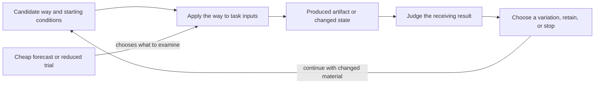
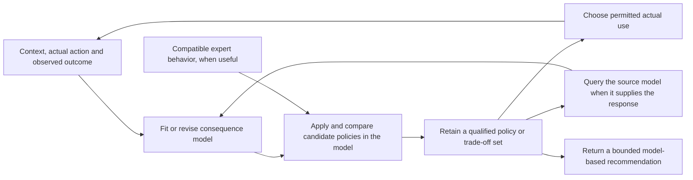
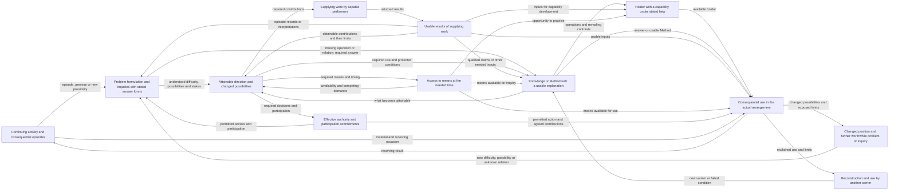

, evidence sufficiency, gate validity, assurance, or causality; a non-control `layer`, `level`, `tier`, or `stack` label belongs first to `C.30.STRAT`.

FPF needs a pattern that preserves useful recognition without letting the cue become structure, relation, or proof. Direct control relations, their participant meanings, feedback relations, externality boundaries, and rate separations can enter an architecture structural description. The same episteme is a view only through viewpoint conformance. Systems, local kinds, separate System-classification judgments, assignments, Methods, and Work are optional neighboring facts; use the relevant patterns to state or test authority, responsibility, safety, stability, gates, evidence, assurance, and causal effects.

### C.30.LCA:3 - Forces

* Control terminology helps engineers identify observations, commands, feedback and their participants; preserve it when its local meaning is clear.
* The same source labels can name different things. C.30.LCA applies after an exact direct control relation, rate-band relation, control-layer relation, or `B.2.5` supervisor-subholon relation is recovered. An assignment is neither required nor sufficient for control; include it only when it independently obtains. A model-use structure is cited only when that independently selected structure changes interpretation.
* Layered and multi-rate control descriptions often need timing and dynamics claims before they can carry stability or safety claims.
* `B.2.5` supplies a compound supervisor-subholon feedback claim grounded in observation, return and coupling facts. A feedback diagram alone establishes none of those facts.
* Mathematical graph descriptions of E.18 `TransformationFlowStructure` values can describe flow, path, crossing, or transformation-flow relations relevant to control, but the selected flow structure, graph expression, and control structure remain distinct.
* Practitioners need one small first output; exact viewpoint conformance, dynamics, C.29, evidence, assurance, and gate records are used only when the question calls for them.

### C.30.LCA:4 - Solution

Treat LCA-like source descriptions as possible inputs to a control-structure description under C.30. Identify the controlled holon and the actual control relations needed by the question, such as observation, actuation, reference provision or supervision, with each participant's meaning. For a selected-structure or full-view claim, identify that control structure and its described-holon trace; add an actual architecture relation only when independently established. For B.2.5 feedback, retain the compound assertion alongside its base relations.

Add participating Systems, local kinds, separate System-classification judgments, assignment species and obtaining occurrences, Methods, and actual Work only when the corresponding fact is independently established. Use A.22 to identify the selected structure from its constituents, selected obtaining relation occurrences, applied constraint claims, and receiving-use frame; a note, diagram, list, description, kind, or assignment creates none of them. If a source label is not yet control-specific, apply `C.30.STRAT` first. Then state the supported conclusion and any further pattern needed by the question.

Retain any needed boundary, admissible-use or handoff detail in the existing account. This expanded `ControlStructureViewNote` can organize it:

```text
ControlStructureViewNote:
  architectureRelationOccurrenceRef?: ArchitectureRelationRef
  architectureClaimRef?: U.EpistemeRef constrained to ArchitectureClaim
  describedHolonRef?: U.HolonRef
  selectedControlStructureRef?:
  structureGap?:
  controlledHolonRef:
  selectedControlRelationRef:
  controlRelationParticipantRefs:
  feedbackClosureState: closed | oneWay | unclear
  controlLayerRelationRef?:
  rateBandRef?:
  observationBoundaryRef?:
  actuationBoundaryRef?:
  feedbackBoundaryRef?:
  externalityBoundaryRef?:
  stratificationRepairRef?:
  nextPatternUseRef?:
  admissibleUse:
  nonAdmissibleUse:
  stopCondition:
```

Use `rateBandRef?`, `controlLayerRelationRef?`, and `externalityBoundaryRef?` only when that object or relation changes the control-structure use. Otherwise one actual control relation and its feedback-closure state can answer the question; name a further pattern only if its contribution is needed. Generic stratification labels stay with `C.30.STRAT` until a control-specific relation is recovered.

When a recovered control-layer relation is used to justify decomposition, substitution, or design reliance, recover the inter-layer assumption-guarantee relation or mark the control-layer relation as orientation only. `interLayerControlRelationRefs?` is used only when the relation is already control-specific and is used for decomposition, substitution, design reliance, safety, or stability claims.

```text
InterLayerControlRelationNote:
  upperLayerAssumptionRefs:
  lowerLayerGuaranteeRefs:
  observationConditionRefs:
  actuationAuthorityRefs:
  latencyBoundRefs?:
  rateEnvelopeRefs?:
  violationFallbackRefs:
  admissibleUse:
  nonAdmissibleUse:
```

Use this note only when a recovered control-layer relation is used for decomposition, substitution, a safety or stability claim, or an architecture decision. It is not proof and does not make the relation obtain. Otherwise keep C.30.LCA at the small note or ordinary description form, or use `C.30.STRAT` to recover the source label.

A full `ControlStructureView` carries the common `ArchitectureStructuralView` content from `C.30.ASV:4.1` plus the control-specific fields below. Here `selectedControlStructureRef` names the same structure as the common `selectedStructureRef`; the full view retains `viewConstruction` and `hiddenOrLostStructure` even though this form does not repeat them.

```text
ControlStructureView ::= ArchitectureStructuralView & {
  viewEpistemeRef: U.EpistemeRef,
  claimGraph: exactly one C.2.1 ClaimGraph,
  entityOfConcernRef: selectedControlStructureRef,
  effectiveReferenceScheme: U.ReferenceScheme, byValue,
  selectedControlStructureRef: U.StructureRef,
  structureKindRef = ControlStructure,

  viewpointRef: U.ViewpointRef,
  viewpointConformanceRelationRef: EpistemeViewpointConformanceRelationRef,
  concernRefs?: FinSet(U.EntityRef),

  describedHolonRef?: U.HolonRef,
  architectureRelationOccurrenceRefs?: FinSet(ArchitectureRelationRef),
  architectureClaimRefs?: FinSet(U.EpistemeRef constrained to ArchitectureClaim),
  claimScope?: U.ClaimScope, byValue,
  modelUseStructureRef?: U.StructureRef,
  empiricalGroundingRelationRefs?: FinSet(EpistemeEmpiricalGroundingRelationRef),
  controlledHolonRef: U.HolonRef,

  selectedControlRelationRefs: FinSet(U.RelationRef),
  controlRelationParticipantRefs: FinSet(U.EntityRef),
  observationRelationRefs?: FinSet(U.RelationRef),
  actuationRelationRefs?: FinSet(U.RelationRef),
  referenceProvisionRelationRefs?: FinSet(U.RelationRef),
  feedbackRelationRefs?: FinSet(U.RelationRef), // obtaining base relations, or separately admitted feedback occurrences
  feedbackClaimRefs?: FinSet(U.EpistemeRef), // B.2.5 compound assertions
  controlLayerRelationRefs?: FinSet(U.RelationRef),
  rateBandRefs?: FinSet(RateBandRef),
  interLayerControlRelationRefs?: FinSet(U.RelationRef),
  supervisorSubholonRelationRefs?: FinSet(U.RelationRef), // only independently obtaining relations

  participatingSystemRefs?: FinSet(U.EntityRef constrained to U.System),
  localSystemRoleKindRefs?: FinSet(U.KindRef),
  systemRoleClassificationJudgmentRefs?: FinSet(U.RelationRef),
  assignmentRows?: FinSet({
    assignmentSpeciesRef: U.RelationKindRef constrained under U.SystemRoleAssignment,
    assignmentOccurrenceRef: U.RelationRef constrained to an obtaining occurrence of assignmentSpeciesRef
  }),
  actualControlWorkRefs?: FinSet(U.EntityRef constrained to U.Work),
  actualControlWorkAttributionRefs?: FinSet(U.RelationRef constrained to obtaining performedUnderAssignment relations),

  observationBoundaryRefs?: FinSet(BoundaryRef),
  actuationBoundaryRefs?: FinSet(BoundaryRef),
  feedbackBoundaryRefs?: FinSet(BoundaryRef),
  externalityBoundaryRefs?: FinSet(BoundaryRef),
  transformationFlowPathSliceRefs?: FinSet(PathSliceId),

  stratificationRepairRefs?: FinSet(C30STRATRepairRef),
  sourceToUsePathRefs?: FinSet(U.RelationRef),
  downstreamPatternUseRefs?,
  representationRefs?: FinSet(U.EntityRef),
  publicationOccurrenceRefs?: FinSet(EpistemePublicationRelationRef),
  publicationFormRefs?: FinSet(U.EntityRef),
  carrierRefs?: FinSet(U.EntityRef constrained to U.PresentationCarrier),
  admissibleUse,
  nonAdmissibleUse,
  sourceReturnCondition?
}
```

The full view is the same C.2.1 episteme identified by its exact claim graph, selected-control-structure EntityOfConcern, and effective scheme. Its direct E.17.0 conformance occurrence has exactly that candidate episteme and one exact viewpoint episteme as participants. It obtains only when the fixed five-part predicate is true, and those participants determine its identity. Authoring, A.6.3 construction, a `viewpointRef`, query, selection, bundle membership, diagramming, rendering, publication, or current use does not make it obtain.

`controlledHolonRef` names the holon whose state is observed or changed by independently obtaining control relations and may be the described holon or one of its exact parts. Architecture claims, `ClaimScope`, model-use structure, concern, and empirical grounding remain optional neighboring objects or relations. `modelUseStructureRef` appears only when an independently selected DDD-style bounded-model-use structure changes interpretation or selection.

For every positive control-relation reference, identify the actual occurrence and use the relevant pattern to recover what its participants mean. Identify any participating System, local classification, assignment, Method, Work, or F.6 attribution independently on its own admitted basis. A classification or assignment establishes neither control nor action.

The description, control note, view record, and diagram create none of these occurrences. Representation, publication occurrence, form, and carrier likewise remain separate from the selected structure and view episteme.

#### C.30.LCA:4.0a - Safety-loss control-structure note

Use a `SafetyLossControlStructureNote` only when safety wording is being used for a loss-control claim and the practitioner first needs the architecture-side loss-control structure, not a safety-case verdict:

```text
SafetyLossControlStructureNote:
  lossOrHarm:
  hazardOrUnsafeState:
  unsafeControlActionOrMissingControl:
  controlledProcessOrPlantRef:
  controlConstraintRef:
  feedbackOrObservabilityBoundary:
  timingOrRateBoundary:
  operationalDesignScopeOrMisuseScope:
  foreseeableMisuseRefs?:
  architectureStructureKindRefs:
    ControlStructure | ConstraintRequirementStructure |
    SecurityTrustBoundaryStructure | InformationDataStructure |
    EvidenceAssuranceStructure
  claimPatternUseRefs:
    A.3.3 dynamics, C.27.TA temporal aspect or rate, and C.27 authored temporal-claim adequacy,
    C.28 causal-use, A.10 bounded source-to-use reliance, G.6 citable provenance paths,
    B.3 named assurance, A.20 internal-constraint validity, A.21 gate decisions
  nonAdmissibleUse:
    not safety proof, not safety-case verdict, not regulatory acceptance
```

The note gives a positive safety-triggered architecture move: find the loss-control structure, controlled process or plant, constraint, foreseeable misuse, operational design scope, and action-relevant boundary. It does not replace the generic control-structure view and does not replace evidence, assurance, gate, causal, dynamics, or temporal claims.

**Control-participant interpretation.**

| Source label | FPF recovery |
|---|---|
| Plant or controlled holon | `U.Holon` whose state evolves; reusable state-evolution claims use `A.3.3`. |
| Regulator or controller | Recover the regulation or control relation and its participant meaning. If control Work is claimed, recover the exact performer System through A.13 and admit the Work independently through A.15.1 with its enacted Method. Add an assignment occurrence and F.6 only when the control account expressly consumes precise assignment-bound attribution. Add local classification only when relied on; assignment supplies none. |
| Planner | Recover the exact reference-provision, planning, or other direct relation. A planning System and planning Work are separate; for a plan, authority, or allowed-region result, use its own pattern. |
| Observer or estimator | Recover the observation or estimation relation and participant meaning. If observation or estimation Work occurred, recover the exact performer System through A.13 and admit the dated Work and enacted Method independently through A.15.1. Add assignment and F.6 only when precise assignment-bound attribution is expressly consumed; a reading or evidence result remains separate. |
| Supervisor | Recover the exact supervision or `B.2.5` supervisor-subholon relation. Use separate patterns for any constraining Work, policy change, authority, responsibility, gate, or control-mode change. |

**Control-specific stratification gate.** `Layer`, `level`, `tier`, and `stack` enter C.30.LCA only after `C.30.STRAT` or the local sentence recovers a direct control relation, inter-layer control relation, rate band, or `B.2.5` supervisor-subholon relation. An assignment alone is insufficient, and the label by itself establishes neither control structure nor separation.

**B.2.5 boundary.** Use `B.2.5` for the compound supervisor-subholon feedback assertion. The description cites its observation and returned-influence base relations in `feedbackRelationRefs` and the assertion in `feedbackClaimRefs`; it does not coerce an episteme into U.Relation. Keep the coupling rule and facts recoverable from the assertion. Use the relevant patterns for stability, safety, causality, evidence, gate and assurance claims. If a particular dated Work occurrence involving an episteme is claimed, recover the exact performing System through A.13 and admit the Work and enacted Method independently through A.15.1. Add an assignment occurrence and F.6 only when the account expressly consumes precise assignment-bound attribution; keep publication, source-to-use, and work-reliance relations separate.

**Transformation-flow boundary.** An `E.18` transformation-flow path slice may supply flow-structure, path, crossing, or transformation-flow-structure input to the control view when that relation is being used. The transformation-flow description may use a mathematical graph expression under `E.18.2`; the description is a `U.View` only when E.17.0 conformance obtains. Neither the expression nor the description becomes the functional architecture, the control structure, or proof of control adequacy.

**C.29 boundary.** An LCA can be a model used for one selected control structure, or it can be used as a transferable mathematical lens. Use `C.29` when a mathematical lens makes transfer, prediction, reusable cross-domain explanation, or another control-structure use more inspectable. Dynamics, rate bands, authored temporal-claim adequacy, and causal claims remain with `A.3.3`, `C.27.TA`, `C.27`, and `C.28`.

**Nesting and scale rule.** When nested control affects latency, stability, observability, accountability or assurance, recover the affected relation and the bounds needed for that use. Retain a scale-audit reference only when the applicable receiving rule calls for it; nesting alone requires no additional record.

**Worked slice A - LCA diagram used as proof.** A safety note says: `The Layered Control Architecture proves the plant is safe because the supervisor monitors the lower controller.` A conforming repair keeps the control-structure view and names planner, controller, plant, and supervisor relations, observation and actuation boundaries, and any rate bands. Use the applicable safety pattern for the safety claim, `B.3` only for a named assurance claim, `A.10` for bounded source-to-use reliance, `G.6` for citable provenance paths, `C.27.TA` for temporal aspects and rate bands, `C.27` for authored temporal-claim adequacy, and `A.3.3` or the applicable dynamics pattern for dynamics or stability.

**Worked slice B - multi-rate controller.** A source says a control stack has a slow planner, a faster regulator, and an observer with a different update period. Apply `C.30.LCA` only after the stack label has been recovered as exact reference-provision, regulation, observation, or other control relations with their participant meanings and rate bands; otherwise use `C.30.STRAT` first. Systems, classifications, assignments, Methods, and Work are added only where independently current. A C.30.LCA description establishes no rate adequacy. If the rate relation matters for oscillation, latency, stability, or safety, next use `C.27.TA` for temporal aspect or rate-band structure, `C.27` when an authored temporal-claim adequacy question is under repair, and the dynamics or assurance pattern named by value when that claim kind is being made.

**Worked slice C - supervisor-subholon loop.** A subsystem is supervised by an external controller System. The C.30.LCA note cites the observation and returned-influence relations together with B.2.5's compound assertion and its coupling basis. If that System performs mode-change Work, recover it through A.13 and admit the Work and enacted Method independently through A.15.1. Add an assignment occurrence and F.6 only when this slice also expressly represents precise assignment-bound attribution; missing or failed F.6 attribution alone leaves the mode-change Work intact while its independent A.13/A.15.1 grounds still hold. Authority, responsibility, gate passage, safety, stability, and policy-constraint results remain separate claims under their own patterns; the supervisor relation establishes none of them.

**Currentness and smallest reopen.** When a decisive input changes, reopen only the control-structure locus and the use conclusions that depend on it. A changed selected control structure or controlled holon reopens the affected `ControlStructureViewNote` or full description and view; a changed direct control relation or participant meaning reopens that occurrence and its dependent structure selection; a changed classification, assignment, Method, Work, or F.6 attribution reopens only that neighboring fact and any view use that relied on it. A changed B.2.5 coupling rule, supervised set or report/return fact reopens the affected pair and interval assertion, its cited base relations where changed, and dependent structure uses. A communication break need not end an assignment; reconnection requires new supporting facts. Changed rate or control-layer relations reopen only their matching relation or boundary fields; changed view conformance reopens only the E.17.0 admission; and a changed source edition reopens its source-to-use and source-return locus. A changed authority, responsibility, safety, proof, evidence, assurance, or gate claim reopens only that neighboring claim unless a control-structure input also changed. Update the affected locus, demote full view use to a note or orientation, narrow use, or reopen the control-structure question; unrelated structures and claims stay closed.

### C.30.LCA:5 - Archetypal Grounding

| Archetype | Without C.30.LCA | With C.30.LCA |
|---|---|---|
| System | A plant, controller, or supervisor diagram is treated as if the drawing itself established the controlled system's behavior. | The controlled system, controller, observer, planner, supervisor, boundaries, rate bands, actual control relations, and selected control structure remain separately recoverable. |
| Episteme | A control-description publication is read as structure, `U.View`, or proof because it uses familiar control labels. | The exact description episteme has one selected-structure EntityOfConcern; it is a view only through exact E.17.0 conformance. Representation, publication, and proof-like claims stay separate. |

### C.30.LCA:6 - Bias-Annotation

* **Diagram authority bias.** A neat feedback diagram can look more persuasive than the structure, source-to-use path, work-reliance relation, or claim it actually supports. Repair by naming each object or relation and the pattern used to state or test the claim.
* **Stratification-label bias.** A `layer`, `level`, `tier`, or `stack` label can hide whether it names a control relation, rate band, aggregation, scale, organization, Work scope, evidence scope, deployment, or publication section. Repair with `C.30.STRAT`; C.30.LCA applies only to the recovered control-specific case.
* **Supervisor anthropomorphism.** A supervisor label can make an episteme, policy, assignment, or dashboard sound agentive. Repair by recovering the supervision relation first. If a particular dated Work occurrence is claimed, recover the exact performer System through A.13 and admit the Work and enacted Method independently through A.15.1. Add assignment and F.6 only for an expressly consumed precise assignment-bound attribution; recover authority, responsibility, gate, safety, and evidence separately.
* **Transformation-flow and LCA conflation.** A transformation-flow graph expression and a control description or view can inform each other, but neither replaces the other. Repair by naming the EntityOfConcern, structure kind, and direct relations for each.

This checklist verifies the preceding guidance after the practitioner has chosen the selected repair action; it is not a required project control form and not a substitute for the note, description episteme, conformance occurrence, direct control relation, or repair guidance above.

### C.30.LCA:7 - Conformance Checklist

| ID | Check | Why it matters |
|---|---|---|
| CC-LCA-1 | A conforming full description or view has one C.2.1 identity whose EntityOfConcern is one exact selected control structure; the described and controlled holons and any actual `ArchitectureRelation` remain separately recoverable. | Prevents a free-floating diagram, claim, or unspecified relation set from becoming structure or episteme identity. |
| CC-LCA-2 | A conforming use records the direct control relations and participant meanings present: for example, reference provision, regulation or control, observation or estimation, plant or controlled-holon participation, or supervision. Systems, classifications, assignments, Methods, Work, and F.6 attribution are separate optional facts. | Keeps the view tied to actual control relations and their participants. |
| CC-LCA-3 | `Layer`, `level`, `tier`, or `stack` wording enters only with a recovered direct control relation, inter-layer relation, rate band, or `B.2.5` supervisor-subholon relation. An assignment alone is insufficient. | Prevents generic stratification wording from standing in for control structure. |
| CC-LCA-4 | A claimed `U.View` names the exact viewpoint episteme and independently obtaining `EpistemeViewpointConformanceRelation`; bundle membership, viewpoint label, authoring, query, diagram, and publication are insufficient. | Keeps structural description and view membership distinct. |
| CC-LCA-5 | Use the relevant patterns to state or test stability, safety, dynamics, temporal-aspect or rate-band structure, authored temporal-claim adequacy, causal use, empirical grounding, evidence, gate, and assurance claims. | Prevents LCA-as-proof. |
| CC-LCA-6 | Use `B.2.5` to state or test its compound feedback claim; keep that assertion separate from the base relation references. | Keeps the assertion, base relations and stronger stability, safety, evidence, gate and assurance claims distinct. |
| CC-LCA-7 | Use E.18 to identify and test any transformation-flow path slice used by the control view. The slice is not the control structure or actual transformation itself. | Keeps transformation-flow and LCA relations distinct. |
| CC-LCA-8 | Use C.29 for the mathematical-lens portion of cross-domain transfer, prediction, reusable explanation, or assurance input when that lens changes the use. | Preserves mathematical-lens use and representation boundaries. |
| CC-LCA-9 | The record states admissible use, non-admissible use, and a source-return condition when the intended use relies on hidden source-side distinctions; representation, E.24.PUB publication occurrence, publication form, and carrier remain separate. | Prevents narrowed recognition or publication from becoming unchecked reliance. |

### C.30.LCA:8 - Common Anti-Patterns and How to Avoid Them

| Anti-pattern | Symptom | Repair |
|---|---|---|
| LCA-as-proof | The text says the control stack proves safety, stability, or gate readiness. | Keep the control view and use the relevant dynamics, evidence, assurance, gate, or safety pattern for each proof or claim named by value. |
| Control-layer-as-generic-level | `Layer`, `level`, `tier`, or `stack` is used without a direct control relation, inter-layer relation, rate band, or `B.2.5` supervisor-subholon relation. | Apply `C.30.STRAT`; use C.30.LCA only after a control-specific relation is recovered. |
| Agentive episteme, kind, or assignment | A policy, model, dashboard, local system-role kind, assignment, or architecture note is said to watch, decide, plan, or adapt. | Recover the direct control relation and participant meanings. For a particular dated action asserted as Work, recover the exact performer through A.13 and admit the `U.Work` occurrence independently through A.15.1. Ordinary instrumental wording alone does not assert such an occurrence. Add assignment and F.6 only when precise assignment-bound attribution is expressly consumed; keep publication, source-to-use, work-reliance, authority, responsibility, gate, safety, and evidence relations separate. |
| Transformation-flow and LCA substitution | A transformation-flow graph expression is treated as control architecture, or an LCA diagram is treated as the transformation-flow graph expression. | Recover both exact selected structures and description epistemes separately; use E.17.0 only for actual viewpoint conformance. |
| Hidden rate claim | Multi-rate control is used to claim adequacy, but the timing relation needed by that property is not established. | Recover the stated rates, their relations and bounds. Use `C.27.TA` for temporal aspects or rate bands, `C.27` for an action-guiding temporal claim, and the applicable dynamics or control rule for stability or performance. Merely reporting different update periods need not assert adequacy. |

### C.30.LCA:9 - Consequences

The gain is a small, usable control-structure output that preserves common architecture language while blocking structure, view, and proof overread. Practitioners can still say `controller`, `plant`, `supervisor`, `feedback`, and `control layer`, but the record shows the selected structure, the boundary between description and view, and the direct relations those words carry; generic stratification labels use `C.30.STRAT` first.

The cost is recovering missing control facts or checking the conformance or property on which the use depends. Reuse an adequate existing account. Recognition can finish with an ordinary sentence; view membership, safety, stability, evidence, assurance or gate passage requires its own applicable basis.

### C.30.LCA:10 - Rationale

Control architecture is too important to leave to diagram authority and too useful to remove from architecture language. The FPF move is to keep the practice cue and recover control-structure content first: selected structure, controlled holon, actual architecture relation when current, direct control relations and participant meanings, recovered rate or control-layer labels, observation and actuation boundaries, externality boundaries, and next admissible move. Systems, classifications, assignments, Methods, Work, and F.6 attribution are added independently; use their own patterns for authority, responsibility, gate, safety, stability, and evidence. The full view is one description episteme admitted as `U.View` through E.17.0 conformance; its record represents the relevant content and references. It can cite `C.30.STRAT`, `B.2.5`, E.18 transformation-flow structure, dynamics, `C.27.TA`, `C.27`, `C.28`, evidence, assurance, gates, and C.29, but does not absorb their claim kinds.

This protects subject, structure, episteme, View, representation, and publication boundaries. Several descriptions may have the same selected control structure as EntityOfConcern, and one description may be published repeatedly without changing identity, creating the structure, granting view membership, or making direct relations obtain.

### C.30.LCA:11 - SoTA-Echoing

| SoTA and practice source | What it contributes | FPF adoption stance | Practitioner implication |
| --- | --- | --- | --- |
| Anderson, Doyle, Low, and Matni, "System Level Synthesis" (Annual Reviews in Control, 2019). | Structured controller-synthesis practice treats closed-loop responses, constraints, locality, and distributed implementation as explicit synthesis variables and implementation relations rather than as a box-and-arrow guarantee. | Adopt and adapt: use SLS as a source for explicit control-participant meanings, direct relations, locality, rate, and implementation boundaries; do not import SLS proof claims into C.30.LCA. | A distributed-control diagram can start a control-structure description; for stability or robust-performance claims, use the relevant dynamics or control-proof pattern. |
| Ames, Coogan, Egerstedt, Notomista, Sreenath, and Tabuada, "Control Barrier Functions: Theory and Applications" (ECC, 2019). | Safety-critical control separates a controller structure from a safety property and the mathematical certificate or enforcement method used for that property. | Adopt and adapt: keep safety wording visible as a neighboring safety or proof claim, not as control-view adequacy. | When a sentence says the supervisor or controller makes the plant safe, keep the control description and use the relevant safety, dynamics, evidence, or assurance pattern to state and test that claim. |
| Rawlings, Mayne, and Diehl, *Model Predictive Control: Theory, Computation, and Design*, 2nd ed. (2017). | Planner and regulator distinctions, receding horizon, constraint, update period, and model-boundary distinctions are MPC structure cues. | Adopt as control vocabulary: recover direct control relations and participant meanings, rates, model boundaries, and constraints; add Systems, classifications, assignments, Methods, and Work only when independently current. Handle temporal or rate claims under `C.27.TA`, authored temporal adequacy under `C.27`, and dynamics under `A.3.3`. | A multi-rate or MPC-style note names relation participants, rate bands, and model boundaries before claiming adequacy. |
| Leveson and Thomas, *STPA Handbook* (2018), as systems-theoretic safety-control practice. | Safety analysis treats unsafe control actions, feedback, process models, constraints, and losses as control-structure-relevant distinctions. | Adopt and adapt: allow safety-loss control-structure notes, while keeping safety-case verdicts and evidence sufficiency outside C.30.LCA. | A loss-control diagram can organize the description; it does not close the safety case. |
| FPF `C.2.1`, `A.22`, `C.30`, `C.30.AD`, `E.17.0`, and `C.30.ASV`. | These patterns separate selected control structure, architecture relation, architecture claim, description episteme, viewpoint episteme, conformance occurrence, described holon, and controlled holon. | Bind `ControlStructureView` to one selected `U.Structure` and viewpoint conformance; recover every control relation through the pattern that defines it. | A control view can coordinate several relations without becoming the architecture, relation occurrence, or proof. |

### C.30.LCA:12 - Relations

* Builds on `C.30` for direct architecture relations and selected-structure adequacy, `C.30.AD` for description identity and use, `E.17.0` for direct viewpoint conformance, and `C.30.ASV` for structural-view adequacy.
* Uses `A.22` for exact structure identity and structure-kind discipline.
* Coordinates with `C.30.STRAT` when layer, level, tier, stack, ladder, rung, block, expert, cache, router, gate, or similar source labels must be recovered before control-specific use.
* Coordinates with `B.2.5` for supervisor-subholon feedback relation recognition.
* Coordinates with `C.32.LCA` for constructing and comparing control arrangements. C.30.LCA supplies the recovered control account and its use limits; C.32.LCA returns explained alternatives whose descriptions can be examined here. Construction and view qualification retain their different results.
* Coordinates with E.18 and C.30.TFS-REL when transformation-flow path slices supply structure input to the control view; use E.18.2 for a mathematical description when that description is current.
* For neighboring claims, use `A.3.3` for dynamics or stability, `C.27.TA` for temporal-aspect or rate-band structure, `C.27` for authored temporal-claim adequacy, `C.28` for causal use, A.10 for bounded source-to-use reliance, G.6 for citable provenance paths, B.3 only for a named assurance claim, A.20 for internal-constraint validity, A.21 for gate decisions, A.15 for Work alignment, A.15.6 for project-Work recovery, E.24.PUB for publication, and C.29 for representation or transferable mathematical-lens use.

Use C.30.LCA only for the control-structure description or view-adequacy question at issue.

### C.30.LCA:End

## C.30.ILC - Cross-Scope Architecture Residual Triage

> **Type:** Architectural subpattern under C.30
> **Status:** Stable
> **Normativity:** Normative for FPF pattern, companion-text, and project-description use that claims architecture-specific residuals across declared scopes.

### C.30.ILC:1 - Problem frame

Use this pattern when a project situation contains a cross-scope architecture residual for a described holon, often described in project speech as:

```text
"Optimization at the component scope breaks the wider holon."
"We added modularity, but integration exceptions grew."
"Local agent autonomy conflicts with the control or policy scope."
"At one scale window the architecture is stable; at the next, bespoke bridges appear."
"The team optimizes latency, but the evidence or assurance scope becomes unrepairable."
"We may need to add, split, or mediate a declared holon level, declared scope, control layer, interface grammar, work scope, or evidence scope, but it is not clear which architecture move is admissible."
```

**First-minute use slice.** A robotics team says a local controller upgrade made each arm faster, but cell-level stoppages and audit exceptions grew. Before drawing another architecture view, the team identifies: described holon = assembly cell; declared levels and scopes = arm controller, cell control, evidence scope; level-bearing selected structure = control and evidence-reuse structure; residual-bearing locus = control-rate conflict plus evidence-reuse failure; local repair already attempted = retuned each arm controller; first architecture move = expose the coupling and evidence-use conditions that the retuning left unresolved. A mediator or control-layer change is a candidate response if that diagnosis supports it; use `C.30.ASV` when its structural view is needed.

The first useful result names the affected holon levels or scopes, the structure that carries them, the residual-bearing locus, any attempted local repair or reason for its insufficiency, and the first warranted architecture move. An adequate ordinary explanation can finish the question. `CrossScopeArchitectureResidualTriageRecord@Context` can organize the result when its fields help the receiving use.

The primary `EntityOfConcern` is the cross-scope or interlevel architecture residual in the described holon or holon family for a named architecture concern and intended use. The described holon may be an admitted system, organization-as-system, episteme, work occurrence, discipline, or another admitted holon kind. Publication-family material uses the episteme and publication patterns. A MethodDescription is an episteme; a Method uses `A.3.1` and the relations claimed for it. A phrase in a description, a diagram label, or a mathematical-lens output may make the residual visible, but it is not the residual itself and does not become the center of this pattern.

`InterlevelConflict@Context` applies when two or more declared holon levels, declared scopes, or level-bearing structure relations of the same described holon or holon family impose incompatible or tensioned constraints, objectives, admissibility conditions, tempos, resource allocations, information-transfer relations, or assurance requirements. Examples include declared system levels, declared episteme levels, aggregation scopes, typed control layers, declared organizational scopes, work scopes, evidence scopes, system scopes, environment scopes, description-use scopes, publication-use scopes, or other declared scopes. A selected structure matters here only when it carries, separates, or relates the declared levels or scopes. A conflict between structures belongs in C.30.ILC only when those structures are assigned to different declared holon levels, declared scopes, scale windows, or coarse-graining steps; a conflict confined to the same level and scope, or one whose relevant assignment remains unknown, belongs elsewhere until that cross-level or cross-scope basis is recovered.

`FrustrationResidual` applies when a persistent cross-scope or interlevel residual remains after local repairs have been attempted or deemed insufficient: local optimization in one declared holon level or declared scope improves local fit while degrading, blocking, or destabilizing another declared holon level, declared scope, or level-bearing structure relation.

`ComplexityGrowthPressure` is admitted only as conditional architecture pressure: reducing an interlevel residual may require adding, splitting, mediating, or stabilizing a declared holon level, declared scope, aggregation scope, interface grammar, control loop, evidence scope, work-method scope, abstraction scope, source-return scope, or declared system level when that special case is being claimed. It is not a claim that complexity is good or that complexity necessarily grows.

Entry condition: if declared holon levels or declared scopes, the selected structure or architecture structure kind that carries them, one residual-bearing locus, and one first admissible architecture move or a supported `noArchitectureMove` result cannot be named for the described holon in context, keep the issue at ordinary problem framing or `ProblemCard@Context`; do not claim `CrossScopeArchitectureResidualTriageRecord@Context` yet.

What goes wrong if C.30.ILC is missed: a local improvement, control layer, scale label, interface grammar, or evidence reuse is treated as whole-holon architecture adequacy while the residual moves into another declared holon level or declared scope.

What this buys: the practitioner can keep useful conflict or frustration language as an entry label while naming the residual-bearing locus, the affected declared holon levels or scopes, the selected structure that carries them, any local repair or reason for its insufficiency, and one first architecture move or sufficient `noArchitectureMove` result.

`Interlevel conflict` and `frustration` may appear in ordinary project descriptions, but the conforming record describes the residual through declared holon levels or declared scopes, the selected structure that carries them, and a residual-bearing locus. The pattern does not create a generic level scale or `U.Frustration`. It asks which declared holon level, declared scope, aggregation scope, control layer, organizational scope, work scope, evidence scope, system scope, environment scope, scale window, interface grammar, allocation boundary, publication section, or source-return condition bears the residual. A system level or episteme level is a special case of a declared holon level.

Not this pattern when the issue under repair is only ethical value framing, interlevel ethical conflict structure, ethical mediation or decision use, measurement, scale relation, coarse-graining relation, mathematical-lens validation, candidate generation, residual-reducing candidate-set work, final selection, causal outcome, evidence, or assurance. Use the subject pattern and keep C.30.ILC only to the architecture residual-bearing locus.

### C.30.ILC:2 - Problem

Architecture work often starts from a residual: a local fix works in one declared holon level or declared scope and fails in another. Component optimization increases whole-holon or product-line integration cost. A new module boundary reduces local complexity and increases exceptions at the product-line scope. A control layer improves local safety and creates accountability or latency claims elsewhere. A reusable evidence set reduces repeated work and hides a new source-return condition.

The useful architecture intuition is narrower than a new `Frustration` kind: local optimization at one declared holon level or declared scope can create a persistent residual in another declared holon level, declared scope, or level-bearing structure relation. When a recoverable multilevel, scale, or coarse-graining mapping is claimed, use `C.29` to state and test that lens use. When the claim compares architecture alternatives over a declared scale window, use `C.31.ASAP`. Use `C.32.MLAO` and `C.32` for residual-reducing candidate work, and use `G.5` only to declare a selected-set result. If that result is made available to an audience, use `E.17` for a source-backed publication face and return to source and `E.24.PUB` for the publication occurrence, form, carrier, audience, bounded use, and availability. An ordinary conflict between structures is not enough for the RG lens or frustration mathematical lens, but a conflict between structures assigned to different declared holon levels or scale windows may be enough when the mapping, preserved-structure line, and lost-structure line are recoverable. The first C.30.ILC output is the grounded residual account and first warranted move.

Without a pattern, teams either discuss the residual as vague `complexity`, treat it as an ordinary negotiation problem, jump into measurement, use mathematical frustration language as proof, or jump to candidate generation too early. `C.30.ILC` keeps the first move small: identify whether the residual is architecture-shaping and name the first admissible architecture move or subject-pattern application.

The practical work is often not to draw another view. It is to assign the residual to the locus named by value that can bear it: declared holon level, declared scope, level-bearing selected structure, structure kind, constraint, characteristic or Q-bundle, evidence-reuse boundary, source-return condition, or non-architecture claim kind.

### C.30.ILC:3 - Forces

* Local optimization can be real and still be harmful at another declared holon level or declared scope.
* `Level`, `layer`, `scope`, `scale`, `abstraction`, `organization`, `system`, and `environment` labels can sound precise while naming different project-side entities, relations, scopes, or claim kinds.
* Frustration language can be useful because it points to incompatible constraints or fitness contributions, but it can also smuggle a physics, biology, psychology, or global-optimizer ontology into architecture prose.
* Measurement is tempting because the residual feels numeric, but a measure before declared-scope and structure-kind recovery can hide the real conflict.
* Ethical conflict or mediation may be present, but not every cross-scope residual is an ethical conflict or mediation problem.
* Architecture synthesis may be needed, but a small triage output often identifies a narrower move: split scope, add mediator, add interface grammar, change allocation, expose coupling, add evidence scope, accept bounded exception, or return to source.
* The pattern is not a prescribed sequence of moves; architecture work is often case-managed through loops, checks, and dead ends.

### C.30.ILC:4 - Solution

When an architecture concern involves residuals across declared levels or scopes, identify the related structures, the conflicting conditions and the locus where the loss remains. Preserve an adequate ordinary account; use `CrossScopeArchitectureResidualTriageRecord@Context` when its fields help retain or compare those distinctions. The record does not itself establish the conflict.

```text
CrossScopeArchitectureResidualTriageRecord@Context ::= {
  describedHolonRef,
  architectureConcernCue,
  intendedArchitectureUse,
  claimScopeRef?: U.ClaimScope,
  qualificationWindowRef?,
  boundedModelUseStructureRef?,

  declaredHolonLevelRefs?: FinSet(DeclaredHolonLevelRef),
  declaredScopeRefs: FinSet(AggregationScopeRef | DeclaredSystemLevelRef |
                            ControlLayerRef | WorkEvidenceScopeRef |
                            OrganizationScopeRef | SystemEnvironmentScopeRef |
                            RateBandRef | ScaleWindowRef |
                            PublicationSectionRef | OtherDeclaredScopeRef),
  structureKindRefs: FinSet(ArchitectureStructureKindRef),

  interlevelConflictDescription?,
  conflictCarrierRefs?:
    FinSet(ConstraintRef | ObjectiveRef | AdmissibilityConditionRef |
           TempoRef | ResourceAllocationRef | InformationTransferRelationRef |
           AssuranceRequirementRef | OtherDeclaredConflictCarrierRef),
  localScopeOptimizationClaim?,
  widerScopeOptimizationClaim?,
  conflictingConstraintRefs?,
  conflictingCharacteristicRefs?,
  conflictingQBundleRefs?,

  symptom,
  crossScopeResidualDescription,
  crossScopeResidualLocusKind:
    hiddenCoupling | interfaceException | controlRateConflict |
    scaleWindowLoss | evidenceReuseFailure | regulatoryBespokeResidue |
    workMethodException | dataSemanticDrift |
    placementJurisdictionConflict | securityTrustBoundaryBreak |
    otherDeclared,
  frustrationResidualBefore?,
  complexityGrowthPressure?,
  localRepairAttempted?,
  whyLocalRepairInsufficient?,

  firstAdmissibleArchitectureMove:
    splitDeclaredHolonLevel | mergeDeclaredHolonLevel |
    splitDeclaredScope | mergeDeclaredScope |
    splitDeclaredSystemLevel | mergeDeclaredSystemLevel |
    addMediator | addInterfaceGrammar | addControlLayer |
    addEvidenceScope | addWorkMethodScope | changeAllocation |
    exposeHiddenCoupling | acceptBoundedException |
    applyD3D4 | applyC28 | noArchitectureMove,

  triggeredPatternLocators?,
  admissibleNextMove,
  stopCondition,
  sourceReturnCondition?
}
```

**Layer, level, tier, stack, and declared-scope labels.** `Declared holon level` is the general level-bearing recovery field for this pattern; system level and episteme level are special cases when the described holon or selected structure makes them relevant to the claim. `System level` may remain as ordinary recognition language when a practitioner would naturally use it, but the record recovers the project-side scope references through `declaredHolonLevelRefs` or `declaredScopeRefs`; a system level is not the default architecture level. When the source says layer, level, tier, or stack, recover exactly one or more of: `declaredHolonLevelRef`, `controlLayerRef`, `declaredSystemLevelRef`, `aggregationScopeRef`, `rateBandRef`, `organizationLevelRef`, `workEvidenceScopeRef`, `scaleWindowRef`, or `publicationSectionRef` when the wording only names a document layer. A move such as `splitDeclaredHolonLevel`, `splitDeclaredScope`, or, in the special system-level case, `splitDeclaredSystemLevel` is admissible only when the affected declared holon level, declared scope, selected structure, declared system level, aggregation scope, control layer, organization scope, work scope, evidence scope, system scope, environment scope, rate band, scale window, publication section, or source-return condition is named. A layer label is not a structure kind, not a system level, not a rate band, and not evidence of separation by itself.

**Interlevel conflict, frustration residual, and complexity-growth recovery.** A conflict is architecture-shaping only when the account identifies the declared holon levels or declared scopes, the selected structure or structure kind that carries them, and the conflict carrier: constraint, objective, admissibility condition, tempo, resource allocation, information-transfer relation, or assurance requirement. A frustration residual is architecture-shaping when the cross-scope loss persists after attempted local repair, or when a stated reason shows why that repair would leave the loss unresolved. Complexity-growth pressure is only a candidate reason to add, split, mediate, or stabilize structure when that change is expected to reduce the residual enough to justify the new cost and its own residue.

`crossScopeResidualDescription` is not enough by itself. A residual becomes architecture-shaping only when its residual-bearing locus is declared: hidden coupling, interface exception, control-rate conflict, scale-window loss, evidence-reuse failure, regulatory bespoke residue, work-method exception, data-semantics drift, placement or jurisdiction conflict, security trust-boundary break, or another declared locus.

**Multilevel optimization boundary.** First establish whether local optimization in one declared holon level or scope degrades another declared holon level or scope. This triage neither optimizes the architecture nor proves that one global function exists. Use `C.29` with `MLU.Description@MultilevelLearningFrustration` only when the mathematical representation supplies a recoverable mapping between declared levels, scopes, scale windows, or coarse-graining steps and states what structure is preserved and lost. Conflicting structures can enter this lens only when each structure is assigned to a declared holon level, scope, scale window, or coarse-graining step and the mapping shows why the conflict is interlevel. If scale window, RG relation, coarse-graining relation, preserved structure, lost structure, or conflict residual slope becomes an architecture scale-preference claim, use `C.31.ASAP` and keep any mathematical-lens claim in `C.29`. If the practitioner needs to generate residual-reducing candidate architecture moves, apply `C.32.MLAO` for the residual-reducing multilevel candidate frame and `C.32` for the candidate palette. Use `A.19.CPM` for comparison under a declared comparator, `G.5` only when selected-set result declaration is current, and `C.11` when final local choice is current. For audience publication, use `E.17` for a source-backed face and return to source and `E.24.PUB` for the publication occurrence and audience availability. Use `C.32.PAD` when a project architecture decision is current. Stop the C.30.ILC use at the residual and first admissible move. If the case is only a conflict between two selected structures with no recoverable assignment to different declared levels or scopes, keep it in `C.30`, `C.30.ASV`, `D.3`, `D.4`, `C.28`, evidence, assurance, or decision patterns as applicable.

Anti-collapse rule: no generic frustration score, no risk-matrix residual, no ethical-mediation takeover, no physics or biology ontology transfer, no global-optimizer proof, no causal proof, and no assurance proof. A frustration or risk label does not govern the case until declared holon levels or declared scopes, the selected structure or structure kind that carries them, residual-bearing locus, and first architecture move are recoverable; `D.3` applies only when an interlevel ethical conflict needs an inspectable description; `D.4` applies only when mediation or decision use of that D.3 description is current.

**Stop condition.** Stop when the account names the residual and the first warranted move, including a supported conclusion that no architecture move is needed. It does not measure scale preference, generate candidate architectures, mediate ethical conflict, or select a decision. Apply a subject pattern only when a claim kind being made exists:

| Claim kind being made | Subject pattern to apply |
|---|---|
| measurement or characteristic claim | `C.16` or the characteristic pattern that defines or constrains the characteristic under evaluation |
| scale window, RG relation, coarse-graining relation, preserved structure, lost structure, or conflict residual slope | `C.31.ASAP` when an architecture scale-preference claim is being made; use `C.29` when mathematical-lens use is being claimed |
| multilevel learning or frustration mathematical-lens use with recoverable level mapping or scale mapping | `C.29` with `MLU.Description@MultilevelLearningFrustration` |
| candidate generation or residual-reducing candidate architecture moves | `C.32.MLAO` when the residual-reducing multilevel frame is current; `C.32` for the candidate palette; `G.5` when selected-set result declaration is current; `E.17` for a source-backed publication face and source return and `E.24.PUB` for the publication occurrence and audience availability when publication is current; `C.11` when final local choice is current; `C.32.PAD` when a project architecture decision is current |
| final local choice | `C.11` |
| causal outcome claim | `C.28` |
| evidence or assurance | `A.10` for source recovery and bounded reliance; `G.6` for addressable provenance paths; `B.3` when a named assurance claim is current |
| ethical conflict description, mediation, or decision use | `D.3` for the interlevel ethical conflict description; `D.4` for mediation and decision use of that description |

**D.3 and D.4 boundary.** D.3 connects each ethical claim to the affected entity, declared level relation or scope, value-frame edition, expected consequence, horizon, and evidence use or uncertainty when current, then states the tension among the sides. Identify the conflict-description episteme when the receiving use needs to cite or revise it. A D.4 use takes that description into mediation, refusal, evidence demand, causal return, assurance return, architecture return, accepted residual, or bounded decision use. `C.30.ILC` handles architecture-specific recognition: whether the conflict or residual is borne by declared holon levels or declared scopes within a selected structure. Such a residual may concern allocation, interfaces, control rates, work reuse, evidence reuse, scale windows, or coarse-graining loss. Structural views may help describe the selected structure and locate the residual. `C.30.ILC` is a triage and architecture-move pattern, not an ethical mediation pattern.

**Architecture-move examples.**

| Cue | Admissible architecture move | Non-admissible overread |
|---|---|---|
| Component optimization breaks integration | expose hidden coupling; add interface grammar; change allocation | Treat local performance as whole-holon adequacy. |
| Modularity reduces local work and increases exceptions | accept bounded exception; revise module boundary; add work scope or evidence scope | Average exceptions into a modularity score without declared scope, comparator, and measurement relation. |
| Local autonomy conflicts with control scope | add control layer; change allocation; apply `C.30.LCA` | Treat autonomy label as causal or safety proof. |
| Evidence reuse hides source loss | add evidence scope; add source-return condition; use `A.10` for source recovery and bounded reliance, and `G.6` when the provenance path must remain addressable | Treat reused evidence as automatically valid in the wider scope. |
| A scale window changes the residual | apply `C.31.ASAP`, with `C.29` when scale-lens use is being made | Treat two observations as a universal scale law. |
| A frustration lens with recoverable level mapping or scale mapping makes candidate moves comparable | use `C.29` for lens adequacy; use `C.32.MLAO` and `C.32` when a residual-reducing candidate palette is current; use `G.5` only when selected-set result declaration is current | Treat an unassigned or same-scope structure conflict as RG mathematics or frustration mathematics, or treat an interlevel residual without recoverable mapping as a global optimizer, proof, or selected architecture. |

**Worked slice A - clean module layout, bad flow.** A product team redraws modules so each component has an explicit responsibility relation or enactor relation, but order-to-cash flow now crosses more work transfers and exceptions rise. `C.30.ILC` names the module structure, transformation-flow structure, affected work scope, cross-scope residual, and first move: expose hidden coupling or apply `C.30.TFS-REL`. It does not turn the exception count into a modularity measure until `C.16` or the characteristic pattern governing the characteristic under evaluation is applied.

**Worked slice B - AI agent control conflict.** A local agent optimizes its local objective and violates a supervisor's allowed-mode constraint. `C.30.ILC` names the agent scope, supervisor scope or control scope, control relation, local optimization claim, residual-bearing locus, and local repair attempted. The first move may be add control layer, change allocation, or apply `C.30.LCA`. Safety, causality, and gate claims use their subject patterns.

**Worked slice C - evidence scope residue.** A reusable certification evidence set removes repeated evidence work for several product variants, but one variant has a hidden environment difference. `C.30.ILC` names the work scope or evidence scope and source-return condition. The practitioner uses `A.10` for source recovery and bounded reliance, and `G.6` when the provenance path must remain addressable. Whether the evidence meets the certification requirements for that variant is tested under the applicable certification rule.

**Worked slice D - frustration residual before synthesis.** Several decompositions reduce local module work but each creates a different integration, control-rate, or evidence-reuse residual in another declared scope. `C.30.ILC` records the residuals and first architecture moves. If the team needs a residual-reducing candidate palette, stop the C.30.ILC use and apply `C.32.MLAO` for the residual-reducing frame and `C.32` for the candidate palette. Use `G.5` only when the palette or retained set must be declared as a selected-set result for downstream use. If the team claims a multilevel-learning lens or frustration lens, `C.29` carries the lens-use fields and stop condition only after the level mapping, scope mapping, scale-window mapping, or coarse-graining mapping and preserved structure and lost structure are recoverable.

### C.30.ILC:5 - Archetypal Grounding

| Archetype | Without C.30.ILC | With C.30.ILC |
|---|---|---|
| Holon levels | A residual across component, system, episteme, publication-use, control, environment, or product-line scopes is called generic complexity. | The affected declared holon levels or declared scopes, the level-bearing structure, the residual, and the first architecture move are named. |
| Episteme as described holon | A diagram, measurement note, or conflict memo has its own structure, but a second description about it is interpreted as if it already selected a repair. | The episteme can be the described holon; the description of that episteme remains separate from decision, evidence, measurement, selection, or mediation and is governed by the subject pattern when those claims are being made. |

### C.30.ILC:6 - Bias-Annotation

* **Local-success bias.** A local improvement is treated as whole-architecture improvement. Repair by naming the wider declared holon level or declared scope and the residual.
* **Pseudo-level bias.** `Level`, `layer`, or `scope` sounds precise but no declared holon level or declared scope exists. Repair through `declaredHolonLevelRefs` or `declaredScopeRefs`.
* **Generic-structure-conflict bias.** A conflict between selected structures is treated as cross-scope or interlevel conflict although the relevant levels or scopes and their relation are unrecovered. Identify those levels or scopes and the structure that carries them; otherwise keep the case in `C.30`, `C.30.ASV`, or its subject pattern. Different declared scopes can matter at the same level.
* **Frustration-ontology bias.** A useful conflict or frustration entry label becomes a new first-order architecture kind, physics ontology, biology ontology, or psychology claim. Repair by recovering declared holon levels or declared scopes, the level-bearing structure, conflict carriers, residual-bearing locus, and the subject pattern for any lens, proof, evidence, mediation, or synthesis claim.
* **Global-optimizer bias.** Local optimization in one declared holon level or declared scope is used as if the architecture literally optimizes one global function. Repair by keeping the local optimization claim as a triage input unless `C.29` supplies an admissible mathematical-lens use with recoverable level mapping or scale mapping and the candidate-set or decision pattern carries any synthesis or selection claim.
* **Measurement-first bias.** A number is used as a cross-scope residual without identifying its characteristic, bearer or comparison basis. Use `C.16` or the applicable characteristic rule to establish that measurement; it may help discover the residual before architecture triage is complete. The architecture conclusion still needs the affected scopes and structural relation.
* **Mediation-default bias.** Every conflict is treated as ethical mediation or negotiation. Repair by checking whether the use under repair is architecture structure, allocation, interface grammar, control, work or evidence scope, source-return, or another declared level-bearing architecture relation.
* **Synthesis-jump bias.** A local residual immediately triggers candidate generation. Repair by identifying the first admissible architecture move before applying `C.32.MLAO` and `C.32`; use `G.5` only when selected-set result declaration is current.

The conformance checklist below verifies the preceding guidance after the practitioner has chosen the repair action; it is not a required project control form and not a substitute for the card, note, view, relation, or repair guidance above.

### C.30.ILC:7 - Conformance Checklist

| ID | Check | Why it matters |
|---|---|---|
| CC-ILC-1 | A conforming use names `describedHolonRef`, the architecture concern, intended use, ClaimScope or qualification window when each changes the result, and any independently selected bounded model-use structure actually relied on. | Keeps the triage grounded without narrowing architecture to systems or making a generic context field supply locality. |
| CC-ILC-2 | A conforming use names declared holon levels or declared scopes, not only `level`, `layer`, `scope`, or `scale` prose. | Prevents pseudo-level and pseudo-scope reasoning. |
| CC-ILC-3 | A conforming use names the selected structure or structure kind that carries, separates, or relates the declared levels or scopes affected by the residual. | Distinguishes a cross-level or cross-scope residual from a conflict confined to the same level and scope or one whose relevant assignment is unknown. |
| CC-ILC-4 | A conforming use identifies the conflict carriers. For a claimed frustration residual, it states any attempted local repair and its insufficiency, or the reason that such repair would leave the loss unresolved. | Prevents premature synthesis and repeated local fixes. |
| CC-ILC-5 | A conforming use states one first admissible architecture move or `noArchitectureMove`. | Makes the output action-guiding without candidate generation. |
| CC-ILC-6 | Evidence, assurance, measurement, causal, ethical, selection, scale, RG, coarse-graining, mathematical-lens, and residual-reducing candidate-set claim kinds use their subject patterns. | Prevents triage from becoming proof, lens adequacy, mediation, synthesis, or selection. |
| CC-ILC-7 | If a source-return condition is needed, the record states what hidden or lost distinction triggers return to the source. | Protects compressed and extracted views. |
| CC-ILC-8 | The stop condition is visible. | Prevents the triage pattern from expanding into a hidden prescribed sequence. |
| CC-ILC-9 | If multilevel learning or frustration is used as mathematics, the record names `C.29`, `MLU.Description@MultilevelLearningFrustration`, the recoverable level mapping or scale mapping, and preserved structure and lost structure; if residual-reducing candidate moves form a candidate set being used, the record names `C.32.MLAO` and `C.32`; if the retained-set result is being declared, it names `G.5`; if that result is made available to an audience, it names `E.17` for a source-backed publication face and source return and `E.24.PUB` for the publication occurrence and audience availability. | Preserves the useful multilevel optimization line without importing ontology, proof, or a hidden selector. |

### C.30.ILC:8 - Common Anti-Patterns and How to Avoid Them

| Anti-pattern | Symptom | Repair |
|---|---|---|
| Generic complexity bucket | Everything becomes `complexity` or `interlevel conflict`. | Name declared holon levels or declared scopes, level-bearing structure, residual, and first architecture move. |
| Structure conflict as interlevel conflict | Two structures are in tension, but the relevant declared levels or scopes and their relation are unrecovered. | Use `C.30`, `C.30.ASV`, `D.3`, `D.4`, `C.28`, evidence, assurance, or decision patterns as applicable; use C.30.ILC only when the conflict is across declared levels or scopes. |
| Frustration-as-ontology | `Frustration` is treated as a new FPF kind, psychological state, physics kind, biology kind, assurance score, or proof. | Keep frustration as an entry label; recover `FrustrationResidual`, conflict carriers, residual-bearing locus, and subject patterns for `C.29`, evidence, assurance, causal, mediation, or synthesis claims when those claim kinds are being made. |
| Optimization-as-global-proof | A local optimization claim is treated as proof that the whole architecture optimizes one global objective. | Record local and wider-scope claims separately; use `C.29` only for an admissible mathematical lens with recoverable level mapping or scale mapping and use candidate-generation, comparison, or decision patterns for synthesis and selection. |
| Measurement-first conflict | An unspecified measurement is treated as the architectural conflict. | Recover the measured characteristic, bearer and comparison under `C.16` or its domain rule, then establish which declared scopes and relations make any observed loss architectural. Useful measurements need not wait for completed ILC triage. |
| Risk color as cross-scope decision | A red, yellow, or green risk cell, risk matrix, or maturity score decides the cross-scope architecture move or resource-allocation priority. | Recover the affected scopes, structure, residual and the loss or threat and measurement basis actually used. Establish an allocation or gate conclusion under its own applicable rule. A color alone supplies neither that rule nor its supporting facts. |
| Mediation-only conflict | A structural residual is treated as ethical mediation with no architecture move. | Use `D.3` only when an interlevel ethical conflict needs a description and `D.4` only when that description is being mediated or used in a decision. |
| Hidden candidate generation | The residual immediately spawns many designs. | State the first admissible move; apply `C.32.MLAO` and `C.32` only when residual-reducing candidate work is being claimed, and apply `G.5` only when selected-set result declaration is current. |
| Scope word without recoverable scope | The text relies on `level`, `layer`, `scale`, or `scope` without making its meaning recoverable. | Name the actual level, scope or mapping in ordinary wording or the record. Keep an already clear local term; word shape alone establishes no scope relation. |

### C.30.ILC:9 - Consequences

The gain is an early architecture move that is small and precise. The practitioner can preserve useful problem language such as conflict, frustration, level, layer, or local optimization while making the affected scopes, relations and remaining loss inspectable.

C.30.ILC supplies the residual account and first warranted move, which can complete the receiving question. A further construction or evaluation uses the applicable subject pattern. Measurement, scale relation, RG relation, coarse-graining relation, mathematical lens use, ethical mediation, candidate generation, evidence, assurance, and final choice remain outside until those claims are being made.

This makes multilevel optimization usable rather than decorative. Use `C.30.ILC` to identify the residual that makes optimization relevant, `C.29` for an admissible mathematical-lens use only when level or scale mapping and preserved and lost structure are recoverable, `C.32.MLAO` and `C.32` for residual-reducing candidate frames and palettes, `G.5` for selected-set result declaration, and `C.32.PAD` for a project architecture decision. For publication, use `E.17` for a source-backed face and source return and `E.24.PUB` for the publication occurrence and audience availability.

### C.30.ILC:10 - Rationale

Interlevel conflict and frustration are useful Plain entry labels because they point to a recurrent architecture failure: local repair in one declared holon level or declared scope leaves a residual in another. They are dangerous as generic labels because they can hide which level, scope, level-bearing structure, relation, conflict carrier, or source-return condition bears the residual.

A local optimum or successful local repair is therefore not treated as whole-architecture adequacy. It becomes relevant to C.30.ILC triage only when the residual-bearing locus is recoverable and the next architecture use can be named.

`C.30.ILC` keeps the entry label but recovers the architecture relation or structure claim. It treats conflict or frustration as architecture-shaping only when declared holon levels or declared scopes, the level-bearing structure, conflict carriers, and residual-bearing loci are named. This lets FPF preserve the practical intuition without introducing a second ontology of levels, a hidden measurement pattern, a physics or biology transfer, a global optimizer proof, or a prescribed architecture work order.

### C.30.ILC:11 - SoTA-Echoing

| SoTA and practice source | What it contributes | FPF adoption stance | Practitioner implication |
|---|---|---|---|
| Scenario-based architecture trade-off practice, with ATAM-like reasoning used here as lineage and practice source for concern, scenario, sensitivity point, and trade-off recognition rather than as a decision or evidence method. | Architecture work often starts from cross-concern and cross-scope trade-offs rather than one local measurement result. | Adopt and adapt: use the conflict cue for triage, require declared holon levels or scopes, level-bearing structure, and subject patterns for final selection, evidence, assurance, and gate passage. | A residual can start an architecture move without becoming a decision, proof, or safety case. |
| Vanchurin, Wolf, Katsnelson, and Koonin multilevel learning and frustration line, plus the Akhtyrchenko, Katsnelson, and Ustyuzhanin 2026 MSPD paper as selected source pressure rather than full-literature ranking. | Local optimization at one declared holon level, scope, or level-bearing structure relation can create persistent residual in another; frustrated optimization and MSPD-like reasoning can be candidate mathematical lenses when a level mapping or scale mapping is recoverable. | Adopt and adapt: `C.30.ILC` uses this line for architecture triage only. `C.29` with `MLU.Description@MultilevelLearningFrustration` carries mathematical-lens adequacy with preserved structure and lost structure; no `U.Frustration`, universal architecture metric, physics or biology ontology transfer, global optimizer proof, causal proof, assurance proof, or ethical-mediation takeover. | First recover holon levels or scopes, level-bearing structure, conflict carriers, residual-bearing locus, local repair, and the first architecture move. Apply `C.29` only when the lens mapping is being claimed; apply `C.32.MLAO` and `C.32` only when residual-reducing candidate work is current; apply `G.5` only when selected-set result declaration is current. |
| Control and cyber-physical systems practice. | Local autonomy, feedback, supervisor relations, and rate separation can create cross-scope conflict. | Reuse through `C.30.LCA`, `B.2.5`, `C.27`, and `A.3.3`; do not let ILC carry control proof. | A control conflict is governed by control-structure or dynamics patterns only when those claims are being made. |
| FPF source-return and semantic-coarsening discipline. | Compressed views and reusable records can hide distinctions that matter in a wider scope. | Adopt: add `sourceReturnCondition?` when hidden distinctions carry the residual. | A bounded exception or source-return trigger may be the correct first move. |

### C.30.ILC:12 - Relations

* Builds on `C.30` and `C.30.ASV` for grounded architecture, selected-structure, and structural-view adequacy.
* Uses `A.22` for selected-structure grounding.
* When the residual concerns flow, control, function, allocation, module, or interface structure, use the applicable pattern: `C.30.TFS-REL` for the bounded architecture-use record connecting an architecture locus to a transformation-flow structure or network; `C.30.LCA` for the selected control structure, its description, and view conformance when current; `A.6.F` for function-use repair; and `A.6.M` for module-interface claim repair.
* Applies `C.16` or the characteristic pattern that defines or constrains the characteristic under evaluation for measurement or characteristic claims.
* Applies `C.29` with `MLU.Description@MultilevelLearningFrustration` only when multilevel learning or frustration is used as a mathematical lens with recoverable level mapping or scale mapping and preserved structure and lost structure; applies `C.31.ASAP` for architecture scale-preference claims and `C.29` for mathematical-lens claims when scale, RG, coarse-graining, preserved structure, lost structure, or scale-window adequacy is being claimed.
* Applies `C.32.P2S` when residual triage must continue through problem-to-structure architecturing; applies `C.32.MLAO` for residual-reducing multilevel candidate frames and `C.32` for candidate palettes; applies `G.5` only when selected-set result declaration is current.
* Applies `C.11` for final local choice, `C.28` for causal outcome claims, `A.10` for source recovery and bounded reliance, `G.6` for addressable provenance paths, `B.3` when a named assurance claim is current, `D.3` for the interlevel ethical conflict description, and `D.4` for mediation and decision use of that description.

When audience availability is current, use `E.17` for a source-backed face and return to source and `E.24.PUB` for the publication occurrence, form, carrier, audience, bounded use, and availability. Use `C.30.ILC` only to triage a cross-scope architecture residual.

### C.30.ILC:End

## C.30.TFS-REL - Use Transformation-Flow Structures and Networks in Architecture

> **Type:** Architectural pattern
> **Status:** Stable
> **Normativity:** Normative unless explicitly marked informative
> **Tech-name:** `ArchitectureTransformationFlowStructureRelation` (relation record)
> **Plain-name:** architecture transformation-flow structure relation
> **Governed object:** the bounded architecture-use record connecting an actual `ArchitectureRelation`, exact selected architecture structure, exact structural-view or description episteme, or bounded architecture claim to one selected `TransformationFlowStructure` under `E.18` or one selected `TransformationFlowStructureNetwork` under `E.18.NET`; the record does not itself instantiate a direct relation.

### C.30.TFS-REL:1 - Problem frame

Use this pattern when an architecture discussion depends on one exact selected `TransformationFlowStructure`, one selected `TransformationFlowStructureNetwork`, or a current path, path slice, crossing, flow valuation, edition pin, plane pin, context pin, no-hidden-scalarization claim, or mathematical description of the selected flow structure.

First identify the architecture locus, the selected E.18 TFS or E.18.NET network, and what this use lets the practitioner inspect or decide. An adequate existing account can finish the question. `ArchitectureTransformationFlowStructureRelation` is an optional record for retaining those distinctions. The locus can be an actual `ArchitectureRelation` occurrence, exact selected architecture structure, exact architecture-description or structural-view episteme, or bounded architecture claim. For a network, distinguish an actual containing-holon relation, a bounded claim about one named holon, and a use spanning several named holons.

```text
ArchitectureTransformationFlowStructureRelation:
architectureRelationOccurrenceRefs?:
architectureClaimRefs?:
selectedArchitectureStructureRefs?:
architectureStructuralViewRefs?:
architectureDescriptionRefs?:
architectureUseConcernRefs?:
claimScope?: U.ClaimScope, byValue
effectiveReferenceScheme?: U.ReferenceScheme, byValue
modelUseStructureRef?: U.StructureRef
empiricalGroundingRelationRefs?:

functionalStructureViewRefs?:
functionalElementClaimRefs?:
functionalBehaviorClaimRefs?:
requiredOrDesiredEffectClaimRefs?:
actualTransformationRefs?:
transformerSideFillerRefs?:
candidateBearerRefs?:
inputConditionRefs?:
outputConditionRefs?:
functionalPortRefs?:

transformationFlowStructureViewRefs?:
transformationFlowStructureRef?:
transformationFlowStructureNetworkRef?:
networkCrossFlowRelationRowRefs[]?: E.18.NET NetworkCrossFlowRelationRowRef
networkArchitectureUseBranch?: namedContainingHolon | singleHolonClaim | explicitInterHolon
containingHolonRef?:
containingArchitectureRelationRef?:
containingArchitectureClaimRef?:
participatingHolonRefs[]?:
participatingArchitectureRelationRefs[]?:
participatingArchitectureClaimRefs[]?:
noNetworkBearerHolonAsserted?:
transformationFlowUnfoldingStructureRef?:
selectedPathOrSliceRefs?:
crossingBundleRefs?:
flowValuationRefs?:

mathematicalDescriptionRefs?:
mathLensUseRefs?:
correspondenceClaimOrRelationRefs?:
sourcePublicationOrEditionRef?:
representationRefs?:
publicationOccurrenceRefs?:
publicationFormRefs?:
carrierRefs?:
extractionOrProbeLocusRef?:
relationObservationClassRef?:
unexploredRegionRefs?:
hiddenRelationStructureReturnCondition?:
admissibleUse:
stopOrReturnCondition:
nonAdmissibleUse?:
```

This is a use/trace record, not a universal direct `U.Relation` declaration and not an obtaining-condition shortcut. Establish each positive `architectureRelationOccurrenceRef`, flow relation, cross-member relation, correspondence relation, empirical-grounding relation, publication occurrence, or project/work relation under its direct pattern before asserting it. Keep a bounded claim or description separate from an obtaining relation occurrence. `groundedNonAdmissibleUse?` is an alias for the optional `nonAdmissibleUse?` value, used only for a supported restriction that matters to the receiving use.

Ordinary minimum: name at least one exact architecture-side reference (`architectureRelationOccurrenceRefs`, `selectedArchitectureStructureRefs`, `architectureStructuralViewRefs`, `architectureDescriptionRefs`, or a bounded `architectureClaimRefs` entry) and at least one flow-structure reference (`transformationFlowStructureRef`, `transformationFlowStructureNetworkRef`, `transformationFlowUnfoldingStructureRef`, `selectedPathOrSliceRefs`, `crossingBundleRefs`, or `flowValuationRefs`), the admissible use, and one stop or governing-pattern application. A network use also selects exactly one network architecture-use branch and supplies its required exact holon and relation/claim refs. Keep another trace field only when it changes the next architecture move or receiving use; unused optional fields may be omitted. State non-use, uncertainty, or missing information when that distinction changes the operation. Include an explanatory `nonAdmissibleUse` guard only when an independently grounded alternative is plausible for the intended reader here and distinguishing it changes understanding or use. An unused guard may be omitted without an absence entry unless a concrete receiving use needs to distinguish absence from missing information.

Use this record only when an actual architecture relation, bounded architecture claim, selected architecture-relevant structure, exact structural-view episteme, functional-structure view, transformation-flow-structure claim, or conditional architecture-description use depends on an E.18 TFS, an E.18.NET network, or one of the selected TFS's paths, crossings, or valuations. Stop when that architecture-to-flow-structure use and its stop or return condition are clear. If another claim is being made, apply its governing pattern and keep this record to the architecture/flow boundary.

What goes wrong if this pattern is missed: a transformation-flow diagram, graph-shaped mathematical description, path slice, flow valuation, requirement, or functional-view row becomes functional architecture, whole architecture ontology, actual `U.Transformation`, performed Work, work-result record, evidence, gate passage, or project decision by appearance.

What this buys in practice: the practitioner can use E.18 for one TFS or E.18.NET for one network while C.30 remains the direct architecture-relation and selected-structure adequacy locus and C.30.ASV remains the architecture-structural-view locus.

Not this pattern when the question is only the TFS or network, a mathematical description, path, crossing, or flow valuation and no architecture use is being made. Use E.18 for one TFS, E.18.NET for one network, E.18.2 for its mathematical description, and C.29 when mathematical-lens use is current. Use C.30 for a direct architecture relation or architecture claim without this flow-structure use; use C.30.AD for a durable architecture description and C.30.ASV/A.6.F for a functional view without it. Apply any other claim's governing pattern and keep C.30.TFS-REL only to the architecture/flow relation.

### C.30.TFS-REL:2 - Problem

Using actual architecture relations, selected architecture-relevant structures, exact architecture structural views, and conditional architecture descriptions often requires E.18 TFS objects or one E.18.NET network when the question concerns transformation-flow structure, required functional dependencies, actual change, data movement, control paths, evidence-flow descriptions, neural-network dataflow, or code-agent relation graphs.

C.30.TFS-REL prevents collapse by requiring the exact architecture-side reference before any E.18 TFS, E.18.NET network, path, slice, crossing, or valuation receives architecture use. It also keeps required or desired behavior/effect claims distinct from actual A.3.4 transformations. A network use chooses the branch in :4.4a from its named holons and actual relation or bounded claim; its graph, description, publication, or record cannot supply those facts.

### C.30.TFS-REL:3 - Forces

| Force | Tension |
| --- | --- |
| Transformation-flow relation vs architecture takeover | One E.18 TFS, one E.18.NET network, or a selected path or crossing can be essential, but none becomes all architecture ontology or an unnamed characteristic bearer. |
| Functional view vs transformation-flow view | A functional structure view may need a transformation-flow relation, but a required effect, path, crossing, valuation, or mathematical description is not a functional element or actual transformation by itself. |
| Structure precision vs work/change overread | E.18 gives selected structure, path, and flow-valuation objects; actual transformation, Work occurrence, and work results remain outside this record unless their own patterns admit those claims. |
| No-hidden-scalarization vs architecture scoring | E.18 set-return and no-hidden-scalarization discipline can inform architecture reasoning, but it does not by itself define a general architecture score. |
| Small relation vs unneeded non-architecture apparatus | One recoverable architecture-to-flow use may finish the question. Mathematical, evidence, assurance and decision claims require their own grounds only when made. |
| Flow-structure-owner stability vs C.30 integration | An actual architecture relation, selected structure, structural view, or conditional architecture-description use needs a trace to E.18 for one TFS or E.18.NET for one network without rewriting either owner as generic architecture adequacy theory. |

### C.30.TFS-REL:4 - Solution

C.30.TFS-REL is the C.30 entry record to E.18 and E.18.NET when an actual architecture relation, bounded architecture claim, selected architecture-relevant structure, exact architecture structural view, or conditional architecture description uses one selected `TransformationFlowStructure`, one selected `TransformationFlowStructureNetwork`, or a current path, crossing, or flow valuation.

It supplies only the architecture-to-transformation-flow use boundary. The field set in section 1 names the contributions that a use may need; a sufficient qualified existing account with accessible exact returns can carry them. No separate form or entries for unused optional fields are required, and no populated field makes a direct relation obtain.

```text
ArchitectureTransformationFlowStructureRelation minimum:
  architectureLocusRef: exactly one actual ArchitectureRelation,
    selected architecture U.Structure, exact description/view episteme,
    or bounded ArchitectureClaim used by this question
  flowLocusRef: exactly one E.18 TFS, E.18.NET network,
    unfolding, member-local path/slice/crossing, or valuation
  requiredOrDesiredEffectClaimRefs?: claim content only
  actualTransformationRefs?: only with complete A.3.4 basis
  networkArchitectureUseBranch?: one complete branch from section 4.4a
  admissibleUse:
  stopOrReturnCondition:
  nonAdmissibleUse?:
```

At least one architecture-side field and at least one E.18 or E.18.NET field must be named by value. Network branch fields obey `C.30.TFS-REL:4.4a`; other optional trace fields follow the ordinary minimum in section 1. The explanatory `nonAdmissibleUse` guard follows the ordinary minimum in section 1 and needs no absence entry unless a concrete receiving use requires that distinction.

#### C.30.TFS-REL:4.1 - Use trigger

Use this pattern only when an actual `ArchitectureRelation` occurrence, bounded architecture claim, selected architecture-relevant structure, exact architecture structural view, functional-structure view, transformation-flow-structure claim, or conditional `ArchitectureDescription` use depends on one or more of the following:

- `TransformationFlowStructureRef`;
- `TransformationFlowStructureNetworkRef`, when architecture use selects an E.18.NET-conforming network;
- `PathId` or `PathSliceId`;
- `CrossingBundleRef`;
- flow valuation over the `U.Transfer` relation;
- edition, plane, or context pin;
- no-hidden-scalarization or set-return discipline;
- a correspondence claim or independently governed relation between functional structure and transformation-flow structure;
- a generated or extracted relation graph used as candidate input for the architecture-to-transformation-flow use.

For a particular dated Work claim, recover its A.13 basis and independent A.15.1 admission; use F.6 only for precise assignment-bound attribution. Ordinary practitioner action wording needs no invented occurrence or assignment. If it says that an actual referent changed, use A.3.4 before citing a `U.Transformation`. If it only says that one selected TFS exists, use E.18; if it only says that one independently identified E.18.NET-conforming TFS network is selected, use E.18.NET. If the sentence uses a graph-shaped expression as mathematical description, use E.18.2. If it relies on a mathematical lens, use C.29.

Use `transformationFlowUnfoldingStructureRef?` only when the architecture use depends on one A.22-selected CGUS qualified under `E.18.3`. The ref names that selected CGUS; its E.18.3 account separately names one independently identified E.18 substrate branch and the exact positions, bindings, and already-obtaining occurrences the CGUS uses. Architecture, decision, work, feedback, narrative, or refresh values connect only through exact already-obtaining supporting relations, with predicate-definition content and current facts when the claim needs them; the pattern reference adds no connection relation. Generic architecture use of a constraint-governed unfolding structure belongs in `C.32.P2S` or the direct C.30 architecture governing pattern; this pattern keeps only the architecture-to-transformation-flow trace.

#### C.30.TFS-REL:4.2 - Relation to functional structure

A `FunctionalStructureView` under C.30.ASV may cite `ArchitectureTransformationFlowStructureRelation` when a transformation-flow use is current. That record does not make the selected E.18 structure a functional element or actual transformation, and does not make a functional-element claim identical with the system, module, method, bearer, or flow. It states a bounded claim or trace that exact functional-view content corresponds to, or is declared relative to, one exact E.18 selected structure, member-local path, crossing, or valuation. Positive co-reference states that the functional-structure and flow-structure designations refer to the same selected `U.Structure`.

Keep the same three branches used by C.30.ASV:

- `functionalBehaviorClaimRefs` and `requiredOrDesiredEffectClaimRefs` remain C.2.1 claim content under their requirement, architecture, capability, method, functional-view, or other direct owner;
- `actualTransformationRefs` cite only independently identified A.3.4 occurrences with exact changed referent, boundary or extent, boundary conditions, actual before/during/after facts, and continuity or reidentification basis;
- `selectedTransformationFlowStructureRefs` cite exact E.18 structures, which may organize several independently identified transformations and transfers but are not themselves required effects or actual transformations.

A `FunctionalElementClaim` is a bounded C.2.1 claim about one exact selected functional structure. Its bearer or candidate-bearer locus, capability, port, allocation, transformation, and correspondence refs retain their direct owners. A graph-shaped expression, path, valuation, required-effect statement, or flow packet is therefore not the functional element by default.

```text
FunctionTransformationFlowRelationNote:
functionalStructureViewRef:
functionalElementClaimRef?:
functionalBehaviorClaimRefs?:
requiredOrDesiredEffectClaimRefs?:
actualTransformationRefs?:
selectedTransformationFlowStructureRefs?:
transformerSideFillerRef?:
candidateBearerRef?:
inputConditionRefs?:
outputConditionRefs?:
functionalPortRefs?:
transformationFlowStructureViewRef?:
architectureTransformationFlowStructureRelationRef:
pathOrSliceRef?:
crossingBundleRef?:
correspondenceClaimOrRelationRefs?:
preservedStructure:
lostOrHiddenStructure:
sourcePublicationOrEditionRef?:
extractionOrProbeLocusRef?:
relationObservationClassRef?:
unexploredRegionRefs?:
hiddenRelationStructureReturnCondition?:
admissibleUse:
stopOrReturnCondition:
nonAdmissibleUse?:
```

**Required-cooling-effect / later-actual-cooling countercase.** `RequiredCoolingEffect-1` can require exact Rack 7 to be below 30 °C and can correspond to a selected cooling-flow structure before any change occurs. In that first use, fill `requiredOrDesiredEffectClaimRefs` and the selected TFS fields; leave `actualTransformationRefs` empty. A later `Rack7CoolingTransformation-42` is actual only when A.3.4 fixes Rack 7 as the changed referent, its thermal boundary and operating/ambient conditions, actual 38 °C before facts, actual heat-removal during facts, actual 27 °C after facts, and continuity or reidentification of Rack 7. Even then, a separate satisfaction or realization predicate is needed before claiming that the actual transformation satisfies the earlier requirement.

Use this note when the practitioner needs to see whether the function-to-transformation-flow relation changes inspection, split, relation-making, downgrade, selection of the governing pattern for the claim named by value, candidate generation, or stop. Use C.30.ASV for the functional structure view, A.6.F for function-like wording recovery, A.3.4 for an actual transformation, A.6.M for module-claim repair and the direct allocation/interface owner, and E.18 for selected transformation-flow structure.

`FunctionTransformationFlowRelationNote` is the one-TFS form. When architecture use selects a network, use the top-level `ArchitectureTransformationFlowStructureRelation` and the branch in `C.30.TFS-REL:4.4a`. Name a member TFS in this note only when the function correspondence is actually to that member; membership in the selected network alone does not create a function correspondence.

When several transformation-flow variants are kept or compared as candidate architecture inputs, keep each selected transformation-flow structure, path, crossing, valuation, graph-shaped expression, or mathematical description under `E.18`, `E.18.2`, and this record. Apply `C.32` only to the architecture candidate palette that uses those selected structures. The graph, path, and flow description do not become architecture adequacy, evidence, assurance, gate passage, selected-set result declaration, publication occurrence, or decision by serving as a candidate input.

#### C.30.TFS-REL:4.3 - Claim-kind applications named by value

| Claim kind being made | Governing pattern to apply |
| --- | --- |
| Work occurrence or work result | `A.15.1` for the occurrence; `A.15` for Method/Work alignment; the governing work-result or P2W relation for those claims |
| Gate decision | `A.21` |
| Evidence claim | `A.10` for source recovery and bounded reliance; `G.6` for an addressable provenance path; the applicable subject rule to judge whether the evidence supports the named claim or meets the named requirement |
| Assurance claim | `B.3` |
| Causal flow or intervention claim | `C.28` |
| Mathematical-lens use | `C.29` |
| Architecture adequacy, description use, or structural-view adequacy | `C.30` for architecture adequacy, `C.30.AD` for architecture-description use, or `C.30.ASV` for structural-view adequacy |
| Function-like wording | `A.6.F` |
| Interface, signature, or module compatibility | `A.6.M` for module-claim repair and the direct pattern for the interface claim; `A.6.5` only when reusable relation-participant typing is needed, and `A.6.0` when a signature declaration is being made |
| Architecture decision | the project-side architecture decision pattern when the corresponding claim is being made |

Apply a row when its claim is made; a sufficient architecture-to-flow account can finish without those further inquiries. For another claim kind, use the rule that governs it.

#### C.30.TFS-REL:4.4 - E.18 selected-structure boundary statement

For an E.18-governed selected `TransformationFlowStructure` used by an actual `ArchitectureRelation` occurrence, exact selected architecture structure, `ArchitectureStructuralView` episteme, or conditional `ArchitectureDescription` episteme, the architecture-use record may cite that exact E.18 structure plus MVPK faces and correspondence claims or independently governed relations.

Grounded architecture adequacy and bounded architecture claims are governed by C.30; description identity by C.30.AD; view conformance by E.17.0 and C.30.ASV. E.18 supplies selected transformation-flow structures and relations; it does not define all architecture structure kinds, create an architecture relation, or turn required flow content into actual change.

#### C.30.TFS-REL:4.4a - Architecture use of a transformation-flow structure network

First recover the independently selected E.18.NET network and the architecture question. For one named holon, distinguish an obtaining architecture relation whose selected structure is that exact network from a bounded claim that does not assert such an occurrence. For a question spanning several named holons without a grounded containing holon, use the inter-holon branch. Select exactly one branch from those facts.

1. **Named containing-holon use.** Set `networkArchitectureUseBranch=namedContainingHolon`. Name exactly one `containingHolonRef` and one actual `containingArchitectureRelationRef` whose selected structure is the same exact network. `containingArchitectureClaimRef` is optional claim/trace content. Keep all participating arrays and `noNetworkBearerHolonAsserted` absent. Member TFS values and their Work, valuations, boundaries, actual transformations, and direct relations remain independently governed.
2. **Explicit inter-holon use.** Set `networkArchitectureUseBranch=explicitInterHolon`. Put at least two exact distinct holons in `participatingHolonRefs[]`. Add exactly the actual `participatingArchitectureRelationRefs[]` and bounded `participatingArchitectureClaimRefs[]` on which this question relies; a network member whose architecture is not used by the question stays outside those arrays. Keep all containing fields absent and set `noNetworkBearerHolonAsserted=true`. This states one architecture-use question spanning named holons; it does not invent a containing holon, architecture relation, or characteristic bearer whose identity is the network.
3. **Single-holon claim use.** Set `networkArchitectureUseBranch=singleHolonClaim`. Name one exact C.30 `ArchitectureClaim` Q in `architectureClaimRefs`; its content names the described holon H and the same selected network N. Preserve Q's `doesNotObtain`, `unresolved`, or `candidateOrExpectedOnly` disposition and its scope, reference scheme, and supporting or missing basis. Keep the containing fields and participating arrays absent; set `noNetworkBearerHolonAsserted=true`. Use N's admitted positions and relations to inspect the bounded architecture question. Keep the resulting claim or question with its basis. Use `admissibleUse` and `stopOrReturnCondition` to state what may be done with it and what must be recovered before stronger reliance. An unavailable fact remains unknown; a negative claim needs its own C.30 basis. An architecture use that relies on an actual R(H,N) belongs in the containing-holon branch; retaining Q does not supply that occurrence.

Every other populated architecture-side reference must agree with the selected branch. In `namedContainingHolon`, each value in `selectedArchitectureStructureRefs` belongs to the containing architecture relation's selected structure route, and each structural view, architecture description, functional structure view, or architecture claim used by this record traces to the same exact containing holon and relation. In `singleHolonClaim`, each reference traces to H or Q and retains its own actual or modal status; an independently grounded current relation R(H,S) used for comparison does not establish R(H,N). In `explicitInterHolon`, each such reference traces to one named participating holon and, when actual, its exact architecture relation; a singular reference names only that participant and does not imply a containing architecture. If a reference depends on another holon or architecture relation, add it only when the current question actually relies on it, or use a separate record.

The branches are mutually exclusive. When `transformationFlowStructureNetworkRef` is absent, `networkCrossFlowRelationRowRefs[]` and all network branch fields are absent. A network ref without one complete branch is not ready for architecture use. When the record also names a path, slice, crossing, valuation, required effect, or actual transformation, bind it to the exact member TFS and the local positions, participants, or bindings that identify that value. When it names a network-aware unfolding, the E.18.3 substrate branch must name the same exact network and preserve its admitted position mappings, while `selectedCGUSRef` continues to name the separate A.22-selected CGUS. The network ref does not lift member-local values into network-global state.

Use `networkCrossFlowRelationRowRefs[]` only for E.18.NET-owned composite locators. Each locator's current containing record must describe the same exact selected network, and the direct occurrence plus complete ordered endpoint-binding identity must resolve exactly one nested row. Zero matches, several matches, or a record for a different network stop this architecture use. The locator identifies the row; it neither creates the relation occurrence nor changes its direct governor.

For every maintainability, capability, responsibility, production, safety, or other architecture-characteristic claim made or used by this record, name the exact holon, actual architecture relation, selected structure, description/view episteme, bounded claim, or other bearer governed by C.30 or the characteristic's direct owner. A network may have selected structural facts—members, relations, recursion, or exposed positions—but those facts do not make an unnamed network the bearer of holon characteristics, agency, Work, production, required effects, or actual transformations.

A network diagram, member graph, mathematical description, publication, or `TransformationFlowStructureNetworkRecord` may supply facts or claims used in the account. Its form alone establishes neither an architecture relation nor the applicable branch. Keep its identity distinct from the network and any architecture relation, and qualify its representation, description or publication use under the applicable pattern.

**Named containing-holon case.** Exact holon `ManufacturingPlatform-7` has one obtaining architecture relation whose selected structure is the exact product-development/production-system-change network. C.30.TFS-REL may use that network to localize an architecture change while each member TFS, production relation, Work occurrence, and actual transformation keeps its own owner.

**Explicit inter-holon case.** Exact supplier holon and exact plant holon use one selected E.18.NET-conforming supply-linked TFS network to inspect a cross-company dependency. Both appear in `participatingHolonRefs[]`, with only the actual architecture relations and claims the question uses in their corresponding arrays. No containing supply-chain holon has been grounded, so `noNetworkBearerHolonAsserted=true`. The network is not called the architecture of an unnamed enterprise.

**Single-holon claim case.** N is an independently selected development/production network. Q asks whether N organizes exact `ManufacturingPlatform-7`; the available account leaves one constituent's inclusion in that holon unknown. Keep Q `unresolved` and inspect N's admitted cross-member dependency to identify which allocation or boundary fact must be recovered. A proposal to use N instead keeps `candidateOrExpectedOnly` and may support a bounded comparison. If a sufficient C.30 basis establishes that N does not organize this holon, retain `doesNotObtain`; missing facts alone do not support that result. These uses retain a useful architecture question without an actual R(H,N). If N's own cross-member relation or endpoint binding is missing, stop at E.18.NET's proposed description or selection blocker instead of naming a selected N. A detached account carries Q's disposition, H, N, basis and usable return; the bare phrase “N is the platform architecture” would lose the distinction on which this use depends.

#### C.30.TFS-REL:4.5 - Worked slices

**Functional architecture with a transformation-flow relation being claimed.** A team says, "The functional architecture is this flow diagram." The repair is:

```text
functionalStructureViewRef: exact view episteme about required effects and dependencies
functionalElementClaimRefs?: not used; no filled functional-element claim is current
functionalBehaviorClaimRefs?: required-effect claim `authorize payment`
requiredOrDesiredEffectClaimRefs?: required-effect claim `authorize payment`
actualTransformationRefs?: not used; no A.3.4 actual change is claimed
selectedTransformationFlowStructureRefs: exact selected payment-authorization TFS
transformerSideFillerRefs?: not used
candidateBearerRefs?: not used
inputConditionRefs?: not used
outputConditionRefs?: not used
functionalPortRefs?: not used
transformationFlowStructureViewRef: exact description/view episteme about the selected E.18 structure, path, crossing, or flow valuation
transformationFlowStructureRef: TransformationFlowStructure@PaymentAuthorization
selectedPathOrSliceRefs: path slices used for the architecture claim
correspondenceClaimOrRelationRefs: bounded claim that the required effect corresponds to the flow path
stopOrReturnCondition: stop at the bounded correspondence claim; open actual transformation, Work, evidence, gate, or decision use only through its direct predicate
nonAdmissibleUse?: flow diagram as functional architecture itself
```

Filled use record:

```text
ArchitectureTransformationFlowStructureRelation:
architectureRelationOccurrenceRefs: exact obtaining CheckoutService architecture relation
architectureClaimRefs: bounded CheckoutService architecture claim when current
selectedArchitectureStructureRefs: exact selected request-handling and payment-authorization structure
architectureStructuralViewRefs: exact CheckoutRuntimeFlow view episteme
architectureDescriptionRefs: not used; durable description adequacy is not being evaluated here
functionalStructureViewRefs: exact CheckoutRequiredEffects view episteme
functionalElementClaimRefs: not used
functionalBehaviorClaimRefs: required-effect claim `authorize payment`
requiredOrDesiredEffectClaimRefs: required-effect claim `authorize payment`
actualTransformationRefs: not used
selectedTransformationFlowStructureRefs: TransformationFlowStructure@Checkout-v3
transformerSideFillerRefs: not used
candidateBearerRefs: not used
inputConditionRefs: not used
outputConditionRefs: not used
functionalPortRefs: not used
transformationFlowStructureViewRefs: exact PaymentAuthorizationPath description/view episteme
transformationFlowStructureRef: TransformationFlowStructure@Checkout-v3
selectedPathOrSliceRefs: PathSlice@request-to-payment-authorization
crossingBundleRefs: not used
flowValuationRefs: not used
mathematicalDescriptionRefs: not used
correspondenceClaimOrRelationRefs: claim that required effect `authorize payment` corresponds to the E.18 path slice; this is correspondence, not identity or actual change
sourcePublicationOrEditionRef: model or generated-graph edition when the flow relation was extracted from one
extractionOrProbeLocusRef: path-slice extraction or code-agent probe locus when current
relationObservationClassRef: observed, inferred, or unknown relation class when current
unexploredRegionRefs: not used
hiddenRelationStructureReturnCondition: reopen if mathematical-description edition, path slice, relation observation class, or required-effect declaration changes
admissibleUse: inspect whether the functional structure view depends on the E.18 path slice and whether an architecture split or correspondence claim is needed
stopOrReturnCondition: stop at the bounded architecture-to-flow correspondence and reopen when its source, path, observation class, or required-effect declaration changes
```

Cooling countercase: a selected cooling-flow TFS and `RequiredCoolingEffect-1` may fill the required-effect and correspondence fields while `actualTransformationRefs` stays empty. Only a later A.3.4 occurrence with Rack 7 as exact changed referent, fixed thermal boundary and conditions, actual 38 °C before / heat-removal during / 27 °C after facts, and Rack 7 continuity can fill that field. A separate realization predicate is still needed to relate the actual cooling to the requirement.

Near miss: if the selected transformation-flow structure has no exact C.30-side architecture reference named by value, the case stays in `E.18`. If the same sentence is a mathematical description, use `E.18.2`; if it is a math-lens-use claim, use `C.29`. If it is a Work log, evidence claim, gate decision, or benchmark result, that non-flow claim is governed by its governing pattern and this record keeps only the architecture-to-transformation-flow use.

**Pump-station flow relation.** A plant team says, "the safety architecture is the bypass flow." C.30.TFS-REL applies only if the exact plant holon, its actual architecture relation or bounded architecture claim as current, selected control or material-flow structure, and E.18 selected bypass-flow structure are named. The bypass path may be architecture-relevant, but it is not an actual cooling/pumping transformation, safety proof, performed maintenance Work, gate passage, or release permission. The account names the plant architecture locus, selected E.18 path or crossing, any action-changing hidden relation and return condition, and what the bypass relation lets the team conclude or change. An adequate conclusion need not propose an architecture change.

**Supply-chain transformation-flow relation.** A logistics architecture view may use an E.18 selected flow structure for supplier handoff, transport crossing, freshness window, and valuation. The exact subject holons, actual architecture relations when claimed, and selected supply-chain structures remain named; Work occurrences, contractual commitments, evidence, and gate decisions stay with their governing patterns.

**Neural-network dataflow change.** Source labels such as attention block, SSM block, convolution block, memory mechanism, cache mechanism, and MoE expert-selection go through `C.30.STRAT` unless the changed value is already recovered. C.30.TFS-REL applies only when the exact changed structure kind and transformation-flow relation are named. A benchmark, ablation, or pruning result may bear on a non-architecture claim named by value, but it does not make the flow relation an architecture decision, actual transformation, or evidence sufficiency by itself.

**Code-agent relation graph.** A code-agent relation graph with `IMPORTS`, `CALLS_API`, `REGISTRY_WIRES`, or `DATA_FLOWS_TO` edges can be used for an architecture-to-transformation-flow relation only with the source publication or codebase edition, extraction or probe locus, relation observation class selected from {observed, inferred, unknown}, typed relation semantics, unexplored regions, and hidden relation-structure return condition when subsequent action relies on hidden distinctions. The graph, representation, file, and publication occurrence remain distinct from both the selected TFS and every direct relation occurrence.

#### C.30.TFS-REL:4.6 - Lowering and currentness conditions

Lower, narrow, or reopen the relation at the smallest changed locus when:

- E.18 one-TFS structure, path, crossing, or flow-valuation semantics change;
- E.18.NET network identity, direct membership, exposed positions, exact cross-member relations, or nested-row locator resolution changes;
- the selected network architecture branch or any architecture claim used by that branch changes;
- edition, plane, context pin, set-return, or no-hidden-scalarization discipline changes;
- source publication or graph edition, path slice, relation observation class, edition or context pin, unexplored region, or hidden relation-structure return condition changes;
- the C.30 architecture locus, selected architecture-relevant structure, architecture structural view, conditional architecture description, or C.30.ASV relation changes;
- functional-to-transformation-flow correspondence changes;
- a non-flow claim is being made and requires the direct governing pattern identified in `C.30.TFS-REL:4.3` rather than this architecture-to-flow record;
- C.29, C.16, C.28, A.10, G.6, B.3, A.20, A.21, A.15.1, A.15, C.30, C.30.AD, C.30.ASV, A.6.F, C.30.STRAT, E.18, or E.18.NET changes the governing boundary used by the relation.

Admissible repair results are: update the affected TFS or network reference, network branch, or row locator; add or change correspondence or the hidden relation-structure return condition; narrow admissible use; keep the one-TFS claim inside E.18 and the network claim inside E.18.NET; keep the mathematical-description claim inside E.18.2; keep the math-lens-use claim inside C.29; apply the governing pattern to a non-flow claim; lower to quote-only or reduced-use cue; or block the architecture-to-transformation-flow use.

### C.30.TFS-REL:5 - Archetypal Grounding

| Tell-Show-Show row | Grounding |
| --- | --- |
| Tell | A practitioner sees one TFS or several connected TFSs and wants to use that flow structure in an architecture question. C.30.TFS-REL makes them name the exact TFS or network and architecture locus; for a network, distinguish an actual containing-holon relation, a bounded single-holon claim, or an explicit inter-holon use. The result is one usable trace or an exact stop. |
| Show: `U.System` | A software system, plant, AI agent, neural network, vehicle, or supply chain may have transformation-flow structure. A diagram or mathematical description can inform architecture reasoning about that structure without carrying the required-effect, actual-transformation, or other non-flow claims named in `C.30.TFS-REL:4.3`. |
| Show: `U.Episteme` | For a mathematical graph description, generated relation graph, code-agent probe output, neural-network diagram, dashboard, or architecture note, distinguish the description episteme from its representation or publication; E.17.0 governs whether that episteme is a view. The episteme can support the transformation-flow use only when exact E.18 TFS or E.18.NET network, the selected network architecture branch when applicable, edition/plane/context pins, correspondence, any relied-on row locator, hidden relation-structure return condition, and admissible use are recoverable. |

### C.30.TFS-REL:6 - Bias-Annotation

| Bias risk | Mitigation |
| --- | --- |
| Structure-or-description-as-architecture bias | Direct architecture relations and bounded claims stay with C.30, descriptions with C.30.AD, mathematical representations with C.29, mathematical descriptions with E.18.2, math-lens uses with C.29, and structural views with C.30.ASV/E.17.0. |
| Function-flow/change collapse | Required functional content, selected transformation-flow structure, and actual A.3.4 transformation remain separate. Functional and flow structures are related, not identical by default. |
| Non-flow claim overread | The relation table assigns non-flow claim kinds to their governing patterns. |
| Mathematical overread | Mathematical-lens use of a graph or valuation is governed by C.29. |

This checklist verifies the preceding guidance after the practitioner has chosen the selected repair action; it is not a required project control form and not a substitute for the card, note, use record, direct relations, or repair guidance above.

### C.30.TFS-REL:7 - Conformance Checklist

| ID | Requirement | Failed-check repair |
| --- | --- | --- |
| **CC-C30TFR-1 Flow-structure object.** | The record names the exact E.18 TFS, E.18.NET network, path, slice, crossing, or flow valuation object it uses. | Add the exact E.18 or E.18.NET reference named by value, or use C.30 or C.30.ASV without this record. |
| **CC-C30TFR-2 Architecture locus.** | The record names an actual `ArchitectureRelation`, exact selected architecture structure, exact `ArchitectureStructuralView` or `ArchitectureDescription` episteme, or bounded `ArchitectureClaim`. | Add the exact architecture relation/structure/episteme/claim as the selected use requires; otherwise keep the TFS or network claim with E.18 or E.18.NET, the mathematical-description claim with E.18.2, or the math-lens-use claim with C.29. |
| **CC-C30TFR-3 Functional, required, flow, and actual-change separation.** | Required/desired behavior and effect remain claim content; selected TFS remains structure; an `actualTransformationRef` appears only with the complete A.3.4 changed-referent, boundary, conditions, before/during/after, and continuity/reidentification basis. Functional and flow structure co-reference is explicit rather than assumed. | Repair through `FunctionTransformationFlowRelationNote`; split the required claim, selected structure, and actual transformation; add correspondence or positive selected-structure co-reference only when its predicate is governed. |
| **CC-C30TFR-4 No architecture takeover.** | The selected transformation-flow structure, network, mathematical description, or use record is not treated as generic architecture ontology or all architecture structure kinds. | Assign actual architecture relations, selected architecture-relevant structures, bounded claims, or description use to C.30/C.30.AD and keep this pattern to the architecture-to-transformation-flow trace. |
| **CC-C30TFR-4a Network architecture branch.** | A network use selects exactly one branch. The containing branch has one exact holon and actual architecture relation whose selected structure is the exact network. The single-holon claim branch has Q about exact H and independently selected N, preserves Q's `doesNotObtain`, `unresolved` or `candidateOrExpectedOnly` disposition and basis, has no containing fields or participating arrays, and sets `noNetworkBearerHolonAsserted=true`. The inter-holon branch has at least two exact holons, exactly the actual architecture relations and bounded claims this question uses, no containing fields, and `noNetworkBearerHolonAsserted=true`; a singular participant ref never implies a containing architecture. | Complete the applicable branch and its return, remove or reroute a conflicting architecture-side ref, or keep the network claim under E.18.NET without architecture use. A missing network discriminator still stops E.18.NET selection. |
| **CC-C30TFR-4b Named characteristic bearer and representation boundary.** | Every architecture characteristic claimed or used remains on an exact named holon, actual architecture relation, selected structure, view/description episteme, bounded claim, or other governed bearer; no graph, representation, mathematical description, publication, or network record becomes that bearer merely by presenting it. | Name the exact bearer under C.30 or its direct owner; demote the visible object to representation, description, or publication use. |
| **CC-C30TFR-4c Member-local, unfolding, and row-reference boundary.** | Every path, slice, crossing, valuation, required effect, or actual transformation named with a network remains bound to its exact owning member TFS and local positions, participants, or bindings; a network-aware unfolding selects the same network through its E.18.3 locator; every `NetworkCrossFlowRelationRowRef` resolves exactly one row in a current record for that network without replacing the obtaining relation occurrence. | Restore the member-local binding or network-locator match; repair or remove a row locator that resolves zero or several rows or points to another network; keep occurrence truth with its direct governor. |
| **CC-C30TFR-5 Work boundary.** | Establish a particular dated Work occurrence from its A.13 basis and independent A.15.1 admission; establish a work-result claim through its governing predicate. | Keep the selected TFS, network, path, or slice as the flow-structure reference used by that claim; use A.15 for Method/Work alignment. |
| **CC-C30TFR-6 Evidence, assurance, and gate boundary.** | Establish any evidence-sufficiency, assurance, internal-constraint, gate-decision, or release-permission claim through its direct governing application and result. | Apply A.10 for source recovery and bounded reliance, G.6 for an addressable provenance path, and the applicable subject rule for evidence sufficiency; use B.3 for assurance, A.20 for an internal-constraint result, A.21 for a named gate decision, or the direct domain pattern for the particular release, admissibility, or approval claim. |
| **CC-C30TFR-7 Causal and mathematical boundaries.** | Causal or intervention claims and mathematical-lens claims are assigned to C.28 and C.29. | Apply those governing patterns or narrow the record's admissible use. |
| **CC-C30TFR-8 Pin and scalarization boundary.** | Edition, context, and plane pins plus no-hidden-scalarization claims remain E.18-governed. | Add E.18 pin and set-return references or remove the comparison or selection claim. |
| **CC-C30TFR-9 Hidden relation return.** | Extracted, generated, coarsened, or partial relation graphs or flow diagrams state the source publication or edition, extraction or probe locus, relation observation class, unexplored regions, and hidden relation-structure return condition when hidden distinctions affect action. | Add the missing relation-structure fields or narrow the admissible use. |
| **CC-C30TFR-10 Useful action.** | The repair leaves a remaining use: name the selected TFS, path, or crossing; choose the applicable architecture-use branch for a selected network; add correspondence; return to source; assign the claim being made to a governing pattern; or stop. | Restore that use, or classify the phrase as reduced-use cue, quote-only wording, blocked transfer, or incomplete rewrite. |
| **CC-C30TFR-11 Lowering and currentness.** | The record states the smallest changed locus when E.18 TFS semantics or pins, E.18.NET network identity or relations, selected network branch or architecture loci, a relied-on row locator, relation observation class, correspondence, hidden relation-structure return, or related governing boundary changes. | Update the affected TFS/network reference, branch, architecture locus, or row locator; narrow admissible use; keep subject claims with their direct owners; lower the record; or block architecture-to-transformation-flow use. |

### C.30.TFS-REL:8 - Common Anti-Patterns and How to Avoid Them

| Anti-pattern | Symptom | Repair |
| --- | --- | --- |
| **Structure-as-architecture** | The E.18 selected transformation-flow structure is called the whole architecture. | Use C.30 for the actual architecture relation, selected structure, or bounded claim; C.30.AD for description; keep this record only for the transformation-flow use. |
| **Unnamed network as architecture bearer** | A connected network or its graph is assigned maintainability, capability, responsibility, agency, production, required effect, or actual transformation without a named bearer and the basis for that claim. | Use the applicable branch in :4.4a, restore every characteristic to a named bearer, and preserve the actual or modal status of the architecture claim. |
| **Graph-description-as-functional-architecture** | A graph-shaped mathematical description or diagram is treated as functional architecture, functional element, or actual change. | Split functional claim, selected TFS, actual transformation, mathematical description, representation, and publication; add correspondence when needed. |
| **Flow-as-work-log** | Path or slice wording is treated as Work occurrence. | Use A.15.1 for the occurrence and the governing work-result or P2W relation for those claims; keep E.18 to selected structure, path, slice, or valuation. |
| **Crossing-as-gate-result** | A crossing relation is treated as gate passage. | Assign gate-decision claims to A.21 and keep crossing relation under E.18. |
| **Valuation-as-score** | A flow valuation is used as a generic architecture score. | State E.18 valuation and set-return discipline; assign measurement, characterization, selection, or candidate-set claims to `C.16` or an admitted governing pattern. |
| **Generated relation-graph proof** | A code-agent relation graph or probe output is used as proof of architecture understanding or safety. | Recover source publication/codebase edition, extraction/probe locus, observation class from {observed, inferred, unknown}, unexplored regions, hidden structure, and direct evidence or assurance application. |
| **Prompt-data-tool flow as authority proof** | A prompt, data, or tool-flow diagram is treated as permission for tool action or proof that authority is safe. | Keep it as a transformation-flow use or E.18.2 mathematical description. Route a selected `SecurityTrustBoundaryStructure` view through C.30.ASV; for agentic tool use, route call planning to `C.24` after the action or option is fixed and autonomy-budget enforcement to `E.16`. Use `A.20` for an internal-constraint result, `A.21` for a named gate decision, or the direct domain pattern for the particular release, admissibility, or approval claim when that claim is current. |

### C.30.TFS-REL:9 - Consequences

| Benefit | Cost or trade-off |
| --- | --- |
| E.18 TFS paths, crossings, valuations, and E.18.NET network structure become usable across actual architecture relations, bounded claims, selected architecture structures, exact structural views, and conditional descriptions without merging owners. | Every use names the exact architecture locus. A network use also distinguishes the actual containing-holon, single-holon claim, or explicit inter-holon branch and keeps every characteristic on a named bearer. |
| Required functional content, transformation-flow structure, and actual transformation stay separable. | Concise "the diagram is the architecture/change" prose is repaired before it carries an FPF claim. |
| Non-flow claim kinds are assigned to their governing patterns. | More governing patterns are named when practitioners try to overuse the diagram, mathematical expression, or selected structure. |
| The E.18 selected-structure boundary stays narrow. | Generic architecture adequacy remains outside E.18. |

### C.30.TFS-REL:10 - Rationale

E.18 governs one selected TFS, its paths, crossings, valuations, and pins; E.18.NET governs one selected network and its exact cross-member relations. Architecture needs to use either object without taking over its ontology or inventing an unnamed architecture bearer. The smallest stable result is therefore one qualified C.30-side account pointing to exact objects and preserving the applicable architecture-use branch from :4.4a when a network is selected.

This pattern also protects functional architecture and actual-change semantics. A functional structure may correspond to a transformation-flow structure, and in some cases both views may designate the same selected `U.Structure`; that identity is not automatic. Required or desired effect remains claim content, while an actual `U.Transformation` requires the independent A.3.4 basis.

### C.30.TFS-REL:11 - SoTA-Echoing

| Practice or reference line | C.30.TFS-REL adoption | Action consequence | Boundary |
| --- | --- | --- | --- |
| E.18 one-TFS discipline and E.18.NET network discipline | Adopt E.18 as owner of one TFS, paths, crossings, and valuations; E.18.NET as owner of one selected network, member-local references, and exact cross-member relations. | Name the exact TFS or network, then add only the exact C.30 architecture locus and selected network branch. | Neither flow-structure owner becomes generic architecture or architecture-description ontology. |
| ISO/IEC/IEEE 42010:2022 and multi-view architecture practice | Adapt view and correspondence discipline to architecture-to-transformation-flow reliance. | Transformation-flow views relate to actual architecture relations, selected structures, exact structural views, or conditional descriptions through C.30, C.30.AD, C.30.ASV, and correspondence claims/relations. | Architecture views do not become proof, evidence, gates, decisions, required-effect realization, or actual transformation by view status alone. |
| MBSE and SysML v2 view and relation practice | Adapt model-derived flow views and path views as descriptions derived from a model publication or edition. | A model-derived flow description states model edition, selected structure, hidden/lost structure, and admissible use. | Tool models or query results do not establish FPF E.18, C.30, A.3.4, or E.17.0 relations without their defining predicates and case facts. |
| Neural-network dataflow and GonzoML architecture-operation corpus | Adopt practitioner recognition for block replacement, path selection, memory/cache placement, MoE expert selection, pruning, distillation, ablation, and compute/memory/latency tradeoffs. | Keep source labels with `C.30.STRAT` until exact values are recovered; C.30.TFS-REL applies only when recovered flow structure changes the architecture move. | Benchmarks, ablations, pruning masks, or search outputs do not become evidence, assurance, gate passage, actual transformation, or architecture decision by themselves. |
| Theory of Code Space (arXiv:2603.00601) code-agent relation graph probing | Adapt component-belief statuses from {observed, inferred, unknown} and partial-observability warnings to relation-graph use. | Generated code relation graphs can be used only with typed relation semantics, source/codebase edition, extraction/probe locus, unexplored regions, and hidden-relation return condition. | Do not mint `U.CodeSpace`; probe output alone does not prove internal belief or establish architecture adequacy, assurance, or a release-evidence claim. |

**Currentness boundary.** Inputs are E.18 TFS semantics and pins; E.18.NET network identity, cross-member relations, and row-locator resolution when selected; the chosen network architecture branch and its named holons, relation refs and claim content; C.30/C.30.AD/C.30.ASV architecture-side rules; observation class; required-versus-actual status; and non-flow governors named in `C.30.TFS-REL:4.3`. When one changes, the record changes only at the affected reference, branch, row locator, correspondence, hidden relation-structure return condition, admissible-use boundary, or governing-pattern assignment.

### C.30.TFS-REL:12 - Relations

Builds on: `C.30`, `C.30.AD`, `C.30.ASV`, `A.22`, `A.6.F`, `A.3.4`, `E.18` for one TFS, `E.18.NET` for one selected conforming network and exact obtaining cross-member relations, `E.17.0`, `E.24.PUB`, `A.7`, `E.10`, `C.2.P`, and `F.18`.

Coordinates with: `C.30.STRAT`, `C.32.P2S` when architecture-to-transformation-flow grounding is one stage of problem-to-structure architecturing, `C.32` when selected transformation-flow variants become candidate architecture inputs, `C.33` when transformation-flow relation descriptions capture or lose selected architecture structure, `C.34` when transformation-flow claims must be preserved across a mapping, model, generated output, or realization, `C.35` when a generated or discovered carrier may seed synthesis, `A.15.1` for Work occurrence, `A.15` for Method/Work alignment, `A.20`, `A.21`, `A.10`, `G.6`, `B.3`, `C.28`, `C.29`, `C.16`, admitted measurement, selection, or candidate-set governors, `A.6.M` module-claim repair and direct interface owner, `A.6.5` when reusable relation-participant typing is needed, and `A.6.0` when a signature declaration is being made.

Related claims stay with their governing patterns: `C.30.STRAT` for stratification wording and source-label repair; E.18 for one selected TFS, path, crossing, and flow valuation; E.18.NET for network identity and exact cross-member relations; E.18.2 for mathematical descriptions and C.29 for mathematical representations and lens use; C.30 for direct architecture relations and selected-structure adequacy; C.30.AD for description identity/use; E.17.0/C.30.ASV for structural-view conformance and adequacy; A.3.4 for actual transformations; C.32.P2S for connected problem-to-structure carry-through; A.6.F for function-use repair; and the non-flow governors named in section 4.3. C.30.TFS-REL governs only the bounded architecture use of the selected TFS or TFS network.

### C.30.TFS-REL:End

## C.31 - Modularity and Reusable Structure Characteristics

> **Type:** Characterization pattern
> **Status:** Stable
> **Normativity:** Normative unless explicitly marked informative

### C.31:1 - Problem frame

Use this pattern when modularity or reusable-structure language is doing work in an architecture discussion and the practitioner needs to know which few characteristics matter, what repair follows, and whether any measurement or comparison is admissible.

First identify the few characteristics that matter to the architecture question, the observed difficulty and any needed repair. An adequate ordinary account can finish; `ModularityVectorLite` offers a compact way to retain it:

```text
ModularityVectorLite:
  describedHolonRef:
  architectureQuestion:
  intendedArchitectureUse:
  claimScopeRef?: U.ClaimScope
  qualificationWindowRef?:
  architectureClaimRef?:
  selectedStructureRefs:
  structureKindRefs:
  threeLiveCharacteristicsAtMost:
  observedProblem:
  repairDirection:
  relatedClaimPatternLocatorsIfClaimed:
  nonAdmissibleOverread?:
  stopCondition:
```

For the first diagnostic move, select at most three characteristics and connect them to the observed problem and any warranted repair. This limits the first inquiry, not the eventual analysis. A clearly bounded report-only proxy can be a sufficient result.

Claim-use boundary: before relying on a characteristic for comparison, causal explanation, assurance, selection or another further use, establish the grounds required by that claim. Making a qualified local account available to an audience preserves its limits; publication alone does not turn it into a measurement or a selection result. Add only the information on which the receiving use depends.

What goes wrong if C.31 is missed: "modular" becomes a binary label; a single modularity score hides incompatible characteristics; interface publication is confused with substitutability; internal cohesion is improved while evidence reuse gets worse; bespoke residue moves from templates into work or assurance; and complexity language becomes a commensurable score without a declared characteristic, scale, measurement basis, comparison basis, or admissible-use boundary.

What C.31 buys in practice: the practitioner can choose the modularity characteristic that matters, identify a warranted repair, and determine what further measurement, evidence, causal, scale, selection or accounting grounds the intended use requires.

Not this pattern when the question under repair is only source-label recovery, module-interface relation repair, reusable-structure accounting, general measurement admissibility, quality-family claim, architecture scale-preference claim, mathematical-lens use, candidate architecture synthesis, or selection. Use `C.30.STRAT`, `A.6.M`, `C.31.RSA`, `C.16`, `C.25`, `C.31.ASAP`, `C.29`, `C.32`, `G.5`, or `C.11` as appropriate: `C.32` governs candidate architecture synthesis, `G.5` selected-set result declaration, and `C.11` local choice.

### C.31:2 - Problem

Architecture work often asks for more modularity, better reuse, lower coupling, more explicit interfaces, cleaner allocation, or less bespoke residue. These phrases point to real engineering work, but they do not name one scalar property.

Modularity can improve along one characteristic while worsening another. A design can reduce external coupling and increase interface alphabet size. A platform can standardize interfaces and create unhelpful rigidity. Evidence reuse can improve while functional-to-module allocation remains tangled. A report can show a high reuse share while hiding source-return work or residual uncertainty.

C.31 turns modularity talk into a small characteristic vector plus repair direction. It does not promise that every characteristic is measurable now, comparable across cases, causal, admissible for decision use, or evidence-backed.

### C.31:3 - Forces

| Force | Tension |
| --- | --- |
| Fast architecture repair vs measurement admissibility | Practitioners often need the next modularity move before a full measurement template exists. |
| Characteristic plurality vs scalar pressure | Different modularity interpretations have different subjects, scales, evidence, declared measurement or comparison basis, subject-pattern needs, and risks; one score hides that plurality. |
| Useful proxy vs proxy substitution | A cheap share, count, or graph interpretation can guide local repair, but it may become a false quality, evidence, or decision claim. |
| Module-interface view vs broader structure | Modularity can involve functions, flows, control, work, evidence, data, placement, or scale, not only modules. |
| Local repair vs cross-case use | A local diagnosis can stop at report-only use. Cross-case comparison needs the actual bearers, characteristic and comparison rule under C.16, with C.25 when a broader quality claim is made. G.5 governs a selected-set declaration and C.11 a local choice. E.24.PUB governs publication and audience availability; E.17 applies when a source-backed face and return are needed. |
| Complexity pressure vs complexity ontology | Residual pressure and growth signals are useful, but complexity is not one commensurable architecture characteristic. |

### C.31:4 - Solution

C.31 defines and constrains modularity and reusable-structure characteristic assertions as C.16-compatible characteristic heads, composite descriptions, lens-backed characteristic interpretations, temporal or scale-sensitive characteristic interpretations, causal-use-sensitive characteristic interpretations, or report-only proxies. It starts from action guidance and adds fields for beyond-local-repair use only when a use being made requires them.

#### C.31:4.1 - Ordinary output: `ModularityVectorLite`

The ordinary output is a small account of the characteristics that explain the difficulty and what follows from them. `ModularityVectorLite` can retain it. Its first diagnostic pass names at most three characteristics; later work can extend the account when the question requires it.

```text
ModularityVectorLite:
  describedHolonRef:
  architectureQuestion:
  intendedArchitectureUse:
  claimScopeRef?: U.ClaimScope
  qualificationWindowRef?:
  architectureClaimRef?:
  selectedStructureRefs:
  structureKindRefs:
  threeLiveCharacteristicsAtMost:
    - characteristicRef:
      characteristicScaleRef?:
      evidenceRefs?:
      comparisonBasisRef?:
      currentCue:
      repairDirection:
      claimUseClass:
      forbiddenOverread?:
  observedProblem:
  relatedClaimPatternLocatorsIfClaimed:
  stopCondition:
```

The account is complete enough when it answers the architecture question or identifies the next warranted repair. State a blocked inference when a plausible intended reader could make it here and the distinction matters. `relatedClaimPatternLocatorsIfClaimed` locates a governing pattern; it supplies neither the claim nor its grounds. Further use needs the actual subject, assertion and applicable rule. Exact rule identity is required only under section 4.3. Architecture scale-preference claims use `C.31.ASAP`.

#### C.31:4.1a - Filled `ModularityVectorLite`

```text
ModularityVectorLite:
  describedHolonRef: ProductPlatform@FieldPumpFamily
  architectureQuestion: which structural repair would reduce field-replacement and certification burden?
  intendedArchitectureUse: choose the next modularity repair for field service and procurement
  claimScopeRef?: field-service and procurement architecture claims
  qualificationWindowRef?: 2026Q2
  architectureClaimRef?: ArchitectureClaim@PumpControllerPlatform
  selectedStructureRefs: PumpControllerModuleInterfaceStructure, PumpControllerEvidencePackageStructure
  structureKindRefs: ModuleInterfaceStructure, EvidencePackageStructure
  threeLiveCharacteristicsAtMost:
    - characteristicRef: InterfaceStandardizationShare
      currentCue: controller ports are named by the same API family, but three field variants still require adapter-specific wiring.
      repairDirection: narrow the interface grammar and name the allowed variation before counting the interface as standardized.
      claimUseClass: local repair cue
      forbiddenOverread: the public API label is not substitutability or procurement suitability.
    - characteristicRef: SubstitutabilityWidth
      currentCue: two alternate controller boards pass the bench test, but only one has the required thermal envelope and connector constraints.
      repairDirection: state the substitution conditions and the exception before using the alternative count.
      claimUseClass: report-only proxy until C.16 or selection use is being made
      forbiddenOverread: the alternate-board count is not a selection result.
    - characteristicRef: EvidenceReuseShare
      currentCue: electrical-safety evidence is reused, while environmental evidence is recreated per enclosure variant.
      repairDirection: split reusable evidence package from variant-specific evidence and add source-return condition.
      claimUseClass: local repair cue with possible evidence-package use
      forbiddenOverread: reused evidence is not assurance sufficiency.
  observedProblem: the team says the platform is modular because interfaces are public and evidence is reusable, but field replacement and certification still create variant-specific work.
  relatedClaimPatternLocatorsIfClaimed: A.6.M for the module-interface relation; C.31.RSA if report-only share becomes reusable-structure accounting; A.10 or B.3 only if an exact evidence-use or assurance-use assertion is being made.
  stopCondition: stop at local repair until measurement basis, comparability basis, and any selection or assurance use are declared under their subject patterns.
```

Near miss: a high interface-standardization count alone is not a C.31 improvement. If field-service work, source-return events, or variant-specific evidence increase, the vector records that proxy divergence and returns to repair rather than treating the count as architecture quality.

#### C.31:4.2 - Characteristic classes

Identify the classes that apply to the characteristic use. They distinguish requirements and can overlap: a measured temporal relationship used causally needs its measurement, time-window and causal grounds.

| Class | Use | Boundary |
| --- | --- | --- |
| `DirectCharacteristic` | A C.16-governed characteristic can be named with subject, scale, unit or unitless interpretation, declared measurement basis, comparability basis, and repair action. | It is not automatically a score or decision selector. |
| `CompositeCharacteristicDescription` | The head is a bundle or description with sub-slots, such as function-module alignment or flow-boundary alignment. | Do not pretend the bundle is one raw measure. |
| `LensBackedCharacteristic` | The head depends on a model description or mathematical lens, such as compression or RG or coarsening lens. | Apply C.29 for lens use that changes action. |
| `TemporalOrScaleCharacteristic` | The head depends on time window, repeated instance, scale variable, aggregation scope, or source-return condition. | Apply `C.31.ASAP` for architecture scale preference, `C.27` for temporal adequacy, and `C.18.1` or `C.19.1` when scale-law or general BLP preference claims are being made. |
| `CausalUseSensitiveCharacteristic` | The interpretation is used to claim effect or intervention success. | Apply C.28 before relying on the claim causally. |
| `ReportOnlyProxy` | The interpretation is only a local diagnostic or communication aid. | Preserve its stated scope and relevant limits; use the applicable subject rule before stronger reliance. |

In C.31, `declared basis` and `comparability basis` name C.16-compatible measurement or comparison fields. They are not generic reason words and are not substitutes for evidence, assurance, cause, source, decision, or architecture-description relations.

#### C.31:4.3 - Measurement-head mapping

When a proposed comparison or decision relies on a measurement head whose meaning or admissible operations remain unresolved, recover the following mapping. Reuse an adequate existing account; the form is optional.

```text
MeasurementHeadMapping:
  sourceHead:
  knownMeasureFamilyOrPractice:
  fpfCharacteristicKind:
  scaleType:
  unitPolicy:
  declaredBasisNeeded:
  requiredEvidence:
  evidenceRelationRefs?:
  evidenceProvenanceRelationRefs?:
  sourceRelationRefs?:
  evidenceClaimAbsentBecause?:
  commonFalseUse?:
  nonAdmissibleUse?:
  repairAction:
  relationFunctionClaimRef?:     # only when this use depends on exact rule identity
  authoritySourceRef?:           # only when a non-pattern source carries relevant authority
```

Use an ordinary PatternID to locate the rule. Under E.10 L-EPI-PUB, relationFunctionClaimRef identifies the defining or constraining ClaimGraph only when interpretation, comparison, migration, publication or reuse depends on that exact rule identity. It is not a demand to establish a separate relation-function individual. When an external standard, policy or other non-pattern source carries the relevant authority, use authoritySourceRef for that source instead.

For example, an ordinary InterfaceStandardizationShare account states its subject, the counted interface population, conformance specification, ratio Scale, source/test basis and limitations. It needs no extra rule-identity claim merely to describe that share. If a comparison combines two editions that count partial conformance differently, cite the exact defining predicates through relationFunctionClaimRef before treating their shares as comparable. The comparison still needs its actual measurement and evidence basis; citing the predicate supplies neither test results nor assurance.

This mapping prepares a C.16-compatible measurement or a report-only interpretation; it does not supply observations or a measurement procedure. Recover the evidence or source relations that the actual claim relies on. Use `evidenceClaimAbsentBecause` only when the receiving use needs an explanation of that absence; a local cue needs no invented evidence claim. Sharing a bounded account preserves its existing qualification.

#### C.31:4.4 - C.31 characteristic card

Use the full card when retaining or comparing the characteristic requires these distinctions. An existing adequate account can carry them:

```text
ModularityCharacteristicCard:
  characteristicRef:
  subjectRef or relationSubjectTuple:
  characteristicClass:
  scaleRef:
  unitInterpretation:
  declaredBasisRef:
  comparabilityBasisRef:
  requiredEvidence:
  evidenceRelationRefs?:
  evidenceProvenanceRelationRefs?:
  sourceRelationRefs?:
  evidenceClaimAbsentBecause?:
  proxyRisk:
  auditQuestion:
  nonAdmissibleUse?:
  repairAction:
  relatedClaimPatternLocators:
  relationFunctionClaimRef?:     # same rule-identity condition as MeasurementHeadMapping
  authoritySourceRef?:           # relevant non-pattern authority, when used
```

A measurement or comparison states the characteristic, bearer, scale, unit interpretation, measurement or comparison basis, and evidence on which it relies under C.16. Retain relevant limits and any warranted repair. When source material is used as evidence, identify that source relation. A checklist, dashboard label or inherited score supplies no missing basis. The optional card organizes this content; it does not make a qualitative diagnostic cue a measurement.

#### C.31:4.5 - Seed characteristic heads and repair actions

These heads are seeds, not an exhaustive taxonomy. Use only the heads that change the next action.

| Characteristic head | Intended characteristic interpretation | Typical scale or value form | Declared measurement or comparison basis | Defect signal | Repair direction | Escalation trigger |
| --- | --- | --- | --- | --- | --- | --- |
| `InternalCohesionDensity` | Density of typed relations inside a proposed module. | ratio or graph-derived value | typed dependency graph or DSM | proposed module has insufficient typed internal dependency basis | split the proposed module, move relations, or reclassify as component relation | comparison, clustering, or publication use |
| `ExternalCouplingDensity` | Cross-boundary dependencies per module or interface. | ratio or distribution | typed dependency graph, interface graph, integration defects | hidden external dependencies dominate module boundary | expose dependency, revise interface spec, split context, or accept bounded exception | integration risk, assurance, or release claim |
| `InterfaceAlphabetSize` | Count or entropy-like variety of interface types. | count or entropy-like value | interface registry | too many interface variants erase modular benefit | reduce variants, introduce interface grammar, split context, or document exception | platform grammar, candidate selection, or publication use |
| `InterfaceStandardizationShare` | Share of interfaces conforming to declared specifications. | ratio or percentage | conformance tests and specifications | standardization is low where reuse needs it | define or narrow standards, add conformance tests, or stop at local exception | cross-case comparison, certification, or procurement decision claim |
| `InterfacePublicness` | Openness, publication, and vendor-neutrality value. | ordinal or category | standards, API specs, licensing, access terms | open label lacks substitutability relation, substitution policy, conformance expectation, or interface specification | recover interface spec, substitution policy, and conformance expectation | open-architecture claim, procurement decision claim, or publication claim |
| `SubstitutabilityWidth` | Number or diversity of compatible alternatives for a slot or interface. | count or diversity value | approved implementations, vendors, tests | only one viable implementation exists | repair interface spec, loosen unnecessary coupling, or mark single-source exception | competition, platform, or decision claim |
| `ModuleTypeReuseRate` | Instances per module type or template. | ratio or count | product-line records, bills of material, template records | reuse is claimed only by repeated naming | define module type, allowed variation, and measurement basis | cross-case reuse or product-line publication |
| `TemplateCompressionGain` | Description saving from template plus parameters compared with instance-by-instance descriptions. | ratio or bits under declared method | corpus or model-description method | compression erases safety, law-domain, or source distinctions | add source-return condition, split template, or apply C.29 | lens-characteristic or effect claim, publication, or decision use |
| `FunctionModuleAlignmentCharacteristic` | Functional elements and module relations align without unmanaged many-to-many exceptions. | vector, ordinal, or bundle description | functional view and module relation records | allocation hides many-to-many exceptions | split function from module claim, revise allocation, or add correspondence | candidate decomposition or quality-composition claim |
| `FlowModuleBoundaryAlignmentCharacteristic` | Flow topology crosses declared interfaces rather than hidden channels. | vector, ordinal, or bundle description | transformation-flow structure refs and interface refs | flows bypass declared module boundaries | expose crossing, revise interface, or apply C.30.TFS-REL for the bounded architecture use of the selected transformation-flow structure | publication or assurance claim about that architecture use |
| `ControlStructureSeparationCharacteristic` | Control responsibilities, rates, and boundaries are explicit enough for the architecture move. | ordinal or vector | LCA or control description and temporal adequacy basis | control relation is hidden inside module label | apply C.30.LCA, C.27, A.3.3, or B.3 when a control, temporal, dynamics, or assurance claim kind is being made | stability, assurance, or gate use |
| `HiddenCouplingDiscoveryRate` | Hidden dependencies discovered after integration or change. | rate | defect and change records | dependencies appear late | expose side channel, revise interface spec, add sentinel, or reopen boundary | integration risk, repeated release, or assurance claim |
| `CrossBoundaryChangeReach` | How many modules, views, or work items a local change touches. | distribution | change-impact records | local change travels farther than claimed | split relation, add interface grammar, revise allocation, or source return | release, decision, or comparison claim |
| `WorkRepeatabilityShare` | Delivery, operation, or test work under repeatable method descriptions. | ratio | work records and method descriptions | work repeats as bespoke effort | describe the repeatable Method in a `MethodDescription` under A.3.2 or accept exception | work planning, evidence reuse, or scale use |
| `EvidenceReuseShare` | Evidence package items reused across instances or contexts. | ratio | evidence graph and validity context | evidence is recreated or mis-scoped | move repeated evidence into reusable evidence or assurance package | certification, safety-case, or assurance claim |
| `RegulatoryBespokeResidue` | One-off regulatory or acceptance content not covered by reusable structures. | ratio or ordinal | safety, approval, or regulatory records | each instance needs new regulatory argument | isolate residue, add reusable evidence package, or keep bounded exception | safety case, approval, or publication claim |
| `LearningTransferCoefficient` | Improvement transfer from one instance or run to subsequent instances. | slope or elasticity | repeated work data and learning curve records | improvement claim hides time or causal assumptions | apply C.27 for temporal adequacy and C.28 for causal use | causal, benchmark, or scale-preference use |
| `BespokeResidueShare` | Share of structure not covered by reusable templates or rules. | report-only share unless C.16 measurement basis is declared | RSA description and exception register | residue is hidden under reuse score | use C.31.RSA and source-return condition | accounting, comparison, or decision claim |
| `RGFlowStability` | Stability of characteristic vector across declared coarse-graining scopes. | vector or ordinal | declared multi-scope architecture graphs | coarse-graining hides lower-scope hazards | apply C.29 for lens use and C.31.ASAP when an architecture scale-preference claim is being made | RG, scale, or lens transfer use |
| `ExceptionCurveSlope` | Change in one-off exceptions over a scale variable. | slope | exception records against scale variable | exceptions grow with scale | apply C.31.ASAP or accept bounded exception | scale preference, publication, or decision claim |

#### C.31:4.6 - Claim-scoped residual heads

C.31 uses residual heads only as qualitative repair cues. These heads do not create one complexity characteristic.

| Head | Meaning | Related claim pattern locator and assertion requirement | Risk | Repair direction |
| --- | --- | --- | --- | --- |
| ComplexityGrowthPressure | Pressure to add, split, mediate, or stabilize a declared aggregation scope, interface grammar, control relation, evidence scope, work-method scope, abstraction scope, or source-return condition. | C.30.ILC, C.31.ASAP when an architecture scale-preference claim is being made, G.5, C.11 | treating more apparatus as progress | name the pressure and the repair direction; use set-return or decision patterns when the corresponding claim is being made |
| `FrustrationResidual` | Persistent cross-scope residual after attempted local repair or a stated reason for its insufficiency. | `C.30.ILC`, C.29-local cross-scope lens claim | turning a lens-backed interpretation into proof | keep as residual cue or apply C.29 or C.30.ILC |
| `ConflictResidualSlope` | Residual grows or shrinks over declared scale variable, scale window, or coarse-graining scale. | `C.31.ASAP`, `C.29`, `C.27`, `C.18.1`, `C.19.1` | treating two points as universal law | declare window, lens-use boundary, and measurement basis or stop at report-only |
| `DeclaredScopeAdditionCost` | Added work, evidence, change-policy, latency, observability, accountability, or interface cost from a new declared aggregation or control scope. | `C.16`, `C.31`, `C.30.LCA` | ignoring the cost of added structure | identify cost bearer and apply the measurement pattern if used for comparison |
| `BespokeResidueGrowth` | One-off exceptions grow with deployment spread, regulation, or project repetition. | `C.31.RSA`, `C.31.ASAP` when an architecture scale-preference claim is being made | assuming all bespoke work is bad | split useful exception from repairable residue |
| `InterfaceAlphabetGrowth` | Interface variants grow faster than reuse, substitutability, or integration payoff. | `A.6.M`, `C.31` | premature standardization | add platform grammar, split context, or accept bounded variation |
| `SourceReturnCost` | Frequency or cost of returning from a compressed, indexed, coarse, extracted, or accounting view to source-side structure records. | `C.29`, source-return discipline, `A.10` | over-compression | add source-return condition or reduce compression |
| `ControlNestingDepthRisk` | Nested control relations create latency, accountability, observability, stability, or assurance cost. | `C.30.LCA`, `C.27`, `B.3`, `A.3.3` | LCA-as-proof | apply control, temporal, assurance, or dynamics subject patterns when the corresponding claim is being made |

#### C.31:4.7 - Proxy-risk discipline

When a decision relies on a proxy, identify how it could diverge from the intended value and how that divergence would be detected. The card can retain these as `proxyRisk` and `auditQuestion`. An observed divergence blocks the unsupported value inference; the measured proxy can remain a valid report within its scope.

| Head | Proxy risk | Audit question |
| --- | --- | --- |
| `ExternalCouplingDensity` | Teams hide dependencies instead of reducing them. | Did integration failures or source-return events fall? |
| `InterfaceStandardizationShare` | Premature standardization blocks useful variation. | Did exception slope or workarounds rise? |
| `InterfacePublicness` | Open label without substitutability. | Are alternative implementations actually viable under declared conditions? |
| `TemplateCompressionGain` | Compression erases safety, law-domain, or source distinctions. | Did source-return events or bounded exceptions rise? |
| `EvidenceReuseShare` | Reused evidence becomes stale or mis-scoped. | Does evidence remain valid in the new context? |
| `RGFlowStability` | Coarse-graining hides lower-scope hazards. | Are source-return conditions triggered? |

#### C.31:4.8 - Rejected shortcut

The expression `ModularityScore = average(all measures)` is not admissible as a C.31 result. A local score is admissible only when the scoring method, codomain, polarity, characteristic basis, comparability basis, and use boundary are disclosed through the governing scoring or comparator pattern. Without that, keep the result as report-only or return to `ModularityVectorLite`.

#### C.31:4.9 - Lowering and currentness conditions

Lower or reopen a `ModularityVectorLite`, `ModularityCharacteristicCard`, or report-only proxy when any of these conditions changes the characteristic use:

- proxy audit worsens, such as more integration failures, workarounds, source-return events, stale evidence reuse, or bounded exceptions;
- measurement basis, comparability basis, scoring method, codomain, polarity, unit policy, or declared characteristic basis changes;
- evidence relation, evidence-provenance relation, source relation, evidence-claim-absent reason, or source-return condition changes;
- described holon, architecture question or intended use, ClaimScope or qualification window, architecture claim, structure kind, characteristic head, or repair direction changes;
- a report-only proxy is used to support a stronger comparison, assurance, causal, selection or scale-preference claim; simply publishing its qualified local meaning does not create that stronger use;
- `C.31.RSA`, `C.31.ASAP`, `C.16`, `C.25`, `C.29`, `C.30.STRAT`, `A.6.M`, `C.30`, `C.30.ASV`, `A.10`, `B.3`, `A.20`, `A.21`, `G.5`, or `C.11` changes the boundary for the neighboring claim being made.

Admissible repair results are: keep the result report-only, split or rename the characteristic head, update basis or evidence fields, revise the repair direction, change `relatedClaimPatternLocatorsIfClaimed`, lower a score to a local proxy, or stop the unsupported use and establish the required subject claim under its applicable rule.

### C.31:5 - Archetypal Grounding

**Tell.** Modularity is a vector of action-guiding characteristics, not a magic scalar. A good C.31 interpretation says what to repair next.

**Show.** A product architecture can have high interface standardization and still poor substitutability. A software-system architecture can reduce external coupling while increasing hidden data custody. A safety-case architecture can reuse evidence while increasing regulatory bespoke residue. Each case needs a different characteristic and a different repair.

**Show.** A DSM or dependency graph can substantiate a modularity interpretation, but the graph does not by itself say which dependency kind matters, what scale applies, whether the interpretation is comparable, or what action follows.

Holon and episteme: C.31 characterizes selected module-interface and other architecture-relevant structures of described holons for named architecture questions and uses; the described holon may be an admitted system, organization-as-system, episteme, work occurrence, discipline, or another admitted holon kind. Publication-family material uses the episteme and publication patterns. A MethodDescription is an episteme; a Method uses A.3.1, and any relation asserted for it uses the pattern that defines that relation. C.31 heads, cards, vectors, and report-only proxies are characteristic records, declared-measurement-basis records, comparability-basis records, or report-only records about those structures.

### C.31:6 - Bias-Annotation

| Bias risk | C.31 repair |
| --- | --- |
| Scalar bias | Refuse one modularity score unless scoring method and comparability basis are declared. |
| Measure-first bias | Identify the useful characteristic question and warranted repair; use measurement when its result can answer that question. |
| Interface-publication bias | Treat public interfaces as only one possible basis for substantiating substitutability. |
| Proxy bias | Identify and check the divergence that matters when a decision relies on a proxy. |
| Complexity umbrella bias | Keep residual heads claim-scoped and apply scale, RG, or lens subject patterns when those uses are being made. |
| Source-label bias | Preserve an already clear source meaning. Use `C.30.STRAT` when a label still hides the characteristic subject, structure, scale or admissible use. |

### C.31:7 - Conformance Checklist

| ID | Check |
| --- | --- |
| `CC-C31-1` | The first diagnostic pass identifies at most three relevant characteristics, the observed problem and any warranted repair. An adequate ordinary account can finish; later analysis may extend it. |
| `CC-C31-2` | Each characteristic head under evaluation is classified as `DirectCharacteristic`, `CompositeCharacteristicDescription`, `LensBackedCharacteristic`, `TemporalOrScaleCharacteristic`, `CausalUseSensitiveCharacteristic`, or `ReportOnlyProxy`. |
| `CC-C31-3` | A measurement or comparison has the C.16 meaning, operations and supporting basis required by its actual use. Recover an unresolved measurement head through section 4.3; an adequate existing account needs no new form. Exact rule-identity dependence requires relationFunctionClaimRef; an ordinary locator does not. Non-pattern authority uses authoritySourceRef under E.10. |
| `CC-C31-4` | Each selected characteristic contributes to the architecture answer or a warranted repair. Any further claim retains its subject and governing rule. |
| `CC-C31-5` | Report-only proxies retain their scope and action-changing limits. Stronger reliance requires its own grounds; publishing the bounded report does not enlarge them. |
| `CC-C31-6` | A decision that relies on a proxy addresses the relevant divergence risk and how it is checked. |
| `CC-C31-7` | Complexity, residual, and growth heads remain claim-scoped cues; apply C.29, C.31.ASAP when an architecture scale-preference claim is being made, C.27, C.28, C.16, C.25, C.30.ILC, C.31.RSA, G.5, or C.11 when the corresponding claim kind is being made. |
| `CC-C31-8` | No C.31 text treats modularity as a single quality proof, assurance proof, gate result, causal proof, or architecture decision. |
| `CC-C31-9` | Any score discloses scoring method, codomain, polarity, characteristic basis, comparability basis, and use boundary through the subject pattern. |
| `CC-C31-10` | A source-dependent use retains the source contribution, assumptions and limits needed by its claim. Use G.2 when a current comparative SoTA basis is needed; a familiar method or bounded historical result does not require a new source row merely to be used. |
| `CC-C31-11` | Source labels retain their clear local meaning. Use C.30.STRAT only for unresolved stratification or structure meaning that changes the characteristic use. |
| `CC-C31-12` | A vector, card, or report-only proxy states a lowering or reopen condition when proxy audit worsens, measurement or comparability basis changes, evidence relation, evidence-provenance relation, or source relation becomes stale, characteristic head changes, or a related subject pattern changes. |

### C.31:8 - Common Anti-Patterns and How to Avoid Them

| Anti-pattern | Symptom | Repair |
| --- | --- | --- |
| `ScalarModularityScore` | A single score claims architecture quality. | Replace with `ModularityVectorLite`, disclosed scoring basis and subject pattern, or report-only boundary. |
| `UntypedMeasureList` | A table of heads appears without characteristic, scale, declared measurement basis, or repair action. | Classify heads and create C.16-compatible cards only where the recovered claim needs them. |
| `MeasurementBeforeRepair` | The practitioner is asked for full measurement before one useful move exists. | Start with at most three characteristics under evaluation and repair direction. |
| `OpenInterfaceEqualsModular` | Interface publication is treated as modularity. | Apply relation repair through A.6.M and characterize only the interface or substitutability head under evaluation. |
| `ComplexityAsOneCharacteristic` | Algorithmic cost, graph-connectivity cost, policy and approval cost, evidence-maintenance cost, and cognitive cost are averaged. | Keep residual heads claim-scoped and apply lens or measurement patterns when those uses are being made. |
| `ProxyBecomesValue` | A report-only proxy becomes a beyond-local-repair claim. | State forbidden use and use the subject pattern before relying on that claim. |

### C.31:9 - Consequences

Benefits:

- Modularity becomes action-guiding without becoming one fake score.
- Cheap repair remains possible before measurement.
- Characteristic, declared-measurement-basis, comparability-basis, proxy-risk, and subject-pattern boundaries are visible.
- DSM, MOSA, platform, product-line, and architecture-operation sources can inform practice without importing their ontology wholesale.

Costs:

- Familiar score language often has to be downgraded to report-only use.
- Cross-case comparison needs the applicable measurement and comparison grounds, with quality, source, evidence or decision work when that particular claim requires it.
- Some attractive "complexity" statements need an exact characteristic, a lens-backed interpretation, or a residual cue.

### C.31:10 - Rationale

C.31 is a characterization pattern because modularity and reusable-structure talk changes engineering action through characteristics: coupling, cohesion, interface variation, substitutability, reuse, evidence reuse, hidden coupling, source-return cost, and residual growth. Their use depends on recovering the subject and relevant structural relation, then adding scale, measurement or comparison grounds only for the claims that need them. The account should explain the answer or warranted repair and any action-changing limit.

The small first inquiry preserves affordability. A practitioner may need one relation to repair, one interface grammar to tighten or one residue to account for. These distinctions determine whether measurement could improve the next move; a complete diagnostic answer can stop without a full card.

The pattern rejects a single complexity or modularity score because selected heads are not automatically commensurable. When a local score is genuinely useful, it belongs under disclosed scoring, comparator, characteristic, declared-measurement-basis, and subject-pattern discipline.

### C.31:11 - SoTA-Echoing

| Source or practice | Currentness or lineage use | Adopt and adapt for C.31 | Rejected overread | Practitioner implication |
| --- | --- | --- | --- | --- |
| DSM and dependency-structure practice (`https://dsmweb.org/design-structure-matrix-dsm/`; `https://dsmweb.org/introduction-to-dsm/`) | Architecture-analysis practice for dependency representation, clustering, and compact dependency communication. | Adopt typed dependency analysis as a possible declared measurement or comparison basis for specific C.31 heads such as `InternalCohesionDensity`, `ExternalCouplingDensity`, `InterfaceAlphabetSize`, and `HiddenCouplingDiscoveryRate`. | A dependency matrix is not architecture, proof, complete modularity, assurance, or decision by itself. | Use the dependency kind and subject to select the architecture question; add a scale or comparison basis when making that measurement or comparison. |
| Cabigiosu and Camuffo, "Measuring Modularity" (`https://doi.org/10.1109/TEM.2016.2614881`) | Published modularity-measurement source used as measure-plurality lineage, not as a universal current scoring rule. | Adopt the result that modularity measures answer different engineering or management questions; adapt it into `Characteristic plurality vs scalar pressure`, `MeasurementHeadMapping`, and proxy-risk fields. | One measure family is not universal modularity adequacy and does not settle architecture quality. | The practitioner asks which characteristic changes action before choosing any measure family. |
| Jung and Simpson modularity indices for DSM-based assessment (`https://pure.psu.edu/en/publications/new-modularity-indices-for-modularity-assessment-and-clustering-o/`) | Product-architecture and DSM-index lineage for index choice, clustering, and assessment variation. | Use as evidence that index choice depends on architecture type, dependency kind, and measure purpose; adapt by requiring the characteristic, scale, measurement and comparability basis, with relevant limits. | One modularity index is not FPF architecture quality, architecture adequacy, or decision authority. | An index used for comparison or decision needs its declared structure, dependency type, scale and relevant limits. A published account preserves that qualification. |
| MOSA and open systems practice (`https://www.cto.mil/sea/mosa/`; `https://www.cto.mil/wp-content/uploads/2025/03/MOSA-Implementation-Guidebook-27Feb2025-Cleared.pdf`) | Engineering and acquisition practice family for modular interfaces, conformance, severable components, replacement, and supplier diversity. | Adopt the pressure to make interface standards, conformance, substitutability, and supplier-diversity relations explicit; adapt by applying A.6.M when the module or interface claim needed by `InterfacePublicness`, `SubstitutabilityWidth`, or another head remains unresolved, and by applying `G.5` or `C.11` to supplier-set selection or procurement decision use when that use is being made. | `Open`, public, platform, API, conformance, or supplier-diversity label is not modularity, procurement suitability, or a beyond-local-repair claim by itself. | Open-system conformance and substitution claims inform C.31 once their relevant module-interface meaning and basis are recoverable; procurement and other beyond-local-repair uses require their subject pattern. |
| Platform and product-line engineering practice (`https://tag-app-delivery.cncf.io/fr/whitepapers/platform-eng-maturity-model/`; `https://www.sei.cmu.edu/library/variability-in-software-product-lines/`; `https://arxiv.org/abs/2605.21353`) | Product-line variability lineage, platform-engineering maturity-model and SPLE-review cues; used for variability-slot, extension-rule, reuse, and exception-residue characteristic discipline. | Adopt variability slots, extension rules, template records, product-line records, allowed variation, and exception-residue tracking as possible C.31 characteristic subjects or declared measurement bases. | A platform or product-line label is not modularity value, reusable-structure proof, architecture scale-preference evidence, procurement suitability, or decision authority. | The practitioner names which characteristic changes action: interface standardization, module-type reuse, template compression, bespoke residue, exception curve, or the subject pattern for a beyond-local-repair claim being made. |
| Conway and mirroring, information-hiding, effective-interface, and abstraction-leakage lineage | Socio-technical and interface-boundary sources used as holon-architecture lineage, not as software-only ontology. | Keep the source meaning in ordinary language. State only the correspondence claims that obtain: organization Systems and relations; system-role classifications and assignments; enactor relations; division of work; and dated Work whose exact actual performers are recovered through A.13 and which A.15.1 independently admits. Add assignment and F.6 refs to a reusable record only when it or the receiving use expressly represents precise assignment-bound attribution; keep module-interface structures separate. Infer none from the lineage phrase. | Team boundary, delivery unit, documented interface, assignment, or abstraction label is not module boundary, Work occurrence, substitutability, modularity quality, or decision by itself. | The practitioner separates organization relations, work or procedure organization, any Work chain, explicit interface, implicit dependency, and modularity characteristic before claiming improvement. |
| Amdahl, queueing, and coordination-overhead laws (`https://www.cs.cmu.edu/~18742/papers/Amdahl1967.pdf`; `https://arxiv.org/abs/1306.3302`; `https://arxiv.org/abs/2603.20654`) | Mathematical law and queueing lineage plus extension sources for communication, synchronization, and scalable-workload-fraction limits. | Adopt serial fraction, synchronization, communication overhead, WIP, waiting, bottleneck, and partitionability as possible C.31 defect signals; apply `C.29`, `E.18`, or `C.30.TFS-REL` when mathematical speedup or flow claims are being made. | More modules, teams, services, flow branches, processors, accelerators, or work partitions are not improvement by count. | A module split is evaluated by changed characteristics and bottlenecks, not by decomposition count. |
| Goodhart and Campbell proxy-pressure laws and holon-architecture trade-off discipline | General proxy-risk and trade-off lineage for architecture characteristic use. | Adopt vector and trade-off discipline plus proxy-risk discipline: no single modularity score, reusable share, benchmark, or index establishes value or beyond-local-repair use without the subject pattern for that use. | One declared measure value, benchmark, reusable-share number, or modularity index is not architecture value or decision authority. | The practitioner identifies the characteristic and checks the proxy-to-value inference on which a comparison or decision relies. |
| Architecture-operation language, with neural-network and software-system discussions as source examples, including the GonzoML architecture-operation intake | Practitioner-language source for replacement, selection, pruning, distillation, ablation, block substitution, memory or cache placement, gating, routing, and architecture search; not used as a standard. | Adopt operations as recognition cues for structure, relation, flow, scale, or candidate-set repair under consideration; keep the local meaning of block, layer, expert, cache, router or gate and use `C.30.STRAT` when that meaning still obscures the characteristic use. | Block, layer, expert, cache, router, gate, benchmark, ablation, pruning, or distillation label is not an FPF characteristic by default. | The operation points to a possible characteristic. Recover its subject, interpretation and admissible use; establish a scale when measurement requires one. |

**Source-use and refresh.** A source row identifies a contribution and its limits. A historical method or result can support a use within its established premises; it does not establish the current comparative standing of an approach. When the question depends on present acquisition rules, a changed interface standard or newer comparative evidence, recover that basis through G.2 or the applicable source rule before relying on it. A source citation supplies no missing measurement, conformance test or decision premise.

Reopen only the dependent characteristic, comparison or repair when its source meaning, assumptions or applicable rule changes. For example, a changed substitution specification can alter InterfaceStandardizationShare and SubstitutabilityWidth while leaving an earlier counted population intact. A queueing-model change reopens the dependent bottleneck inference; it does not erase an independently observed dependency. Preserve unchanged source uses and bounded historical results.

### C.31:12 - Relations

| Pattern | Relation |
| --- | --- |
| `C.30.STRAT` | Recovers unresolved stratification or structure meanings in source labels when those distinctions change the C.31 use. |
| `A.6.M` | Repairs a module-interface claim when its meaning or required substitution conditions remain unresolved. |
| `C.31.RSA` | Governs reusable-structure accounting, bespoke residue, and report-only shares. |
| `C.31.ASAP` | Governs architecture scale-preference claims after C.31 names the scale-sensitive characteristic, scale variable or window, and repair direction. |
| `C.16`, `A.17`, `A.18`, `A.19` | Govern characteristic, scale, coordinate, score, unit, comparability, and measurement admissibility. |
| `C.25` | Governs broader quality-family Q-Bundles when modularity is used in a quality claim. |
| `C.30` and `C.30.ASV` | Govern architecture claims and structural views that supply C.31 subjects. |
| `C.33`, `C.34`, and `C.35` | Use C.33 and C.34 for captured-structure, lost-structure, preservation, and correspondence adequacy around modularity and reusable-structure material. Use C.35 to recover the kind of a generated or discovered result and assess its adequacy for the next architecture use. C.31 remains the pattern for modularity, reuse, proxy-risk, report-only, and characteristic use. |
| `C.30.ILC` | Governs cross-scope residual and frustration recognition when architecture move triage is being made. |
| `C.29` | Governs mathematical-lens use such as compression, RG, epiplexity, or graph-lens transfer. |
| `C.27`, `C.18.1`, `C.19.1` | C.27 governs temporal-claim adequacy, C.18.1 scale-law lens binding, and C.19.1 scale-based comparison, preference, or waiver. For temporal or set-dynamic claims involving learning transfer, exception slope, or scale-window movement, use the applicable branch. |
| `C.28` | Governs causal-use claims. |
| `A.10`, `B.3`, `A.20`, `A.21` | Govern evidence provenance and reliance, named assurance claims, internal-constraint results, and named gate decisions, respectively. Safety and release claims use their direct domain patterns. |
| `C.32.P2S` | Uses C.31 modularity and reusable-structure characteristics when problem pressure must continue into candidate synthesis, decision, realization, and actual-structure feedback; C.31 still governs only characteristic and report-only modularity use. |
| `G.2`, `C.32`, `G.5`, `C.11` | Define SoTA-basis, candidate architecture synthesis, selected-set declaration, and local-decision predicates, respectively. Candidate-generation or architecture-synthesis claims use the Method and conditions in C.32 or another applicable synthesis pattern. C.31 records only modularity or reusable-structure characteristic use and report-only boundaries. |

### C.31:End

## C.31.RSA - Reusable Structure Accounting

> **Type:** Characterization pattern
> **Status:** Stable
> **Normativity:** Normative unless explicitly marked informative

### C.31.RSA:1 - Problem frame

Use this pattern when a practitioner needs to locate where reusable structure lives, where bespoke residue grows, which accounting basis is being used, what can be refactored, and what remains a bounded exception or source-return condition. A report-only share supports a separate use only when that use meets the conditions defined by its applicable pattern.

Claim-use boundary: any use that relies on the RSA account to make a claim beyond reusable-structure accounting is outside RSA. Examples include comparison, publication, evidence validity, assurance or safety-case reliance, gate use, architecture scale preference, causal use, selected-set result declaration, candidate synthesis, and local decision. Record with C.31.RSA only the reusable locus, bespoke residue, accounting basis, report-only share, repair direction, and source-return condition. Add another claim only after naming and applying the pattern that defines and tests it.

First locate the reusable structure and bespoke residue, identify the accounting question, and explain any warranted repair or bounded exception. An adequate ordinary account can finish. `ReusableStructureTriage` can retain these distinctions:

```text
ReusableStructureTriage:
  describedHolonRef:
  reuseQuestion:
  deploymentBoundary?:
  intendedAccountingUse:
  claimScopeRef?: U.ClaimScope
  qualificationWindowRef?:
  architectureClaimRef?:
  structureRefs:
  structuralAspectRefs?:
  accountingRelationRefs:
  evidenceRefs:
  whereReusableStructureCurrentlyLives:
  whereBespokeResidueCurrentlyGrows:
  residueRefactoredInto:
    template | interfaceSpecification | methodDescription |
    workStructure | evidencePackage | assuranceArgumentStructure | otherDeclared
  residueAcceptedAsBoundedException:
  sourceReturnCondition?:
  relatedClaimPatternsIfClaimed:
  stopCondition:
```

Use a fuller accounting description when the receiving question needs its structure references and accounting rule. Ordinary use stops when the practitioner knows where reusable structure lives, where bespoke residue grows, what can be refactored and what remains a bounded exception. Retaining or sharing that answer need not create another form.

What goes wrong if C.31.RSA is missed: a reusable share is treated as a proof of modularity; one-off work is hidden under a reuse label; evidence reuse is counted without validity context; hidden residual uncertainty is averaged with reusable templates; and "more reusable structure" is treated as always better.

What C.31.RSA buys in practice: the practitioner can state where structure is reusable, where it is bespoke, what source-side distinctions must remain reachable, and when the result is only report-only accounting.

Not this pattern when the question under repair is source-label recovery, module-interface relation repair, modularity-characteristic selection, measurement or comparability admissibility, architecture scale preference, mathematical-lens use, or any outside-RSA use named above. Use `C.30.STRAT`, `A.6.M`, `C.31`, `C.16`, `A.10`, `B.3`, `G.6`, `C.31.ASAP`, `C.29`, `G.5`, or `C.11` as appropriate; do not treat C.31.RSA as the synthesis or selector pattern.

### C.31.RSA:2 - Problem

Architecture teams often say that structure is reusable, repeated, templated, common, standardized, or bespoke. Those phrases are useful, but they do not say what is being counted, described, or compared. Structure can be selected from functions, flows, control relations, module interfaces, work methods, evidence packages, regulatory arguments, data schemas, deployment constraints, or exception networks.

Functional, flow, control, module-interface, work, evidence, and assurance structures may be included only under their declared `accountingBasisRef`. Name any evidence, assurance, or source relation being claimed by value, and state any source-return condition relied on by the account.

The practical question is: which reusable loci matter, which bespoke residue remains, what source distinctions are lost by accounting, and what repair or source return follows?

### C.31.RSA:3 - Forces

| Force | Tension |
| --- | --- |
| Reuse visibility vs false proof | Reusable loci should be visible, but a share is not proof of quality, assurance, or architecture adequacy. |
| Accounting convenience vs heterogeneous structure | Templates, interface grammars, work methods, and evidence packages do not automatically share one unit. |
| Residue repair vs useful exception | Some bespoke residue should be refactored; some should remain a bounded exception. |
| Compression vs source return | Accounting can summarize structure, but downstream action may require return to source-side records. |
| Local triage vs cross-case comparison | A local report-only share can guide repair; comparison needs declared scale, unit interpretation, admissible comparability relation, and comparator admission named by value. |
| Reuse value vs reuse cost | More reusable structure can increase interface cost, evidence decay, or loss of needed variation. |

### C.31.RSA:4 - Solution

C.31.RSA governs reusable-structure accounting as a typed description over declared structures and structural aspects. Start by locating reuse and residue. Use `ReusableStructureTriage` or `ReusableStructureAccountingDescription@Context` when their fields help the account; a quantitative accounting description still requires its declared basis.

#### C.31.RSA:4.1 - Typed accounting description

```text
ReusableStructureAccountingDescription@Context:
  accountingBasisRef:
  structureRefs: FinSet(U.StructureRef)
  structuralAspectRefs: FinSet(StructuralAspectDescriptionRef)
  reusableStructureSlots:
  bespokeResidueSlots:
  hiddenOrResidualUncertaintySlots:
  slotBasisRefs?:
  admissibleAggregationRuleRef?:
  reportOnlyShares?:
  sourceReturnCondition?:
  admissibleUse:
  nonAdmissibleUse?:
```

`accountingBasisRef` identifies the accounting rule. The rule may concern description length, dependency edges, work items, evidence package count, cost share, template instances, interface variants, regulatory case sections, or another declared basis. The accounting rule is not implied by the word "reuse".

Well-formedness: every slot is over declared `structureRefs`, declared `structuralAspectRefs`, and one declared accounting basis. Slot labels are explanatory; they are not root kinds and are not automatically commensurable.

#### C.31.RSA:4.2 - Explanatory slot labels

A local accounting description may use explanatory slot labels such as:

```text
S_function
S_flow
S_control
S_type
S_interface
S_scale
S_work
S_evidence
S_changePolicy
S_unique
S_crossScopeUnique
H_residual
```

These labels are local slots, not FPF ontology. `H_residual` is residual uncertainty or unmodelled variance under the accounting basis. Its value is not automatically commensurable with counts or other measures of interface grammars, work templates, evidence packages, or regulatory arguments.

#### C.31.RSA:4.3 - Report-only shares

```text
ReusableStructureShare:
  report-only share over declared structureRefs and structuralAspectRefs
  under accountingBasisRef; not an architecture amount

BespokeResidueShare:
  report-only share under accountingBasisRef

HiddenOrResidualShare:
  report-only uncertainty or residue interpretation under accountingBasisRef
```

Every numeric share needs its accounting rule, counted population and scale or unitless-value interpretation, with a unit when relevant. A comparison or ranking additionally needs aligned bases, preference direction when relevant, and its applicable comparator, such as `CG-Spec`, `ComparatorSetRef` or a governing comparator reference. A gate or decision needs that comparator only if its rule relies on such a comparison; it retains its own other requirements. A share with an established counting basis can remain a bounded local report when stronger reliance lacks grounds.

#### C.31.RSA:4.4 - Pseudo-sum boundary

An explanatory decomposition may be useful:

```text
total-described-structure under accountingBasisRef:
  reusable slots
  bespoke residue slots
  hidden or residual uncertainty slots
```

This is a readable decomposition of one declared accounting description, not an equation defining an architecture amount. If the slots do not share a declared accounting basis and comparability rule, they cannot be summed or ranked.

#### C.31.RSA:4.5 - Structure-relocation actions

RSA is useful because it points to relocation and repair actions:

| Situation | Repair direction |
| --- | --- |
| Repeated delivery work contains structure that is not explicit in the work or method description being used. | Move repeated structure into `MethodDescription`, work structure, or reusable work relation. |
| Repeated interface exceptions are handled one by one. | Add or revise interface grammar, variability slots, or substitution policy; use A.6.M when this is a module-interface claim. |
| An undocumented dependency crosses module or view boundaries. | Expose the dependency, revise boundary, add correspondence, or add source-return condition. |
| Evidence is recreated for each instance. | Move repeatable evidence into an evidence package, assurance argument record, or validity-context note. |
| Regulatory or safety-case residue remains one-off. | Split reusable argument structure from context-specific exception; apply B.3 to the assurance claim, including a claim about safety-case support, and G.6 when a citable provenance path is needed. |
| Compression hides needed distinctions. | Reduce compression, add source-return condition, or apply C.29 for lens-governed compression or reduction claims. |
| Bespoke residue protects necessary local variation. | Keep it as a bounded exception with its use conditions and any action-changing limit. |

A high reusable-structure share is not always good. The architecture question is where structure lives—for example, in reusable templates, interfaces, flows, control relations, work methods, evidence packages, or unique exception networks and hidden coupling—and what action follows.

After a relocation or reuse move, ask what got worse:

| Reuse move may improve | Check what may worsen |
| --- | --- |
| Template reuse | Loss of needed variation, hidden local exception, or stale source-return condition. |
| Interface grammar | Interface relation cost, conformance work, change cost, migration cost, or substitution constraint. |
| Work-method reuse | Context mismatch, extra handoff cost, slower local response, or hidden work exception. |
| Evidence-package reuse | Evidence decay, validity-window mismatch, missing context witness, or assurance overread. |
| Assurance-argument reuse | Weakest-link dependency, certification-window mismatch, or unexamined regulatory exception. |
| Compression or lens-backed accounting | Lost source distinction, observer-budget dependency, or C.29 stop-condition breach. |
| Bespoke-residue reduction | Reduced resilience, local-fit loss, or new hidden coupling. |

A conforming RSA move states the reusable locus, the bespoke or residual locus, the accounting basis, the first repair direction, and the first cost, loss, or source-return condition that can make the move inadmissible.

#### C.31.RSA:4.6 - Triage and accounting use boundary

A qualitative account can be sufficient when the practitioner needs to locate reuse, residue and the next warranted repair. Use the triage form if it helps retain that answer.

Develop the accounting rule and structure references when the question depends on a numeric share, comparison of aspects or distinctions hidden by summarization. The fuller description can organize that content. Preserve source-return conditions when they change use. Publication of an adequate account does not require a new form; assurance, scale preference and decisions need the additional grounds of their own claims.

#### C.31.RSA:4.7 - Reopen and lowering conditions

An RSA result retains its declared scope, structure edition and accounting basis, together with source-return and comparator conditions on which its use actually depends. Reopen the triage or lower the admissible use when any of the following changes:

- a hidden source distinction becomes action-relevant;
- the accounting basis changes or proves heterogeneous;
- the selected structure, structural aspect, interface grammar, evidence package, work method, or assurance argument changes edition;
- a comparator set, CG-Spec, or outside-RSA use is added after a report-only share was recorded;
- downstream reliance uses the RSA result for outside-RSA evidence, assurance, gate, causal-use, scale-preference, or decision work that the RSA note did not admit;
- evidence validity, assurance window, or source-return condition decays;
- recurrence changes a bounded exception's cost, conditions or justification;
- a reuse move improves one locus while worsening interface cost, variation loss, evidence decay, assurance work, source-return cost, or hidden bespoke residue.

Block the dependent comparison or ranking when its required comparator or aligned basis is missing; preserve a valid bounded report. For another gate or decision, recover the particular missing premise under its own rule. If the accounting basis is unknown, retain only the qualitative or source-only meaning actually supported. If reuse and residue cannot be distinguished at one locus, mark that part unresolved while preserving independently established parts.

### C.31.RSA:5 - Archetypal Grounding

**Tell.** Account for structure at declared loci under a declared accounting basis.

**Show.** In one architecture, reusable structure may be located in a template and interface grammar. In another, it may be located in a test package, regulatory argument, work method, or flow pattern. In a third, the reusable part may be small, but the bounded exception is exactly what preserves safety or local fit.

**Show.** A share can be useful as a local report. It becomes misleading when it hides which structure was counted, which structure was not counted, and when the reader must return to source records.

Holon and episteme: the structures being accounted over are selected architecture-relevant structures in context. The RSA description describes those structures; it records the local accounting slots, report-only share values, and any source-return condition.

#### C.31.RSA:5.1 - Worked case: reusable evidence package, bespoke delivery work

Situation:

```text
A regulated product line has reusable component templates and a reusable test package.
Each customer delivery still repeats approval work and bespoke integration exceptions.
```

`ReusableStructureTriage`:

```text
describedHolonRef: product-line delivery system
reuseQuestion: which selected structures are reused and where does bespoke residue grow?
deploymentBoundary: regulated customer deployments
intendedAccountingUse: decide the next reusable-structure repair
claimScopeRef: reusable-structure accounting for regulated delivery
qualificationWindowRef: 2026Q3 regulated-delivery review window
architectureClaimRef: C.30 architecture claim for the product-line delivery system and its selected delivery structures
structureRefs:
  component template structure
  interface grammar structure
  evidence package structure
  delivery work structure
accountingRelationRefs:
  reuse, exception, and bespoke-residue relations for the named deployments
evidenceRefs:
  deployment, approval, integration-exception, and reusable-test-package records
whereReusableStructureCurrentlyLives:
  component template structure
  reusable test package
  interface grammar for standard variants
whereBespokeResidueCurrentlyGrows:
  customer-specific approval work
  integration exceptions outside interface grammar
  local evidence witnesses not covered by reusable package
residueRefactoredInto:
  workStructure + evidencePackage + interfaceSpecification
residueAcceptedAsBoundedException:
  customer-specific regulatory clause with declared non-admissible reuse
sourceReturnCondition:
  return to deployment evidence and regulatory exception record before assurance or gate use
relatedClaimPatternsIfClaimed:
  `A.10` for the evidence-validity claim's source-to-use basis; `G.6` when a citable provenance path is needed; `B.3` for assurance reliance; `A.6.M` for interface grammar when a module-interface claim is made; `C.16` for the measurement account; `A.19.CPM` for comparison under a declared comparator
stopCondition:
  report-only accounting; establish comparison, evidence-validity or assurance grounds when that particular further use is made
```

Admissible move: publish the local report-only RSA note and refactor the repeated organization of delivery approval work into reusable work structure and reusable evidence structure. Non-admissible move: claim that the reusable evidence package proves every deployment or that a high reusable share makes the architecture better.

#### C.31.RSA:5.2 - Anti-case: high share hides a bad architecture move

Situation:

```text
A team reports that 85 percent of its architecture is reusable because most screens use one shared template.
The template makes many local exceptions necessary for product teams and side-channel integrations.
```

This is not a successful RSA result. The accounting basis counts template instances but hides interface relation cost, lost variation, hidden bespoke work, and evidence decay. The repair is to mark the share as report-only, add the missing bespoke-residue slots, and apply A.6.M, C.31, or a characteristic pattern governing the claim to the interface relation cost before any comparison or decision use.

Lowering replay: the team tries to use the 85 percent share to rank this template architecture above another product-line variant and approve the template program. The use is lowered to local report-only accounting because the comparator set, accounting-basis alignment, interface-cost measure, source-return condition, and decision record are absent. Recover the interface claim and actual costs, using A.6.M for unresolved module-interface meaning and C.16 for the cost measurement. A.19.CPM governs comparison of admitted profiles; A.19 applies to a CharacteristicSpace or reusable space predicate when one is used, and C.11 to local choice. These grounds can support comparison of the existing variants before any interface is changed. A chosen repair changes the candidate and reopens the affected accounting and comparison.

Stop condition: do not use the 85 percent share for outside-RSA ranking, gate, assurance, or decision. Reopen the RSA note when the interface grammar, exception register, or comparator set changes.

#### C.31.RSA:5.3 - Transfer case: neural-network block replacement

Situation:

```text
A model architecture replaces a repeated attention block with a hybrid SSM-attention block.
The benchmark improves, but cache placement, memory access, and ablation evidence change.
```

RSA can transfer from product-line architecture to neural-network architecture only after `C.30.STRAT` has treated `block`, `cache`, and related terms as source labels unless the reusable locus is already recovered. Then RSA names the declared structures and accounting basis:

- reusable structure may be located in recovered repeated-block topology, dataflow pattern, cache-placement rule, or evaluation harness;
- bespoke residue may be located in model-specific tuning, data distribution dependence, memory-layout exception, or ablation gap;
- benchmark gain is not reusable-structure accounting by itself;
- for evidence claims, use `A.10` for source recovery and bounded reliance, and `G.6` when a citable provenance path is needed; use `C.28` for causal claims and `C.29` for mathematical-lens or compression claims.

Admissible move: record which recovered structural locus was reused, what changed, what source distinctions must remain reachable, and which pattern defines or tests each benchmark, evidence, causal-use, or mathematical-lens claim. Non-admissible move: treat "block replacement improved the architecture" as RSA proof.

### C.31.RSA:6 - Bias-Annotation

| Bias risk | C.31.RSA repair |
| --- | --- |
| Reuse-good bias | Do not treat more reusable structure as automatically better. Ask what repair, cost, or source-return condition follows. |
| Share-proof bias | Do not let `ReusableStructureShare` prove modularity, quality, or any outside-RSA use named in the claim-use boundary. |
| Hidden-unit bias | Do not sum templates, interface variants, work items, and evidence packages without a declared accounting basis. |
| Residue-bad bias | Do not treat every bespoke exception as waste. Some residue is a bounded exception that preserves local fit or safety. |
| Evidence-reuse bias | Do not count evidence reuse without validity context and source-return condition. |
| Compression bias | Do not let accounting hide distinctions needed for action, assurance, causal use, law-domain review, regulatory review, or subsequent decision reopening. |

### C.31.RSA:7 - Conformance Checklist

| ID | Check |
| --- | --- |
| `CC-C31.RSA-1` | The account identifies reusable and bespoke loci and the intended use. Reuse an adequate account; triage and full-description forms are optional. |
| `CC-C31.RSA-2` | An accounting description identifies its structures, aspects, accounting rule, reuse, residue and relevant uncertainty. It states the bounded use and any action-changing restriction. Numeric shares retain the counting and scale basis in section 4.3. |
| `CC-C31.RSA-3` | Report-only shares are marked report-only unless every outside-RSA use being made and named in the claim-use boundary meets the conditions defined by its applicable pattern. |
| `CC-C31.RSA-4` | No text treats RSA as proof of modularity, quality, or any outside-RSA use named in the claim-use boundary. |
| `CC-C31.RSA-5` | Heterogeneous slot labels are not summed unless a declared accounting basis and aggregation rule make the operation admissible. |
| `CC-C31.RSA-6` | Each bespoke residue interpretation states a repair direction, bounded-exception condition, source-return condition, or governing-pattern application. |
| `CC-C31.RSA-7` | For an evidence-validity claim, use `A.10` to recover its source-to-use basis and `G.6` when a citable provenance path is needed; use `B.3` for an assurance claim, including one about safety-case support. |
| `CC-C31.RSA-8` | RSA does not duplicate the C.31 characteristic taxonomy; it uses C.31 only when a modularity characteristic under evaluation, such as bespoke residue, evidence reuse, or residual uncertainty, must govern the accounting interpretation. |
| `CC-C31.RSA-9` | Source-return condition is present when accounting hides action-relevant source distinctions. |
| `CC-C31.RSA-10` | Comparison or ranking uses aligned accounting bases and the applicable comparator. A gate or decision requires that comparator only when its own rule relies on the comparison; other missing grounds block only the dependent use. |
| `CC-C31.RSA-11` | The RSA note names reopen or lowering conditions for source distinction change, accounting-basis change, structure-edition change, implicit-interface change, comparator change, evidence or assurance decay, downstream reliance, repeated bounded exception, and reuse move side effects when those conditions are needed for the record. |
| `CC-C31.RSA-12` | Preserve clear source meanings; use C.30.STRAT when unresolved stratification or structure meaning changes the accounting use. |

### C.31.RSA:8 - Common Anti-Patterns and How to Avoid Them

| Anti-pattern | Symptom | Repair |
| --- | --- | --- |
| `ArchitectureAmount` | A reusable share is treated as an amount of architecture. | Restate as report-only share under one declared accounting basis. |
| `ResidueIsWaste` | All bespoke residue is marked bad. | Split repairable residue from bounded exception. |
| `HeterogeneousPseudoSum` | Templates, interface variants, work items, evidence packages, and exceptions are summed as if they shared one unit. | Declare accounting basis or keep the decomposition qualitative. |
| `EvidenceReuseAsAssurance` | Evidence reuse share is treated as assurance. | Recover the evidence-validity claim's source-to-use basis through A.10; use G.6 for a citable provenance path when needed and B.3 for assurance reliance. |
| `RSAAsC31Duplicate` | RSA repeats every modularity characteristic. | Keep RSA to reusable loci, bespoke residue, residual uncertainty, report-only shares, and source-return conditions. |
| `NoSourceReturn` | Accounting hides source distinctions used by downstream action. | Add `sourceReturnCondition` or narrow admissible use. |

### C.31.RSA:9 - Consequences

Benefits:

- Reusable structure and bespoke residue become visible without a false architecture amount.
- Practitioners get a cheap triage before accounting.
- Report-only shares can guide repair without becoming proof.
- Evidence reuse, work repeatability, interface grammar, and bounded exceptions can be separated instead of averaged.

Costs:

- Some attractive reuse reports remain report-only.
- Numeric shares require an explicit counting and scale basis. Comparison needs aligned bases and its comparator; each further claim adds only its own required grounds.
- The pattern raises a source-return question whenever accounting hides distinctions needed by downstream action.

### C.31.RSA:10 - Rationale

C.31.RSA is separate from C.31 because accounting over reusable structure answers a different question from choosing modularity characteristics. C.31 asks which characteristic changes action. C.31.RSA asks where reusable structure and bespoke residue are located under a declared accounting basis.

C.30 distinguishes an architecture relation from its selected structure. RSA does not define `StructureAmount`. A useful accounting description can still report shares, but only under declared structure refs, structural aspects, and an accounting basis.

The pattern also keeps residue ethically and practically neutral until interpreted. Bespoke residue can be a defect, a local necessity, a safety boundary, a regulatory constraint, or a deliberately accepted exception. The repair is to name which one.

### C.31.RSA:11 - SoTA-Echoing

| Source or practice | Currentness or lineage use | Adopt and adapt for C.31.RSA | Rejected overread | Governing-pattern use and action consequence |
| --- | --- | --- | --- | --- |
| C.25 Q-Bundle discipline inside FPF | FPF-local discipline for decomposing quality-family claims. | Adopt separation of scope, measures, mechanisms, windows, evidence, and admissible use. In C.31.RSA this changes `ReusableStructureShare`: the share is report-only accounting under declared `accountingBasisRef` until the relevant outside-RSA use meets the conditions defined by its applicable pattern. | A reusable-structure share does not replace the underlying Q-Bundle, description, evidence relation, or decision record. | Apply `C.25` for quality-family decomposition and `C.16` for a measurement account; the practitioner may report a share locally but must not use it as proof without the governing pattern for that use. |
| ISO/IEC/IEEE 42010:2022 architecture-description, viewpoint, model-kind, and correspondence discipline (`https://www.iso.org/standard/74393.html`; `https://www.iso-architecture.org/ieee-1471/cm/`) | The 2022 international standard and conceptual-model source for architecture-description and view discipline. | Adopt explicit architecture description, source view, viewpoint, model-kind, correspondence, and conformance pressure. In C.31.RSA this changes source-return use: reusable-structure accounting names the structure refs, source view or architecture-description refs, correspondence refs, and source-return condition before any cross-view share is used. | A view, diagram, model kind, or correspondence label is not the reusable structure itself and does not make a share comparable, admissible for decision use, or assurance-bearing. | Apply `C.30` for architecture claims, `C.30.AD` for architecture-description use, `C.30.ASV` for structural-view use, and `E.17.0` for viewpoint conformance; RSA may count only after the selected structure refs and accounting basis are recoverable. |
| Modular Open Systems Approach (MOSA) and open-system acquisition or engineering practice (`https://www.cto.mil/sea/mosa/`; `https://www.cto.mil/wp-content/uploads/2025/03/MOSA-Implementation-Guidebook-27Feb2025-Cleared.pdf`) | Engineering and acquisition practice family for modular interfaces, conformance, replacement, and supplier-diversity pressure. | Adopt the pressure to make reusable interface, conformance, substitution, and supplier-diversity structure explicit. In C.31.RSA this changes interface reuse: a claim about reusable interfaces needs the interface grammar, substitution and version conditions on which it relies. Use A.6.M for unresolved module-interface meaning; establish actual conformance and relied-on source or evidence relations under their direct rules. The supplier-diversity relation likewise needs its direct predicate when that relation is being claimed. | Open interface label, API label, platform label, or supplier-diversity goal is not reusable structure, procurement suitability, assurance, gate passage, or decision authority by itself. | Use A.6.M when the module-interface claim still needs recovery of interface grammar, substitution, version or change conditions, or conformance expectations; keep source or evidence relations and any claimed supplier-diversity relation under their direct patterns before RSA comparison or decision use. Use `G.5` for supplier-set result declaration or `C.11` for a procurement decision when that use is being made. |
| DSM, dependency, and product-architecture practice, including Eppinger and Browning DSM lineage | Architecture-analysis lineage for dependency and product-architecture reasoning, not a complete standard. | Adopt typed dependency structures as possible source for reusable loci and bespoke-residue diagnosis. In C.31.RSA this changes dependency use: dependency counts, partitions, and clusters become candidate source fields only when declared `structureRefs`, structural aspects, and accounting basis are present. | Dependency count, cluster count, or DSM modularity score is not architecture amount, quality proof, or decision verdict. | Apply `C.31` to select modularity characteristics, `C.16` when the count or other result must be interpreted as a measurement, and `A.18` for scale-operation legality; apply `C.29` when a mathematical graph, partition or compression lens is actually used. |
| Goodhart and Campbell proxy-pressure laws | General proxy-risk lineage for report-only shares, reuse scores, and benchmark-like accounting. | Adopt proxy-risk discipline for reusable-share use. In C.31.RSA this changes share use: a reusable-structure share remains report-only until the relevant outside-RSA use meets the conditions defined by its applicable pattern. | Reusable-share improvement, coverage improvement, or benchmark improvement is not value, assurance, evidence sufficiency, gate passage, or architecture decision by itself. | Before a reuse number guides selection or reliance, apply the corresponding measurement, quality-family, set-result, decision, evidence, or assurance pattern identified in section 12. |
| System-evolution, information-hiding, and effective-interface lineage | General holon-architecture lineage for reusable structure that changes over time and hides variation-prone structure. | Adopt evolution and hidden-change discipline. In C.31.RSA this changes residue interpretation: reusable loci, bespoke residue, hidden interface behavior, source-return conditions, and bounded exceptions are reopened when the structure edition, accounting rule, implicit interface, or reliance relation changes. | One-time reusable-share accounting is not sustainable fitness; a stable-looking interface or template does not prove future substitutability. | Reopen or lower the RSA result when hidden variation, implicit dependency, source distinction, or continuing adaptation changes the accounting meaning. |
| Software product-line engineering and variability-management practice, including Pohl, Boeckle, and van der Linden lineage plus product-line and variability work (`https://www.sei.cmu.edu/library/variability-in-software-product-lines/`; `https://arxiv.org/abs/2605.21353`) | Product-line variability lineage plus SPLE-review cues for variability slots, product-line reuse, platform extension rules, and reuse-rule discipline. | Adopt variability-slot and reuse-rule pressure. In C.31.RSA this changes product-line use: reusable structure may be located in template, interface, work, evidence, and exception loci, and bespoke residue must name repair direction, bounded exception, or source-return condition instead of being averaged into one share. | Product-line label, shared code base, feature model, or platform name is not enough to infer reusable structure or architecture scale-preference evidence. | Apply A.6.M when platform or interface wording carries a module-interface claim, C.31.ASAP for architecture scale preference, C.11 for choice, or G.5 for selected-set result declaration. |
| GSN Community Standard v3 and assurance-case reuse and safety-case reuse practice (`https://scsc.uk/gsn`; `https://arxiv.org/abs/2506.11023`) | The named assurance-case standard and formalization work; assurance validity remains context-sensitive. | Adopt the distinction between reusable assurance argument structure, reusable evidence structure, and context-specific validity witnesses. In C.31.RSA this changes evidence and assurance reuse: reuse remains accounting until evidence validity, safety-case use, or assurance reliance is governed by its own pattern. | Evidence reuse share or assurance-argument template reuse does not infer assurance, safety-case success, gate passage, or release permission. | Use `A.10` for the evidence-validity claim's source-to-use basis, `G.6` for a citable provenance path when needed, and `B.3` for an assurance claim, including one about safety-case support; add source-return condition and validity-window check before reliance. |
| Architecture-operation language, with neural-network and software-system discussions as source examples, including the GonzoML architecture-operation intake | Practitioner-language source for structural substitution, gating, memory placement, cache placement, routing, ablation, pruning, distillation, and architecture search; not used as a current standard by itself. | Adopt the recognition that replacement and search expose reusable and bespoke structural loci. In C.31.RSA this changes architecture-operation use: recover the structures, aspects and accounting basis actually used, preserving clear local meanings of block, layer, expert, cache, router, gate or pruning mask. Use C.30.STRAT only for a remaining meaning problem. | Block, layer, expert, cache, router, gate, benchmark, ablation, pruning mask, or distillation success is not RSA slot ontology, architecture decision, evidence sufficiency, gate passage, assurance, or architecture adequacy by itself. | Apply `C.30.STRAT` first where source-label recovery is needed, then `C.30` or `C.30.ASV` for architecture claim and structural view, `C.30.TFS-REL` for flow changes, `C.29` for mathematical-lens or compression claims, `A.10` or `G.6` for the evidence-provenance account of a benchmark or evidence claim, and `C.28` for causal claims. |

**Source use and refresh.** Preserve each adopted contribution's scope and assumptions. A dated standard or historical method can support a claim within those conditions; a claim about present requirements or comparative standing needs the applicable current basis. A source row supplies neither actual conformance nor the evidence-validity, assurance or decision grounds of a particular reuse.

Reopen the affected RSA use when a changed source or rule alters its reusable locus, residue, accounting basis, source-return condition or relied-on comparison. For example, a new evidence-validity window can limit reuse of a test package without erasing the count of earlier uses. Preserve unaffected historical accounts, and recover new grounds before stronger reliance.

### C.31.RSA:12 - Relations

| Pattern | Relation |
| --- | --- |
| `C.30.STRAT` | Recovers unresolved stratification or structure meanings when they change the reusable locus, residue, accounting basis or next action. |
| `C.31` | Supplies modularity characteristics under evaluation; RSA does not duplicate the characteristic taxonomy. |
| `A.6.M` | Supplies module-interface claim repair when reusable interface or platform-grammar wording carries such a claim. |
| `C.30`, `C.30.AD`, and `C.30.ASV` | Supply architecture-claim, architecture-description-use, and structural-view context, respectively, for the structures being accounted over. |
| `C.16`, `A.17`, `A.18`, `A.19`, `A.19.CPM` | When RSA shares are used beyond report-only, use C.16 for measurement construction, A.17 for Characteristics, A.18 for scale, unit, and operation legality, including any score used; A.19 for a CharacteristicSpace or reusable space predicate when current; and A.19.CPM for comparison of admitted profiles under a declared comparator. |
| `C.25` | Governs broader quality-family bundles when reusable structure is used in a quality claim. |
| `A.10`, `B.3`, `G.6` | A.10 recovers sources and bounded reliance; G.6 makes an established provenance path citable; B.3 governs assurance claims, including claims about safety-case support. |
| `C.29` | Governs compression, epiplexity, RG, or other mathematical-lens claims when accounting depends on a lens. |
| `C.27`, `C.28`, `C.31.ASAP`, `C.18.1`, `C.19.1` | For claims arising from residue growth or reuse movement, use C.27 for temporal-claim adequacy, C.28 for causal use, C.31.ASAP for architecture alternatives under a declared scale variable and window, C.18.1 for scaling-law lens binding, and C.19.1 for scale-based preference or declared generality policy; a generality preference for architecture structure remains a declared local analogy or policy. |
| `C.32.P2S` | RSA rows may supply reusable structure, bespoke residue, evidence reuse, or source-return pressure to an architecturing flow. Candidate synthesis, selected-set result declaration, and architecture decisions remain outside RSA. |
| `G.5`, `E.17`, `E.24.PUB`, `C.11` | Use `G.5` for selected-set result declaration, `E.17` for a source-backed publication face and source return, `E.24.PUB` for the publication occurrence and audience availability, and `C.11` for local decision. Candidate synthesis stays with `C.32`; RSA defines or tests none of these uses. |

### C.31.RSA:End

## C.31.ASAP - Which Architecture Is Preferable Under Scale? (Scale Amenability)

> **Type:** Characterization pattern
> **Status:** Stable
> **Normativity:** Normative unless explicitly marked informative

### C.31.ASAP:1 - Problem frame

Use this pattern when a practitioner compares architecture alternatives under a declared scale variable or scale window and needs to avoid treating a modularity label, platform label, product-line label, reusable-structure share, or coarse-graining metaphor as an automatic scale-preference claim.

First identify the alternatives, the scale variable and its window, and the grounds and limits of the proposed preference. An adequate ordinary account can finish; `ScaleClaimTriage` can retain it:

```text
ScaleClaimTriage:
  architectureAlternativeSetRef:
  describedHolonRef:
  claimScopeRef:
  selectedContextSliceRefs:
  modelUseStructureRef?:
  scaleVariableRef:
  scaleWindowRef:
  claimedPreferenceUnderScale:
  slopeEvidenceRef, scaleProbeEvidenceRef, or noProbeReason:
  expectedStableOrImprovingStructure:
  exceptionGrowthRisk:
  sourceReturnCondition?:
  relatedClaimGovernanceIfClaimed:
  stopCondition:
```

Ordinary use starts by naming the alternatives and described holon, the exact `U.ClaimScope` and relevant A.2.6 `U.ContextSlice` membership, the scale variable and scale window, the claimed preference under scale, the available slope or scale-probe evidence or no-probe reason, the expected stable or improving structure, and the exception-growth risk. Name `modelUseStructureRef` only when one independently selected `BoundedModelUseStructure` changes this receiving interpretation; it never replaces the claim scope. Use `ArchitectureScaleAuditRecord@Project` when those distinctions help retain or examine the preference for its receiving use. Sharing an already adequate account needs no new form.

What goes wrong if C.31.ASAP is missed: "modular", "platform", "product line", "reusable", "general", "open", "coarse-grained", or "RG-like" becomes a shortcut for a scale-preference claim; a locally hand-engineered solution is called debt even when safety, law-domain, or mission constraints justify it; exception growth is hidden until the architecture is already expensive to change; and coarse descriptions keep losing lower-scope safety or semantic distinctions without a source-return condition.

What C.31.ASAP buys in practice: the practitioner can say what is being scaled, where the scale claim holds, what structure is expected to remain stable or improve, what exceptions are allowed, what evidence or no-probe reason exists, which scale-preference claim stays in C.31.ASAP, and which pattern defines or tests any lens-use, evidence, assurance, selection, or decision claim being made.

Not this pattern when the question under repair is only module-interface relation repair, modularity-characteristic selection, reusable-structure accounting, mathematical-lens use, scale-law adequacy, method preference under general BLP, candidate architecture generation, selected-set return, or final local choice. Use `A.6.M`, `C.31`, `C.31.RSA`, `C.29`, `C.18.1`, `C.19.1`, `C.32`, `G.5`, or `C.11` as appropriate. C.31.ASAP governs architecture scale-preference claims; it does not select the architecture, prove the scale law, or certify the project.

### C.31.ASAP:2 - Problem

Architecture work often asks whether one structure will scale better than another: a product-line architecture rather than bespoke variants, an open interface rather than a closed integration, a stable flow topology rather than repeated project exceptions, or a reusable evidence package rather than repeated assurance work.

These claims are useful only after the scale relation is declared. "Scales better" can mean fewer interface grammar variants, lower exception growth, better learning transfer, more reusable templates, more stable control relations, less source-return cost, fewer regulatory exceptions, or more freedom of action. Those are not the same claim.

C.31.ASAP connects a declared scale variable and window to a preference claim, its evidence or no-probe reason, expected structural behavior, exception-growth risk and any needed source return. It does not turn scale preference into proof, selection, assurance, causal use, or a universal law.

### C.31.ASAP:3 - Forces

| Force | Tension |
| --- | --- |
| Fast architecture choice vs scale evidence | Practitioners often need a scale-aware preference before a full scale study exists. |
| Reusable structure vs useful exception | Reuse can improve scale behavior, but some bespoke residue is justified by safety, law-domain, mission, or context constraints. |
| Platform label vs scale mechanism | A platform or product-line name does not say which variability slots, extension rules, exception curve, or refactor trigger makes scale behavior better. |
| Coarse view vs source distinctions | Coarse-grained architecture descriptions can expose stable structure, but they can also hide lower-scope hazards. |
| Preference guidance vs selection authority | A scale preference can inform a candidate set or decision, but selection and choice remain with their governing patterns. |
| Architecture scope vs method BLP | Architecture scale amenability resembles BLP, but C.31.ASAP governs architecture alternatives and selected structures, not general method-family policy. |

### C.31.ASAP:4 - Solution

C.31.ASAP specializes scale-amenability preference for architecture alternatives. It applies when an architecture alternative set, scale variable with its window, and claimed preference under scale are named.

#### C.31.ASAP:4.1 - Applicability fields

C.31.ASAP applies only when all of the following are present:

1. a declared architecture alternative set, described holon, exact `U.ClaimScope`, and relevant A.2.6 `U.ContextSlice` membership;
2. a declared scale variable and its window;
3. a claimed preference under scale;
4. slope evidence, scale-probe evidence, or a no-probe reason;
5. an expected stable or improving structure, exception-growth risk, or source-return condition that changes the next architecture move.

If those fields are absent, keep the claim in `C.31` as a temporal or scale-sensitive characteristic cue, in `C.31.RSA` as report-only accounting, in `C.29` as a bounded lens-use output, or in ordinary architecture prose.

#### C.31.ASAP:4.2 - `ScaleClaimTriage`

Recover the following content before a heavier scale audit. Reuse an adequate account; the triage form is optional:

```text
ScaleClaimTriage:
  architectureAlternativeSetRef:
  describedHolonRef:
  claimScopeRef:
  selectedContextSliceRefs:
  modelUseStructureRef?:
  architectureClaimRef?:
  scaleVariableRef:
  scaleWindowRef:
  claimedPreferenceUnderScale:
  slopeEvidenceRef?:
  scaleProbeEvidenceRef?:
  noProbeReason?:
  expectedStableOrImprovingStructure:
  exceptionGrowthRisk:
  sourceReturnCondition?:
  admissibleUse:
  nonAdmissibleUse?:
  relatedClaimGovernanceIfClaimed:
  stopCondition:
```

The account is complete enough when it answers the scale-preference question or identifies the next warranted inquiry or architecture move. Include `nonAdmissibleUse?` only for an independently grounded alternative that is plausible here and whose rejection changes understanding or action; `groundedScaleShortcut?` is an alias for that optional value. Retaining or publishing the bounded answer preserves its limits. A stronger comparison, assurance, selected-set or decision claim needs its own grounds.

`claimScopeRef` designates one exact `U.ClaimScope`; `selectedContextSliceRefs` records the A.2.6 membership relevant to this use. A scale window is the range of the scale variable for which the preference is claimed, not a substitute for either scope object. `modelUseStructureRef` is optional and is filled only when an independently selected A.1.1 `BoundedModelUseStructure` changes the interpretation of this exact preference use.

#### C.31.ASAP:4.3 - Architecture scale-preference rule

When architecture alternatives satisfy the same safety, law-domain and assurance boundaries, prefer the alternative whose relevant reusable structure remains stable or improves over the declared scale window, unless a stated bounded exception justifies another choice. Select the functional, flow, control, interface, work-template or evidence structure and any learning-transfer characteristic on which this architecture question actually depends.

This is a declared structural preference policy. Its application needs grounds for the claimed behavior; it does not establish a scaling law. When the relevant profiles conflict, tie or remain uncertain, retain those limits and use the declared comparator or decision rule to resolve the question. A no-probe reason can justify a bounded provisional use or further inquiry, but supplies no observed slope.

C.31.ASAP defines the scale-preference claim and its boundary. Use `G.9` for a parity claim and `A.21` for a gate claim; the candidate, comparison, set-declaration, and choice uses are distinguished below.

A scale-preference claim may inform `C.32` candidate generation or supply one input to an `A.19.CPM` comparison by naming the scale variable, scale window, expected stable or improving structure, exception-growth risk, and any source-return condition needed for candidate alternatives. Use `C.32` to construct the candidate architecture palette, `A.19.CPM` to compare alternatives, `G.5` to declare a selected-set result, `C.11` to make a final local choice, and `C.32.PAD` to record a project architecture decision. For audience availability, use `E.24.PUB` for the publication occurrence, form, carrier, audience and bounded use; use `E.17` when a source-backed face and return are needed. Apply the relevant evidence, assurance, gate, or release definition and test only when that claim is current.

When the same scale-sensitive pressure must also become a project criterion, `C.32.ACS` creates a separate row for the exact characteristic or Q-Bundle slot, bearer, scale form, and use class. That row may supply declared input to an ASAP preference. Use C.31.ASAP to state which alternative is preferable under the scale window; use C.32.ACS to admit and classify the criterion row as an optimization indicator, guardrail, or context-only row. Keep the preference record and criterion row separately referenced.

#### C.31.ASAP:4.4 - Scale variables

Typical architecture scale variables include:

| Scale variable | Reading |
| --- | --- |
| `N_units` | repeated units or instances |
| `N_scopeCount` | aggregation scopes, coarse-graining scopes, or typed LCA control scopes |
| `N_sites` | deployments, sites, markets, or jurisdictions |
| `N_interfaceTypes` | distinct interface grammar variants |
| `N_requiredTransformationKinds` | distinct transformation kinds in the selected functional-structure view |
| `N_flowRelationKinds` | flow-relation or crossing variants in the selected flow-structure view |
| `N_moduleTypes` | module type library size |
| `N_workRepetitions` | delivery, operation, or test repetitions |
| `N_supplierOrVendorClasses` | substitutability or vendor class dimension |
| `N_regulatoryInstances` | approval, safety, or certification repeats |
| `freedomOfAction` | allowed design, search, or control variation |

The claim needs the scale variable with its window, the expected structural behavior and exception-growth risk. Add a source-return condition when omitted distinctions could change the receiving action.

#### C.31.ASAP:4.5 - Scale audit outputs

Use a fuller audit when unresolved behavior, exceptions or comparison grounds could change the receiving use. An existing adequate account can carry the necessary content:

```text
ArchitectureScaleAuditRecord@Project:
  projectWorkOccurrenceRef?: U.EntityRef constrained to U.Work
  architectureScaleAuditProjectUseRelationRef?: U.RelationRef governed by the exact audit-use or work-use pattern
  architectureAlternativeSetRef:
  claimScopeRef:
  selectedContextSliceRefs:
  modelUseStructureRef?:
  scaleVariableRefs:
  scaleWindowRef:
  ArchitectureSlopeVector:
  IsoScaleParityNote?:
  ASAPWaiverReason?:
  ArchitectureHeuristicDebt?:
  BespokeResidueRegisterRef?:
  SourceReturnCondition?:
  admissibleUse:
  nonAdmissibleUse?:
  relatedClaimGovernanceIfClaimed:
  stopCondition:
```

For `ArchitectureScaleAuditRecord@Project` and `BespokeResidueRegister@Project`, `@Project` is a compatibility and retrieval cue. An audit local to one actual project names both the exact composite `U.Work` in `projectWorkOccurrenceRef` and the obtaining direct audit-use relation in `architectureScaleAuditProjectUseRelationRef`. `BespokeResidueRegisterRef` may cite the register episteme. Assert that register's project locality only after a separate direct register-to-work relation is governed, and cite that exact occurrence; the audit-use relation remains about the audit. Otherwise retain only retrieval use and make no audit or residue-register project-locality claim.

| Output | Meaning |
| --- | --- |
| `ArchitectureSlopeVector` | Slopes for the selected characteristics, such as reusable structure, interface variation, flow or control stability, work repeatability, residue, exception growth or learning transfer. Keep missing estimates, uncertainty and incomparable dimensions visible. |
| `IsoScaleParityNote` | Comparison under equalized scale budgets where possible; if parity is not possible, the loss is named. |
| `ASAPWaiverReason` | Declared reason for not choosing the scale-amenable alternative. |
| `ArchitectureHeuristicDebt` | Report-only note for knowingly accepting a locally hand-engineered solution with less scale-amenable slope profile under the declared scale window. |
| `BespokeResidueRegister@Project` | Pattern-local exception inventory with expiry or refactor triggers. |
| `ScaleWindow` | Declared range where the preference claim holds. |
| `SourceReturnCondition` | Condition for returning from a compressed, coarse, extracted, indexed, or accounting representation to source-side structural evidence, source records, or a related source or evidence record with higher declared validation boundary. |

`ArchitectureScaleAuditRecord@Project` records the triage of an architecture scale-preference claim. An assurance proof, gate record, selected-set result declaration, publication occurrence, local decision, or work plan remains a separate result under its own pattern; use A.15.2 for the work plan.

#### C.31.ASAP:4.6 - Waiver discipline

```text
ASAPWaiverReason:
  deontic constraint
  safety or law-domain boundary
  scale-probe overturn
  assurance infeasibility
  context-specific bounded exception
```

A deontic constraint, safety boundary, law-domain boundary, mission constraint, assurance infeasibility, or scale-probe overturn can justify a bounded exception without creating `ArchitectureHeuristicDebt`.

`ArchitectureHeuristicDebt` remains report-only unless tied to a decision, risk, work, evidence, assurance, or selected-set record through its governing pattern.

#### C.31.ASAP:4.7 - Scale-refactoring moves

Before scale-preference guidance becomes action-guiding, name at least one possible repair or stop:

| Scale symptom | Possible architecture move | Boundary |
| --- | --- | --- |
| interface variants grow without payoff | reduce interface alphabet or introduce interface grammar | A.6.M governs interface relation repair. |
| product-line or platform variants lack explicit variation points | introduce variability slots or extension rules | Platform label alone is not scale-preference evidence. |
| one aggregation scope hides lower-scope hazards | split the declared aggregation scope or architecture boundary | C.29 supplies lens-use fields only when coarse-graining is mathematical-lens use. |
| repeated work contains reusable structure | reuse a method template for subsequent work | Use `A.3.1` for a Method claim and `A.15` for Method–Work alignment. For a particular dated Work, recover A.13 and independent A.15.1 admission, with F.6 only for precise assignment-bound attribution. Use `A.15.4` only while appearance hides a work-relevant prerequisite. |
| regulatory or safety residue remains local and repeated | isolate regulatory residue or safety-specific exception register | Use `A.10` for source recovery and bounded reliance, `G.6` for addressable provenance, `B.3` when a named assurance claim is current, and `A.21` for a gate claim. |
| coarse representation loses action-changing safety, semantic or source distinctions | return to source-side evidence or narrow the scale window | Preserve the return condition needed by this reliance. |

#### C.31.ASAP:4.8 - C.29 lens relation

When a scale preference depends on an RG, coarse-graining, epiplexity, graph, multilevel-learning, or frustration lens, use `C.29` for the mathematical-lens recovery and keep the architecture scale-preference claim in C.31.ASAP. Use C.18.1 for any scale-law claim.

For architecture use, the C.29 output should name `MLU.Description@RGArchitecture`, `MLU.Description@MultilevelLearningFrustration`, or another local MathLensUse output only when the lens changes the next admissible use. The C.31.ASAP side records the scale variable, scale window, slope or scale-probe evidence, exception-growth risk, and any source-return condition needed by that use. C.29 records candidate mathematical object, mapping mode, preserved structure, lost structure, visible payoff, declared use, stop condition, and any blocked overread justified through F.19.

### C.31.ASAP:5 - Archetypal Grounding

| Archetype | Without C.31.ASAP | With C.31.ASAP |
| --- | --- | --- |
| Product-line platform | Platform name is treated as scale-preference evidence. | Variability slots, extension rules, exception curve, and refactor triggers are declared before preference use. |
| Neural architecture block library | Reusing blocks is treated as reusable architecture by itself. | The alternative set names scale variable, interface grammar variants, exception growth, and source-return condition. |
| Safety or certification reuse | Reusable evidence package is counted without validation boundary. | Evidence reuse remains tied to source-return. An evidence-validity or safety claim is tested under its applicable domain rule. Use `A.10` for source recovery and bounded reliance, `G.6` for addressable provenance, and `B.3` when a named assurance claim is current. |
| Cross-scope residual | A frustration or complexity label is treated as scale mathematics. | C.31.ASAP names the scale window and residual slope; C.29 records the lens-use fields if the mathematical-lens use is being claimed. |

#### C.31.ASAP:5.1 - Filled triage slice

```text
ScaleClaimTriage:
  architectureAlternativeSetRef: product-line platform alternative vs bespoke customer-specific variants
  describedHolonRef: the regulated deployment platform and its site-specific variants
  claimScopeRef: preference claim for 5 to 40 named regulated deployment sites inside the current qualification boundary
  selectedContextSliceRefs: the named site, jurisdiction, and qualification-window slices admitted by that claim scope
  modelUseStructureRef?: absent; no independently selected bounded-model-use structure changes this use
  scaleVariableRef: N_sites
  scaleWindowRef: 5 to 40 regulated deployment sites inside the current qualification window
  claimedPreferenceUnderScale: platform alternative is preferred if interface variants and approval exceptions grow slower than bespoke variants
  slopeEvidenceRef, scaleProbeEvidenceRef, or noProbeReason: evidence from six deployments; behavior outside the tested conditions remains a hypothesis unless an extrapolation basis is supplied
  expectedStableOrImprovingStructure: interface grammar, reusable test package, deployment work template
  exceptionGrowthRisk: jurisdiction-specific clauses and side-channel integrations may grow faster than sites
  sourceReturnCondition: return to exception register, interface variant log and deployment evidence when a wider window or stronger use needs distinctions omitted from this account
  relatedClaimGovernanceIfClaimed: C.31 for the characteristic; C.31.RSA for reusable-structure share; C.16 for measurement; A.19.CPM for comparison; G.5 for selected-set declaration; G.9 for parity; C.11 for local decision; A.10 for source recovery and bounded reliance; G.6 for addressable provenance; B.3 for a named assurance claim
  stopCondition: retain the supported local guidance and the untested-window hypothesis; establish comparison, evidence-validity or decision grounds for that particular further use
```

Admissible move: use the supported local comparison to consider the platform and its interface-grammar repair. The six-deployment probe alone does not establish the whole 5–40-site window. Retain the wider preference as a hypothesis until a warranted extrapolation or further probe supports it; if exceptions accelerate, narrow or split the window and revise the preference. A separate selected-set, evidence, assurance, gate or decision use retains its own grounds.

#### C.31.ASAP:5.2 - Near-miss lowering slice

Near-miss: a team says the platform architecture should win because it has an 82 percent reusable-structure share, an RG-like coarse description, and "less bespoke debt" than the local variant.

Lowering replay:

- The platform label is a source cue, not scale-preference evidence; recover variability slots, extension rules, exception curve, and source-return condition first.
- The 82 percent reusable-structure share stays report-only under C.31.RSA until the scale variable, scale window, accounting basis, comparator admission, and admissible comparison relation are declared.
- The RG-like phrase stays with C.29 unless the mathematical-lens fields, preserved structure, lost structure, payoff, admissible use, and stop condition are recoverable.
- The "bespoke debt" label is lowered to waiver review when safety, law-domain, mission, assurance, or scale-probe overturn reasons may justify the local variant.

Stop the dependent C.31.ASAP use when its scale window, probe evidence or no-probe reason, required comparator admission, or action-changing source-return condition is absent. Reopen it only after the fields required by that use are recoverable and the platform-label, share, lens, and waiver claims have their governing patterns.

### C.31.ASAP:6 - Bias-Annotation

| Bias risk | C.31.ASAP correction |
| --- | --- |
| **Platform label bias** | Platform or product-line wording names a possible source context, not scale-preference evidence. Recover variability slots, extension rules, exception curve, refactor triggers, and source-return condition. |
| **Modularity-means-scalability bias** | A count or reusable share alone does not establish scale preference. Use C.31 or C.31.RSA when the characteristic or accounting meaning remains unresolved; proceed directly to C.31.ASAP when the alternatives, variable, window and relevant grounds are recoverable. |
| **Debt inflation bias** | A locally hand-engineered solution is called debt without checking deontic, safety, law-domain, mission, assurance, or scale-probe waiver reasons. |
| **RG proof bias** | RG, coarse-graining, fixed-point, or universality wording is treated as scale-preference proof. Use C.29 for lens recovery and keep scale preference in C.31.ASAP. |
| **Selection laundering** | The scale-preference claim is used as if it selected the architecture. Use `G.5` for selected-set declaration and `C.11` for local choice; use `G.9` when parity is current. |

### C.31.ASAP:7 - Conformance Checklist

| ID | Requirement | Purpose |
| --- | --- | --- |
| `CC-C31.ASAP-1` | A C.31.ASAP use being made names the architecture alternative set, described holon, exact `U.ClaimScope`, relevant A.2.6 `U.ContextSlice` membership, scale variable and its window, and claimed preference under scale. | Prevents generic "scales better" and generic-context wording. |
| `CC-C31.ASAP-2` | The account names slope/probe evidence or a no-probe reason and retains its actual reach. An untested window remains hypothetical without an extrapolation basis; a no-probe reason is not observed evidence. | Keeps the strength of the preference proportionate to its grounds. |
| `CC-C31.ASAP-3` | Expected stable or improving structure and exception-growth risk are stated. | Keeps the pattern about architecture structure rather than scale vocabulary. |
| `CC-C31.ASAP-4` | Source-return condition is present when a compressed, coarse, extracted, indexed or accounting representation drops distinctions on which the receiving action depends. | Prevents unsafe coarse descriptions. |
| `CC-C31.ASAP-5` | Waiver reason is one of deontic constraint, safety or law-domain boundary, scale-probe overturn, assurance infeasibility, or context-specific bounded exception. | Prevents false debt labels. |
| `CC-C31.ASAP-6` | `ArchitectureHeuristicDebt` remains report-only unless a decision, risk, work, evidence, assurance, or selected-set record is being used under its governing pattern. | Prevents shadow project authority. |
| `CC-C31.ASAP-7` | Platform, product-line, modularity, reuse, open-interface, RG, and coarse-graining labels do not establish scale preference by themselves. | Blocks source-label overread. |
| `CC-C31.ASAP-8` | Mathematical-lens claims name C.29 output fields; C.31.ASAP governs only the architecture scale-preference side. | Keeps C.29 and C.31.ASAP distinct. |
| `CC-C31.ASAP-9` | Comparison, selected-set, local choice, evidence, assurance, gate, work, or release claims name the governing pattern. | Prevents scale preference from becoming selection or assurance. |
| `CC-C31.ASAP-10` | A source-dependent preference retains the adopted contribution, its assumptions and limits. | Makes the grounds of the particular preference recoverable. |
| `CC-C31.ASAP-11` | Project-local audit use names both `projectWorkOccurrenceRef` and `architectureScaleAuditProjectUseRelationRef`; a residue register remains retrieval-only unless its own governed direct relation to the exact composite Work is cited. | Prevents an `@Project` suffix, work reference, or borrowed audit relation from fabricating locality. |
| `CC-C31.ASAP-12` | When an ACS criterion row and an ASAP preference are both current, each is separately referenced and neither substitutes for the other. | Keeps criterion admission and alternative preference distinct. |

### C.31.ASAP:8 - Common Anti-Patterns and How to Avoid Them

| Anti-pattern | Symptom | Repair |
| --- | --- | --- |
| `ModularThereforeScalable` | The text says modular or platform architecture scales without scale variable, window, slope evidence, or exception curve. | Add `ScaleClaimTriage` or downgrade to C.31 characteristic cue. |
| `GenericScaleAudit` | Audit fields appear with no architecture alternative set or preference use. | Recover the actual architecture question and retain only the content needed to answer it. |
| `AllExceptionsAreDebt` | Any non-scale-amenable choice becomes debt. | Test waiver reasons and keep justified bounded exceptions out of `ArchitectureHeuristicDebt`. |
| `RGAsScaleProof` | Coarse-graining or RG wording is used as a scale-preference claim. | Apply C.29 for lens use and C.31.ASAP for preference claim; require source-return condition. |
| `ShareAsScalePreferenceEvidence` | `ReusableStructureShare` or `BespokeResidueShare` is used to prefer one alternative. | Keep the share report-only in C.31.RSA until scale variable, window, and admissible comparison are declared. |

### C.31.ASAP:9 - Consequences

| Positive consequence | Cost or trade-off |
| --- | --- |
| Scale preference becomes inspectable before selection or decision. | The practitioner must name a scale variable and window instead of relying on a label. |
| Platform and product-line claims gain usable refactor triggers. | Some source language becomes only a recognition cue until variability slots and exception curves are declared. |
| C.29 lens use stays useful without turning into scale proof. | RG claims and coarsening claims need preserved and lost structure plus source-return condition. |
| Report-only debt notes remain bounded. | Decisions or risk records must use their governing patterns when reliance use is being made. |

### C.31.ASAP:10 - Rationale

`C.31` and `C.31.RSA` can expose scale-sensitive characteristics and reusable-structure residue, but they should not themselves decide which architecture alternative is preferable under scale. C.31.ASAP governs this architecture scale-preference claim family; it is narrower than general BLP and broader than one measurement card.

The pattern adapts BLP-style scale-amenability to architecture: prefer the alternative that preserves or improves reusable structure over a declared scale window when safety, law-domain, and assurance boundaries are comparable. Treat modularity, reuse, platform practice, and mathematical coarse-graining as candidate cues. Base the preference on the named scale variable and window, relevant structural behavior, exception-growth risk and the actual reach of available evidence. A no-probe reason retains the provisional-use limit in section 4.3.

### C.31.ASAP:11 - SoTA-Echoing

| Source family | Source-use relation | C.31.ASAP contribution | Practitioner use |
| --- | --- | --- | --- |
| Software product-line and variability-management practice (`https://www.sei.cmu.edu/library/variability-in-software-product-lines/`; `https://arxiv.org/abs/2605.21353`) | Variability lineage and SPLE-review cues. | Adopt variability slots, product-line reuse, exception inventory, and refactor triggers as architecture scale-preference fields. | Treat a product-line label, shared code base, feature model, or platform name as a cue. Before preferring the product-line alternative, name the scale window, variability slots, exception curve, and source-return condition. |
| Product-platform and modular product-architecture practice (`https://link.springer.com/article/10.1007/s00163-023-00427-1`; `https://arxiv.org/abs/2510.11089`) | Engineering-design source line for modular product architecture, assembly orientation, product-family reuse, and manufacturing-aware modularity. | Adopt the product-family commonality and variety trade-off as an architecture scale-preference pressure: reusable structure needs declared variation points, interface rules, assembly or realization constraints, exception curve, and source-return condition. | Treat a product-platform name, common-module count, or modular-product label as a cue; establish any module-interface or manufacturing claim separately. Before preferring a product-platform alternative, state which product-family variation is scaled, which structure remains stable, and which assembly, safety, law-domain, or mission exception is allowed. |
| Platform-engineering maturity practice (`https://tag-app-delivery.cncf.io/fr/whitepapers/platform-eng-maturity-model/`) | Platform-practice source for platform service set, extension-rule, substitution-policy, and maturity-pressure claims. | Adapt platform practice into extension-rule, substitution-policy, conformance-expectation, and exception-growth checks. | Treat platform maturity as a source cue until the architecture scale variable and exception behavior are declared. Establish any architecture selection or reusable-structure claim through its own pattern. |
| C.19.1 BLP in FPF | FPF-local preference discipline for general scale-amenable methods. | Specialize the preference idea to architecture alternatives, selected structures, scale variables, and architecture slope vector. | Use C.19.1 for method-family policy and C.31.ASAP for architecture scale preference; selector policy and decision records remain with their governing patterns. |
| C.29 RG and coarse-graining lens use in FPF | FPF-local mathematical-lens discipline. | Require scale window, coarse-graining rule, preserved structure, lost structure, and source-return condition when RG-like architecture scale reasoning is being claimed. | Use `MLU.Description@RGArchitecture` or `MLU.Description@MultilevelLearningFrustration` only when the lens changes the next admissible use. Establish any physical-RG, scale-proof, causal-proof, assurance, or selected-architecture claim through its own source basis and governing pattern. |

### C.31.ASAP:12 - Relations

- **Builds on:** `C.31`, `C.31.RSA`, `C.16`, `A.2.6`, `A.17`, `A.18`, `A.19`, `C.18.1`, `C.19.1`, and `C.29`; uses A.1.1 only when a selected `BoundedModelUseStructure` changes the receiving interpretation.
- **Coordinates with:** `A.6.M` for module-interface relation repair; `C.30`, `C.30.ASV`, `C.30.LCA`, and `C.30.ILC` for architecture and selected-structure questions; `C.33` and `C.34` when scale-amenability material needs captured-structure, lost-structure, preservation, or correspondence adequacy before candidate use; `C.35` for the generated or discovered result's kind and adequacy for candidate use; `C.32.P2S` when scale-amenability pressure must continue through problem-to-structure architecturing; `C.32.ACS` when the pressure is represented as a distinct project criteria row; `C.32` when scale preference informs candidate architecture generation; `A.19.CPM` when it supplies one input to explicit comparison; `A.10` for source recovery and bounded reliance, `G.6` for addressable provenance, and `B.3` for a named assurance claim; `G.5`, `G.9`, and `C.11` for selected-set, parity, and choice claims.
- **Boundary:** `C.31.ASAP` governs architecture scale-preference claims. `C.32.ACS` governs criteria-set and criteria-row construction; `A.19.CPM` governs explicit comparison. `C.31`, `C.31.RSA`, `C.29`, `C.18.1`, `C.19.1`, `G.5`, `G.9`, and `C.11` govern modularity-characteristic, reusable-structure accounting, mathematical-lens, scale-law, general method preference, selected-set, parity, and local-choice claims when those claims are being made.
- **Precision-restoration relation:** source wording recovered by `E.10`, `E.10.ARCH`, or `C.30.STRAT` is governed by C.31.ASAP only when the recovered claim being made is architecture scale preference over a declared alternative set, scale variable, and scale window.

### C.31.ASAP:End

## C.32 - Architecture Candidate Synthesis

> **Type:** Architectural pattern
> **Status:** Stable
> **Normativity:** Normative unless explicitly marked informative

### C.32:1 - Problem frame

Use this pattern when a practitioner has a C.30-grounded architecture question for one exact described holon and needs to synthesize several candidate architecture configurations across selected structures before comparison, archive or front-policy work, selected-set result declaration, actual publication, or decision. Keep any obtaining C.30 `ArchitectureRelation` occurrences, the selected `U.Structure` values they relate to the holon, and any candidate, required, desired, or expected structures named only in an `ArchitectureClaim` distinct throughout the synthesis.

Primary working reader: an architect or architecture-responsible practitioner preparing alternatives for one described holon before comparison, selection, selected-set result declaration, actual publication, local choice, or project decision.

Typical entry phrases:

```text
"The functional structure is clear, but module allocation and placement change the trade-off."
"One platform proposal improves reuse and worsens evidence or control burden."
"A search or workshop produced options; which selected structures and architecture characteristics do they change?"
"We need a candidate palette with structurally different architecture configurations before choosing one."
"The architecture of the team or tool that changes the target holon no longer fits the target architecture."
```

**First-minute use slice.** A regulated product-family team has a C.30-grounded architecture question for one exact field-device-family holon. The question names its current obtaining `ArchitectureRelation` occurrences and their selected structures separately from candidate or expected structures stated only in the current `ArchitectureClaim`. The work question is synthesis: how should required functions, constructive modules, field placement, control responsibility, and certification evidence be coordinated so maintainability, substitutability, latency, and evidence reuse stay acceptable? Using C.32, the practitioner first records the selected structures and what each contributes to the synthesis, then records three candidate configurations: one shared module grammar with tighter evidence scope, one product-family split with lower interface burden, and one bounded exception that keeps the existing module split but changes evidence responsibility and reopen trigger. The team now has candidate architecture configurations under declared characteristics, not one attractive platform proposal and not new obtaining architecture relations by candidate wording.

The primary `EntityOfConcern` is the candidate architecture palette for one C.30-grounded synthesis question. Its inputs are the described holon, any obtaining `ArchitectureRelation` occurrences and their selected `U.Structure` participants, and any candidate, required, desired, or expected structures stated only in an `ArchitectureClaim`.

The described holon may be a system, product family, organization-as-system, discipline, AI-agent setup, built asset, episteme, Work occurrence, or another admitted holon kind. Do not admit a source label as a holon. For example, *practice*, *culture*, *tradition*, *style*, *Method*, or *role* may refer to a Method, Method relation structure, relation among local system-role kinds, classification, assignment, Work structure, episteme, source-local meaning, or C.36 cultural-evolution relation. Recover the actual object and claim through its subject pattern; route unresolved claim-bearing *role* wording through `E.10.ROLE`.

ClaimScope and a bounded model-use structure qualify the named use; neither becomes the holon. Architecture pressure may concern Method-family structures, relations among local kinds, classifications, or assignments. Keep each as a selected structure or separate input for the named architecture use, not as a holon kind or function bearer by label. C.32 is not software-system architecture by default; software-system sources are one source family and one domain example.

What goes wrong if C.32 is missed: the team optimizes one visible structure, such as modules, placement, team responsibility, control relation, or evidence package, and then treats that local improvement as architecture synthesis. The competing structures, architecture characteristics, losses, and alternatives disappear before they can be compared.

What C.32 buys in practice: a practitioner can build a small set of candidate architecture configurations, each grounded in selected structure changes, architecture characteristics, known losses, and patterns for the next questions.

Ordinary working move: name the selected structures that really change, name the few architecture characteristics that make the trade-off real, then write two to five candidate configurations with gain, loss, preserved structure, hidden loss, and next receiving use.

A useful palette makes at least two structurally different configurations recoverable, with their selected-structure changes, relevant characteristics, expected gains, known losses and next use. Preserve a source-return condition when omitted detail can change that use.

Use C.32 only for candidate palette construction. Do not use it to ground the architecture claim, recover one structure, build characteristic criteria rows, design eval programs, handle architecture-influence correspondence, run archive or front-policy work, declare a selected-set result, publish it to an audience, choose locally, or decide the project architecture.

Use `C.32.MWA` instead when several structures of Methods, Work, subjects and their descriptions, capabilities and providers, and cultural change do not line up one-for-one and the needed result is one usable practice architecture. Keep C.32 for a palette of candidate configurations for one grounded architecture question.

For control alternatives whose observations, decisions and interventions must work together under information, time, resource and authority constraints, use `C.32.LCA` to construct and compare that connection. Bring its explained alternatives into the wider palette when other selected structures also change. `C.30.LCA` addresses the separate question of which control relations a description represents and what use that description or view supports.

Common exits by claim kind:

- `C.30` grounds the described holon, any obtaining `ArchitectureRelation`, its selected `U.Structure`, and any separate `ArchitectureClaim`; `C.30.ASV`, `A.6.F`, and `A.6.M` recover structural views, function wording, and module-interface relations.
- `C.32.HCS`, `C.32.ACS`, `C.32.ACE`, `C.25`, `C.31`, `C.31.ASAP`, and `C.16` govern starter heads, project criteria rows, eval programs, Q-Bundles, modularity or scale-preference claims, and measurement.
- `C.32.MLAO`, `C.32.CONWAY`, `C.32.FAIL`, and `C.29` govern residual-reducing frames, architecture-influence and transformed-architecture correspondence, candidate repair, and mathematical-lens use.
- Use `A.19.CPM` for comparison, `A.19.SelectorMechanism` for set-returning selection, `C.18` and `C.19` for archive, front, and current-pool treatment, `G.5` for selected-set result declaration, `C.11` for local choice, and `C.32.PAD` for a project architecture decision. For audience availability, use `E.24.PUB` for the publication occurrence, form, carrier and bounded use, with `E.17` when a source-backed face and return are needed.
- `C.30.AD`, `E.17`, `E.24.PUB`, `A.10`, and `B.3` govern architecture-description, publication-face, publication-occurrence, evidence, and assurance claims, respectively.

The first useful output is the small candidate palette. An adequate ordinary account can carry it; `CandidateArchitecturePalette@Project` is an optional working record. Its name introduces no new `U.*` kind, and the record does not establish selection, publication, evidence, assurance or decision authority.

For a first pass, identify the described holon, synthesis question, intended palette use, relevant actual and proposed structures, what those structures contribute, the architecture characteristics under pressure, the configurations and the sufficient stop. Add ClaimScope or a bounded model-use structure only when it changes synthesis; add optional references only when they change the next use:

```text
CandidateArchitecturePalette@Project:
  projectWorkOccurrenceRef?: U.EntityRef constrained to U.Work
  architectureSynthesisProjectUseRelationRef?: U.RelationRef resolving to the exact synthesis-use or work-use relation
  architectureQuestionCardRef?: C.30 ArchitectureQuestionCard@Project ref when that exact card is the intake
  describedHolonRef:
  architectureClaimRef?: C.30 ArchitectureClaimRef when a durable actual, candidate, required, desired, or expected claim is current
  currentArchitectureRelationRefs[]?: exact obtaining C.30 ArchitectureRelation refs only
  currentSelectedStructureRefs[]?: the U.Structure participants of those obtaining relations
  synthesisQuestion:
  intendedPaletteUse:
  claimScopeRef?: U.ClaimScope
  boundedModelUseStructureRef?: A.1.1 BoundedModelUseStructure, only when its organization changes synthesis
  architectureSynthesisFrameRef?:
  selectedStructureContributionRows:
    - structureKindRef:
      selectedStructureRef?:
      contributionToSynthesis:
      constraintOrAffordance:
      relationFunctionClaimRef?:
      sourceReturnCondition?:
  architectureCharacteristicCriteriaSetRef?:
  architectureCharacteristicCriteriaRowRefs?:
  qBundleRefs?:
  characteristicImprovementCycleRef?:
  architectureIdealityPressureRef?:
  scaleAmenabilityPolicyRef?:
  functionBearerFeasibilityRef?:
  candidateArchitectureConfigurations:
    - candidateId:
      candidateName:
      selectedStructureChanges:
        - structureKindRef:
          selectedStructureRef?:
          changeMade:
          relationFunctionClaimRef?:
      affectedArchitectureCharacteristicRefs:
      affectedCriteriaRowRefs?:
      architectureCharacteristicEvalResultRefs?:
      qBundleRefs?:
      expectedArchitectureGain:
      knownArchitectureLoss:
      constraintFit:
      preservedStructure:
      lostOrHiddenStructure:
      sourceCueRefs?:
      sourceSideReferent?:
      sourceReturnCondition?:
      nextUse:
  tradeoffFrontOrArchiveRef?:
  evolutionWindowRef?:
  architectureInfluenceCorrespondenceRef?: C.32.CONWAY frame or exact pair-row ref
  paletteStopCondition:
```

Across C.32, `@Project` is a compatibility and retrieval cue, not a project kind or relation assertion. `CandidateArchitecturePalette@Project`, `ArchitectureSynthesisFrame@Project`, and `ArchitectureCharacteristicImprovementLoop@Project` establish no composite project work, context, authority, viewpoint, or parthood by name. When one of these records is genuinely local to one actual project, identify the exact composite `U.Work` and the direct relation by which synthesis framing, palette construction, or improvement feedback concerns that work. Otherwise no project-work relation is implied. A cited `ArchitectureQuestionCard@Project` transfers neither project locality nor architecture truth: each affirmative `currentArchitectureRelationRef` must already resolve to one obtaining C.30 occurrence, while candidate, required, desired, or expected structure remains claim content until the C.30 predicate is independently satisfied.

### C.32:2 - Problem

Architecture synthesis is the constructive middle of architecture work. A practitioner may already know the described holon, architecture question and intended use, some obtaining architecture relations and selected structures, and some concerns, but still need to configure those structures together before later comparison or decision can be honest.

The typical synthesis problem is multi-structure. State each required function or functioning claim through the predicate and bearer recovered with `A.6.F`. Candidate module, placement, control, transformation-flow, information, evidence, Method, Work, local-kind, classification, or assignment structures may constrain or help explain a candidate, but a kind or assignment establishes no functioning, participation, capability, function bearing, or Work. A control relation can improve supervision while increasing timing or responsibility burden; an information structure can improve maintenance access when exposed through a digital-twin view while still hiding source-return loss; a team structure can improve flow while failing to match module or deployment structure. Every positive responsibility claim still needs its direct domain predicate, actual participants, applicability, and occurrence identity, or the exact A.6.RCD missing governor.

A functional description contributes only part of the synthesis. Recover the function or functioning claim and possible bearer, using `A.6.F` when that meaning remains unresolved. Module, Method, resource, placement, control, Work, evidence and assignment conditions can constrain its feasibility. If no bearer can satisfy the function under the applicable constraints, mark the candidate infeasible: repair or reject it before treating it as a feasible option for choice. It can remain an explicit countercase for comparison or diagnosis. Missing feasibility evidence instead leaves the claim unresolved. Neighboring structures constrain the candidate; their labels do not establish function bearing.

The typical synthesis problem is also multi-characteristic. Architecture characteristics such as cohesion, coupling, substitutability, evidence reuse, work repeatability, latency, locality, control separation, source-return cost, and composite quality families often compete. Functional demands describe what the holon is to do; architecture characteristics describe whether the selected structures make those demands maintainable, controllable, evolvable, replaceable, inspectable, and otherwise acceptable in the current context.

One recurring candidate-generation heuristic is idealization: ask whether an existing bearer or resource can carry an additional required function under the selected-structure constraints, whether a support bearer can disappear, or whether a more general scale-amenable bearer can replace several special bearers. Admit that heuristic only as a candidate. The candidate must name the functions transferred to a bearer, the bearer removed or generalized, the architecture characteristics improved and worsened, and any BLP scale window or waiver when scale advantage is claimed.

Use C.32 to make the constructive translation explicit. Build a small palette whose candidates answer: which selected structures are configured together, which architecture characteristics improve or worsen, which constraints remain admissible, what source detail must remain recoverable, and which pattern supplies the next claim or test.

### C.32:3 - Forces

| Force | Tension |
|---|---|
| Decision pressure | Teams want one answer before the alternatives are explicit. |
| Candidate plurality | Several plausible variants may be useful for different reasons. |
| Source richness | Source cues can suggest candidate work without establishing the architecture claim. |
| Compression risk | A short palette can hide source distinctions needed later. |
| Neighboring claim patterns | Candidate construction supplies content for front use, selected-set declaration, publication, choice, evidence, assurance or decision; each receiving claim needs its own grounds when made. |

### C.32:4 - Solution

Identify how the selected structures and characteristics bear on the synthesis question, then construct the small palette. `ArchitectureSynthesisFrame@Project` can help expose missing connections, and `CandidateArchitecturePalette@Project` can retain the result. Use an adequate existing account directly. The palette proposes configurations; selection, publication and decision remain separately governed uses.

Work in seven steps:

1. Anchor the palette to one described holon or holon family, synthesis question, and intended next use. Name any current C.30 architecture relations and selected structures that can change that question.
2. Explain the contributions of the smallest useful set of selected structures. Start with the recoverable functional demand and candidate bearer, using `A.6.F` for unresolved function meaning, and constructive module/manufacture or placement/deployment structures when they shape the question. Add control, flow, Method, Work, local-kind or classification, assignment, information, evidence or scale structures only when they change it. Send unresolved claim-bearing role wording through `E.10.ROLE`. For each candidate treated as feasible, name a bearer able to satisfy each required function under the declared constraints; retain unknown or failed feasibility explicitly for diagnosis or repair.
3. State the characteristics and any Q-Bundle slots that make the trade-off real, reusing existing criteria rows when available. Use C.32.ACS when a criteria-row construction is needed. Keep functional demand, characteristic, criterion, evaluation result and decision distinct.
4. Generate candidate architecture configurations. A candidate claim may propose, for example, changed decomposition, allocation, A.6.F function bearing, bearer count, placement, interface grammar, a control or transformation-flow relation, Method use, future assignment conditions, an independently established responsibility relation, evidence scope, information structure, or a bounded exception. Modal candidate wording creates no assignment occurrence and proves no Work occurred. Use a WorkPlan, policy, commitment, permission, decision, or other truthful prospective object when one applies. For actual precise Work, recover each exact actual performer System through A.13 and let A.15.1 independently admit the dated Work and enacted Method; add an assignment occurrence, its declared species, and F.6 only when the candidate account or its receiving use expressly consumes precise assignment-bound attribution through the same obtaining A.13 assignment. F.6 identifies neither assignment nor performer, missing or failed F.6 attribution alone leaves the Work intact while its independent A.13/A.15.1 grounds still hold, and an assignment never carries responsibility by itself.
5. For each candidate, state its selected-structure changes, expected gains, known losses, constraint fit and preserved or hidden structure. Identify material unknowns rather than inventing a gain or loss. Add a source-return condition when omitted distinctions affect the next use.
6. When a front, archive, search result, or pool-treatment policy is being used, cite `C.18`, `C.19`, or NQD and OEE support as generation or retention support only. Keep the C.32 candidate content separate from archive work, front membership, pool treatment, selected-set result declaration, actual publication, and local choice.
7. Stop when the palette supplies the candidate content needed by the receiving question, such as comparison, archive use, selected-set declaration, publication, choice or repair. That content need not perform the receiving operation in advance.

Together these contributions explain how the proposed relations make a configuration possible and what they constrain. Ordinary prose or rows can carry that account. Cite an exact defining rule through `relationFunctionClaimRef` only when the interpretation or receiving use depends on its identity; a pattern citation normally suffices to locate the rule. Name an evolution window when the expected use or comparison assumptions depend on that range of change.

**Architecture-characteristic improvement loop.** A completed palette can finish the current question. Reopen synthesis when changed characteristic pressure or feedback warrants another configuration. The practitioner uses characteristic pressure or criteria from `C.32.ACS`, `C.31`, `C.25`, `C.16`, `C.16.P`, `C.31.ASAP` or a local Q-Bundle to construct selected-structure changes, stating which characteristics should improve and which protected conditions may worsen.

`ArchitectureCharacteristicImprovementLoop@Project` is a local feedback record for reopening C.32 synthesis when characteristic pressure changes. It is not an E.23 method, an ACE eval program, a comparison rule, a selection result, or a decision.

Keep each receiving claim with its subject pattern.
Criteria rows stay with `C.32.ACS`; Q-Bundles with `C.25`; scale preference with `C.31.ASAP`; measurement with `C.16`; eval programs and eval results with `C.32.ACE`.
Improvement-question framing and repeated-improvement method stay with `E.22` or `E.23`.
Use `A.19.CPM` for comparison, `A.19.SelectorMechanism` for set-returning selection, `G.5` for selected-set result declaration, `C.11` for local choice, and `C.32.PAD` for a project architecture decision. For publication, use `E.24.PUB` for occurrence and audience availability, with `E.17` when a source-backed face and return are needed.
For this loop, bring only the changed characteristic pressure into C.32 and return the next candidate palette.
Open another synthesis question only when an evaluation result, front relation, retained alternative, rejected candidate or source-return trigger changes what must be configured.

An evaluation result that cohesion improved, evidence reuse decayed, coupling changed, latency worsened or exceptions grew does not choose an architecture. To use it as feedback, recover the bearer, characteristic or criterion, scale or qualitative reading frame, affected structures and the inference it supports. A parity frame is needed when that inference relies on parity.

```text
ArchitectureCharacteristicImprovementLoop@Project:
  projectWorkOccurrenceRef?: U.EntityRef constrained to U.Work
  architectureSynthesisProjectUseRelationRef?: U.RelationRef resolving to the exact synthesis-feedback or work-use relation
  describedHolonRef:
  currentArchitectureCharacteristicPressureRefs:
  architectureCharacteristicCriteriaSetRef?:
  architectureCharacteristicCriteriaRowRefs?:
  synthesisQuestion:
  candidatePaletteRef:
  architectureCharacteristicEvalResultRefs?:
  changedSelectedStructureRefs:
  improvementClaimPatternLocator: C.32.ACS | C.32.ACE | C.31 | C.25 | C.16 | C.16.P | C.31.ASAP | other pattern for the next question
  nextSynthesisQuestion?:
  sourceReturnCondition?:
```

| Synthesis position | Typical selected structure | What it contributes | First pattern for the next question |
|---|---|---|---|
| Functional demand | `FunctionalStructure` | A.6.F-recovered functional demands, dependencies, constraints, and candidate bearer pressure. | `C.30.ASV`, `A.6.F`, `C.30.TFS-REL` when flow relation is current. |
| Constructive bearer | `ModuleInterfaceStructure`, material, manufacturing, or component relation. | Candidate modules, interface grammar, substitutability, variation slots, and fabrication burden. | `A.6.M`, `C.31`, `C.30.ASV`. |
| Placement and locality | `PlacementDeploymentStructure` or `MaterialSpatialStructure`. | Location, latency, access, environment, maintenance, and source-return burden. | `C.30.ASV`, domain pattern when current. |
| Control and flow | `ControlStructure` and `TransformationFlowStructure`. | Feedback, supervisor relation, rate, flow relation, crossing, and transformation relation. | `C.32.LCA` for constructing and comparing control arrangements; `C.30.LCA` for control-description or view adequacy; `E.18`, `C.30.TFS-REL`, `C.27` when timing is current. |
| Method, Work, local-kind or assignment, information, and evidence | Method and Work structures; relations among local system-role kinds, classifications, or assignment structures; direct allocation or responsibility relations; information and evidence structures. | Prospective enactment burden, independently established responsibility, data custody, evidence reuse, assurance pressure, and source return. | `E.10.ROLE` for unresolved wording; A.2 and A.2.1 for recovered kind, classification, or assignment; A.15 for actual Work, with F.6 only when precise assignment-bound attribution is expressly consumed; the admitted direct domain predicate or exact missing governor for responsibility; `A.10`, `B.3`, `C.25`, and `C.31` when those claims are current. |

Candidate architecture changes are local C.32 entries for candidate configurations. They are not FPF work occurrences, method steps, or receiving-pattern claims. A change is admissible only when the selected structure being changed is named.

| Architecture-change kind | Constructive use | Minimum repair against overread |
|---|---|---|
| `configurationSynthesis` | Coordinate several selected structures into one candidate architecture configuration. | State the selected-structure contribution rows and architecture characteristics before claiming improvement. |
| `functionalAllocationChange` | Change the candidate A.6.F bearer or the module, Method, Work, local kind, separate System-classification judgment, assignment, control, or other structures that constrain its functioning. | Keep the functional predicate and bearer distinct from every neighboring structure; unresolved “role” wording goes through `E.10.ROLE`. |
| `functionBearerFeasibilityRepair` | Repair a candidate whose functional structure names a required function that no admitted bearer can bear under module, placement, resource, control, or evidence constraints. | Add or change an A.6.F bearer, split the function, change placement or resource access, change the direct control or responsibility relation, reduce the functional demand, or reject the candidate. |
| `functionBearerConsolidation` | Transfer a required function onto an existing bearer under the selected-structure constraints, remove a support bearer, or propose one more general bearer for several functions. | State the functions transferred, the bearer removed or generalized, the affected architecture characteristics, the lost options, and the BLP scale window or waiver when scale advantage is claimed. |
| `structuralSubstitution` | Replace one selected structure with another candidate structure. | State what is preserved and what is lost. |
| `relationRetargeting` | Change an affected relation endpoint, direct responsibility relation, system-role assignment, dependency relation, admissible-use boundary, or source-return relation. | Name the relation kind and its actual predicate before using the change in a candidate; if a needed responsibility predicate is absent, record the exact missing governor. |
| `architectureInfluenceCorrespondenceSynthesis` | Coordinate candidate structures when an independently typed architecture or other source constrains transformed-side architecture content for a changed referent. | Open `C.32.CONWAY`; name the changed referent and any independently grounded A.3.4 transformation separately; name each typed influence source by kind and its exact direct relation when an influence occurrence is asserted, otherwise keep the pressure synthesis-local with its `missing-governor`, unresolved-grounding, or false-predicate disposition; for each actual architecture side keep the exact C.30 holon, obtaining `ArchitectureRelation`, and selected `U.Structure` visible, and keep modal content in `ArchitectureClaim`; then prepare influence-source-side, transformed-side, joint, or bounded-mismatch candidates with affected architecture characteristics, expected gain, known loss, source-return condition, and pattern for the next question. |
| `decompositionOrAllocationChange` | Propose reallocation of a module, future assignment condition, Work boundary, evidence relation, data custody, control relation, or variation slot across structures; retarget responsibility only through its direct domain predicate. | State the proposed boundary, participant conditions, prospective object, and migration burden. Do not create an assignment or Work occurrence from candidate wording; return the exact missing governor when the needed responsibility relation has no current predicate. |
| `placementOrDeploymentChange` | Change locality, deployment, material placement, installation, or maintenance access. | Name the affected structure and the latency, access, source-return, or environment burden. |
| `flowOrControlVariant` | Change transformation flow, control depth, rate band, feedback boundary, or mediator relation. | State the timing, control, observability, or accountability burden created by the change. |
| `interfaceGrammarChange` | Narrow, split, widen, or stabilize an interaction boundary. | Apply `A.6.M` when module-interface relation repair is current. |
| `declaredScopeOrHolonLevelChange` | Split, merge, add, or remove a declared holon-level reference, declared scope, evidence scope, work-method scope, or aggregation scope. | Name the affected reference, use `C.30.STRAT` when the wording is only a stratification term, and use `B.2` only when whole reidentification is current. |
| `boundedException` | Keep a residual because removing it costs more than it buys now. | State the exception, reopen trigger, and next subject pattern if later source use or decision use expands. |

**Didactic mini-slices.** Use these as examples of the kind of work C.32 expects, not as domain-specific templates.

| Situation | First C.32 step | Candidate repair |
|---|---|---|
| A sterilization function is placed in a shared field module, but the field placement has no power and no certified evidence relation for that heat cycle. | Keep the functional demand separate from the module and placement structures. | Add a local certified bearer, split the function into pre-field and field steps, change placement, or reject the shared-module candidate. |
| An ML functional graph includes retrieval, planning, and action, but no module-interface relation or direct domain predicate carries evidence-refresh responsibility or admissible-use control. | Treat the graph as functional structure and recover module-interface, evidence, control, admitted-System, and responsibility relations separately. | Add a retrieval service and an admitted evidence-refresh responsibility relation with actual participants, add a supervisor relation, narrow model-interface behavior, return the exact missing governor, or reject the candidate. |
| A Method family says the review function is automated, but A.6.F identifies no bearer and no direct responsibility predicate identifies who is responsible for exceptions. | Recover the Method structure and A.6.F function bearer first. Keep any admitted Systems, local kinds, separate System-classification judgments, assignments, actual Work and separately needed F.6 attribution, responsibility relation, and evidence structure separate. | Propose an assignment condition only in truthful plan or candidate content; cite a direct exception-responsibility relation or exact missing governor; split the Method step, change evidence scope, or keep the automation as source cue. Use a full Work chain only after performance. |

When one independently typed architecture-side or other source constrains transformed-side architecture content for a changed referent, use `C.32.CONWAY` before using Conway, mirroring, or inverse-Conway language in candidate synthesis. The practitioner names the changed referent and any actual A.3.4 transformation separately, each influence source by exact kind and its direct relation only when that occurrence is asserted, and, for each actual architecture side, the exact C.30 described holon, obtaining `ArchitectureRelation`, and selected `U.Structure`; modal architecture content stays in an exact `ArchitectureClaim`. Without an admitted and satisfied direct influence predicate, the pressure stays synthesis-local in the C.32.CONWAY frame with its `missing-governor`, unresolved-grounding, or false-predicate disposition and no exact pair row. Candidate work then names influence-source-side, transformed-side, joint, or bounded-mismatch changes, architecture characteristics under pressure, expected gains, known losses, and source-return conditions.

Keep the candidate palette as the C.32 result. `C.32.CONWAY` carries the architecture-influence correspondence frame or one exact reusable pair-row episteme. Influence alone supplies no acting System, local system-role kind, System-classification judgment, assignment, Work, changed-referent identity, or transformation participation. Transformation, acting and Work attribution, exact influence, transformation-flow, and module-interface claims belong to `A.3.4`, `A.12`, `A.2.1`, `A.15.1`, `F.6`, the direct influence pattern, `E.18`, `C.30.TFS-REL`, or `A.6.M` when current. Mathematical structural-similarity or preservation claims use `C.29`; other preservation or correspondence claims use `C.34` or their applicable subject rule.

A richer dossier is optional. Open it when source views, relation notes, measurements, C.29 lens outputs, evidence or failure repairs affect the next architecture use. Ordinary use needs one recoverable account per configuration; a row is one convenient form.

**Downstream use.** The C.32 result is architecture-specific candidate content. Use `G.5` to declare a selected-set result, `C.11` for a fixed local choice, and `C.32.PAD` for a project architecture decision. Use `C.18` or `C.19` for archive, front, pool-treatment, or generation policy when that claim is current. Use `C.30.AD` for architecture-description work. For publication, use `E.24.PUB` for occurrence and audience availability, with `E.17` when a source-backed face and return are needed.

**Stop condition.** Stop when the palette supplies the selected structures, proposed changes, gains, losses, constraint fit and relevant limits needed for the next use. Retain source return where it protects that use.

**Lowering condition.** Leave C.32 candidate construction when the needed architecture claim is not grounded, the item is only a source artifact, only one configuration is visible, the candidate lacks a recoverable selected-structure change, feasibility or material gain/loss remains unqualified, or the next use is already comparison, selection, selected-set result declaration, actual publication, local choice, decision, evidence, or assurance. Use `C.30` for grounding, the source or description pattern for source artifacts, `C.32.FAIL` for candidate repair, and the named pattern for the next question when the downstream claim is current. Reopen C.32 when a criteria row, eval result, retained alternative, front relation, source-return trigger, or source-currentness change alters the selected structures under pressure or the acceptable loss profile.

### C.32:5 - Archetypal Grounding

**Tell.** The regulated product-family first-minute slice in the Problem frame shows the minimum complete move: one grounded question, a small set of selected-structure contribution rows, three genuinely different candidate configurations, explicit gains and losses, and no premature decision. **Show.** The cases below vary the described holon and the selected structures while keeping that move recognizable. **Show again.** The didactic mini-slices in Solution 4 show what to repair when a required function has no feasible bearer. These three views are one grounding set, not three additional procedures.

| Grounded working case | Synthesis question | C.32 candidate work | Stop condition |
|---|---|---|---|
| Regulated product family with growing field exceptions | How should functions, module interfaces, placement, and evidence scope be configured so substitutability and certification burden stay acceptable? | Prepare candidates that narrow interface grammar, split the family by evidence scope, change placement responsibility, or keep a bounded exception with source return. | Stop at palette unless G.5 selected-set result declaration, publication availability, assurance, or architecture decision is current. |
| Built-asset digital-twin handover where a method-defined digital-twin view hides source loss | Which selected structures do the digital-twin dimensions actually describe, and which source-return obligations must survive maintenance use? | Prepare candidates that split information view, add source-return scope, retarget maintenance responsibility, or change module and placement structure. | Stop before built-asset architecture-description, MVPK publication-face, or A.10 evidence-relation claims unless `C.30.AD.BA`, `E.17`, `E.24.PUB`, or evidence patterns are current. |
| Emergency-department triage arrangement whose local desk is fast but hospital-wide escalation is brittle | How should admitted Systems, local system-role kinds or classifications, future assignment conditions, procedure and Method structure, control, direct responsibility, evidence, and any actual Work and separately needed F.6 attribution be configured so speed does not erase escalation adequacy? | Prepare candidates that retarget responsibility only through an admitted direct predicate, state a possible mediator assignment as plan or candidate content rather than an occurrence, split triage scope by patient class, or adjust evidence capture; use the exact missing governor when needed. | Stop before ethical mediation, evidence, staffing decision, assignment occurrence, or performed Work unless those claims are current. |
| AI-agent review setup where local autonomy conflicts with policy scope | How should control, module-interface, evidence-refresh, and work-method structures be configured so autonomy and policy conformance stay jointly acceptable? | Prepare candidates that add supervisor relation, narrow model interface behavior, change evidence refresh cadence, or alter work-method responsibility. | Stop before safety, release, gate, or causal claims unless their subject patterns are current. |
| Method family whose reusable template speeds authoring and slows review | How should Method structure, authored-section structure, review evidence, admitted Systems, possible future assignment conditions, and direct review-responsibility relations be configured so repeatability does not create hidden review residue? | Prepare candidates that split Method variants, add review evidence scope, change a planned assignment condition, retarget responsibility through its direct predicate or record the exact missing governor, or accept bounded local Method residue. | Stop before Method governance, curriculum decision, assignment occurrence, performed Work, description use, or publication-face use unless the pattern for the next question is current. |

### C.32:6 - Bias-Annotation

**Scope:** Limited to constructing a small candidate architecture palette for one C.30-grounded architecture question about one described holon or holon family. C.32 is not a universal architecting Method, a software-architecture default, a comparison or selection rule, a publication route, or a decision procedure.

| Lens | Likely drift | Repair |
|---|---|---|
| Gov | A candidate, front member, generated option, or workshop consensus is treated as selected, authorized, accepted, published, or current. | Stop at the palette and use the pattern for the next claim; candidate wording creates none of those relations. |
| Arch | One visible structure, source diagram, functional graph, or organizational arrangement is treated as the architecture. | Ground the exact holon and architecture question, then coordinate only the selected structures and characteristics that actually change the candidate. |
| Onto-Epist | A description artifact, claim, model, role-shaped label, or proposed structure is treated as an obtaining architecture relation or world-side structure. | Keep the holon, obtaining relations, selected structures, modal claim content, source artifact, and candidate change distinct; use each direct subject pattern. |
| Prag | The palette becomes a dossier or exhaustive search although two to five useful alternatives would support the next use. | Keep the smallest useful set of selected-structure contribution rows, keep one row per candidate, and add richer evidence only when it changes the next architecture use. |
| Did | Formal records or software examples obscure the constructive move for another field. | Lead with the ordinary move—structures changed, gain, loss, constraint fit, source return, next use—and use unlike grounded cases; keep the richer record optional. |

### C.32:7 - Conformance Checklist

| ID | Requirement | Purpose |
|---|---|---|
| `CC-C32-1` | The use names one synthesis question, described holon, intended palette use, and the current architecture relations and selected structures that change the question; ClaimScope or a bounded model-use structure is added only when action-changing. | Keeps the palette local without a generic context premise. |
| `CC-C32-2` | The selected-structure contribution rows name the smallest useful set of selected structures and subject patterns and state what each contributes. | Prevents one-structure optimization from masquerading as synthesis. |
| `CC-C32-3` | Architecture characteristics and any quality bundles are named before candidate comparison. | Keeps functional demand distinct from architecture trade-offs. |
| `CC-C32-4` | Each candidate configuration names selected structure changes, expected gain, known loss, and constraint fit. | Makes the candidate actionable. |
| `CC-C32-5` | Compressed, generated or view-derived candidates carry a source-return condition when omitted distinctions change their receiving use. | Keeps dependent source-use or decision claims tied to recoverable grounds. |
| `CC-C32-6` | Archive, front, pool-treatment, G.5 result declaration, publication availability, local choice, and decision uses have named patterns for the next questions. | Keeps synthesis separate from downstream receiving claims. |
| `CC-C32-7` | Each configuration explains how its selected structures work together toward the required result and which dependencies constrain it. | Makes the synthesis usable beyond a list of parts. |
| `CC-C32-8` | If an independently typed source constrains transformed-side architecture content for a changed referent, `C.32.CONWAY` is opened before Conway, mirroring, or inverse-Conway language is used as guidance; the source kind, its exact obtaining direct relation or precise provisional disposition, and both exact C.30 architecture sides or modal claims are named without inferring acting, Work, or transformation facts. | Keeps influence-source and transformed-side content distinct while making correspondence synthesis constructive. |

### C.32:8 - Common Anti-Patterns and How to Avoid Them

#### C.32:8.1 - Architecture trade-off failures

| Anti-pattern | Repair |
|---|---|
| **Local structure win hides other-scope loss.** A module split, control placement, evidence scope, or direct responsibility-relation change helps one concern while worsening another architecture characteristic. | Rebuild the selected-structure contribution rows and record the gained and lost characteristics before comparison; do not infer responsibility from a team label or assignment. |
| **Function and architecture characteristic collapse.** The candidate is argued from user-visible function while evolvability, coupling, cohesion, latency, evidence burden, or another architecture characteristic remains unnamed. | Recover the function through `A.6.F` or the structural-view pattern, then name the architecture characteristic separately. |
| **Function without feasible bearer.** A functional architecture, workflow, Method step, or searched graph asks for a function but A.6.F identifies no bearer that satisfies the functional predicate under the relevant module, resource, placement, control, evidence, local-kind, classification, or assignment constraints. | Repair or reject it before treating it as feasible; retain its failure explicitly when useful for diagnosis or comparison. |
| **No real trade-off.** Only one configuration is visible, or alternatives differ only by description. | Generate structurally different candidates, or state why the project work is not architecture synthesis and use the subject pattern. |
| **Description artifact stands in for candidate content.** A diagram, ADR, view, dashboard, benchmark output, or digital-twin view is the visible work product, but the selected structures and architecture-characteristic trade-off are still missing. | Keep the visible work product with its description-use, C.29 mathematical-lens, benchmark, publication, or source-use pattern and recover candidate content before C.32 use. |
| **Front member treated as durable optimum.** A front member, local winner, or benchmark leader is used as if the evolution window will stay fixed. | Record evolution window, source-return condition, and retained alternatives under the exact C.18 or C.19 predicates; use G.5 only to declare a selected-set result from those alternatives. If the result is published, use E.17 for a source-backed face and source return and E.24.PUB for the publication occurrence and audience availability. |
| **Software-source overfit.** A software architecture source supplies a useful architecture-change idea, but the described holon is not a software system. | Translate only the change over selected structures and characteristics; do not import the software ontology. |
| **Architecture-influence source omitted.** The candidate architecture for a changed referent cannot be built, tested, deployed, certified, or evolved under the current architecture, Work, communication, method, tool, deployment, evidence, selected-structure, or other source, but that source's exact kind and influence status are hidden. | Open `C.32.CONWAY`; recover the source kind and either its exact obtaining direct relation or the precise provisional disposition, keep the acting System, any local system-role kind or assignment, Work, changed referent, and any actual transformation distinct, and prepare influence-source-side change, transformed-side change, joint change, and bounded mismatch as candidate alternatives or comparison inputs. |
| **Method-defined dimensions lose their semantics.** A BIM, digital-twin, or view-method dimension already carries method-defined structure, constraint, cost, schedule, use-phase, or maintenance semantics, but the synthesis text keeps only the dimension name or dimension count. | Preserve the method semantics and map them to selected structures, constraints, characteristics, and source-return conditions. |
| **Ideality shortcut.** Fewer bearers, fewer modules, or one universal module is only a candidate direction until functions, architecture characteristics, scale window, safety, admissibility, and losses are named. | Keep it as one candidate and expose those missing tests before comparison. |

#### C.32:8.2 - More repair cues

| Repair cue | Symptom | First repair |
|---|---|---|
| `BenchmarkWinnerAsArchitecture` | A comparison result is treated as architecture selection. | Treat the result as comparison input or as source material for an A.10 evidence relation when that claim is current; admit a C.32 candidate only after selected structure, architecture-change kind, gain, loss, and pattern for the next question are recovered. |
| `ShortlistByName` | A set is called shortlist before the result fields required by `G.5` exist. | Keep it as a local palette or open `G.5`. |
| `SourceCompressionNoReturn` | A candidate hides source distinctions needed by its receiving use. | Restore those distinctions, add a source-return condition or narrow that use. |

### C.32:9 - Consequences

| Positive consequence | Cost or trade-off |
|---|---|
| Candidate architecture configurations are visible before local choice or decision. | Losses and constraint fits must be named earlier. |
| Architecture-characteristic improvement can reopen synthesis when needed. | A warranted next iteration identifies changed pressure, affected structures and usable feedback; a sufficient palette can finish the current question. |
| Multi-structure synthesis is reviewable. | The practitioner must keep functional, module, placement, control, Work, evidence, and other selected structures distinct when they matter. |
| Architecture characteristics and quality bundles are recorded as comparison inputs for the pattern for the next question. | The palette may need characteristic repair through `C.25`, `C.31`, `C.16`, or later comparison, local-choice, selection, or selected-set result-declaration work through `A.19.CPM`, `C.11`, `A.19.SelectorMechanism`, or `G.5`, respectively, when those claims are being made. |
| Holonic architecture breadth is preserved. | Examples and candidates must name the described holon and selected structures instead of using domain defaults as unstated selected structures. |
| Source cues can inform architecture work without importing source-domain ontology. | Source-side expressions require recovery of referent, selected structure, architecture-change kind, and source-return condition. |
| Downstream G.5 result declaration and architecture-decision work stay cleaner. | The team must open the pattern for the next question when it wants to declare a selected-set result, publish it to an audience, make a local choice, or decide the project architecture. |
| Evolutionary and search practices are usable without hidden single-winner optimization. | The palette may need retained alternatives even when one candidate looks convenient. |

### C.32:10 - Rationale

Architecture practice needs a method between a grounded architecture question and an architecture decision. Use `C.30` to ground the question over selected structures of a described holon. Use `C.30.ASV`, `A.6.F`, `A.6.M`, `C.30.LCA`, `C.30.TFS-REL`, `C.25`, and `C.31` to recover the particular structures and characteristics. Later, use `C.18` or `C.19` for front, archive, or pool treatment, `G.5` for selected-set result declaration, `E.17` and `E.24.PUB` for their distinct publication jobs, `C.11` for local choice, and the applicable decision pattern for a project decision.

Use C.32 for the constructive middle: building a small set of candidate architecture configurations whose selected structures, allocations, characteristic trade-offs, known losses, source-return conditions, and patterns for the next questions are explicit.

The same middle repeats during improvement. A later criteria-row change, scale-row change, C.16 reading, C.25 or C.31 pressure change, C.31.ASAP scale-preference change, or C.18 or C.19 front, archive, or retained-alternative relation can reopen C.32 when it changes the architecture-characteristic pressure, the selected structures under stress, or the acceptable loss profile. The practitioner then synthesizes another candidate palette; the trigger does not decide the architecture.

The work is to make synthesis real enough that architecture content is available for a later front, comparison, selected-set result declaration, actual publication, or decision.

### C.32:11 - SoTA-Echoing

These rows show how source practice contributes to C.32. The opening of each second-column entry classifies the source use; the opening of each transfer states its disposition. The blocked-overread column gives the use limit, and the source-currentness boundary below gives the reopen rule. Software-system sources are comparison inputs, examples, or lineage only; they do not narrow C.32 to IT architecture.

| Source to inspect | Source-use class and why it matters here | Transfer into C.32 | Blocked overread |
|---|---|---|---|
| Architecture synthesis and quality-attribute optimization: Di Pompeo and Tucci 2023 (`https://arxiv.org/abs/2301.07516`), ATRAF 2025 (`https://arxiv.org/abs/2505.00688`), and current FPF `C.32.HCS`, `C.32.ACS`, `C.32.ACE`, `C.25`, `C.31`, `C.16` | **Research comparison and FPF guidance:** quality attributes and architecture characteristics compete, and multi-objective treatment gives the architect a trade-off view instead of one scalar winner. | **Adapt:** make the relevant characteristics and Q-Bundle slots explicit, reusing criteria rows or constructing them through ACS when needed. Use ACE evaluation results as feedback under the rule for the receiving inference. | A user function, metric, benchmark, scalarized score, evaluation result, or apparent improvement is not architecture synthesis, comparison, project architecture decision, or improvement-cycle closure. |
| DSM, multiple-domain matrix, and DSM modularization research, including Jiang and Luo 2026 (`https://arxiv.org/abs/2604.28018`) | **Research comparison with DSM lineage:** modularization is useful, while LLM-based DSM work also exposes divergence between functional priors and structural objectives. | **Adapt:** use DSM or clustering as one candidate-generation and inspection source; recover selected structures, structural objective, and engineering semantics before treating the result as architecture-synthesis material. | A cohesive cluster, graph partition, or generated modularization is not architecture adequacy by itself. |
| FPF architecture kernel: `A.22`, `C.30`, `C.30.ASV`, `C.30.ILC`, `C.31`, `C.31.ASAP` | **FPF architecture basis:** obtaining architecture relations connect an exact described holon to selected structures for a named architecture question and use. | **Adopt:** ground the holon, synthesis question and intended use, then use domain and research contributions to construct the relevant structures and alternatives. Recover each proposed change, gain, loss and use condition as the candidate develops. | Diagrams, source expressions, software-system templates, and platform proposals remain source cues until the described holon, selected structures, architecture criteria, gain, loss, and pattern for the next question are recovered. |
| ISO 42010:2022 architecture-description standard (`https://www.iso.org/standard/74393.html`) | **The 2022 standard:** it distinguishes architecture, description, view, viewpoint, concern, correspondence, and model kind, while leaving architecture itself outside the standard's subject. | **Adopt narrowly:** treat architecture-description artifacts as source cues or description material until a candidate selected-structure change is recovered. | An architecture-description artifact or publication face is not a candidate architecture by itself. |
| Ford, Parsons, Kua, and Sadalage, `Building Evolutionary Architectures`, 2nd ed.; overview at `https://evolutionaryarchitecture.com/` and O'Reilly page `https://www.oreilly.com/library/view/building-evolutionary-architectures/9781492097532/` | **Practitioner comparison:** guided incremental change makes affected architecture characteristics and feedback visible. | **Adapt:** add reversible first steps where useful, affected criteria rows, ACE evaluation results, source-return triggers, a next synthesis question, and preserve the source meaning. Represent a source-side fitness-function practice through an appropriate C.32.ACE evaluation program over the criteria actually used. | Evaluation results need an exact comparison, local-choice, or other preference-use assertion before they affect preference. They can start the next synthesis iteration when characteristic pressure changes and the feedback conditions in Solution 4 hold. |
| Shaw and Petre, `Design Spaces and How Software Designers Use Them` (`https://arxiv.org/abs/2407.18502`); Cortellessa, Diaz-Pace, Di Pompeo, Tucci, `Towards Assessing Spread in Sets of Software Architecture Designs` (`https://arxiv.org/abs/2402.19171`) | **Research comparison:** design-space work distinguishes structural alternatives from objective-space scores. | **Adapt:** preserve a candidate palette when one scalar winner would hide structurally different alternatives; distinguish objective-space signals from selected-structure differences. | A Pareto front, score, spread indicator, or generated set does not select the architecture and does not replace architecture-space inspection. |
| MOSA and open-system engineering from `C.31.RSA` (`https://www.cto.mil/sea/mosa/`; `https://www.cto.mil/wp-content/uploads/2025/03/MOSA-Implementation-Guidebook-27Feb2025-Cleared.pdf`); product-line variability and product-platform practice from `C.31.RSA` and `C.31.ASAP` (`https://www.sei.cmu.edu/library/variability-in-software-product-lines/`; `https://arxiv.org/abs/2605.21353`; `https://link.springer.com/article/10.1007/s00163-023-00427-1`; `https://arxiv.org/abs/2510.11089`); information-hiding lineage carried by `C.31.RSA` | **Standards, practice comparison and information-hiding lineage:** the sources expose interface conformance, substitution, variability, extension, exception, assembly, and hidden-change pressures. | **Adapt as candidate prompts:** change the interface grammar, substitution policy, variation slot, evidence scope, exception boundary, or bearer only when the current architecture question needs it. | Before a candidate is preferred, use `C.31.RSA` for reusable-structure accounting, `C.31.ASAP` for scale preference, `A.6.M` for interface grammar, `C.16` for measurement, `A.19.CPM` for comparison, `G.5` for selected-set result declaration, and `C.11` for local choice, as applicable to the current claim. |
| TRIZ ideality, Ideal Final Result, technical-system evolution regularities, and current FPF `C.19.1` BLP | **Historical heuristic lineage plus current FPF discipline:** older ideality language suggests useful candidate moves; BLP supplies the current scale-amenability rule. | **Use as lineage and adapt only as a candidate prompt:** transfer a function to an existing bearer, remove support bearers, use available resources, or try a more general bearer; judge the resulting candidate under current FPF rules. | An ideal-final-result slogan, fewer modules, or one universal module is not architecture adequacy, scale adequacy, or project architecture decision. |
| NAS survey line: Elsken, Metzen, and Hutter 2019 (`https://www.jmlr.org/papers/v20/18-598.html`); multi-objective differentiable NAS 2025 (`https://arxiv.org/abs/2402.18213`); hardware-aware NAS 2024 (`https://arxiv.org/abs/2404.12403`); Sutton's Bitter Lesson (`https://www.incompleteideas.net/IncIdeas/BitterLesson.html`) and scaling-law practice | **ML research and practice comparison:** functional graph search works under performance, resource, hardware, and transfer constraints. | **Adapt:** treat functional architecture as one selected structure and qualify bearer feasibility under the relevant module, deployment, resource, control, information and evidence conditions. Failed or unresolved feasibility can inform diagnosis and comparison; it does not make an option feasible for choice. | A neural cell graph, function graph, benchmark winner, or scale curve is not holonic architecture adequacy unless selected structures and bearers are recovered. |
| Conway's law, mirroring, DORA loosely coupled teams (`https://dora.dev/capabilities/loosely-coupled-teams/`), and Team Topologies key concepts (`https://teamtopologies.com/key-concepts`) | **Practitioner comparison with historical lineage:** these sources expose co-evolution and coordination pressure between organizational and technical structures without supplying a universal causal law. | **Adapt:** treat team, Work, responsibility, Method, toolchain, deployment, communication, evidence, and selected structures through their exact kinds; assert a direct influence relation only when its predicate is satisfied. Use inverse Conway only to generate a candidate change to selected influence-source structures. | Influence-source change, transformed-side change, joint change, and bounded mismatch remain candidate alternatives or comparison inputs. Architecture influence alone establishes no acting System, Work, or actual transformation. |
| MAAD 2025 (`https://arxiv.org/abs/2507.21382`) and LLM-assisted ADD 2025 (`https://arxiv.org/abs/2506.22688`) | **Research comparison:** generated alternatives are practical, while the studies retain knowledge, trade-off, evaluation, and human-oversight limits. | **Adapt:** use AI outputs to widen candidate space, then recover source-side referent, selected structure, architecture-change kind, gain, loss, source-return condition, and pattern for the next question before palette admission. | A generated blueprint, evaluation report, benchmark, or agent consensus is not an authority relation for architecture adequacy, evidence sufficiency, assurance, gate passage, or decision. |

**Source-currentness boundary.** Use each source row only for the C.32 candidate-generation move that the row transfers. If a named standard, guide, book edition, survey, or research line changes that move, recheck the row before using it again. If a receiving FPF pattern named in the row changes how it handles the source family, recheck the row before using it again. If the project needs comparison, selection, selected-set result declaration, actual publication, local choice, decision, evidence, or assurance, leave C.32 and open the pattern for the next question. Rows named as lineage, such as TRIZ ideality, information hiding, or mature DSM lineage, stay lineage until a current source relation is recovered.

### C.32:12 - Relations

- **Builds on:** `C.30` for the exact described holon, obtaining `ArchitectureRelation` occurrences, their selected `U.Structure` participants, and separately identified `ArchitectureClaim` content; `C.30.P`, `C.30.ASV`, `A.22`, `A.6.F`, `A.6.M`, `C.32.HCS`, `C.32.ACS`, `C.32.ACE`, `C.25`, `C.31`, `C.31.ASAP`, `C.16`, `C.16.P`, `E.22`, `E.23`, `C.19.1`, `C.30.LCA`, `C.30.TFS-REL`, `E.18`, `A.3.4`, `A.15`, and local patterns for recovering source-side architecture referents.
- **Uses:** `C.30.ILC` when a residual starts the candidate work; `C.32.MLAO` when residual-reducing multilevel framing is being used; `C.32.CONWAY` when exact influence-source and transformed-side architecture content must be co-synthesized without inferring acting, Work, or transformation facts; `C.32.FAIL` when a defect needs repair before the candidate can serve its intended use; `C.32.ACE` when candidate eval results are needed before later comparison or selection; `C.33` when a source, description, view, decision record, eval report, handoff, or realized observation captures only part of selected structure; `C.34` when candidate or source structures need preservation adequacy or correspondence adequacy; `C.35` to recover the kind and assess the adequacy of a generated or discovered result before candidate palette use; `C.29` when mathematical-lens use is being claimed.
- **Patterns for the next questions:** `A.19.CPM` for explicit comparison claims, `A.19.SelectorMechanism` for set-returning selection claims, `G.5` for selected-set result declaration, `C.18` and `C.19` for archive, front, or pool-treatment policy, `C.11` for fixed local choice, `C.30.AD` for architecture-description work, `E.17` for a source-backed publication face and source return, `E.24.PUB` for the publication occurrence and audience availability, and `C.32.PAD` for project architecture decisions.
- **P2S docking:** `C.32.P2S` uses C.32 for the candidate-synthesis stages after problem pressure, selected structures, architecture characteristics, and structural uncertainty have been recovered; C.32 continues to define the candidate palette.
- **Routes to:** `C.32.MWA` when one usable practice-architecture answer must be synthesized from several structures that do not line up one-for-one; C.32 retains general candidate-palette construction.
- **Boundary:** Use C.32 to construct a candidate architecture palette for one grounded architecture question over selected structures of a described holon. C.35 may support C.32 by recovering a generated or discovered result's kind and assessing its adequacy for candidate-palette use, but C.35 does not select candidates, publish sets, or decide the project architecture. Evidence, assurance, gate, release, work authorization, Method rules, ethical mediation, and causal claims use their own patterns when those claims are being made.


### C.32:End

## C.32.LCA - Construct and Compare a Control Architecture

> **Type:** Method pattern in the C.32 architecture-synthesis family
> **Status:** Stable
> **Normativity:** Guidance within the stated applicability

### C.32.LCA:1 - Problem frame

Use this pattern when a result depends on decisions and actions that use different information, take different amounts of time, or belong to participants with different authority, and you need to construct or change how those contributions work together.

A robot can follow a target accurately and still receive a target that exceeds its actuator limit. A production team can respond quickly and still wait for a decision that nobody present may make. In both situations, improving one participant is insufficient: the arrangement must connect what can be observed, decided and done in time.

**First useful move.** Choose one consequential demand or disturbance. Follow it from the information available at the time, through the decision and permitted action, to the receiving result. Check whether the arrangement supplies the conditions along that path. A missing condition directs construction of an alternative; an adequate path can be retained while examining another consequential case or a justified improvement. Follow each proposed change through the same whole.

**What this buys.** The reader obtains comparable control arrangements, the mechanism by which each could obtain the intended result, their conditions and costs, and a reason to retain, select or revise an arrangement. A useful result can be a simpler incumbent, a bounded proposal, a qualified technical construction, or a precise finding that the requested outcome is unavailable under the supplied conditions.

The broad subject is functional organization: how contributions combine to obtain a whole result. This pattern develops its **control-architecture branch**. It constructs the organization of observation, decision and intervention, including coordination needed between controllers or participants. It does not presume a hierarchy, three layers, different update rates, or a correspondence between one function and one physical part. Layered and multirate control are important alternatives within this question.

The primary working reader is an architect, engineer or operations practitioner who can explain the relevant work and obtain the subject knowledge needed for its consequential claims. The common method requires reasoning about dependencies, time and conditions. A numerical stability or safety claim additionally requires the appropriate control-engineering competence and model.

**Ordinary boundaries.**

- If an available controller or working arrangement already answers the question, use it. A new architecture exercise needs a consequential reason.
- If the question is what control structure a description actually represents, use **C.30.LCA**. Its result can supply the present arrangement here.
- If the difficulty is functional construction without a control dependence, use **C.32** for the candidate-configuration question or **C.39** for a missing way to obtain the required contribution. Return here when the observation, decision and intervention dependence is the unresolved part.
- If the task is to establish the purpose or legitimate priority itself, obtain that decision from its governing practice and participants. Here the question is how that decision affects feasible control and when feedback requires its reconsideration.
- If a project needs a particular controller, estimator or safety proof, construct or obtain that technical result. The common architecture method below identifies and uses its necessary contribution; it does not replace the subject mathematics.

A proposed arrangement and an operating arrangement have different evidence. The explanation can justify a candidate before implementation. Claims about its actual effectiveness require observations of its use under the conditions that matter.

### C.32.LCA:2 - Problem

Separately reasonable choices can be incompatible when connected. A planner assumes immediate execution; an executor receives a stale state; two units allocate the same scarce resource; a requested exception requires authority outside the decision window. Each local description can be correct while the intended result remains unobtainable.

A familiar layered drawing does not resolve these dependencies. Nor does naming “strategy, planning and execution”: the designer still needs to determine which choices belong together, what information crosses a boundary, how long each contribution may take, and what remains possible when a premise fails.

The practical problem is to construct and compare those relations without losing the purpose, physical or organizational constraints, or the costs introduced by separation. The result must explain both how the arrangement can continue and which feedback calls for a different action, goal or architecture.

### C.32.LCA:3 - Forces

| Force | Consequence for the construction |
| --- | --- |
| Rapid correction and costly deliberation | Keep a useful immediate response available while slower reasoning proceeds; account for the delay and information it consumes. |
| Local authority and coupled consequences | Permit decisions where they can be made in time, while preserving shared limits and commitments that local success can violate. |
| Detailed state and obtainable information | Retain distinctions that change the decision, including relevant history or uncertainty, without demanding an exhaustive model. |
| Predictive preparation and changed intentions | Early information can remove waiting but can also reserve capacity, cause rework or mislead another decision. |
| Separate competence and joint performance | Qualified components still need compatible inputs, timing, resources and continuation conditions. |
| Adaptation and preserved reliance | Changing a goal, policy, model or learned component can invalidate a result used elsewhere even when its interface spelling stays the same. |
| Strong assurance and affordable use | A conditional calculation may settle one choice; a stronger claim incurs the evidence and modeling burden appropriate to that claim. |

### C.32.LCA:4 - Solution

Construct the arrangement from the result and its causal dependencies, then compare the complete alternatives. The following sections explain connected operations, not a mandatory sequence of meetings or a prescribed stack of controllers. Begin at the first missing contribution; retain an adequate model, decision or component result.

The architectural result changes the organization through which control occurs. **C.43** supplies the broader connection between the current situation, possible continuation, choice, realized influence and revision; use it directly when those answers can be joined within an adequate existing arrangement. The present Method constructs an arrangement when that joining requires different information, timing, allocation, means or interaction. Its result then returns to the ongoing control question.

#### C.32.LCA:4.1 - Recover the controlled situation and the consequence that matters

State what is meant to change, for whom, by when, and within which protected conditions. “Make the system faster” leaves the decision unresolved. “Reach the receiving position within two updates without exceeding the actuator limit” identifies a result and a constraint. “Have the approved panel installed by 16:00 without spending an unauthorized budget” identifies a different result and different conditions.

Identify the acting participants, the subject affected, the available interventions, and the observations that can inform their selection. Recover what an existing arrangement does from an actual consequential episode or an adequate model. For a proposed arrangement, explain the intended dependence without describing it as already operating.

A feedback claim needs an observation, an influence returned to the subject, and a rule and case facts coupling that influence to the observation. **B.2.5** supplies this recovery. Use the result here to find which dependence must be constructed or changed. A dashboard that nobody uses to change action supplies information but not that control dependence.

Keep the selected structure and its representation distinct. **C.30.LCA** helps recover the observation, command, reference, feedback and timing relations represented in a view. Use those relations as inputs, then examine their consequences below. An organizational chart may omit an external supplier who controls a needed release; including that relationship does not make the supplier part of the enterprise.

#### C.32.LCA:4.2 - Separate the goal, its realization and the right to revise it

Distinguish the intended outcome, the constraints that remain binding, and the choices available within them. A destination, an allowed operating region, a customer commitment and a preferred cost are different inputs to a decision. Some are negotiable by the present participant; others must be retained or returned to someone with the relevant authority.

Three changes often require different treatment:

- **Change the immediate action while preserving the goal.** Correct a disturbance, choose another route, reschedule an available resource or use an already qualified fallback.
- **Change an operational goal within the current mandate.** Select the next job, change a waypoint or choose among already authorized service priorities. Recompute the consequences for the work that depends on the earlier choice.
- **Change the mandate, promised result or architecture.** Renegotiate the deadline, remove a required output, obtain a new allocation right or change the available means. Include the time and conditions needed to make that change effective.

These are choices, not necessarily three organizational levels or three people. One actor can perform several of them; different actors can participate in one choice.

Construct the return from infeasibility to goal revision. Identify the observation or forecast that makes the present goal doubtful, the alternative outcomes still available, and who can select among them. Include the receiving work affected by that revision. A planner's failure to find a plan is evidence about that search under its conditions; it is not, by itself, proof that no feasible plan exists. A physical bound or an exhaustive argument can establish a stronger impossibility result.

While the revised decision is unavailable, specify the continuation that remains permitted. Continuing, holding a command, reducing demand, switching to another qualified method or stopping can each be right under different subject conditions. Stopping is not automatically safe: an aircraft, a chemical process and an unfinished organizational obligation have different consequences.

#### C.32.LCA:4.3 - Construct the information that makes the decision possible

Begin with the future distinction the decision needs. To decide whether work can finish today, a count of unfinished jobs may be insufficient if their remaining effort differs. To constrain a moving system, the last reported position may be insufficient if motion since that observation is unknown.

Specify the state, transition account and future input assumptions used by the prediction. Retain pending actions, occupied resources or accepted commitments when their differences change the continuation. Separate the subject's state from the information available about it.

Use **A.3.3.PI** when the retained information needs construction or repair. Compare two admissible situations that the proposed description merges, under the same future inputs and change rule. If their decision-relevant continuations differ, preserve the missing distinction, use sufficient history, or propagate a set or distribution of possibilities. A bound can settle the decision without identifying the exact state.

Date an observation by when it describes the subject, not only when its message arrived. Bring it to the decision time using the known intervening actions and dynamics, or retain the uncertainty those missing facts create. If a model requires information that cannot arrive in time, compare a different observation arrangement, a more conservative action, another model or a different decision allocation.

Construct the forecast for the actual use. A one-step predictor repeatedly applied, a direct longer-horizon predictor and an upper bound can support different conclusions. The model used for planning may differ from the model needed to qualify rapid correction, but the correspondence between their inputs, outputs and retained distinctions must be explained.

Internal simulation and actual intervention supply different returns. A simulated failure can change the proposed action before execution. An observed result after execution updates the state estimate and may challenge the model. Do not count repeated replanning as progress in the controlled subject.

#### C.32.LCA:4.4 - Derive a division of decisions from the whole dependence

Start with a feasible incumbent or a whole-problem account, not a fixed number of layers. Ask which decisions need which observations, available actions, resources and time. Group decisions when their strong interaction makes separate choice costly or unreliable. Separate them when different information or response demands make one undivided computation or authorization path impractical.

For every proposed separation, recover the dependence it removes from local consideration. Suppose two devices share a power supply limited to 10 kW. Each local plan can meet its device's 8 kW demand while their simultaneous demands total 16 kW. Giving both plans a copy of the resource limit does not preserve the joint constraint. Where the work permits different allocations or times, possible constructions include a shared allocation decision, fixed compatible reservations, a request-and-grant interaction, or staggered work. They have different waiting, utilization and change costs. If both devices must draw 8 kW simultaneously, no allocation fits the 10 kW supply; change the available supply, the demand or the simultaneity requirement.

The same question applies to planning and tracking. A planner that ignores actuator effort or response delay can select references that its tracker cannot realize. The joining contribution must restrict the references, supply a feasible trajectory, change the tracking arrangement, or revise the demand. Merely adding a feedback arrow leaves that work undone.

Recover functional contributions before assigning their bearers. Estimating state, choosing among goals, constructing a trajectory or work plan, correcting a deviation and handling an exception can each contribute without requiring a separate module, department or person. State the effect each must obtain, the inputs and initial conditions it needs, and the conditions it must preserve. Then associate it with a possible System or participant and the means through which that effect could be obtained. One bearer can carry several contributions; several bearers can cooperate in one contribution. Keep existence, capability, access and proposed allocation as separate claims.

Construct the cooperation in both directions. Work back from the required intervention to the decision, information and means that make it possible. Follow each missing intermediate result to a possible producer. Then follow a consequential demand forward from the available observations and initial conditions: what changes, what becomes usable next, and how those changes obtain the receiving effect. Explain where contributions must coincide, wait or retain a result between updates. A state estimate that expires before authorization, or a command whose execution has no available bearer, defeats that candidate even if every named function is sensible.

**C.32.MWA.PP:4.3–4.7** supplies the general construction across Method, Work, performer, means and allocation structures, including their joint demands. Use that account where the proposed division leaves performance or support unresolved. Here the additional connection is control-specific: explain how the joined contributions turn an observation into a permitted influence on the subject, and how the resulting observation can change the next decision. Change the division or its possible realization when that connection fails; preserve already adequate contributions.

For each candidate, explain how a local result becomes usable by the next participant and how a consequential limitation returns. The result is a candidate arrangement with an operating mechanism, not a collection of independently desirable boxes.

#### C.32.LCA:4.5 - Compare serious architectural alternatives

Retain alternatives that change the mechanism, not just the labels. The following are recurring choices, not an exhaustive classification.

A command or reference governor adjusts the requested input to an already qualified closed loop using its current condition and applicable constraints. It is an alternative to redesigning that loop.

| Alternative | When it can answer the question | Cost or limit to examine |
| --- | --- | --- |
| One controller or one timely decision point | The needed information and action rights are available together, and the computation or decision fits the useful window. | Information collection, scarce attention, computation and response delay can become limiting. |
| An already qualified loop with a command or reference governor | The loop's response is adequate, but requested commands can violate its qualified conditions. | The governor can delay or alter the requested outcome; it needs an applicable model and admissible initial situation. |
| Layered planning and correction | Different decisions need different horizons, representations or response times, and a useful interface can preserve their dependence. | Model mismatch, stale information, repeated computation, interface constraints and delay must be included. |
| Local decisions with coordination of shared conditions | Participants can act independently within allocations or agreements, while specified interactions need reconciliation. | Negotiation, conflicting commands, duplicated reservations and unavailable authority can defeat apparent autonomy. |
| Change the work or the physical arrangement | Removing a dependency, changing a capability or changing the demanded result costs less than coordinating the existing arrangement. | Transition cost, lost flexibility, changed commitments and consequences for other users remain part of the comparison. |

Use **C.32** to develop the candidate palette when several structures change together. For an identified conflict across scopes, **C.32.MLAO** helps generate alternatives that reduce it while exposing the burden moved elsewhere. Bring those candidates back to the information, timing and joint-condition construction here.

A policy in a lower control layer need not be less accurate than a decision in an upper control layer. Rapid tracking accuracy, predictive accuracy, semantic understanding, search quality and adaptability are different characteristics. Compare the required characteristics under the actual resource conditions. A rule such as “strategy is slow” is a possible arrangement, not a substitute for that comparison.

#### C.32.LCA:4.6 - Construct the exchange that makes the parts work together

For each consequential connection, explain what the sender supplies, how the receiver interprets it, which action it can change, and which limitation or result returns. Specify the semantics before choosing a message format or transport.

A target value, a trajectory segment and an instruction to achieve an outcome impose different work on the receiver. A target may be held until replaced; a segment can specify its evolution; an outcome request can leave the means open. Determine which interpretation the receiver can realize and which uncertainty remains with the sender. In a technical realization, hold, reset, interpolation and delay rules can change the closed-loop dynamics.

Keep the following meanings distinct when the receiving action depends on them:

- an observation or estimate of what is the case;
- a prediction of what could or is expected to happen under stated inputs;
- a decision selecting a continuation;
- a command or request addressed to a participant;
- an accepted commitment to supply a result under conditions;
- a report of the action or result that actually occurred.

A decision does not necessarily authorize its recipient, and a request does not establish acceptance. An organization may require an explicit commitment; a technical protocol may instead have a specified execution rule. Construct the connection that actually governs the case.

Early communication is useful when a receiver can do worthwhile preparation before the final result exists. Name that preparatory action, the information it needs and its reversibility. Reserving a test slot can reduce later waiting while displacing other work. Preparing material can save time while creating waste if the intended design changes. Compare those consequences with waiting for confirmation; do not treat earlier messages as a free acceleration.

Include the response to change. If a plan, estimate or commitment is replaced, identify which pending action must be cancelled, revised or allowed to finish. Distinguish a message received from a message interpreted and used. Where conflicting editions would change execution, establish which instruction applies and how the recipient learns of its replacement.

Connect the proposed exchange to effective action. Identify who can request the result, who can commit the affected means, who can perform the work, and who can accept or return its result. For the needed contribution, state the supplied result, usable inputs, scope, time window, acceptance conditions and response to refusal or failure. A participant's right to choose an action and another participant's commitment to carry it out are distinct conditions; either can be missing.

Use **C.32.MWA.PP:4.7–4.9** to construct and compare the joint workload, commitments and transition. Reuse existing effective arrangements whose scope and conditions fit. When a new permission, reservation or agreement is needed, identify its owner and the obtainable act that could establish it, including the time and participation required. Keep the candidate conditional until that act and its conditions are established. A design specification explains the intended relation; the actual authorization, acceptance or provision supplies a different fact. Return those effective conditions, or their precise unresolved remainder, to the timing analysis and continuation choice.

#### C.32.LCA:4.7 - Derive useful timing from the action window

Start from the last time at which an action can still obtain the required consequence. Work backward through the necessary detection, communication, decision and execution. Include waiting for an available processor, person, authorization or resource, not only active processing time.

For a serial path with applicable upper duration bounds, a sufficient timing condition is

\[
t_{\mathrm{change}}+
L_{\mathrm{detect}}+
L_{\mathrm{deliver}}+
L_{\mathrm{decide}}+
L_{\mathrm{execute}}
\leq t_{\mathrm{needed}}.
\]

Each bound must cover its whole contribution under the compared conditions. Periodic observation contributes the worst wait until the next observation as well as the observation work. A computation bound must include the resource arrangement under which it can be achieved. A decision bound must include the availability of a participant with the required authority.

This sum applies to the stated serial path. For parallel or returning work, construct the timing from its dependencies and resource occupations. Identify when each required input and permission can be available, which resource each action occupies, and when it releases that resource. Reconcile different names for the same person, device or capacity before assigning intervals. A machine may continue a cycle after its operator is free; an allocation must reflect that actual occupation rather than charging both for the whole elapsed cycle.

Construct a candidate schedule by placing each action after its required inputs and authorizations, in intervals where all the resources it needs are jointly available. Preserve any required uninterrupted duration, overlap, synchronization and recurring demand. At a join requiring all outputs, the receiving action can start only after the latest required output is available; its own duration still contributes to final completion. Use **C.32.MWA.PP:4.7** for the joint workload and commitment construction. A failed placement rejects that schedule; it does not prove that a different order or allocation is impossible. A necessary bound can establish a stronger rejection: required occupation exceeding the available qualified capacity in the same window cannot be repaired by rescheduling within that window.

For example, two otherwise parallel branches each require ten minutes from the same editor before their outputs can be used together. With one continuously available editor and no other required work, serializing the two edits gives a twenty-minute completion. Both editing jobs become ready to start at the same time. A deadline fifteen minutes later is impossible under those conditions, although either branch alone fits. A second qualified and authorized editor, a changed operation or a later deadline changes a different premise of the construction.

Retain a timing summary only when the receiving answer follows from what it keeps. Total free time can conceal incompatible windows; an average rate can conceal a late individual response. Derive the response time or useful bound from the retained dependencies, availability and occupation conditions. If two allowed arrangements share the proposed summary but give different answers, retain the distinguishing condition, derive a bound that covers both, or restrict the claim. Failure to find such a pair does not establish sufficiency. This specializes the information question in :4.3 to the time and capacity needed by the control decision. An average duration does not establish a worst-case deadline.

Choose an observation or decision rhythm from how rapidly a consequential difference can develop and how long a useful response takes. Periodic checking, event-triggered messages and prediction of an approaching limit are alternatives. An event trigger needs an obtainable detector and a response route; otherwise “notify on exception” supplies no timing result.

Separate update period, end-to-end latency and prediction horizon. A planner can update slowly while predicting far ahead; a fast controller can use a delayed estimate. Changing one quantity may change model error, computation, communication load or the available response. Recompute the affected dependence rather than assuming that more frequent updates are better.

Before the next update, specify what the current action may do and why that continuation remains acceptable. If a premise can fail sooner than a response can arrive, obtain a local protective action, shorten the exposure, change the observation or reduce the promised operating region. A monitoring arrangement cannot protect a condition it notices only after the last useful action.

#### C.32.LCA:4.8 - Establish joint conditions and a usable continuation

For each relied-on component or participant result, state its inputs, operating conditions, output and limits. Then check the connection in both directions: does the supplier's result satisfy what the receiver needs, and can the rest of the arrangement keep supplying the conditions on which that result depends?

Begin with a jointly possible situation. Two controllers can each require the other to have already restored the shared condition. Two teams can each promise to start when the other releases the only specialist. Such mutual expectations supply neither an initial action nor a continuation. Construct an initial allocation, a compatible joint condition or another arrangement.

Next follow a consequential action or change through the whole. Establish what remains true, what must be updated and what is available next. A successful isolated execution does not establish repeated continuation.

For a modeled controller interconnection, derive or obtain the joint dynamics rather than combining separate stability labels. Include reference changes, state estimation, hold rules, actuator limits and computational delay. A technical result can establish an admissible region, an error bound, recursive feasibility, stability or goal attainment; retain the property actually established. These results are not interchangeable.

For example, an invariant error bound can justify a margin in a planner constraint while leaving the question of reaching its goal unresolved. A continuous inequality proved only in a region applies until the first exit unless remaining in that region is established separately. Under mode switching, one invariant set respected by every allowed transition is a useful sufficient condition; different invariant sets for individual modes do not establish safe transitions between them.

Organizational continuation needs a different construction. An accepted commitment must have a capable participant, available means, compatible other commitments and the right to perform the promised action. Establish how an unavailable input, refusal, changed priority or missed window is handled. A promise can be part of the plan's basis without becoming a mathematical guarantee of performance. If the plan needs a deterministic deadline, justify the duration bounds and availability it relies on; otherwise retain the appropriate scenario, uncertainty or conditional promise.

Choose the fallback for the protected result. Keeping a previous command can work only while its qualifying conditions remain true. Escalation can work only if the recipient can decide in time. A replacement performer can work only with the required competence, access and capacity. Compare these as actual continuations, not names in an exception list.

If the joint conditions cannot be established, return the exact unresolved or conflicting dependence. It may justify a different interface, smaller demand, different allocation, additional observation or a revised goal. Keep independently usable component results.

#### C.32.LCA:4.9 - Qualify learned contributions by their actual function

Learning is one way to obtain a contribution to the arrangement. Identify which contribution it supplies. A learned state estimate, forecast, action policy, representation or optimization surrogate has different inputs, outputs and failure consequences.

For a predictor, qualify the output, horizon, available observations, future-action assumptions and error relevant to the receiving decision. For a policy, qualify the actions it can select, the states and instructions it can receive, and the constraints of the actual subject. Agreement with recorded demonstrations and a useful closed-loop result are different tests.

Keep training, inference and online adaptation separate. A policy trained slowly can execute rapidly. An online update can change the policy while its input and output formats remain unchanged. Determine whether the relied-on error, timing or constraint result continues to apply to the updated component.

Compare the learned contribution with an adequate programmed or conventional controller at the same receiving use. Include data acquisition, training or calibration, inference resources, monitoring and recovery in the whole cost. Prefer the learned option when its supported capability changes the result enough to justify those burdens, not because the architecture contains a neural network.

If a separate filter or supervisor modifies a learned command, qualify the resulting combination. The modified command can preserve one constraint while changing a tracking or progress result. A human fallback also needs detection, sufficient time, usable information and actual authority.

The output of this operation is a qualified component use or a named missing result. It is not a general method for training every controller. When the application needs a bound that the learned supplier has not established, compare a narrower operating region, an applicable protective construction, a different supplier or a weaker warranted claim. Do not silently replace the missing bound with average benchmark performance.

#### C.32.LCA:4.10 - Compare the whole arrangements and the work of changing them

Compare candidates under the same required outcome, disturbances, resources, observation conditions and relevant horizons. A faster local algorithm evaluated on an easier demand is not a faster realization of the original problem. A delegated decision evaluated without its coordination and training cost is not the same organizational proposal.

Separate an unavailable candidate from a costly feasible one, and both from a candidate whose consequential premise remains unknown. Compare the coordinates that can change the decision: useful result, delay, constraint exposure, effort, computation, scarce capacity, participant burden, flexibility and recovery. A mathematical optimum remains relative to its model and objective; a project choice also has to respect its obligations.

Include the transition. A new controller needs initialization and an admissible switch. A new organizational allocation needs effective authority, informed participants and preserved obligations. Existing work and performed history do not disappear when the new arrangement is selected.

**C.11** supplies a reasoned local choice among the explained alternatives; the right to commit resources or direct action remains separately established under the actual permission and agreement relations; use **C.11.DUA** when the value of another observation, calculation or trial is itself unresolved. A constructed case can justify a conditional proposal. An effectiveness claim requires evidence from its intended use. Do not require a new trial when existing adequate evidence settles the decision, and do not count a simulated or taught example as operational evidence.

Return the chosen alternative, accepted trade-off and conditions of use to the receiving engineering or organizational decision. If only a candidate comparison was requested, it can finish here without authorizing implementation.

#### C.32.LCA:4.11 - Make the result usable and revise the affected dependence

Explain the result in the ordinary form needed by its users. It must make recoverable:

- the intended outcome and protected conditions;
- the participants, decisions and available interventions;
- the information, exchange and timing that connect them;
- the jointly feasible conditions, continuation and exception response;
- the serious alternative, accepted cost and basis of the present choice;
- the changed observation or condition that requires a different decision.

These are content requirements, not a mandatory record or a demand to model every relationship in the enterprise.

On new evidence, first identify the failed dependence. A fresh observation may only require a new state estimate. A different response can challenge the dynamics or capability. A blocked authorization can require a different allocation or commitment. A changed use can require a revised goal. Alter the architecture when the needed continuation cannot be obtained adequately within the existing arrangement.

Carry the change through its direct consumers. A new estimate can change the admissible command; that command can change arrival time; the changed arrival can defeat an organizational promise. Preserve unaffected results, and requalify the connections that actually changed.

### C.32.LCA:5 - Archetypal Grounding

#### C.32.LCA:5.1 - Retain a qualified loop and change how it receives targets

Consider a constructed discrete model, in normalized units,

\[
x_{k+1}=x_k+u_k,\qquad
u_k=\tfrac12(r_k-x_k).
\]

The actuator condition is \(|u_k|\leq0.06\), and the state must remain in \([-1,1]\). The state is available without delay or error in this first case. The controller computation fits each update. These are premises of the example, not claims about a physical device.

For a fixed target, the error contracts by one half per update. Nevertheless, if \(x_0=0.5\) and a planner immediately applies \(r_0=0.7\), the commanded input is \(0.1\), outside the actuator limit. The separate tracking result did not qualify that reference change.

One alternative is to redesign the controller and planner together. Another candidate retains the controller and limits the applied target from the desired goal \(g_k\in[-1,1]\):

\[
r_k=x_k+\operatorname{clip}(g_k-x_k,-0.12,0.12).
\]

Here \(\operatorname{clip}(a,l,h)=\min(\max(a,l),h)\). Substitution gives
\[
u_k=\tfrac12\operatorname{clip}(g_k-x_k,-0.12,0.12).
\]
Thus the actuator condition holds. The next state lies between \(x_k\) and \(g_k\), so an initial state in \([-1,1]\) stays there. This establishes the stated discrete constraints for this model. It does not establish intersample physical safety or a prescribed arrival time.

For the constant goal \(0.7\), the first three applied targets are \(0.62,0.68,0.7\); the corresponding inputs are \(0.06,0.06,0.04\), and the resulting states are \(0.56,0.62,0.66\). The limiter uses the loop's remaining action capability and returns a different progress forecast to the planner. It is a simple state-dependent governor construction, not a reason to add a new tracking layer.

Now request \(x_2\geq0.68\) from \(x_0=0.5\). Under the actuator bound, even an arbitrary control law can increase the state by at most \(2(0.06)=0.12\), giving \(x_2\leq0.62\). That requirement is impossible under the stated model and limit. The next choice concerns the deadline, attained position or available actuation; faster planning alone cannot obtain it. The participant authorized to change the demanded result must receive this bound.

Change the governor's observation condition instead. Suppose the governor receives only \(\hat x_k\), with a qualified current bound \(|x_k-\hat x_k|\leq0.02\), while the local tracker retains the original state-based feedback law. Limiting \(|r_k-\hat x_k|\) to \(0.12\) would allow \(|r_k-x_k|=0.14\) and input \(0.07\). A sufficient repair is to limit \(|r_k-\hat x_k|\leq0.10\) and require \(r_k\in[-1,1]\). Then \(|r_k-x_k|\leq0.12\), while the original convex update preserves the state interval. The set of targets satisfying both conditions must be nonempty; it is nonempty here when the state lies in the interval and the stated estimate bound holds.

The error bound must describe the current state. A bound for a stale measurement cannot be reused without accounting for intervening motion. If the tracker also loses its state measurement, its response equation and the convexity argument need reconsideration. Replacing it with a learned policy likewise reopens the calculation: the old response equation no longer supplies its proof.

This case shows the common method's contribution: recover the violated join, compare a governor with joint redesign, construct the admissible interface, calculate its consequence for the goal, and reopen the affected condition when observation or policy changes.

#### C.32.LCA:5.2 - Obtain a timely organizational decision

An exhibition panel must be installed by 16:00. Under a constructed operating arrangement, the following bounds are available:

| Contribution | Upper duration and its conditions |
| --- | --- |
| Detect a material content change | 20 minutes, including the wait for the scheduled check and the checking work |
| Deliver the complete change to the editor | 5 minutes through an available channel |
| Decide and send the approved file | 10 minutes, including waiting; the editor is available and the change is within the editor's authority |
| Print and install | 25 minutes; material, access and the allocated performer are available |

These contributions are serial for this arrangement. A change occurring by 15:00 can therefore be handled by 16:00. The latest sending time is 15:20; delivery is by 15:25, approval reaches the performer by 15:35, and installation finishes by 16:00. A later change can still succeed in a favorable case, but the hour-long bound no longer establishes the promise.

The useful state includes the current content, its approval status, the required materials and the availability of the people and means. “The file was sent” does not distinguish an approved file from an unapproved proposal, or a delivered message from one awaiting a decision.

Compare three changes to the arrangement.

1. **Shorten detection to five minutes.** If every other premise remains true, the bound becomes 45 minutes. This helps changes that occur by 15:15. It adds observation effort and does not repair a missing decision right.
2. **Authorize a defined local exception in advance.** If the current change needs an extra expenditure outside the editor's authority, the ten-minute decision premise fails. An effective limited authorization, available reserve and competent decision maker can restore a bounded path. A proposal to delegate does not do so until those conditions hold.
3. **Retain central authority and change the commitment or work.** Obtain an available central decision window, agree to freeze content earlier, use an already accepted substitute panel, or omit the affected panel where the receiving commitment permits it. Compare the changed result, delay and cost; these are not equivalent ways to meet the unchanged promise.

A forecast of a likely change can allow reversible preparation before approval. Establish which materials or capacity may be reserved, what another job loses, and how the reservation is released if the forecast changes. Printing an unapproved final panel is a different action with different consequences.

The control mechanism is now explicit: a dated observation changes a decision made within actual authority, that decision supplies a usable input to an available performer, and the resulting installation or failure returns to the responsible participants. One person may perform several contributions, provided their demands still fit. No three-level management hierarchy follows from the four duration bounds.

The timing implication is mathematical under its premises. The premises about people, authority, resources and duration need organizational support and observation; they are not supplied by the equation. In actual use, distinguish a committed service bound, an empirical estimate and a planning assumption.

#### C.32.LCA:5.3 - The smaller sufficient result

A machine already has an applicable controller, command range, state estimate, timing qualification and recovery procedure. The proposed change only redraws their representation for a maintenance team. Use C.30.LCA to make the obtaining relations and limits recoverable. Do not repeat architecture synthesis unless that reading exposes a consequential missing or changed relation.

Similarly, a team can retain an adequate allocation when a new report does not change any action, deadline or protected condition. More communication is not a required improvement.

### C.32.LCA:6 - Bias-Annotation

The method can overfavor engineered, explicitly measurable interactions. Human participants can contest the goal, decline a request or hold interests that the model omitted. Recover their actual commitments and protected conditions before treating a proposed arrangement as available.

A layered picture can overfavor hierarchy. Shared resources, peers, external suppliers and overlapping authority may require coordination without one superior controller. Examine the actual influence and decision rights.

A successful demonstration can overfavor its observed conditions. Keep the operating region, information quality, available support and receiving criterion with the result. Compare the whole arrangement, including work displaced elsewhere.

### C.32.LCA:7 - Conformance Checklist

- [ ] The intended result, protected conditions and authority to revise them are recoverable.
- [ ] The candidate explains observation, decision and intervention dependencies, including the consequential return.
- [ ] The retained information supports the needed prediction or bound at the actual decision time.
- [ ] The proposed separation preserves shared constraints through a constructed interaction or allocation.
- [ ] Serious alternatives include retaining an adequate arrangement or changing the dependency itself.
- [ ] Timing accounts for waiting, resources, authority and the last useful action, not only message or computation speed.
- [ ] Initial conditions and continuation are jointly possible; component claims are not silently promoted to whole guarantees.
- [ ] A learned contribution is qualified for its actual function and its changed use is followed through the arrangement.
- [ ] The comparison preserves the same demand and includes transition and displaced burden.
- [ ] The result distinguishes a proposal, a conditional derivation and evidence of actual operation, and names its relevant return condition.

### C.32.LCA:8 - Common Anti-Patterns and How to Avoid Them

| Misuse | Why it fails in this use | Repair |
| --- | --- | --- |
| Draw strategy, planning and execution and call the architecture complete | The drawing leaves the connecting information, authority and feasible actions unspecified. | Derive the division from the needed decisions and construct each consequential exchange. |
| Give every local unit the whole resource limit | Simultaneously valid local choices can exceed the shared capacity. | Establish a joint allocation or coordination rule and its timing. |
| Forward every update immediately | Irrelevant changes consume attention; premature preparation can waste or reserve scarce resources. | Identify the receiving action and compare early preparation with waiting. |
| Escalate every exception | A decision can arrive after the last useful action or at a participant without the needed means. | Bound the actual response path or construct a qualified local continuation. |
| Call separate controller stability a whole-system guarantee | Reference changes, delay, estimation and interactions can violate the individual premises. | Derive or obtain the joint behavior under the real interface. |
| Treat a promise or benchmark average as a hard bound | The required availability, tail behavior or operating condition may be unsupported. | Use the warranted bound, uncertainty or conditional claim and change the reliance accordingly. |
| Improve the local rate while weakening the demanded outcome | The comparison changes the task and manufactures a gain. | Hold the receiving demand fixed or make the changed commitment an explicit alternative. |

### C.32.LCA:9 - Consequences

The reader can change the relation that prevents a result: the available information, allocation of a decision, command semantics, timing, shared capacity or the demanded outcome. An adequate incumbent can survive the comparison.

The method makes the price of separation visible. Layers can reduce immediate computation or authorization demand while adding models, interfaces and coordination. Delegation can remove waiting while adding qualification, communication and exposure. A simpler arrangement can be preferable.

Construction itself has a cost. Stop with sufficient grounds for the receiving decision; pursue additional modeling or evidence when a plausible result can change that decision or when a binding obligation requires it.

### C.32.LCA:10 - Architectural Rationale

The arrangement is constructed from joint use because the consequence belongs to the connected system or work. Local correctness is useful only when the receiver can use the result under conditions the rest of the arrangement can supply.

Different time demands justify considering a division, not prescribing one. Separation is advantageous when its saved computation, waiting or coordination exceeds the burden of preserving the lost dependence. The governor case shows that a smaller change can preserve a qualified component. The exhibition case shows that changing a decision right can matter more than increasing message speed.

Goal revision belongs in the architecture because feedback can make the selected outcome unattainable or no longer useful. Its authority remains distinct from the ability to compute another plan. This prevents a fast local optimization from silently changing the promise made to another participant.

Model-based guarantees and organizational commitments remain different contributions. Both can constrain a design, but their grounds and failure responses differ. That distinction makes the common method transferable without importing a control theorem into an enterprise through matching labels.

The current arrangement can itself become the subject of a slower development activity. That does not identify every operational goal revision with architecture development: choosing another authorized destination can preserve the arrangement, whereas moving decision rights or changing the available interventions changes it.

### C.32.LCA:11 - SoTA-Echoing

**Which line answers the working question?** For constructing joint control under different information, timing and authority, this pattern selects a synthesis of whole-arrangement comparison, explicit dynamic and temporal connections, and domain-specific qualification. A fixed three-layer template is cheaper to draw but leaves those connections to the reader. The additional work here is justified when a consequential dependency remains unresolved; :5 shows a changed command interface and an authority-dependent deadline. These are conditional constructions, not measured enterprise benefits. Retain a sufficient incumbent and reopen this choice if its extra analysis cannot change the receiving decision.

**Adopt joint design rather than independent layer tuning.** Matni, Ames and Doyle's [2024 treatment, §§2–3 and 4.5](https://arxiv.org/html/2401.15185) supports reasoning from a whole control problem to interacting layers. This changes :4.4 and :4.8: a removed consistency condition becomes an obligation to construct the connection. The source develops a research programme, not a universal optimal layer count. The common method adapts that question beyond its technical constructions; a claimed transfer still needs the receiving dynamics, conditions and evidence. Reopen when the proposed separation has no supported interface or a simpler controller answers the same demand.

**Adapt quantitative architectural co-design within its class.** [Verhoek et al., 2026, §§2, 5 and 7](https://arxiv.org/html/2610.20900v1) make model order, sampling ratio and controller parameters joint design variables for a two-layer LTI construction with compute constraints. Compared with fixed rate heuristics, this supports the whole comparison in :4.7–:4.10. The accepted cost is a demanding optimization and qualification problem. This is a bounded preprint result; general composition and several extensions remain open. Use a simpler qualified design when sufficient, and reopen on a changed plant, observation regime or implementation premise.

**Retain a governor as a serious alternative.** The [Garone, Di Cairano and Kolmanovsky survey, §§2 and 6](https://merl.com/publications/docs/TR2016-102.pdf) supplies the established alternative of managing commands over a pre-stabilized system. [Castroviejo-Fernandez and colleagues, 2024](https://arxiv.org/html/2401.02054v1), develop a disturbance-observer-based continuation. Their conditions motivate :4.5 and the observation change in :5.1. Adopt the architecture when its qualified loop and admissible-set construction answer the demand; reject treating it as automatic mission achievement. Its price is altered progress and model-dependent qualification. Reopen if those costs or assumptions defeat the receiving use.

**Adapt organizational design and commitment-based coordination.** [Joseph and Sengul's 2025 review](https://journals.sagepub.com/doi/10.1177/01492063241271242) compares organizational-design approaches rather than making decentralization a universal answer. [Guerreiro and Dietz, 2024](https://arxiv.org/pdf/2410.08215), preserve request, promise, declaration, acceptance and exceptional continuations in business-process descriptions. These lines change :4.2, :4.6 and :4.8: the organization must supply decision rights and workable commitments, not merely fast commands. Their use can add negotiation and coordination cost. Reopen when the decisive dependency is an unavailable capability, resource or conflicting interest rather than the proposed information or authority arrangement.

**Use safety analysis for its distinct result.** The [STPA Handbook, Chapters 2–3](https://psas.scripts.mit.edu/home/get_file.php?name=STPA_handbook.pdf), is an established approach to unsafe control actions and inadequate process models. Adapt its attention to timing, missing feedback and conflicting control in :4.3, :4.7 and :4.8. It is a serious alternative to checking only nominal performance when harmful loss is possible; it does not replace performance synthesis or prove absence of loss. Reopen the relevant safety analysis when a control action, model, responsibility or operating condition changes.

**Learned execution does not settle architecture qualification.** Figure's [Helix 02 description](https://www.figure.ai/news/helix-02) gives a concrete comparator: semantic reasoning, 200 Hz joint targets and 1 kHz whole-body execution with a learned lower component. It supports considering different functional and timing demands, not the superiority of that allocation in every system. Adapt the distinction in :4.9; retain a programmed qualified component as a rival. Reopen on a changed policy, observation distribution, latency or relied-on constraint. The vendor demonstration supplies no general enterprise or closed-loop safety theorem.

### C.32.LCA:12 - Relations

- **C.30.LCA** recovers the obtaining or proposed control structure represented in a view and its claim limits. This method consumes that account and returns constructed alternatives whose descriptions can be examined there.
- **B.2.5** establishes the observation, returned influence and coupling needed for a feedback claim. A new architecture proposal still needs evidence of those relations when put into use.
- **A.3.3, A.3.3.TR and A.3.3.PI** supply the dynamics, transition rule and predictive information. Their results enter the decisions and timing here; a changed input policy can reopen them.
- **C.32 and C.32.MLAO** supply candidate generation and changes that address a recovered cross-scope residual. This pattern adds the control-specific construction of information, intervention, timing and continuation.
- **C.32.MWA.PP:4.3–4.9** supplies construction and comparison of joint performance and provision, including shared means, workload, commitments and transition conditions. This pattern connects those conditions to the observation, decision and intervention that must occur in time. A proposed relation remains prospective until its obtaining conditions are met; changed authority or resource demand returns to the affected comparison.
- **C.11 and C.11.DUA** supply the local choice and the worth of further inquiry. The architecture explanation is their input; neither that explanation nor the choice establishes permission to act. **C.43** returns the selected arrangement to the connected continuation it must make possible.
- **C.28** governs reliance on a causal result when an empirical effect is used to justify the change. A conditional calculation retains its model premises.
- **C.39 and B.1.5.RS** support construction of a missing contribution and preservation of receiving uses when one contribution is replaced. A replacement that changes observations, timing or actions returns to the affected joint-condition analysis here.

### C.32.LCA:End

## C.32.P2S - Problem-to-Structure Architecturing Unfolding

> **Type:** Architectural process pattern under C.32
> **Status:** Stable
> **Normativity:** Normative unless explicitly marked informative

### C.32.P2S:1 - Problem frame

Use this pattern when an architect or architecture-responsible practitioner has a stated external-use hypothesis for one project system-of-interest and must carry the resulting architecture pressure through selected structures, candidate synthesis, project architecture decision, realization Work, actual-structure feedback, and the next action selected for the current question. If the expected change outside the system, beneficiary or relying use, project designation, boundary hypothesis, or required functioning is not yet intelligible, stop before internal architecture and use the pattern for that missing claim.

The common first moment is practical: a required function has no recoverable bearer; an architecture characteristic is failing; a cross-scope residual survives local repair; a modularity, reuse, interface, scale, or description-loss problem blocks action; one typed Work, communication, tool, method, deployment, evidence, selected-structure, or architecture-side source cannot yet sustain the transformed-side architecture content needed for the changed referent; or operation shows that expected structures and actual structures diverge.

The first useful result explains how the architecture pressure bears on the structures needed for the outside use and what the receiving work needs next. An ordinary account can be sufficient. Use `ProblemToStructureArchitecturingFlowCard@Project` when a reusable record helps keep those connections recoverable. The card is a working `U.Episteme` about one project-local P2S architecturing transformation flow; the flow, Method, descriptions, decisions and Work remain independently identified objects.

For the first pass, make the following content recoverable, using the card only when needed: exact problem claim or pressure, described holon, architecture question and intended use, ClaimScope or qualification window when material, first pattern to use, one unknown or selected structure, selected transformation-flow structure when one is actually relied on, and pattern for the next claim. Add decision, work, eval, publication, and feedback refs only when the corresponding question becomes current.

```text
ProblemToStructureArchitecturingFlowCard@Project:
  projectWorkOccurrenceRef?: U.EntityRef constrained to an individual admitted under U.Work
  architecturingFlowCardProjectUseRelationRef?: U.RelationRef whose predicate is stated in the cited architecturing-use or work-use pattern
  flowId:
  describedHolonRef:
  architectureQuestion:
  intendedArchitectureUse:
  claimScopeRef?: U.ClaimScope
  qualificationWindowRef?:
  transformationFlowStructureRef?: exact independently selected E.18 structure used by this flow
  architectingSystemRef?: U.EntityRef constrained to U.System
  architectingAssignmentSpeciesRef?: U.RelationKindRef constrained under U.SystemRoleAssignment
  architectingSystemRoleAssignmentRef?: U.RelationRef constrained to U.SystemRoleAssignment, naming the obtaining occurrence when an assignment claim is current

  firstPatternLocator:
  problemPressure:
    acceptedProblemCardRef?: U.EpistemeRef resolving to one exact C.22.2 ProblemCard
    actualProblematicForRelationRef?: U.RelationRef resolving to one exact C.22.PFR occurrence, only when an actual Problem is independently current

    pressureKind:
    problemPressureSignalRefs?:
    sourceUseRecordRefs?:
    architectureConcernRefs?:
    currentStopOrReturnReason?:
  architectureContent:
    architectureQuestionCardRef?: U.EpistemeRef resolving to one exact C.30 ArchitectureQuestionCard@Project
    architectureClaimRefs[]?: exact C.30 ArchitectureClaimRefs
    currentArchitectureRelationRefs[]?: exact obtaining C.30 ArchitectureRelation refs

    candidateStructureKindRefs?:
    selectedStructureRefs?:
    expectedStructureRefs?:
    actualStructureRefs?:
    architectureCharacteristicRefs?:
    architectureCharacteristicCriteriaSetRef?:
    qBundleRefs?:
    candidateSynthesisRef?:
  structuralInformation:
    unknownStructure?:
    selectedStructure?:
    expectedStructure?:
    actualStructure?:
    capturedInDescriptionsOrDecisions?:
    handedToMethodsOrWork?:
    latentOrHiddenStructure?:
    lostStructure?:
    strongerStructureInspectionReturnCondition?:
  decisionAndWorkDocking:
    candidateSetOrPaletteRef?:
    selectedSetRef?:
    architectureDecisionRef?:
    adrProjectionRef?:
    methodDescriptionRefs?:
    workPlanRefs?:
    readinessRefs?:
    performedWorkRefs?: refs to independently identified U.Work occurrences when performance is current
    performedWorkAttributionRefs?: refs to obtaining F.6 performedUnderAssignment relations only when the flow or receiving use expressly represents attribution

    actualTransformationRefs?:
    workToChangeRelationRefs?: Work-to-change relations that actually obtain
    workToChangeRuleRefs?: refs to applicable rules in the cited patterns, or to local claims selected under A.6.RCD disposition 2
    productionWorkClaimRefs?:
    entityIdentityInceptionClaimRefs?:
    productionCompletionClaimRefs?:
  architectureInfluenceCorrespondence?:
    changedReferentRef:
    actualTransformationRef?: U.EntityRef constrained to U.Transformation, only when independently grounded under A.3.4
    influenceSourceRows[]?: asserted influence facts only
      influenceSourceRef:
      influenceSourceKindRef:
      exactInfluenceRelationRef: U.RelationRef to a relation that actually obtains and has a declared predicate
      influencePatternLocator:
    influenceSourceArchitectureMaps[]?:
      influenceSourceHolonRef:
      influenceSourceArchitectureRelationRef?: exact obtaining C.30 ArchitectureRelation ref
      influenceSourceArchitectureClaimRef?: exact C.30 ArchitectureClaimRef for modal content
      influenceSourceSelectedStructureRefs:
    transformedHolonRef:
    transformedArchitectureRelationRef?: exact obtaining C.30 ArchitectureRelation ref
    transformedArchitectureClaimRef?: exact C.30 ArchitectureClaimRef for modal content
    transformedSelectedStructureRefs:
    correspondenceFrameOrPairRowRef: C.32.CONWAY synthesis-local frame or exact pair-row ref
  feedback:
    evalProgramRefs?:
    evalResultRefs?:
    actualStructureDescriptionRefs?:
    measurementRefs?:
    operationOrUseObservationRefs?:
    functionalCharacteristicImplications?:
    freshnessOrDecaySignalRefs?:
    returnOrRepairForNextQuestion:
      c32NextSynthesisExit?
      c32PadOrAdaDecisionRepairOrSupersessionExit?
      e23ImprovementCycleRef?
      g11CurrentnessRefreshRef?
      e18TransformationFlowRefreshRef?
      c18C19ArchiveFrontPoolUpdateRef?
      c30DescriptionOrViewLossRepairRef?
  patternForNextClaim:
```

For `ProblemToStructureArchitecturingFlowCard@Project`, `flowId` designates the exact project-local P2S architecturing transformation flow that is the card's C.2.1 EntityOfConcern. The claims carried by the filled card and the effective `U.ReferenceScheme` for its designations remain recoverable; changed claim content, changed flow EntityOfConcern, or changed effective reference scheme identifies another card episteme. `@Project` is a compatibility and retrieval cue only. It establishes no project entity, composite-work identity, context, authority, viewpoint, or parthood. When the card is genuinely used in one actual project, `projectWorkOccurrenceRef` identifies the exact composite Work occurrence admitted under `U.Work` and `architecturingFlowCardProjectUseRelationRef` identifies the direct relation by which architecturing work uses the card. The card, the architecturing work it helps coordinate, and the larger project work remain distinct.

The problem, architecting-side, realization, and architecture refs point to independently established objects; they are not P2S relation kinds. `acceptedProblemCardRef` resolves to one C.22.2 C.2.1 episteme; the nested signal and pressure fields neither constitute that card nor make an actual Problem obtain. An assignment claim uses `architectingAssignmentSpeciesRef` and `architectingSystemRoleAssignmentRef` for its separately declared species and obtaining occurrence; it supplies neither classification nor performance. When performance is current, each exact performer first has its A.13 core and each `performedWorkRef` names Work independently admitted through A.15.1. `performedWorkAttributionRefs` are optional and appear only when the flow or receiving use expressly represents precise assignment-bound attribution through the same obtaining A.13 assignment; missing or failed F.6 attribution alone leaves the Work refs intact while the independent A.13/A.15.1 grounds for each referenced Work still hold. Authority, responsibility, capability, Work, assignment, attribution, and result remain separate.

`actualTransformationRefs` name independently identified actual changes under `A.3.4`. The Work-to-change fields pair each relation that actually obtains with the cited pattern or local claim used to check it. The three production refs resolve to separate local `A.15.PROD` claims and remain absent when their particular question is not current.

`actualStructureRefs` name subject-side `U.Structure` values whose declared substrate and selected relation organization are recovered under `A.22` from direct facts that actually obtain; they introduce neither an `ActualStructure` kind nor an actualization relation. Use C.30 to keep the described holon, obtaining `ArchitectureRelation` occurrences, selected structures, and any affirmative, negative, unresolved, candidate, required, desired, or expected `ArchitectureClaim` content separate. `actualStructureDescriptionRefs` name later descriptions of those structures and do not make them actual.

Not this pattern when the current work is only a problem card, only a grounded architecture claim, only a structural view, only a candidate palette, only a project architecture decision, only an ADR-like publication, only work planning, only performed work, only measurement, only a mathematical lens, or only `G.11` currentness, freshness, telemetry, edition, or decay orchestration. Use the pattern named in `Relations` for that narrower claim.

### C.32.P2S:2 - Problem

FPF has patterns for problem records, grounded architecture, structural views, candidate palettes, architecture characteristics, eval programs, decisions, ADR-like projections, methods, Work occurrences, separate method descriptions and work-record epistemes, measurements, mathematical lenses, improvement loops, and currentness or decay orchestration. A practitioner still needs one readable pattern for the architecture work that connects them.

Architecture work can fail in two opposite ways.

First, the flow collapses into a description or decision artifact: a diagram, view set, ADR, memo, dashboard, score, or publication record is treated as if it carried the architecture, the decision, and the realized structure. The project then loses the distinction between selected structure, description, decision, method expectation, performed work, and actual structure.

Second, the flow starts inside the boundary or disappears into relation rows. An architect selects modules, interfaces, or an attractive configuration before stating the external change, relying use, project system-of-interest, and functioning hypothesis that would justify them; or every local pattern is correct but no readable flow carries the pressure through Work and feedback. In either branch, the user can name patterns but cannot explain why this internal structure serves the outside use.

### C.32.P2S:3 - Forces

| Force | Tension |
|---|---|
| Structure-first architecture | Architecture uses obtaining relations between an exact described holon and selected structures for a named architecture question and use; the flow is not reducible to documents, labels, stages, tools, or a generic context participant. |
| Structural uncertainty | Architecturing often starts before structure kinds, bearers, interfaces, allocations, or variation points are known. |
| Characteristic trade-off | Architecture characteristics compete; optimizing one can damage another or hide Goodhart pressure behind a metric. |
| Candidate plurality | Useful architecture work keeps structurally different alternatives alive until comparison, selected-set, local choice, or architecture decision becomes the current question. |
| Realization gap | Selected and expected structures do not become actual structures by decision, model, description, or matching labels. When claiming that work realized a structure, establish the domain work, actual changes, work-to-change facts, and the facts that make the subject-side structure obtain. |
| Architecture-influence constraint | One typed Work, communication, tool, method, deployment, evidence, selected-structure, or architecture-side source can enable or block the transformed-side architecture content needed for the changed referent without thereby becoming an actor or transformation participant. |
| Description loss | Views, descriptions, decision records, method descriptions, and eval reports capture only part of the structural content needed for later use. |
| Evolution and feedback | Operation, use, telemetry, inspection, evaluation, decay, and new sources can reveal the next question. The practitioner then uses the matching pattern: `C.32` for synthesis, `C.32.PAD` or `C.32.ADA` for repair or supersession, `E.23` for improvement, `G.11` for currentness refresh, `E.18` for transformation-flow slice-local refresh, `C.18` or `C.19` for archive, front, and pool update, or `C.30.AD` or `C.30.ASV` for architecture-description or structural-view loss. |

### C.32.P2S:4 - Solution

Apply the smallest useful part of the action sequence below. Create or update `ProblemToStructureArchitecturingFlowCard@Project` only when its record is useful for that work. The numbered presentation guides attention; it is not by itself a claim about the order, identity, or occurrence of project Work or actual transformations. When the applicable rule in another pattern fully answers the current question, use that pattern and stop there. Continue P2S only while the connected project-local architecturing flow remains the object of the question.

Before selecting internal structure, state four things in ordinary language: the expected change outside the system, the beneficiary or relying use, the actual or intended project system-of-interest and its boundary, and the functioning hypothesis by which that system could support the use. A merely intended system stays in plan or description content. A.1 and A.1.SCR govern actual-system recognition; A.15.6 recovers project designation. A local system-of-interest may be a component or builder rather than the project's common target. When that common basis or the local subject's contribution to it is unclear, use A.1.STM:4.1–4.3 to establish the shared target, intended use and connected reasoning. When the basis is sufficient and only a particular dependency is unsupported, A.1.STM:4.4 locates that gap. A known local architectural question does not require repeating the whole project account. If one of the four statements is missing or contested, return there and do not justify architecture from the inside alone.

Use the analogy with `E.18.1` P2W narrowly. A P2W use carries an accepted problem-side record or exact accepted C.22.2 `ProblemCard` episteme plus the carried distinction into the next FPF use. A C.32.P2S use carries architecture-relevant pressure and structural uncertainty into candidate structures, selected structures, project architecture decision, realization work, and actual-structure feedback. The practitioner then uses the pattern for the next question. The analogy ends when that question is method, work, telemetry, publication, or improvement-loop use; use its pattern rather than stretching P2S into generic process management.

1. Recover the problem pressure or architecture concern together with its outside-use basis. Name the expected environmental or relying-use change, beneficiary or user, project system-of-interest designation and boundary hypothesis, required functioning, pressure signals, source-use records, affected holon, and first pattern to use. If the pressure is still only a cue, use C.22.2 and cite the resulting `ProblemCard` episteme when it becomes the accepted input. If an actual Problem is claimed, cite an independently obtaining C.22.PFR `ProblematicForRelation`; the card and its fields create no such occurrence. If the outside-use or system basis is absent, recover the missing contribution before continuing with P2S: use A.1.STM:4.1–4.3 for an unsettled common target and the local subject's connection to it, and the applicable recognition or problem pattern for its own question. Preserve an adequate shared basis and the independently useful local answers.
2. Recover the described holon after the outside-use and boundary hypotheses are visible. State the architecture question and intended use, plus ClaimScope or qualification window when either changes the answer. Then recover candidate or selected structure kinds, selected structures when available, and architecture characteristics. Use C.30 for the grounded architecture claim, C.32.HCS for starter characteristic heads, C.32.ACS for project criteria rows, and C.25 when a composite quality family is current.
3. Represent the structural uncertainty that can change the next action. Identify the relevant unknown structure kinds, internal composition, bearers, interfaces, allocations, variation points or constraints, and distinguish them from expected structures. Explain which information is available or lost at the receiving use. Add a return to stronger inspection when an omitted distinction can change that use.
4. Generate architecture ideas, principles, constraints, and candidate structure changes from the recovered pressure and outside-use basis. A problem account or source contribution can help reveal a missing structure as well as change an identified one. State the affected or still unknown structure, relevant characteristic, intended gain, known loss and receiving claim; resolve remaining uncertainty through candidate construction and comparison.
5. Synthesize candidate architecture configurations and candidate sets through `C.32`. Keep function-bearing feasibility, ordinary work organization or actual Work, and candidate-relevant selected structures visible when they change the candidate. Such structures include constructive-module, placement, control, transformation-flow, information, evidence, and scale structures. Route every unresolved claim-bearing *role* cue through `E.10.ROLE`; carry the recovered local system-role kind, separate System-classification judgment, assignment, direct-relation position, function claim, organization or representation position, or ordinary wording rather than a generic role structure.
6. Compare, retain, declare a selected-set result, publish it, or return alternatives only under the exact predicate that defines or constrains that relation. Use `A.19.CPM` for explicit comparison, `A.19.SelectorMechanism` for set-returning selection, `C.18` and `C.19` for archive, front, and pool policy, `G.5` for selected-set result declaration, and `C.11` for a fixed local choice. For publication, use `E.24.PUB` for the publication occurrence and audience availability, and `E.17` when a source-backed face and source return are needed.
7. Make a project architecture decision through `C.32.PAD` when implementation commitment is current. The decision relation names the selected architecture option, affected structures, trade-off, accepted losses, method and work consequences, return for action-changing structural loss, and decision repair or supersession condition.
8. Publish descriptions, views, ADR-like records, narrative renderings, or other records only as descriptions, structure-to-narrative renderings, or publication forms of claims about structures, decision relations, method expectations, description or view loss repair, and reader use. Use `C.30.AD`, `C.30.ASV`, `C.32.ADR`, `A.6.3.NAR`, `E.17`, and `E.24.PUB` as applicable.
9. Name the intended architecting or realizing Systems first, then make the needed Method descriptions, constraints, readiness expectations, work expectations, and structure-use return conditions available to them under their own access or use relations. Do not call a System a holder unless a separately obtaining assignment is present; assignment does not establish classification. Keep availability or access, local kind, separate classification, assignment, readiness, permission, authority, responsibility, and plan or commitment independent. When performance is claimed, recover each exact actual performer through A.13 and let A.15.1 independently admit the `U.Work`. Add `performedWorkAttributionRefs` only when the flow or receiving use expressly represents precise assignment-bound attribution. Add a Work-to-change relation only when that direct predicate obtains. Return the exact missing governor for an unsupported direct claim.
10. Realize selected structures in the transformed holon through domain work without treating the selected or expected structure, decision, method, `MethodDescription`, `WorkPlan`, model, description, evaluation result, publication, or transfer as the actual structure or as an actual transformation. Use `A.15.1` for each dated work occurrence and `A.3.4` for each independently identified actual bounded change. If work is said to cause or realize a change, name the Work-to-change relation and use the cited pattern to check the applicable rule. If no reusable relation is available, cite a local claim selected under `A.6.RCD` disposition 2. Use separate local `A.15.PROD` claims only when production-work participation, entity-identity inception, or historically indexed production completion is current. The P2S card records refs to the independently established Work occurrences, transformations, Work-to-change relations, and local production claims.
11. Observe, inspect, measure, and evaluate subject-side `U.Structure` values whose declared substrate and selected relation organization are recovered under `A.22` from relation occurrences, applied constraints, invariants, or other facts that actually obtain. Include architecture-characteristic results and functional-characteristic or capability implications in operation or use. Ask whether those actual structures enable or block the functions and effects they were meant to bear, and ask what selected structure, accepted loss, counter-characteristic, or functional implication got worse when a visible metric improved. A description, measurement, evaluation result, publication, or resemblance to the selected structure does not itself make a structure actual or establish conformance. Use `C.30` to name an obtaining `ArchitectureRelation` only when its exact holon, selected-structure participant, and predicate are satisfied; keep candidate, required, desired, expected, negative, or unresolved architecture content in an exact `ArchitectureClaim`. Use `C.30.AD` or `C.30.ASV` for actual-structure descriptions or views, `C.32.ACE` for eval programs and eval results, `C.16` for measurement, and `C.25` for Q-bundles. Use `E.23` when repeated improvement method is current, `G.11` when currentness, telemetry, edition, freshness, or decay orchestration is current, `E.18` for transformation-flow slice-local refresh, `C.18` or `C.19` for archive, front, and pool updates, `C.32.PAD` or `C.32.ADA` for decision repair or supersession, `C.32` for new synthesis, and `C.30.AD` or `C.30.ASV` for architecture-description or structural-view loss repair. Use the pattern for the next question to select the return or repair action from actual-structure divergence, eval results, functional implications, freshness loss, description or view loss, and new constraints.

At the realization boundary, keep selected structure, expected structure, actual subject-side structure, exact dated work, independently identified actual transformations, local production claims, actual-structure description, and evaluation result as different objects. Shared assembly work, temporal adjacency, common affected referents, one flow, or one selected configuration establishes neither one composite transformation nor absence of finer transformation parts. If a receiving claim requires transformation composition, return the exact missing-governor blocker; do not use that blocker to stop independent work, inception, completion, actual-structure, description, evaluation, or return claims.

When architecture-influence correspondence constrains the candidate set, add the C.32.CONWAY branch before synthesis becomes narrow. Name the changed referent and any independently grounded A.3.4 transformation separately. Name every influence source by exact kind. Put only asserted influence facts with an exact obtaining direct relation in `influenceSourceRows[]`; otherwise keep the pressure synthesis-local in the C.32.CONWAY frame with its `missing-governor`, unresolved-grounding, or false-predicate disposition. For each actual architecture side, name the exact C.30 holon, obtaining `ArchitectureRelation`, and selected `U.Structure`; keep modal content in an exact `ArchitectureClaim`. Then frame candidate families that change the influence-source side, the transformed side, both, or declare a bounded mismatch with the named correspondence or decision-repair return condition.

#### C.32.P2S:4.1 - P2S Unfolding Structure Block

Use this local block when the architecture question requires the connections among pressure, structure, decision, work and feedback to be represented as one constraint-governed unfolding structure. `P2SUnfoldingStructureBlock` is an architecture-facing local `A.22.CGUS` `U.Structure` specialization block defined here for problem-to-structure architecturing use. That `U.Structure`, the project-local P2S architecturing transformation flow, the P2S method, and the flow-card episteme remain distinct. A pre-admission `ProvisionalUnfoldingDemonstrationDescription` or post-admission `DemonstrativeUnfoldingSlice` is a separate episteme whose displayed order is not the CGUS, flow, method, or Work. The block is not a root U-kind, not an architecture decision, not an ADR, not an architecture description, and not a work plan by itself.

```text
P2SUnfoldingStructureBlock:
  unfoldingStructureRef: U.StructureRef resolving to the selected CGUS or local architecture-facing structure block
  problemPressureRef: U.EpistemeRef resolving to a C.22.2 ProblemCard or another architecture-pressure episteme whose claim has been checked with the cited pattern
  selectedOrUnknownStructureRefs[]:
  architectureContentLoci[]:
  structuralUncertaintyLoci[]:
  candidateSynthesisLoci[]:
  decisionLinkageRef?:
  realizationWorkLinkageRef?:
  actualTransformationRefs[]?:
  workToChangeRelationRefs[]?: Work-to-change relations that actually obtain
  workToChangeRuleRefs[]?: refs to applicable rules in the cited patterns, or to local claims selected under A.6.RCD disposition 2
  productionWorkClaimRefs[]?:
  entityIdentityInceptionClaimRefs[]?:
  productionCompletionClaimRefs[]?:
  actualStructureFeedbackRef?:
  e18TransformationFlowUnfoldingRefs[]?:
  descriptionRefs[]?:
  nextReceivingAction: next action supported by the problem-to-structure result; apply a decision, description, Work, transformation, production, or feedback pattern when its claim is current
  stopOrReturnCondition: reopen when the problem, constraints, candidate structure, or actual feedback changes
  blockedOverread?: include only when F.19's plausible-reader test justifies this exact blocked reading
```

The block is useful when the architecture work has to show how problem pressure constrains candidate, selected, expected, or actual structures without hiding the rule for the next claim or the pattern that contains it. `unfoldingStructureRef` names the selected CGUS or local architecture-facing `U.Structure` block. When a narrower-specialization relation is needed, name and test it under the pattern that defines its predicate; use A.6.RCD if that predicate is missing. `decisionLinkageRef` names the project architecture decision relation defined in `C.32.PAD` only when that decision is current. For the claims associated with `descriptionRefs[]`, use `C.30.AD`, `C.30.ASV`, `C.32.ADR`, `A.6.3.NAR`, or publication patterns only when a description, view, ADR projection, narrative rendering, or publication claim is current. `realizationWorkLinkageRef` points to the A.15-family work relation; use `A.3.4` for actual transformations. The Work-to-change fields keep the obtaining relation separate from the cited pattern or local claim used to check it. The three production-ref groups point only to separate local `A.15.PROD` claims. Establish any Work-authorization, performed-Work, or selected/expected-to-actual claim through its direct pattern. Otherwise stop with the problem-to-structure result, next receiving action, and stop or return condition.

`groundedArtifactConfusion?` is an alias for the same optional `blockedOverread?` value.

Use `e18TransformationFlowUnfoldingRefs[]` only for slices whose substrate is transformation-flow structure. P2S itself is broader: it can carry, for example, module, functional, placement, control, method, evidence, scale, and information structures through architecture synthesis and feedback. Any role-like source wording first resolves to the independently relevant local kind, classification judgment, assignment occurrence, direct-relation or representation position, function claim, organization position, responsibility or authority relation, or ordinary label; P2S has no generic role-structure carrier.

#### C.32.P2S:4.2 - Architecture Unfolding Structure Use

Use `ArchitectureUnfoldingStructureUse@Project` when a named constraint-governed unfolding structure is being used as architecture-relevant structure inside problem-to-structure architecturing. This dependent architecture-use relation record is defined here; use it with the relevant C.30 or C.32 pattern. Record any architecture decision, description, ADR projection, or realization Work through its direct pattern when that claim is current.

```text
ArchitectureUnfoldingStructureUse@Project:
  kind: dependent architecture-use relation record under C.32.P2S, C.30, and adjacent architecture patterns
  projectWorkOccurrenceRef: U.EntityRef constrained to the exact composite U.Work that is an explicit participant in this use relation
  architectureQuestionCardRef?: U.EpistemeRef resolving to one exact C.30 ArchitectureQuestionCard@Project
  architectureBearingHolonRef: U.EntityRef resolving to the exact described holon
  architectureRelationRefs[]?: exact obtaining C.30 ArchitectureRelation refs
  architectureClaimRefs[]?: exact C.30 ArchitectureClaimRefs for affirmative, negative, unresolved, candidate, required, desired, or expected content
  unfoldingStructureRef:
  architectureStructureUseKind:
    transformationFlow |
    methodWork |
    control |
    narrativePublication |
    evidenceAssurance |
    referenceCurrentnessRefresh |
    otherDeclared
  architectureViewpointRef?:
  affectedSelectedStructures[]:
  architectureCharacteristicRefs[]:
  acceptedLosses[]:
  methodOrWorkLinkageRefs[]?:
  architectureDecisionRef?:
  architectureDescriptionRefs[]?:
  architectureUseReturnCondition:
  repairOrSupersessionCondition:
```

For `ArchitectureUnfoldingStructureUse@Project`, the suffix remains a compatibility and retrieval cue until an exact use is asserted. Every asserted occurrence includes `projectWorkOccurrenceRef` as the exact composite `U.Work` participant; without that Work, keep only the retrieval cue and do not assert the use relation. `architectureQuestionCardRef` may cite the exact C.30 triage episteme, while `architectureBearingHolonRef` names its independently identified subject. `architectureRelationRefs[]` contain only independently obtaining C.30 occurrences; modal architecture content stays in `architectureClaimRefs[]`. `unfoldingStructureRef` names the admitted CGUS or local block being used. `affectedSelectedStructures[]`, `architectureCharacteristicRefs[]`, and `acceptedLosses[]` state why the unfolding structure matters for architecture rather than for a generic route. Method and work refs point to the A.15 family only as realization or feedback linkage. For decisions, descriptions, ADR-like projections, measurements, evals, evidence, gates, publication, and performed work, use the exact subject predicates, consulting their pattern explanations when needed to interpret or apply them.

Stop conditions:

- stop at `C.22.2` when the signal still needs problem-side recovery;
- stop at `C.30` or `C.30.ASV` when the current need is only architecture claim or structural-view adequacy;
- stop at `C.32` when the next useful artifact is a candidate palette rather than a whole P2S carry-through record;
- stop at `C.32.PAD` when the project architecture decision is current;
- stop at `A.3.1` for Method identity or `A.3.2` for `MethodDescription` membership, or at the A.15 family when the current question is method-work alignment, work planning, readiness, or performed work;
- stop at `C.16`, `C.25`, `C.29`, `C.32.ACE`, `E.23`, or `G.11` when the current claim is measurement, quality-bundle, mathematical-lens, eval, improvement, or `G.11` currentness refresh;
- reconsider P2S only when a later subject assertion establishes architecture pressure that changes candidate structures, expected structures, actual structures, selected structures, or the stronger-structure inspection condition.

### C.32.P2S:5 - Archetypal Grounding

**Tell.** The architect carries pressure into structure: first by finding which selected structures are missing or inadequate, then by constructing alternatives, deciding what will be pursued, enabling exact domain work, and watching which subject-side structures actually obtain under operation. An actual transformation is introduced only when its own `A.3.4` basis is grounded.

**First-minute use slice.** A plant architect sees that expected throughput and actual throughput diverge after a layout change. The first P2S account names the production cell as described holon, the throughput-after-layout-change architecture question, operating-shift qualification window, pressure kind `actualStructureDivergesFromExpectedStructure`, first pattern to use `C.30`, unknown structure `material-flow bottleneck bearer`, selected structure candidate `buffer placement`, and pattern for the next claim `C.32`. A PAD decision, work plan or eval result is added only when its question becomes current; the account may use the card above when a reusable record helps.

**Lens-use slice.** If the plant team builds a DSM or epiplexity-style lens over stations, buffers, and routing events, P2S records only the architecture use: which dependency or learnable structural content was preserved, which flow distinction was compressed away, which selected structures the lens can inform, and which lens-use return condition sends the claim back to `C.29`. The lens result is not architecture adequacy, an eval result, or a decision.

**Show A - built asset and technical system.** A clinic has rising instrument-turnaround delays and infection-control pressure. The first P2S move does not ask for a better diagram. It names the clinic service system as described holon, the turnaround-and-contamination architecture question, intended operating use, applicable scope and window, candidate structure kinds, architecture characteristics, and uncertainty: room layout, sterile and contaminated flows, equipment modules, tray interface, maintenance work, throughput, contamination isolation, maintainability, and surge adaptability. Candidate synthesis develops these alternatives: a centralized autoclave bay, distributed sterilization modules, and a reusable tray-interface change. Use `C.32.PAD` for the decision selecting one configuration, `C.30.AD` and `C.32.ADR` for its descriptions and publication, and A.15-family patterns for construction and operating work. During operation, measure actual turnaround, contamination events, maintenance burden, and actual-structure feedback triggers.

**Show B - Method, organization and Work.** Inspection work catches ontological errors late. Recover what the source's "review practice" names before choosing the described holon. When the question concerns how source recovery, judgement and repair connect, the bearer can be the Method itself under A.3.1; candidate alternatives can change that sequence or its feedback. When staffing or coordination among performers is the problem, recover the review organization-as-system and its relevant structures. If a performed review is the subject, recover each actual performer through A.13 and identify the `U.Work` occurrence independently through A.15.1. Use `C.32.HCS` and `C.32.ACS` to bind characteristics to that bearer and the required result. Use `E.10.ROLE` to separate any local checker kind, classification, current assignment, direct review-relation position, function claim, organization position, and ordinary audience label. Candidate synthesis develops modal alternatives. Establish any claimed actual subject relations independently. For later actual inspection Work, add F.6 only when the flow or receiving use expressly represents precise assignment-bound attribution. Telemetry separately shows whether errors are caught earlier.

**Show C - architecture-influence and transformed-side co-synthesis.** A team wants a modular product architecture but its toolchain, team communication, release method, and evidence workflow only support one tightly coupled build. The team uses `C.32.CONWAY` within the P2S flow: those typed influence sources and their direct relations remain separate from both exact C.30 architecture sides, the changed referent, any actual transformation, acting Systems, assignments, and Work. Candidate families include changing the product modules only, changing the influence-source structures only, changing both, or accepting a bounded mismatch while retaining a named correspondence-frame return condition. The decision states which side changes now, what architecture characteristics are protected, what Work and exact work-to-change relations realize the change, and what operation or delivery feedback can return to the `C.32.CONWAY` correspondence frame or to decision repair.

**Show D - PumpSkid 7 realization and return.** Architecture pressure calls for a modular pump-skid with selected module and placement structures; use `C.32.PAD` for the project architecture decision. Assembly work `W-PS7-ASSEMBLY` and later commissioning work `W-PS7-COMMISSION` are separate Work occurrences admitted under `U.Work` by `A.15.1`. Mounting change `T-PS7-MOUNT`, wiring change `T-PS7-WIRE`, fluid-connection change `T-PS7-CONNECT`, and commissioning-related change `T-PS7-COMMISSION` are each independently identified under `A.3.4`. Where the assembly or commissioning work is asserted to cause a change, cite the work-to-change relation and its declared predicate. Shared work, temporal adjacency, and one selected pump-skid configuration do not establish one composite transformation. The local `A.15.PROD` entity-identity-inception claim uses the applicable PumpSkid 7 identity-specification edition, its applicability basis, work-to-change and change-to-identity facts, and `inceptionBoundary`; it need not assert a composite transformation. Later commissioning can remain production work until subject-state facts at `completionBoundary` satisfy the applicable production-completion-criterion edition; only then can a separate historically indexed completion claim be written. A later `C.30.AD` or `C.30.ASV` record describes the actual structure; use `C.32.ACE` to evaluate service-access coupling. When coupling is worse than the selected expectation, the eval result returns to decision repair or new synthesis. Neither the description, evaluation, identity-inception claim, completion claim, nor shared assembly work proves conformance to the selected architecture or transformation composition.

### C.32.P2S:6 - Bias-Annotation

Use these rows as repair cues for problem pressure, source-practice transfer, or observed signals, not as a catalogue of mistakes.

| Pressure cue or source-practice row | Risk in P2S use | Repair |
|---|---|---|
| Description-first pressure cue | A view, model, diagram, ADR-like record, dashboard, or memo starts to carry architecture, decision, and work authority at once. | Recover selected structures and current use. Use `C.30.AD` or `C.30.ASV` for description adequacy, `C.32.PAD` for decisions, `C.32.ADR` for projections, and A.15-family patterns for work claims. |
| Single-winner pressure cue | A score, workshop favorite, generated candidate, or apparent best alternative hides structurally different candidates. | Restore candidate plurality through `C.32`; keep archive, front, pool, selected-set, comparison, local-choice, or decision use with its applicable pattern. |
| Eval-shaped practice row or signal | A metric, benchmark, source-practice fitness-function term, eval result, or telemetry event is treated as the characteristic or the decision. | Recover characteristic, bearer, scale, eval program, measurement, and receiving use. Use `C.32.ACE`, `C.16`, `C.25`, and then the applicable comparison, selected-set, local-choice, or decision pattern. |
| Architecture-influence basis hidden | Desired transformed-side architecture content is stated without asking which typed Work, communication, tool, method, deployment, evidence, selected-structure, or architecture-side source constrains it. | Open `C.32.CONWAY`; keep the changed referent and any actual transformation separate, recover both exact C.30 architecture sides or their modal claims, name every influence source by kind and either its exact obtaining direct relation or precise provisional disposition, and prepare influence-source-side, transformed-side, joint, and bounded-mismatch candidates. |
| Work-shaped pressure cue | A schedule, task list, method recipe, performed-work record, shared assembly occurrence, or completion label is treated as the architecturing flow, an actual transformation, a composite transformation, or proof that selected structure is actual. | Keep the A.15-family distinctions intact. The P2S card may cite Work occurrences, independently grounded changes, Work-to-change relations and their rules, separate local `A.15.PROD` claims, and actual-structure facts only when they obtain; common work or chronology supplies none of the stronger claims. |

### C.32.P2S:7 - Conformance Checklist

| Check | Pass condition |
|---|---|
| `CC-C32P2S-1` | The account identifies the problem claim or pressure, described holon, architecture question and intended use, first pattern to use, and at least one architecture-relevant structure or unknown-structure slot; scope, window, and selected transformation-flow structure are named only when material. |
| `CC-C32P2S-2` | Each architecture use keeps the exact described holon, obtaining C.30 `ArchitectureRelation` occurrences and their selected-structure participants, and any affirmative, negative, unresolved, candidate, required, desired, or expected `ArchitectureClaim` content separate; no description or publication record carries the architecture by itself. |
| `CC-C32P2S-3` | Architecture characteristics are separate from functional demands, measurements, eval programs, eval results, Q-bundles, comparison rules, and decisions. |
| `CC-C32P2S-4` | The account distinguishes unknown, selected, expected and actual structure, and retained or lost information, wherever those distinctions change the receiving action. The corresponding card slots are optional means of recording them. |
| `CC-C32P2S-5` | Use `C.32` for candidate synthesis and the applicable patterns for comparison and selection. A score or prose preference alone does not establish a selection result. |
| `CC-C32P2S-6` | When a project architecture decision is current, use `C.32.PAD`; for an ADR-like publication, use `C.32.ADR` and the applicable publication patterns. |
| `CC-C32P2S-7` | Use `A.3.1` for Method identity, `A.3.2` for `MethodDescription` membership, and A.15-family patterns for alignment, work-plan, readiness, and performed-work claims. Identify every actual transformation under `A.3.4`. For every claimed Work-to-change link, cite the relation and the pattern or local `A.6.RCD` claim used to check it. Keep production-work, entity-identity-inception, and production-completion as separate local `A.15.PROD` claims. The P2S card carries refs and expected structure effects only. |
| `CC-C32P2S-8` | For measurement, Q-bundle, mathematical-lens, eval, improvement, `G.11` currentness refresh, and `E.18` transformation-flow slice-local refresh claims, use `C.16`, `C.25`, `C.29`, `C.32.ACE`, `E.23`, `G.11`, or `E.18` as applicable. |
| `CC-C32P2S-9` | Architecture-influence cases keep the changed referent, any actual A.3.4 transformation, both exact C.30 architecture sides or modal claims, every influence source's exact kind and obtaining direct relation or precise provisional disposition, and the `C.32.CONWAY` synthesis-local frame or exact pair row separately recoverable. |
| `CC-C32P2S-10` | When actual-structure feedback is the current question, check subject-side `U.Structure` values recovered under `A.22` from obtaining relation occurrences, applied constraints, invariants, or other selected-organization facts, together with architecture-characteristic results and relevant functional-characteristic or capability implications. Use operation, use, inspection, measurement, eval result, telemetry, decay, stronger-structure inspection return, or a decision-repair trigger as applicable. An earlier P2S use may stop with its current result and next receiving action under §4 without adding a feedback claim. |
| `CC-C32P2S-11` | Selected and expected structures, methods, plans, models, decisions, descriptions, evaluation results, publications, and transfers remain distinct from actual structures and actual transformations. Resemblance does not establish conformance. Shared work, adjacency, common referents, or one flow establishes neither transformation composition nor partlessness. |

### C.32.P2S:8 - Common Anti-Patterns and How to Avoid Them

| Anti-pattern | Symptom | Repair |
|---|---|---|
| Description stop | The project stops after producing a view set, diagram, ADR-like record, or architecture description even though no candidate structure, decision, realization, or feedback path is recoverable. | Return to step 2 or 5. Name selected or unknown structures, architecture characteristics, and the next pattern to use: `C.30`, `C.30.ASV`, `C.32`, or `C.32.PAD`. |
| Relation index P2S | The P2S artifact lists neighboring patterns but does not tell the architect what to do from pressure to subject-side actual structures recovered from facts that actually obtain. | Use the P2S action sequence to explain only the currently relevant links: pressure, structural uncertainty, candidates, retention or selection, decision, descriptions, method and work handoff, Work, actual changes, subject-side actual structures, feedback, and a return selected for the next question. |
| Eval-as-decision | An eval result, score, metric, telemetry event, or dashboard value selects the architecture. | Use `C.32.ACE` for the eval, `C.16` for measurement, and `C.25` for composite quality; ask what selected structure, accepted loss, counter-characteristic, or functional implication worsened; then use comparison, selected-set, local-choice, or `C.32.PAD` if selection or decision is current. |
| Hidden architecture-influence basis | The transformed-side candidate is designed as if no typed Work, communication, tool, method, deployment, evidence, selected-structure, or architecture-side source constrains it. | Open the architecture-influence branch and `C.32.CONWAY`; recover every source's exact kind and obtaining direct relation or precise provisional disposition, then add candidate families that change the influence-source side, transformed side, both, or a bounded mismatch while keeping actor, Work, changed-referent, and transformation facts separate. |
| Lost structure left silent | The description, decision, method handoff, or eval report compresses away distinctions needed for later work. | Recover the lost distinction needed by the receiving claim. Explain what the current description retains and when stronger inspection of the selected or expected structure is needed; use the structural-information slots if a record helps. |
| Work-pattern takeover | P2S prose starts authorizing Work occurrences or replacing method, readiness, WorkPlan, or separate assertion or record epistemes about performed work. | Keep P2S as architecture carry-through. Use `A.3.1` for Method identity, `A.3.2` for `MethodDescription` membership, and A.15-family patterns for method-work alignment and work claims. Keep in the P2S card only references plus expected selected-structure effects. |
| Selected structure treated as actual | A decision, model, description, view, evaluation result, or matching label is used as proof that the selected structure obtains. | Recover the subject-side `U.Structure` under `A.22` from its declared substrate and obtaining relation occurrences, applied constraints, invariants, or other selected-organization facts. Use C.30 `ArchitectureRelation` only when its holon and selected-structure participants satisfy the obtaining predicate; keep modal content in `ArchitectureClaim`. Keep descriptions and evaluations separate, and use the relevant patterns to test conformance. |
| Common work treated as one composite transformation | Mounting, wiring, connection, or commissioning changes are merged because one assembly work occurrence, selected configuration, or time interval contains them. | Identify every actual transformation independently under `A.3.4`; cite direct work-to-change facts; return the exact missing-governor blocker if the receiving claim needs transformation composition. |

### C.32.P2S:9 - Consequences

The project gains one replayable architecturing flow from pressure to actual-structure feedback. Practitioners can see where the Work currently stands and which assertion is next, with the relevant pattern as a locator, without treating descriptions, decisions, eval results, Work occurrences, or separate records about them as interchangeable.

The cost is maintaining the connections among structural uncertainty, alternatives, accepted losses, receiving work and needed inspection. Reuse an adequate account rather than creating another record. If one narrower pattern already answers the question, use it directly and do not open P2S.

The pattern improves cross-holon and adjacent-structure reuse. Practitioners may apply the same P2S method and Plain action sequence to different project-local flows in system, built-asset, product-family, organization-as-system, episteme, AI-agent-setup, discipline, and C.36-recovered cultural-evolution cases, after identifying the described holon in each case. Sharing that guidance does not give the flows one cross-holon identity or turn the examples into performed-work order. When architecture pressure concerns source wording such as roles, methods, practices, cultures, traditions, or styles, name the described holon and locality separately. Keep each recovered local kind, classification judgment, assignment, direct-relation or representation position, Method, Method relation structure, MethodDescription, Work claim, canon or memory episteme, recognition or selection regime, and mediation-system claim with the pattern for that claim.

The pattern does not guarantee adequacy. It makes the architecturing flow inspectable. For candidate quality, decision adequacy, evidence, assurance, gate passage, release, measurement validity, and `G.11` currentness refresh, use the relevant patterns.

### C.32.P2S:10 - Rationale

The connected architecturing work includes recovering problem pressure and structural uncertainty, generating candidate selected-structure changes, preserving alternatives, making decision-ready content, and returning actual-structure feedback to the next synthesis question. During realization, identify and test every actual bounded change under `A.3.4`.

The next action depends on what is known about the structure and what the receiving use still needs. Candidate construction makes proposed structures more specific; a decision selects what to pursue, and domain work can make structures obtain. Descriptions and records retain only part of that content. Explain which distinctions the receiving description, decision, Method or Work needs and whether its available information preserves them. If an omitted distinction can change that use, recover it through stronger inspection, description or view repair, decision repair, or a C.29 mathematical lens as appropriate. An adequate account can be retained without another inspection.

### C.32.P2S:11 - SoTA-Echoing

These rows document transfers from source practice into C.32.P2S. Software-system sources are used as source families and examples only; they do not narrow P2S to IT architecture.

| SoTA source to inspect | Why this source is load-bearing here | Adopt, adapt, or reject disposition | Blocked overread |
|---|---|---|---|
| ISO/IEC/IEEE 42010:2022 architecture-description standard (`https://www.iso.org/standard/74393.html`) | Architecture-description practice separates architecture, description, concern, viewpoint, view, model kind, and correspondence. | Adopt the separation of architecture and description; adapt it through the exact description, view, ADR, and publication predicates located in `C.30.AD`, `C.30.ASV`, `C.32.ADR`, `E.17`, and `E.24.PUB`; reject any takeover of FPF holon and selected-structure ontology. | A description, view, diagram, or publication carrier is not the architecture, the project architecture decision, or performed work. |
| Ford, Parsons, Kua, and Sadalage, `Building Evolutionary Architectures`, 2nd ed. (`https://www.oreilly.com/library/view/building-evolutionary-architectures/9781492097532/`) | Practitioner treatment of guided incremental change over declared architecture characteristics with feedback from eval practice. | Adopt guided evolutionary change and feedback; adapt source-practice fitness-function practice into `C.32.ACE` eval programs and `C.16` measurement over `C.32.ACS` rows; reject treating eval success as a decision. | A source-practice fitness-function name, metric, or passing eval result is not the architecture characteristic, decision, or proof of realized structure. |
| Richards and Ford, `Fundamentals of Software Architecture`, 2nd ed. (`https://www.oreilly.com/library/view/fundamentals-of-software/9781098175504/`) and Ford et al., `Software Architecture: The Hard Parts` (`https://www.oreilly.com/library/view/software-architecture-the/9781492086888/`) | Practitioner sources for architecture characteristics, trade-offs, risk, coupling, cohesion, and difficult architecture decisions. | Adopt characteristic and trade-off discipline; adapt software-system examples to holons and selected structures; reject software-only module reduction. | A list of qualities, trade-off discussion, or rationale text is not candidate synthesis or decision adequacy by itself. |
| Architecture synthesis and multi-objective quality-attribute optimization, including Di Pompeo and Tucci 2023 (`https://arxiv.org/abs/2301.07516`) and ATRAF 2025 (`https://arxiv.org/abs/2505.00688`) | Research on competing quality attributes, multi-objective trade-offs, and architecture candidate evaluation. | Adopt candidate plurality and trade-off front inspection. Use the FPF patterns that define comparison, selected-set result declaration, local choice, and decision; reject a scalar score or generated winner as sufficient grounds for selection. | A Pareto front, scalar score, optimization run, or generated winner does not select the architecture. |
| DSM, multiple-domain matrix, modularization, and dependency-structure practice; Jiang and Luo 2026 (`https://arxiv.org/abs/2604.28018`), epiplexity structural-information line (`https://arxiv.org/abs/2601.03220`), and `C.31.RSA` structure-accounting rows | Strong engineering-design line for inspecting dependency, coupling, modularity, learnable structural content, and structural loss; the comparison also distinguishes cases in which functional priors and structural modularization objectives can diverge. | Adopt DSM, MDM, and epiplexity as structure-inspection lenses; adapt them through `C.29` lens refs and structural-information slots; reject matrix, cluster, compression, or epiplexity result as architecture adequacy. | A cluster, matrix, graph, compression, or epiplexity result is not architecture adequacy or a decision without recovered selected structures and a route to the next applicable pattern. |
| Conway correspondence, mirroring, DORA loosely coupled teams (`https://dora.dev/capabilities/loosely-coupled-teams/`), and Team Topologies (`https://teamtopologies.com/key-concepts`) | Socio-technical architecture practice examines how typed Work, communication, tool, method, deployment, evidence, selected-structure, or architecture-side sources can enable or block transformed-side architecture content and independent change. | Adopt co-synthesis of the influence-source and transformed sides; adapt through `C.32.CONWAY`; reject organization labels, communication diagrams, architecture relations, claims, or structures as acting Systems or direct transformation participants. | Organization labels, team diagrams, or communication patterns do not settle transformed-side architecture content, acting identity, Work attribution, or transformation participation; they enter only through their exact kinds and direct relations. |
| NASA Systems Engineering Handbook decision and trade-study practice (`https://www.nasa.gov/wp-content/uploads/2018/09/nasa_systems_engineering_handbook_0.pdf`), Michael Nygard's ADR practice (`https://cognitect.com/blog/2011/11/15/documenting-architecture-decisions`), MADR 4.x (`https://adr.github.io/madr/`), and `C.32.ADR` source-anchor rows | Non-software domains often publish architecture choices as trade studies, engineering memos, review records, or certification rationale rather than Markdown ADR files; ADR practice supplies compact status, context, decision, options, consequences, links, and update conditions. | Adopt record-function discipline; adapt carrier form to project domain through the predicates and publication forms defined in `C.32.ADR`, `E.17`, and `E.24.PUB`; reject ADR file form as mandatory or authoritative by itself. | ADR file form is not mandatory and does not create a second decision authority. |
| FPF `C.18`, `C.19`, `E.23`, and `G.11` with NQD, OEE, improvement, telemetry, freshness, and decay practice | Architectures can change during use; retained alternatives, stepping stones, feedback, and decay affect the next synthesis question. | Adopt archive, front, pool, improvement, telemetry, freshness, and decay distinctions; adapt them as exits to the next applicable pattern; reject `G.11` refresh state or archive state as architecture choice. | Archive membership, improvement-loop status, telemetry, or freshness signal does not decide architecture by itself. |

**SoTA-anchor currentness boundary.** Use each source contribution within its stated domain and assumptions. When a source result, receiving use or relied-on condition changes, reconsider the affected construction or inference; retain unrelated results whose grounds still hold.

### C.32.P2S:12 - Relations

- **Builds on:** `A.1` and `A.1.SCR` for an existing system boundary, `A.15.6` for project system-of-interest designation and intended-system separation, `A.1.STM:4.1–4.3` for the shared target basis and the local architectural subject's contribution to it, and `A.1.STM:4.4` for a missing dependency when that basis is already sufficient, `C.22.2` for problem-side recovery, `C.30`, `C.30.AD`, and `C.30.ASV` for grounded architecture, architecture-description adequacy, and structural-view adequacy, `C.33` and `C.34` for structural-information capture and preservation, `C.35` to recover the kind of a generated or discovered result and assess its adequacy for the next architecture use inside the flow, `C.32` for candidate architecture synthesis, `C.32.HCS`, `C.32.ACS`, and `C.32.ACE` for characteristic starter heads, project criteria rows, and eval programs, `C.25` for Q-bundles, `C.31` family patterns for modularity, reusable structure, and scale preference, `C.29` for mathematical-lens use when claimed, `E.17` for a source-backed publication face and source return, and `E.24.PUB` for the publication occurrence and audience availability.
- **Uses:** `A.22.CGUS` for the P2S unfolding-structure block when problem pressure, structure uncertainty, candidate synthesis, decision linkage, work linkage, and actual-structure feedback must remain inspectable as one constraint-governed unfolding structure; `E.18.3`, `C.30.TFS-REL`, `E.18`, and `A.3.4` when architecture pressure concerns transformation-flow or bounded change; `C.30.ILC`, `C.32.MLAO`, and `B.2` family patterns when cross-scope, interlevel, interlayer, meta-holon, emergence, or reidentification pressure changes the candidate frame; `C.32.CONWAY` when co-synthesis of exact influence-source and transformed-side architecture content is current; `C.32.FAIL` when a recognizable architecture-synthesis failure becomes a repair action.
- **Patterns for the next questions:** `A.19.CPM`, `A.19.SelectorMechanism`, `C.18`, `C.19`, `G.5`, and `C.11` for comparison, selection, archive, front, pool policy, selected-set result declaration, and local choice; `C.32.PAD`, `C.32.ADR`, and `C.32.ADA` for project architecture decision, ADR-like projection, and decision adequacy; `C.30.AD` for architecture descriptions; `A.6.3.NAR` for architecture-mediated narrative renderings; `E.17` for source-backed publication faces and source return; `E.24.PUB` for publication occurrences and audience availability; `A.3.1` for Method identity and `A.3.2` for `MethodDescription` membership; `A.15`, `A.15.1`, `A.15.2`, and `A.15.5` for method-work alignment, performed work, work plan, and readiness; `A.3.4` for each actual bounded change; the pattern for the predicate, or `A.6.RCD`, for Work-to-change claims and blockers; `A.15.PROD` for separate local production-work, entity-identity-inception, and production-completion claims; `C.16`, `C.25`, `C.29`, `C.32.ACE`, `E.23`, `G.11`, and `E.18` for measurement, Q-bundle, mathematical lens, eval, improvement, currentness refresh, and transformation-flow slice-local refresh.
- **Boundary:** Use C.32.P2S for the connected project-local architecturing transformation flow from architecture-relevant pressure to subject-side actual structures recovered under `A.22` from obtaining facts, and then to feedback. `C.33`, `C.34`, and `C.35` deepen the structural-information slot group already present in P2S; they do not move the whole connected flow out of P2S. C.32.P2S does not define or test architecture claims, architecture descriptions, structural views, candidate palettes, comparison, selected-set result declarations, decisions, ADR-like publications, publication forms, publication-use claims, methods, Work, measurement, eval, evidence, assurance, gate, release, improvement, currentness refresh, or formal structural-information theory.

### C.32.P2S:End

## C.32.HCS - Architecture-Bearing Family Characteristic Starter Packs

> **Type:** Architectural characterization subpattern under C.32
> **Status:** Stable
> **Normativity:** Normative unless explicitly marked informative

### C.32.HCS:1 - Problem frame

Use this pattern when a practitioner must choose a few architecture-characteristic starter heads for a described holon or for method, system-role-assignment, work, evidence, or cultural-evolution structures recovered from a source label, and the available catalogues are too broad to choose the first project criteria rows.

Primary working reader: an architect or architecture-responsible practitioner choosing a small first set of architecture-characteristic heads for an admitted holon family or another recovered architecture-bearing family, after naming the described holon or source-bearing episteme or publication context and any recovery patterns actually used.

Typical entry phrases:

```text
"The source catalogue has hundreds of quality names; which few heads should we inspect first?"
"The source calls this a review practice or method; what described holon, method-side structure, work family, and system-role side are actually under pressure?"
"A system-role assignment, organization, built asset, or evidence workflow has reliability-like pressure, but the bearer and scale are unclear."
```

**First-minute use slice.** A review lead must choose qualities for a reusable review method. Recovering the source word "practice" through A.3.1 identifies the Method itself as the described non-agentive holon. The lead inspects how its parts connect evidence, judgement and repair, then asks which of repeatability, transferability, evidence reuse and exception growth matters for the receiving work. A particular completed review is a separate A.15.1 Work occurrence; its actual coverage, elapsed time and rework require their own observations. The organization that performs reviews is another possible System, with different coordination and staffing questions. Teachability is a likely C.25 Q-Bundle. HCS returns these distinct starter questions to `C.32.ACS`; it does not replace the Method with the performing organization.

The primary `EntityOfConcern` is one architecture-bearing family starter pack for beginning to turn broad architecture-characteristic names into project criteria rows. A starter head is only a possible characteristic head before project bearer, scale, use class, proxy risk, and protected counter-characteristics are bound. Carry admitted starter heads to ACS. Keep Q-Bundles, measurements, eval programs, candidate palettes, comparison rules, G.5 result declarations, actual publications, and architecture decisions as separate objects handled by their applicable patterns.

Ordinary working move: choose the starter pack for the admitted holon family or recovered architecture-bearing family, keep only the heads that plausibly fit the project, ask the first project question for each head, then hand those heads to `C.32.ACS` for bearer, scale, and use-class binding.

The first useful result is a small set of plausible characteristic heads and the questions needed to bind them to the project. An ordinary account can suffice. Use the following optional `ArchitectureBearingFamilyCharacteristicStarterPack@FPF` record when a reusable family guide helps. Its suggestions remain candidate heads; project criteria and stronger uses need their own grounds:

```text
ArchitectureBearingFamilyCharacteristicStarterPack@FPF:
  architectureBearingFamilyRef:
  describedHolonRef?:
  presentationCarrierRef?:
  starterPackUse:
  recoveryPatternRefs?:
  typicalSelectedStructureRefs:
  starterCharacteristicHeads:
    - architectureCharacteristicHead:
      usualBearerOrSelectedStructureRefs:
      likelyQBundleBoundary?:
      firstProjectQuestion:
      usualNextQuestionPatternRef:
  nonUniversalCaution?: include only when a plausible generalization would change use
  criteriaRowPatternRef: C.32.ACS
```

Use `describedHolonRef` when the starter heads concern an exact holon. Use `presentationCarrierRef` only when the carrier itself changes how the starter pack is presented or used; do not fill it as a substitute for the described holon.

A copied quality catalogue can hide what bears the characteristic, especially when software-module names are applied to a Method, organization, built asset or evidence workflow. Recover that object before narrowing the heads.

The practitioner gains a small starting set for C.32.ACS to bind to project use. The later choice of optimization indicators and guardrails depends on that use; mandatory constraints remain binding.

The result is a short starter set with first project questions. Likely bearers and scales remain proposals until their project binding is established.

Not this pattern when the project already has admitted architecture-characteristic rows with bearers, scales, and use classes. Also not this pattern when the current work is composite-quality modeling, measurement, eval design, candidate synthesis, comparison, selected-set result declaration, actual publication, local choice, or project architecture decision.

Common exits by claim kind:

- `C.32.ACS` for project criteria rows.
- `C.25` for Q-Bundles and composite quality families.
- `C.16` for measurement and `C.32.ACE` for eval programs or eval results.
- `E.13` when a source-looking cue, score, benchmark, or dashboard starts replacing the architecture concern.
- `C.32` for candidate synthesis when the relevant characteristic pressure is recoverable; use existing criteria or develop missing ones through ACS.
- `A.19.CPM` for explicit comparison and `A.19.SelectorMechanism` for set-returning selection.
- `G.5` for selected-set result declaration, `C.11` for local choice, and `C.32.PAD` for a project decision. For publication, use `E.24.PUB` for the publication occurrence and audience availability, and `E.17` when a source-backed face and source return are needed.

### C.32.HCS:2 - Problem

Characteristic heads such as reliability, substitutability, change reach, evidence reuse, control separation or coordination load recur across admitted holons and across method, system-role-assignment, work, evidence, or cultural-evolution structures. The same head may require a different bearer, scale, use, or pattern definition or test. Recurrence alone neither establishes that a source-labelled method-like object satisfies `U.Method`, nor turns a local system-role kind into a holon, nor admits practice or culture as holon kinds.

A function depends on what performs it, while a functional demand may also depend on the holon that needs that performance. A saw-as-system can cut; a system may satisfy a local system-role-kind criterion; an obtaining system-role assignment may place that system in work-facing use; and a direct responsibility relation may hold independently. A method description can guide work, an enacted work family can be repeatable, and an organization-as-system can coordinate. A culture or practice label must first be resolved into systems, disciplines, method and work families, local system-role kinds and assignments, canon or memory epistemes, recognition and selection regimes, or mediation systems. A project therefore needs starter packs that suggest common heads while requiring the practitioner to re-identify the bearer, any separate demand holder, and the scale before optimization.

### C.32.HCS:3 - Forces

| Force | Tension |
|---|---|
| Broad catalogues | Standards, textbooks, and local sources offer many possible quality names. |
| Project attention | A project needs a small first set of draft criteria rows, not a catalogue. |
| Bearer recovery | The same head can recur across admitted holon families and adjacent structures, but the family, bearer, scale, and any needed source-label recovery can change. |
| Software-source overfit | Mature software sources are useful but overfit to code modules, services, and operations if copied. |
| Q-Bundle boundary | Many `-ility` heads are composite quality families, not one architecture characteristic. |

### C.32.HCS:4 - Solution

Choose a starter pack by the admitted holon family or recovered architecture-bearing family. Use the pack only to start narrowing starter heads into project criteria rows; then hand the result to `C.32.ACS` for the project criteria set.

#### C.32.HCS:4.1 - Starter pack construction

Build or use a starter pack in this order:

1. Name the admitted holon family or recovered architecture-bearing family. If the source label is method, role, practice, culture, tradition, style, or evidence practice, recover the bearer before choosing heads. A Method admitted by A.3.1 is itself a non-agentive holon; its description, a Work occurrence under A.15.1, and the performing System remain separate. When the label is only a description-side family, name the source-bearing episteme or publication context. Record only the recovery patterns actually used.
2. List a small set of starter characteristic heads that often matter for that family.
3. For each head, name likely bearers or selected structures, not only a quality word.
4. Record likely C.25 Q-Bundle boundaries when a head is usually composite.
5. State a first project question that helps the practitioner decide whether the head belongs as a draft row in the project criteria set.
6. Hand the resulting starter heads to `C.32.ACS`; do not optimize or measure inside HCS.

Choose with four distinct considerations: the common characterization method, the bearer kind, the domain or practice, and the concrete use and interests. These considerations intersect. A software-development Method and an instructional Method share a bearer kind but serve different work; a biological system and Work performed in the same project share a domain but have different bearers. Neither domain membership nor a shared quality name supplies the missing structure, value meaning or observation.

#### C.32.HCS:4.2 - Built-in starter packs

| Architecture-bearing family or recovered source label | Structures and related values to inspect | Starter heads to inspect first | Likely C.25 boundary |
|---|---|---|---|
| Engineered system, product family, or built asset | module, component, placement, deployment, maintenance access, control, information, evidence, manufacture, operation | reliability, availability, maintainability, safety, latency, locality, access, substitutability, evidence reuse, source-return cost, scale amenability | availability, safety, maintainability, resilience, security |
| Method admitted by A.3.1, including a source "practice" when recovery establishes that bearer | Method parts and their input/result, ordering, guard, feedback, refinement and substitution relations; C.30.ASV:4.5a distinguishes these from description, performer and Work structures | repeatability under stated conditions, transferability, exception growth, evidence reuse, change reach and enactment burden; first ask which relation changes the attainable work result | teachability, review quality, reliability of enactment |
| Work occurrence admitted by A.15.1, or a family of such occurrences | actual constituent performances, their obtaining connections, time and resource conditions, required contributions and observed results; keep a WorkPlan and the reusable Method separate | completion of needed contributions, coordination delay, recovery or rework, resource burden and result adequacy; first ask what happened in the occurrence and which structural difference could matter for a later one | delivery reliability, cost of useful completion, robustness of coordinated performance |
| Role-word, team, organization, or changing-holon case after the applicable recovery | Use `E.10.ROLE` only for unresolved claim-bearing *role* wording; A.2/C.3 and A.2.7 only for a local system-role kind, a separate System-classification judgment, or a relation among kinds; A.2.1 only for an assignment species or occurrence; A.14 only when a changing-holon question is current. Otherwise use the direct relation, architecture, organization, representation, function, responsibility, availability, staffing, Work-coverage, or ordinary non-use route actually recovered. | Carry only the exact or explicitly provisional head into ACS: for example coordination load, independent change, testability, deployability, control separation, decision latency, evidence custody, kind substitutability, assignment continuity, holder replacement, staffing, Work coverage, availability, or responsibility. Infer no branch from another. | team performance, organizational effectiveness, reliability of service delivery |
| Discipline or cultural-evolution case after C.20/C.36 recovery | discipline holon, collective systems, method and work families, local system-role kinds and assignments, canon or memory epistemes, publication structures, review records, evidence relations, succession of systems in assignments, recognition and selection regimes | norm transfer, correction latency, coherence of enacted methods and work, evidence reuse, learning reach, variant containment, source-return cost, continuity of needed contributions | cultural quality, discipline health, trustworthiness |
| AI-agent setup, model-supported workflow, or information system | model boundary, tool boundary, retrieval service, supervisor relation, evidence refresh relation, deployment placement, action interface | function-bearer fit, observability, evidence refresh, policy controllability, latency, resource load, interface grammar burden, rollback, benchmark transfer risk | safety, trustworthiness, robustness, usefulness |
| Evidence-bearing assurance or certification work arrangement after A.10/A.15 recovery | evidence packages, claim scopes, audit trails, inspection work, certification mechanisms, evidence-provenance entries, source-currentness relation records, method descriptions, system-role assignments, direct responsibility relations | evidence reuse, traceability, source-return cost, inspection latency, certification burden, scope stability, mechanism visibility, change reach | assurance-case quality, certification-work quality, compliance-work quality |

In HCS, `source-return cost` is a starter head for a holon family only when repeated source return incurs effort, latency, or risk. The return is from a derivative, coarsened, extracted, rendered, or reused publication or evidence carrier back to the named source expression, selected source `U.Episteme`, `EpistemePublicationRelation` occurrence when availability matters, source-bearing relation, evidence-provenance entry, evidence relation, transform record, or defining ClaimGraph needed for stronger reliance. It is not a generic source-quality name. If the project is only asking whether a catalogue term is useful, keep the wording as source catalogue wording; if recoverability itself is the concern, carry `source-return cost` to `C.32.ACS` and bind its bearer, scale, and use.

#### C.32.HCS:4.3 - Rebinding rule

When a starter head is reused at another bearer kind, holon level, domain, or concrete use, rebind it. Identify the target bearer, relevant relations and receiving result. State what is known about the conditions, quality meaning and attainable observation; carry unanswered binding questions to ACS. State which part of the source construction survives and which part needs replacement. The reusable item is a candidate head, not an already valid project row.

Example: `availability` for an engineered service may use time-window and service-scope measures. A method-side case may ask whether an exact System can access a Method description and evidence relation in the working situation. A kind case may ask whether A.2.7 admits substitution; an assignment case may ask whether holder replacement or assignment continuity obtains; a responsibility case needs its own direct relation. These are different bearers, predicates, and scales.

Refresh the starter pack when its starting assumptions no longer hold: the admitted holon family changes, source-label recovery changes the recovered family or bearer, a B.2 whole reidentification changes the bearer or scale, a source catalogue changes the available vocabulary, repeated ACS project-row uses show that a head never survives project binding, or repeated ACS project-row uses reveal a missing head for that family. Revise the affected guidance and any action-changing caution. Existing project criteria rows remain with `C.32.ACS`; measurements remain with `C.16`; eval programs remain with `C.32.ACE`.

#### C.32.HCS:4.4 - ACS Criteria-Row Use

HCS stops with starter heads and first project questions. The next `C.32.ACS` use governs:

- whether C.32.ACS admits the head as a draft project criteria row;
- whether it is one characteristic or a C.25 Q-Bundle;
- whether the project uses it as an optimization indicator, monitored guardrail, or context-only row;
- which scale, reading, and pattern for the next question apply.

Before ACS criteria-row use, ask whether improving a visible catalogue, benchmark or dashboard value could hide a loss in the actual architecture concern. Retain a plausible action-changing risk; do not invent one to qualify the head. Carry a head when the architecture-bearing family, likely bearer, concern and first project question are recoverable. A likely scale or composite-quality boundary can remain an explicit question for ACS or C.25. Preserve the source item and relevant source-to-use connection for a borrowed head, or the inspection basis for a directly recovered one. Name formal source identity or publication availability when the receiving use depends on it. If no architecture concern can be recovered, keep the term as source vocabulary or remove it from the starter set.

**Stop condition.** Stop C.32.HCS when the family, plausible starter heads, likely bearers or selected structures, and first ACS questions are recoverable. Carry a suspected composite boundary or unresolved scale as a question for C.25 or ACS, and retain a caution only when it changes use. The next project criteria-row work belongs to `C.32.ACS`.

**Lowering condition.** Keep a term as source vocabulary, or remove it from this starter set, when its architecture-bearing family, likely bearer, concern or first project question cannot be recovered. Repeated rejection during ACS binding can justify narrowing or revising the family guidance; inspect why the head failed before excluding another use. An unresolved scale or composite boundary is a question to resolve before stronger reliance, not evidence that the head is irrelevant. Use C.25 for composite quality and ACS for project binding; measurement, evaluation, comparison and decisions retain their own conditions.

### C.32.HCS:5 - Worked slices

**Engineered-system family.** A field-device project starts from reliability, maintainability, substitutability, evidence reuse, locality, and source-return cost. `C.32.ACS` later marks only maintainability, substitutability, and evidence reuse as optimization indicators; safety and availability remain guardrails.

**Method and Work.** A reusable review Method connects source recovery, comparison, judgement and correction. Evidence reuse and change reach are plausible starter heads because changing how a dependent claim is found can alter both missed defects and repeated reading. A completed review has a separate Work question: were the required comparisons performed, and what delay or rework actually occurred? Improving the next Method version cannot retroactively change that Work. If the issue is reviewer staffing, select the performing organization and its contributions instead. Local system-role-kind substitution uses A.2.7; assignment continuity and Work coverage retain their own bearers.

**Same bearer, different domain.** An instructional Method also has parts, order and feedback, but its receiving result concerns what a learner can do under specified support. Removing corrective feedback may simplify the description while weakening the Method. Carry the learner result and help conditions into ACS; do not reuse software throughput or readability as if either measured learning. Teachability is composite and uses C.25.

**AI-agent workflow.** A retrieval-action setup starts from evidence refresh, policy controllability, latency, observability, and rollback. Benchmark performance stays a benchmark signal or comparison input until an architecture bearer and scale row are named.

**Starter-pack proxy near-miss.** A review team copies availability, throughput, and testability from a software quality catalogue because the list looks mature. The copied heads make the starter pack look complete, but they hide exception growth, evidence reuse, kind substitution, assignment continuity, and Work coverage, which have different bearers and predicates. C.32.HCS keeps the catalogue terms as source wording; A.3.1 and A.15 separate the Method, descriptions, assignments, and Work, while A.2.7 supplies kind-relation structure and substitution only for kinds. HCS carries only the recovered questions to `C.32.ACS`.

### C.32.HCS:6 - Receiving-Claim Boundary

Use C.32.HCS only to build architecture-bearing family starter packs. For work beyond starter-pack construction, use the exits in §1. C.32.HCS neither establishes a source-labelled object as `U.Method`, nor turns a local system-role kind into a holon, nor admits practice, culture, tradition, or style as holon kinds.

### C.32.HCS:7 - Conformance checklist

| Check | Required result |
|---|---|
| `CC-HCS-1` | The architecture-bearing family is named; when it is not itself an admitted holon family, the described holon or the source-bearing episteme or publication context for a description-side family is named, together with any recovery-pattern refs actually used. |
| `CC-HCS-2` | Starter heads are paired with likely bearers or selected structures. |
| `CC-HCS-3` | Q-Bundle boundaries are marked when the head is composite. |
| `CC-HCS-4` | Cross-family reuse identifies the target bearer and the source meaning that survives. An unresolved scale remains a project question; a stronger claim of applicability needs its conditions established. |
| `CC-HCS-5` | Before relying on a starter head for optimization, measurement, comparison or selection, establish its project meaning and required binding through ACS or reuse an adequate existing binding. A still unresolved head can remain a question, but cannot support that stronger use. |
| `CC-HCS-6` | A catalogue, benchmark or dashboard cue supports a starter head only when its architecture concern and likely bearer are recoverable. Plausible proxy loss is retained; absence of a manufactured counterexample does not reject the head. |

### C.32.HCS:8 - Common failures and repairs

| Failure | Symptom | Repair |
|---|---|---|
| `CatalogueAsStarterPack` | Hundreds of terms are copied into the project. | Choose the architecture-bearing family and keep only first heads that can change the next narrowing into project criteria rows. |
| `SoftwarePackOverfit` | Code-module terms are used for a method, role, practice, culture, or tradition without resolving the source label and rebinding bearer and scale. | Recover the described holon or the source-bearing episteme or publication context for a description-side family; name any recovery pattern actually used, then rebind bearer and scale or demote the head to source catalogue wording. |
| `FunctionalHeadAsArchitectureHead` | A domain function is used as the starter architecture characteristic. | Keep the function as functional demand; name the architecture characteristic that makes it sustainable. |
| `QBundleHeadAsScalar` | Maintainability, trustworthiness, or teachability is treated as one scalar without a composition rule. | Use C.25 to recover the composite quality and its components before treating the head as one scalar; carry the unresolved boundary as a question to ACS. |
| `CatalogueCueAsStarterHead` | Catalogue maturity, benchmark performance, or dashboard cleanliness is used to admit a starter head without a recoverable architecture concern, likely bearer or first ACS question. | Recover the architecture concern and likely bearer. Carry a plausible head with its first ACS question, including an unresolved scale or composite boundary; keep merely decorative vocabulary as source wording. |

### C.32.HCS:9 - Consequences

| Consequence | Benefit | Cost |
|---|---|---|
| Criteria-row narrowing starts from architecture-bearing family. | The practitioner is not forced to read a giant catalogue first. | Starter packs must be maintained as FPF architecture practice grows. |
| Cross-family generalization is disciplined. | Software sources can inform starter packs without importing software ontology or admitting source labels as holon kinds. | A changed family, bearer, domain or use requires rebinding; unchanged adequate bindings can be reused. Record a recovery pattern only when source wording needed recovery. |
| ACS remains project-specific. | HCS does not overload project criteria construction. | Optimization requires an adequate project binding, whether newly constructed through ACS or reused. |

### C.32.HCS:10 - Rationale

The 300-to-3 problem needs a middle step. A project cannot optimize from a catalogue, but it also should not invent criteria from scratch. Architecture-bearing starter packs give a small, recognizable entry.

### C.32.HCS:11 - SoTA-Echoing

These sources inform the starter-pack fields, ACS criteria-use conditions, and blocked overreads described below.

| Source to inspect | Why this source is load-bearing here | Transfer into HCS | Blocked overread |
|---|---|---|---|
| ISO/IEC 25010:2023 (`https://www.iso.org/standard/78176.html`) and SQuaRE quality-model practice | Standard source for ICT product quality vocabulary; useful as a stable catalogue reference, not as FPF ontology. | Use quality-model terms as source catalogue wording that must be rebound to the admitted holon family or recovered architecture-bearing family. | An ICT product quality-model characteristic is not automatically a project criterion, holon ontology, scale row, eval program, or admission of a source label as a holon kind. |
| Richards and Ford, `Fundamentals of Software Architecture`, 2nd ed. (`https://www.oreilly.com/library/view/fundamentals-of-software/9781098175504/`) | Practitioner source for architectural characteristics, trade-offs, scope, and limiting the working set before measurement or governance. | Keep the recurring-head idea, identify its target family and bearer, and resolve its project meaning and scale before stronger reliance. | Software architecture characteristic groupings cannot be copied into methods, roles, cultures, practices, built assets, or evidence workflows named by source wording without recovery and rebinding. |
| Ford, Parsons, Kua, and Sadalage, `Building Evolutionary Architectures`, 2nd ed. (`https://www.oreilly.com/library/view/building-evolutionary-architectures/9781492097532/`); Ciceri et al., `Software Architecture Metrics` (`https://www.oreilly.com/library/view/software-architecture-metrics/9781098112226/`) | Practitioner treatment of guided change, architecture characteristics, and metric or eval work after quality goals are named. | Put HCS before metrics and eval programs: it supplies starter heads, then ACS chooses project rows and ACE defines eval programs when needed. | A metric, dashboard, imported fitness-function name, or imported eval-program name is not a starter pack, project criterion, architecture-characteristic eval program, or architecture decision. |
| Current FPF `C.25`, `C.30`, `C.32.ACS`, `C.32.ACE`, and `C.16` | Local rules for Q-Bundles, grounded architecture, project criteria rows, eval programs, and measurement. | Use HCS only for starter packs; use the named pattern for each stronger claim. | A starter head is not a Q-Bundle, selected structure, measurement method, eval result, comparison rule, declared selected-set result, published selected set, local choice, or project architecture decision. |

The bearer/domain distinction in §4.1 also uses C.30.ASV:4.5a and the developed instructional-design example in van Merriënboer, [*4C/ID: An Overview of Main Design Principles*](https://www.4cid.org/wp-content/uploads/2021/04/vanmerrienboer-4cid-overview-of-main-design-principles-2021.pdf) (2019; author-hosted copy uploaded in 2021), its explanation of whole tasks, support and feedback. This is retained design lineage: it shows why a Method’s parts and their relations can matter to a learner result. HCS adopts that question, not a claim of instructional effectiveness for an untested population. Reopen the transfer when the target Method needs a relation or outcome the recovered structure does not represent.

**Source-currentness boundary.** Use ISO/IEC 25010:2023 as ICT product-quality vocabulary, not as holon-family ontology. Use the O'Reilly architecture-characteristic and evolutionary-architecture sources for recurring starter heads and for later metric or eval work after the heads are named. Use an FPF row only for the claim it defines, constrains, or tests. Reopen HCS when a named source edition changes starter-head guidance, when the pattern for a next question changes how it handles that source family, when repeated `C.32.ACS` uses show that a starter head never survives project binding, when repeated project uses reveal a missing head for the admitted holon family or recovered architecture-bearing family, or when source-label recovery changes the recovered family or bearer.

### C.32.HCS:12 - Relations

- **Receiving use:** `C.32.ACS` project criteria-set construction, including scale rows and use classes when the project later needs them; `C.32.P2S` when starter heads are needed before the architecturing flow can bind project criteria, candidate synthesis, eval, and refresh.
- **Uses:** `C.25` when a starter head is composite; `C.30` and `C.30.ASV` when the selected structures are not yet recoverable.
- **Boundary:** HCS is not a catalogue, measurement pattern, Q-Bundle pattern, optimization method, or architecture decision pattern.

### C.32.HCS:End

## C.32.ACS - Architecture Characteristic Criteria Set

> **Type:** Architecture characterization pattern under C.32
> **Status:** Stable
> **Normativity:** Normative unless explicitly marked informative

### C.32.ACS:1 - Problem frame

Use this pattern when a project must turn architecture-characteristic pressure into a small project criteria set for architecture improvement, candidate synthesis, residual optimization, and later eval work.

Primary working reader: an architect or architecture-responsible practitioner turning broad quality names into project criteria rows for the next improvement cycle.

Typical entry phrases:

```text
"Maintainability matters, but which bearer and scale make it an architecture criterion here?"
"We can optimize only a few rows; which characteristics drive optimization and which guard against loss?"
"Architecture around a Method, local system-role kind, separate System-classification judgment, assignment, AI workflow, or built asset has trustworthiness or teachability pressure; what is the exact characteristic bearer and which Q-Bundle slot or ACS row is current?"
```

**First-minute use slice.** A product-family architect has HCS starter heads and source catalogue names for maintainability, substitutability, evidence reuse, safety, availability, latency, and scale amenability. Using C.32.ACS, the practitioner builds project rows and gives each admitted row its bearer, exact `U.ClaimScope`, relevant A.2.6 `U.ContextSlice` membership, effective reference scheme and plane, qualification or evaluation window, scale form, relevant proxy risk and protected losses, and a source-return condition when that use needs one. Maintainability, substitutability, and evidence reuse become optimization indicators; safety and availability remain monitored guardrails. The source phrase "scale amenability" remains only a starter cue until ACS admits a concrete characteristic row, such as exception growth or interface-grammar variation, with its bearer and scale form; a claim that one alternative is preferable under a declared scale window remains a separate `C.31.ASAP` object. C.32 can now synthesize candidates against declared criteria instead of a loose list of quality words.

This pattern constructs a project architecture-characteristic criteria set for the receiving improvement or evaluation question. The optional records below can keep its bindings recoverable. Its rows can supply C.32 synthesis, C.32.MLAO residual work, C.32.ACE eval programs, and later patterns for the next questions. The named set and row records are C.32.ACS-local forms, not new `U.*` kinds; starter packs, `U.Characteristic` values, Q-Bundles, measurement methods and results, eval programs and results, candidate palettes, comparison rules, selection results, G.5 result declarations, actual publications, local choices, and architecture decisions remain separate objects.

Ordinary working move: make one row per project architecture characteristic, bind its bearer and scale, mark whether it drives optimization, guards against loss, or only gives context, and record what eval reading can reopen synthesis.

The first useful result is a set of criteria with their meanings, use classes and necessary bindings. Use `ArchitectureCharacteristicCriteriaSet@Project` when a record helps:

For a first pass, identify the described holon, architecture use, a small set of draft criteria and their possible bearers. Keep missing bindings as explicit questions. Before admitting a criterion for its receiving use, establish its bearer or selected structure, claim scope and relevant context slices, reference scheme and applicable plane, qualification or evaluation window, scale form, use class, protected losses and reopen condition. An incomplete draft does not yet support that use. Add readings, target bands, and eval-program references only when the current receiving use needs them; add a selected `BoundedModelUseStructure` only when it independently changes interpretation of the row use.

```text
ArchitectureCharacteristicCriteriaSet@Project:
  projectWorkOccurrenceRef?: U.EntityRef constrained to U.Work
  architectureCriteriaProjectUseRelationRef?: U.RelationRef governed by the exact criteria-use or work-use pattern
  describedHolonRef:
  architectureUseRef:
  holonFamilyStarterPackRef?:
  sourceCatalogueRefs?:
  draftProjectCriteriaRows:
    - architectureCharacteristicRef:
      sourceHeadOrStarterPackRef?:
      bearerOrSelectedStructureRefs:
      rowClaimScopeRef: U.EntityRef referencing one U.ClaimScope
      selectedContextSliceRefs:
      modelUseStructureRef?:
      effectiveReferenceScheme:
      referencePlane?:
      qualificationOrEvaluationWindow:
      endpointShape: singleCharacteristic | qBundle | qBundleSlot | sourceVocabularyOnly
      qBundleRef?:
      architectureQuestion:
      scaleFormRef:
      polarity:
      useClass: optimizationIndicator | monitoredGuardrail | contextOnly
      currentReadingRef?:
      targetBandOrStopCondition?:
      readingMethodRefOrNoReadingReason:
      evalProgramRefs?:
      proxyRisk: relevant risk, unresolved risk, or reason no material proxy risk was identified
      protectedCounterCharacteristicRefs?: when a loss needs protection
      receivingUseRef:
      sourceReturnCondition?: when source return can change the receiving use
  optimizationIndicatorRowRefs:
  monitoredGuardrailRowRefs:
  contextOnlyRowRefs?:
  improvementCycleRef?:
  reopenCondition:
```

For `ArchitectureCharacteristicCriteriaSet@Project` and `ArchitectureCharacteristicImprovementRow@Project`, `@Project` is a compatibility and retrieval cue only; it establishes no project entity, composite-work identity, context, authority, viewpoint, or parthood. A criteria set or improvement row local to one actual project names both the exact composite `U.Work` in `projectWorkOccurrenceRef` and the obtaining direct use relation for that exact record in `architectureCriteriaProjectUseRelationRef`; either field alone is insufficient, and a relation occurrence about the set is not silently reused for a distinct row. Otherwise the record remains retrieval-only and no project locality is asserted.

If precise Work is asserted, recover each actual performer System's A.13 core, then independently admit the dated occurrence under A.15.1 from its performance history, Method actually followed, temporal extent and required containing-System relation. Add F.6 only when the receiving use consumes precise assignment-bound attribution through the same obtaining A.13 assignment and its declared species. F.6 identifies neither assignment nor performer; missing or failed F.6 attribution alone leaves the Work intact while its independent A.13/A.15.1 grounds still hold.

`draftProjectCriteriaRows` are draft project criteria rows. They are not candidate architectures, selected architectures, or a selected set returned by `A.19.SelectorMechanism`.

What goes wrong if C.32.ACS is missed: the team says that the architecture should be more maintainable, scalable, modular, safe, or evolvable, but no one can say which selected structures carry the characteristic, which few rows are criteria for the next optimization, which rows only guard against loss, which C.25 Q-Bundle is involved, or which eval result can reopen synthesis.

The practitioner can narrow catalogue or starter material to criteria that change the next action, with optimization indicators distinguished from binding constraints and safeguards against proxy loss.

Adoption test: after using C.32.ACS, the project can name the few rows that drive optimization, the guardrail rows that protect against loss, and the bearer, scale, proxy risk, receiving use, and reopen condition for each live row.

Not this pattern when the current work is choosing the holon-family starter pack, modeling a Q-Bundle, validating a measurement method, designing an eval program, synthesizing candidates, comparing or selecting candidates, choosing locally, declaring a selected-set result, publishing it to an audience, or deciding the project architecture.

Common exits by claim kind:

- `C.32.HCS` for holon-family starter packs.
- `C.25` for Q-Bundles and composite quality families.
- `C.16` for measurement templates, readings, units, thresholds, or comparability claims.
- `C.32.ACE` for eval-program framing and typed-result classification over declared rows; obtain each actual result separately under the pattern that defines and tests its kind and exact predicate or constraint.
- `E.13` when an indicator, score, or dashboard starts replacing the declared architecture concern.
- `E.22` and `E.23` for improvement-question framing and repeated improvement method.
- `C.32` for candidate synthesis and `C.32.MLAO` for residual-reducing candidates.
- `A.19.CPM` for explicit comparison, `A.19.SelectorMechanism` for set-returning selection, `C.11` for local choice, and `G.5` for selected-set result declaration. For publication, use `E.24.PUB` for the publication occurrence and audience availability, and E.17 when a source-backed face and source return are needed.
- `A.10` for source recovery and bounded reliance, `G.6` when an addressable provenance path is needed, and `B.3` for an actual named assurance claim; use the direct pattern that defines or tests any additional evidence or validity claim.
- `C.32.PAD` for project decision.

### C.32.ACS:2 - Problem

Architecture synthesis needs criteria. A multi-criteria or multilevel optimization phrase is empty until the criteria are named. In C.32-family work, those criteria are admitted architecture-characteristic rows or declared C.25 Q-Bundle slots of the described holon, each bound to its exact bearer, `U.ClaimScope`, relevant A.2.6 `U.ContextSlice` membership, effective reference scheme and plane, qualification or evaluation window, and receiving use. A broad domain or bounded-context label supplies none of those bindings.

Architecture characteristics are not the same as user functions. Functional demand says what the holon must do. An architecture characteristic says whether the selected structures make that demand maintainable, controllable, replaceable, observable, evolvable, scalable, affordable, safe enough, or otherwise acceptable.

Source catalogues and textbooks can offer hundreds of possible quality or architecture terms. A project may inspect dozens. The actual optimization loop should normally use only a few indicatorized rows, often three to five. Other important rows remain monitored guardrails or context-only rows so that optimizing one visible measure does not damage functional adequacy, safety, evidence, maintainability, or another protected architecture concern.

C.32.ACS supplies the project criteria set and scale rows. It does not create the holon-family starter pack, define a Q-Bundle, validate a measurement method, run an eval, compare candidates, choose an architecture, or decide the project architecture.

### C.32.ACS:3 - Forces

| Force | Tension |
|---|---|
| Catalogue breadth vs project attention | Many quality names are available, but a project needs a small criteria set for the next improvement cycle. |
| Holon recurrence vs bearer rebinding | Characteristic heads can recur across holon families or declared holon levels, but each project row must bind the project bearer and scale. |
| Optimization indicator vs guardrail | A row can drive optimization, protect against loss, or only provide context. These uses must not collapse. |
| Architecture characteristic vs function | Functional adequacy constrains synthesis, but functional characteristics are not architecture criteria by name. |
| Q-Bundle richness vs row use | Composite quality families belong to C.25, while ACS admits rows or slots for architecture work. |
| Eval program vs criterion | An eval program can read or compare rows, but it is not the row and not the project criterion. |

### C.32.ACS:4 - Solution

Construct or reuse criteria from the project improvement question, architecture constraints and relevant starter or source contributions. Use the criteria-set record when it helps keep their bindings and use classes recoverable.

#### C.32.ACS:4.1 - Kind settlement

`ArchitectureCharacteristicCriteriaSet@Project` is a C.32.ACS-local project working record: it holds criteria-row references and use classifications for improvement work. Each `draftProjectCriteriaRows` entry is another local record form, not the referenced `U.Characteristic`, Q-Bundle slot, scale, predicate, measurement result, eval program, or eval result. The set and rows create no new `U.*` kind and replace none of those direct objects.

For a particular architecture decision, a characteristic is architecturally relevant when it matters to a required result or constraint and a difference between the considered structures can change its attainable expression under stated conditions. Name the bearer, relevant structural alternatives and reason for that connection. A domain or functional quality can satisfy this condition; the name of an `-ility` alone cannot. Architectural relevance frames a hypothesis or justified dependence, not proof of a causal effect.

A C.25 Q-Bundle is the structured form for a composite quality family. A scale row binds one characteristic or Q-Bundle slot to a bearer, scale form, use class, and receiving use. A row whose scale form exposes exception growth, interface variation, or another scale-sensitive characteristic remains a criterion row; a preference between architecture alternatives over a declared scale window is a separate `C.31.ASAP` claim. An architecture-characteristic eval program belongs to `C.32.ACE`; it frames evaluation of one declared row, coupled rows, Q-Bundle slots, or C.32 candidate palettes while each actual typed result remains under the pattern that defines and tests that result.

#### C.32.ACS:4.2 - Criteria-set construction

Work in this order:

1. Name the described holon, architecture use, and improvement cycle or one-pass eval use. Connect the receiving role and situation to a needed result, the quality that matters, the structural alternatives that could change it, and an attainable observation. Keep a Method, its description, a performed Work occurrence and the performing System distinct when choosing that bearer. For every admitted row, bind the claim scope and relevant context slices, effective reference scheme and applicable plane, and qualification or evaluation window. A proposed row can retain a missing binding as an explicit question until admission. Designate a selected A.1.1 `BoundedModelUseStructure` only when it independently changes that row's interpretation.
2. Use C.32.HCS when a family starting point is needed. Directly recoverable project pressure or adequate existing criteria can supply the starting point. Source catalogues supply possible heads whose project bindings still need examination.
3. Build draft project criteria rows. There may be dozens of draft rows when broad scanning is needed, but each row must have a possible bearer, use reason, and pattern for the next question.
4. For each source or starter head, decide whether it is one architecture characteristic, one C.25 Q-Bundle, one Q-Bundle slot, or only source vocabulary.
5. Narrow the optimization-indicator core. Three to five rows is an attention heuristic. More rows require a use reason, such as a regulated trade-off study or a multi-team decision. Preserve every applicable non-compensable constraint and necessary guardrail; the small core does not limit their number.
6. Classify remaining admitted rows as `monitoredGuardrail` or `contextOnly`. A guardrail protects a binding condition or guards against a loss caused by optimizing another row; a context-only row helps interpretation but does not drive optimization now.
7. Bind each admitted row to its bearer or selected structure, scale form, applicable polarity, current reading or no-reading reason and receiving use. Examine material proxy risk and protect the characteristics or constraints it could compromise. Add a source-return condition when returning to omitted source detail can change that use.
8. Reference `C.32.ACE` only after the row exists and an eval program is needed for current characterization, candidate comparison, monitoring, or preparing inputs for `A.19.SelectorMechanism`.
9. Reopen the criteria set when the holon family changes, a B.2 whole reidentification changes the bearer, a guardrail degrades, an eval program no longer fits its use conditions, including a parity frame when the inference relies on one, or the source-currentness relation changes the acceptable trade-off.

#### C.32.ACS:4.3 - Row use classes

Use `optimizationIndicator` only when the row can responsibly guide architecture changes now. A project normally carries only three to five such rows.

Use `monitoredGuardrail` when the row protects a binding condition or guards against a loss caused by optimizing another row. Guardrails can have readings and eval results, but they do not define the cycle's optimization direction.

Use `contextOnly` when the row helps interpretation but should not drive improvement, comparison, or selection in the current cycle.

**Stop condition.** Stop C.32.ACS when the criteria needed for the receiving question have their use class, bearer or selected structure, scale form, relevant scope and conditions, material proxy risk and protected losses, plus any ACE, Q-Bundle or source-return contribution that the use needs. A precise unresolved draft can finish a question about what remains missing; it cannot stand in for a usable criterion.

**Lowering condition.** Remove optimization use when a row no longer guides the next change or its material proxy risk is uncontrolled. Classify it as a guardrail or context only when it can support that use; otherwise retain the unresolved question and stop reliance on it. A missing scale or other binding can remain in a draft for repair. Keep a term as source vocabulary only when its project concern or use cannot be recovered. Use C.32.HCS for a missing family starting point and C.25 for a composite quality; measurement, evaluation, comparison and decision uses retain their own conditions.

#### C.32.ACS:4.4 - Improvement-cycle use

When a row is used inside an improvement cycle, add:

```text
ArchitectureCharacteristicImprovementRow@Project:
  projectWorkOccurrenceRef?: U.EntityRef constrained to U.Work
  architectureCriteriaProjectUseRelationRef?: U.RelationRef governed by the exact improvement-row-use or work-use pattern
  criteriaRowRef:
  rowClaimScopeRef: U.EntityRef referencing one U.ClaimScope
  selectedContextSliceRefs:
  modelUseStructureRef?:
  effectiveReferenceScheme:
  referencePlane?:
  qualificationOrEvaluationWindow:
  useClass:
  currentArchitectureReadingRefOrQualitativeState:
  evalResultRefs?:
  intendedArchitectureChangeDirection:
  candidateSelectedStructureChangeRefs?:
  expectedGain:
  protectedLosses:
  observedReadingAfterChange?:
  nextSynthesisTrigger?:
  stopContinueOrSourceReturnCondition:
```

The row prepares improvement work. It does not carry a claim outside its declared scale and use. A reading or other typed eval result over a declared row retains its result kind and conditions; another pattern may use it as source material for bounded claim reliance under A.10, improvement feedback, comparison input, selection input, or decision input only when that pattern for the next question is named by value. It does not become the characteristic, the declared architecture concern, the architecture choice, or the optimization direction.

### C.32.ACS:5 - Worked slices

**Manufacturing cell.** HCS suggests maintainability, locality, function-bearer fit, change reach, and scale amenability. ACS keeps nine draft criteria rows, then marks setup-change reach, function-bearer fit, and exception growth as optimization indicators. ACS records safety and evidence reuse as monitored guardrails. C.32 later synthesizes universal-fixture candidates under those criteria.

**Method-family architecture.** A review lead needs a method that detects affected dependent claims without repeating unrelated reading. HCS supplies evidence reuse, change reach and exception growth as possible heads. ACS prepares criteria for comparing a fixed local search with a method that follows the changed claim into its direct uses. The bearer is the Method; the relevant structure is the connection between source recovery and dependent-use comparison. Candidate rows concern missed dependent claims under the declared task family and effort to obtain a useful review, with preservation of correct content as a guardrail. Known defective and difficult admissible cases can support a bounded comparison; a claim about actual release effort requires observations from performed Work. Teachability remains a C.25 question when learner preparation and support matter.

**AI-agent architecture.** HCS suggests evidence refresh, policy controllability, latency, observability, and rollback. ACS marks policy controllability, evidence refresh, and latency as optimization indicators. Benchmark performance is not an architecture characteristic by name; it can supply an eval reading only after the bearer, scale, parity frame, and receiving use are declared.

**Team and assignment architecture.** A hospital escalation team starts from coordination load, accountability clarity, decision latency, evidence custody, substitutability among local system-role kinds, and continuity of assignment occurrences and their holder Systems. ACS creates separate criteria because A.2.7 can compare or relate local kinds but does not substitute holders. The kind-substitutability row binds the exact local kind-relation structure and predicate; the assignment-continuity row binds the exact assignment occurrences, holder Systems, and continuity predicate. ACS marks decision latency, accountability clarity, and evidence custody as optimization indicators, keeps patient-safety loss and assignment-continuity loss as guardrails, and leaves staffing choice to the receiving decision pattern.

### C.32.ACS:6 - Kind and Receiving-Claim Boundary

C.32.ACS governs project criteria-set construction for architecture improvement. It does not govern:

- holon-family starter packs, governed by `C.32.HCS`;
- architecture-characteristic eval programs, governed by `C.32.ACE`;
- C.25 Q-Bundle normal form, governed by `C.25`;
- C.16 measurement templates or readings, governed by `C.16`;
- C.31 modularity and reusable-structure characteristic repair, governed by `C.31`;
- C.31.ASAP scale-preference claims, governed by `C.31.ASAP`;
- E.22 question framing and E.23 repeated improvement method, governed by `E.22` and `E.23`;
- C.32 candidate synthesis, governed by `C.32`;
- A.19.CPM comparison, A.19.SelectorMechanism selection, C.11 local choice, G.5 selected-set result declaration, E.17 source-backed publication-face and source-return work, E.24.PUB publication-occurrence and audience-availability work, or architecture-decision work for `C.32.PAD`.

### C.32.ACS:7 - Conformance requirements

| Requirement | Required result |
|---|---|
| `CC-ACS-1` | The criteria set names the described holon, architecture use, and receiving use; every admitted row names its exact `U.ClaimScope`, relevant A.2.6 `U.ContextSlice` membership, effective reference scheme and plane, and qualification or evaluation window. |
| `CC-ACS-2` | Source catalogue, HCS starter pack, draft project criteria rows, optimization indicators, monitored guardrails, and context-only rows remain distinct. |
| `CC-ACS-3` | The optimization core is small enough to guide the current work. Three to five rows is a heuristic, not a minimum; a larger core needs a use reason, and all binding constraints remain. |
| `CC-ACS-4` | Each admitted row names a bearer or selected structure. A draft with an unresolved bearer remains a question and cannot guide the dependent architecture choice. |
| `CC-ACS-5` | User function, architecture characteristic, Q-Bundle, scale row, reading, eval program, and eval result remain separate. |
| `CC-ACS-6` | Any composite quality family belongs to `C.25`; ACS may reference the Q-Bundle or one declared slot. |
| `CC-ACS-7` | Before an optimization row guides a change or evaluation, examine its material proxy risk and retain the constraints and counter-characteristics needing protection. If no material proxy loss is found, retain the basis of that judgment rather than inventing a loss. |
| `CC-ACS-8` | Eval-program construction belongs to `C.32.ACE`; eval programs are not used as criteria rows. |
| `CC-ACS-9` | The criteria set does not compare, select, publish, decide, certify, or carry an architecture-adequacy claim by itself. |
| `CC-ACS-10` | A project-local criteria set or improvement row names both `projectWorkOccurrenceRef` and the obtaining `architectureCriteriaProjectUseRelationRef` for that exact record; the suffix or either reference alone asserts no locality. |
| `CC-ACS-11` | A criteria row remains distinct from its referenced characteristic or Q-Bundle slot, scale, predicate, measurement result, eval program, eval result, and receiving decision object. |
| `CC-ACS-12` | `modelUseStructureRef` appears only when an independently selected `BoundedModelUseStructure` changes the row interpretation; it never replaces row claim scope or context-slice membership. |
| `CC-ACS-13` | A scale-sensitive ACS row names the exact characteristic or Q-Bundle slot, bearer, scale form, and use class; any preference between alternatives over a scale window is separately governed by `C.31.ASAP`. |

### C.32.ACS:8 - Common failures and repairs

| Failure | Working symptom | Repair |
|---|---|---|
| `CatalogueCopyAsCriteriaSet` | A project imports a long list of ilities and treats the list as architecture guidance. | Use HCS for starter heads, then build ACS rows, mark optimization indicators, and keep guardrails and context-only rows separate. |
| `TooManyOptimizationIndicators` | Dozens of rows drive optimization at once. | Choose the rows that need active optimization for the next step. Classify the others by their actual use; preserve every binding constraint and necessary guardrail, regardless of the core size. |
| `FunctionGoalAsArchitectureCriterion` | A user-visible function is used as the architecture optimization criterion. | Recover the function claim through `A.6.F`; then name the architecture characteristic that makes the function sustainable. |
| `QBundleDuplicatedAsScaleSet` | Maintainability, availability, security, teachability, or trustworthiness is treated as one ACS row when the truth depends on several typed slots. | Open `C.25`, construct or reference the Q-Bundle, then select only the relevant slot for ACS use. Keep any report-only proxy outside the criteria row unless its bearer, scale, proxy risk, and receiving use are declared. |
| `EvalProgramAsCriterion` | A test, monitor, source-side fitness function, benchmark, dashboard, or eval result is named as the criterion. | Name the characteristic row first; eval-program construction belongs to `C.32.ACE` and measurement claims belong to `C.16`. |
| `BearerCarryoverWithoutRebinding` | An engineered-system row is copied to architecture around a Method, local system-role kind, separate System-classification judgment, assignment, or cultural-evolution case without changing the exact bearer, predicate, scale, or admissible use. | Return to HCS only if the described holon family changed. Otherwise stay in ACS and rebind the row to the actual bearer and selected structure; an admitted Method remains its own holon, while a local kind or assignment retains its separate kind. |
| `LocalGainHidesCounterLoss` | A candidate improves one row while worsening evidence burden, control burden, source-return cost, or functional adequacy. | Add monitored guardrail rows and open `E.13` when proxy-to-value drift appears before comparison or next synthesis. |
| `ReadingAsDecision` | A better reading is treated as the selected architecture. | Keep the reading as feedback. Use `A.19.CPM` for explicit comparison, `A.19.SelectorMechanism` for set-returning selection, `C.11` for local choice, `G.5` for selected-set result declaration, and `C.32.PAD` for a project architecture decision. For publication, use `E.24.PUB` for the publication occurrence and audience availability, and E.17 when a source-backed face and source return are needed. |
| `ContextLabelAsRowScope` | A domain, team, project, or bounded-context label is used as if it delimited every criterion row. | Bind each row's exact `U.ClaimScope`, selected A.2.6 context slices, scheme and plane, and window; add a selected model-use structure only when it changes interpretation. |

### C.32.ACS:9 - Consequences

| Consequence | Benefit | Cost |
|---|---|---|
| Architecture optimization gets declared criteria. | C.32 and C.32.MLAO can use multi-criteria language without unnamed criteria. | A synthesis or optimization claim that relies on a criterion needs its admitted binding; candidate exploration can help resolve an incomplete draft. |
| The 300-to-3 problem is handled by staged admission. | Broad catalogues inform the project without serving as the project criteria set. | Some familiar qualities must be guardrails or context rows. |
| Anti-Goodhart guardrails are explicit. | Optimization can protect functional adequacy and other architecture concerns. | A single convenient score cannot govern choice by itself. |
| Measurement and eval stay clean. | C.16 and ACE keep readings, eval programs, and eval results separate from criteria. | Some eval programs require additional receiving-pattern work before they can drive action. |
| Q-Bundle structure stays clean. | Composite quality families keep their C.25 structure. | ACS cannot shortcut a composite family into one scalar row. |

### C.32.ACS:10 - Rationale

Architecture optimization is meaningful only after the criteria are named. ACS supplies that middle object: not a generic quality catalogue, not a starter pack, not a Q-Bundle, not an eval program, and not a decision, but a project criteria set that can guide synthesis, residual reduction, and repeated improvement.

The pattern stays holonic by allowing starter heads to recur across holon families while requiring bearer and scale rebinding. It stays action-facing by limiting optimization indicators and keeping non-optimized criteria rows as guardrails.

### C.32.ACS:11 - SoTA-Echoing

These rows document how source practice contributes to criteria-row fields, use-class rules, and receiving-pattern boundaries in C.32.ACS.

| Source to inspect | Why this source is load-bearing here | Transfer into ACS | Blocked overread |
|---|---|---|---|
| FPF source presentation `ТриПрототипаТриОшибки` (2022-03-26) | The presentation distinguishes eval from test and requires characteristic cards, scale procedures, fair comparison, explicit indicatorization, hard constraints, optimization goals, and risk signals. | Put characteristic rows and use classes before any ACE eval program or explicit comparison. | An eval, test, dashboard, score, or hard constraint is not the architecture characteristic or project criterion by itself. |
| ISO/IEC 25010:2023 (`https://www.iso.org/standard/78176.html`) and SQuaRE quality-model practice | Standard source for product quality vocabulary and measurement context. | Use standards as source catalogue material that must be rebound to the described holon, bearer, scale, and use class. | A standard quality-model characteristic is not automatically an FPF project criterion, scale row, eval program, or holon ontology. |
| Richards and Ford, `Fundamentals of Software Architecture`, 2nd ed. (`https://www.oreilly.com/library/view/fundamentals-of-software/9781098175504/`) | Practitioner treatment of architecture characteristics as criteria for success, trade-off analysis, scope, and governance. | A synthesis, optimization, measurement or governance claim that relies on a criterion requires its binding. Candidate construction can help expose which draft criterion needs further work. | A broad architecture-characteristic list is not a project criteria set. |
| Ford, Richards, Sadalage, and Dehghani, `Software Architecture: The Hard Parts` (`https://www.oreilly.com/library/view/software-architecture-the/9781492086888/`) | Mature practitioner line for least-worst trade-offs among competing architecture characteristics. | Keep explicit protected losses; explicit comparison belongs to `A.19.CPM` when comparison is being made. | No single criterion or local gain may dominate without naming the losses it can hide. |
| Ford, Parsons, Kua, and Sadalage, `Building Evolutionary Architectures`, 2nd ed. (`https://www.oreilly.com/library/view/building-evolutionary-architectures/9781492097532/`), `Software Architecture Metrics` (`https://www.oreilly.com/library/view/software-architecture-metrics/9781098112226/`), and `C.32.ACE` | Practitioner treatment of guided change and repeatable eval over architecture characteristics. | Restore source-side fitness-function wording as eval programs over declared ACS rows. | An eval program or metric is not a characteristic kind, project criterion, selected architecture, or decision. |
| Current FPF `C.25` and `E.13` | Local receiving law for composite quality families and proxy-for-value drift. | Keep Q-Bundle structure and proxy repair outside ACS while carrying the needed links. | A composite quality family is not one scalar row, and a convenient indicator is not the declared architecture concern. |
| ATAM lineage and ATRAF 2025 (`https://arxiv.org/abs/2505.00688`) | Architecture-evaluation practice binds quality attributes to scenarios, trade-offs, sensitivity points, risks, and repeated refinement. | Before a criterion supports a claimed improvement or preference, establish its bearer, scale, applicable polarity, protected losses and receiving use. An exploratory draft keeps missing bindings explicit. | Scenario analysis and trade-off vocabulary do not compare or choose candidates until the receiving comparison, selection, choice, or decision pattern is being used. |

For the role-to-result construction in §4.2, Crawley, Cameron and Selva, *System Architecture*, Global Edition (2016), chapter 11, supplies a developed systems treatment of beneficiary, operator and supplier interests, benefits, goals and constraints. **Adapt:** recover these distinct interests before selecting structure and observation. Richards and Ford, *Fundamentals of Software Architecture*, second edition (2025), chapters 4–6, supplies the software branch of structural relevance; its non-domain criterion is not generalized to all bearers. Ciceri et al., *Software Architecture Metrics*, finished May 2022 edition, chapters 7 and 10, supplies the goal/question/measure and collection-cost connection. Together these contributions support §4.1’s use-relative architecture condition; they do not establish a universal catalogue or arithmetic over ordinal preferences. Reopen the transfer when the target bearer, domain or decision cannot be represented by that connection.

**Source-currentness boundary.** Use each source row only for the ACS field, use-class rule, or receiving-pattern boundary named in that row. Recheck the row when a named standard, book edition, source presentation, FPF pattern for the next question, or current architecture-evaluation line changes the transferred move. If the project wants measurement, eval-program design, comparison, selection, selected-set result declaration, actual publication, local choice, evidence, assurance, or decision use, leave ACS and open the pattern for the next question.

### C.32.ACS:12 - Relations

- **Builds on:** `C.32.HCS`, `A.17`, `A.18`, `A.2.6`, `A.19`, `C.16`, `C.16.P`, `C.25`, `C.30`, `C.30.P`, `C.31`, `C.31.ASAP`, `E.13`, `E.22`, and `E.23`; uses A.1.1 only when a selected `BoundedModelUseStructure` changes one row's interpretation.
- **Receiving uses:** `C.32.P2S` problem-to-structure architecturing flow, `C.32` candidate synthesis, `C.32.MLAO` multilevel residual work, `C.32.CONWAY` correspondence frames, `C.32.FAIL` repair cues, `C.32.ACE` eval programs, `A.19.CPM` comparison inputs, `A.19.SelectorMechanism` selection inputs, `C.11` local choice inputs, inputs for selected-set result declaration under `G.5`, source-backed publication-face and source-return inputs under `E.17`, publication-occurrence and audience-availability inputs under `E.24.PUB`, and architecture-decision inputs for `C.32.PAD`.
- **Starter-pack boundary:** Use `C.32.HCS` when the project needs a holon-family starting set before criteria rows exist.
- **Q-Bundle boundary:** Use `C.25` when the architecture characteristic is really a composite quality family with several measures, scope slots, mechanisms, statuses, qualification windows, or evidence.
- **Scale-preference boundary:** Use `C.31.ASAP` when a project claims that one architecture alternative is preferable over another under a declared scale window; the ACS row supplies a criterion, not that preference.
- **Eval boundary:** Use `C.32.ACE` when a project wants eval-program framing over declared rows, Q-Bundle slots, candidates, or selected-structure changes; state each actual typed result separately under the pattern that defines and tests its kind and exact predicate or constraint.
- **Measurement boundary:** Use `C.16` when a reading, coordinate, unit, threshold, score, or cross-case comparability claim is made.
- **Structural-information boundary:** Use `C.33` or `C.34` when the issue is captured structure, lost structure, or preservation adequacy before a criterion row exists. Use C.32.ACS only when that structural-information or preservation concern becomes a declared architecture-characteristic criterion row. Use `C.35` only for kind restoration and architecture-use adequacy of a generated or discovered result before C.32 or ACS uses a criteria-bearing claim based on that result.
- **Proxy boundary:** Use `E.13` when an optimization indicator, score, eval result, or dashboard state begins to replace the declared architecture concern.
- **Synthesis boundary:** Use C.32 when characteristic pressure is recoverable and the next useful work is to synthesize candidate structures. Retain missing criterion bindings as unresolved; do not treat an exploratory candidate as an established improvement.
- **Decision and publication boundary:** Use `A.19.CPM` for comparison, `A.19.SelectorMechanism` for selection, `C.11` for choice, `G.5` for selected-set result declaration, and `C.32.PAD` for an architecture decision. For publication, use `E.24.PUB` for the publication occurrence and audience availability, and E.17 when a source-backed face and source return are needed.

### C.32.ACS:End

## C.32.ACE - Architecture Characteristic Eval Programs

> **Type:** Architecture eval-support subpattern under C.32
> **Status:** Stable
> **Normativity:** Normative unless explicitly marked informative

### C.32.ACE:1 - Problem frame

Use this pattern when an architecture team already has project architecture-characteristic rows and must evaluate the current architecture, compare candidate architectures, monitor evolution, or prepare a selection input.

Primary working reader: an architect or evaluator preparing readings over declared architecture-characteristic criteria without turning those readings into the criteria or the decision.

Typical entry phrases:

```text
"We have criteria rows; which eval reading shows how candidate A and candidate B compare under the same parity frame?"
"The monitor is useful, but is this a reading, a test failure, or a decision input?"
"Two methods, roles, system variants, or AI workflows need fair comparison against the same architecture characteristics."
```

**First-minute use slice.** A product-family team has ACS rows for substitutability, evidence reuse, and latency, plus safety as a monitored guardrail. Two candidate architectures look plausible. The practitioner writes one ACE program record with the same claim scope, selected context slices, reference scheme and plane, evaluation window, parity frame, and input projections for both candidates. `EvalService-7` first has the A.13 core for candidate evaluation, and A.15.1 independently admits `CandidateEvalWork-42`, which enacts `ArchitectureCandidateEvaluationMethod-7` and occurs within `ProductFamilyEvaluationService-7`. This first-minute record expressly represents precise evaluator attribution under `EvaluatorAssignment-3`, an obtaining occurrence of directly declared species `EvaluatorAssignment`, so it also includes the separate F.6 relation through the same A.13 assignment. A Work-only ACE record would omit those assignment and attribution refs, and failed F.6 attribution alone would leave `CandidateEvalWork-42` intact while its independent A.13/A.15.1 grounds still hold. `CandidateLatencyReading-42` and `CandidateEvidenceScopeFinding-42` are typed results established through their result patterns. Those results can become inputs for `A.19.CPM` comparison or the next C.32 synthesis pass; neither the program record, Work, nor a result defines the criterion or decides the architecture.

This pattern frames architecture evaluation over declared criteria rows, Q-Bundle slots, candidates, bearers or selected structures. Use a parity frame when the receiving inference depends on comparable conditions. The optional record below uses a C.32.ACE-local form and introduces no new U-kind. Its program label establishes neither Method or MethodDescription membership, a WorkPlan, dated Work, nor an evaluation result. When measurement validity, comparison policy, a selection result, G.5 result declaration, publication, or architecture decision is current, use the definition and test for that claim.

Ordinary working move: choose the declared criteria rows, bind the claim scope, relevant context slices, reference scheme and plane, evaluation window, and input projections, and establish parity for the variants when comparison depends on it. When a particular actual evaluation Work occurrence is claimed, recover each exact evaluator through A.13 and let A.15.1 independently admit the `U.Work` occurrence. Add `evaluationWorkAttributionRefs` only when the program or receiving use expressly represents precise assignment-bound attribution; missing or failed F.6 attribution alone leaves the Work intact while its independent A.13/A.15.1 grounds still hold. Any A.6.1 operation application is an additional relation, not a substitute for the Method enacted by the Work. Return the typed results established through their result patterns as feedback for comparison or the next synthesis pass.

The first useful result explains how a bounded architecture evaluation will obtain the result needed by the receiving use. An ordinary account can suffice; use `ArchitectureCharacteristicEvalProgram@Project` when a record helps preserve that framing. When a reusable way of evaluating is current, identify that separate `U.Method` under A.3.1; when a claim-bearing episteme describes that exact Method, test the same episteme for `U.MethodDescription` under A.3.2. A planned evaluation belongs to A.15.2, an actual dated evaluation to A.15.1, and each result to its direct measurement, comparison, evaluation, or assertion pattern. Use the record to frame readings of characteristics through rows, slots, candidates, or structures; it is not any of those neighboring objects.

For a first pass, make the claim scope and selected context slices, reference scheme and plane, evaluation window and input projections, evaluated rows or Q-Bundle slots, evaluated candidates or structures, parity frame when required by the receiving inference, eval purpose, intended eval operation, result form, receiving use, and refresh or retire condition recoverable. Add project-use refs only for a claimed project-local program; add Method, MethodDescription, actual evaluation Work, operation-application, and typed-result refs only when those separate objects are current.

```text
ArchitectureCharacteristicEvalProgram@Project:
  projectWorkOccurrenceRef?: U.EntityRef constrained to U.Work
  architectureEvalProgramProjectUseRelationRef?: U.RelationRef governed by the exact eval-program-use or work-use pattern
  claimScopeRef: U.EntityRef referencing one U.ClaimScope
  selectedContextSliceRefs:
  effectiveReferenceScheme:
  referencePlane?:
  evaluationWindow:
  inputProjectionRefs:
  evaluatedCriteriaSetRef:
  evaluatedCriteriaRowRefs:
  evaluatedQBundleSlotRefs?:
  evaluatedCandidateRefs?:
  evaluatedBearerOrSelectedStructureRefs:
  evalPurpose: characterizeCurrentArchitecture | compareCandidates | monitorEvolution | prepareSelection | triggerNextSynthesis
  evalQuestion:
  parityFrameRef?: when the receiving inference depends on comparable conditions
  evalScope: singleCriterion | coupledCriteria | qBundleSlice | variantPortfolio | holisticUseSlice
  evalOperation: measurement | simulation | benchmark | scenarioWalkthrough | test | monitor | expertReview | evidenceAudit
  triggerMode: onePass | batchComparison | continual | onChange | manualOnDemand
  resultForm: reading | band | rank | dominanceRelation | tradeoffFront | qualitativeState | evidenceFinding
  runContext: designTime | laboratory | pipeline | production | workReview | decisionPrep
  measurementOrObservationMethodRefs:
  methodDescriptionRefs?:
  evaluationWorkRefs?: FinSet(U.EntityRef constrained to U.Work)
  evaluationWorkAttributionRefs?: FinSet(U.RelationRef constrained to obtaining performedUnderAssignment relations)
  evaluationOperationApplicationRefs?: subject-pattern relation or A.6.1 application references
  evaluationResultRefs?: typed result references accepted under the definition and test for each result
  uncertaintyAndMissingDataPolicy:
  proxyRisk: material risk, unresolved risk, or reason no material proxy risk was identified
  protectedCounterCharacteristicRefs?: when a loss needs protection
  comparisonPolicyRef?:
  receivingUseRef:
  refreshOrRetireCondition:
```

Here `@Project` is a compatibility and retrieval cue only. It supplies no project entity, composite-work identity, context, authority, viewpoint, or parthood. A program local to one actual project names both the composite `U.Work` in `projectWorkOccurrenceRef` and the obtaining program-use relation in `architectureEvalProgramProjectUseRelationRef`; either field alone is insufficient. `evalOperation` states the intended operation family in the program record, not an actual run or application. Each `evaluationWorkRef` names one independently identified `U.Work` occurrence whose exact actual performers have A.13 cores and which A.15.1 admits independently. `evaluationWorkAttributionRefs` are optional and appear only when the record or receiving use expressly represents precise assignment-bound attribution; any present ref resolves through F.6 to the same obtaining A.13 assignment, and its absence or failure does not invalidate the Work ref. Any A.6.1 application binding and each typed result remain under the applicable patterns. A program, Method, MethodDescription, Work occurrence, operation application, assignment, attribution, and result never substitute for one another.

What goes wrong if C.32.ACE is missed: a project has architecture-characteristic rows but treats a test, monitor, dashboard, or source-side "fitness function" as the criterion or as the decision. The team may then reject useful losing variants as errors, optimize one indicator, or choose a candidate without fair comparison.

What C.32.ACE buys in practice: eval work is framed as typed evaluation over declared architecture criteria. A losing candidate can still add knowledge about the solution space, while an actual error remains a failure against an expectation that causes unplanned rework.

The result identifies the candidates, bearers or structures, the conditions of evaluation, the intended result form and its receiving use. A comparative inference retains its parity conditions. An actual result is established separately under the rule for its result kind.

Not this pattern when the characteristic rows do not exist yet. Also not this pattern when the current work is measurement validity, composite-quality modeling, explicit comparison, set-returning selection, local choice, selected-set result declaration, actual publication, evidence, assurance, or project architecture decision.

Common exits by claim kind:

- `C.32.HCS` and `C.32.ACS` before characteristic rows exist.
- `C.16` for measurement validity, readings, units, uncertainty, or comparability claims.
- `C.25` for Q-Bundles and composite quality families.
- `E.13` when an eval result or dashboard starts replacing the declared architecture concern.
- `C.32` for candidate synthesis, `C.32.MLAO` for residual input, and `E.23` for repeated improvement feedback.
- `A.19.CPM` for explicit comparison, `A.19.SelectorMechanism` for set-returning selection, `C.11` for local choice, and `G.5` for selected-set result declaration. For publication, use E.24.PUB for the occurrence and audience availability, and E.17 when a source-backed face and source return are needed.
- `A.10` and `B.3` when evidence or assurance claims are being made.
- `C.32.PAD` for project decision.

### C.32.ACE:2 - Problem

Architecture synthesis is an optimization and learning activity under competing characteristics. It needs evals: deliberate measurement, simulation, benchmark, scenario, review, or monitoring runs that say how a current architecture or candidate architecture reads against declared criteria.

Testing for errors is a neighboring use. A test asks whether an expectation is violated. An eval asks how variants compare, how a candidate changes the trade-off front, which constraint is hit, or whether the next synthesis pass should open. A candidate that loses the eval is not automatically an error; it may be a deliberate probe that improves the architecture team's knowledge of the solution space.

Evolutionary-architecture sources often say "fitness function". Recover the operation, rule or expression meant by that source term before identifying its FPF use. When an architecture evaluation needs framing over declared criteria or structures, use this pattern; an individual test, monitor or expression keeps its own meaning within that framing. Automation does not change the kind of the program record.

### C.32.ACE:3 - Forces

| Force | Tension |
|---|---|
| Variant learning | Candidate architectures may be valuable even when they lose the selection being made. |
| Fair comparison | Comparison needs the context, budgets, windows, scale-appropriate units and missing-data treatment on which its inference depends; other results retain their own use conditions. |
| Trade-off pressure | Improving one architecture characteristic can worsen another. |
| Automation value | Frequent automated evals reveal drift early, but their results can be overread. |
| Error prevention | Some eval operations are tests, yet error checking must not replace variant comparison. |
| Evolution | A useful eval can expire when the source-currentness relation, environment, declared holon-level ref, or scale window changes. |

### C.32.ACE:4 - Solution

Create an architecture-characteristic eval program only after the evaluated criteria rows exist in `C.32.ACS` or a declared C.25 Q-Bundle slot.

Work in this order:

1. Reference the evaluated ACS criteria set, evaluated rows, and any Q-Bundle slots.
2. State the eval purpose: current characterization, candidate comparison, portfolio-frontier work, post-change impact measurement, monitoring, or trigger for the next synthesis pass.
3. Name the candidates, bearers, and selected structures being evaluated.
4. Establish one exact `U.ClaimScope`, the relevant A.2.6 `U.ContextSlice` membership, effective `U.ReferenceScheme` and reference plane, evaluation window, input projections, resource budget, units (when required by the scale), admissible observation or evidence inputs, and missing-or-unknown policy. When the intended inference relies on parity, establish the required comparable conditions and use `parityFrameRef` if a record is useful. The frame does not replace the underlying bindings.
5. Choose eval scope: one criterion, coupled criteria, one Q-Bundle slice, a candidate portfolio, or a holistic use slice.
6. Choose eval operations. Use measurement, simulation, benchmark, scenario walkthrough, monitor, review, or evidence audit according to the claim. Use `test` only when the intended operation checks an expectation or hard constraint. When a particular actual evaluation Work occurrence is claimed, recover each evaluator's A.13 core and let A.15.1 independently admit the occurrence from its history, Method actually followed, extent and containing-System relation. Add `evaluationWorkAttributionRefs` only when the record or receiving use expressly represents precise assignment-bound attribution. Add an operation-application relation only when that claim is needed and its predicate obtains. Establish the typed result separately; the program record itself does not run.
7. Declare the result form. Examples include a reading, band, rank, dominance relation, trade-off front, qualitative state, or evidence finding; use the definition and test for the actual result kind.
8. Examine material proxy risk before the eval result drives work, and protect the characteristics or constraints it could compromise. If no material risk is found, retain that basis. Optimize only the chosen indicators; keep binding constraints and other necessary safeguards visible.
9. State the receiving use: `C.32` synthesis input, `C.32.MLAO` residual input, `E.23` improvement feedback, `A.19.CPM` comparison input, `A.19.SelectorMechanism` selection input, `C.11` choice input, input for a selected-set result declared under `G.5`, or architecture-decision input for `C.32.PAD`. For publication input, distinguish `E.17` source-backed face and source return from the `E.24.PUB` publication occurrence and audience availability.
10. When a criterion, candidate, bearer, structure, environment, parity condition or source premise changes, identify which evaluation dependence is affected. Revise or retire the program if its operation or conditions no longer support the receiving use; retain it when its grounds still apply.

**Stop condition.** Stop C.32.ACE when the account makes the evaluated rows or slots, subject, purpose, operation, result form, receiving use and necessary conditions recoverable, including parity for a dependent comparison and material proxy risks or protected losses. Retain an adequate existing evaluation program; a changed premise identifies what to revisit.

**Lowering condition.** Use each result only for claims supported by its evaluated subject, criteria, operation and conditions. Missing data, uncontrolled proxy risk or failed parity blocks the inference that depends on it; retain independently usable readings and qualified reports. Publishing such a report does not itself claim the unavailable comparison or decision. Reuse a program for new candidates when its conditions still apply, or revise the affected operation when they do not. Use ACS for a missing or wrong criterion, C.16 for measurement validity and C.25 for a composite quality; comparison, evidence, assurance and decisions retain their own rules.

### C.32.ACE:5 - Worked slices

**Latency candidate.** A service candidate promises latency under 100 ms and an eval reads 240 ms. If the 100 ms band is a hard constraint, the candidate is inadmissible for this cycle. If the project is still exploring a trade-off front, the candidate misses the latency target while supplying useful evidence about resource placement, interface burden, or control separation. Treat it as an error only when the project used that expectation to plan work and unplanned rework follows.

**BIM digital twin.** A built-asset team compares architecture candidates that combine placement, schedule, use-phase, maintenance, and cost structures. ACE does not treat the number of dimensions as the evaluation. The practitioner defines a parity frame and evals the ACS rows declared for the project, such as access, source-return cost, observability, and maintenance reach, then records results with the parity-frame and result-form fields needed by `A.19.CPM`.

**Method-family architecture.** A review-Method family has ACS rows for evidence reuse and change reach. If source wording also says “role substitutability,” use `E.10.ROLE` and `C.32.ACS` to bind the exact recovered subject and predicate—such as substitutability among local system-role kinds under A.2.7, not among holders or assignments—before ACE evaluates it. A separate C.25 bundle covers teachability. ACE defines a batch evaluation over three Method variants. One variant loses on teachability but reveals a reusable evidence relation; C.32 may use it as a stepping stone.

**AI-agent workflow.** A model-supported workflow has candidates with different function graphs and tool boundaries. ACE evaluates latency, evidence refresh, policy controllability, and rollback under the same task set and evidence window. A benchmark score is not the architecture decision; it supplies one eval reading inside the parity frame.

**Hospital escalation.** A hospital escalation team has ACS rows for decision latency, accountability clarity, and evidence custody. Any source “role continuity” or “role-boundary” criterion first goes through `E.10.ROLE` and `C.32.ACS`, which binds the exact subject and predicate—such as continuity of assignment occurrences and their holder Systems, or a boundary among exact participant relations. ACE evaluates two recovered architecture variants under the same incident scenarios and handoff evidence window. The result can feed comparison or the next synthesis pass; staffing choice remains with the receiving decision pattern.

### C.32.ACE:6 - Kind and Receiving-Claim Boundary

Use C.32.ACE to frame the architecture evaluation, using its local record when useful, and to keep criterion, reusable evaluation Method, MethodDescription episteme, intended operation family, planned evaluation, actual dated evaluation Work, actual operation application, typed result, comparison input, selection input, and decision input distinct. The local record admits no new U-kind. Use A.3.1, A.3.2, A.15.2, A.15.1, and A.6.1 for their respective objects and relations; use the pattern that defines and tests each actual result. C.32.ACE does not define starter characteristic selection, ACS scale-row construction, measurement validity, Q-Bundle normal form, candidate synthesis, comparison policy, final selection, local choice, G.5 selected-set result declaration, publication, or an architecture decision. When those claims are current, use `C.32.HCS`, `C.32.ACS`, `C.16`, `C.25`, `C.32`, `A.19.CPM`, `A.19.SelectorMechanism`, `C.11`, `G.5`, or `C.32.PAD` as applicable. For publication, use E.24.PUB for the occurrence, form, carrier, audience, bounded use and availability, and E.17 when a source-backed face and source return are needed.

### C.32.ACE:7 - Conformance requirements

| Requirement | Required result |
|---|---|
| `CC-ACE-1` | Every eval references declared ACS rows or C.25 Q-Bundle slots. |
| `CC-ACE-2` | Every eval names evaluated candidates, bearers, or selected structures. |
| `CC-ACE-3` | Purpose, scope, eval operation, trigger mode, result form and run conditions are recoverable; parity is established when the receiving inference depends on it. |
| `CC-ACE-4` | Measurement claims require `C.16`; composite quality claims require `C.25`. |
| `CC-ACE-5` | Before receiving work relies on an eval result, its missing-data treatment and material proxy risks are understood, with relevant constraints and counter-characteristics protected. |
| `CC-ACE-6` | Source-side "fitness function" wording retains its source meaning; any FPF object or claim is identified by the operation, expression or relation actually meant. |
| `CC-ACE-7` | A check or test is admitted only as one eval operation when an expectation or hard constraint is being inspected. |
| `CC-ACE-8` | The eval result does not select, decide, certify, or carry an architecture-adequacy claim by itself. |
| `CC-ACE-9` | A project-local program names both `projectWorkOccurrenceRef` and `architectureEvalProgramProjectUseRelationRef`; the suffix or either reference alone asserts no locality. |
| `CC-ACE-10` | The record separately identifies any reusable Method, MethodDescription, planned evaluation, dated evaluation Work, actual operation application, and typed result that the use needs; `evalOperation` or `resultForm` supplies none of those occurrences or identities. |
| `CC-ACE-11` | Every actual evaluation use binds one exact `U.ClaimScope`, relevant A.2.6 `U.ContextSlice` membership, effective reference scheme and plane, evaluation window, and input projections; `evalScope`, `runContext`, and `parityFrameRef` do not replace them. |

### C.32.ACE:8 - Common failures and repairs

| Failure | Symptom | Repair |
|---|---|---|
| `SourceFitnessTermAsFPFObject` | The source label "fitness function" hides which operation, rule or expression is meant. | Recover that source meaning. Frame the needed architecture evaluation through ACE while retaining the actual function, test or monitor as its own contribution; an ordinary source-local label may remain. |
| `EvalAsCriterion` | A benchmark, monitor, or test is named as the architecture characteristic. | Return to ACS; name the criterion, bearer, scale, proxy risk, and protected counter-characteristics before writing the eval. |
| `TestModeAsEvalWhole` | The team only asks whether one candidate passes while the work question is variant comparison. | Keep the test for the hard constraint, then add eval result forms that compare candidates or expose the trade-off front. |
| `UnfairComparison` | Candidates are compared under different budgets, evidence windows, environments, or missing-data rules. | Establish the comparison's required parity or withhold the unsupported comparative inference. Retain readings that remain usable under their own conditions. |
| `ResultAsDecision` | A rank, score, pass, or dashboard reading selects the architecture. | Treat the result as source material for an A.10 evidence-provenance account when an evidence claim is current, or as comparison input when comparison is current. Use `A.19.CPM` for explicit comparison, `A.19.SelectorMechanism` for set-returning selection, `C.11` for local choice, `G.5` for selected-set result declaration, and `C.32.PAD` for a project architecture decision. For publication, use E.24.PUB for the occurrence and audience availability, and E.17 when a source-backed face and source return are needed. |
| `SingleIndicatorGoodhart` | Work improves one optimized indicator while an unmeasured architecture concern worsens. | Limit optimized indicators, add protected counter-characteristics, and open `E.13` when proxy-to-value drift appears. |
| `LosingVariantAsError` | A candidate that lost a planned eval is recorded as a mistake. | Record it as a variant result unless an expectation caused unplanned rework; keep useful learning in the variant archive. |
| `ProgramAsRunOrResult` | The ACE record is said to execute, measure, evaluate, or produce the result, or one generic `resultRef` hides the result kind. | Recover each exact evaluator through A.13 and let A.15.1 independently admit the evaluation `U.Work`. Add an attribution ref only when the record expressly represents precise assignment-bound attribution; missing or failed F.6 attribution alone leaves the Work intact while its independent A.13/A.15.1 grounds still hold. Add an operation application only when it independently obtains, and identify the typed result under the applicable pattern; keep the ACE record as the evaluation framing record. |

### C.32.ACE:9 - Consequences

| Consequence | Benefit | Cost |
|---|---|---|
| Evals are typed evaluations over declared criteria. | Variant comparison can proceed without collapsing criteria, readings, and decisions. | The receiving inference must have its required conditions; comparative use needs the applicable parity basis. |
| Expectation-failure tests remain one eval operation when their expectation is declared. | Error prevention remains available without replacing optimization. | Some pass-fail dashboards can no longer drive decisions by themselves. |
| Losing variants remain useful. | Architecture exploration keeps stepping stones and source-space learning. | The variant archive needs deliberate upkeep. |
| Proxy and counter-characteristic risks are explicit. | Goodhart pressure is visible before eval results drive work. | More rows may remain monitored as guardrails rather than optimized. |

### C.32.ACE:10 - Rationale

An architecture-characteristic eval program connects declared criteria to the evaluation result needed by receiving work. It explains what will be observed or derived, under which conditions, and how that answer can be used. A comparison adds the parity conditions on which its inference depends; every actual answer comes from its independently established result kind. It does not answer "what is the criterion?", "is the measurement valid outside this use?", or "which architecture must be chosen?"

The pattern is architecture-specific because it evaluates selected structures and architecture characteristics. The same eval form can be used in system, organization-as-system, built-asset, episteme, work-occurrence, discipline, AI-agent-setup, and C.36-recovered cultural-evolution cases once the admitted holon being described has been identified in each case. It can also evaluate Method-side, Work-side, evidence-side, local-kind, classification, or assignment structures after the described holon, the defining or constraining ClaimGraph located through the subject pattern, the bearer and predicate, and the scale rows are rebound. Unresolved “role” wording goes through `E.10.ROLE`; the pattern does not admit Methods, roles, practices, or cultures as holon kinds by label.

### C.32.ACE:11 - SoTA-Echoing

These rows document how source practice contributes to eval-program fields, result-use boundaries, and refresh conditions in C.32.ACE.

| Source to inspect | Why this source is load-bearing here | Transfer into ACE | Blocked overread |
|---|---|---|---|
| FPF source presentation `ТриПрототипаТриОшибки` (2022-03-26) | Separates variant, prototype, candidate, stake, solution, error, eval as variant comparison, and testing as error checking; also requires fair comparison and indicator selection. | Make eval a typed architecture evaluation over declared candidates and criteria. | A pass-fail result alone does not identify the evaluation question, criterion or receiving decision. One test can be sufficient when it answers the whole stated evaluation question. |
| Ford, Parsons, Kua, and Sadalage, `Building Evolutionary Architectures`, 2nd ed. (`https://www.oreilly.com/library/view/building-evolutionary-architectures/9781492097532/`) | Practitioner source for incremental architecture governance and feedback under source-side fitness-function terminology. | Recover the source meaning, then frame the architecture evaluation over the relevant ACS rows, Q-Bundle slots or structures, with parity when the inference requires it. | The source term alone establishes neither an FPF object kind nor an architecture characteristic. |
| `Software Architecture Metrics` (`https://www.oreilly.com/library/view/software-architecture-metrics/9781098112226/`) | Practitioner source for metric categories and governance practice after quality goals are named. | Carry metric-cadence distinctions as eval-program fields, not as criteria rows. | A metric, dashboard, rank, or score is not a project criterion, selected architecture, or architecture decision. |
| Ford, Richards, Sadalage, and Dehghani, `Software Architecture: The Hard Parts` (`https://www.oreilly.com/library/view/software-architecture-the/9781492086888/`) | Mature practitioner source for objective definitions, trade-off analysis, and least-worst choices under competing characteristics. | Require declared criteria and the protection needed for material counter-losses before synthesis, comparison or selection relies on eval results. | A better reading or rank does not authorize comparison, selection, choice, G.5 selected-set result declaration, actual publication, or decision by itself. |
| Goodhart and proxy-risk line, plus current FPF `E.13` | Optimized proxies can detach from the declared architecture concern. | Keep proxy repair in E.13 while ACE records the risk before result use. | An eval result cannot replace the declared architecture concern. |
| Current FPF `C.16`, `C.25`, `E.23`, `A.19.CPM`, `A.19.SelectorMechanism`, `G.5`, `E.17`, `E.24.PUB`, and `C.11` | Existing patterns for the next questions for measurement, Q-Bundles, repeated improvement, comparison, selection, selected-set result declaration, publication, and local choice. | Keep ACE as the eval-program framing and typed-result dispatch boundary. | ACE does not validate measurement, define every eval result, define Q-Bundles, compare, select, declare a selected-set result under G.5, publish it to an audience, choose, or decide. |

**Source-currentness boundary.** Use each source row only for the ACE eval-program field, result-use boundary, or refresh condition named in that row. Recheck the row when a named book edition, source presentation, FPF pattern for the next question, metric practice, or evolutionary-architecture practice changes the transferred move. If the project wants criteria-row admission, measurement validity, Q-Bundle structure, explicit comparison, selection, selected-set result declaration, actual publication, local choice, evidence, assurance, or decision use, leave ACE and open the pattern for the next question.

### C.32.ACE:12 - Relations

- **Builds on:** `C.32.HCS`, `C.32.ACS`, `C.16`, `C.16.P`, `C.25`, `A.2.6`, `A.19`, `E.13`, `E.22`, `E.23`, and `A.19.CPM`; coordinates with A.3.1, A.3.2, A.15.2, A.15.1, and A.6.1 only for separately current Method, MethodDescription, planned Work, dated Work, or operation-application claims.
- **Receiving uses:** `C.32.P2S` actual-structure feedback and next-synthesis repair, `C.32` candidate synthesis, `C.32.MLAO` residual optimization, `C.32.CONWAY` correspondence frames, `C.32.FAIL` repair, `A.19.CPM` comparison, `A.19.SelectorMechanism` selection, `C.11` local choice, selected-set result declaration under `G.5`, source-backed publication-face and source-return work under `E.17`, publication-occurrence and audience-availability work under `E.24.PUB`, and architecture-decision work for `C.32.PAD`.
- **Measurement boundary:** Use `C.16` when a reading, coordinate, unit, threshold, score, uncertainty, or cross-case comparability claim is made.
- **Structural-information boundary:** For an eval, these contributions are available only after `C.32.ACS`, `C.16`, or `C.25` has declared what is being evaluated: `C.33` and `C.34` for captured structure, lost structure, and preservation adequacy, and `C.35` for recovering the kind of a generated or discovered result and assessing its adequacy for that architecture use. Use C.32.ACE for the eval-program frame, and accept each actual typed result under its own measurement, comparison, evaluation, or assertion definition and test. `C.33`, `C.34`, and `C.35` do not define eval programs.
- **Q-Bundle boundary:** Use `C.25` when the evaluated item is a composite quality family.
- **Test boundary:** Use `test` only as an eval operation for a declared expectation or hard constraint. Error recognition and architecture-synthesis repair use `C.32.FAIL`; non-architecture defects use the local defect-subject pattern.
- **Decision boundary:** An evaluation framed by an ACE record may reference separately admitted readings, ranks, dominance relations, trade-off-front descriptions, and other typed results. Establish the result under its measurement, comparison, evaluation or assertion rule. Add precise evaluation Work or operation-application identity when that claim or the receiving rule requires it. Such a result may serve as source material for an A.10 evidence-provenance account when an evidence claim is current. Use `A.19.CPM` for explicit comparison, `A.19.SelectorMechanism` for set-returning selection, `C.11` for local choice, `G.5` for selected-set result declaration, and `C.32.PAD` for a project architecture decision. When audience availability is current, use E.24.PUB for the occurrence, form, carrier, audience, bounded use and availability, and E.17 when a source-backed face and source return are needed.

### C.32.ACE:End

## C.32.CONWAY - Architecture-Influence and Transformed-Architecture Correspondence

> **Type:** Architectural subpattern under C.32
> **Status:** Stable
> **Normativity:** Normative unless explicitly marked informative
> **Tech-name:** `Architecture-Influence and Transformed-Architecture Correspondence`
> **Plain cue:** compare an architecture that influences the change with the architecture being changed
> **Lineage and search cue only:** Transformer and Transformed Architecture Correspondence

### C.32.CONWAY:1 - Problem frame

Use this pattern when one architecture-side source — recovered as an exact described holon, selected `U.Structure`, and either an obtaining C.30 `ArchitectureRelation` or truthful modal `ArchitectureClaim` — or another independently typed Work arrangement, communication structure, constraint, or candidate-synthesis result influences the candidate architecture of a changed referent, and the practitioner must decide what to change on either side without mistaking influence for action.

Plain cue: **compare an architecture that influences the change with the architecture being changed**.

Primary working reader: an architect or architecture-responsible practitioner who must compare one independently typed influence source with the current or modal architecture content of the changed referent and prepare candidate changes without turning an `ArchitectureRelation`, selected structure, claim, or architecture-bearing holon into an actor.

Typical entry situations include:

- a desired product architecture cannot be produced and verified by the current manufacturing and certification arrangements;
- chosen service boundaries still force every delivery team to coordinate every release;
- a method family is proposed for changing documents, but the assigned review roles and evidence structure do not fit what the project must produce;
- an AI-agent toolchain is intended for Work on project products, but its control and evidence boundaries do not fit the changed product architecture; or
- the project needs a source-side, transformed-side, joint, or bounded-mismatch inverse-Conway candidate rather than another diagram of the desired target.

A clean-looking target architecture can still be unbuildable or unproducible, untestable, hard to maintain or evolve, or hard to certify. Existing production, communication, approval, control, evidence, and operating arrangements can constrain the candidate and shift coordination into shared releases, approvals, evidence reconciliation, or exception handling. Treat each such arrangement as an independently typed influence source and recover its direct influence relation when that relation is asserted; the source architecture does not act, and mirroring alone does not establish architecture adequacy.


Start with the domain action: a manufacturing system builds a product, a compiler compiles a program, a service team changes a service, a clinical team treats a patient, or an instructional system teaches a learner. Identify the changed referent first. Only then name an acting system, exact system-role assignment, and dated Work when those facts are current. Separately name the architecture or other source that influences the candidate and the exact relation by which it does so.

**First-minute use slice.** A product-family team wants independently replaceable field modules. It identifies the changed referent as `ProductFamilyFieldModuleBoundary@2026Q3`. The influence side is the obtaining C.30 `ArchitectureRelation(ManufacturingCertificationSystem@Plant-A, BatchLineSharedEvidenceStructure@Current)`; the transformed side is the obtaining C.30 `ArchitectureRelation(ProductFamily@Current, FieldModuleBoundaryStructure@Current)`. The exact holons and selected `U.Structure` participants remain visible, and any desired replacement structure stays only in a separate `ArchitectureClaim`. No direct architecture-influence kind or predicate has yet been recovered, so the team keeps the pairing as a provisional independent-change pressure with `missing-governor`. It prepares source-side, transformed-side, joint, and bounded-mismatch candidates without naming an acting system, system-role assignment, Work occurrence, or actual transformation. Those facts are added separately only if a later claim needs them.

The primary working object is a local candidate-synthesis frame. It can pair actual architecture sides through exact obtaining C.30 `ArchitectureRelation` refs or carry candidate, required, desired, or expected structure only through separately identified `ArchitectureClaim` refs. When one exact architecture-influence or correspondence relation already obtains between two actual architecture sides, C.32.CONWAY is also the pattern for one reusable `ArchitectureInfluenceTransformedArchitectureCorrespondenceRow@Context` episteme about that exact occurrence. The frame, row, architecture relations, claims, selected structures, changing system, Work, actual transformation, changed referent, candidate palette, and any network that later cites the row remain different objects.

What goes wrong if this pattern is missed: an architecture, organization chart, method family, toolchain, communication structure, or network record is called the transformer and silently receives agency, a system-role kind or assignment, Work, or participation in the change. Or the reverse happens: real performer and Work facts disappear behind a vague claim that one architecture shaped another.

What this buys in practice: the practitioner can prepare architecture candidates while preserving four independent questions—what changed, who acted or performed Work, which sources influenced the candidate, and which exact architecture pair the current correspondence row concerns.

Ordinary working move:

1. name the changed referent and, only when actual change is claimed, the independently admitted `U.Transformation`; keep every actor-side or Work-to-change relation separate;
2. name exact acting and performance facts only when current;
3. name each influence source with its kind and direct influence relation;
4. for an exact reusable row, select one pair of obtaining C.30 `ArchitectureRelation` occurrences and keep each holon and selected-structure participant visible; when either side is only candidate, required, desired, or expected, keep the pair in the frame with its exact `ArchitectureClaim` instead;
5. prepare source-side change, transformed-side change, joint change, or bounded mismatch candidates.

Adoption test: a reader can tell which exact case passes, which does not, what the practitioner changes next, and whether the result is only local synthesis material or a reusable exact pair row.

Not this pattern when the current work is only bounded-change identification, system-role assignment or Work attribution, module-interface repair, mathematical structural similarity, local choice, or an architecture decision. Use the subject pattern and return here only when one pair of an influence-source architecture and a transformed architecture changes candidate synthesis.

Common exits by claim kind:

- `A.3.4` or `A.3.4.P` for the bounded change and changed referent.
- `A.12` for acting-side externalization, `A.13` for exact actual-performer recovery, `A.15.1` for independent dated-Work admission and distributed-performer forms, `A.2.1` for an exact assignment occurrence when separately claimed, `F.6` for a later `performedUnderAssignment(W, RA)` relation only when precise assignment-bound attribution is expressly consumed, and the pattern that defines any direct actor-side or Work-to-change relation needed by the current use. F.6's holder projection only supports equality comparison with the already recovered performer; it identifies neither assignment nor performer.
- `A.6.M` for module-interface repair.
- `C.32.ACS` for current architecture-characteristic criteria rows and `C.25` for any composite Q-Bundle and exact slot used by the trade-off.
- `C.29` and the project-selected structural-equivalence pattern for mathematical structural similarity.
- `A.19.CPM` for explicit comparison and `A.19.SelectorMechanism` for set-returning selection.
- `G.5` for selected-set result declaration; `E.17` for a source-backed publication face and source return; `E.24.PUB` for the publication occurrence and audience availability; `C.18` and `C.19` for archive, front, or pool-treatment policy.
- `C.11` for fixed local choice and `C.32.PAD` for a project architecture decision.

The first useful result explains which source-side condition constrains the candidate and which change could address it. An ordinary account can suffice. Use `ArchitectureInfluenceTransformedArchitectureCorrespondenceFrame@Project` when a record helps preserve that reasoning; the record does not establish an acting entity, relation occurrence, architecture decision or structural equivalence.

For a first pass, recover the synthesis question, intended use, independently identified changed referent and typed influence source. State the source-side and transformed-side structures available for the question, and keep a missing structure explicit rather than inventing it. For an architecture side, distinguish an obtaining C.30 ArchitectureRelation from modal ArchitectureClaim content. Add current criteria or provisional characteristic heads, applicable candidate forms and the next needed result; include evidence and a window when the claim uses them. Assert an exact pair row only when its direct relation and both obtaining architecture sides satisfy :4.2. Otherwise retain the provisional pressure and its precise unresolved condition. The first-minute case above can be recorded as follows:

```text
ArchitectureInfluenceTransformedArchitectureCorrespondenceFrame@Project:
  intendedCorrespondenceUse: prepare architecture candidates for independent field-module replacement
  claimScopeRef?: product-family module-change architecture claims
  synthesisQuestion: which source-side, product-side, joint, or bounded-mismatch change can support independently replaceable field modules?
  changedReferentRef: ProductFamilyFieldModuleBoundary@2026Q3
  influenceSourceSelectedStructureMap[]:
    - influenceSourceHolonRef: ManufacturingCertificationSystem@Plant-A
      influenceSourceArchitectureRelationRef: C.30 ArchitectureRelation(ManufacturingCertificationSystem@Plant-A, BatchLineSharedEvidenceStructure@Current)
      influenceSourceArchitectureClaimRef?: omitted — the obtaining relation and current structure are enough for this use
      structureKindRef: BatchAndEvidenceResponsibilityStructure
      selectedStructureRef: BatchLineSharedEvidenceStructure@Current
      contributionToCandidatePressure: may prevent independent field-module replacement
      architectureCharacteristicPressure: provisional independent-change pressure
      relationFunctionClaimRef: C.30 plus A.22
      sourceReturnCondition: missing-governor — recover the direct architecture-influence kind and predicate
  transformedHolonRef: ProductFamily@Current
  transformedArchitectureRelationRef: C.30 ArchitectureRelation(ProductFamily@Current, FieldModuleBoundaryStructure@Current)
  transformedArchitectureClaimRef?: omitted — the obtaining relation and current structure are enough for this use
  transformedSelectedStructureMap[]:
    - structureKindRef: ModuleBoundaryStructure
      selectedStructureRef: FieldModuleBoundaryStructure@Current
      requiredStructureContribution: permit independent field-module replacement
      architectureCharacteristicPressure: provisional independent-change pressure
      relationFunctionClaimRef: C.30 plus A.22
  correspondenceClaims[]:
    - correspondenceId: BatchEvidence-to-FieldModulePressure
      influenceSourceArchitectureRelationRef: C.30 ArchitectureRelation(ManufacturingCertificationSystem@Plant-A, BatchLineSharedEvidenceStructure@Current)
      transformedArchitectureRelationRef: C.30 ArchitectureRelation(ProductFamily@Current, FieldModuleBoundaryStructure@Current)
      influenceSourceSelectedStructureRef: BatchLineSharedEvidenceStructure@Current
      transformedSelectedStructureRef: FieldModuleBoundaryStructure@Current
      correspondenceUse: prepare candidates; no exact pair row asserted
      pressureDirection: batch and evidence arrangements may constrain module independence
      provisionalArchitectureCharacteristicHeads[]: independent change for field modules
      receivingUsePatternLocator: C.32.ACS
      sourceReturnCondition: missing-governor — recover the direct influence kind and predicate
  candidateArchitectureConfigurations[]:
    - candidateRef: SourceSideChange@CellAndEvidenceStructures
    - candidateRef: TransformedSideChange@FieldModuleBoundary
    - candidateRef: JointChange@CellEvidenceAndModuleBoundary
    - candidateRef: BoundedMismatch@ExplicitExceptionCost
  evolutionWindowRef: ProductFamilyModuleChange@2026Q3
  evidenceRefs?: current batch-line evidence-structure and field-module boundary records
  nextQuestionPatternLocator: C.32.ACS
```

This sparse frame asserts no influence occurrence and no exact pair row. The four candidate refs are first-pass heads, not comparison-ready configurations. Add acting-system, exact system-role-assignment, dated-Work, exact-pair-row, C.29, network, publication, comparison-ready gain, loss, and preservation, and any additional source-return fields only when the corresponding claim becomes current; compatible additions refine the frame. Reconsider the affected claims if the referent, architecture pair or pressure changes. The complete extension schema is:

```text
ArchitectureInfluenceTransformedArchitectureCorrespondenceFrame@Project:
  projectWorkOccurrenceRef?: U.EntityRef constrained to U.Work
  architectureCorrespondenceFrameProjectUseRelationRef?: U.RelationRef defined by the exact synthesis-use or work-use pattern
  synthesisQuestion:
  intendedCorrespondenceUse:
  claimScopeRef?: U.ClaimScope
  changedReferentRef:
  actualTransformationRef?: U.EntityRef constrained to U.Transformation, only when A.3.4 independently admits the bounded change of changedReferentRef
  performerRows[]?:
    actingSystemRef: U.EntityRef constrained to U.System; for performance, this is the exact actual performer recovered through performerA13CoreBasisRef
    performerA13CoreBasisRef?: required with workOccurrenceRef; cites the exact local kind and criterion, classification, same obtaining assignment, scope, working situation, window, and adequate core evidence
    workOccurrenceRef?: U.EntityRef constrained to U.Work, independently admitted by A.15.1 when performance is claimed
    actingSystemRoleAssignmentRef?: U.RelationRef constrained to U.SystemRoleAssignment, include when an obtaining assignment is separately represented and require the same A.13 assignment when attribution is represented
    performedUnderAssignmentRelationRef?: U.RelationRef governed by F.6, include only when this row expressly represents precise assignment-bound attribution; omit otherwise; missing or failed F.6 attribution alone leaves workOccurrenceRef intact while the referenced Work's independent A.13/A.15.1 grounds still hold
    actorSideOrWorkToChangeRelationRefs[]: exact U.RelationRef values required by the current claim
  influenceSourceRows[]?: asserted influence facts only
    influenceSourceRef:
    influenceSourceKindRef:
    exactInfluenceRelationRef: U.RelationRef
    influencePatternLocator:
  influenceSourceSelectedStructureMap[]?:
    influenceSourceHolonRef:
    influenceSourceArchitectureRelationRef?: exact obtaining C.30 ArchitectureRelation ref
    influenceSourceArchitectureClaimRef?: exact C.30 ArchitectureClaimRef for actual, candidate, required, desired, or expected content not carried by an obtaining relation
    structureKindRef:
    selectedStructureRef:
    contributionToCandidatePressure:
    architectureCharacteristicPressure:
    relationFunctionClaimRef:
    sourceReturnCondition?:
  transformedHolonRef:
  transformedArchitectureRelationRef?: exact obtaining C.30 ArchitectureRelation ref
  transformedArchitectureClaimRef?: exact C.30 ArchitectureClaimRef for actual, candidate, required, desired, or expected content not carried by an obtaining relation
  transformedSelectedStructureMap[]:
    structureKindRef:
    selectedStructureRef?:
    requiredStructureContribution:
    architectureCharacteristicPressure:
    relationFunctionClaimRef:
    sourceReturnCondition?:
  evolutionWindowRef:
  evidenceRefs?:
  architecturePairRowRefs[]?: ArchitectureInfluenceTransformedArchitectureCorrespondenceRow@Context refs
  correspondenceClaims[]?: synthesis-local compound claims that have not yet met the exact-row assertion threshold
    correspondenceId:
    influenceSourceArchitectureRelationRef?:
    influenceSourceArchitectureClaimRef?:
    transformedArchitectureRelationRef?:
    transformedArchitectureClaimRef?:
    influenceSourceSelectedStructureRef?:
    transformedSelectedStructureRef:
    correspondenceUse:
    pressureDirection:
    affectedArchitectureCharacteristicRefs[]?: current C.32.ACS criteria-row refs; exact C.25 Q-Bundle slot refs when composite
    provisionalArchitectureCharacteristicHeads[]?: plain discovery cues pending C.32.ACS/C.25; never criteria refs
    expectedArchitectureGain?:
    knownArchitectureLoss?:
    preservedStructure?:
    lostOrHiddenStructure?:
    receivingUsePatternLocator:
    sourceReturnCondition:
  candidateArchitectureConfigurations[]:
    candidateRef:
    influenceSourceSideChange?:
    transformedArchitectureChange?:
    coordinationChange?:
    expectedArchitectureGain?:
    knownArchitectureLoss?:
    evolutionWindowRef?:
    receivingUsePatternLocator?:
    sourceReturnCondition?:
    stopOrEscalationCondition?:
  c29LensOrStructuralEquivalenceRef?:
  nextQuestionPatternLocator:
```

Project-local use keeps two separate fields. `@Project` remains a compatibility and retrieval cue only. If the frame is used in one actual project, `projectWorkOccurrenceRef` names the exact composite `U.Work` and `architectureCorrespondenceFrameProjectUseRelationRef` names the direct relation by which that Work uses the frame. The frame, synthesis Work, candidates, architecture relations, claims, selected structures, and project Work remain distinct. An `ArchitectureRelation` ref is affirmative only for an independently obtaining C.30 occurrence; candidate, required, desired, or expected architecture content stays in an `ArchitectureClaim` and cannot enter an exact pair row as though it already obtained.

`TransformerTransformedArchitectureCorrespondenceFrame@Project` and the former title “Transformer and Transformed Architecture Correspondence” are lineage and search cues only. They do not name the current Tech object, make any named value an actor, or establish an acting-system, system-role-kind, assignment, Work, or participation fact.

### C.32.CONWAY:2 - Problem

Architecture influence and action often occur in the same story but are not the same fact. A manufacturing architecture can constrain a product candidate while a manufacturing system performs production Work. A communication structure can influence service boundaries while people or teams perform change Work only through their admitted exact `U.System` identities. A method description can influence a work-product architecture without being a worker. A toolchain architecture can constrain project-task candidates while an admitted execution system acts.

Transformer and transformed wording can hide these differences. It can leave the changed referent implicit, treat an architecture bearer as the performer, omit the exact system-role assignment and dated Work, or call a source influential without a direct relation. It can also stretch one local architecture pair into a whole recursive transformation-flow network.

C.32.CONWAY repairs the problem by keeping the changed referent, actor and performance facts, influence-source facts, and one exact architecture pair separately recoverable. Conway and inverse-Conway practice then supplies candidate pressure, not a universal relation and not evidence that any source acted.

### C.32.CONWAY:3 - Forces

| Force | Tension |
|---|---|
| Domain action vs architecture influence | A system can act while its architecture or another selected structure influences the candidate; neither fact entails the other. |
| Performance detail vs candidate synthesis | Exact system-role assignment and dated Work matter when performance is claimed, but candidate architecture work must not invent them from an influence diagram. |
| Exact influence vs useful local frame | A local compound correspondence can guide candidate synthesis before a reusable episteme about an obtaining exact relation can be asserted. |
| One pair vs recursive network | One architecture pair can qualify a network reading, but the pair is neither the network nor a cross-flow relation by citation. |
| Desired transformed architecture vs source-side constraint | The transformed architecture may need a structure the current influence-side arrangement cannot sustain. |
| Evolution window | A correspondence that works now can fail when either selected architecture, the direct relation, or the changed referent changes. |

### C.32.CONWAY:4 - Solution

Begin with the source-side pressure and candidate changes, using the local frame when a record helps. When a new reusable relation kind is needed, admit it through the applicable E.24-family pattern and direct settlement; use an adequate existing relation directly. Use the relation's predicate and applicability to test the current pair. If current facts or constituting history satisfy the predicate affirmatively, one world-side occurrence obtains and the row may cite its exact identity. If the predicate is false, no exact pair row is asserted. If the current facts do not decide it, keep the correspondence synthesis-local and name the missing grounding or information-sufficiency boundary. Use `missing-governor` only when no direct relation kind and predicate govern the intended pair and use.

#### C.32.CONWAY:4.1 - Keep acting, influence, and correspondence facts separate

1. **Name the domain action and changed referent.** Identify `changedReferentRef` independently. Add `actualTransformationRef` only when A.3.4 independently admits one bounded change of that same continuing referent; keep actor-side and Work-to-change relations under their subject patterns. Architecture influence identifies none of those facts.
2. **Add acting and performance facts only when claimed.** Every precise actual performer is one exact `U.System` recovered through A.13. Claimed performance requires one exact dated `U.Work` independently admitted through A.15.1 and the exact actor-side or Work-to-change relation needed by the claim. When this frame or its receiving use expressly consumes precise assignment-bound attribution, separately represent the same obtaining A.13 assignment and its declared A.2.1 species, and test F.6 `performedUnderAssignment(W, RA)`; then compare `S` with `RA.HolderSystemSlot`. F.6 identifies neither assignment nor performer, and missing or failed F.6 attribution alone leaves the Work intact while its independent A.13/A.15.1 grounds still hold. Use A.15.1 `CC-A15.1-17` when several systems jointly perform the top-level Work or when the use instead needs a parent Work with separately performed child occurrences.
3. **Name every influence source by kind.** Architecture, selected structure, Work, communication, constraint, and candidate-synthesis results retain their kinds and direct influence relations. Influence alone supplies no system identity, system-role kind or assignment, Work, performer status, changed-referent identity, or transformation participation.
4. **Select one architecture pair.** For an exact row, name one obtaining influence-source C.30 `ArchitectureRelation` and one obtaining transformed-side C.30 `ArchitectureRelation`, with each exact holon and selected-`U.Structure` participant. Their architecture-bearing holons may differ from every acting system. Record equality only when independent actor and architecture-bearer facts establish it. If either side is only candidate, required, desired, or expected, keep its exact `ArchitectureClaim` and the pair in the synthesis frame; do not assert an exact pair row.
5. **Map only structures and characteristics that change the candidate.** Recover the available source-side and transformed-side structures, intended gain and known loss; retain missing structure as a question. Include a window or source return when the use depends on it. A comparison relies on its relevant bound C.32.ACS criteria and any declared C.25 slots; earlier candidate construction can retain provisional heads.
6. **Consider four candidate forms.** Change the influence-source side, change the transformed architecture, change both, or keep a bounded mismatch with an explicit cost and reopen trigger. Develop the applicable alternatives and explain a consequential exclusion; an adequate existing candidate need not be rebuilt.
7. **Use C.29 for mathematical structural-similarity claims.** A correspondence row does not establish homomorphism, equivalence, or architecture adequacy.
8. **Stop at the next governed claim.** Send comparison, selection, publication, choice, decision, evidence, assurance, gate, Work, or organization-governance claims to their direct patterns.

#### C.32.CONWAY:4.2 - Exact reusable architecture-pair row

```text
ArchitectureInfluenceTransformedArchitectureCorrespondenceRow@Context <: U.Episteme:
  entityOfConcernRef: exactArchitectureInfluenceOrCorrespondenceRelationOccurrenceRef
  entityOfConcernKindRef: exactArchitectureInfluenceOrCorrespondenceRelationKindRef
  relationFunctionClaimRef: subject pattern of that exact relation kind and occurrence
  influenceSourceArchitectureRelationRef: one exact obtaining C.30 ArchitectureRelation
  influenceSourceHolonRef: the exact architectureBearingHolonRef participant of influenceSourceArchitectureRelationRef
  influenceSourceSelectedStructureRef: the exact selectedArchitectureStructureRef participant of influenceSourceArchitectureRelationRef
  influenceSourceArchitectureClaimRef?: exact C.30 ArchitectureClaimRef when the current use also needs claim content about that same holon, relation, or structure
  transformedArchitectureRelationRef: one exact obtaining C.30 ArchitectureRelation
  transformedHolonRef: the exact architectureBearingHolonRef participant of transformedArchitectureRelationRef
  transformedSelectedStructureRef: the exact selectedArchitectureStructureRef participant of transformedArchitectureRelationRef
  transformedArchitectureClaimRef?: exact C.30 ArchitectureClaimRef when the current use also needs claim content about that same holon, relation, or structure
  changedReferentRef: exact independently identified referent of the current change
  actualTransformationRef?: U.EntityRef constrained to U.Transformation, only when A.3.4 independently admits the bounded change of changedReferentRef
  performerRows[]?:
    actingSystemRef: U.EntityRef constrained to U.System; for performance, this is the exact actual performer recovered through performerA13CoreBasisRef
    performerA13CoreBasisRef?: required with workOccurrenceRef; cites the exact local kind and criterion, classification, same obtaining assignment, scope, working situation, window, and adequate core evidence
    workOccurrenceRef?: U.EntityRef constrained to U.Work, independently admitted by A.15.1 when performance is claimed
    actingSystemRoleAssignmentRef?: U.RelationRef constrained to U.SystemRoleAssignment, include when an obtaining assignment is separately represented and require the same A.13 assignment when attribution is represented
    performedUnderAssignmentRelationRef?: U.RelationRef governed by F.6, include only when this row expressly represents precise assignment-bound attribution; omit otherwise; missing or failed F.6 attribution alone leaves workOccurrenceRef intact while the referenced Work's independent A.13/A.15.1 grounds still hold
    actorSideOrWorkToChangeRelationRefs[]: U.RelationRef
  additionalInfluenceSourceRows[]?:
    influenceSourceRef:
    influenceSourceKindRef:
    exactInfluenceRelationRef: U.RelationRef
    influencePatternLocator:
  affectedArchitectureCharacteristicRefs[]: current C.32.ACS criteria-row refs; exact C.25 Q-Bundle slot refs when composite
  evolutionWindowRef:
  correspondenceUse:
  expectedArchitectureGain:
  knownArchitectureLoss:
  receivingUsePatternLocator:
  sourceReturnCondition:
  networkCrossFlowRelationRowRef?: E.18.NET NetworkCrossFlowRelationRowRef
```

The row is a `U.Episteme` about one already obtaining direct influence or correspondence relation whose exact participants include the two obtaining C.30 architecture-relation occurrences required by this use. Because those occurrences fill participant positions of another relation, each is explicitly individuated under A.6.REL for this receiving use. The row neither creates the influence occurrence nor mints a universal Conway relation. Each C.30 occurrence keeps its exact holon and selected-`U.Structure` participants; the influence occurrence keeps its identity under its direct relation pattern and A.6.REL. This row only describes them for the current correspondence use. `entityOfConcernRef`, its kind, its governor, both C.30 occurrences and their participant pairs, and the changed referent are required. If the practitioner has only a useful local compound correspondence claim, or either architecture side is modal rather than obtaining, keep it in the frame for candidate synthesis. Assert the row only after the admitted influence relation kind's direct predicate is applicable and current facts satisfy it affirmatively. If the predicate is false, assert no row; if facts are unresolved, keep the frame and name that boundary; if the kind or predicate is absent, return `missing-governor`. None of these branches permits inferring a relation from two architecture claims, structures, diagrams, or names.

#### C.32.CONWAY:4.3 - Qualified network reading

The same exact pair row may appear in `architectureCorrespondenceRowRefs[]` of several `TransformationFlowStructureNetworkRecord@Context` values while its pair, relation occurrence, evolution window, correspondence use, and claim scope remain current. Each citation contributes only one qualified architecture reading. The row's optional singular `networkCrossFlowRelationRowRef`, when present, qualifies only the exact current record edition named by that locator; it does not qualify the row's citations from other records. No citation makes the pair row the network, adds a member, or satisfies the network's exact cross-flow-relation discriminator.

Set `networkCrossFlowRelationRowRef` only when the pair row's exact influence occurrence and architecture-relation participants are independently grounded in member-flow positions and the locator's `transformationFlowStructureNetworkRecordRef` names the same exact current record whose `architectureCorrespondenceRowRefs[]` citation this mapping is intended to qualify. Resolve that record first, then require exactly one `crossFlowRelationRow` to match the occurrence and complete ordered endpoint-binding identity. That row must preserve the same kind, governor, participant order, endpoints, and bindings as this correspondence row. Zero or several matches, a different record, or a stale record edition leaves the locator unresolved. Do not reuse one locator to qualify another record's citation. A record citation alone infers none of those facts.

Acting-system identity, system-role assignment, F.6 attribution, Work, actual transformation, actor-side or Work-to-change relation, influence relation, and network cross-flow relation remain separately governed even when one case cites all of them.


#### C.32.CONWAY:4.4 - Candidate moves and repair rows

Plain text begins with the domain action—builds, assembles, repairs, configures, treats, teaches, compiles, or evaluates. It then names the acting system and Work only when those facts are current. In a separate sentence it says which architecture or other source influences which candidate through which exact relation. `Creator`, `creation`, `producer`, `transformer architecture`, and `uses` remain ordinary cues, not universal technical labels.

Choose only pressures that change the candidate or protect against a concrete loss. Every `affectedArchitectureCharacteristicRefs[]` value in an exact pair row or comparison-ready candidate must resolve to a current `C.32.ACS` criteria row; when the pressure is one slot of a composite quality family, also resolve the declared `C.25` Q-Bundle and that exact slot. If those governed objects do not yet exist, put plain heads such as independent change, substitutability, evidence reuse, latency, coupling or cohesion, coordination load, and source-return cost only in the local frame's `provisionalArchitectureCharacteristicHeads[]`; never place them in `affectedArchitectureCharacteristicRefs[]`. These heads are discovery cues, not a universal catalogue and not criteria refs. Use `C.32.ACS` or `C.25` before making a stronger comparison, selection, or decision claim.

| Correspondence repair row | Use | Minimum repair against overread |
|---|---|---|
| `changedReferentRecovery` | The story names a team, line, tool, method, or organization but not what changes. | Identify the exact continuing changed referent; when actual change is asserted, identify its A.3.4 `U.Transformation`; keep actor-side and Work-to-change relations separately governed. |
| `performerRecovery` | A source is said to build, design, repair, or operate. | Recover each exact actual performer through A.13 and let A.15.1 independently admit the dated `U.Work`; when precise assignment-bound attribution is consumed, separately represent the same obtaining A.13 assignment and its declared A.2.1 species, test F.6 `performedUnderAssignment`, and check holder equality. Add direct actor-side or Work-to-change relations separately; use A.15.1 `CC-A15.1-17` when several systems perform. |
| `influenceSourceRecovery` | An architecture or structure is said to shape a candidate. | Name its exact kind and direct influence relation; otherwise keep it as a candidate cue. |
| `architecturePairRecovery` | Two architectures are compared or linked. | Apply the direct relation pattern. With no kind/predicate, return `missing-governor`; with unresolved facts, keep the pair synthesis-local and name the missing grounding; with a false predicate, assert no occurrence; with a satisfied predicate, name the exact obtaining occurrence and pair. |
| `inverseConwayRetargeting` | The desired transformed architecture is sound, but the current source-side arrangement cannot sustain it. | Change selected influence-source structures and record migration cost, new burden, and stop condition. |
| `transformedArchitectureRetargeting` | The source-side arrangement is fixed or too expensive to change in the current window. | Change the transformed architecture candidate and record the lost desired property or exception. |
| `jointCorrespondenceSynthesis` | Neither side alone can carry the architecture characteristic. | Change both sides and record preserved structure, lost structure, and coordination burden. |
| `boundedCorrespondenceMismatch` | A mismatch is tolerable for now. | State exception cost, bounded-use limit, source-return condition, and reopen trigger. |

**Stop condition.** A first-pass account may finish with the changed referent, typed source, relevant known or unknown structures, provisional pressure or grounded characteristics, applicable candidate forms and next useful action. Every asserted acting, performance or influence fact still needs its direct basis. Before relying on a candidate comparison, explain which sides change or remain fixed, the expected gain and its grounds, known loss, relevant window and conditions of use. Add a source return where omitted detail can change that use. An exact pair row additionally requires the obtaining architecture sides and satisfied influence predicate in :4.2. Keep missing governor, unresolved grounding or information sufficiency, and a false predicate distinct in provisional correspondence material.

**Lowering condition.** Withhold an exact pair claim for a current use when its influence occurrence, either architecture occurrence or participant pair, changed referent or applicable window is missing or no longer supports that use. Keep supported historical claims within their conditions and retain useful provisional pressure. Reconsider a candidate when a proposed change, mismatch or known loss no longer fits the intended window; revise its conditions or retire it according to that result. Use A.3.4 or E.18 for a missing actual change or flow relation, A.12/A.2.1/A.15.1/F.6 for the particular acting, assignment, Work or attribution question, and C.29 for a mathematical structural claim.

### C.32.CONWAY:5 - Worked Correspondence Cases

| Grounded working case | Acting and performance facts | Influence-source and architecture-pair facts | Candidate work | Stop or return |
|---|---|---|---|---|
| Product family and manufacturing system | The product referent and bounded A.3.4 transformation are identified independently when actual change is claimed. The admitted manufacturing and certification Systems jointly perform dated architecturing Work, each through its basis: A.13 first, independent A.15.1 Work admission second, and F.6 afterward only for precise assignment-bound attribution; the direct Work-to-change relation remains separate. | One obtaining C.30 `ArchitectureRelation` connects the manufacturing-and-certification holon to its shared batch-line evidence structure; another connects the product-family holon to its current field-module structure. A Plant-A domain declaration defines the influence predicate between those exact occurrences, and current case facts satisfy it. Neither architecture-bearing holon nor architecture relation is inferred to be a performer. | Prepare manufacturing-cell change, product-module split, joint change, and bounded batch exception. | Stop at candidate preparation. Handle product choice or architecture decision under `C.11` or `C.32.PAD`; factory Work authorization through its direct authority or permission relation or an `A.21` gate; and certification evidence or assurance through `A.10` or `B.3`. |
| Organization designing and operating a service platform | Each acting team or organization is used through its admitted `U.System` identity; any actual design or operations Work points to its basis: A.13 first, independent A.15.1 Work admission second, and F.6 afterward only for precise assignment-bound attribution. | Communication, deployment, test, and approval structures influence one service-platform architecture pair through their direct relations. | Prepare a service-boundary, platform-mediation, or bounded-coordination-cost change. If responsibility retargeting is proposed, name the exact responsibility predicate and old and proposed participants; otherwise mark that branch `missing-governor` instead of calling it a team or test role change. | Stop before an organization-redesign decision or authority claim and apply the exact predicate and test for that claim. Use `G.5` for selected-set result declaration and `C.32.PAD` for an architecture decision. When publication is current, use E.24.PUB for the occurrence, form, carrier, audience, bounded use and availability, and E.17 when a source-backed face and source return are needed. |
| Review method influencing authored work products | The method description does not act. When review is performed, recover every precise performer's A.13 core and independently admit the review Work under A.15.1; add F.6 only when precise assignment-bound attribution is current, and state any Work-to-change relation separately. | The review-method or evidence structure influences the authored-section architecture through its exact method-use, evidence-scope, or project influence relation. | Add a prospective exception-assignment requirement and evidence scope, change the Method step, change the work-product structure, or reject the automation candidate. | Stop before method-governance or publication claims. For method use, apply the direct predicate and the pattern that defines and tests it. For publication, use E.24.PUB for the occurrence and audience availability, and E.17 when a source-backed face and source return are needed. Use `G.5` only when selected-set result declaration is current. |
| Instructional system changing learner capability | Each instructor or instructional organization is used through its admitted `U.System` identity; any actual teaching Work points to its basis: A.13 first, independent A.15.1 Work admission second, and F.6 afterward only for precise assignment-bound attribution. | Curriculum, feedback, and evidence structures influence the architecture claim about the changed learner-capability referent. | Prepare curriculum, a prospective feedback-assignment requirement, evidence scope, or bounded-cohort candidates. | Stop before educational policy, evidence-sufficiency, or ethical-mediation claims; state them under the exact policy predicate, `A.10`, or `D.4` respectively. |
| AI-agent toolchain changing project work products | An admitted execution System performs any actual tool-call or authoring Work through its basis: A.13 first, independent A.15.1 Work admission second, and F.6 afterward only for precise assignment-bound attribution. | Toolchain control and evidence-refresh structures influence the transformed work-product architecture through exact relations; the toolchain architecture itself does not act. | Add supervision and refresh, change task decomposition, or keep bounded autonomy with source return. | Stop before safety, gate, release, or assurance claims; use the exact safety predicate, `A.21` for a gate decision, the applicable authority or permission relation for release, and `B.3` for assurance. |

**Exact positive, distributed-performer, and network-local slice.** In one Plant-A domain framework, `PlantArchitectureInfluenceRelations-v3` defines `BatchEvidenceArchitectureConstrainsModuleArchitecture(sourceArchitectureRelation, transformedArchitectureRelation, evolutionWindow)`. Its first participant is the obtaining C.30 `ArchitectureRelation(ManufacturingCertificationSystem@Plant-A, BatchLineSharedEvidenceStructure@Current)`; its second is the obtaining C.30 `ArchitectureRelation(ProductFamily@Current, FieldModuleBoundaryStructure@Current)`. Both occurrences are explicitly individuated under A.6.REL because this domain predicate uses them as participants. Plant-A facts satisfy that predicate over `ProductFamilyModuleChange@2026Q3`, so `BatchEvidenceConstrainsFieldModules-17` is the exact obtaining influence occurrence and the EntityOfConcern of `BatchEvidence-to-FieldModules-Row-17`. This case-local predicate and occurrence do not mint a universal Conway relation.

The changed referent is independently identified as `ProductFamilyFieldModuleBoundary@2026Q3`. If the case also claims actual change, A.3.4 independently identifies `FieldModuleBoundaryTransformation-17 : U.Transformation`.

Before the candidate occurrence is called Work, A.13 recovers both collective performers for one shared scope, working situation, and window. The scope is `ProductFamilyModuleChange@2026Q3`; the situation is `PlantAModuleTransitionArchitecturingSituation-17`; and the window is `2026-07-14T09:00:00+03:00` through `2026-07-16T18:00:00+03:00`. `ManufacturingArchitectureTeam-A : U.System` has boundary `ManufacturingArchitectureTeamBoundary-A`, comprising the rostered team members, their manufacturing-constraint decision channel, and the coordination interactions governed by `ManufacturingArchitectureCoordinationMethod-v2`. Its exact case-local action is `ManufacturingBoundaryConstraintAction-17`: select, revise, pause, or escalate manufacturing-feasibility constraints on the field-module boundary. It acts toward `BatchFeasibleModuleBoundaryObjective-17` under the current batch-line capability, shared-evidence, and batch-exception conditions. `CertificationArchitectureTeam-A : U.System` has the distinct boundary `CertificationArchitectureTeamBoundary-A`, comprising its rostered members, certification-evidence decision channel, and the coordination interactions governed by `CertificationArchitectureCoordinationMethod-v2`. Its exact action is `CertificationEvidenceConstraintAction-17`: select, revise, pause, or escalate the certification-evidence obligations attached to the same boundary. It acts under `CertificationEvidenceContinuityNorm-17`, which requires every recommended boundary continuation to retain traceable applicable evidence and requires a hold when a material evidence gap remains. Its relevant conditions are the applicable certification obligations, current evidence links, and open evidence gaps. Neither System boundary includes the product family, either C.30 architecture-relation occurrence, the role-kind descriptions, or the assignment occurrences; neither action is yet called Work.

`PlantArchitecturingSystemRoleKindDomain` contains two exact local agential system-role kinds with independent membership criteria. `ManufacturingArchitectureSystemRole` requires the stable work-facing contribution of manufacturing-feasibility constraint judgment and goal-directed, condition-sensitive regulation toward `BatchFeasibleModuleBoundaryObjective-17`: the holder must select among admissible boundary continuations and revise, pause, or escalate its judgment when batch-line capability or exception evidence changes. `CertificationArchitectureSystemRole` requires the stable work-facing contribution of certification-evidence constraint judgment and corresponding regulation under `CertificationEvidenceContinuityNorm-17`: the holder must select among admissible evidence continuations and revise, pause, or escalate when an obligation or evidence gap changes. `ManufacturingConstraintDecisionTrace-17` shows the manufacturing team comparing two admissible continuations, revising one constraint after new batch-exception evidence, and pausing the unsupported continuation. `CertificationEvidenceDecisionTrace-17` shows the certification team revising the evidence obligation after an applicability change and holding the unsupported continuation pending a missing trace. A.10 evidence-use claims connect those traces and the respective boundary and coordination records to the two criteria. On that basis Plant-A separately classifies `ManufacturingArchitectureTeam-A` under `ManufacturingArchitectureSystemRole` and `CertificationArchitectureTeam-A` under `CertificationArchitectureSystemRole`. The evidence and classifications are independent of the candidate Work and of either assignment. No Grade, autonomy result, characteristic profile, or stronger assurance claim is consumed here.

The two-participant assignment kind `PlantArchitecturingWorkAssignment` is declared under `U.SystemRoleAssignment`. Its `HolderSystemSlot` admits a `U.System`; its local `AssignedSystemRoleKindSlot` uses `PlantArchitecturingSystemRoleKindDomain`; and its predicate says that, for the declared scope, situation, and interval, the holder is selected to supply the contribution defined by the assigned kind to the Plant-A transition-architecturing action. `ManufacturingArchitectureAssignment-17` assigns `ManufacturingArchitectureSystemRole` to `ManufacturingArchitectureTeam-A`; `CertificationArchitectureAssignment-17` assigns `CertificationArchitectureSystemRole` to `CertificationArchitectureTeam-A`. Both occurrences obtain with their declared holder and assigned-kind values, all species-specific predicates satisfied, and maximal uninterrupted predicate-true intervals covering the full stated window. These are the same obtaining assignments later consumed by F.6.

Only after both A.13 cores are established does A.15.1 independently admit `ModuleTransitionArchitecturingWork-17 : U.Work`. The independently grounded joint performance history records the two actions above as one top-level occurrence; the Work runs from `2026-07-14T09:00:00+03:00` to `2026-07-16T18:00:00+03:00` and enacts `ModuleTransitionArchitecturingMethod-v3`. A locally declared relation places that Work within `ProductFamilyEngineeringSystem-A` for the stated engineering-system boundary and Work interval. The independently admitted `ProductFamilyEngineeringSystem-A : U.System` is the second participant of that relation. The assignments belong to the required A.13 performer bases; neither those assignments alone nor an F.6 conclusion establishes the Work occurrence.

F.6 then records that `ModuleTransitionArchitecturingWork-17` was performed under each of the same obtaining assignments established in the A.13 cores. The direct case facts link the exact Work to both assignment occurrences; holder equality holds for `ManufacturingArchitectureTeam-A` and `CertificationArchitectureTeam-A`, and both assignment intervals cover the Work. The Plant-A relation `ArchitecturingWorkChangesModuleBoundary` separately states that this Work brings about `FieldModuleBoundaryTransformation-17`.

This is the A.15.1 `CC-A15.1-17` joint-performer form. Neither a lead assignment nor the architecture pair substitutes for either performer. Taxonomy and scheme epistemes may help interpret an assertion, but they are not assignment participants.

`ProductDevelopmentNetworkRecord-2026Q3` may cite `BatchEvidence-to-FieldModules-Row-17` once in `architectureCorrespondenceRowRefs[]`. That citation contributes one reading of the exact two C.30 architecture-relation occurrences. The pair row remains an episteme, not the `TransformationFlowStructureNetwork`, not one of its members, and not a cross-flow relation. Its optional `networkCrossFlowRelationRowRef` stays absent unless this same influence occurrence is independently grounded at exact member-flow positions and the composite E.18.NET locator resolves exactly one matching row in that same current record edition.

**Network-qualified reading.**
A product-development TFS and a production-system-change TFS participate in one selected E.18.NET-conforming network. A current architecture pair row about manufacturing-architecture influence may be cited by the network record alongside a separately grounded obtaining production or project occurrence. If the pair row also carries `networkCrossFlowRelationRowRef`, that locator names this same exact current record edition and resolves exactly one matching row; it qualifies no citation from another record. The pair row remains one reading of one exact architecture pair. It is neither the network nor proof that the architecture-influence occurrence is the cross-flow occurrence.

**Near miss.** A diagram places a factory architecture beside a product architecture and labels the arrow “shapes”. No direct relation kind and predicate govern that pair and use. The frame may retain the pair as synthesis-local pressure, but the exact row and network cross-flow mapping remain absent with `missing-governor`; the diagram does not create an occurrence.

### C.32.CONWAY:6 - Correspondence Failure Modes

| Failure mode | C.32.CONWAY repair action |
|---|---|
| **Architecture-as-actor** | Replace the acting architecture with the exact `U.System`. When performance is claimed, recover every precise performer's A.13 core and independently admit the Work under A.15.1; add F.6 only when precise assignment-bound attribution is current, and state any actor-side or Work-to-change relation separately. Keep architecture relation, claim, holon, and selected structure as separately related influence-side objects. |
| **Influence-as-performance** | Remove system-role-kind, assignment, Work, performer, or transformation-participation inferences that came only from influence. Establish those facts independently or leave them absent. |
| **Changed referent or transformation omitted** | Identify the exact continuing referent; when actual change is claimed, identify its A.3.4 `U.Transformation`; keep actor-side and Work-to-change relations under their subject patterns before deciding which architecture content is transformed. |
| **Performer without Work basis** | When performance is claimed, recover every precise performer's A.13 core and independently admit the Work under A.15.1; add F.6 only when precise assignment-bound attribution is current, and add only the other direct relations used by the claim. Use A.15.1 multiple-performer forms when needed. |
| **Influence source without governor** | Apply the direct relation pattern. With no kind/predicate, keep the correspondence synthesis-local and return `missing-governor`; with unresolved facts, name the grounding boundary; with a false predicate, remove the influence-occurrence claim. |
| **Architecture-bearer equality with an actor inferred** | Keep the influence-source holon and acting-system refs separate; assert equality only when independent actor and architecture-bearer facts establish it. |
| **Transformed-side-only inverse Conway** | If the text says inverse Conway but changes only the transformed architecture, name the exact influence-source selected structure that must change or stop using the inverse-Conway claim. |
| **Source-side change without transformed pressure** | If an organization, method, line, or toolchain is reorganized without one transformed architecture and characteristic under pressure, return to the direct Work or organization-design use. |
| **One-sided optimization** | Consider source-side, transformed-side, joint and bounded-mismatch alternatives. Develop those applicable to the question, retaining the reason for any consequential exclusion. |
| **Pair treated as network** | Keep the exact pair row as one qualified reading; use E.18.NET for network identity, members, and exact cross-flow relations. |
| **Network citation treated as relation admission** | Ground the exact relation participants in member-flow positions and make the E.18.NET composite locator name that same citing current record and exactly one cross-flow row; otherwise remove `networkCrossFlowRelationRowRef`. A locator for one record does not qualify another record's citation. |
| **Mirroring treated as adequacy** | Keep the statement as candidate pressure or use C.29 when mathematical structural similarity or preservation is claimed. |
| **Software-practice overfit** | When the changed referent is a product family, manufacturing system, school, hospital, or another admitted non-software holon, transfer only the selected-structure correspondence and affected characteristics; do not import software-service or team ontology. A method-family or method-description label alone does not make the named object a `U.Holon`; if the case uses a method-related holon, identify that exact holon and admit it independently under its direct kind-admission pattern. |
| **Static correspondence** | Reconsider the affected correspondence when a change to an architecture, structure, relation, referent or window changes its premises; retain unaffected uses. |

### C.32.CONWAY:7 - Conformance Checklist

| ID | Requirement | Failed-check repair |
|---|---|---|
| `CC-C32.CONWAY-1` | `changedReferentRef` is independently identified; any claimed actual bounded change has one A.3.4 `actualTransformationRef`, while actor-side and Work-to-change relations retain their direct governors. | Recover those exact objects and relations or keep the change description provisional. |
| `CC-C32.CONWAY-2` | Every claimed actor is an admitted `U.System`; every claimed work-facing assignment names an occurrence and its declared A.2.1 species. The occurrence's holder matches the separately named acting System; the species defines the local assigned-kind domain, predicate, applicability, participant meanings, and occurrence identity. | Restore the missing fact for the claim that needs it. Retain independently supported System and acting claims when a separate assignment assertion fails. |
| `CC-C32.CONWAY-3` | Claimed performance has every exact actual performer recovered through A.13 and exact dated Work independently admitted through A.15.1. The same obtaining assignment is already part of each A.13 core. Its separate A.2.1 occurrence/species reference, F.6 `performedUnderAssignment(W, RA)` and `S = RA.HolderSystemSlot` are represented when precise assignment-bound attribution is consumed; missing or failed F.6 attribution alone leaves Work intact while its independent A.13/A.15.1 grounds still hold. Direct actor-side or Work-to-change relations remain separate, and several performers use A.15.1 `CC-A15.1-17` forms. | Restore the independent performer and Work basis; add attribution only for a consuming claim, or remove the unsupported performance or attribution claim. |
| `CC-C32.CONWAY-4` | Every asserted influence fact retains the source kind and its directly grounded obtaining relation; provisional pressure stays visibly provisional. Influence entails no actor, system-role kind or assignment, Work, changed-referent, or transformation-participation fact. | Apply the direct predicate: a missing kind or predicate returns `missing-governor`, unresolved facts stay provisional, and a false predicate excludes the occurrence claim; delete inferred acting facts. |
| `CC-C32.CONWAY-5` | One exact pair row names two obtaining C.30 `ArchitectureRelation` occurrences, each exact holon and selected-`U.Structure` participant, the changed referent, exact obtaining influence or correspondence occurrence, admitted relation kind, direct predicate and governor, and a satisfied affirmative case. Modal architecture content remains an `ArchitectureClaim` in the frame. | Complete the satisfied actual pair; otherwise keep only the synthesis-local frame and state modal status, `missing-governor`, unresolved grounding, or false predicate exactly. |
| `CC-C32.CONWAY-6` | Equality between an architecture bearer and an actor is recorded only from independent facts. | Separate the refs and remove equality inference. |
| `CC-C32.CONWAY-7` | The two project-use fields retain their exact Work identity and direct use-relation meaning. | Add both facts when project use is claimed or keep `@Project` retrieval-only. |
| `CC-C32.CONWAY-8` | Each candidate used for comparison explains which sides change or remain fixed, expected gain and its grounds, known loss, relevant window, receiving use and action-changing return conditions. A first-pass head alone is not a comparison-ready configuration. | Complete the content needed by the comparison or retain the candidate as provisional with its missing grounds explicit. |
| `CC-C32.CONWAY-8a` | Every `affectedArchitectureCharacteristicRefs[]` value resolves to a current C.32.ACS criteria row and, when composite, the exact C.25 Q-Bundle slot; a local discovery cue appears only in `provisionalArchitectureCharacteristicHeads[]` and supports no comparison, selection, or decision. | Resolve the governed ref, move the cue to the provisional-head field and use C.32.ACS/C.25, or remove the stronger claim. |
| `CC-C32.CONWAY-9` | Mathematical structural-similarity claims use C.29 or the selected structural-equivalence pattern. | Remove similarity entailment or apply the direct pattern. |
| `CC-C32.CONWAY-10` | A network record cites the pair only as a qualified reading; any `networkCrossFlowRelationRowRef` names that same exact current citing record, resolves exactly one row there, and its independently grounded occurrence and endpoint bindings agree with this pair. The singular locator qualifies no other record citation. | Remove the network link or repair the citing record, occurrence, and ordered endpoint-binding locator. |
| `CC-C32.CONWAY-11` | The correspondence retains the applicability window required by its predicate or use and a return condition for any action-changing omitted source detail. | Add the changed values and reopen trigger. |

### C.32.CONWAY:8 - Common Repair Cues

| Repair cue | Symptom | First repair |
|---|---|---|
| `CoordinationCostHidden` | Visible coupling falls while Work, evidence, approval, manufacturing, or operational coordination rises elsewhere. | Name the exact influence source and relation carrying that pressure; add candidates that expose the shifted cost. |

### C.32.CONWAY:9 - Consequences

| Positive consequence | Cost or trade-off |
|---|---|
| Architecture influence can guide synthesis without granting agency. | Actor, Work, changing, and influence relations must be grounded separately. |
| Exact pair rows can be reused across current network records. | Each reuse must preserve pair, relation occurrence, qualification window, and claim scope. |
| Inverse-Conway work produces explicit candidate changes and bounded mismatches. | Some familiar “transformer architecture” shorthand must be expanded into several facts. |
| Changed referent and transformed architecture stay recoverable. | A useful local frame may remain below exact-row assertion when the governor is missing or case facts remain unresolved. |
| Network recursion remains with E.18.NET. | One pair row cannot stand in for the whole network or its cross-flow relations. |
| Candidate architectures are checked against source-side production, testing, maintenance, evidence, and evolution arrangements. | Changing the influence-source side can be expensive; an attractive transformed-side candidate may therefore be rejected for the current evolution window. |
| Organization, Work, method, tool, and module claims are routed to their subject patterns instead of being hidden in an architecture-pair result. | This separation may require the practitioner to follow several separately governed exits before comparison. Mirroring supplies candidate pressure, not architecture adequacy; use C.29 when the claim is mathematical structural similarity or preservation. |

### C.32.CONWAY:10 - Rationale

Architectures do not act. Actual Work requires the A.13 performer basis and independent A.15.1 occurrence admission; precise assignment-bound attribution additionally uses F.6. Architectures, selected structures, Work arrangements, communication structures, constraints, and candidate-synthesis results can nevertheless influence which transformed architecture is feasible. C.32.CONWAY is useful precisely because it relates those facts without merging them.

The exact pair row gives one obtaining architecture-influence or correspondence occurrence a reusable episteme. The larger frame remains useful when a project has enough information to prepare candidates but not enough to assert that exact row. This preserves practical forward motion while keeping the exact relation status visible: missing governor, unresolved grounding, false predicate, or satisfied affirmative case.

The four candidate forms remain: change the influence-source side, change the transformed architecture, change both, or keep a bounded mismatch. The split between actor facts and influence facts changes their grounding, not their constructive purpose.

### C.32.CONWAY:11 - SoTA-Echoing

These source contributions guide the correspondence question and its candidate changes. The source family supports architecture practice; it does not decide actor identity or make a relation obtain.

| Source to inspect | Why this source is load-bearing here | Transfer into C.32.CONWAY | Blocked overread |
|---|---|---|---|
| Melvin Conway, `How Do Committees Invent?` (`https://www.melconway.com/Home/Committees_Paper.html`) | Original source for pressure between communication arrangements and the structure of designed systems. | Treat communication and organization architecture as influence on candidates. | The organization or its architecture is not inferred to be the acting system; candidate pressure is not a universal Conway relation. |
| MacCormack, Rusnak, and Baldwin 2012 mirroring hypothesis (`https://doi.org/10.1016/j.respol.2012.04.011`) and Colfer and Baldwin 2016 exceptions survey (`https://www.hbs.edu/ris/Publication%20Files/16-124_7ae90679-0ce6-4d72-9e9d-828872c7af49.pdf`) | Empirical and theory line for product-architecture and organization-architecture mirroring and exceptions. | Use mirroring as a correspondence hypothesis over selected structures and an evolution window. | Mirroring does not establish adequacy, actor equality, relation occurrence, or an entire network. |
| DORA loosely coupled teams, last updated 2025-10-20 (`https://dora.dev/capabilities/loosely-coupled-teams/`) | Practitioner line tying architecture, team independence, testing, deployment, and coordination load. | Treat those arrangements as typed influence sources when they constrain a service architecture candidate. | Team autonomy or work-transfer counts do not identify actors, Work, or an architecture-influence occurrence without their direct facts. |
| Team Topologies key concepts (`https://teamtopologies.com/key-concepts`) | Organization-design family for fast flow, interaction modes, cognitive load, platform teams, and evolving boundaries. | Use team types and interaction modes as candidate influence sources, not acting kinds. | Team-topology vocabulary creates neither a system-role kind or assignment nor Work, module relation, authority, or decision claims. |
| Current FPF `A.12`, `A.2.1`, `A.15.1`, `F.6`, `A.3.4`, `A.3.4.P`, `E.18`, `E.18.NET`, `A.6.M`, `C.29`, `C.30`, `C.32`, `C.32.MLAO`, and `C.32.FAIL` | Current ontology for acting Systems, declared system-role-assignment species and their obtaining occurrences, Work, performed-under-assignment attribution, bounded transformation, flow structures and networks, module repair, lens use, architecture relations and claims, candidate synthesis, residual reduction, and failure repair. | Recover participants and relations before using Conway wording. | No root Conway kind, universal correspondence relation, acting architecture, modal architecture promoted to actuality, or bypass around decision, Work, evidence, or network selection. |

**Source-currentness boundary.** When the referent, performer basis, influence relation, architecture pair, selected structure, window or source premise changes, reconsider the row uses that depend on it. If the source no longer supports the selected local pressure, lower it to background lineage; do not preserve a technical claim by name alone.

### C.32.CONWAY:12 - Relations

- **Builds on:** `C.32` for candidate architecture synthesis; `C.30` for exact described holons, obtaining `ArchitectureRelation` occurrences, selected `U.Structure` participants, and modal `ArchitectureClaim` content; `A.3.4` and `A.3.4.P` for the continuing changed referent and actual bounded transformation; `A.12` for acting-side externalization; `A.13` for exact actual-performer recovery; `A.15.1` for independent dated-Work admission and distributed-performer forms; `A.2.1` for assignment occurrence identity when separately represented; `F.6` for a later `performedUnderAssignment(W, RA)` relation only when precise assignment-bound attribution is consumed; direct subject relation patterns for actor-side, Work-to-change, and influence occurrences; `A.6.REL` when this episteme consumes occurrence identity; `E.18` for one TFS; and `E.18.NET` for network identity and exact cross-member relations. F.6's holder projection only compares equality with the already recovered performer.
- **Uses:** `C.32.ACS` for current architecture-characteristic criteria rows; `C.25` for composite Q-Bundles and their declared slots; `C.32.MLAO` for a cross-scope residual; `C.32.FAIL` for a correspondence repair failure; `C.29` when mathematical structural similarity, preservation, mapping, or equivalence is claimed; and `A.6.P.WMR` and `A.6.RCD` when a required direct relation cannot be recovered.
- **Patterns for the next questions:** `A.19.CPM` for explicit comparison, `A.19.SelectorMechanism` for set-returning selection, `G.5` for selected-set result declaration, `E.17` for a source-backed publication face and source return, `E.24.PUB` for the publication occurrence and audience availability, `C.18` and `C.19` for archive, front, or pool treatment, `C.11` for fixed local choice, `C.32.PAD` for architecture decisions, `A.10` for evidence, `B.3` for assurance, `A.21` for gate decisions, the applicable authority or permission relation for release, and the direct method, Work, or organization-governance patterns when those claims are current.
- **Network boundary:** an `ArchitectureInfluenceTransformedArchitectureCorrespondenceRow@Context` may be cited as one qualified reading in `architectureCorrespondenceRowRefs[]`; it is not the network and does not satisfy an E.18.NET cross-flow relation without the separately grounded obtaining occurrence and endpoint bindings. Its optional singular row locator qualifies only the exact current citing record it names.
- **P2S docking:** `C.32.P2S` may use C.32.CONWAY when a problem-to-structure flow needs one exact architecture-influence/transformed-architecture pair. It does not infer performer or influence facts from the flow card.
- **Boundary:** C.32.CONWAY governs correspondence framing and one exact reusable architecture-pair episteme inside candidate synthesis. It does not govern actor identity, Work occurrence, organization redesign, authority, evidence sufficiency, assurance, gate passage, release, structural-equivalence theory, final architecture decision, or transformation-flow-network identity.

### C.32.CONWAY:End

## C.32.MLAO - Architecture Candidates to Reduce Cross-Scope Residuals

> **Type:** Architectural subpattern under C.32
> **Status:** Stable
> **Normativity:** Normative unless explicitly marked informative

### C.32.MLAO:1 - Problem frame

Use this pattern when a practitioner has a recoverable cross-scope or interlevel architecture residual and needs candidate architecture changes that reduce that residual under a declared evolution window.

Primary working reader: an architect or architecture-responsible practitioner who has already recovered a residual and must prepare candidate changes without calling a local improvement a whole-holon optimum.

Typical entry phrases:

```text
"The local architecture improvement made another scope worse."
"The platform helps product teams but grows evidence exceptions."
"Local agent autonomy conflicts with the control or policy scope."
"The method template speeds authoring and slows review."
"The graph looks better, but which architecture change reduced the residual?"
```

**First-minute use slice.** A regulated product-family team has used `C.30.ILC` to name a residual: local product variants are quicker to ship, but certification evidence grows at the family scope. Using C.32.MLAO, the practitioner frames three residual-reducing candidate changes: add evidence scope, narrow interface grammar, or accept a bounded exception with a reopen trigger. Each candidate states the residual it reduces and the new burden it creates. The team now has explicit inputs for `A.19.CPM`, `C.11`, `A.19.SelectorMechanism`, or `G.5` when comparison, local choice, selection, or selected-set result declaration is current.

The primary `EntityOfConcern` is a residual-reducing candidate frame for one grounded architecture question. In plain working terms, the frame asks where a local architecture improvement moved the cost and which candidate can reduce that moved cost without hiding its new burden. The described holon can be a system, organization-as-system, discipline, AI-agent setup, built asset, episteme, work occurrence, or an instance of another admitted holon kind. Recover source labels such as practice, culture, tradition, style, or method before architecture use. Use `E.10.ROLE` for unresolved `role` wording: it may resolve to a local system-role kind, an assignment occurrence, a participant position in a direct relation, a function claim, an organization or representation position, or ordinary wording. Carry only the recovered object or relation, never a generic role-side structure. Candidate Systems, assignments, Methods, plans, and structures remain modal content until their own facts obtain; a publication family appears only under its applicable pattern. Use `E.24.PUB` for a publication occurrence and audience availability; add `E.17` when a source-backed face and source return are needed. C.32.MLAO is not a universal optimizer, adequacy claim, selector, decision, assurance argument, publication pattern, or software-system-only pattern.

What goes wrong if C.32.MLAO is missed: local success is called whole-holon architecture success, or an optimization phrase hides the residual that shifted to another declared holon-level ref or declared scope ref.

What C.32.MLAO buys in practice: the practitioner can prepare residual-reducing architecture candidates for later comparison by explaining expected residual reduction, possible new burden, affected scopes and relevant preservation or loss. Include source-return conditions when later use needs omitted distinctions.

Ordinary working move: name where the local improvement moved the cost, name the selected structure and scope that now carry the residual, then prepare candidate changes that reduce that residual while making the new burden explicit.

Adoption test: after using C.32.MLAO, a reader can see the residual reduced, the new burden, the affected scope, the preserved structure, the lost structure, and the evolution-window stop condition for each candidate.

Use C.32.MLAO only after residual triage. Do not use it to recover the residual itself, justify a mathematical lens, compare or select candidates, choose locally, declare a selected-set result, publish it to an audience, or decide the project architecture.

Common exits by claim kind:

- `C.30.ILC` when the residual is not recoverable yet.
- `C.32.ACS` when architecture-characteristic criteria rows are missing.
- `C.32.ACE` when eval programs or eval results are the current claim.
- `C.29` when mathematical-lens use is being claimed.
- `A.19.CPM` for explicit comparison, `A.19.SelectorMechanism` for set-returning selection, `C.11` for local choice, and `G.5` for selected-set result declaration.
- `C.18` and `C.19` for archive, front, pool treatment, or stepping-stone retention.
- `C.30.AD` for architecture-description work, `E.17` for a source-backed publication face and source return, and `E.24.PUB` for the publication occurrence and audience availability.
- `C.32.PAD` for project decision.

The first useful output is an account of candidate changes, the residual each addresses and its possible new burden. An ordinary explanation can suffice. Use `MultilevelArchitectureResidualOptimizationFrame@Project` when a structured record helps retain or compare these contributions:

For a first pass, name the residual, affected holon, scopes and structures, candidate changes, expected burden and relevant window. Keep unknown structure, criteria or feasibility as questions to resolve. Before a candidate supports a comparison or stronger claim, supply the criteria, ClaimScope and other bindings that use requires. Add front, archive, NQD, OEE, C.29 lens, ideality, scale-amenability, function-bearer, and architecture-influence-correspondence refs only when that support is current for the candidate being framed.

```text
MultilevelArchitectureResidualOptimizationFrame@Project:
  projectWorkOccurrenceRef?: U.EntityRef constrained to U.Work
  residualOptimizationFrameProjectUseRelationRef?: U.RelationRef defined by the exact synthesis-use or work-use pattern
  describedHolonRef:
  optimizationQuestion:
  objectiveBasisRefs:
  claimScopeRef?: U.ClaimScope
  residualTriageRef:
  declaredHolonLevelRefs?:
  declaredScopeRefs:
  selectedStructureRefs:
  residualBearingLoci:
  candidatePaletteRef:
  architectureCharacteristicCriteriaSetRef?:
  architectureCharacteristicCriteriaRowRefs:
  qBundleRefs?:
  evolutionWindowRef:
  dynamicFrontOrArchiveRef?:
  nqdOrOeeSupportRef?:
  steppingStoneRefs?:
  architectureIdealityPressureRef?:
  scaleAmenabilityPolicyRef?:
  functionBearerFeasibilityRef?:
  architectureInfluenceCorrespondenceRef?: C.32.CONWAY frame or exact pair-row ref
  residualReducingCandidates:
    - candidateRef:
      selectedStructureChanged:
      affectedLevelOrScope:
      affectedArchitectureCharacteristicRefs:
      affectedCriteriaRowRefs?:
      architectureCharacteristicEvalResultRefs?:
      residualReduced:
      newBurden:
      preservedStructure:
      lostOrHiddenStructure:
      sourceReturnCondition?:
  comparisonInputRefs?:
  receivingOperationPatternRef?:
  c29LensOutputRef?:
  metaHolonTransitionRef?:
  stopCondition:
```

Here `@Project` is a compatibility and retrieval cue only. It establishes no project entity, composite-work identity, context, authority, viewpoint, or parthood. When the frame is genuinely used in one actual project, `projectWorkOccurrenceRef` identifies the exact composite `U.Work` and `residualOptimizationFrameProjectUseRelationRef` identifies the direct relation by which that work uses the frame. The frame, the residual-reducing synthesis work, the candidate architectures, and the project work remain distinct.

### C.32.MLAO:2 - Problem

Many architecture problems are residual problems. A local module boundary improves one team and creates integration exceptions elsewhere. A control relation improves response and creates audit or timing burden. A platform improves reuse and creates evidence decay. A method family speeds authoring and harms transfer.

The tempting shortcut is to call the local improvement optimized. C.32.MLAO blocks that shortcut by asking: where did the residual shift, which selected structure carries it, and which candidate change reduces it enough to be worth its new burden?

### C.32.MLAO:3 - Forces

| Force | Tension |
|---|---|
| Local fit | A candidate may help one scope while harming another. |
| Optimization language | Objective, residual, front, and matrix language sounds decisive before the claim is typed. |
| Level and scope recognition | Name the affected scopes clearly. Use declared refs when the receiving claim requires them and `C.30.STRAT` when ordinary wording leaves the relevant distinction unresolved. |
| Candidate action | When performing repair work, the practitioner must use the residual triage to prepare candidate changes. |
| New burden | A residual-reducing candidate can create another cost or loss; inspect the affected scopes rather than presuming either losslessness or a positive new burden. |

### C.32.MLAO:4 - Solution

Develop candidate changes around one recoverable residual; record them in the form needed for their use.

Work in eight steps:

1. Start from a `C.30.ILC`-compatible residual triage.
2. Name the affected levels or scopes and the selected structures that carry the residual. Supply declared refs when the receiving use requires them.
3. Explain why reducing the residual matters. Reuse adequate architecture-characteristic criteria and Q-Bundle slots; develop missing criteria through `C.32.ACS` when needed for the proposed use.
4. Develop or reuse a C.32 candidate palette. Investigation of a candidate may expose structure or criteria not yet understood.
5. For each candidate, state the residual it is expected to reduce, the selected structure changed, and the characteristics or criteria affected.
6. Assess the new burden, loss, exception, or source-return load that the candidate could create within the declared evolution window. State what is expected and unresolved; if none is identified, say which affected structures, scopes, and criteria were inspected.
7. Record the evolution window and any support that only keeps candidate plurality or directionality alive, such as NQD, OEE, an archive or front, stepping-stone retention, ideality, or BLP.
8. Stop at the frame, or name the pattern for the next question when a later claim is current: use `A.19.CPM` for explicit comparison, `A.19.SelectorMechanism` for set-returning selection, `G.5` for selected-set result declaration, `C.11` for local choice, `C.32.PAD` for an architecture decision, `C.30.AD` for architecture-description work, and `C.29` for mathematical-lens use. For publication, use `E.24.PUB` for the actual occurrence, form, carrier, audience, bounded use and availability; add `E.17` when a source-backed face and return to source are needed.

Before relying on a candidate for residual reduction, answer the working questions: which scope and selected structure change, which architecture characteristic or Q-Bundle slot is at stake, what residual is expected to decrease, what structure is preserved or lost, and what new burden is expected or why none is currently identified. A provisional candidate can retain unanswered questions; it cannot supply the conclusions those answers would support.

| Candidate change family | Use when | Repair it provides |
|---|---|---|
| `splitScope` | One scope carries incompatible tempo, functional demand, constraint, or admissibility condition. | Separates the conflict and names coordination cost. |
| `mergeScope` | Mediation creates more burden than separation saves. | Removes unnecessary boundary and names coupling risk. |
| `addMediator` | Direct cross-scope dependency is brittle. | Adds mediation and names mediator failure mode. |
| `addControlStructure` | Rate, feedback, policy, or supervisor conflict persists. | Adds or changes control relations, states timing burden, and names any direct control-responsibility predicate with actual participants; if none is admitted, records the exact missing governor instead of inferring responsibility from the control structure. |
| `addInterfaceGrammar` | Variation grows through unmanaged interface variants. | Names allowed variation, conformance expectation, and exception risk. |
| `repairFunctionBearerGap` | A residual-reducing functional change has no feasible bearer at the affected declared holon-level ref or scope ref. | Proposes or changes a feasible bearer, splits the function, changes placement, resource access, or control relations, or rejects the candidate. Any responsibility change uses its direct domain predicate or exact missing governor. |
| `addEvidenceScope` | Reusable candidate bearer lacks reusable evidence scope. | Makes evidence maintenance part of the candidate. For a current evidence use, apply `A.10` for source recovery and bounded reliance, and the applicable subject rule to judge whether the evidence supports the named claim or meets the named requirement. |
| `addWorkMethodScope` | Repeated work remains bespoke because method structure is missing. | Proposes reusable method structure for the repeated work and names review or training burden. |
| `repairArchitectureInfluenceCorrespondence` | The residual is carried by mismatch between one exact typed influence-side architecture source and transformed-side architecture content for the changed referent. | Open `C.32.CONWAY`; keep the changed referent and any actual A.3.4 `U.Transformation` separate, then prepare candidate alternatives that change the influence-source side, change the transformed side, change both, or keep a bounded mismatch. |
| `acceptBoundedException` | Eliminating the residual costs too much now. | Records the exception and reopen trigger, including source return when needed to recover a consequential distinction. |

**Comparison-input boundary.** C.32.MLAO prepares comparison inputs; it does not run the comparison or choose a candidate. Its comparison inputs state expected residual reduction, possible new burden, selected structures and relevant preservation or loss. Include source-return conditions when a later use needs omitted distinctions, and C.29 lens-output references when used.

Those references are diagnostic inputs only.

Admitted profiles and a `ComparatorSpec` belong to the receiving explicit-comparison pattern.

If the current claim is explicit comparison, use `A.19.CPM` with admitted profiles and a declared `ComparatorSpec`. If the claim is local choice over an existing option set, use `C.11`. If the claim is set-returning selection, use `A.19.SelectorMechanism`. If the claim is selected-set result declaration, use `G.5`. For publication, use `E.24.PUB` for the occurrence and audience availability, with `E.17` when a source-backed face and source return are needed.

**Lens-output discipline.** Graphs, fronts, residual vectors, DSMs, RG-like descriptions, and frustration language are C.29 lens outputs, structural descriptions, or diagnostic signals after their architecture use is typed. The real failure is proxy preference: a candidate is preferred because the output looks better while selected structures, lost structure, architecture characteristics, and pattern for the next question remain unnamed. The repair is to interpret the output over selected structures and state what residual or loss it exposes; any comparison, selection, or choice claim then belongs to its pattern for the next question.

**Method, culture, and episteme discipline.** For a Method-family, culture, practice, or episteme case, first name the described holon, optimization question and use, selected structures, and the pattern that defines or constrains each load-bearing claim. If a publication family or publication face is in view, decide whether it is the described holon, a selected structure, an architecture description, or an MVPK face before using it. C.32.MLAO defines only the residual-reducing architecture candidate frame; use the applicable patterns for Method, Work, publication, evidence, ethical, and decision claims.

**Dynamic candidate discipline.** A preferred or retained candidate is bounded by an evolution window, source conditions, and the pattern for the next question that admitted the preference or retention. NQD, OEE, C.18, and C.19 can keep a front, archive, pool, or stepping stone visible; they do not select the architecture and they do not turn a front member into a durable optimum.

**Ideality and BLP discipline.** TRIZ ideality can suggest residual-reducing candidate changes: remove a support bearer, transfer a useful function onto an existing resource, or generalize a bearer so fewer selected structures carry more useful functions. BLP can prefer a more general scale-amenable bearer only inside its declared scale window and audit boundary. Both lines guide candidate generation. When removing a bearer, inspect transferred functions and possible coupling, evidence, control and source-return burdens; retain the applicable scale boundary and receiving comparison or choice rules.

**Functional-bearer feasibility discipline.** Before a candidate can support a feasibility or residual-reduction claim, name a bearer that could perform the function under the applicable module, placement, resource, control, information and evidence constraints. This is a design-time feasibility claim, not proof that the System, assignment, or Work already exists. An assignment supplies neither capability, functioning, function bearing, nor performance. If feasibility is unknown, investigate the consequential uncertainty. If no feasible bearer can be proposed, add or change a candidate bearer, split the function, change placement, resource access, or control relations, reduce the demand, or mark the candidate unfit for that use. It may remain useful as an exploratory alternative or counterexample. Responsibility still needs an admitted direct predicate or the exact missing governor.

**Architecture-influence and transformed-side discipline.** When a residual is carried by one independently typed architecture-side source constraining architecture content for a changed referent, use `C.32.CONWAY`. For each actual side, keep the exact C.30 described holon, obtaining `ArchitectureRelation`, and selected `U.Structure` together; keep candidate, required, desired, or expected content in an exact C.30 `ArchitectureClaim`. Keep the changed referent and any actual A.3.4 `U.Transformation` separate. Then prepare residual-reducing candidates that change the influence-source side, the transformed side, both sides, or a bounded mismatch as comparison inputs or downstream candidate alternatives. Influence, transformation, flow, Work, and module-interface claims belong to their exact relation pattern, `A.3.4`, `E.18`, `A.15`, or `A.6.M` when current. Use `C.29` when a mathematical structural-similarity claim is current.

**Level, stratification-term, and whole-reidentification discipline.** When stratification wording leaves the relevant object or relation unclear, use `E.10.ARCH` and `C.30.STRAT`. When `BOSC`, `MHT`, `MET`, `MFT`, emergence, boundary-crossing or promotion wording leaves the claim kind unclear, use `E.10` and `B.2.P`. Use the recovered subject pattern directly when the meaning is already clear. Use `B.2` only when a whole-reidentification question remains after the existing-whole explanation check; otherwise use the subject pattern for architecture, boundary, capability, function, measurement, publication, work, or lens claims.

**Stop condition.** Stop when the needed candidate account explains the residual, affected scopes and structures, proposed changes and possible new burdens. Preserve the distinctions, loss and source-return conditions needed by its receiving use. An exploratory account may finish with unresolved questions; comparison or decision inputs must meet their receiving rules.

**Reconsideration condition.** A changed residual, structure, criterion or evolution window reopens the affected candidate claims. Preserve any still-supported account and useful provisional questions. A missing binding blocks the use that needs it; it does not erase independent information. Retain a candidate for a new window only when its premises still hold, and revise or retire the affected claim when they do not. Use `C.30.ILC` when the residual itself is missing, `C.32.ACS` when criteria rows are missing, `C.32.ACE` when eval results are needed but not current, `C.29` when the current claim is a mathematical-lens claim, and `A.19.CPM`, `A.19.SelectorMechanism`, `C.11`, `G.5`, or `C.32.PAD` when the downstream claim is current.

### C.32.MLAO:5 - Worked Residual Cases

| Grounded working case | Residual-bearing locus | Residual-reducing candidates | Stop condition |
|---|---|---|---|
| Regulated product family where shared platform reduces engineering work but grows certification exceptions | Product-variant scope against family evidence scope; module-interface and evidence-scope structures | Add reusable evidence scope; narrow interface grammar; keep bounded exception for one variant | Stop before assurance, G.5 selected-set result declaration, publication availability, or decision unless those claims are current. |
| Clinical triage arrangement where local intake speed increases downstream escalation misses | Intake scope against hospital escalation scope; proposed triage Systems, procedure or Method structure, escalation relation, and optional kind or assignment requirements kept distinct | Propose a mediator System or relation, split triage scope by patient class, and state any assignment requirement as plan or decision content. Retarget responsibility only through an admitted direct predicate or record the exact missing governor. Only after performance occurs, recover every precise performer's A.13 core and independently admit the Work under A.15.1; add F.6 only when precise assignment-bound attribution is current, and add a Work-to-change relation only when that predicate independently obtains. | Stop before ethical mediation or staffing decision unless `D.3`, `D.4`, or the receiving staffing-decision pattern is current. |
| AI-agent review setup where local agent quality improves while policy violations increase | Agent task scope against policy-control scope; control and evidence-refresh structures | Add supervisor relation; narrow model-interface admissibility; change evidence refresh cadence | Stop before safety, gate, release, or causal claims unless their subject patterns are current. |
| ML inference workflow where the searched functional graph improves quality and exceeds edge-device resource limits | Functional graph against deployment and resource scopes; module-interface, placement, and resource structures | Split the function, change deployment placement, add a resource bearer, or reject the candidate for this evolution window | Stop before release, benchmark, G.5 result declaration, or publication claims unless the definition and test for each current claim are applied. |
| Method family where template reuse accelerates authoring and creates review residue | Authoring scope against review scope; method-structure and authored-section structures | Split method variants; add review-evidence scope; accept bounded local method residue | Stop before method governance, MVPK publication-face governance, or project decision unless the pattern for the next question is current. |
| Built-asset maintenance program where digital-twin abstraction hides lower-scope source loss | Asset-family scope against maintenance activity scope; reference-designation, information, and maintenance-Method or plan structures | Add source-return scope; split the information view; retarget maintenance responsibility only through its admitted direct predicate or record the exact missing governor. Introduce actual maintenance Work only through its basis: A.13 first, independent A.15.1 Work admission second, and F.6 afterward only for precise assignment-bound attribution. | Stop before built-asset architecture-description, publication-face, or A.10 evidence-use claims unless their subject patterns are current. |

### C.32.MLAO:6 - Residual And Trade-Off Failure Modes

| Failure mode | C.32.MLAO repair action |
|---|---|
| **Local improvement shifts the residual elsewhere** | Record the scope and selected structure that improved, the scope and selected structure that worsened, and the new burden created. |
| **Universal optimizer is assumed** | Treat optimization as bounded residual reduction over declared holon-level refs or declared scope refs, with comparison inputs, pattern for the next question, and stop condition. |
| **Proxy result substitutes for comparison or choice claim** | When a score, vector, graph partition, front, DSM, or C.29 lens output is used to prefer a candidate, name the selected structures, preserved structure, lost structure, architecture characteristic, and pattern for the next question. |
| **Level or scale wording leaves the relevant distinction unclear** | Use `E.10.ARCH`, `C.30.STRAT` or `C.16.P` for the unresolved meaning, and `E.10`/`B.2.P` for an unresolved whole-reidentification claim. Keep adequate ordinary wording and supply exact refs only where the receiving claim needs them. |
| **Software-source overfit** | Treat software examples as domain lineage; admit other holons only after selected structures and affected scopes are recoverable. |
| **Lossless repair is assumed** | Inspect possible new burdens in the affected scopes. Name any expected burden or loss; if none is identified, state the inspected structures, criteria, and evolution window without claiming universal losslessness. |
| **Front member is treated as durable optimum** | A front member has archive or front membership under an evolution window; membership does not establish a durable architecture optimum. |
| **Stepping stone is erased too early** | Keep retained stepping stones visible through `C.18` or `C.19` when they preserve future residual-reduction reach. |
| **Architecture-influence residual is hidden** | A residual between one typed influence-side architecture source and transformed-side architecture content must open `C.32.CONWAY`; keep the changed referent and any actual transformation separate, and prepare influence-source-side, transformed-side, joint, and bounded-mismatch candidates as comparison inputs or downstream candidate alternatives. |
| **Ideality is used as optimum** | Treat ideality as direction for candidate generation, not as an adequacy claim that a bearer may be removed. |
| **Universal bearer is admitted without scale window** | A general bearer still needs declared criteria rows, scale window, safety and admissibility boundaries, and an eval result when the claim depends on a reading. |
| **Functional graph has no feasible bearer** | Do not claim feasible residual reduction. Distinguish an unresolved feasibility question from demonstrated infeasibility; revise the candidate or retain it for an appropriate exploratory use. |

### C.32.MLAO:7 - Conformance Checklist

| ID | Requirement | Purpose |
|---|---|---|
| `CC-C32.MLAO-1` | The use starts from a recoverable residual triage. | Prevents premature optimization. |
| `CC-C32.MLAO-2` | Affected scopes and selected structures are named, with declared refs where the receiving claim requires them. | Keeps multilevel wording reviewable. |
| `CC-C32.MLAO-3` | Each candidate states expected residual reduction, affected architecture characteristics and possible new burden, preserving unresolved questions. | Prevents one-sided optimization. |
| `CC-C32.MLAO-4` | Comparison inputs, comparison results, selection results, and choice results name their pattern for the next question. | Keeps C.32.MLAO from performing comparison, selection, or choice locally. |
| `CC-C32.MLAO-5` | Lens-backed claims use C.29 when mathematical-lens use is being claimed. | Keeps mathematical adequacy outside this pattern. |
| `CC-C32.MLAO-6` | Source-return conditions are present when compression hides distinctions needed for a later use. | Keeps later source-use or decision-use claims tied to recoverable sources. |
| `CC-C32.MLAO-7` | Evolution window, dynamic front or archive relation, and any NQD or OEE support are typed as retention or generation support only. | Blocks static-optimum and selector overread. |
| `CC-C32.MLAO-8` | Influence-source and transformed-side architecture content stay distinct through exact C.30 holon, obtaining-`ArchitectureRelation`, selected-structure, or modal-`ArchitectureClaim` refs; the changed referent and any actual A.3.4 transformation stay separate; `C.32.CONWAY` is used when correspondence candidates are being prepared. | Preserves kind distinction among architecture content, influence, Work, actual transformation, and structural similarity. |

### C.32.MLAO:9 - Consequences

| Positive consequence | Cost or trade-off |
|---|---|
| Residual-reducing architecture candidates are made explicit. | The practitioner must recover the affected scopes and structures, expected residual reduction, possible new burdens and relevant preservation or loss. Comparison or choice adds its own requirements; unresolved level or whole-reidentification wording uses `C.30.STRAT` or `B.2.P`. |
| Optimization language is usable without carrying architecture adequacy. | No scalar selector or architecture decision is available by wording alone. |
| Holonic breadth is preserved. | Non-software cases must still recover their selected structures and patterns for the next questions. |
| Residual triage and candidate framing stay distinct. | The team may need both `C.30.ILC` and C.32.MLAO. |
| Compressed representations can guide action. | Source-return triggers must be visible when a later use needs omitted distinctions. |

### C.32.MLAO:10 - Rationale

`C.30.ILC` names cross-scope residuals and first architecture repair directions. `C.32` creates candidate palettes. C.32.MLAO is needed when the constructive candidate work is specifically about reducing a residual across declared holon-level refs or declared scope refs.

The nontrivial work is to prepare candidate architecture changes for later comparison by naming residual reduced and burden created, not by using an optimizer phrase, scalar output, or locally improved structure as the candidate frame.

Multilevel learning, frustration, RG-like, DSM and Pareto material can suggest candidate changes. Recover the source contribution and its applicable meaning before use; a source cue does not itself establish an architecture claim. A comparison or stronger conclusion needs the relevant structures, scopes, criteria and loss conditions under its own rules.

### C.32.MLAO:11 - SoTA-Echoing

These rows document transfers from source practice into C.32.MLAO. Each row names the part of the residual-reducing frame that uses the source's contribution; none imports its source-domain ontology into FPF.

| Source to inspect | Why this source is load-bearing here | Transfer into C.32.MLAO | Blocked overread |
|---|---|---|---|
| Current FPF architecture residual, criteria, eval, comparison, and level-recovery line: `E.10`, `E.10.ARCH`, `C.30.STRAT`, `B.2.P`, `B.2`, `C.30.ILC`, `C.32.ACS`, `C.32.ACE`, `A.19.CPM`, `A.19.SelectorMechanism`, `C.11`, `G.5`, `C.29`, `C.31`, `C.31.ASAP`, and architecture source section 15.3 | Current local law for interlevel and cross-scope architecture residuals. C.32.MLAO starts only after residual triage; use the applicable patterns to recover criteria, eval, stratification terms, whole reidentification, comparison, selection, choice, and selected-set result declaration. | Require C.30.STRAT recovery when stratification wording is ambiguous and B.2.P recovery when BOSC, MHT, MET, MFT, or emergence wording is ambiguous. Before candidates support comparison, selection, choice or selected-set result declaration, supply the scope, structure, criteria, loss and evidence bindings required by that use. | Resolve unclear predicates before relying on them. An ordinary same-scope structure conflict uses its subject pattern; it does not by itself establish a cross-scope residual. |
| Vanchurin, Wolf, Katsnelson, and Koonin, `Towards a Theory of Evolution as Multilevel Learning` (`https://arxiv.org/abs/2110.14602`); Wolf, Katsnelson, and Koonin, `Physical foundations of biological complexity` (`https://arxiv.org/abs/1803.09975`); Akhtyrchenko, Katsnelson, and Ustyuzhanin, `Directing Open-Ended Evolution ... via Multi-Scale Path Divergence`, submitted 2026-06-12 (`https://arxiv.org/abs/2606.17091`) | Mathematical source line for multilevel residual and scale-dependent frustration. The MSPD contribution makes the selected scale-dependent frustration computable over its substrate. | Use frustration and multiscale divergence as optional C.29-backed lens outputs for residual-bearing loci across declared holon-level refs or declared scope refs. | Source-domain ontology stays outside architecture; a scalar output must be interpreted as pressure, loss, or residual over selected structures before a receiving comparison or choice pattern can use it. |
| Evolutionary architecture: Ford, Parsons, Kua, and Sadalage, `Building Evolutionary Architectures`, 2nd ed. (`https://www.oreilly.com/library/view/building-evolutionary-architectures/9781492097532/`) | Current practitioner architecture line for guided incremental change over declared architecture characteristics, affected selected structures, and feedback from source-side fitness functions. | Residual-reducing candidates must name the new burden they introduce and the stop or reopen condition; recover what each source-side fitness function does and use `C.32.ACE` when the current question is an eval program over architecture criteria. | A local eval improvement needs an architecture interpretation before a comparison, selection, or choice pattern for the next question can use it. |
| TRIZ ideality and laws of technical-system evolution, read with `C.19.1` BLP | Older heuristic line: systems tend toward more useful function with less cost, harm, and support apparatus; BLP supplies FPF scale-amenability discipline for general bearers. | Use ideality and scale amenability to generate residual-reducing candidates, not to select them. | Removing a part, consolidating functions, or choosing a universal bearer is not residual reduction unless selected structures, characteristics, new burden, and scale boundary are declared. |
| Multi-objective and hardware-aware NAS: Elsken, Metzen, and Hutter 2019 (`https://www.jmlr.org/papers/v20/18-598.html`); Sukthanker et al., v3 revised 2025-02-04 (`https://arxiv.org/abs/2402.18213`); Sinha et al. 2024 (`https://arxiv.org/abs/2404.12403`) | Current architecture-search line where functional graph candidates are judged against hardware, latency, cost, and transfer constraints; useful as a general co-design lesson beyond ML. | Before claiming feasible residual reduction from a changed functional structure, name bearers that could perform it at the affected scopes. | A functional graph, resource score or Pareto member does not establish feasible residual reduction without a bearer that could carry the function under the stated constraints. |
| Architecture trade-off practice and `Software Architecture: The Hard Parts` (`https://www.oreilly.com/library/view/software-architecture-the/9781492086888/`) | Practitioner treatment of architecture trade-offs and context-dependent decisions. | Frame each candidate as residual reduced plus burden created, not as a universal best answer. | A trade-off scenario, ranking, or preferred decomposition is not a decision inside C.32.MLAO. |
| DORA loosely coupled teams, last updated 2025-10-20 (`https://dora.dev/capabilities/loosely-coupled-teams/`), DORA trunk-based development (`https://dora.dev/capabilities/trunk-based-development/`), and Team Topologies key concepts (`https://teamtopologies.com/key-concepts`) | Current socio-technical practice for independent change, testing, deployment, small batches, dependency reduction, and fast flow. It is load-bearing because many residuals concern organization relations, proposed Systems or assignments, ordinary work or procedure organization, actual Work, direct responsibility relations, and coordination structures, not only software modules. | Admit organization, local-kind, separate System-classification, assignment, responsibility, coordination, Method, plan, and actual-Work residuals only when their selected structures, direct predicates, affected scopes, and modal or actual status are recoverable. | Recover the objects and relations an organization-design observation concerns. Apply System or assignment admission when those claims are current. An assignment alone establishes no responsibility, capability, function bearing or Work; stronger module, evidence, assurance and decision claims need their own grounds. |
| Design-space and architecture-spread research: Shaw and Petre 2024 (`https://arxiv.org/abs/2407.18502`); Cortellessa et al. 2024 (`https://arxiv.org/abs/2402.19171`) | Current research showing that useful alternatives need a design-space or architecture-space view, not only objective-space scores. | Preserve plural residual-reducing candidates when residuals shift differently across structures or scopes. | Candidate preference still depends on declared architecture characteristics, losses, and a pattern for the next question. |
| C.18 archive and front stewardship plus C.19 explore-exploit governance | Current FPF pattern line for open-ended search, NQD, OEE, archive, front, pool treatment, and stepping-stone retention. | Treat NQD and OEE as generation and retention support for residual-reducing candidates, not as architecture selection. | Archive membership, front membership, retained stepping stone, or pool treatment is not architecture adequacy or decision. |
| Conway's law, mirroring, DORA loosely coupled teams, Team Topologies, and current `C.32.CONWAY` | Current practice line for residuals where one typed Work, communication, tool, method, deployment, evidence, selected-structure, or architecture-side source no longer fits the transformed-side architecture content needed for the changed referent. | Treat architecture-influence correspondence mismatch as a residual-reducing synthesis problem, not as actor identity, Work attribution, transformation participation, or transformed-side architecture settlement. | A claim that a correspondence residual has been repaired needs its shifted burden, affected structures, characteristic pressure, applicable influence basis and exception cost. Provisional candidate reasoning may retain unresolved questions. |

**Source-use boundary.** Each row states a bounded contribution. Recheck a dependent claim when a source or application premise changes materially. An unsupported transfer may remain historical background; retain independently supported candidate reasoning and identify the question that needs further work.

### C.32.MLAO:12 - Relations

- **Builds on:** `C.30.ILC` for residual triage, `C.32` for palettes, `C.32.ACS` for architecture-characteristic criteria rows, `C.32.ACE` for eval programs and eval results, `C.29` for mathematical-lens use when claimed, `A.19.CPM` for explicit comparison, `A.19.SelectorMechanism` for set-returning selection, `C.11` for local choice over an existing option set, `G.5` for selected-set result declaration, `C.19.1` for scale-amenability preference claims, and `C.31` or `C.31.ASAP` for characteristic or scale-preference claims.
- **Uses:** `E.10.ARCH` and `C.30.STRAT` when stratification terms hide the recovered neighborhood; `E.10` and `B.2.P` when BOSC, emergence-family, MHT, MET, MFT, boundary-crossing, or promotion-like wording hides the claim kind; `B.2` when the candidate creates, reidentifies, splits, joins, or changes the relevant whole after existing-whole explanations are insufficient; `C.32.CONWAY` when residual reduction requires co-synthesis of exact influence-source and transformed-side architecture content; `A.6.M`, `C.30.LCA`, `C.30.TFS-REL`, and method or work patterns when their structures are the affected selected structures.
- **Patterns for the next questions:** `A.19.CPM` for explicit comparison, `A.19.SelectorMechanism` for set-returning selection, `G.5` for selected-set result declaration, `C.11` for fixed local choice, `C.30.AD` for architecture-description work, `E.17` for a source-backed publication face and source return, `E.24.PUB` for the publication occurrence and audience availability, and `C.32.PAD` for project architecture decisions.
- **P2S docking:** `C.32.P2S` uses MLAO when cross-scope, interlevel, interlayer, or meta-holon residual pressure must become candidate-synthesis and repair content inside the wider architecturing flow.
- **Boundary:** Use C.32.MLAO only for residual-reducing architecture candidate frames after residual triage. Use the applicable patterns for mathematical-lens adequacy, evidence, assurance, gate passage, ethical mediation, causal claim adequacy, work authorization, and final selection.

### C.32.MLAO:End

## C.32.MWA - Synthesize an Architecture Account of Methods and Their Use

> **Tech-name:** `MethodArchitectureSynthesisFromSeveralStructures`
> **Plain-name:** connect methods with their performance, support and development in one usable architecture account
> **Type:** Method-description pattern under `C.32`
> **Status:** Stable
> **Normativity:** Normative unless marked informative

### C.32.MWA:1 - Problem frame

Use this pattern when a decision about related methods and their use depends on several structures that do not line up one-for-one: how methods are composed, how work is performed, what supports it, and how methods are developed or retained. The question may involve different wholes and relations even when one source shows them in aligned rows.

The subject is one or several related Methods considered together with their performance, support and development. Identify the relevant Methods, performed or planned Work, participating or supporting Systems, descriptions and models, capabilities and providers, and cultural relations separately. Select only what can change the decision. The account can include relations beyond a Method's constituents: using a platform to perform a Method does not make that platform part of the Method. Each precise C.30 architecture claim still names its own holon and selected structure.

Here **method** is the main name for a reusable way of doing. **Practice** can name the same way, often emphasizing its established use, as E.10:0.2c.21a explains. A claim about performed Work, a community or a description requires those separately identified objects; the wording itself introduces no broader Practice whole.

The primary working reader is an architect, methodologist, practice designer, or domain-framework author who has already found useful source material but cannot safely copy its table, stack, lifecycle, or diagram as the architecture account.

**First useful move.** State whether the architecture question concerns arrangements already used in representative Work or a proposed organization of Method use. These are the obtaining and possible-future entries. Keep that status for each relied-on claim: an existing provider or development activity does not make the proposed use actual. Then write the architecture question in one sentence and select only the structures that can change its answer.

**What goes wrong if missed.** A source layout is mistaken for the arrangement it describes. A list becomes levels, a procedure becomes a hierarchy, overlapping activities become a sequence, a model becomes the thing modeled, or a future design acquires fictitious performed Work. A local repair may also look successful only because its unresolved burden moved to another structure or scope.

**What this buys in practice.** The reader gets a short, usable account of the selected Methods and their use, structures and relations, their correspondences, the main conflict or moved burden, and the alternative that changes the current decision. The account can remain ordinary prose; use a table or symbolic form when it helps express or check the relations.

**Not this pattern when.**

- Use the direct Method, Work, subject, description, capability, provider, or cultural-change pattern when only one such claim is unclear.
- Use base `C.32` when the need is a palette of architecture candidates for one already grounded architecture question, rather than one coherent answer about Methods and their use from several non-isomorphic structures.
- Use `C.30.ILC` and `C.32.MLAO` when an already recovered cross-scope conflict or residual is the main subject.
- Do not use this pattern for one clear Method decomposition, one procedure order, a carrier index, a universal level stack, a mandatory record schema, domain filling, product-roster generation, or lifecycle design.
- A practitioner can use this Method to prepare evidence for a framework or project decision. Making that decision, establishing a product, publishing a description, or putting a proposed organization of Method use into effect remains separate work.

Use an adequate existing account directly when it answers the question under the present conditions. For the smaller question of what encompassing work is being done through one current action, start with **B.1.5.EW**. It can expose a missing constituent or a changed condition without requiring this full synthesis. Use **B.1.5.RS** when the difficulty is preserving encompassing uses while replacing one constituent. Return here when the answer depends on several structures that do not correspond one-for-one.

The result is an **architecture synthesis for Methods and their use**: a readable account connecting the selected Methods, Work and other identified objects through the relations relevant to one architecture question, with their consequences for the decision. The account describes how these objects fit together; whether any Methods form a composite Method remains a separate claim under B.1.5.

### C.32.MWA:2 - Problem

Professional-practice sources commonly mix several useful accounts. One may show Method order, another Work participation, another organizational or technical subjects, another capabilities and providers, another descriptions or models, and another cultural generation or retention. Their rows can look aligned while referring to different wholes and relations.

Three failures follow.

1. **Layout substitution.** The source's visible order or nesting is copied before the practitioner knows whether it means Method composition, Work order or overlap, subject composition, model grouping, provider dependency, cultural scale, or only chapter order.
2. **Present/future substitution.** A proposed organization of Method use is described as though a representative Work occurrence had already happened, so the architecture gains evidence it does not have.
3. **Local-success substitution.** A candidate resolves one visible conflict but hides the residual or burden it moves elsewhere. The account reports the gain and loses the trade-off.

A fourth failure appears only in some uses: a live product-boundary question is reduced to one favored publication arrangement, or a product comparison is forced into an architecture question that does not concern product identity. Both errors confuse a conditional comparison with a universal step.

### C.32.MWA:3 - Forces

| Force | Tension to hold |
| --- | --- |
| **One answer vs several structures** | The decision needs a coherent account, while the useful structures may remain non-isomorphic. |
| **Actual use vs prospective design** | Obtaining Work offers dated evidence; proposed Method use needs a truthful realization and later-test account instead. |
| **Precision vs readable entry** | Exact kinds and relations prevent false claims; notation-first prose can make the Method unusable to the practitioner who needs it. |
| **Candidate breadth vs proportional effort** | The first source layout is rarely enough; an unlimited candidate search can delay the decision without changing it. |
| **Local gain vs moved burden** | One structure can improve while another inherits cost, delay, evidence burden, loss of control, or unresolved residual. |
| **Project choice vs cultural change** | A project can deliberately choose or change an arrangement; distributed generation, transmission, selection, retention, and loss are different claims. |
| **Reusable Method vs domain filling** | The action sequence transfers across domains; actual domain Methods, institutions, evidence, constraints, and cases remain with the receiving domain. |

### C.32.MWA:4 - Solution

Build one readable synthesis from the relations supported by the current case. Keep the following eight actions in order as an attention aid, not as a claim that the activity being studied is one eight-stage process.

#### C.32.MWA:4.1 - Eight actions

1. **Choose a truthful entry.** For an obtaining organization of Method use, anchor one independently admitted representative performed Work occurrence and the useful result at stake, with A.13 bases before A.15.1 admission; establish the other relied-on relations separately. For a possible-future organization, anchor an intended-use case, `WorkPlan`, or another correctly typed prospective account; state what would put that proposal into use and how later representative Work would test it. Keep actual development or support Work separate from the proposed use. Actual and prospective claims can coexist in the same account.
2. **Name the subject and participants.** State the subject under discussion (`EntityOfConcern`) and the actual kinds of the participants before classifying rows or positions. A source word such as *practice*, *layer*, *role*, *model*, or *provider* does not settle those kinds.
3. **Build alternatives for the question.** State whether the alternatives are competing architecture accounts of the same arrangement, proposed changes to that arrangement, or both. Competing accounts can reveal a relation that a sequence-only description misses; proposed changes alter how the Methods would be used or supported. Keep those comparisons distinct. Develop or reuse alternatives that can change the decision or fail on different cases. When NQD is the current generation test, retain NQD-distinct candidates: their novelty is not a relabeling, their use-value preserves the declared constraints, and their diversity exposes different failure modes. A first layout needs examination against the question; retain it when it supplies an adequate answer. Do not turn NQD into one scalar score.
4. **Recover each relation actually used.** In ordinary words first, state whether the source claim concerns Method composition or order, Work parthood or overlap, a subject relation, description or model use, a capability or provider dependency, cultural dynamics, or another admitted relation. Use the pattern that defines or constrains that relation when the claim matters to the answer. For structures of a Method and its uses, C.30.ASV:4.5a helps select the question before drawing its representation.
5. **Separate the described objects from their descriptions.** Keep identified Methods, Work, Systems and their relations distinct from the descriptions, models, views and coarse-grained accounts about them. A description can itself be used in Work; name that use separately from what it describes. State the correspondence and the distinctions each description preserves or loses.
6. **Reidentify a whole when needed.** Use `B.2` when the previously identified Method, Work, System or Discipline whole cannot carry the current claim and explanations using the existing whole remain insufficient. Reidentify a selected structure under `A.22`'s four identity discriminators when the current claim requires a different selected structure. Do not keep the old identity merely to preserve a neat stack.
7. **Compare conflict and moved burden.** Expose conflicts between candidate structures. For every apparent local repair, ask what residual, constraint, cost, evidence burden, delay, or loss moved to another structure or scope. Compare the alternatives against the named architecture question, not against visual tidiness.
8. **Keep deliberate and distributed change distinct.** Separate a project's architecture choice or intervention from cultural generation, transmission, recognition, selection, rejection, retention, and loss. A project can influence those processes without controlling or proving them.

#### C.32.MWA:4.2 - Short working result

Write the first result as a short account that another practitioner can use without decoding a private ontology. This outline is a writing aid, not a mandatory schema:

```text
Current architecture question:
Entry: obtaining / possible-future organization of Method use; status of each relied-on claim
Representative occurrence or prospective anchor:
Useful result at stake:
Selected structures and the relations used:
Correspondences between described objects and descriptions, with losses:
Alternatives: competing accounts / proposed arrangements / both
Main conflict and any moved residual or burden:
Alternative that changes the current decision:
Source-return or later-test condition:
```

A compact table can support this account. Symbolic predicates are optional assurance and belong after the readable explanation. The result stops at architecture evidence; comparison, selection, decision, publication, evidence, assurance, or gate claims use their own patterns when those claims become current.

#### C.32.MWA:4.3 - Conditional product-boundary comparison

Only when product identity is the current architecture question, compare these four genuinely different arrangements:

1. one domain DPF;
2. independently maintained sibling DPFs;
3. direct use of FPF plus exact domain sources; and
4. a proposed common applied DPF.

For each arrangement, state the recurring practitioner problem, first useful result, independently useful boundary, sources and maintenance burden, and what another arrangement would leave hidden or duplicate. These four are comparison forms, not a selected product roster. When product identity is not the question, do not force this comparison into the Method.

#### C.32.MWA:4.4 - Stop, lower, and reopen

Stop when the short synthesis identifies the truthful entry, selected structures and relations, important correspondences and losses, at least one genuinely different alternative, the main conflict or moved burden, and the next use. Do not keep adding views that cannot change the decision.

Lower the claim when the subject, representative occurrence or prospective anchor, relation, evidence boundary, or alternative is not recoverable. Preserve the useful source cue and return to the direct pattern or source instead of completing the architecture by guesswork.

Reopen when representative Work contradicts the synthesis, a proposed organization of Method use is put into practice, a new structure changes the decision, a moved burden becomes material, a direct source changes a relied-on premise, or the product-boundary question enters or leaves scope.

### C.32.MWA:5 - Archetypal Grounding

**Tell — methods and their social-dance use.** A five-minute social-dance occurrence sits inside a longer party. The architecture question connects dance methods, their performance, participant capabilities and the transmission of the style. Preparation has a real first-then order, while movement regulation, figure performance, partner coordination, style-specific performance and event participation can overlap in time. A teaching diagram is a description; bodily and pair capabilities concern participating Systems; scene transmission and later style selection are cultural relations. The synthesis keeps these structures linked but not identical. A sequence-only stack loses simultaneity, while one culture-level stack loses the actual Work and subject relations.

**Show — engineering Methods in performed Work.** In a 90-minute power-converter integration run, model correction overlaps simulation, rig reconfiguration precedes closed-loop test, assurance overlaps later testing, and restoration of a simulation service overlaps the run without becoming part of the converter-integration Work. Reconfiguration changes the rig; the test uses that changed rig only after reconfiguration is complete and the rig is authorized for testing. Plant and controller models are descriptions used in the Work, not the converter or the Work. The team compares a sequence-only account with a linked account of Method, Work, subjects, models, platform service, capability, and evidence. The linked account wins for this question because it preserves the order and guarded enabling dependency between rig change and test, together with the overlapping activities. Those relations alone do not establish the internal organization of one Method or a transformation-flow structure. If evidence assembly is moved to the platform, the synthesis records platform availability and traceability as a moved burden rather than declaring an unqualified gain.

**Show again — possible-future use of a Method.** A five-day Method-adaptation sprint is obtaining Work. The candidate Method is described, but the proposed organization of its use has not yet been performed. The team anchors the architecture in the intended project use, the incumbent Method used during the sprint, the candidate MethodDescription, and a planned representative trial. It compares candidate organizations of Method parts, tool and description support, provider capability, trial Work, and later repertoire maintenance. It states which support and representative Work would put the proposed organization into use and what the trial must observe. It does not invent past Work enacting the candidate Method. If the question is only how the project will use the candidate, the four product arrangements are omitted; if the question becomes where an independently maintained Method family belongs, that conditional comparison is opened explicitly.

Across the three cases, the same Method preserves a truthful entry, several non-isomorphic structures, exact relation claims, separation of described objects from descriptions, whole reidentification, genuinely different alternatives, moved burdens, and the boundary between deliberate project change and distributed cultural change. The domain details remain different.

### C.32.MWA:6 - Bias-Annotation

**Scope:** Limited to synthesizing one usable architecture account of Methods and their use when several selected structures do not line up one-for-one. This is not a universal ontology, a required view set, a product-selection Method, or a complete architecting lifecycle.

| Lens | Likely drift | Repair |
| --- | --- | --- |
| **Gov** | The synthesis is treated as a decision, authorization, accepted product boundary, published result, or current practice. | State the next use and apply the separate decision, publication, acceptance, or currentness pattern only when that claim is current. |
| **Arch** | One source stack, lifecycle, matrix, or preferred view becomes the architecture. | Select only structures that change the question; recover their relations and correspondences; retain non-isomorphism. |
| **Onto-Epist** | A model, description, row, level label, or future design is treated as the described object or an obtaining relation. | Name the subject and participant kinds, distinguish obtaining from prospective, and state what each description preserves and loses. |
| **Prag** | The synthesis becomes a large mandatory dossier or a relation inventory no decision uses. | Start with the short result; add a view or formal check only when it changes the current decision or prevents a demonstrated overread. |
| **Did** | Formal notation and specialist ontology appear before the working situation and first useful result. | Use ordinary case language first, give nearby plain glosses for necessary FPF terms, and keep symbolic assurance optional. |

### C.32.MWA:7 - Conformance Checklist

| Check | Passing observation |
| --- | --- |
| **CC-MWA-1 — Recognizable use** | The opening names a current decision that needs one answer across several structures, plus an ordinary non-use boundary. |
| **CC-MWA-2 — Truthful entry** | The synthesis states whether it concerns an obtaining or possible-future organization of Method use. An obtaining claim has representative performed Work and the basis for each relied-on relation; a prospective claim has an intended-use or plan anchor, realization condition and later-test condition. Actual and proposed claims retain separate status in one account. |
| **CC-MWA-3 — Subject before layout** | The Methods under consideration and the Work, Systems or other objects needed to explain their performance, support and development are identified before source rows are interpreted. Practice may name the same reusable way as Method; neither that synonym nor the connected account introduces an encompassing Practice object. |
| **CC-MWA-4 — Candidate difference** | The synthesis distinguishes competing accounts of an arrangement from proposed changes to it. Alternatives differ by decision use or unlike-case failure, not merely labels or picture layout; a better account alone establishes no world-side change. When NQD is current, novelty, use-value and diversity remain distinct. |
| **CC-MWA-5 — Relation recovery** | Every relation used in the answer is stated by value and supported through its defining or constraining pattern when material. Order is not overlap; overlap is not parthood; co-use is not Method composition. |
| **CC-MWA-6 — Subject-description separation** | The identified Methods, Work, Systems and relations remain distinct from descriptions, models, views and coarse-graining. A description’s use in Work is separate from the objects it describes; important correspondences and losses are stated. |
| **CC-MWA-7 — Whole reidentification** | A Method, Work, System or Discipline whole is reidentified when the old whole cannot carry the claim and existing-whole explanations remain insufficient; a selected structure is reidentified under A.22 when the claim requires a different selected structure. |
| **CC-MWA-8 — Conflict and moved burden** | The main conflict is named and every claimed local improvement states any material residual or burden moved elsewhere. |
| **CC-MWA-9 — Conditional product branch** | The four product arrangements are compared when product identity is current and omitted when it is not; the comparison itself selects no product. |
| **CC-MWA-10 — Deliberate/distributed distinction** | Project choice and intervention remain distinct from cultural generation, transmission, recognition, selection, retention, and loss. |
| **CC-MWA-11 — Usable result** | A cold reader can recover the short synthesis, the decision-changing alternative, the next use, and the stop or reopen condition without reading symbolic assurance first. |

### C.32.MWA:8 - Common Anti-Patterns and How to Avoid Them

| Anti-pattern | Why it fails | Repair |
| --- | --- | --- |
| **Copy the source stack** | Printed order can be chapter order, explanation order, Method order, Work order, subject grouping, or nothing architectural. | Name the subject and recover each relation before retaining a structure. |
| **Fictitious representative Work** | Proposed Method use acquires false evidence and false actuality. | Use an intended-use case, `WorkPlan`, or other prospective account; state realization and later-test conditions. |
| **One view set for every practice** | A convenient template becomes a universal ontology and imports irrelevant work. | Always keep the identity-and-relation check; add other structures only when they change the decision. |
| **Synonyms as alternatives** | Several names hide one unchanged organization and create false diversity. | State what decision, relation, or unlike-case result differs; merge candidates that differ only by labels. |
| **Local win, invisible burden** | The apparent improvement exports cost, delay, evidence, control, or residual to another structure. | Name the receiving scope and compare the moved burden with the claimed gain. |
| **Product comparison everywhere** | The Method becomes framework-product design even when the architecture of Methods and their use is the only question. | Open the four-option branch only when product identity is current. |
| **Product comparison nowhere** | A live field or maintenance boundary is hidden inside a favored architecture. | Compare the four arrangements and pass the result to the applicable product decision. |
| **Model equals its subject** | A view or matrix is treated as a world-side whole or relation. | State the described subject, model use, correspondence, and preserved and lost distinctions. |
| **Project choice equals cultural success** | A deliberate intervention is taken as proof of later recognition, spread, selection, or retention. | Keep the project claim and each cultural-change claim separate; use `C.36` for the latter. |
| **Notation as the first result** | The account becomes precise but unusable to the practitioner who must act on it. | Lead with the short prose synthesis; retain notation only where it catches a real ambiguity or supports a later check. |

### C.32.MWA:9 - Consequences

The Method preserves useful differences among Method, Work, subject, description, capability/provider, and cultural structures while producing one decision-ready account. It prevents source tables, lifecycle diagrams, and models from silently defining the objects and relations under discussion. It also makes prospective claims and moved burdens inspectable.

The cost is a small amount of relation recovery and alternative construction before a clean diagram can be accepted. Some attractive source organizations will remain unresolved or will be retained only as descriptions. That cost is proportional: the first result is short, structures that cannot change the decision are omitted, and formal assurance is optional.

Receiving domains still supply their own Methods, institutions, evidence, constraints, providers, cases, and maintenance conditions. Reuse of this Method does not move those fillings into FPF.

### C.32.MWA:10 - Rationale

The eight actions follow the dependencies of a truthful synthesis. The entry must distinguish obtaining from prospective before evidence is interpreted. Subjects and participant kinds must be known before a source layout is classified. Alternatives must exist before the first layout can be challenged. Relations and description correspondences then make the alternatives comparable. Whole reidentification prevents a neat name from carrying the wrong claim. Conflict and moved-burden comparison expose the real trade-off, and the final deliberate/distributed distinction prevents one project from being mistaken for cultural evolution.

The Method does not require all structures to fit one master diagram. Its common result is coherence through stated relations and correspondences, not visual isomorphism. This is why a short prose account can be the first useful result and why a matrix, graph, or formal model remains optional.

### C.32.MWA:11 - SoTA-Echoing

The sources below make complementary contributions; none is used as authority for the whole Method. The pattern composes only the bounded moves stated in the table, and the final row keeps current FPF distinctions authoritative.

| Source line | Contribution and limit | Decision and transfer into this pattern |
| --- | --- | --- |
| [ISO/IEC/IEEE 42010:2022](https://www.iso.org/standard/74393.html), current architecture-description standard | Distinguishes the architecture of an entity from an architecture description and supports concerns, viewpoints, model kinds, and correspondences. It explicitly does not specify an architecting Method and is not a system or practice ontology. | **Adopt narrowly:** keep subject, architecture, description, view, and correspondence distinct. **Reject:** treating standard conformance or a view set as the practice architecture. |
| Grootenboer and Edwards-Groves, [*The Theory of Practice Architectures* (2024)](https://link.springer.com/book/10.1007/978-981-99-7350-7), and Olney and Wood, [learning-design practice study (2023)](https://doi.org/10.3389/feduc.2023.1291032) | Current practice-research line showing that professional practice is shaped across multiple sites and material-economic, cultural-discursive, and social-political arrangements. It gives a strong empirical antidote to procedure-only accounts, but its three media are one theory's selected structures rather than universal FPF kinds. | **Adopt:** multi-site, enabling/constraining, and empirical-practice attention. **Adapt:** recover the actual Method, Work, subject, description, capability/provider, and cultural relations needed by the case. **Reject:** importing the three media as a mandatory universal view set. |
| Alter, [*Work System Theory* (2013)](https://aisel.aisnet.org/jais/vol14/iss2/1/), established work-system line | Provides a practitioner-readable way to examine participants, activities, information, technologies, products/services, customers, environment, infrastructure, and strategy together rather than reducing work to IT or a process chart. Its fixed framework is valuable for recognition but does not distinguish every FPF Method, Work, description, capability, and cultural relation. | **Adapt as recognition lineage:** start from useful Work and its result and look beyond one technical structure. **Reject:** treating the nine elements as a complete or mandatory practice ontology. |
| Bartolomei et al., [Engineering Systems Multiple-Domain Matrix (2012)](https://doi.org/10.1002/sys.20193), with DSM/DMM lineage | Organizes source-side node classes in diagonal blocks and relation types within and between those classes in off-diagonal blocks; it supports tagging, storing, retrieving, and analyzing engineering-system information. It is engineering-modeling lineage, not current authority for practice ontology, and its source categories are not universal FPF kinds. | **Adopt as lineage:** make the source-side class and relation type visible when several structures are compared. **Adapt:** recover each exact receiving relation or correspondence, state what it preserves and loses, use ordinary prose first, and add a matrix only when it helps the decision. **Reject:** row alignment, matrix membership, or visual clustering as a world-side relation. |
| Current FPF `A.3.1`, `B.1.5`, `A.15.1`, `A.22`, `B.2`, `C.30`, `C.30.AD`, `C.30.ILC`, `C.32`, `C.32.MLAO`, and `C.36` | Supplies the maintained distinctions among Method, performed Work, selected-structure identity, whole reidentification, architecture, description, conflict, candidate synthesis, moved residual, and cultural change. | **Adopt and compose:** these patterns provide the exact tests used by the eight actions. C.32.MWA adds the obtaining/prospective discriminator, several-structure synthesis, conditional product comparison, and one readable result; it does not redefine the neighboring kinds or relations. |

Recheck these source uses when a newer applicable architecture-description standard, practice-architecture synthesis, work-system method, or multi-domain technique changes the practical move, or when unlike cases show that the eight actions no longer preserve a decision-relevant structure at proportional effort.

### C.32.MWA:12 - Relations

C.32.MWA.PP uses this multi-structure account to construct and compare feasible arrangements of Method performance and provision, including direct performance without an office, shared or specialized provision, federation and external supply. It adds the design of the result joins, combined demand, capability, means and authority needed to realize the selected network.

- **Builds on:** `A.3.1` for Method identity, `B.1.5` for Method order/composition and Work enactment distinctions, `A.13` and `A.15.1` for the bases and independent admission of actual performed Work, with `F.6` afterward when precise assignment-bound attribution is claimed, `A.22` for selected-structure identity, `B.2` for whole reidentification, `C.30` and `C.30.AD` for architecture and architecture-description distinctions, and `C.36` for cultural-change relations.
- **Coordinates with:** base `C.32` for general architecture candidate synthesis; `C.17` and `C.18` only when NQD generation, novelty/diversity, archive, or front claims are current; `C.30.STRAT` when level, layer, tier, stack or similar source wording leaves the relevant distinction unresolved; and `C.30.ILC` plus `C.32.MLAO` when a conflict, residual, or moved burden needs its own treatment.
- **Provides a result to:** `E.4.PFAD` when several practice structures change a framework-architecture answer; `E.4.DPF` when those structures change DPF identity, scope, pattern organization, first use, or use of named results; `E.4.DPF.DA` when package adequacy needs the resulting two-way sequence-versus-simultaneity evidence; and `E.23.CDI` only when target-practice architecture must be recovered or compared before capability development.
- **Does not replace:** the direct domain sources and Methods, `E.4` product-family decisions, explicit comparison or selection, project architecture decision, `E.24.PUB` publication occurrence and availability, evidence or assurance, or the currentness and refresh patterns.

### C.32.MWA:End

## C.32.MWA.PP - Construct and Compare Method Performance and Provision Arrangements

> **Type:** Method pattern
> **Status:** Stable
> **Primary working result:** a **Method-architecture decision episteme** explaining how related Methods would be performed and supported together: the decision-changing structures and direct relations, their truth statuses, serious alternatives, joint demands and moved burdens, the selected or rejected arrangement, and the conditions for its realization or reconsideration. Co-used Methods can remain plural; this result need not establish a composite Method.

### C.32.MWA.PP:0 - Use This When

Use this pattern when individually plausible Methods or candidate accounts could be combined or co-used in materially different ways, and the receiving result depends on their composition, Work overlap or order, allocation, relations among the affected Systems and means, descriptions, provider access or cultural relations. A typical practice or development network can supply the intended transformations while leaving their local performance and support unresolved.

The practical question is how the related contributions can become obtainable together. A Method may need a qualified judgement before work begins, while the proposed expert is available only later. A common service may save preparation but delay local decisions. Learning may consume the only expert time needed for current delivery. Assigning names to boxes does not settle these interactions.

Begin with the obtaining or possible-future practice and one result at risk. Follow that result from its subject through the Method that could obtain it to the person, AI or other System that would perform the work. Recover one condition that can defeat the connection: missing competence, time, equipment, evidence, permission, a usable incoming result or an available receiving action. Construct alternatives by changing that connection and completing its consequences through the receiving result.

A comparison uses at least two serious arrangements, including the feasible incumbent where applicable, and exposes local gains and burdens moved across participants, scopes, Systems or times. It can retain an incumbent, select a conditional future arrangement, warrant a bounded attempt, return one exact missing contribution or reject an unavailable promise. It does not itself make proposed relations actual or provide every subject Method needed to realize them.

The intended user can interpret the supplied Methods or obtain qualified interpretation, discuss work with participants, and compare commitments. The user need not possess every supported mastery. The setting can be one person's work with AI, an enterprise, an external provider with clients, independent practitioners or a combination. These examples do not limit the Method to development, offices or one organization.

Use an adequate existing arrangement directly. An isolated access repair, routine assignment under sufficient capacity or qualified supplier comparison need not trigger another architecture exercise. Do not repeat A.3.1.QM's individual connection work. If the only question is whether a named relation or Method composite is supported, use C.30 or B.1.5 and stop with that clarification; there is no C.32.MWA.PP comparison to complete until a materially different arrangement could change the decision. Do not invent a rival merely to enter the pattern.

Use the strategic or subject practice first when the unresolved question is only whether the aim is worthwhile or what the Method should do. Return here when performance and support can change that answer. Project, process, case, lifecycle, table and diagram views are not architecture alternatives unless their underlying proposed relations differ. A mathematical graph is one possible representation when its nodes, edges, semantics and use have been selected; otherwise name the actual structures and relations.

#### C.32.MWA.PP:0.1 - Working Distinctions

| Name used here | Meaning |
| --- | --- |
| Method structure | Identified Methods and direct composition, specialization, family, participation, or other selected Method relations with stated truth status. |
| Work structure | Admitted or intended Work and direct parthood, overlap, order, result-use, or transformation relations. Work order does not by itself establish Method composition. |
| allocation structure | Responsibility, authority, capability demand, provider dependence, shared capacity, and burden distribution relevant to the alternatives. |
| Systems, means and access | Systems being changed and Systems performing or contributing work; the means used; and relations through which performers obtain a result, access a means or receive authority to act. Distinguish the Systems, work, results and relations when their configuration changes the decision. |
| description structure | Epistemes, views, schema correspondences, version relations, and losses used by the decision. Description order is not Work order. |
| cultural relation | Recognition, transmission, selection, retention, or loss of a Method variant. A chosen project option is not cultural continuation. |
| simultaneous multigrain contribution | Work at several grains is performed during overlapping intervals. It can include constituent and encompassing Work, the same Work enacting several Methods, or separate Work that only overlaps. Determine the relation; overlap alone neither establishes nor excludes Method composition. |
| genuine first–then condition | One direct Work, result-use, transformation, evidence, configuration, or authority relation makes a later occurrence or decision depend on an earlier result or condition. |
| architecture alternative | A possible-future synthesis whose named relations differ materially. Until realized or independently shown to obtain, it remains proposed. |

**Mastery** in the development cases means a person's qualified ability to contribute to a family of tasks under stated conditions. Organization and AI capability claims keep their own holders, mechanisms and evidence. **Support** describes how a specified contribution makes other work possible or changes its conditions. State who performs the supplying work, what it returns, and how the receiving performer uses that result. Identify the means, access and authority separately when they affect the connection. Teaching, an expert's execution, a tool and permission to use it can all matter, but they occupy different positions in that explanation. A change to the supplying performer's capability or Method is another claim, requiring its own result. Cultural continuation concerns how practices are carried, understood, reproduced and changed; installing a procedure does not establish it.

### C.32.MWA.PP:1 - Problem Frame

The practitioner receives identified Methods or candidate accounts, their intended effects and any qualified connections. These may be explained in an ordinary practice account or a typical transformation-flow network. The task is to construct and compare their performance and support arrangement while preserving the supplied contributions, conditions and unresolved gaps.

The pattern considers Methods, Work, descriptions, capability, tools, variants and simultaneous contributions at several scales. Recover the subject of each project, process or case account under `A.15.6` before comparing structures. Several useful structures and descriptions can be connected without sharing a subject or aligning one-for-one.

A project still needs decisions. It must choose which provisional results may be used, which Work may overlap, where authority stays, which support arrangement is acceptable, and where burden moves. The comparison must preserve the several structures while remaining small enough to act on.

When continuing development is the supplied practice, preserve its full contribution: noticing an emerging difficulty or possibility, forming a problem, constructing a worthwhile reachable change, arranging and enacting it, then making a further development choice from the changed position, including after success. Consolidation, ordinary work or ending a particular line can be justified continuations. C.32.MWA.PP receives that practice and arranges its performance; it does not construct the whole development network by default or reduce it to acquiring or introducing a known Method.

### C.32.MWA.PP:2 - Problem

The same drawing is often expected to describe what changes, how it changes, what work occurs, who is competent, which unit employs whom, and who may decide. These are different relations. Turning them into one hierarchy makes missing contributions disappear.

For example, a box for “development” can stand for a Method, a team, a proposed programme, a person's capability or work not yet performed. Naming an expert beside it can conceal unavailable time. Placing the box centrally can conceal missing local knowledge. Distributing it to every workplace can conceal preparation and coordination that nobody supplies. A common portal can appear to own every subject it merely routes to another provider.

Separately plausible arrangements can conflict when combined. The same leader may be needed to run current work, help others and develop their own capability in the same hour. A local incentive to finish quickly can prevent the examination and revision the culture requires. A provider can complete its contracted activity without leaving a client able to continue. More capable AI can invalidate a human bottleneck assumption while leaving permissions, physical access or the learner's own practice unchanged.

The recurring problem is to construct and compare complete arrangements across these relations and scales, then supply an exact decision and requirements for a feasible local enactment. The comparison must be allowed to change the allocation, grouping, means, Method connection or intended remit. Otherwise architecture becomes justification of the first office proposal.

A one-stack account also mistakes Method composition for Work order and description layers. Different views of the same relations can be mistaken for architecture alternatives. The resulting decision can assert obtaining architecture before its relations exist or miss a genuine first–then guard because everything is described as concurrent.

### C.32.MWA.PP:3 - Forces

| Force | Tension that can change the arrangement |
| --- | --- |
| Subject integrity and local adaptation | A supplied Method needs its operative conditions preserved, while local work may require a different input, support condition or variation. |
| Reuse and specialization | Shared preparation and infrastructure can save effort, while subject judgement and local knowledge can remain non-substitutable. |
| Personal mastery and supplied results | A provider can obtain a correct result without developing the receiver's ability to obtain it. Some uses need one; others need both. |
| Local autonomy and joint consequences | Local decisions can use timely knowledge, while their effects can consume shared resources or defeat another participant's contribution. |
| Continuing work and development | Development can improve future capability while temporarily reducing the same performers' current contribution. |
| Common responsibility and distributed provision | One carrier can arrange access and maintain continuity without employing or performing every specialty. |
| Actual authority and useful initiative | Someone can recognize and solve a problem without having permission to commit the affected people, resources or Systems. |
| Cheap intelligence and costly enactment | AI can make search or decisions cheaper while experiments, transitions, attention, integration or physical work remain scarce. |
| Comparative completeness and decision cost | Missing connections can reverse a decision, while a full model of every relation would cost more than a bounded adequate repair. |

Method-architecture comparison also preserves simultaneous contribution without losing real order, and useful co-use without inventing a Method whole. Several structures can expose different conflicts, while views that cannot change the choice add only cost. Proposed relations are useful design inputs but cannot be reported as obtaining practice.

### C.32.MWA.PP:4 - Solution

C.32.MWA recovers the several structures and their truthful actual or prospective status. The construction here uses that account to design and compare realizable performance and provision: connect each needed result to a Method, make the receiving joins work, and obtain a feasible allocation of capability, time, means and authority. An already adequate architecture account is reused; the detailed comparison below is needed only for the arrangement question it leaves open.

Connect the supplied practice to possible and actual performance, construct materially different arrangements, compare their interactions on one bounded basis, and return an explained decision with exact realization or reconsideration conditions. C.32.MWA supplies the several-structure synthesis, C.30.ASV:4.5a the choice of questions and relations, C.11.CRC the finite comparison, and C.11 or a sufficient domain decision Method the choice.

The sections below explain connected questions, not a fixed production pipeline. An adequate existing result can settle a question. A changed premise can return the work to an earlier question, and independent contributions can proceed separately. The supplied practice retains its genuine dependencies; paragraph order adds none. In a familiar case, follow the result, locate the decisive interaction, compare complete alternatives and retain the necessary continuation. Open the fuller explanation where a connection is unfamiliar or its premise changes.

#### C.32.MWA.PP:4.1 - Recover the supplied network and the result this local arrangement must obtain

Name the obtaining or possible-future practice, situation, configuration, window, decision authority and receiving use. Name the receiving subjects and the change or preserved condition that matters. A customer result, a performer's acquired capability, a reusable Method, an organization's continuing capability and cultural transmission among participants can all matter. Keep them separate when one could be obtained without another.

Recover enough of the supplied practice account to identify:

- what is transformed or kept usable, and which subject continues through the change;
- the Method or professional operation proposed for that change;
- the input and receiving conditions that make the result useful;
- independent branches, repeated or conditional work, and returns from later observations;
- the continuing work and other contributions the arrangement must protect.

For an E.18 or E.18.NET account, use its qualified positions, members and relation meanings as supplied. A typical diagram is a reusable description, not evidence that those relations already obtain in the local organization. Keep proposed local bindings and future Work prospective until their conditions are met. C.30.TFS-REL governs a stronger architecture use of an exact selected transformation-flow structure or network.

When the question spans several organizations, independent communities or people, do not invent a containing organization to make the picture tidy. Name the participants and the agreements or other relations on which the proposal depends. A network is not the Agent that performs the work or holds all its obligations.

Walk one supplied path forward and one necessary result backward. Forward, ask what the receiver can do with each result. Backward, ask which operation actually supplies the needed condition. Stop at an understood operation or qualified existing result. Where “develop competence”, “create culture” or “provide support” hides the operation, recover it through section 4.2 before allocating its performance.

Keep the remit revisable. A provider may arrange access to every required specialty without claiming to perform all of them. A person may acquire one capability and use another through an AI or expert service. If the proposed local arrangement cannot jointly supply the required results, compare a different way or return the affected promise to its strategic owner; do not quietly remove a difficult result while keeping the same offer.

#### C.32.MWA.PP:4.2 - Establish the Methods and the connections that performance must preserve

Bring in the identified Methods, candidate accounts and individually supported local connections, preserving their prior status and unresolved conditions. A candidate account does not become an admitted Method through allocation. If actual Work is later described as enacting a Method, establish that claim for the Method and occurrence in question.

For each decision-changing contribution, inspect the actual explanation or demonstration, not its name. Identify what material or situation it works on, what a competent performer does, why the action could obtain the result, which conditions are preserved, and where the Method stops.

Try the operation on one representative input or a sufficiently explicit prospective case. The purpose is to locate the first unsupported connection. Different findings require different work:

| Finding in the attempted use | Obtain this contribution before relying on the proposed arrangement |
| --- | --- |
| The Method and its receiving result are sufficient; only local access or capacity is missing. | Preserve the Method and design the missing allocation or access relation. |
| Competent people can perform the decisive judgement, but the learner or another provider cannot recover it. | Obtain a qualified demonstration or reconstruct the missing criterion; design learning separately. |
| One Method returns a result that the next cannot use. | Construct an adapter, choose a compatible Method or revise the receiving condition with its owner. Explain why the connection works. |
| No qualified way obtains the requested subject result. | Use C.39 and the relevant subject or research practice to construct a way or return a precise unresolved inquiry. |
| The proposed activity succeeds, but does not establish the promised mastery or continuing capability. | Obtain the missing personal or collective contribution and its observation; otherwise narrow the promise. |
| A universal account loses a condition on which one specialty depends. | Retain a justified specialization or change the common boundary rather than forcing the specialty through an unsuitable common procedure. |

C.39 supplies the general missing-way construction: search through the required change, recover a relevant operation, try its receiving use, and construct only the still-missing connection. Keep subject-method development distinct from pedagogical construction. A learning designer may choose a contrast or practice task without inventing a missing scientific criterion. Conversely, a subject expert's correct answer does not supply a teachable route by itself.

If the original difficulty is not yet a usable problem, B.5.PI supplies inquiry from a weak cue or an apparently completed result. C.40.CD can develop a new problem from an achieved result. For continuing development, return their question to the selected development practice, rather than treating question formation as the entire development transition.

Retain distinct sources of change. Revising a Method can change what future performances require. Training can develop a person's capability; a claim of capability change needs suitable performance evidence. Assigning a qualified person identifies an expected contribution; the permissions and authority required for that work need their own grounds. Reuse adequate existing evidence and authorization. Improving a tool can change available means. These repairs can be combined, but none supplies the others merely by being in the same project.

Explain the important joins in ordinary language. For example: “The domain review must return the condition under which the proposed experiment is interpretable before the participant runs it. A general coach can help formulate the question, but cannot substitute for that domain judgement.” This tells the architect what kind of performer and timing are required. “Coach, expert, learner” alone does not.

Do not force every result-use or support relation into Method composition. Use B.1.5 for a proposed whole; B.1.5.CM can resolve its identity. When that is the only unresolved question, finish with the relation or composition result. A materially different way to obtain the receiving result, rather than a larger Method name, creates the architecture comparison here.

#### C.32.MWA.PP:4.3 - Keep the necessary structures distinct and connect their claims

Select only the structures that can change this design. A compact cross-reference is often enough. C.30.ASV:4.5a supplies the Method questions; C.32.MWA:4.1 relates them to distinct accounts of Work, Systems and means, and cultural relations.

| Question | What is being related | What must not be inferred from that relation |
| --- | --- | --- |
| What constitutes the Method, or may substitute for a constituent? | Identified Methods, composition, admitted alternatives and receiving conditions. | A chapter, task assignment or team is not thereby a Method part. |
| What changes and which result can be used elsewhere? | The governed subject, transformation conditions and qualified connections among the supplied flow accounts. | A drawn arrow does not establish an actual transformation, handover or permission. |
| What work must occur, repeat or overlap? | Intended Work and later actual occurrences, their results, timing and relevant constituent work. | Method order does not determine every work schedule; a plan is not performed Work. |
| Who or what can perform it under these conditions? | Capability holders, relevant evidence, tools, supports and provider contributions. | A role title, tool installation or successful heavily assisted attempt does not supply the claimed capability. |
| Which organizational relations make the contribution obtainable? | Parts of actual Systems where established; assignments, interfaces, access, obligations and decision authority. | Working for the same employer is not the same as sharing a Method or having compatible authority. |
| Which resources and costs interact? | Qualified time, shared means, money, attention, information access and the periods in which they are needed. | A total budget or aggregate headcount does not establish simultaneous availability. |
| How does the practice continue among carriers? | Participation, learning, example, recognition, transmission, variation, selection, rejection and loss. | Deliberate intervention does not control or prove every cultural process. |

An individual can hold several compatible assignments. Several Systems can jointly obtain a result. A specialist can serve several organizational units. A Method can be used by several independent performers. Keep these actual relations visible rather than forcing one exclusive-parent tree.

For each important connection, make the local claim explicit: this available or proposed holder can supply this contribution, using these means, in this window, under this permission, and the named receiver can use it under these conditions. Keep obtaining, proposed, contradicted and unresolved relation claims distinct. State the evidence, including whether it comes from observation or a qualified provider, and the receiving use it supports. A table is useful when it makes this comparison easier; it is not a substitute for the explanation.

An actual transformation claim needs the subject, boundaries, before/during/after basis and continuity conditions required by A.3.4. For an actual Work claim, establish the performer's A.13 bases and independently admit the occurrence under A.15.1; add F.6 only when precise assignment-bound attribution is claimed. The current synthesis can remain a useful possible-future arrangement without pretending to supply either.

Retain description relations as well. A WorkPlan's intended dates, a reusable MethodDescription and a case account can concern connected but different subjects. Record the needed schema correspondences, version relations and losses rather than treating their similar layout as identity.

At a revealing moment, explain what larger work, if any, is being performed through the selected action and how that whole constrains it. The same action can perform constituent Work while evaluation or adaptation is under way; separate product or support Work can merely overlap it. Use B.1.5.EW when this relation is unclear. Keep genuine first–then guards alongside simultaneous contribution. Section :5.2 shows why an answer-bearing prompt can be appropriate for supported execution but defeat a test of independent recovery of the rule.

#### C.32.MWA.PP:4.4 - Recover the incumbent and the work hidden by the proposal

Describe the current way at the grain needed for this decision. Use an actual representative occurrence where available; for a new use, begin with a prospective case and recover the existing means on which it would rely. Include competent informal help when it is actually available, and its burden. An empty baseline makes any new service look valuable; an idealized baseline makes needed support look unnecessary.

Follow one consequence into each receiving whole that could reverse the choice. An expert's review can support a learner's progress, product assurance and the expert's own professional practice at once. A proposed use of that hour can therefore change several contributions. It does not create three independently available hours.

Recover demands that the proposal might hide:

- preparation, subject interpretation and development of the means;
- the performer's own work, learning, recovery and contribution to others;
- access, intake, coordination, exception response and maintenance;
- local participation, explanation, disagreement and authorization;
- continuing production or service during the change.

Ask the people or agents who supply and receive the contributions which condition could make the proposed arrangement fail. Their knowledge can change a candidate without giving every participant identical decision rights. Keep unknown voices and evidence material to the choice visible; do not treat a senior sponsor's description as the whole work.

Locate the actual difficulty. If a result is late, determine whether it waits for a scarce judgement, missing input, permission, incompatible priority or an unnecessary handover. These explanations imply different architecture changes. Do not infer that the person lacks mastery from an unusable result whose cause remains unknown.

For human capability, qualify the actual task and permitted help; obtain a separately qualified acquisition or transfer result only when the arrangement needs that capability change or new use. For AI, qualify the relevant configuration, tools, data, permissions and evaluation conditions. For an organizational capability, identify how the contributions become obtainable together and remain available beyond one exceptional performer. Individual competence alone supplies none of the missing interfaces or commitments.

#### C.32.MWA.PP:4.5 - Generate whole alternatives by changing an operative relation

Construct alternatives from the recovered difficulty by developing grouping, allocation, information, decisions and support together. For a stable result, C.38 constructs comparable complete human, AI, internal, external and combined obtaining ways. When different result families or a revised remit remain in question, retain those differences and return the proposed change to the actual purpose and choice owner; the arrangement cannot authorize a different promise by itself.

To generate a materially different candidate, change a premise of the obtaining mechanism:

- When frequent mutual adjustment is limiting, bring the necessary contributors into closer work, or change the result/interface so that less adjustment is needed.
- When scarce subject expertise is limiting, retain a specialist contribution and improve its access, timing or reuse; alternatively develop another holder or obtain a qualified provider result.
- When distant decisions lack local information, move information to the decider, delegate a bounded decision to where the information exists, or change the work so the joint decision is no longer needed.
- When repeated support work is limiting, compare a common means or service with local provision. Retain the subject-specific contribution that the common means cannot supply.
- When a learning demand consumes essential current capacity, compare a staged acquisition, different provider, changed participation or narrower current commitment.
- When no holder can perform the Method adequately, construct a capability-development or research contribution; do not merely allocate the same unsupported work more widely.

Complete the changed candidate through its receiving result. Moving judgement locally may require training, data access, an exception boundary and agreement on consequences. A shared tool may require maintenance and a qualified operator. An external service may require a different interface, lawful information access, available response and a usable exit. These are parts of the candidate's burden, not free remedies added after selection.

Compare the whole **without a new office** whenever existing workplaces and support can plausibly provide the result. Describe how self-development, help to others, specialist work, maintaining common means and resolving conflicts would be performed within that arrangement. “Everyone is responsible” leaves the obtaining connections unresolved. A named department is not necessary when those connections are supplied elsewhere.

Similarly construct **AI-based arrangements as whole alternatives**. Qualified agents may notice, formulate, choose within delegated authority, teach, coordinate and execute. An arrangement can combine personal agents with common tools and externally maintained subject services without recreating a human office in software. Give it actual access, authority, support, evaluation and recovery conditions. Preserve a human's own performance only where that is part of the result or a justified constraint.

A common carrier can be responsible for making help obtainable while independent providers perform it. Complete that candidate with how a question reaches a qualified provider, how the receiver recognizes a usable response, who handles refusal or failure, and what keeps access available. A portal with an unfilled request queue supplies only a portal.

When an architecture comparison is warranted, compare at least two serious syntheses whose proposed direct relations differ.

Treat central, local, specialized, federated and external descriptions as properties of the resulting candidates. They are not a catalogue from which the Method starts. One candidate can centralize common tools, distribute performance and retain an external specialist at the same time.

Keep the adequate incumbent and its smallest useful repair in the comparison. Generate further alternatives only while a new mechanism or failure mode can change the choice. Do not manufacture token rivals to a sufficient direct answer.

#### C.32.MWA.PP:4.6 - Expose contradictions across structures, participants and scales

Use *contradiction* here for demands that cannot jointly be met under the proposed conditions, or for claims about the same contribution that cannot jointly hold. A difference in preferences is not automatically such a contradiction. It becomes decision-relevant when a required contribution, legitimate interest, protected condition or resource is affected.

For each claimed gain, perform three connected inquiries.

**Follow the changed contribution outward.** What receives it, what else uses its performer or means, and what later action depends on it? Preserve the relations instead of assuming every receiver belongs to one management hierarchy. A change can cross a personal task, a team, an enterprise, a professional community and a supplier without making them nested parts.

**Ask what was moved.** Did a shorter expert response move interpretation to an unqualified learner? Did local autonomy move risk or integration work to another unit? Did a cheaper office consume unpaid community work? Did a more demanding method improve an individual result while preventing sufficient throughput for the whole service? Keep the affected result and bearer identifiable. A gain reported at one scale does not cancel a loss at another.

**Challenge the combined mechanism.** Hold the stated conditions fixed and ask whether the candidate can obtain all its promised results. Follow a consequential case, including a plausible exception. If a needed contribution is removed, what exactly fails? If local results are obtained, what makes their combination sufficient for the receiving result? Trace the required intermediate results, their receiving operations, interactions and shared conditions. Construct or obtain the missing connection through C.39, and use C.40.JF for unresolved joint reachability. A list of necessary parts does not establish that their combination is sufficient. Keep the whole claim unresolved while its obtaining connection is missing, preserving the supported contributions.

Then construct a repair that changes the proposed obtaining relation, not just the wording. Keep a causal hypothesis distinct from a qualified causal conclusion; C.28 governs any causal reliance used in the decision. Possible repairs include altering timing, distributing a decision, adding or replacing a qualified contribution, changing an interface, reserving shared capacity, separating conflicting roles, reducing simultaneous commitments, or revising the remit with its owner. Follow the repair through the same receiving wholes. An extra approval can reduce one error while adding a delay that defeats the useful result.

For example, a local manager is asked to meet a production deadline and release the only qualified worker for the same two-hour development episode. Both commitments may be individually reasonable; together they are unavailable. Naming a development office does not create another qualified worker. The comparison must change a deadline, supply another qualified performer, alter the episode or defer a commitment. Who may authorize each change matters.

Also compare time horizons. Training a second mentor may reduce present help while removing a recurring future bottleneck. Include both periods under the same scenario. Do not count the new mentor's future capacity before qualification or count the training hours as available client support. Conversely, do not reject the investment merely because a one-week comparison excludes its intended return.

C.32.MWA:4.1(7) supplies the moved-burden question. C.11.CRC:4 supplies the finite configuration, horizons, result and resource coordinates, interactions and future-option effects. Use qualitative explanation where it settles the choice. A multi-scale picture is useful only when it makes a decision-changing relation clearer.

#### C.32.MWA.PP:4.7 - Construct the jointly feasible workload and commitments

Turn the serious candidates into possible performance at the scale of the present decision. Begin with the promised result count or range, quality and response conditions. Recover the input demand each Method places on each qualified holder and means.

For a small case, place the required work in actual windows and compare it with available capacity. Ask:

1. Which contribution can be shared once, and which must recur for each participant or case?
2. Which demands can be combined in one real episode, and which compete for the same performer, device or information access?
3. Which result must exist before another action begins, and when can the receiver use it?
4. Which qualification or authority prevents apparently spare capacity from substituting?
5. What current contribution or later option is displaced by the proposed schedule?

Count common preparation once at the declared scale. Count recurring performance and support wherever they occur. If one group episode obtains several results, credit them only where each required participant contribution and receiving condition is preserved. Neither multiplying shared preparation by every user nor assuming all group learning is free gives a truthful account.

A necessary capacity inequality can expose failure cheaply: total demand for one qualified resource in a window cannot exceed its available capacity. It does not establish an executable schedule. Precedence, simultaneous work, locality, recovery and incompatible access can still defeat the candidate. Use the appropriate operating or scheduling Method when those conditions matter.

For an overload, construct the actual alternatives: reduce starts, stagger work within a still-useful window, obtain another qualified supplier, combine genuinely compatible performance, change the Method or change the promised result. Recalculate the affected recipients and periods. A transfer to another team is unavailable if that team already spends the same capacity elsewhere.

Make the required commitment precise enough for its owner to judge. Name what is to be supplied, when and under what acceptance and failure conditions, which resources would be reserved, and which decisions would be delegated or retained. For an already available arrangement, recover the actual commitments rather than requesting them again. A budget owner, subject assessor, line manager, community participant and service provider can hold different rights. An attractive design is not their agreement.

If the candidate needs changed authority or a new agreement, include the obtainable route and delay in its transition. A future arrangement can be compared on explicit conditional premises before those relations exist. Its dependent enactment cannot begin until the conditions are effective. If a participant may refuse and no contribution is secured, keep that dependency conditional or select a surviving arrangement. Willingness to discuss the proposal is not provision.

#### C.32.MWA.PP:4.8 - Compare complete changes at proportionate effort

Use one current baseline, declared horizons and decision-changing scenarios. Compare each candidate's result and resource consequences, including the transition from the incumbent. C.11.CRC supplies the comparison; C.11 supplies the reasoned local choice. The rights and agreements needed to carry it out remain conditions established through §§4.7 and 4.9.

First distinguish an unavailable arrangement from a costly but possible one. Then retain the coordinates that could reverse the choice. These can include useful results, capability retention, delay, participant effort, qualified scarce time, money, continuity, autonomy, dependence, error exposure and future flexibility. Compare contributions to their actual receivers. A lower supplier cost that makes client performance impossible is not a cheaper equivalent service.

Do not add unlike ordinal scores to manufacture a winner. A candidate can be worse for one participant or horizon and still be selected through an explicit legitimate trade-off. Protected conditions retain their force. If the options promise materially different results, return to the strategic choice rather than silently treating them as equivalent staffing alternatives.

Challenge the sensitive premise. If common provision appears cheaper only when demand exceeds a certain level, compare lower demand. If local provision works only with a qualified leader, compare their absence. If AI eliminates a bottleneck only with unavailable data or authority, preserve that conditionality. Use the changed condition to revise or reject the candidate, not merely to add a warning.

Separate an ordinary operational check, specialist advice or monitoring, and an independent conclusion required by the receiving decision. Do not add the last contribution merely because another view might be interesting. When it is required, its obtaining conditions belong in the alternatives and their whole cost. Competence and spare time do not establish independence, access or a usable reporting route.

For example, a common service is qualified to support the practice, but its designer also promises an independent conclusion about that service while controlling the evidence released and permission to report a failure. The supported work may remain feasible while that promised conclusion is unavailable. Compare an existing sufficient engagement, an obtainable qualified arrangement with suitable safeguards, or a narrower reliance permitted by the decision's obligations. Outsourcing the report or naming another colleague does not by itself supply those conditions. Section :4.9 gives the corporate case its direct supplier.

Apply C.11.DUA before commissioning more inquiry. Name a plausible answer that would change the arrangement or permitted reliance; compare obtaining it with a smaller reversible start, a narrower promise, existing evidence, delay or stopping. Include the recipient's interruption and transition costs as well as the architect's analysis. A binding assurance obligation remains binding until legitimately changed, but an optional attractive proposal does not entitle its author to an unlimited validation programme.

The decision can select a complete available arrangement, authorize a discriminating bounded attempt, retain alternatives pending one exact supplier result, revise the remit or stop. A comparison is not a decision by format. Preserve the chosen trade-off and the material return condition in the ordinary result needed by the participants.

Keep the decision within its evidence and authority. A non-causal capacity comparison can warrant a bounded trial while an effectiveness claim remains unsupported. Consume a causal-use result only within its verdict boundary. A selected proposal establishes no obtaining ArchitectureRelation, and a possible-future assignment supplies no actual performer occurrence.

Implementation and trial are separate Work choices. Retaining an adequate incumbent, or keeping a proposal available under stated conditions, can finish the comparison. Select additional Work through C.11.DUA only when its obtainable contribution warrants its full burden and the needed access, allocation, authority and window can be supplied. Carry observations that could support or defeat the proposed relations, protected conditions, stop and recovery into that choice. After enactment has begun, recovery preserves performed history; it is not a return to an earlier alternative as though the intervening Work never occurred. Section :5.3 makes that difference explicit.

#### C.32.MWA.PP:4.9 - Give the selected realization its exact contribution and conditions

The architecture result explains what would need to hold and why the arrangement was selected. It can finish the current work without a new implementation or trial. When further realization is selected, give its practitioner a complete receiving contribution and the conditions that remain to obtain. An organization chart or a request to "implement the architecture" does not carry that requirement.

Begin with the useful result and its receiver. Explain which Methods and local actions must contribute, what each receives and returns, the important exception path, permitted variations, ordinary support, protected continuing work, and the decision and authority for the attempt. Include the decisive rejected alternative, accepted trade-off and condition for reconsideration. Keep current evidence beside unestablished relations so the receiving practitioner can reuse what is sufficient.

Participants must be able to understand and challenge the proposal before their contribution is assumed. A provider can reveal an unavailable window; a recipient can expose an unusable intermediate result; a practitioner can show that a suggested action changes the Method's criterion. Return the challenge to the affected comparison. Explanation, discussion, negotiation, facilitation and leadership use their own sufficient Methods where needed. C.32.MWA.PP supplies the arrangement and unresolved question; it does not make all those practices architecture steps. Voluntary participation needs real agreement. An employer's allocation authority has a scope and does not create missing competence or make a subject claim true.

Select the receiving Method from the result still missing.

**For a separately selected organizational realization, use the applicable organization-change Method.** Give its practitioner the selected design or duly authorized bounded attempt, receiving use, participants and configuration, acceptance basis, ordinary and exception paths, support and service consequences. A first comparison can find that an existing implementation or introduction already supplies the required capability; then use that result without another exercise. Otherwise have the practitioner trace crossings with participants, obtain missing conditions through their owners, exercise the complete contribution, repair the defeated crossing and return a bounded capability result. C.32.MWA.PP explains which joint capability is needed; the organization-change Method supplies realization, including a truthful unresolved return. An isolated tool or learning question without an organization-change difficulty uses its direct professional Method.

**For an account or tool that performers cannot use, use A.15.8.MS.** Give it the intended user, task, input, point of failure, required operation and support condition. Request material or tool use that lets the performer recognize the situation, choose a branch, obtain the input, perform the operation, interpret the result and return a failure. A short local instruction can suffice when it preserves the condition that changes the action and gives access to fuller explanation when needed. A.15.8.MS's result concerns use of the Method account and support; it does not establish mastery or continuing organization capability. A changed criterion or missing subject operation returns to its Method owner rather than being hidden inside instructional editing.

**For help with introducing, using and revising a practice, use [A.3.1.MI](https://github.com/ailev/FPF/blob/main/FPF-Spec.md#a31mi---introduce-a-method-into-practice-and-decide-what-to-keep-or-change) in FPF Core.** Supply the target Method or candidate account and its status, actual receiving practice, observed difficulty or explicit proposed condition, current introduction/support results, those who can supply and receive help, available means, authority, protected work and intended later use. Keep the target practice distinct from the strategy used to help it become usable. The support practitioner chooses and adapts that strategy to the actual determinant; training is one possible contribution, not the default remedy. Use [A.3.1.MI:4.1](https://github.com/ailev/FPF/blob/main/FPF-Spec.md#a31mi41---pattern-use-unfolding) to perform the selected introduction, examine later actual use and non-use, and return `keep`, `revise`, `branch`, `replace` or `stop` for the target or introduction strategy. Use [A.3.1.MI:4.5](https://github.com/ailev/FPF/blob/main/FPF-Spec.md#a31mi45---explain-a-changed-result-before-selecting-an-adaptation) when a changed result or proposed adaptation leaves explanations that would change the next action.

**For a separately selected corporate assurance engagement, use the applicable corporate governance Method to arrange and receive it.** Supply the subject, question, criteria, period and intended reliance. Reuse an adequate existing result; otherwise obtain the appropriate mandate, qualification, access, capacity, safeguards for conflicts and reporting route. Preserve the provider's actual conclusion and its limits for the governing recipient's action, including a route protected from those whose work is examined. The corporate governance Method arranges and receives the contribution; the qualified professional Method governs the examination itself. A non-corporate or profession-specific engagement uses its direct institutional or professional supplier instead of inheriting corporate jurisdiction. This return adds no compulsory audit of every support or learning episode.

These receiving Methods can consume the same competent realization and its results. Compare the available result with the present claim, name the remaining gap and obtain only the additional complete contribution needed to settle it. If human acquisition is missing, give the qualified practitioner of human learning the actual later-work demand, subject criterion and permitted help; obtain the capability result and its supported use rather than crediting instruction or attendance. If work is missing to integrate Systems, supply an input, arrange access or schedule use, obtain that work through the corresponding engineering, administration, provider or operating Method.

The hand-back to C.32.MWA.PP must make local enactment and its limits interpretable. Before dependent work, the receiving practitioner obtains the required inputs and usable means, and secures effective assignments, permissions and commitments through their owners. A prospective walkthrough can show how a real or sufficiently explicit input would pass through local actions: which operation of the supplied Method each action performs, which condition it preserves and how its result becomes usable next. That walkthrough supports a construction claim, not an assertion that the occurrences happened.

When actual performance is examined, compare the actions with the operative conditions as well as with the obtained result. A good result reached by another way can be valuable without demonstrating enactment of the selected Method. An allowed variation can preserve it; a changed criterion or replacement operation can require another subject judgement, Method identity or replacement decision through A.3.1 and B.1.5.RS. Retain that difference in the returned result without demanding detailed fresh observation at every workstation.

Request the observation that answers the relied-on claim. For a delivered result, establish what the receiver could use. For human mastery, establish the person's contribution under the promised help through an appropriate assessment of performance, transfer or retention for that person and Work. For organization capability, use the joined contribution and relevant exception under ordinary provision. For AI capability, retain the qualifying configuration, tools, data, access and limits. For cultural continuation, distinguish availability from another carrier taking up, varying and continuing the Method. A successful episode supports the result and capability claim for which its conditions and evidence are sufficient; it does not by itself establish stable cultural transmission.

For continuing development, the first complete contribution can be an inquiry when the subject way is unknown; it returns what changed in the problem or available possibilities. After success, preserve the supplied connection to a further worthwhile question or justified continuation. Do not close that branch merely because the present implementation succeeded. Its performance and cultural continuation remain questions for the corresponding development and cultural Methods.

Require a usable defect return. If the action did not occur, inspect capability, access, priority or permission. If it occurred but failed locally, inspect its Method and conditions. Adequate local results with a failed receiving whole return to their connection and combination. A result sustained only by unpromised expert rescue requires obtaining that support as part of the arrangement or repairing the intended independence. Retain useful performed results and their limits while reopening the defeated claim. Compatible current evidence can settle these questions without new trials; stronger causal effectiveness claims need their direct research basis.

#### C.32.MWA.PP:4.10 - Change the arrangement while preserving its valid uses

Reopen the smallest affected connection when its basis changes, then follow the consequences far enough to protect receiving uses. A new Method edition can affect subject criteria, materials, tools, provider qualification and interpretation of earlier results. A provider change can leave the Method unchanged while changing access, support or authority. A shift in demand can invalidate capacity without invalidating competence.

Compare the same serious choices again when they become live. Increased local capability can permit less central execution. Recurring specialty failures can warrant separate expertise. Shared tooling can make previously duplicated work reusable. A qualified autonomous AI can make an office unnecessary or make a maintained common service more valuable. None of these changes imposes a universal direction of organizational evolution.

When a local repair repeatedly moves the difficulty elsewhere, reopen the encompassing arrangement or remit. Several individually useful support services may be jointly unaffordable. A provider's promise may be too broad, a recipient may need a different result, or a typical Method connection may need revision. Return the precise reason to the subject, strategy or network-construction owner and retain independently useful work.

Keep deliberate change separate from distributed cultural change. Participants may ignore, adapt or replace what was introduced. Examine that behavior for its effect on the intended practice and for useful new possibilities. Do not equate disagreement with a capability defect or declare cultural success from formal compliance.

Finish when the current recipient has an explained arrangement they can put into use, a warranted selected attempt, or the exact unresolved contribution that changes the decision. A compact result can state the supplied network and local use, proposed or obtaining performers and relations, the decisive interaction, the chosen commitment and the next observation. Maintain only records that are needed for performance, accountability, later change or justified reliance.

#### C.32.MWA.PP:4.11 - Return the architecture decision

Keep the description proportional to the receiving use. A compact decision can suffice when its reader can recover the contribution and the condition that changes reliance.

| Result position | Required content |
| --- | --- |
| decision boundary | Obtaining or possible-future practice, result, situation, configuration, window, authority, and use. |
| retained subjects | Methods, candidate accounts, supplied network, qualified local connections, unchanged statuses and exact missing contributions. |
| selected structures | Exact structure names, direct relations, truth statuses, correspondences, losses, and evidence. |
| alternatives | At least two serious syntheses and the named relations by which they differ. |
| comparison | Shared and recurring work, qualification, combined peak and total demand, simultaneous and first–then conditions, allocation, capacity, provider/access, authority, failure routes, evidence, moved burdens, and causal-use limits as applicable. |
| decision | Selected/rejected synthesis, basis and rule, accepted losses, preserved constraints, and remaining rivals. |
| continuation, where it changes the use | Conditions for relying on or reconsidering the decision; selected implementation or trial Work, exact receiving contribution and sufficient supplier, observations, stopped dependent actions and history-preserving recovery. |

Practitioners choose which direct relations should hold for one result, which structures expose the conflict, and who carries the burden. Co-used Methods can remain plural; a proposed architecture can guide a trial without being reported as already real.

### C.32.MWA.PP:5 - Archetypal Grounding

The first case shows a cheaper relation-only stop; the next preserves several work grains and a purpose-sensitive trial; the release comparison separates peak demand, total burden, evidence history and recovery. Later cases develop distributed provision, voluntary participation and qualified AI. They illustrate different uses of the same Method, not stages or its domain boundary.

#### C.32.MWA.PP:5.1 - Cheaper Clarification: Several Methods, No Composite

In a safety-relevant release, `M-HW-Verify`, `M-SW-Integrate`, `M-Supplier-Approve`, and `M-Release-Authorize` are identified Methods. Hardware verification and software integration can contribute during overlapping intervals from differently versioned evidence. Supplier approval produces a signed result later. Release authorization uses the safety result and signed-evidence condition.

The selected structures are:

| Structure | Direct relation and truth |
| --- | --- |
| Method structure | Four Methods are co-used; no `methodPartOf` or composite-Method relation is shown to obtain. |
| Work structure | Some verification and integration Work may overlap; bounded Work set `W-TraceAcceptReject-17` contains one human accept/reject occurrence for every AI suggestion used by the branch; signed evidence and accepted safety result are genuine first–then guards for release authorization. |
| description structure | the release WorkPlan carries intended dates and allocations; Method accounts carry reusable checks and guards; the case account asks whether the signed pinout meets the release evidence condition. Keep their direct subjects and needed correspondences separate. Different descriptions alone establish no architecture alternatives. |
| allocation structure | admitted Systems `TraceReviewer-17`, `SafetyReviewer-17`, and `ReleaseDecider-17`; their decision Work; covering assignments `ASG-TraceReview-17`, `ASG-SafetyReview-17`, and `ASG-ReleaseDecision-17`; permission `PERM-TraceAcceptReject-17`; and direct authorities `AUTH-SafetyEvidence-17` and `AUTH-ReleaseDecision-17` remain separate; shared capacity can constrain later alternatives. |

`ARS-EC417-RelationOnly-1` records the smaller clarification: retain the four Methods and their direct result-use, permission, and authority relations without naming a composite. The question here is only whether co-use supports a Method-whole claim. `B.1.5` supplies the composition test; where an architecture claim is made, `C.30` distinguishes the claimed structure from obtaining relations. No composite is established by the evidence shown, and no rival arrangement is at issue. Stop with that clarification, not a completed C.32.MWA.PP comparison. A later choice about provisional supplier evidence opens the genuine alternatives in :5.3; their comparison can also end without creating a Method whole.

#### C.32.MWA.PP:5.2 - Simultaneous Multigrain Contributions with Local First–Then Relations

In a separate five-day Method Engineering case, `ME-W0` is the bounded project adaptation Work. `ME-W1` repertoire-recovery Work, `ME-W2` candidate-account formation Work, `ME-W3` description/tool-proposal Work, and `ME-W4` evaluation Work are parts at the next finer grain; trial Work `ME-W7` is part of `ME-W4`. During the same five-day interval, continuing product-engineering Work `ME-W5` and repository-maintenance Work `ME-W6` overlap `ME-W0` but are not its parts.

The repertoire-recovery Method contributes through `ME-W1`, candidate-account formation through `ME-W2`, description/tool proposal through `ME-W3`, and trial/evaluation Methods through `ME-W7` and `ME-W4`. Product-engineering and repository-maintenance Methods contribute concurrently through `ME-W5` and `ME-W6`. These are contributions at whole-Work, part-Work, nested trial-Work, and separate overlapping-Work grains, not one level sequence.

Two case-local first–then relations remain inside that simultaneous interval: `ME-W1` precedes `ME-W2`, and `ME-W3` precedes the relevant evaluation decision in `ME-W4`. Temporal overlap across the other grains erases neither relation. It establishes neither a universal Method stack nor `methodPartOf`; a teaching tree that presents recovery before evaluation is a description view, not the Work structure.

Consider a minute inside trial Work `ME-W7`. The participant follows the proposed unit-review description, converts a supplied measurement and compares it with the stated tolerance. Performing that comparison is part of carrying out the trial; the trial is part of evaluating the proposed description in `ME-W4`; that evaluation is part of the project adaptation `ME-W0` currently under way. The encompassing evaluation and adaptation are ongoing through this performed action, although their conclusions have not yet been reached. This is a constituent connection, not an inference from the five-day overlap.

The evaluation purpose changes how the trial is performed. If the purpose is to test whether a reader can recover a conversion rule from the description, supplying the rule as a spoken prompt would defeat that use. If the purpose is instead to measure supported execution after instruction, the same prompt may be appropriate. The arithmetic can be correct in both cases while one trial fails its encompassing purpose. Keep the participant's result, the help actually supplied and the evaluation conclusion distinct. B.1.5.EW recovers this connection; B.1.5.RS applies when replacing a shared trial or checking Method across differently intended evaluations.

#### C.32.MWA.PP:5.3 - Possible-Future Alternatives: A, B, and B2
The EC-417 release scenario later asks how to handle provisional supplier evidence. Three alternatives differ by Work order and allocation:

For this constructed comparison, `2.07 h` is safety-engineer time for traceability and safety-closure work: checking the current requirement–implementation–verification correspondences and preparing or recording the closure disposition. It excludes the separately counted signed-delta preparation and `0.33 h` board, and any additional affected verification or integration rework.

| Alternative | Work and allocation structure | Capacity and consequence |
| --- | --- | --- |
| A | wait for signed evidence before software integration; one final board | prospective pre-entry alternative; under baseline signed evidence at `D-8`, misses the `D-21` integration slot |
| B | integrate from an explicitly versioned provisional edition at `D-21`, preserve that basis and uncertainty, and reconcile it to signed evidence at `D-8`; safety engineer performs all `2.00 h` signed-delta preparation | on the `D-8` peak day: `2.00 + 0.33 + 2.07 = 4.40 h`, or `0.55` of an eight-hour day; exceeds the `0.40` limit |
| B2 | same Work order and evidence-history rule as B; supplier-configuration role performs `1.60 h` of preparation and safety performs `0.40 h` | on `D-8`: `0.40 + 0.33 + 2.07 = 2.80 h`, or `0.35`; the separate `D-21` board makes per-release safety burden `3.13 h` rather than B's `4.73 h` |

The first 20-minute board is on `D-21`; the second is on `D-8`. They occur on different days. The peak-day comparison and per-release burden are separate measures. Each board remains below the 45-minute meeting limit. Under B or B2, signed evidence supersedes the provisional edition only for safety-closure reliance; the provisional edition, uncertainty, use in `D-21` integration Work, and relation and delta to the signed evidence remain traceable.

`CUR-EC417-CadenceEffect-1` returns `unsupported` for the interventional claim that earlier reconciliation reduces reopenings. `AD-EC417-B2-Trial-1` therefore consumes no positive causal premise. It consumes separately named non-causal `DC-EC417-CadenceMismatch-1`, the capacity comparison, confidentiality, the covering trace/safety/release assignments, `PERM-TraceAcceptReject-17`, the two independently supported direct authority relations, and reversibility to choose only three bounded B2 trials.

At the `D-21` pre-entry checkpoint, `ReleaseDecider-17` performs the branch decision under `ASG-ReleaseDecision-17` and `AUTH-ReleaseDecision-17`, after the required safety-evidence decision under `ASG-SafetyReview-17` and `AUTH-SafetyEvidence-17`. B2 entry also requires `TraceReviewer-17` to perform `W-TraceAcceptReject-17` under `ASG-TraceReview-17` and `PERM-TraceAcceptReject-17` for every AI suggestion used by the branch.

Before entry, choose A when signed evidence is already available or when versioned provisional evidence, supplier preparation, confidentiality, the trace-review assignment or permission, or a safety/release assignment or authority condition for B2 is absent. Once early B2 integration has occurred, A is no longer a possible history for that release.

Missing signed evidence at `D-8` withholds release and starts recovery R. Preserve the performed integration record, exact provisional edition, uncertainty, and earlier use. When signed evidence arrives, record its relation and delta to the provisional edition, re-baseline, and repeat the comparison and affected verification. Retain or roll back/repeat early integration. For a full repeat of these recovery tasks, count `1.60 h` supplier preparation plus `2.80 h` safety preparation, board, and trace/closure work (`0.40 + 0.33 + 2.07`). Count affected verification or integration rework in addition; the case supplies no fixed duration for it. If recovery stops before those tasks finish, record the Work and burden that actually occurred rather than assigning the full repeat cost. Move only to the next authorized slot after repeated decision Work under the covering assignments and authority relations. Every repeated AI suggestion again requires the trace-review Work, assignment, and permission. Signed evidence supersedes provisional evidence for closure reliance without erasing the provisional history.

The architecture decision remains prospective. Implementation and the three trial releases are later Work. If signed evidence becomes available at `D-21`, sensitivity selects A prospectively; it does not rewrite a past B2 release.

In that pre-entry variant, suppose the existing signed-first arrangement has adequate current capability, capacity and release evidence, and the same comparison reveals no useful gain from provisional-first preparation. The team can finish by retaining A on that basis. Planning an extra B2 trial would consume the safety attention needed for the current release without changing this decision. Changed evidence timing or capacity can reopen the comparison. The baseline case still has a thirteen-day mismatch and supports the three bounded B2 trials under their stated conditions.

The cases are constructed to show the synthesis and a changed condition. Their numerical demands and capability premises are stipulated task data, not empirical estimates for every development practice. The three-team case uses a supplied practice account in ordinary language; it does not claim that a diagram alone establishes an E.18.NET network.

#### C.32.MWA.PP:5.4 - Three teams: development in ordinary work without creating a new office

**The supplied practice.** Three engineering teams have adequate Methods for their current technical work. They want both reliable subject review and a culture of continuing development. A recurring pattern has become visible: a team's deliverable passes its own checks, but the receiver repeatedly performs extra interpretation before using it.

The supplied development practice connects several contributions:

1. A participant examines a completed result and its receiving use, notices a consequential difference, and formulates a question. B.5.PI supports the move from the apparently finished deliverable to the receiver's remaining difficulty.
2. The participant and a coach construct a bounded next attempt. The coach helps problem formation and choice; the relevant technical expert qualifies the subject condition that makes the attempt interpretable.
3. The participant performs the agreed attempt in a permitted setting, examines what became possible and what failed, and updates the usable means.
4. After a successful result, the participant formulates a further worthwhile question or gives a reason to consolidate. C.40.CD supports the new problem arising from the achieved result. The coach examines the participant's contribution without silently supplying the promised independent choice.
5. Another participant can obtain the relevant Method and its limits through the ordinary shared means. Whether it is taken up and continued remains a separate cultural question.

These connections require different competence and authority. The coach cannot approve an unknown technical inference. The technical expert need not own the person's development choice. A team manager can reserve work time but cannot turn an unsupported experiment into valid subject evidence.

**The receiving demand.** The initial ambition is two bounded attempts per team each week: six total. Each normal attempt requires two hours of the participant's own work, one hour of qualified coaching split between initial formulation and examination of the result, and half an hour of the relevant technical expert's review before the attempt. Common access, scheduling and material maintenance require one hour per week. These are the qualified demands assumed for this comparison.

Each team has four approved participant-hours and one hour of its own technical expert's time. Each local leader has one approved hour and the competence to coach one such attempt. A practitioner who already helps several teams has four approved hours for this use. None of these hours may also be spent on protected current delivery.

**Construct alternatives around the difficulty.**

| Candidate | How the contribution would be obtained | Consequence under the stated weekly conditions |
| --- | --- | --- |
| Put all coaching and common work with the shared practitioner. | Six coaching-hours plus one common hour use the same qualified person. Local experts retain technical review. | Seven hours are required; four are available. A new office title does not repair the overload. |
| Put coaching only with the local leaders. | Each leader handles the team's two attempts. | Each needs two hours and has one. The common access and maintenance work also still needs a performer. |
| Distribute coaching and retain one shared support contribution. | Each leader coaches one local attempt. The shared practitioner coaches the other three and supplies the one common hour. | Local coaching uses three hours; shared coaching and common work use four. Technical review uses one hour in each team. Participant work uses four hours in each team. The normal demand is jointly within the stipulated capacities. |
| Obtain coaching externally while retaining subject review locally. | A qualified available provider offers six coaching-hours plus its own preparation. The shared practitioner spends two hours on context/receiving work and one on common means. | The provider's stated first-week price is 800 units against an authorized ceiling of 900. This is a feasible monetary alternative under the assumed service and access terms, not a free substitute. It releases local coaching capacity but adds dependence and recipient–provider coordination. |

The distributed candidate does not require a separate organizational unit. The same people perform contributions through their ordinary workplaces, with explicit reservations and shared means. Putting these same assignments under an office label would not change the calculation. A new unit would earn its cost only through an additional needed relation, such as durable responsibility for access or an effective shared-priority decision. Calling this a federation would add no content unless actual independent services and their coordination require that description. If those relations did require a permanent service owner, that would be a further justified architectural choice.

**Check time as well as totals.** Participants prepare their initial questions on Monday. Each coaching-hour is split into half an hour before the technical review and half an hour after the attempt. Local leaders each supply those two half-hours for one case; the shared practitioner supplies three such pairs. Technical reviews occur before the permitted attempts. The participants' two hours cover initial preparation, the attempt and examination of its result. The common hour supplies access and scheduling before those uses.

The allocation preserves who performs the difficult operations. A coach who writes the participant's next question may obtain a better proposal but would change the mastery observation. A technical review arriving after the attempt cannot qualify its prior conditions retrospectively.

The arithmetic only covers normal bounded cases. At six starts, the shared practitioner and technical experts have no reserve for an overrun. It would be misleading to advertise unconditional six-case throughput from these sums.

**Select a first commitment and begin.** For the first week, the authorized managers choose four starts: one locally coached case in each team and one additional case coached by the shared practitioner. That uses three local coaching-hours, one shared coaching-hour and one common hour. The shared practitioner retains two hours for an exception or an observed defect. Technical review demand is one hour in the team with two cases and half an hour in each other team. Participant demand is four, two and two hours respectively. The six-case ambition remains conditional rather than being silently reported as fulfilled.

For this stipulated first-week decision, no deadline requires all six starts. Four complete attempts include every team and are sufficient for the managers' present receiving question. They judge that the two additional starts and released local coaching-hours offered by the external arrangement do not justify its 800-unit price and additional context work. They accept the three reserved leader-hours and slower initial coverage in order to retain the money for other work. This is the case's explicit value judgement, not a claim that distributed provision is generally cheaper or better. A time-critical need for six starts, a more valuable competing use of those leader-hours, an improved external offer or inadequate local coaching would reopen that comparison.

The two-hour reserve belongs to the shared coaching and common-support contribution. It supplies neither extra technical-review capacity in the team with two cases nor additional participant time there. If that technical review cannot be obtained before the attempt, stop the dependent attempt and obtain another qualified contribution or revise its timing and commitment; the coach cannot cover the gap merely by having spare hours.

This bounded start is not selected because four is a universal pilot size. It preserves a complete receiving result while leaving capacity to examine the uncertain normal-demand assumption. If reliable observations already established six-case demand without material exceptions, that additional restriction could be unnecessary.

In the first constructed use, a participant finds that the receiving team has to reconstruct why a parameter was chosen. The relevant technical Method can supply that reason, but the original handover omitted it. The participant changes the handover and tests it with the actual receiver. After successful use, the next question concerns whether the same explanation works when the receiving team uses a different model. That question is not answered by celebrating the first improvement. Its subject relation may require further construction before another attempt is authorized.

The observation can support the performed local result and the participant's demonstrated contribution. It does not by itself establish stable culture across all teams. The shared means make the qualified Method and limitation available to another participant; a later use can examine whether the practice continues without the original coach supplying its decisive choices.

**Change a condition.** Suppose the shared practitioner becomes unavailable for two weeks. The distributed six-case candidate loses a real contribution. Local leaders can still coach three attempts, but common maintenance and the remaining coaching are unprovided. The available external offer can preserve more work if its required receiving/context contribution is assigned and available. Alternatively, the managers can accept a smaller temporary result and supply the common work through another qualified holder. The earlier choice does not survive merely because its organization chart is unchanged.

If the local leaders instead acquire two available coaching-hours each and the common work is already supplied by an existing operations arrangement, six normal attempts may be obtained without the shared practitioner's coaching. That changed competence-and-capacity basis, not a universal preference for decentralization, justifies reducing shared execution.

#### C.32.MWA.PP:5.5 - A voluntary provider community: common access without ownership of every mastery

**The supplied network and the boundary.** A professional association helps independent engineers–managers develop their practice. Its account connects personal development, peer examination, creation of reusable methods, delivery of help and cultural continuation among members. Its provider work is distinct from the members' client work. Members are not employees of the association, and their clients have not delegated authority to it.

One member wants to improve decisions in a familiar project setting. Another encounters an unresolved technical relation in a new professional field. A third has successfully changed a practice and wants to explore the next attainable challenge. These are legitimate entry situations for the selected development practice; they are not three instances of the same course.

The association's coordinator can establish contact and obtain a qualified provider, but cannot certify every technical proposal. Examine these three proposals, retaining the missing contributions that can change the decision.

A universal internal expert team would need subject competence and maintained evidence across all requested fields. Those contributions are presently absent and have a substantial carrying cost. A common portal alone would be cheaper, but would leave questions unresolved after intake. A bounded common access function can instead obtain development facilitation from one provider, technical contributions from selected specialists, and research from another where a qualified Method is missing.

The third arrangement is not complete until a request can reach an available contributor and return in a usable form. For the familiar case, the actual subject Method is supplied, the member retains responsibility for their own project choices, and a coach helps them formulate and examine the next change. The client's permission for an intervention must still be obtained where required. An association membership does not supply that permission.

For the unresolved technical relation, the available specialist explains precisely what is not known and proposes an inquiry that could discriminate between two constructions. The association can offer that bounded research contribution if it is strategically included and resourced. It cannot advertise acquisition of a settled mastery before the subject Method exists. If it elects not to enter that field, it can provide an honest referral or decline the unsupported offer. The member's legitimate need and the association's strategic remit remain different questions.

**Follow the moved burden.** The proposed shared service initially assumes that members will donate unlimited specialist review. Looking from the common provider's scale, the arrangement is inexpensive. Looking from each member's client commitments, the same work displaces paid delivery. No enforceable or voluntary contribution has been obtained.

Repair the arrangement with actual bounded commitments: for example, a willing specialist accepts one named contribution within an agreed window, with the permitted source material and an explicit refusal or failure return. The coordinator can use that contribution under its limits, not promise the specialist's continuing unlimited availability. If the provider cannot sustain the receiving work and compensation or reciprocity, narrow the offer rather than treating participation as a moral debt.

For the successful third member, the next development question is constructed from what the successful change made possible. The member may use peers or AI, but the provider must not covertly decide every next challenge if independent self-development is promised. If the member chooses ongoing expert-led development instead, state that different assistance condition openly.

**Change a condition.** A member asks the association to require the same practice in all member firms. The current voluntary network provides no such authority. The provider can explain the proposal, seek agreements and arrange supported trials. A participating firm can then establish its own local assignments and resources. The association cannot skip those local architecture decisions by declaring a common culture.

This changed condition distinguishes cultural availability from corporate enforcement. It also shows why one shared Method and common access do not make all receiving organizations parts of one provider.

#### C.32.MWA.PP:5.6 - Capable AI changes the whole arrangement, not just the coach's speed

Return to the three-team case in :5.4, but change the available means. Stipulate that appropriately configured agents are qualified to help with problem formation, elicit and examine the participant's own judgement, retrieve the approved subject Methods and perform the relevant bounded technical review. They have authorized access to the needed data and can act within specified experiment limits. These are scenario premises to be established before real reliance; cheap tokens alone do not supply them.

The new candidate does not need to route every case through a central human coach. Participants can work with their own authorized agents at the relevant workplace. A maintained common service supplies Method versions, access, evaluation and recovery. A provider may operate that service; it need not be a new internal office. Local managers retain or delegate the actual allocation decisions according to the current authority.

If the human mastery promise is unchanged, the human still has to perform the contribution to be learned. The agent elicits that judgement before supplying answer-bearing help and examines later use under the promised support conditions. It can provide coaching and technical review without requiring a human to repeat each operation solely because the former arrangement used one. The participants' two hours per case remain in the capacity account; cheap AI has not made their practice free.

A materially different candidate gives the agents responsibility for recognizing opportunities, constructing and selecting bounded changes, conducting authorized work and returning results and exceptions. If the recipient needs an organizational development result rather than every employee's independent mastery, this can be a serious arrangement. It changes the human-learning promise and must be compared at that revised strategic result, not credited with human mastery the people did not acquire.

The central-office option can still be better when subject evaluation, confidential information or expensive shared infrastructure must be maintained once for many receivers. Conversely, trustworthy local agents with available common means can eliminate the original coaching bottleneck and its associated coordination. Compare those complete arrangements; neither “keep people in control” nor “replace the office with agents” supplies the configuration.

**Change a condition.** The agents can generate plausible questions but cannot use the decisive field measurements, and those measurements require a scarce physical facility. The bottleneck moves into access and experiment performance. More autonomous reasoning does not increase facility capacity. Recalculate which attempts can be performed, obtain the required access or choose a different question. The AI-rich arrangement remains useful for some work without supporting the original throughput claim.

If an agent proposes to change the very Method or evaluation means on which its qualification depends, separate that development work from ordinary enactment. Obtain the relevant subject and assurance result before extending the permitted use. The common service's role may change from case-by-case help to maintaining qualified means, while the actual authority and receiving conditions remain explicit.

#### C.32.MWA.PP:5.7 - Obtain a weekly comparison and distinguish the learner's own contribution

The following constructed cases use stipulated requirements, task evidence and effort estimates. They illustrate choices under those premises, not measured savings or a general estimate of AI reliability. Use this Method and its full suppliers when adapting them.

##### C.32.MWA.PP:5.7.1 - Obtain a weekly comparison with limited specialist time

A team needs a comparison of changes in twenty supplier notices before its weekly planning decision. The result must preserve the applicable source version, changed conditions and any unresolved implication. The recipient needs the comparison, not personal mastery of every extraction operation. In this case, representative prior use supports two ways that meet the same acceptance conditions.

| Specialist work for one weekly comparison | Current manual way | Qualified AI-assisted way |
| --- | --- | --- |
| Prepare the source comparison | 3 hours | 0.5 hours |
| Check decision-bearing source claims | 1 hour | 1 hour |
| Correct, integrate and use the comparison | 1 hour | 1 hour |
| Total recurring specialist time | 5 hours | 2.5 hours |

The AI-assisted way also requires 1.5 hours of initial setup. The team has three specialist hours available each week after continuing obligations. Under these stipulated estimates, the first assisted cycle needs four hours and cannot fit; later cycles need 2.5. C.32.MWA.PP exposes that timing constraint instead of hiding setup in an average saving. The owner obtains 1.5 hours for setup in the preceding week, without displacing its existing commitments. The selected arrangement now fits its stated resource premise. Two such comparisons with no shared work would need five recurring hours and reopen that premise.

The agent receives the twenty applicable notices and the comparison question. It may read the supplied material and prepare an internal draft; it has no authority in this case to amend supplier terms or publish externally. A source-checking return preserves a notice's condition: a changed lead time applies to new orders after a specified date. The receiver uses that condition to separate new orders from the existing backlog. A draft that applied the new time to every order would fail the receiving use even if generation completed without an error.

The worked arrangement ends with the used comparison and its unresolved items. If a source becomes inaccessible, the affected claim remains unverified; other supported claims can still be used within their limits. If correcting the drafts begins to exceed the estimate, reopen that candidate's effort and qualification. Faster generation alone does not establish the original capacity claim.

##### C.32.MWA.PP:5.7.2 - Change the purpose to the person's own capability

Keep the reporting task, but add a separately chosen purpose: an analyst must learn to identify when a changed source condition alters the comparison. The AI-assisted production arrangement can continue supplying this week's usable result while the learning work is arranged. Include the learning time in the same capacity account.

Use appropriate learning Methods to design representative practice and perform it with feedback and correction. Give the learner a relevant notice and its receiving question, with the assistance permitted for this learning purpose. Ask the learner to identify the condition, show which conclusion it changes and explain why. Feedback addresses the observed omission; a subsequent attempt tests the repaired operation. Giving the answer before an attempt may support production while defeating the particular evidence sought about the learner's own performance.

When the claim concerns unfamiliar work or retained ability, use an assessment Method for that transfer or retention claim under the required support and timing conditions. One successful attempt supports only what was exercised. If the later work permits a source or AI aid, test the person's required contribution with that support instead of silently changing the goal to unaided recall.

Suppose the learner now notices that two apparently comparable notices use different order-date conventions. Recover the conventions from their sources, or ask a domain practitioner for the missing interpretation. Use C.39.MC if the comparison Method needs to change, and preserve comparisons whose premises still hold. Use each result at its supported scope: the report supports this week's decision, the observed learning response informs further practice, and a qualified Method change can be reused under its conditions.

### C.32.MWA.PP:6 - Bias-Annotation

| Recurring bias | Likely drift | Repair |
| --- | --- | --- |
| universal-stack bias | Method, Work, support, allocation, description, and culture become one level sequence. | Name each selected structure and direct relation separately. |
| visual-representation bias | A diagram or mathematical graph is treated as the architecture. | State the structure and relation semantics first; choose a representation only for a named use. |
| concurrency bias | Overlap erases result-use, evidence, configuration, or authority guards. | Identify genuine first–then conditions directly. |
| local-efficiency bias | Reduced effort in one role hides burden moved to another role or interval. | Show combined peak and total burdens with receiving scopes. |
| trial-as-reality bias | A selected possible-future synthesis is reported as obtaining practice. | Keep decision, implementation Work, trial Work, observations, and relation truth distinct. |

This Method starts from an intended contribution and can therefore underrepresent people who bear costs without being named as recipients. Recover affected participants when their workload, autonomy, exposure or legitimate interests can change the design. A sponsor's preferred culture is not the whole account of those consequences.

Existing organizational boundaries bias generation toward moving tasks inside the current chart. Existing framework or professional labels can create the opposite bias: every useful distinction becomes a separate permanent specialty. Test actual contribution and interaction before selecting either boundary.

Common-service advocates can count saved duplication while overlooking local interpretation and integration. Local-autonomy advocates can count responsiveness while overlooking common maintenance, incompatible decisions and loss of specialist depth. Apply the same whole-cost comparison to both.

An AI-rich candidate can appear superior by assuming perfect competence, free access or unchanged human learning. A human-centered candidate can appear necessary by retaining reviews whose contribution is no longer established. Qualify actual capability and permissions, preserve the intended holder's result, and compare the best applicable alternatives.

A successful example can hide a narrow assumption: ready-made Methods, an employer's authority, qualified local leaders or stable demand. The Solution allows those conditions to vary and returns the resulting missing contribution. Renaming the example's organization is not a transfer test.

### C.32.MWA.PP:7 - Conformance Checklist

Use these questions on the arrangement being constructed; they do not require a separate record for every local action.

**Recognition and construction**

- [ ] The result names an obtaining or possible-future practice, receiving result and decision boundary; a supplied typical network is distinct from proposed local bindings and actual performance.
- [ ] Each Method and candidate account keeps its prior status. A missing subject Method or join is an exact return, not a role or office label.
- [ ] A consequential result can be followed through its subject, applicable Method, intended Work, capable performer, means, authority and receiving condition.
- [ ] Each selected structure can change the decision. Method composition or unfolding, Work parthood, overlap and first–then guards, allocation, support, description and cultural relations retain their meanings.
- [ ] Serious alternatives differ in direct relations, not view or format; they retain the feasible incumbent and applicable ordinary-workplace, common, specialized, federated, external or AI-based provision without requiring a new office.
- [ ] The comparison exposes the interaction or moved burden that can reverse the choice, including qualified shared resources, recurring work, windows, continuing obligations and the transition.
- [ ] Commitments distinguish who can assess, assign, authorize, supply and accept. Agreements or changed authority remain conditional until effective.
- [ ] A sufficient current arrangement or realization is preserved. Additional implementation or trial has a worthwhile contribution, feasible conditions, observations, stop and recovery.
- [ ] The realization receives the exact remaining contribution and return condition; it distinguishes a supplied result, Method enactment, supported capability and unpromised rescue.
- [ ] A change to a Method, means, provider, demand or authority reaches affected receiving uses without erasing valid independent work or performed history.

**Assurance at the claimed scope**

An architecture comparison needs a credible basis for its inputs and explicit proposed conditions. A choice needs the relevant decider and authority. Actual performance needs its real occurrence and result. Capability needs evidence for the named holder under its support conditions. A causal-use result is consumed only within its verdict boundary. A possible-future decision establishes no obtaining ArchitectureRelation.

When continuing development is promised, keep the return from an achieved result to a further worthwhile question or justified continuation. When human mastery is promised, examine the human's contribution. When cultural continuation is claimed, examine transmission and further use at the stated scale. These assurance questions apply to their respective claims, not automatically to every technical support arrangement.

### C.32.MWA.PP:8 - Common Anti-Patterns and How to Avoid Them

| Anti-pattern | Repair |
| --- | --- |
| “All methods are layers in one stack.” | Select and name the actual Method, Work, allocation, support, description, and cultural structures. |
| “These two diagrams are alternatives.” | Compare the underlying relation sets; if they are the same, keep them as views. |
| “Work overlaps, so the Methods compose.” | State Work overlap and require independent Method identity and composition evidence. |
| “B2 saves 1.60 hours.” | Name the role and interval from which burden leaves and the role or interval that receives it. |
| “The trial choice proves the architecture.” | Keep proposed relations, decision, trial Work, observations, and later obtaining claims distinct. |
| “Recovery means switching to the earlier alternative.” | Preserve already-performed Work and define a separate post-entry recovery branch. |

#### C.32.MWA.PP:8.1 - Performance and support arrangements

| Misuse | Why it fails here | Repair |
| --- | --- | --- |
| Choose a CoE, office or federation and allocate the remaining boxes to it. | The form can hide missing Methods, incompatible results or unprovided work. | Recover the network's contributions and the operative difficulty; construct alternative relations before choosing the form. |
| Treat every Method step as one organizational unit. | Method composition and division of work answer different questions. A performer can use several Methods, and one Method can need several performers. | Preserve the separate structures and explain the necessary correspondences. |
| Treat every performance difficulty as a skill gap. | Missing access, unsuitable inputs, authority or capacity can defeat competent performance. | Localize the missing contribution before commissioning learning. |
| Make a shared carrier the universal subject expert. | Routing, maintaining access and scheduling do not supply every professional judgement. | Obtain the actual subject contribution and keep its boundary and failure return visible. |
| Balance hours while ignoring qualification and timing. | Another person's free hour or a late response may be unusable at the needed point. | Compare qualified demand in the relevant windows and repair the actual overload or incompatibility. |
| Preserve the promise while cutting the hardest branch. | A cheaper result service can be credited with mastery or cultural continuation it no longer supplies. | Change the commitment explicitly or restore the missing contribution. |
| Treat a successful pilot as stable cultural reproduction. | One instructed performance can depend on exceptional help and reveal no independent continuation. | Qualify the narrow result and obtain the additional observation only when the broader claim is needed. |
| Scale participation through assumed authority. | Voluntary members, clients and partner firms may not be subject to the proposed assignments. | Obtain the agreement or other legitimate relation, change provision or narrow the scope. |
| Automate the old office role by role. | New capability may permit a different organization of the whole work; retained coordination can become unnecessary cost. | Reconstruct the complete AI-enabled alternatives and preserve only justified constraints and contributions. |

### C.32.MWA.PP:9 - Consequences

Architecture choices become concrete enough to realize and reconsider without forcing one universal decomposition. Genuine guards survive concurrency, co-use survives without a fictitious composite, and moved burden is visible before local optimization is accepted. Missing subject Methods, learning needs, provider gaps and authority questions become different actionable returns.

The comparison can expose an unavailable volume, independence level or remit. A smaller complete commitment can be preferable to a broad service that cannot respond. Office creation becomes one possible arrangement choice. A first use can begin while later contributions remain conditional, provided its own conditions and protected work hold.

The cost is attention, consultation, recovery of relevant structures and sometimes modelling or inquiry. Some attractive alternatives remain only proposed. A relation-only stop can be more useful than an unsupported Method whole, and an adequate incumbent can make another comparison or trial wasteful.

Explicit commitments can also make informal help rigid or costly. Preserve useful discretion and change only what the receiving result needs. An architecture description does not itself produce capability, authority or cultural continuation.

### C.32.MWA.PP:10 - Rationale

Method organization, dated Work, subject arrangement, allocation, descriptions, provider support and cultural continuation answer different questions. Treating them as isomorphic loses either useful simultaneous contribution or real dependency. Select the structures that can change the decision and compare their relations in the receiving case.

Project, process and case views provide a practical test: when several views concern the same Work, their labels do not create architecture alternatives. The alternatives begin where proposed direct relations differ.

**Begin with the work's subject and Method because allocation must preserve an obtaining way.** A staffing chart can name a performer for an operation nobody knows how to perform. A service catalogue can promise a result without explaining the transformation that obtains it. Recovering the supplied network first exposes this difference. It does not require a complete description of every Method before a simple available contribution is used.

**Connect several structures because each can defeat the others.** A valid Method can have unavailable performers; competent performers can lack a usable interface; a reasonable local schedule can exhaust a shared expert; an authorized decision can still rest on an unsupported subject claim. C.32.MWA and C.30.ASV provide the governing distinction. The support question needs their connections made practical through exact receiving results, candidate assignments and joint demand.

**Generate by changing mechanisms because named forms are underdetermined.** A centralized office can perform cases, provide common tools or only maintain access. Each has different consequences. Conversely, the same operative allocation can exist in a formal office or ordinary roles. Specialization, proximity, decision placement, provider relations and common means are useful design variables only through the contributions they change.

**Allow the remit to change because feasibility can expose the wrong promise.** Strategic purpose constrains the architecture, but an unavailable or disproportionate obtaining arrangement can properly return a different result, audience or horizon to that purpose. Return the changed contribution, its feasibility or burden and the affected promise to that purpose and choice owner; carry the resulting constraint back into the arrangement. The architecture does not grant itself authority to change the promise; it returns the reason to the relevant choice.

**Keep development and support distinct because their recipients and results differ.** A supplier can improve its capability to help while a client learns nothing. A client can develop through an existing provider without the provider changing. A community can transmit a Method without becoming the employer of its carriers. The network can connect those contributions while their Work, rights and evidence remain independent.

**Use finite comparison and selective detail because the architecture itself consumes resources.** The fullest possible model is not the goal. A contradiction that survives a cheap calculation should be repaired before collecting more data. A consequential uncertainty can justify inquiry when its plausible answer changes the choice. C.11.CRC and C.11.DUA preserve that proportionality.

A direct use of existing organization, service-design or operating Methods is preferable when it already supplies this connected answer. C.32.MWA.PP is useful where the unresolved question is how supplied Methods can be combined or co-used, including their distributed performance and support, without merging their structures or moving a difficulty out of sight. A bigger office model or a longer document has no advantage by itself.

### C.32.MWA.PP:11 - SoTA-Echoing

C.32.MWA, C.30, A.22 and B.1.5 supply several-structure synthesis, architecture truth, selected structures and Method composition. C.32.MWA.PP applies them to construction and bounded comparison of Method arrangements. Organization-design Methods can already supply organizational mechanisms and complete same-result human, AI, internal and external provision; use a sufficient result directly. Organizational realization Methods, A.15.8.MS and the introduction Method described in [A.3.1.MI](https://github.com/ailev/FPF/blob/main/FPF-Spec.md#a31mi---introduce-a-method-into-practice-and-decide-what-to-keep-or-change) provide realization at their respective scopes. Section :4.9 gives them the remaining contribution instead of adding another implementation practice.

The practice question is how to make a family of Methods performable through a jointly feasible arrangement while preserving subject competence, recipient results and authority. A useful constructive line combines service/component construction, organization design and context-sensitive support. Its alternatives include selecting a named office model, assuming universal decentralization or reducing every gap to training. The synthesis adopts particular operations from that line; it does not claim a comparative experiment proving one general organizational form.

| Source line | Choice used here, its advantage and its limit |
| --- | --- |
| [UK Delivery Model Assessment](https://assets.publishing.service.gov.uk/media/60a387d5e90e07357422eb45/Delivery_model_assessment_guidance_note_May_2021.pdf), especially service components and delivery alternatives | Adapt the component-level provision comparison into §§4.5–4.8. It improves on a whole-office make/buy label. Procurement-specific rules and automatic weighted scoring are not imported; the comparison retains actual authority and distinct consequences. |
| [Microsoft agent CoE operating models](https://learn.microsoft.com/en-us/agents/center-of-excellence/operating-models) and [Fabric CoE roadmap](https://learn.microsoft.com/en-us/power-bi/guidance/fabric-adoption-roadmap-center-of-excellence) | Adapt their separation of common means, delivery and local expertise. Revisit allocation as capability and controls change. Their IT arrangements are useful candidates, not universal office forms; the local Method and receiving result still govern transfer. |
| [PMI PMO Value Ring overview](https://pmoga.pmi.org/resources/pmo-value-ring/apps) | Retain recipient value and a revisable mix of services when defining the remit. A service portfolio alone does not supply the transformation network or its execution architecture; §§4.1–4.7 make those additional connections. The public overview is the source used here, not an assumed reading of the entire current guide. |
| [Implementation Support Practitioner Practice Guide](https://cippro.wpengine.com/wp-content/uploads/2022/10/ISP-Practice-Guide-v1-10.27.22.pdf), co-design, tailoring support, teams and capacity | Adopt adaptable help and linked capacity-building while separating intervention-specific expertise from general support. The source's human-services context does not supply every subject Method. Section 4.2 preserves the unknown-method and research branches rather than converting them into adoption. |
| [Team Topologies: Key Concepts](https://teamtopologies.com/key-concepts) | Adapt distinct collaboration, facilitating help, persistent specialist provision and common platforms into the interaction choices of §4.5. A fixed team-type taxonomy is unnecessary here; the candidate's actual contribution and interaction burden decide. |
| [IIA, Three Lines Model: Assurance and Advice to Support Effective Governance](https://www.theiia.org/globalassets/site/resources/statements-of-position/tlm_assurance_advice_support_effective_gov_en.pdf), 2026 | Retain the conditional distinction between management monitoring and independent judgement, including mandate, access, conflicts and a protected receiving route. The applicable corporate governance Method arranges and receives the corporate contribution. The model does not mandate three departments, classify all support as risk management, or establish empirical superiority of an office form. |
| [FinOps Scopes](https://www.finops.org/framework/scopes/) | Adapt decision-driven boundaries and deliberate treatment of overlap into remit revision. A technology label or broad competency category does not choose the boundary. This is a transferred design move, not evidence about every professional culture. |
| [MIT CISR, Designing Decision Rights for AI](https://cisr.mit.edu/publication/2026_0601_AIDecisionMatrix_SebastianWeillHaskampVomBrocke), June 2026 | Its distinction among framing, acting and learning makes allocation more precise than “AI assistance.” Adapt that distinction to §§4.5 and 5.6. Interview-informed recommendations for current human accountability are not treated as an invariant allocation for every stronger-AI scenario. |
| [MIT CISR, Establishing Guardrails on the AI Roller Coaster](https://cisr.mit.edu/publication/2026_0901_AIRollerCoaster_ThorogoodReynoldsGill), September 2026 | Its cases make distributed subject work, common controls and their coordination burden visible. Use those as candidate mechanisms and costs, not proof that a permanent central unit is always necessary. Reopen when capability, risk, access or provider conditions change. |

AI performance and human acquisition need different evidence. The [Cybernetic Teammate primary abstract](https://www.nber.org/papers/w33641) supplies a bounded task-performance result, not whole-organization replacement or durable mastery. [Anthropic's skill-formation study](https://www.anthropic.com/research/AI-assistance-coding-skills) supplies immediate learning observations in one programming setting, not a universal prediction of future human–AI work. These limits motivate the separate promises and conditional capability premises in §5.6.

The source contributions justify candidate operations and useful distinctions. Transfer beyond their original fields depends on the actual Method, holder, result and relations recovered here. Reopen the relevant choice when a developed subject practice supplies a better complete construction, when observed work defeats the claimed connection, or when changed means alter the total contribution.

Reopen when a representative use exposes another non-isomorphic structure that reverses the decision, when moved burden remains hidden, or when an arrangement cannot be realized without changing its selected relation set.

### C.32.MWA.PP:12 - Relations

The Core contributions below support the general construction. The domain entries describe possible separately selected work: obtain the particular result and conditions from the practice that actually governs the receiving case. A reference does not supply an unavailable performer, permission or professional judgement.

| Related contribution | General construction or separate subject use |
| --- | --- |
| A.3.1.QM | Supplies individually qualified Methods/accounts and whole-independent local connections, not whole compatibility. Preserve their statuses. |
| B.1.5 and B.1.5.CM | Establish Method composition or resolve a proposed whole. Co-use can remain plural; a relation-only clarification can finish without B.1.5.CM or a C.32.MWA.PP comparison. |
| C.32.MWA, *Synthesize an Architecture Account of Methods and Their Use*, :4.1–4.4 | Provides truthful actual/prospective entry, separation of structures, comparison of changed arrangements and moved burden. C.32.MWA.PP supplies the Method-arrangement question, including performance and support, and returns the architecture consequence to the real decider. |
| C.30.ASV, *Architecture Structural View Adequacy*, :4.5a | Distinguishes composition, result use, order, variation, replacement and separate performance/support structures. Use it when “method architecture” hides the relation being changed. |
| E.18 and E.18.NET; C.30.TFS-REL:4.4–4.4a | Supply a qualified transformation-flow structure or network and its bounded architecture use. Retain member-local identities and relations; a network is neither the performer nor an automatic containing organization. |
| A.3.4; A.13 and A.15.1 | Govern actual transformation, performer and Work claims when local enactment is asserted. A prospective configuration can be compared without inventing those actual occurrences. |
| C.39; B.1.5.EW and B.1.5.RS | Supply missing-way construction and the constituent/encompassing-work or replacement questions. Return the actual missing operation or affected receiving use rather than expanding a task label. |
| Strategic choice Methods | Construct strategic alternatives and explain contribution, sustaining conditions and joint dependencies. An unavailable local architecture can reopen remit, recipient, horizon or promise through that strategic choice. |
| Organization design and performance-allocation Methods | Develop organizational mechanisms and compare complete same-result performance arrangements. The selected constraints return to the relevant organization realization and operating practice; comparison is not enactment. |
| Systems Engineering Methods for needs and provider concepts | Connect concrete receiving use with a provider concept, including partner contributions, continuing Work and authority. Their engineering result does not prove demand, affordability or supplier commitment. |
| Human learning and capability-assessment Methods | Construct the human learning portion and qualify personal performance, transfer or retention under actual support conditions. These contributions do not substitute for the subject Method or an organization's joined capability. |
| B.5.PI; C.40.CD; the selected development practice | Supply problem formation before a settled task and new questions after an achieved result. This Method arranges their performance and continuation; it does not reduce development to acquiring a known Method. |
| C.11.CRC:4, C.11 and C.11.DUA:4 | Supply finite contribution comparison, choice and proportionate inquiry/change. Return one warranted commitment or precise missing condition, not an ungrounded scalar ranking. |
| Corporate assurance arrangement Methods | Obtain and receive the independent assurance contribution when a corporate decision needs it. Preserve professional scope, access, conflicts and reporting conditions; do not substitute learning assessment or ordinary monitoring. |
| The applicable community, cultural, governance, operating and subject Methods | Supply participation, transmission, direct rights, continued service and professional adequacy where needed. Their results retain their own bearers, scope and evidence; an architecture proposal does not create them. |

An applicable organization-change Method can realize the bounded organizational case illustrated in :4.9. A.15.8.MS supplies usable Method materials and support, and [A.3.1.MI](https://github.com/ailev/FPF/blob/main/FPF-Spec.md#a31mi---introduce-a-method-into-practice-and-decide-what-to-keep-or-change) the complete introduction/use/revision Method. Section :4.9 gives each its exact receiving requirement and reuses sufficient implementation.

C.36 and C.36.RP supply the cultural-practice questions alongside the applicable Community Management Methods for actual community participation. A shared Method can continue among independent carriers without making them one community or organization. Their full Methods and evidence boundaries remain with those suppliers.

A research Method for explaining how a Method architecture differentiated may supply that account and a separate causal-use result. C.28 governs any causal conclusion consumed. C.32.MWA.PP consumes only the reliance allowed by the verdict and keeps its own decision authority.

When a separate mathematical construction is needed, use a mathematical Method to develop the operations, retained information and shared-resource constraints that derive a property or counterexample. A Method for designing work through mathematical transformation can then construct a changed way of working when that is the selected design question. The arrangement consumes only the qualified mathematical result, with its assumptions and limits.

### C.32.MWA.PP:End

## C.32.FAIL - Architecture Failure Recognition and Repair

> **Type:** Architectural subpattern under C.32
> **Status:** Stable
> **Normativity:** Normative unless explicitly marked informative

### C.32.FAIL:1 - Problem frame

Use this pattern when a recurring architecture-synthesis failure needs a first justified repair action over a named architecture object. The action may recover a missing premise before a structural change can be chosen.

Primary working reader: an architect or architecture-responsible practitioner who sees a warning sign during synthesis and needs the first architecture repair action, not a larger risk catalogue.

Typical entry cues:

```text
"This looks modular, but changes still cross hidden dependencies."
"The model is called a module, but the interface is weak."
"The platform promise hides exception growth."
"The search picked a winner, but the alternatives and losses disappeared."
"The graph looks convincing, but we cannot say which architecture object it repairs."
```

**First-minute use slice.** A team calls an ML model a module in a safety-relevant product architecture. Using C.32.FAIL, the practitioner names the architecture object under stress: a candidate module-interface relation for the described product holon. The blocked overread is: model file equals stable module. The first repair action is to recover interface behavior, admissible-use conditions, change policy, and evidence-decay boundary before using the model as a module. If a safety assurance claim is current, use its subject pattern with the identified architecture question and available evidence.

The primary `EntityOfConcern` is one repair cue for one architecture object under stress. The cue is a working repair aid, not a risk register, assurance case, selection result, release argument, or decision object.

What goes wrong if C.32.FAIL is missed: failure language degenerates into a warning bank. The team can say what looks suspicious, but it cannot say which architecture object must be repaired or which pattern defines or constrains the next claim.

What C.32.FAIL buys in practice: a practitioner can convert a vague failure signal into one typed repair action, keep the repair near the selected structure, and stop before nearby decision, release, or governance claims expand the case.

Ordinary working move: explain the symptom, affected architecture object, first justified repair action and its stop or continuation condition. Name a mistaken inference when it explains the failure.

After using C.32.FAIL, the reader can identify the affected architecture object, the first repair action and its stop or continuation condition.

Use another pattern when the current work is only lexical cleanup, evidence sufficiency, release, architecture description, MVPK publication face, comparison, selection, archive, front, selected-set result declaration, actual publication, local choice, or final architecture decision. Use C.32.FAIL only when the failure cue changes the first architecture repair action.

Common exits by claim kind:

- `C.30.P`, `A.6.F`, `A.6.M`, `C.31`, `C.32`, `C.32.MLAO`, and `C.32.CONWAY` for architecture or selected-structure repair.
- `A.19.CPM` for explicit comparison and `A.19.SelectorMechanism` for set-returning selection.
- `C.18` and `C.19` for archive, front, pool-treatment, or retained-stepping-stone claims.
- `A.10` for evidence, `B.3` for assurance, `A.20` for internal-constraint validity, and `A.21` for a named gate decision under an applicable profile, including a release gate when current. Release requirements remain with the patterns that define them.
- `C.30.AD` for architecture description, `E.17` for a source-backed publication face and source return, and `E.24.PUB` for the publication occurrence and audience availability.
- `G.5` for selected-set result declaration, `C.11` for local choice, and `C.32.PAD` for a project decision. For publication, keep the distinct E.17 and E.24.PUB uses just named.

The first useful output names the affected architecture object and a justified next action. An ordinary explanation can suffice; `ArchitectureRepairCue@Project` can organize it when a record is useful:

```text
ArchitectureRepairCue@Project:
  projectWorkOccurrenceRef?: U.EntityRef constrained to U.Work
  architectureRepairCueProjectUseRelationRef?: U.RelationRef defined by the exact repair-use or work-use pattern
  symptom:
  describedHolonRef:
  architectureClaimRef?:
  architectureConcern:
  intendedRepairUse:
  claimScopeRef?: U.ClaimScope
  qualificationWindowRef?:
  architectureObjectUnderStress:
  selectedStructureRef?:
  sourceCueRef?:
  failureEvidenceRefs?:
  blockedOverread?:
  firstPatternLocator?:
  repairAction:
  sourceReturnCondition?:
  stopCondition:
  escalationIfCurrent?:
```

Here `@Project` is a compatibility and retrieval cue only. It establishes no project entity, composite-work identity, context, authority, viewpoint, or parthood. When the repair cue is genuinely used in one actual project, `projectWorkOccurrenceRef` identifies the exact composite `U.Work` and `architectureRepairCueProjectUseRelationRef` identifies the direct relation by which that exact project Work uses the cue. Any separately claimed repair Work and its own cue-use or work-to-change relation remain under their direct governors. The cue, the actual repair Work, the architecture object under stress, and the composite project Work remain distinct.

### C.32.FAIL:2 - Problem

Architecture synthesis often fails before formal evidence or decision work starts. The defect is not only that a word is vague. The practical defect is that the architecture object under stress is missing or misread.

Most first-contact failures cluster into a few repair-entry families:

* a proposed bearer, module, platform, or universal substrate hides interface behavior, variation pressure, function bearing, evidence burden, or new coupling;
* a proxy result, generated artifact, architecture description, graph, dashboard, front member, or workshop favorite is used before the selected structures, losses, and pattern for the next question are named;
* one structure, function, system-role kind or assignment, responsibility, control relation, evidence relation, or Method step is improved while the synthesis frame loses the architecture characteristics and other structures that made the trade-off real;
* a current candidate is treated as a durable optimum, or ideality pressure deletes a bearer without naming the function still carried, the lost structure, and the new burden;
* an influence-source architecture and the transformed-side architecture content collapse into one claim instead of opening C.32.CONWAY and separating the changed referent, each obtaining C.30 architecture relation or modal `ArchitectureClaim`, any asserted direct influence occurrence, and any separately current actor, assignment, Work, or actual transformation facts.

These cues are useful only when each one is converted into a repair shape: symptom, architecture object under stress, first repair action, and stop or pattern for the next question.

```text
symptom -> affected architecture object -> justified repair action -> stop or continuation
```

Use C.32.FAIL for that conversion. It does not mint a local ontology of failure kinds.

### C.32.FAIL:3 - Forces

| Force | Tension |
|---|---|
| Fast recognition | Practitioners need short warning cues while the repair object is still unclear. |
| Object recovery | Source expressions and domain habits can hide the architecture object under stress. |
| Repair locality | The first useful repair action should change architecture handling, not open a broad audit. |
| Neighboring claim patterns | Evidence, assurance, gate, release, selection, and decision claims may be nearby but governed elsewhere. |
| Cue inflation | Warning rows can multiply without improving repair unless admission requires a concrete repair action. |

### C.32.FAIL:4 - Solution

Develop the first repair action from the warning cue. The following six moves guide that work:

1. State the symptom in ordinary practitioner language.
2. Name the affected architecture object, described holon, concern and intended repair use. Preserve available observations and unresolved questions; add an architecture claim, scope or qualification window when material.
3. If a mistaken inference explains the failure, state it and the distinction needed to correct it.
4. Use the subject pattern for the architecture object or lens relation when its definition or test is needed; cite it when the next user needs that route.
5. Propose the smallest action that can resolve the architecture difficulty. If a consequential premise is unknown, first recover the observation or subject result that can settle it.
6. State where to stop, or which neighboring pattern defines or constrains the next claim if another claim is already current.

Core repair families for a first repair-cue draft:

| Repair family | Symptom | Architecture object under stress | First repair action | Stop or pattern for the next question |
|---|---|---|---|---|
| Weak module-interface | A source-side bearer is called a module because it has a convenient boundary. | Candidate module-interface relation and selected structure boundary. | Recover interface behavior, admissible-use boundary, change policy, and interface-conformance witness. | Stop at repaired interface cue; module-interface structure claims belong to `A.6.M`, `C.30.ASV`, or `C.31` when current. |
| False platform | A reusable-structure promise hides variation pressure and local exceptions. | Variation structure, substitution policy, evidence scope, and exception boundary. | Recover variation slots, substitution rules, substitution-conformance checks, and exception-growth trigger. | Cross-scope residual work belongs to `C.32.MLAO` when current. |
| Hidden single winner | A comparison or generation result is treated as selected architecture. | Candidate palette and retained alternatives. | Recover the C.32 alternatives, expected gains and losses, including source-return conditions when needed. Reuse an adequate palette; develop missing alternatives when they can change the choice. | State explicit comparison under the A.19.CPM predicate, set-returning selection under A.19.SelectorMechanism, selected-set result declaration under G.5, local choice under C.11, and a project architecture decision under C.32.PAD. For publication, state the E.24.PUB occurrence and audience availability, with E.17 source-backed face and source return when needed. |
| Proxy result or description as authority | A score, graph, residual vector, generated output, architecture-description artifact, or MVPK publication face is used to accept or prefer an architecture candidate before the selected structure and pattern for the next question are named. | Candidate architecture claim and selected-structure relation hidden behind the proxy, description, or visible result. | Recover the selected structure, source-side referent, view relation, or lens-output relation first. Use `C.29` for mathematical-lens output, `C.30.ASV` or `C.30.AD` for view or description use, `A.19.CPM` for comparison, `C.11` for local choice, `A.19.SelectorMechanism` for set-returning selection, and `G.5` for selected-set result declaration. For publication, use `E.24.PUB` for the occurrence and audience availability; add `E.17` when a source-backed face and source return are needed. | Stop when the visible work product only orients repair; evidence claims belong to `A.10` and assurance claims belong to `B.3`. |
| Coordination cost displaced by responsibility change | A change in ordinary work organization or a responsibility relation improves local flow while pushing coordination into module interfaces, shared test, evidence, approval, or deployment structures. | Team or organization System and its relations; coordination relation; module-interface, evidence, deployment, Method or plan structure; and, only when current, local kind, separate System-classification judgment, assignment, enactor relation, and actual Work network. | Recover the shifted coordination cost and the structure under stress. If responsibility retargeting is claimed, name its direct predicate, old and proposed participants, and occurrence identity or return `missing-governor`; then decide whether the architecture repair belongs to `C.32.CONWAY`, `A.6.M`, or `C.32.MLAO`. | Route unresolved role wording through `E.10.ROLE`. Keep ordinary work organization, Method or plan structure, local kind, separate System-classification judgment, assignment, enactor relation, dated Work, and responsibility as separate branches under their subject patterns. |
| Temporal or control coupling | Named parts need brittle timing or control coordination. | Temporal relation, control relation, and affected work or evidence relation. | Recover the timing or control constraint and ask whether a candidate architecture change affects the selected structure. | Temporal adequacy claims belong to `C.27`, control or mechanism placement claims belong to the governing mechanism pattern, and flow-structure claims belong to `E.18` when current. |
| Evidence jump | The team asks for more evidence without naming the architecture uncertainty it would settle. | Architecture object whose evidence relation may be stale, misplaced, or bearer-dependent. | Name the affected architecture object and the uncertainty the evidence must settle. Reuse available evidence or obtain the needed result under `A.10` and the subject rule; then choose the justified repair. | Evidence relations belong to `A.10`, assurance to `B.3`, internal-constraint validity to `A.20`, and a named gate decision to `A.21` under an applicable profile. Release requirements remain with the patterns that define them. |
| Generated output as authority | A generated architecture-looking output is treated as carrying an authority relation for architecture adequacy. | Source cue, generated description, candidate selected structure, and evaluation boundary. | Treat the output as a source cue; recover source-side referent, selected structure, architecture-change kind, gain, loss, and the review needed for the intended reliance. | Use `C.32` for candidate generation and `C.30.AD` for generated-description use. For publication, use `E.24.PUB` for the occurrence and audience availability; add `E.17` when a source-backed face and source return are needed. |
| Single-structure synthesis | One selected structure is improved and called the architecture synthesis. | Synthesis structure map and architecture characteristic bundle. | Use C.32; name the other selected structures that must be coordinated and the architecture characteristics that make the trade-off real. | Stop at repaired C.32 palette, or open `C.32.MLAO` if the failure crosses scopes. |
| User function as architecture characteristic | A user-visible function is treated as the architecture quality being optimized. | Functional demand, architecture characteristic, and quality bundle boundary. | Recover the function through `A.6.F` or `C.30.ASV`; then name the architecture characteristic or `C.25` quality bundle separately. | Keep function and characteristic distinct in the explanation before relying on their comparison. |
| Function with no feasible bearer | A function graph, workflow, use case, method step, or neural cell graph names a required function whose feasible bearer is missing or unresolved under the current constraints. | Functional demand, candidate bearer set, module-interface relation, placement or deployment relation, resource access, control relation, and evidence burden. | Use `C.32`. Possible first repairs include adding or changing a bearer, splitting the function, changing placement or resource access, changing control responsibility, reducing demand, or rejecting the candidate. | Keep feasibility unresolved or reject the candidate for the affected use. Comparison can retain a provisional or infeasible alternative with that status; stronger conclusions require their own premises. |
| Static optimum | A front member or local winner is treated as durable optimum. | Evolution window, pattern for the next question result, front or archive relation, and reopen trigger. | Recover the preference's evolution window and grounds, with source-return conditions where needed; use C.18 and C.19 for retention or pool policy. | Use `A.19.CPM` for comparison, `A.19.SelectorMechanism` for set-returning selection, `C.11` for local choice, `G.5` for selected-set result declaration, and `C.32.PAD` for an architecture decision. For publication, use `E.24.PUB` for the occurrence and audience availability; add `E.17` when a source-backed face and source return are needed. |
| Ideality shortcut | Having fewer bearers or fewer modules is treated as architecture improvement by itself. | Function-bearing allocation, selected structure count, and architecture characteristic bundle. | Recover the function-bearing transfer; name the removed or generalized bearer, the functions still carried, the new burden, and lost structure. | Use `C.32`; use `C.31`, `A.6.F`, `A.6.M`, and `C.19.1` when their claims are current. |
| Universal bearer as adequacy shortcut | A universal module or general substrate is treated as architecture adequacy or scale adequacy by itself. | Scale-amenability claim, module-interface relation, evidence burden, control burden, and safety or admissibility boundary. | Treat the proposed universal module or general substrate as a candidate bearer; require BLP scale window or waiver when scale advantage is claimed and record coupling, evidence, control, and source-return effects. | Stop before G.5 selected-set result declaration, actual publication, assurance, release, or decision claims unless patterns for the next questions are current. |
| Mismatch between architecture influence and transformed-side structure | An influence-source architecture is collapsed with transformed-side architecture content, a desired transformed-side structure is paired with no compatible influence-source arrangement, or an architecture or selected structure is treated as the changing actor. | The exact changed referent; each influence-source-side and transformed-side obtaining C.30 `ArchitectureRelation` or modal `ArchitectureClaim`; and the direct architecture-influence or correspondence occurrence only when independently governed and obtaining. | Open `C.32.CONWAY`; recover the two exact architecture sides, the direct influence kind and predicate or `missing-governor`, and then prepare influence-source-side, transformed-side, joint, or bounded-mismatch candidates. Add acting systems, assignments, Work, and actual transformation only through their subject patterns when those claims are current. | Use `A.6.M` only for module-interface repair, `C.29` only when mathematical structural similarity is claimed, and E.18.NET only for an independently selected network; a C.32.CONWAY frame or exact pair row is neither an actor, network, nor cross-flow occurrence. |

Admit a new repair family only when its row tells the practitioner what to repair first. A suspicious name alone is not enough; the row must name the architecture object under stress, the first repair action, and the stop or pattern for the next question.

**Stop condition.** Stop when the affected object and justified next action are clear. Carry a source-return condition or another pattern when the next use needs it. A precise unresolved question can be the useful return; the cue itself supplies no evidence, assurance or decision verdict.

**Reconsideration condition.** Keep the symptom, affected object, supported observations and justified action current. If the object or repair remains unknown, retain the observation and the question needed to recover it. Missing documentation alone does not invalidate a known action. After a repair, examine whether it resolved the failure before retiring the active cue; preserve useful history. A changed object reopens the affected use. Use `A.6.P` or `E.10` when the case is only source-expression recovery, `C.32` when candidate repair is current, `C.32.MLAO` or `C.32.CONWAY` when their residual or correspondence repair is current, and the named pattern for the next question when a stronger downstream claim is current.

### C.32.FAIL:5 - Worked Repair Cases

**Tell.** C.32.FAIL is a repair-entry pattern. It takes a recognizable warning cue and returns one typed repair action over a selected architecture object. It is useful only when the repair action changes architecture handling.

**Show-A - Safety-relevant model-as-module.** A model file is being treated as a module in a product architecture. The repair cue names the candidate module-interface relation, blocks the file-equals-module overread, and recovers interface behavior, admissible-use conditions, change policy, and evidence-decay boundary. Safety assurance follows only through its subject pattern.

**Show-B - Product-family platform with exception growth.** A platform promise reduces local delivery effort but grows evidence exceptions at the product-family scope. The repair cue names variation structure, substitution policy, and evidence scope as the architecture objects under stress. The first repair action is not to declare the platform adequate; it is to repair variation slots and bounded-exception rules, then use `C.32.MLAO` to frame residual-reducing candidates if cross-scope burden is current; use `A.19.CPM` when an explicit comparison is needed.

**Show-C - Responsibility change shifts coordination cost.** A stream-aligned team improves local delivery flow, but release testing and evidence responsibility remain shared. The repair cue names the team or organization System, the coordination relation, and the module-interface and evidence structures under stress. A proposed responsibility retargeting names its direct predicate, the current and proposed participants, and the occurrence to replace; without that basis it returns `missing-governor`. Ordinary work organization, Method or plan structure, local kind, separate System-classification judgment, assignment, enactor relation, and actual Work network remain separate. C.32.CONWAY supplies only the architecture-influence synthesis frame or qualified pair row; it supplies none of those other facts.

**Show-D - Generated architecture candidate.** An agent system produces a high-scoring blueprint. The repair cue treats the blueprint as a source cue, recovers the selected-structure changes encoded in it, names preserved and lost structure, and recovers an adequate candidate palette for any comparison or decision that needs it. A publication can retain the proposal and its unresolved conditions under its own rules.

**Show-E - Built-asset maintenance dashboard.** A facility maintenance dashboard shows a dependency graph and freshness scores. The repair cue keeps the graph's mathematical-lens use bounded, recovers the actual selected structures under stress in maintenance work and asset interfaces, and keeps timing or evidence claims with their subject patterns.

**Show-F - Function with no feasible bearer.** A searched AI workflow adds a verification function after model output, but the edge device has no resource margin and the cloud placement violates latency. The repair cue names the function-bearing gap, then opens C.32. Candidate repairs can, for example, add a local bearer, split verification into local and cloud steps, change deployment placement, reduce the demand, or reject the candidate for the current evolution window.

### C.32.FAIL:6 - Repair-Entry Failure Modes

| Failure mode | C.32.FAIL repair action |
|---|---|
| **Warning name without repair action** | A warning row is useful only when it names the architecture object under stress and the first repair action. Otherwise keep the warning name out of the pattern. |
| **Evidence collection without a repair question** | Name the affected object and the uncertainty that evidence could settle. Obtain evidence or assurance through its subject pattern when needed; use that result to choose or revise the architecture repair. |
| **Decision jump** | A repair cue does not select an architecture. Recover adequate candidate or residual information for the intended use. Build what is missing; retain a sufficient existing result. Publication, selection and decision keep their own conditions. |
| **Source expression substitutes for architecture object** | Use a source term, method word, benchmark result, or generated output as a cue to recover selected structures and characteristics; the applicable subject pattern defines or constrains the architecture claim. |
| **Software-source overfit** | Software and AI sources can supply strong repair actions, but the action must be translated to selected structures of the described holon. |
| **Description carrier substitutes for repair** | Architecture descriptions and publication faces can make the problem visible; the repair cue must name the selected architecture object under stress and the repair action. |
| **Function and characteristic collapse** | Keep user functions and architecture characteristics distinct where they change the repair or comparison; separate record fields are optional. |
| **Function without bearer** | A functional architecture can remain a provisional candidate while feasibility is unresolved. Claim feasible use only when the required bearers and constraints support it. |
| **Ideality used as deletion admissibility** | Ideal final result wording is a generation pressure; deleting a bearer is admissible only after function bearing, lost structure, new burden, and architecture characteristics are named. |
| **Universal bearer admitted by name** | A universal module or general substrate must be treated as a candidate bearer under BLP scale-window discipline and declared architecture-characteristic criteria rows. |
| **Conway wording without correspondence repair** | For a correspondence repair, use `C.32.CONWAY` to recover the changed referent, relevant architecture sides, influence claim and its truthful disposition, affected characteristics and useful candidate alternatives. A preliminary account can retain unresolved questions; an exact pair requires its own admitted relations. Architecture influence supplies no actor, assignment, Work, actual transformation, network membership, or cross-flow relation. |

### C.32.FAIL:7 - Conformance Checklist

| ID | Requirement | Purpose |
|---|---|---|
| `CC-C32.FAIL-1` | The cue states a recognizable symptom in practitioner language. | Keeps the pattern usable at first contact. |
| `CC-C32.FAIL-2` | The affected object, described holon, concern, repair use and available observations or unresolved questions are recoverable, with claim, scope or qualification window when material. | Prevents source wording or a generic context field from replacing object recovery. |
| `CC-C32.FAIL-3` | A mistaken inference is stated when it explains the failure and changes the repair. | Makes the failure precise enough to repair. |
| `CC-C32.FAIL-4` | The applicable subject definition or test is used when needed; a locator is supplied when the receiving user needs it. | Keeps architecture, lens, work, evidence, assurance, and decision claims distinct. |
| `CC-C32.FAIL-5` | The repair action changes architecture handling. | Prevents warning-only rows. |
| `CC-C32.FAIL-6` | The stop condition or pattern for the next question is named. | Keeps the cue lightweight and composable. |
| `CC-C32.FAIL-7` | New cue rows name the architecture object, first repair action, and stop or pattern for the next question. | Prevents warning-bank inflation. |

### C.32.FAIL:9 - Consequences

| Positive consequence | Cost or trade-off |
|---|---|
| Failure recognition produces repair action. | Many tempting warning rows are rejected. |
| Repair stays near the architecture object under stress. | The team may need an observation or subject result before choosing a structural change. |
| Source expressions can be used as cues without carrying ontology. | Each cue must recover the described holon and selected structure. |
| C.32 candidate repair stays separate from final selection. | Selected-set result declaration, actual publication, or choice requires the pattern for the next question. |
| Generated or tool-derived architecture material can widen discovery. | Generated material must still recover source-side referent, selected structures, architecture-change kind, gain, loss and a review boundary appropriate to the intended candidate use. |

### C.32.FAIL:10 - Rationale

C.32 needs a failure-recognition subpattern because candidate architecture work repeatedly breaks at the repair-entry point. The useful work is to recover the architecture object under stress and make the next repair action reviewable.

The pattern stays intentionally small. It does not establish failure, make a score-based risk finding, select a candidate, or authorize a release. It gives practitioners a disciplined way to go from "something is wrong here" to "this architecture object needs this repair, and this neighboring pattern defines or constrains the next claim if it is current."

### C.32.FAIL:11 - SoTA-Echoing

These rows show how source practice informs C.32.FAIL repair fields, repair families, boundaries, and receiving-pattern exits.

| Source to inspect | Why this source is load-bearing here | Transfer into C.32.FAIL | Blocked overread |
|---|---|---|---|
| Current FPF architecture kernel: `C.30`, `C.30.AD`, `C.30.ASV`, `C.31`, `C.32`, `C.32.MLAO`, plus `A.6.P` and `E.10` | Current local law for architecture objects, source-expression recovery, and candidate repair. It prevents failure names from becoming ontology. | Treat a failure cue as repair-entry material until described holon, selected structure, object under stress, and subject pattern are recovered. | A warning name, source expression, or domain habit is not an architecture kind. |
| Parnas information hiding (`https://doi.org/10.1145/361598.361623`), MOSA and open-systems practice (`https://www.cto.mil/sea/mosa/`), product-line and platform practice, and the current `C.31` source line | Strong architecture lineage for stable boundaries, hidden variation, replacement policy, and interface conformance. | Repair weak-module and false-platform cues by restoring interface behavior, variation slots, substitution policy, conformance expectation, and bounded exceptions. | Module wording, platform promise, or published interface text does not establish modularity, substitutability, or architecture adequacy. |
| ISO 42010:2022 architecture-description practice (`https://www.iso.org/standard/74393.html`), plus `C.30.AD`, `C.30.ASV`, `E.17`, and `E.24.PUB` | Current standard and FPF line for distinguishing architecture, architecture description, view, viewpoint, concern, model kind, correspondence, and publication face. | Treat architecture-description artifacts and publication faces as description or publication material until selected-structure repair is recovered. | A description artifact or publication face is not architecture adequacy, evidence sufficiency, or project architecture decision. |
| Evolutionary architecture practice (`https://www.oreilly.com/library/view/building-evolutionary-architectures/9781492097532/`), DORA loosely coupled teams, last updated 2025-10-20 (`https://dora.dev/capabilities/loosely-coupled-teams/`), DORA trunk-based development (`https://dora.dev/capabilities/trunk-based-development/`), and Team Topologies key concepts (`https://teamtopologies.com/key-concepts`) | Current practitioner line for changeability, small batches, independent change, dependency reduction, and fast flow. | Use change pain, coordination load, and flow bottlenecks as cues for selected-structure stress while keeping organization relations, local kinds, separate System-classification judgments, assignments, enactor relations, ordinary work or procedure organization, actual Work, independently typed influence sources, transformed-side architecture content, module-interface structures, and direct responsibility relations distinct. | Fast-flow evidence can guide architecture repair only after it is interpreted as stress on named selected structures; it neither makes an architecture act nor establishes a direct influence or responsibility relation. |
| `Software Architecture: The Hard Parts` (`https://www.oreilly.com/library/view/software-architecture-the/9781492086888/`), design-space practice (`https://arxiv.org/abs/2407.18502`), architecture-spread research (`https://arxiv.org/abs/2402.19171`), and C.18 and C.19 open-ended search governance | Strong current line for hard trade-offs, dynamic candidate fronts, retained stepping stones, and preserving structurally different alternatives instead of hiding them behind one score. | Recover an adequate candidate palette and the preference's conditions for hidden-single-winner or static-optimum cases. Develop missing content where the intended comparison or decision needs it. | A score, Pareto front, generated winner, retained stepping stone, or workshop favorite is not a selected architecture. |
| TRIZ ideality and laws of technical-system evolution, with `C.19.1` BLP | Older heuristic line for useful-function consolidation and removing unnecessary bearers, plus FPF scale-amenability discipline for general bearers. | Repair ideality and universal-module shortcuts by turning them into typed C.32 candidates. | Ideality, fewer parts, or one universal module is not architecture adequacy, scale adequacy, assurance, release, or project architecture decision. |
| Multi-objective NAS, hardware-aware co-design, scaling-law practice (`https://www.jmlr.org/papers/v20/18-598.html`, Sukthanker et al. v3 revised 2025-02-04 at `https://arxiv.org/abs/2402.18213`, Sinha et al. 2024 at `https://arxiv.org/abs/2404.12403`), and `C.19.1` BLP | Current ML architecture line makes functional graph search, resource constraints, hardware constraints, and scale-amenability visible as architecture-synthesis pressure. | Repair a feasibility or scale-advantage claim whose bearer, applicable scale window or affected characteristics remain unsupported. | A functional graph, neural architecture, benchmark result, or scale curve is not architecture adequacy, assurance, release, or project architecture decision. |
| MAAD submitted 2025-07-28 (`https://arxiv.org/abs/2507.21382`), LLM-assisted ADD submitted 2025-06-27 (`https://arxiv.org/abs/2506.22688`), and model-card or evaluation-drift practice | AI-assisted architecture work exposes evaluation-boundary, hallucination, drift and oversight questions that must be resolved for the intended reliance. | Treat generated outputs and model behavior records as source cues; recover source-side referent, selected structure, architecture-change kind, gain, loss, review boundary, and evidence-decay boundary. | A generated or model-bearing artifact does not carry an architecture-adequacy authority relation, evidence sufficiency, assurance, or gate passage. |

**Source-use boundary.** Each row supplies a bounded repair contribution. Recheck a dependent use when a source or application premise changes materially. Preserve independently supported observations and repairs; an unsupported source transfer can remain historical background.

### C.32.FAIL:12 - Relations

- **Builds on:** `C.32` for candidate palette repair; `C.32.CONWAY` for a synthesis frame or qualified pair connecting architecture influence with transformed-side architecture while keeping the changed referent, C.30 architecture relations or modal claims, direct influence occurrence, organization relations, local kinds, separate System-classification judgments, assignments, enactor relations, ordinary work or procedure organization, actual Work, direct responsibility relations, actual transformation, and any E.18.NET network distinct; `C.30` and `C.30.AD` for architecture relation, claim, and description boundaries; `C.30.ASV` for architecture structural views; `C.31` for module and interface architecture; `C.32.MLAO` for cross-scope residual repairs; `C.29` for mathematical-lens use; `E.17` and `E.24.PUB` for publication-face boundaries; and `A.6.P`, `E.10`, and `E.10.ROLE` for source-expression and role-word recovery.
- **Coordinates with:** `A.6.F` when function and architecture-characteristic wording is mixed; `A.6.M` for module-interface repair; `C.19.1` for a general scale-amenable bearer or Method; A.2/C.3 for a local system-role kind and any separate System-classification judgment; A.2.1 for an assignment species and occurrence; A.13 for every precise performer's core, A.15.1 for independent actual-Work admission, and F.6 only for current precise assignment-bound attribution; and the exact enactor, coordination, or responsibility predicate, or A.6.RCD `missing-governor`, when that direct route is absent. Use `E.10.ROLE` only for unresolved claim-bearing *role* wording. Ordinary work or procedure organization may remain ordinary. For other current claims, use the applicable exits in §1; `C.27` additionally governs temporal adequacy, `E.18` transformation-flow structure, and `C.32.P2S` reopened carry-through.
- **Patterns for the next questions:** Use the applicable exits in §1 for the needed contribution, including evidence that can determine the repair action.
- **Boundary:** C.32.FAIL contains repair cues for architecture-synthesis failures. It does not decide final candidate selection, evidence sufficiency, assurance, gate passage, release, or an architecture decision.

### C.32.FAIL:End

## C.32.PAD - Project Architecture Decision After Candidate Synthesis

> **Type:** Architecture decision pattern under C.32
> **Status:** Stable
> **Normativity:** Normative unless explicitly marked informative

### C.32.PAD:1 - Problem frame

Use this pattern when a project has synthesized candidate architecture configurations and must make the project architecture decision that will guide later design, implementation, construction, operation, governance, or change work.

Primary working reader: an architect or architecture-responsible practitioner who has enough candidate synthesis, comparison input, and architecture-characteristic pressure to decide what architecture will be pursued now.

Typical entry phrases:

```text
"We have three candidate architecture configurations; which one becomes the project decision?"
"The candidate improves maintainability but worsens evidence reuse; what is the accepted trade-off?"
"Developers need to know which architectural style, method, or pattern use is now required."
"The architecture decision must say which structure is fixed by this decision and which refinement remains open."
"The ADR cannot be written yet because the decision relation is not clear."
```

**First-minute use slice.** A product-family architect has a C.32 candidate palette with three module, placement, and evidence-structure variants. C.32.ACS names maintainability, substitutability, and evidence reuse as optimization indicators, and C.32.ACE has evaluated the candidates under one parity frame. Using C.32.PAD, the architect records the exact composite project work, selected configuration, affected selected structures, accepted loss in evidence reuse, method-use instruction for product teams, structures fixed by the decision, refinement left open, source-return condition, and reopen trigger. The result is not an ADR file yet; it is the architecture decision relation concerning that project work which an ADR or another publication form can describe.

The primary `EntityOfConcern` is `ArchitectureDecisionRelation@Project`: an architecture decision relation over one bounded architecture question with one exact composite project `U.Work` as a participant. It links that work, the decision subject, candidate basis, selected architecture option, affected structures, architecture characteristics, rationale, accepted losses, consequences, method and work expectations, publication projection, evidence or eval exits, and reopen conditions.

`ArchitectureDecisionRelation@Project` is not a new `U.*` kind. `@Project` is a compatibility and retrieval cue, not the source of project identity or scope. The relation is project-local only when `projectWorkOccurrenceRef` identifies the exact composite `U.Work` that participates in it. When another slot becomes load-bearing as an FPF object, recover the subject pattern for that object.

When this decision designates a **project system-of-interest**, `projectSystemOfInterestRef?` names only an independently admitted existing `U.System`. Before identity inception, keep the intended referent in `intendedProjectSystemClaimRef?` as `U.WorkPlan`, decision, system description, or other claim content. A local kind is named separately in `systemOfInterestKindRef?`, while `systemOfInterestClassificationRef?` cites an independently obtaining classification judgment; neither entails an assignment. A current assignment uses separate species and occurrence refs, and the occurrence's holder is that System. Route any source phrase such as `SystemOfInterestRole` through `E.10.ROLE` before filling these fields. A taxonomy or scheme is not assignment content. Designation, kind, classification, assignment, Work, change, use facts, and the decision remain distinct. The decision neither establishes a compound project-selection truth nor repairs its missing constructor; when that one truth is required, retain every direct fact and record the A.15.6 result `missing-substrate[project-selection-conjunction]`.

When the decision uses a transformation-flow network, `transformationFlowStructureNetworkRef?` names only an independently selected E.18.NET `TransformationFlowStructureNetwork@Context <: U.Structure`; `projectNetworkSelectionResultRef?` may cite the separate C.2.1 judgment about why that network answers the project question, and `architectureTransformationFlowStructureRelationRef?` cites C.30.TFS-REL when architecture use is current. A network record, a C.32.CONWAY frame or exact pair row, and this decision create no network member, cross-flow occurrence, architecture-influence occurrence, architecture relation, or other world-side fact.

What goes wrong if C.32.PAD is missed: a team writes an architecture record, diagram, shortlist, ranking, or local choice without a recoverable architecture decision relation to exact project work. Later workers cannot tell which architecture configuration is selected, which structures are affected, which method they must use, which losses were accepted, or when the decision must be reopened.

What C.32.PAD buys in practice: practitioners performing the project work can turn a candidate palette into one governed decision relation that is strong enough to guide work, publish an ADR-like record, support review, and reopen under architecture evolution.

Ordinary working move: recover the live decision question, cite the candidate basis, select the architecture option or bounded exception, record the trade-off over declared architecture characteristics, then bind the decision to method-use expectations, work split, source-return, and reopen conditions.

Adoption test: after using C.32.PAD, another practitioner can answer: what architecture option was selected, from which candidate basis, for which affected structures, under which architecture-characteristic trade-off, with which method and work consequences, and under which reopen condition.

Not this pattern when the current work is candidate synthesis, architecture-description adequacy, ADR publication projection, adequacy evaluation, evidence, assurance, gate passage, local choice, or performed work. Use the pattern for the next question named in `Relations` for those claims.

The first useful output is a recoverable project architecture decision. The following form can describe `ArchitectureDecisionRelation@Project`; ordinary prose can carry the same required values, and optional or inapplicable branches need not be filled:

```text
ArchitectureDecisionRelation@Project:
  decisionId:
  projectWorkOccurrenceRef: U.EntityRef constrained to exact composite U.Work
  projectSystemOfInterestRef?: U.EntityRef constrained to one independently admitted existing U.System
  intendedProjectSystemClaimRef?: U.WorkPlan, decision, system-description, or other claim episteme ref before identity inception
  systemOfInterestKindRef?: U.KindRef resolving to one exact local system-role kind
  systemOfInterestClassificationRef?: U.RelationRef resolving to the exact classification judgment for projectSystemOfInterestRef under systemOfInterestKindRef
  systemOfInterestAssignmentSpeciesRef?: U.RelationKindRef constrained under U.SystemRoleAssignment
  systemOfInterestAssignmentOccurrenceRef?: U.RelationRef constrained to an obtaining occurrence of systemOfInterestAssignmentSpeciesRef, with actual participants, applicability, extent, and projectSystemOfInterestRef as holder recoverable
  decisionSubjectRef:
  describedHolonRef:
  decisionQuestion:
  intendedDecisionUse:
  claimScopeRef: U.ClaimScope
  decisionWindowRef:
  candidateBasisRefs:
  comparisonOrSelectionRefs?
  structuralInformationLensUseRefs?
  holonTransitionOrBOSCTriggerRefs?
  architectureInfluenceCorrespondenceRef?: C.32.CONWAY frame or exact pair-row ref
  transformationFlowStructureNetworkRef?: exact independently selected E.18.NET TransformationFlowStructureNetwork@Context ref
  projectNetworkSelectionResultRef?: exact C.2.1 result episteme whose EntityOfConcern is transformationFlowStructureNetworkRef
  architectureTransformationFlowStructureRelationRef?: exact C.30.TFS-REL use/trace ref when architecture uses that network
  selectedArchitectureOptionRefs:
  selectedStructureEffects:
    - structureKindRef:
      selectedStructureRef:
      decisionEffect:
      relationFunctionClaimRef:
  architectureCharacteristicTradeoffs:
    - architectureCharacteristicRef:
      criteriaRowRef?
      expectedGain:
      acceptedLoss:
      evalResultRef?
      guardrailRef?
  rationaleRefs:
  rejectedOptionRefs:
  consequenceRows:
  architectureDescriptionRefs:
  methodUseInstructions:
    - methodDescriptionRefOrPatternRef:
      expectedStructureEffect:
      intendedPerformerSystemRef?: U.EntityRef constrained to U.System
      intendedPerformerKindRef?: U.KindRef
      intendedPerformerClassificationRef?: U.RelationRef resolving to an exact classification judgment
      currentPerformerAssignmentSpeciesRef?: U.RelationKindRef constrained under U.SystemRoleAssignment
      currentPerformerAssignmentOccurrenceRef?: U.RelationRef constrained to an obtaining occurrence of currentPerformerAssignmentSpeciesRef, with actual participants, applicability, extent, and intendedPerformerSystemRef as holder recoverable
      intendedAssignmentRequirementRef?: plan, policy, or decision-content ref stating a prospective assignment requirement; does not assert an assignment, commitment, or permission occurrence
      actualImplementationWorkRef?: U.EntityRef constrained to U.Work
      actualImplementationWorkAttributionRef?: U.RelationRef constrained to one obtaining F.6 performedUnderAssignment relation, only when the instruction expressly represents attribution
      responsibilityRelationRef?: U.RelationRef resolving to an independently obtaining admitted domain relation
      responsibilityMissingGovernor?: exact A.6.RCD result when responsibility is required but no predicate is admitted
      authorityRelationRef?: U.RelationRef resolving to an independently obtaining admitted domain relation
      authorityMissingGovernor?: exact A.6.RCD result when authority is required but no predicate is admitted
      permissionRelationRef?: U.RelationRef resolving to an independently obtaining admitted domain relation
      permissionMissingGovernor?: exact A.6.RCD result when permission is required but no predicate is admitted
      commitmentRelationRef?: U.RelationRef resolving to an independently obtaining admitted domain relation
      commitmentMissingGovernor?: exact A.6.RCD result when commitment is required but no predicate is admitted
      workBoundaryRef:
      readinessOrGateExitRef?
  architectDeveloperSplit:
    decisionFixedStructureRefs:
    openRefinementScopeRefs:
    sourceReturnCondition:
  publicationProjectionRef?
  evidenceOrAssuranceExitRefs?
  governanceExitRefs?
  reopenConditions:
  supersedesDecisionRefs?
  status:
```

The decision result must make its selected option, affected structures, criteria and trade-offs, scope, window, consequences and status recoverable. The relation and a description of it remain distinct; no second generic result or context record is required.

The field names in this first-output form are publication-friendly filled-reference fields. Durable relation positions must be expressible through `A.6.5` SlotSpecs: each position has a local `SlotKind`, an admitted `ValueKind`, and a by-value or concrete `RefKind` filling mode. A field name such as `decisionSubjectRef` is not a SlotKind, not a U-kind, and not an ADR heading; it is the filled-reference field by which this relation record points to the value governed by the slot-bearing relation.

When an instruction cites actual implementation Work, recover each exact actual performer through A.13 and let `actualImplementationWorkRef` name the `U.Work` occurrence independently admitted through A.15.1. Assignment species and occurrence fields remain optional neighboring claims. Add `actualImplementationWorkAttributionRef` only when the instruction or receiving use expressly represents precise assignment-bound attribution through the same obtaining A.13 assignment; missing or failed F.6 attribution alone leaves the Work ref intact while the referenced Work's independent A.13/A.15.1 grounds still hold. The decision record creates none of these facts.

### C.32.PAD:2 - Problem


Architecture synthesis produces candidates; the Systems performing project Work still need a decision, while any local system-role kind, direct assignment species, authority, or responsibility claim remains a separate fact established through its own pattern. The decision is not the candidate palette, the declared selected-set result, its publication, the architecture description, or the ADR file. It is the architecture decision relation that identifies the composite project Work, says which architecture option is now pursued for it, and records what follows from that selection.

The problem is difficult because architecture decisions sit between structures and Methods. C.30 keeps an obtaining `ArchitectureRelation` with its holon and selected `U.Structure` separate from an `ArchitectureClaim` carrying candidate, required, desired, or expected content. A project architecture decision can tell intended developer Systems which Method description, architectural style, pattern use, or work boundary to follow so that later work aims to produce or preserve the intended structures. For example, "use the client-server style here" is a Method-use instruction whose intended result is a module and interaction structure of the described System. The decision relation must keep actual or modal structure content, intended Systems, local kinds, separate System-classification judgments, assignment requirements and current assignment occurrences, plans and commitments, permissions and authority, and actual Work as separate branches. Route unresolved role wording through `E.10.ROLE`. When C.32.CONWAY supplies an influence-source architecture or selected structure, that source remains non-agentive and does not become the performer.

The problem is also multilevel. The architecture decision may fix selected structures at one holon level while leaving lower-level refinement open. It must therefore say which structure is fixed, which refinement remains open, which source detail must remain recoverable, and which result can reopen the decision. If that boundary is missing, the decision becomes either empty advice or uncontrolled micro-management.

Finally, architecture decisions are evolutionary. They are made under current candidate knowledge, current characteristic criteria, current eval readings, and current organization or tool constraints. They should be explicit enough for present work and cheap enough to supersede when a better candidate, changed characteristic pressure, or architecture-influence/transformed-side fit changes.

C.32.PAD makes the decision relation recoverable for later use. Drafting its description can help develop the decision; a published account must distinguish a proposal from a decision that has actually been made.

### C.32.PAD:3 - Forces

| Force | Tension |
|---|---|
| Candidate plurality | Several candidate configurations can be valid under different trade-offs, while project work needs one current direction or a bounded exception. |
| Trade-off visibility | Architecture characteristics compete; a decision that hides accepted losses cannot be responsibly executed or reopened. |
| Structure and method coupling | The decision must govern actual or modal structure content for the described or transformed-side holon and may also prescribe developer methods intended to produce or preserve those structures. |
| Work split | Structures fixed by the decision and refinement left open must be separated without severing source return. |
| Evolution | A decision must close enough work for now while staying reopenable when context, eval readings, or candidates change. |
| Publication pressure | Teams often want an ADR file before the decision relation is recoverable. |

### C.32.PAD:4 - Solution

Establish the decision relation with its exact composite project `U.Work`, candidate basis, selected option, affected structures, trade-offs, rationale, consequences and reopen conditions. Include the Method expectations and work split needed to guide its intended use. A single written account can develop and record these values; its form does not establish the decision.

Work in this order:

1. Name the composite project `U.Work` participant and the decision subject: described holon, decision question, intended use, ClaimScope, decision window, and status. If the decision designates a project system-of-interest, cite the existing `U.System` or the pre-inception intended-system claim. Add a local kind only when it is current, add a separate System-classification judgment only when that judgment independently obtains, and add an assignment only through its separately declared A.2.1 species and obtaining occurrence whose holder is that System. Route `SystemOfInterestRole` source wording through `E.10.ROLE`; establish every Work, change, and use fact through its own predicate and pattern. A decision designation proves no compound project-selection truth; return `missing-substrate[project-selection-conjunction]` when that stronger truth is required.
2. Cite the candidate basis. Use `C.32` for the candidate palette, `C.32.MLAO` for residual-reducing multilevel candidate frames, `C.32.CONWAY` when an influence-source architecture and transformed-side architecture content shaped the candidate, and `C.32.FAIL` for repaired candidate errors. Cite a C.32.CONWAY synthesis frame while either side is modal or the direct influence relation is unresolved; cite an exact pair row only for its already obtaining direct occurrence and two obtaining C.30 architecture-relation participants.
3. Cite comparison or selection input only when it exists. Use `A.19.CPM` for explicit comparison, `A.19.SelectorMechanism` for set-returning selection, `G.5` for selected-set result declaration, and `C.11` for local choice. For publication, use `E.24.PUB` for the occurrence and audience availability; add `E.17` when a source-backed face and source return are needed.
4. State the selected architecture option or bounded exception. Name the affected selected structures and the subject pattern for each structure claim.
5. Record the architecture-characteristic trade-off, or why no live trade-off is needed. Reuse adequate criteria, readings and explanations. Use `C.32.ACS`, `C.32.ACE`, `C.16`, `C.25` or `C.31` for the particular missing criterion, evaluation, measurement, quality bundle or modularity/scale claim. Recover description correspondence and relevant loss through `C.30.AD`; use `C.29` when a mathematical lens is relied on. None of these inputs decides the architecture by itself.
6. Record rationale, rejected options, accepted losses, and consequences. A rejected option can remain useful as a stepping stone or archive item; do not turn it into a failure unless the receiving failure pattern is triggered.
7. Relate the decision to architecture descriptions it uses. Use `C.30.AD` for architecture-description adequacy and `C.30.ASV` for selected-structure view adequacy. A diagram, model, file, or view can describe the decision basis; it does not become the decision relation.
8. Bind the decision to method-use instructions when the architect needs developers to use a method, pattern, style, toolchain step, or work practice so the described or transformed-side holon is intended to gain or preserve the named structure. Use `A.15`, `A.15.1`, `A.15.2`, `A.15.5`, `A.6.M`, `E.8`, `E.11.PUR`, and `C.24` according to the live claim.
9. State the architecture-to-refinement boundary. Name selected structures fixed by the decision, refinement scopes left open, source-return conditions, readiness exits, and patterns for any later governance question. When level or whole-change wording leaves the boundary unclear, use `C.30.STRAT` or `B.2.P` to recover its meaning. Use `B.2` only for a remaining whole-reidentification question after existing-whole explanations are insufficient; cite the resulting claim in `holonTransitionOrBOSCTriggerRefs?` when needed.
10. Use `C.32.ADR` when an ADR-like description is needed, and `E.24.PUB` for actual publication and audience availability. Add `E.17` when a source-backed face and source return are needed. The description must retain whether the decision is proposed, made or superseded.
11. Add evidence, assurance, gate, and governance exits only when those claims are being made. Use `A.10`, `B.3`, `A.21`, and the local governance pattern rather than adding those statuses to the decision relation by name.
12. Write reopen and supersession conditions. Reopen when the candidate basis changes, a protected architecture characteristic crosses its guardrail, an independently typed influence-source structure or arrangement no longer fits the transformed-side actual or modal architecture content, a stronger source changes the accepted loss, or the decision's method-use instruction proves unusable.

If one project question uses an E.18.NET network, first preserve that network's independent A.22/E.18.NET selection. A persistent project-network judgment stays in its C.2.1 result episteme under A.15.6, and architecture use docks through C.30.TFS-REL. A C.32.CONWAY exact pair row may be cited in `architectureCorrespondenceRowRefs[]` of a network record, but that citation is only a qualified reading: it adds no network member or cross-flow occurrence, and PAD repeats none of the network's member, relation, constraint, endpoint, or use-frame fields.

#### C.32.PAD:4.1 - Decision readiness

A C.32.PAD decision is ready to draft when the current decision relation identifies the composite project `U.Work` participant and can cite at least one candidate basis, one affected selected structure, one architecture-characteristic trade-off or declared reason for no live trade-off, one expected work consequence, one reopen condition, and any triggered `holonTransitionOrBOSCTriggerRefs?` or `structuralInformationLensUseRefs?` needed to preserve source return. When system-of-interest local-kind, separate System-classification, assignment, architecture-influence, or network fields are present, the applicable A.15.6, A.2 and A.2.1, C.32.CONWAY, E.18.NET, and C.30.TFS-REL preconditions must already be satisfied or the reference remains absent.

If the candidate basis is absent, use `C.32` to obtain the missing contribution. If the decision lacks adequate architecture criteria, use `C.32.ACS` or `C.25`; a separate new row is unnecessary when the needed criterion is already recoverable. If the decision only says "the metric is best", recover the affected structure, criterion, loss and comparison basis through the applicable `C.32.ACE`, `C.16` or `A.19.CPM` contribution. If a required work Method is unclear, use its subject pattern and `A.15` for the relevant work claim. If an existing system, role assignment, project-network judgment, network selection, architecture use, or influence pair is unresolved, require its subject pattern and keep only the truthful designation, modal claim, candidate frame, or explicit stop in PAD.

#### C.32.PAD:4.2 - Constructive architecture decision path

Some architecture decisions are constructive: they prescribe Methods that intended developer Systems are expected to use so that later work aims to produce or preserve intended structures. A decision may name intended Systems, local-kind requirements, separate classification requirements, assignment requirements, plans, commitments, permissions, or authority before any assignment or Work obtains. Admit that path only when the decision keeps those claims separate and names:

- the obtaining architecture relation and selected structure to be preserved, or the exact modal `ArchitectureClaim` stating the intended production or preservation effect;
- the method description, architectural style, pattern use, or work practice to be used;
- the intended System when known; an optional local kind and an independently optional System-classification judgment; any current assignment through separate species and obtaining-occurrence refs whose holder is that System; and any merely intended assignment as plan, policy, or decision content rather than an occurrence;
- any responsibility or authority relation only when its admitted direct predicate, actual participants, applicability, and identity obtain; otherwise record the exact A.6.RCD missing governor instead of calling the system-role kind or assignment responsible;
- the expected structure effect on the described or transformed-side holon, kept modal until its direct C.30 architecture predicate obtains;
- the work-planning boundary and readiness or gate exit;
- the source-return condition and reopen trigger.

These requirements connect the architecture decision to work while keeping its expected structure effect distinct from any independently established actual effect.

#### C.32.PAD:4.3 - Minimum sufficient relation and slot-change impact

A small complete PAD instance can be this short:

```text
ArchitectureDecisionRelation@OrderFlow:
  decisionId: OrderFlowArchitectureDecision-2026Q3
  projectWorkOccurrenceRef: ProductFamilyQ3OrderArchitectureWork, exact admitted composite U.Work
  decisionSubjectRef: order-integration architecture for product-family Q3
  describedHolonRef: product-family order-flow system
  decisionQuestion: which candidate architecture should guide Q3 order-flow implementation?
  intendedDecisionUse: direct the Q3 implementation work while preserving the stated refinement boundary
  claimScopeRef: order-flow architecture for ProductFamilyQ3OrderArchitectureWork
  decisionWindowRef: accepted for Q3 implementation; reopen on a listed trigger or superseding decision
  candidateBasisRefs: [C32CandidatePalette:order-flow-2026-06]
  selectedArchitectureOptionRefs: [event-carried integration with payment exception]
  selectedStructureEffects:
    - structureKindRef: module structure
      selectedStructureRef: order events between service modules
      decisionEffect: preserve service substitutability, accept added event-schema governance
      relationFunctionClaimRef: C.30.ASV
  architectureCharacteristicTradeoffs:
    - architectureCharacteristicRef: substitutability
      criteriaRowRef: C.32.ACS order-flow substitutability criterion
      expectedGain: service replacement without order-flow rewrite
      acceptedLoss: additional schema-version coordination
      guardrailRef: version-skew eval band
  methodUseInstructions:
    - methodDescriptionRefOrPatternRef: event-schema change method
      expectedStructureEffect: compatible event schemas across service modules
      intendedPerformerSystemRef: the named service-team System intended by the project decision
      intendedPerformerKindRef: ServiceTeamDeveloperSystemRole
      intendedPerformerClassificationRef: the separate classification judgment, when it obtains
      intendedAssignmentRequirementRef: decision content requiring a suitable service-team assignment before implementation Work
      workBoundaryRef: schema refinement left open inside the event boundary fixed by the decision
  architectDeveloperSplit:
    decisionFixedStructureRefs: [event boundary, payment exception]
    openRefinementScopeRefs: [schema fields inside approved event boundary]
    sourceReturnCondition: return to PAD when refinement changes event boundary or version-skew band
  holonTransitionOrBOSCTriggerRefs?: [B.2.P: no new operational whole claimed for team-local schema refinement]
  architectureDescriptionRefs: [C.30.AD: event-flow view omits deployment and rollout structure; source-return keeps the model refs recoverable]
  publicationProjectionRef?: C.32.ADR:order-flow-adr
  reopenConditions: [payment latency guardrail crossed, schema-version coordination cost guardrail crossed]
  status: acceptedForDeveloperWork
```

When a filled field changes, repair the smallest declaration or claim record that carries the changed content:

| Changed filled field | Immediate repair locus |
|---|---|
| `candidateBasisRefs` or `selectedArchitectureOptionRefs` | Use `C.32`, `C.32.MLAO`, comparison or selection inputs, then update PAD before ADR projection. |
| `projectSystemOfInterestRef?`, `intendedProjectSystemClaimRef?`, `systemOfInterestKindRef?`, `systemOfInterestClassificationRef?`, `systemOfInterestAssignmentSpeciesRef?`, or `systemOfInterestAssignmentOccurrenceRef?` | Use A.15.6 for actual-versus-intended designation and the compound-selection stop, C.3/A.2 for the exact local kind and its separate classification judgment, and A.2.1 for the directly declared assignment species and its separately obtaining occurrence. Route unresolved role wording through `E.10.ROLE`. Keep every independently obtaining Work, change, and use fact; remove any reference the decision alone was being used to prove. |
| `architectureInfluenceCorrespondenceRef?` | Use C.32.CONWAY. Keep a frame for modal or unresolved sides and cite an exact pair row only for the already obtaining direct occurrence and its exact C.30 architecture-relation participants. |
| `transformationFlowStructureNetworkRef?`, `projectNetworkSelectionResultRef?`, or `architectureTransformationFlowStructureRelationRef?` | Use E.18.NET for exact network identity, A.15.6/C.2.1 for the project-question judgment, and C.30.TFS-REL for architecture use. Update or remove only the affected refs; do not copy or repair network members, relations, constraints, endpoints, or use frame inside PAD. |
| `selectedStructureEffects` | Repair the architecture claim or selected-structure view in `C.30`, `C.30.AD`, or `C.30.ASV`; then update PAD consequences. |
| `architectureCharacteristicTradeoffs` | Repair `C.32.ACS`, `C.32.ACE`, `C.25`, `C.16`, or comparison input before relying on the decision. |
| `methodUseInstructions` or `architectDeveloperSplit` | Repair Method, plan, intended-System, local-kind, separate System-classification, assignment, actual-Work, readiness, and work-boundary claims through their subject patterns. Route unresolved role wording through `E.10.ROLE`; use `A.15`, `E.8`, `E.11.PUR`, or `C.24` only for the claim that pattern defines, constrains, or tests. |
| `holonTransitionOrBOSCTriggerRefs?` | Use `B.2.P` for wording and claim-kind recovery; use `B.2` only when the decision depends on whole reidentification. |
| `structuralInformationLensUseRefs?` | Use `C.29` to revalidate the mathematical lens and its preservation or loss conditions; return to source when the accepted loss changes. |
| `publicationProjectionRef?` | Repair the projection through `C.32.ADR`, any source-backed face through `E.17`, and actual publication/availability through `E.24.PUB` as applicable; do not rewrite the decision by template pressure. |
| `reopenConditions` or `supersedesDecisionRefs?` | Update PAD and the active ADR-like projection; old decisions remain historical unless a governed archival policy says otherwise. |

### C.32.PAD:5 - Archetypal Grounding


**Software service architecture.** A platform team compares synchronous service calls, event-carried integration, and a bounded shared kernel. The selected option is event-carried integration for order events with a bounded exception for payment authorization. C.32.PAD records affected module and information structures, latency and substitutability trade-offs, the method-use instruction for service teams, the event-schema source-return condition, and the reopen trigger when payment volume crosses the declared eval band.

**Manufacturing fixture architecture.** A production architect compares a dedicated fixture per product, a universal fixture with adapters, and a mixed cell layout. The selected option uses a universal fixture only for products inside a scale window. C.32.PAD records module, placement, maintenance, and evidence-structure effects, the accepted setup-time loss, the method instruction for cell design, and the trigger for returning to candidate synthesis when adapter complexity exceeds the guardrail.

**Project system-of-interest and network.** A plant-modernization decision designates already admitted `PumpUnit-3 : U.System` as the project system-of-interest and cites exact composite `PumpUpgradeWork-7`. The designation does not create a project container or the compound truth that the project selected the pump. The source label `SystemOfInterestRole` is recovered through `E.10.ROLE`. Exact local kind `SystemOfInterestSystemRole` is cited through `systemOfInterestKindRef`, and the separate judgment classifying `PumpUnit-3` under it is cited through `systemOfInterestClassificationRef`. `PumpQualificationSystemOfInterestAssignment` is cited as the directly declared species; `PumpUnit-3-QualificationAssignment-7` is cited separately as its obtaining occurrence with `PumpUnit-3` as holder. A taxonomy or scheme is not an assignment participant, and neither kind, classification, nor assignment establishes Work, responsibility, or authority. Each Work-to-pump, Work-to-change, evaluation, production, or use fact keeps its own subject pattern. An independently selected E.18.NET network may connect production-system change, pump change, and qualification flows for the named project question. PAD cites that exact network, the optional C.2.1 selection judgment, and the C.30.TFS-REL architecture-use trace; it does not recreate network identity or infer cross-flow relations from a record or C.32.CONWAY pair row. If the decision needs the still-unsupported compound project-selection truth, the case returns `missing-substrate[project-selection-conjunction]`.

**Method-family architecture.** The team applies a review Method to compare specialized review contributions, peer rotation, and tool-supported triage. `E.10.ROLE` first recovers any local kind, assignment, direct-relation position, function claim, or ordinary label hidden by role wording. The selected option uses peer rotation plus a tool-supported evidence handoff. C.32.PAD records those exact recovered relations, Method, evidence, and information structures, the trade-off between teachability and evidence custody, and the refinement scope left open for local checklists.

**Architecture influence and transformed-side fit.** An automation project changes both a toolchain and the product it is used to change. C.32.CONWAY supplies a synthesis frame or, only after direct settlement, an exact architecture-influence pair row over the obtaining source-side and transformed-side C.30 architecture relations. C.32.PAD records which toolchain structure is decision-relevant, which product-side structure is selected or intended, which Systems are intended, which assignment requirements and Methods are planned, and which fit change reopens the decision. A current assignment or actual Work appears only when it independently obtains. Performance and actual transformation require their own obtaining relations.

**Digital-twin structural information loss.** A built-asset team publishes a 6D-style digital-twin decision view for construction planning. The view intentionally hides supplier-agreement and temporary-work structures. C.32.PAD records the selected building, placement, schedule, cost, operation, and evidence structures that the decision uses; `C.30.AD` keeps the view correspondence and recoverable source structures explicit, and PAD states which accepted loss reopens the decision. Use `C.29` additionally when the conclusion relies on a mathematical lens. The view count, file, and model do not become the decision authority.

### C.32.PAD:6 - Bias-Annotation

| Risk handled | How C.32.PAD handles it |
|---|---|
| Record-before-decision drift | The account preserves the decision relation and its actual or proposed status; an ADR template does not make the decision. |
| Description-as-decision drift | Architecture descriptions remain `C.30.AD` objects; PAD records the decision relation that may cite them. |
| Metric-winner drift | Eval readings and metrics can inform trade-offs but do not select or decide by themselves. |
| Method-structure collapse | Method-use instructions and intended target structures are both recorded and kept distinct. |
| Work-split loss | Structures fixed by the decision, refinement scopes left open, and source-return conditions are explicit. |
| Evolution lock-in | Supersession and reopen conditions are part of the decision relation. |

### C.32.PAD:7 - Conformance Checklist

| Requirement | Required result |
|---|---|
| `CC-PAD-1` | The exact composite project `U.Work` participant, decision subject, described holon, decision question, intended decision use, ClaimScope, and decision window are explicit. |
| `CC-PAD-2` | The decision cites candidate basis from `C.32` or a named receiving candidate pattern, or states why no candidate-set question is live. |
| `CC-PAD-3` | The selected architecture option or bounded exception is named. |
| `CC-PAD-4` | Affected selected structures are named with subject pattern refs. |
| `CC-PAD-5` | Architecture-characteristic trade-offs, accepted losses, and guardrails are recorded. |
| `CC-PAD-6` | Architecture-description refs, method-use instructions, and performed-work boundaries remain distinct. |
| `CC-PAD-7` | The architect-developer split, source-return condition, and reopen conditions are recorded. |
| `CC-PAD-8` | Unresolved whole-transition wording uses `B.2.P`, and a remaining whole-reidentification claim uses `B.2`. A mathematical structural-information lens uses `C.29`; ordinary description correspondence and loss use their description rules. |
| `CC-PAD-9` | ADR-like publication, evidence, assurance, gate, comparison, selection, selected-set result declaration, audience publication, local choice, and work claims exit to their patterns for the next questions. |
| `CC-PAD-10` | Any project system-of-interest ref denotes one independently admitted existing `U.System`; a pre-inception intended referent stays in claim content. `SystemOfInterestRole` wording is recovered through `E.10.ROLE`; any local kind, separate classification judgment, and separately obtaining A.2.1 assignment are cited independently. Decision designation, kind, classification, assignment, and direct facts neither entail one another nor establish the missing compound project-selection truth. |
| `CC-PAD-11` | Any network ref resolves to one independently selected E.18.NET structure, its project-question judgment stays in a separate C.2.1 episteme, and architecture use docks through C.30.TFS-REL. A PAD decision, network record, C.32.CONWAY frame, or exact pair row creates no member, cross-flow occurrence, influence occurrence, architecture relation, or actual structure effect. |

### C.32.PAD:8 - Common Anti-Patterns and How to Avoid Them

| Anti-pattern | Symptom | Repair |
|---|---|---|
| `ADRBeforeDecisionRelation` | The team starts from an ADR template and fills prose before the selected option, trade-off, and work consequences are recoverable. | Develop the selected option, grounds, trade-off and consequences while drafting; preserve proposal versus actual decision status. Use `C.32.ADR` for the needed description, without requiring a second record. |
| `CandidateWinnerByMetric` | One score, benchmark, or eval reading is treated as the architecture decision. | Recover the missing criterion, evaluation or comparison basis through its applicable pattern. Decide only when the affected structures, trade-offs and accepted losses support the intended use. |
| `StructureOnlyDecision` | The decision names a target structure but gives no Method-use or work-boundary instruction for the Systems intended to realize it. | Add Method-description or pattern-use refs, intended System, optional local kind and independently optional classification judgment, any current assignment species and occurrence or prospective assignment requirement without conflating them, work boundary, readiness exit, and expected structure effect. Add responsibility, authority, permission, or commitment only under its independent direct predicate or exact missing governor. If actual Work is claimed, recover each exact performer through A.13 and let A.15.1 independently admit the `U.Work`. Add an F.6 ref only when precise assignment-bound attribution is expressly consumed; its absence or failure leaves the Work intact. |
| `MethodOnlyDecision` | The decision says which style, pattern, or tool to use but not which target structures it is expected to produce or preserve. | Name the intended selected structures and architecture-characteristic trade-offs; use `C.30`, `C.30.ASV`, or `C.32` if the structure is not recoverable. |
| `FrozenArchitectureDecision` | The decision has no source-return or reopen condition. | Add eval guardrails, source-currentness return, architecture-influence/transformed-side fit trigger, or supersession rule. |
| `LensOrQBundleAsDecisionAuthority` | A view, structural-information lens, measurement row, Q-Bundle, or eval reading is treated as if it selected the architecture. | Use the exact subject predicate for the source: `C.29` for mathematical-lens use, `C.25` for Q-Bundle, `C.16` for measurement, `C.32.ACE` for eval, and PAD for the actual decision relation. |
| `GovernanceByImplication` | Teams are expected to follow the decision, but no readiness, gate, evidence, assurance, or governance exit is named. | Add refs to the patterns for the next questions; do not import those statuses into PAD. |
| `ProjectSelectionOrRoleByDecision` | A PAD field is treated as proof that a project selected a System, or that the System gains a kind, classification, or assignment because the decision names it. | Keep the decision designation and every direct fact; recover role wording through `E.10.ROLE`, apply A.15.6, A.2, and A.2.1 independently, and return `missing-substrate[project-selection-conjunction]` when the compound truth is needed. |
| `NetworkOrInfluenceByCitation` | A cited network record, C.32.CONWAY frame or pair row, or PAD decision is treated as a network member, cross-flow occurrence, architecture-influence occurrence, performer, or actual structure effect. | Restore the exact E.18.NET network and direct relation patterns, use C.30.TFS-REL for architecture use, and keep expected structure effect modal until C.30 independently establishes the actual architecture relation. |

### C.32.PAD:9 - Consequences

| Consequence | Benefit | Cost |
|---|---|---|
| The architecture decision relation to exact composite project work is recoverable. | ADRs, design memos and governance files preserve the decision and its status. | Drafting can support decision work, but the record must not report an unresolved proposal as a made decision. |
| Structure and method are coupled without collapsing. | Developers can see both intended architecture structures and required methods. | The decision record needs enough detail to avoid empty method instructions. |
| Trade-offs and accepted losses are recorded. | Later teams can reopen the decision under changed characteristics instead of guessing the original rationale. | Decisions may look less tidy because loss is visible. |
| Architect-developer split is stated. | Team refinement can proceed without losing source return. | Architecture governance must maintain split and reopen conditions. |

### C.32.PAD:10 - Rationale

Using `C.32`, practitioners synthesize candidate architecture configurations. Using `C.32.PAD`, the architect selects an option or bounded exception for the project work and states the resulting Method-use instructions and work consequences.

The pattern distinguishes four objects: an obtaining C.30 `ArchitectureRelation` over one architecture-bearing holon and selected `U.Structure`; any `ArchitectureClaim` that states actual, negative, unresolved, candidate, required, desired, or expected content about the holon, relation, or structure; `ArchitectureDecisionRelation@Project`, which connects composite project Work to the selected option and declared work consequences; and `ArchitectureDecisionDescription@Project`, which can be published in ADR-like or other forms and whose project use requires the exact composite `U.Work` and an independently obtaining use relation defined by its own pattern. Optional system-of-interest, local-kind, System-classification, assignment-species, assignment-occurrence, architecture-influence, and network references retain their A.15.6, A.2 and A.2.1, C.32.CONWAY, E.18.NET, and C.30.TFS-REL subject patterns. This lets FPF reuse its existing architecture, description, Method, work, evidence, assurance, measurement, publication, project, and network patterns instead of creating a separate architecture-decision ontology for those facts.

The pattern is architecture-reusable across holon kinds, not because every decision target is itself a holon kind. The same decision relation can apply to admitted holons such as systems, organizations-as-systems, built assets, AI-agent setups, epistemes, work occurrences, or disciplines. It can also concern Method, evidence, or an exact object or relation recovered from role wording, provided those values stay under `A.3.1`, `E.10.ROLE`, `A.2.7`, `A.10`, and `A.15` rather than being admitted as holons by label.

### C.32.PAD:11 - SoTA-Echoing

These sources inform the decision-relation fields, boundaries, and reopen conditions used below.

| Source to inspect | Why this source is load-bearing here | Transfer into PAD | Blocked overread |
|---|---|---|---|
| ISO/IEC/IEEE 42010:2022 official standard (`https://www.iso.org/standard/74393.html`; IEEE page `https://standards.ieee.org/ieee/42010/6846/`) | Current official source for architecture-description requirements; it explicitly scopes itself to AD structure and expression, not architecting methods or the architecture itself. | Keep architecture descriptions as description objects and use PAD for the decision relation that may cite them. | ISO 42010 architecture-description structure does not replace C.32 synthesis, A.15 method work, or PAD decision relation. |
| Michael Nygard, `Documenting Architecture Decisions` (`https://cognitect.com/blog/2011/11/15/documenting-architecture-decisions`) | Practitioner source for small, statused records that preserve context, decision, and consequences across time. | Use context, decision, status, consequences, and supersession as publication-relevant decision-description fields. | ADR records are not the architecture decision relation with its exact project-work participant and do not by themselves ground selected structures. |
| MADR 4.x (`https://adr.github.io/madr/`) | Current ADR practice with options, outcome, status, links, and confirmation pressure. | Preserve candidate basis, outcome and decision status, with related-decision links or confirmation/eval exits when the receiving use needs them. | MADR's broad "any decision" use is not imported as FPF architecture-decision ontology. |
| Ford, Parsons, Kua, and Sadalage, `Building Evolutionary Architectures`, 2nd ed. (`https://www.oreilly.com/library/view/building-evolutionary-architectures/9781492097532/`) | Current practitioner source for guided incremental architecture change and source-side fitness-function wording. | Treat eval support as `C.32.ACE` inputs and reopen conditions, not as the decision itself. | Fitness-function terminology is not imported as an FPF object name. |
| Ford, Richards, Sadalage, and Dehghani, `Software Architecture: The Hard Parts` (`https://www.oreilly.com/library/view/software-architecture-the/9781492086888/`) | Current practitioner source for trade-offs, least-worst choices, and architecture characteristics under uncertainty. | Record material accepted losses and protected characteristics; explain when no live trade-off is present. | A trade-off discussion does not replace candidate synthesis, comparison, evidence, or governance. |
| NASA Systems Engineering Handbook, decision analysis and trade-study practice (`https://www.nasa.gov/wp-content/uploads/2018/09/nasa_systems_engineering_handbook_0.pdf`) | Non-software engineering source for alternatives, selection criteria, assumptions, limitations, recommendation, impacts, and final decision documentation. | Generalize PAD beyond software ADR practice by requiring candidate basis, selection criteria or comparison refs, assumptions or accepted losses, impacts, and decision-maker commitment. | NASA trade-study process is not imported as FPF architecture ontology and does not by itself decide the architecture. |
| Conway and Team Topologies source line, mediated through `C.32.CONWAY` | Independently typed influence-source architecture and transformed-side architecture content can constrain candidate fit without making either architecture an actor. | Use a synthesis frame for modal or unresolved sides and an exact pair row only for one already obtaining direct influence occurrence over two obtaining C.30 architecture relations. | The frame, pair row, architecture relations, claims, systems, assignments, Work, actual transformation, network, and decision remain separate; citation proves none of their world-side relations. |
| Current FPF `A.15.6`, `A.2`, `A.2.1`, `E.18.NET`, and `C.30.TFS-REL` | Existing FPF subject patterns for project Work and system-of-interest designation, role interpretation and assignment, selected recursive transformation-flow networks, persistent project-network judgments, and architecture use of those networks. | Let PAD cite already established objects needed by the decision while keeping their identity and truth with those subject patterns. | A decision designation establishes no compound project-selection truth; a network, record, or citation creates no member or direct relation occurrence. |
| Current FPF `A.15`, `E.8`, `E.11.PUR`, `C.30`, `C.30.AD`, `C.32`, `C.32.ACS`, `C.32.ACE`, `C.32.ADR`, and `C.32.ADA` | Existing FPF ontology for actual and modal architecture content, method descriptions, pattern use, architecture descriptions, candidate synthesis, evals, publication projection, and adequacy evaluation. | Keep PAD narrow: decision relation after candidate synthesis. | PAD does not duplicate FPF architecture, method, publication, evidence, assurance, or pattern-form doctrine. |

**Source-currentness boundary.** Recheck a source row when an ADR template, architecture-description standard, evolutionary-architecture practice, FPF pattern, or project governance practice changes the decision field, method-work boundary, or reopen condition that PAD uses. Reopen only the affected optional docks if A.15.6 changes the actual or intended System or project-selection stop, A.2 or A.2.1 changes the role or assignment boundary, C.32.CONWAY changes its frame or qualified-pair threshold, or E.18.NET or C.30.TFS-REL changes network identity or architecture-use requirements.

### C.32.PAD:12 - Relations

- **Builds on:** `A.15.6`, `A.2`, `A.2.1`, `C.30`, `C.30.ASV`, `C.30.AD`, `C.30.TFS-REL`, `E.18.NET`, `C.32.P2S`, `C.32`, `C.32.MLAO`, `C.32.ACS`, `C.32.ACE`, `C.32.CONWAY`, `C.32.FAIL`, `C.25`, `C.16`, `C.29`, `C.31`, and `C.31.ASAP`.
- **Comparison and selection boundary:** Use `A.19.CPM` for comparison, `A.19.SelectorMechanism` for set-returning selection, `G.5` for selected-set result declaration, and `C.11` for local choice. When audience availability is current, use `E.24.PUB` for the publication occurrence, form, carrier, audience, bounded use and availability, with `E.17` when a source-backed face and return to source are needed. PAD records the architecture decision relation with its exact composite project-work participant after those inputs are sufficient.
- **Description boundary:** `C.30.AD` and `C.30.ASV` govern architecture-description and selected-structure view adequacy. PAD may cite those descriptions but does not replace them.
- **Structural-information boundary:** Use `C.33` and `C.34` for captured structure, lost structure, and preservation adequacy used by the decision relation. Use `C.35` for the exact generated or discovered result, the obtaining or proposed organization, its next-use condition, and the limit or return. Resolve representation, publication-form, or carrier questions separately when the decision's use depends on them. Use PAD for the decision relation, rationale, consequences, accepted losses, Method consequences, Work consequences, source return, repair, and supersession claims.
- **Publication boundary:** Use `C.32.ADR` for an ADR-like `ArchitectureDecisionDescription@Project`, `E.24.PUB` for the publication occurrence and audience availability, and `E.17` when a source-backed face and source return are needed.
- **Adequacy boundary:** `C.32.ADA` evaluates a PAD decision relation, method docking, and publication projection for a declared use.
- **P2S docking:** P2S reaches PAD only when implementation commitment is live; PAD records the decision relation and returns reopen conditions to P2S when actual structures, eval results, or source-return change the architecture question.
- **Project system-of-interest boundary:** Use `A.15.6` for composite project Work, actual-versus-intended System designation, independent Work, change and use facts, project-network judgment, and `missing-substrate[project-selection-conjunction]`. `E.10.ROLE` recovers `SystemOfInterestRole` wording; use `A.2` and `A.2.1` separately for local kind, classification, and obtaining assignment. PAD cites those objects only when the architecture decision uses them and proves none of them.
- **Network and architecture-influence boundary:** use `E.18.NET` to identify the selected network, its members, obtaining cross-flow occurrences, constraints, endpoints, and use frame; `C.30.TFS-REL` defines architecture use; `C.32.CONWAY` is the pattern for the synthesis frame and exact qualified pair row. PAD cites the smallest exact refs and never turns a record or row citation into network membership, a direct relation occurrence, actor identity, performance, or actual structure effect.
- **Method and work boundary:** `A.15`, `A.15.1`, `A.15.2`, `A.15.5`, `E.8`, `E.11.PUR`, and `C.24` govern method descriptions, work plans, readiness, pattern-use recommendations, and agentic tool-use work.
- **Evidence, assurance, and gate boundary:** `A.10`, `B.3`, and `A.21` govern evidence relations, assurance calculus, and gate profiles when those claims are current.

### C.32.PAD:End

## C.32.ADR - Architecture Decision Record Projection

> **Type:** Architecture publication pattern under C.32
> **Status:** Stable
> **Normativity:** Normative unless explicitly marked informative

### C.32.ADR:1 - Problem frame

Use this pattern when an `ArchitectureDecisionRelation@Project` or equivalent project architecture decision must be published as an ADR-like record, decision memo, trade-study record, certification rationale, or similar decision-description record.

Primary working reader: an architect or architecture-responsible practitioner preparing a decision record for developers, reviewers, maintainers, operators, certifiers, or future architects.

Typical entry phrases:

```text
"The project decision is made; now we need an ADR that future developers can use."
"The record must show options, decision, rationale, consequences, and confirmation without becoming the decision itself."
"This is not a software project; can a trade-study memo play the ADR role?"
"The ADR package must link to architecture views without duplicating the whole architecture description."
"A future team must know when this decision is superseded or violated."
```

**First-minute use slice.** A platform architect has a C.32.PAD decision relation selecting event-carried integration with a bounded exception. Using C.32.ADR, the architect creates an ADR projection with section functions for problem frame, candidate options, decision outcome, rationale, consequences, method-use instruction, work split, confirmation eval, source-return links, and supersession. The file is short enough for developers to read, but it remains a publication projection of the decision description, not the decision relation and not the architecture itself.

The primary `EntityOfConcern` is `ArchitectureDecisionRecordProjection@Project`: a publication projection of `ArchitectureDecisionDescription@Project` into an ADR-like record or package. Select this pattern only when the work is to publish or package that decision description for a declared reader use; generic ADR advice that cannot be mapped to decision-section functions stays outside C.32.ADR.

`ArchitectureDecisionRecordProjection@Project` is not a new `U.*` kind and not a new root publication ontology. It publishes a project decision description for the declared reader use. Use `E.24.PUB` for actual publication and `E.17` when a source-backed face and source return are needed; use `C.32.PAD` for the decision relation.

What goes wrong if C.32.ADR is missed: the project either publishes a record-shaped text that hides the actual architecture decision, or it copies architecture descriptions, diagrams, and method material into a record without telling the reader what decision was made and what work must change.

What C.32.ADR buys in practice: a decision record can be small, readable, updateable, and still tied to candidate synthesis, selected structures, architecture characteristics, method-use instructions, work split, confirmation evals, and source-return.

Ordinary working move: start from a PAD decision relation, select the record's publication scope, map each necessary section to the decision content it carries, then publish only what the reader needs to use, check, or reopen the decision.

Adoption test: after using C.32.ADR, a future reader can recover the decision question, considered options, outcome, rationale, consequences, required method or work change, confirmation or eval path, source links, and supersession condition without mistaking the record for the architecture or the decision relation.

Use `C.32.PAD` when the decision content still needs development; drafting its record can support that work without a second artifact. Keep an unresolved proposal visibly proposed. Use the direct subject pattern when the current question is architecture-description adequacy, a general MVPK face, evidence, assurance, gate passage, local choice, performed work or pattern authoring. Use the pattern for the next question named in `Relations`.

The first useful output is the readable decision record. `ArchitectureDecisionRecordProjection@Project` can organize its content when a structured account is useful; include the fields needed by the declared use:

```text
ArchitectureDecisionRecordProjection@Project:
  projectWorkOccurrenceRef?: U.EntityRef constrained to U.Work
  architectureDecisionRecordProjectUseRelationRef?: U.RelationRef governed by the exact record-use, publication-use, or work-use pattern
  projectionId:
  architectureDecisionRelationRef:
  architectureDecisionDescriptionRef:
  publicationCarrierRef:
  publicationScopeRef:
  intendedReaderRefs:
  status:
  sectionFunctionRows:
    - sectionFunction:
      sectionHeadingOrCarrierSlot:
      sourceDecisionSlotRefs:
      requiredReaderUse:
      omittedByDesign?
      sourceReturnCondition?
  architectureDescriptionRefs:
  methodAndWorkRefs:
  confirmationOrEvalRefs:
  supersedesRecordRefs?
  supersededByRecordRef?
  updateOrReopenCondition:
  publicationUseRefs?
```

Here `@Project` is a compatibility and retrieval cue only. It does not make the projection a project, project work, or the architecture decision relation. When this record projection is genuinely local to one actual project, `projectWorkOccurrenceRef` identifies the exact composite `U.Work`, while `architectureDecisionRecordProjectUseRelationRef` identifies the direct relation by which the record is published for, relied on by, or otherwise used in that work under the corresponding subject pattern. The decision relation, its description, the publication projection, any publication occurrence, and the composite project work remain separately identifiable.

### C.32.ADR:2 - Problem

ADR practice is useful because it makes architectural decisions small enough to read and update. It is also easy to misuse. A record can become a substitute for the decision relation, a loose essay about architecture, a copied architecture description, or a method prescription with no recoverable target structure.

C.32.ADR treats ADR as a publication projection. The project decision relation belongs to `C.32.PAD`. The architecture description belongs to `C.30.AD` and related view patterns. The method description or pattern-use recommendation belongs to `A.15`, `E.8`, and `E.11.PUR` when those claims are live. The ADR-like record publishes a decision description for a declared reader and use.

For a principle framework, use C.32.ADR only in the exceptional case where the accepted framework-architecture answer is also an exact project architecture decision with the `ArchitectureDecisionRelation@Project` and `ArchitectureDecisionDescription@Project` required by this pattern. Its prior basis may then cite the accepted answer and the exact `E.9` DRR that records it; acceptance remains a separate decision, and `E.4.PFAD` only profiles the framework-specific content. An ADR-like publication may project the question, selected answer, alternatives, rationale, consequences, status, links, and supersession conditions for declared readers. That projection remains separate from the answer, its acceptance, the DRR, framework realization, pattern quality, and publication adequacy. When the principle-framework answer is not an exact project architecture decision, publish the selected decision episteme or reader-specific projection through `E.24.PUB`, with `E.17` when its face/source-return conditions apply; do not use C.32.ADR.

The section question is therefore not "which headings are allowed?" The section question is "which decision functions must a reader recover?" Headings can vary by organization or industry. Preserve the decision question, outcome, rationale, material consequences, status and update conditions; include options, Method/work instructions, confirmation and source return when they are needed for the declared use.

ADR-like projection is not software-only. Engineering trade-study records, safety-certification rationale, design review memos, BIM decision logs, method-governance records, and organization-design records can play the same publication role after the project decision relation and record use are typed. The source form may differ; the FPF section functions stay recoverable.

### C.32.ADR:3 - Forces

| Force | Tension |
|---|---|
| Reader economy | The record should be short enough to use, but not so short that decision content disappears. |
| Section variation | ADR templates and engineering memos differ, while the decision functions must remain recoverable. |
| Publication and decision separation | The record publishes a description of the decision; it does not become the decision relation. |
| Architecture and method coupling | A record often needs to cite both target structures and required developer methods. |
| Evolution | Supersession, violation detection, and update conditions must be visible without making the record a governance system. |
| Cross-domain use | Software ADR practice must generalize to other holon kinds without importing software-only assumptions. |

### C.32.ADR:4 - Solution

Publish the recoverable decision and its description for the declared readers. If the decision content is missing, develop it through `C.32.PAD`; the same written account can support that work and later describe its result. A draft or template does not establish that a decision was made.

Work in this order:

1. Name the publication carrier and intended readers. Use a file or other carrier for the Markdown ADR, decision memo, trade-study record, engineering change note, certification rationale, design-review record, or other decision-description form.
2. Make the decision relation and its description recoverable by reference or by value. If either remains unresolved, develop the missing content and keep the draft's status truthful.
3. Choose the smallest scope that lets intended readers use the decision. Include the explanatory slice they need, with access to the fuller architecture or Method description when needed; avoid duplicating material that adds no useful content.
4. Choose headings or carrier positions that make the needed decision functions recoverable. A separate mapping table is useful only when the relationship would otherwise be unclear.
5. Carry the candidate basis. Record candidate options from `C.32` or the reason no candidate-set question is live. Do not invent options in the ADR after the decision.
6. Carry the decision outcome. State the selected architecture option, bounded exception, or supersession relation from PAD.
7. Carry rationale, accepted losses, and consequences. Include architecture-characteristic trade-offs and guardrails, not only benefits.
8. Carry Method-use instructions and work split when the decision guides developer work. State the required action and expected structure effect plainly; cite the Method, pattern-use guidance or readiness rule when the reader needs it.
9. Carry confirmation, eval, or violation-detection exits. Use `C.32.ACE`, `C.16`, `A.10`, `B.3`, `A.21`, or governance patterns when those claims are live.
10. Carry the applicable publication and source-return boundaries. Use `E.24.PUB` for publication occurrences and audience availability, `E.17` when a source-backed face and source return are needed, and `C.30.AD` for architecture-description claims.
11. Carry status, supersession, and update conditions. Old records remain useful as history when superseded; the active decision relation tells which one governs current work.

#### C.32.ADR:4.1 - Required section functions

Select the following functions by the declared reader use, retaining what is needed to understand, apply, check or reconsider the decision. Explain a consequential omission when the reader could otherwise infer a missing option, instruction or confirmation. The table does not require a heading or an omission statement for every inapplicable function.

| Section function | What the record must let the reader recover |
|---|---|
| Identity and status | Record id, title, status, date or version, relation to superseded or superseding records. |
| Problem frame and decision question | The bounded architecture question, described holon, context, and current reader use. |
| Forces and architecture characteristics | The architecture characteristics, constraints, concerns, and trade-offs that made the decision nontrivial. |
| Candidate options | Candidate options, rejected options, bounded exception, or stated reason no candidate-set question is live. |
| Decision outcome | The selected architecture option and affected selected structures. |
| Rationale | Why this outcome is acceptable now, including accepted losses and protected guardrails. |
| Consequences | Expected effects on structures, methods, teams, costs, risks, evidence, operation, and later change. |
| Method-use instruction | Required style, pattern use, method description, or work practice, when the decision changes developer work. |
| Work split | Prospective allocation or instruction content through the plan, policy, commitment, permission, decision, responsibility, authority, or other direct relation that actually states it; otherwise the exact missing governor. Also show readiness or gate exits and the source-return condition. Professional titles are audience cues, not ownership predicates. |
| Confirmation or eval exit | How the decision can be checked, evaluated, monitored, or found violated. |
| Publication boundary | Links to architecture descriptions, views, evidence, assurance, and source material without making the ADR the source object. |

#### C.32.ADR:4.2 - ADR package use

When readers need navigation among several records, provide a package map or an adequate existing index that identifies active, proposed, superseded and related records. A package map is a publication navigation aid. It does not merge decisions, replace PAD relations, or decide record priority by file order alone.

When one decision changes another, use explicit supersession or amendment links. Do not rewrite history by deleting the old record unless the project has a governed archival policy.

### C.32.ADR:5 - Archetypal Grounding

**Software ADR.** A team publishes an ADR for event-carried integration. The record uses local headings, but the function rows recover context, options, selected outcome, rationale, consequences, method-use instruction for event schema work, confirmation eval, and supersession. Developers can see what to implement and when the decision reopens.

**Manufacturing trade-study record.** A fixture decision is published as an engineering trade-study memo rather than a Markdown ADR. The memo carries candidate fixture variants, selected universal-fixture scope, accepted setup-time loss, cell-design method instruction, evidence links, and reopen threshold. C.32.ADR admits the memo because it projects the decision description for the intended reader.

**Certification rationale.** A regulated product records a safety-architecture decision in a certification rationale. The record carries the decision outcome, rationale, evidence refs, architecture-description refs, and confirmation path, while evidence and assurance claims stay in `A.10` and `B.3`.

**Method-use record.** A project decision requires reviewers to use an evidence handoff pattern before final review. The ADR-like record cites the Method description and expected evidence-structure effect; the instruction does not by itself establish performed review Work.

### C.32.ADR:6 - Bias-Annotation

| Risk handled | How C.32.ADR handles it |
|---|---|
| Template-first writing | The record recovers actual decision content and status; a template helps only where its functions serve the reader. |
| Publication-as-decision drift | The ADR projection cites the decision relation and remains a publication object. |
| Architecture-copy drift | Architecture descriptions are cited through `C.30.AD`; the record carries only decision-relevant references. |
| Method prose drift | Method-use instruction is typed through `A.15`, `E.8`, or `E.11.PUR` when live. |
| History loss | Status and supersession are record functions; old records stay recoverable unless governed archival policy says otherwise. |
| Software-only overread | ADR-like projection is generalized by section function and reader use, not by software tool convention. |

### C.32.ADR:7 - Conformance Checklist

| Requirement | Required result |
|---|---|
| `CC-ADR-1` | The record cites an `ArchitectureDecisionRelation@Project` or states the equivalent accepted decision relation by value. |
| `CC-ADR-2` | The record's publication carrier, intended readers, scope, and status are explicit. |
| `CC-ADR-3` | Needed decision functions are recoverable through headings or carrier positions; an explicit mapping is added only when useful. |
| `CC-ADR-4` | The question, outcome, rationale, material consequences, status and update condition are recoverable, with candidate options, forces and confirmation/eval when needed for the declared use. |
| `CC-ADR-5` | Method-use instruction and work split are included when the decision guides developer work. |
| `CC-ADR-6` | Architecture descriptions, views, evidence, assurance, gate, method, work, and publication claims exit to their subject patterns. |
| `CC-ADR-7` | The record does not create new candidate options, new architecture-description adequacy, or new evidence authority by prose. |

### C.32.ADR:8 - Common Anti-Patterns and How to Avoid Them

| Anti-pattern | Symptom | Repair |
|---|---|---|
| `BlankTemplateADR` | A template is filled with plausible prose but no PAD relation can be cited. | Develop or recover the decision content with `C.32.PAD`, using the same draft if useful. Publish its actual status rather than treating completed template fields as a made decision. |
| `ArchitectureDescriptionDump` | The ADR copies diagrams, views, or model text and the decision outcome is hard to find. | Keep the record small; cite architecture-description refs and restore decision outcome, rationale, consequences, and work effects. |
| `OptionsInventedInRecord` | The ADR lists options that were not part of candidate synthesis or accepted decision basis. | Use `C.32`, `A.19.CPM`, or PAD; update the decision relation before updating the record. |
| `MethodInstructionHiddenInRationale` | A decision requires developers to change their practice, but the instruction is buried in rationale prose. | Record the prospective content through the exact plan, policy, commitment, permission, decision, responsibility, authority, or other direct relation that states it, with Method refs, intended Systems, expected structure effect, and readiness or gate exit; otherwise return its exact missing governor. Do not manufacture a current assignment or performed Work. If performance later occurs, recover every precise performer's A.13 core and independently admit the Work under A.15.1; add F.6 only when precise assignment-bound attribution is current, and add only the other direct relations that independently obtain. |
| `NoConfirmationPath` | Future teams cannot tell whether the decision still holds or has been violated. | Add confirmation, eval, guardrail, source-return, or supersession condition; use the receiving evaluation or governance pattern. |
| `PackageOrderAsGovernance` | The latest file by number is treated as active without explicit status or supersession. | Add package map or status fields; make active, proposed, superseded, and related relations explicit. |

### C.32.ADR:9 - Consequences

| Consequence | Benefit | Cost |
|---|---|---|
| ADR is a publication projection. | Records stay readable while decision authority remains in PAD. | Authors must maintain the relation between record and decision. |
| Section functions are stable even when headings vary. | Software ADR, engineering memo, and certification rationale can be compared by function. | Local templates must preserve the needed decision functions; a separate mapping is optional. |
| Method and work effects are visible. | Developers can act on the decision instead of only reading rationale. | Records may need exact method refs and work-split refs. |
| Supersession is explicit. | Future readers can distinguish history from current decision. | Record packages need simple upkeep. |

### C.32.ADR:10 - Rationale

ADR practice is valuable when it makes architectural decisions communicable and revisitable. It becomes weak when a record is treated as the decision itself or when a template substitutes for decision work.

C.32.ADR therefore uses the record as a projection. `C.32.PAD` governs the decision relation; the record publishes its description for a declared reader. Drafting can help develop that decision without establishing it by itself. This preserves the strongest ADR practice, small and updateable records, while adding FPF kind control for architecture descriptions, method descriptions, evidence, assurance, gate, publication, and performed work.

The pattern also generalizes ADR practice beyond software by using section functions rather than software-specific carrier assumptions. A record can be a Markdown file, engineering memo, or certification rationale if it projects the decision description and keeps receiving claims with their subject patterns.

### C.32.ADR:11 - SoTA-Echoing

These sources inform the section functions, projection boundaries, and update conditions used below.

| Source to inspect | Why this source is load-bearing here | Transfer into ADR projection | Blocked overread |
|---|---|---|---|
| Michael Nygard, `Documenting Architecture Decisions` (`https://cognitect.com/blog/2011/11/15/documenting-architecture-decisions`) | Foundational practitioner source for small decision records with context, decision, status, and consequences. | Preserve the small-record and future-reader practice. | The ADR record is not the decision relation or the architecture description. |
| MADR 4.x (`https://adr.github.io/madr/`) | Current Markdown ADR practice with options, outcome, status, links, and confirmation. | Use options, outcome, links, and confirmation as section functions rather than fixed FPF ontology. | "Any decision" scope is not imported as architecture-decision kind expansion. |
| ISO/IEC/IEEE 42010:2022 official standard (`https://www.iso.org/standard/74393.html`; IEEE page `https://standards.ieee.org/ieee/42010/6846/`) with the 42010 companion site as secondary reading (`https://iso-architecture.org/42010/`) | Current official source for architecture descriptions, viewpoints, views, correspondence, and rationale. | Keep architecture views as cited description refs inside the ADR projection. | A 42010 architecture description is not an ADR projection and not a PAD relation. |
| 2026 ADR violation-detection research (`https://arxiv.org/abs/2602.07609`) | The study reports higher LLM violation-detection accuracy for explicit, code-inferable decisions and lower accuracy for implicit or deployment-oriented decisions that depend on deployment configuration or organizational knowledge. | Make confirmation, violation-detection scope, and non-code source refs explicit. | LLM-detectability is not evidence, assurance, or gate passage. |
| Current FPF `E.8`, `E.17`, `E.24.PUB`, `A.15`, `A.10`, `B.3`, `C.30.AD`, and `C.32.PAD` | Existing FPF patterns define or constrain pattern form, publication, method work, evidence, assurance, architecture description, and decision relation. | Keep ADR projection thin and typed. | ADR projection does not duplicate pattern language, MVPK, method, evidence, assurance, gate, or description doctrine. |
| NASA Systems Engineering Handbook, decision analysis and trade-study practice (`https://www.nasa.gov/wp-content/uploads/2018/09/nasa_systems_engineering_handbook_0.pdf`) plus domain certification-rationale practice where governed locally | Non-software engineering decisions are commonly recorded through trade studies, engineering memos, review records, safety cases, or certification rationale. NASA supplies a concrete source for alternatives, criteria, assumptions, recommendation, impacts, and decision documentation. | Generalize by record function and reader use rather than by Markdown file convention. | Non-software record form does not change the PAD decision relation or section functions. |

**Source-currentness boundary.** Recheck a source row when ADR template practice, decision-record tooling, violation-detection practice, architecture-description practice, FPF publication patterns, or project governance changes the section function or update rule used by C.32.ADR.

### C.32.ADR:12 - Relations

- **Builds on:** `C.32.PAD`, `C.32.P2S`, `C.30.AD`, `C.30.ASV`, `E.17`, `E.24.PUB`, `A.15`, `E.8`, `E.11.PUR`, and `C.32.ADA`.
- **Decision boundary:** Use `C.32.PAD` for the project architecture decision relation. C.32.ADR publishes an `ArchitectureDecisionDescription@Project`; it is not generic ADR guidance and not a second decision authority.
- **Structural-information boundary:** ADR-like projections may cite `C.33` or `C.34` to show captured structure, lost structure, or preservation adequacy behind the projected decision. Cite `C.35` for the exact generated or discovered result, the obtaining or proposed organization, its next-use condition, and the limit or return. Resolve representation, publication-form, or carrier questions separately when the receiving use depends on them. The ADR projection publishes a decision description; use `C.32.PAD` for the decision relation and `C.35` for the cited result's admissible architecture use.
- **P2S docking:** P2S may cite an ADR projection as one stage where decision, rationale, method expectation, and source-return are published for readers; ADR does not carry the whole architecturing flow.
- **Architecture-description boundary:** Use `C.30.AD` and `C.30.ASV` for architecture-description and view adequacy. ADR carries refs and reader-use slices, not full description authority.
- **Pattern and method boundary:** Use `E.8` when the published object is an FPF pattern, `E.11.PUR` for pattern-use recommendation, and `A.15` for method and work claims.
- **Publication boundary:** Use `E.24.PUB` for publication occurrences, forms, carriers, bounded use and audience availability; add `E.17` when an MVPK face and source return are needed.
- **Evaluation boundary:** Use `C.32.ADA` for decision adequacy; use `C.32.ACE`, `C.16`, `A.10`, `B.3`, or `A.21` for eval, measurement, evidence, assurance, or gate claims.
- **Package boundary:** A record package map aids navigation among records. It does not decide active architecture by file order; PAD relations and status refs remain governing.

### C.32.ADR:End

## C.32.ADA - Architecture Decision Adequacy Scales

> **Type:** Architecture evaluation pattern under C.32
> **Status:** Stable
> **Normativity:** Normative unless explicitly marked informative

### C.32.ADA:1 - Problem frame

Use this pattern when a project architecture decision, its method docking, or its ADR-like publication projection must be evaluated for adequacy before use, review, handoff, governance, or improvement.

Primary working reader: an architect, reviewer, or architecture-responsible practitioner checking whether a project architecture decision is good enough for a declared use and which repair should happen next.

Typical entry phrases:

```text
"The decision is written, but can developers actually use it?"
"The ADR looks complete; is the architecture decision itself adequate?"
"Which part is weak: candidate basis, trade-off, method instruction, work split, or publication projection?"
"We need a scale like E.21, but for architecture decisions rather than pattern quality."
"Do not average the decision; tell us what must be repaired."
```

**First-minute use slice.** `ArchitectureReviewService-4` first has the A.13 core for decision-adequacy evaluation, and A.15.1 independently admits `DecisionAdequacyEvaluationWork-12` from 10:00 to 10:20 on 2026-08-12. The Work enacts `DecisionAdequacyEvaluationMethod-2` and occurs within the `U.System` named `ProjectArchitectureReviewService-4`. This slice expressly represents precise assignment-bound attribution: `ArchitectureReviewerAssignment-6` is an obtaining occurrence of directly declared species `ArchitectureReviewerAssignment`, held by the already recovered performer and covering the Work, and the separate F.6 relation is recorded. A Work-only ADA record can omit those explicit assignment and attribution refs while retaining the required A.13 basis; failed F.6 attribution alone would leave independently admitted evaluation Work intact while its independent A.13/A.15.1 grounds still hold. One separate result episteme states the declared use and coordinate outcomes. It does not approve the decision; it directs the exact bounded repairs needed before the decision can guide developer Work.

The primary governed object is `ArchitectureDecisionAdequacyEvaluation@Project`: a C.32.ADA-local evaluation record over one `ArchitectureDecisionRelation@Project`, optional `ArchitectureDecisionRecordProjection@Project`, and declared use. It is not the evaluated decision, evaluation Work, or result episteme.

`ArchitectureDecisionAdequacyEvaluation@Project` is a local record form, not a new `U.*` kind, gate, evidence, assurance, pattern-quality evaluation, or replacement for `C.32.PAD`. Its coordinate table expresses the ADA result content; when that result must be a durable claim, one separately identified C.2.1 episteme states it. The dated evaluation remains separate `U.Work`, and any actual evaluation operation application remains with its subject pattern.

What goes wrong if C.32.ADA is missed: a decision can appear complete because it has a record, rationale, or diagram, while it is unusable for the declared work. Weak candidate basis, hidden trade-offs, missing method instructions, absent source-return, and vague supersession conditions remain invisible until implementation or review fails.

What C.32.ADA buys in practice: the project can evaluate architecture decisions by complete coordinate set, keep kinds distinct, and repair the weakest live coordinates without turning adequacy into a single score.

Ordinary working move: declare the evaluation use, evaluate every coordinate with an ordinal value and rationale, then state the repair condition for each weak coordinate and cite the smallest subject-pattern locus containing the required definition or constraint.

Adoption test: after using C.32.ADA, another practitioner can see the declared use, complete coordinate values, rationales, repair targets, and stop condition for the architecture decision.

Not this pattern when the current object is FPF pattern quality, measurement validity, evidence support, assurance, gate passage, candidate synthesis, comparison, selection, local choice, or ADR publication projection itself. Use the pattern for the next question named in `Relations`.

The first useful output is the complete coordinate evaluation and its use or repair conclusion. `ArchitectureDecisionAdequacyEvaluation@Project` can organize it when this structured record is useful:

```text
ArchitectureDecisionAdequacyEvaluation@Project:
  projectWorkOccurrenceRef?: U.EntityRef constrained to U.Work
  architectureDecisionEvaluationProjectUseRelationRef?: U.RelationRef governed by the exact evaluation-use or work-use pattern
  evaluationId:
  claimScopeRef: U.EntityRef referencing one U.ClaimScope
  selectedContextSliceRefs:
  effectiveReferenceScheme:
  referencePlane?:
  evaluationWindow:
  decisionQuestionInputProjectionRef:
  evaluatorSystemRef?: U.EntityRef constrained to U.System
  evaluatorSystemRoleKindRef?: U.KindRef
  evaluatorSystemRoleClassificationJudgmentRef?: U.RelationRef
  evaluatorAssignmentSpeciesRef?: U.RelationKindRef constrained under U.SystemRoleAssignment
  evaluatorAssignmentOccurrenceRef?: U.RelationRef constrained to U.SystemRoleAssignment
  evaluationWorkRef?: U.EntityRef constrained to U.Work
  evaluationPerformedUnderAssignmentRef?: U.RelationRef constrained to one obtaining F.6 performedUnderAssignment relation
  evaluationOperationApplicationRefs?: subject-pattern relation or A.6.1 application references
  adequacyResultEpistemeRef?: U.EpistemeRef
  declaredUse:
  architectureDecisionRelationRef:
  architectureDecisionRecordProjectionRef?:
  coordinateValues:
    - coordinateRef:
      triggerStatus: evaluated | notTriggered
      notTriggeredReason?: required only for notTriggered
      value?: 0|1|2|3|4|5; required only for evaluated
      valueLabel?: absent|namedOnly|partiallyExpressedForDeclaredUse|sufficientlyExpressedForDeclaredUse|wellExpressedForDeclaredUse|exceptionallyExpressedForDeclaredUse; required only for evaluated
      adjacentValueRationale?: required only for evaluated
      evidenceOrSourceRefs?
      repairPatternRef?
      repairInstruction:
  strongestBlockingCoordinates:
  noAveragePolicy: true
  stopCondition:
  reevaluationTrigger:
```

Here `@Project` is a compatibility and retrieval cue only. A project-local ADA record names both the composite `U.Work` in `projectWorkOccurrenceRef` and the obtaining record-use relation in `architectureDecisionEvaluationProjectUseRelationRef`; the evaluated decision's own project relation, the suffix, or either field alone is insufficient. `evaluatorSystemRoleKindRef` and `evaluatorSystemRoleClassificationJudgmentRef` remain optional and separate. When actual evaluation is claimed, the evaluator first has its A.13 core and `evaluationWorkRef` names Work independently admitted under A.15.1. Assignment species, occurrence, and `evaluationPerformedUnderAssignmentRef` are optional and appear only when the record or receiving use expressly represents precise assignment-bound attribution; any present F.6 ref uses the same obtaining A.13 assignment, and its absence or failure leaves the Work intact. Any operation application and result episteme remain separate. Kind, classification, assignment, Work, attribution, application, responsibility, and result do not substitute for one another.

### C.32.ADA:2 - Problem

Architecture-decision adequacy concerns several distinct objects. A decision relation can be strong while its ADR projection is weak. A record can be readable while the decision lacks candidate traceability. A candidate basis can be strong while method docking is absent. A method instruction can be clear while the architecture-characteristic trade-off is hidden.

A single overall grade or average score hides these differences. Adequacy must be evaluated by coordinates tied to the declared use. "Ready for internal architecture review", "ready for developer work", "ready for ADR publication", and "ready for governance enforcement" can require different stop conditions, but each use still needs complete coordinate inspection.

C.32.ADA supplies an E.21-shaped ordinal evaluation pattern for architecture decisions. It uses the E.21 value domain and labels directly, then defines architecture-decision coordinates over PAD relation, method docking, publication projection, structural description, characteristic trade-off, and evolution. Weak coordinates point back to `C.32.PAD`, `C.32.ADR`, `C.30.AD`, `A.15`, `C.32.ACS`, `C.32.ACE`, `C.16`, `C.25`, or another subject pattern.

### C.32.ADA:3 - Forces

| Force | Tension |
|---|---|
| Decision complexity | One architecture decision carries candidate, structure, characteristic, method, work, publication, and evolution content. |
| Declared use | A decision can be adequate for discussion and inadequate for developer work or governance. |
| Repair focus | Review must point to the smallest repair locus, not produce a general complaint. |
| No average | A strong rationale cannot compensate for absent work split or missing source-return. |
| Kind precision | Eval results, evidence, assurance, gates, and publication records must stay distinct from adequacy evaluation. |
| Evolution | The evaluation must expose reopen and supersession weakness before the decision becomes stale. |

### C.32.ADA:4 - Solution

Evaluate the complete coordinate set for one declared use without averaging its values. Identify the blocking weaknesses and the repair that can make the intended use adequate. Retain a sufficient result; select further improvement when its useful contribution warrants the work.

#### C.32.ADA:4.1 - Shared value meanings

Use the same ordinal value domain and labels as `E.21`. ADA specializes what counts as expression for architecture-decision adequacy; it does not create a second scale.

| Value | Label | Architecture-decision adequacy meaning |
|---:|---|---|
| `0` | `absent` | The coordinate is not expressed for the declared architecture-decision use. |
| `1` | `namedOnly` | The coordinate is named or implied, but cannot support reliance, action, evaluation, or repair. |
| `2` | `partiallyExpressedForDeclaredUse` | The coordinate is present but incomplete, fragile, misplaced, or too narrow for the declared use. |
| `3` | `sufficientlyExpressedForDeclaredUse` | The coordinate can support the declared use in the current project, with limits visible. |
| `4` | `wellExpressedForDeclaredUse` | The coordinate has clear refs, boundaries, source-return, and repair path for likely project changes. |
| `5` | `exceptionallyExpressedForDeclaredUse` | The coordinate is well expressed and transferable across another team, later slice, or adjacent holon kind with minimal recovery work and no hidden neighbor loss. |

Values are ordinal content evaluations. They are not measures, averages, votes, maturity ladder names, evidence weights, assurance levels, gate statuses, or implementation approval.

The result-bearing coordinate row uses the E.21 label domain with an architecture-decision coordinate:

| Coordinate | Value | Label | ShortRationale |
|---|---:|---|---|
| `<ADA coordinate>` | `<0..5>` | `<E.21 label>` | `<for 1..4, why the lower adjacent value would understate the expressed content and the higher adjacent value would overstate it; for 0, why 1 would overstate it and what would raise or reopen; for 5, what makes 4 too weak and what would lower or reopen>` |

`5` is not required for every use. Stop conditions are declared before evaluation. A lower diagnostic floor may be used for exploration or internal discussion, but it does not make the decision ready for developer work, implementation commitment, or governance enforcement.

#### C.32.ADA:4.2 - Complete coordinate set

Evaluate every coordinate. If a coordinate is not live, mark it `notTriggered` only with a short reason grounded in the declared use. An established absence of required content can warrant a low value; an unperformed check or unavailable basis leaves the dependent value unestablished. Name that missing judgement, retain supported coordinate results and keep the complete evaluation as draft until its required basis is available. Do not use `notTriggered` to conceal that gap.

| Coordinate | What is evaluated | Repair when weak |
|---|---|---|
| `BoundedDecisionQuestionRecoverability` | Decision subject, described holon, exact `U.ClaimScope`, relevant A.2.6 `U.ContextSlice` membership, effective reference scheme and applicable plane, evaluation window, status, and decision question can be recovered; a selected `BoundedModelUseStructure` is named only when it independently changes interpretation. | Repair the exact missing decision-subject, scope, slice, or model-use-structure assertion using `C.32.PAD`, A.2.6, or A.1.1. |
| `CandidateBasisAndSelectionTraceability` | Candidate palette, residual frame, comparison, selection, selected set, or reason no candidate-set question is live is recoverable. | Repair the missing candidate, comparison, or selection assertion using the exact applicable content in `C.32`, `C.32.MLAO`, `A.19.CPM`, `A.19.SelectorMechanism`, `G.5`, or `C.11`. |
| `AffectedStructureAndDescriptionAdequacy` | Affected selected structures, views, architecture descriptions, correspondence, structural-information lens uses, and source-return are recoverable. | Repair the exact missing structure, description, correspondence, or lens-use assertion using `C.30`, `C.30.ASV`, `C.30.AD`, `A.6.F`, `A.6.M`, or `C.29`. |
| `ArchitectureCharacteristicTradeoffAdequacy` | Architecture characteristics, criteria rows, Q-Bundles, eval readings, accepted losses, and guardrails are explicit. | Repair the exact missing characteristic, criterion, reading, loss, or guardrail assertion using `C.32.ACS`, `C.32.HCS`, `C.25`, `C.32.ACE`, `C.16`, `C.31`, or `C.31.ASAP`. |
| `MethodAndWorkDockingAdequacy` | Method-use instructions, exact intended or acting Systems, Work boundaries, readiness, and expected structure effects are usable. Intended assignment requirements remain modal. Actual Work retains its obtaining A.13 assignment basis even when the record omits separate assignment fields. Explicit assignment refs and F.6 are added for precise assignment-bound attribution; responsibility remains independently governed. | Repair the exact missing MethodDescription, Method, A.13 performer basis, A.15.1 Work fact, optional direct assignment species and F.6 attribution, responsibility predicate or missing governor, readiness, or expected-effect assertion using `A.15`, `A.15.1`, `A.15.2`, `A.15.5`, `E.8`, `E.11.PUR`, `A.6.RCD`, or `C.24`. |
| `ArchitectDeveloperSplitAdequacy` | Structures fixed by the decision, refinement left open to developers, holon-transition or BOSC-triggered boundary refs, and source-return condition are explicit. | Repair the exact split or claim-kind assertion using `C.32.PAD`, `A.15`, or `B.2.P`; use `B.2` only when whole reidentification is triggered. |
| `PublicationProjectionAdequacy` | ADR-like or other publication projection carries the needed section functions for the declared readers. | Use `C.32.ADR` for the needed projection and `E.24.PUB` for the publication occurrence, form, carrier, audience and availability; add `E.17` when a source-backed face and source return are needed. |
| `EvidenceEvalAndGateExitAdequacy` | Eval, evidence, assurance, gate, or institutional-governance assertions are named only when live, with their exact predicates and subject-pattern locators. | Repair the exact assertion using `C.32.ACE`, `C.16`, `A.10`, `B.3`, `A.21`, or the named institutional-governance content. |
| `EvolutionAndReopenConditionAdequacy` | Reopen, supersession, stronger-source return, and changed-context triggers are clear. | Repair the exact reopen, supersession, archive/front, improvement, or source-currentness assertion using `C.32.PAD`, `C.32.FAIL`, `C.18`, `C.19`, or `E.23`. |
| `TransformerTransformedCorrespondenceAdequacy` | Required correspondence between a separately typed influence-source architecture and the transformed-side architecture is recoverable when the decision depends on it. Keep a modal or unresolved synthesis frame distinct from an exact row about an obtaining influence occurrence under `C.32.CONWAY`. | Use `C.32.CONWAY` to repair the correspondence frame or exact pair row. Use `A.15`, `A.3.4`, `A.3.4.P`, or `E.18` only for a separately current Method/Work, actual-change, or flow-structure claim. |
| `NonOverreadAndSubjectAssertionAdequacy` | The decision, description, publication, Method, eval, evidence, assurance and gate claims retain their distinct meanings and applicable definitions or tests. Exact predicate or ClaimGraph identity is needed when the claim or intended reliance depends on it. | Repair the exact overread, relation, wording, or name using `A.7`, `A.6.P`, `E.10`, `F.18`, or the subject pattern for the unresolved question. |
| `ConsequenceAndRepairGuidanceAdequacy` | Consequences, accepted losses, weak coordinates, and next repair instructions are actionable for the declared use. | Repair the exact missing consequence, projection function, or coordinate assertion using PAD, ADR, or the coordinate-specific subject pattern. |

#### C.32.ADA:4.3 - Use-specific stop conditions

Declare the use before scoring. Common uses:

| Declared use | Ordinary stop condition |
|---|---|
| Internal architecture discussion | Every triggered coordinate is evaluated; `0 absent` coordinates block reliance, and values below `3 sufficientlyExpressedForDeclaredUse` name the patterns or sources that must be repaired. |
| Ready for architecture review | No triggered coordinate below `3 sufficientlyExpressedForDeclaredUse`; candidate basis, trade-off, affected structures, work split, and reopen condition are strong enough for reviewers to inspect by value. |
| Ready for developer work or implementation commitment | Every triggered coordinate is at least `4 wellExpressedForDeclaredUse`. A lower diagnostic floor belongs to a separately declared diagnostic use and is not implementation commitment. |
| Ready for ADR-like publication | Publication projection, section functions, status, source-return, and supersession are at least `4 wellExpressedForDeclaredUse`; if the record will guide developer work, use the developer-work floor too. |
| Ready for governance enforcement | Every triggered coordinate is at least `4 wellExpressedForDeclaredUse`; enforcement status requires a separate current gate, evidence-use, assurance, or governance result. |

Use these as ordinary defaults. A project can declare stricter stop conditions. It must not weaken a triggered coordinate by hiding it under an average, and it must not call a diagnostic result ready for developer work or governance enforcement.

#### C.32.ADA:4.4 - Small complete evaluation slice

```text
ArchitectureDecisionAdequacyEvaluation@OrderFlow:
  declaredUse: readyForDeveloperWork
  claimScopeRef: OrderFlow developer-work readiness for the named decision and release slice
  selectedContextSliceRefs: OrderFlow service, named product-family release, and current developer-work window slices
  effectiveReferenceScheme: OrderFlow architecture decision scheme edition 4
  referencePlane: selected architecture and developer-work commitment
  evaluationWindow: review session 2026-08-12, 10:00–10:20
  decisionQuestionInputProjectionRef: PAD decision relation plus its declared-use and source-return fields
  evaluatorSystemRef: ArchitectureReviewService-4
  evaluatorAssignmentSpeciesRef: ArchitectureReviewerAssignment
  evaluatorAssignmentOccurrenceRef: ArchitectureReviewerAssignment-6
  evaluationWorkRef: DecisionAdequacyEvaluationWork-12
  evaluationPerformedUnderAssignmentRef: performedUnderAssignment(DecisionAdequacyEvaluationWork-12, ArchitectureReviewerAssignment-6)
  adequacyResultEpistemeRef: DecisionAdequacyResult-12
  architectureDecisionRelationRef: PAD:order-flow-event-integration
  architectureDecisionRecordProjectionRef: ADR:order-flow-event-integration
  noAveragePolicy: true
  stopCondition: every triggered coordinate >= 4 wellExpressedForDeclaredUse
  strongestBlockingCoordinates:
    - MethodAndWorkDockingAdequacy
    - ArchitectureCharacteristicTradeoffAdequacy
  result: repairBeforeUse
```

| Coordinate | Value | Label | Short rationale and repair |
|---|---:|---|---|
| `BoundedDecisionQuestionRecoverability` | `4` | `wellExpressedForDeclaredUse` | Subject, holon, exact claim scope and selected slices, scheme and plane, window, status, and question are explicit for the named use, so `3` understates their clarity and boundaries; `5` would require a reinforcing transfer or source-return case beyond this local slice. |
| `CandidateBasisAndSelectionTraceability` | `4` | `wellExpressedForDeclaredUse` | Candidate palette and selected option are cited in a recoverable local path, so `3` understates the explicit basis; `5` would require a reinforcing replay, such as another team recovering the selection without local assistance. |
| `AffectedStructureAndDescriptionAdequacy` | `4` | `wellExpressedForDeclaredUse` | Module and information structures and the C.30.ASV refs make the affected structures and their local description use recoverable, so `3` understates that explicit fit; `5` would require a reinforcing worked source-return case. |
| `ArchitectureCharacteristicTradeoffAdequacy` | `3` | `sufficientlyExpressedForDeclaredUse` | Substitutability gain and latency loss support a bounded reading of the trade-off, so `2` understates what is usable; incomplete guardrail eval rows prevent `4`. Repair through `C.32.ACS`, `C.32.ACE`, `C.25`, and `C.16`. |
| `MethodAndWorkDockingAdequacy` | `2` | `partiallyExpressedForDeclaredUse` | The directive to use events and the express assignment-bound attribution requirement give more content than `1 namedOnly`. Missing MethodDescription, exact acting System for this instruction, readiness boundary, and expected structure effect prevent `3`. The record also claims implementation Work under `ServiceTeamAssignment` but lacks the explicit assignment species/current-occurrence refs and required F.6 attribution. Repair those separate assertions. If the underlying A.13 basis is itself missing, keep the Work admission unresolved independently of F.6. A Work-only instruction omits the attribution requirement, not its A.13 bases. |
| `ArchitectDeveloperSplitAdequacy` | `3` | `sufficientlyExpressedForDeclaredUse` | The acting Systems and fixed-versus-open Work split are clear enough for a bounded local reading, so `2` understates them; the missing source-return threshold for schema refinement prevents `4`. Repair that PAD boundary. If responsibility is claimed, cite its direct predicate, participants, applicability, and identity or return the missing governor; use B.2.P or B.2 only when the corresponding level or whole question is current. |
| `PublicationProjectionAdequacy` | `4` | `wellExpressedForDeclaredUse` | The ADR maps section functions to the current reader use, so `3` understates the explicit local projection; `5` would require a reinforcing package-update or supersession replay. |
| `EvidenceEvalAndGateExitAdequacy` | `3` | `sufficientlyExpressedForDeclaredUse` | Named evaluation and gate continuation conditions give a usable bounded next step, so `2` understates them; their instructions do not yet make the required commitment checks recoverable, preventing `4`. Repair the exact triggered assertions through `C.32.ACE`, `C.16`, `A.10`, `B.3`, or `A.21`. |
| `EvolutionAndReopenConditionAdequacy` | `4` | `wellExpressedForDeclaredUse` | Latency and schema-version-pressure triggers state concrete local reopen conditions, so `3` understates their clarity; `5` would require a reinforcing supersession slice. |
| `TransformerTransformedCorrespondenceAdequacy` | `notTriggered` | — | The OrderFlow decision in this slice does not rely on the locally mentioned toolchain/product-structure correspondence. Keep that observation as a cue; reopen this coordinate and use `C.32.CONWAY` if the correspondence becomes decision-relevant. |
| `NonOverreadAndSubjectAssertionAdequacy` | `4` | `wellExpressedForDeclaredUse` | The decision, ADR, Method, eval, and gate claims retain their separate subject assertions and direct patterns, so `3` understates the explicit local distinctions; `5` would require a reinforcing near-miss showing that the distinction prevents an actual overread. |
| `ConsequenceAndRepairGuidanceAdequacy` | `4` | `wellExpressedForDeclaredUse` | Consequences and coordinate-specific repair loci give actionable instructions for this use, so `3` understates that guidance; `5` would require a reinforcing transfer case, such as another holon kind. |

**PAD adequate, ADR weak.** A fixture architecture decision relation can reach `4 wellExpressedForDeclaredUse` on every triggered PAD, Method, work-split, trade-off, and reopen coordinate while the trade-study memo omits status and supersession. ADA identifies only the missing publication-projection assertion and cites `C.32.ADR`; it does not rewrite the PAD relation.

**ADR readable, PAD weak.** A Markdown ADR can have clear headings, status, context, decision, and consequences while the project relation lacks candidate basis, affected selected structures, and Method/Work docking. ADA identifies those missing assertions and cites `C.32.PAD`, `C.32`, and `A.15` as their subject-pattern locators; template completeness does not make the architecture decision adequate.

### C.32.ADA:5 - Archetypal Grounding

**Developer-work readiness.** A service architecture decision has strong candidate traceability and trade-off rationale, but the ADR only says "teams should use events". ADA gives `MethodAndWorkDockingAdequacy = 2 partiallyExpressedForDeclaredUse` because the acting Systems, MethodDescription, expected structure effect, and readiness condition are not recoverable from the instruction. In this case the ADR also expressly requires implementation to be attributed to an exact assignment, so the absent assignment species/current-occurrence refs and F.6 relation are additional attribution defects. A Work-only instruction need not contain those attribution refs, but still needs the obtaining A.13 assignment basis. Any responsibility claim must cite its direct domain predicate or exact missing governor.

**ADR-publication readiness.** A manufacturing architecture decision is clear, but the trade-study memo omits status and supersession. ADA gives `PublicationProjectionAdequacy = 2 partiallyExpressedForDeclaredUse` and `EvolutionAndReopenConditionAdequacy = 3 sufficientlyExpressedForDeclaredUse`. The repair states the missing record-status and supersession assertions using C.32.ADR.

**Architecture review.** A method-family architecture decision has candidate options and Method instructions, but no declared architecture characteristics. ADA gives `ArchitectureCharacteristicTradeoffAdequacy = 0 absent`. The repair states the missing characteristic assertions using C.32.ACS and C.25 before review can judge the decision.

**Governance enforcement.** A toolchain-product correspondence decision depends on team and tool structures. ADA evaluates `TransformerTransformedCorrespondenceAdequacy`; if the correspondence refs are absent, the repair states the missing correspondence assertion using C.32.CONWAY before institutional governance can constrain Method use.

### C.32.ADA:6 - Bias-Annotation

| Risk handled | How C.32.ADA handles it |
|---|---|
| Record completeness as adequacy | ADR projection is one coordinate, not the whole evaluation. |
| Average-score drift | Coordinate values are not averaged; weak coordinates drive repair. |
| Generic review prose | Each weak coordinate names a governing repair pattern. |
| Gate confusion | ADA does not approve, certify, assure, or pass a gate. |
| Hidden method failure | Method and work docking has its own coordinate. |
| Evolution blindness | Reopen, supersession, and source-return have explicit coordinates. |

### C.32.ADA:7 - Conformance Checklist

| Requirement | Required result |
|---|---|
| `CC-ADA-1` | Declared use and stop condition are written before evaluation. |
| `CC-ADA-2` | The evaluated decision relation and optional ADR projection are cited. |
| `CC-ADA-3` | Every coordinate is scored `0 absent` through `5 exceptionallyExpressedForDeclaredUse` or marked `notTriggered` with a grounded reason. |
| `CC-ADA-4` | Every value has adjacent-value rationale, not only a number. |
| `CC-ADA-5` | No coordinate values are averaged or converted into one global score. |
| `CC-ADA-6` | Weak coordinates name repair pattern refs and repair instructions. |
| `CC-ADA-7` | Evidence, assurance, gate, measurement, eval, publication, Method, Work and pattern-quality claims retain their distinct meanings and applicable definitions or tests; exact ClaimGraph identity is cited when the claim or reliance needs it. |
| `CC-ADA-8` | A project-local ADA record names both `projectWorkOccurrenceRef` and `architectureDecisionEvaluationProjectUseRelationRef`; the evaluated decision's relation, the suffix, or either field alone asserts no locality. |
| `CC-ADA-9` | A local evaluator kind and a System-classification judgment use separate optional refs and neither requires an assignment. Actual evaluation first recovers the evaluator through A.13 and names independently admitted A.15.1 Work. Assignment species, occurrence, and F.6 refs are optional and appear only when the ADA record or receiving use expressly represents precise assignment-bound attribution; a missing or failed F.6 relation leaves independently admitted Work intact. An operation application and result episteme remain separate. Keep those objects and relations distinct, preserving the admission dependencies stated above; a label or record does not establish the other facts. |
| `CC-ADA-10` | Every evaluation binds one exact `U.ClaimScope`, relevant A.2.6 `U.ContextSlice` membership, effective reference scheme and applicable plane, evaluation window, and input projection; the declared-use label and coordinate table do not replace them. |

### C.32.ADA:8 - Common Anti-Patterns and How to Avoid Them

| Anti-pattern | Symptom | Repair |
|---|---|---|
| `DecisionAdequacyAverage` | Strong rationale and readable ADR produce a high average despite absent method docking. | Remove the average; use weakest triggered coordinates to choose repair. |
| `ADRCompletenessAsDecisionAdequacy` | The record has all headings, so the decision is treated as adequate. | Evaluate PAD relation, method docking, trade-off, source-return, and reopen conditions separately. |
| `ReviewCommentWithoutRepairPattern` | The reviewer says "unclear" or "not enough detail" without a target repair pattern. | Assign the weak coordinate to `C.32.PAD`, `C.32.ADR`, `A.15`, `C.30.AD`, `C.32.ACS`, or another exact subject pattern. |
| `GateByScale` | A value of `4` or `5` is treated as approval or certification. | Keep ADA as evaluation; use `A.21`, `A.10`, `B.3`, or governance patterns for gate, evidence, assurance, and enforcement claims. |
| `NotTriggeredAsConvenience` | A difficult coordinate is marked not triggered to close the review. | Require a declared-use reason and receiving-pattern boundary; otherwise score it and repair. |
| `MethodDockingSkipped` | The decision is adequate for architecture discussion but then used to direct developer work. | Re-declare use as developer-work readiness and evaluate method docking, work split, and publication handoff. |
| `SystemRoleLabelAsEvaluator` | A reviewer system-role kind, assignment, or ADA record is treated as the performer of evaluation. | Recover the exact admitted evaluator System through A.13 and let A.15.1 independently admit the dated evaluation Work. Retain the required A.13 assignment basis; add explicit assignment species/occurrence refs and F.6 when precise assignment-bound attribution is expressly represented. Keep any responsibility relation, result episteme, and operation application separate. |
| `ContextLabelAsEvaluationScope` | A project, domain, or bounded-context label stands in for the evaluation boundary. | Bind the exact `U.ClaimScope`, selected context slices, scheme and plane, evaluation window, and decision-question input projection. |

### C.32.ADA:9 - Consequences

| Consequence | Benefit | Cost |
|---|---|---|
| Adequacy is coordinate-based. | Review can point to exact repairs instead of vague approval or rejection. | Evaluation requires inspecting every coordinate and explaining its value. |
| Declared use controls stop condition. | A decision can be adequate for one use and inadequate for another without contradiction. | Teams must state intended use before scoring. |
| No average is allowed. | Weak but critical coordinates stay visible. | Some dashboards and summaries need redesign. |
| Explicit repair conditions and subject-pattern locators are mandatory. | Review results become actionable. | Reviewers must recover the exact missing assertion and the pattern description containing its definition or constraint. |

### C.32.ADA:10 - Rationale

C.32.ADA exists because architecture-decision adequacy is not one property. It is a family of recoverability and use-readiness coordinates across decision relation, selected structures, architecture characteristics, method docking, work split, publication projection, evidence or eval exits, and evolution.

The pattern follows the same discipline as FPF quality evaluation: declared use first, complete coordinate set, ordinal values with rationale, no average, and targeted repair. It remains architecture-specific because the coordinates are tied to PAD, ADR projection, architecture descriptions, candidate synthesis, method-use instructions, and architecture-characteristic trade-offs.

### C.32.ADA:11 - SoTA-Echoing

These sources inform the coordinates, value meanings, stop conditions, and repair exits used below.

| Source to inspect | Why this source is load-bearing here | Transfer into ADA | Blocked overread |
|---|---|---|---|
| Current FPF `E.21` scale discipline | Existing FPF pattern for declared-use evaluation, exact `0 absent` through `5 exceptionallyExpressedForDeclaredUse` labels, complete coordinates, adjacent-value rationale, and no averaging. | Reuse the value domain and evaluation discipline for architecture decisions without copying pattern-quality coordinates. | E.21 pattern-quality status and coordinates are not architecture-decision adequacy. |
| `C.32.PAD` and `C.32.ADR` | PAD and ADR define the decision relation and publication projection being evaluated. | Make relation adequacy and projection adequacy separate coordinates. | A complete ADR does not make the decision relation adequate. |
| ISO/IEC/IEEE 42010:2022 official standard (`https://www.iso.org/standard/74393.html`; IEEE page `https://standards.ieee.org/ieee/42010/6846/`) with the 42010 companion site as secondary reading (`https://iso-architecture.org/42010/`) | Current official source for architecture descriptions, viewpoints, views, correspondence, and rationale; the companion site is used only as secondary reading. | Add coordinates for affected structure, architecture-description adequacy, and source-return. | Architecture-description adequacy does not decide or approve the architecture. |
| Ford, Parsons, Kua, and Sadalage, `Building Evolutionary Architectures`, 2nd ed. (`https://www.oreilly.com/library/view/building-evolutionary-architectures/9781492097532/`) | Current practitioner source for architecture feedback and incremental change under eval-like mechanisms. | Add evolution, reopen, guardrail, and confirmation coordinates. | Source-side fitness-function wording is not imported as ADA object naming. |
| Ford, Richards, Sadalage, and Dehghani, `Software Architecture: The Hard Parts` (`https://www.oreilly.com/library/view/software-architecture-the/9781492086888/`) | Current practitioner source for trade-off analysis under competing characteristics. | Add architecture-characteristic trade-off adequacy and accepted-loss repair. | Trade-off discussion is not an assurance claim or governance approval. |
| 2026 ADR violation-detection research (`https://arxiv.org/abs/2602.07609`) | LLM detection in the study was more accurate for explicit decisions checkable from code than for decisions left implicit or requiring deployment settings or organizational context. | Add confirmation, source-return, method, deployment, and organization refs to adequacy checks when live. | Automated violation detection is not proof, evidence, assurance, or gate passage. |

**Source-currentness boundary.** Recheck a source row when FPF evaluation discipline, architecture-decision practice, ADR violation checking, evolutionary-architecture eval practice, or project governance changes a coordinate, value meaning, or repair exit.

### C.32.ADA:12 - Relations

- **Builds on:** `C.32.PAD`, `C.32.ADR`, `C.32.P2S`, `C.32`, `C.32.MLAO`, `C.32.ACS`, `C.32.ACE`, `C.32.CONWAY`, `C.32.FAIL`, `C.30.AD`, `C.30.ASV`, `A.2.1`, `A.2.6`, `A.15`, `A.15.1`, `A.19`, `C.2.1`, `C.16`, `C.25`, `C.29`, `E.17`, and `E.21`; uses A.1.1 only when a selected `BoundedModelUseStructure` changes evaluation interpretation.
- **Evaluation boundary:** Use ADA only to evaluate architecture-decision adequacy for a declared use. It does not perform candidate synthesis, comparison, selection, selected-set result declaration, actual publication, local choice, evidence support, assurance, gate passage, governance enforcement, or pattern-quality evaluation.
- **Decision and projection boundary:** Use `C.32.PAD` to repair the decision relation and `C.32.ADR` to repair ADR-like publication projection.
- **Description and structure boundary:** Use `C.30`, `C.30.AD`, and `C.30.ASV` for architecture claim, description, and view adequacy.
- **P2S docking:** Use `C.32.P2S` when a weak decision-adequacy row must reopen the connected architecturing flow rather than only repair the decision record.
- **Method and work boundary:** Use `A.15`, `A.15.1`, `A.15.2`, `A.15.5`, `E.8`, `E.11.PUR`, and `C.24` for method, work, readiness, pattern-use, and agentic tool-use claims.
- **Characteristic and eval boundary:** Use `C.32.ACS`, `C.32.HCS`, `C.25`, `C.32.ACE`, `C.16`, `C.31`, and `C.31.ASAP` for characteristic rows, Q-Bundles, eval-program framing, typed measurement or evaluation results, modularity, and scale preference. ADA may inspect references to those objects as coordinate evidence; use their subject patterns for any definition change or actual operation.
- **Evidence, assurance, gate, and governance boundary:** Use `A.10`, `B.3`, `A.21`, and local governance patterns when those claims are live.

### C.32.ADA:End

## C.33 - Assess Structural Information for Architecture Use

> **Type:** Architectural pattern
> **Status:** Stable
> **Normativity:** Normative unless explicitly marked informative

### C.33:1 - Problem frame

Use this pattern when an architect has a description, view, decision record, ADR-like projection, eval report, method handoff, generated relation graph, source model, or realized holon observation that carries or describes selected architecture-relevant structure and needs to know which selected structure is actually recoverable for the next architecture use.

Use the same pattern when the carrier is a narrative rendering or principle-framework publication for architecture work: the carrier may preserve a problem-to-structure ordering, problem-situation architecture, solution-move architecture, candidate trade-off, decision rationale, or missing-structure cue, but it may also hide selected structures that the next architecture use still needs. In architecture-mediated rendering, inspect the chain from carrier to architecture description or view, then to the described holon and its architecture-relevant selected structures in context, then to wider selected source structures, because each relation may have captured and lost different structure.

Primary working reader: an architect, architecture reviewer, method steward, or AI-assisted architecture worker who must use one carrier or observation without letting it stand for the whole architecture, the project decision, evidence sufficiency, or realized structure.

Typical entry phrases:

```text
"This view is useful, but what structure does it actually capture?"
"The ADR says what was decided; which selected structures and hidden losses does it leave behind?"
"The code-agent map found dependencies and invariants; can we rely on them for architecture work?"
"The neural-network architecture review names attention, cache, router, and pruning; what FPF structures are recoverable?"
"The operation observation shows the real system diverged; what actual structure is visible enough to return to synthesis?"
```

The first useful result states which captured structure supports the intended architecture use and which missing structure would limit it. An ordinary explanation can suffice; `StructuralInformationAdequacyNote@Context` is an optional working form. A measurement, assurance conclusion, project decision or architecture description has its own requirements. If an existing account already answers the question for this use, use it directly.

When the structured form helps, include the values needed for the intended use:

```text
StructuralInformationAdequacyNote@Context:
  architectureClaimRef?:
  describedHolonRef:
  architectureConcern:
  intendedArchitectureUse:
  claimScopeRef?: U.ClaimScope
  qualificationWindowRef?:
  selectedStructureRefs:
  selectedSourceStructureRefs?:
  sourceDescriptionOrViewRefs?:
  narrativeRenderingRefs?:
  constraintGovernedUnfoldingStructureRef?:
  decisionOrRecordCarrierRefs?:
  realizedStructureObservationRefs?:
  capturedSelectedStructure:
  expectedButUncapturedStructureHypothesis?:
  lostOrHiddenStructure?:
  compressionOrAbstractionMode?:
  observerOrBudgetBoundary?:
  relationObservationClass?:
  typedRelationSemantics?:
  unexploredRegionRefs?:
  sourceLabelRecoveryRef?:
  mathematicalLensUseOutputRef?:
  measurementOrEvalRefs?:
  adequacyEvidenceRefs?:
  admissibleUse:
  nonAdmissibleUse?:
  missingStructureReturnCondition?:
  nextClaimOrRuleRef?:
  receivingClaimKind?:
```

After using C.33, another practitioner can recover the captured structure and the use it supports. State missing structure, excluded uses and the question or test needed to recover it when they affect that use or a plausible continuation. Record a stable reference only when that next use must travel independently.

What C.33 buys in practice: the practitioner can use a partial carrier without pretending it is complete. The pattern turns "this diagram, ADR, graph, report, or observation is useful" into a reviewable statement about captured structure, missing structure, missing-structure return, and the next claim or test that needs that structure.

Ordinary working move: identify the sentence, diagram, graph edges or observation being relied on; explain the structure it captures and any omission that matters; then state the use it supports.

For a reader-relative comparison of structural amount in an expressed account, use `C.2.8` with the relevant preparation, access and budget. State a qualitative comparison directly in the note, or cite an existing measurement or evaluation through `measurementOrEvalRefs?` when that separate result is needed. Then judge whether the captured structure is sufficient for the declared architecture use. The note retains its capture-and-return purpose when it uses a characteristic result.

When the current question concerns architecture, record, lens, reading, decision, authorization, or publication admissibility beyond structure-capture adequacy, use the pattern that defines or tests that object and question. Use C.33 for the captured and missing structural content on which that use depends.

### C.33:2 - Problem

Architecture work depends on partial carriers. Diagrams, views, relation graphs, ADRs, model queries, code-agent probes, neural-network architecture reviews, eval reports, method descriptions, and operation observations can carry enough structure for one action while losing structure needed for another action.

The practical problem is not "is the carrier good?" The problem is: what selected structure can be recovered from it for this declared architecture use, and what missing-structure return is needed before relying on it further?

Common failures:

- a diagram, model, generated graph, ADR, or benchmark trace starts acting as architecture by presentation;
- structural information is confused with a score, entropy value, epiplexity estimate, dashboard reading, or eval result;
- hidden structure becomes invisible exactly when a later candidate, decision, or work method depends on it;
- source labels such as layer, router, expert, cache, memory, block, gate, SSM, pruning, distillation, or architecture search are copied as FPF ontology instead of being recovered through current FPF rules that define the relevant structures and relations;
- partial-observation outputs from code agents or AI tools are treated as internal belief proof, safe-change authority, evidence sufficiency, or release confidence.

### C.33:3 - Forces

| Force | Tension |
| --- | --- |
| Useful carriers vs overread | A small carrier can guide architecture work, but it cannot carry every selected structure, decision, evidence, or work claim. |
| Capture vs loss | Architecture use often depends as much on what was lost or hidden as on what was captured. |
| Cheap first note vs full record | Many cases need one note before a full architecture description, view correspondence record, measurement, or eval result. |
| Observer boundary | Code agents, learned representations, probes, and epiplexity-like lenses expose structure under observation and budget limits. |
| Source label pressure | Domain labels are useful recognition cues. Resolve an ambiguous label only when its meaning changes the selected structure, relation, bearer, characteristic, or next claim; use the rule or test for that claim. |
| Evolution | Captured structural information may no longer be adequate for the declared use when source publication edition, realized structure, environment, bearer, or holon level changes. |

### C.33:4 - Solution

Assess the captured structure for the declared architecture use. Explain what the carrier supports and obtain any missing structure needed for further reliance. Use the optional note when it makes that explanation easier to retain or share.

Work in this order:

1. Name the architecture claim or pre-claim, described holon, architecture concern, intended use, and any ClaimScope or qualification window that changes the adequacy judgment.
2. Identify the selected structures being relied on. If a needed structure is not recoverable, leave the dependent adequacy conclusion open and recover it through `C.30`, `C.30.ASV`, `A.22` or `C.32.P2S` as appropriate. Retain independently supported uses.
3. Name the carrier, selected source structure, description, view, narrative rendering, decision record, eval report, method handoff, generated relation graph, or realized observation being used.
4. State the captured selected structure in relation terms: relations, constraints, invariants, allocations, compositions, variation classes, operations, dynamics refs, or preserved organization.
5. State the expected but uncaptured structure when the next use needs it: hidden placement, data custody, runtime dependency, transformation-flow relation, unexplored region, or missing bearer. State any unresolved source-label semantics or missing confidence class separately when it changes that use.
6. State lost or hidden structure when it limits the intended use or could mislead its reader. Explain the basis of the adequacy conclusion; no invented loss is required when the captured structure suffices.
7. Add the observer and budget conditions needed to interpret a `C.2.8` comparison or a source obtained from a bounded observer, learned representation, probe, relation graph, or epiplexity-style lens. Keep preparation, source access and actual help visible when they can change the recovery claim.
8. Add source label recovery when unresolved terms from a domain practice such as neural-network architectures, software modules, built assets, organizational roles, methods, or work change an architecture claim or its next use.
9. Use the pattern that defines or tests each mathematical-lens, measurement, eval, decision, evidence, assurance, gate, release, method, work, or publication claim when one of those claims is current.
10. Stop when the supported use is clear, with any material limitation and the missing structure needed to resolve it. Apply a further rule or test only when the receiving claim needs it.

CGUS-aware neighbor use: when a carrier, route card, narrative rendering, architecture description, framework publication, or generated relation graph is relied on because it preserves a constraint-governed unfolding structure, C.33 records only what that carrier captures and loses. The selected structure remains `ConstraintGovernedUnfoldingStructure@Context` or a local `U.Structure` block governed by `A.22.CGUS`, `E.18.3`, `C.32.P2S`, `E.23`, or another direct structure pattern. When the carrier is a narrative, `A.6.3.NAR` governs only its selected-source carry-through, ordering and connective account, loss, reader use, and source return; it neither selects nor admits the structure.

A `DemonstrativeUnfoldingSlice@Context` may be the `U.Episteme` slice or presentation whose captured structure and lost structure C.33 records; it is not the selected `U.Structure` by itself. C.33 does not admit the CGUS; it tells the practitioner handling the next question what the carrier actually preserved and where missing selected structure must be inspected or repaired.

### C.33:5 - Archetypal Grounding

Tell: C.33 is the pattern for using a partial carrier that captures or describes selected structure without letting that carrier stand for the whole architecture. The carrier may be a diagram, decision record, query result, eval report, code-agent map, neural-network architecture review, method handoff, or observation of the realized holon. The grounding question is not whether the carrier is impressive. The grounding question is what selected structure it captures, what it leaves out, and which practical claim or question must be addressed next under which concrete rule or test. Add exact C.2.1 identity only if that claim must travel independently.

Show - system case. An ADR-like record says "use event-carried integration with bounded exception." C.33 records that the carrier captures the selected integration style, exception boundary, and method expectation. It does not capture lower-level placement constraints, schema evolution burden, runtime data custody, or deployment topology. The admissible use is decision memory and method handoff; the non-admissible use is proof that the realized modules have the intended architecture. Obtain the missing structure through the affected account: C.30.AD for the description, C.32.ADR for its decision record, C.32.PAD when the decision itself needs reconsideration, or C.32 synthesis when a structural change is needed.

Show - episteme case. A code-agent relation graph finds imports, call edges, inferred module roles, and candidate invariants. C.33 records relation observation class `observed | inferred | unknownRegionPresent`, typed relation semantics, confidence class, active-passive gap when present, unexplored regions, and lost runtime or deployment structure. The graph can inform `C.34` preservation checks or be assessed under `C.35` for its next architecture use; it does not by itself prove an internal-belief claim, qualify as release evidence, or establish full architecture adequacy.

Show - neural architecture case. A neural-network architecture review says a model changed attention, SSM block, router, cache placement, pruning mask, and distillation path. C.33 recovers the selected structures and changes being described: dataflow relation, path-selection relation, memory placement, cache placement, and block substitution. It separately names affected characteristics such as latency, compute, memory, and robustness. Retain clear source-local meanings. Use `C.30.STRAT`, `C.30.TFS-REL`, `C.31`, `C.32`, `C.16` or `C.32.ACE` when a structure, relation or characteristic needed for the current claim remains unresolved.

Show - architecture narrative case. A team narrative says "we moved from candidate A to candidate B because data custody forced placement P and made latency trade-off T acceptable." C.33 records the structural content and decision context the narrative captures: the move from candidate A to candidate B, data-custody constraint, placement constraint, and trade-off. It separately states the missing-structure return condition. It also records lost or hidden structure such as rejected candidate details, quantitative evals, module interfaces, and realization evidence. The narrative can help decision memory or team orientation; it is not by itself an architecture description, decision authority, or evidence of realized structure.

The account is sufficient when it establishes what the carrier supports for the intended use. A further claim may need an architecture description, view, evaluation, evidence, decision or authorization under its own rule; C.33 identifies the missing structural contribution and returns that question to the applicable pattern.

### C.33:6 - Bias-Annotation

| Bias | How C.33 counters it |
| --- | --- |
| Carrier completeness bias | Explain captured structure and the use it supports. State lost, hidden or uncaptured structure and excluded uses where they affect reliance. |
| Metric bias | Treat entropy, epiplexity estimate, benchmark score, dashboard value, dependency F1, and invariant F1 as readings only when `C.16` or `C.32.ACE` has opened that claim. |
| Source-label ontology bias | Keep source labels such as layer, router, cache, expert, pruning, distillation, block, DSM cluster, and architecture-search result as source wording. When a label carries an unresolved FPF structure or relation claim, use `C.30.STRAT`, `C.30.TFS-REL`, `A.6.M`, `C.31`, `C.32`, or another direct subject pattern to recover the object and predicate for that claim. |
| Observer-belief bias | State observation class, confidence, active-passive gap, budget boundary and unexplored regions where they qualify the use of an agent-produced or probe-produced carrier. A map alone does not establish internal belief, safe change or assurance. |
| Decision-memory bias | Treat ADR-like records as decision descriptions and method expectations. Use `C.32.PAD` or `C.32.ADR` for decision and projection claims, and use C.33 only for what structural content the record carries or loses. |

### C.33:7 - Conformance checklist

| Check | Pass condition |
| --- | --- |
| `CC-C33-1` | The account identifies the described holon, architecture concern and intended use, selected structures, carrier or observation, grounds of the adequacy or insufficiency conclusion, and any material ClaimScope or qualification window. |
| `CC-C33-2` | Captured selected structure is stated as relations, constraints, invariants, allocations, compositions, variation classes, operations, dynamics refs, or preserved organization. |
| `CC-C33-3` | Expected but uncaptured structure and lost or hidden structure are stated when the next use depends on them. |
| `CC-C33-4` | Observer, access or budget conditions are stated when they limit recovery or the use of an agent-produced, learned, probed or source-derived carrier; a formal epiplexity-style estimate retains its model conditions. |
| `CC-C33-5` | Each current mathematical-lens, measurement, eval, decision, evidence, assurance, gate, release, method, work, or publication claim uses the pattern that defines or tests it. |
| `CC-C33-6` | The supported use and any material limits are clear. A required source return names the missing structure and the question, rule or test needed to obtain it. |

### C.33:8 - Common Anti-Patterns and How to Avoid Them

| Anti-pattern | Why it fails | Repair move |
| --- | --- | --- |
| Diagram as complete architecture | The diagram may show modules or links while hiding placement, runtime dependency, control authority, evidence structure, bearer constraints, or data custody. | Write the C.33 note from the diagram: captured structure, missing structure, lost relation semantics, admissible use, and the condition that reopens the next dependent claim or question. Add its exact predicate and assertion identity only when that identity must travel independently. |
| ADR as realized structure proof | A decision record can carry decision memory and method expectation without showing what was built or how it behaves. | Use `C.32.PAD` for the project decision claim and `C.32.ADR` for its record projection; use C.33 only for the structural content and loss carried by the record; state realization claims using the exact architecture or evidence predicate and cite the pattern that defines or tests it when that reference is needed. |
| Narrative as complete architecture | A narrative can preserve a route through selected structures while hiding placement, alternatives, measurements, interfaces, or realized structure. | Use `A.6.3.NAR` for the structure-to-narrative rendering relation and C.33 for captured and lost selected structure before architecture reuse. |
| Code-agent graph as safe-change authority | A graph can expose observed and inferred relations while leaving unknown regions and hidden invariants. | Add observation class, confidence, unexplored regions, and non-admissible use. Use the patterns that define the safe-change, assurance, gate, and release checks when those claims are current. |
| Metric as structural adequacy | A score, entropy value, epiplexity estimate, benchmark trace, or dependency F1 is a reading only under the applicable measurement or eval rule. | Use `C.16` to establish what is measured and how the reading may be used, `C.25` when a Q-bundle claim is current, and `C.32.ACE` for architecture evaluation. Keep any mathematical-lens claim with `C.29`. |
| Neural label import | Terms such as attention, SSM, router, expert, cache, pruning, distillation, and NAS can hide several structure kinds and characteristics. | Recover the selected structure kind, relation, bearer, affected characteristic, preserved structure, and lost structure needed by the architecture claim, and identify the next claim plus the rule or test it needs before relying on the label for that use. |

### C.33:9 - Consequences

Positive consequences:

- A partial carrier becomes usable without becoming authoritative. The architect can take exactly the structure that is recoverable and stop before overreading the carrier.
- Missing-structure return becomes local and reviewable: the note says which missing structure requires C.30, C.30.ASV, C.32.P2S, C.32, PAD, ADR, C.29, C.16, ACE, evidence, assurance, or work checks before the next use.
- AI-produced maps and maps derived from named source publications, source models, or source codebases become safer architecture inputs because observation class, confidence, unexplored regions, and budget boundary are visible.
- Neural-network and code-architecture source labels become usable without importing those labels as FPF ontology.

Costs and trade-offs:

- The assessment takes attention and may need a retained note. Its cost is justified when a structural uncertainty could change the next use; an already adequate account can be reused.
- The note can be too weak for decision, evidence, assurance, eval, release, or realized-structure claims. In those cases C.33 should stop early and use the pattern that defines or tests the current claim.
- A team may discover that a familiar diagram or ADR is insufficient for the intended use. That is not a failure of C.33; it is the missing-structure return condition doing its job.

### C.33:10 - Rationale

A partial carrier can preserve the relations needed for one architecture use while omitting those needed for another. Assessing its captured structure against the intended use makes that boundary explicit and identifies any missing structural contribution. A description, measurement or evaluation remains available under its own requirements.

This split keeps P2S as the whole architecturing spine and C.32 as the pattern that describes candidate synthesis. C.33 does not synthesize architecture and does not decide the project architecture. It explains what the carrier contributes and what the next use still needs.

The source choices explain the fields. Epiplexity supplies a computational model for observer-bounded structural information; `C.2.8` defines the general characteristic consumed here when the source is an expressed episteme. Captured amount informs the architecture-use adequacy judgment without replacing it. Multi-relational structural entropy motivates relation-kind awareness but not adequacy by number. Sapunov and ToCS motivate partial observability, active-passive gap, invariant fields, confidence, and unexplored regions. GonzoML motivates richer neural architecture operation language without making those labels FPF ontology.

### C.33:11 - SoTA-Echoing

| Source or practice line | Use of the contribution | Contribution to the assessment | Boundary of use |
| --- | --- | --- | --- |
| Finzi et al., `From Entropy to Epiplexity`, arXiv:2601.03220 | Adapt bounded-observer structural information through the qualified characteristic in `C.2.8`. | Connects observer and budget conditions and captured/lost-structure comparison to the reader's preparation and access. A formal estimate also uses the `C.29` correspondence. | The amount characterizes extraction from the expressed source under observer conditions. The described architecture and its adequacy for the next use retain their own questions and evidence. Reopen the note when observer conditions, source publication edition, or downstream use changes. |
| Cao et al., `Multi-Relational Structural Entropy`, arXiv:2405.07096 | Adapt relation heterogeneity and graph structural-information pressure. | Distinguishes relation kinds when interpreting a graph and its measurements or evaluation. | For a graph entropy value, use `C.16` when measurement is claimed and `C.32.ACE` when architecture evaluation is current; it does not establish architecture adequacy. |
| Sapunov, `Theory of Code Space`, and ToCS code-agent architecture-map practice | Adopt the partial-observability and belief-probing lessons; adapt them beyond software code agents. | Distinguishes observation class, confidence, active-passive gap and unexplored regions; an invariant claim returns to the relevant architecture source map or defining rule. | A probe, JSON output, dependency F1, invariant F1, active-passive gap, or benchmark score is not architecture adequacy, evidence sufficiency, safe-change authority, assurance, gate passage, or release authority. Reopen when the probed codebase, architecture source map, or observation budget changes. |
| GonzoML neural-network architecture intake | Adapt practitioner operation labels into FPF recovery steps. | Supports interpretation of neural source labels for block substitution, dataflow change, routing, gating, cache, memory, pruning, distillation, NAS, ablation, and affected characteristics. | Use clear source-local meanings directly. Resolve a structure, relation, bearer, characteristic or loss when it remains unclear and changes the architecture claim; apply any rule required by that claim. |

### C.33:12 - Relations

- **Builds on:** `A.22`, `C.30`, `C.30.AD`, `C.30.ASV`, `C.32.P2S`, and `C.32`.
- **Uses:** `C.2.8` for extractable structural amount in an expressed episteme; `C.29` when a mathematical lens exposes or compresses structure; `C.16`, `C.25`, and `C.32.ACE` when a claim about captured or lost structure is recorded as a measurement, Q-bundle slot, criterion, or eval reading.
- **Coordinates with:** `C.30.STRAT`, `C.30.TFS-REL`, `A.6.M`, `A.6.3.NAR`, `C.31`, `C.31.ASAP`, `C.32.PAD`, `C.32.ADR`, `G.5`, `C.18`, `C.19`, `E.18`, `F.9`, and `F.15`.
- **Boundary:** C.33 governs structure-capture adequacy and missing-structure return for a declared architecture use. It does not ground architecture, select candidates, decide projects, publish records, measure values, supply evidence or assurance, authorize work, or claim realization.

### C.33:End

## C.34 - Assess Structural Correspondence for Architecture Use (Equivalence and Morphisms)

> **Type:** Architectural pattern
> **Status:** Stable
> **Normativity:** Normative unless explicitly marked informative

### C.34:1 - Problem frame

Use this pattern when two descriptions, views, models, generated outputs, or realized observations that carry or describe selected structure are being treated as the same enough for architecture work and the practitioner must say what selected structure is preserved, what is lost, and which use the correspondence licenses.

Primary working reader: an architect, reviewer, or model-assisted practitioner comparing views, descriptions, source models, generated graphs, candidate architectures, realized structures, abstraction levels, coarsened models, or transformed models.

Typical entry phrases:

```text
"These two diagrams look equivalent; what relation is actually preserved?"
"The model query and the architecture view should correspond; what was lost in projection?"
"The generated graph matches the module graph; is the semantic relation the same?"
"This candidate preserves dataflow but changes control authority."
"The neural architecture replacement keeps shape but changes routing and memory placement."
"The narrative order preserves the architecture trade-off; what selected source structure is still same enough for this use?"
```

The first useful result explains which correspondence supports the intended architecture use. An ordinary account can suffice; reuse an adequate existing account. `StructuralPreservationAdequacyNote@Context` is an optional working form:

```text
StructuralPreservationAdequacyNote@Context:
  selectedSourceStructureRefs:
  selectedTargetStructureRefs:
  architectureClaimRef?:
  mappingMode:
    exactEquivalence | isomorphism | homomorphism | correspondence |
    projection | abstraction | coarsening | simulationRelation |
    nearSameness | declaredOther
  preservedRelationsOrConstraints:
  preservedInvariantsOrCompositions?:
  lostStructure?:
  relationTypeSemantics?:
  relationObservationClass?:
  directionality:
  scopeOrScaleWindow?:
  lensUseOutputRef?:
  correspondenceRecordRef?:
  constraintGovernedUnfoldingStructureRefs?:
  admissibleUse:
  nonAdmissibleUse?:
  preservationLossReturnCondition?:
  nextClaimOrRuleRef?:
  receivingClaimKind?:
```

After using C.34, another practitioner can recover the claimed correspondence, preserved structure, direction and scope, any loss or uncertainty that limits reliance, and the use it supports.

What C.34 buys in practice: the practitioner can say "same enough for this use" without smuggling in stronger equivalence. The pattern makes sameness conditional on preserved relation, declared loss, and receiving use.

Ordinary working move: put the source and target structures side by side, circle the relation or constraint that must survive, name any relation that does not survive, and choose a warranted mapping that supports the next use without seeking a stronger result unless needed.

Not this pattern when the current claim is only mathematical-lens use, generic bridge translation, measurement, structural view adequacy, architecture-description correspondence, candidate synthesis, decision, evidence, assurance, gate, release, or work authorization. Use the pattern that defines or tests that current claim and keep C.34 only for the architecture-specific preservation claim.

### C.34:2 - Problem

Architecture work often needs "same enough" claims. A view should correspond to a description. A generated graph should preserve selected dependencies. A candidate should preserve required interfaces while changing placement. A realized structure should match an expected selected structure enough for an evaluation or decision repair. A neural-network substitution should preserve dataflow or routing while changing memory and compute trade-offs.

The dangerous shortcut is to accept visual similarity, label sameness, graph isomorphism, or formal vocabulary as adequacy. An edge-isomorphic graph can lose relation semantics. A projection can preserve module names while dropping control authority. A category-theoretic morphism can be useful as a C.29 lens without proving architecture equivalence. A DSM cluster can preserve co-change pressure while losing functional bearer semantics.

C.34 makes the preservation claim explicit before the result is used.

### C.34:3 - Forces

| Force | Tension |
| --- | --- |
| Equivalence vs use | Exact equivalence is rare and often unnecessary; the declared use decides how much preservation is enough. |
| Formal rigor vs practitioner action | Formal mapping modes help only when preserved and lost structure are named in architecture terms. |
| Shape vs semantics | Two graphs, views, or diagrams can have the same shape while their relation types differ. |
| Compression vs loss | Projection, abstraction, coarsening, and simulation relations make work possible by dropping structure. In a chain from selected source structures to architecture, architecture description or view, and narrative or framework carrier, preservation must be checked relation by relation rather than claimed as one global sameness. |
| Cross-context reach | A mapping across teams, source traditions, tool models, or holon levels needs the applicable Bridge predicate and conformance test when substitution or transfer is claimed. |

### C.34:4 - Solution

Establish what must survive for the next architecture action and what the correspondence preserves. State any material loss or uncertainty. Use the optional note when it helps retain or share that account.

Work in this order:

1. Name the selected source structures and selected target structures. Do not start from labels, diagrams, or tool objects alone.
2. Name the intended architecture use: view correspondence, candidate comparison, structure recovery, generated-output admission, realization check, eval support, decision repair, or another receiving claim.
3. Select a warranted mapping mode sufficient for the use. A weaker sufficient correspondence can finish the work; an already established stronger result can be reused within its scope. Use `exactEquivalence` only when preservation of the entire selected structure is established within the declared scope.
4. State preserved relations or constraints in clear domain terms. Use FPF distinctions where the claim depends on them. Include relation-type semantics when edge or link meaning changes the use.
5. State directionality and scope or scale window, with any material lost or hidden structure. Distinguish an observed loss from preservation left unestablished by incomplete observation. Neither supports a claim requiring the missing preservation, but each selects a different next inquiry or repair.
6. Cite `C.29` only when a mathematical object, graph match, functor, invariant, entropy, or formal mapping is being used as a lens.
7. Cite `C.30.ASV`, `C.30.AD`, or their correspondence records when the relation is view or architecture-description correspondence.
8. Cite `A.6.3.NAR` when the target episteme or representation is a narrative rendering whose ordering rationale, preserved selected source structure, source-return condition, and any unresolved stronger assertion with the pattern that defines it must stay inspectable.
9. Use `F.9` for cross-context or cross-tradition substitution or claim transport that requires a Bridge. Use `F.15` when the receiving use needs its static or regression conformance tests.
10. Stop when the supported use and its grounds are clear, with any material limitation and the condition for resolving it. Apply an additional mapping, Bridge or conformance rule when that use requires it.

CGUS-aware neighbor use: when a route-shaped publication card, narrative sequence, generated route card, framework publication, or demonstrative slice is claimed to preserve a constraint-governed unfolding structure, use C.34 only to check the sameness relation. The result names selected source and target structures, mapping mode, preserved constraints, preserved ordering or branching relations, lost alternatives, directionality, and admissible use. `A.22.CGUS`, `E.18.3`, `C.32.P2S`, or another direct structure pattern continues to define or constrain the selected unfolding `U.Structure`; cite an exact `ClaimGraph` only if that structure claim must travel independently. A demonstrative slice is a `U.Episteme` that presents one traversal of a qualified CGUS. Its correspondence to that structure may be checked here; `DemonstrativeUnfoldingSlice@Context` is a readable lineage cue, not an exact slice identity. When that presentation is a narrative, `A.6.3.NAR` defines its source selection, ordering and connective account, preservation/loss, use, and return, not the selected structure. The C.34 result says only whether the target is same enough for the declared architecture use.

### C.34:5 - Archetypal Grounding

Tell: C.34 is the pattern for a declared architecture preservation claim. It is used when a practitioner says that one description, view, model, generated output, or realized observation is same enough as another for a specific architecture use. The account identifies a sufficient warranted mapping, preserved structure, direction, scope and supported use, together with any material loss or uncertainty and the concrete rule needed by further reliance.

Show - view and description case. Two architecture diagrams are edge-isomorphic. In one diagram an edge means data dependency; in the other it means control authority. C.34 records mapping mode `nearSameness`, preserved node partition, lost relation-type semantics, and non-admissible use "control separation decision." Recover the relation semantics through `C.30.ASV`, `C.30.TFS-REL` or `C.30.LCA` before relying on the mapping for control separation. Its supported node-partition use remains available.

Show - source model and generated graph case. A code-agent dependency graph matches module names in the model used as the source, but marks several edges inferred and several regions unexplored. C.34 records relation observation class, directionality, preserved dependency hints, lost dynamic wiring, and non-admissible use "safe-change authority." The graph may help inspect candidate dependencies, but it cannot prove release readiness.

Show - candidate and realized structure case. A candidate architecture promises that a service split preserves interface substitutability, but the realized structure adds shared storage and a hidden orchestration dependency. C.34 records preserved interface signatures, lost runtime independence, changed coupling, and a preservation-loss condition that reopens the dependent decision premise before its reuse. Use `A.6.M` for substitutability, `C.31` for the function-bearer relation, `C.30` for the changed structure and `C.32.PAD` for the affected decision as each question requires.

Show - neural substitution case. A candidate replaces an attention block with an SSM block. C.34 asks which selected structures are preserved: sequence dataflow, routing interface, memory access, latency envelope, training resource boundary, or inference resource boundary. Shape sameness or benchmark improvement does not by itself preserve the architecture relation needed by the next claim.

Show - selected source structure and narrative structure case. An architecture narrative orders a candidate set as "pressure, alternative, trade-off, decision, residual." C.34 records mapping mode `correspondence`, preserved structure `candidate alternative and selected trade-off relation`, lost structure `full Pareto-front detail and rejected-candidate evals`, directionality `selected source structure to narrative only`, and admissible use `team orientation and decision memory`. The narrative order is not exact equivalence and does not license implementation, evidence, or assurance use without the rule that defines or tests that downstream claim.

### C.34:6 - Bias-Annotation

| Bias | How C.34 counters it |
| --- | --- |
| Shape-equivalence bias | Require relation-type semantics, preserved structure, and lost structure. Same nodes or edges are not enough. |
| Formalism-laundering bias | Keep graph isomorphism, morphism, functor, entropy, or simulation wording as lens or mapping support until the architecture use, preserved structure, and loss are declared. |
| Symmetric-equivalence overclaim | Require directionality and scope. A projection, abstraction, simulation relation, or coarsening often licenses one direction only. |
| Semantic-loss hiding | Make lost control authority, allocation, bearer semantics, placement, timing, confidence, or source-tradition meaning explicit before the mapping is reused. |
| Bridge-bypass bias | Handle cross-context substitution, source-tradition transfer, and later conformance strengthening under `F.9` or `F.15` instead of letting C.34 authorize the transfer alone. |

### C.34:7 - Conformance checklist

| Check | Pass condition |
| --- | --- |
| `CC-C34-1` | Source and target structures are named before the mapping claim. |
| `CC-C34-2` | The selected mapping is warranted and sufficient for the declared use; no stronger result is required merely to complete the assessment. |
| `CC-C34-3` | Preserved relations or constraints and any material loss or uncertainty are stated; absence of a preservation result is distinguished from an observed loss. |
| `CC-C34-4` | Relation-type semantics, observation class, directionality, and scope are present when they affect use. |
| `CC-C34-5` | Each current mathematical-lens, view, description, Bridge, conformance, candidate-synthesis, measurement, eval, decision, evidence, assurance, gate, release, or work-authorization claim uses the pattern that defines or tests it. |
| `CC-C34-6` | The supported use and its grounds are clear, with any material limitation, recovery condition and rule required by the next reliance. |

### C.34:8 - Common Anti-Patterns and How to Avoid Them

| Anti-pattern | Why it fails | Repair move |
| --- | --- | --- |
| Edge-isomorphism overread | Isomorphic graphs can preserve shape while changing edge meaning, relation observation class, or use. | Record relation-type semantics, preserved relation, lost relation, and non-admissible use. |
| Semantic-loss hiding | A projection or coarsening can look clean because it drops exactly the structure that the next decision needs. | Name lost structure and preservation-loss return condition before comparison, decision repair, or candidate admission. |
| Exact-equivalence overclaim | Exact equivalence is stronger than most architecture uses need and is often false. | Use a warranted correspondence, projection, abstraction, coarsening, simulation relation or near-sameness when sufficient. Exact equivalence may be retained when independently justified. |
| Generated graph proof overclaim | A generated graph can match labels or topology while hiding dynamic wiring, confidence, or unexplored regions. | Use C.34 only for the preservation claim; handle generated-carrier admission under `C.35`, and apply the rules that define evidence, assurance, gate, or release claims when those claims are current. |
| Narrative-order equivalence overclaim | A narrative can preserve a useful path through selected source structure while dropping alternatives, relation semantics, measurements, or directionality. | Record the weakest adequate correspondence, preserved structure, lost structure, directionality, and non-admissible use; use `A.6.3.NAR` for the narrative rendering relation. |
| Formal lens laundering | A morphism, functor, entropy value, or graph match sounds rigorous but may be local to a mathematical object. | Handle lens use under `C.29`; use C.34 only after preserved structure, lost structure, mapping mode, and architecture use are stated. |
| Bridge-governance bypass | A cross-context or cross-tradition mapping can preserve local structure while losing local sense. | Use `F.9` for the Bridge. Apply `F.15` when the current or changed use needs its conformance tests; reuse an adequate existing result. |

### C.34:9 - Consequences

Positive consequences:

- Architects can use partial sameness without pretending to have identity. This keeps comparison, projection, generated-output admission, realization checks, and decision repair usable.
- Formal methods become useful at the right locus: graph matching, category-theoretic morphisms, entropy, and simulation relations can support the mapping without becoming architecture ontology.
- Cross-context and source-tradition risks are visible early because directionality, scope, bridge loss, and the applicable conformance rules are named.
- Later decisions can be repaired locally: the preservation note says which relation failed, which structure was lost, and which claim or check must be reopened.

Costs and trade-offs:

- Assessing correspondence takes attention. Reuse an adequate account; investigate further when a plausible preservation difference could change the intended use.
- The pattern does not prove formal equivalence by itself. When proof, measurement, evidence, assurance, gate, release, or work authorization is current, apply the corresponding rule or test.
- Some comparisons will lower from equivalence to correspondence or near-sameness. That lowering is a success when it prevents a false downstream claim.

### C.34:10 - Rationale

Architecture preservation is use-relative. The same two structures can be equivalent for one use, merely corresponding for another, and unusable for a third. For this architecture-specific claim, start from source and target selected structures, then establish a warranted correspondence sufficient for the next architecture use.

This keeps C.34 separate from its neighbors. `C.29` defines mathematical-lens-use accounts. `C.30.AD` and `C.30.ASV` govern architecture-description and structural-view adequacy, with records for uses that need them. `F.9` defines cross-context Bridges. `F.15` supplies static and regression conformance tests over a finite slice of exact governed objects and versions for one receiving use. `C.32` describes candidate synthesis. C.34 contributes the preservation claim those uses may need, but it does not replace them.

The source families explain the safeguards. Structural-equivalence research shows that symmetry can compact search only under explicit conditions. Applied category theory shows why preservation maps are powerful but still formal lenses until tied to the architecture use. MBSE view practice makes projection and omitted structure ordinary. Sapunov and ToCS, plus GonzoML, show why observed relation maps and neural substitution labels need typed relation, confidence, and source-label recovery before architecture use.

### C.34:11 - SoTA-Echoing

| Source or practice line | Use of the contribution | Contribution to the assessment | Boundary of use |
| --- | --- | --- | --- |
| Yang et al., `Structural Equivalence in Subgraph Matching`, arXiv:2301.03161 | Adapt structural-equivalence and symmetry discipline. | Supports a warranted mapping mode and the distinction between shape and the relations needed for use. | Subgraph structural equivalence does not define holon architecture equivalence outside declared structures and use. Reopen when the source graph, target graph, or use changes. |
| Fong and Spivak, `Seven Sketches in Compositionality`, arXiv:1803.05316 | Adapt applied category-theory preservation language through `C.29`. | Keeps morphism, functor, sketch, and composition vocabulary tied to preserved structure, lost structure, mapping mode, and architecture use. | Older source is lineage and still useful as applied compositional practice, but it does not become the default FPF architecture ontology. |
| Multi-view architecture and MBSE query and view practice | Adopt the ordinary need for view correspondence, projection, query, and coarsening. | Supports view and description correspondence under `C.30.AD` and `C.30.ASV`. | View output or query output is not architecture and not realized structure. Reopen when viewpoint, query rule, model edition, or described structure changes. |
| Sapunov, ToCS, and code-agent architecture-map practice | Adapt partial-observation preservation discipline. | Makes relation observation class, inferred edges, unexplored regions, confidence and active-passive gap conditions on the warranted preservation claim. Incomplete observation can leave preservation unknown without demonstrating structural loss. | A code-agent map, JSON probe, dependency F1, invariant F1, or active-passive gap does not prove architecture equivalence, safe change, assurance, gate passage, or release readiness. |
| GonzoML neural-network architecture intake | Adapt neural architecture operation language. | Distinguishes dataflow, routing, memory and cache placement, resource boundaries, block substitution and affected characteristics in neural structure substitution. | Use clear source-local meanings directly. Recover an unresolved selected structure or preservation relation when it changes the architecture claim; benchmark gains alone do not establish that preservation. |

### C.34:12 - Relations

- **Builds on:** `A.22`, `C.30`, `C.30.ASV`, `C.30.AD`, `C.29`, and `F.9`.
- **Uses:** `C.16`, `C.25`, and `C.32.ACE` when a preservation, similarity, distance, entropy, loss, or compression claim is recorded as a reading or eval result.
- **Coordinates with:** `C.32`, `C.32.PAD`, `C.32.ADR`, `C.30.TFS-REL`, `C.30.STRAT`, `A.6.M`, `A.6.3.NAR`, `C.31`, `C.31.ASAP`, `E.18`, and `F.15`.
- **Boundary:** C.34 tests declared preservation adequacy for an architecture use. It does not make a formalism ontology, select a candidate, decide a project, establish evidence or assurance, or authorize substitution across contexts; that substitution still requires the applicable Bridge predicate and conformance rule.

### C.34:End

## C.35 - Assess Generated or Discovered Results for Architecture Use

> **Type:** Architectural pattern
> **Status:** Stable
> **Normativity:** Normative unless explicitly marked informative

### C.35:1 - Problem frame

Use this pattern when a generated, searched, clustered, queried, learned, transformed, simulated, or discovered result may seed or inform architecturing, and the practitioner must decide what that exact result is and whether it can enter architecture work before or around `C.32` candidate admission.

Primary working reader: an architect, architecture researcher, AI-assisted architecture worker, model-based engineer, or reviewer receiving an exact result from DSM and MDM modularization, MBSE query and view generation, graph grammar, model transformation, NAS, DSE, QD, OEE, and NQD search, LLM-assisted architecture design, code-agent mapping, simulation, benchmark trace, or source discovery.

Typical entry phrases:

```text
"The LLM generated an architecture diagram; can it seed synthesis?"
"The DSM clustering suggests modules; is this a candidate architecture yet?"
"The MBSE query produced a view; does it describe an obtaining structure or only propose one?"
"NAS found a Pareto point; what architecture claim can use it?"
"A graph grammar transformed the model; what preservation and bearer boundary must be checked?"
```

**Primary working object.** The exact generated or discovered result on which the next architecture use would rely.

**First useful move.** Identify the result and the organization it concerns, then state its supported next use and any condition or limitation that affects reliance. If the organization is only proposed, keep it modal in an exact C.30 `ArchitectureClaim`. Keep a representation distinct from its represented object when correspondence or representation operations matter. Use `C.30.AD` or `C.30.ASV` for architecture descriptions or views, and `C.29` when a mathematical lens is being used. Publication detail enters only when availability or form changes the use.

**Normal first result.** A short sentence can suffice; reuse an adequate existing account. When separate lines help, use:

```text
Result: <exact result relied on>
Organization: <what already obtains or is only proposed>
Next use: <supported use and any unresolved condition>
Limit and return, if needed: <material limitation and how to resolve it>
```

Stop there when another practitioner can make the intended next move safely. Only when result identity, branch evidence, or a receiving claim must be reidentified independently, extend those four facts into the optional `StructuralSynthesisDiscoveryAdequacyNote@Project` C.2.1 episteme:
~~~text
StructuralSynthesisDiscoveryAdequacyNote@Project:
  resultRef:
  organizationConcern:
  nextArchitectureUseAndCondition:
  forbiddenOverreadOrReturn?:
  resultKindAndIdentityRule?:
  admissibleUse?:
  unresolvedConditions?:
  representationRef?:
  representedObjectRef?:
  publicationFormRef?:
  publicationOccurrenceRef?:
  presentationCarrierRef?:
  projectWorkOccurrenceRef?: U.EntityRef constrained to U.Work
  structuralSynthesisAdequacyNoteProjectUseRelationRef?: U.RelationRef under a named architecture-use or work-use predicate when that relation identity is material
  groundedArchitectureQuestionRef?:
  resultBranch?: transformation | discovery | generative-proposal
  generationOrDiscoveryMethodRef?:
  generationOrDiscoveryWorkRef?: U.EntityRef constrained to U.Work
  generationOrDiscoveryWorkAttributionRefs?: refs to obtaining F.6 performedUnderAssignment relations only when the note or receiving use expressly represents attribution
  workToTransformationOrProductionClaimRefs?:
  transformationBranch?:
    exactSourceObjectRefs:
    exactResultObjectRefs:
    transformationTraceRef:
    preservedStructure:
    lostStructure:
    actualTransformationRefs?:
  discoveryBranch?:
    observationOrExtractionBasis:
    observedInferredUnknownStatus:
    coveredRegion:
    unexploredRegion:
    uncertainty:
    validation:
  generativeProposalBranch?:
    constraintRefs:
    proposedOrganizationContent:
    knownOmissions:
    validationNeeds:
    declaredBaselineComparison?:
      exactBaselineObjectRefs:
      preservedStructure:
      lostStructure:
  obtainingConstraintGovernedUnfoldingStructureRef?: exact A.22.CGUS reference only
  sourceLabelRecoveryRef?:
  obtainingStructureRefs?: exact A.22 U.Structure references only
  modalArchitectureClaimRef?: C.30 ArchitectureClaimRef or C.2.1 ClaimAddress to its exact claim
  candidateAdmissionCondition?:
  bearerOrRealizationBoundary?:
  obtainingRealizedHolonStructureRefs?: exact positive A.22 references only
  measurementOrEvalReturnRefs?:
  bearerFeasibilityQuestionRef?:
  nextClaimOrRuleRef?:
  receivingClaimKind?:
~~~
The note retains the result, organization, next use and any material limit or return; its fields are included when the selected branch or receiving use needs them. Its EntityOfConcern is the exact result designated by `resultRef`, not the reference value, representation, publication occurrence, form, or carrier used to reach it. When publication detail is relied on, `publicationFormRef`, `publicationOccurrenceRef`, and `presentationCarrierRef` each name their truthful object; omit every one that the receiving use does not need. Its ClaimGraph states the organization concerned, supported next use, and any material limitation or unresolved condition. A plausible mistaken inference is corrected when that changes reliance. Do not open or fill the dossier merely to prove completeness.

Here `@Project` is a compatibility and retrieval cue only. It establishes no project entity, composite-work identity, context, authority, viewpoint, or parthood. When the note is genuinely used in one actual project, `projectWorkOccurrenceRef` identifies the exact composite `U.Work` and `structuralSynthesisAdequacyNoteProjectUseRelationRef` identifies the direct relation by which that exact project Work uses the note. The suffix or either reference alone establishes no project locality. The admission-note episteme, its exact result, and the composite project Work remain distinct.

When the admission claim relies on performed generation or discovery, `generationOrDiscoveryWorkRef` is mandatory and names an independently admitted `U.Work` occurrence whose exact actual performers have A.13 cores and which A.15.1 admits independently; otherwise omit the Method and Work fields. `generationOrDiscoveryWorkAttributionRefs` are optional and appear only when the note or receiving use expressly represents precise assignment-bound attribution through the same obtaining A.13 assignment. Missing or failed F.6 attribution alone leaves the Work ref intact while the referenced Work's independent A.13/A.15.1 grounds still hold. The Method, Work, attribution, admission-note episteme, generated result, representation, and any publication occurrence or carrier remain different objects.

`actualTransformationRefs` may cite only independently identified A.3.4 bounded changes; a Method label, transformation trace, graph edge, or before-and-after picture does not make a transformation actual. Any positive link from the Work to an actual transformation or produced entity must cite its declared predicate, an admitted A.6.RCD local claim, or the selected A.15.PROD branch in `workToTransformationOrProductionClaimRefs`; otherwise keep the objects separate and return `missing-governor`. An entry in `obtainingStructureRefs` resolves to an independently selected A.22 `U.Structure` with independently identified constituents, exact obtaining relation occurrences, applied constraints, and one named use frame. Whenever the result or a branch proposes an organization, `modalArchitectureClaimRef` is mandatory and identifies the exact C.30 `ArchitectureClaim` or ClaimAddress; its proposed constituents and relations stay modal until the A.22 basis actually exists. A result, representation, publication item, graph, cluster, description, or plausible modal wording supplies none of those four discriminators.

**Adoption test.** After using C.35, another practitioner can state the four-line minimum or an equivalent sentence: the exact result, the organization that already obtains or is only proposed, the supported next use and any unresolved condition, material limitation or required return. That practitioner can also distinguish claim content, an obtaining A.22 structure, its representation, and a publication-side object when those distinctions affect use. Additional identity, branch, Work, bearer, publication, evaluation, or next-claim detail appears only when the receiving use relies on it.

**What C.35 buys in practice.** The practitioner can keep a useful generated or discovered result without handing it architecture authority. Architecture use attaches to the exact result; changing a rendering or file does not silently change the admitted claim, and admitting a carrier does not silently admit claim content.

**Ordinary working move.** Explain whether the organization already obtains or is only proposed and what use the result supports. Stop when the next move and any material limit or return are clear. Use A.22 only when its four identity discriminators resolve; otherwise keep the proposal modal in its exact architecture claim. Add representation, branch, Method, Work, bearer, publication, evaluation or exact next-claim detail only when the intended use depends on it; C.29 applies to a mathematical-lens claim.

**Not this pattern when.** If the current question is how to search, choose, measure, decide, authorize, publish, govern a reusable generator, govern a cultural-evolution case, or run the work itself, use the pattern that defines or decides that question first, including `C.36` for the cultural-evolution relation bundle. Use C.35 only when an exact generated or discovered result must be admitted or rejected before another architecture claim relies on it.

### C.35:2 - Problem

Modern architecture work receives claim-bearing outputs, representations, publication items, and other results from DSM clusters, MDM slices, MBSE queries, generated views, graph grammars, model transformations, LLM architecture proposals, AI-assisted ADD, code-agent relation graphs, NAS graphs, DSE traces, Pareto fronts, QD archives, benchmark traces, simulations, and source-corpus mining.

These results can expose candidate decompositions, relation gaps, hidden invariants, feasible search regions, trade-off points, source labels, or overlooked organization. They are not automatically obtaining A.22 structures, realized holon structures, eval results, evidence sufficiency, or decision authority.

C.35 handles the gap between exact result identity and architecture use. It first asks what the result is; which claim, represented object, or proposed organization it carries; whether representation or publication distinctions matter; and which architecture use is proposed. It then asks only the questions belonging to the actual branch. A transformation names its exact source and result objects, trace, preservation, and loss. A discovery names its observation or extraction basis, what is observed, inferred, or unknown, the covered and unexplored region, uncertainty, and validation. A generative proposal names its constraints, proposed organization or claim content, known omissions, and validation needs; source and preservation enter only when an actual baseline is declared. Method, performed Work, attribution, bearer feasibility, and publication detail enter only when the receiving use relies on them.

### C.35:3 - Forces

| Force | Tension |
| --- | --- |
| Discovery value vs authority overread | Generated and discovered outputs widen the candidate space; any selection, decision, proof, or realization claim still needs its own rule and support. |
| Result, proposal, obtaining structure, and representation | Claim-bearing result, modal architecture proposal, obtaining A.22 structure, represented object, representation, publication form or occurrence, and presentation carrier have different identities; include only the distinctions on which the architecture use relies. |
| Search quality vs architecture adequacy | A Pareto point, benchmark score, archive member, or cluster objective can guide synthesis only through the evidence required by its actual branch and the concrete rule for the next synthesis claim. |
| Model transformation vs preservation | Graph grammars and model transformations can return useful results, but the transformation claim needs its rules, source and result objects, trace and preservation/loss account. An express baseline comparison also needs the preservation relation it claims. |
| Bearer feasibility | A feasibility claim needs a viable bearer and applicable constraints. The bearer may be proposed; a claim that it actually exists requires its independent admission. |
| Reusable generator boundary | One-case generated output stays with C.35 and its declared next use; reusable-generator or mechanism-suite claims require the patterns that define or constrain those claims. |

### C.35:4 - Solution

Start with the result, the organization it concerns and its supported next use. State any unresolved condition or material limitation and how it can be resolved. A sentence or an adequate existing account can suffice.

Use the smallest sufficient path:

1. Give or reuse the sufficient account. If it lets the receiver make the intended next move, stop.
2. When the obtaining-versus-proposed distinction affects use, identify the exact C.30 `ArchitectureClaim` or ClaimAddress for a proposal, or apply A.22's four discriminators for a positive structure. Distinguish the representation when correspondence or representation operations matter; use C.29 only for a mathematical lens.
3. When the receiving use relies on how the result arose, select the applicable branch for that claim. A complex result may need separate accounts for claims arising through different operations; do not infer one branch's basis from another. A transformation adds exact source and result objects, trace, preservation, and loss. A discovery adds observation or extraction basis, what is observed, what is inferred, what remains unknown, the covered and unexplored region, uncertainty, and validation. A generative proposal adds constraints, proposed organization content, known omissions, and validation needs; source and preservation enter only for an exact declared baseline.
4. When the admission claim relies on performed generation, discovery, production, or change, add the exact Method, dated `U.Work`, and the direct production, discovery-use, or Work-to-change claim. Otherwise omit them.
5. Add bearer feasibility, realized structure, publication, archive or front policy, evaluation, measurement, decision, reusable-generator, or exact next-claim references only when the intended use relies on that exact claim. Use its direct pattern rather than copying its dossier into C.35.
6. Stop when the receiver knows the supported next move and any unresolved condition, material limit or return. Materialize the optional full note only when those facts or their relied-on branch details need an independently reidentifiable result.

Conditional exits remain direct: `C.32` for candidate-palette use; `C.32.ACE` for eval programs and results; `C.16` for measurement; `C.29` for mathematical-lens use; `C.30.AD` or `C.30.ASV` for descriptions and views; `G.5`, `C.18`, and `C.19` for selected-set, archive, front, and pool claims; `E.24.PUB` for publication occurrence, form, and carrier; `E.17` when a publication is an episteme projection; `C.32.PAD` for project architecture decisions and `C.32.ADR` for their ADR-like publication; and `E.20`, `G.1`, `G.10`, or `G.11` only when a reusable generator or mechanism suite is actually current.

CGUS-aware neighbor use: when a result is useful because it describes, compresses, or demonstrates a constraint-governed unfolding organization, C.35 admits only that exact result for the declared architecture use. Cite an A.22.CGUS structure only when its positive A.22 and A.22.CGUS basis already obtains; otherwise keep the organization as modal claim content. The structure itself, when it exists, remains with `A.22.CGUS`, `E.18.3`, `C.32.P2S`, `E.23`, or another direct structure pattern. If the encountered item is only a route card, narrative sequence, demonstrative slice, generated publication form, or presentation carrier, recover its claim-bearing result and represented object before making any positive structure claim. When it is a narrative sequence, `A.6.3.NAR` governs only the selected-source carry-through, ordering and connective account, loss, reader use, and return.


### C.35:5 - Archetypal Grounding

Tell: C.35 is the pattern for admitting or rejecting an exact generated or discovered result before another architecture claim relies on it. The result may come from search, clustering, query, learning, transformation, simulation, or discovery. C.35 does not search, select, decide, or realize architecture. It asks what the exact result is, whether the organization it concerns already obtains or is only proposed, what use it supports, and which conditions or limitations affect further reliance.

Show - generated claim and diagram not yet architecture. An LLM returns proposal claim `MedicalDeviceProposal-7` and diagram `MedicalDeviceDiagram-7`. The ordinary C.35 result is:

```text
Result: MedicalDeviceProposal-7.
Organization: a proposed device organization; its constituents and relations do not yet obtain.
Next-use condition: C.32 may use it after the missing safety constraint and bearer question are explicit.
Limit and return: do not read the proposal or diagram as A.22 structure or decision; return to the claim when either gap changes.
```

This is enough for the immediate candidate-use boundary. Add the generative-proposal branch only if the receiver relies on its constraints, omissions, or validation needs. Treat `MedicalDeviceDiagram-7` as a separate representation when graphical correspondence matters, using C.30.AD or C.30.ASV for its architecture description or view and C.29 only if a mathematical lens is used; no source or preservation account is invented without a declared baseline.

Show - DSM and MDM clustering. A DSM modularization returns a clustering result based on co-change and interface hints. This is the discovery branch: C.35 identifies the exact claim-bearing cluster result and its extraction basis and records which dependencies are observed, which modular interpretation is inferred, what remains unknown, which matrix region was covered or unexplored, the uncertainty, and the validation needed before use. The inferred modular organization stays in its exact architecture claim; it is not an A.22 structure until the constituents, obtaining relations, applied constraints, and named use frame resolve. When matrix operations matter, C.29 separately identifies the representation and represented dependency object. A comparison with an earlier modularization may add an exact declared baseline and preservation account, but clustering alone does not require one.


Show - NAS result. A multi-objective NAS run returns a modal architecture claim about a proposed neural organization together with a graph representation and Pareto result. This is the generative-proposal branch: C.35 keeps those identities separate and records the search constraints, proposed organization content, known deployment and evidence omissions, bearer boundary, and validation and eval needs. The graph represents the proposal; C.29 applies when its mathematical representation is used as a lens. It does not prove that the proposed relation occurrences obtain. C.35 does not invent a preserved-dataflow claim unless the run explicitly transforms or compares against a declared baseline. `C.32` may consume the proposal as candidate input; `C.32.ACE` handles evaluation results.

Show - graph grammar or model transformation. A graph-grammar Method is applied in dated generation Work and returns a claim-bearing result plus a graph representation for a product-line model. This is the transformation branch: C.35 names the Method, exact Work when performed-work reliance is current, exact source and result objects, rules, preserved interfaces, lost manufacturing constraints, and transformation trace. If the resulting organization is only proposed, it remains modal content in an exact architecture claim and the graph remains its C.29 representation. Source or result A.22 structures are cited only when their four discriminators independently resolve. If the use additionally asserts an actual formal or world-side change, it cites the exact A.3.4 occurrence and the separately governed Work-to-change or A.15.PROD claim; otherwise `model transformation` remains the Method or operation-family label and no `U.Transformation` is inferred. C.34 may check preservation; C.32 may admit the proposal without actualizing it.

### C.35:6 - Bias-Annotation

| Bias | How C.35 counters it |
| --- | --- |
| Output authority bias | Identify the result, actual or proposed organization and supported next use, with any material condition, limitation or return. Add representation, publication, branch, or other detail only when the use depends on it. |
| Pareto-point admission bias | Treat a Pareto point, benchmark score, archive member, or search trace as a candidate input cue until its branch-specific basis and the concrete candidate-use rule are named. |
| Reusable-generator collapse | Keep one-case output admission in C.35; handle reusable-generator, mechanism-suite, model-family, or production-pipeline claims with `E.20`, `G.1`, `G.10`, `G.11`, or another pattern that defines or constrains those claims. |
| Bearer-free synthesis bias | Require bearer or realization boundary before treating a discovered function, relation, or candidate form as architecturally feasible. |
| Eval substitution bias | Handle eval programs and eval results under `C.32.ACE`; handle measurement under `C.16`; do not let good eval numbers act as candidate admission or decision authority. |
| Currentness freeze | Reopen when result identity or claim content, represented object or correspondence, source publication edition or source-use record, search space, query rule, validation trace, bearer constraints, realized structure, or eval return changes. A carrier-only change reopens C.35 only when availability or form changes the intended use. |

### C.35:7 - Conformance checklist

| Check | Pass condition |
| --- | --- |
| `CC-C35-1` | A sentence or four-line statement names the exact result, the organization that already obtains or is only proposed, the supported next use and any unresolved condition, material limitation or required return. This is a conforming first result. |
| `CC-C35-2` | An optional materialized note has the exact result as its EntityOfConcern and repeats the readable minimum. It adds identity, representation, publication, project-use, branch, Method, Work, attribution, bearer, evaluation, or next-claim fields only when the receiving use relies on them. Any present publication-form, publication-occurrence, or presentation-carrier reference names its truthful object; absent publication apparatus creates no field-filling duty. |
| `CC-C35-3` | When branch evidence is relied on, the applicable branch is selected for each claim; distinct operations in a complex result retain their separate bases. Transformation supplies exact source and result objects, trace, preservation, and loss; discovery supplies observation or extraction basis, what is observed, what is inferred, what remains unknown, coverage, uncertainty, and validation; generative proposal supplies constraints, proposed organization content, omissions, and validation needs, with source and preservation only for an exact declared baseline. |
| `CC-C35-4` | A positive structure reference passes all four A.22 discriminators. Otherwise the organization remains modal architecture-claim content, which C.32 may receive as candidate input without treating it as obtaining architecture. |
| `CC-C35-5` | Bearer or realization detail appears only when the intended use relies on feasibility or realization; any such question uses the rule that defines or tests it. |
| `CC-C35-6` | Any current archive, front, pool, publication, eval, measurement, mathematical-lens, decision, evidence, assurance, gate, release, Method, or Work claim uses its direct pattern; an absent claim creates no C.35 field-filling duty. |
| `CC-C35-7` | The first result states the supported next use and any condition, limit or return that changes reliance. An exact next-claim or rule reference is added only when the receiving action relies on reidentifying it independently. |

### C.35:8 - Common Anti-Patterns and How to Avoid Them

| Anti-pattern | Why it fails | Repair move |
| --- | --- | --- |
| LLM output as architecture | Plausible prose and a diagram may denote a modal architecture claim and its representation; neither supplies obtaining relation occurrences, an A.22 structure, bearer feasibility, decision, or realization. | Recover the exact architecture claim or ClaimAddress, distinguish the diagram and its correspondence when used, applying C.29 only to a mathematical lens, state the admission condition and return, and let C.32 consume the modal proposal without actualizing it. Use `C.32.PAD` and `C.32.ADR` for decision and ADR claims. |
| Pareto point as admission | A Pareto result records trade-off position under chosen criteria; its graph, table, or file is a neighboring representation or publication item, not architecture adequacy. | Name the exact result and the current next-use condition. Add search space, criteria, constraints, bearer boundary, and eval return only when the candidate use relies on them; then handle that use under `C.32`. |
| One output as reusable-generator governance | A single generated output does not by itself establish claims about the reusable generator's method, mechanism suite, dataset, prompt policy, or refresh process. | Keep the one-case output in C.35 and open `E.20`, `G.1`, `G.10`, `G.11`, or another pattern that defines or constrains the reusable-generator claim. |
| Cluster as module architecture | A cluster claim can expose co-change or dependency pressure while leaving functional-bearer semantics, interface substitutability, and obtaining relation occurrences unknown; its matrix or file does not settle that gap. | Recover the exact cluster result, extraction basis, observed and inferred content, unknowns, coverage, uncertainty, validation, and any C.29 representation. Keep the inferred organization modal unless A.22 passes; handle modularity and reuse under `C.31` and candidate use under `C.32`. |
| Transformation output as feasibility proof | A graph grammar or model-transformation Method can return a useful claim and representation while proving neither an actual `U.Transformation` nor an obtaining A.22 result structure. | Record the exact result, C.29 representation only when used, Method, Work and attribution when current, transformation trace, exact source and result objects, preservation, loss, and bearer boundary. Keep a proposed result organization in its architecture claim; cite A.22 only after its four discriminators resolve, and cite A.3.4 plus the Work-to-change or A.15.PROD claim for any actual change. |
| Bypassing eval and measurement governance | A search score, benchmark, ablation, or validation trace can look like proof of architecture quality. | Use `C.16` for measurement readings, `C.25` for Q-bundle use, `C.32.ACE` for eval programs and eval results, and `C.32.PAD` for project architecture decisions. |

### C.35:9 - Consequences

Positive consequences:

- Generated or discovered results can enter architecture work without becoming authority. Ordinary use can stop with a sufficient account; additional detail appears only for a receiving dependency.
- C.35 keeps the result-use return visible. If the exact result cannot support the next architecture claim, repair returns to that result, the obtaining structure or modal organization it concerns, the missing condition, and the required rule or test; the return never turns the proposal into an A.22 member.
- C.32 continues to define candidate-palette admission. C.35 supplies the result-use boundary that C.32 may need.
- Search, query, transformation, and AI-assisted results become auditable without conflating claim-bearing content, represented objects, representations, publication items, and carriers.
- Reusable generator governance stays outside C.35 until explicitly opened, which prevents one-case result review from becoming a hidden method or mechanism-suite pattern.
Costs and trade-offs:

- Assessing a result takes attention. Reuse a sufficient account; obtain further detail when it can change the warranted next use.
- Some outputs will be useful but not yet admissible. The repair is not to discard them or fill irrelevant preservation rows; it is to supply the missing branch-specific basis, bearer boundary, validation, or next claim plus its required rule.
- The pattern is intentionally narrow. It does not choose among alternatives, manage archives, define eval programs, or authorize work.

### C.35:10 - Rationale

Architecture synthesis increasingly receives results from search, model transformation, LLM proposal, code-agent mapping, DSM modularization, NAS, simulation, benchmark, and source discovery. Refusing those results would waste useful structure. Accepting them as architecture would create false authority. A short account can identify the result, actual or proposed organization and supported next use, with any condition or limitation that affects reliance. The larger record is justified only by a receiving use that depends on its additional distinctions.

The result can carry a proposal, describe an obtaining structure or serve as a representation. Its selected use determines which distinctions and supporting results matter: representation correspondence, feasibility, evaluation, publication or decision authority, for example. Obtain each required result under its own subject rule; a mathematical representation used as a lens retains C.29 conditions.
The source families explain why the branches differ. MBSE query practice, DSM and MDM work, and code-agent mapping expose discovery questions about extraction basis, observation, inference, unexplored regions, uncertainty, and validation. Graph grammars and model transformations expose the distinct need for exact source and result objects, trace, preservation, and loss. Multi-objective NAS and LLM-assisted design expose proposal questions about constraints, proposed organization, omissions, and validation without inventing a source structure. The GonzoML intake supplies neural operation vocabulary; resolve a source label when its meaning is unclear and changes the branch-specific claim or use.

### C.35:11 - SoTA-Echoing

| Source or practice line | Use of the contribution | Contribution to the assessment | Boundary of use |
| --- | --- | --- | --- |
| MBSE query and view generation | Adapt query results as discovery while separating the claim-bearing result, represented object, representation, and publication-side availability. | Identifies query or extraction basis, separate observed, inferred, and unknown content, covered and unexplored model region, uncertainty, validation, and `C.30.AD` / `C.30.ASV` exits. | Query or view output is not architecture, realized structure, or proof. Reopen when result identity, model edition, query rule, viewpoint, represented object, coverage, or relied-on availability changes. |
| Graph grammars and model transformations | Adapt rule-governed transformation as the transformation branch. | Identifies exact source and result objects, transformation trace, preserved structure, lost structure, and C.34 preservation exit. | Grammar or transformation output does not prove adequacy, feasibility, or realization. Reopen when transformation rules, source object, result object, trace, or constraints change. |
| DSM, MDM, and modularization practice including Jiang and Luo, arXiv:2604.28018 | Adapt modularization and LLM-assisted DSM work as discovery. | Identifies extraction basis, observed dependencies, inferred clusters, unknown functional-bearer semantics, coverage, uncertainty, validation, and C.31 plus C.32 exits. | Cluster, partition, or MDM slice is not candidate architecture adequacy. Reopen when relation matrix, covered region, modularity objective, functional prior, validation, or solution pool changes. |
| Multi-objective NAS and Sukthanker et al., arXiv:2402.18213 | Adapt multi-objective search as a generative-proposal source. | Identifies constraints, proposed neural organization, known omissions, validation needs, search criteria, bearer boundary, eval return, and C.32 admission condition. | A Pareto point or neural graph is not holonic architecture adequacy. Preservation is claimed only against an exact declared baseline. Reopen when search space, constraints, criteria, hardware target, proposal content, or eval trace changes. |
| DSE, QD, OEE, NQD, and evolutionary architecture practice inherited through C.32 | Adapt retained alternatives and stepping-stone pressure as candidate-input practice. | Connects candidate input and its use conditions to the applicable archive, front, pool policy and C.32 candidate-palette rules. | These practices do not make C.35 a second candidate-set admission rule. `C.18`, `C.19`, and `G.5` define archive, front, and pool policy; `C.32` defines candidate-palette admission. |
| AI-assisted architecture design and AI-assisted ADD | Adapt generated decompositions, relation graphs, and decision proposals through the generative-proposal branch. | Identifies constraints, proposed organization or claim content, known omissions, source-label recovery, validation needs, and candidate-admission boundary. | An LLM proposal, ADD suggestion, benchmark trace, or agent consensus is not decision authority, evidence sufficiency, realization, or architecture adequacy by itself. |
| Sapunov, `Theory of Code Space`, and code-agent architecture-map practice | Adapt partial-observability mapping through the discovery branch. | Identifies observation or extraction basis, separate observed, inferred, and unknown content, confidence, covered and unexplored regions, active-passive comparison, and validation. | A code-agent map, JSON probe, benchmark score, dependency F1, invariant F1, or active-passive gap is not architecture adequacy, internal-state proof, safe-change authority, evidence sufficiency, gate passage, or release authority. |
| GonzoML neural-network architecture intake | Adapt neural architecture operation language as source-label recovery for discovery or generative proposals. | Identifies recovery for dataflow change, routing, gating, memory placement, cache placement, block substitution, pruning, distillation, NAS, ablation, and compute, memory, and latency trade-offs without choosing a branch by label. | Use clear source-local meanings directly. Obtain the branch-specific basis, bearer or characteristic needed by the architecture claim; ablation or benchmark gains alone do not establish it. |

### C.35:12 - Relations

- **Builds on:** `C.30`, `C.30.AD`, `C.30.ASV`, `A.22`, `C.32.P2S`, and `C.32`.
- **Uses:** `C.34` when the transformation branch or an explicit baseline comparison must preserve selected source structure; `C.33` when capture and loss in the output are the current issue; `C.29` when a formal search, graph, entropy, category, or learned representation is being used as a mathematical lens.
- **Coordinates with:** `A.3.4` for each actual bounded change; `A.13` for actual performer assignment bases, then independent `A.15.1` for performed generation or discovery Work, `A.2.1` for the assignments, and `F.6` only when precise assignment-bound attribution is current; `A.15.PROD` and `A.6.RCD` for exact production or Work-to-change claims; `C.36` when a cultural-evolution case supplies the generated or discovered result while retaining governance of that case; `C.30.STRAT`, `C.30.TFS-REL`, `A.6.M`, `C.31`, `C.31.ASAP`, `C.32.ACS`, `C.32.ACE`, `C.16`, `C.25`, `G.5`, `C.18`, `C.19`, `E.18`, `C.32.PAD`, and `C.32.ADR`.
- **Boundary:** C.35 governs exact-result use admission before or around C.32 candidate admission. It does not build the candidate palette, select from alternatives, govern reusable generators, define eval programs, measure values, decide projects, supply evidence or assurance, authorize work, publish the result, or prove realization.

### C.35:End

## C.36 - Cultural Evolution and Cultural-Evolution Engineering

> **Tech-name:** `CulturalEvolutionEngineering`
> **Plain-name:** cultural evolution and cultural-evolution engineering
> **Type:** Conceptual and project-use pattern (C)
> **Status:** Stable
> **Normativity:** Normative unless explicitly marked informative

### C.36:1 - Problem frame

Use this pattern when the current project question is about how a culture, style, tradition, discipline practice, method family, work family, canon, recognition regime, selection regime, or mediating system changes and can be deliberately influenced.

When changing participants, tools or questions puts a shared method out of reach, C.36.RP helps make its use and development obtainable: locate the missing contribution, arrange its use and retain the means of renewal.

Typical first-use situations:

- an engineering group treats its product family, toolchain, platform family, research program, or AI-agent framework as an evolving set of variants rather than one fixed system;
- a scientific, medical, pedagogical, engineering, music, dance, organizational, or AI-agent discipline is changing through related methods, work products, training forms, memory epistemes, recognition regimes, and selected variants;
- a music or dance steward needs to compare style, genre, technique, scene, canon, platform, or tradition labels without assuming that the label names one root kind;
- a project lead wants to influence the evolving practice—for example by changing how variants are generated, transmitted, recognized, selected, remembered, measured, or refreshed, or by changing a Method family, Work family, assignment, mediating architecture, or performed intervention.

#### C.36:1.1 - What goes wrong if missed

The team treats culture as shared vocabulary, treats style as a genre tree, treats a platform as the cultural object, treats a QD archive as the decision, or treats one scalar popularity or quality score as cultural development. The project can then generate many variants but still lose the relations that make those variants transmissible, recognizable, selectable, retained, refreshed, or turned into work.

#### C.36:1.2 - What this buys

The practitioner gets one small statement of the cultural relations now supported, what is changing or worth continuing, and the next action or stop. Add collective holons, local system-role kinds, classifications, assignments, Work and Method families, canon or memory epistemes, architectures, measurements, and refresh relations only when the current claim actually needs them.

#### C.36:1.3 - First useful move

Start with one ordinary sentence. For example: `In this dance school, teachers transmit variants through teaching, the festival archive retains and presents records of variants, jury recognition and peer copying select variants, and the current intervention changes how new variants enter the syllabus.` Add the next pattern only when its definition or test changes the action. A qualified current account or a decision to continue the existing arrangement may finish without a new intervention.

When a card helps retain or share the result, use:

```text
CulturalEvolutionCaseCard@Context:
  CaseRef:
  CaseScopeOrModelUseBoundary:
  CollectiveHolonOrDisciplineScope:
  VariantRefsOrDescription:
  TransmissionRecognitionSelectionOrMemoryRelations:
  MediationOrMeasurementRefs?:
  PublicationRefs?:
  CurrentEvolutionaryQuestion:
  ApplicablePatternRefs?:
  NextActionOrStop:
```

`@Context` is part of the card's context-qualified retrieval name. `CaseScopeOrModelUseBoundary` names the actual project, discipline, scene, product-family, publication, or model-use boundary. This boundary stops a local trend from becoming the whole culture merely by wording. `PublicationRefs` is optional: when a publication distinction matters, name only the exact E.17 source-backed face or exact E.24.PUB publication occurrence, publication form, presentation carrier, audience-declaration episteme, bounded-use-declaration episteme, or availability claim needed by this case. The card does not require a complete publication record. Actual access, reliance, use, and Work stay outside this field unless their own direct relations or occurrences are separately current.

Variants may be generated, retained, inherited, or observed. An archive or front claim still uses C.18 or C.19.

Expand the card only when later use needs more detail. Possible additions include direct participation or position relations; local system-role kinds, separate System-classification judgments, assignment species and obtaining occurrences; Work and Method families; Method relation structures and descriptions; canon or memory epistemes; recognition and selection regimes; mediation systems or architectures; characteristic spaces; style or tradition term rows; publication relations; measurement; and refresh. Each addition identifies its own object or obtaining relation; the card creates none of them.

The card is optional and keeps the case's claims together; their definition and testing remain with the applicable patterns.

#### C.36:1.4 - Working scope

Many current projects no longer develop one isolated object. They shape, for example, product families, methods, research directions, medical and pedagogical practices, AI-agent frameworks, artistic styles, engineering traditions, canons, archives, frontiers, and recognition regimes as these evolve. The project often generates variants cheaply, while the hard work shifts to the relations that determine what is produced, recognized, retained, selected, used, changed, or kept current. That work can include, for example, problem production, characterization, archive stewardship, comparison, selected-set result declaration, actual publication, local choice, performed Work, effect measurement, and refresh.

Cultural evolution is current when the question is how a collective or discipline generates, transmits, recognizes, selects, retains, or changes variants. Memory or canon epistemes, recognition and selection relations, comparison, platform or algorithmic mediation, and changing Method families may all matter.

When the case says that Work was performed, recover each exact actual performer through A.13 and let A.15.1 independently admit the dated Work occurrence and enacted Method. Include explicit A.2.1 assignment refs and F.6 when the case or receiving use represents precise assignment-bound attribution. The A.13 assignment basis remains required for actual Work even when those fields are omitted; missing or failed F.6 attribution alone leaves independently admitted Work intact while its independent A.13/A.15.1 grounds still hold. A local system-role kind, classification judgment, assignment species, assignment occurrence, Work occurrence, Method, effect claim, responsibility relation, and family description remain separate.

This pattern provides a first-use cultural-evolution case. The same pattern can serve engineering product families, scientific research programs, medical disciplines, pedagogy, music styles, dance styles, organizational cultures, and AI-agent framework evolution because it begins with existing FPF objects and relations rather than domain labels.

### C.36:2 - Problem

Culture, style, tradition, genre, scene, practice, platform, regime, technique, and developmental-machinery wording is useful but dangerous. In source and project prose, one label may point, for example, to:

- a method family or method relation structure;
- a work family or family of performed works;
- an exact local system-role kind, its classification judgment, or a separately obtaining system-role-assignment occurrence;
- a discipline or collective holon;
- a canon or memory episteme;
- a recognition, selection, measurement, or visibility relation;
- a mediation system, product architecture, platform architecture, or algorithmic mediator;
- an archive, front, current pool, selected set, lineage, or edition set;
- a publication label or cross-context term bridge.

If the project accepts the word as ontology, FPF grows a second ontology beside method, Work, system-role kind and assignment, discipline, episteme, architecture, selection, publication, and refresh. If the project hides the case as an example inside open-ended search, the cultural-evolution question becomes invisible and the first useful move is lost.

### C.36:3 - Forces

| Force | Tension |
|---|---|
| Domain recognizability | Music, dance, medicine, science, engineering, and organizations need familiar words such as style, tradition, technique, school, canon, platform, and regime. |
| Ontological parsimony | Familiar domain words can express existing objects or relations. Resolve an ambiguity when it changes the current claim; do not infer a new root kind from the word alone. |
| Variant-set usefulness | Open-ended search, archives, fronts, pools, and selected sets help keep evolving alternatives visible. |
| Cultural-evolution specificity | Variant generation and retention alone do not name transmission, recognition, memory, canon, system-role assignment, method-family evolution, or mediation. |
| Continuation and intervention value | A project may keep a sufficiently supported practice or change an identified generation, transmission, recognition, selection, memory, Method, Work, mediation, measurement, or refresh relation. A proposed change must warrant its burden and displaced work. |
| Didactic economy | The first-use pattern must be readable without becoming a cultural-evolution textbook or a list of every possible overread. |

### C.36:4 - Solution

First state the cultural-evolution case in ordinary language: which practice and variants are in play, which relations transmit, recognize, select, retain, or mediate them, what the available basis supports, and whether to continue, change, narrow, or stop. Keep the population, period, uncertainty, and receiving-use limits that matter to this conclusion. Then use the applicable FPF pattern only for a claim whose definition or test matters.

An admitted System may perform dated Work, and that Work may enact a Method. Work and Method families may organize comparison. Variants may be preserved, transmitted, selected, suppressed, or refreshed through canon or memory epistemes, recognition and selection relations, mediation systems or architectures, measurement or visibility relations, and publication forms.

These are separate facts. For every claimed Work occurrence, recover each exact actual performer through A.13 and let A.15.1 independently admit the Work. Add explicit assignment refs and F.6 when precise assignment-bound attribution is represented; this does not make the A.13 assignment basis optional for actual Work. Keep families, assignments, Methods, epistemes, and selected structures distinct from the actual performers and Work.

Cultural-evolution engineering proposes or performs a deliberate change to one or more of these relations. Proposal, performed Work, actual transformation, measured effect, responsibility, authority, selected structure, and publication are different claims. Assert each as obtaining only when its own predicate is satisfied.

Keep a project choice separate from what happens across a practice or population. A project may choose or authorize an intervention, but that does not show that variants were transmitted, recognized, selected, retained, or lost. Conversely, observed spread or persistence does not authorize the project action or show that it succeeded. When both questions matter, record the project choice and performed intervention through their own patterns, then record the cultural relations and their observed change here.

When the question is how the practice may develop, retain credible hypotheses whose differences could change the continuation, forecast, or warranted use. State the uncertainty that matters; a fixed number of hypotheses is not a completion condition. Use `B.5` and `B.5.2` for a needed hypothesis account and its consequences. A bounded forecast or continuation may be complete on the available basis while a stronger explanation remains unresolved.

Select a new observation or intervention when its attainable result can improve that use enough to warrant its whole cost, delay, participant burden, and displaced work. Include the effort of designing and describing a proposed study, before treating it as an available option. Use `C.11.DUA` when that connection between a demanded inquiry and its receiving value needs recovery, and `C.11` when a named deciding System and an already formed bounded choice exist. The direct DPF or field Method designs and performs a selected inquiry; C.36 is not a general research-budget method. An unavailable or unhelpful probe withholds only the claim that needs it, not an independently supported current account. It creates no study assignment or omitted-experiment record.

Use `A.3.3` when the claim states a state space and transition law, `C.28` when the current use relies on a causal claim, and `A.15.7` for the next action during ongoing Work. Use `A.10`, `C.16`, and `C.27` for the evidence, measurement, and time questions that actually arise.

Use only the smallest form the current task needs:

- `CulturalEvolutionCaseCard@Context` keeps a multi-relation case together;
- `StyleTraditionTermBridgeTable@Context` keeps a familiar local label connected to the recovered FPF value or relation;
- `CulturalEvolutionInterventionCard@Project` retains an intervention when proposal, Work, effect, or later comparison needs explicit identity.

These forms assemble existing FPF values; cultural labels retain the object or relation meaning recovered for this use.

#### C.36:4.1 - Style And Tradition Term Bridge

Retain a clear source-local meaning directly. When ambiguity changes the cultural claim, state which object or relation the label names. Use F.17 when a durable term account is needed, F.18 when a durable name needs restoration, and F.9 when cross-context substitution or claim transport requires a Bridge. The following optional table can retain those results:

```text
StyleTraditionTermBridgeTable@Context:
  SourceLabel:
  SourceContext:
  RecoveredFPFValueOrRelation:
  ApplicablePatternRef?:
  SenseCellRefs?:
  BridgeRefs?:
  AdmissibleUse:
  BlockedUse?:
  CurrentnessCondition?:
```

The table records the term meaning and any independently established Bridge used by the case. It need not introduce a new name, term row or Bridge when an existing interpretation suffices.

For music and dance, a label such as `prog`, `post-prog`, `contemporary`, `hip-hop`, `battle`, `TikTok dance`, `canon`, `school`, or `technique` may point to different FPF values in different contexts. Resolve the meaning needed for the current use before relying on an ambiguous label.

When the claim concerns a retained style, name what varies and what the comparison retains. Depicting a new scene in a retained visual style changes the represented content; depicting the same scene in different styles changes the style. These are different preservation relations. Say which works or variants are compared, by what relevant features, and for which use. A stylistic similarity alone does not establish that an audience recognizes or likes the work, that a performer can reproduce it, or that its method has been transmitted; those conclusions need the corresponding recognition, response, performance or transmission relation.

#### C.36:4.2 - Intervention Card

Use an intervention card when a project must retain the identity of a proposed or performed intervention. First write the ordinary claim: what relation will change, by what proposed action, what effect is expected, how it will be measured, and what would stop or redirect the attempt. For example: `The festival proposes earlier jury feedback to improve adoption in the next teaching cycle. Observe adoption during that cycle; use A.15.2 for the plan and A.3.4 for any actual change. A claim that the feedback change caused adoption needs its own causal basis.`

Keep proposal and performance separate. The full card below is an assurance expansion, not a first-use form.

Open its Work, assignment, transformation, effect, architecture, and publication fields only when those identities matter. `AffectedMediationSystemOrArchitectureRefs` names actual mediating Systems or architectures only. Publication refs name only the exact objects needed by the intervention; omit them otherwise. Actual access, reliance, use, and Work stay outside this field unless separately current. If actual performance is claimed, recover each exact performer through A.13 and let A.15.1 independently admit the `U.Work`. Add explicit assignment refs and F.6 when the card or receiving use represents precise assignment-bound attribution. Required A.13 assignments still underlie actual Work; missing or failed F.6 attribution alone leaves independently admitted Work intact while its independent A.13/A.15.1 grounds still hold. Add actual change and a Work-to-change relation only when each independently obtains. An effect can obtain without manufacturing a performer, assignment, or Work. Recover unresolved claim-bearing *role* wording through E.10.ROLE; a local system-role kind and classification judgment remain independently optional.

```text
CulturalEvolutionInterventionCard@Project:
  ProjectWorkOccurrenceRef?: U.EntityRef constrained to U.Work
  InterventionCardProjectUseRelationRef?: U.RelationRef, only when a named pattern defines this project-use relation and the occurrence obtains
  InterventionRef:
  CulturalEvolutionCaseRef:
  ProblemCardRef?:
  TargetedRelation:
  AffectedMethodFamilyRefs?:
  AffectedWorkFamilyRefs?:
  AffectedAssignmentSpeciesRefs?: U.RelationKindRef, each constrained under U.SystemRoleAssignment
  AffectedAssignmentOccurrenceRefs?: U.RelationRef, each constrained to U.SystemRoleAssignment and paired with its species
  AffectedCanonOrMemoryEpistemeRefs?:
  AffectedSelectionOrRecognitionRegimeRefs?:
  AffectedMediationSystemOrArchitectureRefs?:
  PublicationRefs?: refs to the exact E.17 source-backed face or E.24.PUB publication occurrence, publication form, presentation carrier, audience-declaration episteme, bounded-use-declaration episteme, or availability claim needed by this intervention
  VariantSetOrPortfolioRefs?:
  TransformationFlowStructureRef?: exact independently selected E.18 TransformationFlowStructure
  P2WCarryThroughRef?:
  WorkPlanRef?:
  InterventionSystemRoleKindRef?: U.KindRef resolving to one exact local system-role kind
  InterventionSystemRoleClassificationJudgmentRef?: reference to the exact C.3.2 classification judgment
  InterventionAssignmentSpeciesRef?: U.RelationKindRef constrained under U.SystemRoleAssignment
  InterventionAssignmentOccurrenceRef?: U.RelationRef constrained to U.SystemRoleAssignment
  PerformedInterventionWorkRef?: U.EntityRef constrained to U.Work
  PerformedInterventionWorkAttributionRefs?: refs to obtaining F.6 performedUnderAssignment relations only when the card or receiving use expressly represents attribution
  ActualTransformationRefs?:
  WorkToTransformationOrEffectClaimRefs?:
  MeasurementRefs?:
  EffectClaimOrRelationRefs?:
  RefreshRef?:
```

`@Project` is part of the card's retrieval name. It establishes no project entity, composite-work identity, context, authority, viewpoint, or parthood.

When the card is used in an actual project, `ProjectWorkOccurrenceRef` identifies the composite `U.Work`, and `InterventionCardProjectUseRelationRef` identifies the direct relation by which that Work uses the card. The suffix or either reference alone establishes no project locality. The proposed intervention, card, and project Work remain separate.

Use the expanded identity fields only when a later claim or comparison needs them. For performed intervention Work, recover each exact actual performer through A.13 and let `PerformedInterventionWorkRef` name an independently admitted A.15.1 `U.Work`. Explicit `PerformedInterventionWorkAttributionRefs`, assignment-species refs and assignment-occurrence refs are optional fields used for precise assignment-bound attribution through the same obtaining A.13 assignment. Their omission does not remove the assignment basis required for actual Work. A proposal omits Work and attribution fields. A local system-role kind and classification judgment remain optional and separate. Assignment establishes no classification, Work, capability, functioning, authority, or responsibility.

**Responsibility and change.** A positive responsibility claim needs an admitted domain predicate through `TargetedRelation` or `EffectClaimOrRelationRefs`; otherwise return A.6.RCD's `missing-governor`. `ActualTransformationRefs` may cite only changes independently identified under A.3.4.

**Flow representation.** `TransformationFlowStructureRef` may cite an E.18 transformation-flow structure selected under A.22. Membership or adjacency in that structure proves neither actual change nor a Work-to-change link.

**Work-to-change.** A positive link from intervention Work to an actual transformation or effect needs a direct predicate that obtains for those participants, an exact A.6.1 application binding when that declaration supplies the link, or an admitted A.6.RCD local claim. If none applies, return the reason-specific non-assertability result.

**Effects and production.** A.15.PROD answers only its production-work, entity-inception, or completion question; it does not supply the Work-to-change link. An effect that does not require Work stays on its own direct relation. Observing a value alone does not prove the effect.

The intervention card keeps the proposed intervention, targeted relation, and next applicable pattern together; it neither authorizes Work nor establishes that a targeted effect obtains.

For planning and performance, use E.18.1 for P2W carry-through, A.15.2 for work planning, A.13 and A.15.1 for exact actual performers and independently admitted Work, and A.2.1/F.6 only when precise assignment-bound attribution is expressly consumed. Use A.3.4 for actual change. A.15.PROD may answer one current production-work, entity-inception, or completion question; the Work-to-change link still uses the direct predicate, A.6.1 binding, A.6.RCD local claim, or non-assertability result above.

For archive or pool treatment use C.18 or C.19; for a selected-set result use G.5; for local choice use C.11; for a generated or discovered result intended for architecture use, use C.35's first result: a sentence identifying the exact result by its truthful kind, its obtaining or proposed organization, the supported next use and any material condition, limitation or return; for an architecture question use C.30; and for refresh use G.11. If audience availability is current, use E.24.PUB for the publication occurrence, form, carrier, audience, bounded use and availability. Use E.17 when the publication is a source-backed projection.

#### C.36:4.3 - Evolution Sense Split

When generic *development* or *evolution* wording still hides the changed or represented subject, needed continuity or membership, posture, direction or value basis, or direct owner, enter through `E.10.DEV` before this split. A recovered cultural-population or discipline-facing variant claim may continue here. A non-cultural population or lineage without an admitted owner remains the exact architecture gap returned by `E.10.DEV`; do not substitute C.36. Open `E.10.MOVE` afterward only when a separately relied-on trajectory, route, path, ordering, posture, or representation ambiguity remains.

Then use this cultural split:

| Current question | Use |
|---|---|
| Generic development or evolution wording still hides the changed or represented subject, continuity or membership, posture, direction or value basis, or direct owner. | Use `E.10.DEV` first; return to C.36 only if the recovered claim is cultural-population or discipline-facing cultural evolution. |
| A bounded entity changes under conditions. | `A.3.4 U.Transformation`. |
| A temporal aspect, currentness window, rhythm, cadence, or authored temporal claim is current. | `C.27.TA`, `C.27`, or `A.3.3` according to the claim. |
| An engineering project manages an evolving archive, front, current pool, selected set, edition lineage, or family of variants. | `C.18`, `C.19`, `G.5`, `G.11`, and `E.18.1`. |
| A collective-holon or discipline-facing method, Work, system-role kind or assignment, canon, memory, recognition, selection, mediation, style, tradition, or intervention relation is current. | `C.36`. |

An engineering development loop may use C.36, but it does not automatically become cultural evolution. It becomes C.36 work only when the collective-holon or discipline-facing cultural-evolution relations above are current.

#### C.36:4.4 - Platform, Regime, And Attractor Wording

Use clear domain meanings directly. Recover the object or relation when platform, regime or attractor wording leaves an action-changing ambiguity.

- Platform, recommendation environment, visibility infrastructure, algorithmic mediator, or platform-regime wording may name a System, a System classified under a local system-role kind, another relation participant, a system or product architecture, recognition or selection relation, measurement or visibility relation, publication relation, model-use boundary, project scope, or source-currentness relation.
- Measurement regime wording may name a characteristic space, measurement relation, visibility relation, publication relation, dashboard relation, source-currentness relation, or comparison setup.
- Attractor, basin, stable-dynamics, state-transition-law, and mathematical-model wording uses `A.3.3`, `C.27`, and `C.29` when that claim is current. A clear style metaphor can remain ordinary wording; use `F.17`, `F.18` or `F.9` only for the unresolved term, naming or Bridge question.

### C.36:5 - Archetypal Grounding

**Tell.** The dance-school sentence in the Problem frame is the minimum case: teachers transmit variants through teaching; an archive retains and presents records; recognition and peer copying supply their own selection relations; and one proposed intervention targets how variants enter the syllabus without claiming success.

**Show.** The engineering-product-family and music-and-dance slices below show how unlike projects recover Methods, Work, variants, memory epistemes, recognition or selection relations, mediating Systems, and refresh without inventing one root culture kind.

**Show again.** The AI-agent slice separates a project's benchmark choice from performed change and from later evidence that a wider practice generated, copied, recognized, selected, retained, or lost variants. The neighboring-boundary table then gives reduced non-use cases for claims that stay with their direct patterns.

#### C.36:5.1 - Engineering Product Family

An engineering lead has an archive of candidate cooling-module designs, a Q-front over energy use and maintainability, competitor product families, and a roadmap pressure to keep more than one line current. The first C.36 question is not "which module is best?" but whether the project is shaping a product-family culture: shared methods, work products, review criteria, memory epistemes, exact local system-role kinds and any obtaining assignments needed for Work attribution, architecture-candidate generation, selection regimes, and refresh rhythm.

If the question is only archive or front treatment, use `C.18` and `C.19`. If the team is changing how the engineering organization generates, recognizes, retains, compares, and learns from module variants, explain those relations in a sufficient account, using the optional case card if helpful. Use `E.18.1` when problem-to-work carry-through is needed. When that work yields a generated or discovered result intended for architecture use, use `C.35`'s one-sentence first result to state its supported use and any remaining condition before `C.32` candidate synthesis; the cultural-evolution case remains in C.36.

#### C.36:5.2 - Music And Dance Style Engineering

A dance community uses the same label for a battle practice, a theater style, a short-video platform format, a pedagogy, and a canon. C.36 first resolves the meaning needed for this case. A retained term row can state:

```text
StyleTraditionTermBridgeTable@Context:
  SourceLabel: "contemporary"
  SourceContext: festival choreography lab
  RecoveredFPFValueOrRelation: method family plus work family plus canon episteme plus recognition regime
  ApplicablePatternRef: C.36; A.3.1 and C.20 for the Method-family and discipline claims
  AdmissibleUse: compare variants inside this festival context and state what is being changed
  BlockedUse: treat the word as one root style kind across all dance contexts
  CurrentnessCondition: refresh when the festival, judging, pedagogy, or platform mediation changes
```

The term row identifies meaning. To consider a change to the style ecology, recover the relevant cultural relations. An expanded case card can show them:

```text
CulturalEvolutionCaseCard@Context:
  CaseRef: festival-contemporary-2026
  CaseScopeOrModelUseBoundary: festival choreography lab and its short-video circulation scope
  ParticipantsAndCollectiveScope: choreographer collective, dancers, teachers, judges, platform-mediated audience
  RoleWordRecoveryRefs: E.10.ROLE recovery for dancer, choreographer, teacher, judge, and viewer in this festival case
  DirectParticipationOrPositionRelationRefs: festival-performance, choreography-contribution, teaching, judging, and mediated-viewing relations when their domain predicates obtain; when an occurrence cannot be asserted, use A.6.RCD's reason-specific boundary: missing-governor, missing-information, factually unsupported, or the governing rule's inapplicable result
  SystemRoleKindRefs: omitted — the familiar dance labels do not establish local kinds without criteria
  SystemRoleClassificationJudgmentRefs: omitted — the familiar dance labels establish no classification judgment
  SystemRoleAssignmentSpeciesRefs: omitted — this family-level card asserts no assignment species
  SystemRoleAssignmentOccurrenceRefs: omitted — this family-level card asserts no assignment occurrence or performed Work; any later Work claim first recovers each exact performer through A.13 and lets A.15.1 independently admit the Work, adding A.2.1/F.6 only when precise assignment-bound attribution is expressly consumed
  WorkFamilyRefs: performance, rehearsal, teaching, judging, remixing, platform publication
  MethodFamilyRefs: floorwork method family, improvisation method family, duet-lift method family
  CanonOrMemoryEpistemeRefs: festival archive, teaching syllabus, exemplar video set
  SelectionOrRecognitionRegimeRefs: jury recognition, peer copying, platform recommendation, class adoption
  MediationSystemOrArchitectureRefs: short-video recommendation System
  PublicationRefs: festival programme form and published-video form under E.24.PUB
  MeasurementOrVisibilityRelationRefs: jury scores, replay counts, class adoption counts
  VariantSetRefs: choreography variants and teaching variants from the lab archive
  CharacteristicSpaceRefs: musical timing, body vocabulary, risk, teachability, audience recognizability
  LevelOrScopeRefs: festival scene, teaching network, platform circulation scope
  StyleOrTraditionTermRows: "contemporary" term row above
  CurrentEvolutionaryQuestion: change recognition and teaching methods without collapsing the style label into one root kind
  ApplicablePatternRefs: C.36; use C.18, C.19, G.5, A.3.1 and G.11 for the archive, pool, selected-set, Method and refresh claims actually made
  RefreshRefs: refresh when platform mediation, judging, canon, or teaching adoption changes
```

The next project move may be `C.18` archive generation, `C.19` current-pool treatment, `G.5` selected-set result declaration, or an intervention card that targets recognition, pedagogy, canon, or platform mediation. If publication is current, use `E.24.PUB` for its occurrence and audience availability, with `E.17` when it is a source-backed projection. The card alone does not prove that the targeted change occurred.

If the case also claims a new level, new holon, model-use or scope reframe, feedback-down relation, whole reidentification, cross-scope frustration residual, or interlevel ethical conflict, keep the C.36 result and test the additional claim separately.

For example, use B.2 or B.2.P for MHT and whole reidentification; A.1 or the applicable System or holon pattern for kind and boundary claims; B.2.5 for an obtaining supervisor-subholon feedback relation; C.30.ILC and C.29 for cross-scope architecture residual or mathematical-lens use; and D.2, D.3, or D.4 for value, harm, responsibility, or admissible sacrifice across levels.

#### C.36:5.3 - AI-Agent Framework Culture

A team develops several AI-agent framework variants and notices that evaluation dashboards change which agent patterns the community copies. The cultural-evolution case includes agent-framework method families, work products, benchmark or dashboard publications, recognition and selection regimes, mediating systems, memory epistemes, and refresh. The case keeps those values visible before the project decides whether to change the benchmark, generate new variants, declare a selected-set result, publish it, or revise the method family.

If the team chooses a new benchmark, that is a project choice, not evidence that the wider practice selected it. Record the choice with `C.11` and any planned or performed change through the applicable Work and change patterns. Use C.36 separately for later evidence that agent patterns were generated, copied, recognized, selected, retained, or lost across the practice. Widespread persistence does not retroactively authorize the project choice.

#### C.36:5.4 - Neighbor boundaries

| If the current question is... | Use... |
|---|---|
| method, technique, algorithm, practice, or developmental-machinery wording as a way of doing work | `A.3.1`, `A.3.2`, `A.15`, and `C.23` as applicable |
| discipline-level composition and comparison | `C.20` |
| term durability, naming restoration, or bridges across contexts | `F.17`, `F.18`, and `F.9` |
| archive, front, Q-front, descriptor, distance, retained exploration value, or stepping-stone value | `C.18` |
| current pool treatment, exploration or exploitation policy, graduation, narrowing, or sunset | `C.19` |
| selector-facing retained set, shortlist, ranked shortlist, specialist handoff, abstain, or escalation | `G.5` |
| refresh, deprecation, edition, source currentness, lineage, or currentness reporting | `G.11` |
| generated or discovered result intended for architecture use, architecture candidate, selected structure, architecture description, or architecture structural view | `C.35` for the exact result's supported use, obtaining or proposed organization, and any material condition, limitation or return; `C.32` for candidate synthesis; and `C.30`, `C.30.AD`, or `C.30.ASV` for the direct architecture, description, or view question |
| new level, new holon, MHT, whole reidentification, model-use or scope reframe, supervisor-subholon feedback, cross-scope frustration residual, or interlevel ethical conflict | keep the C.36 cultural-evolution result and use A.1, B.2, B.2.P, B.2.5, C.30.ILC, C.29, D.2, D.3, D.4, or the applicable holon, System, architecture, mathematical-lens, or ethics pattern |
| local choice among already available options | `C.11`; use `C.36` separately only when generation, transmission, recognition, selection, retention, or loss across a practice or population is also current |
| problem-to-work carry-through | `E.18.1` |
| dynamics, temporal adequacy, or mathematical-lens use | `A.3.3`, `C.27`, and `C.29` |

#### C.36:5.5 - Continue the Supported Practice or Select a Useful Trial

In a constructed dance-school case, the same teachers and learners have repeatedly used the current archive examples in the stated class, and the available teaching observations support that bounded transmission claim. No participant, access, or protection condition has changed. Continue the arrangement for that class. The teachers' remaining time is needed to run it; an additional comparison would displace useful teaching without changing the present continuation. The account need not invent a rival explanation or a study, and it makes no claim about other schools or long-term retention.

Now suppose the next class must learn from the archive without teacher assistance. The current observations do not support that receiving condition. The school has an authorized preparation session in which the learners can try a representative task, access and support are available, and its result will determine whether the archive-only arrangement can be used or teaching support must remain. Select that bounded trial through the direct teaching Method. This completes the recommendation to test, not the trial or a transmission claim for the new condition. A later tested-change claim must use the actual receiving Work and observations; causal explanation remains a separate question.

### C.36:6 - Bias-Annotation

**Scope:** Limited to cultural-evolution questions about variants and their generation, transmission, recognition, selection, retention, loss, mediation, and deliberate influence across one named practice, population, collective, or Discipline boundary. C.36 is not a universal culture ontology, a project-authority rule, or a claim that every evolving engineering object is cultural evolution.

| Lens | Likely drift | Repair |
|---|---|---|
| **Gov** | A case card, project choice, intervention proposal, or observed population trend is read as authorization, responsibility, acceptance, or policy. | Keep each project decision and authority claim with its direct pattern; C.36 records only the cultural relations and intervention distinctions actually current. |
| **Arch** | One platform, archive, genre tree, lifecycle, or dashboard is treated as the cultural architecture. | Recover the relevant Methods, Work, subjects, memory epistemes, mediation, recognition, selection, measurement, and refresh relations; use architecture patterns only for actual architecture claims. |
| **Onto-Epist** | A familiar label, publication, model, score, or intervention card becomes the practice, population, variant, relation, performed Work, or effect. | Recover the object and relation under the applicable pattern; keep descriptions and records distinct from the subjects and occurrences they describe. |
| **Prag** | Every optional card field is filled, while the project still cannot say what is supported or worth continuing or changing. | Start with the one-sentence case and open only fields whose identities change the current conclusion, proposal, Work, effect, comparison, or return. |
| **Did** | Specialist evolutionary language or formal relation lists hide the recognizable project situation. | Use ordinary language first, then add the smallest exact terms and pattern references needed to make the claim and next action clear, including any boundary against a real overread. |

### C.36:7 - Conformance Checklist

| Check | Passing observation |
|---|---|
| **CC-C36-1 — Recognizable case** | The text names the practice, population, collective, or Discipline boundary; the variants; the cultural-evolution relation currently at issue; and the next action or stop. |
| **CC-C36-2 — Small first result** | A cold reader can use the one-sentence case or small case card before encountering the assurance expansion. Optional fields appear only when their identities change a later claim. |
| **CC-C36-3 — Recovered objects** | Familiar words such as *culture*, *style*, *tradition*, *practice*, *platform*, *regime*, and *technique* do not stand in for several unseparated FPF objects or relations. |
| **CC-C36-4 — Project choice** | A project decision or authorization is recorded through its direct pattern and is not offered as evidence of transmission, recognition, selection, retention, loss, intervention performance, or effect. |
| **CC-C36-5 — Proposal, Work, and effect** | A proposed intervention, planned Work, performed Work, actual transformation, Work-to-change relation, and measured effect remain separate. Every asserted Work occurrence has exact A.13-qualified performers and independent A.15.1 admission. Assignment and F.6 refs appear only when the card or receiving use expressly represents precise assignment-bound attribution. |
| **CC-C36-6 — Population observation** | Observed spread, popularity, persistence, or loss identifies its population, period, relation, observation basis and any measurement being relied on; it neither authorizes the project nor proves the intervention caused the observation. |
| **CC-C36-7 — Mediation** | A platform, recommender, archive, publication, or provider is named by its actual kind and relation. Mediation does not become selection, value, authority, or cultural control by label. |
| **CC-C36-8 — Separate effect test** | The intervention's expected effect, observed value, measurement relation, and effect claim are recoverable separately; observing a value alone does not prove the effect. |
| **CC-C36-9 — Neighbor boundary** | Archive/front, pool, selected-set, local-choice, publication, architecture, currentness, transformation, Work, and mathematical-model claims use their direct patterns when current. |
| **CC-C36-10 — Source and refresh** | Every adopted SoTA move retains its stated limit and currentness trigger; a source label or newer date alone does not establish a cultural relation. |
| **CC-C36-11 — Possible development** | When the question is how the practice may develop, the answer retains credible action-changing hypotheses and relevant uncertainty; it may finish as a bounded forecast or continuation on sufficient available grounds. A selected observation or intervention has a feasible, worthwhile receiving contribution, including study-design effort and displaced work. Use `B.5`/`B.5.2` for needed hypotheses and consequences, `C.11.DUA` for a questionable inquiry demand, `C.11` for an already formed bounded choice, and the direct DPF or field Method for selected inquiry. There is no fixed hypothesis count or compulsory next probe. Actual tested change, temporal, dynamics, and causal claims keep their direct evidence conditions. |

### C.36:8 - Common Anti-Patterns and How to Avoid Them

| Anti-pattern | Why it fails | Repair |
|---|---|---|
| **Project choice means population selection** | A bounded decision says what the project chose, not what a practice or population later recognized or retained. | Keep the project choice with `C.11` or its direct decision pattern and state separately the cultural relations supported by current evidence. Withhold an unsupported stronger claim; obtain new cultural evidence only when its receiving use warrants that inquiry. |
| **Performed intervention means success** | Work can occur without producing the intended transformation or effect. | Keep performed Work, actual change, Work-to-change relation, measurement, and effect claim separate. |
| **Observed spread authorizes the intervention** | Popularity or persistence supplies neither authority nor a retrospective project decision. | State the observation and its limits; use the direct authority or decision pattern for any authorization claim. |
| **One platform controls culture** | A mediating System can change visibility, transmission, or selection conditions without becoming the culture or proving control. | Identify the System, architecture, mediation relation, scope, and observed consequence separately. |
| **Archive or front equals cultural selection** | Retention in an engineering set is not automatically social recognition, population selection, use, or canon formation. | Use `C.18`/`C.19` for archive, front, and pool treatment and C.36 only for separately supported cultural relations. |
| **Popularity score equals value** | Visibility and feedback can amplify variants while measuring neither practitioner value nor effect. | Name the measurement and proxy relation; use `E.13` and the applicable value/evidence patterns when reliance is current. |
| **Local label becomes a root kind** | *Style*, *school*, *tradition*, *technique*, or *regime* can hide different objects and relations across cases. | Recover the object or relation needed by the claim; retain clear local meaning and use F.17, F.18 or F.9 only for a needed durable term, naming or Bridge result. |
| **Card as permission or proof** | A case or intervention card is a working episteme; a recorded Work or effect claim still needs its own grounds. | Use it only to keep exact claims together, then apply the direct pattern for each decision, Work, transformation, effect, or publication claim. |

### C.36:9 - Consequences

Positive consequences:

- practitioners can identify the cultural-evolution question and finish a qualified current account or warranted continuation, selecting a new inquiry only when it contributes enough to the receiving use;
- style, tradition, practice, platform, regime, and technique labels remain usable without becoming root kinds;
- engineering development loops, cultural-evolution cases, archive and front relations, selected-set result declaration, publication, and refresh stay distinct, with the definition and test for each current claim applied;
- music, dance, science, medicine, pedagogy, organization, product-family, and AI-agent cases can share one FPF modeling line.

Costs:

- first use must name more than one value; a cultural-evolution case is not captured by one label;
- projects must decide whether their question is variant-set generation and retention, cultural-evolution structure, architecture work, local choice, or refresh;
- durable style and tradition terminology may need F.17 term accounts; cross-context substitution or claim transport uses a Bridge when required.

### C.36:10 - Rationale

C.36 keeps a complex practical situation usable by naming a small bundle of existing FPF objects and relations instead of minting a root kind for every source word. This preserves the gain from cultural-evolution and open-ended-engineering sources while leaving Method, Work, system-role kind and assignment, discipline, episteme, selection, architecture, publication, and refresh claims with the patterns that define or test them.

### C.36:11 - SoTA-Echoing

| Source or source family | Adopted FPF move | Rejected overread | Field or boundary used |
|---|---|---|---|
| Brinkmann et al., `Machine Culture`, arXiv:2311.11388; DOI `10.1038/s41562-023-01742-2`. | Treat intelligent systems as possible mediators or generators of cultural variation, transmission, and selection. | AI agents, recommenders, platforms, or toolchains are only external aids. | `MediationSystemOrArchitectureRefs`, recognition and selection regimes, transmission, memory, and canon refs stay visible in `CulturalEvolutionCaseCard@Context`. |
| Czaplicka, Baumann, and Rahwan, algorithmic mediation and cumulative culture, arXiv:2410.00780; DOI `10.1098/rsif.2024.0686`. | Recover platform or algorithmic mediation by identifying the mediating System or architecture, any local system-role classification or direct participation relation, the recognition or selection relation, the measurement or visibility relation, and the actual scope or model-use boundary. | `platform regime` becomes a root ontology or a mere publication label. | `MediationSystemOrArchitectureRefs`, `SelectionOrRecognitionRegimeRefs`, and `ApplicablePatternRefs` identify the needed rule before platform wording is used. |
| Yaman, Tian, and Lindstrom, semantic knowledge and cultural evolution, arXiv:2510.12837; DOI `10.1073/pnas.2530750123`. | Keep method families, work families, characteristic spaces, canon or memory epistemes, and recognition regimes explicit. | Culture is shared vocabulary, random variation alone, or a genre tree. | Recover the families, canon or memory and characteristics on which the semantic-knowledge claim depends; add references when their identities matter. |
| Tchernichovski et al., editing constraints in cultural evolution, arXiv:2502.16694. | Treat editing constraints as constraints on variant sets, characteristic spaces, and effect measurement. | Style engineering is unconstrained idea generation or one scalar taste score. | Identify the variants, characteristics and observations needed when an intervention targets constraints. An actual constraint change uses A.3.4; a link to performed Work needs its separate Work-to-change basis. |
| Marjieh et al., cultural-evolution mechanisms in experimental social networks, arXiv:2502.12847. | Keep topology, selection, reproduction, social-learning, and mediation relations recoverable. | Cultural evolution is one isolated innovation channel. | Recover the participating collective or population and the selection, recognition or mediation relations needed by the claim. Add local-kind, classification or assignment identities only when independently established and used. |
| Lee et al., melody and rhythm coevolution, arXiv:2605.05982. | Allow several feature-specific characteristic spaces inside one style or tradition case. | A style label proves one monolithic trajectory. | `CharacteristicSpaceRefs` may carry several feature spaces before selected-set or bridge claims rely on the label. |
| Gautheron et al., popularity feedback in cultural markets, arXiv:2602.09997. | Keep popularity feedback, visibility, recognition, selection, and measurement relations explicit. | Popularity or platform metrics are neutral evidence of value. | `SelectionOrRecognitionRegimeRefs`, measurement refs, and `ApplicablePatternRefs` identify whether to use `C.36`, `C.18`, `G.5`, `G.11`, or an evidence pattern. |
| Current QD and open-ended-engineering rows, including the 2026 Quality-Diversity survey DOI `10.1016/j.swevo.2025.102240`. | Keep archives, fronts, current pools, selected-set result declaration, evaluator relations, generalization pressure, and refresh distinct from the cultural-evolution case. When publication is current, also keep the source-backed face and source return distinct from the publication occurrence and audience availability. | C.36 absorbs archive, front, pool, selected-set, publication, or refresh semantics. | Use `C.18` for archive and front relations, `C.19` for current-pool treatment, `G.5` for selected-set result declaration, `G.11` for currentness and refresh, `E.24.PUB` for publication occurrence, form, carrier, audience, bounded use and availability, with `E.17` when a source-backed projection is used. Use C.36 only for the cultural-evolution case. |

**Source-use currentness.** One row's adopted move, rejected overread, and named field or boundary form the smallest source-use decision and stay current only until its cited edition changes, a materially newer cultural-evolution or algorithmic-mediation result challenges that transfer, the current QD/OEE line changes its archive, front, pool, selection, or refresh account, or a directly consumed FPF interface changes. At that trigger, recheck only the affected row and exact field or boundary; revise or withdraw an unsupported transfer and leave unrelated rows current.

### C.36:12 - Relations

Builds on: `A.1`, `A.2.1`, `A.3.1`, `A.3.2`, `A.3.4`, `A.15`, `A.15.1`, `A.15.6`, `A.15.PROD`, `A.22`, `C.18`, `C.19`, `C.20`, `C.23`, `E.18`, `E.18.1`, `F.6`, `F.9`, `F.17`, `F.18`, `G.5`, and `G.11`.

Coordinates with: `E.10.DEV` for generic development or evolution wording before the cultural case is known, `E.10.MOVE` for a remaining independent trajectory or path ambiguity, `C.36.P` for cultural-evolution wording repair, `A.3.3`, `A.6.1`, `A.6.RCD`, `C.11`, `C.11.DUA`, `C.16`, `C.27`, `C.29`, `C.30`, `C.30.AD`, `C.30.ASV`, `C.32`, and `C.35`.

### C.36:End

## C.37 - Select and Use Representations for One Action

> **Type:** Method pattern
> **Status:** Stable
> **Normativity:** Normative unless explicitly marked informative

### C.37:1 - Problem frame

**Plain name.** Selecting and using representations for one action.

**Use this when.** One person, team, organization, or other consuming System must take one exact action or make one exact decision, and several diagrams, tables, models, records, plans, descriptions, views, notations, or other results may each support only part of that use.

This is the one-use selection branch of representation work. The governed move is to decide how the receiver may use independently governed candidate results for that exact action. C.37 does not decide what those results are, whether their subject-side claims obtain, whether an episteme is a view, whether a graph is mathematically admitted, whether evidence may be relied on, or whether the receiving action is authorized. Those answers remain with their direct patterns.

**Primary working reader.** A practitioner who has more than one plausible way of seeing or carrying information into an action and needs a defensible selection without building a universal representation taxonomy.

**First useful move.** Name the receiving System and exact action or decision in one sentence. For each candidate, name the direct result it already has, the exact claim this use would rely on, what the candidate exposes and withholds, and the direct result that permits, declines, or leaves that use unresolved. Stop after one row if one row is enough.

**First useful result.** One logically complete use-bounded representation-selection account: one or more candidate claims with their material loss, direct basis and exact receiving action supported, declined or unresolved. It can be the immediate working answer; the row form and persistent record are not required when no later use needs them. Its use boundary is `<receiving System, exact action or decision>`. If retained as a standalone claim-bearing object, it has ordinary C.2.1 identity, an exact EntityOfConcern and effective reference scheme; the use boundary does not replace episteme identity.

**What goes wrong if missed.** A readable diagram is treated as a conforming view; provenance is treated as approval; an evidence classification is treated as permission; several adjacent results are treated as one coherent structure; or a choice made for one action silently travels into another action with different loss, evidence, and decision conditions.

**What this buys.** The practitioner can say which candidate is selected, declined, or unresolved for one use; which exact claim is being carried; what remains hidden or transformed; what direct result supports the use; and what change requires return or reconsideration.

**Not this pattern when.** Use the direct pattern and stop when it already returns the complete one-result/one-use selection and limits. Use `E.17.0` for view conformance, `C.29` for a mathematical-lens use, `A.6.3.RT` for changing representation while preserving content, `A.22` for selected structure, `C.13` for a construction or collection question, `E.24.PUB` for publication, and `C.2.P.DR` for declarative-representation overread. Use C.37 only when the receiving action still needs the cross-kind selection account after those direct results are available.

### C.37:2 - Problem

Representations are useful because they foreground different things. A workflow diagram may expose order while hiding effort. A work plan may expose intended timing while saying nothing about actual performance. A work record may expose an observed breakdown while saying nothing about whether a proposed change will repair it. A graph may support traversal or calculation while omitting distinctions needed by a receiving decision.

The practical question is therefore not “which representation is best?” It is “which exact candidate result may this receiver use for this action, for which claim, under which limits, and what direct result makes that use available?”

Five recurrent shortcuts make the answer unsafe:

1. **Object shortcut.** A label such as *diagram*, *view*, *model*, *graph*, or *record* substitutes for the direct result that identifies the candidate and its subject-side claim.
2. **Classification shortcut.** An A.2.4 intended first evidence-use classification is treated as evidence sufficiency or permission.
3. **Provenance shortcut.** A source path, current carrier, or authentic publication is treated as a positive `RelianceDisposition` or receiving result.
4. **Decision shortcut.** A selected row is treated as the choice, authorization, permission, or gate result without the direct receiving pattern.
5. **Composition shortcut.** Several rows are treated as a collection, structure, integrated view, world model, or graph merely because one receiver reads them together.

### C.37:3 - Forces

| Force | Tension |
| --- | --- |
| Useful foregrounding vs visible loss | A representation helps by emphasizing some distinctions, but the same emphasis can hide uncertainty, conditions, or alternative readings. |
| Cross-kind comparison vs direct authority | Candidate results may be diagrams, plans, records, views, or mathematical objects, while each keeps a different identity and obtaining rule. |
| Cheap orientation vs bounded reliance | Reversible inspection may need only a direct result and limit; consequential use may require an exact A.10 path and disposition. |
| Co-use vs invented whole | Several candidates may be needed for one action without forming a collection, structure, composite view, or unified world account. |
| Stable source vs changing action | The same candidate can be selected for one action and declined for another because the relied-on claim and tolerated loss differ. |
| Clear decision support vs borrowed authority | The account must help a decision without becoming the choice, gate, permission, authorization, assurance, or domain result. |

### C.37:4 - Solution

Use one action spine:

1. name the receiving System and exact action or decision;
2. recover each candidate and its direct subject result;
3. separate the direct subject result, optional first-use classification, bounded reliance, receiving result, and auxiliary facts;
4. state what the candidate exposes or preserves and what it withholds, loses, transforms, or leaves uncertain;
5. mark the row `select`, `decline`, or `unresolved` for the named use and give its return trigger;
6. co-record only rows that support the same receiver and exact action or decision.

**Local mantra.** *One receiver, one action. Recover each candidate under its direct pattern. Name the claim, reliance, loss, receiving result, disposition, and return. Put rows together only for that action.*

The mantra is a recall aid, not a decision rule. The receiving pattern still emits the choice, gate, permission, authorization, or domain result.

#### C.37:4.1 - Fix the receiving use before inspecting candidates

Write one sentence:

```text
<receiving System> must <take this exact action or make this exact decision>.
```

Every row in the account uses that same receiver and action. A diagram used to select a proposed Method edition and the same diagram used later to tailor that Method have different use accounts. Reuse unaffected candidate and source results; reconsider the claims, losses and conditions that change with the action. Adjacent actions, one project, one carrier or one meeting do not merge their use boundaries.

If one direct pattern already returns the complete representation–operation choice and limits for this use, take that direct exit. Do not add C.37 merely to rename its result.

#### C.37:4.2 - Recover each row through five separate layers

Open only the layers required by the attempted use.

| Layer | What must be recoverable | What it does not establish |
| --- | --- | --- |
| Direct subject result | The candidate's independently governed kind or result, its subject, and any exact representation, conformance, correspondence, transition, structure, collection, mathematical, plan, Work, or domain relation on which the selected claim depends. | Intended evidence use, reliance, receiving decision, permission, gate passage, or authorization. |
| Optional A.2.4 first-use classification | When the candidate episteme is being used as evidence or as a status carrier, the exact episteme, target claim or status, scope, polarity or value, window, and intended use. | Provenance, sufficiency, `RelianceDisposition`, assurance, permission, or receiving action. |
| A.10 bounded reliance, when material | The exact relied-on claim, source and provenance path, premise, reference, decision-use, operation-argument, or other direct use relation, time/currentness boundary, bounded evidence use, unsupported attempted use, challenge when current, one current `RelianceDisposition`, and its reopen or stop condition. | Claim truth, selector outcome, gate result, approval, permission, assurance, or Work authorization. |
| Receiving result | The exact `ChoiceResult`, gate result, permission, authorization, acceptance, or domain result supplied by the pattern that defines or tests the receiving action. | Candidate identity or evidence merely by mentioning the row. |
| Auxiliary facts | Lens, publication, form, carrier, repair, provenance, source, or rendering facts needed to interpret or recover the row. | Any missing positive subject result, reliance, or receiving result. |

If a layer required by the attempted use is negative, missing or unresolved, decline the row or mark it unresolved and name the missing fact or direct result. An unresolved assessment may help construct the required receiving result; it does not supply that result or permit a use that depends on it. Preserve independently supported premises while the missing result is obtained.

#### C.37:4.3 - State exposure, loss, and the row disposition

For each candidate, state only distinctions that change the receiving action:

- what it exposes, foregrounds, or preserves;
- what it withholds, omits, loses, transforms, or leaves uncertain;
- the exact claim for which it is selected or declined;
- the direct result and, when material, A.10 disposition that bounds that claim;
- the condition that sends the reader back to the source or reopens selection.

Use exactly these ordinary row dispositions:

| Disposition | Use |
| --- | --- |
| `select` | The required direct subject result is positive, every required reliance condition supports the exact bounded use, and the receiving result permits this candidate's stated contribution. Narrow the selected claim when A.10 says `degrade`; do not invent a second disposition vocabulary. |
| `decline` | A required direct result is negative, the receiving result excludes the candidate, or the candidate's loss makes the attempted use inadmissible. State the retained weaker use, if any. |
| `unresolved` | A required identity, relation, currentness fact, reliance path, disposition, or receiving result is missing or ambiguous. Name what would reopen the row. |

Selection is use-bounded. It does not make the candidate true, complete, current, published, conforming, relied on, assured, or authorized outside the exact claim and action stated in the row.

#### C.37:4.4 - Use the smallest complete account

Use this readable shape when the result must be retained:

```text
Use-bounded representation-selection account:
  Receiving System and exact action or decision:
  Receiving-result governor and result:
  Candidate rows:
    - Candidate and direct subject result:
      Exact claim used:
      Intended first evidence use, if current:
      A.10 path, direct use relation, and RelianceDisposition, if current:
      Exposed or preserved:
      Withheld, lost, transformed, or uncertain:
      Disposition: select | decline | unresolved
      Return or reconsideration trigger:
  Action supported, declined, or blocked under the combined limits:
```

One row is a valid minimum when C.37 still adds a needed layer separation. If the direct pattern already supplies the same complete one-result/one-use answer, use the direct exit instead.

This is a logical claim group, not a universal record kind, `U.Representation`, `RepresentationOf` relation, taxonomy, manifest, view family, collection, or structure. Do not give it another schema merely because several domains use the same questions.

#### C.37:4.5 - Realize the result once

First determine whether a later receiving use needs the selection basis retained. An immediate sufficient selection can finish with its material loss and direct receiving result, without a new record or a certificate explaining non-retention.

When retention is needed:

1. If an owning domain result already carries the same receiving use, embed the complete needed claim group and action boundary there.
2. Otherwise retain that basis as one ordinary C.2.1 episteme.
3. Create no embedded and standalone duplicate for the same use.

A later reader who must reconstruct the selection receives its logically complete basis; a bare verdict or locator is insufficient for that use.

Retention does not weaken the required separation: direct subject result, optional A.2.4 classification, A.10 reliance when material, receiving result, exposure and loss, disposition and return remain recoverable as needed by that use. An immediate answer preserves the same substantive limits without instantiating every form field. A cross-use ensemble may later relate accounts under its own direct pattern; C.37 does not perform that organization.

#### C.37:4.6 - Keep co-use local to one action

`Co-use` means only that the same receiver relies on two or more completed rows for one exact action or decision. Each row keeps its own direct result, premise, reliance boundary, loss, and return trigger. One positive row cannot repair another row's missing subject result or reliance path.

Co-use does not establish:

- one collection or selected structure;
- one multi-view family or mutual conformance;
- one integrated model or coherent world account;
- one constructional whole or composition relation;
- one shared representation scheme, graph, or correspondence;
- one assurance result or authorization.

Open `C.13`, `A.22`, `E.17.0`, `C.29`, a domain integration pattern, or another direct governor only when the receiving action depends on that additional claim.

#### C.37:4.7 - Recognition, reliance, assurance, and action remain separate

Recognition asks what the candidate is and which direct result or relation obtains. A.2.4 may add only its first evidence-use or status-use classification. A.10 adds one bounded evidence-provenance and reliance result only when the exact use relies on evidence. `B.3` enters only when an actual named assurance claim is current; consequence or reuse alone does not require an assurance package. The receiving pattern then owns the action result.

This split lets ordinary reversible work stop cheaply. A practitioner may inspect or compare a candidate under its direct result and visible limit without opening A.10 or B.3 when no evidence reliance or assurance claim is being made. When reliance is material, the exact path and disposition become mandatory for that use.

#### C.37:4.8 - Direct exits and boundary cases

| Case | C.37 disposition |
| --- | --- |
| One direct domain Method already selects one representation–operation configuration for the same one use and returns its limits, as in rhythmic-representation choice. | Use that Method and result; do not invoke C.37 for a duplicate account. |
| A candidate is called a view but `EpistemeViewpointConformanceRelation(E,P)` fails or cannot be evaluated. | Decline it for the view-dependent use or mark that row unresolved. C.37 cannot grant `U.View` membership. Another independently positive direct basis may support a different row and claim. |
| A candidate is a mathematical graph or other mathematical object. | First identify the object and obtaining subject relations under their direct patterns; then use `C.29` for the explicit lens, mapping, preserved and lost structure, admitted use, and stop. C.37 neither admits the object nor makes the mapping obtain. |
| A candidate is an ordinary non-graph diagram. | Identify its episteme and subject. Require an exact positive conformance, representation, correspondence, or domain result for the selected claim. Add A.10 when evidence is relied on. Publication, carrier, provenance, or C.2.P.DR repair cannot supply the missing basis or receiving result. |
| Several project, process, or case viewpoints concern one Work. | Co-record them only when each can change the same exact action about that independently identified Work. A viewpoint for another action starts another account. |

### C.37:5 - Archetypal Grounding

#### C.37:5.1 - Qualified premises for a bounded-trial decision

`MethodEngineer-ME1` must select or decline `MethodChange-MC7` as the proposed Method edition for one bounded trial in planned Work item `WP4`. This one decision is the receiving use for all three rows.

In this constructed case, the options are to prepare and run the MC7 trial or retain the current Method edition. WP4 provides a one-hour trial slot. The stipulated setup estimate for MC7 is four additional hours, while the applicable total setup-and-trial ceiling is three hours. Retaining the current edition is feasible within that ceiling. These case facts are additional planning inputs; WorkRecord-W19 does not establish the setup estimate or predict the benefit of MC7.

C.11 result CR7 is `choose now`: ME1 selects retaining the current edition and declines MC7 for this WP4 use because 4 + 1 hours exceeds the three-hour ceiling. The selected comparison criterion is compliance with that current total budget; the earlier rework record supplies motivation, not permission to exceed it. Reopen CR7 if the setup estimate, budget, options or trial conditions materially change. The decision makes no claim that the planned trial occurred.

| Candidate | Direct result, reliance, and receiving result | Exposed and withheld | Disposition and return |
| --- | --- | --- | --- |
| Workflow diagram in `MethodDescription-MD5`, edition 5 | A.3.2 identifies the episteme as a MethodDescription about `Method-M2`. A.2.4 may classify its intended evidence use. A.10 path `P-MD5` carries the premise “edition 5 states the proposed MC7 action order,” its source/currentness window, direct decision-use relation, and `RelianceDisposition=pass`. Receiving result: CR7, defined above. | Exposes proposed sequence and handoff; withholds actual effort, achieved result, and future performer availability. | `select` for proposed-way claims only; return if the edition, intended Method, path, or reliance window changes. |
| `WorkPlan-WP4` trial item | A.15.2 identifies the schedule-of-intent episteme and its planned performer, interval, and capability conditions. A.2.4 may classify the intended use. A.10 path `P-WP4` carries the premise “WP4 currently provides the named trial slot and conditions,” source/currentness, direct decision-use relation, and `RelianceDisposition=pass`. Receiving result: CR7, defined above. | Exposes a bounded trial slot and intended conditions; withholds actual occurrence, performance, and result. | `select` for the stated trial-slot availability and intended conditions only; return if the plan, performer, interval, capability condition, path, or disposition changes. |
| `WorkRecord-W19` about actual `Work-W19` | A.13 establishes the actual performers' assignment bases; A.15.1 admits the dated Work independently. C.2.1 identifies the record episteme. A.2.4 may classify its intended use. A.10 path `P-W19` carries the premise “WorkRecord-W19 reports the stated rework and effort under the named earlier conditions,” its provenance and decision-use relation, and `RelianceDisposition=degrade` to that comparability-limited premise. Receiving result: CR7, defined above. | Exposes observed breakdown and effort under the earlier edition and conditions; withholds proof that MC7 fixes the breakdown or that the trial planned in WP4 will reproduce those observations. | `select` only for the narrowed comparability-qualified premise; return if the observed conditions, path, currentness, disposition, or relevance to MC7 changes. |

The completed account retains two pass premises and the comparability-limited degrade premise as inputs to CR7. Declining MC7 for WP4 does not make those representations unusable as decision premises; it states the result obtained using them and the additional budget facts. None of the three rows proves that MC7 improves the Method. If the same diagram is later used for a tailoring choice or WorkRecord-W19 for a learning decision, establish that different use account, reusing unaffected premises and reconsidering changed dependencies.

#### C.37:5.2 - Failed diagram use

A release team receives a polished architecture diagram and wants to authorize deployment. E.24.PUB establishes that the diagram edition is available through a current carrier. C.2.P.DR repairs one route-shaped arrow that had been read as operational authority. Neither result establishes view conformance, a representation correspondence, runtime structure, evidence reliance, or deployment permission. Until the needed direct subject result, A.10 path and disposition, and permission or gate result are available, the row is `unresolved`; visual polish and provenance cannot upgrade it. If the direct release gate or permission pattern instead returns a negative result because its required basis is absent, the row is `decline`; classification, publication, provenance, and repair facts cannot override that direct result.

#### C.37:5.3 - One decision now and a later reader's need

In section 5.1, the engineer completes the current comparison using the three independently qualified inputs and the stated budget facts. The direct receiving result and material limits are already clear: the description supplies proposed order, the plan supplies intent rather than performed Work, and the earlier record supplies only its comparability-limited observation. If no later use needs another account of this comparison, the answer is complete without a standalone C.37 record. Required source and receiving-result evidence remain under their own governors.

Now suppose a later trial reviewer must reconstruct why those particular inputs were usable for WP4. That use needs the exact claims, source and reliance boundaries, losses, dispositions and receiving result—not merely “MC7 declined.” Retain the complete basis in the existing same-use decision account if it can carry it, otherwise in one identifiable account. A new receiving decision still requires its own use-bounded selection; the retained earlier basis is not authority for the new action.

### C.37:6 - Bias-Annotation  *(informative)*

| Lens | Likely drift | Repair |
| --- | --- | --- |
| Ontological | Repeated use of diagrams, tables, and records motivates a universal representation kind or relation. | Keep each candidate under its direct kind and relation; C.37 governs only the one-use selection move. |
| Epistemic | Selected means true, sufficient, or assured. | State the exact claim, A.10 disposition when material, unsupported use, and any separately current B.3 assurance claim. |
| Decision | The account is mistaken for the receiving choice, permission, authorization, or gate result. | Name the direct receiving-result governor and its actual result. |
| Structural | Co-used rows appear to form one integrated whole. | Treat co-use as a shared action key only; open collection, structure, construction, or coherence claims separately. |
| Didactic | A large form replaces the recognizable action. | Start with one receiver, one action, and one row; add a field only when it changes selection or return. |

### C.37:7 - Conformance Checklist

| Check | Passing condition |
| --- | --- |
| `CC-C37.1` One receiving use | Every row names the same receiving System and action or decision. Another action has a distinct use account; unaffected grounds can be reused. |
| `CC-C37.2` Direct exit tested | The account is absent when one direct pattern already supplies the complete one-result/one-use selection and limits. |
| `CC-C37.3` Direct subject result | Each row identifies the candidate, subject, direct governor, and every positive relation required by the selected claim. |
| `CC-C37.4` A.2.4 bounded | First evidence-use or status-use classification is optional and never substitutes for provenance, reliance, or action authority. |
| `CC-C37.5` A.10 bounded | When evidence reliance is material, the exact claim, path, direct use relation, time/currentness boundary, bounded evidence use, unsupported attempted use, challenge when current, current `RelianceDisposition`, and reopen or stop condition are recoverable. |
| `CC-C37.6` Receiving result separate | The direct choice, gate, permission, authorization, acceptance, or domain pattern supplies the action result. |
| `CC-C37.7` Exposure and loss | Each selected or declined claim states what is exposed or preserved and what is withheld, lost, transformed, or uncertain. |
| `CC-C37.8` Honest disposition | Each row is `select`, `decline`, or `unresolved`; `degrade` narrows the selected claim rather than creating another row vocabulary. |
| `CC-C37.9` Return visible | Every row names the source or direct pattern and the condition that reopens selection. |
| `CC-C37.10` Co-use bounded | Joint use means only reliance by the same receiver for the same action; no collection, structure, view family, graph, or integrated world account is inferred. |
| `CC-C37.11` Use-needed retention | An immediate sufficient selection can finish without another record. When a later use needs the complete basis, it is recoverable once in an owning same-use result or one ordinary C.2.1 episteme, never both. |
| `CC-C37.12` Assurance progressive | B.3 is opened only for an actual named assurance claim; reversible inspection carries no mandatory assurance burden. |
| `CC-C37.13` No universal ontology | No `U.Representation`, universal `RepresentationOf`, fixed representation taxonomy, master mediation route, or public account kind is introduced. |

### C.37:8 - Common Anti-Patterns and How to Avoid Them

| Anti-pattern | Failure | Repair |
| --- | --- | --- |
| Best representation overall | A candidate is ranked without a receiver, action, exact claim, or tolerated loss. | Start a one-use account and compare only claims that can change that action. |
| Evidence-use classification as warrant | A.2.4 is treated as a positive reliance or authorization result. | Add A.10 only when reliance is material and keep the direct receiving result separate. |
| Provenance as decision | A current source or authentic carrier is treated as a positive choice or permission result. | Use provenance only inside the exact bounded path; require the direct choice, gate, permission, or domain result. |
| Publication as representation authority | A published diagram is accepted because it is available and readable. | Recover the direct subject result, any exact conformance or correspondence, and the relied-on claim; E.24.PUB supplies availability only. |
| Co-use as composition | Several rows become a collection, structure, integrated view, or graph by adjacency. | Keep independent rows; open C.13, A.22, E.17.0, C.29, or a domain integration pattern only for an additional named claim. |
| Duplicate account | A completed immediate choice is made to create an unused record, or an owning result and standalone episteme repeat the same claims. | Retain the complete basis only for a use that needs it; embed once in the same-use owner when available, otherwise use one identifiable account. |
| Cross-use carryover | A row selected for one decision is silently reused for tailoring, learning, maintenance, or another action. | Establish the new use account. Reuse unaffected direct results and reassess the claim, loss, path, disposition or receiving result that the changed action affects. |
| Diagram-first ontology | What exists or what happened is inferred from a graph, table, card, or route shape without the direct subject result. | Recover the direct object and relation first; then state the exact representation use or `none`. |

### C.37:9 - Consequences

The gain is a small, repeatable bridge from heterogeneous results to one practical action. A practitioner sees exactly why each candidate may be used, what it cannot support, and where the decision must return when sources, conditions, or reliance change. Domain results remain authoritative and can embed the claim group without duplicating it.

The cost is disciplined incompleteness: some attractive candidates remain declined or unresolved because publication, provenance, classification, or visual form cannot supply a missing direct result. That cost is preferable to an account that looks integrated while borrowing warrant across incompatible layers.

### C.37:10 - Rationale

The receiving use is the smallest stable boundary shared across domains. Representation kinds, correspondence relations, view predicates, plan claims, Work records, mathematical objects, and decision results do not converge on one ontology, but practitioners repeatedly need the same action sequence over them: recover the direct result, state the relied-on claim and loss, test bounded reliance when material, obtain the receiving result, and select, decline, or stop.

`Co-use` is chosen instead of *composition* because the rows need not form a new whole. The same receiver may use them together while every candidate and relation retains its own identity, predicate, and return condition.

### C.37:11 - SoTA-Echoing  *(informative)*

| Source line and status | Adopted move | Rejected overread |
| --- | --- | --- |
| Dutilh Novaes, *Formal Languages in Logic* (2012), and Krämer, “Why notational iconicity is a form of operational iconicity” (2017), conceptual and diagrammatic-reasoning lineage already used by C.2.1 | Representation and notation can change what users can inspect, compare, calculate, or infer; each row therefore states exposure, loss, and bounded use. | Reasoning affordance does not identify the represented subject, make a direct relation obtain, or authorize the receiving action. |
| [W3C PROV-O Recommendation](https://www.w3.org/TR/prov-o/), 2013, stable provenance lineage used by A.10 and C.2.1 | Preserve exact source, entity, activity, and derivation distinctions when they are material to bounded reliance. | Provenance alone is not truth, currentness, permission, assurance, decision, or evidence of actual use. |
| [Decision Theory, Stanford Encyclopedia of Philosophy](https://plato.stanford.edu/archives/fall2023/entries/decision-theory/), stable baseline used by C.11 | Fix the chooser, option or action question, comparison basis, and explicit receiving result rather than ending with an informed-looking inventory. | C.37 does not replace C.11 or turn every representation-selection question into one universal decision calculus. |

Reopen this source use when newer representation, provenance, view, or decision practice supplies a lower-effort way to keep the same direct-result and receiving-action boundaries, or when real interoperability requires a common standalone account kind that cannot preserve them through ordinary C.2.1 identity and direct references.

### C.37:12 - Relations

C.37.MP relates several completed use-bounded selections when a cross-use Method-representation profile is needed. C.37.CF constructs a comparison of changed content and changed form for a stated reader and use. Neither profile nor comparison retroactively merges the one-action boundaries here.

- **Builds on:** `C.2.1` for any standalone account episteme and for the identity of claim-bearing candidate results.
- **Coordinates with:** the direct pattern governing each candidate's subject result; `A.2.4` for optional first evidence-use or status-use classification; `A.10` for evidence-provenance and bounded reliance; and the direct choice, gate, permission, authorization, acceptance, or domain pattern for the receiving result.
- **Coordinates with:** `E.17.0` for view conformance, `C.29` for mathematical-lens use, `E.24.PUB` for publication, `A.6.3.RT` for representation transitions, `A.22` for selected structure, `C.13` for construction and collection boundaries, and `C.2.P.DR` for declarative-representation overread repair.
- **Used by:** domain patterns only when differently governed candidate results must support one exact receiving action and the direct one-result/one-use path is not already complete.

### C.37:End

## C.37.MP - Maintain a Method Representation Profile

> **Type:** Method pattern
> **Status:** Stable

> **Primary working result:** a Method representation profile for one MethodDescription or candidate Method account. It relates logically complete use-bounded selections across Method actions, preserving source claims, cross-use correspondences, omissions, edition relations, keep-separate decisions and returns. A present profile can be sufficient working prose; when later use needs the basis retained, its rows carry their complete applicable `C.37` claim groups once.

### C.37.MP:0 - Use This When

Use this pattern when a current MethodDescription or candidate Method account must support several unlike Method-related actions or decisions, and the practitioner needs to relate their use-specific representation selections without pretending that one text, diagram, table, model, or view is the Method for every user. Begin with one ordinary question: which exact action or decision must this receiving System perform, and which Method claim must become visible for it?

The first useful result is one logically complete use selection in a Method representation profile. Name the Method or candidate status and source edition, receiver, exact action, needed Method claims, direct basis, applicable reliance and receiving result, material loss, disposition and return. Retain the complete C.37 group in its owning profile row when a later use needs it; an immediate sufficient selection needs no new record or standalone duplicate.

Use `C.37` or the applicable direct pattern and stop when only one action is current and no Method-specific cross-use profile is needed. Do not use C.37.MP to select representations for an arbitrary entity, format unchanged content, establish publication or access, or create a collection or selected structure. C.37.MP begins only when the missing result is the Method-specific organization of independently governed, use-bounded selections around one MethodDescription or candidate account.

#### C.37.MP:0.1 - Working Distinctions

| Position | What it contributes | What it does not establish |
| --- | --- | --- |
| Method representation profile | A Method-specific ensemble relating complete use-bounded rows to one MethodDescription or candidate account and recording cross-use correspondences, omissions, edition relations, and keep-separate decisions. | A new Method, MethodDescription edition, integrated view, collection, selected structure, or universal representation taxonomy. |
| embedded `C.37` same-use claim group | One receiver and exact action or decision; direct subject result; exact claim; optional A.2.4 first-use classification; material A.10 path and disposition; receiving result; exposure and loss; row disposition; return trigger. | The cross-use Method profile, subject-side direct results, reliance truth, authorization, capability, Work, or support-configuration choice. |
| MethodDescription or candidate account | The current Method claims and status from which representation needs are recovered. | That every claim is admitted, current, applicable, enacted, or supported by one representation. |
| `C.2.1` episteme | Claim-bearing content about a named `EntityOfConcern` under an effective scheme. | View conformance, mathematical correspondence, publication, reliance, or receiving permission. |
| `E.17.0` view result | An episteme that satisfies one stated viewpoint through its own conformance relation. | Conformance to another viewpoint, identity of the viewed entity, or fitness for another action. |
| `C.29` mathematical-lens result | A declared formal object and correspondence used to inspect selected aspects. | That an ordinary node-link diagram is a mathematical graph or that visual layout supplies an obtaining relation. |
| `E.24.PUB` publication result | A publication occurrence, form, and carrier for one selected episteme edition and audience use. | Truth, availability to every user, reliance, or actual Method use. |
| `A.22` selected structure | Independently identified constituents, selected obtaining relations, applied constraints, named use frame, and selection-use basis. | A structure inferred from colocation, diagram layout, profile membership, or a Method label. |

### C.37.MP:1 - Problem Frame

Method material serves unlike actions. A performer needs actions, inputs, results, guards, and stops. A method engineer compares contribution and variation. A support builder needs tool, resource, permission, and feedback positions. An assessor needs evidence, qualification windows, uncertainty, and reopen conditions. Project, process, and case viewpoints may expose different claims about the same independently admitted Method-related Work when each viewpoint can change the same exact action.

One representation rarely serves every action without hiding something. The problem is to relate several use-specific selections while preserving Method identity, candidate status, description currentness, WorkPlan versus Work, the direct authority of every selected result, and the limits of every carried claim.

### C.37.MP:2 - Problem

Teams often place Method representations on one page and call the result an integrated Method view. The page then hides which receiver and action each item supports, which direct result identifies it, which exact claim is relied on, what it omits, whether a reliance or receiving result exists, and whether the subject is a Method, candidate account, WorkPlan, or admitted Work.

The opposite failure declares one canonical Method representation for every user. Performers, assessors, and support builders then reconstruct missing distinctions independently, so inconsistent guards, stale evidence, borrowed authority, and hidden omissions enter action without a return condition.

### C.37.MP:3 - Forces

| Force | Tension |
| --- | --- |
| Method-content coherence | Rows must return to one current MethodDescription or candidate account, while every receiver/action pair keeps its own selection and limits. |
| User-action fit | A representation should expose the claim that changes one action, while adding every available claim raises burden and hides stops. |
| Status preservation | Plans, candidate claims, and observed Work can help explain a Method, while representation cannot promote their status. |
| View discipline | Project, process, and case viewpoints can illuminate one Work occurrence, while viewpoint names alone establish neither a view nor co-use for another action. |
| Formal precision | A mathematical lens can expose a Method relation or unfolding, while a node-link appearance can overstate correspondence or graph structure. |
| Reliance proportionality | Reversible orientation may need only a direct result and visible limit, while consequential use may require an exact A.10 path and disposition. |
| Maintenance cost | A persisted profile can aid reuse and refresh, while every temporary presentation need not create a second C.37 account, collection, structure, or edition. |

### C.37.MP:4 - Solution

C.37 completes representation selection for one receiver and action. Use that complete result directly for one use. The profile below is needed only when several different uses must remain connected: recover common referents, correspondence, omitted claims and change dependencies without promoting co-use into identity or conformance.

Build the Method representation profile from the current MethodDescription or candidate account. For each receiver/action pair, recover its direct subject results and complete the applicable `C.37` selection. Then relate the uses through shared source claims, unlike omissions, edition relations, correspondences and keep-separate decisions. Existing claims and matching observations can suffice; new user Work is selected only for a use-changing question worth its attainable whole burden. Retain the complete basis where later profile use needs it, without a second C.37 copy.

**Local mantra.** *One receiver, one action, one qualified selection. Relate uses through the Method's shared claims and actual dependencies.*

#### C.37.MP:4.1 - Pattern-Use Unfolding

1. **Name one Method-related use.** State the receiving System, exact decision about the Method or enactment-support action, situation, qualification window, and stop. Another action has its own `C.37` use account even when the user, carrier or Method is unchanged. Reuse unaffected grounds and reconsider the dependencies changed by that action.
2. **Fix the Method subject and source account.** Name the admitted Method or candidate status and the current MethodDescription or candidate-account edition. Use A.3.2.DE when the needed Method claims are absent or not current enough.
3. **Recover the claims needed by the action.** Select only the needed purpose, input/result, performer, capability, tool or resource, action or Work specification, variation point, guard, evidence, authority, support, feedback, or stop claims. Keep their actual subjects and statuses.
4. **Recover every candidate through its direct governor.** Use `C.2.1` for the claim-bearing episteme, `E.17.0` for a view with its own conformance relation, `C.29` for a mathematical lens and correspondence, `E.24.PUB` for publication, and `A.22` for a selected structure. A title, layout, Method label, carrier, or profile row supplies none of those results.
5. **Complete the use-bounded selection.** For the receiver and action, recover the complete selection basis defined in §4.2 and resolve any failed subject, reliance or receiving result at its owner. Use the direct exit when one owner already supplies this complete answer. Otherwise apply C.37; retain its basis once in the owning profile row only when later use needs it.
6. **Compose the Method profile without flattening.** Connect the completed rows to one MethodDescription or candidate account. Record cross-use correspondences, conflicting omissions, edition dependencies, and keep-separate decisions. Use §4.4 to construct a missing correspondence and follow its dependencies. Shared profile membership creates no composite Method, super-view, collection, selected structure, or new description edition.
7. **Recover supporting subjects before relating their accounts.** Preserve WorkPlan, Work, Method, result, and other subject statuses. Use `A.15.6` when project, process, or case wording leaves the subject unclear. Accounts of one independently admitted Work retain that same subject; accounts of different subjects remain separate epistemes with only the needed correspondence relations. Each claimed view needs its own `E.17.0` conformance result. Either arrangement may inform the same exact action under `C.37`; common subject identity alone neither permits co-use nor creates a multi-view family. Another action belongs in another row.
8. **Resolve the live user-action question.** Direct claim inspection or an already matching observation may suffice for the present profile. Select a new probe only when a usability, interpretation or loss uncertainty can change the decision and its full design, reader, interpretation and displaced-Work burden is warranted and obtainable. For a selected probe, the named receiver retrieves the claim, distinguishes status or alternatives, performs the bounded action and applies its stop; report the actual result, not observed success from a plan. Return a defect to A.3.2.DE, C.37, the direct subject or receiving-result owner, A.15.8.MS, or the owning Method decision.

#### C.37.MP:4.2 - Record the Result

Use this shape when a later use needs the profile retained. Its applicable distinctions govern an immediate working answer too, without requiring a stored row for every use.

| Result position | Required content |
| --- | --- |
| Method subject | Admitted Method or candidate status and current MethodDescription or candidate-account edition. |
| use boundary | Receiving System, exact Method-related action or decision, situation, qualification window, and stop. |
| required Method claims | Exact purpose, input/result, action, variation, evidence, support, authority, or stop positions needed by the action. |
| direct subject result | Independently governed `C.2.1`, `E.17.0`, `C.29`, `E.24.PUB`, `A.22`, or other direct result; explicit lower or failed result when it does not obtain. |
| exact use claim | The precise claim this action would carry from that direct result. |
| evidence and reliance | Optional A.2.4 first-use classification; when material, exact A.10 path, decision-use relation, currentness boundary, `RelianceDisposition`, and stop. |
| receiving result | Direct choice, gate, permission, authorization, acceptance, task, or domain result that permits, declines, or leaves the use unresolved. |
| exposure and loss | Method claims and distinctions exposed or preserved, and those omitted, withheld, transformed, or uncertain. |
| row disposition | `select`, `decline`, or `unresolved` for this exact action, with any narrowed use. |
| status boundary | Method, candidate account, MethodDescription, WorkPlan, Work, representation, view, publication, structure, reliance, and receiving-result statuses preserved. |
| return | Supported current result and basis, failure owner and correction target where needed, and reconsideration trigger; actual user-action observations only when obtained, with their limits. |
| profile relation | Cross-use correspondence, conflict, edition relation, omission, or keep-separate decision contributed by this row. |

#### C.37.MP:4.3 - What Changes in Practice

Practitioners stop asking one artifact to be the Method for every user and stop treating a profile as authority by colocation. A performer can receive an action-and-stop representation, an assessor an evidence-and-limit representation, and a method engineer a comparison or variation representation. Each row shows its own direct basis and exact permitted use, while the Method profile shows how those unlike selections return to one current source account.

#### C.37.MP:4.4 - Build the correspondence that a receiving use needs

Begin with a claim that two uses must interpret together: an input identity, an operation, a condition for continuing, or a result passed from one participant to another. The first result can be a short explanation of that correspondence and its basis. A complete crosswalk of every document is unnecessary when the current action depends on only one claim.

1. **Recover what each expression asks its user to do or conclude.** Read the expression with its legend, surrounding instructions and source edition. Identify the subject, input or result, operation, condition and stop that affect this use. A table cell such as “ready” may abbreviate several conditions; a diagram edge may assert that one condition is sufficient. Recover those meanings before matching words or shapes.
2. **Establish the common referents and interpretation.** Determine which Method claim, input or result each expression concerns. Use the applicable naming, measurement or domain rule to resolve different labels, units, reference times or levels of detail. State the mapping and the evidence or definition that supports it. When an essential meaning cannot be recovered, name the missing interpretation and return to its source or responsible practitioner. Keep the other supported correspondences.
3. **Compare the claims under the conditions that matter.** Substitute the recovered meanings into the two instructions. Check whether they require the same relevant action or permit the same conclusion, where one is narrower, and where one introduces or omits a condition. Try a positive case and a case at the boundary that could distinguish them. This establishes the bounded content comparison; observing a user or testing an implementation answers a further question. A documented mapping does not establish a different direct relation merely by naming it; use that relation's defining or testing method when the receiving action requires it.
4. **Separate correspondence from dependence.** Two accounts may agree without one being derived from the other. For each result that could need refreshing, identify the source claim actually used and how it contributes: for example, a readiness cell abbreviates two conditions jointly, while a performer instruction states the actions needed to satisfy them. An independently maintained rule needs its own basis. A tool's label or a person's correct answer does not show which rule its calculation implements.
5. **Return a usable cross-use result.** Relate the shared claim and its supported interpretation to each affected use row. Preserve useful omissions: a supervisor may need the readiness condition without the operator's detailed steps, provided that omitted detail is not needed for the supervisor's action. Record an unresolved correspondence with the particular missing input rather than treating every row as equivalent or unusable.
6. **Follow a substantive change through the result it changes.** Replace the changed premise in each known dependent explanation or calculation and determine which action, result or stop changes. Revise that owned result and reconsider the use that consumes it. F.0.2.RC:4.4 develops this refresh and the return when dependency reach is unknown; A.3.1.CC handles a contradicted maintained claim. Repeat the affected boundary case after repair. Preserve another result only because its own basis still supports its declared use, not because it is in another file.

Use C.37.CF when the question becomes whether the revised content or its form improves the reader's action. Use A.3.1.MV when the proposed instruction changes reusable operations, dependencies or conditions of the Method. These questions can arise from the same comparison but need different answers.

### C.37.MP:5 - Archetypal Grounding - EC-417 Method Material for Four Uses

The EC-417 team holds candidate whole `C-EC-Release-v2`, its current candidate-account edition, and trial WorkPlan `WP-EC417-B2-Trial-1`. A.3.2.DE has supplied the bounded claims needed for the proposed B2 trial: purpose, A/B/B2/R alternatives, evidence entry, Work order, allocations, authority, confidentiality, recovery, and stops. C.37.MP does not admit the candidate as a Method or turn the WorkPlan into Work.

The four proposed uses have the following claim groups. Their subject and reliance results do not fill the missing receiving decisions:

| Use boundary and receiving result | Direct result, exact claim, and reliance | Exposure and loss | `C.37` disposition and return |
| --- | --- | --- | --- |
| `ReleaseDecider-17` must decide A, B2, R, or withhold for the bounded trial. No directly governed result permitting the decision table's contribution to that decision is supplied here. The eventual C.11 or direct Method-architecture result alone chooses the alternative; naming that later choice does not supply the missing representation-use result. | `C.2.1` identifies the current decision-table episteme. Exact claim: the table states the current alternative, evidence-timing, peak-burden, authority, entry, and closure distinctions for this candidate edition. A.2.4 classifies its intended decision-evidence use. A.10 path `P-ME9-EC417-Decision-1` carries that claim and currentness window with `RelianceDisposition=pass`. | Exposes alternative and guard distinctions; omits detailed performer instructions and any proof that B2 will succeed. | `unresolved`: obtain from the receiving decision owner the governing predicate and actual result admitting or declining this table's bounded contribution. Reconsider the row on that result, and return if the candidate edition, evidence entry, authority, window, A.10 disposition, or receiving decision changes. |
| `SafetyReviewer-17` must check the supplier-prepared comparison of the signed pinout with the provisional edition used in integration, and identify the affected safety checks before trial release; [signed-delta preparation](https://github.com/ailev/FPF/blob/main/FPF-Spec.md#fpfreference16971---signed-delta-preparation-for-b2) states the operands, action, and result. No directly governed result permitting the action-and-guard episteme's contribution to this preparation action is supplied here; actual permission, Work, and task success also remain with their direct owners. | `C.2.1` identifies the current action-and-guard episteme. Exact claim: it states the B2 inputs, required checks, confidentiality, peak bound, signed-before-closure guard, and rollback stop. A.2.4 classifies the intended preparation use. A.10 path `P-ME9-EC417-Safety-1` carries the current-edition and signed-evidence premises with `RelianceDisposition=pass` for the named preparation window. | Exposes checks and stops; omits portfolio dates and authority not needed to read the preparation steps. | `unresolved`: obtain from the preparation-use owner the governing predicate and actual result admitting or declining this instruction's bounded contribution. Reconsider the row on that result, and return on stale edition, changed confidentiality or guard, missing permission or authority, failed A.10 path, or a different action. |
| `SupportBuilder-17` must configure retrieval and tailoring support for the B2 trial. No directly governed result permitting the support-task episteme's contribution to this configuration action is supplied here. A.15.8.MS owns the support comparison and tests; that ownership alone does not supply the missing result. | `C.2.1` identifies the support-task episteme. Exact claim: it names users, required Method claims, PLM/CI Systems, permissions, task results, and stops. A.10 path `P-ME9-EC417-Support-1` carries the current source and allocation premises with `RelianceDisposition=pass` for this configuration decision. | Exposes task inputs and relation gaps; omits provider capability, actual access, performed task Work, and configuration superiority. | `unresolved`: obtain the A.15.8.MS-governed predicate and actual result admitting or declining this input for the named configuration action. Return the omitted support facts to their direct owners; reconsider on the receiving result or a changed task set or source edition. |
| `MethodEngineer-17` must decide which findings from completed trial `W-EC417-B2-1` require reopening the candidate before further evaluation. No directly governed receiving result has yet been recovered for that exact decision; the separate A.3.1.WT, A.3.1.CC, A.3.1.FT, C.11.MV judgments do not choose the reopen premises by themselves. | `A.13` supplies the actual performers' assignment bases, and `A.15.1` independently admits the one Work. The project reading would expose allocation and occupied decision slots, the process reading the performed verification sequence and its correspondence to recurring check positions, and the case reading the evidence history, observed conditions, and next-decision changes. The candidate epistemes `E`, viewpoint editions `P`, and their fixed rules are not identified in this case. Without them, none of the three required direct judgments that `EpistemeViewpointConformanceRelation(E,P)` obtains can yet be made. A.2.4 classification and A.10 path `P-ME9-EC417-Trial-1` cannot supply those missing conformance judgments or the missing receiving outcome. | The three intended readings keep unlike claims about the same Work visible; they omit proof of Method identity, transfer, worth, future effectiveness, conformance, and permission to use the claims in the reopen decision. Profile membership supplies none of those results. | `unresolved` for the reopen action. Return to the exact `E`/`P` owners for the three `E.17.0` judgments and to the direct decision owner for its predicate and actual outcome; reconsider this row only after both bases are available. A reading for another action starts another row. |

C.37.MP relates these four unresolved selections in cross-use profile `MRP-EC417-CrossUse-1`. The profile exposes their correspondences and gaps; it permits none of the pending uses by itself:

| Profile position | Cross-use result |
| --- | --- |
| shared Method source | All four rows return to candidate `C-EC-Release-v2` and the same current candidate-account edition; none promotes that candidate to an admitted Method. |
| cross-use correspondences | The B2 alternative, evidence-entry boundary, confidentiality condition, recovery path, and stop claims occur in different action-specific forms across decision, preparation, support, and reopen uses. Their correspondence lets a source change be traced across rows without making the representations identical. |
| conflicting omissions | The decision row omits performer instructions; the preparation row omits portfolio timing and unused authority; the support row omits actual access, capability, task Work, and configuration superiority; the reopen row omits Method identity, transfer, worth, and future-effectiveness claims. These omissions remain explicit and are not repaired by unioning the rows. |
| edition relations | Every row depends on the named candidate-account edition. The reopen row additionally refers to admitted Work `W-EC417-B2-1` and three still-unresolved candidate-episteme/viewpoint-edition conformance questions; the other rows do not silently inherit those Work-dependent claims. |
| keep-separate decisions | The decision table, action-and-guard episteme, support-task episteme, three candidate readings, their viewpoint editions, each direct conformance judgment, and the receiving decision retain their own governors and statuses. The profile creates no integrated super-view, collection, selected structure, or new MethodDescription edition. |
| cross-use return | A changed candidate status, source edition, B2 alternative, evidence-entry boundary, or recovery/stop claim reopens every affected row and this profile relation. A changed support task reopens the support row. The unresolved reopen row returns only when exact Work identity, the three direct `E.17.0` judgments, their claims, the A.10 disposition, and the governed receiving outcome are available; later change to any of those bases reopens it. |

The fourth row deliberately asks about one completed trial, so its three proposed readings concern that independently admitted Work. This case does not select the subject of every project, process, or case account. Each becomes a `U.View` only through its own positive `E.17.0` judgment against an exact viewpoint edition, and co-recording them is useful only when each can change the same exact reopen decision. The profile does not make an integrated super-view.

A timeline, dependency network, state-transition drawing, or other node-link material is a mathematical-lens result only when `C.29` identifies the formal object, mapping, preserved and lost structure, admitted use, and stop. Ordinary node-link material is not a mathematical graph by appearance or vocabulary.

#### C.37.MP:5.1 - An adequate existing profile and a changed omission

In a constructed unchanged-use case, a method engineer relates an existing action-and-stop description for preparation to an evidence-and-limit description for assessment. Their direct results, source claims, receiving uses and earlier matching observations remain adequate. Inspection establishes the needed shared-source correspondence and shows that each omission is irrelevant to the other action's permitted contribution. The present profile and choice are complete without scheduling a user study. Retain the basis only if the receiving use needs later reconstruction.

Now a proposed shorter preparation representation omits an uncommon stop. A fresh user's wrong action under that condition would materially change the choice. Suppose a capable receiver, permitted material and a protected preparation window make the discriminating task worth its whole burden: select that task and obtain its actual answer before claiming observed usability. If the task is unavailable, the omission can still be rejected by direct content inspection; neither the attractive layout nor the study plan establishes safe user performance.

#### C.37.MP:5.2 - One decision with accounts of different subjects

Suppose the engineer now asks whether a signed-pinout discrepancy requires revising the candidate's evidence-entry guard before another trial. Three available accounts concern different subjects: the WorkPlan states when signed evidence is required; the candidate Method account states the proposed guard; the trial account states which pinout edition was actually used in `W-EC417-B2-1`. Keep those subjects and statuses. In this constructed case, the naming scheme defines how each account identifies the required H-17 pinout input. Recover whether the planned evidence requirement, candidate guard, and trial input record refer to that same required input, while preserving any different revision values. Carry their claims into this decision's C.37 selection only with the supported correspondences.

When those correspondences and the applicable reliance and receiving result are supported, the three accounts can inform this one decision without becoming views of one entity. The selection answers which claims may be used; the governing Method decision still determines whether to revise the guard. If the trial's pinout edition is unknown, return that missing fact and leave the affected comparison unresolved. If the mapping from the observed input to the guard is unknown, return that correspondence question. Neither gap makes the WorkPlan into performed Work or requires a new project/process/case relation definition. The existing accounts remain usable for questions whose premises are still supported.

#### C.37.MP:5.3 - Build a shared readiness meaning, then change one condition

This constructed case concerns material for an equipment-inspection Method. The operator prepares an inspection; a supervisor decides whether preparation is complete; an assessor later reconstructs what happened. The supplied local rules permit the named materials to inform those tasks. Completing preparation does not authorize operation of the equipment.

The current instruction says: “At the planned inspection time, use a calibration certificate no more than 30 days old. If its date is unknown or its age exceeds 30 days, withhold preparation and obtain clarification or a current certificate. Also complete the fixture check.” A supervisor's table has columns “calibration current” and “fixture checked”; its legend defines preparation-ready as both conditions holding. The controlled glossary defines “calibration current” by the instruction's 30-day rule at the same planned inspection time.

To relate the accounts, the method engineer first expands “calibration current” into the age condition and compares its subject and reference time with the instruction. Both concern the certificate for this equipment at this planned inspection time. The supervisor's two-column conjunction corresponds to the two preparation conditions, although the table omits the operator's recovery steps. That omission is acceptable for deciding preparation readiness; it would be insufficient as the operator's only instruction.

A certificate aged 20 days with the fixture checked gives a positive preparation result in both accounts. A certificate aged 31 days does not. An unknown date cannot be treated as age zero or as a satisfied condition. These cases check the recovered meaning, including the rare stop; they do not prove that an operator will apply the instruction correctly.

The maintenance question needs one more distinction. The table's age test depends on the glossary definition, which points to the current instruction. Its fixture condition has a separate source. A prototype's green “ready” display has no available rule definition or inspected implementation. Matching that label to the supervisor's word cannot establish that it checks certificate age and the fixture jointly. Return the missing implementation basis to the support builder; retain the established instruction/table correspondence.

Now the Method owner changes the allowed age to 14 days for future inspections. The changed reusable entry condition belongs to the A.3.1.MV variant or revision question; the new document alone supplies no effectiveness evidence. A 20-day certificate now distinguishes the two rules. Revise the maintained definition, the table's derived age condition and the operator guidance, then repeat the preparation question under the 14-day condition. Reconsider any implementation claim that consumed the earlier rule. The fixture condition remains supported by its unchanged source; no change to it follows from the shorter calibration interval.

An assessor's archived account records that an earlier inspection used a 20-day certificate under the then-current 30-day rule. Preserve that historical claim and its evidence. It does not become a 14-day inspection by relabelling it. A teaching card used only to distinguish preparation from authorization states neither age limit and returns eligibility questions to the current instruction; its declared use remains supported. These retained differences are useful results of the profile.

If the glossary had instead said only “current means valid”, with no recoverable interpretation of validity, the initial correspondence would remain unresolved. Ask for the rule that decides the table's condition, including the relevant time and missing-data treatment. Do not infer 30 days from familiar wording. The operator instruction can still support its own action while the supervisor's abbreviated condition is clarified.

### C.37.MP:6 - Bias-Annotation

| Recurring bias | Likely drift | Repair |
| --- | --- | --- |
| artifact-as-Method bias | A diagram or playbook becomes the Method itself. | Return every row to the admitted Method or candidate account and current description edition. |
| use-boundary collapse | One selection is reused for another action because the user, carrier, or Method is unchanged. | Give every receiver/action pair one complete embedded C.37 claim group and another row for another action. |
| layer borrowing | Publication, provenance, evidence classification, or profile membership is treated as reliance or permission. | Keep direct subject result, optional A.2.4 classification, material A.10 reliance, and receiving result separately recoverable. |
| viewpoint reification | A management label creates a Work or forces different direct subjects into one Work. | Recover each subject under A.15.6; apply each claimed view's conformance separately and complete the same-action selection under C.37. |
| plan-as-work bias | A representation of intended enactment is reported as performed Work. | Preserve WorkPlan status and return the failed or absent Work-dependent result. |
| graph metaphor bias | Any connected Method material is called a graph. | Reserve mathematical graph claims for an actual `C.29` result; call ordinary material a diagram, table, map, or other direct kind. |
| integrated-view bias | Profile colocation creates one authoritative super-view or new MethodDescription edition. | Keep rows separate and change the edition, collection, structure, or view only through its direct owner. |

### C.37.MP:7 - Conformance Checklist

- [ ] The profile names one admitted Method or candidate status and one current MethodDescription or candidate-account edition.
- [ ] Every row names one receiving System and exact Method-related action or decision, qualification window, and stop.
- [ ] Every row carries the complete applicable C.37 selection basis defined in §4.2.
- [ ] A later use that needs retention can recover the complete selection basis once in its owning result; an immediate sufficient answer requires no new record or omission certificate.
- [ ] Each representation kind is established by its direct FPF governor rather than by layout, title, carrier, or profile membership.
- [ ] Each row preserves the subject and status distinctions defined in §4.2; the carrier does not supply a missing governed result.
- [ ] Project, process, and case accounts retain their recovered direct subjects; co-use for one exact action has its own complete C.37 basis, and every claimed view has its own conformance result.
- [ ] A mathematical-lens claim states the formal object, correspondence, intended use, and loss boundary under `C.29`; ordinary node-link material is not called a mathematical graph.
- [ ] Failed or missing direct results return the lower episteme and named gap rather than borrowing support from another layer.
- [ ] Current adequacy may be established by direct inspection or matching prior observations. A new user-action probe is selected only for a useful attainable question worth its whole burden; a claimed observed success or failure has its actual evidence and no wider capability, enactment, fit, transfer, worth or authority claim.

### C.37.MP:8 - Common Anti-Patterns and How to Avoid Them

| Anti-pattern | Repair |
| --- | --- |
| “This diagram is the Method.” | Name the Method or candidate account, current description edition, direct subject result, exact claim, and use boundary. |
| “Everyone should use the canonical process map.” | Make another row for every receiver/action pair and expose only its required Method claims and stops. |
| “Every project, process, and case account must be a view of one Work.” | Recover each direct subject first. Preserve one admitted Work where the claims concern it; keep unlike subjects and their needed correspondences explicit. |
| “The current publication proves this row may be used.” | Record publication as auxiliary fact; require the direct subject, reliance when material, and receiving results. |
| “The planned trial is already visible as performed process Work.” | Retain a WorkPlan representation until Work exists and satisfies the direct view or Work criterion. |
| “Combine all views into one Method structure.” | Keep rows separate unless direct composition and `A.22` selection-use results independently obtain. |
| “The graph proves the workflow order.” | Identify a mathematical graph and correspondence under `C.29`, or keep the drawing as a non-mathematical episteme. |

### C.37.MP:9 - Consequences

Method material becomes usable for unlike actions without multiplying Methods or hiding the source edition. A practitioner can recover why each row is selected, declined, or unresolved, what exact claim it carries, what it omits, and which change requires return. The profile adds the Method-specific cross-use account without copying the common representation-selection move.

The cost is maintaining the rows and profile relations actually needed by later use. Some attractive artifacts remain lower epistemes or fail a direct view, lens, publication, reliance, receiving-result or structure rule. Another action has another selection boundary, not automatically another stored record. A changed Method claim may reopen A.3.2.DE or its source edition instead of being patched independently in several representations.

### C.37.MP:10 - Rationale

MethodDescriptions combine action, purpose, inputs and results, variation, evidence, support, and stop claims that different users consume differently. `C.37` governs transdisciplinary selection and co-use for one receiver and one action. C.37.MP connects these complete use-bounded selections to one MethodDescription or candidate account and maintains the cross-use correspondences, omissions, edition relations, and keep-separate decisions of that profile.

### C.37.MP:11 - SoTA-Echoing

Project, process and case management can raise questions about one Method-related Work or about different direct subjects. Use `A.15.6` when the management wording leaves the subject unclear. Test each claimed view and select its claims for the named action. The management labels establish neither common subject identity nor three Methods.

| Source | Adopted or adapted contribution | Boundary and practitioner implication |
| --- | --- | --- |
| ISO/IEC/IEEE 24774:2021, [process-description views and elements](https://www.iso.org/standard/78981.html) | Adopt explicit intended views and description elements for different Method users. | View-oriented description conformance does not create performed Work or import a universal ontology. C.37.MP relates Method claims to named uses and leaves view identity to its direct governor. |
| Daalhuizen and Cash, [Method content theory](https://doi.org/10.1016/j.destud.2021.101018) | Adapt the separation of Method content from the forms through which users encounter it. | Method-content roles guide the profile; no single content form is made canonical. |
| Gericke, Eckert, and Stacey, [Elements of a design method](https://doi.org/10.1017/dsj.2022.23) | Adopt representation, intended use, tool, and adaptation as distinct Method questions. | A tool or representation does not become the Method or evidence of enactment. The EC-417 profile keeps these claims separate. |

Reopen when a representative Method user cannot perform the named action without hidden reconstruction; when a Method-content role or MethodDescription practice changes the profile action; when a supporting account's direct subject or needed correspondence changes; when a row no longer carries the complete current C.37 claim group; or when a changed supplier result affects the consumed representation selection.

### C.37.MP:12 - Relations

- A.3.2.DE supplies the current MethodDescription or candidate-account claims and their use boundary; C.37.MP relates complete use-bounded representation rows to the Method-specific uses that consume them.
- `C.37` governs selection and co-use for one receiver and action. C.37.MP adds the cross-use Method profile; §4.2 defines the complete basis retained when a later use needs it.
- `C.2.1` identifies claim-bearing epistemes; `E.17.0` governs viewpoint conformance; `C.29` governs mathematical-lens use; `E.24.PUB` governs publication; `A.22` governs selected structures; `C.13` governs material collection treatment. C.37.MP cannot borrow one result from another.
- `A.15.6` recovers the direct subject from management wording; `A.15.2` governs WorkPlan; actual Work retains its A.13 assignment bases and independent A.15.1 admission. A Method representation may rely on either as a supporting subject without changing its status or making C.37.MP their general representation owner.
- `C.11.DUA` appraises a questionable user-study demand, including design, obtainable contribution and whole burden.
- F.0.2.RC follows a changed source premise through the descriptions and uses that depend on it, preserving independently supported results and widening recovery when the affected reach is unknown.
- A.15.8.MS takes the direct exit when one owning result already supplies the complete one-result/one-use answer. It consumes C.37.MP only when unlike Method actions need the cross-use profile; no second standalone C.37 copy is required.

### C.37.MP:End

## C.37.CF - Compare Content and Form Changes

> **Type:** Method pattern
> **Status:** Stable


### C.37.CF:1 - Problem frame

**Use this when.** A Method description appears more useful after revision, but its content and its form both changed. You need to decide which revision to retain without crediting new instructions to a new layout, or treating a readable description as evidence that the described Method works.

The working reader is a Method engineer comparing descriptions, pattern languages or other inspectable representations for a named reader and action. Start by asking: **what answer or action should improve, and what changed in the material available to that reader?**

The first useful result is a bounded comparison: the earlier and proposed answers, the content and representation differences, what the evidence supports, and the next repair or selection. One local contrast can be enough. If the problem is simply choosing a representation for one action, use C.37; if several unlike Method uses need complementary representations, use C.37.MP. Use C.11.MV when the question is the practical worth of the Method itself.

### C.37.CF:2 - Problem

A new pattern language often adds examples, stops and source returns while changing headings and navigation. Readers then answer better, and the gain is attributed entirely to the language form. Conversely, a terse table can look worse because essential content was removed, not because tables are unsuitable.

The same confusion occurs with a checklist, diagram, executable description or AI-supported presentation. A comparison that changes subject, content, tools and task together can support a useful bundle choice, but it cannot isolate the contribution of one change.

### C.37.CF:3 - Forces

| Force | Tension |
| --- | --- |
| Useful revision and explained gain | The team needs a decision now, while attributing a gain requires a comparison that can distinguish its sources. |
| Equivalent information and different affordances | A form can expose the same claims differently, while an added edge or omitted warning can change the content. |
| Fresh use and learning | A reader needs enough domain knowledge, while seeing another answer can teach the tested result. |
| Proportional evidence and consequential claims | A small desk comparison can settle a local correction; population, transfer and causal claims require more. |
| Better description and better Method | Understanding guidance is valuable, while enactment and domain performance remain separate observations. |

### C.37.CF:4 - Solution

C.37 supplies the use boundary and C.2.8 the selected structural-recovery question. The comparison below constructs contrasts that can separate changed claims from changed expression, records reader help and tests an affected use. It does not turn a small contrast into a causal effectiveness study; that stronger question uses the applicable research design.

Compare the description change at the receiving use, separate the available contrasts, and report only the difference that the observations warrant.

#### C.37.CF:4.1 - Fix the comparison question

Name the reader or consuming system, the Method or candidate account, the intended action or decision, and the result and stop the description should let the reader recover. Keep the task facts, relevant source conditions, tools and opportunity to act comparable.

State the content that must survive: the relied-on action claims, relations, applicability, uncertainty, result, stop and source-return information. Then state the representation difference, such as notation, arrangement, salience, navigation or interaction. Do not call a new condition or an unsupported diagram edge a form-only change.

Use A.6.3.RT for a changed representation scheme, or the applicable same-regime wording, narrative or coarsening result. Its preservation and loss answer helps establish the comparison inputs; it does not demonstrate improved performance. If the Method's reusable semantics also changed, retain the A.3.1.MV identity/variant question and bound the description comparison accordingly.

#### C.37.CF:4.2 - Choose the smallest informative contrasts

When only content changed in a fixed form, compare those two versions. When only form changed and the relevant content is preserved, compare those two forms.

When both changed and the receiving decision needs their separate contributions, use:

| Variant | Content | Form | What its comparison can address |
| --- | --- | --- | --- |
| A | Prior | Prior | The earlier usable answer and its limits. |
| B | Added or revised | Prior | B against A: the content difference in the prior form. |
| C | Same revised content as B | Proposed | C against B: the form difference at the revised content. |
| D, conditional | Prior | Proposed | Complete the crossed comparison if content/form interaction or transfer of the form effect across contents matters. |

The three-variant arrangement gives two local contrasts. It does not identify an interaction. Four cells make that question inspectable but supply neither replication nor causal identification by themselves.

If a cell cannot be constructed without changing another load-bearing feature, say so. A bundle comparison may still support a local choice. Do not describe it as an isolated content or form result.

#### C.37.CF:4.3 - Observe the receiving use

Ask the reader to obtain the first useful result, not to rate which document looks better. Recover:

- the applicable action or decision and the answer actually given;
- the result, stop or missing condition the reader identifies;
- unsupported inferences or lost distinctions that change the answer;
- the source returns needed to support or correct it; and
- the observed burden when time, source openings, attempts or other relevant effort were actually recorded.

When the question is how much selected structure the reader can extract, use [`C.2.8 U.ExtractableStructuralInformation`](https://github.com/ailev/FPF/blob/main/FPF-Spec.md#c28---uextractablestructuralinformation--structure-this-reader-can-recover). Identify the expressed account, its publication form and the reader, with selected relations, correctness criterion, prior knowledge, operations, help, access and budget qualified for this comparison. A qualitative account of recovered and missing relations often suffices. A number needs a declared structural scale and fixed units or denominator, not counts of words or arrows.

Keep a design estimate separate from an actual recovery observation or a mapped formal estimate. A response establishes recovery in that trial, not a maximum or population reliability. State what changed in content, what changed in expression, and what preparation, actual help or a source return supplied. Familiar relations can count; a reader's independent correction of false or absent instruction is not credited to the expression. Missing basis is not zero. A successful changed-condition return supports its own condition rather than increasing the original amount.

These are candidate observations, not one universal score. Select those that can change this comparison. A source-opening count does not measure comprehension; shorter reading does not prove lower total effort; recognizing a prescribed action does not establish its correct enactment.

Choose readers and allocation to variants in proportion to the claim. A fresh probe withholds the other answers and the author's preferred conclusion when they would teach the task. Repeated-reader comparisons retain learning and order effects instead of calling the reader fresh. In AI probes, keep the model, supplied context and available tools recoverable when they affect inference. Generalizing from a few AI answers to human performance is another unanswered question.

#### C.37.CF:4.4 - When testing a changed-condition return

Use this probe when the comparison needs to establish how a reader responds to a new fact. First retain the reader's initial answer. Then disclose the changed source, missing fact or altered receiving use. Ask what must change and what remains usable.

A good return revisits the dependent claim rather than repeating the whole task or preserving an invalid assumption. Compare the actual revised answer, its source returns and its stop. If the changed condition changes the comparison question or available action set, identify that new question; do not present the two answers as observations under identical conditions.

#### C.37.CF:4.5 - Return a bounded revision result

State the inspected variants, the content/form contrasts they actually support, observations, losses, uncertainty and next decision. Distinguish a demonstrated local difference, no distinguishing result in this probe, an unavailable contrast and a confounded comparison.

Compare extraction effort and receiving value separately from structural amount through C.11.CRC and C.11. Retain the sufficient incumbent when the proposed change supplies no worthwhile gain.

Return a content correction to A.3.2.DE, a contradicted maintained claim to A.3.1.CC, and selection evidence to C.37 or C.37.MP. Use A.3.1.WT for representative enactment evidence and C.11.MV for a Method-worth decision. A causal claim needs its own justified research design and inference basis; neither this table nor an attractive explanation supplies it.

An ordinary comparison can remain short prose. When another decision will rely on it, retain the candidate versions, receiving use, observations and inference limits as an identifiable account, with the source conditions that reopen it.

### C.37.CF:5 - Archetypal Grounding

#### C.37.CF:5.1 - Added stop information versus a table

This is a constructed comparison, with explicit text rather than an assumed reader study.

The receiving action is deciding whether an earlier review may support a current description revision.

**A, earlier prose:** “Reuse the previous review for a display-only change.”

**B, revised prose:** “For a display-only change, reuse the previous review only while the reviewed claims, question and qualification window still match. If a required source argument cannot be recovered for a new recheck, stop that recheck and return to its source; preserve unrelated earlier results.”

**C, the same revised content in a table:**

| Condition | Action |
| --- | --- |
| The change is display-only, and reviewed claims, question and qualification window still match | Reuse the previous review only under this full condition. |
| A required source argument cannot be recovered for a new recheck | Stop that recheck and return to its source. |
| An earlier result is unrelated to the missing argument | Preserve that result. |

Initially, the facts say that the change is display-only, the claims and question are unchanged, and the qualification window is current. All variants can support reuse. The later condition says that a new recheck needs an argument outside the available excerpts and that the retained dossier contains only its locator.

B and C explicitly support the local stop and preservation answer; A does not contain that distinction. This establishes a content-coverage difference in the constructed texts. It does not show that an actual reader preferred or used C more effectively than B. A reader comparison would still be needed for that form claim.

The useful authoring decision is to retain the missing stop information and withhold the table-superiority claim.

#### C.37.CF:5.2 - A graph that adds a claim

A proposed graph draws an unconditional edge from “review complete” to “publish”. The prose requires a separate publication decision. The graph has added a consequential claim; it is not another form of the same content. Repair the edge and its condition before testing a pure form contrast, or compare the changed bundle with that difference explicit.

#### C.37.CF:5.3 - Compare explanations of a pattern language

An engineer has a use-bounded description of an admitted Method for checking a claim against its source. The engineer now asks why
the surrounding language separates source allocation, coherence checking and reconstruction: should those
three entries become one review procedure? This is a constructed comparison. The engineer knows ordinary
procedures and can consult the complete framework, but has no private authoring notes.

Use [A.3.2.DE](https://github.com/ailev/FPF/blob/main/FPF-Spec.md#a32de---describe-a-method-for-its-intended-use) for the claims describing the checking Method.
[E.8.ML](https://github.com/ailev/FPF/blob/main/FPF-Spec.md#e8ml---construct-a-pattern-language-for-connected-methods) supplies the different answer
about the language arrangement: its entries serve independent questions, with different useful results and
source returns. The existing arrangement is candidate A. The author proposes a shorter paragraph, B, and a
table, C, for the same receiving question.

**B — Selected explanation in prose.** Use F.0.2.MA to identify which source contributions were carried into the
language. Use A.3.1.CC when a maintained claim contradicts its basis. Use F.0.2.RC when a promised source contribution
cannot be recovered.

Choose the entry for the missing result and return to the affected question and its basis. Grouping these
entries does not establish parts of one Method; a MethodDescription still concerns its own admitted Method.

**C — The same selected claims in a table.**

| Current question | Contribution to obtain |
| --- | --- |
| Which source contributions were carried into the language? | F.0.2.MA's source-allocation answer. |
| A maintained claim contradicts its basis. What needs correction? | A.3.1.CC's coherence answer. |
| A promised source contribution cannot be recovered. What is missing? | F.0.2.RC's reconstruction answer. |

Choose the entry for the missing result and return to the affected question and its basis. Grouping these
entries does not establish parts of one Method; a MethodDescription still concerns its own admitted Method.

**Make the comparison.** [C.37.CF](https://github.com/ailev/FPF/blob/main/FPF-Spec.md#c37cf---compare-content-and-form-changes) separates
the available contrasts. B selects and rewrites content from A; A against B does not isolate a layout effect.
C rearranges B's selected claims while retaining its common conditions. B against C can therefore address that
presentation difference. The full E.8.ML account remains available for conditions or questions beyond this
selected explanation.

For the stated task, the answer must preserve the reason for separate entries and select the first missing
result. With an adequate allocation and one contradictory maintained claim, direct A.3.1.CC use is enough.
In a changed case, an argument needed for a new recheck becomes unavailable. Return the affected current-use
claim and source relation, preserving the earlier answer and independently supported contributions. If the
question becomes publication authorization, obtain that separately applicable result.

A reading comparison would keep the engineer's preparation, task, source access, tools and permitted help
comparable and retain the initial answer before giving a corrective cue. Record reading or source-return
effort only when it is observed. A shorter paragraph or a table alone establishes no reduction in total
effort, and a correct response establishes neither learning nor the effectiveness of the described Method.

The source comparison supports the selected claims and their returns. It supplies no observed advantage of B
or C for this reader. Retain the existing explanation unless an obtainable comparison can establish a
worthwhile change. If a needed relation is absent, restore that content with A.3.2.DE or the applicable language
answer before crediting a new form. If the promise is instruction, obtain the applicable subject- and holder-specific learning
contribution and its evidence conditions; a form comparison does not establish that learning.

### C.37.CF:6 - Bias-Annotation

Authors tend to know the omitted condition and may answer correctly from memory. Readers who see all variants can learn it too. Separate text inspection, fresh reading, repeated reading and actual enactment evidence.

The constructed examples expose content and inference boundaries. They contain no measured time saving, error rate or Method-effectiveness result.

### C.37.CF:7 - Conformance Checklist

- The receiving reader, subject, action, result and stop are fixed sufficiently for the comparison.
- Content changes and representation changes are stated, including added or lost relations.
- Every claimed contrast is supported by the available variants and conditions.
- Reader learning, tool differences and other material confounds remain visible.
- When a changed-condition return is tested, an initial answer precedes disclosure of that condition.
- Observed burden is distinguished from estimated or unmeasured burden.
- The result returns to the proper content, selection, trial or worth decision.

### C.37.CF:8 - Common Anti-Patterns and How to Avoid Them

| Misstep | Repair |
| --- | --- |
| Better answers prove that the new form is better. | Check whether the new form also supplied new content or tools. |
| A four-cell table is treated as a causal study. | Establish sampling, allocation, repetition and inference separately when that claim is needed. |
| A reader sees the changed condition before giving the initial answer. | Run the initial and changed-condition probes separately. |
| A diagram is declared equivalent because its labels match. | Inspect edges, polarity, conditions, uncertainty and source return. |
| No difference in one probe is called universal equivalence. | Retain the local no-distinguishing-result conclusion and its sensitivity limits. |

### C.37.CF:9 - Consequences

A useful revision can be retained without overstating why it helped. Content defects and representation defects receive different repairs, and later selection or worth decisions receive evidence with usable limits.

The cost is preparing informative contrasts and observing the actual task. When that cost cannot change the decision, take the sufficient direct result or an honestly bounded bundle comparison.

### C.37.CF:10 - Architectural Rationale

A.3.2.DE asks whether a description exposes the claims a use needs. C.37.MP organizes complementary representations across uses. A.3.1.CC checks agreement and repair ownership. None of those results alone answers which difference between revised descriptions explains an observed improvement.

This pattern joins established representation-preservation and validation Methods around that professional revision question. It does not replace experimental design, produce a universal representation ranking or merge description usability with Method performance.

### C.37.CF:11 - SoTA-Echoing

[ACAP analysis (Doellken, Nelius and Matthiesen, 2024)](https://doi.org/10.1080/09544828.2024.2320018) distinguishes attention, comprehension, application and performance when investigating design-method difficulties. Adopt that separation; the evaluated sheet-metal-design setting and interpretive analysis do not justify universal metrics or causal attribution to each content element.

[NIST's factorial-design account](https://www.itl.nist.gov/div898/handbook/pri/section3/pri3331.htm) supplies the established crossed-factor idea. Adapt it to the contrasts the Method-description decision needs; do not claim a new experimental theory. C.37, A.6.3.RT and C.37.MP retain their representation results.

The serious cheaper alternative is direct claim inspection plus the existing representation selection. In the review-reuse example it already identifies the missing stop information; no reader experiment is necessary for that content defect. Use the fuller comparison only when a material form, learning, burden or interaction question remains. Reopen the result on a changed task, source condition, candidate content, reader population or hidden confound.

### C.37.CF:12 - Relations

- A.3.2.DE supplies the description and receiving use; A.6.3.RT supplies representation-preservation and loss.
- C.2.8 supplies the optional structural-recovery characteristic; C.11.CRC and C.11 keep extraction cost and marginal usefulness distinct.
- C.37 and C.37.MP consume bounded evidence for one-action selection and cross-use representation profiles.
- A.3.1.CC receives a contradicted-claim correction; A.3.1.MV distinguishes description revision from Method variation.
- A.3.1.WT supplies actual trial evidence; A.3.1.FT and C.11.MV separately judge transfer/fit and practical worth.
- E.8.ML can use the comparison when choosing a pattern-language representation; F.0.2.RC supplies reconstruction failures that may motivate another comparison.

### C.37.CF:End

## C.38 - Construct Comparable Ways to Obtain One Result

> **Type:** Method pattern
> **Status:** Stable
> **Normativity:** Normative unless explicitly marked informative

### C.38:1 - Problem frame

**Plain name.** Turn labels such as *build*, *buy*, *reuse*, *provider*, *internal team*, *outsource*, or *AI* into comparable complete ways of getting the same result.

**Use this when.** A person, team, organization, or other deciding System must choose how one named result will become available, but its candidate list mixes relations, performers, Systems, Methods, commercial labels, and enabling branches. The rows do not yet seek the same result or expose the same burdens, so sending them directly to `C.11` would create a false choice.

**Primary reader.** The practitioner preparing decision-ready alternatives for one receiver. The pattern forms candidates; it neither chooses for the receiver nor realizes a retained way.

**First useful result.** A finite same-result comparison containing at least two materially different complete-enough possible-future ways, one shared parity basis, explicit supported/proposed/unknown premises and gaps, and the truthful next handoff. When choice is current, hand the resulting `OptionSet` to `C.11`; its `ChoiceResult` is separate. For a retained way, name any first unsupported realization branch; if none remains, use the direct realization Method.

**What changes in practice.** Instead of comparing *buy* against *AI* or *internal* as if the labels were peer kinds, the practitioner asks how each whole way could make the same accepted result available. Duplicate labels merge, materially different ways under one label split, and omitted integration, evidence, support, capability, custody, resource, consequence, and exit burdens become visible before commitment.

**Cheap non-use.** Stop if a direct domain Method already returns the complete useful comparison for this result and use, if one mandatory path leaves no real comparison decision, or if a complete `OptionSet` already exists and only `C.11` is needed.

**Not this pattern when.** Use `A.15.9` for one missing or unqualified bounded result from another practice; `C.39` for a missing obtaining explanation; `C.40` for developing and examining material, including its coupled entry when problems and ways must change together; `C.18` for archive, front or possibility-space claims; `C.19` for live-pool exploration policy; `C.32` for architecture-candidate synthesis; `A.15.8` for one actual-Work or present-WorkPlan support configuration; and the direct domain Method for realization, production, provision, contracting, acceptance, or use.

### C.38:2 - Problem

Common option labels name unlike things. *Buy* may name a purchase relation, *provider* a continuing arrangement, *internal* a performer location, *reuse* an already available System, *AI* one possible Agent, and *build* many kinds of Work. Two labels can describe the same whole way, while two offers carrying the same label can differ in integration, custody, support, evidence, capability, and exit enough to reverse the choice.

The error is not merely missing detail. If candidate rows seek different results, use different acceptance bases, or silently switch situations and horizons, no amount of scoring restores comparability. If possible-future rows are written as facts, capability, authority, Work, provision, delivery, acceptance, and availability are asserted without their direct support.

The needed move is to fix one result question, construct complete-enough materially different ways on one parity basis, keep premise modality visible, and freeze only truthful candidates for choice. It is smaller than a procurement or architecture programme and more complete than a make-or-buy label table.

### C.38:3 - Forces

| Force | Tension |
| --- | --- |
| Familiar labels versus comparable contents | Short labels help search, but they hide unlike relations and burdens. |
| Completeness versus proportionality | Every way must be complete enough for this decision without becoming a universal arrangement description. |
| Shared basis versus genuine difference | Rows need the same result and parity questions while preserving the differences that make them real alternatives. |
| Possible future versus current fact | A useful candidate describes what could be arranged without asserting that capability, authority, Work, provision, or acceptance already obtains. |
| Comparability versus forced total order | Some ways remain incomparable, gated, or tied; one scalar can erase protected conditions and decision-reversing uncertainty. |
| Common Method versus domain ownership | Result-first formation transfers across domains, while specialist criteria, architecture, contracting, realization, and acceptance remain local. |
| Candidate formation versus choice | A well-formed finite set is necessary for `C.11`, but constructing the set does not choose or borrow the chooser's authority. |

### C.38:4 - Solution

Fix one result, receiving use, situation, horizon, and acceptance basis. Construct at least two materially different complete ways by resolving labels into the Agents, Work, Methods, Systems, values, relations, conditions, and enabling branches that can change this decision. Ask the same decision-changing questions of every way, preserve unknowns, then freeze only complete-enough ways for `C.11`.

#### C.38:4.1 - Follow the seven-step same-result sequence

1. **Fix one result question.** Name the sought result by its direct governed kind, the receiver and use, applicable configuration or situation, horizon, acceptance conditions, deciding System, authority boundary, and commitment the decision may make. If rows seek a System, performed service, capability, access relation, and episteme interchangeably, split the questions before comparing.
2. **Recover available inputs and exact gaps.** Use already-available subject and specialist results only where they fit the same question. Apply `A.15.9` only when one bounded result from another practice is missing or needs qualification. That request or return is an input to a way, not the whole way and not the choice.
3. **Construct at least two materially different complete ways.** Use labels only as prompts. For each surviving way, describe the relevant proposed or already-available Agents, Work, Methods, Systems, values, provision or access relations, enabling branches, and conditions through which the same result could become available. Mark every decision-bearing premise as supported now, proposed, or unknown. Merge labels that resolve to the same decision-changing contents; split ways under one label when a content difference can change the choice. If no second way can be supported, return the missing-alternative or search gap rather than fabricating a peer. When the gap is an unexplained obtaining operation, use `C.39` for a candidate explanation or the precise unresolved contribution. Its sufficient-one-way result does not complete this comparison.
4. **Use one decision-changing parity basis.** Ask the same bounded questions of every way: result and availability condition; performers, Work, Methods, and means; production, transfer, provision, access, custody, or ownership; fit, interfaces, integration, and configuration; evidence, uncertainty, and assurance; support, maintenance, change, exit, and recovery; capability consequences; resources; and consequences for affected Systems. Omit a group only when it cannot change this choice. Keep a decision-reversing unknown as a visible gap.
5. **Restore comparability without forcing totality.** Keep the result, receiving use, acceptance conditions, situation, configuration boundary, evidence horizon, and burden categories shared. Use ordinary comparison when the ordering is direct. Use `A.19.CPM` and `A.19.SelectorMechanism` only when evidence gates, partial orders, incomparability, abstention, or set-valued retention matter. Do not hide protected conditions inside an unexplained score.
6. **Freeze and hand off a finite option set.** Put only complete-enough whole ways into the current `OptionSet`, with gaps that the chooser can see. When local choice is current, apply `C.11`. Its result may choose one way or a retained tie-set, reject the current set, probe again, or reroute. `C.38` does not choose by implication and does not gain the chooser's authority.
7. **Name the truthful continuation and reopen.** For a retained way, identify the first unsupported realization branch, if any, or the direct Method that can now proceed. Reopen only when a changed result identity, use, acceptance basis, candidate, specialist result, capability, interface, evidence item, burden, support condition, affected-System consequence, exit condition, or observation can change the comparison or choice.

#### C.38:4.2 - Use a proportional parity view

There is no universal arrangement schema. For the current decision, a small table or a few parallel paragraphs are enough if another reader can answer these questions for every way:

| Current decision question | What to make visible |
| --- | --- |
| Same result | What exact result becomes available, to whom, under which acceptance condition? |
| How it could happen | Which proposed or available Agents, Work, Methods, Systems, values, and direct relations matter? |
| Fit and joining | Which interfaces, configuration, integration, and enabling branches can reverse the choice? |
| Reliance | Which evidence, uncertainty, assurance, authority, and protected conditions matter? |
| Continuation | Which support, maintenance, change, custody, recovery, and exit conditions remain? |
| Consequences | Which resources, capabilities, opportunity costs, and affected Systems change? |
| Premise status | What is supported now, merely proposed, or still unknown? |

Delete a row that changes no candidate comparison. Add a local question when omitting it could reverse the choice. A candidate is complete enough when its important means, dependencies, burdens, and gaps are visible to this decision—not when it fills a universal checklist.

#### C.38:4.3 - Return the first result in plain language

For a small case, use this form:

> **One result and use:** [governed result, receiver, situation, horizon, acceptance basis].
>
> **Way A / Way B / ...:** [complete-enough contents, premise status, decision-changing burdens, explicit gaps].
>
> **Shared parity basis:** [questions actually asked of every way].
>
> **Next:** [hand the finite set to C.11 / return a missing alternative or probe / use the direct domain Method / begin the first unsupported realization branch after a separate choice].

The result is a comparison claim, not an obtaining arrangement in the world. It establishes no actual performer, capability, authorization, Work, purchase, service, production, delivery, acceptance, availability, or use.

#### C.38:4.4 - Retain the comparison without duplication

An immediate sufficient comparison can finish without a new record. When later use needs its basis retained, use the least burdensome arrangement:

1. If a domain result already carries the complete same-use comparison, keep it there rather than producing a second account.
2. Otherwise retain one ordinary `C.2.1` episteme about the one result-obtaining comparison, with a truthful EntityOfConcern and effective reference scheme.
3. If a direct domain Method already returns the complete useful comparison more cheaply, use that Method and do not add a `C.38` account.

The episteme, table, document, or diagram that carries the claims does not, merely by carrying them, establish a world-side arrangement, selected Structure, architecture, plan, Work, or result availability. Use `A.22`, `C.30`, `C.29`, `E.17`, or another direct pattern only when its separate question is current.

#### C.38:4.5 - Separate recognition from assurance

- **Recognition.** A candidate list whose labels name unlike things, or whose rows omit different burdens, is enough to open `C.38`. Two parallel ordinary descriptions can be enough for a reversible decision.
- **Assurance.** Consequential use checks that every row seeks the same result on the same basis, every actual premise has direct support, modal premises remain modal, protected conditions remain visible, and no omitted burden can plausibly reverse the choice unnoticed. Domain acceptance, assurance, authority, realization, and release stay with their direct Methods.

### C.38:5 - Worked cases

#### C.38:5.1 - Greenhouse climate-control result

A project needs one accepted result: a named greenhouse configuration maintains the required temperature and humidity envelope through the next operating horizon. Its first list says *build*, *buy*, *provider*, and *AI*.

The team resolves those labels into three materially different ways: integrate internally owned equipment and control Work; obtain a configurable control System and perform local integration and operation; or obtain a provider-operated climate-control result with continuing sensing, access, support, and exit dependence. An AI Agent may perform forecasting or tuning Work inside any way; it is not a peer arrangement kind.

The same parity questions expose plant interfaces, commissioning evidence, response to sensor loss, maintenance, operating capability, data access, affected crops, support, and exit. The direct engineering pattern keeps the greenhouse-specific architecture and assurance. `C.38` supplies only the same-result formation and comparison, then hands the finite set to `C.11`. After a choice, the first unsupported realization branch returns to the direct Systems Engineering Method.

#### C.38:5.2 - A performance recording needs one usable artifact

A music project intends one bounded Music Work occurrence and a recording through which a later learner can recover the required timing and spatial relation. Before production, the project compares a local live-capture way, a specialist mobile-team way, and a venue-service way for that same result and use.

`C.38` makes the three proposed ways answer the same fidelity, access, rights, setup, performer-interference, evidence, support, resource, and recovery questions. The comparison remains one standalone ordinary episteme and its finite set goes to `C.11`; neither result says that performance or recording Work has occurred. After a way is retained, the performance-production Method integrates the selected production and presentation inputs, tests the load-bearing artistic or participatory relation, and records the actual performed Work, artifact, and unresolved limits separately. `C.38` absorbs none of that Work, artistic authority, publication, or rights decision.

#### C.38:5.3 - Direct Method-base stop

A Method Engineering team needs an enactment-support configuration for one bounded task set. Its direct Method already constructs candidate configurations on one basis, preserves evidence status and incomparability, tests retained routes, and returns a supported configuration, retained set, split, or gap.

Use that direct Method. Adding a `C.38` account for the same decision would duplicate its action and result. Open `C.38` only if a different wider question appears—for example, several complete ways to make an independently named support result available to another receiver.

### C.38:6 - Precision restoration

| Source label | Recover before comparison | Do not infer |
| --- | --- | --- |
| *build* | Sought result, proposed Work, Methods, performers, Systems, enabling branches, evidence, support, and exit needed by this decision. | Internal capability, authorization, Work, or success. |
| *buy* or *lease* | Exact proposed provision, transfer, access, custody, ownership, support, and acceptance relations inside the whole way. | Purchase is the whole way or the result is available. |
| *provider* or *outsource* | Proposed provider Work, supplied result, interfaces, evidence, responsibility, support, change, and exit boundaries. | Provider label establishes capability, authority, service, delivery, or acceptance. |
| *internal* | Which Systems may perform which proposed Work under which support and capability premises. | Employment or organizational location is an arrangement kind or capability proof. |
| *reuse* | The already-available System or result, fit, permitted use, adaptation, integration, evidence, support, and recovery. | Prior existence proves present suitability or availability. |
| *AI* or *automation* | The Agent or tool's proposed contribution inside each way, plus capability, access, evidence, authority, stop, and recovery where needed. | A performer species is a whole way or receives decision authority. |
| *arrangement* or *option* | The complete-enough claim bundle for this one comparison and its premise modality. | A new universal kind, selected Structure, architecture, or obtaining world-side relation. |

**Bias check.** Compare the supported benefits, burdens and limits of each way for this result and situation, including any decision-relevant weakness. An adequate incumbent may remain preferable. Familiarity, novelty, popularity or institutional standing alone does not establish suitability.

### C.38:7 - Conformance and practical checks

A use conforms only when the checks needed by its claimed comparison pass:

1. One governed result, receiver, use, situation or configuration, horizon, acceptance basis, deciding System, and authority boundary are explicit.
2. At least two materially different complete-enough ways seek that same result. Duplicate labels merge and material differences under one label split.
3. Every decision-bearing premise is visibly supported now, proposed, or unknown; proposed or unknown premises establish no actual capability, authority, Work, provision, delivery, acceptance, availability, or use.
4. The same decision-changing parity questions are applied to every way; an omitted group is justified by irrelevance to this choice.
5. A decision-reversing unknown remains a gap or probe. Protected conditions are not hidden inside one unexplained scalar.
6. `A.19.CPM` or `A.19.SelectorMechanism` is used only when its evidence-gating, incomparability, abstention, or set-return contribution is actually needed.
7. Only complete-enough whole ways enter the finite `OptionSet`; `C.11` alone makes the local choice and emits the `ChoiceResult`.
8. The rule for retaining the comparison prevents a duplicate episteme when an owning domain result already carries the complete comparison.
9. A retained way names any first unsupported realization branch or the direct Method that can proceed; the comparison itself claims no realization or later Work.
10. The reopen condition names a changed premise or result that can alter the comparison or choice.

**Recognition check.** The practitioner can recover one common result from a *build/buy/provider/AI* list and identify a decision-relevant hidden difference or duplicate. An arrangement taxonomy is unnecessary.

**Assurance check.** For a consequential use, inspect each actual premise under its direct evidence and authority patterns, challenge one omitted burden that could reverse the choice, and verify that the selected domain assurance and acceptance Methods remain outside `C.38`.

### C.38:8 - Anti-patterns

- **Labels as option kinds.** Build, buy, provider, internal, reuse, or AI are compared as peers without resolving their contents.
- **Different results in one table.** One row supplies a System, another a service, another a capability, and another an episteme, while all are scored as if equivalent.
- **Universal arrangement schema.** A local parity view becomes a mandatory ontology, graph, taxonomy, or workflow for every domain.
- **Modal-to-actual leap.** A possible-future row is treated as capability, authority, Work, provision, purchase, delivery, acceptance, or availability.
- **Score before parity.** Numbers conceal different assumptions, missing burdens, or protected conditions.
- **Endless generation.** Open-ended candidate invention is kept inside `C.38`. Use `C.39` for a missing obtaining explanation or `C.40` for feasible variation and examination; add `C.18` for archive/front claims and `C.19` for live-pool policy only when those contributions are needed.
- **Choice by formatting.** The most detailed or first row is treated as selected before `C.11`.
- **Domain takeover.** The common Method absorbs architecture, procurement, contracting, finance, legal, artistic, operational, or assurance decisions.
- **Duplicate account.** A domain Method already returns the full comparison, but a second generic episteme is added anyway.

### C.38:9 - Consequences and trade-offs

| Consequence | Practical effect |
| --- | --- |
| Truthful alternatives | Candidate rows become whole ways to obtain the same result rather than a mix of labels and objects. |
| Earlier burden visibility | Integration, evidence, support, capability, custody, consequence, recovery, and exit can change the choice before commitment. |
| Preserved modality | Plans and candidate rows keep proposed world-side relations distinct from independently supported current ones. |
| Better choice input | `C.11` receives a finite complete-enough `OptionSet` and visible gaps instead of being asked to repair its own candidates. |
| Domain autonomy | Subject Methods keep architecture, provision, contracting, acceptance, realization, and assurance. |
| Additional preparation cost | The team must resolve familiar labels and ask comparable questions before scoring or choosing. |
| Bounded completeness | The parity basis is sufficient only for this decision and must reopen when a decision-changing premise changes. |

### C.38:10 - Rationale and SoTA use

The practice question is how to construct several decision-ready ways to obtain one named result without smuggling in a choice, false actuality, or a domain-specific arrangement schema. Begin with the receiving result and use, expand each serious candidate into a complete-enough possible-future way, and expose the same decision-relevant burdens and limits. The resulting finite `OptionSet` is an input to C.11 when local choice is current.

An initial table may contain labels such as internal, provider, buy, build, partner, procurement vehicle or lifecycle stage. Scoring those labels before recovering their contents can mix unlike alternatives and hide integration, evidence, support, capability, custody, consequence, recovery and exit burdens. Familiarity, official standing, adoption breadth, recency, or institutional praise can make such rows look credible; none shows that they are complete or comparable ways. `C.38` repairs that defect by fixing one result and receiver, resolving every label into a whole possible-future way, applying a bounded parity basis, marking unknowns without inventing current relations, and stopping before local choice or actual Work.

The common comparison depends on its domain inputs. Systems Engineering supplies the engineered-System conditions, specialist criteria, realization and assurance; the recording Method supplies artistic, participatory and production requirements. Those differences determine what a complete way must include. When a domain Method already returns the sufficient comparison, use that result directly.

Reopen the affected candidate or parity question when a decision-changing premise changes. Reconsider the comparison approach when an available direct Method supplies the needed result more economically or when evidence shows that the current comparison hides a consequential burden.

### C.38:11 - Relations

- **Builds on:** the direct pattern for the sought result; `A.10` for evidence and bounded reliance on actual premises; `A.19.CPM` and `A.19.SelectorMechanism` only for comparison mechanisms that are actually needed; and `C.2.1` when a standalone comparison episteme must persist.
- **Hands to:** `C.11` only after a finite complete-enough `OptionSet` exists. `C.11` owns choose, reject, probe-again, and reroute results.
- **Coordinates with:** `C.39` for a missing obtaining explanation; `C.40` for material development and its conditional coupled problem-and-solution entry; `C.18` for archive, front and possibility-space claims; `C.19` for pool policy; `C.32` for architecture-candidate synthesis; `A.22` and `C.30` only when a separate Structure or architecture question is current; and direct domain Methods for realization, production, provision, acceptance, assurance, and use.
- **Question-change boundary with A.15.9:** use `A.15.9` only for one missing or unqualified bounded result from another practice inside a way. Stay in `C.38` when the question is several complete ways to obtain the same receiving result. A contribution request or return is never the whole way by implication.
- **Keeps outside:** universal arrangement kinds, graphs, taxonomies, schemas, workflows, authority transfer, open-ended search, local choice, and all actual Work or obtaining relations inferred only from possible-future rows.

### C.38:End


## C.39 - Find and Develop a Way to Obtain a Result

> **Type:** Method pattern
> **Status:** Stable
> **Normativity:** Normative unless explicitly marked informative.

### C.39:1 - Problem frame

Use this when you know what result is needed but cannot yet explain an adequate way to obtain it, connect it to another use, or change the way when a relevant condition changes. A diagnostic team may need to explain recurring errors; a recording workshop may need one preparation method to serve movement analysis and demonstration viewing under different timing requirements. “Use AI”, “get a specialist” and “synchronize” name possibilities without supplying the missing actions.

The working reader is anyone developing a way of acting for a practical use. No framework-author role or pattern format is required. The subject is the obtaining way and the connections needed for that use: how actions, inputs, conditions and support make the result possible. Developing a Method is one use; explaining the relations among independently usable Methods is another. They need not form one composite Method.

Begin with the sought change and what would distinguish its attainment. Reuse an adequate Method or result where one is available. Otherwise recover actual operations from relevant practice or theory, follow them on target material, construct the missing connection, and explain enough for the intended use. When that use includes later application or adaptation, keep the reasons, conditions and conditional returns available as well as the actions.

Selecting, adapting and connecting ways of acting performs methodological synthesis. Semantic synthesis in F.0.2 addresses a different question: which claims and distinctions can be supported by comparing source accounts. Constructing a way can reveal a missing distinction, and a clarified distinction can change the way. Neither requires finishing an entire ontology or methodology before a useful local action.

The first result can be one sufficiently explained candidate, a recovered applicable Method, or a precise unsolved operation and a worthwhile next question. A connected account can extend that result when several uses need it. This transdisciplinary guidance does not supply missing professional knowledge, instruments, skill or permission, and a conditional construction does not establish empirical effectiveness.

Do not start this development when a qualified existing way already answers the current use. C.38 compares several complete-enough ways for the same result. C.40 develops and examines available material through variations. C.32.MWA supplies an architecture account when the question relates Methods to Work, objects, means, capabilities and development across several structures. If the intended result itself is too unclear to distinguish success from failure, clarify that local question first; a settled ultimate purpose is unnecessary for a sufficiently clear local result.

### C.39:2 - Problem

A desired result and a plausible label leave a gap. A found source can describe something successful without showing how to reproduce the relevant contribution under different conditions. Conversely, a useful description may be rejected because its vocabulary differs from the receiving practice.

The practitioner needs to construct and examine the obtaining explanation. Listing sources or drawing arrows does not do that work. A usable connection may need an input conversion, a choice, a shared condition or a return after failure; repeating each available operation can leave exactly that connection unexplained. Detailing every action is also wasteful when one unknown join decides feasibility and the other operations are already qualified.

### C.39:3 - Forces

| Force | Tension |
| --- | --- |
| A useful explanation versus a promising name | A familiar technique can guide retrieval while concealing its required inputs and limits. |
| Reuse versus invention | An existing Method can finish the question cheaply; a genuinely missing connection still needs constructive work. |
| Transfer versus source fidelity | The receiving problem may require adaptation, but changing a source's claim to fit the target supplies no evidence. |
| Sufficient understanding versus endless refinement | A constituent gap matters when it can change the whole result, feasibility or burden. |
| A candidate versus a demonstrated result | An explanation can support the next inquiry before actual applicability or realization is established. |

### C.39:4 - Solution

Recover how a relevant practice obtains its result, locate what fails or is missing on the receiving material, and construct the needed connection. Explain the resulting way for its intended use and, where change is part of that use, derive what a changed condition reopens. The following questions can return to one another; they are not mandatory stages for an already sufficient answer.

#### C.39:4.1 - State the local result and try the cheap exit

Say what should change or become available, for whom or for which use, and which observation would distinguish an adequate result. Include a constraint when violating it would defeat that use. “Improve the recording” is too broad if the live question is whether movement and sound remain within a stated timing tolerance.

**Establish what would make the answer sufficient before narrowing the work to a familiar operation.** Follow the intended receiving work far enough to explain what someone needs to obtain, distinguish or do next, what makes that difficult, and how the proposed contribution would help. Use the available material and an actual or stated case. A conceptual distinction can be the needed contribution: show which interpretation, inference or choice it changes. A description of a situation without that difference does not yet explain its usefulness.

Look first for an applicable Method or an already available result that supplies this continuation. Inspect the operation and its qualifications, not just its title. A familiar adequate way can be used directly: this comparison need not become a separate document, experiment or narrated preliminary stage. An available partial result may also let the work stop. If only the next inquiry must be chosen, do not demand the explanation needed for full deployment.

Keep this receiving use as the basis of sufficiency while selecting a smaller operation, asking another contributor, or revising an example. The local question says which contribution is wanted; it does not silently replace what that contribution must make possible. A legitimate change of purpose changes this basis explicitly. Before concluding from the returned contribution, follow it into the receiving continuation: what can now be done, and does an indispensable transformation, distinction, coordination or ground still have to be invented? This is a way to discover the missing question, not only a check after someone has already named a defect.

Retain an adequate supplied contribution. If a needed connection is absent, construct it through sections 4.2–4.3; if the way exists but its explanation or access is missing, repair that description or access. If the receiving action instead needs unavailable capability, means or authority, obtain that support or return the usable result with the dependent action still open. A list of unmeasured effects does not select among these cases. C.11.DUA selects further inquiry when its attainable answer can justify changing the use or decision.

#### C.39:4.2 - Follow a neighboring practice to the missing connection

Search through the sought result or unresolved change. In a useful source, recover:

- the input on which an operation acts;
- what the operation does and what it obtains;
- the conditions and support for that contribution; and
- the difference between the source situation and the receiving use that could defeat the transfer.

When the source offers a connected proposal, recover what the connection contributes before distributing its ingredients among familiar methods. Start with what someone is trying to make possible, follow the actions and intermediate results, and retain the choices, revisions and conditions that make the whole useful. A remembered term or a known defect can guide a search but should not determine everything extracted. Use B.5.PI when ordinary use has not yet yielded a question, and B.5.RC when the source's construction itself needs recovery. One passage may leave a needed operation unwritten; name that gap without treating the rest of its contribution as absent.

Keep three things distinguishable during this recovery: what the source proposes, what supports the proposal's use under its own conditions, and what the receiving situation additionally needs. A source can supply a useful way to generate or revise a proposal without supplying enough grounds to enact it. Conversely, a limitation in one inference can leave its constructive operations useful. F.0.1 recovers an action-changing source meaning; F.0.2 is needed only when comparing accounts can change the answer. Apply the direct reliance or subject method to a relied-on claim. Do not turn every extraction into a new synthesis, assurance study or framework.

Follow the described operations on one available piece of target material, by inspection or an appropriately permitted small application. Stop at the first needed input, operation, relation or result that the account does not supply. An inspected trace is not a performed application.

For example, a fault-investigation Method can compare error and non-error cases under comparable conditions. On the target records, “compare cases” may fail before comparison begins because the inspection cases cannot yet be connected to their setups. That missing connection is more useful to pursue than the broad request “find a diagnostic technology”.

#### C.39:4.3 - Construct an explained candidate

Start from the recovered operation and locate what prevents the receiving result: an unavailable input, a case-specific choice, an incompatible intermediate result or a failed condition. B.5.RC helps recover a described construction; B.5.TU helps construct a calculation, prediction or other operation using an available theory.

**Work backward from the needed result, then forward through a proposed way.** Say what the receiving action must obtain and why. Follow that requirement back to what an available operation can actually supply. Where the two do not match, construct a transformation of the input or result, replace the failing operation, or change the arrangement. For example, a temperature result in Fahrenheit does not yet supply a Celsius threshold check: recover the units and use a justified conversion before applying the threshold. If the unit is unknown, arithmetic cannot repair the missing fact. If two records refer to different objects or intervals, unit conversion alone cannot join them.

Follow the proposed way forward on concrete material. At each consequential join identify what arrives, how its meaning, scope, units, state, precision and conditions are interpreted, what the receiving action does with it, and what permits that action. Explain the transformation where it is missing. A qualified supplied operation can remain intact when the practitioner can obtain its result under the required conditions. Compatible data types alone do not establish that two versions, intervals, assumptions or resource demands fit together.

Keep source-supported operations, proposed correspondences and new inferences distinguishable. Name what would defeat a consequential inference. If connecting inspection cases to setups requires a field that was never recorded, the candidate cannot justify the intended comparison. Recover the information, find another linking operation, or return a narrower result. A failed correspondence does not show that the source Method is useless in its own conditions or that the receiving problem is insoluble.

When several cases suggest a common way, compare the roles, relations and difficulty that explain their outcomes, rather than the words or objects they share. Propose the common operation and work it back into the cases: which means realize each role, which conditions are retained, and which difference requires a branch or defeats the correspondence? Remove a distinction only when doing so preserves the consequential actions and results; retain different concepts or methods when their differences change the work. A further unlike case can challenge the proposed generality. F.0.2 supports semantic synthesis when reconciling accounts is itself needed; C.39.RO develops a reusable operation from retained premises and variable inputs.

A faithful source extraction can finish without containing this generalization. When the receiving work asks for the general way, its construction remains authoring work; do not wait for a source to state the finished answer or present a proposed synthesis as that source's claim. Explain the common difficulty, the operation that addresses it, and the cases that support or restrict its use. When learning is also required, derive practice from what the performer must coordinate, distinguish or control and the errors that defeat the result. Similar learning arrangements follow only as far as those demands are shared. Training is neither a substitute for explaining the way to act nor a compulsory addition to every method description.

##### C.39:4.3.1 - Give the connection its actual relation

Select only the structures whose relations change the use; C.30.ASV:4.5a develops that selection. An ordinary explanation can suffice. Use A.22 when a stronger structure claim is needed.

- **Result use and continuation.** For a serial connection, show why a result supplies the next precondition. For parallel work, explain the relied-on independence and how results join, including simultaneous resource demands. For alternatives, state the distinguishing condition and what happens when it is unknown or none applies. For iteration, say what the last result changes and when another attempt is unwarranted. A fallback needs a recognizable trigger and a result still useful to the receiver. A.22.CGUS develops the question of currently possible continuations; its formal qualification is needed only for the stronger claim.
- **Composition and enactment.** Call the connected operations one Method when the proposed whole has its own reusable action, applicability, result and constituent relations under A.3.1 and B.1.5. When an actual action performs part of encompassing Work, B.1.5.EW recovers that relation and the whole's constraints. Neither relation is just temporal order. A list of independently usable Methods can explain result uses without asserting one whole.
- **Generality, variation and replacement.** C.39.RO separates variable inputs from retained premises and develops a construction into an operation usable on another occasion. A permitted parameter change can remain a variation of one Method. Directed refinement between Methods additionally needs the comparison in A.3.1:4.7–4.8: participants, applicability, premises, action, intended result, constraints and acceptance conditions, with a stated direction and preserved meaning. A replacement also needs its affected uses and possible losses. Ordinary comparison suffices when no stronger identity or refinement claim is needed.
- **Use across domains.** A calculation, instrument model, observation method and access arrangement may support the same work. Explain the result each supplies and its conditions. That dependency neither makes one discipline a part of another nor assigns it a universal rank.

These relations can intersect. A calculation may constitute part of preparation while its result supports several independent uses. Name the relations separately. If a diagram calls them “vertical” and “horizontal”, state its orientation and represented relation under A.22:4.3a; the axes themselves supply no meaning. FPF, DPF and LPF name framework scope and basis, not a ready-made stack of Methods.

##### C.39:4.3.2 - Repair the difficulty the case exposes

The following remedies concern recurring failures of construction or connection. Select the actual question, follow its dependencies, and stop at the sufficient result; this is neither a complete taxonomy nor a compulsory traversal.

| Recognizable difficulty | Constructive move and useful result | Developed supplier when needed |
| --- | --- | --- |
| One operation's result cannot be used by the next | Align meaning, scope, units, state and preconditions; construct the missing transformation or change an operation. Examine the join and intended effect together. | C.39:4.3; B.1.5:4.2–4.4 for qualified composition and interfaces; C.39.RO:4.3 for reusable adaptation |
| Improving one action defeats encompassing work | Recover the whole being performed through the action. Derive which action or coordination changes under the whole's conditions; retain unaffected parts. | B.1.5.EW:4 |
| A response or operation exists, but its useful application is missing | Construct and try a receiving use, allowing the result to revise the question or means while keeping the original need visible. | C.40.CD:4.2–4.5; C.40.CU:4.2–4.5 |
| Success relies on assistance omitted from the account | Separate what a trial revealed from what it supplied or changed; include the necessary preparation and support in the arrangement being explained. | C.40.CU:4.3–4.6. When the same holder has a qualified prior result or current capability claim but now fails or transfers poorly, E.23.CAE distinguishes support, applicability, access, expression, adaptation and enactment difficulties from capability change; the differential can remain unresolved. |
| A replacement helps one use and breaks another | Compare it under each affected use and joint conditions; retain, restrict, adapt or reject it accordingly. | B.1.5.RS:4 |
| Basic operations and purpose are known, but intermediate coordination cannot be performed | Distinguish a missing explanation from unavailable acquisition, access or support. Construct the former; develop or obtain the latter at the scale of the gap. | B.1.5.EW:4; E.23.CDI for capability development; C.36.RP:4 for continuing availability |
| A branch returns a result but leaves the next action unclear | Explain which condition it answers, leaves open or contradicts; supply a conditional return, narrower use or affordable stop. | C.40.CD:4.4–4.6; C.40 for material retention and continuation |
| The same words hide different objects or relations | Recover the actual input, output and claim; repair the distinction whose consequences decide the join. An indication needs an interpreting relation before it can support a judgement. | A.7.1; B.1.5 for the resulting composition |
| A chain hides alternatives or imposes an unwarranted order | Recover the possible continuations and their conditions; prescribe order only where the Method or a dependency requires it. | A.22.CGUS; B.1.5 for order-sensitive composition |
| A successful reconstruction remains private | Explain its reusable actions, reasons, limits and a changed use for the intended next practitioner, choosing a suitable description form. | C.39:4.5–4.6 |

Two diagnoses may concern one failure. An input conversion can be both unexplained and unavailable to the intended performer. Repair the relevant dependency and return to the original result. A second label does not require another pattern. A consequential difficulty absent from the table still calls for recovering the failed relation and constructing its remedy.

Keep an unavailable domain operation visible. General guidance can identify a required reset, calibration, joint movement or negotiation without possessing a means to perform it. A supported conditional construction with that gap may be the useful result.

#### C.39:4.4 - Refine only what can change the answer

Follow a constituent contribution further when its unresolved obtaining way could change the whole's result, feasibility or burden. State that effect before opening another search. A qualified existing operation can remain intact while one missing connection is developed.

Choose the next level by the decision it enables, not by a fixed decomposition depth. Stop when the explanation is sufficient for that decision. If it is not, name the missing operation or support question and what observation would allow reconsideration.

Compare further inquiry with using the adequate current answer, narrowing the sought result and stopping. Include the effort and displaced work. A technically interesting uncertainty need not be resolved when none of its attainable answers would change the current decision.

#### C.39:4.5 - Explain the way for the use that must follow

For a small use, a few sentences can state the candidate way, its supported and proposed parts, decisive unresolved condition and useful continuation. No special record is required. One explained way can finish the search. If complete-enough alternatives need comparison, use C.38; if feasible variations need examination, use C.40.

When another occasion or performer must use the way, choose the needed explanation by that use: performing an operation, learning it, comparing it, combining it, or changing it can require different detail. State the preparation and domain knowledge that the reader may bring. Explain the new action or inference that the account promises to supply; do not silently make the reader invent it as a prerequisite.

Connect the needed input to its source and the resulting action to its reason, expected result and continuation condition. Where “analyse” or “coordinate” leaves a consequential step unknown, recover that step backward from the required result and follow it forward on the case, as in section 4.3. Retain an adequate supplier when the reader can actually obtain and use it. Stop elaborating when the declared reader can do the intended work under the stated conditions; the explanation need not teach all professional competence.

For several independently usable Methods, explain where results pass between them, which conditions are shared, which uses can proceed independently and what a failed or changed condition returns to. Preserve each Method's direct use. An account of those relations need not assert a new Method or make the reader perform every described activity. A repertoire's selection guidance and compatibility can matter even when no composition is proposed.

Choose the description form after identifying that content. Ordinary prose, a worked calculation, a diagram, a procedure or a combination may suffice. A pattern is one possible form; its template is not the general Method-development process. A short reminder can point to a developed explanation when its reader can reach it. Keep any condition needed before the first action in the short entry itself.

Work one complete case from inputs to the useful result or precise gap. Include what the proposed way does, why the joins hold and what the result does not establish. Try a consequential changed input or receiving condition when reuse or adaptation is claimed, following section 4.6. Distinguish what the description supplied from what its reader obtained elsewhere or invented during the attempt.

Keep three questions separate: whether the construction and its joins are coherent under their assumptions; whether it fits the intended result and situation; and whether its benefit warrants the effort, learning, support and change it requires. A derivation, a worked example, a prototype and an actual-use study support different claims. Select the needed evidence; these questions do not mandate three separate studies. A stipulated example explains a conditional construction, not empirical effectiveness or successful practitioner transfer.

Make the grounds recoverable in the same explanation: whose need is being addressed and on what basis; whether the proposal concerns a Method, a relation among Methods, a description or support; why consequential development choices were made; which actions and conditions the reader actually receives; and what supports each claimed consequence. A final successful calculation cannot supply a missing reason for choosing the arrangement. Follow a gap back to the affected need, choice, instruction or claim and repair it or narrow that claim. This adds no compulsory record or fixed development sequence.

Include necessary training, equipment, assistance, access and recurring burden in the arrangement being considered. A tool can perform an operation without supplying a missing rule. Success with expert help does not establish unassisted use. Obtain missing support, develop the capability or restrict the promised use where necessary.

For an assurance-bearing use, distinguish a candidate account from an admitted U.Method under A.3.1 and its MethodDescription under A.3.2. A written sequence establishes neither formal composition, actual Work, capability nor permission. Apply the relevant rule only when the stronger claim is needed. E.4.CM applies this general construction and explanation to publishing connected Methods in FPF or a DPF; it is unnecessary for an ordinary practical description.

#### C.39:4.6 - Change the affected way and retain what still works

Begin with the difference that matters: an input value, intended result, tolerance, available means, performer preparation or condition of use. Identify which action, connection or claim relied on the old condition. Follow its result uses and shared constraints far enough to determine what the change can affect. A changed whole condition may alter a constituent action; a changed receiving condition may leave another independent use intact.

Distinguish doing the same Method again with permitted inputs from changing the Method, and both from correcting its description or revising a claim about it. Use A.3.1:4.7–4.8 when identity or directed refinement affects the decision. Repeating an inadequate preparation does not by itself develop a better preparation method.

Construct the missing adaptation through section 4.3, or use a qualified alternative. For a constituent replacement, B.1.5.RS compares the affected encompassing uses, including shared or simultaneous demands. Do not infer that a local improvement preserves the whole or merely moves its burden elsewhere. If the changed result can alter which problem is worth pursuing, C.40.CD develops that question with the way.

Follow the proposed change through a complete affected use. Reuse a calculation, observation or earlier judgement only while its inputs, meanings, conditions and claim remain applicable. A numerical bound may remain valid while a tighter requirement makes the receiving use fail. Retain independently usable branches whose conditions still hold; neither reject them with the failed branch nor infer that every branch survives.

Update the explanation that later work actually uses: the changed action or relation, the reason, its supported conditions and what calls for another return. A reader should be able to reconstruct the changed case from that account. If no adequate replacement is available, return the precise unresolved operation, a useful narrower result or a justified stop. Development can finish with that answer; it does not guarantee invention.

### C.39:5 - Archetypal Grounding

#### C.39:5.1 - Explain recurring inspection errors

In this constructed case, the requested result is a source-traceable account distinguishing rival explanations of recurring errors. An existing service Method compares readings with configured limits and reports exceptions; it cannot answer the new explanation question. A stipulated neighboring fault-investigation Method compares error and non-error cases under sufficiently similar conditions.

Following that Method on the permitted local records reveals that timestamps alone do not establish a shared setup. The team proposes connecting cases to equipment, shift and setup records before comparing them. This could prevent a setup difference from being attributed to the inspected object. The connecting inference fails if the relevant setup cannot be recovered.

The resulting candidate is: recover setup-linked cases, compare eligible error/non-error cases under the specialist Method, and return what the comparison supports and leaves unresolved. Result checking can use an existing qualified operation. The precise remaining question is whether the permitted records can recover enough comparable setups.

That one explained candidate and its gap suffice to decide whether a bounded records inquiry is worthwhile. There is no diagnosis yet. A separate delivery or service comparison can later consider who could perform the investigation and its full burden; this search neither grants data reuse nor establishes that investigator's availability.

#### C.39:5.2 - Preserve a performance's timing relation

A workshop wants to use a recording for timing feedback. Its constructed acceptance condition permits at most three milliseconds of movement–sound mismatch. If an available qualified recording Method already preserves that relation under these conditions, the workshop uses it and stops.

Suppose instead that the available picture and sound tracks have separate time readings. A supplied synchronization account aligns one event visible and audible in both tracks. The workshop follows that operation on the supplied marker readings:

| Marker | Picture time, ms | Sound time, ms |
| --- | --- | --- |
| Start | 0 | 40 |
| Middle | 10000 | 10042 |
| End | 20000 | 20045 |

Subtracting the initial 40 ms leaves mismatches of 0, 2 and 5 ms. Thus aligning the first event does not meet the stipulated limit at the last one.

The workshop first adjusts the constant shift using all three markers. Their offsets are 40, 42 and 45 ms; centering the smallest and largest gives 42.5 ms. Subtracting that shift leaves residuals of -2.5, -0.5 and 2.5 ms, each within the stipulated marker tolerance. A different constant shift therefore supplies a candidate correction without introducing a changing time correspondence.

The search returns that constant-shift candidate and the precise support question: does it preserve the required relation over the interval used for feedback, and can an available qualified editing operation apply it? A suitable calibration result or a narrower qualified interval can close the gap. Fitting the three markers does not establish adequacy between them or an achieved corrected recording. All numbers and professional inputs here are constructed, not device-performance evidence.

For repeated correction work, C.39.RO:5.1 develops this case into an operation on any nonempty finite set of marker offsets. It derives the correction and the smallest achievable worst residual, so a tighter tolerance can return an impossibility result and prompt a different correction method.

#### C.39:5.3 - Build and change connected studio methods without a framework

Continue the constructed timing case. A studio practitioner must prepare a recording for two independently available methods: movement analysis needs at most 3 ms of movement–sound mismatch, and demonstration viewing permits 8 ms. A recording engineer separately supplies a justified bound: the relative offset stays within 40–45 ms throughout the relevant interval. A qualified editing operation can subtract a constant correction without adding timing distortion. These are independent professional premises; fitting three markers supplies neither.

**Construct the needed preparation.** Work backward from what each receiver needs: a recording with a timing qualification for its interval, not merely a correction number. The marker offsets 40, 42 and 45 ms from section 5.2 suggest a constant correction. With smallest and largest offsets L and U, any constant c has a worst endpoint residual at least (U − L)/2. Choosing c = (L + U)/2 attains that bound. Here c = 42.5 ms and the bound is 2.5 ms. C.39.RO:5.1 develops the reusable calculation and its retained assumptions.

To turn that calculation into preparation, connect source tracks and corresponding marks to the offset calculation, use the separately supplied interval bound to qualify the correction beyond the marks, apply the qualified editing operation, and retain the recording's interval and timing qualification for its recipients. Over that interval, subtracting 42.5 ms from an offset in [40,45] leaves a residual in [−2.5,2.5]. The mathematical reasoning explains the bound; the engineer's premise and editing qualification supply the professional connection. Without either, return that missing basis rather than call the recording qualified.

Calculation precedes editing. During a preparation episode, it also constitutes part of the encompassing preparation being performed. The order and encompassing relation answer different questions. A reusable preparation can qualify as a composite Method under B.1.5 when its applicability, action, result and constituent conditions are established; a four-step label list alone does not establish this.

**Explain what a later practitioner does.** For these supplied premises, the instruction is: identify the receiving interval and tolerance; obtain corresponding offsets and the justified interval bound; calculate the centering correction and its bound; proceed only if the bound meets the receiving tolerance and the editing operation is qualified; apply that operation and return the corrected recording with the interval and qualification needed by its receivers. Missing correspondence, interval support or editing qualification returns that specific question. The general explanation tells the practitioner why these inputs are necessary and why the stop is there.

The conditional bound of 2.5 ms meets both receiving requirements. Analysis can produce a movement judgement, and viewing can serve its different purpose. Their common input neither makes preparation a part of each receiving Method nor makes analysis and viewing one Method. They may use the same immutable recording independently under the stated access and resource conditions. Preparing a later recording is another application; developing another preparation method is different work.

**Change the analysis requirement to 2 ms.** The two marker offsets 40 and 45 already preclude meeting 2 ms with any constant correction: their separation is 5 ms, while two residuals bounded by 2 ms can span at most 4 ms. The calculation remains correct. Its result now rules out the analysis use under this correction family; repeating the preparation cannot remove that limit.

Viewing remains qualified at 8 ms under its unchanged conditions. Return only the unmet analysis requirement to development: seek another warranted correction, another acquisition method, or a justified change of the result sought. A varying correction is a candidate direction, not an available qualified solution. If a replacement is proposed, examine its interval basis, editing realization and affected uses through B.1.5.RS before relying on it. Method development can proceed while earlier qualified recordings are viewed.

The practitioner has obtained a conditional preparation, explicit joins to two receiving uses, an executable instruction subject to named professional prerequisites, and a selective return after change. No FPF/DPF publication or pattern form was needed. The example establishes neither improved movement judgements nor low learning cost nor the prevalence of this studio difficulty; those empirical claims require other evidence.

#### C.39:5.4 - Obtain a usable way from a source discussion

**Start with the receiving work.** An author receives a discussion about taking the consequences of reasoning seriously in action. The needed result is an explainable way to examine a proposal and decide how to continue. The author starts with what the discussion makes possible, then follows the proposed action to its requirements. This example adapts the first section of A. Levenchuk's historical discussion *Method Council, 19 October 2022* («Методсовет ШСМ 19 октября 2022»), keeping its constructive proposal and the added receiving conditions distinguishable.

**Recover the positive construction.** The source describes a person proposing an unusual action, exposing it to reasoned objections, answering an objection or changing the proposal, and then acting when no further objection is found in the discussion. It also distinguishes deciding what is to be learned from designing how to teach it. Merely extracting the words “logic”, “criticism” and “action” would lose the revisable proposal and the connection to a next move. Treating the anecdotes as proof of a universally successful method would add support they do not supply.

The receiving author follows the proposed way on the present material: what would the next practitioner actually receive? The source supplies proposing, criticizing and revising. The instruction to proceed still needs the receiving action's applicable requirements and grounds. The fact that no participant produced another objection does not establish a missing prerequisite. Following the receiving use exposes the question: what further grounds would justify this action?

**Construct the missing connection.** Keep the proposal and reasons for revising it. Name the result wanted from the proposed action and recover the conditions on which its usefulness depends. Connect each consequential claim to the actual grounds on which this use can rely through A.10. Obtain a separate assurance answer through B.3 only when that stronger claim is required. A critique can refute one reason, suggest an adaptation, or reveal an unanswered question; determine which it does before accepting or discarding the proposal.

When complete-enough alternatives are available, C.11 compares them on the same basis. An available next inquiry is worth doing when its attainable answer could change that choice and warrants its burden. Otherwise choose under the adequate current basis or retain the precise unresolved condition. An absence of unlimited certainty does not demand unlimited inquiry. An absent indispensable condition does not become satisfied because inquiry is costly.

**Return a usable instruction.** For this use the author can now say: state the proposed result and action; expose the reasons that matter; examine substantive objections and revise the affected proposal or reason; establish the receiving action's necessary conditions; compare the available continuations; return the selected continuation with its grounds and the condition that would change it. A sufficiently qualified existing proposal can go directly to use. If the useful result is only a proposal worth testing, keep that narrower conclusion rather than claim completed performance.

**Apply the instruction to a receiving proposal.** Use the studio proposal in section 5.3: prepare one recording by subtracting a constant correction, then use it for movement analysis and demonstration viewing. Recover the two required results and their 3 ms and 8 ms tolerances. The independently supplied interval bound and qualified editing operation support a worst residual of 2.5 ms after the 42.5 ms correction. These are the grounds for using that preparation under the two stated requirements. If the interval basis is unavailable, the same three marker readings justify only their local residuals; the next useful inquiry concerns the interval, and “nobody objected” cannot fill it. This applies the source-inspired proposal–criticism–revision connection while the established mathematical and professional suppliers provide the receiving grounds.

The author has constructed an instruction and shown its conditional application. This does not show that a person has learned the method, that the recording was actually prepared, or that every proposal needs a formal assurance case. A content review asks whether the source contribution and added connection are faithfully and sufficiently explained; a claim of benefit in another practice needs its own evidence.

**Change one receiving condition.** Tighten movement analysis to 2 ms as in section 5.3. The 2.5 ms bound remains correct, but it no longer supports that use; the 5 ms span of the marker offsets rules out meeting 2 ms with any constant correction. Reopen the analysis proposal and develop another warranted preparation or return the unmet requirement. Viewing at 8 ms remains qualified under its unchanged conditions. The proposal–criticism–revision Method also remains available for examining the replacement. If a changed calibration instead undermined the shared interval bound, reconsider both receiving uses that relied on it. Independence follows from the actual dependency, not from the uses having different names.


### C.39:6 - Bias-Annotation

Familiar sources and impressive labels attract attention before their operations are inspected. Search by the needed change and include a serious ordinary way. A preferred analogy should face the target condition most likely to defeat it; otherwise the explanation becomes a story selected after the preferred answer. An author's successful private reconstruction can also hide what another performer still needs to invent. State that missing instruction or preparation explicitly.

### C.39:7 - Conformance Checklist

- The sought local result and a distinction between attainment and failure are recoverable.
- An adequate existing Method or result can finish the use without invented alternatives.
- Source operations and target differences are inspected before transfer is asserted.
- A proposed connection explains its inputs, contribution and defeating condition.
- Further refinement is tied to a result-, feasibility- or burden-changing gap.
- The returned explanation, unresolved support and actual realization remain distinguishable.
- The next inquiry has a use that can warrant its effort, or the search stops.
- For a connected use, result transfer, composition, enactment, variation and replacement are distinguished where their consequences differ; independent Methods retain their direct uses.
- An explanation intended for later performance or change supplies the needed inputs, actions, reasons, conditions and returns without making the promised construction an undeclared reader prerequisite.
- A changed-condition claim identifies affected connections and retained uses; a correct construction, practical fit and worthwhile application have the evidence their distinct claims need.

### C.39:8 - Common Anti-Patterns and How to Avoid Them

| Misuse | Repair |
| --- | --- |
| “Use AI” stands in for an obtaining way. | Explain the missing operation on the receiving material and what could defeat it. |
| Finding a similar case is treated as applicability. | Inspect the action and conditions, then examine the proposed target correspondence. |
| A decomposition tree stands in for explanation. | Follow only the unresolved contribution that can change the whole answer. |
| A sufficient way is kept open until a second rival appears. | Finish this search; enter same-result comparison only when that question is live. |
| A candidate correction is described as an achieved result. | State the candidate and missing support separately, as in the timing case. |
| A description format is treated as the way of developing every Method. | Construct and explain for the actual use, then select the necessary form. |
| One failed receiver discards all uses of a shared result. | Follow the changed condition and preserve uses whose premises and requirements still hold. |

### C.39:9 - Consequences

The reader obtains a usable next action before qualification or comparison has a complete candidate to consume. When later use needs it, the explanation also makes connections and selective change recoverable without private reconstruction. Source recovery and explanation take effort; decision-relevant refinement limits unnecessary work. Some developments end with a precise gap or narrower result. This Method guarantees neither invention nor acquired professional capability.

### C.39:10 - Architectural Rationale
Construction, explanation and change can concern the same obtaining way at different moments. The content needed to use or adapt it belongs with that way; a separate publication role is unnecessary. The conditional branches in section 4 preserve a small sufficient answer while supporting connected use when the missing relation requires more development. A complete lifecycle for an organization's method repertoire, or an architecture of its performance and support, remains a different question.

Unknown-way search and same-result comparison can finish at different points. One explained way or a decisive missing contribution can answer this question, while C.38 needs materially different complete-enough ways on a shared basis. Joining them would make sufficient one-way results harder to recognize.

Material development also has a different immediate operation. C.40 can begin with a known editing or generation action and return an examined variation. It uses this Method only when an obtaining operation is missing. Neither relation imposes a universal order of search stages.

### C.39:11 - SoTA-Echoing
For construction and connection beyond retrieval, compare actual operations and assumptions. [Stacey et al. (2025), §§2.4 and 4.4](https://doi.org/10.1017/dsj.2025.9) explain method knowledge as explicit how-to knowledge that connects inputs, reasoning and outputs while relying on its users and context. **Adapt** that connected explanation in §§4.3 and 4.5; keep the FPF distinctions among Method, description and Work. The source's situated method-in-use terminology is not adopted as an identification of these objects.

[OMG Essence 2.0 beta2](https://www.omg.org/spec/Essence/2.0/Beta2/PDF) is a concrete alternative when practices represented in its language can be composed using its common elements and merging rules. **Use** such qualified domain machinery where it answers the receiving problem. The general branch here also permits independently sourced operations and ordinary descriptions; their shared words or source units do not establish valid Method composition.

[Ralyté, Koutsopoulos and Stirna (2025, published online)](https://doi.org/10.1007/s10270-025-01304-2) distinguish correctness of a modeling method, fit to its domain and practical worth. **Adapt** those different questions in §4.5, without requiring separate studies or making a modeling-method procedure universal. [Cash, Daalhuizen and Hekkert (2023)](https://doi.org/10.1016/j.destud.2023.101204) supplies the complementary connection from need and development decisions to content and claims; an end-result test alone can leave those grounds missing. Neither source establishes the effectiveness of the studio construction.

For the question “How can an unexplained way become usable enough for the next decision?”, the selected line is source-guided constructive explanation with target-condition testing and bounded refinement. Trace a relevant professional operation on target material, make the missing connecting action explicit, and refine the explanation while that refinement can change the next decision. This exposes what label generation or source retrieval alone can leave hidden. One sufficiently explained way can finish the search.

The alternative is retrieval of an already adequate Method; it wins when it returns the whole answer more cheaply. The [Puranam, Sen and Workiewicz v1 abstract](https://arxiv.org/abs/2505.00603v1) supplies bounded evidence for separating retrieval of a strategic analogy from matching its causal structure. **Adapt** that separation in section 4.2; **reject** treating successful retrieval as target support. The reported comparison concerns human participants and GPT-4 on the study's strategic-analogy tasks.

Reopen this line when a current direct Method supplies the entire use with less effort, when target applications expose a missing constructive operation, or when the explanation burden exceeds what the next decision can use.

### C.39:12 - Relations

C.39.MC continues a connected Method-development question after a result or changed condition. It preserves applicable qualification, composition, description and support results while returning only the affected question to its supplier. Use it when that continuation is unresolved; an adequate direct MethodDescription remains the sufficient return.

- C.39.RO constructs a reusable operation from a working case, retaining input meanings, application conditions and the reason for its result.
- B.5.RC recovers a described construction; B.5.TU makes an available theory usable for the working question.
- C.38 constructs comparable whole ways for one result after sufficient obtaining content is available.
- C.40 develops and examines material variations; it returns here for a missing obtaining operation.
- F.0.1 resolves an action-changing source-local meaning; F.1 selects sources whose claims, methods or counterexamples can change the answer. F.0.2 compares source accounts when a semantic-synthesis question is current.
- E.4.CM applies this general Method construction, connected explanation and change to authoring framework content. E.8 governs the pattern form used in that application; neither is required for an ordinary practical description.
- C.30.ASV selects the relevant structural views; C.32.MWA relates Methods, performance, support and development for a practical architecture decision.
- B.1.5 qualifies Method composition; B.1.5.EW and B.1.5.RS develop enactment and replacement. A.22.CGUS develops the currently available continuations and their conditions.
- A.10 governs a stronger evidence or reliance claim. A.3.1 and A.3.2 distinguish a Method from its description when that distinction is current.
- C.11 supports a local choice about the next inquiry or use. The direct professional Method supplies realization and its subject-specific checks.

### C.39:End

## C.39.RO - Turn a Construction into a Reusable Operation

> **Type:** Method pattern
> **Status:** Stable
> **Normativity:** Normative

### C.39.RO:1 - Problem frame

Use this pattern when a worked way of obtaining a result should become available for changed inputs, another case or combination with other operations, and its reusable part is still unclear. A correction works for three timing markers but its numbers have been copied into the next recording. A partition has been found for one set of conflicts, while the next project has different participants. A physical action succeeds once, while the conditions for repeating it remain implicit.

The subject is the obtaining operation being developed: what it takes, what it does, what it returns and the conditions under which that result follows. Start from a construction whose useful steps can be recovered. B.5.RC and B.5.RA help when those steps or their reasons are missing.

**First useful move.** Choose one foreseeable change of input. Identify which values belonged to the earlier case and which relations made its construction work. For a timing correction, the particular offsets can change while the operation remains “center the smallest and largest offsets.”

The result is an operation that another use can instantiate, together with its meaningful inputs, result and application conditions. A formula, procedure, diagram or demonstrated action can express the needed contribution. Select the expression that the receiving practitioner can use.

Use an existing adequate operation directly. Develop only the part whose reuse is missing. When the question is what happened in several observed performances, A.3.1.MR supplies Method recovery. When a formal U.Method or MethodDescription claim is needed, A.3.1 and A.3.2 govern that claim after the obtaining operation has been made clear.

### C.39.RO:2 - Problem

A successful case mixes reusable relations with its particular values, available resources and incidental choices. Copying the whole case can fail when any of those particulars changes. Replacing all its nouns with variables can fail as well: the result may have depended on a fixed geometry, an allowed operation or a physical condition that the generalized description has erased.

The practitioner needs to expose what another use may vary while retaining how the result is obtained. This work can also reveal a useful limit: the generalized operation may return an obstruction or an unattainable tolerance for some inputs.

### C.39.RO:3 - Forces

| Force | Tension |
| --- | --- |
| Reuse | A useful operation should accommodate the intended variations while retaining the conditions that made the construction work. |
| Construction cost | Exposing one needed reusable step can be worthwhile when building a whole library would add little to the receiving use. |
| Explanation | A short expression is easy to carry, but the next practitioner needs the meaning of its inputs and result. |
| Justification | A derived conditional result and an empirical expectation support different uses and further inquiries. |
| Composition | An output can feed another operation only when its meaning and conditions meet that operation's input needs. |
| Development | A changed case can improve the operation or expose a new question, while unaffected uses remain available. |

### C.39.RO:4 - Solution

Recover the working construction, choose the intended variation, expose an operation under retained conditions, and examine what it returns in a changed use.

**Recover the case → choose what may vary → construct the operation → justify its result → examine a changed use → retain, narrow or develop it.**

#### C.39.RO:4.1 - Recover the useful construction

Follow how the existing case obtained its result. Identify the material or values used, the operations performed, their dependencies and the reason the result answered the question.

Select a receiving use that needs more than the original answer. It may need the same transformation on another input, an intermediate result for another operation, or a way to adjust the construction. If the original result itself suffices, use it and stop.

A trace can reveal that the apparent reusable step depended on an unreported contribution. Recover that contribution through B.5.RC or the relevant subject Method before building on it.

#### C.39.RO:4.2 - Separate case values from application conditions

Choose which parts should vary in the receiving use. Give each variable part a meaning, such as a finite set of offsets in milliseconds, a collection of activities or a requested volume. Retain the relations among them.

Identify the conditions that stay in force: a common time reference, symmetric pairwise conflicts, an allowed constant correction, or a physical rate over the relevant interval. A case value becomes a parameter only when the proposed operation explains how it uses different admissible values.

Examine a simple boundary of the proposed input. A procedure that takes a minimum and maximum needs a nonempty set. A partition procedure needs the conflict relation that it actually handles. State a useful failure result when an input can be understood but the requested outcome is impossible.

#### C.39.RO:4.3 - Construct the reusable operation

Replace case-specific choices with operations on the selected inputs. Preserve their order and dependencies wherever changing them would change the result.

Three common constructions can help:

- **Parameterize a choice.** Replace “subtract 42.5 milliseconds” with “subtract the midpoint of the smallest and largest observed offsets.”
- **Compose available operations.** Convert the receiving data into a form an existing operation accepts, perform that operation, and interpret its result for the receiving use. Check the intermediate meaning at each connection.
- **Replace a constituent operation.** When the intended variation invalidates one step, find a substitute that supplies the result its successor needs. Retain the other steps whose conditions still hold.

Use the subject practice to construct a genuinely missing constituent. C.39 helps find such a way; B.5.TU helps make an available theory operative. If the desired result is still unsupported, name the unresolved step and the smaller result already obtainable.

#### C.39.RO:4.4 - Explain what the operation supports

Recover the reason for the output over the proposed input range.

For a deductive construction, follow the argument with the case values left variable. State the premises used and inspect the branches, exceptional inputs and termination conditions that matter. A short bound can establish both an operation's result and its optimality for a stated criterion, as in :5.1.

For an operation proposed from observations, identify the observed support and the conditions under which repeatability is expected. Use an available subject model when it supplies that connection. A changed physical setting may leave the mathematical operation intact while invalidating its application to the setup.

Keep the conclusion at that supported scope. Choose further proof, model development or observation when the receiving use needs it and the obtainable contribution warrants its cost.

#### C.39.RO:4.5 - Examine a changed use

Instantiate the operation on the selected changed input. Perform its steps and interpret the output. Choose a change that exercises what was generalized: more inputs, a different arrangement, a boundary condition or a changed constituent.

Compare the obtained result with the receiving question. If the operation returns a failure witness, use it to change the proposed action or question. If an assumption fails, repair the dependent part or narrow the application conditions.

A worked changed case can expose a defect in the proposed operation. The scope of a general conclusion still comes from its argument or empirical basis. B.5.RR supplies local revision of that reasoning; B.5.QD develops a new question when the result calls for one.

#### C.39.RO:4.6 - Make the operation usable at the receiving point

Give the next practitioner the input meanings, the operation, its result and the conditions needed for that use. Keep the reason or worked construction accessible where adaptation will depend on it. A concise name helps retrieval when it reflects what the operation does.

Stop when the receiving use can instantiate the operation or understand its supported limit.

### C.39.RO:5 - Archetypal Grounding

#### C.39.RO:5.1 - Generalize a timing correction and obtain an impossibility result

A recording has picture-to-sound offsets of 40, 42 and 45 milliseconds at three matching markers. The available correction subtracts one constant from the sound times. Centering the extreme offsets gives 42.5 milliseconds and residuals -2.5, -0.5 and +2.5 milliseconds.

The receiving use needs that construction for any nonempty finite set of marker offsets, expressed in one common unit and reference. Let m be the smallest offset and M the largest. Construct:

- correction c = (m + M)/2;
- largest residual magnitude r = (M - m)/2.

Every marker offset lies between m and M, so subtracting c leaves each residual between -r and +r. Any constant correction leaves the two extreme residuals separated by M - m. At least one therefore has magnitude at least (M - m)/2. The proposed correction attains that lower bound: it minimizes the largest residual magnitude at these markers.

The reusable operation takes the marker offsets and returns c and r. For a stipulated tolerance T, r at most T supplies a feasible constant correction at the markers; r greater than T shows that no constant correction can meet that marker tolerance. One marker gives r = 0. An empty set supplies no extremes for this construction.

Now add a marker with offset 48 milliseconds. The operation gives c = 44 and r = 4. For a tolerance of 3 milliseconds, every constant correction fails. The two extreme offsets differ by 8 milliseconds, while two residuals each within 3 could differ by at most 6. This failure witness lets the practitioner stop searching among constant shifts and consider another time correspondence or a changed use.

The derivation concerns the supplied marker offsets. Applying a correction throughout a recording also needs the relation between markers and a qualified editing operation; C.39:5.2 retains that receiving question. Unknown drift between markers remains unresolved by this finite calculation.

#### C.39.RO:5.2 - Turn a partition construction into an allocation operation

A workshop has activities A, B, C and D and two sessions. Its stated constraints are pairwise incompatibilities: AB, BC and CD cannot share a session. Activities have no other scheduling or capacity constraints in this constructed case.

B.5 supplies a construction that returns either a two-colouring of a finite undirected graph or an odd-cycle witness. To make it usable for workshop allocation, construct the connection:

1. Make one vertex for each activity and one undirected edge for each incompatibility.
2. Apply the two-colouring operation.
3. Interpret the two colour classes as the sessions. If an odd cycle is returned, read its edges as the incompatible pairs preventing a two-session allocation.

For the supplied path, the operation returns sessions {A,C} and {B,D}. Every incompatibility has endpoints in different sessions.

Generalize from these four activities to any finite set with the same form of pairwise constraint. The encoding preserves exactly the stated prohibition on sharing a session. A two-colouring therefore yields an allocation satisfying every such prohibition. An odd cycle cannot alternate between two sessions all the way around, so it gives a failure witness.

Add incompatibility AC. The triangle A-B-C-A is now an odd-cycle witness. Changing only the session labels cannot repair it. The receiving choice concerns another session, a changed incompatibility or a different activity arrangement.

The reusable contribution is the composition of encoding, the available graph operation and interpretation. If session capacities or precedence constraints are introduced, this operation supplies only the pairwise-compatibility part of the allocation. Those additional constraints need their own construction.

#### C.39.RO:5.3 - Retain a physical condition when reusing a dispensing operation

A dispenser supplied 50 millilitres during a 2.5-second open interval. A proposed reusable operation would dispense a requested volume V by opening for V/20 seconds.

A subject model can justify that operation under a constant flow of 20 millilitres per second over the chosen interval, with the opening and closing effects already accounted for. Under that model, a request for 80 millilitres gives 4 seconds.

Suppose the receiving setup instead has a stated constant flow of 10 millilitres per second. Keeping the old four-second action would supply 40 millilitres. Exposing flow q as an input repairs the construction to duration V/q, for positive q under the stated constant-flow conditions; 80 millilitres then takes 8 seconds.

When flow changes during discharge, V/q with an unqualified constant no longer supplies the volume-duration relation. C.16.MR can construct the measurement relation, and A.3.3.TR can supply the changing-state account. The useful outcome here may be the identified missing relation and continued use of the earlier operation where its original conditions hold.

The numerical cases instantiate supplied models. The single 50-millilitre observation itself supports that observed outcome; a repeatability claim for the real apparatus needs its corresponding physical basis.

### C.39.RO:6 - Bias-Annotation

Under E.3's five Principle-Taxonomy lenses (Gov, Arch, Epist, Prag and Did), this Method favors constructions whose steps and conditions can be recovered. Its mathematical and programming examples make that recovery explicit. Skilled bodily or collective practice may need demonstrations, observation or other descriptions to expose the same operational dependencies.

People and computational agents can contribute different parts of this work: recovering a case, deriving a relation, testing an implementation or supplying a physical condition. Their division of work follows the operations and available capability.

### C.39.RO:7 - Conformance Checklist

- **CC-RO-1 - Receiving variation.** The intended changed use identifies which part of the earlier construction needs reuse.
- **CC-RO-2 - Meaningful inputs.** Variable inputs and retained application conditions are distinguished.
- **CC-RO-3 - Obtaining operation.** The proposed steps explain how the inputs produce the result, including any composed or replaced contribution.
- **CC-RO-4 - Supported scope.** The argument or empirical basis supports the scope claimed for the operation.
- **CC-RO-5 - Changed use.** A relevant changed input is worked through, including its result or useful failure.
- **CC-RO-6 - Affordable completion.** The receiving use can continue from the operation or its supported limit; further inquiry is selected for what it can change.
- **CC-RO-7 - Local repair.** A changed condition reopens its dependent operations and conclusions.

### C.39.RO:8 - Common Anti-Patterns and How to Avoid Them

| Anti-pattern | Consequence | Repair |
| --- | --- | --- |
| Copy the successful constants | A later input receives the earlier case's answer. | Recover the relation that selected those constants and apply it to the changed input. |
| Turn every fixed fact into a parameter | A premise needed by the operation disappears. | State the proposed variation and retain or replace the conditions that support it. |
| Hide a missing operation behind a name | The next practitioner can request a result but cannot obtain it. | Recover or construct the step that supplies that result. |
| Compose matching labels | An output reaches a step that needs a different quantity or condition. | Compare the intermediate meanings and application conditions. |
| Extend a physical action from one successful run | A change of apparatus or operating condition defeats the claimed repeatability. | Carry the physical basis and develop the missing relation for the changed use. |
| Discard a failure witness | The practitioner repeats a search that the result already rules out. | Use the obstruction to change the attainable result, permitted operation or next question. |

### C.39.RO:9 - Consequences

A useful case becomes an operation that further work can instantiate and combine. Its exposed conditions also make local revision possible. A failure result can save work by excluding an unattainable request under the current operation.

The added effort is recovering the construction, choosing the intended variation and establishing its scope. It is justified when another use needs the operation. A broader library, a new publication or a fully automated implementation may remain unnecessary for that use.

Reopen the construction when an input meaning, application condition, constituent operation or receiving result changes in a way its current account cannot handle.

### C.39.RO:10 - Architectural Rationale

Case recovery and reusable-operation construction have different results. Recovery makes an existing construction available; this Method changes how it can be instantiated or combined. Keeping the receiving variation explicit prevents expansion into a general library-design task.

Meaningful inputs and conditions hold the proposed scope together. Parameterization exposes variation, composition connects available contributions, and replacement repairs a constituent that no longer serves the use. Their subject arguments explain why the resulting operation works.

The timing case derives a family of conditional results. The allocation case composes a representation change with an existing algorithm. The dispensing case shows where a mathematical rule depends on a physical account. Together they connect mathematical construction, computational performance and physical application while retaining the different work each requires.

An operation can be described in different forms. Its use depends on recoverable meaning and available performance, while formal Method and description classifications are governed by their own patterns.

### C.39.RO:11 - SoTA-Echoing

For the question “How does a useful construction become an operation another use can vary?”, the selected line combines constructive generalization with explicit application conditions and examination of a changed use. It exposes the obtaining step and its scope before investing in a larger reusable library.

For the timing case, compare carrying the earlier 42.5-millisecond correction with carrying the midpoint operation. Both use the same available marker data. Copying the constant is sufficient for the unchanged case; after the 48-millisecond marker is added it leaves a largest residual of 5.5 milliseconds. Computing the new extremes costs a scan of the markers and yields the best constant correction, with a 4-millisecond residual bound and a proof that the 3-millisecond target is unattainable. Adopt the operation when changed data or a feasibility question makes that additional work useful.

[Grand et al., LILO (2024), §3 and §4.1–4.2](https://arxiv.org/html/2310.19791v2) connect reusable program components with further synthesis. Their comparison also shows that components can be hard to use when their names obscure their operations; generated explanations can introduce semantic errors. Adapt this contribution in :4.3/:4.6: expose the operation and describe its actual meaning. Their experiments concern three programming benchmarks and specific earlier language models.

[Ahmed et al., TheoryCoder-2 (2026 preprint), §2.2–3](https://arxiv.org/html/2602.00929v1) connect abstract operators with predicates, a lower-level world model and executable actions, then reuse the operators across related game environments. Adapt the connection between proposed effect and obtaining operations in :4.3/:4.4. The reported transfer uses those representational assumptions and game settings.

The source synthesis supports constructive reuse without requiring the whole automated learning system for an individual operation. Reopen the selected approach when another available Method already supplies the intended reusable result more affordably, when the operation's explanation obstructs its use, or when the receiving variation exposes an unsupported condition.

### C.39.RO:12 - Relations

- **C.39** finds and develops a way to obtain a needed result; this member develops a construction for reuse.
- **B.5.RC, B.5.RA and B.5.TU** recover constructions, arguments and operational theory use needed by the development.
- **B.5.RR and B.5.QD** revise affected reasoning and develop a next question from the result.
- **A.3.1.MR** recovers candidate Methods from Work sources. **A.3.1 and A.3.2** govern Method and MethodDescription claims.
- **A.6.3.RT and A.6.3.RT.OE** change representation schemes and construct expressions usable for the selected operation.
- **C.29.2 and C.29.3** construct computational formulations and their physical realizations.
- **C.40** examines variations and useful continuations. **C.38** compares obtaining ways when that choice is needed.
- **C.11.DUA** selects worthwhile information work for the receiving use.

### C.39.RO:End

## C.39.MF - Choose and Reopen a Method Development Focus

> **Type:** Method pattern
> **Status:** Stable

> **Primary working result:** a **Method-focus result** that selects one Method, an established family or explicitly local grouping, a set of Method relations, or a non-Method return for one project decision. The result preserves every Method or candidate-account status and names one observation that would reopen the focus.

### C.39.MF:0 - Use This When

Use this pattern when a project says that its “methodology”, “process”, “workflow”, or “way of working” must change, but the decision subject is still ambiguous. The live concern may be one Method, several related Methods, an established Method family, a temporary comparison grouping, or something else such as a tool, capability, support arrangement, description, resource, or project System.

Begin with the result that is missing, late, unsafe, or too costly and the representative Work in which that result matters. Recover the Methods and candidate accounts already visible there before choosing the level of focus.

The first useful move is to compare four possible focus classes: one Method; an established family or project-local grouping; named Method relations; and a non-Method return. This gives later repertoire, qualification, or architecture Work a supported subject and the relations it needs to address, without inventing a Method or a composite.

Do not use C.39.MF merely because one tool failed, one practitioner lacks capability, one document is incomplete, or one project, process, or case view is inconvenient. Return that question to its direct subject unless changing a Method would change the receiving result.

#### C.39.MF:0.1 - Working Distinctions

| Name used here | Meaning |
| --- | --- |
| Method | A reusable way of obtaining or preserving a result, identified under `A.3.1` for the relevant participant meanings, applicability, and limits. |
| candidate Method account | An episteme that states a possible reusable way of doing while one or more Method-identification conditions remain open. The account is not the Method. |
| established Method family | Identified Methods connected by an independently governed family classification or membership basis. Shared use or resemblance is insufficient. |
| project-local grouping | A temporary set of identified Methods and candidate accounts collected by a stated criterion for one comparison or selector use. Its label creates no family or membership fact. |
| Method-relation focus | Named Methods and candidate accounts plus the relation kinds whose truth could change the project decision. It need not contain a composite whole. |
| project, process, or case account | A description whose direct subject is recovered from its claims under `A.15.6` and `C.2.1`. It is a `U.View` only through its own `E.17.0` conformance relation. Several accounts can concern one Work; they can instead concern a plan, Method, result, or other subject. |
| non-Method return | A result that redirects the decision to the actual subject, relation, and next useful question while naming what observation would reopen the Method question. |

### C.39.MF:1 - Problem Frame

Project teams encounter Methods through handbooks, standards, stage models, issue trackers, training, job titles, toolchains, and remembered practice. These can reveal useful Methods, but their visible boundaries rarely coincide with Method identity.

A project schedule can describe intended Work, a process account a reusable Method, and a case account the condition or acceptance of a named result. These descriptions can reveal connected Method questions without sharing a subject. When several accounts actually concern one admitted Work, preserve that identity across them. Recover the claim and subject before selecting a viewpoint; changing a representation creates neither another Work nor a Method.

### C.39.MF:2 - Problem

A focus chosen too broadly turns every artifact and supporting System into a Method part. A focus chosen too narrowly optimizes one operation while the receiving result still depends on several Methods or a support relation. A familiar label can also turn a project-local shortlist into an alleged professional family.

The project then asks the wrong downstream question. It builds a repertoire for a tool problem, qualifies a candidate account as though it were an identified Method, or compares “architectures” that are only differently drawn views of the same Work.

### C.39.MF:3 - Forces

| Force | Tension |
| --- | --- |
| Affordable entry | A project needs a quick focus, while Method identity and family membership cannot be assigned by convenience. |
| Several useful grains | One operation may be actionable, while relations among several Methods may control the result. |
| Familiar labels | Project, process, case, agile, model-based, or AI wording aids conversation, while it can hide the actual subject. |
| Established and local plurality | A maintained family can support reuse, while a local grouping can remain useful without pretending to be one. |
| Reopening | The first focus must guide action now, while new Work evidence may reveal a tool, capability, or relation problem instead. |

### C.39.MF:4 - Solution

C.39 supplies the receiving-result and missing-way inquiry. Use this narrower Method-focus construction when it is not yet clear whether changing a Method, a relation among Methods, or its support would answer that inquiry. An adequate focus supplied by C.39 or A.15.6 is an input, not work to repeat.

Select a focus whose subject and status are supported. Compare what addressing each plausible focus could contribute to the receiving decision, together with all the work and resources it requires, using `C.11` or a domain decision Method. Retain the dependencies needed for that contribution, including relations among several Methods when they affect the result. Keep the rejected focus options and one observable reopen condition in the result.

#### C.39.MF:4.1 - Pattern-Use Unfolding

1. **Name the receiving result and decision.** State the result at risk, who will use it, the relevant situation and interval, and what decision the focus will enable.
2. **Recover representative Work.** Identify the Work occurrence or intended Work that exposes the difficulty. Use `A.15.6` to keep the project System, use, Work, Method, support, and development subjects distinct.
3. **Recover the subjects of the accounts already in use.** For each project, process, case, lifecycle, stage, or workflow description, state what its claims concern, their actual or intended status, the question exposed, and the material omissions. Use `A.15.6` when the label hides the subject. Keep unlike subjects separate; a claimed view additionally needs its exact viewpoint and `E.17.0` conformance result.
4. **Recover Method-status candidates.** List Methods already identified under `A.3.1`, candidate Method accounts, established family facts, local groupings, related Methods, and support or capability alternatives. Preserve their statuses.
5. **Form materially different focus options.** Include each plausible one-Method, plurality, relation, and non-Method branch. A renamed package or differently drawn view is not another focus option.
6. **Test family and relation claims.** Use `G.5` for any maintained family or selector claim and the applicable relation pattern for each direct relation. When no identified whole and obtaining relations exist, retain a relation focus or local grouping rather than a composite.
7. **Choose and record.** Use `C.11` or a domain decision Method to select one focus for the receiving decision. State rejected options, evidence limits, next useful result, and the observation that reopens the focus.

#### C.39.MF:4.2 - Record the Result

| Result position | Required content |
| --- | --- |
| use boundary | Receiving result and decision, situation, interval, project System or other subject, and decision authority when a choice is asserted. |
| representative Work | Actual or intended Work relevant to the decision, with its result and participant meanings. |
| accounts used | Each account's direct subject, claim, question, important loss, and effect on the focus; exact viewpoint and conformance result when a view is claimed. |
| Method-status inventory | Identified Methods, candidate accounts, established family facts, local groupings, related Methods, and non-Method alternatives. |
| options and choice | Four focus classes considered, selected class and subject, rejected options, basis, and unresolved claims. |
| continuation | Next result needed and one observable reopen condition. |

#### C.39.MF:4.3 - What Changes in Practice

The project stops asking which named methodology should replace another. It first decides whether the live subject is one Method, a governed family or local grouping, relations among several Methods, or a non-Method condition. Downstream Work can address the selected subject and the relations on which its result depends. A useful plurality can remain plural without being packaged as a fictitious composite.

### C.39.MF:5 - Archetypal Grounding — EC-417 Release Focus

In the EC-417 release scenario, eight of twenty releases reopened. The package is commonly called the “release methodology”, so the first proposal is to replace it as one Method.

Three management questions expose different subjects in this scenario:

| Management question | Direct subject and claim | Boundary |
| --- | --- | --- |
| project scheduling | The release WorkPlan states intended integration at `D-21`, signed evidence at `D-8`, release at `D0`, and required people and rig time. | These are intended Work and resource claims; the schedule establishes no performed release Work. |
| recurring checks and approvals | The four identified Methods below supply reusable verification, integration, supplier-approval, and authorization actions; the reconciliation accounts remain candidates. | Keep each Method or account as its own subject; recurrence and co-use establish no composite Method. |
| closure of the pinout-evidence question | The claim to settle is whether the signed pinout and the version used in integration satisfy the release's evidence condition. | Recover the relevant evidence and acceptance rule; the record itself establishes neither satisfaction nor release authority. |

The status inventory contains four identified Methods: `M-HW-Verify`, `M-SW-Integrate`, `M-Supplier-Approve`, and `M-Release-Authorize`. It also contains candidate accounts `C-Evidence-Reconcile-Internal`, `C-Evidence-Reconcile-Supplier`, and `C-AI-Trace-Review`. `C-EC-Release-v2` is only a proposed-whole account. The PLM, CI, test rig, AI provider, safety capability, and supplier responsibility are support, System, capability, access, or assignment subjects rather than Method candidates by position.

| Focus option | Result |
| --- | --- |
| one Method: `C-EC-Release-v2` | rejected because the whole is not identified as a Method |
| established release-Method family | rejected because no governed family membership is supplied |
| project-local `LG-EC417-ReleaseMethods` grouping | retained only as a comparison locator; no family claim |
| candidate account: `C-AI-Trace-Review` | not selected as the current focus because its bounded trace suggestions supply neither the evidence-reconciliation result nor a release-authorization result; candidate-account status is preserved |
| relations among the four Methods and two reconciliation accounts | selected because evidence timing, result use, allocation, and authority relations change the release decision |
| test-rig support decision | retained as a rival non-Method return, but current evidence does not make it the sole focus |

The schedule exposes a timing conflict, the reusable accounts expose the checks and guards, and the case question identifies the evidence condition still to settle. These connections support a Method-relation focus without making the three subjects one Work. The first result is therefore a Method-relation focus. It creates no fifth Method and no composite. Reopen to a test-capability focus if two of the next three comparable delays occur while required evidence is complete and the rig is unavailable.

### C.39.MF:6 - Bias-Annotation

| Recurring bias | Likely drift | Repair |
| --- | --- | --- |
| package bias | The boundary of a standard, methodology, or tool suite becomes one Method boundary. | Recover the receiving result, Work, Methods, accounts, and support subjects before choosing focus. |
| management-view bias | A familiar management label fixes every description to one Work or creates a new kind. | Recover the direct subject from each claim before applying its viewpoint; retain one Work only where the claims concern that Work. |
| family-language bias | A local shortlist is presented as an established professional family. | Name its criterion and bounded use and retain unresolved family status. |
| composite bias | Co-use of several Methods becomes a whole Method. | Select a relation focus until whole identity and obtaining relations are separately supported. |

### C.39.MF:7 - Conformance Checklist

- [ ] The Method-focus result names the receiving result, representative Work, and current decision.
- [ ] Every Method and candidate account keeps its prior status.
- [ ] An established family cites an independent classification or membership basis.
- [ ] A project-local grouping states its criterion, use, and non-family status.
- [ ] Project, process, and case accounts preserve their actual direct subjects and intended or performed status; a claimed view has its own viewpoint-conformance basis.
- [ ] The options include a non-Method return whenever a tool, capability, support arrangement, description, resource, or System could be decisive.
- [ ] The selected focus states rejected focus options, uncertainty, next useful result, and an observable reopen condition.
- [ ] Method, family, relation and composite claims rely on their identifying evidence; package position, a view or shared use alone is not that evidence.

### C.39.MF:8 - Common Anti-Patterns and How to Avoid Them

| Anti-pattern | Repair |
| --- | --- |
| “The process failed, so change the Method.” | Identify the result, Work, view, Method, and non-Method conditions before selecting the subject. |
| “These methods are our family.” | Use a local grouping unless governed membership is independently established. |
| “The tracker shows the real process.” | Recover what the recorded claims concern and their coverage and loss; a tracker label establishes neither a Method nor a view. |
| “Several contributors imply one composite.” | Return a Method-relation focus and send a proposed whole to B.1.5.CM only when that later question is live. |
| “Choose the smallest item.” | Compare the contribution and full burden of the plausible focus options; retain the dependencies needed for the receiving result. |

### C.39.MF:9 - Consequences

Method development begins with a decision-usable subject instead of a fashionable label. Later repertoire and criteria Work can remain narrow, while a relation focus exposes genuine coordination questions without pre-committing to a whole.

The cost is a short recovery of Work, views, statuses, and non-Method alternatives. Some projects will stop before changing a Method because the useful answer concerns a support System, capability, description, or resource.

### C.39.MF:10 - Rationale

The focus identifies the subject and relations that later Method development must address. Preserving the difference among a Method, family, local grouping, relation focus, and non-Method subject prevents downstream qualification or architecture prose from silently upgrading an unsupported object.

C.39.MF connects questions about Methods, their descriptions, Work, capability, tools, variants and Method change. Project, process and case accounts help discover those questions. Recovering each claim's subject before selecting its representation preserves both useful accounts of one Work and useful connections among different subjects.

### C.39.MF:11 - SoTA-Echoing

| Source | Retained contribution | Use boundary |
| --- | --- | --- |
| Gericke, Eckert, and Stacey, [Elements of a design method](https://doi.org/10.1017/dsj.2022.23) | Method-ecosystem and element distinctions that help locate a candidate focus. | Source elements are prompts, not FPF kinds or Method parts. |
| Bender, [embedded-analytics process selection](https://doi.org/10.1007/s10257-024-00675-1) | Context-specific process-selection evidence. | One application population does not establish a universal focus taxonomy. |

Reopen the affected rule when a current source or representative use exposes another materially different focus class, or when an account's subject, status, or omitted claim changes the Method question or non-Method return.

### C.39.MF:12 - Relations

- `A.15.6` distinguishes project subjects and routes a Method-of-interest question here.
- `A.3.1` governs Method identity; `G.5` governs maintained family and selector results; `C.11` governs the bounded focus choice.
- C.39.RP may organize a repertoire for a one-Method, plurality, or relation focus. C.39.RQ may state criteria at that same level of focus.
- A.3.1.QM receives identified Methods and candidate accounts without changing their status. C.32.MWA.PP receives a several-structure question; B.1.5.CM receives one proposed whole only when that question is live.
- An applicable research Method may explain an identified Method, established family inclusion, or named relations. A local grouping label is not its explanandum.

### C.39.MF:End

## C.39.RP - Organize a Repertoire for Method Development

> **Type:** Method pattern
> **Status:** Stable

> **Primary working result:** one **inspectable Method repertoire for a named use** that keeps identified Methods, candidate Method accounts, MethodDescriptions, source contributions, family or local-grouping claims, variants, supported lineage relations, evidence limits, source editions, and missing positions distinct.

### C.39.RP:0 - Use This When

Use this pattern when a one-Method, plurality, or Method-relation focus needs alternatives, variants, evidence, and provenance that another practitioner can inspect and reuse. Typical uses include comparing several Methods, forming a project proposal, locating a variant, or checking whether a familiar source contribution still supports the current question.

Begin with the named comparison or proposal use, the focus result or equivalent subject statement, and the practical result the project needs. Search the practice that owns that result; add primary Method-construction and reuse sources when their contribution can change the repertoire. Keep exact editions and status visible while assembling a repertoire sufficient for the use. Reuse an adequate repertoire whose grounds still apply.

The first useful result is a set of status-preserving entries with claim-bearing source material, supported relations, evidence limits, currentness, and explicit missing positions. An honest gap is part of the repertoire when it changes comparison or proposal work.

Do not treat a bibliography, repository, package outline, observed Work, or list of popular names as a Method repertoire by itself. Co-listing supplies neither Method identity nor an established family, and documented lineage supplies neither superiority, causation, composition, nor present applicability.

#### C.39.RP:0.1 - Working Distinctions

| Name used here | Meaning |
| --- | --- |
| named-use repertoire | An inspectable result that exposes subjects, statuses, claim-bearing sources, relations, limits, and gaps for one comparison or proposal use. It is not every item in a repository. |
| identified Method | A reusable world-side way of doing already identified under `A.3.1`. Repertoire inclusion does not repeat or strengthen that identity. |
| candidate Method account | A provisional claim-bearing episteme about a possible Method. Repertoire inclusion preserves its unresolved identity conditions. |
| MethodDescription | A description of one already identified Method under `A.3.2`, kept distinct from that Method, candidate accounts, and Work occurrences. |
| source contribution | The exact claim, distinction, procedure cue, evidence item, or representation taken from a named source edition for the current use, together with its limit. |
| established family relation | A classification or membership relation supported under its independent governor. A family label or repertoire row does not establish it. |
| project-local grouping | A named set assembled for one local comparison or selector use, with its criterion and unresolved family status explicit. |
| variant claim | A claim that two practices, accounts, descriptions, or editions differ in a named way. Calling them variants does not decide whether they are the same Method. |
| supported lineage relation | A source-backed relation such as edition succession, documented derivation, adoption, or adaptation between exact subjects. It records provenance, not causal effect or merit. |
| missing position | A subject, relation, edition, evidence item, or provenance link needed by the named use but not currently supported. |

### C.39.RP:1 - Problem Frame

A project rarely receives a clean inventory of Methods. It receives old procedure editions, package sections, conference descriptions, local checklists, tool configurations, retrospective accounts, and claims that one practice “came from” another. The most familiar names can hide the best-supported contribution, while a well-stocked repository can hide a decisive gap.

Method Engineering sources encourage reuse from method bases and situational construction. Engineering-design sources add intended use, representation, procedure, tool, and ecosystem questions. Those source lines improve search and recovery, but their local elements are not automatically FPF kinds. The repertoire must therefore preserve what each source actually contributes while keeping Method, account, description, Work, family, grouping, and lineage claims separate.

### C.39.RP:2 - Problem

Three shortcuts make a repertoire unusable. First, every package item is called a Method. Second, co-listing or a common ancestor is called an established Method family. Third, the newest source edition silently replaces older evidence even when the current use still relies on an earlier claim or the changed edition has not been checked.

The resulting list appears complete but cannot answer which alternatives are identified Methods, which are only accounts, why a relation is believed, what changed between editions, or which missing position blocks the next decision.

### C.39.RP:3 - Forces

| Force | Tension |
| --- | --- |
| Reuse | A repertoire should save future search, while a universal catalogue accumulates irrelevant and stale entries. |
| Breadth | Important alternatives may sit outside Method Engineering literature, while undirected collection becomes a bibliography. |
| Stable reference | Exact identities and editions aid replay, while practices and descriptions continue to change. |
| Lineage | Provenance explains where a contribution came from, while ancestry is easily overread as causation, quality, or family membership. |
| Honest incompleteness | Missing positions should remain visible, while teams are tempted to fill them with plausible names or inferred relations. |
| Local comparison | A temporary grouping can make a decision tractable, while its label can be mistaken for a world-side family. |

### C.39.RP:4 - Solution

A repertoire here serves a named Method-development use. G.5 retains authority over a maintained family or selector; G.11 governs a refresh that its own entry makes necessary. The construction below recovers the source contributions, alternatives and practical conditions that those results do not supply merely by listing Methods.

Build the repertoire around one receiving use. Recover exact subjects and source contributions, qualify every relation by its own evidence, and record unsupported positions as gaps instead of filling them with guesses.

Recognition is cheap: a source or repository entry is worth inspecting when it may supply a relevant alternative, contribution, or missing relation. Assurance begins only when a decision relies on the row; then its subject status, exact source edition, evidence, relation basis, currentness, and limit must support that use.

#### C.39.RP:4.1 - Pattern-Use Unfolding

1. **Bind the repertoire use.** Name the focus, receiving result, decision, situation family, and what the next comparison or proposal must inspect. State what would make an entry relevant.
2. **Search the contributing source lines.** Search the problem-owning practice for Methods, accounts, variants, evidence, and current operating constraints. When constructing, adapting or reusing ways of working is itself unresolved, include primary Method Engineering sources for the relevant construction and source-organization contribution. A sufficient domain repertoire needs no additional literature pass solely because its subject is a Method. Record exact source editions or dates and the claim-bearing passages or artifacts used.
3. **Recover subjects before grouping them.** Cite the existing `A.3.1` identity result for every identified Method. Keep provisional material as a candidate Method account. Attach a MethodDescription only to its already identified Method. Keep tools, roles, capabilities, support arrangements, evidence, and Work occurrences under their actual kinds.
4. **Extract contributions with limits.** For every useful source, state the contribution used, the subject it concerns, its evidence or status, its scope, and any material limit on its use. A package position or source vocabulary does not determine the FPF kind.
5. **Record relations independently.** Separate established family membership, project-local grouping, variant claims, input/result relations, and supported lineage relations. For lineage, name both exact subjects, the relation claimed, and the source that supports it. Leave same-Method identity, causal effect, superiority, and composition open unless their own governors settle them.
6. **Pin editions and use-qualified currentness.** Distinguish publication or artifact edition from the claim relied on for the current use. Keep its relevant conditions and actual evidence, permission or qualification windows; identify the changed premise that would require reconsideration. A new edition or review date can invite attention without defeating that claim. Use a broader `G.2` SoTA pack only when the use needs refreshable multi-source synthesis rather than a small question-relative source set.
7. **Expose missing positions.** List absent alternatives, unknown editions, unsupported ancestry, missing evidence, unresolved family status, and contributions whose source meaning cannot yet be recovered. Say which next use each gap blocks or merely weakens.
8. **Return the bounded repertoire.** Make the subjects, source contributions, relations, applicable conditions and any gaps available for the named use. Reuse an adequate existing account; publish a separate record when later receivers need one. Stop when the next decision can inspect the live alternatives and uncertainties without guessing their status.

#### C.39.RP:4.2 - Record the Result

The following positions can organize a record when one is needed. Include only relations and gaps relevant to the use; the table does not require an unsupported relation or missing position to exist.

| Result position | Content |
| --- | --- |
| repertoire use | Focus, receiving result, situation family, consuming comparison or proposal, relevance criterion, and scope. |
| subject inventory | Exact Method identities, candidate-account refs, MethodDescription refs, and unlike supporting subjects kept outside the Method rows. |
| source contributions | Exact source/artifact edition, claim-bearing contribution, subject, evidence/status, scope, and limit. |
| relations | Established family basis if any, local grouping criterion, variant claims, supported lineage relations, and other decision-bearing relations with truth status. |
| currentness | Publication/artifact edition, relied-on claim and receiving conditions, actual time boundary where one applies, and the material change that would reopen this use. No expiry date or refresh plan is required solely to complete this position. |
| missing positions | Missing subject, provenance, relation, edition, evidence, or source meaning and its effect on the named use. |
| stop and next use | What the repertoire supports now, what it does not establish, and which gap or source change reopens it. |

#### C.39.RP:4.3 - What Changes in Practice

Teams stop searching a repository as though every file were a reusable Method. They can compare identified Methods alongside promising accounts without promoting either, trace a proposal to exact contributions without asserting composition, and stop with a useful gap instead of inventing a complete lineage.

### C.39.RP:5 - Archetypal Grounding — EC-417 Release-Evidence Repertoire

The EC-417 project needs an inspectable repertoire for a Method-relation comparison around one safety-relevant controller release. The relevance criterion is narrow: an entry must contribute to verification, integration, supplier evidence, release authority, or evidence reconciliation for the named receiving result. The following identifiers and editions are local scenario records; they are not population evidence.

| Subject and status | Claim-bearing basis and edition | Supported relations or lineage | Use limit or missing position |
| --- | --- | --- | --- |
| `M-HW-Verify`, identified Method | existing `A.3.1` identity result; hardware-verification procedure `HV-6`; EC-417 verification records | its verification result is an established input to release authorization for this use | no supported lineage to another Method and no general effectiveness claim beyond the cited use window |
| `M-SW-Integrate`, identified Method | existing `A.3.1` identity result; firmware-integration procedure `FI-4.8`; integration records | description edition `FI-4.8` succeeds `FI-4.7`; this is document-edition lineage, not a claim that the Method became a different or better Method | transfer beyond controller firmware `4.8` and the named toolchain is untested |
| `M-Supplier-Approve`, identified Method | existing `A.3.1` identity result; supplier pinout-approval procedure `H17-3`; signed approvals and missing-approval stops | signed or explicitly missing approval supplies an input/stop to the release decision; `H17-3` documents an adaptation from `H17-2` | whether the documented adaptation changed Method identity is unresolved |
| `M-Release-Authorize`, identified Method | existing `A.3.1` identity result; release checklist `RC-17.3`; named authorization results | consumes verification, evidence-state, and authority conditions for EC-417 | no family relation with the other three Methods is established |
| `C-Evidence-Reconcile-Internal`, candidate Method account | eight internal cases in evidence dossier `ER-EC417-12+1` | documented derivation from the eight internal occurrences and their artifact traces | `A.3.1` identity and transfer to supplier-originated changes remain open |
| `C-Evidence-Reconcile-Supplier`, candidate Method account | four supplier-originated cases plus the held-out thirteenth case in `ER-EC417-12+1` | documented derivation from those cases; the held-out case supports the supplier branch without proving a Method | `A.3.1` identity, population scope, and relation to the internal account remain open |
| `C-AI-Trace-Review`, human-governed candidate Method account | AI trace prompt `ATP-2`, confidentiality rule, human-decision record set `HDR-TraceAcceptReject-17`, and decision-result set `RES-TraceAcceptReject-17` | `ATP-2` contributes prompt-and-guard description content to the candidate account; `HDR-TraceAcceptReject-17` evidences the bounded human Work set `W-TraceAcceptReject-17` performed by `TraceReviewer-17`, with the A.13 assignment basis and independent A.15.1 Work admission established for those occurrences, and links each occurrence to its corresponding result in `RES-TraceAcceptReject-17`; the candidate account is documented as derived from `ATP-2`, `HDR-TraceAcceptReject-17`, and `RES-TraceAcceptReject-17`; the AI provider remains a separate System | no evidence of autonomous authority, effectiveness, or transfer outside the named information boundary; none of these relations establishes Method identity, family membership, causation, superiority, applicability, or composition |

For the `D-21` through `D0` use window, the project relies on the exact contributions and conditions in the table. If a new export or edition changes only their layout while the relied-on claims, configuration, access and use remain the same, retain the repertoire without a new search, trial or renewal record. If `FI-4.8` instead loses coverage for a changed controller or toolchain, or an actual permission or qualification window ends, reopen or suspend that affected use even before the planned review date. Keeping the old edition identified does not authorize continued reliance on defeated premises. Reconsider only the affected source-use row, preserve the earlier claim for its supported conditions, and keep the needed limitation with the result for later receivers.

The existing project-local locator `LG-EC417-ReleaseMethods` contains only the four identified Methods for the bounded release comparison. Its criterion is contribution of a verification, integration, supplier-approval, or authorization result to EC-417. The three candidate accounts remain adjacent repertoire entries with their own statuses; a wider source-inspection list does not silently add them to the Method grouping. Family status remains unresolved. No family membership, fifth Method, or composite Method follows.

Description-side material stays separate. Existing `A.3.2` results identify `HV-6`, `FI-4.8`, `H17-3`, and `RC-17.3` as MethodDescriptions of the four already identified Methods. The stage table, bundle records, AI prompt, and evidence grades remain other claim-bearing epistemes or artifacts. They are not additional Methods. The two reconciliation records and the AI review record remain candidate accounts, so no `A.3.2` MethodDescription is asserted for them.

Proposed-whole account `C-EC-Release-v2` is recorded outside the repertoire membership table as an architecture subject. It cites contributions from the four Methods and three accounts, but that source relation establishes neither a whole Method nor `methodPartOf`.

The repertoire stops honestly with four missing positions: no established Method family covers the local grouping; no source establishes a Method-lineage relation among the four identified Methods; the same-Method or distinct-Method relation between the two reconciliation accounts is unresolved; and the AI account lacks transfer and effectiveness evidence. Those gaps do not prevent A.3.1.QM from qualifying individual subjects or C.32.MWA.PP from comparing named structures. The repertoire alone does not support family, ancestry, superiority or composite claims; a claim needed by the receiving use requires its own basis.

### C.39.RP:6 - Bias-Annotation

| Recurring bias | Likely drift | Repair |
| --- | --- | --- |
| repository-completeness bias | A large collection is treated as a complete repertoire. | Bind relevance to one use and list missing positions explicitly. |
| package-kind bias | Sections, tools, roles, and artifacts are all called Methods. | Recover each subject's actual kind or provisional status before grouping. |
| lineage-progress bias | A later edition or descendant is assumed better or more effective. | Record only the supported provenance relation; evaluate worth and causality separately. |
| family-by-co-listing bias | Entries under one heading become a Method family. | Cite the independent family basis or call the result a project-local grouping. |
| freshness-by-date bias | The newest publication is assumed applicable to the current use. | Separate source edition, source-use currentness, evidence window, and applicability. |

### C.39.RP:7 - Conformance Checklist

- [ ] The repertoire has one named comparison or proposal use and a relevance criterion.
- [ ] Every Method cites an existing `A.3.1` identity result; every provisional subject remains a candidate account.
- [ ] MethodDescriptions attach only to already identified Methods and remain distinct from those Methods.
- [ ] Every source contribution names an exact source or artifact edition, subject, contribution used, evidence/status, scope, and limit.
- [ ] Established family relations, project-local groupings, variant claims, and lineage relations are recorded separately.
- [ ] Every lineage claim names both subjects, the relation, and the supporting source without implying causation, superiority, or composition.
- [ ] Publication/artifact edition and current project reliance are distinguishable. A new date alone neither defeats nor renews support; changed evidence, applicability and actual time boundaries still govern the receiving use.
- [ ] Missing alternatives, provenance, relations, editions, evidence, or source meanings remain visible.
- [ ] The stop states what the repertoire supports and which claims remain unavailable.

### C.39.RP:8 - Common Anti-Patterns and How to Avoid Them

| Anti-pattern | Repair |
| --- | --- |
| “The repository contains 40 Methods.” | Reclassify exact entries; count only Methods already identified under `A.3.1`. |
| “These practices share a history, so they form one family.” | Separate the supported lineage relation from the independently governed family question. |
| “Version 3 supersedes version 2, so it is better.” | Record edition succession and compare the decision-bearing contribution under its own evidence. |
| “We observed the procedure, so the Method belongs in the repertoire.” | Keep the observation as occurrence evidence or a candidate account until Method identification. |
| “A blank row makes the repertoire incomplete and unusable.” | Name the missing position and whether it blocks, weakens, or does not affect the receiving use. |

### C.39.RP:9 - Consequences

The project gains reusable alternatives with recoverable provenance, bounded evidence, and visible gaps. Later qualification and architecture comparison can inspect the same subjects without repeating search or inheriting false family and composition claims.

Recovering subjects and provenance takes work. Some lineages remain partial, and a new source whose changed meaning or applicability is unresolved may be unusable for the affected claim.

### C.39.RP:10 - Rationale

A repertoire becomes reusable when its users can distinguish statuses and trace provenance. Source lineage can explain where an edition, account, or variant came from, but it cannot answer whether a Method exists, whether two Methods form a family or whole, whether one caused an outcome, or whether the latest variant is preferable. Those questions have different subjects and governors.

The repertoire distinguishes Methods, performed Work, descriptions, variants, capability and tools, including cases where several representations concern the same Method. These distinctions keep a source document's organization from determining the kind of thing each passage describes. Method Engineering literature supplies search and reuse practices; FPF supplies the status and relation boundaries needed to use their contributions across projects.

### C.39.RP:11 - SoTA-Echoing

| Source | Retained contribution | Use boundary |
| --- | --- | --- |
| Henderson-Sellers and Ralyté, [Situational Method Engineering: State-of-the-Art Review](https://opus.lib.uts.edu.au/handle/10453/13456) | Method-base lineage, reusable source material, situational construction, and explicit Method Engineering traditions. | Source-local fragments and construction terms do not determine FPF kinds, family membership, or composition. |
| Gericke, Eckert, and Stacey, [Elements of a design method](https://doi.org/10.1017/dsj.2022.23) | Method ecosystem, core idea, representation, procedure, intended use, tool, and adaptation questions. | The elements guide source recovery; they are not an imported ontology or universal repertoire schema. |

Reopen when a relied-on source contribution, its support or its applicability changes, a missing position becomes available, an `A.3.1` result changes a subject's status, a family or lineage relation gains or loses support, or the named comparison requires an alternative outside the current relevance boundary. Age or edition succession alone establishes none of these changes.

### C.39.RP:12 - Relations

- C.39.MF or an equivalent result supplies a one-Method, plurality, or Method-relation focus and its statuses. C.39.RP may also start from another receiving use that meets the same conditions.
- `A.3.1` governs Method identity; `A.3.2` governs MethodDescriptions. Repertoire inclusion changes neither.
- `G.2` supplies a broader refreshable SoTA pack only when that heavier source result is needed; `G.11` governs an applicable currentness question without requiring refresh Work or a waiver for continued applicability; `G.5` supplies governed family or selected-set results when its entry conditions hold.
- A.3.1.DR may recover decision-relevant entries from a heavyweight package. An applicable research Method may supply scoped candidate accounts. Use either only when its result is needed.
- C.39.RQ may use the repertoire to expose situational criteria; A.3.1.QM receives identified Methods and candidate accounts with their source limits; C.32.MWA.PP receives only named structures and relation questions.
- B.1.5.CM may cite repertoire contributions for a proposed-whole account, but citations create neither a whole Method nor obtaining composition.

### C.39.RP:End

## C.39.RQ - Construct Situated Method Requirements

> **Type:** Method pattern
> **Status:** Stable

> **Primary working result:** one **situational Method-criteria result** that states the receiving Work and result, required Method contributions, performer capabilities, technical and organizational conditions, allowable variation, non-negotiable conditions, burden limits, evidence needs, and truthful acceptance or stop observations without selecting or admitting a Method. A question about one disputed criterion returns a supported recommendation to retain or change it, together with the criterion's current force and available amendment route.

### C.39.RQ:0 - Use This When

Use this pattern when a Method, an established-family or project-local grouping choice, or a proposed Method/Work/support structure may fail in the project's situation. Enter when the practical question concerns the receiving result, performer capabilities, technical or organizational conditions, variability, evidence, authority, or acceptable burden and those conditions are not yet explicit enough for individual qualification or architecture comparison.

Begin with the situation family, intended or current Work, receiving professional result, and the level of the Method decision. State the contributions that a Method or several Methods must make without preselecting which candidate supplies them. Place every resulting criterion with the Method, description, performer capability, covering Work assignment, permission relation, decision-authority relation, performed Work, decision result, support/access relation, responsibility, cultural subject, or receiving result it actually concerns.

The first useful result is a bounded set of criteria with subjects, allowed variation, evidence needs, satisfaction observations, and stops. A criterion can be ready for later use even when no candidate currently meets it. Enter also when the present question concerns the justification of a criterion itself. That use can finish with a supported requirement recommendation and the criterion's current force or amendment limit, without selecting a Method.

Do not use this pattern as a generic product-requirements template. Criteria do not identify, admit, select, qualify, or compose a Method or establish present or future fit. Product acceptance, Method identity, individual qualification, and architecture choice remain separate results.

#### C.39.RQ:0.1 - Working Distinctions

| Name used here | Meaning |
| --- | --- |
| situation family | The recurring class of receiving Work and conditions for which criteria are intended, with important variation and exclusions explicit. |
| receiving Work and result | The dated Work occurrence or intended occurrence and the professional result it must produce or preserve. They are not the Method. |
| required Method contribution | A reusable action, result, or preserved condition needed from one Method or from named Method relations, stated before assigning it to a candidate. |
| criterion subject | The actual object or relation constrained by a criterion: Method/account content, MethodDescription, performer capability, covering Work assignment, permission relation, decision-authority relation, performed Work, decision result, support/access, responsibility, cultural relation, or another domain subject. |
| performer capability | An ability needed to enact or judge a contribution. It is distinct from responsibility, access, assignment, permission, and decision authority. |
| Work assignment | A named assignment occurrence whose holder is one admitted System and whose scope and window cover specified Work. The assignment alone establishes neither permission, decision authority, performed Work, nor a decision result. |
| permission relation | An independently supported relation permitting a named System to perform a specified act within a stated subject, scope, window, and basis. It does not create an assignment, prove performance, or confer decision authority beyond that exact permission. |
| decision-authority relation | An independently supported direct relation under which a named System may issue a named decision result. Its subject, decision scope, window, basis, and evidence for reliance are explicit; assignment, performed Work, capability, responsibility, access, and acceptance need separate evidence. |
| allowable variation | A range or branch that may change while the receiving result and non-negotiable conditions remain protected. |
| burden limit | A bound on time, attention, capacity, delay, coordination, cost, or another named burden at its actual participant, scope, and window. |
| evidence need | The observation or record required before a later decision may rely on criterion satisfaction. It is not satisfaction by itself. |
| acceptance or stop observation | The observable condition under which the criterion can be passed to a later decision or must stop that route. It does not accept a Method or product by itself. |

### C.39.RQ:1 - Problem Frame

Situational Method Engineering asks practitioners to fit a way of working to its context. Engineering-design research adds useful questions about a Method's goal, procedure, rationale, framing, mindset, intended use, representation, tool, and ecosystem. A project also faces domain constraints that do not belong inside the Method: protected information, performer capability, authority, shared capacity, evidence timing, reversibility, and the acceptance conditions of the receiving result.

When these unlike claims are placed in one “method requirements” list, description content becomes a Method part, culture becomes a performer property, authority becomes skill, and product requirements become proof of Method fit. A useful criteria result keeps the connected situation visible while returning each claim to its actual subject.

### C.39.RQ:2 - Problem

A universal checklist invites premature scoring. It may reward a well-written MethodDescription even when performers lack capability, declare a Method unsuitable because a provider arrangement fails, or hide an architecture-level peak-load conflict inside an individual candidate score.

The project then appears to have objective fit criteria, but nobody can say what must change: the Method account, the description, the support System, the covering Work assignment, a permission or decision-authority relation, the Work arrangement, or the receiving result's own acceptance rule.

### C.39.RQ:3 - Forces

| Force | Tension |
| --- | --- |
| Comparability | Shared questions help compare alternatives, while different subjects need different criteria and evidence. |
| Situation specificity | Local constraints change the decision, while a one-project list may overfit and block reuse. |
| Candidate neutrality | Criteria should expose viable alternatives, while familiar candidates can be smuggled into the wording. |
| Flexibility | Professional Work must adapt, while non-negotiable safety, evidence, authority, and burden bounds must hold. |
| Clarity | Source-side content prompts reveal omissions, while they can be mistaken for universal Method parts. |
| Economy | Cheap observable stops save effort, while high-consequence claims need stronger evidence. |

### C.39.RQ:4 - Solution

C.11 governs a choice among available options, and C.11.DUA appraises a disputed demand and worthwhile inquiry. The construction here precedes that choice when the required Method contribution is still unclear: connect the desired result and actual situation to criteria on the Method, its performers and its provision without treating them as one subject.

Build criteria from the receiving situation outward. State required contributions and conditions, assign each criterion to its actual subject, preserve allowed variation, and defer every fit or selection verdict to the pattern that evaluates the relevant subject or structure. For a disputed criterion, start with its existing context and the appraisal in §4.4; build or update other criteria only where that question needs them.

Recognition is cheap: recurring Work, a changed constraint, or one plausible capability, access, authority, evidence, or burden failure is enough to expose a criterion question. Assurance is later and row-specific: the named observation, edition, and window must support satisfaction before qualification or architecture work may rely on that row.

#### C.39.RQ:4.1 - Pattern-Use Unfolding

1. **Bound the situation family.** Name representative Work, receiving result, affected subjects, decision window, recurrence expected, important variants, and ordinary exclusions. Use `A.15.6` when a project, process or case claim leaves its subject unclear; attach a criterion to the plan, Method, Work, result, or other subject it constrains. Several accounts concern one Work only when their claims support that reading.
2. **State required contributions before candidates.** Describe the reusable actions, results, or preserved conditions that one Method or named Method relations must contribute. Do not write a familiar candidate's current procedure as the requirement unless that exact feature is independently non-negotiable.
3. **Use source prompts without importing kinds.** Ask what goal, procedure, rationale, framing, mindset, intended use, representation, tool, scope, and adaptation conditions a source makes visible. Place the answer with its actual subject. A stated mindset may be description content; an obtaining capability or cultural relation needs separate evidence.
4. **Recover conditions around enactment.** State performer capabilities, technical and organizational conditions, inputs, support/provider access, responsibility, covering Work assignments, permission and decision-authority relations, evidence timing, reversibility, and other Work or result constraints. Keep these conditions distinct from one another and from the performed Work and its decision result.
5. **Separate variation from invariants.** Name lawful branches, substitutions, timing ranges, and local adaptations. Mark non-negotiable result, safety, confidentiality, authority, or evidence conditions explicitly. If a criterion's justification is the live question, use §4.4 to appraise it while retaining its current force. An already justified criterion needs no new appraisal.
6. **Set burdens at the right level.** Attach time, attention, capacity, delay, meeting, or cost limits to a participant, Work scope, and window. Keep individual burden distinguishable from combined peak demand and burden transferred to another participant or period.
7. **Name evidence and observations.** For every decision-changing criterion, state what record or observation a later evaluation needs, its edition or window when material, and what would count as satisfied, failed, or unknown. Do not turn the requested evidence into a fit verdict.
8. **State acceptance, stop, and reopen rules.** Say when the criteria set is adequate for its next use, which missing fact stops that route, and which situation or source change requires rebuilding it. A stop may route to capability, support, authority, product, or Work redesign rather than Method selection.
9. **Return without selecting.** Make the criteria available by subject and decision level; an adequate existing account can carry them. Send individual subject questions to A.3.1.QM and combined structure questions to C.32.MWA.PP only when their own entry conditions hold.

#### C.39.RQ:4.2 - Record the Result

Use the rows that carry the present result. For a disputed criterion, retain the relevant existing context and return the recommendation described in §4.4.

| Result position | Content for the present use |
| --- | --- |
| use and situation family | Receiving Work/result, decision level, scope, window, representative variations, and exclusions. |
| required contributions | Candidate-neutral Method contributions and the result or preserved condition each must support. |
| criterion rows | Criterion ID, actual subject/relation, requirement or bound, allowed variation, non-negotiable status, and decision level. |
| capability, assignment, permission, and authority | Required performer capabilities; separate responsibility and access conditions; covering Work assignments; permission and direct decision-authority relations; and evidence for each. |
| technical and organizational conditions | Inputs, support/provider conditions, evidence timing, reversibility, coordination, and other situated constraints. |
| burden limits | Participant, Work scope, time window, bound, measurement basis, and transferred-burden warning. |
| evidence and disposition | Required observation or record and the condition for `satisfied`, `failed`, or `unknown` in later use, without a fit or selection verdict. |
| disputed requirement, when this question is live | Supported retention or change recommendation, the protection and burden that justify it, current force, and the available amendment route or limit needed by its recipient. |
| stop and reopen | Missing fact or failed non-negotiable that stops a route, adequate-next-use condition, and situation/source change that reopens the set. |

#### C.39.RQ:4.3 - What Changes in Practice

Teams stop asking whether a methodology “fits the context” as one opaque question. They can see whether the live issue is a Method contribution, a description gap, missing capability, covering assignment, permission, decision authority, provider access, Work timing, receiving-result condition, or combined burden. Later qualification and architecture comparison receive explicit conditions instead of a precomputed winner.

#### C.39.RQ:4.4 - Appraise a Disputed Criterion

Use C.11.DUA §4.3 when the practitioner needs to decide whether a Method criterion or protective requirement is justified. Recover the person, system or receiving result it protects, the particular failure or exposure, the governed activity or quantity, the evidence and threshold basis, and the protection the requirement adds under these conditions. Compare that contribution with the burden, delay and displaced protective work. Use the relevant domain judgement and measurement or causal analysis where the question needs them; a label such as safety does not supply that basis.

Return supported retention, tightening, revision, replacement or removal only among meaningful alternatives. Keep the requirement's current force and the authority and time needed to change it explicit where they determine the feasible continuation. A recommendation can be complete while amendment remains unavailable. Continue under the current allowed options until the governing authority or agreement changes the requirement; if none meets the receiving need within the window, return that limitation. A later amendment does not restore an opportunity already lost.

Carry the useful reason and limit in the same criteria or recommendation result. Finish when it answers the present question at a supported strength. Choose a further study only when its obtainable result could change that answer enough to warrant the full burden.

### C.39.RQ:5 - Archetypal Grounding — EC-417 Situational Criteria

The situation family is a safety-relevant controller change combining firmware and supplier-originated harness geometry under a fixed release calendar. The intended Work produces one released change with traceable affected requirements, implementation revisions, verification results, evidence status, and human release authority. Some cases have signed supplier evidence before integration; others have only versioned provisional evidence until later. AI support may suggest trace links but may not receive confidential geometry or decide release.

Three views describe the same release Work. The project view exposes dates, allocations, and authority; the process view exposes recurring supplier-evidence, integration, verification, and release-result correspondences; the case view exposes how new evidence changes the next decision for one release. These views help find criteria. They create neither additional Work nor a Method.

Required Method contributions are stated without selecting an architecture: produce the affected hardware verification result; integrate the implementation against an explicitly versioned evidence state; produce signed supplier approval or an explicit missing-approval stop; and return release, withhold, or next-slot authorization under named human authority. Evidence reconciliation and trace review are additional candidate contributions, not pre-admitted Methods.

The alternative labels refer to [the timing and capacity comparison in C.32.MWA.PP §5.3](https://github.com/ailev/FPF/blob/main/FPF-Spec.md#c32mwapp53---possible-future-alternatives-a-b-and-b2). In A, the team waits for signed supplier evidence before integrating the software. In B2, it integrates from a versioned provisional edition and reconciles it with signed evidence before safety closure. Most preparation of the changes between those editions goes to the supplier-configuration role, keeping the safety engineer within the peak limit. A is a choice before integration; recovery R applies when closure fails after B2 integration.

The case admits three human Systems and keeps their decision Work, assignments, permissions, authority, and results explicit:

| Admitted human System | Performed decision Work and result | Covering Work assignment | Independently obtaining permission or direct decision-authority relation |
| --- | --- | --- | --- |
| `TraceReviewer-17` | named `W-TraceAcceptReject-17` occurrences issue one accept/reject result for each AI trace suggestion | `ASG-TraceReview-17` covers that Work for EC-417 from `D-21` through `D0` | `PERM-TraceAcceptReject-17` permits subject `TraceReviewer-17` to accept or reject EC-417 AI trace suggestions in that window, on the basis of `TraceReviewCharter-17`; reliance requires a current matching entry in `DecisionRightsRegister-17` and the linked human-decision record |
| `SafetyReviewer-17` | `W-SafetyEvidenceDecision-17` issues accept/reject of the evidence conditions for B2 entry, safety closure, or recovery | `ASG-SafetyReview-17` covers that Work from `D-21` through the next authorized slot | `AUTH-SafetyEvidence-17` is the direct decision-authority relation for subject `SafetyReviewer-17`, that evidence-decision scope, and that window, on the basis of `SafetyDecisionCharter-17`; reliance requires a current matching `DecisionRightsRegister-17` entry and linked safety-decision record |
| `ReleaseDecider-17` | `W-ReleaseDecision-17` issues the branch-entry and release, withhold, or next-slot decision results | `ASG-ReleaseDecision-17` covers that Work from the `D-21` checkpoint through the next authorized slot | `AUTH-ReleaseDecision-17` is the direct decision-authority relation for subject `ReleaseDecider-17`, selection of `A` or authorization of at most three `B2` trials and the named release disposition, and that window, on the basis of `ReleaseDecisionCharter-17`; reliance requires a current matching `DecisionRightsRegister-17` entry and linked release-decision record |

Assignments, permission relations, and authority relations each need their own basis. Each asserted Work occurrence has an A.13 assignment basis and independent A.15.1 admission; its occurrence and decision result need evidence beyond an assignment, permission or authority relation. F.6 tests precise assignment-bound attribution when that claim is needed; a failed attribution leaves independently admitted Work intact. Responsibility, access, capability, assignment, permission, authority, performed Work, and decision result therefore remain separately testable. The AI provider is a separate System and is holder or subject of none of these assignments or relations.

| Criterion | Actual subject and decision level | Requirement, variation, and bound | Evidence needed and truthful stop |
| --- | --- | --- | --- |
| `SC-TRACE-01` | EC-417 receiving result and its requirement/implementation/verification correspondence | every affected safety requirement links to one or more named current implementation revisions and one or more named verification results; every correspondence link remains inspectable, while representation format may vary | versioned trace record; an affected requirement with no current implementation-revision link or no verification-result link is `failed` and stops safety closure |
| `SC-CONF-01` | supplier-geometry information and AI-provider access relation | confidential supplier geometry stays outside the AI provider; using no AI is allowable | access configuration and handling record; any provider exposure is `failed` and stops the AI-supported route |
| `SC-ASSIGN-01` | the three admitted human Systems, their decision Work, and `ASG-TraceReview-17`, `ASG-SafetyReview-17`, and `ASG-ReleaseDecision-17` | every performed decision-Work occurrence has a named System that matches the holder, Work scope, and window of its covering assignment | assignment and Work records; a missing assignment, holder mismatch, uncovered Work, or out-of-window occurrence is `failed` without erasing the Work occurrence |
| `SC-AUTH-01` | `PERM-TraceAcceptReject-17`, `AUTH-SafetyEvidence-17`, `AUTH-ReleaseDecision-17`, and the governed decision results | every AI suggestion receives `TraceReviewer-17` accept/reject within the permission scope; safety and release decisions remain within their named subjects, scopes, windows, and bases; the AI provider has no release authority | current matching `DecisionRightsRegister-17` entries plus linked human, safety, and release decision records; missing permission or authority, an unnamed result, an out-of-scope decision, or authority delegated to the AI provider is `failed` |
| `SC-EVID-01` | provisional and signed hardware-evidence inputs, their relation, and the safety-closure guard | provisional evidence may be used before closure only with explicit edition and uncertainty; signed evidence supersedes it for safety-closure reliance, while the provisional edition, uncertainty, earlier Work use, and relation to the later signed evidence remain traceable | version/uncertainty fields, earlier-use record, signed supplier evidence, and inspectable provisional-to-signed relation; missing signed evidence at closure stops release |
| `SC-REV-01` | integration Work and the implementation state | rollback remains possible within one hour until `D-1`; the project may choose a signed-first or provisional-first branch before entry | replayable rollback demonstration for the current toolchain; inability to restore within one hour is `failed` for an early-integration route |
| `SC-CAP-01` | hardware-verification and safety-evidence capabilities of the named performers | hardware verification and safety evidence judgment require current capability for the named controller, rig, and safety scope; capability grants neither assignment, permission, nor release authority | current capability evidence for each named performer; the separate assignment, permission, and decision-authority conditions must also hold, and missing capability stops the contribution that needs it |
| `SC-TECH-01` | PLM/CI support, pinout schema, test-rig access, and their relations to Work | the evidence version used by integration remains recoverable; required verification has a named rig/access route; equivalent tools are allowed when they preserve the same result and evidence conditions | configuration, schema-edition, and access records; an unknown input edition or unavailable verification route is `unknown` and blocks reliance |
| `SC-BURDEN-01` | safety-engineer allocation on the peak safety day | safety demand stays at or below `0.40` of an eight-hour day (`3.20 h`); burden shifted to another performer remains visible rather than disappearing | allocation and time estimate for the selected day; demand above `0.40` is `failed` for the proposed structure, not proof that any one Method is unfit |
| `SC-BOARD-01` | each joint-board Work occurrence | each board lasts at most 45 minutes; one or two boards are allowable when the evidence and burden criteria remain satisfied | planned duration, with an actual-duration record for a performed board; a proposed or performed board above 45 minutes fails the coordination-burden criterion |
| `SC-STOP-01` | `W-ReleaseDecision-17`, its covering assignment, `AUTH-ReleaseDecision-17`, and the receiving result | no release occurs without signed evidence, required verification, a covering assignment, and the direct release-decision authority relation; delay to a later authorized slot is allowable | release record citing evidence, assignment, authority relation, and decision result; any missing non-negotiable yields withhold or next-slot, not silent waiver |

The criteria leave serious alternatives open. A signed-first alternative may wait for supplier evidence; a provisional-first alternative may integrate earlier and reconcile later; preparation may sit with the safety engineer or with the supplier-configuration role. C.39.RQ does not choose among them. A later individual qualification may apply contribution, capability, access, and evidence criteria to each identified Method or candidate account. A later architecture comparison must inspect combined peak demand, timing, covering assignments, permission and decision-authority relations, provider access, and burden transfer. Passing one row or staying below `0.40` does not establish fit of the whole proposed structure.

The criteria set is adequate for its next use when every non-negotiable row has an observable test, the remaining variations are explicit, and unknowns are routed to their actual subject. Apply each stop to the route that depends on it: missing signed evidence stops release; confidential geometry exposure stops AI-supported use; assignment, permission, authority, capability or verification gaps stop the contributions that require them. Rollback beyond one hour excludes early integration; excess peak demand or board duration excludes the proposed arrangement. Preserve independently supported alternatives. Reopen when the change class, supplier information boundary, evidence timing, toolchain, performer assignment, release authority, capacity window, or receiving-result acceptance rule changes.

#### C.39.RQ:5.1 - Retain Approval and Question a Duplicate Trace Record

Consider two disputed requirements in the same release situation. The supplier's signed approval establishes which pinout the supplier endorses; the provisional file alone leaves a material possibility of implementing an unendorsed connection. That protective contribution supports retaining the approval condition for release. A cheaper trace procedure does not supply the missing supplier decision, and the present release authority still withholds release when the required approval is absent.

The other requirement is a second manual copy of every trace link. In this constructed case, the versioned authoritative trace already exposes the same links and failed correspondences to the review, and the duplicate copy adds no check or independent information. Producing it consumes time needed to inspect a changed safety requirement. On those supplied facts, the criteria author can finish with a recommendation to remove the duplicate-copy obligation while preserving the trace and review that detect the actual defect. A different case in which the second check detects a consequential omission can support retention.

The recommendation names the governing trace-record rule and the authority needed to amend it. It does not treat the release decider's authority as authority to change that rule. If timely amendment is unavailable, the current rule remains in force and the release arrangement must use a permissible continuation or a later slot. The present recommendation and its limit are complete; a new experiment is selected only if an obtainable result could change the appraisal enough to warrant its full burden.

### C.39.RQ:6 - Bias-Annotation

| Recurring bias | Likely drift | Repair |
| --- | --- | --- |
| universal-checklist bias | One source model becomes the criterion set for every situation. | Use source models as prompts and build only decision-changing situated rows. |
| candidate-shaped criteria | Requirements restate the familiar candidate's current procedure. | State the contribution or protected condition before assigning a candidate. |
| description-reification bias | Goal, rationale, framing, or mindset text becomes a world-side Method part or capability fact. | Place each answer with the description, account, capability, or cultural subject it actually concerns. |
| capability-assignment-authority collapse | A capable System is assumed assigned and authorized, or an authority holder is assumed capable and assigned. | Record capability, responsibility, access, assignment, permission, authority, performed Work, and decision result separately. |
| scalar-fit bias | Unlike safety, evidence, burden, and authority rows collapse into one score. | Preserve non-negotiable stops, unknowns, and decision levels. |
| local-burden blindness | A passing individual estimate hides a combined peak or burden moved to another participant. | Attach burden to participant, scope, and window; route combined structures to C.32.MWA.PP. |

### C.39.RQ:7 - Conformance Checklist

Apply these questions to the criteria being established or appraised and to the present use of the result. Existing relevant context can supply the answer.

- [ ] The criteria name a situation family, receiving Work/result, decision level, scope, window, variations, and exclusions.
- [ ] Required Method contributions are stated before candidate assignment.
- [ ] Every criterion names its actual subject or relation rather than hiding it under “method fit”.
- [ ] Method/account content, MethodDescription, performer capability, responsibility, support/access, covering Work assignment, permission relation, decision-authority relation, performed Work, decision result, culture, and receiving-result claims remain distinct.
- [ ] Capability, assignment, permission, and decision authority imply none of one another; an assignment or authority relation does not prove performed Work or its decision result.
- [ ] Allowable variation and non-negotiable conditions are explicit.
- [ ] When a criterion's justification is disputed, the recommendation compares its actual protective contribution and burden and distinguishes that judgement from current force and the feasible amendment route.
- [ ] Every burden limit names participant, Work scope, time window, bound, and measurement basis.
- [ ] Every decision-changing row names evidence and `satisfied | failed | unknown` observations.
- [ ] The result states acceptance-for-next-use, stop, and reopen conditions without selecting or admitting a Method.
- [ ] Individual and combined structure questions are routed to different later results.

### C.39.RQ:8 - Common Anti-Patterns and How to Avoid Them

| Anti-pattern | Repair |
| --- | --- |
| “Our five Method Content Theory fields are the Method requirements.” | Use the five fields as source questions, then place each answer with its actual subject. |
| “The product requirement proves this Method fits.” | Keep the receiving-result condition separate and evaluate the Method contribution later. |
| “The team is experienced, so assignment, authority, and access are covered.” | Record capability, responsibility, provider access, covering assignment, permission, direct decision authority, performed Work, and decision result as separate conditions with evidence. |
| “Candidate A satisfies more criteria, so it wins.” | Preserve non-negotiable failures, unknowns, and trade-offs; use the applicable decision Method after qualification. |
| “Each Method stays within its burden, so the architecture fits.” | Compare combined peak demand, overlap, and transferred burden in C.32.MWA.PP. |

### C.39.RQ:9 - Consequences

The project obtains criteria that say what must hold and where, rather than a generic context score. Missing capability can trigger preparation, an access failure can trigger support redesign, a product stop can withhold release, and an architecture burden can remain open without blaming an individual Method.

The cost is more explicit subject placement and fewer easy rankings. Some criteria remain unknown until evidence or a candidate account is available, and a complete criteria set still makes no selection.

### C.39.RQ:10 - Rationale

A fit claim is bounded by a particular use, subject, situation, evidence basis, and time. Criteria are inputs to that later claim, not the claim itself. Returning every condition to its actual subject prevents a well-written description from standing in for capability, a provider arrangement from standing in for a Method, or one management view from standing in for the Work.

Method Content Theory and the design-method ecosystem line are complementary because they ask different source-side questions. This pattern connects situational criteria for Methods, Work, descriptions, capability, tools, culture and variants while keeping their subjects distinct. Project, process and case accounts can expose different requirements; their direct subjects determine where those requirements belong, whether the accounts concern one Work or several related subjects.

### C.39.RQ:11 - SoTA-Echoing

| Source | Retained contribution | Use boundary |
| --- | --- | --- |
| Daalhuizen and Cash, [Method Content Theory](https://doi.org/10.1016/j.destud.2021.101018) | Goal, procedure, rationale, framing, and mindset questions and their alignment. | Static content questions from a bounded initial population are prompts, not FPF kinds, universal criteria, capability facts, or effectiveness evidence. |
| Gericke, Eckert, and Stacey, [Elements of a design method](https://doi.org/10.1017/dsj.2022.23) | Intended use, scope, representation, procedure, tool, ecosystem, and adaptation conditions. | The conceptual elements complement rather than replace Method Content Theory and FPF subject placement. |
| Tsai, Zdravkovic, and Söder, [situational Method Engineering in a digital business ecosystem](https://doi.org/10.1007/s10270-022-01068-z) | Empirical action-research evidence for situational requirements, construction, and selection in an ecosystem. | One action-research setting does not establish a universal criterion set or cross-domain fit. |
| Bender, [context-specific embedded-analytics process selection](https://doi.org/10.1007/s10257-024-00675-1) | Context-specific requirement and selection questions with practical constraints. | The application population and source-local process terms do not determine Method identity or general applicability. |

Reopen when a source model changes a decision-bearing prompt, a later evaluation exposes a criterion whose subject or decision level was wrong, a recurring architecture failure can be prevented by one affordable criterion, or the situation family, receiving result, variation, evidence window, performer, support, authority, or burden regime changes.

### C.39.RQ:12 - Relations

- C.39.MF or an equivalent result supplies the Method, family/local-grouping, or relation focus. C.39.RP may supply inspectable alternatives and source limits. When equivalent content already exists, C.39.MF and C.39.RP need not be applied first.
- `A.3.1` governs Method identity and applicability. C.39.RQ criteria identify or admit no Method.
- `A.15.6` supplies project-subject distinctions. When building situational criteria, distinguish the Method, Work, description, capability, tool or support arrangement, and viewpoint.
- A.3.1.QM qualifies one identified Method or candidate account against applicable rows without turning the criteria into admission or whole fit.
- C.32.MWA.PP compares combined Method, Work, allocation, support, authority, description, subject, capability, or cultural structures when several-structure relations change the decision.
- `C.11` or the applicable domain decision Method may consume later qualification and architecture results. The C.39.RQ criteria set itself selects nothing.

### C.39.RQ:End

## C.39.MC - Continue Method Development from Changed Conditions

> **Type:** Method pattern
> **Status:** Stable
>
> **Primary working result:** a bounded Method-architecture continuation: the result needed now, the relevant pattern knowledge, the available, blocked, or unknown continuation, and the smallest return after a decision-relevant change.

### C.39.MC:1 - Problem Frame

**Use this when.** You are developing a Method or its relations, several questions remain connected, and current facts can change which question should be answered next. A pattern language can help, but its contents page does not tell you whether to qualify a candidate, resolve a whole, compare arrangements, repair a description, or stop.

Start by asking: **Which Method-architecture result do we need now, and what fact could change that need?** For example: “We can review the candidate description, but cannot yet claim that its proposed Methods form one whole. Which result should we obtain, and what stays valid when the missing evidence arrives?”

The first useful answer can be spoken: “Review these unchanged claims through A.3.1.QM; keep the whole claim unresolved under B.1.5.CM; publication remains blocked by its separate condition. Reopen the whole claim when its missing relation basis arrives.” During ongoing Work, the deciding System uses A.15.7 to choose the actual next action and names its performer and feedback condition.

The practical gain is continuity across Method-development questions. Each new fact returns to the result it can change; the practitioner need not restart qualification, comparison, description, and support work together or reconstruct their boundaries from a reading sequence.

**Ordinary non-use.** If one current MethodDescription already states the applicable action, conditions, result, and stop, use it directly. If one existing pattern or result answers the whole current question, use that answer and stop. A single action does not need a continuation account, alternative set, CGUS, or durable result. Before Work begins, use the actual architecture, planning, or work-entry question; A.15.7 governs only an ongoing-Work choice.

This is the situated-use branch of Method development using pattern-language knowledge. It does not recover and reconcile an entire source corpus or construct the complete language.

### C.39.MC:2 - Problem

A Method engineer receives knowledge in different forms: candidate accounts, source dossiers, qualified contributions, architecture proposals, descriptions, and review results. A convenient pattern sequence can hide the distinction between a result that exists, a claim still awaiting support, and a next action that somebody must choose.

When one condition changes, two errors follow. The practitioner may carry a stale composition or authority claim into the next action, or reopen every result because “the situation changed.” Both lose useful work: the first by relying beyond its basis, the second by repeating unaffected judgements.

### C.39.MC:3 - Forces

| Force | Tension |
| --- | --- |
| Useful entry | A narrow pattern gives an answer quickly, while a connected Method question may depend on another result's status. |
| Continuity and change | Earlier results save work, while changed applicability, evidence, or authority can invalidate a particular use. |
| Method and representation | A language explains Methods and choices, while its grouping and reader order establish neither Method composition nor Work order. |
| Potential and present | Several continuations may be meaningful across situations, while the present situation may allow only one or none. |
| Knowledge and action | An assistant can retrieve or recommend guidance, while another System may choose, authorize, and perform the action. |
| Proportionate effort | A brief answer often suffices; a later comparison or reliance may need an addressable result and a checkable basis. |

### C.39.MC:4 - Solution

C.39 connects a missing way to its receiving result. The construction here uses that connection across distinct Method-development questions when a changed fact can alter the useful continuation. It retains already supported results and returns only the affected question to its supplier; an adequate direct description remains a sufficient exit.

Keep the current Method question connected to the result that answers it. Obtain the narrow pattern contribution, expose only the continuations whose conditions matter now, and after a substantive result check which earlier claims or uses actually changed.

#### C.39.MC:4.1 - Find the Missing Method-Architecture Result

Name the receiving problem and the result it needs. Distinguish an unavailable result from an available result that is not currently applicable. Use the following returns only when their question is present; they are alternatives, not a prescribed sequence.

| Current difficulty | Direct contribution to use | First result retained here |
| --- | --- | --- |
| The relevant alternatives or source editions are unknown. | C.39.RP; A.3.1.DR for documentary recovery, A.3.1.MR and, when needed, an applicable research Method for occurrence-evidence recovery. | A bounded repertoire, dossier, candidate account, or honest gap, with its source and status. |
| One Method or individually scoped candidate needs qualification. | A.3.1.QM and the applicable A.3.1 identity question. | The individual qualification or unresolved identity condition; not a verdict on a whole. |
| Several possible arrangements differ in relations, combined demand, or burden. | C.32.MWA.PP. | The compared arrangements and architecture decision, preserving proposed versus obtaining relations. |
| A proposed Method whole lacks supported identity or composition. | B.1.5.CM with A.3.1 and B.1.5. | An obtaining composition result, prospective account, or lower return. |
| The way is understood but its description cannot support the named use. | A.3.2.DE; C.37.MP only when several unlike Method uses need a cross-use representation profile. | The description/account or representation result with its omitted claims and use boundary. |
| A description, support arrangement, or earlier result is contradicted. | A.3.1.CC for the correction question; A.15.8.MS for a support configuration; A.3.1.MV when reusable variation changes. | The corrected, narrowed, or still-unresolved result and its affected consumers. |
| The content question is settled and the question is publication or release. | The applicable E.11.PFP, E.4.PFIP, publication, and release Methods. | Their own result or blocker; content review does not supply publication authority. |

Retrieve the selected pattern through E.11.PUA/PUR and read its Solution and boundary. If a current result already answers this question, reuse it under the defining pattern and stop. A title match or search result is not a substitute for that check.

#### C.39.MC:4.2 - Make the Present Continuation Usable

1. **Carry the result boundary forward.** In ordinary language name the Method, candidate account, proposed relation, description, or other subject under decision. Retain which claims are established, proposed, contradicted, or unresolved and which source or result supports them.
2. **Expose only relevant continuations.** For each live alternative state the result it could obtain, the condition it needs, the facts known now, and whether it is available, blocked, or unknown. Name the first missing fact or rule. Do not add alternatives merely to make the account branch.
3. **Keep material relations readable.** State a prerequisite result, local order, alternative, conflict, support condition, check, or return when it changes this use. Two nearby patterns can remain an unordered neighborhood. Use each relation's direct governor; a connecting arrow, contents order, or shared profile supplies no relation by itself.
4. **Return the live choice to A.15.7.** During ongoing Work, the deciding System uses the available facts and the domain Method's limits to choose the next action. That result names the chooser, intended performer, and stop or feedback; establish capability, access, permission, or authority only when the action needs it. If Work is blocked by a missing performer, support, or continuation-state relation, use A.15.8's actual-Work configuration branch before returning to choice. An assistant's recommendation is input to that choice. Before Work, use the actual architecture, planning, readiness, or fixed-option decision instead.
5. **Observe a result before updating its consequences.** An expectation remains an expectation until the result is obtained or independently supported. Use the direct result and Work/evidence patterns when those claims matter. Choosing an action, changing a plan, performing Work, and learning a fact remain separate.
6. **Check the decision-relevant delta.** After a substantive result, or before relying on possibly stale information, use §4.3. Reopen the smallest affected question, retain results whose defining conditions still match, and stop when the receiving use has its result or honest blocker.

The method does not require a log of every thought. “No decision-relevant change; continue using this result within its stated window” is sufficient when a continuity statement is needed. If no later use needs that statement, no additional record is required.

#### C.39.MC:4.3 - Localize a Situation Change

Compare the new fact with the claims and uses currently being relied on. Check applicability or preconditions; alternatives; constraints or interfaces; resources or capability; assignment, access, permission, or authority; evidence/currentness; expected result, stop, or risk; and the decision-relevant situation boundary. Inspect only positions whose possible change could alter the next result or action.

| What changed | What to reopen | What is not changed merely by this observation |
| --- | --- | --- |
| A fact, evidence item, test outcome, or qualification window. | The affected result's reliance/currentness and the current continuation judgement; obtain the first missing basis or stop. | The Method, completed Work, and an independently unchanged potential structure. |
| A claim supporting a proposed whole or a participant relation. | The exact B.1.5.CM identity/composition question; C.32.MWA.PP if the architecture alternatives or chosen arrangement are affected. Preserve individual A.3.1.QM results whose basis still holds. | All participant identities or all source recovery merely because one relation is unresolved. |
| Reusable action, applicability, required contribution, permitted variation, or reidentification rule of a Method. | A.3.1/B.1.5 and the affected Method-development result, including A.3.1.MV when variant identity is current. | Earlier performed Work or an automatic new description/publication edition. |
| A formal CGUS constituent, selected obtaining relation occurrence, applied constraint, or named use frame. | A.22 structure identity. A changed locus binding or potential-continuation row separately reopens CGUS membership. | A case judgement cannot silently stand in for the changed structure or membership test. |
| The instructions or intended-work content, with the represented Method still unchanged. | A.3.2.DE/A.3.1.CC for description correction; A.15.2 for a changed WorkPlan. | Method identity or evidence that the planned action was performed. |
| The audience, relied-on claim, or publication/use boundary. | The affected representation, source-use, or publication question and its direct consumers. | Unaffected content or independently qualified uses. |

These are different change questions, not a universal event classification. For example, learning that evidence is missing does not prove that the claimed relation is false. If the reach of the change cannot be bounded, name that uncertainty and widen the relevant question; do not claim unaffectedness from the absence of a visible text edit.

#### C.39.MC:4.4 - Retain Only What Another Use Needs

An ordinary continuation answer states the current difficulty, selected knowledge, available/blocked/unknown action, any missing fact that matters, and the applicable stop or return. Retain an existing result by reference when it already carries the needed claims.

Only when another turn must cite, compare, audit, or rely on the connected answer, keep a Situated Method-Architecture Result as an ordinary C.2.1 episteme. Its content includes the architecture claims and statuses in use, their source/result returns, the current continuations and conditions, the affected-delta answer, and the next return. This is a descriptive result name, not a new root kind or mandatory register.

Its EntityOfConcern is the exact architecture question or proposed set being considered, or an independently qualified selected structure when that is actually the subject. Do not use a fictitious CGUS as the concern of an ordinary proposal. A changed ClaimGraph, EntityOfConcern, or effective ReferenceScheme changes episteme identity under C.2.1; any continuity between results needs its own meaningful basis.

The profile/language episteme, a description of one Method, a selected structure, a continuation judgement, a next-action decision, a WorkPlan, performed Work, and evidence retain their separate identities. One result may cite another; that does not merge their subjects or claims.

#### C.39.MC:4.5 - Open Formal CGUS Only for Its Own Use

The plain alternatives-and-conditions answer often suffices. Use A.22.CGUS when the needed claim concerns a selected structure with potential continuation branching, and that claim must be qualified, persisted, compared, published or more strongly relied on. A structure requires its constituents, selected obtaining relations, applied constraints, and named use frame; its CGUS membership requires at least two potential continuations across allowed cases. Zero or one currently enabled continuation is compatible with that potential branching.

For a Method-architecture continuation use, the local frame name Situated-Method-Architecture-Continuation denotes this question: which continuation can obtain the next bounded Method-architecture result or honest stop? Its admissible actions are to select a continuation, retain alternatives, request the first missing fact, or stop. The stop is the first decision-usable result or a missing condition that prevents it. Naming this frame does not establish the structure or choose the action.

Use A.22.CGUS's complete basis for each formal judgement, retaining condition evaluation separately from an obtaining relation. The formal continuation outcomes are enabled, disabled, unknown, or error. A completed negative condition evaluation has the outcome notSatisfied; derive its continuation effect from the declared required polarity. An execution or evaluation failure remains error; return the affected test before relying on its result. Missing evidence can leave the condition evaluation unknown. Keep structure identity, membership, case judgement, description adequacy, and later reliance separately checkable.

### C.39.MC:5 - Archetypal Grounding

#### C.39.MC:5.1 - Continue a Release-Method Proposal Across Two Turns

This constructed case concerns ongoing Method-architecture work on proposal P. Whole Method W and participant Methods M1 and M2 have independent identity results, and the participant qualifications remain current. P proposes a construction of W using both participants, but the claimed methodPartOf(M2,W) is unresolved: its cited procedure has not been checked for a required contribution or an admitted alternative in W's construction. A description review can inspect the independent participant claims now. Publication is blocked because no publication decision has been obtained.

The Method engineer needs the description-review result now while keeping the whole claim visible for the next meeting. The continuation answer is:

| Current question | Relevant knowledge and condition | Answer now |
| --- | --- | --- |
| May the retained participant claims be reviewed? | A.3.1.QM results remain applicable; review does not presuppose the unresolved whole. | Available: review those claims while preserving their statuses. |
| May P's proposed composition of W be described as obtaining? | W and participant identities are available, but B.1.5.CM/B.1.5 still need the exact required relations. | Unknown: recover the basis of methodPartOf(M2,W). |
| May this candidate be published? | The applicable publication decision has not been obtained. | Blocked: content review supplies no replacement for that decision. |

The engineer uses A.15.7 to choose the available bounded review. The review lead will perform it; the engineer is the chooser in this case. The feedback condition is a review result or new evidence that changes the whole claim. Because the next meeting will rely on these distinctions, the engineer retains one situated result about P's architecture question, citing the existing A.3.1.QM results rather than copying them. No formal CGUS is needed for this use.

Before the next choice, the relevant procedure is inspected. Its construction rule places M2 outside W: M2 supplies optional advice but is neither required nor an admitted construction alternative. That changes the proposed composition claim, not the independently established identity of W, M1, or M2.

The engineer returns the affected composition question to B.1.5.CM. The proposed relation set is not supported as W's obtaining composition; retain the useful support relation and return P for correction or another proposed arrangement. The participant A.3.1.QM results remain supported; the bounded review and publication blocker remain as before. The new situated result changes the composition-claim and return content. It does not backdate a new Method, change independently established completed review Work, or announce a new structure from one new fact. If another proposed arrangement changes W's reusable semantics, that later proposal needs its own identity question.

What changed in practice is small but consequential: one changed source claim reopens one whole-account decision and its dependent uses, while available independent review continues.

#### C.39.MC:5.2 - A Sufficient Direct Description

The current approved description already says: inspect the named evidence field; if the signed supplier result is absent, retain the release hold and return to the supplier. The field is absent and no competing action is admissible. Use that description and its stop directly. There is no extra continuation result, choice dossier, formal structure, or invented second alternative.

#### C.39.MC:5.3 - An Assistant Recommends from Stale Facts

An assistant retrieves a relevant review pattern and recommends sending the candidate to the reviewer. Its recommendation uses yesterday's access statement. The current question is whether that reviewer can inspect the restricted evidence today; the assistant has neither that access nor publication authority.

Keep the recommendation as a recommendation. Ask the access holder to refresh the decision-bearing fact. If access is unknown, the evidence-dependent review continuation is unknown; if access is denied, it is blocked. A permitted review of unrelated public claims may remain available if the same review Method allows that narrower result.

The deciding engineer uses A.15.7 for the next action, the access holder supplies the access answer, and the permitted reviewer performs any selected review. Confidence in retrieval supplies none of those relations. If no safe narrower review is available, stop at the missing access result. No performed review or publication follows merely from the recommendation.

### C.39.MC:6 - Bias-Annotation

Method engineers may favor explicit architectures and overlook a sufficient direct description. Start with the non-use test. Pattern-language enthusiasts may attribute capability to the language itself; retain the acting and deciding Systems only where those claims matter. Automation can amplify old source assumptions, so inspect currentness before a confident recommendation enters action.

The cases emphasize documentary Method Engineering and review. They establish no empirical advantage across domains, human readers, or AI systems. A high-consequence decision may need stronger evidence than these constructed continuations supply.

### C.39.MC:7 - Conformance Checklist

- The current question is about a Method, its relations, or its description; a sufficient direct result is used without a profile wrapper.
- The next needed result and its supplying pattern are explicit; established, proposed, contradicted, and unresolved claims retain their statuses.
- Every exposed continuation has a relevant condition and current basis, or an honest missing fact.
- During ongoing Work, A.15.7 supplies the action choice; the chooser, intended performer, and any material authority/access/capability relation remain distinguishable.
- A substantive change reopens its affected Method-development result and dependent uses; unaffectedness is checked against the retained basis.
- Formal CGUS, persistent results, and Work claims are opened only for a use that needs them and satisfy their own direct rules.
- The answer states the first useful result or blocker and the next stop or return, without treating reader order as Work order.

### C.39.MC:8 - Common Anti-Patterns and How to Avoid Them

| Failure invited by the working situation | Repair |
| --- | --- |
| Follow the next contents entry after finishing a pattern. | Recover the result needed by the current Method question and its actual prerequisites. |
| Reopen every Method result because one source changed. | Trace the changed claim to its dependent result and uses; widen only when the reach cannot be established. |
| Carry an unresolved whole through a successful participant review. | Preserve the individual results and return whole identity/composition to B.1.5.CM. |
| Treat a recommended action as current, permitted, and performed. | Refresh its action-changing basis and separate the choice, authority, performer, and observed result. |
| Build a CGUS to describe one required action. | Use the direct MethodDescription and stop; potential branching and a named formal use must justify CGUS. |

### C.39.MC:9 - Consequences

The practitioner can continue Method development without rereading the whole repertoire or treating every local change as a new Method. Missing basis remains visible at the result that needs it, so independent useful work can continue without claiming that blocked work has become possible.

The cost is maintaining a few explicit result-to-use connections when they matter across turns. A poor or stale pattern language cannot be repaired by this continuation method; the missing content must return to source recovery, qualification, architecture, or authoring.

### C.39.MC:10 - Architectural Rationale

General pattern use and live Work steering already exist. The Method-development contribution is the connection between a current professional question, the distinct result that can answer it, and the smallest affected return when that result's basis changes. The table in §4.1 and the two-turn case make that connection usable without copying the full qualification, composition, representation, or steering Methods.

A direct MethodDescription is preferable when it already supplies the action and stop. A fixed route is useful when its dependencies remain sufficient. For a changing plurality of questions, reconstructing the returns from separate patterns can hide an unresolved whole or repeat unaffected qualification. This method keeps those returns visible at a cost proportionate to the present decision.

A pattern language supplies problem-oriented knowledge for the deciding practitioner. Local action order follows the applicable prerequisites and causal assumptions; a contents order does not establish them.

### C.39.MC:11 - SoTA-Echoing

| Source line and comparison use | Retained or adapted contribution | Boundary and practical consequence |
| --- | --- | --- |
| Gottschalk, Yigitbas, Nowosad, and Engels, [Continuous situation-specific development of business models](https://doi.org/10.1007/s10270-022-01018-9), online 2022, journal issue 2023; an implemented contemporary SME comparator. | Adapt continuous interaction between supplied knowledge, situation-specific composition, and enactment. | Their repositories, fragment metamodel, and business-model case do not establish FPF Method parts or a universal process. C.39.MC uses direct Method/result identities and can stop without repository or structure construction. |
| Hoppenbrouwers and colleagues, [Agile Service Development: A Rule-Based Method Engineering Approach](https://doi.org/10.1007/978-3-642-19997-4_17), 2011; historical declarative/agile SME anchor. | Retain rules and constraints as an alternative to prescribing one complete development route. | Declarative and on-the-fly Method Engineering are prior ideas, not novelty claims here. Each current continuation still needs its facts and an acting/deciding System. |
| Christopher Alexander, [The Origins of Pattern Theory](https://christopher-alexander-ces-archive.org/article/the-origins-of-pattern-theory-the-future-of-the-theory-and-the-generation-of-a-living-world/), OOPSLA 1996 address published in 1999; historical lineage. | Retain context-sensitive use of a connected pattern language and the contribution of generative order. | Pattern order can be meaningful without being a universal Work sequence. This tradition supplies neither current FPF identity nor a claim that causality disappears. |
| Stacey and colleagues, [Methods as a form of engineering knowledge](https://doi.org/10.1017/dsj.2025.9), 2025; recent engineering-knowledge comparator. | Retain explicit how-to knowledge together with the knowledge needed to interpret and use it. | Their treatment of Method knowledge does not settle FPF's world-side Method/episteme boundary. It supports exposing the needed knowledge and result, not importing a definition by vocabulary. |

Use these source contributions for the stated questions and limits. Reopen the affected source or action when a current alternative supplies the same result with less reconstruction, a source change alters a load-bearing distinction, or use evidence reveals a missed dependency or unnecessary burden. Claims of human or AI superiority require their own comparative evidence.

### C.39.MC:12 - Relations

- C.39.RP and A.3.1.DR supply documentary knowledge; A.3.1.MR and, when needed, an applicable research Method supply occurrence-evidence recovery results.
- A.3.1.QM, C.32.MWA.PP, and B.1.5.CM keep individual qualification, alternative architecture, and whole resolution distinct. A.3.2.DE, C.37.MP, A.15.8.MS supply description, cross-use representation, and support results; A.3.1.CC and A.3.1.MV carry the applicable correction or variant return.
- E.11.PUA/PUR govern the actual pattern-use and recommendation questions, including reuse of a matching earlier result. A.15.7 governs live next-action choice; A.15.2/A.15.5 and C.11 retain their other entry conditions.
- A.22.CGUS governs structure and continuation judgements. C.2.1 governs a retained result episteme. A.3.1/A.3.2/B.1.5 and A.15 keep Method, description, composition, plan, Work, and result claims distinct.
- E.11.PFP and E.4.PFIP supply publication-form and publication-preservation work when that question becomes current; a situated continuation grants neither publication nor release.

### C.39.MC:End


## C.40 - Develop Branching Search from Reusable Material

> **Type:** Method pattern
> **Status:** Stable
> **Normativity:** Normative unless explicitly marked informative.

### C.40:1 - Problem frame

Use this when you have something that can be developed and need to learn what a feasible variation makes possible. A sound workshop can alter its own recording; an investigation team can change a view of permitted records; a coding team can develop a working program. The eventual contribution may already be selected or remain unsettled.

The primary concern is the material being developed and the warranted continuation from an examined change. Material can be an editable construction, a working Method with its inputs, or a retained intermediate result. A promising label or score is not enough to perform the next variation.

Change something feasible, examine the resulting difference, and keep the actual material and conditions needed for a useful continuation. The first result is an examined variation with a justified continuation or stop. This transdisciplinary guidance relies on the professional operation that actually changes and examines the material.

Sections 4.5–4.12 develop conditional uses: opponents that respond to a candidate, a set of challenges whose selection changes as candidate ways improve, ways compared through the results of their application, policies developed through models of their consequences, development guided by pairwise comparisons, human contributions that change the continuing development, representations built together with their useful changes, and materially different continuations made available for further development or use. None is required for an ordinary material variation. Use C.40.CD, also reached from section 4.3, when problems and ways need development together. Ordinary variation does not require inventing a new problem. Reuse a sufficient existing result or way without entering a search. If the missing operation is how to obtain a local result at all, C.39 supplies that constructive explanation; a settled ultimate goal is not the discriminator.

### C.40:2 - Problem

Search can become an inventory of interesting possibilities without any performed development. It can also discard everything that loses today's comparison, including material that makes a useful next attempt possible.

The opposite excess is endless novelty or indiscriminate retention. A changed object, a higher score or success in a source problem does not by itself justify more work. Productive branching needs feasible operations, examination under the current question and an affordable continuation. Coupled search additionally needs validly constructed problems and target-tested transfer.

### C.40:3 - Forces

| Force | Tension |
| --- | --- |
| Present comparison versus useful continuation | A currently inferior variation may expose a useful next question. |
| Fixed contribution versus changing possibilities | The same material can be developed for today's result or before its later use is settled. |
| Diversity versus burden | Further variations, retention and recovery all consume resources. |
| Source success versus target use | A useful way may fail when the receiving conditions change. |
| Reusable material versus another person's capability | A retained artifact can be shared without transferring the skill or permission needed to use it. |

### C.40:4 - Solution

Perform a feasible change, examine what it produced, and use that result to choose a worthwhile continuation. Preserve enough of the material and its conditions to make that continuation possible.

#### C.40:4.1 - Make one small development pass

1. **Recover usable material and the local question.** Identify the actual editable or executable input and the conditions for using it. State the difference you can examine and any selected receiving contribution. Keep an original when comparison or recovery requires it.
2. **Select and perform a feasible variation.** Use the available professional operation to change, recombine or use the material differently. State what is changed and what remains protected. If the operation is unknown, use C.39 for that local contribution. When several changing operations need selection from their continuing results, use section 4.11. An unperformed variation remains a proposal with its missing prerequisite.
3. **Examine the resulting difference.** Compare what was intended with what can now be observed or otherwise established under the relevant Method. Include a useful unexpected difference. Distinguish a result that helps one question and fails another.
4. **Preserve the material needed for the justified next use.** Keep the changed artifact or result and the inputs, settings or explanation needed to continue. Retain a failed or mixed result when it changes the next question. A descriptor or favourable evaluation alone may not let another participant reproduce or develop the result.
5. **Choose continuation, retention or stop.** Ask what another attainable result could change, what producing and carrying it would cost, and what work that would displace. Continue only the branches that warrant that burden. A sufficient result or a lack of worthwhile continuation can close the search.

Several variations can share one pass when they answer the same local question and their outcomes remain distinguishable. No population size, fixed branching factor, archive, new hypothesis or exhaustive trial of every variant is required.

#### C.40:4.2 - Continue without losing the question or the material

For a selected contribution, examine variations against its requirements while retaining an intermediate result only for a stated useful continuation. A lower present score can coexist with that reason; retention does not make the variation the preferred option.

Before a receiving contribution is selected, examine a local change that is already intelligible: for example, what reversing a playable recording does, or what a complete time-ordered view exposes. A newly suggested use becomes a question to investigate, not evidence of demand or value. Stop if no continuation warrants its burden.

Preserve the actual permissions, confidentiality limits, means and participant capabilities relevant to the next use. A colleague who receives the recording or code may still lack the skill or right needed for the proposed continuation. Retaining material is different from funding further work or preserving an exercisable option.

When a single present winner is eliminating other worthwhile possibilities, section 4.12 develops the choice of useful differences, local comparison, renewed variation and actual use of the retained material. It also explains when changed observations require rebuilding that collection. A small sufficient set remains a valid result.

#### C.40:4.3 - Coupled problem-and-solution search

Enter here when problems and available ways need development together. C.40.CD supplies the full Method: recover a sought result and usable construction, form a consequential changed question, adapt the obtaining operation, examine it under target conditions, and use the outcome to choose the next question or use.

Keep the original receiving requirement connected to any narrower or exploratory problem. A partial target result may permit one useful comparison while another needed comparison remains unsupported. The next inquiry follows that remaining condition or another worthwhile use of the new construction.

Use section 4.1's material-changing and examination operations where needed. A sufficient existing answer can finish the work. B.5.QD constructs a missing question; C.39.RO constructs an operation for changed or combined use. C.40.CD connects those results through target application and preserves the conditions for a useful continuation.

When a construct's unfamiliar response must become a useful reproducible application, C.40.CU connects the needed probe, application, arrangement and receiving use. It can stop at a bounded response or conditional construction, and returns to this pattern for further worthwhile variation. Ordinary material development does not require that larger question.

#### C.40:4.4 - Use stronger claims only when they matter

A few explained variations need no formal archive or front. Use C.18 when retained exploration value, lineage, possibility-space change or a non-dominated front is claimed. That account records the relevant relations; it does not perform generation.

C.19 supplies continuation policy for a still-live search pool, while C.11 supplies a local choice. C.38 supplies comparison of complete-enough ways for one result. None converts material retention into current selection or permission to use the result.

For assurance-bearing use, identify the material, performed operation or still-proposed operation, examination basis and receiving conditions precisely enough for the claim. An observed difference, its evaluation, a proposed explanation and a claimed later effect need their own support.

#### C.40:4.5 - Develop against opponents that adapt to the current way

Use this branch when a useful way must respond to another participant's actions and a fixed collection of challenges no longer exposes its consequential weaknesses. A simulated opponent, a test generator or an authorized exercise team can search for those weaknesses. Prefer fixed representative trials when they already answer the question; maintaining adaptive opponents adds work and can reward behavior irrelevant to the receiving use.

Begin with the interaction that matters. Specify what each side can observe, when it acts, which actions are permitted, how the interaction ends and which outcomes receiving work values. Give the challenger a way to produce a meaningful difficulty within those conditions. A challenger that wins by exceeding the permitted load, seeing private future choices or exploiting a simulator error has exposed a setup defect unless that condition belongs to the intended use. Developing another participant's behavior changes the conditions faced by the candidate; it need not change what counts as a useful result.

**Build an informative first interaction.** Start with a challenge the available way can engage with, so different variations can produce distinguishable outcomes. If every attempt fails before the operation under development can act, simplify a named condition or supply the missing prerequisite. Retain the original receiving requirement while using that easier development case. Choose the challenger's objective separately from the candidate's objective: blindly negating a candidate score can reward early termination, wasted effort or another event that teaches nothing useful.

**Alternate development with an intelligible comparison.** Hold the candidate fixed while finding a permitted response that defeats or strains it. Examine the failure mechanism. Then hold a selected set of challenges fixed while changing the candidate to address that mechanism. A search algorithm, a subject specialist or a team can construct the variation; the representation and changing operation must actually permit it. Several fresh starts, different initial conditions or different allowed strategies can expose weaknesses that one continuing opponent misses. If teams participate, examine the interaction of their strategies as well as individual performance. Alternation is an affordable default, not a requirement that every interacting population update in this order.

**Keep challenges for what they reveal.** Preserve executable opponents or sufficiently complete exercise instructions, initial conditions, observation rules and meaningful failure cases. Include earlier challenges that expose different weaknesses, even when they no longer defeat the incumbent. Recheck proposed replacements against them. Sampling from a growing collection limits recurring cost, but rare failures can disappear from the sample; retain protected cases explicitly when their loss matters. Remove redundant cases only relative to the candidate set and conditions used to establish redundancy. A later way can fail on an old challenge that today's way handles, so a presently weak opponent is not universally dispensable.

**Choose on a common basis.** Compare the incumbent and proposed replacement against the same declared opponents, conditions and outcome rule. For a stochastic interaction, use enough repeated trials to distinguish a useful change from the uncertainty relevant to the decision. Keep individual outcomes or failure classes visible beside any aggregate. A weighted average answers a question about that weighting; a worst-case requirement needs its own comparison. Cyclic advantages can make different candidates useful against different opponents without providing one best candidate.

Separate success against the latest opponent from success against retained opponents. For a broader claim, examine opponents or situations not used to develop or select the candidate, such as a separately developed opponent family or a receiving-use trial. A reserve repeatedly used to select replacements becomes part of selection evidence. It is no longer an untouched final test. Broader success supports the examined family and conditions; it does not establish superiority over every possible opponent or indefinite progress.

**Use the result and revise locally.** Return the usable candidate, the challenges needed to reproduce its strengths and failures, the comparison and its limits, and the next justified use or development question. A specialist can be retained for its supported situation while a more broadly useful candidate is selected elsewhere. Include challenge construction, repeated interactions, retained material and independent examination in the cost comparison. Stop when the receiving result is sufficient, no informative permitted challenge can be obtained at worthwhile cost, or the interaction has become irrelevant to the receiving need.

If the required outcome or evaluation procedure changes, use E.23:4.1a and A.19.ECS:4.5 for the affected comparison. If only the opponent changes, rerun the candidates against a common relevant opponent set before calling the score change improvement. If the challenger defeats the task formulation rather than the candidate, return that condition to C.40.CD instead of treating impossible demands as productive pressure.

#### C.40:4.6 - Develop a set of challenges and ways of handling them

Use this branch when choosing the next challenge and finding a way to handle it need to inform one another. A fixed exercise sequence may repeat what is already easy or jump beyond every available way. Improving one candidate in one situation may also miss a construction already useful elsewhere. The result sought is a small set of worthwhile challenges with usable candidate ways, examined transfers between them, and a justified next development or receiving use.

Start from one usable challenge and the way being tried on it. Recover the challenge's inputs, required result and conditions, the candidate operation, and how an attempt can be judged. Make a small feasible variation through §4.1. Keep the original challenge and candidate available until the new comparison settles what to retain. A domain operation must supply the changed material: for example, a programmer changes an input grammar or an exercise designer changes an available tool. An instruction to generate novelty supplies neither operation.

**Choose a challenge worth developing.** Examine proposed changes on three different grounds. First, is the task meaningful and is its required result assessable? Second, is there a plausible attainable development step with the available ways and means? Third, would learning to handle this case add a consequential distinction, construction or possible use beyond what the retained cases already supply? An attractive but currently inaccessible task can be kept for a stated later question; a trivial variation can remain a regression case without receiving more development work. Use C.17 for a stronger novelty or usefulness claim, keeping its comparison basis explicit.

Estimate attainability by trying the inherited way or another inexpensive candidate. In a setting with a graded outcome, a declared band can help avoid spending all effort on trivial or wholly inaccessible cases. In another setting, use a worked partial result, known prerequisite or failure mechanism instead. Failure by current candidates establishes their limit in that attempt, not impossibility of the task. Preserve the unresolved premise when the attempt cannot distinguish inadequate means from an invalid challenge.

When task generation also creates its judge or reward, examine the connection before using the score. Recover what successful action must accomplish, whether the generated situation permits it, and what observations would distinguish accomplishment from exploiting the scoring rule. A successful execution check shows that the task runs under the checked conditions; whether its reward or success check measures the described task needs separate grounds. Use an independently grounded contrast case, a domain model or a supplied requirement for that distinction; A.19.ECS develops a missing evaluation. If no adequate ground is obtainable, keep the task and evaluation as a proposal rather than call its score success. If another task is preferred because a model calls it interesting, retain that model judgement as a selection aid and identify the human or practical reason for relying on it.

Separate three returns from this examination. If the task cannot be executed, repair its construction or discard it at the chosen effort limit. If it executes but adds no worthwhile distinction, propose another task. If it is worthwhile but not yet handled, examine the missing prerequisite, ineffective feedback or candidate limitation before making it harder. A task made easier by supplying a prerequisite can focus development on the next operation; do not credit the candidate with obtaining what the setup already supplied. A progress reward can guide attempts while a separate result condition establishes success. Both still need grounds.

When there is a fixed receiving use, compare progress on development tasks with results in that use. High local success with low receiving performance calls for a transfer or representativeness inquiry. Low local success despite adequate receiving performance can expose an unnecessary or malformed exercise. Change a named condition on that evidence and recheck the connection; automatic escalation after every success misses these alternatives. Keep representative receiving trials in view during development, and retain a separate examination for any stronger final claim. A repertoire of interesting tasks and improved performance on one receiving task are different possible results.

**Improve locally, then test useful connections.** Develop each selected way in its current challenge far enough to obtain an interpretable result. Keep unlike successful constructions and informative failures available. Try a transfer when a retained operation, artifact or starting configuration could supply a missing contribution in another challenge. Test it against that recipient's own incumbent and result conditions. Compare direct reuse first when meaningful; try a bounded adaptation when its possible benefit warrants the work. Passing the source task alone does not choose the target's replacement. When the transferred object is a description for a person, allow for acquisition, practice and support instead of assuming that copying the description transfers performance.

Use the target comparison to keep the incumbent, replace it for that use, retain several situation-specific alternatives, or return a missing contribution. A transferred result that makes a proposed challenge already easy can change the earlier decision to spend development effort there: recheck that decision after transfer. The challenge may now serve as a regression case or as a parent for another variation. Preserve its solved result even when it leaves active development.

**When one way must retain the whole repertoire.** Choose this arrangement when the receiving use needs the same candidate to handle several tasks. Continue developing that candidate across them rather than treating separately successful specialists as its combined ability. Keep earlier and current outcomes on the tasks whose retention matters, under comparable conditions. After work on a new task, examine whether the same candidate improved there, lost a previously useful result elsewhere, or merely produced a noisy fluctuation. Use repeated trials when uncertainty could change the decision, or an exact result or discriminating case when that establishes the change. A success rate near one half can reflect random difficulty without any improvement; task difficulty alone is not learning progress.

Use that comparison to choose the next development work. Return a still-needed task on which performance was lost to the training, practice or repair inputs. Include a promising new task when its possible acquisition warrants the effort, and keep enough work on the receiving use to prevent local gains from displacing it. Recently mastered tasks can receive less attention while protected comparisons still check them; a stale result needs renewed examination before it justifies omission. Interestingness can help choose among feasible acquisitions, but does not excuse losing a required old result. The mixture and frequency depend on cost, uncertainty, forgetting or regression risk and the result required; no fixed proportion applies to every use.

Perform the available learning or repair operation with those chosen tasks, then examine the changed common candidate on the affected old and new tasks and on the receiving use. Update the next allocation from that evidence. Retain the previous candidate when it is needed for comparison or recovery. If a change repeatedly trades one required result for another, investigate the conflicting requirements or the candidate's means; alternatives include a richer common operation, explicit situation-specific dispatch, or a justified narrower use. Further resampling alone supplies none of those missing constructions. Stop when the shared result is sufficient or the next acquisition and its retention burden are not worthwhile. An independently reserved final examination remains separate from cases repeatedly used to select these changes.

**Compare challenges by what matters to continuation.** A fixed task parameterization can describe relevant differences cheaply. When appearance or generator parameters miss them, examine how the same available ways perform on the tasks. A task on which one way succeeds and another fails can reveal a different opportunity from one where all behave alike. Recover the indexed ways and common evaluation conditions behind that response profile. It is relative to that repertoire: replacing a member can change which tasks look alike. Update the affected comparisons rather than treat an old descriptor as a permanent property of the task. Different generating encodings and different characterizations can serve different purposes; changing one does not automatically change the other.

**Retain enough to continue, and choose where effort stops.** Keep the task material, its evaluation grounds, the candidate way, outcomes and any adaptation needed for the useful next attempt. Preserve a failed task when its diagnosed obstacle could become tractable with another operation. Feed that obstacle and the useful differences from solved tasks into the next task proposal; a list of successful titles alone can invite repetition or another inaccessible jump. An archive of separately successful specialists does not establish that one way handles every task. Test that stronger receiving requirement with one candidate under the relevant tasks if it matters. Separate cheap retention from continued optimization; C.18 supplies stronger archive and lineage claims, and C.19 supplies a decision about funding several continuing lines. Bound the number of live tasks and the work spent trying transfers by the contribution sought and total burden. A cheaper fixed suite, direct specification or a known curriculum can finish the work when it already supplies the result.

This development need not reformulate the meaning of the receiving problem at every step. Use C.40.CD when a failed condition or new construction changes the answer that is now worth obtaining. Use §4.5 when a challenge must respond to the candidate during interaction. Keep evaluation repair under E.23:4.1a/A.19.ECS:4.5. Those returns allow one useful result to continue through a different operation without making all branches compulsory.

#### C.40:4.7 - Develop a way by what its use produces

Use this branch when the material being varied is a way of obtaining a result: a learning rule, a constructive heuristic, a training loss, a procedure with adjustable settings, or executable code. The useful difference appears only after that way has been applied. Choosing a good finished schedule and discovering a rule that makes good schedules on further inputs are different searches. A sufficient known way, direct derivation or small complete comparison can avoid the larger search.

**Construct the two connected operations.** Give the candidate a usable representation and a permitted changing operation; section 4.11 develops that connection when it is missing or obstructs a needed variation. Parameters permit tuning within a form; changing a formula, operation or connection can enlarge the forms reachable. Include a known usable incumbent. Start with variations whose application can actually be performed and examined; a larger representation is useful only if it exposes a consequential alternative at an affordable search cost. C.39 develops an unavailable obtaining operation, and C.38 compares serious complete-enough alternatives.

For each candidate, perform the obtaining operation on stated inputs, then judge the result it produced. In a learning application, this includes initialization, training and subsequent use of the trained model. In a scheduling application, it includes constructing and examining a schedule. Recover the candidate way, its starting state, the resulting artifact or state, and the outcome separately. The outer development changes the way; the inner application obtains the result used to compare ways. These are roles in this particular construction, not a universal hierarchy of Methods.

Specify which inputs the candidate may use and which observations its assessment will use. A learning rule can see training examples while its performance is assessed on other examples. Developing a reusable way across situations also needs different situations: an answer hard-coded for one task can pass that task without learning or constructing anything useful for the next one. Protect important failure classes beside any aggregate. Keep cases repeatedly used to select changes distinct from a later examination supporting a stronger receiving-use claim. Repeatedly consulting a reserve makes it selection material.



The arrows show result use and a return for development. The forecast selects work; the produced result supports the corresponding outcome claim. When the use is prediction alone, C.29 supplies that different bounded claim.

**Choose what is allowed to change together.** A useful form may require its own tuned parameters. Compare a form with parameters fitted by the allowed inner operation rather than condemn it under settings suited only to its rival. Conversely, adding adjustable parameters is not automatically an improvement. Compare fixed forms, tuned forms and changed forms where those alternatives can settle the question. State the allowed tuning work for each; count it in the development burden. If the changed form needs another initializer, data preparation or support, compare that complete arrangement and preserve the dependency in the returned way.

Changing a training loss changes what guides updates. It does not by itself change what the receiving use values. An outer comparison can favor a loss whose numerical value is larger or whose early learning is slower because the resulting model performs better in the intended use. If the evaluation itself is defective, return to A.19.ECS and E.23; optimizing the candidate against that defect is no repair. A genuine change of the receiving requirement instead reopens the affected question through C.40.CD.

**Make search affordable by choosing an explicit approximation.** First obtain enough actual applications to make the comparison intelligible. Then choose among the following arrangements according to what is costly and what evidence the decision needs. They can be combined when their combined losses remain acceptable; they are not compulsory stages.

| Arrangement | How it saves work or waiting | What must remain visible |
| --- | --- | --- |
| Restrict the representation or vary a known way | Fewer implausible constructions need testing. | A missing operation cannot be discovered inside a representation that excludes it. Reopen the representation when useful failures point outside it. |
| Use a smaller task or a shorter application | More candidates receive an initial trial. | The reduction can change their ordering. Promote promising and consequentially uncertain candidates to the receiving scale; compare there before making that scale's claim. |
| Predict the outcome from candidate features or an early trace | A fitted model selects which expensive applications to perform next. | Preserve predicted and observed outcomes separately. Feed actual outcomes back into the predictor, examine consequential errors and changed regimes, and use C.29 for its mapping and validation boundary. |
| Reuse an intermediate state | Avoid repeating work already performed. | The new way starts from inherited progress. Compare continuation from that state separately from performance when started afresh. |
| Evaluate independent candidates in parallel, using returned results before all finish | Reduce idle resources and waiting. | Faster-returning lineages may receive more opportunities. Preserve pending candidates and the conditions of each result; inspect whether altered selection or stale inputs change what is found. |

For prediction-assisted search, choose features available at the time the decision must be made. Relate them to actual completed outcomes from the relevant regime; a feature measured only after completion cannot save that completion. Fit the prediction rule, use it to propose the next costly trial, perform that trial, and update the rule with the obtained outcome. An early trace can support a forecast of later performance but can miss a late improvement. Keep a way to investigate such misses when they matter: complete a discriminating delayed case, reserve some effort for uncertain regions, or broaden the calibration data. Stop relying on the forecast for a changed regime until its relevant relation is supported.

An early stopping rule similarly rejects further work, not the possibility of eventual success. If it is calibrated only on fast learners, a repeatedly discarded slow family can remain invisible. Recheck that omission against the receiving question. A cheap filter for malformed candidates is different: it can reject a proved type error or inadmissible operation without predicting final quality. Reusing an earlier result for an equivalent candidate requires the relevant equivalence; agreement on a few sampled outputs provides only that sample's evidence.

For asynchronous evaluation, retain the identity and starting conditions of every pending candidate. Queue enough independent work to use the available workers. When a selected batch of results returns, compare those results under their applicable conditions, select material for variation, and submit replacements without discarding the still-running candidates. A small return batch permits prompt adaptation; waiting for a larger batch can reduce how strongly a few fast lineages determine the next proposals. Retain each result's task, starting state, work allowance and candidate version. Check whether older parent material or faster return changes what is selected, and refresh the material used for variation when that is the cause of lost progress. Compare resulting quality and total work as well as elapsed time before retaining the asynchronous arrangement.

**Choose a fresh-start comparison or continued development.** With independent applications, each candidate receives a defined starting condition and work allowance. This supports a claim about the candidate's way under those conditions. With continued development, a successful state can be copied or retained, its settings changed, and work resumed. This can produce a better final artifact cheaply even when the last settings would be poor from the original start. Return the trajectory or reproducible continuation, including the state and earlier operations it depends on. A separate fresh-start trial is needed only for the stronger claim that the final settings define a reusable way from that start.

For example, in a stipulated update toward a known target 10, the rule is x ← x + a(10 − x). Two updates with a=0.5 from x=0 produce 7.5. Two updates with a=0.1 from an inherited x=8 produce 8.38, but the same rule from x=0 produces only 1.9. The continuation ending at 8.38 has an error of 1.62, smaller than 2.5 for the other run; this supports that continuation. It does not show that a=0.1 is the better two-step rule from zero. Directly setting x to the already known target would be cheaper in this toy problem, so the arithmetic illustrates the comparison distinction, not a need for evolutionary search.

State reuse needs a legitimate realization. Software may permit copying model weights and compatible optimizer state. A changed structure may make that state unusable. A person's acquired skill, fatigue or experience cannot be cloned by copying instructions. For development involving people, obtain the actual preparation and learning conditions for those people and use A.3.1.WT for the selected Method trial. If a comparison requires identical acquired states, keep that unavailable condition explicit; copying instructions supplies no such state.

**Develop persistence and recovery from states the process reaches.** A repeated rule can produce a wanted result and then destroy it, or work from its original start but fail after a disturbance. Use this construction when the receiving demand includes continued useful operation or recovery. Distinguish what must be obtained from the original start, what must remain true during use, and which disturbances must be recoverable within the available time and resources. Continued functioning can involve changing configurations; a fixed picture need not be the target.

Begin with a sufficient known rule or complete small comparison when available. Otherwise, one arrangement is to run candidate rules for longer and judge the relevant result at several times, using that feedback to change the rule. Checking only the first attainment of the target leaves later destruction unexamined. Checking only one later endpoint can miss an intervening failure. In gradient-based training, retaining a long computation for a backward pass can be expensive; other forms of development can have different costs.

When restarting from retained states makes the work practical, construct a small **pool of continuation states**. Each entry contains what the process needs to resume, including necessary hidden state and relevant conditions. It must be copyable or reproducible by available means; a picture or score alone may not provide it. Use actual long trials or obtain the missing continuation support when such starts cannot be realized. The rule being developed, one state it produced and the useful whole obtained through execution remain distinct.

Initialize the pool with the original permitted starts. For a development trial, take a manageable selection from the pool and include an original-start case. Run the current rule for an agreed interval, inspect its produced state and receiving result, and use that feedback to update the rule through the selected learning operation, whose required inputs and update conditions must be obtainable, or to compare executable variations. The feedback can concern a whole later configuration or function; it need not supply the correct local action at every intermediate step. Return suitable output states to the pool as starts for later trials. Keep enough original-start trials to expose loss of the ability to begin, as well as reached, incomplete or failing states whose continuation matters. Merely keeping a seed in storage gives it no influence on development.

The returned states make the next trial begin where an earlier application ended. A rule must now maintain or improve an already formed result as well as create it. Limit the pool and select its entries by the needed state range and affordable work; keeping only easy successful states can hide a recurring failure. Record which rule and conditions produced an entry. If a revision changes what its stored state means or requires, reconstruct compatible starts or examine a supported conversion before reusing it. Restarting from a saved state avoids storing its entire preceding computation; it does not assert that the resulting learning update is equivalent to training through that whole computation.

For recovery, apply a relevant permitted disturbance to some suitable states before continuing their trials. Keep undisturbed and original-start cases where those abilities remain required. Perform the continuation, judge recovery within its allowance, and keep running long enough to examine whether the recovered result functions and persists. Use consequential failures to change the rule or the conditions it needs, then repeat from the affected starts. Match the training feedback to the receiving result: resemblance to a desired body may support a shape claim while its subsequent movement remains poor. Compare actual functioning when that is what the work needs. States and disturbances repeatedly used to choose changes are development material; examine further relevant conditions before making a broader claim.

Damage can also remove the information that identifies the intended result, or remove the means to restore it. Obtain a known target, retained distinguishing information or qualified assistance when different required restorations are compatible with the same remaining state. Obtain the required actuation, material and energy for a physical repair. If those contributions are unavailable, return that limit; additional training cannot perform an absent operation. Stop with a sufficient directly chosen rule, a supported growth-and-continuation arrangement, or the exact missing contribution. Finite trials support their examined conditions; persistence for an arbitrary duration needs an additional ground, such as a preserved invariant.

**Learn from the histories the developing way causes.** Use this construction when a learned action rule or fitted component helps determine the inputs it will encounter next. A small initial error can take it outside the histories demonstrated by a competent source. Keep a fixed dataset when it already supports the intended behavior; use a direct rule when that obtains the required response more cheaply.

Run the candidate inside the permitted interaction, retaining the observations and actions it actually causes. At a consequential reached history, obtain a teaching target from a suitable expert, source model or other qualified feedback operation. The target can be a corrected action, a distribution over continuations or a component output that supports the acting way. Pair it with the information the learner will actually receive. An observation or outcome following the old action belongs to that action; obtain the response to a corrected continuation through a new permitted application or supported model.

Fit the selected learner with a procedure appropriate to its representation, available training material and receiving criterion, then run the changed candidate in the interaction again. Use the new histories to obtain further needed targets, retaining relevant earlier examples and protected behavior. A changed learner changes what will be encountered; repeating the original expert demonstration alone can miss the new error. Stop when the required behavior is supported at its receiving conditions or the remaining learning no longer warrants its collection and use costs. More collected histories are useful only through the learning and later behavior they permit.

Training may use information unavailable during action, such as a simulator's hidden state, to obtain targets. Keep that information out of the learner's operating input unless it will be available there. Test whether the available history can support the required response. If indistinguishable histories require different actions, return to the observation, retained state, supported assistance or narrower use; inconsistent targets cannot repair the missing distinction. Preserve this information-and-timing condition in the constructed policy and in the qualification of its receiving use.

Check whether the teacher can supply useful targets at the learner's reached histories. If it needs adaptation, obtain several teacher continuations from a learner-produced prefix. Judge their completed outcomes with an available check, use that feedback to train the teacher on its continuations, and return the updated teacher to the learner's next training. Repeat as the learner changes when benefit warrants the cost. This requires access to change the teacher and useful outcome feedback; otherwise retain another supplier or an unsupported continuation. Improved completed outcomes do not establish correctness of every local instruction. Include data collection, target preparation, fitting and repeated interaction in the complete development comparison. A source-model trial supports that model's setting; physical or other receiving use still needs its own permitted examination.

**Return a usable discovery and its supported claim.** Keep the executable construction or sufficiently developed description, necessary initialization and support, settings or adaptation rule, outcome comparison, and consequential failures. If the sought result is the final trained artifact, return that artifact rather than claim a new reusable learning way. If a general way is sought, try it on the relevant different inputs and examine accidental dependencies on the search setup. Separate changes that preserve the computation from simplifications or decouplings whose effect needs a new comparison. Removing an apparently redundant instruction can expose a useful compact method; a component that merely looks strange may carry the improvement. Test the changed construction before replacing it.

Compare development cost, recurring use cost and time to a useful result separately. Count candidate construction, partial and full trials, tuning, repeats, prediction-model construction and updating, retained state, and the receiving examination where applicable. Fewer full trials can coexist with expensive feature collection; less waiting can coexist with more total work. Stop with a sufficient incumbent or retained conditional alternative when further improvement does not warrant that burden. Changes to task inputs, training horizon, allowable support or receiving criterion reopen only the comparisons they can invalidate.

#### C.40:4.8 - Search for a way to act through a model of its consequences

Use this branch when actual trials of many action rules are costly, slow or harmful, but an obtainable model can help select a smaller number of worthwhile candidates. The search develops a **policy**: a rule choosing an action from information available when acting. A predictor instead estimates what follows from an action in a context. Choosing the prediction with the best number is not yet constructing, performing or validating that action rule. A small direct comparison, an adequate known policy or an exact solution can finish the work without this arrangement.

**Connect the action rule to the consequence account.** Name the contexts, allowed actions, outcome meanings and receiving choice. A context contains observations or remembered information actually available before the action. Distinguish controllable settings from conditions the practitioner cannot choose. For repeated decisions, preserve the transition, observation timing, resource use and accumulated consequences in the policy's state and update account. A fixed sequence and a rule reacting to later observations can produce different results.

Write the two roles as `a = π(c)` and `o_hat = P(c,a)`. The first returns an action; the second returns a modeled outcome, distribution or bound. Give π a representation that can be applied and varied: a table, conditional procedure, rule set, parameterized function or another suitable construction. Include an incumbent whose actual operation is understood. The professional Method must supply how to perform each returned action; changing a policy description does not make new equipment, access or skill available.

Choose what P must return for the intended comparison. A one-step response can be iterated only with a sufficient update of context and relevant uncertainty. A predictor of total return already summarizes a continuation under its training conditions; repeatedly adding its outputs can double-count that return. A terminal score cannot supply an omitted trajectory constraint. For several outcomes, retain their trade-offs and any protected conditions. A penalty permits violations; an action restriction excludes them only insofar as its enforcing operation works. An aggregate improvement can conceal a loss in a particular context or for a particular affected party.

**Obtain a model for the actual use.** Recover observations as matched context, action actually taken and resulting outcome, including timing, selection, censoring and changes of regime. Train or fit P with an applicable learning or modeling Method, retaining its required input meanings, fitting criterion and qualification conditions. When replacing an expensive simulator or source model, construct or obtain a cheaper response that preserves the comparison actually needed; state the substitution limits and the condition that returns an unsupported query to the source. Keep a source call when no adequate substitution is available. Preserve this distinction: agreement with a simulator supports the simulator's response, while agreement with observations addresses the modeled phenomenon. Neither automatically identifies what an untried intervention would do. Use C.28 and the corresponding subject model when that intervention claim matters.

Keep the inputs available during policy use separate from information used only for assessment. For a human or expert-generated proposal, store a proposed action separately from the action actually performed. Fit on the latter's outcome. An action chosen only in favorable conditions may appear better because of those conditions; merely adding more such records can preserve the error. Where the intervention consequence is unidentified, the useful output can remain a conditional model comparison or a question for a discriminating trial.

Assess the model where the search will use it. Compare relevant response errors, constraint crossings and ordering of serious candidate actions, not just an overall prediction average. Include withheld contexts, histories or regimes according to the claimed further use. For an iterated model, test the horizon and feedback operation as well as one-step error. Optimization can drive π toward poorly supported combinations even when P predicted historical behavior well. Restrict that use, obtain an informative source response, or retain its uncertainty; repeating the optimizer does not repair the missing relation.

**Develop and compare complete policies.** Fix a common set or distribution of contexts and a common model version for a comparison. For each candidate π, compute its actions and feed those actions with the corresponding contexts to P. In sequential use, carry the modeled state forward and apply π to the information then available; include the chosen horizon and terminal consequences. Calculate the agreed outcome profile and action costs. Retain nondominated candidates when the receiver has not selected one trade-off. C.18 supplies the stronger front and archive claims; a finite search usually returns the best alternatives found, not an exhaustive optimum.

Vary promising policies using the representation's feasible operations, and repeat within an affordable allowance. A rule for one context can be combined with a rule for another; a joint action can combine operations inside the same context. Those are different search spaces. Check their joint conditions: two separately allowed actions may share a resource or interfere. Keep a sufficient incumbent and useful diversity so that the next model update does not leave only closely related candidates. Direct enumeration is preferable when the candidate family is small enough; evolutionary variation is one obtaining mechanism for a large family, not a condition for model-assisted development.



These arrows show result use. The return through actual use is conditional on permission, feasibility and the needed evidence; a recommendation can be the current endpoint. A simulator test supplies a source-model outcome, not the observed-world data represented by D.

**Use uncertainty to change the continuation.** Decide whether the uncertain comparison warrants a source query, a limited trial, a conservative alternative or an unresolved answer. With supported response bounds, propagate them into the policy comparison. With fitted predictive distributions, compare calibration and proper scores on relevant observations and retain the population, horizon and selection conditions. A nominal interval at one fixed query is not a simultaneous guarantee over all policies searched. Common model omissions can survive an ensemble, and a narrow fitted interval can be wrong outside its supported regime.

For a retained point predictor, a residual model is one possible addition. Pair its predictions with known outcomes, form residuals `r = y − P(x)`, and fit a model for those residuals using the context and the original prediction. The corrected point is `P(x) + estimated residual mean`; the residual model supplies a conditional uncertainty account. RIO realizes this with a Gaussian process whose kernel is the sum of an input kernel and a prediction-output kernel, fitting its parameters to residual data. It leaves the original predictor unchanged. Its [primary method, §§3–5 and Algorithm 1](https://arxiv.org/pdf/1906.00588v5), supplies that numerical construction and its assumptions. A practitioner using it must distinguish uncertainty of a latent response from variation of a future observed outcome, choose the corresponding prediction, and assess the resulting intervals. Near-zero fitted training residuals do not establish small further-use error. A simpler empirical correction, a justified bound or a direct source call can be preferable.

For a multistep forecast, propagate the joint uncertainty through the actual update. Sampling a modeled next outcome and feeding it into the next step is one possible rollout; sampling independently at each step would lose a persistent shared disturbance unless that disturbance is retained. Quantiles of such rollouts summarize that model, not all possible failures of it. When the result changes a consequential action, examine the omitted dependence or regime before relying on numerical precision.

**Use expert material without pretending to transfer expertise.** This optional branch is useful when several people or existing programs already supply diverse workable policies. First agree on the input meanings, available observations, action interface and outcome comparison. Obtain their prescribed actions on contexts that expose both ordinary behavior and consequential differences. Keep permission and confidential information conditions in the collection arrangement. The submitted program or action record is reusable material; the person's capability is not copied.

When the representations are incompatible, fit each policy's behavior into a shared evolvable representation with an applicable fitting procedure, or translate it exactly when the finite cases and semantics permit. Compare the original and translated actions, the resulting outcome profiles and important exceptions before using the translation as a seed. If the original uses unavailable information, repair the common inputs, keep that expert as a separate callable supplier, or preserve the failed approximation. An average imitation score cannot establish preservation of a rare safety condition. Ask the expert or the receiving use which distinctions must survive; use those in the comparison. When the learned translation changes the histories it subsequently encounters, use :4.7 to obtain and fit targets on those histories, then compare the resulting behavior again.

Seed the search with the usable translations and preserve the originals for comparison and possible return. Recombination can retain different specialists in different contexts or combine useful action parts within one context. Mutation can explore beyond the submitted behavior. A mixture that only chooses whole expert outputs cannot express every such combination; it can still be the cheaper adequate alternative. If direct translation already returns a sufficient policy, stop there. Track derivation when the receiver needs to inspect origins, but re-evaluate the child: its ancestry does not establish its behavior, safety or the causal value contributed by an expert.

**Return to use, then revise what changed.** Return an applicable policy or a qualified set, the observations it needs, its action realization, supported outcome profile, material model assumptions and fallback. A human decision maker may choose a trade-off or change an action because of a fact absent from the model. Recheck the changed action's feasibility and modeled consequences where useful. Preserve the reason for the change so that the next learning pass does not mistake it for the original recommendation.

Choose an actual trial or deployment only within its permitted conditions. Observe what was done and what followed; compare that result with the prior prediction and incumbent under the claim being tested. A failed source-model approximation returns to the operation that constructed the substitute and its comparison with the source; a failed account of the phenomenon returns to the model construction and its subject evidence. A changed objective returns to the receiving choice, not automatically to retraining. If a model is revised, re-evaluate retained contenders on a common relevant basis before comparing their scores across versions. Continued policy evolution can reuse material; it cannot make the old and new scores commensurate by itself.

Count model construction, expert querying and translation, policy search, uncertainty calculations, actual trials, oversight and recurring use. Stop with a sufficient known policy, a conditional recommendation or an explicit unsupported action when the remaining search cannot justify its cost or risk. This arrangement develops policies and their consequence models together; repair of what counts as a valuable outcome remains the separate evaluation-development question under E.23 and A.19.ECS.

##### C.40:4.8.1 - Try a continuation rule against a bounded recorded history

Use this branch when earlier search has left costly, reusable observations and the immediate question is which continuation or stopping rule deserves a new actual trial. A recorded history can supply a cheaper, deliberately restricted response mechanism for :4.8. It does not predict an unrecorded outcome. Prefer a direct comparison when a few affordable trials settle the choice, or when preparing and maintaining the replay would cost more than the trials it could usefully avoid.

**Construct the history that the rule can encounter.** Recover the initial material and the actual attempts, with their predecessor states, performed actions, observations, examination results and costs. Preserve the conditions that gave each result its meaning: the performer and available means, evaluation, observation interface, relevant environment and timing. A final leaderboard without this connection cannot reconstruct sequential choice. Mark what was available before each decision separately from what became known only after an attempt.

Choose a finite action interface whose responses the records actually supply. One simple construction opens root branches in their recorded order and permits a branch to continue only to its recorded next child. The new rule may choose among already revealed branches, request the next root branch, or stop. This changes the allocation and order of recorded attempts, not their content. Other recorded structures can support a different interface, but every permitted transition needs its own corresponding response and conditions. Do not manufacture a result for an action merely because a similar action occurs elsewhere in the archive.

Implement the replay as successive revelation. Start each run with the same initial observations, undisclosed outcomes and reset rule state. Ask the candidate rule for its next action using only the information then available; reveal the matching recorded response, charge its recorded trial cost, update the visible history and ask again. The person or program selecting the action must not consult future outcomes, final branch ranks or a summary derived from those outcomes. Where a recorded limit itself reveals information unavailable in use, do not expose that limit to the rule as a predictive feature. A rule may have been developed using other histories, but its actual decision inputs still obey the declared interface.

An action outside the supplied transitions, an exhausted branch, or a changed material condition returns **no supported response**. This is not a failed trial, a zero payoff or proof that continuation is unpromising. Stop the supported replay there, narrow the question, or obtain the missing response through an allowed actual trial or a separately justified consequence model. Do not let one candidate exploit an archive boundary as a free oracle. A partial run cannot be ranked as a completed equal-horizon run without a justified comparison of that missing continuation.

**Check what can be reordered.** A saved branch state can support independent continuation when the changed order leaves all consequential conditions fixed or represented. If earlier actions change a shared resource, another participant, a future observation or the performer's learned state, simply replaying the old outcome in the new order drops that dependence. Restrict the permitted order, supply an adequate transition model under :4.8, or return to actual trials. Likewise, a batch of separately recorded attempts is not a recorded joint attempt when its members can interfere. Changing the working performer, its instructions, tools or evaluation usually changes the response question; the old history then needs a new justification, not just a new selector.

**Compare at the scope the history supports.** Fix the history set, initial information, trial allowance, horizon and outcome comparison. Include an adequate incumbent, and run every candidate against the same restricted response mechanism. Keep useful trade-offs between outcome, recorded trial cost and other protected conditions. Charge replay construction and execution, development and selection of rules, examination and the intended actual trials separately from the trial costs taken from the history. Reducing recorded trial calls does not by itself reduce total development cost.

Keeping the incumbent among candidates can ensure that the selected recorded value is no worse on that same fixed comparison. It says nothing by itself about a new search. Repeatedly selecting against a known history can fit its accidents. Use histories held out from rule development when the intended claim needs them, and return the selected rule to a bounded new actual search before claiming improved real performance. An actual result can extend the history; once responses or evaluation change, compare retained rules on a common relevant basis again. E.23:4.1a governs a changed evaluation and the evidence that its earlier choices helped produce.

**Worked construction.** An organization has archived four independent, unit-cost prototype tests. Opening the first root branch produces A with value 4; continuing A produces A2 with value 9. Opening the next root branch produces B with value 6; continuing B produces B2 with value 5. Values use the same stipulated evaluation, and the useful result of a run is its best tested prototype. Root openings must retain the order A then B. The table below is the replay designer's complete record; a candidate rule sees a row's value only after requesting that row.

| Recorded attempt | Predecessor and action | Revealed value | Trial cost |
| --- | --- | --- | --- |
| A | Initial state: open next root branch | 4 | 1 |
| B | Initial state: open next root branch after A | 6 | 1 |
| A2 | Continue A | 9 | 1 |
| B2 | Continue B | 5 | 1 |

With allowance 3, both candidate rules first open A and B. The incumbent then continues the higher-valued branch, B, and returns best value 6 at cost 3. A candidate rule reserves its third test for the earliest opened branch, A, and returns 9 at cost 3. That is a reproducible difference on this record. The candidate's instruction must be expressible without reading the hidden 9; choosing A because the designer already knows that number is not an information-respecting decision. Even an expressible rule may have been fitted to this example, so this result selects a further trial rather than proving its advantage on future prototypes. Stopping after two tests returns 6 at cost 2 and remains a serious alternative when that result is sufficient. Requesting A3 has no recorded response and cannot be charged as an observed failure.

If the prototypes compete for a shared rig whose temperature changes between tests, the independent unit-cost construction no longer answers the reordered-use question. Retain a permitted order or obtain the affected outcomes. A lower replay score cannot settle that missing premise.

**Human self-development.** A learner can use an old problem-solving trace to practise choosing the next diagnostic question before its recorded answer is revealed. The usable result is an explicit choice rule, a justified comparison of its choices on the supplied trace, or a question for new practice. Remembering the solution leaks future information; a different trace or an external participant may be needed for that exercise. The replay cannot restore the learner's former knowledge, fatigue or learning trajectory. It therefore does not show how that person would have learned under a different sequence. Test the proposed way on new appropriate work, and keep its support and acquisition costs under C.36.RP rather than treating the person's capability as a saved branch state.

#### C.40:4.9 - Guide development with pairwise comparisons

Use this branch when comparing two candidates is obtainable at useful cost, while predicting each candidate's numerical outcome is unnecessary or unreliable. A workshop can compare two trial products, a computational search can learn which of two configurations its simulator favors, and an author can ask which of two explanations better serves one reader. The comparison can guide what to develop or examine next. It supplies neither an absolute outcome nor assurance that the preferred candidate is adequate. Use a small direct comparison or an already sufficient way when learning a comparator would add more work than it saves.

**Obtain the comparison the next move needs.** Fix the candidate meaning, context, criterion, judge or evaluating operation, and intended use of its answer. Comparing two complete policies under a common collection of situations differs from comparing two actions in one situation. Specify which is needed; one favorable local action does not establish a better policy. Preserve separate criteria when their trade-off is unsettled. Keep requirements for permitted trials and sufficient receiving results outside a merely relative preference.

Obtain initial comparisons from compatible existing observations, an evaluable source model or a competent judge. When numerical outcomes are available, derive the pair labels from outcomes obtained under comparable conditions and retain those outcomes for later magnitude or threshold questions. When only preference is elicited, retain whose preference, about which consequence and under what presentation. A preference is not automatically an observation of effectiveness. When these meanings still need work, obtain the values and consequence account for the actual receiving choice: whose consequence matters, what difference is preferred and what grounds connect each alternative to it. Retain an unresolved comparison when that required account is unavailable.

Distinguish a decisive preference, a supported tie, supported incomparability and an unanswered comparison. Preserve material disagreement between judges instead of treating it as repeated observations of one common preference. If presentation order may change a judge's answer, compare the pair in both orders. An inconsistent answer exposes that dependence; discarding it from a binary fit does not establish a tie or remove the missing information. Repeated agreement by the same fallible judge can leave a shared error untouched.

**Construct and examine an applicable comparator.** Represent an input as the two candidates together with the conditions that change their comparison. Obtain an effective learning operation for the obtained labels, chosen family and fitting criterion; a family name alone does not supply a fitting procedure. For a small finite family of comparison rules, evaluate each on the labelled pairs, minimize the declared classification loss and retain tied rules when their disagreement affects the next choice. A parameterized classifier instead needs its fitting procedure. When the labels come from an expensive source model, qualify any substitute for the particular response and receiving comparison, and retain a return to the source where that qualification is insufficient.

Choose the output the caller can use: a predicted preference, a probability with a stated interpretation, or an unresolved relation. For a binary no-tie model, exchanging the inputs should exchange the alternatives' probabilities; enforcing this symmetry prevents one inconsistency but does not establish transitivity or accuracy. Add an explicit tie model or keep ties unresolved when they matter. A probability near one half can express uncertainty; it does not by itself establish equal outcomes.

Examine errors on the pairs and conditions the search is likely to encounter, including serious contenders and consequential exceptions. Hold out candidates, contexts or judges when the further-use claim concerns those new objects: separating pairs at random can leave the same candidates in both fitting and assessment. Check whether the learned relation remains informative after variation produces unfamiliar candidates. A classifier's confidence and overall accuracy are insufficient grounds for dropping an unexamined family.

**Turn comparisons into an explicit development choice.** A reliable transitive comparison can support ordinary sorting. An incomplete or noisy relation needs a different construction. Keep the obtained and predicted comparisons available while choosing among these useful arrangements:

- For a small set, obtain the missing decisive comparisons directly and retain an unresolved set if they cannot be obtained. Do not convert absence into a loss.
- A binary tournament can cheaply propose a parent or next trial. State how pairs and ties are chosen; with cycles, the order of encounters can change the survivor. A tournament survivor is not thereby better than every candidate.
- When a common reference set is meaningful and pair predictions are affordable, use an explicit aggregate to prioritize investigation. For a finite set S of n candidates and binary predicted win probabilities p(i,j), one such score is t(i) = sum of p(i,j) over j in S, divided by n, with p(i,i)=0. It describes modeled wins against a uniform draw from that set. Ordering these scores is transitive even when the pair predictions cycle. This creates a different ranking rule; it neither corrects the pair predictions nor recovers the outcome's magnitude.
- When comparisons themselves are costly and sparse, a fitted preference model can guide which pair to ask about next. A Bradley–Terry model assumes p(i,j)=1/(1+exp(-(u(i)-u(j)))) for a common latent score u. Obtain the scores by fitting the observed comparisons with an explicit identification constraint or prior, using a solver appropriate to that model and the selected identification constraint or prior. Its transitive score structure is an assumption. A prior can produce a numerical ordering across disconnected comparison groups without supplying evidence between them.

For the aggregate construction, give every candidate the same stated reference basis. With m unknown entries in a row, treating each as ranging from zero to one yields the arithmetic interval [s/n,(s+m)/n], where s is the sum of that row's available entries. Overlapping intervals can leave the score order unresolved. These intervals describe missing entries in the proposed scoring rule, not uncertainty about the truth of its known predictions. Changing S or its sampling weights changes the question; recompute affected scores rather than call their change improvement in the candidates.

Locate the reason for a cycle. If the target is the strict order of one fixed numerical outcome, a cycle contradicts that target and calls for a data, condition or approximation repair. If different participants or genuine context-dependent preferences are being combined, a single latent ordering may be the wrong target. Retain the separate accounts or an expressly chosen collective rule. A fitted total order is not a discovery that the disagreement has disappeared. Likewise, equal aggregate scores do not establish equal outcomes.

For several criteria, compute and interpret comparisons separately before any admitted trade-off. A partial nondominance result under the modeled criteria can guide search; it cannot supply an omitted constraint or the distances used by a numerical diversity metric. Preserve different constructions or use an explicitly declared diversity rule when those distances are unavailable. A.19.CPM applies only when its declared comparator and input conditions actually hold; it does not manufacture a lawful relation from inconsistent predictions.

**Choose a real informative return and revise the comparison.** Name what the next comparison or actual trial could change: the proposed survivor, a decisive missing relation, a model failure, or the supported receiving use. Include promising candidates, disagreement and poorly covered but consequential cases according to that purpose. C.11 supplies the worthwhile local choice among feasible inquiries and current actions. Exploring every pair is unnecessary when the next decision is already supported; excluding every presently disfavored candidate can instead make a shared model error permanent.

Perform the selected comparison or permitted trial and retain what it actually supplies. Another judge answer adds evidence about that judge's preference. A source-model evaluation supplies that model's response. An observation from actual use can challenge the model of the phenomenon. Feeding the comparator its own previous predictions supplies none of these new grounds.

Add the new compatible observations to the learning material, revise the affected comparator or its target, and compare retained contenders on the same updated basis. If a source observation contradicts a prediction, preserve both the observed result and the obsolete prediction's identity rather than averaging them as equal-quality votes. If the criterion, participant or context changed, separate or reweight the old comparisons only on a stated relation to the new use. An actual change of the sought result returns to C.40.CD.

Use the chosen parent or retained set to make the next feasible variation through :4.1. A new candidate needs comparison grounds; its parent's rank is not inherited performance. Return the usable material, the supported relative result, the chosen next use and any missing absolute condition. Recognition of this branch needs only an affordable informative comparison; reliance on a learned ranking additionally needs a qualified judging or source operation, applicable learning and comparison assumptions, and evidence for the receiving claim. Stop with a sufficient result, a bounded comparative recommendation or a named unresolved condition when further work is not worthwhile. Exhausting a search budget can justify stopping work without establishing that its best-ranked candidate is sufficient.


#### C.40:4.10 - Make human contributions usable in continuing development

Use this branch when a person can recognize, demonstrate or explain something useful that the current search does not obtain affordably. The contribution may change an editable candidate, the examples used to construct it, the examination conditions or which branch deserves continuation. It must reach that particular operation. Asking for feedback and collecting comments do not by themselves change the developed material. Use a sufficient existing construction, a direct professional correction or an ordinary comparison when that finishes the work more cheaply.

**Choose a contribution the person can actually supply.** Show the candidate in a form that exposes the relevant behavior and permits a consequential response. A person who can perform an example need not be able to write a complete rule; a person who can explain one exception need not be able to implement the whole policy. Name the missing contribution and make its effect inspectable:

| Available human contribution | Make it operative | Examine the resulting continuation |
| --- | --- | --- |
| A useful demonstration | Record the observations available to the performer and the corresponding actions. Fit a candidate on those pairs, or translate the demonstrated finite cases directly. For a sequence, retain the preceding state and order that make each action meaningful. | Try the candidate from the relevant starting conditions, including departures from the demonstrated path. Reproducing supplied actions does not establish recovery after its own mistake. |
| A local rule or correction | Express its condition, action and exceptions in the candidate's executable representation. Alternatively, translate it into a compatible component and integrate that component with the existing behavior. | Check which inputs now activate it, how it interacts with other rules and what changed in actual or modeled consequences. A rule offered as a seed may subsequently be changed or discarded. |
| A more informative or approachable task | Change the environment, cases or intermediate reward while retaining the original receiving requirement. Restore omitted conditions as the candidate becomes able to handle them. | Examine transfer to the harder or original situation. An easier task that teaches a different response may offer no useful bridge; more practice on it cannot establish the missing behavior. |
| A preference among visible alternatives | Present comparable alternatives, retain whose preference was expressed and what was shown, and use the judgement to choose material or through :4.9 to obtain a supported comparison. | Return the resulting alternatives to that use. Aesthetic preference, factual accuracy and admissibility can require different examinations. |

These are alternative inputs, not successive stages. Combine them when their results support the same development. A selected demonstration can suggest a rule; a failed rule can expose a missing observation or a better training task. If the required input is unavailable to the later performer, obtain it there or change the candidate. Training cannot manufacture an unobserved fact.

**Construct a representation that supports the intended change.** For a policy, keep :4.8's context-to-action meaning and available-input boundary. When people need to inspect and change conditional behavior, an executable rule set can be a useful alternative to an opaque parameterized function. Define the input features and units, permitted conditions, actions and evaluation rule. Conditions can compare a feature with a threshold, two compatible features or a remembered value; introduce products, powers or time offsets only when their meaning and cost are understood. A small table or hand-written procedure may already express the needed behavior.

Specify what happens when several rules match and when none matches. Executing the first matching rule, selecting the strongest action and performing all matching actions are different procedures. Preserve priority, aggregation, ties and fallback when they matter. A printed coefficient called confidence can be merely an evolved decision weight; it has no calibrated probability meaning without its own basis. Obtain an executable interpretation and any needed translation, including binding, control and a preservation argument for the relied-on behavior. When access and update costs matter, compare representations under those operations and costs instead of choosing by their appearance.

Obtain a candidate by direct construction, finite enumeration or search over those admitted expressions. In a rule search, start with a usable incumbent and any compatible advice. Vary a threshold or feature, add or remove a condition, exchange whole rules, change priority or combine conditions for the same action. Combining conditions with AND narrows where that rule fires; it does not automatically combine the useful behavior of its parents. Reject malformed expressions and evaluate each child's complete behavior, including interactions and fallback. The local operations must preserve any protected conditions or return their failure; a desirable parentage cannot supply that result.

Separate a hypothesis from a requirement that later variation must preserve. Advice supplied as a mutable seed permits departure. A binding action restriction needs an effective operation that excludes prohibited outputs, a protected part of the representation or examination sufficient for the required claim. A large penalty or repeated demonstration can still permit a violating candidate. If advice conflicts with the current requirement, resolve that conflict with the responsible practitioner before treating either as a training target.

**Choose what the rule is being fitted to.** Fitting recorded outcomes answers a prediction question; matching an existing program answers a behavior-copying question; obtaining useful outcomes by acting answers a policy question. Use a fitting procedure that actually constructs the selected learner from the stated inputs and criterion. For an opaque incumbent, query it on relevant inputs and fit a rule set to its returned decisions. Compare agreement with the incumbent separately from correctness against available subject evidence. Queries generated within individual feature ranges can still describe impossible joint situations; keep the query domain and later use meaningful. If original data are unavailable, the incumbent can still supply target outputs, but it supplies no independent ground truth about their quality.

Retain complexity as a separate consideration when a shorter rule set would help inspection or use. Counting conditions or penalizing their number can expose a fidelity–size trade-off. It does not measure whether a particular person understands the rules. Compare plausible simpler alternatives, and retain consequential exceptions even when they are infrequent. Removing a rule that never fired in a sample preserves that sample's answers at most; the rule may handle a legitimate unseen case. A claimed behavior-preserving simplification needs the corresponding domain argument or bounded comparison. For example, deleting a false condition from a conjunction can make a formerly impossible rule fire; it is not an innocent shortening.

**Return the behavior to the contributor and revise what changed.** Present a relevant input, the rule or construction actually used, the returned action and its supported consequence. Invite the contribution that can change the next move: correct an input meaning, supply an exception, show another action, choose a trade-off or challenge the objective. A natural-language explanation of a rule must preserve its conditions and action selection. A convincing explanation of an approximate copy is still not an explanation of every original decision.

After an edit, distinguish three returns. A change meant only to make the expression easier to read returns to preservation of behavior. A changed action rule returns to comparison of the policy and its consequences under :4.8 or direct examination. A changed purpose or valued outcome returns to the receiving question, including :4.3 when the problem and available ways now need development together. Compare the revised candidate with the retained one on the affected cases and on still-required earlier behavior. Retain a qualified improvement, repair the failed change or restore the earlier candidate. When actual use is appropriate, observe the action performed and its result; the person's approval of a displayed proposal is not that observation.

**Prepare material that permits a useful contribution.** If the initial variants are too trivial or alike for a meaningful human choice, first obtain better starting material through an available generation or variation operation, suitable reusable examples or a short assisted construction. Automatic preparation may use cheap distinctions such as novelty or structural complexity to escape a nearly uniform initial set. These measures guide preparation; they do not establish what the person values. Present a small prepared set and examine whether the person can now identify a consequential difference or make a useful continuation. If not, revise the preparation or use a simpler sufficient construction rather than spending more comparisons on the same uninformative material. When voluntary participation cannot supply this preliminary work, a bounded paid contribution may be an available alternative. Agree what it must produce and examine the result in the receiving use; payment alone does not establish suitability or shared preferences. Count this preparation and human work in the comparison of complete arrangements.

**Make continued participation affordable.** Ask for a contribution where it can change the continuation: an unresolved serious comparison, a poorly supported case, a disagreement between candidates or a failed attempted correction. Show enough context to make that response interpretable. Small distinguishable batches, recovery of an earlier version and controllable variation can let the person inspect differences without repeatedly starting over. Count the person's preparation, inspection and correction alongside computation. A fixed adequate rule, a direct question to an expert or an unassisted search can be the better complete arrangement.

When several people continue development, share the actual editable or executable material and the conditions needed to use it. Let a recipient resume from a useful intermediate result and branch for a different question while preserving the original. Different preferences need not be averaged into one objective. Usage counts, repeated playback or clicks can suggest an inquiry, but exposure, defaults and interface behavior can cause them; qualify the preference inference before using them as selection evidence. If a person becomes unavailable or fatigued, stop, use a qualified substitute at its actual scope, or return the missing contribution. A new rater or a learned proxy may change the meaning of the examination.

The useful result is an applied contribution with an examined outcome: changed material, a justified retention of earlier behavior, an improved examination or a supported choice of continuation or stop. The contribution has reached and been examined in its intended operation; a collected comment alone supplies no such result. The method can expose and test human knowledge without transferring the contributor's whole capability or making every human contribution correct.

#### C.40:4.11 - Build the representation together with its changes

Use this branch when the material's form makes a needed variation difficult or unavailable: a shared rule changes too many parts, a grammar cannot express the proposed construction, or repeated changes never leave the same family. Also use it when choosing material for further development requires examining which useful variations it can actually produce. The useful result is editable material, a way to obtain its candidate result, and changes that expose worthwhile continuations while preserving the conditions that matter. A familiar direct edit or sufficient construction can finish this work without a population search. The operation-choice construction below also applies when the representation is adequate but choosing useful changes remains costly or unreliable.

**Connect the stored material to what is examined.** Start with one current example, one consequential difference to obtain, and the properties that must survive. Follow the material through the operation that constructs or executes it to the result used in comparison. For a drawing, a parameter record drives a generator and produces a figure. For a procedure, an expression is interpreted on inputs and produces actions or another result. State the inputs, initial state and support that affect that passage. When learning or development is part of it, include that work before judging the resulting candidate. An encoded description, its constructed object and the behavior of that object have different change conditions.

Construct the simplest adequate connection. Store independently adjustable parts directly when local changes matter. Use a shared parameter or generating rule when coordinated change is useful: equality can follow from using one value twice instead of independently varying two values and repairing disagreement. Use a grammar or construction procedure when admissibility depends on how parts fit, giving its operations the bindings, input and output kinds, and stopping conditions needed to produce a usable result. Trace one production through to the result; a short description can still require expensive construction and examination. A fitted or learned generator is another possible obtaining operation, with its training and use conditions. None of these forms establishes the quality of what it produces.

**Derive changes from their intended effects.** For each important difference, identify which stored part controls it and what else that part changes. Alter that part in a copy, obtain the candidate, and inspect both the intended effect and protected properties. Start with a small change whose effects can be followed. A shared rule may be the right operation for a coordinated change and the wrong one for an exception. Add an independently controlled part or a bounded exception only when that new freedom is needed; retain the relation that keeps the remaining parts valid. For a mathematical family, construct admissible parameters and their joint conditions before choosing how to vary them. A valid parameter value and a change that stays within the valid set are separate contributions.

For recombination, decide what makes two parts corresponding and what lets a transferred part fit its receiving construction. Match by actual role, binding or retained construction history where it supplies that correspondence, rather than by an accidental position in a list. Carry the required connections with the part, resolve clashes, then construct and examine the whole child. For example, moving a conditional action requires its inputs and action meaning, not just its text. Alignment enables a meaningful combination; it does not establish a competent combined behavior. Keep an unchanged usable parent when the proposed combination still needs examination.

**Find where the useful continuation is lost.** Attempt a witness construction before enlarging the search. Can the needed result be expressed at all? If so, can allowed changes from the retained material produce it? Exhibit a sequence for the case, or a reason every permitted change preserves a relation the target violates. A finite complete traversal can establish a bounded impossibility; an unsuccessful sample cannot. If the sequence exists, ask whether it is affordable and likely to be attempted, and whether its intermediate material survives long enough to be developed. Finally, check whether the examination distinguishes the useful result. These questions locate different repairs: the representation, changes or starting material, allocation of attempts and retention, or the evaluation. Return only as far as the supported cause requires. When the cause is unresolved, compare a small discriminating case rather than declare the family incapable.

Do not infer that an intermediate candidate is useless because it first performs worse. A new component may require adjustment of its partners before its contribution appears. Give it a bounded opportunity to be tuned or keep a separate branch when the possible continuation warrants that work; specify what result would justify continuing it. This consumes resources and can still fail. Conversely, a hard admissibility condition cannot be waived merely to keep an interesting lineage. A complex construction is worth retaining only through the opportunities and results it supports; neither growth nor minimality is a universal objective.

**Change the representation without losing the needed continuation.** Identify what must carry over: a particular usable result, a family of results, the means to reconstruct them, or particular future changes. Construct the receiving material from the old one and check the required correspondence. Adding an exception with an initial neutral value can retain the old family while admitting a new difference. Expanding a shared generator into separately editable parts can enable local repair, but may lose the compact operation that changed those parts together. Keep that operation, retain the generating material, or accept the loss explicitly according to the intended continuation. If exact transfer is unavailable, retain the original and compare the consequential loss before replacing it.

Equality of current outputs is insufficient when future changes matter. Two encodings can produce the same drawing while one keeps a shared construction and the other keeps only flattened parts. They can then admit different next operations. Likewise, a temporarily inactive part can carry a future option. Retain such material for a named continuation and its affordable recovery, rather than retaining every duplicate. If the decoder or generator itself changes, re-establish what the retained inputs now produce; unchanged parameter bytes do not preserve their result automatically.

**Improve the generating arrangement only when that is the useful next change.** A collection of useful examples can support fitting a generator that proposes related material. Fit it to the selected examples, use it to construct new candidates, examine those candidates in the receiving question, and return useful outcomes to the collection. Preserve another affordable way to introduce differences that the fitted generator excludes; learning only from its own familiar outputs can confine later search. Compare the obtained continuations and total work with direct variation. When a candidate carries its own change settings or change procedure, treat those as editable material too and examine their effect through descendants. The procedure that varies material and the rule that decides what survives remain distinct even when both are implemented by one system.

**Compare starting material through a trial of further development.** A good current result need not be a good starting point for the changes ahead. Use this construction when that difference could change which material to retain or how to generate from it. Begin with the further use: a family of changing demands, worthwhile behavioral differences to explore, or an inner search whose results must improve. A known adequate edit or direct construction can settle the question without learning a more adaptable generator.

Identify the object being compared. It may be an editable starting candidate, inherited settings that govern its changes, a distribution from which candidates are sampled, or a mapping that constructs results from encoded inputs. Keep that basis distinct from the descendants or search results used to judge it. Two bases can give the same present output and different subsequent opportunities.

Construct an affordable trial for each basis. Preserve or reconstruct its initial material and state; name the permitted changes, relevant inputs or tasks, means of obtaining and examining the results, and work allowance. When comparing different generating mappings, vary their encoded inputs through the declared operation. When comparing distributions, draw the declared samples from each. Make the trial comparable on the receiving question, including generation and examination costs: equal numbers of evaluations can conceal very different work. Retain the starting basis while its trial is in progress.

Decide what continuation the claim requires. Examining one-step changes establishes a local offspring profile. Testing further search requires actually running its selection, intermediate retention and subsequent changes under the declared allowance. If learning is allowed, perform that learning before judging the resulting behavior. Use :4.7 for this comparison through actual application and :4.12 for the chosen diversity and retention construction. A successful cloud of immediate descendants does not establish that a longer search can leave that region or adapt to a new task.

For each obtained result, keep its consequential difference together with its quality and admissibility under the receiving conditions. Summarize their **joint** behavior: which useful kinds were reached by acceptable results, which were reached only by failures, and which were not obtained. Separate repeated outputs and unchanged results from newly obtained differences; a neutral change may still deserve a later continuation under :4.12. Do not combine a favorable average quality from one part of the sample with diversity supplied only by unusable descendants. Include failed trials and consumed work. A complete finite enumeration and a limited sample establish different reach; a region absent from a sample is not thereby impossible.

Use that result to compare the starting bases. If the question is obtaining different acceptable results under a common allowance, prefer a basis that supplies the needed kinds while preserving the required quality and cost conditions; retain distinct alternatives when their supported advantages differ. If the question is one particular adaptation, compare whether and at what burden that adaptation was actually obtained. Section 4.7 supplies the outer cycle for changing and trying a mapping or other obtaining way. Return the observed result to that basis or distribution before the next trial. Keeping only its best child answers a different question and can discard the very construction that made useful variation available. Useful descendants may separately join a retained collection under :4.12.

Reopen the affected comparison when tasks, admissibility, behavioral distinctions, mapping, variation operators, initialization, retention or allowance changes. Reuse observations only where their conditions still answer the question. A selected basis carries evidence for the tested continuations, not a context-free capacity for future innovation. Stop improving it when a sufficient fixed basis or direct change supplies the required result at lower total burden.

**Choose changing operations by their continuing results.** Use this construction when several feasible operations can develop the material and their useful effects depend on what happens after the initial change. A sufficient fixed operation or simple fixed mixture can avoid the cost of learning another selection rule.

Decide which alternatives will share accumulated experience. Separate individual operations when their different effects matter. A group of related operations can share an estimate when examining every member separately is too costly. Keep its executable members and a rule for choosing one after the group is selected, such as uniform sampling. Retain the actual member in the trial observation so that a consequential difference can later separate the group. Splitting an operation by context is another construction; use a context available before choice and enough relevant trials to support the distinction. More categories can leave each estimate too poorly supported to improve the next choice.

Specify what one trial includes: starting material, operation and settings, allowed subsequent tuning, examination conditions, and the outcome available when that allowance ends. A structural change may need its new parameters or partners adjusted. Compare it after the allowed development, retaining its intermediate state while the result is pending. Keep an immediate observation separate from the later result. A completed unsuccessful trial, unfinished work and an inadmissible change call for different responses.

Associate each completed result with that operation and its starting and continuation conditions. Choose the useful response measure: for example, improvement from the parent at a common work allowance. A high child score alone can reward an operator for receiving an already good parent. When later refinement updates the same trial, replace its earlier provisional observation or account for the added contribution; do not count repeated observations of one developing candidate as independent completed trials. This association guides further development without isolating the operator's causal effect from its partners and continuation.

Give the eligible alternatives affordable initial exposure, then use an explicit rule to select the next operation and update its comparison after examination. For a comparable numerical gain, one simple arrangement keeps the mean completed gain of each alternative, whether an operation or a group. For each proposal, with probability 1/4 it samples an eligible alternative uniformly; otherwise it uses the largest mean, resolving ties by a stated fixed rule. Execute the operation, choosing its member first when a group was selected. When a completed trial has gain g and that alternative has n earlier completed trials with mean m, set its mean to `(n*m + g)/(n+1)` and increase n by one. This is a usable heuristic, not an optimal allocation or a guarantee that a rare useful operation will receive enough trials. Its exploration share and trial allowance must fit the actual search; a large repertoire can exhaust the budget before its members become distinguishable. Other supported selection procedures can replace it without changing the trial-to-result connection.

Reconsider those estimates when parent material, representation, tuning opportunity, group membership, member-selection rule or examination conditions change. Use relevant recent trials or keep distinct comparisons when they answer different conditions; an old average is not automatically useful in a new regime. Remove an unavailable operation from the current eligible set; repair the affected representation or operation if its capability is still needed. Compare the adaptive arrangement with the fixed alternative by the receiving result and total development cost. More promising proposals or more test-passing variants can leave the useful final results unchanged. Continue only while the additional selection and examination work earns its place.

A generator that uses the current input or state can produce different structures during use. Preserve those inputs and the relevant state/reset conditions in the candidate; a single generated structure is not a complete substitute for that way of producing it. Count repeated generation, interpretation, learning and examination when comparing cost. Fewer stored parameters need not make the complete arrangement cheaper.

Return the current material with its construction or execution means, the supported changes, the protected properties, and the grounds for the next use or stop. Section 4.7 supplies comparison through actual application when the material is a way of obtaining results. The assurance needed for a stronger preservation or reachability claim depends on the receiving use: a proof, exhaustive finite examination and selected trials establish different scopes. If the real obstacle is an unavailable observation, operation, permission or capability, obtain that contribution or change the proposal; a richer encoding cannot supply it by itself.

#### C.40:4.12 - Develop and use materially different continuations

Use this branch when improving one kind of result is eliminating other worthwhile possibilities, or when retained variants still provide no usable next action. The result is material that supports different examined uses or further development, together with the operation that makes those differences usable. Start with a few explained variants when that is enough. Maintaining a large collection, measuring novelty or building an ensemble adds work and needs its own reason.

**Choose which differences to preserve.** Begin with the use that requires alternatives: handling different situations, exploring ways whose eventual use is unsettled, preserving an intermediate construction, or combining complementary behavior. Recover the conditions and observations that make a difference consequential. Two implementations can produce the same behavior now yet permit different future changes. Conversely, very different encodings can produce the same behavior. Describe the property that matters at the point where the next operation uses it; inspect actual applications when the property depends on their outcome. C.17 supplies a qualified characterization, and :4.11 supplies the connection between representation and available change.

For example, an image's encoded byte length need not distinguish the visual forms the designer wants to retain. A controller's parameter distance need not distinguish its responses in the situations that matter. A behavior observed on one input supplies that case; it cannot characterize unseen situations by itself. Use trajectories, responses to selected inputs or another obtainable observation when the receiving difference requires them. Retain a consequential rare failure beside an aggregate. If the chosen observations cannot expose the difference, change that examination before using its score to protect diversity.

Then choose how much variety to keep and how to compare like with like. A few named kinds can suffice. A grid over descriptors is useful when its cells distinguish relevant behavior and its resolution is affordable. A distance-based neighborhood can avoid a rigid grid but needs a distance and scale that express the intended similarity. Adding coordinates or finer cells can multiply the material and examination needed without changing a useful choice. Empty regions remain unproduced regions unless a separate argument establishes impossibility.

Compare keeping separate ways with one way that takes the relevant condition as an input and produces an adequate response. A parameterized construction, a goal-conditioned controller or direct enumeration may answer the same need with less retained material. Include its training, planning, observation and use costs. The smaller description is a saving only if that complete arrangement supplies the required differences.

**Connect production, local comparison and renewed use.** When local competition is worthwhile, construct the following loop with the available professional operations:

1. Obtain initial feasible candidates and retain their actual editable or executable material. Include a sufficient incumbent when one exists. State the behavior distinctions, comparison conditions and quality criterion used in this pass.
2. Select retained material and perform a permitted variation or recombination. Selection can draw from another behavior group: useful changes need not remain in their parent's group. If no existing material can support the attempt, obtain another feasible starting candidate.
3. Apply or inspect the new candidate to establish its behavior and quality on the declared basis. Assign its group from that result. A requested descriptor is a target for generation, not an observed descriptor.
4. For an empty relevant group, retain a usable candidate. For an occupied group, compare with the incumbent there and replace it only when the resulting retained set better serves the declared use. Protect essential conditions and material needed for another continuation. In the simple one-winner arrangement, retain the better local candidate and resolve ties without pretending that equal scores establish interchangeability.
5. Use the retained material to choose the next variation, actual application, reexamination or stop. Keep enough construction, inputs and conditions for that chosen operation to be performed.

This is the useful connection in a MAP-Elites-style construction. A higher global score no longer expels every other kind of behavior. The group's winner remains the best retained candidate under that comparison, with its stated limits. The [original MAP-Elites algorithm, §3](https://arxiv.org/pdf/1504.04909), supplies that particular grid arrangement. The same receiving question can warrant neighborhoods, several retained candidates or a direct small set instead.

Selecting parents and retaining results answer different questions. Uniform parent selection gives each retained candidate an opportunity but dilutes that opportunity as the collection grows. Bias toward parents whose recent variations improved the collection can focus work, but that success depends on the current collection and attempted operators. Preserve an affordable way to examine an uncertain region when its possible continuation matters. Retention alone supplies no opportunity if a parent is never selected or all its descendants are filtered out.

**Preserve exploration without confusing it with present quality.** A low-scoring intermediate may support a useful later change. Protect its actual material and a bounded opportunity to investigate that continuation. When the eventual use is unsettled, the reason can be an intelligible exploratory question about a region or kind of behavior; it need not assert the value of a particular unknown descendant. Stop when the question no longer warrants its burden.

Novelty-guided search instead favors behaviors different from a declared reference set, which can include the current population and selected history. Specify what observation, distance and reference update make the difference meaningful. Recompute a novelty judgement when its reference changes. A history used to guide exploration can need different retention from the compact collection returned for use. Local quality comparison may be combined with novelty, but maximizing novelty alone supplies no quality guarantee.

Crowding control and separated subpopulations are other ways to limit premature concentration. Their effect depends on the similarity account, opportunities for variation and exchange between groups. A rule that repeatedly replaces a boundary candidate with a slightly better neighbor nearer the center can erode the very range being preserved. Examine the resulting collection, not only each replacement's score. If a promising path is lost, distinguish an unavailable change, an early filter, parent neglect and a retention rule that removes its intermediate. Repair that connection rather than merely increasing the number of attempts. Sections 4.7 and 4.11 develop those returns.

When a population has become too similar to provide useful further variations, restarting around a retained useful result can reopen the search. Preserve that result as a fixed base and construct a fresh population of permitted changes relative to it. For numerical material, obtain each candidate as base plus change, then examine the resulting candidate; a small change value is not itself a good result. Include the unchanged base for comparison and choose the range of changes for the question, with a way to explore beyond small adjustments when useful. After a justified improvement, save the resulting material as the new base before another restart. For other material, supply the actual edit-application operation instead of assuming numerical addition. This delta-coding construction can restore variation; it cannot repair an unavailable operation, uninformative evaluation or an exhausted useful question. Compare it with an independent fresh start, a different representation and stopping.

**Use repeated contraction and regrowth only for a justified exploration question.** Another arrangement changes which lines survive by periodically reducing an active experimental population and growing it again. It is worth comparing when existing search concentrates its descendants into too few useful kinds. A restart around a fixed incumbent, continued search without contraction and the direct continuation trial in :4.11 remain alternatives.

Construct the full cycle before attributing a benefit to the reduction. Define the behavior groups, active population, permitted reproduction or variation, population bound and affordable interval between events. One explicit survivor rule chooses a small stated number of occupied groups uniformly without replacement and keeps all their members. This differs from choosing individuals uniformly: group size no longer sets the group's chance of selection. Other rules, such as keeping one representative from each selected group or always retaining a champion, change the opportunities and must be specified as such.

After contraction, produce new candidates from the survivors, examine them and admit them under the stated quality and diversity conditions. Allow the population to refill: a replacement rule that cannot increase its size needs a temporary refill rule, with its admissibility conditions retained. Continue variation for the declared interval, then apply the next survival event to the groups now actually occupied. If the survivors cannot reproduce or admissible variation cannot refill the population within the allowance, return that failure rather than treating planned regrowth as achieved. The interval must leave an opportunity to generate a spread before the next event; no universal event frequency follows from the construction.

The connection to future variability is conditional. Suppose four groups are occupied and the rule keeps all members of one uniformly selected group. A line with descendants in three groups has survival probability 3/4 at that event; a line confined to one has probability 1/4. Wider occupation changes survival under this rule. For repeated events to favor a continuing ability to spread, the survivors must carry material that can produce another spread during regrowth. One lucky placement, one deletion, or better current fitness does not establish that ability. The argument also changes when group definitions, survival rules or inherited changes change.

Compare the complete cycle by the useful results and total effort obtained, including lost lines and rebuilding work. Where the work permits it, retain useful delivered answers outside the active experimental population; deleting an experimental parent need not destroy an already usable result. Reintroducing saved material or protecting elites changes the cycle and its comparison. When a learned descriptor changes after contraction, recharacterize retained candidates through the following construction before using the new groups. Contraction can change the data used to learn that descriptor, but a changed map alone is neither new behavior nor evidence of improved future variability. Stop or change the arrangement when destruction and regrowth cost more than the continuations they obtain.

**Reexamine the collection when its basis changes.** Chance can affect both quality and which behavior is observed. One lucky trial can then create a false local winner or apparent coverage. Choose the further observations that could change the retention or use decision and reserve enough effort for them. Keep evidence for the actual candidate and conditions. Expected performance and repeatability are different receiving requirements; a mean score cannot settle both.

When reexamination changes a candidate's descriptor, withdraw its old current membership, update its supported characterization and place it under the current retention rule. Reconcile any collision with another candidate. Retain the old observation as history when useful, rather than counting it as an additional currently supported behavior. Temporary alternatives within a group can preserve a fallback when an apparent winner fails. Their carrying and rechecking costs count alongside new trials. Repeated observations improve the stated estimate; they do not remove a shared measurement defect or establish behavior in an unexamined regime.

A revised descriptor or learned representation creates a related return. Keep the material and observations needed to characterize retained candidates on the new basis; recompute their descriptors and rebuild the affected grouping and comparison. Merely changing the threshold for future additions leaves old members under old conditions. If the required observation was never retained and cannot be recovered, mark that part unresolved or examine the candidate again. A rearranged map alone is no new behavior or coverage achievement. Keep a means to explore beyond the regularities in the material used to learn the descriptor or generator.

**Make the retained difference available to the next operation.** Select the actual receiving branch:

- For a choice among alternatives, return the relevant candidates, their differences and supported conditions; make the receiving choice through its own Method. C.18 supplies an archive or front claim when required. C.19 supplies policy for continuing, retaining, narrowing or retiring live lines.
- For another generation, supply the retained construction and the changing operation. Preserve relationships the next change needs. If two binary choices must sum to one, independently sampling them from the previously useful pairs (0,1) and (1,0) can produce inadmissible (0,0) or (1,1). Sampling a whole pair preserves that known relation; producing a useful new combination requires a further relation-preserving operation. A learned generator similarly needs its actual fitting and generation Method through :4.11, followed by examination of its proposals. Using more historical material can reduce one loss while increasing fitting, storage and stale-condition costs.
- For one combined way, construct how the components receive inputs and how their outputs produce an action. A vote, numerical average, selection rule and combination of action parts are different operations. Check the resulting behavior: averaging two actions that pass on opposite sides of an obstacle can send the combined action into it. Train or develop a selector through :4.7 when its rule is not already obtainable, then compare the complete arrangement with a sufficient single way under common conditions.
- For learning from retained behavior, supply the relevant situation, actual action and outcome, the rule for selecting useful examples, and an available learning operation. A weak overall performer can supply an excellent local example. The recipient still needs the observations, action meanings and capability to learn from it. Apply the operation and examine the recipient's resulting behavior. Sections 4.8 and 4.10 preserve the additional conditions for expert and human contributions; a transmitted example does not itself transfer a capability.

When learning is part of a candidate's examination, choose what goes into subsequent candidates. One arrangement uses performance after learning to select the original inherited material: descendants constructed from it still need their own learning operation. Another writes compatible acquired changes into the material that descendants inherit, such as trained weights in an editable network encoding. Preserve the original, learned state and inherited material distinctly, and perform the chosen copying or reconstruction. A learned state that cannot be encoded there requires another construction. Section 4.7 supplies the fresh-start and continued-state comparisons; include the learning needed by descendants rather than crediting them with the parent's acquired performance before they can produce it.

For a combined stateful way, follow the history actually performed. A component that was idle may have stale state; one updated on its own imagined actions may have the wrong history. Supply the real history or a supported state transfer, redesign the component to use available state, or retain the resulting gap. Reinitialization is sufficient only when it preserves the intended use. Test the switching and combined trajectory, not merely each component used alone. Availability of the selector's inputs at the moment of action is part of this construction.

If the components themselves need further development, use their participation in complete ways to guide it. Assemble compatible combinations, perform and judge each whole, and associate its outcome with the participating versions, partners and connection. Compare a proposed component change with the incumbent in common relevant combinations; try other partners when a complementarity question warrants it. A component that performs poorly alone can be useful in such a combination. Conversely, a better isolated component can make the whole worse. An average over its sampled participations is evidence for those combinations, not an intrinsic value or an isolated causal contribution. Reexamine the affected wholes when partners or the selector change. This feedback can favor complementary parts, but does not guarantee that diversity will maintain itself.

Return the material and supported continuation, including a sufficient direct answer when the larger arrangement adds no worthwhile result. Count generation, repeated examination, learning or selector development, storage, recovery and recurring use. Retiring active development can leave inexpensive useful material retained; an obsolete or unaffordable continuation can justify retiring that retention too. The difference made in practice is that a developer can reproduce how useful alternatives survive, how they are used again and which connection a changed condition reopens.

### C.40:5 - Archetypal Grounding

#### C.40:5.1 - Develop a recording with or without a composition in view

A constructed workshop has a permitted 100 ms percussion clip, a qualified editor operation for reversing it and playback suitable for examining the resulting sound. The original and editable copy are available. The exercise protects the sample format and permits modification for this workshop.

The practitioner reverses a copy, plays both versions and inspects their envelopes. In the supplied observations, the original has a sharp early peak near 10 ms; the reversal swells toward a peak near 90 ms. The changed recording and reversal setting, rather than the description “interesting sound”, are the reusable result.

If the selected purpose is a sharply marked beat, the reversal fails that immediate use. The workshop can still retain it cheaply for a specified next attempt at a swelling transition; it need not call it the better beat. If no composition is selected, the same examined change can support a question about transition material. It establishes no audience demand or future musical success.

For a target requiring a peak within the first 20 ms, the unchanged reversal fails. Trimming or otherwise adapting it is a new performed operation to examine against the target's duration and sound requirements, not a successful transfer by assertion. If a qualified existing clip already meets the target, use it. Another participant needs the file, its usable settings and the capability and permission for the next operation.

The observations and resources in this case are stipulated teaching inputs. They demonstrate the distinctions, not a field test of the search Method.

#### C.40:5.2 - Develop an investigation view

A constructed investigation uses six separately permitted synthetic records and a supplied specialist rule that admits comparisons within the same known setup. An available operation groups those records and can report unmatched cases:

| Case | Outcome | Setup | Time |
| --- | --- | --- | --- |
| E1 | Error | S1 | 09:00 |
| N1 | Acceptable | S1 | 09:05 |
| E3 | Error | Unknown | 09:40 |
| E2 | Error | S2 | 10:00 |
| N2 | Acceptable | S2 | 10:05 |
| N3 | Acceptable | Unknown | 11:15 |

A matched-pair view returns E1–N1 and E2–N2. A performed output variation also retains E3 and N3 with their times and missing-reference flags. Its additional review burden is five minutes in the supplied estimate. Retaining that small output is worthwhile for the specific next question of whether setup records at 09:40 and 11:15 can recover the missing conditions. It has not diagnosed the errors.

If the receiving contribution is unsettled, a complete time-ordered view supplies another small pass: it exposes one unmatched case between the known setups and one after the last known setup. An operator-support use suggested by that result still needs a recipient and need inquiry. The local examination does not have to wait for that answer.

#### C.40:5.3 - Let a mixed transfer change the target question

A target investigation requires comparison cases to share both setup and temperature regime. A source operation groups by setup alone. C.40.CD:5.1 carries the complete four-record case and the changed construction.

The original grouping returns T1–T2 and T3–T4. The target's temperature condition rejects T1–T2. Adding temperature to the grouping retains T3–T4 for S2/warm and leaves no eligible S1 pair.

The result supports the narrower S2 comparison if useful. An S1 explanation needs comparable cases or a revised question; repeating the old grouping leaves that gap. The source operation retains its earlier qualified uses. The grouping establishes comparison eligibility, with causal explanation remaining a separate question.

#### C.40:5.4 - An adaptive challenge changes an inspection procedure

This constructed model develops a procedure for inspecting experimental coupons. It is not a production safety rule. A coupon can have a surface defect S or an internal bond defect B. A supplied ideal test A detects S and a supplied ideal test B detects B; neither detects the other defect, and neither rejects a sound coupon. Each test consumes the coupon, so the development budget permits one test per coupon. The provisional aim is a detection probability of at least 0.45 for each admitted defect class, rather than a high average over an unspecified mixture.

The challenge generator prepares a defective coupon after seeing the inspection procedure but before seeing its private random draw. Its permitted responses are S and B. In a physical exercise, specialists would have to make and verify those defects and establish test sensitivity; here those facts are stipulated. The generator seeks the lower detection probability. It may not change a coupon after inspection or invent a defect outside the stated classes.

Start with procedure P-A, which always uses A. A generator producing S yields detection 1. Letting the generator respond to P-A produces B, with detection 0. Changing the procedure to P-B, which always uses B, repairs the latest failure, but a generator now choosing S defeats it. Keeping only the newest challenge makes this oscillation look like repeated improvement.

Retain both responses and compare on those same columns:

| Candidate inspection procedure | Detection on S | Detection on B | Tests per coupon | Meets the provisional per-class aim? |
| --- | --- | --- | --- | --- |
| P-A: always A | 1 | 0 | 1 | No |
| P-B: always B | 0 | 1 | 1 | No |
| P-M: privately choose A or B with equal probability | 0.5 | 0.5 | 1 | Yes, in this model |

The new operation is a private random choice before the test. If A is chosen with probability p, detection is p on S and 1-p on B. Their minimum cannot exceed 0.5 and reaches 0.5 at p=0.5. Thus P-M maximizes worst-class detection among these randomized one-test procedures. This argument supplies the model result; a short lucky run would not establish the probabilities of real tests. An equal-mixture average is 0.5 for all three procedures and would conceal the difference that matters here.

The adaptive search produced two failure witnesses and led to a revised procedure. Once the complete two-class model is known, direct enumeration and the argument above are cheaper than maintaining an evolving population. Retain S and B as distinct regression challenges and retain P-A and P-B only if their single-class uses or construction history warrant it. A physical adoption decision still needs independently prepared specimens, sound controls, actual test sensitivity, costs and evidence about the receiving defect population. Passing those trials would remain bounded to their conditions.

Now change the information available to the generator: it can observe the selected test before preparing the coupon. It can choose B after A and S after B. P-M's detection then becomes 0, even though its unchanged old table still says 0.5. The failed premise is the timing and privacy of the choice. Restoring that separation could restore the model result; if the receiving process cannot provide it, P-M has no supported fit there. Merely adding more copies of old S and B outcomes does not repair the interaction.

A different change admits a third defect C, detectable only by a third destructive test C. Under a single-test budget, the three selection probabilities sum to 1, so at least one class has detection at most 1/3. The original 0.45 per-class aim is now unattainable in this model. The next question concerns another testing operation, additional independently testable specimens, or an authorized change of the aim. It is not another round of replacing the current winner. Earlier two-class evidence remains valid within its old scope.

#### C.40:5.5 - Transfer a parsing repair and reconsider which task is informative

A publisher develops a checker for a miniature link format. A link is a filename, one literal `#`, and an exact anchor. The rule is to split at the first literal separator, percent-decode the filename once, then look up the decoded filename and anchor in an independently supplied complete catalogue. The catalogue contains `guide.md`/`intro`, `Guide One.md`/`intro`, `C# notes.md`/`usage` and `C%23 notes.md`/`archive`. Directories, external URLs and encoded anchors are outside this model.

Prepare four challenges. Each contains the valid link below and a second link with the same path and anchor `missing`. Correctly accepting the first and rejecting the second gives two correct decisions. The catalogue, rather than the candidate's output, determines the answers.

| Challenge | Valid link | A: split, no decoding | B: decode whole link once, then split | C: split, decode filename once | D: split, decode filename twice |
| --- | --- | --- | --- | --- | --- |
| Plain | `guide.md#intro` | 2 | 2 | 2 | 2 |
| Space | `Guide%20One.md#intro` | 1 | 2 | 2 | 2 |
| Hash | `C%23%20notes.md#usage` | 1 | 1 | 2 | 2 |
| Percent | `C%2523%20notes.md#archive` | 1 | 2 | 2 | 1 |

These are exact results of the stipulated parsing operations on the eight inputs, not measurements on a production manual. Rejecting every link scores only one on each challenge; the valid/invalid pair prevents that shortcut from looking successful.

Suppose Space is being developed from A while Hash is being developed from B. Both incumbents score one. Inspecting Hash explains B's failure: decoding first creates a `#` inside the filename, and splitting there changes the target. The programmer constructs C by moving the split before the single decoding operation. Hash now scores two. Test C directly on Space; it also scores two and can replace A there without another independent repair. That target test, not the Hash result, supports the replacement.

A proposed new Plain challenge is already solved and adds no needed distinction, so keep it only if its regression use is worthwhile. Percent is also solved by C. That success can remove it from active repair, but deleting the case altogether would lose a useful distinction: the plausible repeated-normalization variation D fails on it. Retain Percent when such a variation is a live possibility.

The response profiles also explain how the comparison basis changes. Under A, B and C, Space and Percent both have profile `(1, 2, 2)`. That profile alone cannot distinguish them. Including D changes their profiles to `(1, 2, 2, 2)` and `(1, 2, 2, 1)`. The tasks did not change; the set of tried operations did. Recompute that comparison and retain the difference where it affects further development. Surface novelty such as another filename would not necessarily reveal this distinction.

Now suppose one shared checker C must handle all four challenges, and a proposed change produces D. Retaining C as a specialist elsewhere does not make the changed common checker adequate. Rerun the common checker on the retained tasks: Percent falls from two correct decisions to one while the other three stay at two. That exact counterexample establishes a regression without a noisy-rate estimate. Return Percent to the repair inputs, restore single decoding and rerun the four challenges before replacing the common checker. If restoring it prevents a required new use, identify that conflict and construct another operation instead of alternating two inadequate releases. This demonstrates the shared-candidate return for a software repair; it does not demonstrate learning dynamics or an effective training mixture.

For this fully specified small grammar, directly implementing C and retaining the four discriminating challenges is sufficient. A population of parsers and an automatic task generator would add burden without supplying a missing answer. The construction nevertheless explains what a larger search would have to connect: independently assessable tasks, informative variation, local repair, target-tested reuse and reconsideration of retained challenges. If the catalogue becomes incomplete, a larger search over these same binary answers supplies no missing target fact; return that information condition through C.40.CD. If the grammar changes, reconsider the affected rules and challenges while preserving results within the original scope.

#### C.40:5.6 - Develop a scheduling rule rather than one schedule

A constructed workshop model has one machine, all jobs available at time zero, no interruptions or setup times, and known processing times p and due times d. For an order, completion time is the cumulative processing time; total tardiness is the sum of max(0, completion − d). Lower total tardiness is the receiving criterion. These are stipulated teaching conditions, not an operations recommendation or measured workplace effect.

The material under development is a rule that constructs an order from job data. Two executable incumbents are S, shortest processing time first, and E, earliest due time first; ties use job number. A third candidate H uses S if any job has p > d, otherwise E. This condition can be evaluated on new inputs, unlike retaining a literal order for one job set. The outer development proposes a rule; each inner application sorts the supplied jobs, computes completion times and returns an order plus total tardiness.

| Input set: jobs 1, 2, 3 as (p, d) | S: order; tardiness | E: order; tardiness | H: order; tardiness |
| --- | --- | --- | --- |
| A: (1,10), (4,4), (2,7) | 1,3,2; 3 | 2,3,1; 0 | 2,3,1; 0 |
| B: (5,5), (1,6), (1,7) | 2,3,1; 2 | 1,2,3; 0 | 1,2,3; 0 |
| C: (5,1), (1,3), (1,4) | 2,3,1; 6 | 1,2,3; 10 | 2,3,1; 6 |

On A, S completes jobs at times 1, 3 and 7; only job 2 is late, by 3. E completes them at 4, 6 and 7, with none late. On C, E's individual tardiness values are 4, 3 and 3; S's are 0, 0 and 6. Across equally weighted A–C, the mean totals are 11/3 for S, 10/3 for E and 2 for H. Thus H is the best of these three on this selection set. No search over an unspecified larger space or evidence about future workloads follows.

Now apply the selected H to a previously unused set D: (4,3), (1,4), (2,7). Its p > d condition selects S, giving order 2,3,1, completion times 1,3,7 and tardiness 4. E gives order 1,2,3, completion times 4,5,7 and tardiness 2. The earlier improvement did not transfer. Once D is used to repair H, it is part of development, not an untouched final examination.

Inspect the failed condition: knowing that one job must already be late does not establish which ordering minimizes total tardiness. A feasible repair Q constructs both S and E orders, computes their total tardiness with the supplied model, and returns the better order, choosing E on a tie. Q returns totals 0, 0, 6 and 2 on A–D. It costs two order constructions and comparisons per use. Its result is guaranteed to be no worse than either supplied order under this model, because it compares those same two exact values. It is not a globally optimal scheduling rule for all inputs. A complete enumeration of the six orders is another affordable alternative for three jobs and can settle each of these cases directly; a larger population search is unnecessary here.

Suppose search is accelerated by judging only jobs completed by time 3. On A, S has completed two jobs and E none, but the final tardiness comparison favors E. That cheap progress signal cannot replace the receiving criterion. It may select trials only with a justified relation to final outcomes and a return when ordering reverses. In this small model the full calculation is cheaper than developing such a predictor. In an expensive simulator, the same distinction can justify a calibrated predictor and occasional complete trials instead.

If actual execution has already completed job 1, Q cannot select an order that places another job before it. A continuation comparison must hold that performed prefix fixed and order only the remaining jobs. It answers a different question from starting the rule at time zero. If processing times become uncertain or depend on order, the exact calculation above no longer supplies the receiving result; obtain an adequate scheduling model and trial basis before selecting on its predictions. Preserve the deterministic result within its original conditions.

#### C.40:5.7 - A discovered learning component depends on how it was trained

A neural-network developer can vary the formula used during training while keeping the receiving question about the resulting model. In TaylorGLO, a vector specifies a polynomial training loss; each trial trains a model with that loss, and validation accuracy guides the outer search. The vector's own loss value is not the outcome compared across candidates. Short training makes initial trials cheaper, while later full training examines the selected result. The polynomial representation supplies a particular smooth search space, not every possible learning rule.

PANGAEA makes a different coupled choice: evolution changes an activation function's computational form, while gradient training adjusts parameters within that form along with the network. Returning only the form and omitting its parameter initialization and training changes the proposed application. Its source comparisons include fixed functions and parameterized functions, with transfers that succeed on some architectures and fail on others. This makes fitting a complete candidate and checking its receiving architecture consequential operations.

EPBT instead continues partially trained models while changing settings and training loss. Its selected final model carries earlier training history. Treat that as a continued-development result; replaying only the final loss from a fresh initialization is a new test. AQuaSurF selects expensive activation trials with a fitted predictor based on function behavior and network-derived features, then updates from evaluated outcomes. Constructing those features also costs computation. These alternative realizations of §4.7 differ in what they vary, what they retain and what their evaluation costs. The linked primary sources in §11 supply their neural mechanisms; the scheduling construction shows what can be retained without those mechanisms.

#### C.40:5.8 - Combine processing rules, expose an interaction and revise the policy

A constructed document-processing service chooses between two optional operations: a preflight check P and an alternate parser R. Context S denotes a standard template; F denotes a fragile template. The template type is known before processing. Each row below describes a 100-document test batch with reference answers. Time includes the selected operations; errors are remaining incorrect records. The two context types have equal weight in this illustrative comparison. The numbers are stipulated test results, not measured production performance.

| Context | Action | Minutes | Errors per 100 documents |
| --- | --- | ---: | ---: |
| S | Neither | 10 | 8 |
| S | P | 14 | 4 |
| S | R | 16 | 5 |
| S | P and R | 20 | 1 |
| F | Neither | 12 | 20 |
| F | P | 17 | 15 |
| F | R | 20 | 8 |
| F | P and R | 25 | Initially untested |

The receiver seeks mean time at most 20 minutes and mean errors at most 5 for the two test contexts. These are conjunctive requirements, not weights in one score. Expert A recommends P in either context; expert B recommends R in either context. Query both at S and F and represent each as a two-row action table. Here that translation is exact for the entire declared finite context set. A real expert's behavior outside that set has not been captured.

The first model keeps the measured times and estimates the missing F interaction by adding the separate error reductions. P reduces F errors by 5 and R by 12, so the additive prediction for both is `20−5−12=3`. The same construction gives `8−4−3=1` for S, agreeing with its observed joint case. Agreement at S motivates a candidate assumption for F; it does not establish it.

A policy chooses one action at S and one at F. There are only 16 such policies, so enumerate them; an evolutionary algorithm would add needless overhead here. The enumeration expresses the same representational choices a larger search must make: combine specialists across contexts, combine operations within a context, and compare the resulting whole. Five useful candidates are:

| Policy: action at S; action at F | Mean minutes | Mean errors under the first model |
| --- | ---: | ---: |
| A: P; P | 15.5 | 9.5 |
| B: R; R | 18 | 6.5 |
| C: P; R | 17 | 6 |
| D: P; P and R | 19.5 | 3.5 |
| E: P and R; R | 20 | 4.5 |

C improves both measures relative to B by combining the experts across contexts. Neither selection of A nor selection of B as one unchanged whole obtains C. D adds an untested within-context combination. Under the first model D meets both requirements and dominates E, so it is the tempting selection. The useful next inquiry is the missing F joint response; more precise arithmetic on the additive model cannot settle it.

Suppose the permitted test of P and R on the F batch returns 13 errors. Inspection shows that preflight's rewrites disrupt this alternate parser's handling of the fragile template. The additive prediction missed an interaction of `13−3=10` errors. Add that interaction for F while retaining the already established S responses. D now has `(4+13)/2=8.5` mean errors at 19.5 minutes and is dominated by C's 6 at 17 minutes. E, whose two component responses were already tested, meets the requirements at 20 minutes and 4.5 errors. Re-enumeration of the 16 policies shows E is the only one meeting both stated limits. Return E for these batches, with the type-dependent rule and the source test; do not call this production effectiveness or a learned general law of parser interaction.

A direct test of all eight context/action combinations would also have been inexpensive in this toy setting. The surrogate is useful here for exposing where prediction-guided selection needs a return, not for claiming an economic saving. In a large processing family, test cost, the number of context/action combinations and the consequences of a miss can favor different mixtures of modeling and direct trials.

Now suppose template type will not be observable until after the action has been selected. E cannot be applied as written. If the available policy must choose one fixed action for both contexts, neither P, R, both nor neither meets both limits: their respective mean pairs are `(15.5,9.5)`, `(18,6.5)`, `(22.5,7)` and `(11,14)`. With no permitted extra observation or changed processing operation, return the unmet requirement. The change invalidates the policy's information condition, not the earlier batch measurements. An applicable choice Method supplies the choice conditioned on information available before action; obtaining a timely type check is a new practical contribution to compare with relaxing a limit or changing the service.

#### C.40:5.9 - Preserve the receiving claim in land-use prescription

In the source application of [Young and colleagues (2025)](https://doi.org/10.1017/eds.2025.18), the predictor approximates long-term committed carbon emissions supplied by the BLUE model, using land-use and geographical inputs. A prescriptor maps a cell's context to a new allocation. Its output construction protects primary land and urban area while redistributing the allowed land fractions with their total preserved. Search compares predicted carbon with the fraction of land changed, a proxy for disruption. It returns trade-offs for a decision maker rather than one independently justified social optimum.

The model choice matters to that search. The reported global random forest has lower ordinary test error than the global neural network, but the network is chosen for behavior on larger land-use changes beyond ordinary cases. The paper examines those changes against BLUE qualitatively; this is not a general extrapolation guarantee. The policies are still evaluated through the selected predictor. A prediction about that model's carbon response remains distinct from evidence of actual land conversion, ecological effects, food supply or realized emissions.

Expert material changes what search can readily find. No-change and forest-oriented behaviors are first fitted into compatible policy networks and used as seeds. Their ablation shows a benefit in the reported runs, particularly in the low-change region. The returned child's ancestry helps trace this construction, but its ecological or practical worth still depends on its own consequences. Some simple heuristics remain competitive at very low change; the evolved approach's aggregate advantage does not mean it dominates every location.

Suppose the receiving use now must protect food production. Adding crop-area change as another objective exposes a trade-off, as in the paper; it does not impose a minimum food yield. The practitioner needs the actual production requirement, a model of the relevant yield and effects, and an admissible-action condition or an explicitly accepted trade-off. Reuse the already useful carbon approximation within its boundary, but compare whole feasible policies under the changed requirement. If no supported yield account is available, return that missing contribution instead of relabeling the old front as food-safe. This differs materially from the finite processing example: the reference model, spatial aggregation, extrapolation and unavailable field consequences determine what can be claimed.

#### C.40:5.10 - A cyclic forecast chooses a trial, then an observation changes the result

A team varies three rules A, B and C for ordering a batch of inspection jobs. Every rule can be run in the permitted test environment. The receiving question concerns missed defects on a specified batch; fewer misses are better. Earlier compatible batch results supplied pair labels for a classifier. The following forecasts and later observations are invented to demonstrate the method, not measured industrial performance.

For this batch, the classifier gives p(A,B)=0.8, p(B,C)=0.7 and p(C,A)=0.9, with complementary reverse probabilities. Thresholding at one half creates A over B, B over C, C over A. Starting a winner-stays tournament with A against B and then C returns C; starting with B against C and then A returns A. Neither survivor is a justified overall winner.

Using the explicitly chosen score in :4.9 with S={A,B,C} gives t(A)=(0.8+0.1)/3=0.30, t(B)=(0.2+0.7)/3=0.30 and t(C)=(0.9+0.3)/3=0.40. The team provisionally selects C for a permitted comparative trial with A and B, because its apparent promise and the cyclic predictions leave a consequential result unsettled. The 0.40 is a modeled average win probability over this set, not a defect rate or confidence that C is usable. A's and B's equal scores do not establish equal quality.

Before that trial, a fourth rule D is proposed. No applicable comparisons involving D are available. Retaining the three-candidate pair predictions and adding the missing entries gives, with n=4, A and B each spanning [0.225,0.475], C spanning [0.30,0.55], and D spanning [0,0.75]. The former score order does not settle the four-candidate comparison. The team retains D as unresolved. Its current test allowance covers the already arranged A/B/C comparison; testing D would need a further worthwhile trial. Missingness supplies no loss by D, and the test's conclusion cannot cover all four candidates.

The comparative trial now produces A:12 misses, B:8 misses and C:18 misses under the same batch conditions. For these fixed results the supported order is B, then A, then C, contradicting two of the classifier's preferred directions. The team adds the measured results and pair labels to its construction data, examines the missed regime, and refits through the selected learner. It uses the observed order for this batch immediately; it does not wait for the new model to reproduce that fact. Reassessment on other relevant batches is needed before relying on its new predictions there. With only three inexpensive evaluations, direct comparison could have been the better initial choice; the constructed numbers expose the inference limits rather than demonstrate a saving from the model.

Finally, the receiving requirement becomes at most five misses on this batch. All three observed candidates fail it. B remains the best of those three observed results, yet choosing B does not satisfy the requirement. D remains unknown. A new candidate, a justified change of the receiving requirement or a truthful inability to supply the requested result is needed. If an adequate known rule already exists outside this search, using it can end the work. The relative search result and the absolute requirement now lead to different decisions.


#### C.40:5.11 - An editable rule acquires an exception, then a proposed improvement fails

A workshop is constructing a rule that sends small jobs either to quick preparation or to manual setup. In this finite constructed case, job size n is one of 1, 2, 3 or 4, and a special-material flag is observable before the choice. The practitioner states that special-material jobs require manual setup. Ordinary jobs of sizes 1 and 2 are known to work with quick preparation; sizes 3 and 4 currently use manual setup. The task is to preserve those conditions while making an affordable rule, not to infer workshop performance from a model's confidence.

An existing program supplies four ordinary-job outputs. Searching the five threshold rules `quick if n <= t, otherwise manual`, for t in {0,1,2,3,4}, gives zero disagreement at t=2. That establishes agreement on the four supplied cases. The rule has no way to express the special-material exception. A high imitation score cannot recover it.

The practitioner supplies the missing condition. The representation is extended to inspect the flag, and the execution rule becomes: first, if special material, return manual; otherwise apply the size threshold. This first condition is protected from the threshold search. Enumerating the eight admitted size/flag combinations confirms the required routing: four special-material cases return manual; the four ordinary cases keep their earlier actions. The construction now implements the stated exception. Successful routing does not establish the quality of the resulting workshop work.

For readability, suppose the ordinary quick condition was written `n <= 2 AND n <= 3`. Removing its second clause preserves behavior for the stated integer domain because the first implies the second. Removing the special-material guard merely because no special jobs appeared in the original four examples would be a different change. Its first counterexample is a special-material job of size 1.

The practitioner next proposes increasing the threshold to 3 to save setup effort. It changes one of the eight outputs: an ordinary size-3 job now takes quick preparation. The workshop compares permitted actual attempts on that case, retaining the previous rule. In the stipulated trial, quick preparation yields an unacceptable finish; manual setup meets the existing requirement. The proposal is rejected and t=2 retained. This observation does not require changing the already-correct special-material guard or pretending that the human suggestion was a verified target. If a different material later permits quick preparation, that new observation can reopen its own case.

Finally, remove the flag from the later input while retaining the special-material requirement. The formerly successful rule is no longer executable as specified. Obtain the flag before routing, use an adequate permitted fallback such as manual setup when it is actually available, or return the missing input. Further fitting of thresholds cannot distinguish jobs whose inputs have been made identical. The affordable answer may be this small explicit procedure; no neural network or population search is required.

#### C.40:5.12 - Several participants continue a sound without inventing one shared preference

A sound workshop's first generator returns nearly identical single tones, and listeners cannot identify a useful continuation. An available sequencer can combine two sound settings with three pause lengths. The operator enumerates those six combinations as four-bar recordings, retaining their editable settings, and checks that each plays and fits that length. This inexpensive preparation produces distinguishable material, not an aesthetic ranking. In the next listening session a participant can select and explain a promising continuation, so the workshop proceeds with that contribution. If the six combinations remain uninformative, it must change the preparation or obtain a suitable starting example before asking for further choices.

The workshop now has a playable four-bar recording and the editable timing and sound settings that produced it. A listener selects a variant with a longer pause as promising material for a sparse composition. The workshop keeps that version and generates a small batch by varying the pause while retaining the other settings. The next comparison can therefore address the pause rather than a simultaneous unexplained change of tempo, instrumentation and timing. The selected version remains material for continuation, not an established best composition.

Another participant receives the permitted recording, editable material and needed settings and branches from that version for a denser composition. The participants can compare what their variations make possible while keeping their different questions. Sharing only a rendered recording could support listening but leave the second participant without the operation needed to continue this editable construction. More variants cannot repair that missing means.

Playback telemetry initially favors one version. Inspection shows that the interface automatically repeats the currently focused item; the count therefore does not establish the listener's preference. The workshop obtains an explicit comparison of the serious alternatives under matched presentation. When the listener cannot continue, it retains the versions and unresolved comparison rather than treating another participant's different preference as the first listener's answer.

A later request adds intelligibility of a spoken phrase over the sound. The earlier preference remains evidence about the earlier listening question. It does not establish intelligibility. A relevant listening comparison may reject the favored sound for this new use while leaving it available for the sparse composition. The new result returns to the affected branch, preserving both the editable material and the scope of each judgement.

#### C.40:5.13 - Separate an inexpressible figure from an unreachable one

A small icon generator draws four horizontal bars in fixed rows. Their integer lengths must lie from 0 to 3, and bars 2 and 4 must remain equal. The current figure is (1,2,1,2); the designer asks for (1,2,3,2). These stipulated conditions make the full construction small enough to inspect directly.

With four independently stored lengths, the target is representable and admissible. Suppose, however, the only available change adds 1 modulo 4 to every length at once. Repeating it visits just four tuples and always preserves equality of bars 1 and 3. More repeats cannot reach the target. Keep the representation and add the needed local operation: change bar 3 to 3 while leaving the others fixed. For general variations, change bars 2 and 4 together and keep each length within its bound. The repair concerns the changes, not missing expressive capacity.

Now the editor instead stores two parameters and draws D(a,b)=(a,b,a,b), with a,b in {0,1,2,3}. Every produced figure has equal bars 1 and 3. No change of those two parameters can express the target. Extend the construction to D′(a,b,c)=(a,b,a+c,b), with integer parameters satisfying 0≤a≤3, 0≤b≤3 and 0≤a+c≤3. The old value (a,b) transfers to (a,b,0), preserving every old figure. The target becomes (1,2,2). Changing b still moves bars 2 and 4 together; changing c can alter bar 3 alone. Changes to a and c must respect their joint bound.

The old generator produces 16 figures; the extended one produces all 64 admissible tuples, since a selects the first length, b the equal pair and a+c the third. This finite coverage is a property of the stipulated construction. It does not show that arbitrary random changes sample those figures equally or find them cheaply. Because the desired tuple is known, direct construction already finishes the task.

Change the circumstances once more: c may change only by one unit per step, and selection discards every intermediate with c=1 before it can be changed again. The target c=2 remains expressible and reachable by the permitted operations, but this continuation policy never retains the necessary intermediate. Keep c=1 for one justified further step or provide a direct c=2 change; enlarging the representation is unnecessary. If the new requested third length is 4 while the hard upper bound stays 3, the request itself conflicts with admissibility. Return that conflict instead of treating it as another failure of search.

#### C.40:5.14 - Preserve both a rendered notice and its next edit

A service desk makes notices from one editable template and a table of place names and opening times. Staff need to correct the time everywhere while keeping the name specific to each notice. The current generator substitutes each table row into the shared template. Its useful changes are a shared wording edit and an edit to one place's data; rendering then shows the receiving notice.

One place now needs an extra instruction. First construct a conditional slot in the template, supplied by an optional instruction in that place's row, and render both that row and an ordinary row. The empty slot preserves the earlier notices; the populated slot exposes the needed exception. Examine line wrapping and the instruction's meaning in the actual notice. A correspondence between fields alone does not establish a usable result.

Exporting every notice as separately editable text can also supply the exception, but equal current renderings do not preserve the shared next edit. If a later general wording change remains required, retain the template and data or provide a working operation that updates the intended shared text without overwriting local exceptions. Compare that burden with the conditional slot before replacing the material. If the receiving editor supports only flattened text and no such update operation is available, report the lost shared continuation and retain the source separately; importing identical-looking notices does not restore it.

Now staff ask for a notice that changes when a desk actually closes early, but no timely closure signal is available. The template can express both messages and the generator can select between them when given a signal. The missing contribution is the observation needed to choose the true message. Another parameter, more generated notices or a learned selector cannot establish that missing fact. Use a sufficient static notice for the supported conditions or obtain a timely input before claiming the dynamic behavior.

#### C.40:5.15 - Keep different tiles, then change what distinguishes them

Consider a stipulated design exercise with four adjacent cells, each black or white. Represent a tile by four bits, with 1 meaning black. The available variation flips one cell. For this exercise only, quality is the number of neighboring pairs with different colors. It ranges from 0 to 3; it makes no claim about people's aesthetic preferences. The designer initially wants a good sparse tile, with at most two black cells, and a good dense tile, with three or four.

The retained sparse tile is 0101. It has two black cells and three transitions, so its quality is 3. Flip its first cell to obtain 1101: three black cells and two transitions, quality 2. Global winner-only selection would discard it. Local comparison puts it in the previously empty dense group. The returned material now supports both intended kinds, although the second tile has a lower score. The actual bits and flip operation make both candidates available for continued editing.

From 1101, flipping its last cell gives 1100: two black cells and one transition. It belongs to the sparse group and fails to replace 0101 there. Its parentage does not keep it in the dense group. This failed local replacement supplies no reason to discard the retained dense parent. The designer can choose a tile now or continue from either retained tile if another useful difference warrants the work.

All sixteen tiles can be enumerated cheaply in this exercise. Doing so finds maximum quality 3 in the sparse group and 2 in the dense group. It also gives several tied candidates. Direct enumeration is therefore a sufficient alternative to an ongoing evolutionary search here. The example explains the local retention connection without claiming a need for expensive search.

Now change the receiving request: the two kinds are tiles whose first cell is white and tiles whose first cell is black. Reclassifying the retained 0101 and 1101 puts one in each new group; the observed tiles themselves have not changed. Their prior black-count groups no longer answer the new request. The two retained qualities are still 3 and 2, but the dense-group winner's previous qualification does not show that it is best among first-cell-black tiles. The available enumeration finds 1010, quality 3, in that group, so 1101 is replaced for this receiving use. Retaining 1101 for some future density-sensitive use requires that separate reason. A note saying only “two groups filled” would hide this changed comparison.

#### C.40:5.16 - Two good encoders need one real output history

Suppose a stipulated stream writer accepts normal and bulky jobs. Two available encoders produce valid payloads: A uses four payload units for a normal job and twelve for a bulky job; B uses eight and five respectively. These exact sizes are given for this finite exercise. The receiving requirement is at most six payload units per job. Job kind is observable before encoding, so choosing A for normal jobs and B for bulky jobs supplies the required payload sizes; neither encoder alone meets both limits.

The complete stream protocol also requires headers X, Y, X, Y in order. Each original encoder maintains its own alternating header state, initialized at X. Each works correctly alone. A selector that sends the first normal job to A and the next bulky job to B produces X followed by X, violating the protocol. The two good individual performances did not supply a correct combined operation.

In this exercise the developer may separate each encoder's payload operation from its header generator. The available atomic emission operation reports either a successful complete output or failure with no output. Construct one stream writer that owns the actual next header, starts at X, selects the payload encoder using the observed job kind, emits the header and payload, and toggles the shared header only after an emission succeeds. On a normal job followed by a bulky job it produces X with four payload units and Y with five. Examine later alternation and a failed emission too: an unperformed output must not advance the actual stream history. The retained encoders become usable together through this additional construction and its checked conditions.

Suppose further development produces A-prime, using five payload units for a normal job and ten for a bulky one. Its standalone total over the two jobs is fifteen, smaller than A's sixteen. In the actual arrangement with B and the same selector, however, substituting A-prime raises the total from nine to ten. Both combinations satisfy the per-job limit; when smaller total output is preferred, retain A for this combination. That feedback concerns A's role with B and this selector. A different partner or selection rule can change the answer.

Now suppose job kind becomes available only after encoding. The previous selector can no longer use it for that action. A classification or trial-and-buffer arrangement could supply another candidate if its observation, delay and cost fit the receiving requirement. No such operation is stipulated here, so the selected combination remains unsupported under the changed condition. More retained encoders or more training examples alone supply no timely observation. Return that missing operation or a different sufficient whole way.

#### C.40:5.17 - Obtain corrections where the learner actually arrives

A small generator emits opening and closing parentheses, then stops. The stipulated task accepts a nonempty balanced string of at most four symbols. An available training demonstration is `()`: its next outputs are `(` at the empty prefix, `)` after `(`, and stop after `()`. These examples contain no target after `((`.

In a permitted simulation, an imperfect trained generator sometimes emits a second opening symbol and reaches `((`, where it stops. Its result fails the task. Replaying the remaining suffix of the original demonstration would append one closing symbol and stop, leaving `(()`, which also fails.

The simulator can retain the exact prefix, and a checking construction can count unmatched opening symbols. At `((`, that construction supplies the target `)`; after fitting this target, another simulated run can reach the new prefix `(()`. Obtain `)` there and stop at the resulting `(())`. Fit those targets with the still-required earlier behavior, then examine complete generation again, including `()`, recovery through `(())`, premature stops and the length limit. The targets refer to the learner's reached prefixes, not to positions in a different demonstration. They establish corrections for this finite exercise, not a guarantee for every generator or longer language.

The teacher can itself need preparation. Suppose its response at `((` is selected from the continuation strings `)` and `))`, but its current table chooses `)`. In this finite exercise, the developer can evaluate both completions and change that table. Appending `)` produces the invalid `(()`; appending `))` produces `(())`, which passes the supplied check. Select `))` for that teacher entry, use its first correction for the learner at `((`, and examine the learner's subsequent completion. The check and editable table supply the teacher-improvement operation. If either is unavailable, the original demonstration alone does not obtain this prepared teacher.

A direct counter or a fixed generator already solves this small task. Use one when it is the actual receiving problem. The example exposes what an ongoing learner-development arrangement must obtain when it is being retained for a broader justified use.

Now remove the distinguishing input: at the decision point, both `((` and `(())` are reported to a stateless learner as the same `present` symbol, and neither the prefix nor earlier observations are recoverable. The first case needs a closing symbol next to finish within four symbols; the second must stop. Training on more copies of that same input with both targets supplies no reliable distinction. Restore an adequate observation or retained state, retain the checking construction as an operating supplier, or leave that proposed learner unsupported. If the correction supplier itself cannot handle `((`, its competence on `()` does not fill the missing target either.

#### C.40:5.18 - Compare an operation after its allowed refinement

A stipulated development exercise has two executable changing operations, T for local tuning and G for changing a grouping. Each trial starts from comparable material with quality 10 and receives the same two-unit refinement allowance. All intermediate constructions in this initial case remain admissible. Higher final quality is preferred, and the trials' gains use the same comparison scale.

| Operation | Immediate quality | Quality after the allowed refinement | Completed gain from the parent |
| --- | ---: | ---: | ---: |
| T | 12 | 12 | 2 |
| G | 7 | 16 | 6 |

Choosing only from immediate quality would discard G before its useful continuation. Complete the agreed trials, retain their operation and refinement conditions, and initialize the two mean gains at 2 and 6. Under :4.11's one-quarter uniform exploration rule, the next eligible proposal uses G with probability `3/4 + (1/4)(1/2) = 7/8` and T with probability `1/8`. The choice still needs the actual random draw and execution; the probabilities are not produced candidates.

Suppose another comparable completed G trial returns gain -2. Its mean becomes `(6 - 2)/2 = 2`, tied with T. With the stipulated tie rule favoring T, the next probabilities reverse. Retain the individual outcomes: the mean alone conceals G's variable result and supplies no guarantee of a further gain. If the receiving requirement had already been satisfied by T at 12, the extra search might have been unnecessary.

If G instead denotes a group of two executable changes, the group choice still needs a member selection. With uniform choice inside G at the initial means, each member receives probability `(7/8)(1/2) = 7/16`; T receives `1/8`. A completed member trial updates the group's mean while retaining which member ran. This shares sparse experience but can hide a useful difference between members. Split the comparison when that difference can change the next choice and enough examination is affordable; renaming two changes as a group did not make their effects equal.

Now a changed construction rule makes G's intermediate grouping inadmissible. Remove G from the eligible operations until a permitted version exists; a later score of 16 cannot waive that condition. If instead the available refinement time changes, the old final-gain comparison answers the old allowance. Obtain the affected comparison or retain its uncertainty before using it to allocate the next work. These are different returns from merely preferring the currently larger mean.

#### C.40:5.19 - Reaching a target does not establish persistence

A stipulated three-cell process has state `(left, centre, right)`, with each cell either 0 or 1. All cells update simultaneously from the previous state; positions outside the three-cell row are fixed at 0. Each cell reads itself and its immediate neighbours. The developer must obtain `111` from the seed `010`, preserve it during continued execution, and recover after the centre is removed. In this exercise the three bits are the complete state and can be copied.

Compare two available rules. G outputs 1 when its neighbourhood contains at least one 1. P outputs 1 when the neighbourhood contains one or two 1s, but outputs 0 when it contains zero or three. Both reach `111` from `010` in one update.

| Trial start | G after one update | G after two updates | P after one update | P after two updates |
| --- | --- | --- | --- | --- |
| Original `010` | `111` | `111` | `111` | `101` |
| Reached target `111` | `111` | `111` | `101` | `111` |
| Damaged target `101` | `111` | `111` | `111` | `101` |

A first-attainment test cannot choose between the rules. Return the reached `111` as another trial start while retaining the seed `010`; continuing from those starts exposes P's alternating `111` and `101`. Running longer from the seed with repeated checks would expose the same failure without a pool. Under G, `111` is unchanged by another update, which also supplies a direct persistence argument for this deterministic case.

Now remove the centre of `111`, obtaining `101`. Both rules restore the target in one update. Continue: P destroys it again, whereas G preserves it. A one-step damage test would therefore miss the consequential difference. A complete comparison of these two rules is enough to select G for the stipulated use; no neural training is needed. The example explains the trial construction and selection, not a claim that learning will find such a rule in any search space.

Finally remove all three cells. Both rules leave `000` unchanged. More generally, if an empty neighbourhood is forbidden to create a 1, simultaneous application cannot leave this all-zero state. Recovery now needs a new seed or another permitted operation. Repeating the same trials cannot supply either.

#### C.40:5.20 - Choose a basis by the useful variants it can produce

A designer uses three on/off lamps to make indicator patterns. For the present family, the two outer lamps must agree. Two available representations have the same three editable input bits `(a,b,c)`. I displays `(a,b,c)` directly; S displays `(a,b,a)`, sharing the outer control and leaving c inactive. Both currently store `000` and display `000`. The designer wants different acceptable patterns from one inexpensive change, rather than one already specified target.

Use :4.11 to compare the mappings at this starting input. The allowed operation flips exactly one input bit in a fresh copy. Enumerate all three choices; constructing and inspecting each display costs the same in this stipulated case. A trial output that violates outer equality is observable in this offline examination but cannot be returned as an acceptable indicator.

| Changed input from `000` | I: output and admissibility | S: output and admissibility |
| --- | --- | --- |
| `100` | `100`, inadmissible | `101`, admissible and new |
| `010` | `010`, admissible and new | `010`, admissible and new |
| `001` | `001`, inadmissible | `000`, admissible but unchanged |

Each mapping produces three distinct trial outputs, so counting distinct trial outputs cannot choose between them. I supplies one new acceptable pattern; S supplies two. S's unchanged third output is acceptable but adds no new pattern. The joint comparison therefore favors retaining S **as the mapping for these one-step variations**, with its input and changing operation. The designer can also retain `101` and `010` as usable results; keeping those displays alone would not preserve the shared generating operation.

Now the next use permits asymmetric indicators and specifically requires `100`. Under I, flipping a alone produces it. Under S, the first and third output positions are equal for every input, so no sequence of its permitted input flips can produce `100`. The earlier trial is still a correct observation of the old use, but it no longer supports preferring S for this one. Return to the mapping: select I for the direct change, or add and examine an independent outer control if preserving S's shared operation also matters. More attempts under unchanged S cannot repair this limitation.

This finite case compares three specified changes completely. It neither estimates untried tasks nor proves that a sample of good immediate variants supports a longer adaptive search.

### C.40:6 - Bias-Annotation

A strong incumbent can suppress useful intermediates, while novelty can attract effort without a receiving use. Examine what each variation actually permits next and include retention and opportunity costs. Keep the target's own conditions visible when enthusiasm for a source success would otherwise decide the transfer.

### C.40:7 - Conformance Checklist

- Usable material and a feasible changing operation are available, or the missing prerequisite remains explicit.
- A performed variation, its examined difference and a proposed later use are distinguishable.
- Fixed-contribution and unsettled-contribution uses do not require one another.
- Retained material and conditions make the stated continuation possible at a warranted burden.
- Coupled use constructs meaningful problems and judges transfer on the target's own conditions.
- A mixed or failed transfer changes the next problem or way question as its evidence permits.
- A sufficient existing way, adequate result or unwarranted continuation supplies a usable stop.
- Archive, front, selection, capability and permission claims keep their separate meanings.
- When the candidate is an obtaining way, the comparison identifies its actual application and produced result, any approximation or inherited state, and the conditions of the receiving-use claim.
- When learning changes the histories later encountered, targets correspond to those reached histories and the learner's available inputs; missing teaching or information has an explicit return.
- For persistence or recovery, continuation states are realizable and compatible with the rule; original-start ability and functioning after recovery receive the trials required by their claims.
- Adaptive operation choice supplies execution after selection, an actual result-update rule and the continuation conditions of its comparison.
- Comparing future development returns a joint account of difference, quality and admissibility to the starting material or mapping; its trial supports only the continuation actually performed.
- Repeated contraction specifies survival, feasible regrowth and the next event, with loss and total work included in comparison.

- For model-assisted policy search, action realization, model predictions, actual outcomes and translated expert behavior have separate grounds; the returned policy retains the observations and conditions it needs.

- For comparison-guided development, the pair evidence, learned prediction, derived order and actual receiving result retain their different grounds; missing pairs and changed conditions lead to an explicit next inquiry or bounded stop.

- When a human contribution changes development, its input reaches an executable variation, learning signal, examination or branch choice; the resulting behavior is checked at its receiving use. Rule readability, copying fidelity, human approval and actual outcome remain distinct.

### C.40:8 - Common Anti-Patterns and How to Avoid Them

| Misuse | Repair |
| --- | --- |
| Cataloguing possibilities is called generation. | Perform the feasible material change and examine its result, or state the missing operation. |
| Every search must invent a new goal. | Develop material for the selected contribution when that is the actual use. |
| Only today's winner is retained. | Keep a lesser intermediate when a specific attainable continuation warrants its burden. |
| Everything novel is retained. | Compare further use, cheap retention and stopping against actual costs and displaced work. |
| A source success certifies a target. | Apply and examine the way under target conditions; retain the actual failed or mixed result. |
| A file transfer is called a capability transfer. | Recover the receiving participant's means, skill and permission separately. |
| Diverse descendants are called useful adaptability. | Examine which differences and acceptable outcomes occur together, then return the result to the tested basis and continuation conditions. |

### C.40:9 - Consequences

Useful intermediate results can support later attempts without being promoted to current winners or final opportunities. The cost is generation, examination and recoverable retention. Coupled development can expose a better next problem, but trying every transfer can consume more than it returns. Small justified passes and sufficient-result exits limit that burden.

### C.40:10 - Architectural Rationale

The common operation is changing material, examining the difference and choosing a warranted continuation. These development steps serve both a selected contribution and exploration before a destination is settled; the examination question changes with the intended use.

Coupled development adds problem construction and target-tested transfer to that common work. C.40.CD explains their dependency: a changed problem can require another operation, while a partial result or new construction can change the next useful question. Its separate entry preserves the original receiving requirement through those changes.

C.39 remains separate because an obtaining explanation can finish before any variation is feasible. An archive or a continuation policy likewise has a useful independent result, but neither supplies the changing operation.

### C.40:11 - SoTA-Echoing

| Practice question and selected line | Serious alternative, mutation and limit | Reopen condition |
| --- | --- | --- |
| How can retained material support a useful next attempt before its ultimate contribution is settled? The selected line is examined variation with warranted intermediate retention. | **Adapt** the branching-discovery argument in Stanley and Lehman's [Why Greatness Cannot Be Planned](https://link.springer.com/book/10.1007/978-3-319-15524-1) (2015, especially chapters 3–6) in sections 4.1–4.2. The historical argument supplies an action-changing alternative to keeping only the present winner; its anecdotes do not establish universal institutional policy or inevitable progress. A sufficient attainable objective remains a serious cheaper choice. | Reopen if actual receiving use shows that retention cannot support the named continuation or a cheaper direct Method supplies the whole result. |
| Can branching serve a fixed contribution rather than require new-problem generation? | [Darwin Gödel Machine v3, section 3](https://arxiv.org/html/2505.22954v3#S3) supplies a concrete evaluator-guided countercase: coding-agent variants branch from retained predecessors under supplied task evaluation. **Adapt** non-incumbent continuation to section 4.2; **reject** a universal ban on objectives. This computational evidence does not demonstrate human or organizational search effectiveness. | Reopen when the selected material cannot be changed or examined as assumed, or when incumbent-only development is sufficient at lower burden. |
| What extra operation makes changing problems and cross-problem reuse productive? | [POET v3, sections 3 and 6](https://arxiv.org/html/1901.01753v3) supplies the paired environment/agent and target-transfer construction. **Adapt** meaningful problem variation and target examination in section 4.3 and C.40.CD; fixed-problem branching remains sufficient where no changed problem is needed. **Reject** universal numeric thresholds, oldest-member removal and treating a person's capability as a copyable policy vector. The paper is a computational instantiation, not proof of transdisciplinary effect. | Reopen when the proposed target problem is invalid, target examination is unavailable, or the coupled entry needs a different operative core. |
| How can task generation, local improvement and reuse avoid repetitive or unattainable development? | **Adapt** the task/solution cycle and transfer recheck of [POET v3](https://arxiv.org/html/1901.01753v3), the repertoire-relative characterization of [Enhanced POET v1](https://arxiv.org/html/2003.08536v1), and the distinct attainability/interestingness and successful/failed archive roles in [OMNI v3](https://arxiv.org/html/2306.01711v3) and [OMNI-EPIC v3](https://arxiv.org/html/2405.15568v3), into §4.6. OMNI-EPIC's long generation runs simulate learning; its short learning runs produce specialists, not a demonstrated universal agent. [Dreaming in Code v2](https://arxiv.org/html/2602.08194v2) (2026) supplies a serious different choice: generate training worlds for one fixed receiving task and one shared policy, using local and receiving feedback. Its task engine and extra computation remain consequential limits. Generated evaluation still needs its own grounds. | Reopen when tasks become redundant after transfer, a changed repertoire invalidates their comparison, local success fails to transfer, or constructing and evaluating tasks costs more than a sufficient fixed suite. |
| How can changing opponents expose useful weaknesses without making a rising local score look like general progress? | **Adapt** the interaction construction and retained opponent ensemble in Tang, Tan and Harada, [*Learning Agile Locomotion via Adversarial Training*, v1](https://arxiv.org/html/2008.00603v1) (2020), §§III–IV, into §4.5. Its controller encodings, rewards and simulator remain domain-specific. Nolfi and Pagliuca, [*Global progress in competitive co-evolution*](https://pmc.ncbi.nlm.nih.gov/articles/PMC11791907/) (2025), §§2–4, supplies the later distinction between local, historical and estimated broader progress, and alternatives for retaining and selecting opponents. **Reject** an unconditional progress guarantee: their comparison concerns simulated pursuit and evasion, and fixed representative challenges remain cheaper when sufficient. §5.4 is a separate constructed transfer, not empirical evidence from either paper. | Reopen when the permitted interaction, observations, required outcome, opponent family or comparison cost changes; an archive alone does not settle the renewed claim. |
| How can a search develop the obtaining way rather than only its final artifact? | **Adapt** the two-level evaluation in [MEA (2015)](https://nn.cs.utexas.edu/downloads/papers/liang.gecco15.pdf), [TaylorGLO (2021)](https://nn.cs.utexas.edu/downloads/papers/gonzalez.gecco21.pdf), [AutoML-Zero (2020)](https://proceedings.mlr.press/v119/real20a.html) and [PANGAEA (2022)](https://nn.cs.utexas.edu/downloads/papers/bingham.nn22.pdf) in §4.7: apply a candidate, judge its produced result, preserve the operative construction and check transfer. [Lion (2023), §§2–3](https://arxiv.org/html/2302.06675v4) adds progressively larger selection tasks and checked simplification after search. Direct derivation, tuning a known form and finite comparison remain serious alternatives. The sources' computational mechanisms and experiments do not establish effectiveness for human learning. | Reopen when the representation excludes a needed operation, candidate and result are conflated, or a selected way fails at the receiving scale. |
| Which cheaper evaluation changes the claim being made? | **Adapt** the prediction/actual-trial distinction from [AQuaSurF (2023)](https://papers.neurips.cc/paper_files/paper/2023/file/154d63285d3ed7826e7f026c0b350d69-Paper-Conference.pdf), the continued-state alternative from [EPBT (2021)](https://nn.cs.utexas.edu/downloads/papers/liang.gecco21.pdf), and the waiting/selection distinction from [AES (2024)](https://arxiv.org/abs/2308.04102v3). [Guijt et al. (2023), §§2–6](https://arxiv.org/html/2303.15543v1) shows why asynchronous variation, selection and stale inputs can change search behavior. **Reject** treating fewer trials, inherited progress or faster return as equivalent evidence of a better fresh-start way. Full independent trials remain the simpler baseline. | Reopen when forecast errors alter selection, state compatibility fails, slow candidates disappear without examination, or total development burden outweighs the benefit. |
| How can a model and diverse expert material make action-policy search useful? | **Adapt** the predictor/prescriptor/actual-feedback construction of [ESP (2020), §§3–5](https://nn.cs.utexas.edu/downloads/papers/francon.gecco20.pdf) and the Define–Gather–Distill–Evolve construction of [RHEA (2024), §§2–5 and Appendices B–D](https://proceedings.neurips.cc/paper_files/paper/2024/file/d7ae378b9dfa7ff7bed35105fab03838-Paper-Conference.pdf), into §4.8. The [NPI study (2021), §§V–VIII](https://nn.cs.utexas.edu/downloads/papers/miikkulainen.ieeetec21.pdf) supplies a recurrent forecast and human trade-off use; its policy effects remain model-based. [Land-use prescription (2025)](https://doi.org/10.1017/eds.2025.18) supplies bounded seeding, constraint and aggregation consequences in §5.9. Direct trials, an exact policy calculation, an expert selector or a sufficient fixed policy remain serious alternatives. **Reject** treating model agreement, imitation rank, ancestry or a predicted front as demonstrated intervention benefit. | Reopen when the policy uses unavailable information, search reaches unsupported actions, translation loses a consequential expert distinction, or a new source response reverses the comparison. |
| How should predictive uncertainty affect the next action? | **Adapt** [RIO (2020), §§3–5 and Appendix D.2](https://arxiv.org/pdf/1906.00588v5) as one residual-correction realization, alongside bounds, direct source return and simpler correction. Its empirical predictive gains and conditional theoretical results are not arbitrary-shift coverage guarantees. The [2025 chlorination report, §§2–4](https://arxiv.org/html/2508.19173v1) provides a consequential caution: only two of five objectives were optimized and reported violation variation suggested little learning; an attractive front need not establish the whole requested improvement. Symbolic policies in [Shahrzad and Miikkulainen (2025)](https://nn.cs.utexas.edu/downloads/papers/shahrzad.nesy25.pdf) are a current readable-representation alternative; readability alone supplies neither causal validity nor safety. | Reopen when interval behavior, persistent disturbances, omitted outcomes or the burden of uncertainty estimation changes which policy or test is worthwhile. |
| How can a recorded search test a new continuation rule without supplying invented outcomes? | **Adapt** [Dream-RSI v1, §§2–3](https://arxiv.org/html/2609.14858v1) in :4.8.1: reveal recorded outcomes only after the corresponding choice, restrict continuations to the supplied history, compare rules on a common basis and return to actual search. Its fixed performer, evaluator and interface, constrained branch order and finite recorded support limit the comparison; non-worsening on that history is not future improvement. Direct trials or a separately justified consequence model remain alternatives. | Reopen when actions, information, state dependence, evaluation or total development cost changes what the records can answer. |

These bounded source contributions connect the shared operations with conditional problem construction and target testing. Task generation for an expanding repertoire and curriculum generation for a fixed receiving use have different selection grounds. Later generator, representation and transfer-scheduling variants do not make one implementation universal. A broader claim of present algorithmic superiority would require its own current comparison.

For comparison-guided search, **adapt** [DNESG (2023), §§4.1–4.2.5](https://pages.mini.pw.edu.pl/~zychowskia/Publications/DNESG_AppliedSoftComputing2023.pdf)'s learned pairwise comparator and tournament selection and [CRSEA v2 (2025), §§3–3.3](https://arxiv.org/html/2504.19411v2)'s population-relative aggregation and return to actual function evaluations in :4.9. The latter makes a usable derived order; it does not validate every comparison, recover distances or establish equality from a score tie. Direct comparisons and numerical surrogates remain alternatives when they answer the receiving question more cheaply. [Duel-Evolve (2026), §2 and Appendix A.1](https://arxiv.org/html/2602.21585v1) supplies a current sparse-preference alternative: fit a Bayesian Bradley–Terry model, direct comparisons toward plausible contenders and generate from selected parents. **Adapt** the explicit comparison acquisition and revision, while retaining the model and approximation assumptions. Its same-model judgements can amplify shared bias (§5); more self-comparisons do not independently validate a generated answer. Reopen when judge, context, reference set, missingness, tie meaning or the cost of actual evidence changes the useful construction.

For human contributions in :4.10, **adapt** the task-dependent choice among demonstrations, advice and environment shaping in [Karpov, Valsalam and Miikkulainen (2011), §§4–7](https://www.cs.utexas.edu/~ai-lab/pubs/ikarpov.gecco11.pdf). This historical implementation shows different useful entry points; its sixteen-participant study does not rank them for every practice. Chapter 8 of Risi, Tang, Ha and Miikkulainen's [Neuroevolution: Harnessing Creativity in AI Agent Design](https://neuroevolutionbook.com/) (2026) adds shared continuation and participation burden. Its §8.5 also develops preparation of initially uninformative material before useful human continuation. The study by [Lehman and Miikkulainen (2013), §§2.3–4.2](https://nn.cs.utexas.edu/downloads/papers/lehman.tpnc13.pdf) supplies the historical image-generation and paid-selection construction; :4.10 retains the preparation-to-human-examination connection without adopting a universal aesthetic measure or a market implementation. Preserve those operations while testing the contribution in the receiving use.

For inspectable policies, **adapt** the executable grammar, variation and explicit action-selection alternatives of [EVOTER, §§3 and 6](https://arxiv.org/html/2204.10438v5). Direct construction and ordinary programming remain alternatives. The newer [NeuroRule (2026), §§3–4 and 7](https://arxiv.org/html/2609.26841v1) develops fitting rule sets to an existing network and balancing agreement with condition count. **Adapt** that obtainable copying method; qualify the query domain, lost behavior and distinct subject correctness. Both sources leave a convenient expert-intervention facility as future work. Their transparency and complexity claims do not establish human understanding, an effective intervention, fairness or safe deployment. A changed action-selection rule, consequential rare case or unavailable human contribution reopens the relevant comparison.

For representation and change in :4.11, **adapt** the connected representation, correspondence, developmental opportunity and incremental-construction argument of [NEAT (2002), §§2.2–3.4](https://nn.cs.utexas.edu/downloads/papers/stanley.ec02.pdf). Its historical innovation markers align inherited structure; matching is not behavioral equivalence. [HybrID (2009 manuscript), §§2–4](https://cse.msu.edu/~ofria/pubs/2009cCluneEtAl.pdf) supplies a consequential alternative: transfer generated structures to a direct encoding for local adjustment. Its difficulty can be finding an expressible exception, rather than an inability to represent one. **Adapt** that distinction and the explicit transfer; retain direct construction where it is sufficient. Neither historical benchmark comparison is a general superiority claim.

The newer line can develop the generator and its changes as well as its outputs. [DDE (2020), §3 and Discussion](https://arxiv.org/html/2003.04389v2) connects a learned encoding, archived examples and a mixture of exploratory operations. [Meta-evolved NCA (2024), Methods and Discussion](https://arxiv.org/html/2406.09020v2) evaluates a developing decoder through an inner search over encoded inputs; its learned regularities can also limit that search. [Self-Referential Graph HyperNetworks (2025), method and Discussion](https://arxiv.org/html/2512.16406v1) lets inherited parameters control the variation of copied networks while policy outcomes guide selection. Its demonstrated parameter variation leaves architecture mutation as future work and incurs substantial generation cost. **Adapt** the supported feedback and change relations, while choosing implementation for the receiving use and examining any claimed improvement. Reopen when a changed generator alters retained meanings, loses a needed continuation, or costs more than the direct alternative.

For useful retained diversity in :4.12, **adapt** the production, local comparison and archive-reuse connection in [MAP-Elites (2015), §3](https://arxiv.org/pdf/1504.04909) and [Cully and Demiris's modular QD account (2017), §III](https://arxiv.org/pdf/1708.09251). The latter separates collection organization from parent selection and repairs an archive replacement that can erode the retained range. These historical algorithms supply constructions, not a universal requirement for grids or behavioral distance. [AURORA, §IV](https://arxiv.org/html/2106.05648), extends the line to learned descriptors and rebuilding the affected collection. [Extract-QD (2025), §§2–3](https://arxiv.org/html/2502.06585), adds budgeted reexamination, removal and reinsertion under uncertain quality and descriptors. **Adapt** those consequential returns; the numerical parameters remain implementation choices. [Lin et al. (2026), §§2–3 and 5](https://arxiv.org/html/2602.00478v1) supplies a different set-optimization construction when differentiable quality and descriptors are available. A finite direct construction, or one conditioned way with its needed planner as in [Batra et al. (2024), §§2 and 4](https://arxiv.org/html/2407.17515v1), remains a serious cheaper alternative. The controller's storage bound does not establish the whole planner's cost. Reopen when changed descriptors, noise, lost intermediates or complete cost changes which collection and continuing operation are useful.

For actual use of a population, **adapt** [Pardoe, Ryoo and Miikkulainen (2005), §§2–3 and 6](https://gpbib.cs.ucl.ac.uk/gecco2005/docs/p1379.pdf)'s ensemble construction, its state/history limit and the proposed development of components by outcomes of their combinations. **Adapt** [Tansey, Feasley and Miikkulainen (2012), §§2–3, 5.2 and 6](https://wesleytansey.com/tansey.gecco12.pdf)'s learning from locally useful examples with an explicit acceptability rule, learning groups and choice of whether acquired weight changes are inherited. Its foraging result does not rank inheritance arrangements for every changing environment. These historical neural implementations establish neither universal ensemble benefit nor transfer of a person's capability. Sections 4.7, 4.8 and 4.10 provide the relevant state, expert and human contribution conditions; :4.12 connects retained differences to the actual operation that uses them. Reopen when selector inputs arrive too late, component state no longer follows actual actions, teaching suppresses useful variation, or one sufficient way makes the combined arrangement unnecessary.

For restarting a converged search, **adapt** the saved-base, change-population and repeated-rebasing construction in [Gomez and Miikkulainen, technical report AI96-248, §4.2](https://www.cs.utexas.edu/ftp/AI-Lab/tech-reports/UT-AI-TR-96-248.pdf), the earlier report behind their 1997 incremental-evolution treatment. Its ESP realization applies changes to neuron weights and permits occasional larger changes; the numerical distribution belongs to that implementation, and its experimental gains retain their tested conditions. Independent restarts, changed operators and a sufficient direct construction remain alternatives. Reopen when the retained base, allowed changes, comparison conditions or cost no longer support this continuation.


For learning on the histories produced by a developing controller in :4.7, **adapt** the iterative estimator-training construction of [RMA (2021), §III](https://ashish-kmr.github.io/rma-legged-robots/rma-locomotion-final.pdf). Its privileged simulation targets and history-conditioned deployment have different available inputs; its timing and disturbance limits remain implementation conditions. The newer [SCOUT preprint (September 2026), §§3 and 5, Appendix A](https://arxiv.org/html/2609.38360v1) supports conditional teacher development on learner histories. **Adapt** that feedback connection within its access, outcome-checking and resource limits; long-horizon agent use remains unestablished.

For operation choice in :4.11, **adapt** [SNAP-NEAT (2012), §§II–III and V](https://nn.cs.utexas.edu/downloads/papers/kohl.ieeetec12.pdf)'s connection between initial examination, continued structural development and later operator credit. Its operator repertoire and numerical settings are historical realizations. [Hanna, Blot and Petke (2025), §§4 and 11](https://link.springer.com/article/10.1007/s10515-025-00501-z) supplies a newer contrasting use: improved intermediate repair outputs did not establish more bugs repaired than uniform selection. Retain that receiving-result comparison. Reopen the allocation when delayed effects, changed conditions, sparse examination or total cost defeat its useful continuation.

For developing persistence and recovery in :4.7, **adapt** the repeated-use and state-return construction of [Growing Neural Cellular Automata (2020), Experiments 1–3](https://distill.pub/2020/growing-ca/). Its longer-trajectory alternative explains the memory trade-off behind pooled starts; the pool does not establish recovery from arbitrary damage. [Horibe et al. (2022), §§2–5](https://arxiv.org/pdf/2206.06674v1) connects discovery of a functioning body, learning from original and damaged starts, and simulated function after recovery. **Adapt** that connection and its observed separation between shape similarity and locomotion, without attributing the whole comparison to optimizer choice. A sufficient direct rule and long trials with repeated examination remain alternatives.

The newer [Smart cellular bricks study (2026), Damage detection and recovery and Discussion](https://www.nature.com/articles/s41467-026-75166-7) adds a consequential ambiguity: damage can make the intended shape indistinguishable from another legitimate shape; a supplied target embedding changes that information. **Adapt** this return to the missing target and means of repair. Its physical shape-recognition results and simulated directional detection/regrowth have different grounds. Moving and attaching physical material remain additional operations. Reopen the development arrangement when state compatibility, missing target information, tested disturbance range, actual function or complete cost changes the supported continuation.

For comparison through further variation in :4.11, **adapt** the joint quality/behavior account in [Tarapore and Mouret, *Evolvability signatures* (2015), §3](https://arxiv.org/pdf/1410.4985), the distribution update from sampled offspring in [Evolvability ES (2019), §§3–6](https://arxiv.org/pdf/1907.06077), and the explicit quality/variation comparison in [Quality Evolvability ES (2021), method and main experiments](https://arxiv.org/pdf/2103.10790). Their simulated tasks and particular descriptors do not establish universal adaptability. The meta-evolved NCA construction above supplies the distinct inner-search trial. **Reject** equating diverse retained answers, immediate offspring variety and useful further search. Direct construction and a sufficient fixed mapping remain alternatives. [*The Cost of Becoming* (September 2026 preprint), §§3–7](https://arxiv.org/pdf/2609.17606) adds a bounded trade-off among generativity, viable variation and inheritance in one compact controller simulation; equal genome dimensions and evaluation counts do not equalize mapping cost or the initial phenotype distribution. Its excluded lifetime-learning experiment supplies no adaptation evidence. Reopen when the task family, descriptors, permitted continuation or total cost changes.

For repeated contraction in :4.12, **adapt** the survivor–regrowth–next-event relation from [*Extinction Events Can Accelerate Evolution* (2015), Methods](https://journals.plos.org/plosone/article?id=10.1371/journal.pone.0132886) and [the divergent-search study (2015), §§3.3–6](https://nn.cs.utexas.edu/downloads/papers/lehman.gecco15.pdf). The first keeps all members of five selected occupied niches; the second uses ten individual survivors and a temporary refill rule. These are different realizations, not interchangeable settings of one unstated algorithm. [AURORA-XCon (2025), §§2–6](https://arxiv.org/pdf/2504.01915) adds contraction with a protected elite and a learned behavior descriptor whose training distribution can change; it does not directly train the genotype-to-phenotype mapping. **Adapt** that consequential descriptor return, without claiming universal superiority or measured acquisition of future variability. Continued search, direct offspring trials and an adequate fresh start remain serious alternatives. Reopen when survival, grouping, regrowth, retained answers or rebuilding cost changes the useful effect.

### C.40:12 - Relations

- C.40.CD constructs problems and obtaining ways together through examined target use; B.5.QD and C.39.RO supply question and operation construction.

- C.39 develops a missing obtaining explanation for a local contribution; it is not a compulsory preliminary stage.
- C.18 distinguishes archive, front, lineage and possibility-space claims about the developed material.
- C.19 governs resource-bearing continuation of a live pool; C.11 governs a local choice.
- C.38 constructs a finite same-result comparison from complete-enough ways.
- C.17 characterizes generative novelty and value when those claims are needed; the applicable professional Method supplies the actual variation and examination.
- E.23:4.1a and A.19.ECS:4.5 govern a justified change of evaluation; §4.5 here develops interacting challenges while preserving the comparison question.
- A.10 governs stronger reliance on observations or transfer support. Problem, capability, permission and actual Work claims use their direct subject rules rather than an archive label.

**Opportunity and continuing development.** C.40.OCN constructs a bounded opportunity before a useful contribution is settled; its inquiry, characterization, search, direction, reachability and requalification Methods can also be used independently. C.40.OD connects growth of knowledge, understanding or Methods with reproducible results and further attainable problems. C.40.JD addresses the narrower joint construction of a way, its holder and provision; C.40.NP begins from a qualified result and constructs its useful continuation. Ordinary work or acquisition of an existing Method needs no open-ended-development claim.


### C.40:End

## C.40.CD - Develop Problems and Ways of Solving Them Together

> **Type:** Method pattern
> **Status:** Stable
> **Normativity:** Normative

### C.40.CD:1 - Problem frame

Use this pattern when developing a problem changes the way worth trying, and trying that way can change the next useful problem. A construction fails after a condition changes. A new operation makes a previously inaccessible question approachable. A partial result exposes a smaller answerable question while leaving the original need open.

The subject is the coupled development of problems and obtaining ways. Keep the sought result, conditions and available operations recoverable while changing them. The first useful result is an examined attempt that supports a receiving use or identifies the next worthwhile question and the operation it needs.

**First useful move.** Take one result, failed step or changed condition. Say which part of the problem it affects. Then try a small case of the resulting question with an available operation. If a conflict prevents a two-session assignment, its structure can support a question about the least number of sessions; the original two-session requirement remains visible.

This Method is for practitioners who can perform, obtain or construct the relevant subject operations. It connects those operations across problem changes. Use an adequate existing answer directly. C.40's ordinary variation is sufficient when only the material needs changing under an unchanged question.

### C.40.CD:2 - Problem

Work can keep attempting a solution after the question's premises have failed. It can also make an easier question look like the solution of the original one. Conversely, a successful construction can remain confined to its first use because nobody develops the questions its new operation can now answer.

Problems and ways therefore need returns in both directions. The problem determines what a way must obtain; the attempted way reveals missing conditions, useful partial results, limits and further possible uses. Productive development preserves those connections through each change.

### C.40.CD:3 - Forces

| Force | Tension |
| --- | --- |
| Receiving need and changed question | A tractable subproblem can help while leaving part of the need unresolved. |
| Source success and target conditions | Reuse saves work; a changed condition may invalidate one constituent or its result. |
| Exploration and affordability | A revealing attempt can open new work, while an unbounded programme of variants consumes the means to use its results. |
| Challenge validity and difficulty | An unfamiliar task may be meaningful but unsolved; a malformed task can waste effort under the same appearance of difficulty. |
| Retained result and receiving capability | A construction can be shared while its next user still needs an operation, tool or skill. |

### C.40.CD:4 - Solution

Recover the problem and an available way, construct a consequential change, perform a revealing target use, and let its result determine the next question or use. Keep the original receiving need connected to any replacement or subsidiary question.

#### C.40.CD:4.1 - Recover what is being sought and what can already be done

Identify the result being sought, the conditions it must satisfy and the material or situation to which it applies. Distinguish a result someone needs from a constructed challenge used to develop a method. Either can justify inquiry; they give different reasons for continuing it.

Recover an available way far enough to find its inputs, operations, output and supporting conditions. A worked case may be enough. B.5.RC recovers the construction; B.5.TU makes an available theory usable. Start at the point affected by the new question rather than reconstructing an unchanged whole.

Keep any protected condition explicit while it matters. A resource limit, physical condition or required output can be changed in an exploratory problem, but the resulting answer then has to be related back to the original requirement.

#### C.40.CD:4.2 - Construct a question that the available result makes worth asking

Locate a consequential change and carry it through the question:

- **A premise or condition failed.** Ask which result remains obtainable under the supported conditions, or which missing condition would permit the wanted result.
- **A construction succeeded.** Vary an input, condition or required output to find a useful broader operation or its limit.
- **A new operation became available.** Find a problem whose needed intermediate result that operation can supply; work the connection through to a possible use.

Use B.5.QD to form and examine the new question. Change a named condition, demanded result, available means or composition of operations. Explain how that change affects what an answer would need to establish.

If the opening is an incompatibility, B.5.QD.CF examines the premise that makes the demands conflict and constructs a question about another means or a legitimate distinction. Return its candidate to the retained requirements here; changing an assumption for exploration leaves the corresponding realization question open.

Check the formulation before investing in solving it. Its objects and operations must have meanings, its conditions must be interpretable together, and the proposed answer must be assessable. A question asking whether a configuration is possible can legitimately return an impossibility result. When a task generator promises a solvable challenge, support that promise with a feasible case. Otherwise keep feasibility open.

Select a revealing attainable case. Its result may expose a counterexample, a useful intermediate construction or a missing operation. Leave difficulty relative to the available means and method where it has not been established more generally.

#### C.40.CD:4.3 - Construct the way for the changed problem

Try a sufficient existing operation first. Where the receiving problem breaks the old construction, locate the failed contribution: input meaning, intermediate result, operation, output condition or applicability premise.

Retain the usable contributions. Transform the input, replace a constituent or compose available operations so that each result supplies what the next step needs. C.39.RO develops that reusable operation and its support. A new physical or professional operation still needs the Method that constructs or performs it.

Trace the changed way on the target material. Distinguish a derived conditional result, an observation from a performed trial and a proposed operation whose effect remains to be obtained. The target question determines which of these can support the next use.

#### C.40.CD:4.4 - Examine what the target use establishes

Judge the result against the target's conditions. Recover the failed or satisfied condition and the contribution that produced it. An earlier source success is useful support for trying the operation; the target comparison decides this use.

For a mathematical construction, an argument may establish the result over the stated inputs. For a physical claim, use the model and observations required by that claim. A generated executable challenge may need both a solving construction and a check that an empty response cannot satisfy its result condition. Select the examination that can change the next action; a local inquiry need not become a separate assurance programme.

Keep distinguishable the useful result, the part still unresolved and any attempted transfer that failed. When no attempt was performed, retain the proposed way and its missing prerequisite as such.

#### C.40.CD:4.5 - Use the result to choose the next problem

Use a sufficient result and stop this development. Otherwise follow the part of the outcome that can change receiving work:

- A **partial result** can support a narrower use while another condition remains open.
- A **failure witness** can support a revised problem, a necessary-condition question or a justified change of operation.
- A **successful new construction** can support a further question about changed inputs, composition or use.
- A **missing contribution** can direct a bounded inquiry or specialist request when its attainable answer warrants the effort.

For each continuation, state what it would permit and which earlier requirement it answers, changes or leaves open. A problem constructed for exploration can be retained for a later possible use without claiming present demand. Its interest lies in the further reasoning or action it may enable.

Retain the actual material and explanation needed to continue. Compare the prospective gain with the cost of the attempt, adaptation and retention, including displaced work. C.11.DUA helps when the value of further information work is unsettled. Close an unwarranted branch without discarding an earlier qualified use of its source method.

#### C.40.CD:4.6 - Coordinate several attempts only when their results warrant it

Several problems and ways may develop together. Try a transfer because a usable constituent or intelligible adaptation could change the target answer. Characterize the difference needed for that choice: for example, which conditions defeat available methods or which new operations a result makes possible.

Use C.18 when archive, front, lineage or possibility-space claims are needed, and C.19 for a resource-bearing continuation policy. A small problem and one useful attempt need neither a population nor an archive.

People, AI agents and teams can contribute different operations to this work. Preserve the receiving participant's means and preparation when passing on a construction. A copyable program or policy can supply executable material; learning how to adapt a method may require separate acquisition or practice. C.36.RP coordinates that continuing availability when it becomes the problem.

### C.40.CD:5 - Archetypal Grounding

The following constructed cases supply their task conditions and ordinary subject operations. They demonstrate the reasoning and its limits.

#### C.40.CD:5.1 - A mixed transfer leaves a narrower comparison available

An investigation requires each error/non-error comparison to share both setup and temperature regime. An existing grouping operation uses setup alone. The permitted target records are:

| Record | Outcome | Setup | Temperature |
| --- | --- | --- | --- |
| T1 | Error | S1 | Warm |
| T2 | Acceptable | S1 | Cool |
| T3 | Error | S2 | Warm |
| T4 | Acceptable | S2 | Warm |

The source operation returns T1–T2 and T3–T4. Comparing those outputs with the target rule exposes the first pair's temperature mismatch.

The changed local problem is to return eligible pairs and expose where no comparison is supported. An available filtering operation adds temperature to the grouping key. It returns T3–T4 and no eligible S1 pair. This operation constructs the target comparison; repeating the old setup-only grouping would preserve the mismatch.

The result permits the S2/warm comparison if it serves the investigation. The S1 question remains open. A next inquiry can seek a comparable S1 record when obtaining it could change the needed explanation; alternatively, receiving work can use the narrower result or stop. The original source operation retains its uses where setup alone was the applicable rule.

The grouping has established eligibility for comparison. A causal explanation would need the separate reasoning and observations for that claim.

#### C.40.CD:5.2 - An obstruction changes the mathematical question

A scheduling model represents pairwise conflicts by the finite undirected path A-B-C-D. There are no capacity or precedence conditions in this model. Assigning A and C to session 1, B and D to session 2 satisfies its conflicts.

A new conflict A-C creates the triangle A-B-C. Applying two-coloring now exposes an odd cycle. Two sessions are impossible under the retained pairwise-conflict model.

That result supports the next mathematical question: what is the least number of sessions? The triangle requires at least three. The assignment A=1, B=2, C=3, D=1 satisfies every edge, so three suffice and are minimal. The obstruction and construction together answer the new question.

If the receiving project actually has only two sessions, the new mathematical answer identifies a resource mismatch. Receiving work must change a real conflict condition, obtain another session or accept that the stated assignment cannot be supplied. Merely asking the easier resource question has not removed that requirement.

The successful three-session construction opens a further question when more conflicts are expected: which additions remain compatible with three sessions? Adding A-D invalidates the old assignment because A and D both use session 1. Retain A=1, B=2 and C=3, and move D to session 2. This changed construction satisfies all five conflicts.

If B-D is then added as well, every pair among the four vertices conflicts. Four sessions are now necessary, and assigning one vertex to each session attains that bound. The successful construction has led to a new question, a local repair and then a limit on that repair. These results distinguish which anticipated conflicts can be accommodated with three sessions and which require changing the allocation conditions.

#### C.40.CD:5.3 - A physical invariant replaces a timed operation

A device should dispense 40 cm³ from a reservoir. An earlier constant-flow model used `V = q t`; with `q = 20 cm³/s`, it prescribed two seconds. The receiving situation has unknown time-varying outflow, so that duration no longer determines the volume.

The reservoir has constant cross-sectional area `A = 10 cm²`, starts at height `h₀ = 15 cm` and has no inflow or leakage. The supplied model treats the level reading and shutoff as ideal. Conservation and geometry give the dispensed volume:

`V = A(h₀ − h)`.

The changed construction asks which level corresponds to the required volume. It gives `h = 15 − 40/10 = 11 cm`. The new operating rule is to stop outflow when that level is reached. At that event the model gives 40 cm³, independently of the outflow's variation before it. If outflow stops earlier, the desired level is never reached; the volume relation alone supplies no completion guarantee.

This result connects physical conservation, a mathematical invariant and an event-based operating rule. Realizing it requires usable level observation and shutoff through C.16 and C.29.3. This supplies a design result under the model's premises.

Suppose receiving work also requires completion within eight seconds. The level rule has left that condition open. A supplied bound `q(t) ≥ 5 cm³/s` until the target level makes the accumulated outflow at least `5t`, so 40 cm³ is reached within eight seconds under the same ideal model. If no such flow support is available, keep the deadline unresolved or change the physical arrangement.

### C.40.CD:6 - Bias-Annotation

An attractive new question can make a partial result look like completion of the receiving need. Keep the old condition at the point where the new result is used. Conversely, fixation on the original formulation can hide a useful invariant, obstruction or intermediate operation. Examine what that result permits before discarding it.

### C.40.CD:7 - Conformance Checklist

- The problem's sought result, conditions and available material can be recovered.
- A changed question identifies what changed and why its answer could matter.
- The formulation permits a meaningful construction, observation or impossibility answer.
- The changed way supplies the needed intermediate results under its retained premises.
- Target examination identifies the satisfied and failed conditions.
- A narrower result leaves the original unmet requirement visible.
- A next attempt has an attainable contribution and a justified burden, or the development stops.
- Retained material can support the stated continuation with the receiving participant's means.

### C.40.CD:8 - Common Anti-Patterns and How to Avoid Them

| Misuse | Repair |
| --- | --- |
| Repeating a source operation after a target condition has changed. | Locate the affected contribution and examine a retained or changed operation on the target. |
| Calling the easier question solved a completion of the original need. | Show which requirement the new result answers and which remains open. |
| Generating challenges whose meanings or success conditions cannot be applied. | Repair the formulation; distinguish meaningful unknown feasibility from an invalid challenge. |
| Retaining a description of an attractive result without the construction needed to continue. | Preserve the usable material and explanation for the proposed next operation. |
| Trying every problem–way combination. | Select a transfer for the contribution its attainable result could make at the available cost. |
| Treating a passed artifact as an acquired skill. | Recover the receiving operation, tool and preparation needed for use or adaptation. |

### C.40.CD:9 - Consequences

A failed transfer can produce a useful problem and a successful construction can open further work. The cost is constructing and examining the relevant changes and retaining enough material to continue. Local sufficient-result exits and the distinction between a receiving requirement and an exploratory problem keep that development usable.

### C.40.CD:10 - Architectural Rationale

Problem and operation development constrain one another. A changed condition can invalidate a constituent of the way; a new intermediate result can make a different question answerable. Keeping both directions explicit permits local repair while preserving the receiving need.

B.5.QD constructs the question and C.39.RO constructs an operation for changed or combined use. This Method coordinates their results through target application and the next decision. Ordinary C.40 variation can finish under one fixed question. The coupled Method is useful when the question itself develops or a subsidiary problem must be constructed to progress.

The mathematical obstruction, restricted record comparison and physical invariant have different grounds. Their common contribution is the connection between a changed question, the operation that addresses it and the use its result enables. Subject Methods establish the respective proof, comparison eligibility and physical conditions.

An automated problem generator supplies one implementation of problem construction. Its representation, policy encoding and evaluation thresholds determine which transfers it can try. For people and teams, availability and acquisition of the needed operations enter the same coordination through different means and costs.

### C.40.CD:11 - SoTA-Echoing

The selected line combines constructive problem development, operation reuse and target examination. Compare it with keeping the target fixed and improving a sufficient existing way: that cheaper alternative is preferred when it supplies the wanted result without developing a new question.

[POET v3](https://arxiv.org/html/1901.01753v3), §3, supplies a concrete paired environment/agent construction with environment generation, optimization and cross-environment transfer. Adapt those connections in :4.2–4.5. Its fixed thresholds and copying of policy parameters belong to that computational implementation.

[Enhanced POET](https://arxiv.org/html/2003.08536v1), §3 and appendices A.1/A.4, distinguishes environment encoding from behavioral characterization and changes when costly transfer adaptation is attempted. Adapt characterization for the actual transfer choice and attention to adaptation cost in :4.6. A policy that skips adaptation after poor direct transfer is a bounded economy; an intelligible target-specific adaptation can warrant a different choice.

[LLM-POET](https://arxiv.org/html/2406.04663v1), §§2–4, changes the environment generator while retaining the need to make its generated representation usable in the environment. Adapt that validity condition in :4.2. Its reported performance comparison has substantial uncertainty and concerns the tested generators and environments.

[Environment Evolution for Terminal Agents](https://arxiv.org/html/2609.04128v1), §§3–4, develops tasks through changed situations, operations and sequence length. It realizes those edits as environments and checks solvability and rejection of an empty solution separately. Adapt the constructive connection between a proposed task and its usable examination. The preprint's difficulty account depends on a reference distribution and modeling assumptions; it supplies no observer-independent scale for all problems.

The worked comparisons show why the coupled result can be worth the extra operation. Setup-only reuse produces an invalid pair; adding temperature supplies one usable comparison and identifies the remaining need. Repeating two-coloring cannot supply an impossible assignment; its obstruction supports a minimal-resource question. Reusing a duration loses the volume condition under variable flow; a level construction recovers it while exposing the separate completion-time question.

Reopen the Method's use when the proposed problem cannot be interpreted or examined, an available operation already supplies the whole wanted result more affordably, or target use reveals a consequential condition that the construction omitted.

### C.40.CD:12 - Relations

- **C.40** supplies ordinary variation and warranted continuation of usable material.
- **B.5.QD** constructs the next question; **B.5.RC, B.5.TU and C.39.RO** recover and construct obtaining operations.
- **B.5.MPC and B.5.MPC.R** connect physical, mathematical and computational contributions and repair their changed relations.
- **C.16 and C.29.3** supply measurement and realization work when a target operation needs them.
- **C.18 and C.19** govern archive, front and continuation-policy claims when these are needed.
- **C.11.DUA** compares worthwhile information work; **C.38** compares ways for a shared result.
- **E.10.INT and C.36.RP** connect action-relevant interest and continuing access to shared methods.

C.40.OCN develops a bounded opportunity when its useful contribution and attainability still need construction. If the resulting way, holder and provision require coupled change, C.40.JD constructs those joins. C.40.NP develops a further problem from an obtained result. C.40.OD connects these contributions into an open-ended developmental whole when that is the intended result; the co-development of this one problem and way can also finish on its own.


### C.40.CD:End

## C.40.CU - Develop a Useful and Reproducible Use of a Construct

> **Type:** Method pattern
> **Status:** Stable
> **Normativity:** Normative

### C.40.CU:1 - Problem frame

Use this pattern when a material, device, living construct or supported way of working produces an unfamiliar response, or seems able to do more than its assigned function, and you want to turn that possibility into a useful repeatable application.

The working reader develops or investigates such an application and can perform or obtain the relevant domain operations. The subject is the connection between discovering a response, constructing a useful arrangement and making that arrangement reproducible. A successful probe can supply a useful clue while leaving the new application unfinished.

**First useful move.** Preserve one response and the conditions that produced it. Ask what receiving use it could change, and what uncertainty would change the next action. Use the response within its supported limits, or construct the smallest worthwhile contrast needed before relying on it.

The first result can be a bounded usable response, a candidate application, or an explicit missing contribution. A repeatable application additionally needs an obtainable method, capable participants and the conditions under which its result can be obtained. Use an already adequate application directly; ordinary material variation under C.40 is enough when no discovery-to-use connection is missing.

### C.40.CU:2 - Problem

An unexpected success does not reveal which arrangement made it possible. The tested construct may have retained a capability, learned during the test, received essential assistance, or encountered a changed criterion. Conversely, a failed probe may be insensitive to a useful response.

Even after that uncertainty is bounded, the useful work remains. Someone must form an application, choose how to obtain its result, realize the relevant conditions and make the method available to later performers. A causal explanation alone supplies none of these automatically. Repeating the demonstration with its original expert can conceal an unavailable intermediate capability.

### C.40.CU:3 - Forces

| Force | Tension |
| --- | --- |
| Open exploration and receiving need | A response can precede a known use; an imagined use does not establish demand or benefit. |
| Revealing and creating | A probe can reveal a response while also changing the subject or supplying necessary support. |
| Useful reliance and complete explanation | A bounded result can serve a use before its full mechanism is known; stronger claims may require a discriminating inquiry. |
| Local ease and displaced work | Environmental support can remove an operation during use while adding construction, maintenance or dependence elsewhere. |
| Reproduction and development | Another performer needs the operative conditions; changed conditions can require a new capability or arrangement. |
| Present result and later recovery | Current behavior can hide differences that appear only after disturbance, transfer or a longer interval. |

### C.40.CU:4 - Solution

Connect an examined response to a useful application, construct an arrangement that can supply its result, and preserve or develop what a later enactment needs. Return from use to inquiry only when the unresolved distinction changes the application. Return from reproduction to the affected constituent or support condition instead of restarting every inquiry.

#### C.40.CU:4.1 - Recover the response and the configuration that produced it

Keep the relevant material, preparation, task, interaction, observation and time window. Include prior learning, stored state and external interventions when they can change the interpretation. For a living construct or a person, use a permissible preparation and observation; a desired comparison does not authorize resetting, training or disturbing the subject.

Distinguish these questions:

- What response was observed, or is only proposed?
- What did the interaction make observable?
- What did it make possible or change?
- What result might someone obtain from that response?

A new readout can expose an existing response. Training can create a new capability. A fixture can make an action unnecessary. Another participant can supply the decisive action. A changed metric can improve a reported score while the trajectory is unchanged.

Keep the tested configuration recoverable without attributing everything it did to one constituent. A capability claim under A.2.2 names its holder and conditions. The surroundings need not be one System or one Agent. A model or recorded trace describes something; its availability does not make it a performer.

If the present material and known conditions already support the receiving use, continue with them. The method does not require a universal inventory of hidden capabilities.

#### C.40.CU:4.2 - Construct a worthwhile receiving use

Describe a result the response could help obtain, the receiver, use and conditions of acceptability. Start from the effect rather than the construct's customary name or intended function. A weight can supply resistance, a surface can support alignment, and a response to a task can reveal something about the environment.

Try the connection between the available response and the needed intermediate result. If a gap appears, ask whether to change the problem, the construct, the method, the performer or the supporting conditions. C.40.CD develops that reciprocal change; C.39.RO makes a successful construction reusable.

Keep an exploratory question separate from an accepted application. A promising operation can justify a bounded further inquiry before anyone presently needs its result. Explain what the next attempt could make possible and what effort it displaces. C.11.DUA helps when the value of further inquiry is unsettled.

Use the receiving conditions to decide how much to establish. A fixed-route delivery use may need reliable delivery from a known configuration, not proof that the controller invented its route. A claim of adaptation to unfamiliar routes asks more. Preserve the narrower use while the stronger claim remains unresolved.

#### C.40.CU:4.3 - Build the contrast that can change the next move

When an uncertainty matters, identify the few materially different accounts or values still compatible with the response. Accounts can coexist: retained state and a live helper can both contribute. Seek a comparison that separates the distinction needed by the use, rather than an exhaustive taxonomy of mechanisms.

For a consequential causal question, C.28.CM constructs the candidate mechanisms and derives a differing implication. B.5.2 supplies hypothesis generation when a useful account is missing. Change the identified intervention while preserving, measuring or otherwise accounting for the other conditions on which the inference relies. State what each possible outcome would permit.

For a question about what an indication reveals, C.16.MR constructs the response relation, including preparation, interaction and registration. C.16.IR retains the different cases that fit it. C.16.RM chooses a change to the model, computation, subject conditions or measuring arrangement by what it would make distinguishable. Repeating a test on which the consequential alternatives agree adds no resolving power merely by being another run.

Keep two environmental questions separate. Changing the demand on a fixed arrangement can help infer what its environment supplies. Keeping the task fixed while changing the environment can compare two whole arrangements. The latter does not isolate one environmental property if other contributions also change.

The domain must supply any valid reset, intervention, calibration or observation used by the comparison. For an unavailable operation, obtain or develop it, use a sufficient existing bound, or retain the explicit limitation. Naming a “control condition” does not create it.

Return the outcome as a supported response, contradicted account, conditional relation or unresolved distinction, together with the material conditions. A negative result can reject the tested arrangement without establishing an intrinsic incapacity. Stop when the supported conclusion is sufficient for the receiving action.

#### C.40.CU:4.4 - Construct alternative ways of obtaining the useful result

Translate the qualified response into a candidate arrangement. State which contribution the construct supplies, what action obtains it, and which other participants and conditions make the whole possible. A function–bearer hypothesis and a claim that an action is available concern different relations; keep the one that the decision uses explicit.

Consider materially different ways, where they are feasible:

- Keep the construct and improve the performer's operation or acquisition.
- Change the construct, tooling or environment so the response becomes usable.
- Obtain a missing contribution from another performer or service.
- Change the arrangement so the previously required operation disappears.

For example, an orientation guide may remove the need to select a part's orientation during insertion. That is different from a robot performing the same selection. Guide design, setup, compatibility and wear remain contributions to the whole.

Choose a way of influencing the construct from evidence about how it responds. Direct physical constraint, specified commands, feedback, training and cooperation impose different requirements. An unfamiliar response is a reason to investigate an influence method, not evidence that the construct can understand a goal or consent. Actions affecting people, animals or controlled resources retain their applicable authorization and domain safeguards.

Use C.32 and C.32.P2S when architecture alternatives and their realization are the live question. Use C.38 to make the candidate ways comparable for the same result, use, horizon and protected conditions, then C.11 for choice. Include displaced work, setup, maintenance, recovery and capability consequences where they can reverse that choice. A low cost inside the performer can coexist with a high cost of preparing its surroundings.

Follow consequential reciprocal changes. Support can alter later task selection, learning, stored traces and other participants' behavior. A trace left for a later performer has an interpretation and a lifetime; a cue that is correct now can become misleading after the situation changes. Compare or refresh these conditions at the times that the intended use consumes them.

Select a candidate only within its evidence and authority. A proposed environment, trained performer or fallback is not already available merely because the comparison requires it.

#### C.40.CU:4.5 - Realize and examine the whole under the receiving conditions

Start at the first unsupported contribution of the chosen way. The relevant engineering, research, learning or organizational Method supplies that contribution. Carry its result into the next operation with its meaning and conditions intact.

Make the critical joins explicit. What does the receiver of a probe result treat as established? What does the designer change because of it? What must the operator recognize before using the resulting arrangement? Which result satisfies the original receiving need? B.1.5 governs composition; B.1.5.EW recovers how the constituent actions perform the encompassing work.

Examine a representative use against the same result conditions used to choose the arrangement. A derivation can establish a model-conditional result; a performed trial supplies observations within its actual conditions. Keep these forms of support distinct. If the result is partial, retain the qualified part and name the unmet condition.

When the whole fails, locate the first consequential mismatch: response qualification, architecture, realization, joining, performer capability, access or changed support. Repair that contribution and reuse the rest where its conditions still hold. A changed deadline can require a different operation; it need not reopen the origin of an already qualified response.

If reliance includes a transition between realizations, examine the transition as well as the endpoints. The running arrangement may need to detect the trigger, change realization and preserve the required result during the transient. A designer's possession of two alternatives does not establish that runtime ability. Use A.15.8 when configuration or recovery reliance is the actual question.

#### C.40.CU:4.6 - Make the use reproducible for another performer or occasion

Recover what made the successful enactment possible: preparation, inputs, operative steps, supporting artifacts or people, recognition conditions, acceptance basis and stops. Preserve the needed intermediate meanings, not just the final output.

Decide which contributions the receiver must perform and which can remain obtainable from elsewhere. Restore access or activation when that is sufficient; develop capability when the receiver cannot perform a necessary operation. E.23.CAE distinguishes those gaps under grounded capability claims, E.23.CDI develops the named capability, and C.36.RP arranges acquisition, provision and continuing access.

Use a receiving attempt that can reveal the uncertain transfer. A person who copied a demonstration may still be unable to adapt its critical step. Ask the receiver to use the method under the changed condition that matters, with the support the intended arrangement actually permits. If the helper supplied the decision, the supported configuration's success remains useful, but does not establish the receiver's independent capability.

For shared terms, test a consequential action on the common object. Ask participants to classify or act on the same borderline case, state what they expect to happen, and inspect the difference. Repair the operative distinction or action when identical words hide different uses. Agreement in wording alone does not establish common understanding.

Retain an obtainable explanation, executable material or demonstration suited to that receiver. A complete account does not require every participant to internalize every constituent operation. It does require the arrangement to supply them when they are needed.

#### C.40.CU:4.7 - Retain the qualified use and renew it when its conditions change

Keep the useful construction, its supported scope and the means needed for another enactment. If a disturbance can reveal a different retained state or recovery behavior, qualify that behavior over the window the use needs. Normal appearance now is not evidence of indefinite retention or recovery after every disturbance.

A new input, environment, performer, criterion or time window can reopen a particular connection. Use B.1.5.RS when a constituent is replaced across several encompassing uses. Use C.40.CD when the result opens a new problem or requires a changed obtaining way. Keep the previous bounded application where it remains supported.

End the current development when the selected receiving use is supplied, when a sufficient conditional result serves the assignment, or when no attainable next distinction or construction warrants its burden. State which of these outcomes has been reached. A promising clue can be retained without claiming a realized application.

#### C.40.CU:4.8 - Separate recognition from assurance

Recognition needs a concrete response, a possible useful difference and one uncertainty or connection that changes the next move. A modest proposed application can begin there.

A reliance claim additionally needs support for the actual holder or configuration, obtaining conditions, interpretation, receiving result and material limitations. The receiving domain determines the necessary trials, safety, ethics, authorization and operating evidence. This pattern neither certifies a construct nor establishes intelligence, sentience, clinical efficacy or universal independence from assistance.

### C.40.CU:5 - Archetypal Grounding

These constructed cases provide their domain facilities and observations as teaching assumptions. They illustrate the reasoning; they are not reports of experiments or evidence of this pattern's effectiveness.

#### C.40.CU:5.1 - From an unexpected detour to a reproducible delivery arrangement

A simulated mobile platform makes a detour in a run that also includes an operator route update and a changed map. The intended use is a fixed delivery task without live route guidance. The immediate question is whether the tested configuration can deliver without that update, not whether it invents new routes.

The stipulated sandbox can clone the complete relevant snapshot S: map, controller configuration, learned parameters, cached routes, task and prior interaction state. Both runs start from S with the same assigned route, detectable blockage, sensing rules, pre-update history and observation window T. Later sensor values follow each run's trajectory under the same deterministic environment rules. The map permits a detour. One run receives route R at the selected post-blockage instant; the other receives no route update. There is no other operator input. Documented replay and readout facilities expose channel deliveries, blockage detection and positions.

| Observation by T | Supported conclusion and next use |
| --- | --- |
| Both deliver | The configuration starting from S can complete this task without a live route update. It may still use a route learned or supplied before S. Consider the bounded fixed-task application. |
| Only the updated run delivers | R changes failure into delivery in this matched setting. Retain the helper as a contribution or develop another way. |
| Only the no-update run delivers | R impairs this tested outcome. Inspect its meaning and interaction before retaining it as helpful support. |
| Neither delivers | Neither tested arrangement supplies the result. Another route or intervention remains untested. |
| Parity, channel observation or blockage detection is missing | The intended contrast is unsupported at that condition. Repair it or keep the uncertainty. |

Suppose both deliver. The result supports the fixed-task question. It does not distinguish use of cached state from new route generation. If the receiving use requires unfamiliar-route generation, an additional domain-supported observation or intervention must distinguish those accounts. Deleting a cache without accounting for other stored state would not establish the intended contrast.

Now the developer considers two candidate ways for a corridor delivery application. Way A uses the retained controller state and operating checks. Way B changes the environment: a physical guide supplies the route constraint, removing runtime route selection on that path. Neither is established by the sandbox comparison. Engineering must still realize and qualify the physical arrangement.

For a stipulated local comparison, both ways meet the same load and protected separation conditions after their specified setup. A needs two minutes of route preparation for each delivery. B needs forty minutes to install the guide and 0.1 minute of preflight checks per delivery, covering the guide, route availability and permitted load. Other decision-bearing costs are stipulated equal in this teaching comparison. Preparation burdens are therefore 2n and 40 + 0.1n minutes for n deliveries: at n=10, A needs 20 minutes and B 41; at n=100, A needs 200 and B 50. B becomes lower on this burden for n greater than 40/1.9, approximately 21.1. A changing route, blocked shared corridor or unavailable installation authority can reverse or prevent that choice; the calculation cannot trade away those conditions.

Suppose the authorized application retains B for a stable hundred-delivery run. The candidate's receiving requirement is delivery within ninety seconds, timed from the start of preflight checks to completed unloading. Under the supplied model, preflight needs six seconds, the guided path is thirty metres, travel speed is 0.5 m/s and loading plus unloading needs twenty seconds. Completion takes 6 + 30/0.5 + 20 = 86 seconds. The conditional deadline result is supported; real operating reliability still requires the relevant engineering evidence.

The whole's operating Method includes preparing and inspecting the guide, confirming route availability and the permitted load, loading, initiating motion, recognizing arrival and unloading. A receiver who can press the start control but cannot recognize a displaced guide lacks a contribution the whole requires. The repair can be teaching that recognition, obtaining a qualified inspection or changing the guide so misplacement is prevented. Calling the operator “trained” does not select the repair.

For a changed seventy-second requirement, the same construction fails. Merely repeating the no-update probe cannot repair it. A handling change to ten seconds would give 6 + 60 + 10 = 76 seconds and still fail. With the same path and preflight, handling would have to take at most four seconds; that is an engineering possibility to qualify, not a result supplied by the arithmetic. Alternatively, a permissible twenty-seven-metre path at the same speed with ten-second handling would give 6 + 54 + 10 = 70 seconds. Compare feasible changes or leave the new deadline unsatisfied. The earlier ninety-second use remains supported within its conditions.

A later route branching requirement reopens the removed route-choice operation. B is no longer an adequate way merely because its guide worked on the old path. The developer can retain the fixed-route use while constructing and qualifying the new branch. This is a change in the encompassing application, not proof that the platform lost a previously established general planning capability.

#### C.40.CU:5.2 - Use a worker's response to qualify environmental support

A stipulated deterministic worker reads a payload through an environmental service. For this constructed case, assume its response relation t = a + x/b holds for payloads from 10 through 30 MB under the named service conditions: payload x in MB, nonnegative setup time a in seconds, throughput b in MB/s and observed total time t. Applicability over that range is a supplied teaching premise, not a validation inferred from the two observations below. Fresh comparable requests preserve a and b; there is no caching, compression or retry, and timing resolves the needed difference.

If the receiving use only needs the same 10 MB request within four seconds under these conditions, the stipulated three-second response supplies that bounded answer; identifying throughput adds no necessary result. Now consider the stronger question of whether b is at least 8 MB/s. One response, x=10 and t=3, fits both (a=1, b=5) and (a=2, b=10). The same successful response supports opposite answers. Repeating the identical request under unchanged conditions does not distinguish them.

A 20 MB request predicts five seconds for the first account and four for the second. With shared a and b, subtraction gives b = 10/(t20 − t10). If t20=4, b=10 and a=2. If t20=5, b=5 and a=1. A result elsewhere must be interpreted through the relation rather than forced into these two example accounts. Timing uncertainty can yield an interval; changing setup, a nonpositive time difference or inferred negative setup defeats the stipulated inference.

Suppose the first outcome obtains in the teaching case. The environment supports the throughput threshold under the tested conditions. A proposed use must transfer 30 MB within six seconds. The relation predicts 2 + 30/10 = 5 seconds, so it supplies a conditional application result. It does not establish the same service during contention or in another environment.

Reproduction requires the receiver to know the payload and time meanings, use fresh requests under the shared-condition rule, and recognize when that rule no longer applies. The receiver can obtain the algebra from a tool; understanding why a cached response is unsuitable remains necessary somewhere in the arrangement. A changed-condition attempt with caching exposes that gap more directly than another identical demonstration.

If the new application has four-second total latency, a throughput threshold alone no longer selects a way. Reducing setup from two seconds to one would give four seconds at the same throughput; increasing throughput to fifteen would also give four seconds at the old setup. These are candidate ways requiring their own feasible realization, costs and evidence. The problem has moved from interpreting a response to constructing an adequate arrangement.

Keeping x=10 fixed and changing the environment could instead compare the two arrangements' total times. That comparison would not isolate b if setup also changed. The useful composition preserves the question being answered at each move.

### C.40.CU:6 - Bias-Annotation

Novel behavior invites inflated attribution, while a familiar assigned function can suppress exploration. Preserve both the new possibility and its bounded support. A preferred theory must not decide which alternative explanations are allowed to remain.

Environmental redesign can hide burden transfers to installers, maintainers or other users. Reproduction can hide dependence on the original expert. Examine those contributions where they change the receiving application.

### C.40.CU:7 - Conformance Checklist

- The response, preparation, intervention, observation and relevant window are recoverable.
- The receiving use states what result matters and which stronger claims it does not need.
- Any selected contrast can distinguish a consequential uncertainty under supplied domain conditions.
- The conclusion separates what was revealed from what was changed or supplied.
- Candidate ways include the enabling and displaced contributions that can change their comparison.
- The chosen way is carried through its critical joins to the receiving result or an exact remaining gap.
- Reproduction supplies the necessary method, participants and support; independent capability is claimed only when supported.
- A changed whole condition returns to the affected constituent or connection.
- Retained use, proposed continuation and stop remain distinct.

### C.40.CU:8 - Common Anti-Patterns and How to Avoid Them

| Anti-pattern | Repair |
| --- | --- |
| Delivery proves autonomous route invention | Qualify the no-live-update result separately from route origin. |
| Failure proves intrinsic incapacity | Examine the tested configuration, probe sensitivity and missing support. |
| Every discovery needs complete causal explanation | Obtain only the distinction required by the receiving use. |
| Offloading means assigning the same operation elsewhere | Compare redistribution with redesign that removes the operation, including preparation and maintenance. |
| The environment is a single agent | Identify the actual contributing systems and relations needed by the claim. |
| Two valid endpoints guarantee a valid transition | Examine trigger detection, changeover and transient result conditions. |
| Repeat the successful demonstration with its expert | Attempt the receiving use with its permitted support and changed conditions. |
| Matching words prove shared meaning | Compare consequential actions and expectations on the same object. |

### C.40.CU:9 - Consequences

An unfamiliar response can become a useful bounded application without a premature universal capability claim. Inquiry, architecture, realization and reproduction inform each other while retaining their distinct results.

The method exposes the cost of making a demonstration repeatable. Some promising responses remain conditional constructions or clues because their necessary operations, evidence or supporting arrangements cannot yet be obtained.

### C.40.CU:10 - Rationale

The same intervention can reveal a response and help produce it. Its interpretation therefore has to remain connected to the use that consumes it. The use, in turn, determines which conditions to realize, which alternatives are worth comparing and what to preserve for another enactment.

A list of inquiry, architecture and learning patterns leaves these decisions to the reader. The contribution here is their conditional organization: qualify only what the application needs, construct the whole arrangement, test its result, and return from transfer failure to the affected contribution. Constituent Methods retain their own authority and detailed operations.

### C.40.CU:11 - SoTA-Echoing

| Source and role | Contribution used here | Boundary of adoption |
| --- | --- | --- |
| Michael Levin, “Ingressing Minds: Causal, Non-Physical Patterns In-Form Natural, Synthetic, and Hybrid Embodiments” (2026), Philosophies 11(5), 161, §§3–7. [Article](https://doi.org/10.3390/philosophies11050161) | Motivates exploration beyond assigned function, sensitivity to preparation and observation scale, alternative influence and recovery-sensitive inquiry. | The non-physical causal interpretation is the author's proposal, not a premise of this Method. Source examples do not establish the performance of a new application. |
| Chris Fields and Michael Levin, “Cognitive Offloading Is a Cognitive Universal” (2026), v1, §§2–5. [Preprint](https://doi.org/10.20944/preprints202607.0507.v1) | Motivates operation elimination, probing environmental support through changed demands, reciprocal effects and retained environmental contributions. | The practical questions are used without relying on the preprint's universal proof. Physical or informational dependence alone does not establish that an environment models its performer. |

**How should an unfamiliar response become a useful, repeatable arrangement?** The selected line couples application-relative inquiry to construction of the whole arrangement and a receiver's reproduction. A serious alternative is to qualify a response through causal or measurement Methods and leave application and transfer as separate expert work. That alternative is sufficient and cheaper when the receiving question is only the bounded response or throughput value, as the first branch in 5.2 shows. It is insufficient when a practitioner must decide what to build and preserve: 4.4–4.6 add operation elimination, allocation of environmental support, constituent conditions and the receiver's missing contribution. The two articles motivate these questions; their wider theoretical claims are not evidence for the effectiveness of this composition. The added cost is developing and trying the connections needed by the actual use. A directly usable existing whole can remove that cost; an unavailable domain operation or a failed receiving attempt reopens the affected construction. The changed deadline in 5.1 and changed service conditions in 5.2 show those returns without discarding the earlier bounded result.

Claims about living systems, learning and human cooperation require the applicable domain sources and safeguards.

### C.40.CU:12 - Relations

- C.40 supplies material variation and retention; C.40.CD develops a changed problem and obtaining way together.
- C.39.RO constructs a reusable operation from an available case or composition.
- C.28.CM and B.5.2 develop consequential causal accounts; C.16.MR/IR/RM develop and improve interpretation of responses.
- B.1.5, B.1.5.EW and B.1.5.RS qualify composition, recover encompassing work and compare constituent replacement.
- C.32 and C.32.P2S develop architecture and its realization; C.32.MWA applies when practice structures require a joined synthesis.
- C.38 forms complete-enough comparable ways; C.11 selects among them.
- A.2.2 governs a capability claim; E.23.CAE/CDI separate supported performance conditions from needed capability development.
- A.15.8 governs configuration and recovery reliance; C.36.RP makes shared methods obtainable and renewable.

When realizing the application depends on co-adapting its way, the intended holder and provision, C.40.JD supplies that joint construction and keeps delivered work distinct from acquired capability. C.40.NP develops the continuation when a qualified result opens a further worthwhile problem. C.40.OD is useful when those connections form a wider open-ended development undertaking; an adequate application and its ordinary renewal need not invoke that whole.


### C.40.CU:End

## C.40.OCN - Construct a Bounded Opportunity

> **Type:** Method pattern
> **Status:** Stable
> **Normativity:** Normative

### C.40.OCN:1 - Problem frame

Use this Method when an agent or arrangement of capable contributors is exploring what useful future Work could become possible for a named holder, but the problem, contribution or direction is not yet fixed. A new technology, an emerging use, a changed constraint or dissatisfaction with familiar options may prompt the inquiry. The useful result is a constructed possibility that another person can inspect, not a list of fashionable subjects.

The subject is a useful possible contribution and the conditions under which it could become obtainable. This Method governs how a possible direction is made meaningful and conditionally reachable. It does not govern another person's recommendation, a development intervention, strategic commitment, procurement or the eventual choice.

A separate adviser is not required. A person exploring future engineering Work can begin here and stop at an opportunity or exact next question. If another performer later gives advice to a named recipient, the applicable advising Method supplies the engagement and professional conditions; the actual decision rule and authority govern the later choice.

Do not use this Method to reopen an adequate option set merely because more ideas could be generated. Use the direct choice or comparison Method when the worthwhile result and live alternatives are already sufficient. Use a qualified specialist Method directly when it owns the whole question. An evolutionary account of a population without a recipient is not a development-direction choice; a researcher's intervention question needs its own science and authority basis.

A complete first return can be modest: “This contribution could address the named receiving-use problem, but only if access to these records and the required review support can be obtained. The next question is whether the data owner can provide that bounded access.” Missing feasibility does not have to erase the useful problem; it prevents a stronger reachability claim.

The first useful result is a candidate opportunity with a worthwhile problem or proposed promise, dependencies, bounded reachability rationale, uncertainty and a next discriminating question.

### C.40.OCN:2 - Problem

A promising means can be mistaken for a worthwhile result, and a plausible direction for an attainable one. Separate search, problem, support and qualification results then leave the practitioner to invent their connection. The required result is one inspectable opportunity whose useful contribution, conditions, uncertainty and next question remain connected.

### C.40.OCN:3 - Forces

| Force | Tension |
| --- | --- |
| Open discovery | A useful problem can emerge from material before its receiver is known. |
| Useful promise | A proposed contribution needs a receiving use without acquiring an invented commitment. |
| Joint reachability | Individually plausible changes can compete for the same support. |
| Proportionate inquiry | A conditional opportunity can be sufficient; collecting more evidence can displace its useful next move. |
| Independence | Research, personal change and an offered service have different worthwhile results and authority conditions. |

### C.40.OCN:4 - Solution

Construct a bounded opportunity by relating possible later Work to neighboring uses and technologies, distinguishing a useful problem from an offered promise, constructing materially different directions and supports, qualifying their dependencies, and returning the strongest supported reachability claim and next question.

Its generic participants are the person or arrangement conducting the inquiry, the developing holder or subject, possible receivers or users of the later contribution, and sources or suppliers of material premises. They are Method-side meanings, not actual assignments or Work participants. The inquiry performer may also be the subject of the proposed change; no distinct recommendation recipient is an applicability condition.

The minimum applicability is a recognizable inquiry question, later-Work concern or aspiration, a holder or bounded candidate holder, a useful horizon, and enough context to ask what would matter and what is protected. Some of these may be provisional. If they cannot be made specific enough to distinguish a useful possibility from a slogan, return the missing frame before claiming an opportunity.

The invariant result is an opportunity account or an honest gap, rejection or stop. It preserves the distinctions among possible value, supplied evidence, conditional reachability, actual access/support, recommendation, choice, plan, Work and effect. Holder, horizon, search seeds, technologies, suppliers and presentation can vary without changing that way of doing. Removing source qualification, treating a candidate as a commitment, or changing the result into advice to a distinct recipient changes the identification question.

| Ordinary term | Meaning in this Method | Nearest tempting overread |
| --- | --- | --- |
| Later Work | The future work or contribution whose usefulness is being explored, at a grain sufficient to identify a receiver, situation and horizon. | A Work family or future description is not a dated Work occurrence or a WorkPlan. |
| Niche | A tentative match between a possible contribution and a receiving use under particular conditions. It is ordinary working wording, not a new universal kind. | A market category, technical novelty or empty space in a map does not show that anyone needs the contribution. |
| Proposed provision promise | A statement of what could be offered to a receiver, under which conditions and acceptance expectations. An existing promise is read from its exact source; a proposal is marked as a proposal. | A proposed offer is not an actual commitment, provider capability, access, provision or fulfilment. |
| Worthwhile problem | A problem statement with a named affected use, an unsatisfactory or foregone result, its significance and the conditions under which addressing it could be worth the burden. | Enthusiasm, prestige, a supplier's claim or the phrase “there is a problem” is not enough to establish actual need or value. |
| Direction and support configuration | A materially different possible change, together with the capabilities, access, Methods, people, tools, resources and relations it would require. | A candidate configuration is not an obtaining arrangement or an authorized intervention. |
| Bounded reachability | A source-qualified claim about whether specified transitions toward the candidate contribution could be made within the stated horizon and protected conditions. | Plausibility, a drawn path or success for a different holder is not proof that this holder can get there. |
| Stepping stone | A candidate or retained intermediate possibility with an explicit later option or region it could open. | Something easy, novel or educational is not automatically a stepping stone, a current best option or a justified probe. |

When promise content itself becomes a relied-on claim, use [A.2.3](https://github.com/ailev/FPF/blob/main/FPF-Spec.md#a23---upromisecontent--promised-outcomes-and-acceptance-criteria); commitment, provider, access and fulfilment remain separate. When a claim needs an actual Problem or problematic-for relation, use [C.22.PFR — Problematic-For Relation](https://github.com/ailev/FPF/blob/main/FPF-Spec.md#c22pfr---problematic-for-relation) to establish the actual condition, the applicable adverse criterion and the entity and use for which it is a problem. This Method can work with explicitly provisional problem statements without inventing those stronger relations.

State the holder, prospective later Work or concern, receiving situation, horizon, protected conditions and inquiry budget. Name what is known, what is merely suggested and which questions the inquiry may investigate. Include permissions needed for the inquiry itself; permission to read or ask is not permission to trial an intervention.

Do not demand a fully specified goal before discovery. “Explore a useful contribution to engineering handoffs in the next quarter” can be enough to begin if the possible receivers and stakes are recoverable. “Develop in AI” is not enough to end: it still needs a useful problem, contribution and dependency account.

A small reversible inquiry may use a few relevant source checks and conversations. A consequential commitment will need much stronger domain evidence, but that is not a reason to manufacture certainty during opportunity construction.

The following operations develop the opportunity. They express information dependencies and permit iteration; they do not impose a schedule. Return to the earliest changed claim, not automatically to the beginning.

The independently usable opportunity Methods supply the missing contributions: C.40.OI bounds the inquiry, C.40.OC characterizes its subject, C.40.NU searches, C.40.PC constructs the problem and contribution, C.40.DC constructs directions, C.40.JF qualifies joint reachability, C.40.OP retains useful continuations and C.40.RQ requalifies change. Enter at the missing result; an adequate existing contribution need not be reconstructed. The connections below explain how their results form one opportunity account.


#### C.40.OCN:4.1 - Recover the later Work and the reason to explore

Describe what the holder might contribute, for whom, in what situation and over what horizon. Distinguish the receiver's useful result from the holder's desired learning, status, product or technology use. Ask what would remain unsatisfactory if nothing changed, and whether the receiver actually cares about that difference.

Keep alternative formulations when they materially change the opportunity. One inquiry may concern recovering an acceptance premise; another may concern supporting shift handoffs. Those are not merely two implementations of one already accepted result. Use C.40.PC to develop the worthwhile problem and proposed contribution; retain the material formulation difference and obtain any missing subject contribution before treating a premise as established.

Start from a qualified demand or problem account when one exists. If the reason to explore is only a supplier's enthusiasm, preserve it as a search lead, not as an established need. If the receiver says the proposed result is unnecessary, revise the contribution or reject that lead.


#### C.40.OCN:4.2 - Search neighboring technologies, uses and characteristics

Search from more than one direction. Work from an affected use toward possible support, from a technology toward unlike applications, and from a desired characteristic toward different ways of obtaining it. For each lead, record the source and the concrete difference that could matter.

| Search move | Question that changes a candidate |
| --- | --- |
| Neighboring use | Where does a comparable receiving difficulty occur, and what changes when users, scale, timing, environment or acceptance conditions differ? |
| Neighboring technology or Method | What other way could supply the contribution—manual, organizational, technical or mixed—and what does its source actually demonstrate? |
| Neighboring characteristic | Could a different latency, reliability, reversibility, accessibility, interpretability or burden create a useful contribution even without a new technology? |
| Combination or changed support | Could a known contribution become useful through different access, review, interfaces, resources or a bounded sequence of supported steps? |

Use explicit value questions to generate possibilities, rather than scoring only the first available products. Keeney's [2012 value-focused brainstorming](https://pubsonline.informs.org/doi/10.1287/deca.1120.0251) is a historical Method anchor for that move and for individual generation before group anchoring when a group is involved. It is not a requirement for a workshop, proof of current prevalence or a reachability theory.

Name the generation operation actually used—for example, substitute the receiving use, vary the required characteristic, combine two support contributions or remove an assumed technical constraint. Keep the search scope, source dates and stopping reason sufficient for the next use. Search time, idea count, novelty score and geographic distance from an archive are not evidence of practical value.

Stop widening when the inquiry has enough materially distinct leads to expose the decision-bearing unknowns at its chosen effort, or when a missing domain premise prevents useful further construction. State unsearched areas if their omission can change the return. Do not claim exhaustive search.


#### C.40.OCN:4.3 - Turn a lead into a problem and a proposed promise

For each serious lead, connect four things in ordinary language: the receiving situation, the useful difference, the proposed contribution and the evidence or hypothesis linking them. Then ask whose facts or judgment can confirm whether that difference matters at the needed scale.

For example, “use a new model in engineering” may become “help a receiving engineer recover which acceptance conditions a supplied evidence package does not yet support.” The proposed promise concerns recoverable qualification information, not faster approval, higher quality or automatic acceptance. Those stronger benefits need separate evidence.

Keep the niche, problem and promise distinct. A niche names the possible fit. The problem explains why the missing or inadequate result matters. The proposed promise says what could be supplied and judged. A useful research opportunity need not be a commercial offer; it still needs a worthwhile question and an inspectable result.

Reject or revise a lead that has no supported worthwhile problem after proportionate inquiry. If value remains uncertain, retain a problem hypothesis with the exact confirming question, not a positive value claim. A provider's existing promise is evidence about what it offers, not that this receiver needs it or that it will be fulfilled.


#### C.40.OCN:4.4 - Construct different directions with their supports

Build materially different possibilities for addressing the problem or realizing the contribution. Change the intervention, the work performed, the distribution of contributions, the support, the timing or the proposed result where those differences matter. Distinguish a different result premise from a different way of obtaining one result.

A direction should say more than “train,” “buy,” “automate” or “hire.” State the prospective contribution, the holder change if any, necessary access and support, protected conditions and the transition that would have to become possible. One option may develop a capability; another may make an existing capability usable through better access; a third may obtain a qualified external contribution.

Use C.40.DC to construct materially different directions and their support configurations. Obtain qualified holder, organization, AI and other subject results through A.15.9 for what the proposed changes would require. After one result/use/acceptance premise is stable, an applicable organizational Method can compare whole organizational obtaining arrangements. Before that point, forcing every lead into the same-result comparison would conceal the still-open opportunity question.

Retain the obtaining baseline, a smaller repair, a staged direction or no change when they answer the inquiry. Do not count a fragment as a complete direction merely to populate a table, and do not discard a potentially useful contribution only because its supporting arrangement is not yet designed.


#### C.40.OCN:4.5 - Qualify dependencies and bound reachability

Identify the premises whose absence would block the proposed transition or change its value. Typical dependencies concern holder capability, usable access, available support, resources and time, supplier contribution, acceptance, authority, safety or continuing Work. State who owns each premise and what result is adequate for this exact use.

Use those results through the [A.15.9 result-acquisition Method](https://github.com/ailev/FPF/blob/main/FPF-Spec.md#a159---use-or-request-a-bounded-result-from-another-practice); do not perform an unqualified diagnosis or invent a supplier's answer. Inspect adequate existing results and retain the useful conditional opportunity. Select a new request only when its obtainable contribution warrants the complete acquisition burden for this inquiry.

For each material transition, state the relevant starting condition, the proposed change, the enabling premises, the evidence and uncertainty, and what could prevent completion within the horizon. Keep the joint condition visible: two individually feasible steps may compete for the same person's time, data access or budget. A chain is not feasible merely because each box sounds feasible.

Use the strongest honest wording:

| Basis | Reachability claim or return |
| --- | --- |
| Qualified premises cover the necessary transitions and their joint limits for this holder and horizon | State the bounded reachability supported by those premises, including residual uncertainty and protected conditions. This is not an observed effect. |
| A worthwhile candidate depends on a still-missing access, capability, support or resource result | Retain the conditional opportunity and state exactly which reachability claim cannot yet be made. That can complete this use; request the premise only when its attainable contribution warrants acquisition. |
| A qualified condition rules out the proposed transition | Reject or revise the affected direction for that use; preserve another direction whose basis is independent. |
| The holder's starting condition, required changes or enabling conditions are still unspecified | Return an unresolved candidate. Name the missing condition or change and the evidence needed to establish it before claiming a reachable next step. |

A person's capability envelope, an access/expression differential and a particular recovery test answer different questions. None alone selects an intervention or proves learning transfer. An AI benchmark, an organization allocation result and a provider promise have equally specific boundaries. Do not transfer one holder's mechanism or evidence to another by analogy.

Obtain the human, AI, engineering or other domain result establishing which changes are feasible for this holder and horizon; keep reachability conditional while that result is missing. A curriculum sequence, an archive entry or a “zone of proximal development” label can help identify a possibility to investigate.


#### C.40.OCN:4.6 - Preserve useful stepping stones and return the next question

For a stepping-stone claim, name the option or region it could open, the enabling transition and the evidence that supports that connection. Distinguish a candidate stepping stone from one whose retention is already justified under an applicable policy. A data-access inquiry can be a candidate stepping stone toward representative evaluation; it does not itself demonstrate capability or authorize use of the data.

If a generation archive is useful, use [C.18](https://github.com/ailev/FPF/blob/main/FPF-Spec.md#c18---open-ended-search-archive-and-front-stewardship) with this named generator, its operators, descriptors, source/lineage and retention basis. A retained archive can preserve exploration value beyond the current front. Front membership needs its own comparator and admissibility; neither archive nor front is a recommendation or permission.

Claim a changed possibility space only when it matters and the earlier and candidate generation conditions are recoverable. A newly visited region inside the same admissible space is not an expansion. If a new access relation, operator or building block makes a formerly unavailable region reachable, state that exact change and its evidence. C.18 and the direct causal owner govern any stronger claim; this Method does not infer it from novelty.

When choosing which opportunity or question to consider next, declare the receiving policy: relevant value, burden, delay, protected conditions and uncertainty. A partial comparison can be enough. An actual C.19 pool policy is used only when that pool and policy exist; there is no default explore/exploit setting.

Return the useful opportunity and the unresolved distinction that limits it. Where the recipient needs a next inquiry question, state what its plausible answers could change. Before recommending a probe or request, compare its attainable contribution with its full burden and alternatives through C.11.DUA and A.15.9. A selected probe retains its feasibility, exposure, authority, and execution conditions; an inactive probe creates no request or omission record.

#### C.40.OCN:4.7 - Return the opportunity and reopen the affected premise

Use a short account when it carries the needed distinctions. These are content positions, not a new universal record kind or a requirement to fill every field.

| Position | Inspectable content |
| --- | --- |
| Receiving frame | Holder or bounded candidate holder, later Work, receiver/use, horizon and the reason the question matters. |
| Problem and proposed promise | Worthwhile problem or explicitly unconfirmed problem hypothesis; proposed contribution and acceptance expectations; any existing promise kept distinct. |
| Search and difference | Sources and search operations used, materially different directions, relevant unsearched areas and why each retained direction is not just a renamed alternative. |
| Supports and dependencies | Necessary capability, access, support, resources, authority and other premises, their supplying owners and qualification state. |
| Reachability | Supported transitions and joint conditions; unknown or ruled-out transitions; the strongest warranted conditional or positive claim. |
| Uncertainty and protection | What may reverse the opportunity, what is protected and which stronger conclusions remain unsupported. |
| Stepping stone or retention | Only when relevant: the later option/region, enabling transition, lineage and actual retention or comparison policy. |
| Next question and return | The useful opportunity and its material limit; a discriminating question, reconsideration trigger, selected request, or separate next use only where it serves the recipient. |

The account may return a qualified candidate, a conditional candidate with a missing premise, a rejected direction with its reason, or an unresolved frame. It can stop without a recommendation. A source bibliography, score or diagram alone is none of these results.

Reconsider an opportunity when a relied-on problem, promise, source, holder configuration, dependency, protection, horizon or comparison policy changes. Map the change to the exact candidate claim and any retained stepping stone or downstream advice that used it. Preserve independent claims.

For example, suppose the data owner in the constructed model case later qualifies only a narrower source set. Retain the receiving need and the manual-index direction. Narrow the model-assisted candidate to the permitted set; remove the unsupported representative-use reachability claim and request missing evidence only if its obtainable contribution to that broader use warrants the whole acquisition burden. No earlier actual Work is erased by this change of knowledge.

If the new source set also excludes the particular region that a candidate stepping stone was meant to open, revise or remove that retention rationale. Another retained candidate does not become invalid by association. If the proposed next question is no longer discriminating, choose a new one under the receiving policy.

A factual change in one application does not automatically change this reusable Method. Reopen the Method's claims when evidence or a stronger practice line shows that its search, problem/promise construction, dependency reasoning, reachability rule or stop omits a material action. G.11 supplies source refresh; C.40.RQ requalifies an affected opportunity. A recurring failure of this Method returns to its maintainer.

#### C.40.OCN:4.8 - Recognize the contribution and qualify reliance

Recognition asks whether the useful future contribution and the conditions for achieving it still need to be worked out. One concrete later-Work concern plus a material unknown is enough to enter. Recognition is not an assurance judgment that a proposed development will succeed.

Assurance asks whether each value and reachability claim follows from sources qualified for this holder and use, whether important alternatives and protected conditions survive, and whether missing transitions remain visible. A hypothesis can be useful without being a feasible intervention. Before consequential enactment, obtain the direct capability, access, safety, professional, resource, authority and evaluation results required by that use.

| Named use of this description | Claims provided here | What must come from elsewhere |
| --- | --- | --- |
| Prepare a bounded opportunity inquiry | Applicability, working distinctions, search/construction moves, inputs, stops and result content. | Actual performer, permissions, resources and any dated WorkPlan. |
| Conduct or explain opportunity construction | The reusable action, dependency qualification and honest return branches. | Actual Work, participant and source-use relations; observations and any produced-result claims. |
| Inspect a candidate opportunity | Problem/promise distinction, supports, reachability reasoning, uncertainty, next question and refresh. | The truth and adequacy of the exact specialist premises and any stronger empirical claim. |
| Continue into advice or choice | An inspectable candidate basis or gap. | Applicable professional engagement and recommendation when advice is requested, and the direct choice authority and rule. |

### C.40.OCN:5 - Archetypal Grounding

#### C.40.OCN:5.1 - A new model without a settled problem

This constructed example assumes the bounded facts below. It reports no actual model, organization or performed Work; missing facts remain unknown.

An engineering-services unit hears that a new model can process long technical records. No accepted development problem or target result has been selected. The inquiry concerns useful contributions to engineering handoffs within ninety days, under confidential-data, independent-acceptance and continuing-service conditions. Buying or deploying the model is not the inquiry's objective.

The inquiry searches in three directions. From the technology, it explores record retrieval and qualification support rather than assuming autonomous decision-making. From uses, it considers evidence acceptance and shift handoff. From characteristics, it considers traceability of limits and reduced recovery burden; a manual index and a clearer handoff structure remain serious non-model possibilities.

The case's receiving-use statements identify two different worthwhile concerns. An acceptance engineer needs to recover which claims an evidence package actually supports. Shift staff need a usable account of unresolved exceptions and who can take the next authorized action. These statements establish why the possible contributions matter in the example; they do not establish that the model can supply them.

| Account position | Opportunity A: recover the acceptance premise | Opportunity B: support shift Work |
| --- | --- | --- |
| Proposed contribution | Help the receiver identify supported claims, missing premises and qualification limits in a bounded incoming evidence package. | Help shift staff recover unresolved exceptions, relevant conditions and the next permitted handoff without losing continuing-service responsibilities. |
| Niche and proposed promise | Qualification support for an acceptance engineer; a proposed inspectable claim-to-premise account, not automatic approval. | Handoff support for the named shift situation; a proposed recoverable exception account, not autonomous dispatch or a guarantee of recovery. |
| Material direction/support | Compare an analyst using a manual index with an analyst using bounded model-assisted retrieval over the same permitted source set. Independent acceptance remains external. | Compare a clearer human handoff arrangement with bounded model-assisted summarization plus a capable receiving holder, review support and fallback. |
| Protected conditions | Confidentiality, source traceability, independent acceptance and tolerable checking burden. | Service continuity, understandable exceptions, sufficient holder support and a usable fallback within shift attention limits. |
| Presently missing premise | The data owner has not qualified access to representative records for this purpose, including what may be processed by the proposed tool. | No adequate result establishes the receiving holder's capability and support under representative shift conditions. |
| Reachability now | Conditional only. No representative model-assisted evaluation or provision claim follows until the permitted source/access basis and other necessary transitions are qualified. | Conditional only. A model demonstration or a classroom success cannot establish capability, support or transfer into this shift configuration. |
| First useful question | Can the data owner supply a permitted, representative source set and a purpose/tool-specific access disposition for a bounded qualification inquiry? | What capability, workload and support result would establish whether the receiving holder can use this exception account during representative shift Work? |

The two directions address different result premises. They are not forced into one same-result comparison. If the unit later stabilizes Opportunity A's result, use and acceptance basis, an applicable organizational Method can compare complete manual, provider or mixed obtaining arrangements for that same result. That later comparison cannot supply the earlier choice of useful problem.

The return is **two conditional opportunities with different missing premises**. It is not “adopt the new model.” The original trend-only lead is not retained as a third opportunity because it identifies no useful receiving result.

For the next inquiry, suppose the data owner can provide a purpose-specific access disposition before the next commitment using an existing permissions account. Its answer would determine whether to keep the manual route alone or open the representative evaluation route, and that gain warrants the formulation, owner attention, delivery, and interpretation without protected-record processing or disruption to shift Work. Asking for this bounded disposition is then a useful selected acquisition. A possible later access probe is identified as a **candidate stepping stone** toward representative qualification work, not as an authorized probe or a proven development step.

An affirmative access disposition would open only the permitted evaluation possibility; it would not establish the model's usefulness, acceptance authority or the person's capability. A negative disposition would remove that processing route and reopen the manual or differently bounded contribution. An answer covering only public, non-representative samples would support only a narrow demonstration, not the original representative-use claim.

Both opportunities might later compete for the same review capacity. Their individual plausibility does not establish that they can be pursued together. The joint time/support question remains with its qualified owner before any combined reachability or plan claim.

A small archive is optional. If the unit retains these candidates for later inquiry, its record names this Method and the actual search operations, the two candidate accounts and their source lineage, the missing premises, and the retention reason: preserving distinct useful questions until their dependencies can be resolved. It claims no non-dominated front, expanded possibility space, performed trial or effectiveness.

#### C.40.OCN:5.2 - A person exploring future engineering work

This is another prospective, constructed use. An engineer wants to explore a useful next contribution within four months without asking an external adviser for a recommendation. The holder is the person. The example distinguishes two prospective Work families: technical evidence review and coordination of cross-discipline interface questions. No future assignment, promotion or learning effect is assumed.

The person searches neighboring applications of their technical experience, different characteristics of contribution and possible supports. Evidence review could emphasize identifying mismatches between claims and tests; interface coordination could emphasize recovering incompatible assumptions between specialists. The first is not renamed as the second merely because both involve reading documents.

A qualified demand statement in the case explains why each contribution could matter. For the evidence-review direction, access to a permitted example set is available, but the person's capability and the transfer from supported practice to representative Work remain unknown. For the coordination direction, access to the relevant participants and competent feedback support are not established. A job title and a course listing supply neither missing premise.

The first account retains two conditional opportunities. It names the particular evidence-review or coordination contribution, its prospective use, the four-month horizon, the relevant support and uncertainty, and the next question. For evidence review, that question is what bounded representative assessment can distinguish an absent capability from difficulty caused by the current support configuration. For coordination, the first question is whether an appropriate practice/feedback opportunity can actually be made available.

Current career information about these directions is qualified for accuracy, context and currency, following the human-only contribution of [NCDG 2024, CD2/CD3](https://www.ncda.org/aws/NCDA/pt/sp/ncdg_home_page). Results from the applicable human-capability and target-domain Methods still determine capability, intervention and transfer claims. The framework of career information does not make a course effective.

The person may stop here. There is no final advice episteme, no invented adviser and no compulsory institutional conflict. If a separate adviser is later engaged, the professional decision-support engagement conditions open then. If the person instead already has adequate alternatives and is ready to choose, direct domain or C.11 guidance is enough.

#### C.40.OCN:5.3 - A defeated or insufficient opportunity

A supplier proposes “AI transformation” to a small unit whose current receiving result is already adequate and whose users identify no worthwhile unmet contribution at the proposed scale. Novelty alone does not repair that missing problem. Reject the direction for this inquiry or change the question; an archive can retain a technical idea for another stated use without treating it as a present opportunity.

A qualified dependency result may also defeat an otherwise worthwhile direction. If the only proposed processing route violates the protected data condition, reject that route for this use. If access has merely not been assessed, retain the conditional question. Forbidden, unknown and available are different results. If the protection requirement itself is being questioned, use C.11.DUA §4.3 with the competent domain result; the competent subject practice supplies the value-account return when needed. A supported revision recommendation may finish that question while the current requirement continues to constrain the opportunity's feasible use.

A course sequence described as “from beginner to leader” has no bounded reachability here until representative later Work, the actual holder, required transitions, support and transfer evidence are recoverable. Likewise, evidence that one AI version improved on one benchmark does not establish which development changes are feasible for a person or organization.

An opportunity is not a recommendation, and a recommendation is not a choice. An authorized commitment, WorkPlan, intervention, provider agreement or observed effect must be established separately even when the opportunity account is persuasive.

### C.40.OCN:6 - Bias-Annotation

A supplier or preferred technology can anchor the problem and the option set. Recover an unlike receiving use and an adequate current way where they can change the answer. A neatly drawn path can also hide unavailable conditions; inspect the enabling result at each consequential join.

### C.40.OCN:7 - Conformance Checklist

- The subject, receiving use or exploratory question, horizon and protections are recoverable.
- The proposed contribution is distinct from the problem and its evidence.
- Materially different directions retain their operative support conditions.
- Joint reachability uses qualified premises for the same holder and horizon.
- The return distinguishes a qualified candidate, conditional possibility, rejected direction and exact gap.
- A useful stop or discriminating next question follows without inventing advice or commitment.

### C.40.OCN:8 - Common Anti-Patterns and How to Avoid Them

| Failure | Repair |
| --- | --- |
| Select a tool before finding a useful contribution | Examine the receiving difficulty and keep a non-tool alternative when relevant. |
| Call an unknown prerequisite impossible | Preserve the conditional candidate and the question that would settle it. |
| Count the same scarce hour in two simultaneous paths | Qualify their combined demand before describing joint reachability. |
| Turn an opportunity into an instruction to act | Obtain the actual decision and permission needed by its use. |

### C.40.OCN:9 - Consequences

The practitioner can preserve a useful possibility while refusing unsupported feasibility, advice or intervention claims. The construction costs search, interpretation and joining work; direct use of an adequate option set avoids that cost.

### C.40.OCN:10 - Architectural Rationale

The complete account connects changes in the question, receiving contribution and obtaining way. Its inquiry, characterization, search and qualification Methods remain independently usable. Their conditional connections produce the opportunity; the publication order imposes no work order. Subject practices provide the mechanisms and evidence for each contemplated change.

### C.40.OCN:11 - SoTA-Echoing

The working question is how to construct a useful possibility before the target result and its obtaining arrangement are settled. A short menu of available technologies is efficient when an adequate result premise already exists; it fails this use when nobody has established why the proposed contribution matters. This Method retains the useful menu as search input and adds problem/promise construction, dependencies and a bounded first return.

[Phillips's 2025 practitioner account of decision analysis](https://pubsonline.informs.org/doi/full/10.1287/deca.2025.0356) treats models as purpose-dependent support for exploring possible futures, using only the ingredients the situation needs. Its sections on requisite models, decision conferences and decision-analysis technology inform the non-compulsory inquiry and the separation between analytical exploration and the accountable person's decision. This is a contemporary practitioner synthesis, not empirical validation of this cross-holder Method.

Keeney's older generation anchor informs explicit value questions; the human career framework informs that branch's alternatives and information qualification. C.18 governs any archive/front and possibility-space claim. These contributions are not interchangeable and do not, separately or together, prove practical reachability for an actual holder.

The prospective construction connects neighboring-use search, a worthwhile problem and proposed contribution, support dependencies, bounded reachability and a discriminating return. An archive-only approach preserves candidates but still needs a generator and domain facts. A same-result arrangement Method is powerful after its result premise is stable; it cannot substitute for this earlier question. Conversely, once the opportunity question is settled, this Method should stop and let the exact next owner work.

What changes in practice is concrete: “we should develop in this promising area” becomes a candidate contribution whose value, dependencies and next question can be inspected. The account can preserve a worthwhile possibility while refusing an unsupported reachability or advice claim.

### C.40.OCN:12 - Relations

C.40.OI/OC/NU/PC/DC/JF/OP/RQ supply the developed opportunity operations. C.40.CD develops a problem and obtaining way together; C.40.CU constructs a reproducible application from an examined response. C.40.OD connects a knowledge or Method gain to continuing development. The applicable decision-support Methods supply problem structuring, decision analysis and professional advice when requested. The applicable strategy Methods supply strategic choice and commitments. C.11 and the actual authority govern choice; A.15.9 governs obtaining a qualified result from another practice.

### C.40.OCN:End

## C.40.OI - Bound an Opportunity Inquiry

> **Type:** Method pattern
>
> **Status:** Stable
>
> **Normativity:** Normative unless marked informative.


### C.40.OI:1 - Problem Frame

What inquiry is worth conducting when someone says “we should develop,” names a fashionable solution, or asks what to develop next before the receiving change is clear?

Use this pattern when a person, organization, community, AI arrangement, platform, facility, research programme, or another identified subject has a development concern or aspiration but the receiving use, horizon, protected conditions, reason to explore, or affordable inquiry effort is still loose. The first useful result is a bounded inquiry that another person can inspect, or one exact missing premise that prevents such an inquiry.

Begin here without appointing an adviser. A person can bound a self-inquiry and continue into opportunity construction. When a distinct performer is already being asked to advise a named recipient, this pattern can recover the subject, use, and horizon, but the applicable professional engagement Method governs whether the advising relationship itself is admissible.

**Cheap exit.** Reuse an existing inquiry when it already identifies the same subject, receiving use, horizon, protections, posture, and effort boundary and no material premise changed. If a qualified domain practice owns the whole question, use it directly. If adequate alternatives already exist and the remaining need is comparison, recommendation, or authorized choice, stop opportunity construction and use the direct decision-support owner.

**Ordinary non-use boundary.** A research account of change in a non-cultural population or lineage is not advice to that population. A separately authorized researcher may have an opportunity or decision question, but the researcher or sponsoring organization—not the population—then supplies the recipient and authority boundary.

A broad wish such as “develop in AI,” “become more mature,” “modernize the platform,” or “build a learning culture” can point to several different subjects and receiving uses. It may concern a person's capability for later Work, an organization's contribution and arrangement, an engineered system's service, an episteme or problem formulation, a research programme, or a proposed intervention. The same words do not make those subjects develop in the same way.

The practical danger appears before alternatives or advice. A course, tool, reorganization, model, supplier, or PatternID can become the answer before anyone names the receiver, useful difference, protected conditions, or evidence needed. The opposite failure is an unlimited discovery exercise whose growing list never returns a result that can be tested or used.

This pattern governs the inquiry boundary: the identified subject, receiving use, declared horizon, protected conditions, reason to explore, posture, inquiry budget, and first missing result. It does not establish a worthwhile problem, qualified opportunity, recommendation, choice, programme, Guide, performed Work, or observed development effect.


### C.40.OI:2 - Problem

Without an explicit inquiry boundary:

- a solution label substitutes for the receiving contribution;
- “development” silently shifts among person, organization, technology, knowledge, and population meanings;
- a supplier's promise is treated as the receiver's problem;
- the horizon expands or contracts to make a favored direction look plausible;
- safety, workload, continuity, privacy, reversibility, or another protected condition appears only after a candidate has gained momentum;
- search effort grows without a proportional stopping reason; and
- missing authority or evidence is hidden by a polished opportunity statement.

The reader then cannot tell whether to characterize the subject, search neighboring possibilities, request a direct specialist result, bound an advising relationship, or stop.

### C.40.OI:3 - Forces

| Force | Tension to preserve |
| --- | --- |
| Early ambiguity | Discovery can begin before a full goal exists, but a slogan is too weak to support a useful return. |
| Cross-holder reuse | One inquiry shape should work across people, organizations, AI arrangements, engineered systems, and epistemes without inventing one development mechanism. |
| Openness | The inquiry must leave room for materially different contributions without becoming an exhaustive search mandate. |
| Protection | Conditions that must not be traded away need to appear before candidate enthusiasm, while their exact measures remain with their owners. |
| Proportional effort | A reversible preliminary inquiry may be cheap; a consequential commitment needs stronger evidence and authority. |
| Honest posture | Proposed, predicted, recommended, planned, performed, and observed claims must remain distinct. |
| Independent entry | Opportunity construction can begin without an adviser, and advice can begin from an already adequate opportunity. |

### C.40.OI:4 - Solution

Bound the inquiry so it can direct the selected useful action and identify a sufficient return or truthful stopping point.

#### C.40.OI:4.1 - Identify the subject and claim posture

Name what may develop or be changed at the grain that matters now: a particular person, organization, community arrangement, AI model-and-scaffold configuration, facility, platform, research programme, episteme, or another exact subject. If identification is provisional, state the candidate boundary and what would settle it.

Mark the claim posture. A proposed future contribution is not actual change. A plan is not performed Work. A model prediction is not an observed result. If *development* or *evolution* still hides the subject, continuity rule, or value claim, use [`E.10.DEV`](https://github.com/ailev/FPF/blob/main/FPF-Spec.md) and return with the direct subject owner.

#### C.40.OI:4.2 - Identify a receiving use or an exploratory question

For a proposed contribution, state who or what could use it, in which situation, and what practical difference would matter. The receiving use may be the subject's later Work, a service used by another System, an organization's market or operating contribution, a research use, or a decision that consumes a qualified opportunity.

Keep the receiver's useful difference separate from the subject's desired learning, prestige, procurement, technology adoption, or internal activity. If no receiver or receiving situation can yet be named, keep that question open rather than inventing demand.

An inquiry can still start from material that someone can use or change: permitted records, a working procedure, a model or another construction. Name an available operation and a difference worth examining within the inquiry's resources and permissions. [C.40](https://github.com/ailev/FPF/blob/main/FPF-Spec.md) supplies that development Method. Its result can suggest a receiving use for C.40.NU or C.40.PC to investigate. A useful local result can also finish the inquiry; it need not become an opportunity.

#### C.40.OI:4.3 - Separate the return time from the development horizon

State when the inquiry's result must be usable and over what horizon the proposed development or its consequences matter. For example, an inquiry can return by Friday about a contribution intended to improve work over four months. The available effort within that window belongs in §4.5: six staff-hours is a resource ceiling, not the inquiry's elapsed duration. Add another change or consequence horizon only when it changes the question or protections.

Name conditions that the inquiry may not silently trade away. Depending on the subject and use, these can include safety, legal or professional limits, privacy, confidentiality, workload, service continuity, accessibility, resource ceilings, reversibility, distributional consequences, or preservation of future options. The direct practice owns their meaning and evidence.

#### C.40.OI:4.4 - State the reason to explore and separate its status

Write why exploration is warranted now. Distinguish:

- a qualified receiving problem or demand;
- an observed dissatisfaction or changed constraint;
- a proposed contribution or explicit problem hypothesis;
- a supplier promise, technology signal, or PatternID used only as a search lead; and
- curiosity that is valuable only if a bounded inquiry can be afforded.

Preserve competing formulations when they would send the inquiry toward different contributions. Use the direct problem-structuring pattern when deciding among those formulations is itself the current Work.

#### C.40.OI:4.5 - Establish available means and permissions

Identify what can actually be used before the inquiry must return: people's time and capability, source access, conversations, computation and other relevant means. Check who can obtain and interpret the proposed result. An available effort ceiling is not yet a reason to spend it; select the budget with the result in §4.6.

Count the work the inquiry would require from everyone affected, including preparation, obtaining the result, interpretation and use. Include delay, displaced work and downside where they can change the choice. A short interview can require substantial preparation or interrupt someone whose contribution is needed elsewhere.

Permission to inspect a source, interview a participant, or run a desk study does not authorize an intervention, access to restricted records, procurement, advice, or implementation. If the proposed inquiry cannot respect a protected condition, select a permitted alternative or return the exact gap. Keep any stronger evidence condition for a later consequential commitment visible.

#### C.40.OI:4.6 - Choose a worthwhile first result and enough inquiry

Identify a result that could improve the answer or next inquiry. Depending on what is already known, it may be:

- a change-relevant characterization from `C.40.OC`;
- materially different search leads from `C.40.NU`;
- a worthwhile problem and proposed contribution from `C.40.PC`;
- an admissible advising question or blocker from the applicable professional engagement Method; or
- a qualified result from the practice that owns a missing premise.

Say what plausible answers would change: the next question, a possible contribution, a supported claim, an admissible action or a justified stop. When the future receiver is unknown, use the local exploratory question from §4.2. Discriminating explanations or discovering a useful operation can justify inquiry before an intervention is selected.

Compare the attainable inquiry with what the present basis already supports. A narrower answer, smaller probe, different source, deferral or stop may serve the use better. Compare their whole burdens under §4.5 and the protections, not uncertainty alone. Use [C.11.DUA:4.1–4.4](https://github.com/ailev/FPF/blob/main/FPF-Spec.md) when the connection between the receiving question, evidence demand and worthwhile continuation needs development. Qualitative judgement is enough when it settles that choice.

Select the affordable inquiry whose attainable contribution is worth that burden, or finish with the supported answer now. State what would be enough for this use before spending the selected budget: for example, one evidenced difficulty and a question that distinguishes two plausible contributions. This condition need not settle every unknown. If the inquiry cannot reach it within the permitted means, return the narrower supported result or exact gap; exhausting a budget supplies no missing evidence.

For an outside-practice contribution, [A.15.9:4.1](https://github.com/ailev/FPF/blob/main/FPF-Spec.md), steps 2–3, connects reuse of an available answer with the decision to obtain more. When acquisition is worthwhile, its later steps bound the request and qualify the returned result for use. Asking for it does not supply it.

Start at that selected contribution. Publication order does not require the earlier PatternIDs to be used.

#### C.40.OI:4.7 - Return the bounded inquiry or exact gap

Use ordinary prose first. The following compact form can support a handoff when several people must inspect the same boundary:

```text
BoundedOpportunityInquiry@Context:
  subjectAndBoundary:
  claimPosture:
  receivingUseAndReceiver:
  inquiryReturnTime:
  changeOrConsequenceHorizon:
  protectedConditions:
  reasonToExploreAndStatus:
  knownPremises:
  suggestedButUnqualifiedPremises:
  inquiryBudgetAndPermissions:
  selectedResultAndSufficiency:
  directOwnerOrNextPattern:
  stopOrReopenCondition:
```

This is a local working form. An unsettled future receiver can remain unknown while the local question guides the inquiry. Keep the fields that change the next action or how another reader can use the result.

A complete return can be modest: “By Friday, use three of the six available staff-hours to locate one evidenced incident-handoff difficulty and the next question it warrants, using permitted examples and two brief clarifications. Preserve service workload and confidential records. This is enough to choose what to investigate next for Mira's work over four months; it does not select a course.” Section 5.1 shows why that inquiry earns its budget.

#### C.40.OI:4.8 - Stop, reuse, and reopen locally

Finish the boundary-setting work when the selected result, worthwhile effort, sufficient return and responsible practice are clear, or when the supported answer or exact gap already completes the present use. The inquiry itself stops at that sufficient return, a relevant blocker or its agreed limit; extending it requires a changed contribution comparison. Do not widen merely to increase idea count.

Reopen only the affected boundary when the subject, receiver, receiving use, horizon, protected condition, posture, authority, source premise, or effort budget changes. A changed characteristic need not erase an otherwise usable inquiry; a changed receiving use may.

#### C.40.OI:4.9 - What changes in practice

Instead of starting with a course, tool, provider, maturity label, or long opportunity list, the practitioner can now say what is being explored and why, over what horizon, under which protections, at what cost, and which result is needed next. A proposed contribution also needs its prospective receiving use. That is enough to begin responsibly without pretending that a recommendation or choice already exists.

### C.40.OI:5 - Archetypal Grounding

#### C.40.OI:5.1 - Person entering construction without an adviser

Mira manages an engineering team and says, “I should develop in AI this quarter.” She names herself as the development subject, her incident-review and handoff work as the receiving use, and her team and service organization as its receivers. She wants to improve that contribution over four months. By Friday she needs a concrete question for the next improvement discussion. Current service work, confidential records and her ability to continue the role must stay protected. Six staff-hours, counting her time and colleagues' time, can be taken from optional reporting before Friday without shifting required work to others.

An existing summary establishes delayed handoffs but does not locate where they stall. Three permitted incident examples and two colleagues' fifteen-minute clarification slots are available. Mira compares what each feasible inquiry would add:

| Available continuation | Whole burden before Friday | Useful return and limit |
| --- | --- | --- |
| Use the existing summary | Half an hour to interpret it. | Enough to say that delayed handoffs deserve attention; insufficient to locate the next discriminating question. |
| Examine the three examples and clarify the handoffs | Three staff-hours: half an hour of preparation, one hour on records, one hour of conversations counting both sides, and half an hour of interpretation. | Can locate an evidenced difficulty and distinguish a question about review practice from one about missing information or support. |
| Review a larger incident sample | Six staff-hours, including preparation and interpretation, displacing more optional reporting. | Could add evidence about recurrence, but that estimate is unnecessary for Friday's first improvement question. It would not establish the benefit of AI. |

She selects the three-hour inquiry under `C.40.OC`. Its sufficient return is one evidenced handoff difficulty, the protected workload limit and the next question that could change the proposed contribution. A tool, a change in review support and personal development remain possible; none is selected from the word “AI.” If the examples cannot support that return, she brings the exact evidence gap on Friday instead of extending the study automatically.

**Changed condition.** If the existing summary already locates that difficulty and supports the next question under the same conditions, the half-hour interpretation is enough. She reuses it and ends this inquiry. The unused budget creates no obligation to interview anyone. Neither result requires an adviser or a course choice.

#### C.40.OI:5.2 - Organization with a fashionable solution

An engineering company announces that it should “become platform-led.” The inquiry identifies the organization and a specific product-development arrangement, the receiving use as faster and more reliable product-family delivery, a twelve-month horizon with two decision windows, and protected safety, customer continuity, regulatory obligations, and scarce specialist attention.

The provider proposal is recorded as a suggested premise. Strategy owns any commitment, organization-change practice owns changed arrangements, systems and platform engineering own enabling-system realization, and operations owns continuing service. The first missing result is not a platform purchase decision; it is the change-relevant characterization that can distinguish materially different contributions.

#### C.40.OI:5.3 - Advice can enter elsewhere

A committee already has three qualified directions for an identified facility, a complete characterization, and a current joint-reachability account. Its current need is an independent recommendation. Repeating `C.40.OI` adds no value. The adviser begins with the applicable professional engagement Method to establish recipient, mandate, competence, conflicts, disclosure, and reliance, then uses current decision-support results. The committee retains the choice.

#### C.40.OI:5.4 - Population anti-case

A researcher asks, “What should this non-cultural lineage develop next?” No population-local recipient or choice owner is identified. This pattern does not manufacture one. Evolutionary description remains with the applicable domain owner. If the researcher is instead deciding whether to fund an experiment, the researcher or sponsor becomes the decision recipient and a separately bounded research opportunity or decision inquiry can begin.

### C.40.OI:6 - Bias-Annotation

- **Solution-first bias:** familiar technologies and providers can appear more concrete than the receiving use. Keep them as leads until a contribution is qualified.
- **Human-development default:** do not transfer learning, career, or capability mechanisms to organizations, AI arrangements, engineered systems, epistemes, or populations.
- **Sponsor-recipient collapse:** the funder, subject, receiver, adviser, and later choice owner may coincide, but name distinctions only when their difference changes protection, disclosure, authority, or use.
- **Open-search prestige:** a larger idea list can look more rigorous while avoiding the first discriminating question.
- **Benefit-by-word bias:** *development*, *progress*, and *maturity* establish no beneficial direction without characteristics, polarity, and evidence.
- **Form bias:** a completed record cannot compensate for an unidentified subject or the absence of a useful question.

### C.40.OI:7 - Conformance Checklist

A conforming use or companion account:

1. **MUST** name the exact subject or provisional subject boundary and claim posture.
2. **MUST** state the receiving use and receiver when known. Otherwise, identify the local question being investigated and keep the future receiving use open.
3. **MUST** distinguish the inquiry's return time, available effort and relevant change or consequence horizon.
4. **MUST** expose protected conditions before candidate selection.
5. **MUST** distinguish qualified grounds, explicit hypotheses, supplier promises, and search leads.
6. **MUST** select an inquiry budget from attainable contribution, whole burden, available means and permissions, or use a sufficient existing answer.
7. **MUST** identify the selected result, its direct owner or next pattern, and what makes the return sufficient for the present use.
8. **MUST NOT** present the inquiry as a recommendation, choice, programme, Guide, performed Work, observed effect, or intervention authority.
9. **MUST** preserve independent Construction and Advising entry; no PatternID order may be presented as a mandatory lifecycle.
10. **MUST** state a stop or local reopen condition.
11. **SHOULD** use ordinary prose before any compact form.
12. **MUST** return a specific gap or non-use case when the subject or a condition needed for the proposed inquiry cannot be established.

### C.40.OI:8 - Common Anti-Patterns and How to Avoid Them

| Anti-pattern | Why it fails | Repair |
| --- | --- | --- |
| “Develop in X” as the inquiry | It names a subject area or solution without a question worth investigating. | Name the subject, local question, horizon, protections and first useful result; identify the receiving use when investigating a proposed contribution. |
| Full goal required before discovery | It suppresses useful exploration when the problem is still provisional. | Permit an explicit hypothesis, but bind effort and the question that would qualify or reject it. |
| Uncertainty sets the budget | A large unknown attracts an expensive study even when its results cannot improve the present use. | Compare attainable answers and whole burden with a sufficient current answer or smaller inquiry; stop at the result this use needs. |
| One cross-holder development mechanism | It imports human, organizational, technical, epistemic, or evolutionary assumptions across unlike subjects. | Recover the exact subject and return substantive claims to its direct owner. |
| Inquiry as engagement authorization | Permission to explore is treated as authority to advise or intervene. | Keep inquiry permission, advising admissibility, choice authority, and implementation authority separate. |
| Horizon by convenience | Time is shortened or extended to favor one candidate. | Declare the horizon before comparison and reopen when it changes. |
| Protected conditions added late | Candidate momentum hides safety, continuity, workload, privacy, or option losses. | State protections before search or selection. |
| Publication order as workflow | Readers use every pattern in numeric order. | Start at the first missing result and stop when the receiving use is served. |

### C.40.OI:9 - Consequences

The bounded inquiry identifies a useful next move and the effort it warrants. A person can explore without an adviser; an adviser can reuse an adequate boundary; and a missing premise remains an explicit question or condition. Request its answer only when the attainable contribution warrants acquisition.

The cost is explicit incompleteness. The result may be only a question, blocker, or narrow source request. Naming the subject, horizon, protections, posture and budget exposes which proposed directions still lack support.

### C.40.OI:10 - Rationale

The earliest reusable contribution is not generic goal setting or decision-support engagement. Opportunity construction often begins before a decision, option set, or separate adviser exists. Yet a fully unbounded discovery activity cannot distinguish useful exploration from fashion following.

The selected boundary is therefore intentionally small: enough identity, use, horizon, protection, posture, and effort to choose one missing result. Characterization, opportunity search, problem construction, support configuration, reachability, portfolio retention, advising, and refresh remain separable because each changes the practitioner's action and can be entered or stopped independently.

### C.40.OI:11 - SoTA-Echoing

**Practice question.** How can early opportunity inquiry remain revisable while earning its effort and returning enough to support the next useful move?

**Selected best-known line.** Phillips, [*Decision Analysis for Practitioners* (2025)](https://pubsonline.informs.org/doi/full/10.1287/deca.2025.0356), develops requisite modelling: revise the problem and model with participants, explore assumptions through sensitivity analysis, and seek enough understanding to move forward without settling every input. Its sections on decision conferences, transitional objects and decision-analysis technology already support exploration before commitment and the emergence of new options. This pattern **adopts** revisable inquiry and sufficiency from that line.

**Useful adaptation here.** C.40.OI joins those contributions to development-subject identification from [E.10.DEV](https://github.com/ailev/FPF/blob/main/FPF-Spec.md), inquiry appraisal from C.11.DUA and bounded outside-practice use from A.15.9. Sections 4.1–4.6 connect the subject, local question or receiving use, protections, available means and sufficient return. This supports a self-inquiry, an unsettled future receiver, or a question that an existing qualified result can already answer. None of those entries requires convening a decision conference or constructing a decision model.

**Serious alternative and price.** Requisite modelling is a strong direct choice when participants need to develop shared understanding, examine consequential trade-offs or test sensitivity to disputed judgements. Use the corresponding decision-support practice directly when it supplies the whole needed result. C.40.OI's smaller return can be useful before that need is established, but it supplies neither the model nor the facilitated shared understanding. Its explicit boundary costs attention too: repeating it around an adequate modelling brief adds work without a useful contribution.

**Source roles and limits.** [ISO 56007:2023](https://www.iso.org/standard/75068.html) provides the normative opportunity/idea-management boundary before solution development. Reliance here is on its public scope, not an inspected full standard or evidence of effectiveness. Phillips supplies a developed practitioner account and cases, not proof of this Method's comparative performance. The FPF contributions retain their respective semantic, appraisal and reliance roles; subject practices supply the actual development evidence.

**Reopen condition.** Reconsider this adaptation when a more economical entry supplies the same distinctions about the subject of development, protected conditions and sufficient return, when requisite modelling already closes the local use, or when a relied-on source changes the operation it supplies.

### C.40.OI:12 - Relations

- **Uses:** `E.10.DEV` to recover the subject, posture, and direct owner when development wording changes the next action.
- **Uses:** `C.11.DUA` to compare attainable inquiry with its receiving value and whole burden; `A.15.9` to reuse or obtain and qualify an outside-practice result.
- **Prepares:** `C.40.OC` when selected characteristics and current, intended, protected, or unknown readings are the first missing result.
- **Prepares:** `C.40.NU` or `C.40.PC` when the inquiry needs materially different leads or a worthwhile problem and proposed contribution.
- **Coordinates with:** the applicable professional engagement Method when a distinct recommending performer and recipient make advising admissibility current; this pattern does not establish that relationship.
- **Returns to:** the practice that owns a missing premise, retaining its qualification and authority boundary.
- **Hands later comparison and recommendation outward:** the applicable decision-support Methods govern formed decision alternatives, comparison, recommendation, follow-up, and choice separation.


### C.40.OI:End

## C.40.OC - Characterize a Subject for a Possible Change

> **Type:** Method pattern
>
> **Status:** Stable
>
> **Normativity:** Normative unless marked informative.


### C.40.OC:1 - Problem Frame

Which characteristics would actually change this opportunity inquiry?

Use this pattern when a person, organization, community arrangement, AI configuration, engineered system, facility, research programme, episteme, or another subject is described by a maturity label, Method list, role name, benchmark, dashboard, or one score, but the opportunity depends on more specific current, intended, protected, or unknown characteristics. The first useful result is a bounded change-relevant characterization with the unknown or limitation that matters to this inquiry. A measurement, comparison, or source request is a continuation only when its obtainable contribution warrants the whole burden.

Use it after `C.40.OI` when the subject, receiving use, and horizon were still loose, or enter directly when those are already clear. It can serve either opportunity construction or bounded advising. It does not diagnose every property of the subject, choose a direction, prove capability, authorize intervention, or establish that development occurred.

**Cheap exit.** Reuse an existing characterization when it covers the same subject and configuration, receiving use, horizon, characteristic meanings and scales, evidence window, protected conditions, and current question. If one domain practice already supplies the complete adequate characterization, use that result directly and retain its qualification.

**Ordinary non-use boundary.** Do not build a characterization merely because a dashboard exists. If no characteristic could change the next action, stop. Characterizations of populations, lineages, cultures, organizations, people, AI models, and engineered systems rely on different domain owners and evidence; similar metric labels do not justify transfer.

Development talk often compresses a subject into “junior,” “mature,” “ready,” “high potential,” “advanced,” “safe,” or a composite score. A list of methods or technologies can create the same illusion: possession or use is treated as proof of the needed capability or useful change.

An opportunity needs a more selective account. The practitioner must know which characteristics can reverse the worthwhile problem, proposed contribution, supported direction, reachability claim, portfolio position, advice, or protected condition. The account must preserve distinct result, resource, affected-System or distributional, and explicitly protected coordinates rather than hiding them inside a single attractive number.

This pattern governs that inquiry-relative characterization. Measurement, diagnosis, capability, architecture, safety, financial, legal, professional, organizational, engineering, research, and other domain claims retain their direct owners.


### C.40.OC:2 - Problem

Without a change-relevant characterization:

- a maturity word hides several unlike scales and value directions;
- a score is reused without its subject, characteristic, scale, method, uncertainty, or time stance;
- the intended condition is described without a current baseline;
- one desired gain suppresses resource use, affected-System consequences, distributional effects, or protected conditions;
- person evidence is transferred to an organization or AI configuration;
- architecture characteristics are applied when architecture is not the bearer;
- an unknown premise is silently converted to a favorable reading; and
- a later change cannot be traced to the smallest affected opportunity claim.

The resulting direction may sound specific while remaining unmeasurable, incomparable, or unsafe to rely on.

### C.40.OC:3 - Forces

| Force | Tension to preserve |
| --- | --- |
| Selectivity | The account should include only characteristics that can change the inquiry, but omitted protections can reverse the answer. |
| Cross-holder form | A common characterization move aids reuse, while characteristic meanings and evidence remain holder-specific. |
| Readability | A few ordinary claims should guide action, but scales, polarity, uncertainty, and time stance cannot disappear when relied on. |
| Direction | Intended change needs an orientation, while *development* and *maturity* do not establish that higher is better. |
| Multiple coordinates | Comparison needs a complete decision-relevant set without forcing all coordinates onto one scale. |
| Current evidence | A provisional inquiry may proceed with unknowns, while stronger reachability or advice must not launder them into facts. |
| Recognition and assurance | A well-formed characterization can still rely on weak measurement, transfer, or source evidence. |

### C.40.OC:4 - Solution

Build a characteristic account sufficient for this inquiry, exposing every material unknown and protected coordinate.

#### C.40.OC:4.1 - Bind the characterization to one subject, use, and horizon

Name the exact subject and configuration. For an AI case, distinguish model, data, scaffold, tools, oversight, access, and surrounding operating arrangement when their differences matter. For an organization, name the organization or bounded arrangement rather than treating its chart or provider as the subject. For a person, name the person and relevant later-Work context.

State the receiving use, horizon, scenarios, and evidence window. A characterization for today's incident-review Work is not automatically valid for a future management role. A model benchmark in one configuration does not characterize another configuration with the same product label.

If those boundaries are missing, use `C.40.OI` and return only after they are adequate for the current question.

#### C.40.OC:4.2 - Select characteristics by decision difference

For each candidate characteristic, ask: if its current reading, intended reading, polarity, or uncertainty were different, could the worthwhile problem, contribution, direction, reachability, protection, advice, or next question change?

Keep it when the answer is yes. Otherwise omit it from the working account, while naming any intentionally unsearched area whose omission could reverse the result.

Start from several directions when useful:

- the receiver's required result or acceptance expectation;
- resources and burdens needed to obtain it;
- consequences for affected Systems or groups;
- conditions that must not worsen;
- the subject's current limitations or enabling strengths;
- prerequisites, complements, constraints, interactions, and transition conditions; and
- uncertainty or information whose resolution could change the next action.

A generic capability, maturity, readiness, quality, or performance catalogue is a source of questions, not an automatic closed set.

#### C.40.OC:4.3 - Define each selected characteristic and reading

For every selected characteristic, state in ordinary language:

1. what exact subject or relation bears it;
2. what the characteristic means for this receiving use;
3. its scale or admissible levels and any unit;
4. polarity—higher-is-better, lower-is-better, target-is-best, or no simple order;
5. time stance and evidence window;
6. current reading and uncertainty, or `unknown`;
7. intended, threshold, exploratory, or comparison reading;
8. explicitly protected reading or boundary when current;
9. source, method, and qualification needed for reliance; and
10. the next claim that this reading can change.

Use [`C.16`](https://github.com/ailev/FPF/blob/main/FPF-Spec.md) when a value, score, sensor indication, rating, or comparison must be made interpretable as a measurement. A display or source link can report or locate a result; reliance still needs its measurement basis and supported relation to the subject. A MethodDescription explains a way of obtaining a result without establishing that the result was obtained.

#### C.40.OC:4.4 - Orient the complete comparison coordinate set

When a finite candidate change is current, use [`C.11.CRC`](https://github.com/ailev/FPF/blob/main/FPF-Spec.md) to compare an actual or relied-on configuration `S0`, finite change `Δ`, and realizable candidate configuration `S1` under the same boundary, horizon, scenarios, constraints, interactions, transition basis, evidence window, and receiving decision.

Keep four coordinate families visible:

- **result coordinates:** what useful results may improve, worsen, or remain unchanged;
- **resource coordinates:** time, attention, capital, computation, energy, materials and other consumed means;
- **affected-System and distributional coordinates:** consequences for other Systems, groups, services, or environments and how gains and burdens are distributed; and
- **explicitly protected coordinates:** values that may not be silently exchanged for a gain elsewhere.

State required authority separately as a condition for proceeding. Include the time, fees or other resources needed to obtain or maintain permission when they matter, without treating permission itself as a consumed quantity.

Do not hide one family inside another or average incomparable scales. A Pareto-improvement claim is warranted only when the declared complete set has no worsening coordinate and at least one improving coordinate under the same basis. Otherwise use only supported language such as `beneficial`, `harmful`, `dominated`, `non-dominated`, or `indeterminate`. None of these selects the direction.

#### C.40.OC:4.5 - Return characteristic meaning and evidence to direct owners

Use the practice that owns the substantive characteristic:

- human capability and representative later-Work evidence require the applicable capability assessment for that person, receiving Work and permitted support;
- organization contribution, positions, assignments, arrangements, culture, and change remain with current organization and strategy practices;
- AI/model evaluation, data, safety, security, oversight, and deployment claims remain with their direct engineering and governance owners;
- service, flow, reliability, safety, and operability remain with operations, engineering, safety, and domain practices as applicable;
- architecture characteristics use `C.32.ACS` or `C.32.ACE` only when architecture is the bearer;
- measurement meaning and work use `C.16`; and
- evidence reliance, provenance, and currentness use their direct FPF owners.

Record an available MethodDescription as a way a result might be obtained, not as the result. Mark a source-qualified unknown when measurement, access, or currentness is insufficient.

When a reading was established for a different bearer or configuration, rely on it only when the direct practice that owns the receiving characteristic supplies a qualified transfer basis covering the receiving bearer and configuration, characteristic meaning, scale, intended use, evidence window, and uncertainty. Without that basis, keep the receiving reading `unknown` and limit the affected opportunity claim. This can finish a useful characterization. Use A.15.9 and C.11.DUA to select an evidence request only when its obtainable contribution warrants formulation, qualification, supplier Work, delivery, interpretation, delay, and displaced work.

#### C.40.OC:4.6 - Write the bounded characterization

Use ordinary prose first. This compact form can carry a characterization across a multi-practice handoff:

```text
ChangeRelevantCharacterization@Context:
  subjectAndConfiguration:
  receivingUse:
  horizonScenariosAndEvidenceWindow:
  selectedCharacteristics:
    - characteristicAndBearer:
      meaningForThisUse:
      scaleUnitPolarityAndTimeStance:
      currentReadingAndUncertainty:
      intendedOrExploratoryReading:
      protectedReadingOrBoundary:
      directOwnerAndSource:
      affectedOpportunityClaim:
  completeCoordinateSet:
    resultCoordinates:
    resourceCoordinates:
    affectedSystemOrDistributionalCoordinates:
    explicitlyProtectedCoordinates:
  materialUnknowns:
  selectedFurtherContributionIfNeeded:
  stopOrReopenCondition:
```

Include only fields that serve the receiving use; an inactive request needs no field or explanation. This local form is not a universal characteristic space, measurement result, diagnosis, criterion verdict, capability profile, decision, or authorization. Several selected characteristics may use different scales and result epistemes.

#### C.40.OC:4.7 - Choose the next truthful result

Return one of these outcomes:

- an adequate characterization ready for opportunity search or construction;
- a worthwhile obtainable measurement or evidence request tied to one affected claim;
- a comparison question with the complete coordinate set;
- a narrower characterization that supports only part of the opportunity;
- a blocker because a protected or decision-reversing reading is unavailable;
- an explicit unknown that limits the answer while the supported characterization remains useful; or
- a stop because the existing characterization already serves the receiving use.

Continue to `C.40.NU` when material opportunity-generating dimensions are now visible, to `C.40.DC` when a direction needs a finite characteristic change and support configuration, to `C.40.JF` when joint reachability is current, or to the applicable professional engagement Method when a formed advice question needs an admissible relationship. These are conditional continuations, not a fixed order.

#### C.40.OC:4.8 - Reopen the smallest affected scope

Reopen when the subject or configuration, receiving use, horizon, scenario, characteristic meaning, scale, polarity, measurement method, evidence window, protected condition, or decision-relevant unknown changes. Trace that change to the smallest affected opportunity, comparison, or advice claim.

Do not discard unaffected readings merely because one characteristic changed. Do not retain a composite maturity score when its underlying meaning or weighting changed.

#### C.40.OC:4.9 - What changes in practice

The practitioner replaces “more mature,” “AI-ready,” “senior,” or “platform-capable” with the characteristics that alter this inquiry. Current, intended, protected, and unknown readings stay distinct. Missing evidence limits the affected reading; a worthwhile further contribution becomes a directed request. Later comparison retains benefits, burdens, affected Systems, distribution, and protections on their own scales.

### C.40.OC:5 - Archetypal Grounding

#### C.40.OC:5.1 - Person and representative later Work

Mira's bounded inquiry concerns incident-review and handoff Work over four months. “Become better at AI” is discarded as a characteristic. The selected characteristics are: time to identify a material handoff gap, quality of the explanation supplied to the next reviewer, ability to detect unsupported model output, confidential-data exposure, review workload, and transfer to two representative incident classes.

The current account has qualified examples for explanation quality and workload, but no comparable evidence for transfer or unsupported-output detection. Those readings remain unknown. The intended contribution is faster detection without worsening explanation quality, confidentiality, or sustainable workload. The applicable human-capability practice supplies the human demand, capability, support, and transfer evidence. The characterization returns those useful readings and unknowns; it supplies no course recommendation or transfer claim. Representative-Work evidence becomes a request only when the attainable contribution warrants acquisition for the next use.

#### C.40.OC:5.2 - Organization without one maturity score

An engineering organization is called “low maturity” because releases are slow. The inquiry concerns reliable product-family delivery over twelve months. The characterization separates release lead time, rework, service interruption, platform reuse, security exposure, scarce-specialist attention, team autonomy, and customer-impact distribution.

Lead time has a lower-is-better quantity scale under a stated window; team autonomy has an ordinal scale and no ratio arithmetic; security exposure uses separately governed risk results. The intended configuration may improve lead time while worsening specialist bottlenecks or security. The account therefore remains multi-coordinate and indeterminate until organization, platform, operations, and security owners provide the missing premises.

#### C.40.OC:5.3 - AI arrangement and configuration identity

A team wants to “improve the model.” The actual subject is a model edition with a retrieval corpus, tool permissions, evaluator, human escalation path, and operating environment. Selected characteristics include task success under the declared evaluation, false-action rate, explanation adequacy, data exposure, escalation latency, compute use, operator workload, and robustness to changed inputs.

A benchmark from the bare model does not characterize the deployed arrangement. Human learning evidence does not establish model adaptation. The next question is whether the current evaluation covers the intended tool-enabled configuration and protected safety/security conditions.

#### C.40.OC:5.4 - Already adequate characterization

A facility team already has current, source-qualified service, safety, operability, resource, and affected-community characteristics for the same configuration and horizon. No meaning, scale, or evidence window changed. The team reuses the account and proceeds to joint reachability. Reformatting it into this pattern's compact form would add burden without changing action.

### C.40.OC:6 - Bias-Annotation

- **Score realism:** a number can feel more objective than its method, scale, weighting, and uncertainty warrant.
- **Maturity ladder bias:** one ordered label invites a universal sequence and higher-is-better assumption.
- **Human transfer bias:** person learning and capability measures do not characterize organizations, AI arrangements, or engineered systems.
- **Architecture projection:** architecture characteristics are tempting general quality labels; use them only when architecture is the bearer.
- **Available-data bias:** easily measured coordinates can crowd out protected or distributional consequences that matter more.
- **Benefit-only selection:** desired result coordinates can hide resources, affected Systems, transition burdens, and option losses.
- **Unknown-to-zero bias:** missing evidence is neither absence nor a favorable baseline.
- **Form completion bias:** a full table does not supply qualified measurements or direct-owner conclusions.

### C.40.OC:7 - Conformance Checklist

A conforming characterization or companion account:

1. **MUST** identify the subject and configuration, receiving use, horizon, scenarios, and evidence window.
2. **MUST** select each characteristic by an explicit way it can change the current inquiry or a protected condition.
3. **MUST** state the bearer, meaning, Scale or levels, Unit when applicable, polarity, and time stance for every relied-on characteristic.
4. **MUST** distinguish current, intended or exploratory, protected, and unknown readings.
5. **MUST** keep result, resource, affected-System or distributional, and explicitly protected coordinate families visible when finite comparison is current.
6. **MUST NOT** force incomparable coordinates into one scalar or assert Pareto improvement without a complete oriented set under one basis.
7. **MUST** identify the direct owner, source, qualification, and uncertainty for every decision-reversing reading.
8. **MUST NOT** infer measurement Work or a qualified result merely from the presence of a MethodDescription, display, benchmark score, source link or tool output. **MUST** establish the measurement and evidence basis required for the receiving claim, reusing an adequate qualified result.
9. **MUST** return each missing premise as a bounded request, unknown, narrower claim, blocker, or stop.
10. **MUST** retain a next measurement, comparison, pattern, direct-owner use, or local reopen condition only where it changes the recipient's continuation or interpretation. A sufficient direct characterization creates no further-work or omission-record obligation.
11. **MUST NOT** present the characterization as a chosen direction, recommendation, programme, authorization, performed Work, or observed effect.
12. **SHOULD** make the first useful result readable without requiring the compact form.

### C.40.OC:8 - Common Anti-Patterns and How to Avoid Them

| Anti-pattern | Why it fails | Repair |
| --- | --- | --- |
| One maturity score | Meanings, weights, scales, protections, and uncertainty disappear. | Select the characteristics that can change this inquiry and preserve their distinct scales. |
| Method or tool inventory as characterization | Possession or use alone does not establish the needed capability or result. | Ask which result or protected condition each item changes and obtain the direct evidence. |
| Target without baseline | The proposed delta cannot be interpreted. | State the current reading or an explicit unknown under the same subject, scale, and horizon. |
| Measurement by dashboard | A display is treated as subject state, result, evidence, and verdict. | Recover the complete C.16 measurement chain and separate later interpretation. |
| Higher is always better | Polarity and target regions are assumed. | Declare higher-, lower-, target-, or unordered semantics for each scale. |
| Person-to-system transfer | Human capability or learning evidence is reused for an AI model or organization. | Identify the actual bearer and configuration, then obtain the transfer basis from the direct practice owning the receiving characteristic and its evidence under `C.40.OC:4.5`. |
| Benefits-only comparison | Resources, affected Systems, distribution, and protections vanish. | Orient the complete coordinate set before finite comparison. |
| Unknown as favorable | A missing premise enters a direction as if it had passed. | Preserve `unknown` and identify each dependent claim that remains unsupported. |
| Characterization as diagnosis of everything | Entry burden expands beyond the decision. | Keep only action-changing characteristics and name relevant unsearched areas. |

### C.40.OC:9 - Consequences

Practitioners gain a characterization that is smaller than a full diagnosis yet strong enough to guide opportunity construction, source requests, finite comparison, or advice. Several scales and unknowns can coexist without pretending to be one score. Protected conditions become visible before selection, and later premise changes can reopen only the claims that depended on them.

The cost is that a familiar word such as *maturity* may unfold into several claims with different owners and evidence windows. Some apparently precise numbers become conditional or unusable. Completing the account may require measurements or specialist results that the current inquiry cannot afford.

The characterization supports the inquiry. Obtaining a measurement, diagnosing a condition or changing the subject still requires the applicable operation and evidence.

### C.40.OC:10 - Rationale

The common contribution is not one cross-holder scale. It is the action of selecting and orienting characteristics for one subject, receiving use, horizon, and opportunity question, then returning their substantive meanings and evidence to direct owners.

In opportunity construction, use the characterization to vary opportunity-generating dimensions and specify finite candidate changes. In advising, use it to recover premises that can reverse a comparison or recommendation.

### C.40.OC:11 - SoTA-Echoing

**Practice question.** How should practitioners replace a development maturity label or isolated score with a characterization that can guide a finite opportunity decision without inventing one universal scale?

**Contributing Methods.** FPF [`C.16`](https://github.com/ailev/FPF/blob/main/FPF-Spec.md) supplies the measurement chain: exact measurand or subject, Characteristic, Scale, method, model, calibration, dated Work, attributed result, uncertainty, and bounded later use. [`C.11.CRC`](https://github.com/ailev/FPF/blob/main/FPF-Spec.md) supplies the finite-change orientation: actual `S0`, finite `Δ`, realizable `S1`, complete result/resource/affected-System/distributional/protected coordinates, interactions, transition basis, uncertainty, and option effects. This pattern **adapts** those lines at `C.40.OC:4.2`–`4.7` by selecting only characteristics that can change one opportunity inquiry and by returning holder-specific meaning and evidence outward.

**Serious alternative or default.** A maturity model or composite readiness score is faster to communicate and may be adequate when its construct, scale, weighting, evidence, and decision use are already qualified. As a default across unlike holders, it hides scale legality, trade-offs, protected coordinates, and transfer. At comparable entry effort, the selected multi-coordinate characterization preserves more decision-relevant information, at the cost of a less compact headline and possible indeterminate result.

For organization and campaign cases, [ISO 56008:2024](https://www.iso.org/standard/78485.html) is a current opportunity/innovation measurement source and supports explicit measurement and portfolio review. It is an organization-scope comparator, not a universal person, AI, or engineered-system characterization Method and not effectiveness evidence.

**Source roles and limits.** `C.16` and `C.11.CRC` supply measurement and finite contribution comparison. ISO 56008 is a bounded normative comparator. Holder, domain, safety, professional, legal, and evidence practices supply the actual characteristic meanings and results; this pattern does not outrank them.

**Reopen condition.** Reopen this stance if a current alternative demonstrates a lower-burden characterization that preserves subject/configuration identity, scale and uncertainty, the complete coordinate set, protected conditions, holder-specific ownership, and local reopenability, or if a relied-on measurement or finite-comparison pattern changes those obligations.

### C.40.OC:12 - Relations

- **Receives from:** `C.40.OI` the subject, receiving use, horizon, protected conditions, posture, and effort boundary when those were not already adequate.
- **Uses:** `C.16` for relied-on measurement claims and `C.11.CRC` for finite configuration-relative contribution comparison.
- **Prepares:** `C.40.NU` by exposing opportunity-generating characteristics and relevant unsearched dimensions.
- **Constrains:** `C.40.PC` and `C.40.DC` by making the receiving problem, contribution, finite change, and protections inspectable.
- **Supplies premises to:** `C.40.JF`, `C.40.OP`, the applicable professional engagement Method, and `C.40.RQ` without establishing reachability, portfolio admission, advising admissibility, or refresh outcome.
- **Returns to:** capability owners for human results; organization, strategy, engineering, operations, AI/model, safety, legal, professional, research, evidence, measurement, or other direct owners for their characteristics and conclusions.


### C.40.OC:End

## C.40.NU - Search Neighboring Uses and Means

> **Type:** Method pattern
>
> **Status:** Stable
>
> **Normativity:** Normative unless marked informative.

### C.40.NU:1 - Problem Frame

**Use this when** an opportunity inquiry keeps returning to one course, provider, technology, role, or familiar future, while a different receiving use or support could reveal a more useful contribution. Also use it when idea generation is expanding but nobody can say what difference the next search should expose or when to stop.

Start with one bounded subject, a question worth investigating, a horizon, protected conditions, and an effort limit. The question may concern a known receiver or what a change to available material could reveal. Ask what could change if the receiving use, the way of contributing, a relevant characteristic, or the support were different. The first useful result can be a small set of materially different leads with their generating operations, sources and next question. An examined local result can also be enough to stop this branch.

This is opportunity-generating search: the worthwhile problem and target contribution may still be provisional. A *lead* is a possibility worth examining, not yet a supported need, complete direction, or reachable change. A separate adviser is unnecessary.

**Ordinary non-use boundary.** Reuse an adequate lead or direction set when another search is unlikely to change the current inquiry. If a bounded decision-support question already needs a finite alternative set, use an applicable Method for generating decision alternatives. If one domain practice owns the whole discovery question, use it directly. If the only question is a requirement's justification, use C.11.DUA with its direct domain basis without reopening opportunity search. Do not open a generation archive merely to remember two possibilities.

### C.40.NU:2 - Problem

A search can inherit its answer from the first suggestion. Searching for better courses still assumes that learning is the needed change; searching for better models still assumes that the model is the limiting part. Different brands then masquerade as different opportunities.

Unbounded brainstorming fails differently. It accumulates possibilities without a recoverable receiving use, generating operation, source limit, or next discriminating question. Idea count and novelty replace usefulness; checking every lead consumes the time intended for development.

The practitioner needs enough contrast to expose consequential unknowns, without claiming an exhaustive possibility space or making evidence qualification a prerequisite for imagining anything.

### C.40.NU:3 - Forces

| Force | Tension |
| --- | --- |
| Breadth | A neighboring use can reveal a different contribution, while each additional search consumes attention. |
| Relevance | Value questions guide generation, while prematurely fixed objectives can conceal a worthwhile new problem. |
| Imagination | An unproven possibility may deserve inquiry, while an analogy does not establish local demand or feasibility. |
| Source diversity | Different sources can challenge one framing, while many sources may repeat one supplier claim. |
| Protection | A constraint may be an untested assumption or a binding limit; only the former can be varied by conjecture. |
| Stopping | Search should stop when it has served this inquiry, not merely when a quota is filled or time expires. |

### C.40.NU:4 - Solution

Vary the few dimensions that could change the opportunity, make the resulting differences inspectable, and stop once the inquiry has a useful result or a specific limit.

#### C.40.NU:4.1 - Choose the search question and its limit

Recover the subject and configuration, the receiving concern when known, the local question, horizon, protections, and effort boundary. Use `C.40.OI` only if these are still too loose to distinguish a useful lead from a slogan. Use `C.40.OC` when an unclear characteristic, scale, or current reading prevents a productive contrast.

Write a question such as: “What different contribution could help the receiving engineer recover unsupported acceptance claims within this quarter?” The question may explore what is worthwhile; it need not name one fixed target or preferred solution.

Name what may be investigated at the chosen effort and with the available permissions. A short source search and a permitted conversation may be enough. If protected records, experiments, or professional assessments are needed, return the corresponding access or specialist request before doing that work.

#### C.40.NU:4.2 - Search from more than one direction when it can change the answer

Use the following search prompts selectively.

| Operation | Question to try | Difference to retain |
| --- | --- | --- |
| Develop available material | What can we change or recombine with the means we have, and what difference could we examine? | Use C.40 to perform and examine the change. Retain a useful local result and any application or next question it suggests. |
| Substitute a receiving use | Where else does this difficulty occur, and what changes with the receiver, timing, scale, environment, or acceptance expectation? | A different worthwhile result or a condition that makes the original contribution useful. |
| Substitute a technology or Method | Could manual, organizational, technical, provider, or mixed support supply the contribution differently? | A different mechanism, burden, limitation, or dependency, not just a new brand. |
| Vary a characteristic | Could lower latency, clearer limits, better accessibility, reversibility, or a different burden make a contribution worthwhile? | An action-changing characteristic and the question about its meaning or evidence. |
| Combine or change support | Could access, feedback, review, interfaces, resources, or a different division of contributions make an existing capability usable? | The support change and the dependency it would remove or introduce. |
| Challenge an assumed constraint | Is this restriction a fact, an authoritative limit, a chosen premise, or an untested assumption? | A conditional alternative and the exact premise that must be resolved. |

Do not lift a binding safety, confidentiality, legal, or authority condition merely to generate a convenient lead. If the requirement's own justification is the live question, use `C.11.DUA` §4.3 with the competent domain contribution. Identify the protected person or System and outcome, governed quantity or activity, evidence and threshold basis, marginal protection, full burden and displaced protective work. Compare retaining, tightening, revising or replacing it only where those are meaningful alternatives.

Return the supported requirement recommendation and the reason or limit needed for this opportunity inquiry. Keep its present force, amendment authority and feasible window distinct. The appraisal can finish when timely amendment is unavailable; current leads still inherit the original binding limit. A possible later revision does not restore the opportunity lost under the present conditions.

Use explicit value questions: what would matter to a receiver, what burden should diminish, and what must remain protected? When group advocacy could anchor the search, let participants first propose possibilities independently, then use their differences to extend the set. Neither a workshop nor a separate group is mandatory.

#### C.40.NU:4.3 - Keep the operation, source, and claim status together

For each retained lead, say what was varied, where the idea came from, what concrete difference might matter, and any material limit or unsupported premise. Preserve a source date or edition when its currentness affects the next use. Distinguish the source's actual claim from the inference made for this subject.

For example: “The supplier describes long-record retrieval; changing the receiving use from automatic approval to claim-to-evidence recovery suggests a possible review aid. We have no result establishing its accuracy or permitted use with these records.” That is a search lead with a testable connection, not a supplier-validated opportunity.

Independent-looking pages that repeat one announcement supply one lineage of suggestion. A demonstration for another person, organization, model configuration, or environment is an analogy until the receiving practice qualifies its use. Use `C.40.OC` for a relied-on characteristic transfer and `C.40.JF` for a material reachability premise.

#### C.40.NU:4.4 - Retain meaningful contrasts without prematurely ranking them

Keep a lead when its difference could change the receiving problem, proposed contribution, support, burden, protection, horizon, or next evidence request. Merge duplicates whose differences change none of those. Do not discard a distinct useful question solely because another lead has a more impressive demonstration.

Keep the current way, a smaller repair, or no new development when each is a serious answer. “No new development” still has the continuing Work, costs, and exposure of the actual baseline.

Mark leads as ready for problem/contribution inquiry, conditional on a named premise, rejected for this use, or retained for a separately stated future question. These are working descriptions, not scores or a universal classification. The strongest available result may be that none of the searched leads yet identifies a worthwhile contribution.

#### C.40.NU:4.5 - Stop at a useful difference or an exact gap

Stop widening when the retained contrasts expose the unknowns that can change the inquiry at its chosen effort, when an adequate set already exists, or when a missing premise makes further generation uninformative. If the effort limit is reached first, report that limit and any consequential unsearched area; do not describe the search as sufficient merely because the time was spent.

When the receiving inquiry needs a further answer, state the discriminating question and how plausible answers would change the leads. A sufficient local result or adequate lead set can end the search. Use `C.40.PC` when the missing result is the receiver's worthwhile problem or proposed contribution, and `C.40.DC` when that result is already adequate and directions need support configurations. A return to one missing frame or characteristic is also a complete outcome.

A two-sentence return can suffice: “Changing the use and support exposed claim-to-evidence recovery and shift-exception handoff as different leads; three other products repeat the first mechanism. We stopped after the agreed source search because the next difference depends on whether receivers need either contribution; accessibility beyond the current office use remains unsearched.”

#### C.40.NU:4.6 - Use formal search machinery only for its actual question

Use [C.17](https://github.com/ailev/FPF/blob/main/FPF-Spec.md) when novelty, creativity, or value must be characterized for a named bearer, comparison basis, and objective. A novelty result alone does not establish worth for this opportunity inquiry. Use [C.18](https://github.com/ailev/FPF/blob/main/FPF-Spec.md) when an actual generation archive or front needs its generator, operators, descriptors, lineage, retention, or comparison basis. Use [C.19](https://github.com/ailev/FPF/blob/main/FPF-Spec.md) when the question is how to treat a still-live pool under its declared policy: widen it, keep its frontier, narrow it to a subset, or sunset a line. Selecting the next local candidate or probe under an unchanged policy is not that question.

Visiting a new region does not by itself expand the admissible possibility space. A stronger expansion claim needs the earlier and changed generation conditions and evidence of what a new operator, access relation, or building block makes available. Ordinary neighboring search need not make that claim.

Reopen only the affected search when a source, protected condition, receiving use, or generating assumption changes. `C.40.RQ` traces the effect into retained opportunities and downstream advice.

An available construction can therefore be an entry before a receiver or final contribution is known. Use [C.40](https://github.com/ailev/FPF/blob/main/FPF-Spec.md) when examining a feasible variation can disclose a useful continuation. Use [C.40.CD](https://github.com/ailev/FPF/blob/main/FPF-Spec.md) when a changed question requires changing the way of answering it, and the attempted way can change the next question. Bring a suggested application back to C.40.PC for its receiving-use inquiry. Neither route requires performing a variation when an adequate lead already exists.

### C.40.NU:5 - Archetypal Grounding

#### C.40.NU:5.1 - A model announcement becomes two different questions

This constructed case stipulates an engineering-services unit's ninety-day inquiry and a two-hour source-search allowance. Confidentiality, independent acceptance, and continuing service are protected. An announcement says a model can process long records; the unit has not established a worthwhile development problem.

The first search finds three model products with similar advertised retrieval functions. This changes a possible supplier, not the receiving contribution. A use contrast then separates two possibilities: helping an acceptance engineer recover unsupported claims, and helping shift staff recover unresolved exceptions. A support contrast adds a manual index to the first and a clearer human handoff to the second.

The return is two leads, each with a non-model possibility and a distinct missing premise. The acceptance lead needs a receiver's account of the qualification gap and purpose-specific record access. The shift lead needs the relevant exception problem, receiving-holder support, and attention limits. Neither demonstration establishes those premises.

The team stops widening within its allowance because receiver inquiry can now distinguish the two leads more usefully than another product search. It records that non-office accessibility uses were not explored. The next question—whether either receiver identifies a consequential unmet contribution—is the `C.40.PC` problem/contribution inquiry, unless an adequate existing account already answers it. Its answer can qualify, narrow, or reject the hypothesis. A positive answer alone establishes neither a feasible direction nor a commitment; rejection concerns this use, not every possible use of the technology.

#### C.40.NU:5.2 - A person searches contributions, not course names

Mira has four months to explore a next contribution in engineering Work. She contrasts evidence review, where the receiver needs unsupported claim-to-test links found, with interface coordination, where specialists need incompatible assumptions surfaced. Reading technical documents occurs in both; their receiving results differ.

She also varies support. For evidence review, permitted examples exist but representative capability and transfer evidence are missing. For coordination, access to participants and competent feedback are not established. The two leads retain different missing premises. Either conditional lead can finish this inquiry; request further evidence only when its obtainable contribution warrants acquisition through A.15.9 and C.11.DUA. A course catalogue may suggest a resource, but cannot merge the contributions or fill either gap. Mira can stop with these questions without engaging an adviser.

#### C.40.NU:5.3 - An adequate facility set is reused

A facility team already has current manual-repair, sensor-replacement, and changed-maintenance candidates for the same service concern. The remaining uncertainty is the safe outage window. Another technology search would not change that question, so the team requests the outage result and does not use this pattern to enlarge the set.

#### C.40.NU:5.4 - A useful question emerges from available material

A constructed workshop has permission to examine four records and an available sorting operation. The records are ordered by job: A starts at 09:00 and finishes at 09:08; B starts at 09:03 and finishes at 09:07. No future service or customer has been selected. A five-minute exploration can ask what a chronological view exposes.

Sorting by time produces A-start, B-start, B-finish, A-finish. The view makes a four-minute overlap visible. Keep the view and its sorting rule for the next question: could seeing overlapping jobs help someone coordinate the workshop? C.40.PC can investigate that possible receiving use. The overlap alone establishes neither a coordination problem nor competition for one resource.

If the workshop already has an adequate view and no worthwhile further question emerges, stop this branch. The examined result remains a local answer; no opportunity account or service proposal is needed to complete it.

### C.40.NU:6 - Bias-Annotation

- **Supplier anchoring:** product variety hides the unchanged receiving-use assumption.
- **Novelty preference:** an unfamiliar idea displaces a useful small repair without a value reason.
- **Source-count illusion:** repeated announcements look like independent evidence.
- **Available-support bias:** an offered course or tool defines the future before the needed contribution is understood.
- **Constraint wishfulness:** an inconvenient protection is treated as removable without its owner's result.
- **Search-completion bias:** a spent budget or full table is mistaken for adequate coverage.

### C.40.NU:7 - Conformance Checklist

A conforming search return:

1. **MUST** name the subject, local question, horizon, relevant protections, and effort boundary, together with the receiving concern when known.
2. **MUST** identify the generating operations and the differences that make retained leads consequential.
3. **MUST** distinguish source claims, local inferences, analogy, and missing evidence.
4. **MUST NOT** equate source count, idea count, novelty, or a supplier demonstration with local worth or reachability.
5. **MUST** preserve binding constraints while separately identifying assumptions that may be investigated. A live merits question returns its supported judgement of protection and burden and the actual amendment limit, without treating the recommendation as a changed rule.
6. **MUST** state the stopping reason and any unsearched area whose omission can change the receiving use.
7. **MUST** return a useful local answer, a next question with action-changing answers, an adequate lead set, rejection, or a specific gap.
8. **MUST NOT** require a workshop, exhaustive search, archive, live pool, recommendation, or selected direction for an ordinary search result.
9. **SHOULD** reuse an adequate set and retain a serious baseline or smaller repair when relevant.

### C.40.NU:8 - Common Anti-Patterns and How to Avoid Them

| Anti-pattern | Why it fails | Repair |
| --- | --- | --- |
| Five brands, one possibility | The receiving use and mechanism remain unchanged. | Vary the contribution, characteristic, or support that could alter the inquiry. |
| Idea-count target | Quantity says nothing about decision-bearing differences. | Name the difference each retained lead exposes and stop at useful coverage or a gap. |
| Analogy as permission | Another configuration's demonstration supplies no local access or safety basis. | Retain the conditional lead; obtain the receiving practice's result when its attainable contribution warrants the burden. |
| Protected constraint deleted | The attractive lead depends on an unauthorized change. | Keep the limit or investigate a separately authorized alternative. |
| Infinite ideation | Generation postpones the receiver or evidence question. | State which answer would retain, narrow or reject the lead; obtain it when worthwhile, or finish with the conditional result or gap. |
| Archive as value verdict | Retention is mistaken for a useful or non-dominated opportunity. | Name the archive's actual retention basis and keep worth and comparison separate. |

### C.40.NU:9 - Consequences

The practitioner can explain how a search changed the possibilities under consideration and why it stopped. An old capability with better support can remain alongside a new technology. Rejected or unresolved leads retain reasons that make later reconsideration local.

The cost includes generating contrasts and retaining their source and difference basis. Search can end without a positive opportunity, and relevant unsearched areas may remain. The result supports the next inquiry; it supplies neither the receiver's value evidence nor the subject's feasible development change.

### C.40.NU:10 - Rationale

Searching along several consequential dimensions loosens the first proposed solution without requiring limitless creativity. Naming the generating operation makes a lead criticizable: a receiver can question the use, a specialist can challenge the transferred characteristic, and a support owner can identify the unavailable relation.

Stopping at the next discriminating question converts breadth into a usable return. A missing premise then guides work instead of being hidden by more suggestions.

### C.40.NU:11 - SoTA-Echoing

**Practice question.** How can an opportunity inquiry discover useful possibilities before its problem and target result are fixed, while keeping effort and reliance bounded?

**Best-known line for this use.** Value-guided contrastive search, coupled to source-qualified return, supplies the useful move. [ISO 56007:2023](https://www.iso.org/standard/75068.html) places opportunity and concept work before solution development and deployment and rejects one universal tool set. Its public scope supplies a normative boundary, not evidence that this search succeeds. [Keeney's value-focused brainstorming](https://pubsonline.informs.org/doi/10.1287/deca.1120.0251) supplies the historical generation anchor: use explicit values to generate alternatives and, when groups are involved, obtain individual ideas before group anchoring. This pattern **adapts** those contributions in `:4.1`–`:4.5` to provisional receiving uses, explicit operations, protected constraints, and proportional stopping.

**Comparison at comparable effort.** A short supplier-menu search is efficient when the needed contribution is settled. In the constructed model case, the same bounded inquiry obtains more consequential differences by varying use and support than by retaining three brands. Unstructured brainstorming can reveal surprises but leaves the practitioner to reconstruct source limits and the next question. Adopt the contrastive move for that unresolved-use situation; retain a menu or direct domain Method when it already answers the question. The cost is explaining each retained difference instead of reporting only names.

**Current neighboring contribution.** An applicable decision-alternative generation Method supplies a finite alternative set for a bounded decision-support question; C.18 supplies archive/front stewardship. Neither result is required merely to perform this earlier search. Their boundaries prevent a search lead from being promoted by its position in a list or archive.

**Source limits and reopen.** The source combination is guidance, not comparative effectiveness evidence or a universal development mechanism. Reopen the affected move if a stronger current generation practice produces useful contrasts with less burden while preserving source limits, protected conditions, and a discriminating stop, or if a relied-on source changes those obligations.

### C.40.NU:12 - Relations

- **Receives from C.40.OI:** inquiry scope, protections, horizon, and effort when missing.
- **Uses C.40.OC:** characteristic meanings and qualified readings that make a search contrast interpretable.
- **Supplies C.40.PC:** leads whose worthwhile problem and proposed contribution need inquiry.
- **Supplies C.40.DC:** leads with an adequate contribution premise that need distinct support configurations.
- **Returns to decision-alternative generation:** finite alternative generation when a bounded decision-support question is the receiving use; this is a conditional return, not the next numbered stage.
- **Uses C.17, C.18, or C.19:** only for the actual novelty/value characterization, archive/front stewardship, or live-pool treatment policy each governs; local candidate/probe selection is a different question.
- **Uses C.40.JF and C.40.RQ:** qualification of a material reachability premise and tracing of changed premises into retained uses.
- **Returns to domain and holder practices:** local need, feasibility, capability, access, safety, and other substantive results that search cannot supply.

### C.40.NU:End

## C.40.PC - Construct a Worthwhile Problem and Proposed Contribution

> **Type:** Method pattern
>
> **Status:** Stable
>
> **Normativity:** Normative unless marked informative.

### C.40.PC:1 - Problem Frame

**Use this when** a development lead names an attractive niche, technology, course, service, or provider promise, but the receiving use and the reason to change it remain unclear. Someone may say “we need AI,” “become a leader,” or “offer faster analysis” without identifying whose result is unsatisfactory, what difference matters, or what could actually be supplied.

Recover from the receiver's account or adequate existing evidence what is missing or foregone in one bounded use. Relate that problem to a proposed contribution and an inspectable acceptance expectation. The first useful result is a supported worthwhile problem or an explicitly unconfirmed problem hypothesis, together with the proposed contribution, its material limits and, when needed, a question that could confirm, narrow or reject it.

The subject that might develop and the receiver of its later contribution can differ. A person may explore their own future Work without an adviser; an organization may investigate a contribution for a client; a research programme may seek an epistemic contribution rather than a commercial offer.

**Ordinary non-use boundary.** Reuse an adequate problem/contribution account when its receiving use, evidence, protections, and horizon remain current. Proceed to `C.40.DC` if only the way of obtaining that contribution is missing. Use an applicable problem-structuring Method when a bounded decision-support inquiry needs materially different problem formulations. This pattern does not establish an actual commitment, choose a direction, or justify intervention by itself.

### C.40.PC:2 - Problem

A niche, a worthwhile problem, and a proposed contribution answer different questions. A niche is a possible fit between a contribution and a use. The problem explains why an inadequate or foregone result matters there. The contribution says what could be supplied and how the receiver would recognize it.

If these are collapsed, a supplier's enthusiasm becomes demand, a proposed offer becomes a commitment, and a useful intermediate result becomes a promise of benefit. “Recover missing evidence” turns into “approve faster,” although neither the time saving nor the approval is established. Alternatively, a practitioner rejects a useful problem merely because no feasible way to address it is known yet.

The needed move is to make the value and contribution claims separately inspectable, preserving uncertainty without losing a worthwhile next question.

### C.40.PC:3 - Forces

| Force | Tension |
| --- | --- |
| Discovery | A useful problem can emerge during inquiry, while retrospective enthusiasm can be mistaken for evidence of need. |
| Receiver relevance | The receiver can explain a missing result, while effects on others and protected conditions may defeat the proposed change. |
| Specificity | A contribution must be inspectable, while premature solution detail narrows the opportunity. |
| Value and feasibility | A problem may be worthwhile before its solution is reachable; neither claim establishes the other. |
| Promise and benefit | An offer can specify a result, while its usefulness, provision, and downstream effects require separate grounds. |
| Plurality | Different receiving problems may remain live without being forced into one same-result comparison. |

### C.40.PC:4 - Solution

Write a small, source-qualified account of why a change could be worth pursuing and what contribution would answer it. Keep a supported problem, an open hypothesis, and a rejected lead visibly different.

#### C.40.PC:4.1 - Recover the receiver's situation

Name the subject of the proposed change, the prospective receiver, the later Work or use, the horizon, and the relevant conditions. Ask what result is currently inadequate or unavailable, what happens if nothing changes, and which evidence or participant account supports that description.

Use qualified evidence about actual Work or receiving demand when it exists. A receiver's report can establish their stated concern; its causal explanation, scale, representativeness, and effects on others may still need qualification. Do not infer organization-wide demand from one person's preference.

If the inquiry cannot yet identify a receiving situation, use C.40.OI or C.40.NU to recover a worthwhile next question. When usable material and an available operation permit a revealing local change, their C.40 entry lets that inquiry proceed before its future application is settled. A use suggested by the result is then a problem hypothesis to examine here. Keep an unknown receiver explicit; do not invent a customer to complete the account.

#### C.40.PC:4.2 - Separate the problem from the proposed answer

Describe the missing or inadequate result without building in one technology, provider, training programme, or staffing answer. Then state the proposed contribution separately.

For example:

- **Problem:** an acceptance engineer cannot recover which submitted claims lack a sufficient evidence basis before the handoff review.
- **Proposed contribution:** an inspectable claim-to-evidence account that identifies supported claims, missing premises, and qualification limits in the permitted source set.
- **Acceptance expectation:** the receiver can trace each entry to its source and identify unresolved claims under the applicable review criteria.

Faster approval is a different benefit claim; automatic approval is a different contribution and authority question. Preserve those differences if they become live rather than silently extending the proposal.

Retain rival problem formulations separately when they change the subject, boundary, evidence, intervention family or affected interests, and make those differences explicit. Obtain a bounded problem-structuring contribution through A.15.9 if the needed formulation cannot yet be constructed from the available grounds. A change of wording that leaves those consequences identical does not create another worthwhile problem.

#### C.40.PC:4.3 - Establish what makes the problem worthwhile

Ask who is affected, why the missing result matters, at what scale and horizon, and under what burdens and protections addressing it could be worth pursuing. Include material contrary evidence and consequences for affected people or Systems, not only the proposed beneficiary.

Use the domain practice that owns each relied-on claim. A human capability need requires representative later-Work evidence about the person and the permitted support; a service failure belongs with the relevant operations and domain evidence; safety, access, finance, legal, and other specialist claims retain their own qualification. Use `C.40.OC` when the value account relies on unclear or incompatible characteristics.

Return the strongest supported statement:

- a worthwhile problem for this receiving use under stated conditions;
- an attributed or contested value claim requiring a named resolution;
- an unconfirmed problem hypothesis with the exact confirming question; or
- rejection or revision of the lead because no worthwhile problem is supported at the chosen scale.

A receiver's desire alone does not defeat a binding protection. Conversely, missing feasibility does not disprove the problem: retain the worthwhile problem and name the unresolved way of addressing it. For a comparative claim such as “worth the transition cost,” obtain the applicable comparison rather than treating this inquiry as its proof.

#### C.40.PC:4.4 - State the proposed contribution and its acceptance expectation

Say what could be supplied, for which receiving use, under what conditions, with what exclusions, and what the receiver could inspect to determine whether that contribution was supplied as proposed. Keep the proposed result, the acceptance criterion, and any actual acceptance separate.

Use [A.2.3](https://github.com/ailev/FPF/blob/main/FPF-Spec.md) when a promise's content must be identified or relied on. Read an existing provider promise from its actual source; mark a newly constructed promise as proposed. Neither description establishes a provider commitment, capability, access, provision, fulfilment, or achieved benefit.

A research contribution can be a criticism, discriminating experiment, reproducible comparison, or clarification of an unresolved claim. It need not be sold, but its intended epistemic result and evidence standard must still be inspectable. Do not impose a commercial service model on that use.

#### C.40.PC:4.5 - Link the contribution to the problem without assuming success

Explain why the proposed result could address the missing receiving result. Mark that connection as supported, conditional, disputed, or hypothetical according to its evidence. Identify what a plausible contrary answer would change.

When a consequential uncertainty remains, ask a discriminating question whose attainable answer warrants the inquiry. “Does the reviewer need a source-traceable account of unsupported claims, or is the delay actually caused by unavailable acceptance authority?” can redirect the contribution. “Would you like better AI?” cannot distinguish the problem from the preferred solution.

Use existing adequate results before requesting new Work. When another practice must supply an answer, use [A.15.9](https://github.com/ailev/FPF/blob/main/FPF-Spec.md) for the bounded result request and reliance boundary. The supplying practice answers its own substantive question. A proposed interview, measurement, or experiment still needs the permissions and conditions applicable to that activity.

#### C.40.PC:4.6 - Return the account at the strength it supports

Ordinary prose is enough when the receiver can recover the situation, worthwhile difference or hypothesis, contribution, acceptance expectation, evidence limits and any next question needed by the use. For example:

> The case's acceptance engineer reports that unsupported claims cannot be recovered reliably from the incoming package, and the stipulated review records support that concern. We propose a source-traceable claim-to-evidence account, not approval; the next question is whether the available records and review criteria cover a representative package without breaching confidentiality.

Use `C.40.DC` when the contribution premise is adequate and materially different directions need construction. Return to `C.40.NU` when the lead must change. Stop with a problem hypothesis or rejection when that is the truthful result. If an adequate direction already exists, proceed directly to the missing reachability, comparison, or advising result; no mandatory cycle through earlier PatternIDs follows.

Reopen the affected problem or contribution under `C.40.RQ` when the receiving use, value evidence, acceptance expectation, source, horizon, or protected condition changes. A narrower permitted source set can narrow one proposed contribution while leaving the receiver's problem and another direction intact.

### C.40.PC:5 - Archetypal Grounding

#### C.40.PC:5.1 - Qualification support is not faster approval

This constructed example stipulates an engineering-services unit's ninety-day inquiry. Its acceptance engineer reports repeated difficulty finding unsupported claims in incoming evidence packages; the example's review records corroborate that bounded concern. Confidentiality, traceability, independent acceptance, and tolerable review burden are protected.

The technology lead was “use a long-record model.” The problem/contribution account instead proposes a claim-to-evidence account for one class of package. The acceptance expectation is that the reviewer can recover each included claim's cited support and identify unresolved premises under the relevant criteria. A manual index and bounded retrieval assistance could both serve that proposal.

No result yet establishes faster approval or representative model accuracy. The first useful return preserves the worthwhile qualification problem while marking the processing route as conditional on purpose-specific access and evaluation. If the data owner permits only public, non-representative samples, a narrow demonstration remains possible; the original representative-use claim remains unsupported.

A rival lead concerns shift exceptions and the next authorized handoff action. That is a different receiving problem, not a second implementation of the same qualification account. The two remain distinct for later direction construction.

#### C.40.PC:5.2 - Receiver inquiry rejects a supplier lead

A supplier offers a dashboard to a small unit as an “AI transformation.” In this constructed case, the unit's current result meets its acceptance needs, its receivers identify no consequential unmet result at the proposed scale, and the proposal adds review burden. No independent protected or foregone-result concern is established.

The inquiry rejects this lead for the current use. It does not claim that the technology is universally useless. Retaining the idea for a different receiving question would require that question and a retention reason, not relabelling the rejected proposal as a worthwhile opportunity.

#### C.40.PC:5.3 - A research problem remains a hypothesis

A research group suspects that an evaluation loses important failure cases when several task types are pooled. The proposed contribution is a reproducible comparison between the pooled and separated analyses, with explicit limits on what any difference would establish.

The problem is provisional: no result yet shows that the suspected loss changes the relevant scientific conclusion. The next question is whether the comparison exposes a conclusion-changing discrepancy on an admissible dataset. A negative answer closes or narrows the hypothesis; a positive answer motivates further research. Publication, funding, and improved model performance are not part of the proposed epistemic result.

### C.40.PC:6 - Bias-Annotation

- **Solution-first framing:** the supposed problem contains the technology or intervention it is meant to justify.
- **Receiver-preference inflation:** one person's interest is treated as established demand at another scale.
- **Benefit inflation:** an inspectable intermediate contribution is described as a guaranteed downstream improvement.
- **Supplier authority:** an offer is taken as evidence of need, capability, or fulfilment.
- **Commercial projection:** a research or community contribution is forced into a sales promise.
- **Feasibility contamination:** an unknown solution causes rejection of a still-worthwhile problem, or a feasible tool creates a supposed need.

### C.40.PC:7 - Conformance Checklist

A conforming problem/contribution account:

1. **MUST** identify the subject of the proposed change, receiving use, horizon, and relevant protected conditions.
2. **MUST** distinguish the inadequate or foregone result, why it matters, and the proposed contribution.
3. **MUST** distinguish a supported worthwhile problem, an attributed or disputed claim, an unconfirmed hypothesis, and rejection where those outcomes are live.
4. **MUST** preserve material contrary evidence, affected-System consequences, and burdens that can reverse the worth claim.
5. **MUST** state an inspectable acceptance expectation without reporting actual acceptance or achieved benefit.
6. **MUST** distinguish a proposed promise from an existing promise and both from commitment, provision, and fulfilment.
7. **MUST** expose the evidence or hypothesis linking the contribution to the problem, and a discriminating question when a material uncertainty remains.
8. **MUST NOT** infer need from novelty, a supplier offer, or solution feasibility, or reject a supported receiving problem solely because solution evidence is missing.
9. **MUST** return to the next missing result or stop; a direction, recommendation, choice, or intervention is not required to complete this account.

### C.40.PC:8 - Common Anti-Patterns and How to Avoid Them

| Anti-pattern | Why it fails | Repair |
| --- | --- | --- |
| “We need a tool” as problem | The answer is embedded before the receiving failure is understood. | Name the missing result and retain different ways of contributing. |
| Niche equals demand | A possible fit does not establish that its difference matters. | Obtain the receiving-use evidence or keep a hypothesis. |
| Faster approval by implication | Qualification support is promoted into an unproved benefit and authority claim. | State the inspectable contribution and qualify stronger benefits separately. |
| Offer equals commitment | The content of an offer is mistaken for an obtaining provider relation. | Identify the promise source and separately establish any commitment or provision. |
| One sponsor speaks for everyone | Effects and conflicting interests disappear. | Preserve attributed concerns and consequential missing voices or evidence. |
| Unreachable therefore worthless | Missing support is allowed to erase a genuine receiving problem. | Retain the problem and return the exact direction or reachability gap. |

### C.40.PC:9 - Consequences

The practitioner can distinguish what might be worth addressing from what could be supplied. A useful hypothesis can survive without invented evidence, and a supplier lead can be rejected before it consumes a development programme or procurement budget. Later direction construction has an inspectable premise rather than a slogan.

The cost is receiver and evidence inquiry. Different people may value the proposed change differently, and the available evidence may justify only a narrower problem or an unanswered question. This pattern makes those limits visible; it does not settle domain truth, comparative value, or authority by naming an opportunity.

### C.40.PC:10 - Rationale

Separating problem, proposed contribution, and acceptance expectation lets each be challenged without discarding the others. A receiving difficulty can remain valid when one delivery route fails. A contribution can be precisely described while its worth remains hypothetical. The distinction prevents both premature commitment and premature rejection.

An explicit confirming question gives provisional value a practical use. It says what the next answer would change instead of treating uncertainty as either permission to promise or a reason for indefinite research.

### C.40.PC:11 - SoTA-Echoing

**Practice question.** How can a promising lead become a worthwhile receiving problem and proposed contribution without importing the supplier's preferred solution or overstating benefit?

**Best-known line for this use.** Combine receiver-grounded problem inquiry with an explicit problem/contribution distinction. [ISO 56007:2023](https://www.iso.org/standard/75068.html) supplies the bounded opportunity/concept front-end before solution development. Problem-structuring Methods supply materially different formulations and their evidence consequences; A.2.3 supplies promise-content identity without conflating commitment and fulfilment. This pattern **adapts** those contributions in `:4.1`–`:4.6` to one prospective development contribution and its confirming return. Domain evidence, rather than the source combination, supports the actual worth claim.

**Serious alternative and trade-off.** An offer-led brief is cheaper when a qualified receiving need and acceptance basis already exist. When they do not, it hides the problem inside the offered answer. At comparable bounded inquiry effort, asking what result is missing and what would count as a supplied contribution can distinguish qualification support from faster approval and from shift handoff in `:5.1`. A full decision-modeling engagement can handle richer competing values, but is unnecessary when a short receiver account or a negative answer resolves the lead. Use that fuller work when it changes the decision rather than making it an entry requirement.

**Source roles and limits.** ISO supplies normative scope, problem-structuring Methods supply formulation guidance, and A.2.3 supplies semantic distinctions. None establishes this receiver's need, a causal benefit, professional authority, or the empirical effectiveness of this cross-holder inquiry. A commercial promise is one possible use, not the template for every epistemic or community contribution.

**Reopen.** Reopen the affected move if current practice supplies a better low-burden way to expose false need, overpromised benefit, or consequential missing participants while preserving a usable first return; or if a relied-on source changes the problem, value, or promise boundary.

### C.40.PC:12 - Relations

- **Receives from C.40.OI and C.40.NU:** the bounded inquiry and leads whose receiving contribution remains uncertain; adequate direct inputs may be reused.
- **Uses C.40.OC:** characteristics and scales needed to make a worth or contribution claim interpretable.
- **Can supply a selected problem-structuring Method:** the bounded problem/contribution account and unresolved formulation question for a separate decision-support inquiry.
- **Uses A.2.3:** identity and conditions of relied-on promise content, distinct from commitment and provision.
- **Uses A.15.9:** the needed bounded outside-practice result and its reliance boundary, without performing the supplier's Method.
- **Supplies C.40.DC:** worthwhile problem/proposed-contribution accounts, including explicit hypotheses and acceptance expectations.
- **Supplies C.40.JF:** the value and contribution claims whose necessary transitions still need qualification; a worthwhile problem is not a reachability verdict.
- **Uses C.40.RQ:** local requalification when receiving need, source, acceptance, protection, or horizon changes.

### C.40.PC:End

## C.40.DC - Construct Directions with Support Configurations

> **Type:** Method pattern
>
> **Status:** Stable
>
> **Normativity:** Normative unless marked informative.

### C.40.DC:1 - Problem Frame

**Use this when** a worthwhile problem or proposed contribution is clear enough to explore, but the proposed direction is still “train,” “buy,” “automate,” “hire,” or “learn Pattern X.” Those labels omit the change, later Work, access, support, transition burden, and evidence that would make the contribution possible.

Start by describing one finite change from the actual situation, together with the support needed to obtain the proposed contribution. Construct a materially different way when it could change the inquiry. The first useful result is an adequate contribution-bearing direction/support candidate, a set of materially different candidates, or a conditional candidate with a named missing premise.

A *direction* here is a prospective change in contribution, capability, use, or enabling conditions over a declared horizon. Its description is not an obtaining arrangement, selected programme, WorkPlan, performed Work, or choice. A person exploring their own development can use it without asking for advice.

**Ordinary non-use boundary.** Reuse adequate directions when only reachability or comparison remains. If the receiving problem or contribution is still missing, use `C.40.PC`; do not complete a training or tool configuration around an unexamined need. If a domain practice owns the whole configuration question, use it directly. Once one organization result, use, and acceptance premise are stable and whole obtaining arrangements are the decision, an applicable organizational Method supplies that comparison and its authorized return.

### C.40.DC:2 - Problem

A direction can sound concrete because it names a product, course, Method, or person. Yet the proposed intervention may address only one fragment of what makes the later contribution possible. Training alone does not establish access; naming a model does not establish evaluation or receiving-holder support; a provider offer does not establish a usable result or a continuing arrangement.

Another failure compares fragments under different assumptions. One direction includes feedback and transition time while another is credited with its advertised benefit alone. A path compares every later step with today's baseline, hiding the configuration and costs that earlier steps create. “Learn this pattern” supplies no usable next development step when neither its complete contribution nor representative use is recoverable.

The practitioner needs possible configurations that expose what changes, what must support the change, what may worsen, and what remains to be established before reliance.

### C.40.DC:3 - Forces

| Force | Tension |
| --- | --- |
| Constructiveness | Useful directions need more than warnings, while incomplete premises should remain visible. |
| Material difference | Different ways can reveal better opportunities, while renamed fragments create false plurality. |
| Completeness | A direction needs its contribution and support, while early inquiry cannot afford a full implementation design. |
| Same or different result | Some directions obtain one result differently; others change the proposed contribution and cannot share false parity. |
| Finite change | A bounded candidate permits comparison, while future stages may depend on configurations not yet qualified. |
| Development and expression | A change may build capability or make existing capability usable; the evidence and intervention differ. |
| Benefit and burden | A desired gain may consume scarce resources, worsen another result, or close a later option. |

### C.40.DC:4 - Solution

Construct whole-enough prospective directions around the receiving contribution. Preserve their finite changes, supports, consequences, and unresolved premises before asking which is reachable or preferable.

#### C.40.DC:4.1 - Recover the contribution and the actual starting condition

Name the subject of the proposed change and configuration, receiving Work or use, proposed result, acceptance expectation, horizon, scenarios, and protected conditions. Use the current problem/contribution account from `C.40.PC` or an adequate direct source. Preserve an unconfirmed problem as a hypothesis rather than strengthening it through detailed design.

Recover the actual starting configuration `S0`: relevant capability, access, support, Work, interfaces, resources, and current readings. Mark unknowns. A job title, organization chart, tool inventory or source publication may supply relevant information, but its presence alone does not establish the needed baseline.

Use `C.40.OC` for the characteristic meanings, scales, current/intended/protected/unknown readings, and evidence window needed by the inquiry. Characterize only what could change the direction or its qualification; do not commission a complete diagnosis by default.

#### C.40.DC:4.2 - Turn a label into a complete contribution

For every serious proposal, explain what the subject or supported arrangement could contribute in the receiving situation. State the recognizable situation, useful move, first result, and stop or non-use boundary. Include the support and substantive conditions that change how the contribution is obtained.

When a pattern is the proposed address, cite its complete current body and recover the action-bearing contribution from it. Do not substitute its title, PatternID, a summary card, or a list of topics for that contribution. Keep the body's relevant applicability, assurance, and stopping conditions; the direction need not copy the entire source.

If the receiving claim depends on a Method or MethodDescription, preserve its established relation under [A.3.1](https://github.com/ailev/FPF/blob/main/FPF-Spec.md) and [A.3.2](https://github.com/ailev/FPF/blob/main/FPF-Spec.md). A pattern is a MethodDescription only after A.3.2 establishes an already admitted Method as its exact EntityOfConcern and at least one substantive claim about that Method as a way of doing. Otherwise use its content as pattern guidance and leave that stronger relation unasserted. In neither case does reading or publishing the description establish the subject's capability.

For a person, connect the contribution to representative later Work. “Use A.15.9 to formulate and rely on a bounded outside-practice result in evidence review” can specify a contribution; “finish A.15.9” cannot specify capability or transfer. A capability or transfer claim needs qualified evidence about this person, the later Work and permitted support; obtain that result from the relevant capability and subject practice before relying on it.

#### C.40.DC:4.3 - Construct materially different directions

Vary the change that could make the contribution possible. Useful contrasts include developing a capability, making an existing capability usable through access or support, obtaining a qualified external contribution, changing the work or interface, or changing the proposed contribution itself. They are prompts, not mandatory candidate families.

Distinguish two questions:

- **Different contribution premises:** directions address different worthwhile problems, results, uses, or acceptance expectations. Preserve those differences for the receiving comparison.
- **Different ways of obtaining one contribution:** candidates hold the result premise stable but vary the supporting arrangement. For organization-change decisions, use an applicable organizational comparison Method when that whole same-result question is current.

For a separately selected decision-design inquiry, an applicable alternative-generation Method can develop an explicit set of decision alternatives from the directions returned here. That Method can retain alternatives for different live formulations; same-result parity is not its universal entry condition.

Retain the actual baseline, a smaller repair, a staged direction, or no new development when each answers the inquiry. No change still carries continuing Work, resource use, and exposure. A missing alternative is an honest return; do not invent a weak candidate to make a preferred one win.

#### C.40.DC:4.4 - Specify the finite change and support configuration

For each retained direction, state the finite change `Delta` and candidate configuration `S1` relative to `S0`. Give enough support detail to identify the material dependencies and contradictions:

- what contribution or Work would change, and who or what would perform or support it;
- required capability, access, feedback, tools, Methods, interfaces, provider contributions, resources, and authority where each is consequential;
- prerequisites, sequence or coexistence conditions, constraints, and interactions;
- transition and implementation Work, including migration, setup, evaluation, recovery, and continuing-service needs;
- what can be reversed, at what burden, and what remains irreversible; and
- later options that the change could open, close, delay, or preserve, with the basis and uncertainty of those claims.

Describe how the proposed performers, supports, and relations fit together under these conditions. A feedback provider needed by two candidates may have capacity for only one. A combined model-and-human arrangement may add review or recovery Work that neither component proposal named.

Use direct holder, engineering, operations, organization, provider, safety, and other practices for their mechanisms and quantities. Unknown support does not establish realizability. Keep the direction conditional, identifying the result needed to construct a realizable candidate; reject or revise it when a qualified condition rules out its necessary support. Do not discard the worthwhile contribution merely because this way fails.

#### C.40.DC:4.5 - Preserve the complete finite-comparison basis

When making a finite contribution comparison, use [C.11.CRC](https://github.com/ailev/FPF/blob/main/FPF-Spec.md). Compare actual or relied-on `S0`, finite `Delta`, and realizable candidate `S1` under one system boundary, receiving decision, horizon, scenarios, constraints, interactions, transition basis, uncertainty, and evidence window.

Keep four coordinate families visible: useful results; consumed resources; consequences for affected Systems and the distribution of gains and burdens; and explicitly protected conditions. Retain each characteristic's scale and polarity. Do not hide one family in another or average incompatible scales.

For a Pareto-improvement claim, no coordinate in the declared complete set may worsen and at least one must improve under that same basis. Otherwise state only the supported relation, such as beneficial under a stated value judgement, harmful, dominated, non-dominated, or indeterminate. A direction with a possible gain and an unresolved protected condition is not thereby a Pareto improvement or a selected option.

If reachability or another necessary premise is missing, give the conditional configuration and comparison question to `C.40.JF`; do not manufacture a complete comparison. A numerical or analytical result from elsewhere remains limited to the configuration and use its supplying practice qualified.

For a later step, use its stage-specific `S_i`, finite `Delta_i`, and candidate `S_i+1`, not the original baseline by default. `C.40.OP` maintains the resulting finite path or branch account, including each step's burden, reversibility, option effects, and reopen condition. Neither the path nor its separate comparisons select a programme.

#### C.40.DC:4.6 - Return a usable candidate or the exact gap

An ordinary direction account can say:

> For this receiving Work and horizon, change this part of the current configuration to obtain this contribution, with these supports and protected conditions. The material transition and consequences are these; this premise remains unknown, and its positive, negative, or narrower answer would change the candidate in these ways.

Expand only what the next use needs. A complete enough direction may still be conditional; distinguish a qualified proposed configuration, a conditional direction with a named premise, an incomplete fragment, and a direction ruled out for the current use.

Use `C.40.JF` for jointly necessary transitions and competing support. Use `C.40.OP` for retention or a finite path when that is the question. If comparison or advice is current, provide the direction and its qualified premises to the appropriate decision-support or domain use; the applicable professional engagement Method supplies the development-advice relationship boundary only when advice is requested.

For human development, a direction choice may become an input to a programme-design Method, which composes and compares programme candidates without choosing. A programme-level advice request starts with those comparable candidates; it does not relabel an opportunity path as a programme. An applicable learning-material production Method supports realizing a Guide from an authorized selected programme and focal pattern contributions. A Guide is not produced by rearranging direction labels.

Reopen only the affected contribution, support, transition, comparison, or downstream use under `C.40.RQ` when its premises change.

### C.40.DC:5 - Archetypal Grounding

#### C.40.DC:5.1 - A complete pattern contribution for a person's later Work

This constructed case concerns Mira's four-month exploration of useful engineering-review Work. The case assumes permitted example packages and a maximum of two inquiry hours per week. The stipulated review record identifies recurring delays from missing outside-practice premises. Her current ability to recognize those missing premises in representative Work is unknown. Independent acceptance, confidentiality, and sustainable workload remain protected.

One lead is “learn A.15.9.” The direction instead cites the complete [A.15.9 body](https://github.com/ailev/FPF/blob/main/FPF-Spec.md) and recovers its contribution:

| Contribution position | What Mira would need to recognize or do in later Work |
| --- | --- |
| Situation | A review decision depends on an outside-practice result, but the available request names only a department, document, or tool. |
| Move | Inspect an existing answer; use its supported contribution and material limit. Select a further request only when its obtainable contribution warrants the whole acquisition burden; preserve the supplier/receiver judgement boundary. |
| First result | A useful supported answer with its material limit, a selected worthwhile result request, or an exact blocker. |
| Stop/non-use | Finish at the useful answer and its necessary limit; use the direct domain Method when the substantive specialist answer is the whole question. |

The pattern supplies guidance for the proposed contribution, not evidence of Mira's capability. The applicable human-capability and review-domain practices must establish representative performance, support, and transfer.

Two directions now differ materially:

| Configuration question | Supported capability-development direction | Access-and-specialist-support direction |
| --- | --- | --- |
| Finite change | Add bounded representative practice with qualified feedback to Mira's current review arrangement. | Add a usable existing-result index and access to a specialist's bounded result, without presuming a new human capability. |
| Intended contribution | Mira distinguishes a useful qualified answer from a stronger unsupported claim and selects a precise request when its contribution warrants acquisition in later review Work. | Mira can use a qualified available result and obtain a further contribution when the review justifies its acquisition. |
| Necessary support | Permitted cases, competent feedback, challenge appropriate to the person, time, and a transfer check. | Purpose-specific access, a current index, a qualified supplier result, and a usable review interface. |
| Transition and resource burden | Practice and feedback consume time before later use; feedback availability is not yet established. | Index preparation and specialist response consume effort; continuity and response conditions are not yet established. |
| Protected and affected conditions | Review independence and confidentiality remain; feedback burden on colleagues must fit the same resource boundary. | Source custody and confidentiality remain; specialist demand must not silently displace other required Work. |
| Option effect | Representative evidence could inform a later programme comparison; its production and value remain conditional. | Access might make current capability usable sooner, but could create continuing supplier dependence. |

The candidates do not yet share a qualified same-result comparison: the first proposes development of independent recognition; the second proposes supported result use. The next question is which contribution the receiving review needs and what human-capability or supplier result can qualify the corresponding transition. Combining them creates another candidate whose joint time and support need testing.

The result is two conditional directions, not a learning programme or recommendation. If a selected direction calls for human capability development, an applicable programme-design Method can supply programme candidates and comparison. Within that branch, any requested programme recommendation and authorized programme choice remain separate; only then can an applicable learning-material production Method realize the appropriate Guide. The person can also stop now with the conditional directions and the support limits that matter; an exact support request is a further selected contribution.

#### C.40.DC:5.2 - A faster retrieval candidate is not a cost-free improvement

This constructed example stipulates a service unit's actual manual qualification arrangement and an engineering estimate for a possible indexed arrangement over a ninety-day horizon. The result premise is fixed: a source-traceable claim-to-evidence account under the same acceptance criteria. The candidate does not replace independent acceptance. Review capacity and scarce index-maintainer capacity are separate resource coordinates.

| Finite-comparison coordinate | Actual `S0`: current manual account | Candidate `S1`: indexed account | Qualification and consequence |
| --- | --- | --- | --- |
| Result latency | 60 minutes per representative package in the case record. | 40 minutes estimated for the same package class. | Potential improvement, not an observed effect of an implemented change. |
| Index-maintainer capacity | No index maintenance is needed in this manual configuration. | Two maintenance hours per week are required by the estimate. | A resource increase that cannot be omitted or silently netted against a different person's time saving. |
| Transition | Continuing operation. | Six setup hours plus a representative verification are needed. | Setup and verification compete with other unit Work. |
| Affected-System distribution | Reviewers currently bear the recovery burden. | Some burden moves to the index maintainer. | The recipient of the time saving and bearer of the new burden differ. |
| Protected conditions | Existing confidentiality and traceability basis. | The proposed index's custody and coverage are not yet qualified. | The protected-condition premise blocks a positive whole-configuration conclusion. |

The finite change is adding and maintaining the index, not merely subtracting twenty minutes. Discarding the index could reverse its future use but would not recover spent setup time. A later model-assisted retrieval candidate would start from whichever configuration is then actually assumed, including its index-maintenance burden; it cannot reuse today's `S0` silently.

The return is a conditional configuration and two decisive questions: can the access owner qualify the proposed custody/use, and can the unit supply setup, verification, and maintenance without violating protected continuing Work? Even if latency improves, the resource increase prevents a no-worsening Pareto claim. C.11.CRC supplies the finite-comparison discipline; `C.40.JF` must qualify the joint premises before a stronger reachability claim. The illustrative numbers establish no measured effectiveness.

#### C.40.DC:5.3 - The AI subject is the arrangement being changed

A team says “improve the model,” but its receiving-use failure may arise from the retrieval corpus, tool permissions, escalation path, or operating support. The team constructs a parameter-change direction and a changed-retrieval-and-oversight direction, each naming its model edition, data, tools, evaluation, and environment.

A bare-model benchmark does not by itself qualify either tool-enabled arrangement. The receiving engineering and evaluation practice must establish any transfer basis for the intended configuration, characteristic, and use under `C.40.OC:4.5`. Otherwise the reading remains unknown and the direction retains that limit. A corresponding request follows only when its obtainable contribution warrants acquisition. Human curriculum or learning-transfer evidence does not qualify either AI change.

#### C.40.DC:5.4 - Direct same-result arrangement work is enough

An organization already has a stable contribution and acceptance basis, adequate baseline evidence, and whole manual, internal-specialist, and provider arrangements. It does not reopen development-direction construction merely because the arrangements could be given development labels. The applicable organizational Method supplies the remaining organization comparison and lawful disposition; the necessary authority and specialist results still have to be present.

### C.40.DC:6 - Bias-Annotation

- **Label concreteness:** naming a course, tool, person, or PatternID feels more specific than the contribution it actually describes.
- **Capability default:** an access or support limitation is treated as a need to develop the holder.
- **Fragment parity:** a fully supported direction is compared with an advertised fragment.
- **Benefit-only comparison:** transition, maintenance, distribution, or protected conditions disappear behind a desired gain.
- **Combination optimism:** attractive components are presumed to work together despite shared capacity or incompatible premises.
- **Baseline drift:** later steps are compared with the original situation instead of their actual assumed starting configurations.
- **Learning-route projection:** a prospective contribution path is mistaken for a selected programme or a Guide.

### C.40.DC:7 - Conformance Checklist

A conforming direction/support account:

1. **MUST** name the subject/configuration, receiving contribution and use, horizon, acceptance expectation, protections, and actual or relied-on starting condition.
2. **MUST** describe the useful move and first result rather than only a label; a pattern-based direction must preserve its complete cited contribution and applicable conditions.
3. **MUST** preserve established Method/MethodDescription relations when relied on and must not infer them from a title or publication alone.
4. **MUST** state what makes retained directions materially different and whether their contribution premises are the same or different.
5. **MUST** identify the finite change, candidate configuration, material supports, prerequisites, constraints, interactions, and transition basis.
6. **MUST** preserve result, resource, affected-System/distributional, and explicitly protected coordinate families for finite comparison, with each coordinate's declared scale and polarity under a common comparison basis.
7. **MUST** state transition burden, reversibility, and supported or conditional option effects; a later compared step must use its own starting configuration.
8. **MUST** keep unknown support and ruled-out support different and return the missing owner-qualified result before asserting realizability or joint reachability.
9. **MUST NOT** claim Pareto improvement when any coordinate in the complete set worsens or its necessary qualification is absent.
10. **MUST** distinguish a direction or path from a recommendation, choice, programme, Guide, performed Work, or observed effect.
11. **SHOULD** retain a serious baseline, smaller repair, or no-change alternative and stop when the next missing result belongs elsewhere.

### C.40.DC:8 - Common Anti-Patterns and How to Avoid Them

| Anti-pattern | Why it fails | Repair |
| --- | --- | --- |
| “Learn Pattern X” | The contribution, later Work, support, and evidence are absent. | Recover the complete cited contribution and the holder-specific development or use question. |
| Train instead of restore access | Capability development is proposed for a different limiting condition. | Separate capability, expression, access, and support premises and construct the appropriate change. |
| Tool versus whole arrangement | The comparison credits one fragment with unprovided support. | Complete the candidate or return the missing support; retain a same-result basis only when it is true. |
| Two plausible steps equal a path | Joint resources, interactions, and transition conditions are untested. | Use C.40.JF for joint reachability and C.40.OP for the stage-specific path account. |
| More benefit means Pareto improvement | Resource, distribution, or protection losses are omitted. | Use the complete oriented set under C.11.CRC and state only the warranted relation. |
| Small means reversible | A small probe can still disclose data, consume scarce access, or close an option. | Name the actual recovery, irreversibility, and permission basis. |
| Publication means capability | A pattern, programme, or Guide is treated as achieved development. | Obtain the relevant holder-owned performance, transfer, or effect evidence. |

### C.40.DC:9 - Consequences

Practitioners obtain directions that another person can inspect, challenge, and qualify. A capability-development route can coexist with a support repair or external contribution. The next inquiry becomes precise: which access, feedback, transition, resource, or protection premise changes this candidate?

The cost is recovering the baseline and enough support detail to expose interactions. Some attractive labels become conditional fragments, and the comparison may remain indeterminate. A commitment may have to wait while the responsible practice supplies the necessary result.

A constructed direction remains a possibility. Realization, authority, programme design, evaluation, and later observed effects retain their own requirements.

### C.40.DC:10 - Rationale

A contribution and its support jointly determine what a proposed change means. A course without representative practice, a model without permitted data, or a provider without a usable interface can be a relevant ingredient without being a way to obtain the contribution.

Finite changes and stage-specific baselines make hidden burden visible. They let a receiver retain a useful possibility while identifying the exact condition that prevents a stronger claim, and they prevent a gain at one stage from being counted again in every later step.

### C.40.DC:11 - SoTA-Echoing

**Practice question.** How can a direction become a contribution-bearing possible change without treating a course, tool, or pattern label as a complete and reachable intervention?

**Best-known line for this use.** Construct the contribution and support together, then apply finite configuration-relative comparison. The applicable organizational Methods supply whole-arrangement construction and comparison when one organization result premise is stable. C.11.CRC supplies actual `S0`, finite change, realizable `S1`, complete coordinates, transition basis, and option effects. This pattern **adapts** their contributions in `:4.3`–`:4.6` for development inquiries that may still retain different contribution premises. Human-capability and other holder practices retain the change mechanisms and evidence.

**Serious alternative and comparison.** A course or product catalogue is cheaper when the missing contribution and all material supports are already known. When they are not, it omits the difference between developing capability and making an existing capability usable. At the bounded effort of the Mira case, two contribution/support descriptions expose different evidence and provider needs; ranking two course brands would not do so. A direct organizational Method supplying the complete same-result arrangement comparison is the stronger alternative once that comparison is the whole question. Use it directly; no additional opportunity-construction pass is needed.

**Front-end boundary.** [ISO 56007:2023](https://www.iso.org/standard/75068.html) supplies normative guidance for opportunity/concept work before solution development and deployment. Here that boundary supports prospective configurations and truthful gaps; it supplies no missing support, implementation, or effect evidence. A complete cited pattern contribution similarly supplies guidance, not holder capability.

**Trade-off, limits, and reopen.** Recovering the contribution and support takes work; compare that burden with using an adequate existing direction or obtaining the fuller implementation detail needed by the receiving use. The constructed cases demonstrate distinctions, not comparative effectiveness. Reopen the affected move if current holder or configuration practice preserves the contribution, complete consequences, and necessary support with less burden; if a relied-on comparison or source changes; or if a real use reveals a consequential omitted interaction or transition.

### C.40.DC:12 - Relations

- **Receives from C.40.OI, C.40.OC, and C.40.PC:** the bounded inquiry, relevant characterization, and worthwhile problem/proposed-contribution premise; equivalent direct results suffice.
- **Uses A.3.1 and A.3.2:** identification of Method and MethodDescription when a direction relies on those relations; a PatternID remains a locator for the complete contribution.
- **Can supply a selected decision-alternative generation Method:** directions for a separate finite-alternative question, including alternatives addressing different formulations.
- **Can return to an organizational comparison Method:** a separate whole same-result organization arrangement comparison once its result/use/acceptance premise is stable.
- **Uses C.11.CRC:** finite contribution comparison under one basis with complete coordinates, transition burden, reversibility, and option effects.
- **Supplies C.40.JF:** direction/support candidates and the material premises whose joint qualification changes reachability.
- **Supplies C.40.OP:** contribution-bearing finite steps and their stage-specific baselines for retention, paths, or branches.
- **Returns to human-capability, organization, strategy, AI, engineering, operations, and other direct practices:** their interventions, mechanisms, capability, support, evidence, authority, and realization results.
- **Returns human programme and Guide work:** The applicable programme-design Method composes and compares programmes; authorized participants choose; the applicable learning-material production Method realizes the selected programme and pattern contributions as a Guide.
- **Uses C.40.RQ:** local requalification of changed directions or supports. A separately requested advising service retains its actual engagement conditions, established through the applicable professional Method.

### C.40.DC:End

## C.40.JF - Qualify Dependencies and Joint Reachability

> **Type:** Method pattern
>
> **Status:** Stable
>
> **Normativity:** Normative unless marked informative.

### C.40.JF:1 - Problem Frame

**Use this when** a direction looks worthwhile, but it is not yet clear that its necessary changes, resources, support, and permissions can hold together for this subject and horizon. The warning sign is “each step is possible” without an answer to “can these steps work together here?”

Start with the proposed direction and name the condition most likely to defeat its reachability. Inspect the existing result for that condition, then check how it interacts with the other necessary conditions. The first useful result is a bounded reachability claim, a conditional direction with an exact missing premise, or rejection of the affected transition.

Development-opportunity construction and development-direction advising are applications of this joint-qualification Method. *Reachability* means that the proposed transition is supported as possible under stated conditions; it is not an observed effect, a recommendation, or permission to perform it. A person exploring their own direction can use this pattern without an adviser.

**Ordinary non-use boundary.** Reuse an adequate current reachability account when only retention, recommendation, choice, or execution remains. Enter directly from adequate direction descriptions; no earlier opportunity inquiry is compulsory. If the change itself is unspecified, return that gap to C.40.DC or the practice constructing it. If a domain practice already owns the complete feasibility question, request or reuse its result rather than building a second feasibility model here.

### C.40.JF:2 - Problem

Necessary conditions can be credible separately and incompatible together. Two directions consume the same scarce specialist hours. Access exists for one environment but not the proposed receiving use. A later step requires a capability that an earlier step merely hopes to develop. A nominally reversible trial creates an irreversible disclosure or leaves continuing maintenance.

A checklist of obtained premises can therefore give false confidence. It can also cause needless exclusion: one unavailable route is mistaken for an impossible contribution, or one missing premise makes an otherwise independent direction disappear.

The practitioner needs to determine which combination is supported, which claim remains conditional, and exactly where new evidence or a revised configuration would change the answer.

### C.40.JF:3 - Forces

| Force | Tension |
| --- | --- |
| Separate and joint support | Individually qualified transitions may compete, interfere, or rely on the same uncertain source. |
| Opportunity and assurance | A useful possibility can be retained before all premises are qualified, but it must not be presented as reachable now. |
| Missing and negative evidence | An unknown condition calls for qualification; a ruled-out condition calls for rejection or revision of the affected route. |
| Apparent simplicity | A small change may require substantial transition Work, scarce access, or irreversible exposure. |
| Holder specificity | Human, organizational, AI, and engineered-system premises come from different practices and do not transfer by analogy. |
| Effort and consequence | A short account can settle an ordinary conflict; a high-consequence feasibility claim may require substantial domain assurance. |

### C.40.JF:4 - Solution

Qualify the necessary conditions together for one named transition or combination. Keep the work proportional to the claim that someone will rely on; do not turn every possible dependency into a new investigation.

#### C.40.JF:4.1 - Bind the claim before testing its dependencies

Name the identified subject, receiving use, actual or currently relied-on starting configuration, proposed finite change, candidate configuration, horizon, and protected conditions. Recover an adequate direction/support description when one exists. For a path, name the particular step and the starting configuration it inherits.

State the claim being qualified: one direction alone, several directions together, a sequence, or one branch under a stated contingency. Those are different claims. “A or B is available” does not establish “A and B can both be realized,” and two separately possible endpoints do not establish a possible transition between them.

Select dependencies by consequence. Ask what absence or failure would block the proposed transition, breach a protection, or materially change its contribution. Include dependencies on capability, access, evidence, acceptance, support, time, resources, authority, and continuing Work only where they affect this claim. An unstated material dependency is a gap, not a satisfied condition.

#### C.40.JF:4.2 - Use the supplying practice's qualified result

For each material dependency, state the required result and why it matters to this transition. Use [A.15.9 — Request and Use a Bounded Result from Another Practice](https://github.com/ailev/FPF/blob/main/FPF-Spec.md) to inspect an existing result and use it at its supported strength for this receiving question. Retain a conditional direction where the needed premise is absent. Select a further request through A.15.9 and C.11.DUA only when its obtainable contribution warrants formulation, qualification, performance, delivery, interpretation, delay, and displaced work.

A provider's offer, a published MethodDescription, and a qualified result about this subject answer different questions. Recover the result's subject and configuration, characteristic or condition, receiving use, evidence window, limitations, and uncertainty. If new Work is needed, the supplying practice retains its Method, competent performer, authority, and conclusion. Assess evidence-bearing reliance through the applicable A.10 result; a citation alone does not qualify the premise.

Use ordinary wording that preserves the difference between supported, conditional, unknown, and ruled out. Keep these distinctions at the claim they affect. If authorized access is absent, an access-dependent route cannot be described as available. That fact need not defeat a contribution obtainable without that access.

An existing result for another holder or configuration is not automatically a result for this one. Use the direct practice's qualified transfer basis, covering the receiving bearer and configuration, characteristic meaning and scale, intended use, evidence window, and uncertainty as required by C.40.OC. Otherwise leave the receiving premise unknown.

#### C.40.JF:4.3 - Test the combination, not just its ingredients

Put jointly necessary conditions on one compatible basis. Recover the relevant time intervals, resource quantities, operating and transition demands, availability restrictions, and protection limits. Do not add estimates from incompatible scenarios or treat the same resource as available twice.

Ask which conditions compete, complement, substitute for, or interfere with one another. Inspect common causes and shared suppliers, thresholds, congestion, delays, continuing obligations, and evidence dependencies where they can change the result. Two claims derived from the same unqualified assumption do not independently support the combination.

For a sequence, check whether the earlier transition can establish the next step's starting conditions within the declared horizon. A planned learning result remains a condition on the later step until the relevant human-development evidence supports it. A later resource estimate must include continuing demands inherited from earlier steps. For alternatives, preserve their separate bases: a conflict between them may rule out simultaneous realization without ruling out either alone.

Use the direct domain analysis when the joint question needs scheduling, engineering, safety, organizational allocation, finance, or another specialized result. An ordinary arithmetic conflict can be stated directly when the underlying quantities and limits are qualified. Do not infer independence, additivity, or a probability of completion from the shape of a dependency diagram.

#### C.40.JF:4.4 - Include transition burden, recovery, and future options

Check what must happen to move from the starting configuration to the candidate, not just what could hold after arrival. Include material setup, learning, migration, evaluation, coordination, temporary loss of service, and continuing support. Distinguish the resources needed to find out whether a transition is possible from those needed to realize it.

When comparing the finite change's contribution, use [C.11.CRC](https://github.com/ailev/FPF/blob/main/FPF-Spec.md): actual or relied-on starting configuration, finite change, candidate configuration, common horizon and scenarios, and the complete relevant result, resource, affected-System/distributional, and protected coordinates. Each coordinate keeps its declared scale and polarity. A gain in the intended result does not cancel a protected loss or establish Pareto improvement.

Name what reversal would require and what it would not restore. Removing a tool may restore the earlier operating arrangement while leaving setup time spent, information disclosed, or a supplier relationship changed. State whether the transition opens, preserves, closes, or delays a later option, and which part of that claim is evidenced or conditional.

A proposed probe is itself a finite change when it consumes resources, exposes people or data, or changes later possibilities. Return its question and missing feasibility or authority result before treating it as an admissible recommendation or performed Work.

#### C.40.JF:4.5 - Return the strongest supported reachability claim

Write the result at the smallest affected scope.

| What the qualification establishes | Useful return |
| --- | --- |
| Necessary transitions and their joint limits are supported for this subject, configuration, use, and horizon | State bounded reachability, the supporting conditions, residual uncertainty, and the event that would reopen it. |
| A material premise is still missing but the candidate is specified well enough to qualify | Retain a conditional opportunity; name the exact claim withheld, supplying practice, and result that could support or defeat it. |
| A qualified constraint defeats the proposed transition or combination | Reject that route for the stated use, or construct a revised candidate; retain independently supported alternatives. |
| The starting condition, finite change, or jointly necessary conditions are too unclear to test | Return an unresolved candidate and the missing description or evidence, without asserting reachability or impossibility. |

“Conditional” is useful only when the condition changes the result. State what a positive and a negative answer would do. Do not retain a known-infeasible direction as merely awaiting more evidence, or call an unanswered question a negative result.

An ordinary return can be two sentences:

> Each support direction can operate alone during the eight-week inquiry, but both require the same engineer for two hours each week and only two hours are available. The joint direction is ruled out under the no-overtime protection; retain the separate candidates, and qualify a shared-support configuration only if its actual combined demand could change that result.

This return need not become a large dependency register. Expand it when several recipients, delayed reuse, disagreement, or consequence makes the basis hard to recover.

**Recognition and assurance.** A reader can recognize a usable account from the named transition, joint limits, qualified or missing premises, and bounded return. Trust in the reachability claim requires the relevant domain evidence and uncertainty assessment; high-consequence use retains its additional safety, authority, and assurance requirements. A clear account makes those requirements visible without satisfying them by description.

#### C.40.JF:4.6 - Return to the next actual use

Supply the qualified direction or exact gap to the current inquiry. C.40.OP may retain the candidate or reconstruct its path; the applicable professional engagement Method bounds an actual advising engagement, and decision-support Methods supply their results when recommendation is requested. Human-capability, organization, AI, engineering, operations, and other direct practices retain programme construction, allocation, realization, and evidence.

Reopen only the affected claim when its subject, starting configuration, use, horizon, resource, support, permission, protection, or evidence changes. Use C.40.RQ to trace that change through dependent opportunities and advice. Preserve an unchanged independent result.

### C.40.JF:5 - Archetypal Grounding

#### C.40.JF:5.1 - Two feasible support directions cannot share the same hours

Consider a constructed engineering-organization case. Two departments want better acceptance preparation during an eight-week period. The current arrangement is manual review. Candidate A supports one department with a qualified reviewer; candidate B supports the other with the same specialist. The following are stipulated case premises, not reported field evidence.

The relevant practice has qualified each direction separately for its own use. Each needs two specialist hours every week for all eight weeks. The organization has confirmed only two hours per week for this inquiry, after existing obligations. The protected condition is no overtime or loss of urgent operating cover. Setup and the remaining dependencies are covered in each separate qualification.

| Claim | Joint test and result |
| --- | --- |
| A alone | Its two weekly hours fit the qualified availability; retain its bounded individual reachability. |
| B alone | Its two weekly hours fit the same availability when A is absent; retain its bounded individual reachability. |
| A and B together | Four hours are required in each overlapping week, against two available; the combination is ruled out for this horizon and protection. |
| A followed by B | Both need eight weeks, so moving B after A does not fit the original eight-week horizon. A longer horizon would be a revised claim requiring its own availability and continuing-demand basis. |
| Shared support for A and B | “The specialist can cover both at once” is an unqualified new configuration, not a consequence of the individual results. |

The useful answer is not “development is impossible.” Both separate directions remain candidates. The organization can request the exact combined-work estimate for a shared-support configuration, examine another provider, or later consider a different horizon. Those possibilities require their own qualification. Choosing between A and B remains a separate decision.

#### C.40.JF:5.2 - Mira needs a transfer premise, not another label

In this constructed case, Mira, an engineer-manager, is exploring better review contributions over four months. A human-development result identifies what she can already do under specified support. A separate access inquiry finds that some representative examples are unavailable. A small recovery test shows improved performance with permitted examples and feedback.

Those results answer different questions. A capability envelope bounds current performance conditions; an access/expression differential concerns whether a capability can be expressed under changed conditions; a particular recovery test concerns that tested recovery. None alone establishes learning transfer to later independent review or selects an intervention.

If the direction requires independent later review, retain it conditionally while the applicable human-capability Method supplies the result about feasible development, practice, feedback, and transfer for Mira's intended use. If a different direction requires continuing specialist support, qualify that arrangement on its own basis. Do not silently replace independent capability with supported performance.

The exact return might be: “Supported review with the permitted examples is evidenced within the tested conditions. Independent transfer in the intended work remains unknown; this blocks the independent-review claim, not the supported route or the usefulness of the receiving problem.”

#### C.40.JF:5.3 - Data access does not complete an AI reachability claim

In this constructed case, a team has a model benchmark result and permission to inspect a small data sample. Its proposed direction is a retrieval-assisted review arrangement using a different configuration and representative operational data.

The benchmark does not establish the receiving configuration's performance. Sample inspection does not establish permission for operational processing, continuing data access, evaluation coverage, or adequate human oversight. Use the AI, data-governance, and operating practices' specific results through A.15.9. Until the required transfer and support results exist, retain the arrangement as conditional.

If the qualified data result excludes that operational use, reject the access-dependent route for that use. Preserve a permitted manual route when its evidence is independent. A population or lineage can likewise be the subject of a scientist's reachability hypothesis, but it is not thereby an advice recipient or authorized chooser; a proposed intervention remains the scientist's or organization's separately governed case.

#### C.40.JF:5.4 - All pairs fit but the whole combination does not

All pairs can fit while the whole set does not. In a separate arithmetic illustration, three non-shareable seven-hour activities each draw on one eighteen-hour budget. Every pair needs fourteen hours; all three need twenty-one. The deficit rules out that combination under those premises. It does not choose an optimal subset. The same issue arises when two six-hour demands compete for eight hours of shared capacity in an organization inquiry.

### C.40.JF:6 - Bias-Annotation

Optimism favors possible endpoints and hides the transition. Availability bias favors the one provider already known. Schedule and resource arithmetic can look precise while using unqualified quantities. Success in a supported test can be overread as independent capability or general transfer.

Ask which condition would defeat the combination, whose burden is missing, and whether two premises share the same unsupported source. Keep qualified contradiction, uncertainty, and absence of evidence different. These checks expose assumptions; domain evidence still determines the reachability claim.

### C.40.JF:7 - Conformance Checklist

1. **MUST** bind the subject, receiving use, starting configuration, finite change, candidate configuration, horizon, and protected conditions.
2. **MUST** state whether the claim concerns one direction, a joint combination, a sequence, or a conditional branch.
3. **MUST** qualify material external premises through A.15.9 and preserve their supplying practice, use limits, currentness, and uncertainty.
4. **MUST** test shared resources, timing, interactions, and inherited obligations where they can change joint reachability.
5. **MUST** include material transition burden, reversibility, and supported or conditional option effects.
6. **MUST** preserve C.11.CRC's complete coordinate basis when asserting finite contribution or dominance relations.
7. **MUST** distinguish supported reachability, a conditional opportunity, a ruled-out transition, and an unresolved candidate.
8. **MUST** localize a missing or defeated premise and retain unaffected independent alternatives.
9. **MUST NOT** infer holder transfer, learning, capability, authority, observed effect, or choice merely from the presence of a label, source description, benchmark, or reachability account. Use a qualified result for the specific claim.
10. **SHOULD** use a short result when the claim and its decisive limits are readily recoverable.

### C.40.JF:8 - Common Anti-Patterns and How to Avoid Them

| Anti-pattern | Why it fails | Repair |
| --- | --- | --- |
| Every box is feasible, so the chain is feasible | Boxes may consume the same resource or fail to establish the next starting condition. | Qualify the joint transition on one timing and resource basis. |
| Missing evidence means impossible | An unanswered premise is treated as a negative result. | Return the exact conditional claim and qualifying question. |
| Known conflict remains “conditional” | A ruled-out combination keeps circulating as if confirmation alone could rescue it. | Reject or revise the affected configuration explicitly. |
| Delay one step and the conflict disappears | Earlier steps may leave continuing demands, and the original horizon may no longer fit. | Reconstruct the later starting configuration and joint limits. |
| A test proves development | Supported recovery or benchmark success is treated as transferable capability. | Return to the holder practice for the exact development or transfer result. |
| Reachable means authorized | Feasibility is used as permission or recommendation. | Keep the choice, mandate, probe exposure, and execution result separate. |

### C.40.JF:9 - Consequences

Practitioners can stop making whole-direction claims from isolated premises. A conflict can narrow one combination while leaving useful alternatives intact. A selected worthwhile request becomes specific enough for the supplying practice to answer, while a useful conditional result can finish without one.

The cost is recovering compatible conditions and exposing burdens that a direction label omitted. Some candidates remain conditional, and a high-consequence claim may require specialist analysis. This pattern reduces neither that assurance obligation nor the uncertainty of an unperformed transition.

### C.40.JF:10 - Rationale

Reachability depends on conditions holding together, not merely being individually conceivable. Binding the claim first makes both rejection and retention more precise: evidence can defeat one combination without defeating every use of the contribution.

Separating the qualification of each premise from the joint test also makes work reusable. A current access, capability, or support result can serve several candidates, while each candidate still needs its own compatible combination and transition basis.

### C.40.JF:11 - SoTA-Echoing

**Practice question.** How can a practitioner qualify a direction's joint reachability without mistaking individually credible ingredients for a realizable combination?

**Best-known line for this use.** Reuse holder-qualified results, then test their finite configuration and joint constraints. This pattern **adopts** A.15.9's single result-acquisition method in `:4.2` and **adapts** C.11.CRC's finite-change, interaction, transition, and option-effect analysis in `:4.3`–`:4.4`. The supplying domain retains the feasibility model and evidence. This division makes the relevant resource conflict visible without requiring a second domain investigation.

**Serious alternatives and trade-off.** A list of separately qualified premises is cheaper to maintain, but in the eight-week case it admits a combination that requires twice the available support. At comparable reading effort, the joint row reveals the decisive conflict. A complete domain schedule or feasibility analysis is the stronger direct alternative when the question is already an implementation problem and its conditions are stable; reuse that result. For an early opportunity inquiry, constructing such a model for every candidate can cost more than the bounded rejection or exact gap requires. This is a proportionality judgement, not a measured efficiency result.

**AI-specific source return.** The current [NIST AI RMF Playbook, MAP 1.1 and MAP 4.1](https://airc.nist.gov/airmf-resources/playbook/map/) is an answer-bearing source for mapping receiving context, non-AI alternatives, third-party components, and continuing support risks. This pattern **adapts** that line in `:4.2` and `:5.3`: a model result and data access are ingredients whose receiving-use limits still matter. Its AI risk guidance does not supply the missing client results or establish a common human/AI development mechanism.

**Limits and reopen.** The cases are constructed demonstrations, not evidence of intervention success. Reopen the affected move when domain practice supplies a less burdensome account preserving the same joint constraints and protections, a real use reveals a missed interaction, or a relied-on holder, configuration, evidence, or source meaning changes.

### C.40.JF:12 - Relations

- **Receives from C.40.OI, C.40.OC, and C.40.DC:** the inquiry, relevant characterization, and direction/support candidates; adequate direct inputs suffice.
- **Uses A.15.9:** the single method for obtaining and qualifying a bounded external result; source reliance retains its applicable A.10 qualification.
- **Uses C.11.CRC:** finite configuration-relative contribution, complete coordinates, constraints, interactions, transition burden, reversibility, and option effects.
- **Returns to holder and domain practices:** capability, access, support, transfer, feasibility, safety, authority, allocation, and realization results.
- **Supplies C.40.OP:** bounded reachability, conditional or rejected combinations, and the exact gaps that change retained paths.
- **Supplies bounded advising and decision support:** qualified premises or localized blockers for a bounded advising engagement and its decision-support question.
- **Uses C.40.RQ:** affected requalification when a relied-on condition changes.

### C.40.JF:End

## C.40.OP - Maintain Opportunities and Stepping Stones

> **Type:** Method pattern
>
> **Status:** Stable
>
> **Normativity:** Normative unless marked informative.

### C.40.OP:1 - Problem Frame

**Use this when** useful opportunities would otherwise disappear because they are not today's strongest candidate, depend on a later condition, or require a preliminary step whose immediate result is modest. The working question is “what is worth keeping available, for which later use, and at what cost?”

For an opportunity portfolio, name the later option that retention is meant to preserve, together with its contribution, conditions, lineage and next reconsideration. The first useful result can be two retained alternatives with one reason and reopen condition each; a large portfolio system is unnecessary. When no later opportunity can yet be named, the C.40 return in :4.2 handles retaining material for a worthwhile further inquiry.

This pattern governs opportunity retention and path construction, including development opportunities. A *portfolio* here is the maintained set of opportunity descriptions and their relevant relations. It is not a funding allocation, selected development programme, recommendation, or permission to realize every member. A *stepping stone* is a candidate step retained for what it may enable later, not necessarily for being best now.

**Ordinary non-use boundary.** Do not create a portfolio when one current question needs only a direct qualification or choice and there is no useful later retention. Reuse an adequate set with its current conditions. Enter directly from existing opportunities; no complete opportunity-construction sequence is required. When an authorized programme and its implementation are already the subject, use the owning programme or work practice. If an actual search archive, front, or live-pool treatment is the question, use C.18 or C.19 at the specific return in `:4.5`.

### C.40.OP:2 - Problem

A current ranking can discard an opportunity that preserves a valuable later route. Conversely, retaining everything creates a costly collection with no reason to revisit or discard anything. A “roadmap” can make a conditional sequence look committed before its dependencies are qualified.

Path descriptions introduce another error: every later step is compared with the original situation. Earlier benefits are counted again, transition costs disappear, and the next step inherits capabilities, access, or evidence that have never been established. A preliminary inquiry can be called a stepping stone even when no supported link connects it to the later option.

The practitioner needs a small, revisable set in which retention has a reason, each step begins from its own configuration, and uncertainty does not become an implied choice.

### C.40.OP:3 - Forces

| Force | Tension |
| --- | --- |
| Immediate and later value | A candidate outside the current front can preserve a useful later option. |
| Preservation and cost | Saving a short account can be cheap; maintaining data access, expertise, equipment, or supplier availability may not be. |
| Paths and uncertainty | A path helps expose dependencies but can make an unqualified future appear inevitable. |
| Diversity and comparability | Opportunities can serve different contributions and horizons without sharing one meaningful score. |
| Lineage and change | Revisions need a recoverable basis without preserving every obsolete candidate as live. |
| Revisit and inertia | Retention needs an action-changing reason and a stop, not an indefinite promise to reconsider. |

### C.40.OP:4 - Solution

Retain an opportunity when its expected use or learning value justifies the burden of keeping it. Describe paths as conditional finite transitions; qualify them before making a reachability claim.

#### C.40.OP:4.1 - State why and for how long something is retained

Name the subject, receiving use, protected conditions, and the horizon or horizons that actually affect this inquiry. Use the horizon needed by the opportunity; do not impose universal near-, medium-, and long-term buckets. When horizons differ, preserve that difference rather than merging their anticipated results into one comparison.

For each retained opportunity, keep its contribution and support configuration, present qualification, source or parent candidate, retention reason, material retention burden, and revisit or discard condition recoverable. Name who will reconsider it when someone has accepted that responsibility. A source pointer may suffice for an unchanged description.

Distinguish preserving an account from preserving an obtainable option. Saving a direction in a note does not reserve a provider, renew data rights, maintain a skill, or keep equipment ready. If retention needs resources or continuing Work, identify that burden and the actual authority or arrangement. Without it, retain a conditional possibility or description, not a claim that the option remains available.

An ordinary two-sentence account is enough:

> Keep the permitted manual-review route as the current reference and the retrieval-assisted route as conditional on representative data use and evaluation. Revisit the second when those results arrive or at the end of the ninety-day inquiry; saving its description reserves no data, supplier time, or implementation budget.

#### C.40.OP:4.2 - Make each stepping-stone claim testable

Name the later option or reachable region, the proposed enabling transition, and the evidence connecting the step to that later use. Ask what becomes possible, less costly, or better qualified because of this step, and what could show that the connection fails.

When a later opportunity is still unknown, a smaller retention claim may suffice: keep an examined construction for an affordable next question. [C.40](https://github.com/ailev/FPF/blob/main/FPF-Spec.md) supplies the development and continuation Method. Preserve the material, operation and conditions that let someone try that continuation. Judge its burden against what the next answer could change; do not invent a distant payoff or call this a qualified path to an unnamed opportunity.

Keep a *candidate stepping stone* distinct from one whose retention is justified under the stated policy. A plausible connection may justify a bounded inquiry, but does not by itself justify performing the step. State the value, burden, delay, uncertainty, and protected conditions that make retention worthwhile for this use.

A data-access question can be a candidate stepping stone toward representative evaluation. Its possible answers change which evaluation routes remain available. The question itself grants no access and establishes no model capability. A useful course, preliminary project, archive variant, or “zone of proximal development” label likewise needs the particular enabling relation and holder-owned evidence.

Do not require immediate dominance. Retention can be justified by later reachability, coverage, learning, or reversibility even when another candidate has a stronger current result. Conversely, novelty or diversity alone is not proof of future usefulness.

#### C.40.OP:4.3 - Construct paths from their stage-specific configurations

For every material step in a path or branch, name its own starting configuration, finite change, and resulting candidate configuration. Write `S_i -> Δ_i -> S_i+1` only as compact notation for those three descriptions, not as evidence that the transition is feasible.

Recover what the starting configuration inherits: established or still-conditional capability, support, access, ongoing Work, resource demand, remaining uncertainty, and effects of earlier choices. If the earlier step has not occurred, the later starting configuration is conditional too. If the path can branch, name the condition that distinguishes the continuations and the stop when neither is supported.

State each step's transition burden, reversibility, and effects on later options. Do not repeatedly credit the full difference from the original configuration as each later step's contribution. Use [C.11.CRC](https://github.com/ailev/FPF/blob/main/FPF-Spec.md) for finite comparisons with the complete relevant result, resource, affected-System/distributional, and protected coordinates. Each coordinate keeps its own scale and polarity under the common comparison basis. When step horizons or scenarios differ, obtain an adequate mapping or keep those comparison claims separate.

Use C.40.JF to qualify the jointly necessary transitions, shared resources, timing, and inherited obligations. A sequence of individually plausible steps remains a conditional path until the necessary joint basis exists. Return a missing holder, access, support, or implementation result through A.15.9. Do not substitute a path diagram for the supplying practice's conclusion.

A path can preserve alternatives without selecting a programme. Human capability-development programme composition and comparison remain with the applicable programme-design Method; authorized participants retain programme choice, and learning-material production Methods support realizing the selected programme and pattern contributions as a Guide.

#### C.40.OP:4.4 - Keep the set inspectable without forcing a winner

Preserve materially different candidates, including conditional directions and a useful baseline, when their retention reasons remain current. Keep a candidate ruled out for this use outside its live opportunity set, with enough explanation to avoid rediscovering the same defeated claim. Preserve other uses separately when their basis remains supported. A historical record can remain useful without being a live option.

Use a comparison only for the question it answers. A result about non-domination requires a declared comparator, complete relevant coordinates, and admissibility basis. A retained candidate need not be non-dominated now. Different contribution premises or horizons may support only a partial comparison; do not invent one scalar ranking to make the portfolio look settled.

Make resource interactions visible when retention itself competes for scarce attention, expertise, access, or maintenance. If the available retention allowance cannot support the set, return the needed allocation or reduction decision to its authorized owner. Meanwhile, describe only what the available maintenance actually supports. Do not silently make every member “available” by naming it in the portfolio.

Stop expanding the account when the next missing result belongs to a holder practice, an actual pool-treatment decision, or a local choice. The inquiry can return a useful partial set.

#### C.40.OP:4.5 - Use archive, front, and pool treatment only for their actual questions

Use [C.18 — Open-Ended Search Archive and Front Stewardship](https://github.com/ailev/FPF/blob/main/FPF-Spec.md) when generation or retention actually needs a search archive, front, descriptor space, lineage, or exploration policy. Its archive preserves exploration or stepping-stone value; its front reports current non-domination under a declared comparator and admissibility. Neither return is a recommendation, selected-set declaration, or work permission.

For generation, recover the generator, operators, descriptors, source/lineage, and retention basis that matter. Claim a changed possibility space only when that stronger claim changes the inquiry. A newly visited region under the same effective generation conditions is exploration, not evidence of expansion. Use C.18 for the earlier and candidate space declarations, changed component, supported mode, evidence, and blocked overread; causal claims require the direct causal result.

Use [C.19 — Explore–Exploit Governor](https://github.com/ailev/FPF/blob/main/FPF-Spec.md) when the current question is how to treat a still-live pool under its declared policy: widen it, keep its frontier, narrow it to a subset, or sunset a line. The policy may remain unchanged while that treatment question becomes current. Selecting the next local candidate or probe is a different question, as are generating a variant, declaring a selected set, and enacting Work.

Ordinary opportunity retention does not require all those practices. A few descriptions with recoverable reasons and conditions can be enough.

#### C.40.OP:4.6 - Return a discriminating question and reconsider locally

When further qualification or revision is needed, name the next question whose plausible answers would retain, narrow, reject, or open a particular opportunity or path. An adequate retained set can be used directly until its reconsideration condition occurs. Use the declared receiving policy to consider relevant value, inquiry burden, delay, protections, and uncertainty. Reuse a sufficient partial comparison; no complete ranking is needed merely to state the question.

If the question becomes “which candidate or probe should we choose now?”, return to the actual local choice or decision-support question. A proposed probe needs its own feasibility, exposure, authority, and execution basis before it becomes recommended or performed. An information request is not that authorization.

Revisit at the declared trigger, including a material source, use, horizon, resource, support, permission, or evidence change. Use C.40.RQ to update the smallest affected opportunity and its dependent paths or advice. Preserve unaffected candidates and source lineage; retire a retention claim when its later use disappears, its cost no longer fits, or a qualified result defeats its enabling connection.

**Recognition and assurance.** A usable account shows what is retained, why, for how long, under which conditions, and what changes next. Whether a path is reachable, a step causes a later possibility, or a retained option will remain obtainable requires the appropriate domain evidence, C.40.JF qualification, and actual resource or authority basis. The clarity of the account supplies none of those assurances.

### C.40.OP:5 - Archetypal Grounding

#### C.40.OP:5.1 - An index changes the starting point of the later model step

Consider a constructed review-support inquiry over ninety days. The actual case baseline is manual qualification, with sixty minutes per representative case and no separate index-maintenance allocation. A candidate index might reduce this to forty minutes, at two maintainer hours each week and six setup hours. A later retrieval-assisted configuration might reduce it to thirty minutes, with total maintenance of three hours weekly and four additional setup hours.

These are stipulated illustrative estimates under the same representative case type and compatible service assumptions, not observed effects. Data custody, representative verification, acceptance quality, and the feasibility of fitting the transitions within ninety days remain unqualified.

| Stage-specific transition | Increment and inherited basis | Retention and limit |
| --- | --- | --- |
| Manual `S0` -> build and verify index -> candidate indexed `S1` | Estimated case time changes from 60 to 40 minutes; maintenance changes from 0 to 2 hours weekly; setup requires 6 hours plus the stated verification basis. | Retain as a candidate manual-support improvement, conditional on its own support and protection results. |
| Candidate indexed `S1` -> add and verify retrieval support -> candidate `S2` | The later estimated case-time change is 40 to 30 minutes, not another 60 to 30. Maintenance rises from 2 to 3 hours weekly; four setup hours are additional to the earlier six. | Retain as a conditional later branch; assert reachability only when inherited index support, data use, evaluation, and joint timing/resource conditions are qualified. |
| Candidate indexed `S1` -> remove index -> restored manual arrangement | If S1 has been realized, earlier setup time is spent. Removal can restore the arrangement only if the operational and data-handling conditions permit it. | Reversibility of the arrangement is distinct from recovery of the spent time or any disclosure. |

The second transition's marginal estimate is ten minutes per case, not thirty. A full path comparison against `S0` can still be made separately, but it must include the whole path's transition burden and time-dependent operating costs without counting the first gain again.

The table is not a Pareto-improvement claim: maintenance demand increases and the protection/quality coordinates remain unqualified. Nor does it show that the index enables retrieval merely because it comes first. The relevant engineering result must establish whether the particular index and its data representation are actually reusable for the proposed retrieval configuration.

If that connection is absent, the index can remain a manual-support candidate on its independent contribution, while its stepping-stone claim remains unknown or is rejected. The team returns that exact reuse question rather than treating the three labels as a committed roadmap.

#### C.40.OP:5.2 - A retained question can cease to be a stepping stone

In another constructed case, a team retains a representative-data access question because its answer could open a bounded model-evaluation route. The local retention policy permits keeping the question and its existing source notes until the data steward answers, at negligible additional burden. It authorizes no processing or trial.

An affirmative, use-specific result would allow the team to qualify that evaluation route's remaining conditions. A refusal for the proposed processing would close the data-dependent branch. A narrower permission would create a narrower candidate requiring its own receiving-use qualification.

The steward rules out the proposed use. The team retires the stepping-stone claim for that route; saving the historical answer can prevent the same unsupported request from recurring. It retains the independently permitted manual-support direction and the receiving problem. The changed premise does not erase the whole portfolio.

#### C.40.OP:5.3 - Mira retains directions before choosing a programme

In this constructed case, Mira is exploring review contributions over four months. She keeps two directions: develop more independent review capability, or improve the conditions for supported contribution. The first needs human-capability evidence about representative practice, feedback, and transfer; the second needs an actual continuing support arrangement. Both can remain described while those questions are open.

A preliminary exercise is only a candidate stepping stone toward independent review until its enabling relation and feasible development conditions are supported. Being the first item in a course sequence is not that evidence. Retaining its description does not reserve Mira's practice time or a specialist's attention.

When direction advice is requested, the bounded engagement and decision-support results remain separate from the authorized direction choice. The applicable programme-design Method then composes and compares human capability-development programmes when that is the selected question. An optional programme recommendation, authorized programme choice, and Guide realized through an applicable learning-material production Method remain further distinct results. If an adequate programme comparison already exists, the programme-level question can begin there; Mira need not reconstruct an opportunity portfolio to use it.

### C.40.OP:6 - Bias-Annotation

Immediate-performance bias can discard a useful stepping stone; novelty bias can retain an attractive but unsupported one. Sunk-cost reasoning can keep a branch alive after its enabling condition disappears. A tidy stage sequence can conceal conditional starting states.

Ask what later use justifies retention now, what continuing burden it creates, and what answer would end it. Keep “worth remembering,” “worth maintaining,” and “chosen to perform” distinct. These distinctions make retention inspectable without guaranteeing future value.

### C.40.OP:7 - Conformance Checklist

1. For a retained opportunity or proposed path, **MUST** bind the subject, receiving use, relevant horizon or horizons, and protected conditions. Retaining material for further inquiry without a known later opportunity uses the C.40 return in :4.2.
2. **MUST** preserve each retained opportunity's contribution, conditions, lineage, retention reason, material burden, and revisit or discard condition.
3. **MUST** distinguish preserving a description from maintaining an obtainable option and identify actual resources or authority where the latter requires them.
4. **MUST** state the later option or region, enabling transition, and evidence for a stepping-stone claim; a candidate connection may remain explicitly unqualified.
5. **MUST** describe each material path step from its own starting configuration, finite change, and candidate result, including inherited uncertainty and continuing obligations.
6. **MUST** preserve step-specific transition burden, reversibility, option effects, and the complete C.11.CRC basis when making finite comparison claims.
7. **MUST** qualify joint reachability through C.40.JF or the adequate direct domain result before asserting it.
8. **MUST** distinguish archive retention, current-front membership, live-pool treatment, local choice, and actual Work when those questions occur.
9. **MUST NOT** force one scalar winner, universal horizon taxonomy, selected programme, or work permission from a retained set.
10. **MUST** localize changed-premise effects, retire defeated retention claims, and preserve unaffected independent opportunities.
11. **SHOULD** return a discriminating question when its answer could change a retained opportunity or path, and keep the account no larger than its receiving use requires.

### C.40.OP:8 - Common Anti-Patterns and How to Avoid Them

| Anti-pattern | Why it fails | Repair |
| --- | --- | --- |
| Keep only today's best | Later reachability and useful exploration can disappear with a currently weaker candidate. | State the specific retention reason independently of current-front membership. |
| Keep everything | Retention consumes resources and loses its practical purpose. | Name the later use, cost, reconsideration trigger, and discard condition. |
| Every step starts from today | Earlier gains are counted again and earlier obligations vanish. | Reconstruct each step from its own inherited configuration. |
| First in the sequence means enabling | Temporal order is mistaken for a supported stepping-stone relation. | Use a qualified connection to the later option, or retain only a candidate stepping stone. |
| Saved means available | A note is treated as reserved capacity, maintained capability, or permission. | Qualify actual preservation or label the option conditional. |
| More novelty means expanded possibilities | Visiting a region is mistaken for changing what the generator can admit. | Use C.18's earlier/candidate space and mode claim only when the stronger distinction matters. |
| C.19 chooses my next probe | Pool treatment is mistaken for a local choice or permission. | Return the actual local decision and the probe's own feasibility and authority question. |

### C.40.OP:9 - Consequences

Practitioners can preserve a weaker current candidate for a specific later use without pretending it is best now. A path exposes what each step inherits and which premise would change the next continuation. A defeated branch can be retired without losing the receiving problem or an independent route.

Retention has a cost, even when only attention is scarce. Some later options remain conditional, and stronger claims need domain evidence. The portfolio can inform recommendation or programme work without deciding either.

### C.40.OP:10 - Rationale

Immediate comparison and future retention answer different questions. Keeping their reasons separate lets a practitioner avoid both premature elimination and an indefinitely growing list.

Stage-specific configurations make the retained path intelligible. A later step can be valuable because of the conditions an earlier step creates, but that connection and its continuing burdens must be recoverable. Otherwise a path is only an ordered set of attractive labels.

### C.40.OP:11 - SoTA-Echoing

**Practice question.** How can opportunity inquiry retain later possibilities and useful intermediate steps without forcing a current winner or disguising an unqualified sequence as a programme?

**Best-known line for this use.** Retain candidates for an explicit later use, while comparing each finite step from its own inherited configuration. This pattern **adapts** C.18's distinction between archive exploration/stepping-stone value and current-front non-domination in `:4.1`–`:4.2` and `:4.5`. It **adopts** C.11.CRC's finite comparison and option-effect discipline in `:4.3`. C.19 supplies actual live-pool treatment, not a local next-probe choice.

**Serious alternative and trade-off.** Retaining only the current front is useful when immediate comparison is the whole question. It loses a presently weaker candidate whose supported enabling relation matters to a later use. Keeping an unrestricted backlog avoids that loss but hides retention costs and defeated premises. At the modest effort of the index case, adding a retention reason and a stage-specific increment exposes both the possible later use and the extra maintenance burden. The cost is reconsidering conditions that a static list ignores; comparative efficiency has not been measured.

**Organization-specific source return.** [Proactive portfolio management in mission-oriented innovation policy, OECD, 2025](https://www.oecd.org/content/dam/oecd/en/publications/reports/2025/03/proactive-portfolio-management-in-mission-oriented-innovation-policy_6bc6df0e/1ee956a5-en.pdf), sections 2–4, supplies a current answer-bearing line on complementary activities, development-stage dependencies, resource distribution, adaptation, and termination. This pattern **adapts** those interdependence and reconsideration concerns in `:4.1`, `:4.3`, and `:4.6`. The source's mission-management scope includes selection and funding; opportunity retention here supplies inputs to those separately authorized moves. It establishes neither a universal three-horizon rule nor a person- or AI-development mechanism.

**Limits and reopen.** The constructed cases show what must be distinguished; they do not demonstrate future option value or intervention effectiveness. This is not a complete comparison of investment-portfolio or real-options methods. Return such a specialist comparison when the receiving use requires valuation or allocation. Reopen the affected retention rule when a serious alternative preserves the needed possibilities at lower burden, the enabling evidence fails, or the governing use, source, horizon, or resource condition changes.

### C.40.OP:12 - Relations

- **Receives from C.40.NU, C.40.PC, C.40.DC or adequate direct sources:** searched leads, proposed contributions, and direction/support candidates with source lineage.
- **Uses C.40.JF and A.15.9:** joint reachability and exact external-result qualification for retained paths and stepping stones.
- **Uses C.11.CRC:** finite step comparisons, inherited configurations, complete coordinates, transition burden, and future option effects.
- **Uses C.18:** actual generation, archive, front, descriptor, lineage, and possibility-space claims.
- **Uses C.19:** treatment of a still-live pool under its declared policy; local choice remains a different result.
- **Supplies bounded advising and decision support:** retained alternatives and conditional paths for an actual bounded advising and decision-support question.
- **Returns to programme design and learning-material production:** human programme comparison and later Guide realization; authorized choices and performed Work remain separate.
- **Uses C.40.RQ:** affected reconsideration, revision, or retirement while preserving independent candidates.

### C.40.OP:End

## C.40.RQ - Requalify Changed Opportunities

> **Type:** Method pattern
>
> **Status:** Stable
>
> **Normativity:** Normative unless marked informative.

### C.40.RQ:1 - Problem Frame

**Use this when** something relied on by an opportunity, direction, path, or advising engagement changes, and a practitioner needs to know what can still be used. The change may concern the subject, receiving use, horizon, characteristic, contribution, support, resource, permission, evidence, or an enabling step.

Begin with the changed premise and the particular opportunity claim that used it. Compare the earlier and current conditions and return the useful result they support. Obtain new qualification only when the current use needs it and its attainable contribution warrants acquisition. The first useful result is an unchanged, narrowed, blocked, revised, or retired contribution for a stated use, with its affected downstream return.

This is application-specific requalification shared by Construction and Advising. A changed recommendation returns to its actual advice owner for the affected follow-up question; changed source-currentness or publication work retains its direct owner.

**Ordinary non-use boundary.** Reuse a current result when no material premise or receiving use changed. A new filename, link, date label, or layout alone does not require reconstructing opportunities. If the current question is only one source's currentness, use G.11; if it is one already-known evidence reliance, use A.10 and the direct subject guidance. Do not create an indefinite monitoring service to answer a bounded change.

### C.40.RQ:2 - Problem

Practitioners can respond to change too broadly or too narrowly. They repeat every assessment because a source version changed, or merely replace a link while the supported use has narrowed. They discard an independent manual route when one AI configuration loses permission, or carry an old whole-use estimate into a smaller data class.

Another error rewrites the past. A revised opportunity description makes a previous recommendation seem different from what was delivered. A later step is treated as implemented because it was retained in a path. A missed observation is interpreted as evidence that nothing changed.

The practitioner needs a local account of what changed, what actually depended on it, what is now supported, and who must act on the resulting question.

### C.40.RQ:3 - Forces

| Force | Tension |
| --- | --- |
| Local repair and sufficient reach | One changed premise may affect several claims, but citation or proximity does not make every nearby result dependent. |
| Reuse and uncertainty | An independent result can survive while an uninspected branch remains unresolved. |
| Earlier and present truth | The previous return must remain recoverable even when its current reliance is withdrawn. |
| Change and authority | A revised assessment can require attention without authorizing a changed intervention. |
| Timeliness and assurance | A protection issue may need an existing urgent response while fuller requalification remains unfinished. |
| Bounded work and ongoing duties | A one-off update can close, while a separately established observation or service arrangement continues under its own terms. |

### C.40.RQ:4 - Solution

Trace the actual change to the smallest opportunity-specific result whose use can change. Qualify that result through its governing practice before reporting the stronger conclusion as restored.

#### C.40.RQ:4.1 - Identify what changed and what the current use requires

Recover the earlier claim and its subject, configuration, receiving use, horizon, evidence, and conditions. State the new fact or uncertainty and how it became known. Compare meanings and applicability, not just version labels.

Distinguish the relevant kinds of change:

| Change encountered | What must be qualified |
| --- | --- |
| The subject or world-side condition changed | The person's current conditions, organization arrangement, model configuration, resource, access, or other actual premise for this use. |
| A source claim was corrected, narrowed, replaced, or challenged | What the earlier and later claims say, and which receiving uses relied on the difference. |
| A use or value judgement changed | The new contribution, recipient, horizon, protected condition, or comparison question rather than the earlier answer under a new label. |
| A reliance window expired or a necessary observation is missing | Whether current reliance is still supported; absence of a new adverse report is not a favourable result. |
| Only representation or access to a source changed | The specific identity, availability, or one-use reliance question, if material; otherwise take the cheap stop. |

One event may contain several changes. A model replacement can change the actual configuration and invalidate an evaluation's applicability. A corrected report can change warranted belief even when the represented world stayed the same.

If a credible change indicates a possible protection breach, follow the existing applicable protection or escalation rule at its required speed. Identify that rule and its authorized owner. A routine requalification account neither suspends an applicable duty nor creates a new intervention authority.

#### C.40.RQ:4.2 - Establish the affected use, not just a connection

For one known opportunity, inspect how the changed premise supports its contribution, direction, comparison, reachability, retention, or advising boundary. Ask which action or conclusion would change if that premise no longer held. A source listed in the same bibliography may do no work in this claim; an uncited assumption may do substantial work.

Use [A.10.1 — Revalidate Affected Uses When a Relied-on Source Changes](https://github.com/ailev/FPF/blob/main/FPF-Spec.md) when a changed source claim requires discovering and revalidating several receiving uses, especially when the receivers are not yet fully known. It supplies the bounded search frame, complementary source- and receiver-oriented discovery, coverage limits, direct-reliance test, and action-changing reach. Do not substitute a link scan for that result.

Keep the returned discovery conclusions distinct from the opportunity judgement. A confirmed dependent use needs a supported subject judgment or scoped blocker; an adequate existing result may supply it. The direct return can finish the question. Add a common account only when a receiver needs that overview, and group equivalent irrelevant mentions without separate exclusion records. An unresolved use or inaccessible source remains a gap. Do not call an uninspected branch unaffected or extend a local negative search result beyond its covered frame.

Follow an established dependency only while a receiving action or claim can change. Include a combined recommendation when its ranking used the affected comparison, but stop before a separate result whose inspected basis is independent.

#### C.40.RQ:4.3 - Obtain the result that changes the opportunity claim

Use [A.15.9](https://github.com/ailev/FPF/blob/main/FPF-Spec.md) for the missing external result: inspect an adequate existing result first and qualify its supported use for the present subject, configuration, use, and window. Retain a useful narrowed or conditional answer. Select a request through A.15.9 and C.11.DUA only when its obtainable contribution warrants the full acquisition burden. The supplier retains its Method and conclusion.

Return to the opportunity contribution that the change actually affects. A changed receiving need may reopen C.40.PC's problem/contribution account. A changed support or finite configuration may require C.40.DC and C.40.JF. A defeated enabling relation may retire a C.40.OP stepping-stone claim while leaving the candidate's independent contribution useful. A changed recipient, conflict, consent, or disclosure condition reopens the actual advising engagement and its service boundary. Preserve an independently qualified domain result within its established scope, and reconsider a domain claim whose qualification itself depended on the changed condition.

Do not transplant the earlier qualification to the new subject or configuration. A model name, similar job title, same provider, or narrower dataset is insufficient. Use the direct practice's qualified transfer basis where it applies; otherwise preserve the receiving reading as unknown under C.40.OC.

Narrowing a candidate also reopens the quantities and comparisons that depended on the broader use. An average over two data classes does not automatically describe either class alone. If an earlier path step has become actual, use that actual configuration and inherited obligations as the next starting point. If it remains prospective, keep its resulting state conditional.

Use C.11.CRC for the changed finite comparison: complete result, resource, affected-System/distributional, and protected coordinates, each with its scale and polarity on a common basis. Use C.40.JF for the changed joint conditions. A request for either result is not the completed result.

#### C.40.RQ:4.4 - State the smallest warranted disposition

Write what can now be used and which earlier scope no longer has support.

| Disposition in ordinary language | Required meaning and next use |
| --- | --- |
| Unchanged within stated conditions | Inspection shows that the change does not alter this claim's relied-on basis or applicable use. Preserve that bounded result, not a general “everything is current” conclusion. |
| Narrowed | A specified portion retains a qualified basis; explicitly withdraw the unsupported scope and qualify any changed comparison. |
| Blocked for this use | A necessary premise, interpretation, permission, or other condition is missing or no longer adequate. Name the claim withheld, exact gap, and responsible next receiver. |
| Revised | A changed contribution, configuration, path, or engagement has been described. State which parts are qualified and which remain candidate or conditional. |
| Retired for this use | A supported reason ends this opportunity or retention claim, such as a disappeared need, prohibited route, or defeated enabling connection. Preserve its history and any separately supported use. |

These are scoped returns, not a universal state machine. One change can leave a baseline unchanged, retire one route, and open a revised conditional alternative. “Revised” does not mean “validated,” and “blocked” does not mean the subject lacks every possible direction.

An ordinary return can be short:

> The indexed manual route remains supported for its inspected use, but the earlier retrieval direction no longer has permission for data class B. Retire that broad route and retain the class-A direction only as a new conditional candidate; obtain its own evaluation and incremental-burden result before relying on it.

#### C.40.RQ:4.5 - Return affected advice and action questions to their owners

Make the changed contribution and its scope available to the person or practice using it, under the actual disclosure and service conditions. Preserve the earlier opportunity or recommendation as an account of what was returned under the earlier basis. Record a correction where needed without silently rewriting that history.

When an actual recommendation or follow-up question is affected, return the qualified change to the responsible advice owner. Keep the observation, interpretation, earlier advice, established decision and implementation distinct, and obtain only the affected professional return. A later recommendation is a separate result when actually needed. An applicable follow-up Method and a recommendation Method can supply those distinct results for a separately selected decision-design engagement.

A recommendation, its delivery, and its acknowledgement establish neither the recipient's choice nor an implemented change. If an operational action must change, recover the applicable authorized decision or protection rule. If the receiving choice is unknown, say so rather than treating the old advice as a standing instruction.

A change in professional scope or disclosure can restrict the service return while leaving a qualified technical result intact. Contact, referral, confidentiality, and closure follow the actual relationship. Do not expose protected material merely to make the update easier to explain.

#### C.40.RQ:4.6 - Close the bounded update and keep a feasible reopen condition

Close this update when the inspected use has a supported disposition or an explicit blocker and its material coverage limits are visible. A compatible source-link repair can finish directly. Name the next receiver only when further action needs one; neither branch requires a duplicate common account. Keep an independent unresolved branch open as such; do not hold every resolved branch unfinished.

For an actual continuing use, state the observation or condition that would reopen its result and identify any responsibility on which that use relies. A completed reference repair needs no new observation arrangement. If later advice depends on future evidence, the observation, interpretation, access, timing, burden, and receiving response must be feasible under the actual advice and observation arrangement. A missed or late observation is a present reliance limit when that evidence was necessary.

Use [G.11](https://github.com/ailev/FPF/blob/main/FPF-Spec.md) for actual source currentness, decay, scoped refresh planning, or reporting. It does not decide the new domain result or replace the opportunity judgement. If the guidance itself fails across applications, return the bounded failure to its maintainer; a changed fact about one subject normally changes only that application.

**Recognition and assurance.** A usable update shows the changed premise, the inspected dependence, the current scope, and the next use or gap. Assurance requires support for the observation and subject result relied on, and for the authority needed by the receiving use. A recent date or a complete-looking trace does not establish any of them.

### C.40.RQ:5 - Archetypal Grounding

#### C.40.RQ:5.1 - A narrower data permission does not preserve the old whole-use estimate

This is a constructed continuation of a review-support inquiry. The indexed manual arrangement `S1` has now been realized. A separate retrieval-assisted direction remains prospective and concerns data classes A and B. Its estimated contribution was described for that combined workload; no later retrieval arrangement has been implemented.

The data steward supplies a qualified change: external processing of class B is no longer permitted, while the existing local manual use of both classes and the stated external use of class A remain permitted. The update must distinguish the receiving claims.

| Inspected claim | Present result |
| --- | --- |
| Indexed local manual contribution | Its existing permission and support basis are unchanged in this case. Preserve the actual arrangement and its incurred setup history. |
| Retrieval direction using A and B externally | The broad configuration no longer meets its permission condition. Retire that route for this use. |
| Retrieval direction using A only | A revised conditional candidate. The old whole-workload estimate does not qualify class-A performance, maintenance, verification burden, or the incremental transition from actual `S1`. |
| Index as a stepping stone to broad retrieval | Reconsider that enabling claim. The independent manual contribution survives even if the broad retrieval connection is retired. |
| Earlier advice to consider the broad evaluation probe | Return the changed permission and affected scope to the responsible advice owner for follow-up; recover any actual probe decision separately. |

This result can finish with the actual manual arrangement preserved, the prohibited broad route retired, and the class-A direction conditional on its unqualified performance and transition. A class-A evaluation or finite transition result becomes a request to the relevant AI or engineering practice only when its attainable contribution warrants the whole burden relative to continuing from `S1`. C.40.JF qualifies the revised joint conditions when that question is pursued.

If a probe was already authorized or begun, the responsible operational owner applies the applicable permission and protection rules. The adviser does not infer continued authority from the earlier recommendation. If no decision or implementation evidence exists, those remain unknown.

The update can close with the short return in `:4.4`. The narrowed branch is retained as a possibility while its qualification is missing; the realized manual arrangement is not silently reverted.

#### C.40.RQ:5.2 - A corrected source can change use even when the world did not change

In a constructed case, a human-development report's corrected edition states that a performance result concerned supported review, not independent review. The person's actual performance history has not changed. The correction changes which claims the report can support.

The known opportunity account used the independent-performance premise to qualify a later step. That step now lacks its transfer basis; the supported-performance result can remain useful within its proper conditions. A new course is not inferred from the correction.

Several other possible receivers are not fully known. Under A.10.1, the responsible practitioner bounds discovery to the current opportunity inquiry's opportunity notes and issued advice, excluding unrelated historical projects. Source-oriented search finds the cited report; receiver-oriented inspection also finds an uncited independent-performance assumption.

One note merely lists the report as background. Another uses its corrected claim in a path. A private recipient-held copy cannot be inspected. The outcomes differ: the background mention supplies no affected use; the path needs its human-capability and opportunity qualification; the private copy remains a named coverage gap, not an unaffected result.

The direct opportunity return can finish with the locally blocked path, supported-review result and unresolved recipient-copy question. Subject qualification is still required before asserting a restored independent-performance claim. If an adviser needs a common overview, it cites these supported results and groups the irrelevant background mentions; no separate exclusion note is needed. Neither return claims complete no-impact coverage.

#### C.40.RQ:5.3 - Changed service terms leave technical evidence distinguishable

In a constructed organization engagement, the consultant discovers a material provider interest that was absent from the agreed service basis. The existing technical comparison was independently produced and remains qualified for its stated configuration and horizon.

The applicable professional engagement Method now reopens whether this adviser can provide the requested recommendation and on what terms. The professional result may require narrowed scope, an independent recommender, or referral. That service outcome does not by itself refute the technical comparison. The applicable advice-follow-up Method receives the affected advice-use question if advice was already returned.

At the planned three-month follow-up, no capable observer or permitted source is available. That gap supplies no evidence that conditions stayed favourable. If the advice depended on that observation, return the missing observation and its reliance effect now. Existing professional contact or protection duties still follow their actual basis.

#### C.40.RQ:5.4 - Take the cheap stop for unchanged meaning

A source is moved to a new repository path with the same relevant claims, applicability, and accessible content. The user verifies that the relied-on source and receiving use remain the same. Updating the access reference answers this change; no opportunity reconstruction, multi-use discovery, separate subject-result record or common summary is needed.

If access is lost, a relied-on window expires, or one changed word narrows the claim, the premise is different. Return that specific reliance or claim-comparison question instead of using “only a document change” as a blanket exemption.

### C.40.RQ:6 - Bias-Annotation

Recency bias can make a new document look more trustworthy without relevant qualification. Consistency pressure can preserve a previous recommendation after its premise fails. Conversely, a visible change can encourage excessive rechecking and discard independent value.

Ask what action-changing claim actually differs and what inspected evidence supports each retained use. Distinguish unresolved coverage, missing observations, and negative findings. Preserve history without treating it as present warrant.

### C.40.RQ:7 - Conformance Checklist

1. **MUST** identify the earlier claim, present change, subject/configuration/use/horizon, and the basis on which the change is known.
2. **MUST** distinguish world-side, source-claim, receiving-use, reliance-window, and representation changes where they imply different returns.
3. **MUST** establish actual dependence before propagating an effect; inspection and coverage limits must remain visible.
4. **MUST** use A.10.1 for its actual several-use source-change discovery question, not as a mandatory pass for every changed fact.
5. **MUST** obtain the independently governed subject result through the relevant practice before asserting restored qualification.
6. **MUST** requalify altered scope, quantities, transfer, and finite comparisons; a narrower candidate does not inherit every whole-use result.
7. **MUST** preserve actual versus conditional stage configurations, incurred burdens, and unaffected independent contributions.
8. **MUST** state the supported unchanged, narrowed, blocked, revised, or retired disposition and its affected scope. Name a gap or next receiver only when one is needed.
9. **MUST** preserve earlier returned advice and distinguish renewed recommendation, authorized choice, protection response, and implementation.
10. **MUST** retain actual professional and observation duties without inventing a continuing service.
11. **SHOULD** close a bounded update when its result and coverage limits are usable, while leaving independent unresolved questions explicit.

### C.40.RQ:8 - Common Anti-Patterns and How to Avoid Them

| Anti-pattern | Why it fails | Repair |
| --- | --- | --- |
| New version means redo everything | Identity or formatting substitutes for changed meaning. | Compare the relevant claim and take the cheap stop when its use is unchanged. |
| The world stayed the same, so the correction is irrelevant | A changed claim can remove warranted support for the same world. | Requalify the receiving assertion that used it. |
| Follow every link | Citation and adjacency substitute for actual dependence. | Use the direct receiving claim and bounded discovery coverage. |
| Not found means unaffected | Inaccessible or unsearched receivers disappear from the conclusion. | Preserve the coverage gap and localize the result. |
| Narrow the label, keep the old estimate | A whole-use result is silently transferred to a different case mix or configuration. | Use the narrowed candidate's qualified comparison before relying on it; otherwise retain the narrower candidate as conditional. |
| Correct the advice by rewriting its history | The earlier return can no longer be recovered. | Preserve it and identify the later correction and current reliance limit. |
| No new observation means no change | Failed observation is treated as a favourable result. | Return the missing evidence and its effect on current reliance. |
| Updated advice changes the operation | Recommendation is mistaken for an authorized decision or control rule. | Return the question to the actual choice or protection owner. |

### C.40.RQ:9 - Consequences

A change can now produce a small useful correction rather than a global restart or a cosmetic source update. Practitioners can retain independently supported routes, revise a conditional branch, and explain exactly which premise would restore a stronger claim.

The cost is recovering the earlier use and enough current evidence to distinguish dependence from proximity. Some coverage may remain unresolved, and an urgent operational or professional duty can continue while the opportunity update is incomplete. Local closure is honest only within the inspected conditions.

### C.40.RQ:10 - Rationale

An opportunity's use depends on particular contributions and premises, not on everything stored beside it. Local requalification preserves this useful structure while allowing a changed need or configuration to have wider effects when the actual dependence warrants them.

Keeping the earlier return, current qualification, and later authorized action separate also prevents history from being rewritten to fit a new recommendation. The practitioner can learn from the change without pretending it had already been known or acted upon.

### C.40.RQ:11 - SoTA-Echoing

**Practice question.** How can an opportunity inquiry respond to changed premises without either replaying every result or preserving unsupported opportunities and advice?

**Best-known line for this use.** Qualify the claim-sized change, establish actual reliance, and return the affected question to its direct owner. This pattern **adopts** A.10.1's bounded source-to-use discovery only for that source-change question in `:4.2`, and **adapts** the professional follow-up distinction among observation, interpretation, advice, decision, and implementation in `:4.5`–`:4.6`. C.40.PC, C.40.DC, C.40.JF, C.40.OP and the applicable professional engagement Method supply the opportunity-specific result being reconsidered; G.11 retains currentness and refresh work.

**Serious alternatives and trade-off.** Rechecking everything can be justified when the affected basis cannot be separated. It is unnecessary for the independently permitted manual route in `:5.1`. Updating only a source pointer is cheaper but misses the corrected support claim in `:5.2`. At comparable inspection effort, recovering the actual receiving premise distinguishes the two cases and identifies the smallest needed result. Bounded discovery costs more than a citation scan and may end with unresolved coverage; that is preferable to unsupported complete-preservation claims. No measured efficiency advantage is asserted.

**AI-specific source return.** The current [NIST AI RMF Playbook, MAP 1.1](https://airc.nist.gov/airmf-resources/playbook/map/) emphasizes receiving context, assumptions, operational requirements, and downstream effects of system changes. This pattern **adapts** that line in `:4.1`, `:4.3`, and `:5.1`: a changed configuration or use requires qualification of the receiving contribution, not merely a fresh product label. The source does not supply the client's evaluation, permission, or causal result.

**Limits and reopen.** The cases are constructed probes of the distinctions, not evidence of field effectiveness. Reopen the relevant requalification rule when actual uses reveal missed dependence, an inadequate discovery frame, unaffordable burden, or a stronger direct-domain method. Changes to the guidance itself go to its maintainer.

### C.40.RQ:12 - Relations

- **Receives from C.40.OI, C.40.NU, C.40.PC, C.40.DC, C.40.JF, C.40.OP and the applicable professional engagement Method:** the inquiry, characterization, contribution, direction, reachability, retained path, or advising boundary whose premise changed.
- **Uses A.10 and A.15.9:** one-use reliance and bounded external-result qualification.
- **Uses A.10.1:** changed-source discovery and revalidation across actual receiving uses, with coverage and independently governed subject results.
- **Returns to C.40.PC, C.40.DC, C.40.JF, C.40.OP, the applicable professional engagement Method and holder practices:** the smallest opportunity or relationship question affected by the new conditions.
- **Uses C.11.CRC:** changed finite comparisons with complete coordinates and actual or conditional stage-specific baselines.
- **Can return to the applicable follow-up and recommendation Methods in a selected decision-design engagement:** follow-up and any later recommendation, separate from the choice and implementation. Other advice retains its actual professional owner.
- **Uses G.11:** currentness, decay, scoped refresh planning, and reporting when those are the actual questions.
- **Returns to professional and operational owners:** actual contact, disclosure, protection, authority, and realization duties.

### C.40.RQ:End

## C.40.OD - Construct and Continue Open-Ended Development

> **Type:** Method pattern
> **Status:** Stable
> **Normativity:** Normative

### C.40.OD:1 - Problem frame

Use this Method when worthwhile development depends on several kinds of work and their connections are not yet workable: someone can formulate a direction but not obtain its means; a provider supplies a result but the intended recipient acquires no new capability; research, product work and learning compete for the same people; or a successful intervention leaves no way to recognise and organise the next worthwhile transition.

The intended result is a feasible, revisable construction of development for named subjects, with the Methods, performers, means and receiving uses that make it possible. It includes a description of the relevant connected transformation flows and an arrangement that can perform the needed work. The description is a means of construction and coordination. Its production is not the development of the described subjects.

Open-ended development here concerns growth of knowledge, understanding or Methods that expands attainable reproducible results and enables further worthwhile problems. The growing result can be public knowledge, a better way of obtaining results, a holder's capacity to construct such ways, or their connected change. Identify which growth is intended: a newly delivered service or a person acquiring an already established Method does not by itself establish this continuation. A difficult episode can begin before anyone has named a problem. Its continuation can require a different question, a different Method, a different arrangement or a different understanding of value. Completing current work, learning an established Method, creating a Method and implementing an agreed change can contribute to development; none establishes the whole by itself.

The Method is usable by a person arranging self-development with assistance, leaders and participants in an organization, a provider helping other subjects, or organizers supporting a practice among independent carriers. It does not grant a provider authority over a recipient or make every cultural carrier a member of a managed organization.

For one adequate bounded improvement with available means and no consequential connection problem, use its direct Method. Do not build a network description merely to redescribe that work. Conversely, a bounded contract may be one contribution to continuing development without promising to provide its whole future.

For directing this development from actual conditions, **C.43:4.8** connects observation, advice, choice and intervention across the working Method, developing capability and provision. Supply it with the present possibilities, proposed directions and the conditions under which contributions can be obtained. C.40.DC supplies alternatives from successive attained configurations; C.40.JD returns the receiving work result, changed capability with retained assistance, and knowledge about the Method and provision. C.40.NP can supply the next worthwhile problem after complete success. The control account returns which dependency, timing, allocation or observation must change for this construction to proceed. This relationship preserves new problem formation and epistemic results rather than treating development as execution toward one permanently fixed target.

### C.40.OD:2 - Problem

Useful local results can fail to become development. A research finding does not reach an engineering choice; a course supplies knowledge without the conditions for its use; a new arrangement performs well only while its designer supplies every judgement; or support remains organized around an earlier problem after its recipient has changed.

A single lifecycle diagram hides these failures. It can put an epistemic result, a person's capability, an organization and a provider's work into successive boxes as though one object passed through them. An organization chart can hide the same problem from the opposite side: every box has an owner, but the required work and its conditions do not connect.

The practitioner must construct a connected whole without turning it into a compulsory universal sequence. Different subjects, questions and time scales need different Methods and different evidence. Some work can proceed independently. Some results need one another, some merely share scarce means, and some reveal a need to revise a previous decision.

### C.40.OD:3 - Forces

| Force | Tension to resolve |
| --- | --- |
| Useful continuation | Bounded commitments must finish, while development can continue from what they make possible. |
| Specificity | Professional Methods supply real substance; a general construction must connect them without pretending to replace their knowledge. |
| Joint feasibility | Locally attractive transitions can compete for the same capability, time, authority or funds. |
| Independence | Research, participant development, provider development and cultural continuation can have independently worthwhile results. |
| Self-development | Help can make a transition possible while leaving the recipient dependent on an external problem setter. The desired independence must be chosen, not assumed. |
| Cultural reach | A practice can become ordinary beyond its first provider, but adoption, competence, voluntary participation and effective use are different results. |
| Affordable support | Common means can reduce total cost; sharing can also create queues, incompatible standards or a monopoly over problem formulation. |
| Changing means | Cheap capable AI changes viable allocations. It does not erase the developing subject, its stakes, access conditions or responsibility relations. |

### C.40.OD:4 - Solution

Start with this recurrent situation: a subject can perform some worthwhile activity, but its current way does not let it formulate or accomplish a further worthwhile change. Its difficulty can be visible only in interruptions, dependence on a particular helper, repeated exceptions, displaced costs or a possibility that it cannot yet use. Construct the connections among that subject, its continuing activity, and the knowledge and Methods that could change what it can obtain. Problem formulations guide inquiries and choices; performed work can return a usable result, change a subject's capability, or make further work possible. For each connection distinguish the work, its performer, what it changes or returns, and the conditions under which the receiving performer can use that result. Cultural continuation requires other carriers to reconstruct and use the Method. These are connected claims about different participants and results, not one object moving through a common sequence.

The construction below is prospective. It describes transformations to arrange and the contributions on which they depend. It does not assert an obtaining E.18.NET network or make the following descriptions an exhaustive taxonomy of flows. Use the direct E.18 identity and change rules when selecting actual flow members. One described strand can require several members; two distinctions useful for the explanation can belong to one member.

#### C.40.OD:4.1 - Identify the growth and its receiving continuation

Begin with a consequential situation, not an office proposal. Name the subject whose possibilities are in question, the work or life situations that matter to it, and the available basis for describing its current position. A person, team, organization, technical system and cultural population require different descriptions. A provider, a paying organization and a participant can coincide in one case and differ in another.

Use C.40.OI and C.40.OC to bound and characterize the development inquiry. B.5.PI supplies the entry from an unnoticed or weakly understood difficulty in ordinary work. C.40.PC and C.40.CD help construct the problem and possible contribution when neither is settled. A discrepancy from a target is one entry; a newly accessible possibility, a dependence that has become costly, a changed environment or an unexamined limit after success can be another.

For each intended change, say what the subject could subsequently do or obtain, why that is worth pursuing, what it could lose, and which uncertainty matters now. A slogan such as “become a learning organization” does not yet distinguish changes. Compare, for example, a team that can obtain a qualified answer from an adviser, a team that can make that judgement itself, and a team that can construct and improve its own way of making such judgements. These can all be useful; their costs and evidence differ.

Keep the present work that must continue visible. Development need not suspend useful operation, nor must every limitation be removed before the next contribution. Rest, consolidation, deliberate termination of one direction and protection from overload can preserve the conditions for subsequent development.

An epistemic question can supply the consequential situation. State what knowledge, understanding or way of obtaining results should grow and what new results or questions that growth could make attainable. A scientific explanation can be a worthwhile result before a practical application is found.

Distinguish three claims: the current result became better, the available way or understanding grew, and that growth changes which further problems can be handled. Explain each relied-on connection. A routine service improvement can end with the first claim; it need not be redescribed as open-ended development.

#### C.40.OD:4.2 - Formulate the problem and the inquiries needed to choose a direction

Keep ordinary work running where it remains useful. Preserve enough of a consequential episode to recover what was being attempted, the way used, its premises and what actually happened. The episode may be a failure, an unexpectedly successful response or a newly available means. Use a sufficient established account directly. When different live explanations would change the continuation, distinguish them before selecting the repair. For example, inability to supply a result can concern an inadequate Method, unavailable authority or an unlearned operation. Sending all three into a training programme would give them the wrong continuation.

Problematisation transforms the subject's understanding of the situation and produces a formulation of what is difficult or newly possible, why it matters, and which premise makes the current way insufficient. Use B.5.PI, C.40.OI, C.40.PC and C.40.CD to construct that formulation. Keep it distinct from the change eventually chosen and from a claim already established by inquiry.

When a needed contribution is an answer, use B.5.QD:4.3 to give the inquiry a recoverable answer form: name the objects, premises and allowed changes, and what would answer it. An explanation of an observed relation, a workable construction and a bound on an unknown quantity can require different work. An ordinary question is adequate when its subject and required answer are clear; it need not receive a new formal type. A choice of which worthwhile change to pursue can depend on such answers without being settled by them.

The formulation and available answers supply two different receiving operations:

- Direction construction compares worthwhile attainable changes for the subject, including their means, losses and dependence on others' contributions. It uses the understood difficulty and known possibilities, and identifies what further answer could change the choice.
- Method or knowledge inquiry searches, adapts, constructs or investigates the missing operation or relation. State what result would settle its present question and how that result could be used. The inquiry need not wait for a fully settled strategy when what can be done affects what is worth choosing.

The returns matter. A technical inquiry that establishes a cheaper usable way can change the direction. A participant's objection can expose an unwanted result and change the problem formulation or proposed direction. An unavailable decision power can require a different undertaking. Do not freeze the formulation simply because one branch has begun work.

A **direction is ready for the next construction** when it specifies enough of the subject's changed possibilities and receiving conditions to distinguish ways of obtaining them. It need not settle every future question. “Use a consultant's answer”, “make this judgement with obtainable help”, and “organize and revise our own way of making this judgement” specify different results even when all three begin at the same failed project.

#### C.40.OD:4.3 - Construct the joins that make a developmental whole

Connect the formulated problem or selected inquiry to an obtainable epistemic or practical contribution. Then connect that contribution to the conditions of its use and to a further possibility opened by the changed position. A research result can change a problem formulation before a new application is built. A newly developed Method can make another result reproducible before anyone needs to acquire a new personal skill. A holder-development branch is selected only where the intended continuation requires it.

When changes to the obtaining way, the holder's capability and the conditions for performance depend on one another, use C.40.JD to construct those joins. Its return distinguishes delivered work, acquired capability, improved Method and retained help. When a qualified result is already obtained but the next worthwhile problem is unclear, use C.40.NP. Its return identifies what the changed position enables, including a justified local stop and preserved future possibility. These Methods can be used independently of this whole: one joins a present construction, the other starts from a result.

Do not require all branches. A theory-building inquiry may continue through a new question and a discriminating explanation without a training programme. A practitioner may use a developed way with an unchanged provision arrangement. A better AI configuration may remove a human operation while a different undertaking deliberately retains human mastery as an independent result. Keep the chosen end visible when changing its means.

The useful whole is an explained construction of actual transformations and their dependencies. A list of research, teaching, operation and management activities leaves the joins to be invented. For each consequential join, show what the supplying work returns, what the receiving work does with it and what condition makes that use possible. Adequate existing contributions are reused at their qualified scope. Obtain or develop only what is missing.

#### C.40.OD:4.4 - Connect the needed contributions to means, access and authority

For each proposed use of a Method, identify what the performer must receive from other work, which means it must be able to use, when it needs them, and who may authorize that use. Keep the supplying work and its result distinct from the receiving work: an expert examines a proposed experiment and returns a judgement; the researcher uses that judgement to choose or revise the experiment. The researcher's access to the apparatus and permission to conduct the experiment are additional relations. None can be inferred merely from the expert's availability.

Reuse conditions that already hold. For a missing condition, identify the work that could establish it and the participant able and entitled to undertake that work. Obtaining a usable input, reserving equipment, preparing a performer and securing agreement can require different actions and can return different results. Explain which receiving action each result makes possible. This construction belongs at every consequential connection, including problematisation, inquiry, practice, use and reconstruction by another carrier; it is not a final supply stage after the direction has been settled.

When existing contributors cannot perform the required work, identify which System, capability or Method must change. The development of a provider's knowledge, Methods or capability can be a dependency of another subject's development or an independently worthwhile undertaking for several later uses. Specify that growth and its further possibilities separately from routine work obtaining an input or arranging access. The same apparatus can remain in use while its measurement Method develops; replacing an apparatus or reserving its time alone establishes a different result.

One person can perform ordinary service work, develop its Method and help another person use it. These are distinct Work contributions without necessarily being distinct positions or organizational units. Compare their joint demand against actual capacity. Likewise, a research result can have its own scientific purpose while contributing to a product direction; the product does not become its only justification.

Embed the development undertaking in the surrounding activity. Preserve the ordinary results that cannot be displaced, identify what each development alternative would displace, and settle that choice with the actual resource owner. A project boundary, a Method boundary and an organizational boundary answer different questions. A residence coordinator can develop a way of running programmes and also run current cohorts; drawing two project branches has not doubled that person's available time.

#### C.40.OD:4.5 - Use and vary the connected description

The following drawing compresses the explained construction. Boxes identify described work, results and conditions; labelled arrows summarize prospective receiving connections. They do not assert generic world-side relation occurrences or one object passing through a lifecycle.



The drawing omits internal professional transformations, work that establishes access and authority, the multiplicity and timing of occurrences, exact participant signatures and most failure returns. Read those from the explanation and direct Methods, not from arrow direction. For an actual E.18.NET claim, identify member flows and qualifying cross-flow relation occurrences under their direct governors. The proposed drawing does not supply that assurance.

Enter where a sufficient result is already available. An existing adequate Method can enter at the way and its receiving use; an established capable holder need not repeat learning. A missing source claim can open an inquiry without creating a whole training programme. Remove a branch only when its contribution is unnecessary or supplied elsewhere under compatible conditions. Keep a real unresolved contribution visible instead of silently calling it done.

#### C.40.OD:4.6 - Compare alternatives that remain whole

A useful alternative specifies a possible change and enough of its means, costs and receiving use to judge whether it can work. C.40.DC constructs directions with their required contributions and conditions, and C.40.JF qualifies their joint reachability; C.40.CU supplies the development of a useful reproducible whole. Reuse an adequate answer and develop its missing connections.

Several routes can be live together:

- **A usable Method exists.** Obtain its result, use it, adapt it or develop the capability to perform it, according to the sought result. A course is not required when a qualified provider is the sufficient alternative.
- **The Method exists but is not feasible locally.** Obtain missing inputs or assistance, change access or allocation, or adapt the Method's contextual realization. If that exposes a poor direction, return to direction construction.
- **The proposed way is underdeveloped.** Use C.39 and C.40.CD/CU to construct and try it. Do not sell established provision of a result that the proposed way cannot yet supply.
- **A consequential knowledge claim is unresolved.** Use the applicable research practice. Independent research can also be worthwhile without an immediate product customer; give it its own result, conditions and resources.
- **The participant can perform the work only with continuing help.** Compare maintained support with a learning transition and a different division of work. Neither dependence nor independence is universally superior.
- **The current arrangement produces the result but blocks further development.** Compare changes to problem formulation, authority, learning opportunity and support, not merely faster execution of the same routine.

These branches can rejoin or reopen one another. They are not stages that every undertaking must complete in order. A fully formed local question can enter near its receiving use; a failed trial can return to the underlying purpose rather than repeat an unchanged solution.

#### C.40.OD:4.7 - Obtain the contributions that realize the construction

Use the first real receiving occasion to define a bounded realization. Which contribution will be made, by whom, with which means, on what terms, and what will its recipient then be able to do? Keep any uncertainty that the first attempt is meant to resolve visible. A charter, budget and meeting schedule can enable this work without being its intended result.

Prepare the proposal with the participants whose contributions it requires and obtain the effective decisions, commitments and first useful handover under their actual authority and participation conditions. Voluntary participants must be able to decline or qualify their contribution. For a subject uncertainty, use [B.5.SD](https://github.com/ailev/FPF/blob/main/FPF-Spec.md#b5sd---construct-a-useful-answer-through-substantive-discussion); for incompatible contributions, identify the conflict in result, burden, timing or authority and obtain a workable agreement, revised proposal or truthful stop before relying on the combination. Recover the proposal in the participants' own working terms; let them consult trusted advisers; distinguish misunderstanding from a correctly understood objection; revise the proposed work, conditions or distribution of gains and losses where the objection is material. Make the accepted contributions mutually knowable before relying on them. This work can change formulation and selection, not only implement a completed strategy.

An employer's proper authority, a professional obligation, a voluntary commitment and agreement to a service are different bases. A sponsor cannot settle all of them through one signature. When a needed contribution is unaccepted, outside the person's power or beyond available capacity, return to the relevant construction rather than hide it in the implementation plan.

When organizational realization is needed, obtain the joined contribution under its ordinary and exception conditions while preserving continuing service and concurrent commitments. Where a human capability is part of the promise, reuse sufficient current evidence about that person, later Work and permitted support. Obtain learning, practice, feedback and transfer results only for the needed acquisition, change or new use; an adequate supplied service can instead answer a promise that requires the result rather than the person's own capability. Engineered means need their own construction and qualification. The relevant subject practices retain the mechanisms and authority for these results. Observation and evaluation use the evidence required by the actual claim, not the mere completion of activities.

When the first attempt fails, locate what the result changes. Inadequate purpose, a wrong Method, a missing capability, unavailable means, a broken cross-flow connection and an unsupported success claim need different repairs. Preserve useful performed work and warranted results while changing the failed connection.

#### C.40.OD:4.8 - Make the way reconstructible in further use

Keep the decisions needed to operate the arrangement available at their actual point of use. Explain the purpose and strategy, which work supplies which result to whom, how the receiver uses it, and which means, access and authority the work requires. Keep this architecture explanation distinct from the effective commitments on which performance relies. Research questions, where present, specify what remains to be learned; Methods explain how recurring work obtains its results. These are different products. They need not become one document per named pattern, and their hierarchy need not reproduce the Library's framework hierarchy.

A local framework is justified when recurrent local practice needs a coherent language of Methods and their relations. Use E.4.DPF to construct it from the actual local problems and supplier results; identify variation, authority and the conditions that reopen an adaptation. Do not copy whole DPFs into every project. A contract or resource allocation is not replaced by an LPF, and a single project may need only a few adequately explained local instructions.

Carry a proposed Method into an actual work occasion with sufficient explanation, capability and means. Observe both conformity where it matters and the receiving result. When local adaptation works, distinguish what can be reused from what depends on local facts. When it fails, return to the responsible Method or architecture decision rather than treating failure as disobedience by default.

The typical network thus remains an aid to constructing and revising concrete practice. Its useful invariant is the recoverable connection among developing subjects, consequential problems, viable transformations, actual means and further development. Its layout and allocation can change.

#### C.40.OD:4.9 - Qualify continuation without promising infinity

Compare what the construction promised with what it actually made possible. An improved explanation, a new Method, a prepared performer and an accessible offer are different results. Use each result's own qualification and preserve the support on which it depends. The same observation can support one claim and leave another unresolved.

Show the resulting continuation through a real or well-specified next problem or inquiry: what can now be asked or obtained that could not adequately be obtained before, why it matters, and what makes its next move attainable. For an inquiry, state what would count as an answer; for a proposed change, state the changed possibility and the choice still to be made. The continuation can expand a class of problems, change a generation or evaluation regime, or improve the means of obtaining further improvements. More output on the old task does not establish those changes.

Finite observations qualify particular transitions and the working means of continuation. They do not prove that every future problem will be solved or that the process will continue forever. Stop an exhausted or harmful branch, preserve useful knowledge and return to another worthwhile question when conditions warrant it. A provider's bounded contract can end while the recipient or independent cultural carriers continue.

### C.40.OD:5 - Archetypal Grounding

#### C.40.OD:5.1 - From repeated replanning to a different way of committing work

This is a constructed case. Its observations and resource figures are stipulated to expose the Method; they are not a report of an intervention or estimates for other organizations.

A small engineering company integrates business-data feeds for customers. Two project leads use a reliable planning routine for familiar integrations: inspect an agreed input format, divide the work into known tasks, estimate them and reserve people. In a new integration, the first sample passes the existing tests, yet later exports contain revised records that must replace earlier versions. The plan treated every later record as a new item. Adding more execution capacity would produce the wrong report sooner.

The immediate customer result is an adequately processed report. The proposed development result is different: project leads should be able to notice when the basis of a commitment is unestablished, construct a useful inquiry and revise the obtaining way before making that commitment. The company also wants this practice to continue without an adviser choosing every next question. A consultant could repair the current integration without producing those latter results.

The first lead initially frames the problem as inaccurate estimation. With a development adviser, she reconstructs the episode: which input premise was used, why the first sample supported it only weakly, and where the later output ceased to mean the intended business quantity. They contrast the episode with a familiar feed whose replacement semantics are documented and covered by suitable tests. This shows that the consequential difference is not simply project size or programmer speed. In the new case, the necessary processing operation depends on a source behavior that has not yet been established.

The lead therefore changes the question from “How many more days do we need?” to “Which source behavior must we establish to choose a valid processing way, and what can we responsibly commit before that is known?” The adviser asks for the competing implications rather than supplying a schedule. The subject specialist helps formulate two feasible possibilities: a feed with stable record identities and explicit revisions, or one without sufficient information for reliable automatic replacement. The first permits a bounded processing construction; the second requires changed source provision or a narrower agreed result. A small obtained source history, its interpretation with the data owner and a replay against a known correction can distinguish those possibilities for this decision.

This inquiry is not automatically a scientific research programme. Existing professional knowledge may be enough to construct and interpret it. It is also not useful merely because it is called discovery. It must return the particular contribution that changes the commitment. The lead arranges access to a permitted history and obtains the owner's explanation; the specialist examines the relevant semantics; the lead works through what each possible result permits. They preserve the existing task-estimation routine for the part whose premises remain valid.

The resulting way contains a conditional commitment, not an optimistic average of incompatible plans. Obtain and interpret the decisive source behavior; choose the compatible processing operation; qualify it for the actual receiving meaning; then commit the dependent work with its remaining assumptions. If source provision cannot support either acceptable route, return that restriction to the customer and direction choice. Protect unaffected current service while this work proceeds.

The supplied contributions now have exact receiving uses. The episode gives problematisation a failed premise and its consequence. The revised question gives the specialist an interpretable inquiry. The qualified source result gives the lead a basis for selecting a processing way and commitment. The explanation of that selection supplies the learning work with the judgement to practise. The eventual project result is consumed by the customer; the lead's changed capability is a separate claim.

#### C.40.OD:5.2 - Preserve the construction under materially different conditions

For independent practitioners, no employer can allocate every carrier's time or require disclosure. The same explanation and specialist return may be supplied by a publisher, association or service on acceptable terms; cultural continuation can occur without a communicating group. For a qualified AI arrangement, some inquiry and processing work may be obtained directly from agents. Retain human learning only where it remains an intended result or required contribution, and examine the combined arrangement under its actual powers and access.

For MIM's development, research can have an independently worthwhile scientific result as well as possible product uses. Developing a residence Method, preparing coordinators, running current cohorts and helping a particular participant develop are not one flow. A coordinator can contribute to all of them; their joint demand remains real. The typical construction supplies the joins to expose and develop, while strategic inquiry, research, human-capability development, comparison of competing undertakings under shared provision and the actual professional practice supply their substantive work. The MIM case neither converts all research into immediate client service nor establishes the Method's general boundary.

### C.40.OD:6 - Bias-Annotation

The main distortion is to begin with a familiar institution, course or flowchart and make every problem fit it. Recover the developing subject, work and consequential variation before selecting those forms. Another distortion is to equate autonomy with absence of support. Compare the degree and kind of independence actually worth developing.

A further bias treats success on a prepared case as evidence for the whole proposed culture. Ask which subject changed, which further use was shown and what remains a supported expectation.

### C.40.OD:7 - Conformance Checklist

- Can the reader distinguish the intended development from current work, Method acquisition, Method construction and delivery of help?
- Does each consequential connection name the contribution and receiving use, with a workable return when its conditions fail?
- Are the proposed flow description, actual transformations, performed Work and organization claims kept at their supported status?
- Can the selected arrangement supply the needed capability, resources and authority together with continuing work?
- Does the next transition arise from the changed subject's position, with a bounded attainable contribution rather than a compulsory endless workload?
- Can another carrier obtain and adapt the relevant Methods without the unpublished invention of the first organizer?
- Does the claimed growth concern knowledge, understanding, Methods or the means of obtaining further development, with ordinary output and acquisition of an existing Method separately described?
- Is a further attainable question connected to the changed position without a promise of endless success?

Use the questions needed by the actual claim; they are not a demand to complete every branch.

### C.40.OD:8 - Common Anti-Patterns and How to Avoid Them

**The office is the solution.** Recover the connected work, its performers, results and conditions before and while comparing organization concepts.

**Everything involving Methods is development.** Identify the subject, worthwhile change and continuation being claimed.

**The arrow establishes the relation.** Qualify the direct relation and its local conditions; retain a proposed description where facts are missing.

**One successful service proves recipient mastery.** Keep delivery, assisted performance, transferred capability and self-development distinct.

**All research feeds today's product.** Preserve independent research ends and their actual relation to the rest of the portfolio.

**The new AI removes every human purpose.** Recompare the whole allocation against the actual retained result and duties.

**The example defines the Method.** Keep case assumptions local and test consequential changes that could defeat the promised use.

### C.40.OD:9 - Consequences

The undertaking becomes constructible and revisable across disciplines. The practitioner can locate an unavailable contribution, compare provision and change a failed connection without restarting everything. Development can continue after a bounded success without requiring the same office, provider or project forever.

The Method costs effort in recovering relations and comparing whole configurations. It does not remove professional knowledge, supply missing authority or guarantee cultural uptake. Use an account sufficient for the consequential choices and deepen it where missing structure would change action.

### C.40.OD:10 - Rationale

The recurring difficulty is a failure of the connected whole, not necessarily the absence of an elementary operation. Existing FPF and DPF Methods already provide problem formation, construction, realization, capability development, organization design and cultural continuation. This Method makes their receiving relations and returns explicit for continuing development.

A connected description and a worked case can support understanding and prospective construction. Qualification of concrete outcomes remains with the actual subject, work and evidence. This distinction lets a typical network guide a future arrangement without asserting that its work has already occurred.

### C.40.OD:11 - SoTA-Echoing

The whole question is how to construct an attainable development undertaking, realize it through available or obtainable capabilities and means, and continue from the changed position without confusing that continuation with indefinite operation of the same project. For this question, a strong existing Library answer is direct use of C.32.MWA.PP, C.40.CU and the qualified subject Methods. C.32.MWA.PP already compares Method, Work, allocation, provision and other decision-changing relations, including joint burden and realization conditions. C.40.CU already connects an examined response to a useful application, alternative obtaining arrangements, realization, reproduction and condition-sensitive renewal. Subject Methods supply the actual research, learning, engineering or organizational operations. This is a serious sufficient alternative, not merely a choice of office diagram. When the practitioner can obtain the required result and its next continuation from that composition, use it directly; the present pattern requires no additional modelling exercise.

The remaining difficulty arises when individually adequate contributions leave the developmental connections to private invention: how a newly noticed limitation changes the problem and the obtaining way together; how the agent's present capability enables its next capability development; how immediate delivery, development of a performer and provision rejoin without one standing in for another; and how success opens further development and cultural continuation. C.40.OD:4, C.40.JD:4.1–4.3 and C.40.NP:4.1 develop those joins. C.40.JD:4.4 derives the changes when a supplier changes, and C.40.NP:4.2–4.3 explains continuation after success and reconstruction by another carrier. The worked case follows a failed commitment premise into a changed decision capability and then a harder carrier-development question. These moves reuse A.12, B.5.PI, C.39, C.40.CD/CU, E.23.CDI and C.36/C.36.RP; E.18/E.18.NET, C.30.TFS-REL and C.32.MWA retain the distinctions needed to describe and realize the construction.

For organizational provision, Rebecca Peters's [CIPD analysis, 9 July 2024](https://www.cipd.org/uk/views-and-insights/thought-leadership/insight/transforming-operating-models), compares central, local and hybrid HR arrangements in relation to purpose, continuing operations and provider capability. This pattern adapts that comparison to the support-remit choice; it does not transfer an HR configuration as a generally optimal development office.

Ina M. Sebastian, Peter Weill, Thomas Haskamp and Jan vom Brocke's [MIT CISR study, “Designing Decision Rights for AI”, 18 June 2026](https://cisr.mit.edu/publication/2026_0601_AIDecisionMatrix_SebastianWeillHaskampVomBrocke), distinguishes framing, action and learning decisions under risk and ambiguity. Its interview-based examples include local business ownership combined with common AI expertise and infrastructure. Here that is a source for examining which decisions and contributions can be distributed or shared; its human organizational roles are not mandatory roles for every agent arrangement. Neither this study nor the CIPD cases establish comparative effectiveness for every community. The applicable organizational Methods and C.32.MWA.PP retain the operative organizational construction; implementation-support practice supplies needed help in an enactment, not the prior definition of every development question.

The 2024 essays on role communities [inside a company](https://ailev.ru/1741032.html) and [around a company](https://ailev.ru/1741983.html) motivate attention to overlapping organization/community relations, participants' own journeys and competing formal and informal influence. They are conceptual contributions, not evidence for universal predictions about human replacement or office disappearance.

C.18 distinguishes exploration within a possibility space, expansion of operations or regions, and a changed generation or evaluation regime; C.19 governs which live branches receive further resources. E.23 distinguishes improvement from improvement of its obtaining means. C.36/C.36.RP supply cultural reconstruction, use, selection and renewal. Their differences prevent one score, one new version or one copied exercise from standing in for open-ended development. Subject practices still supply actual learning, research, computational and organizational mechanisms.

### C.40.OD:12 - Relations

C.40.OI, C.40.OC, C.40.NU, C.40.PC, C.40.DC, C.40.JF, C.40.OP, C.40.RQ and C.40.OCN supply opportunity and direction construction; this Method uses those results and returns changed premises. C.32.MWA.PP compares how supplied Methods can be performed together, including their required contributions, means and authority; C.39 and C.40.CD develop an obtaining way. Organizational realization, human learning and transfer, engineered means, research and strategic commitments remain separately qualified subject contributions when the undertaking needs them. A.15.9 obtains the missing result and its reliance limits without prescribing one framework as its supplier.

C.36/C.36.RP and C.36.MC supply the general cultural-continuation questions. For a separately selected leadership or community engagement, the applicable leadership Method supports proposal preparation, decision and first use, and the applicable community Method supports voluntary participation. E.4.DPF supplies a local language when recurrent local practice warrants one.

These use and support relations do not by themselves establish constructive Method parthood, a universal work sequence or a containing organization.

C.40.JD develops the joint construction of a way, its holder and provision. C.40.NP develops continuation from a qualified result. Each can be used for its own result without constructing a larger undertaking. C.40.CD constructs a problem and way together; C.40.CU constructs a reproducible application. C.40.OCN can supply a bounded opportunity without a continuing-development commitment.

### C.40.OD:End

## C.40.JD - Develop a Way, Its Holder and Its Provision Together

> **Type:** Method pattern
> **Status:** Stable
> **Normativity:** Normative

### C.40.JD:1 - Problem frame

Use this Method when obtaining a worthwhile result requires coupled changes in a way of doing, its performer or holder, and the conditions that make performance possible. The difficulty can be a good Method that cannot be enacted locally, capable help that bypasses the intended learning, or learning that produces an operation current work cannot use. The result is a jointly workable construction with separate claims for delivery, acquired capability and provision.

An already adequate way, capable holder and sufficient provision can be used directly. A simple request for help belongs with the applicable implementation-support practice or the actual supplier. This Method does not make every supported episode open-ended development; C.40.OD governs that larger claim.

### C.40.JD:2 - Problem

Developing each component independently leaves their joins unconstructed. A course can teach an operation missing from actual work, a provider can deliver while the recipient remains dependent, and an organization can allocate time without supplying the missing competence. Altering one branch can also make another unnecessary. The practitioner needs to construct and revise the combination without protecting obsolete steps.

### C.40.JD:3 - Forces

| Force | Tension |
| --- | --- |
| Immediate delivery and capability | A helper can secure the result while removing the operation the recipient needs to learn. |
| Adequate external supply | Obtaining a better contribution can remove local development while introducing access or dependency conditions. |
| Self-development | Present capabilities can support a new capability without silently presupposing it. |
| Joint provision | Time, authority, information and expert capacity must be available for the same receiving occasion. |
| Different subjects | Human learning, software change and organizational realization need their own mechanisms. |

### C.40.JD:4 - Solution

#### C.40.JD:4.1 - Join development of the way with development of its performer

Construct one adequate way to obtain the chosen change. Its explanation connects the material or information available in the work, the operative distinctions and actions, the intermediate result needed by the next action, the receiving result and the conditions on which those connections depend. Use C.39 and C.40.CD to develop this construction; obtain a qualified research contribution through A.15.9 for an unresolved research claim that matters to the intended use. A method description that names only its final result does not yet supply the next performer.

This way then separates into three possible receiving contributions:

1. A capable performer can use it to supply the immediate result.
2. A capability-development Method appropriate to the actual holder can use the explained operations and revealing contrasts to develop that holder, under its own mechanism and evidence conditions.
3. Provision and organizational design can use its actual requirements to construct the access, time, tools, authority and cooperation needed for performance.

These branches are joined by **the same intended use and its operative conditions**, not by a shared document title. In a human-learning branch, the learning task must require the consequential operation that later work needs. In a provision branch, capacity must be available when that task and later work consume it. When immediate delivery and learning use one occasion, distinguish the helper's contribution from the learner's. A helper can complete the project while accidentally removing every opportunity for the learner to make the judgement being developed.

The branches also return results to one another. If a learner's attempt exposes an unexplained distinction, return it to the Method construction. If a sound operation cannot be executed under local information access, return the missing access to provision or alter the way. If changing the arrangement removes the operation entirely, reconsider whether learning it still serves a retained development aim. A machine that eliminates an unnecessary decision can be a better whole solution than training everyone to make it.

#### C.40.JD:4.2 - Use present capabilities to develop the same agent

An agent can use a capability it already has to perform work through which it develops another of its capabilities. This can concern a person, an AI system, a team or an organization. The available capability supplies a contribution to that work; it need not supply the whole undertaking. For example, being able to construct a revealing comparison can help someone develop a new professional judgement, but does not supply missing subject knowledge, information access or authority. Begin with the intended changed possibilities, not with a presumption that every exercise or Method change is development.

Work backward from the wanted capability through E.23.CDI:4.2–4.2.1, then follow the proposed development forward with the agent's actual means. Which operation must become possible? What would let the agent construct or acquire its way of performing that operation? What can it already do to obtain that contribution? An agent may already be able to recover an explanation, construct a trial, distinguish an error, obtain expert help or revise an arrangement. Explain how the selected action produces the input needed by the next action. If the agent can reconstruct a demonstrated solution but cannot judge an unfamiliar one, a trusted worked comparison can supply the missing judgement while it learns the relevant distinction. Do not quietly require the target capability in order to acquire it. If the development operation itself is unavailable, obtain that contribution or develop it under an attainable smaller question.

Use A.12 to expose who acts on what. Where acting and changed constituents are distinct parts of the same agent, Reflexive Split supplies the internal account. An organization's method-development group can change the preparation of another group; an AI's existing orchestration component can construct tests and install an authorized change in its retrieval component. Their part relations and the actual interaction belong to the chosen account. A capability, role or later edition alone does not identify either constituent. Select enough physical, software or organizational detail to make the intervention intelligible and decide it; an ordinary development choice does not require an anatomical account of a person. Preserve an adequate existing Reflexive Split and supply the missing development operations through the relevant Methods. A.12 identifies the participants and relation; it does not by itself teach the subject operation or establish its outcome.

The working connection has to survive enactment. In the proposed AI arrangement, the orchestrator's existing test-construction ability produces contrasting queries and expected distinctions. A qualified source or evaluator supplies any judgement that the orchestrator cannot make. The permitted change modifies the retrieval component, and representative receiving queries test the capability of the resulting agent with its actual tools and remaining help. A changed file is not that capability result. For a person, a worked explanation, a chosen practice task and feedback can play corresponding roles, but the learning Method must explain how the person's attempts and corrections develop the operation. Software installation is not a model of human learning. In an organization, changing an instruction still requires the relevant groups to acquire or obtain the operations, coordinate their work and have authority to perform it. The agent-specific Methods supply these mechanisms.

Keep external contributions visible without treating useful assistance as a failure. An outside specialist remains an outside contributor unless the chosen whole actually includes that contributor; its successful work is not automatically the recipient's acquired capability. State which contributions the agent can subsequently perform or organize and which remain supplied. When a further worthwhile question is needed, use the changed position through C.40.NP to form it. When the acquired capability changes how the agent obtains subsequent development, trace that additional connection: for example, a newly learned way of examining errors can change the construction of the next practice task. Reusing an adequate way is legitimate. Improving the way of developing is needed when it changes an attainable result or burden, not as a compulsory extra cycle after every success.

#### C.40.JD:4.3 - Rejoin in consequential work and distinguish what changed

Bring the available way, actual performer and provision together in one consequential receiving occasion. Ordinary work supplies the material and stakes; the developed way supplies the operation; the performer enacts it; the arrangement supplies the necessary conditions. The work changes its own subject, such as a service, engineered system or decision. This result alone does not describe the change in the person, team or organization.

Use the work and its appropriate examination to recover three distinct results where they matter:

- what the receiving activity obtained;
- what the developing subject can now do, under which retained assistance and conditions;
- what the attempt revealed about the way and its provision.

The first goes back into ordinary operation. The second changes the starting position for subsequent development. The third can change the Method, help, organization or the earlier direction. A useful result that still depends on a specialist remains useful. It does not establish independent capability, nor does that limit invalidate the delivered service.

The critical join is now explicit: a proposed capability is not merely written between “training” and “performance”. The learning work exercises the named operation; the receiving work requires that operation under the promised assistance; and the resulting evidence supports only the capability of the actual holder and arrangement. C.40.CU, E.23.CDI and the subject evaluation Methods provide the corresponding construction and qualification.

#### C.40.JD:4.4 - Change a connection and derive the changed arrangement

Local adaptation changes the construction, not just its names. Begin with the operative condition that differs; follow only the joins whose receiving result depended on it; reconstruct those joins; and compare the changed whole with the original intended result.

Consider a team developing its ability to frame and revise consequential operating decisions. Its first construction requires development of a technical calculation, learning how to interpret the result, use in a real decision and cultural continuation to another team. Two alternatives differ substantively:

| Connected contribution | Locally developed calculation | Adequate external calculation becomes obtainable |
| --- | --- | --- |
| Method construction | A subject specialist develops and qualifies the calculation and its limits. | Obtain the existing calculation, explanation, limits and reliable access; local development of that calculation is unnecessary. |
| Development of the subject | The team learns to formulate the question, judge premises, interpret alternatives and revise its own decision. Calculation construction may be delegated. | Keep these contributions where they remain the aim. Receiving a technically correct answer does not replace them. |
| First consequential use | The local calculation and decision work must be ready together. | The external result must answer the local question in time; unsuitable scope returns to the question or supplier. |
| Provision | Local technical development time, tools and qualification are required. | Provider availability, confidentiality, compatibility and continuing access become material conditions. |
| Cultural continuation | Preserve the local explanation and the means of maintaining the calculation. | Preserve the interpretation and return route to the supplier, without teaching every carrier to recreate its technical machinery. |
| Organization choice | A temporary specialist team may be justified by the development burden. | A local decision owner with a development adviser and an external specialist may suffice. An internal calculation office has lost its former justification unless another use supports it. |

The changed supply removes one internal branch and adds a provider dependence. It does not automatically remove the subject's development or transfer responsibility for the operating decision. Conversely, if the only retained aim was obtaining a qualified decision and no independent judgement is wanted or needed, revise the direction openly and compare a service solution. Do not retain compulsory training under a discarded aim.

A different change gives a different answer. If the external service fails the local confidentiality condition, the technical result can remain adequate while its provision is unusable. Consider an authorized local execution, a less sensitive input, another provider or renewed internal construction. “The Method exists” does not settle that arrangement. If an AI arrangement can perform the whole retained contribution with the required powers and supported reliability, compare it as a whole alternative rather than preserving human steps by habit.

For ordinary leadership without a separate office, allocate these same contributions to actual managers, practitioners and obtainable specialists. For a dedicated development office, keep it responsible for the development help it can provide and make its technical suppliers explicit. For a common service covering several masteries, share only contributions that are reusable: for example, access, practice design or maintained infrastructure. Preserve specialized problem formulation and judgement where substituting one subject's standard would defeat another's use. Federation combines these where common provision and local judgement both matter.

Use the same adaptation on connections omitted from the drawing: a provider's authority may not extend to a voluntary participant; a learning occasion may compete with a production deadline; two branches may require the same scarce expert simultaneously. Follow the changed condition through the receiving work and compare the moved burden. These changes can alter the direction, the Method, its allocation or the service remit; not every failure calls for another organization chart.

When the resulting performance and provision arrangements still need comparison, use C.32.MWA.PP. Use it to obtain complete alternatives and their combined demands, then return that comparison to the choice in C.40.JD:4.5. It can use adequate existing Methods while changing their Work order, allocation, provision or provider relations. Constructing or changing an organization requires a Method for the organizational change being proposed; comparing arrangements does not enact that change. An existing arrangement that meets the present requirements needs no new architectural exercise.

Before relying on a consequential connection, distinguish a proposed requirement from an established relation:

| Proposed reliance | Direct question to settle |
| --- | --- |
| Work enacts a Method or produces a result | A.15, A.15.1 and A.15.PROD govern the claimed performance and production. A plan is not occurrence evidence. |
| A continuing subject changes | A.3.4 governs the appropriate change claim; new epistemic content is not automatically persistence of one unchanged episteme. |
| A holder can perform the contribution | A.2.2 and E.23.CDI keep the holder, work family and actual support conditions explicit. |
| A contribution is obtainable from another actor | Its service, provision, assignment and authority relations need their own actual basis. A catalogued offer is not reserved capacity. |
| Methods or Work form a whole | B.1.5 and C.32.MWA distinguish constructive parthood, use, support, overlap and order. Sharing a result or adviser does not establish parthood. |
| Several independently identified flow structures form a selected network | E.18.NET requires their exact qualifying relations and bindings. No generic “transfer” arrow supplies them. |

A small local construction can remain in ordinary language when it supports the decision. Stronger formal reliance requires the corresponding direct basis. The purpose of that qualification is to preserve meaning while making the undertaking usable, not to defer every practical decision until a complete formal model exists.

#### C.40.JD:4.5 - Synthesize the organization from the work and conditions

For each alternative, recover the actual Work contributions, capability holders, means, authority and mutual dependencies needed to enact it. Use C.32.MWA to distinguish the relevant Method and Work structures, and C.32.MWA.PP:4.3–4.8 to construct and compare the arrangements and their combined demands. Return the comparison as a basis for the authorized decision about whether and how to proceed with the development aim and its arrangement. Keep comparison distinct from that choice: a limited test, retained alternatives, a revised remit or an adequately grounded stop can be a complete return. Preserve who supplies each operation, who receives its result, the effective assignments and authority, enabling conditions and exception return. C.38 can compare human, AI, robotic and provider ways for one result. Developing the organization concept, creating positions or establishing enabling relations requires the corresponding organizational design and change work; comparing alternatives does not establish these results.

Start with the contributions that must remain with the developing subject or at the place of work. Where self-development is intended, someone must notice and help formulate their own next difficulty, judge what matters to them and use the changed possibilities. A helper may assist strongly; outsourcing all those judgements changes the self-development claim. Where the purpose is obtaining a competent result rather than personal mastery, more work can properly be delegated.

Then locate professional help, common means and decisions that need a wider view. They may be performed by the same person, ordinary managers, peers, a temporary team, a specialist office, a common service, an external provider, AI systems or combinations. A name such as “development office” establishes neither a capability nor an authority relation.

Compare at least the serious feasible alternatives exposed by the case, not every possible organization chart. The usual differences are:

| Arrangement | What can make it useful | What must be resolved |
| --- | --- | --- |
| Workplaces and ordinary leadership, with no separate office | Local knowledge and short receiving paths; sufficient existing capability and time | Protected effort, access to uncommon expertise and coordination beyond one workplace |
| Dedicated development support | Concentrated skill in problematisation and development, continuity of support and a protected strategic remit | Subject expertise obtained elsewhere, risk of taking over the recipient's agency, separation from actual work |
| Common support for several masteries | Reusable learning, evaluation, infrastructure or supply capabilities and shared fixed costs | Whether the contribution can serve the different uses, specialist judgement and competition for capacity |
| Federated provision | Local or disciplinary judgement with selected common resources and cross-unit coordination | Explicit authority, interfaces, funding, compatible evidence and responsibility for unresolved joins |
| External or inter-organizational provision | Rare expertise and scale unavailable internally | Purchase and availability, confidential information, local adaptation and transfer after the engagement |
| Extensive AI provision | Cheap retrieval, construction, rehearsal, monitoring or execution where capability and access support it | Reliability, permissions, context, tool dependence, correlated failure, adaptation and the exact retained human result |

Provider remit and realization arrangement are coupled choices. “All needed masteries are obtainable” does not entail “one office owns and teaches them all.” A tunnelling company can use specialist technical providers for tunnelling mastery and a narrower development practice for constructing its next worthwhile transitions. MIM can coherently specialize in development while referring a client's geological problem to another provider. Both must connect the obtained result to their receiving work.

In an organization with autonomous AI agents, distinguish development of the agents, development of the human participants, and improvement of the combined arrangement. A cheaper AI answer can remove an unnecessary human processing job; it does not demonstrate human mastery. Conversely, preserving human mastery as an explicit objective can justify practice that would not be needed to obtain the immediate answer.

Compare complete configurations through C.11.CRC and C.11.DUA over the same horizon and sufficient result. Include construction, acquisition, learning, adaptation, operation, maintenance, coordination, checking, transition and displaced work. Count a shared contribution once only where it can actually serve both uses. A benefit that depends on unavailable authority or capability is not available merely because its direct monetary cost is low.

#### C.40.JD:4.6 - Close the joint construction at the claim it supports

Return the obtaining way, the operations the intended holder must perform or organize, the provision that makes those operations attainable, and the consequential joins between them. State what was actually realized and what remains a prospective requirement. Reuse an adequate existing arrangement without changing its organization merely to make the description symmetrical.

Test a change that could defeat a join: the competent helper is unavailable, protected material cannot be shared, an AI can now supply the whole service, or a recipient still wants independent mastery. Follow the changed premise into the relevant operation and receiving result. Retain unaffected contributions. If the result is a service solution with no retained holder-development aim, name that result and stop its unnecessary learning branch.

The construction succeeds for its declared use when the needed operations and provision can work together and the relied-on results have appropriate grounds. A proposed feasible arrangement, an actual delivered result and acquired capability remain distinct conclusions. Use C.40.OD only when this joint construction belongs to a larger open-ended development undertaking; use C.40.NP when the changed result opens a further problem.

### C.40.JD:5 - Archetypal Grounding

#### C.40.JD:5.1 - Derive a feasible arrangement without making the office the premise

In this constructed case, two integration leads repeatedly promise delivery before checking whether revised source records can change an earlier total. The intended change is their capacity to identify the consequential premise, obtain a qualified subject answer and form a warranted commitment. A data specialist supplies source semantics; an adviser helps the leads construct and vary the inquiry. Current delivery must continue. The case distinguishes the improved integration Method, the leads' capability and the support needed for both.

The company compares three whole arrangements. Ordinary managers can provide the help if they have the relevant development skill and protected time, obtaining the data specialist where necessary. A development specialist can supply problematisation and learning support while obtaining technical judgement from elsewhere. A general competence office can supply both through a broader maintained service. The office gains no presumption merely because several kinds of help occur.

For this initial horizon, suppose the ordinary managers lack time to supply the development help, an available adviser has that capability, and the subject specialist can provide the bounded technical contribution. The proposed general office would add fixed coordination work without removing another current constraint. Choose the specialist arrangement for the first undertaking. Keep the conditions under which recurrent demand and reusable common support would change that choice.

The adviser has six hours available each week. Existing support consumes two. Joint work on the failed premise, question and conditional commitment requires two; each lead's own contrasting case requires one; preparing another helper would require two more. The initial request is therefore eight hours. Defer helper preparation for this first attempt, leaving six. This does not establish the wider cultural aim or make preparing a successor unnecessary forever.

The joint work is shareable only because both leads need the same operative distinction and can lawfully use the shared material. Each individual case remains separate because its local premise and decision must be reconstructed. If either confidentiality or the problem difference defeats sharing, the two-hour contribution cannot simply be counted once; change the timing, supply or promise.

The leads' work time, subject-specialist access, permitted data and the manager's authority must also be available. In this constructed case they are stipulated as obtainable for the bounded attempt; the arithmetic establishes only the adviser constraint. A real organization must replace those premises with its actual availability. Six adviser hours cannot compensate for a lead assigned entirely to current delivery.

Proposal discussion changes the arrangement. A manager wants uncertainty reports included unqualified in performance ratings. A lead explains that this would make early discovery of an unsupported commitment personally costly. The concern is understood correctly, so further persuasion is not the answer. The manager agrees a different use of the material and makes the corresponding work-time allocation. If that authority or commitment were unavailable, the design would retain a dependency, not claim a supportive culture.

The same adviser and manager continue ordinary work during this change. No separate project box or new DPF supplies extra people. Development of the integration Method, present integration delivery, the learning work and provision of help remain distinct contributions even when one person performs several.

#### C.40.JD:5.2 - Show the changed capability in consequential work

In the first attempt, the specialist establishes the source semantics and the lead explains why that result changes the permissible commitment. The adviser then varies the next case. In another feed, stable semantics are already adequately documented; in a third, source latency rather than revision semantics defeats the promised reporting time. Applying the new inquiry unchanged to all three would be another fixed routine.

The lead has to locate which condition is consequential. For the well-supported feed she can use the familiar way without adding a discovery exercise. For the latency case she distinguishes a calculation defect from an unavailable input at the promised time and constructs alternatives involving the receiving window or provision. She obtains the relevant professional answer where needed and makes the commitment within her authority. Help remains available on the agreed terms.

Those enactments would support only what the applicable performance evidence establishes. If the lead independently notices the premise difference and formulates the consequential question but still needs a specialist's technical result, retain that bounded capability with its support dependence. Do not call it complete subject expertise. If the adviser still chooses the difference and every consequential operation, retain the delivered project result and assisted performance, and continue the missing development.

The useful change is not merely familiarity with a new test. The lead can now turn an ill-formed scheduling complaint into a meaningful question about an obtaining way, seek the result that changes a commitment and preserve a sufficient existing way when no new inquiry is warranted. That changes which situations she can handle and which further difficulties she can see.

#### C.40.JD:5.3 - Support several masteries in a company without centralising every judgement

This constructed application stipulates its working conditions. It illustrates the linked Methods, not measured superiority of an office form or evidence about a named real organisation.

A company wants project leads to notice and question consequential premises in engineering estimates, resource accounts and customer commitments. Its first proposal is one mastery office. The intended result is more specific: each lead should recognise when a premise needs examination, obtain the appropriate answer and revise the commitment within their authority. The leads are also to become better able to formulate their next development question. They need not each become an engineer, accountant and market researcher.

Use the [difficulty inquiry in C.40.OD:4.2](https://github.com/ailev/FPF/blob/main/FPF-Spec.md#c40od42---formulate-the-problem-and-the-inquiries-needed-to-choose-a-direction) to recover three contrasting episodes with the people doing the work, then [identify the missing contributions through C.40.JD:4.1](https://github.com/ailev/FPF/blob/main/FPF-Spec.md#c40jd41---join-development-of-the-way-with-development-of-its-performer). Stipulate that two failures concerned unexplained specialist limits and one concerned a schedule that left no time to examine a known uncertainty. An adequate technical Method and capable specialists already exist. Further research is unnecessary for these particular gaps; the company needs usable specialist returns, preparation for the leads and changed work conditions.

[Compare the complete alternatives through C.40.JD:4.5](https://github.com/ailev/FPF/blob/main/FPF-Spec.md#c40jd45---synthesize-the-organization-from-the-work-and-conditions), including authority and commitments through the applicable Method for agreeing feasible joint contributions and [the receiving work and learning contributions through C.40.JD:4.3](https://github.com/ailev/FPF/blob/main/FPF-Spec.md#c40jd43---rejoin-in-consequential-work-and-distinguish-what-changed). In this case the line managers can prepare and debrief the relevant work, have protected time within revised current obligations, and can obtain the specialists before the decision windows. An existing service maintains permitted source material. These premises make a distributed arrangement viable for the bounded start. Creating a separate office would add no missing contribution to that start. Keep the comparison open if the premises change.

At each workplace, the lead brings the local episode and identifies the decision whose premise matters. The subject specialist returns the answer, applicability and any unresolved question. A qualified learning contributor supplies a contrasting practice task and feedback on the lead's own judgement. The work owner provides the receiving occasion and any permitted change to current obligations. The lead then performs the receiving task under those conditions. This construction uses [C.40.JD's receiving-work join](https://github.com/ailev/FPF/blob/main/FPF-Spec.md#c40jd43---rejoin-in-consequential-work-and-distinguish-what-changed); it does not infer mastery from the specialist's successful answer.

The shared contribution is a usable way of asking for and interpreting a qualified answer, together with permitted access and maintenance. Its application still requires different engineering, accounting and customer evidence. A common AI assistant may retrieve the approved material and offer contrasting cases within its qualified scope. It does not acquire a right to make the company's commitment, and its fluent answer cannot silently replace the lead's intended practice.

Suppose later work shows that leads can now question an estimate, but commitments from different teams use incompatible meanings of “available capacity”. The completed learning result remains useful. They now need to make commitments across teams using comparable capacity claims, a more demanding use of the acquired judgement. Use these cases to develop the shared repertoire; connect the practices through a useful joint contribution. The relevant accounting and operating Methods must supply the common comparison's actual meaning. If that construction is unavailable, obtain it before making a commitment that depends on the comparison.

Now stipulate that the preparation needed for recurring cross-team work exceeds the time local managers can provide within their retained commitments. A common service becomes a serious alternative if it can supply that shared preparation at the required times while local specialists retain their judgements. A specialised development provider is a different alternative if the missing contribution is sustained problematisation and improvement of how the company develops its ways. Its technical suppliers remain explicit. A federation can combine that common work with local conditions. Compare these arrangements against the changed demand, available competence, total work and powers.

If the proposed service cannot receive the necessary confidential material, return to a permitted local execution, a narrower common contribution or another qualified arrangement. Do not carry the old sharing estimate into this changed configuration. For example, suppose one shared two-hour session, four half-hour case reviews and two hours of existing work use all six available specialist hours. If confidentiality requires four separate two-hour sessions, demand becomes twelve hours against the same six-hour capacity. The earlier fit to that capacity limit fails even though the technical distinction remains supported.

### C.40.JD:6 - Bias-Annotation

An educator can overvalue retained learning, a service provider can overvalue delegation, and an organizational designer can overvalue a new unit. Keep the actual intended result and an adequate current arrangement in the comparison. A visible human operation need not be retained when another arrangement supplies the whole required contribution.

### C.40.JD:7 - Conformance Checklist

- The wanted result and any independent capability aim are explicit.
- The way explains the operations and conditions needed by the holder.
- The learning or change mechanism belongs to the actual subject.
- Performance, holder development and provision return relevant results to one another.
- Joint costs, authority, access and continuing work are feasible at the relied-on scope.
- A changed connection has been followed through the affected whole.
- Delivery, assisted performance and acquired capability receive distinct conclusions.

### C.40.JD:8 - Common Anti-Patterns and How to Avoid Them

| Failure | Repair |
| --- | --- |
| Train everyone after a tool removed the operation | Recover whether independent mastery remains an intended result. |
| Claim recipient capability from the adviser’s result | Examine the recipient’s consequential operation under declared support. |
| Treat a department name as the arrangement | Recover actual work, capability, access and authority. |
| Require the target judgement to acquire itself | Supply an attainable prior operation or qualified external contribution. |
| Treat a role or later version as an internal part | Establish actual part relations only when Reflexive Split is used. |

### C.40.JD:9 - Consequences

The construction can retain development that a cheap service would bypass, or remove training that no longer serves the selected end. It exposes the real cost of coupling and the support still needed. This can justify a smaller arrangement, a different remit or a stop; no organization form is selected in advance.

### C.40.JD:10 - Rationale

The same intended use connects the branches while their results remain different. Cross-return makes learning, construction and provision mutually correctable. This relation is more informative than placing training before performance or naming an office responsible for both. Its realization still depends on the subject Methods.

### C.40.JD:11 - SoTA-Echoing

The question is how a reusable way, an intended holder and its provision become jointly usable without treating delivered work as acquired capability. C.40.CU already constructs alternative obtaining arrangements, realization and reproduction. E.23.CDI supplies capability development for a work family. Their adequate direct use is a serious alternative. The present Method develops the cross-return: learning can reveal an incomplete explanation, provision can defeat an otherwise adequate operation, and a changed way can remove the need for that operation.

For organizational provision, Rebecca Peters's [CIPD analysis, 9 July 2024](https://www.cipd.org/uk/views-and-insights/thought-leadership/insight/transforming-operating-models), compares central, local and hybrid HR arrangements in relation to purpose, continuing operations and provider capability. This pattern adapts that comparison to the support-remit choice; it does not transfer an HR configuration as a generally optimal development office.

Ina M. Sebastian, Peter Weill, Thomas Haskamp and Jan vom Brocke's [MIT CISR study, “Designing Decision Rights for AI”, 18 June 2026](https://cisr.mit.edu/publication/2026_0601_AIDecisionMatrix_SebastianWeillHaskampVomBrocke), distinguishes framing, action and learning decisions under risk and ambiguity. Its interview-based examples include local business ownership combined with common AI expertise and infrastructure. Here that is a source for examining which decisions and contributions can be distributed or shared; its human organizational roles are not mandatory roles for every agent arrangement. Neither this study nor the CIPD cases establish comparative effectiveness for every community. The applicable organizational Methods and the Core Method constructions retain the operative organizational construction; implementation-support practice supplies needed help in an enactment, not the prior definition of every development question.

### C.40.JD:12 - Relations

C.39 and C.40.CD develop the obtaining way. C.40.CU supplies application, realization and reproduction. E.23.CDI supplies the general capability-development construction; the actual holder needs its applicable development mechanism and evidence. A.12 qualifies an actual Reflexive Split. C.32.MWA and the applicable Method-and-support comparison supply coupled structure and burden. Organization construction and practical implementation help remain separate subject contributions when needed. C.40.OD composes a developmental whole, and C.40.NP continues from its result. A separately selected strategic comparison may use an applicable strategy Method to compare competing undertakings under shared provision.

### C.40.JD:End

## C.40.NP - Continue from a Result to New Attainable Problems

> **Type:** Method pattern
> **Status:** Stable
> **Normativity:** Normative

### C.40.NP:1 - Problem frame

Use this Method after a qualified result changes what can be understood or obtained, but the next worthwhile problem and means of continuation are unclear. A successful project can reveal a deeper limit, make another question answerable, or provide a construction another carrier can develop. The result is a justified attainable continuation, a useful retained possibility or an explicit local stop.

Routine repetition of the same service, more exercises under an unchanged aim and a mandatory next project are not the intended result. Use ordinary operations when the current way is adequate. Use C.40.JD when a present way, holder and provision still need to be made jointly workable.

### C.40.NP:2 - Problem

Success is often treated either as final closure or as a reason to repeat the visible activity. The new knowledge or capability then remains disconnected from the harder question it makes attainable. Conversely, demanding continual novelty can consume useful practice and manufacture problems without value. The practitioner needs to select a warranted continuation from the changed position.

### C.40.NP:3 - Forces

| Force | Tension |
| --- | --- |
| Consolidation and novelty | A reliable result deserves reuse; a new limit can justify a different construction. |
| Possibility and attainability | A newly imaginable problem still needs means for a useful next move. |
| Immediate and future value | Investment in further capability can temporarily consume current output. |
| Independent carriers | Useful cultural continuation can occur outside the original provider’s control. |
| Honest evidence | Finite transitions can qualify mechanisms and actual growth, not infinite future success. |

### C.40.NP:4 - Solution

#### C.40.NP:4.1 - Recover the changed starting position

After a successful transition, use the subject's changed position as new input to problem formation. Recover what it can now notice, attempt, combine or question. Compare that with a consequential situation it could not previously handle. This can yield a further problem even when the completed project satisfies every acceptance condition. The new question is not an automatically scheduled repeat of the first task.

For example, a lead who can now revise a planning assumption may become able to notice that the organization has no way for another lead to dispute an inherited assumption. The next problem concerns the conditions under which a judgement can be reconstructed, challenged and renewed across people. Repeating the planning course does not supply that result. The new direction can require a different way of discussing evidence, a different information-use rule and learning support for another carrier. It uses the first result without making the first project endless.

Cultural continuation is a connected but distinct strand. Use the operative explanation, decisive contrasts and actual conditions from the successful work to make the practice obtainable by another carrier. Through C.36.RP, arrange reconstruction, first consequential use and renewal in that carrier's conditions. A faithful copy can fail when those conditions differ. Return a useful new variant or a revealing failure to the common repertoire; preserve local differences that explain why the variants work. A shared employer or an organized community can support this work, but is not required for it.

When several occasions reveal the same costly limitation in noticing, framing, constructing or continuing, the subject may develop its **way of developing**. The returned result must make a subsequent worthwhile transition better attainable or less burdensome. Producing a new framework, helper or training programme does not establish that gain by itself. Reuse the same construction at that subject and purpose; do not create a new universal level of development merely because its object is another development Method.

#### C.40.NP:4.2 - Construct the next worthwhile attainable problem

After a worthwhile transition, recover the new starting position: attainable work, actual support dependence, new constraints, retained possibilities and newly exposed limits. C.40.OP, C.40.RQ preserve opportunities and requalify changed premises. B.5.PI and C.40.CD support the next inquiry even if the completed project meets all its declared criteria.

Ask what became worth attempting that was previously inaccessible or invisible. Select a more demanding but still attainable problem when its contribution justifies the burden. “More demanding” is relative to the subject and the useful contribution; it is not an obligation to increase workload, status, budget or a single numerical score. A strategic contraction can free the means for a more important development.

Separate the end of a project, a provider's contract, one chosen direction and the subject's continuing development. A provider may complete a good bounded service while another provider or the subject takes the next work. If nobody can yet continue without the original helper choosing the problem, retain the supported-development result and identify what remains before claiming the intended self-development.

Improvement of development itself is another possible direction. Identify the limitation in noticing, framing, choosing, obtaining means, checking or continuing; construct a better way; use it in a subsequent development occasion; and compare the result and its total burden. Preparing a replacement helper sustains supply. Changing how future helpers are developed can improve the means of development. Neither recursion nor a new generation is valuable by label alone.

A finite observation can support a repeatable next transition, transfer to another carrier or reduced dependence. It cannot demonstrate that development will continue indefinitely.

#### C.40.NP:4.3 - Enable further carriers without requiring compliance

When development is intended to become ordinary practice, identify what must be reconstructed and used by further carriers. The object is not necessarily a fixed procedure. It can include ways of noticing difficulties, disputing formulations, obtaining professional help, constructing a transition and reopening the question after success.

Use C.36/C.36.RP to distinguish generation, transmission, reconstruction, use, selection and retention. Use C.36.MC for the bounded cultural claim and its receiving construction. Where the continuation relies on distributed participation, obtain the actual contributions, usable occasions, access, support and agreements that make another carrier able and willing to act and return a useful result. Retain their voluntary limits and shared demands. The applicable organizing and subject practices supply those mechanisms; a communication campaign does not establish their results.

A workplace, association, customer community and population of independent practitioners expose different constraints. Organizational membership may support some work assignments; participation in a community or receipt of a public text does not confer the same authority. Independent carriers can use and develop the practice without a shared meeting, employer or provider.

Create conditions for another capable carrier to recognise and organize a materially different next development problem. Successful performance of the founder's prepared exercise demonstrates less. Examine what the next carrier can reconstruct from available material and help, what changes under local conditions, and which result is returned to the common repertoire. Qualified disagreement or an independently improved variant can sustain development better than uniform repetition.

#### C.40.NP:4.4 - Distinguish reuse, recursion and growth

An adequate way can be reused without changing it. Select improvement of the developing means when a new limitation or opportunity makes that change worthwhile. To claim recursion, trace how an improved means contributes to a subsequent improvement: a new error-analysis Method changes construction of the next learning task, or a prepared practitioner changes preparation of the next practitioner. Merely applying a corrected instruction to its usual task shows use, not this further relation.

Characterize what has become attainable: a new problem class, a previously unavailable combination of quality and cost, a stronger way of constructing questions, or an improved capacity to obtain further changes. Keep the original result and the investment in future change visible. Preparing another contributor can temporarily reduce current output while making a valuable continuation possible.

Use the mechanisms appropriate to the subject. Software may permit restoration of a previous version; human experience, changed authority and damaged work relationships cannot be rolled back by replacing a file. Limited trials, parallel work, revised commitments and recovery of necessary functions need their own subject Methods. A cross-subject analogy identifies a question, not its mechanism.

Where criteria change, retain the earlier result and explain the new question. A better score under changed criteria is not evidence that the subject improved. If quantities are not comparable, state the acquired possibility and its conditions directly. Qualify the observed transitions and retained means; do not extrapolate finite success into guaranteed endless development.

### C.40.NP:5 - Archetypal Grounding

#### C.40.NP:5.1 - Continue from success into a harder, attainable problem

In this constructed case, two integration leads repeatedly promise delivery before checking whether revised source records can change an earlier total. The intended change is their capacity to identify the consequential premise, obtain a qualified subject answer and form a warranted commitment. A data specialist supplies source semantics; an adviser helps the leads construct and vary the inquiry. Current delivery must continue. The case distinguishes the improved integration Method, the leads' capability and the support needed for both.

The first undertaking has succeeded within its declared scope: the leads can distinguish adequate existing premises from a consequential unknown. Its adviser account allocated two hours to incumbent support, two to a joint construction and one to each lead’s individual case, totaling six hours per week.

After the first projects work, the lead reviews a newcomer's planned integration. The newcomer has copied the visible lesson as “always run a discovery trial”. He proposes a week of replay on a feed whose operative premises are already adequately supported. Asked what result would change his action, he can name no such distinction. The previous successful project concealed a new limitation: the organization transmits the exercise more readily than the judgement that made the exercise worthwhile.

The lead now identifies a further problem herself. How can another person reconstruct and dispute the reason for an inquiry, without either copying a ritual or requiring the original adviser to authorize every case? This is harder than making her own commitment: another carrier must recognize the distinction under different preparation and conditions, and the working arrangement must permit a justified disagreement. It is attainable because the first development supplied contrasting cases, an explained construction and a lead able to examine its limits.

She does not solve it by adding a rule saying “do not run unnecessary trials”. She obtains help for the missing learning operation from the applicable capability-development practice and uses C.36.RP for reproducible access and renewal. Together they construct a comparison in which the newcomer must relate the input premise, proposed inquiry result and changed action. For one adequately supported case he explains why no new trial is needed. For a differently unsupported case he constructs the result he must obtain and the consequence of each possible answer. A disagreement with the lead is examined against the actual material and receiving decision, rather than treated as a failure to remember the house style.

The lead also changes provision. The usable account retains the decisive contrasting material and the reasons for the selected action, with access to a subject specialist for technical questions. It is not a catalogue of approved answers. At a later real occasion, the newcomer must formulate the issue and obtain the needed contribution under the support conditions the company intends to maintain. An adviser silently repairing the case would preserve delivery but defeat this particular transfer claim.

The earlier two-hour joint construction has ended. In the next explicitly agreed horizon, its released adviser time can support this carrier-development work while the two hours of incumbent support and the two individual hours remain. That gives six hours again, subject to the real allocation being confirmed. If first-stage support has not in fact ended, the transfer undertaking needs another arrangement. A programme's successful milestone does not free capacity by wording alone.

The new result can establish a usable way for another carrier and a better local means of development within its observed scope. It does not prove endless continuation. The practice keeps returning from the changed position to worthwhile attainable problems; a later one might concern several teams' incompatible commitments, another subject's learning needs or a better way to expose hidden assumptions. Select it for its actual contribution and difficulty relative to the subject. Do not manufacture increasingly elaborate exercises simply to keep the programme running.

#### C.40.NP:5.2 - An editorial result opens a different condition-loss problem

Suppose an editing Method shortens a cost comparison. The full instruction permits selection only when the complete uncertainty interval is below the limit. The shortened text leaves only a point estimate. Restoring the interval condition repairs that text. The editor then develops a better shortening operation: show how every retained condition changes the reader's possible action, and test a consequential variation.

Another editor applies that operation to a different text. This time the lost condition is permission to act, not numerical uncertainty. Reusing an interval calculation cannot recover it. The new problem is to construct a condition-preserving editing operation that distinguishes magnitude, authority and other operative conditions while keeping the result readable.

The earlier repair makes this problem attainable: it provides a demonstrated loss, a contrast between two reader actions and a way of testing the shortened explanation. The next construction still needs the direct authority premise and an appropriate varied case. Compare the usable text, author effort, checking and repair burden. A new subject matter alone would show transfer of an existing operation; a new kind of condition can require actual Method growth.

### C.40.NP:6 - Bias-Annotation

A successful exercise can anchor the next undertaking, while a programme owner can invent novelty to retain work. Compare the acquired possibility, a useful ordinary continuation and a stop. An unfamiliar case is not automatically a new problem class; show what operation or understanding must grow.

### C.40.NP:7 - Conformance Checklist

- The prior result and its qualification are stated.
- An attainable continuation is grounded in the changed starting position and a supported next contribution; a retained possibility keeps any unresolved condition explicit.
- Any selected continuation is worthwhile relative to its complete burden and retained obligations.
- Reuse, transfer and improvement of the developing means remain distinct.
- Independent carriers retain their own ends and consent.
- Changed criteria do not silently rewrite the earlier comparison.
- The return permits a justified stop and makes no claim of infinite future performance.

### C.40.NP:8 - Common Anti-Patterns and How to Avoid Them

| Failure | Repair |
| --- | --- |
| Repeat the successful exercise regardless of the next premise | Recover what the next case actually needs. |
| Call a larger backlog open-ended development | Identify the new understanding or construction and the possibilities it opens. |
| Treat publication as another carrier’s competence | Obtain an actual reconstruction and receiving-use result. |
| Change the metric and claim the subject improved | Preserve the former comparison and explain the new criterion. |
| Promise rollback for human or organizational change | Use the subject’s actual recovery and transition mechanisms. |

### C.40.NP:9 - Consequences

The result of one undertaking becomes material for a more capable next construction while preserving adequate ordinary practice. This can expand knowledge, repertoire or the means of further development. It also exposes occasions where continuation is not presently worthwhile or attainable.

### C.40.NP:10 - Rationale

The changed position, rather than a calendar or programme promise, supplies the next question. Tracing how a result changes the next obtaining way makes recursion examinable. Cultural continuation adds independently acting carriers without making a population one managed agent.

### C.40.NP:11 - SoTA-Echoing

C.40.CD already permits a useful construction to change the next problem. C.18/C.19 preserve exploration and selection beyond a fixed objective; E.23 distinguishes improvement from improvement of its means. This Method develops the practical return from a qualified result to a newly attainable question, including the means and cost of that continuation. If a current practice already supplies that return, use it without another cycle.

C.36/C.36.RP supply cultural reconstruction and renewal. The 2024 essays on role communities [inside a company](https://ailev.ru/1741032.html) and [around a company](https://ailev.ru/1741983.html) motivate attention to overlapping organization/community relations, participants' own journeys and competing formal and informal influence. They are conceptual contributions, not evidence for universal predictions about human replacement or office disappearance.

The integration-lead and editorial cases are constructed explanations of these connections, not measured effectiveness results. Actual growth, transfer, retained independence and comparative burden require evidence from their use. Scientific or computational open-endedness mechanisms remain with their research and subject Methods; this general construction does not supply an executable learning algorithm.

### C.40.NP:12 - Relations

C.40.CD develops problem and way together. C.40.OD constructs the wider open-ended undertaking; C.40.JD joins way, holder and provision for a present change. C.40.OCN and C.40.OP develop and retain opportunities. E.23 addresses improvement of improvement means; C.18/C.19 govern relevant search and selection; C.36/C.36.RP support cultural reconstruction. Human-capability development, organizational change, community practice and the actual technical practice supply the subject-specific realization.

### C.40.NP:End

## C.41 - Select Checklist Questions for a Work Result

> **Type:** Method pattern
> **Status:** Stable


### C.41:0 - Use and combine the checklist Methods

#### C.41:0.1 - Choose the missing contribution

Skilled work can fail through a small omission, a forgotten conversation or an answer that outlives its grounds. More documentation can make that worse when it hides the question, interrupts useful work or rewards reassuring entries. Checklist practice concerns the design and use of a limited attention aid within that wider work. It does not supply all professional knowledge, prove the usefulness of its described characteristics, or establish a whole result from constituent passes.

| Difficulty now | Needed contribution | Method |
| --- | --- | --- |
| The list misses what matters or asks unsupported questions. | Select consequential questions and their answer basis. | C.41 |
| Questions lose meaning when filled, shared or rearranged. | Construct a reusable template that preserves the claim. | C.41.TF |
| The questions arrive too late or cannot be answered. | Fit the occasion, participants, access and response. | C.41.OF |
| Current answers are missing or their grounds may have changed. | Answer from adequate grounds and distinguish decision from work. | C.41.UA |
| Local passes do not settle a shared result. | Reconcile claims and the whole's additional conditions. | C.41.SR |
| A criterion or checker may miss the consequential difference. | Qualify the actual interpretation and checking means. | C.41.QC |

This family offers six Methods. **Selection** establishes which questions are worth carrying. **Construction** preserves those questions in a reusable template. **Fitting** arranges a usable occasion and access to truthful answers. **Use** obtains answers and informs action. **Reconciliation** connects local answers with the shared result. **Qualification** tests whether proposed criteria and checking means distinguish what matters.

Choose the Method whose inputs are available and whose result you need. Selection starts from a working problem and descriptions of the result; construction needs selected questions; fitting needs a template and a work arrangement. To use the checklist, interpret its questions for the subject and occasion. Reconcile local answers when people rely on them together; qualify a criterion or checking means when its grounds are uncertain. An existing adequate result can supply any of these inputs.

A direct skilled question, conversation or observation can finish a simple use without a maintained list. The two connected cases in [C.41:5.1](https://github.com/ailev/FPF/blob/main/FPF-Spec.md#c4151---from-a-recurring-omission-to-a-useful-aid) and [C.41.SR:5.1](https://github.com/ailev/FPF/blob/main/FPF-Spec.md#c41sr51---shared-work-with-uncertain-criteria-and-changed-premises) show conditional combinations, not six compulsory phases.

#### C.41:0.2 - Subjects, descriptions and useful characteristics

A team can describe a seminar set as twenty readable cards with wording v2, assembled for delivery. The actual cards have characteristics. The description says something about those characteristics. The team also assumes that a set with those characteristics will serve its exercise. Comparing cards with the description, testing that usefulness assumption, and deciding what to change are different activities.

A mismatch can reveal a defect in the cards, a mistaken description or an unsuitable intended use. It supplies information for that decision; it does not impose a duty to change the cards. Actual legislative requirements, when applicable, retain their specific source and applicability. They are not the general meaning of a checklist criterion.

A criterion here is the condition or distinction used to interpret an answer. “All twenty described cards are present” and “The wording matches v2” are examples. Their grounds and useful coverage remain open to examination. Some questions use direct observation; others consume an already competent result or a reasoned judgement. Neither a blank field nor a plausible answer supplies missing evidence.

This follows the distinction between a subject, an episteme about it and a selected use of that episteme in [FPF E.10.D2](https://github.com/ailev/FPF/blob/main/FPF-Spec.md#e10d2---entityofconcern-description-episteme-and-specification-use-discipline). A template describes questions for reuse; a filled record describes answers from a particular use. People and technical systems can perform work. For descriptions, files and card sets, identify the actual relation: for example, a file describes the cards, the cards enter an exercise, and an observation supplies grounds for an answer.

#### C.41:0.3 - Change, simultaneous work and the whole result

Checklist questions select conditions within structures of transformations and structures of states of their subjects. The questions need not form a ladder. Wording can change while a set remains assembled; handling a replacement can defeat an earlier count; two preparations can proceed at once. A table, diagram or graph may represent useful relations, but its layout does not determine the states or transformations.

During a workshop preparation, testing a projected example can contribute both to checking the display and to preparing the session. The whole matters at that moment: a technically sharp image of an obsolete example does not serve the exercise. The relevant [FPF B.1.5](https://github.com/ailev/FPF/blob/main/FPF-Spec.md#b15---gamma_method---order-sensitive-method-composition-and-work-enactment) Method relations and [A.15.10](https://github.com/ailev/FPF/blob/main/FPF-Spec.md#a1510---resume-interrupted-work) changed-premise relations help identify what the combined work consumes. A supplied projector enables this work; its availability alone does not establish a performed part of the session preparation.

A missing intermediate ability can stop the combination. Someone able to count cards may lack the judgement needed to select instructional examples. The next contribution is then help with the examples, not another count. The three people may also need the same room at incompatible times. Keeping a shared operating account helps make that conflict recoverable across participants. Selecting a feasible resource arrangement is additional coordination work; filling three lists cannot resolve it.

For a fuller account of change and subject states, return to [FPF A.3.3](https://github.com/ailev/FPF/blob/main/FPF-Spec.md#a33---udynamics-state-space-and-transition-law-episteme), [A.3.4](https://github.com/ailev/FPF/blob/main/FPF-Spec.md#a34---utransformation-actual-bounded-change-under-conditions) and [A.22](https://github.com/ailev/FPF/blob/main/FPF-Spec.md#a22---structure-and-structural-views-struct-cal). These foundations help describe the structures used here; a constructive composition of transformations needs its own justified account. Context-state descriptions in E.18 concern the bindings and locality they describe, rather than every state of a checklist subject.

#### C.41:0.4 - Choosing and combining the Methods

For a recurring omission, select a useful question set with C.41, express it with C.41.TF and arrange first use with C.41.OF. C.41.UA then produces answers on real occasions. Compare the contribution and burden with [C.11.MV](https://github.com/ailev/FPF/blob/main/FPF-Spec.md#c11mv---compare-the-worth-of-a-method-option), and use [A.3.1.MI](https://github.com/ailev/FPF/blob/main/FPF-Spec.md#a31mi---introduce-a-method-into-practice-and-decide-what-to-keep-or-change) to choose a worthwhile change. The result can be a clearer question, a different occasion, new support, or retirement of the aid.

For shared work with uncertain criteria, use C.41.QC to challenge those criteria and checking means. C.41 retains the useful coverage; C.41.TF and C.41.OF give participants workable local views. C.41.UA supplies local answers. C.41.SR tests their combined use, locates gaps and reopens affected reliance when premises change. Several Methods can be active within the same larger performance; an earlier result is needed only where another action actually consumes it.

One centralized checklist can be sufficient when everyone has the relevant access and it adds little burden. Separate local lists can be sufficient when their uses are independent. Where people rely on one another, this family keeps the useful local arrangements and connects only the shared claims that affect work. The cost is maintaining those connections. Use the simpler arrangement when it gives the same practical result.

#### C.41:0.5 - Judging use and learning from it

Across this family, ask whether the important work questions are covered, their meanings survive the chosen forms, people can answer at the right occasion, the answers have adequate grounds, shared conclusions follow from the contributions actually supplied, and uncertain criteria have been challenged. Inherit adequate answers from prior use; revisit the part changed by new evidence or conditions. Each pattern's Conformance Checklist makes its own contribution inspectable.

These are questions about sound application, not a demand for a second checklist on every checklist. Recognition begins with the ordinary situations in §0.1 and the Problem frames. Assurance comes from examining the actual questions, observations, mappings, counterexamples and consequences in the later sections. More completed fields do not establish either useful work or a sound Method.

The constructed examples here illustrate reasoning and possible use. They do not report measured effectiveness. Human-use studies and AI evaluation studies inform the Methods under the limits in [C.41:11](https://github.com/ailev/FPF/blob/main/FPF-Spec.md#c4111---sota-echoing) and the supplying patterns' SoTA-Echoing sections. Practical adoption still depends on capabilities, access, working conditions and the result people value.

The arrangement favors visible, discussable omissions. It can underrepresent tacit expertise, unusual events and concerns that people cannot safely voice. Keep open inquiry alongside the selected questions. Watch for time displaced from the work, repeated uninterpretable answers, prefilled records and harmful reliance on a narrow pass. Use those observations to change or remove the aid.

#### C.41:0.6 - What the checklist account preserves and where to return

Checklist tables compress questions, answer meanings and their relation to the work. To interpret or adapt a table, recover the domain knowledge, subject states and work descriptions on which its questions depend. To explain its adoption or effects, examine the wider working conditions. Return to the criterion's domain source when a judgement exceeds the question set; to the named FPF patterns for stronger ontology or structure claims; to the supplying Core Method-development patterns or DPF for capability development, operations or administration.

The source line combines the supplied Methodology manuscript's checklist practice (R7, chapter 6 and its Method, qualification and change context) and Systems Management manuscript's coordination practice (R10, operational and administration passages), Gawande's historical account of professional checklist use, later human outcome and documentation studies, and current primary work on AI criteria and checking arrangements. Their useful contributions converge on situated questions with accessible grounds. Their differences survive: a human conversation, an executable test and a model judgement supply different observations and burdens. The shared language connects these contributions without treating one as a universal substitute for the others.

### C.41:1 - Problem frame

**Use this when** a recurring omission matters to a work result and you are choosing, shortening or revising the questions that could expose it. An organizer receives twenty cards, yet the exercise fails because one card uses an obsolete phrase. A developer demonstrates an import, yet no one asks what happens to existing data when parsing fails.

The Method selects a bounded question set for a stated use. Start with the result people are trying to obtain and one consequential omission. The first useful result is a small set of answerable questions, each connected to its subject, interpretation basis and practical contribution.

Use a direct question when that settles the immediate difficulty. Use domain inquiry when nobody yet knows what characteristics would serve the work. Selection can reveal that missing contribution, but cannot replace it.

### C.41:2 - Problem

A list copied from another setting can be both complete on paper and irrelevant in use. A list generated from a task description can omit an important consequence or inherit a mistaken assumption. Adding every imaginable question makes the aid harder to use and can obscure the few answers that change action.

The selection problem is to direct limited attention toward consequential differences while keeping the selected coverage and its basis visible. The object being changed is the question set; the subject of each question remains separately identifiable.

### C.41:3 - Forces

| Tension | Practical implication |
| --- | --- |
| Consequential omission and limited attention | Include a question because its answer matters here, not because it is easy to count. |
| Local result and encompassing use | A constituent can be well made yet unsuitable for the larger activity. |
| Stable repetition and changing descriptions | Preserve recurring questions while making edition-sensitive meanings recoverable. |
| Author competence and user effort | Selecting criteria can call for judgement that ordinary users need only apply. |
| Explicit conditions and open inquiry | Keep a bounded list useful without declaring the unlisted world satisfactory. |

### C.41:4 - Solution

The criterion comes from the work and its subject, not from the checklist form. C.39.RQ can supply criteria when the unresolved question concerns a Method contribution; use that result where applicable without requiring every checklist question to become a Method requirement. The construction below selects the consequential questions, their answer basis and the coverage worth maintaining.

#### C.41:4.1 - Recover the work and the consequential difference

Name the work result and the occasion at which an answer will matter. Identify the actual or prospective subjects: a physical set, a document edition, an import operation or the catalogue after it. Ask what was omitted, could plausibly be omitted, or remains difficult to notice. Include the encompassing use: why would this difference matter to the exercise, delivery or operation?

Use your own and others' past omissions to propose questions, keeping the conditions that made each omission consequential. Look for patterns across incidents or records where a single account hides the connection. Ask what observation could challenge the favored explanation or desired answer. Prior mistakes suggest questions; they do not enumerate every possible failure. Place a revealing question early enough to avoid further work that its answer could make unnecessary.

Follow the actual production and use relations far enough to expose a consequential omission. Who or what produces this result, what enables that producer, and who uses the result? At a relevant link, distinguish the producer or user, descriptions of it, its way of working and its actual work. A missing intermediate service, tool or capable performer may deserve attention even when the final subject looks satisfactory. Stop following links when further detail cannot change the selected questions. If the prospective subject does not yet exist, ask about the available materials, descriptions or enabling results without treating a description as the existing subject.

Recover the descriptions used to judge the result and the assumptions connecting their described characteristics to that use. [C.39.RQ](https://github.com/ailev/FPF/blob/main/FPF-Spec.md#c39rq---construct-situated-method-requirements) helps construct criteria from the subject and situation. Use its account of criterion construction with the subject/description distinction in §0.2. When the criterion's basis is unavailable, return that specific question to competent domain work.

#### C.41:4.2 - Propose questions and test their contribution

Write each candidate as a question with a recoverable subject and distinction. “Is the set ready?” may hide count, wording and assembly. Replace it with questions that can receive different answers where that difference changes the next move. Conversely, combine questions when splitting them creates effort without changing interpretation or action.

Choose how to obtain the questions from the uncertainty that remains. Direct practitioner selection can suffice for a familiar omission. Extract candidate questions from a usable description when the relevant properties are explicit, then ask whether those properties serve this use. Use generated proposals or comparisons between candidate results when they can expose a missing distinction. Compare the alternatives for the same needed coverage, including the effort of examining proposed criteria and removing duplicates. If the missing input is domain knowledge, another round of generation is useful only if it helps obtain that knowledge.

Comparing candidate results can reveal a missing question. Put a useful result beside a plausible but inadequate one and identify the consequential difference. Recover why it matters from the work and available domain knowledge; turn that difference into a candidate criterion. A generated contrast helps propose the question but does not establish that its preferred answer or coverage is sound.

For each candidate, establish:

- what it asks about, including an edition or time when relevant;
- which description, observation or judgement gives the answer meaning;
- why a different answer could change the work or a decision;
- who or what could supply sufficient grounds at the intended occasion.

These can be spoken answers in a small case. A maintained list benefits from nearby explanations where readers would otherwise guess. A criterion author can consult a specialist; the eventual user need not reproduce the author's entire reasoning.

A question can support prevention, preparation for a possible failure or recovery after it. For the workshop, confirming usable backup materials can improve the response to a display failure without making that failure less likely. Ask what makes the action suitable for these actual participants and circumstances: printed copies may be ordinary access for one participant and backup for another. Keep the intended contribution explicit. Available backup materials do not establish a successful response, and preparation does not remove the possible value of improving the underlying technical Method.

A canvas can prompt inquiry as well as confirm conditions. “Who will use this result, and why?” may initiate a conversation that develops an account; “Have we identified the intended users?” asks about that account. Select the prompt that serves this occasion, and distinguish obtaining an answer from judging its adequacy. Filled sections can expose missing connections without establishing that the described proposal will work. For a seminar proposal, naming participants, activities and available support does not establish that those participants can attend or that the activities help them learn. Keep the substantive assumptions and grounds available for discussion; use the appropriate domain practice to test them.

Challenge the set with one plausible failure and one satisfactory case. Would they receive distinguishable answers? Does a missing item hide a consequential difference? Does an included item duplicate an already available adequate result? Use C.41.QC when the criterion or checking means itself remains uncertain.

#### C.41:4.3 - Select coverage and a useful stopping point

Retain questions whose expected contribution warrants their interruption and interpretation cost. Remove decorative, redundant or routinely unanswerable items, unless naming the unresolved contribution is itself useful. Keep the wider Method description or domain instruction reachable rather than copying it into a long list.

State the useful coverage in ordinary language: “These questions concern the physical set's contents, wording and assembly.” State an uncovered question when it changes use: “They do not establish that the exercise teaches the intended distinction.” [FPF B.1.5](https://github.com/ailev/FPF/blob/main/FPF-Spec.md#b15---gamma_method---order-sensitive-method-composition-and-work-enactment) helps distinguish the constituent result from the encompassing result; adding a whole-result question is worthwhile only when someone can supply its grounds.

When a reusable template is needed, pass the selected questions and their meaning to C.41.TF. Stop when further additions do not improve the intended use at worthwhile cost. Reopen selection after a missed consequential difference, a changed purpose or description, or repeated burden without benefit. Include a question about continued usefulness or feasibility when that premise can disappear during the work: an earlier decision to begin does not settle it for every later occasion. Obtain that judgement from the practice competent to supply it.

A discovered omission can suggest checking analogous subjects or implementations. Carry over the question and relevant source passage, then establish its applicability, observation route and answer for each subject. Keep assumptions about use, interfaces and dependencies visible. Agreement among several implementations can preserve the same mistaken interpretation; return to the substantive description and its grounds where that possibility matters. Neither an earlier failure nor an earlier pass transfers merely because the subjects look alike.

### C.41:5 - Archetypal Grounding

A facilitator describes set S as twenty readable cards with wording v2, assembled for delivery. She assumes those cards will support a comparison exercise. The organizer's draft asks only, “Are the cards ready?”

| Selected question | Basis and contribution | Boundary |
| --- | --- | --- |
| Are all twenty described cards present and readable? | Count and inspect S against the contents description; expose omissions and unusable cards. | Does not establish instructional suitability. |
| Does the wording of each card match v2? | Compare the actual wording with the identified description. | A match does not show that v2 is a useful choice. |
| Is the identified set assembled for delivery? | Observe the actual collection and packaging for this delivery. | Assembly can persist while wording becomes obsolete. |

The facilitator retains a separate exercise trial because a complete, readable and accurately worded set can still confuse participants. That trial uses domain judgement about the exercise. Selection has produced three useful physical-set questions and an explicit return for the encompassing question.

In a catalogue importer, “Did the file import?” does not establish identifier preservation, duplicate reporting or preservation of the previous catalogue on parse failure. The team recovers those three described properties and selects questions about each. Input A17 becoming stored identifier 1 demonstrates why generic success is inadequate. Whether the three properties are enough for the team's actual use remains a further selection question.

Suppose the cards are produced on a shared printer. A complete file does not establish that the printing service can produce readable cards at the needed occasion. The selection follows one extra link: the printer's configuration and the person able to use it. If the print setup itself is being changed, questions about that enabling work become useful too. The design file describes the proposed cards; materials enter the print run, which produces the physical set. Questions about the setup, its description, the printing Method and the actual run concern different subjects. Preserve those relations when connecting their answers to the card preparation. If those enabling results are already competently supplied, the organizer can use them instead of designing a second printer-maintenance checklist.

For a community running the seminar, distinguish the organizer's recruitment and support work, members' learning and practice, and their joint use of the exercise. Sending invitations does not establish attendance; attendance does not establish a member's ability to use the distinction; individual ability does not establish that members coordinate their contributions. A useful selection might therefore ask what support was provided, what a member can actually do, and what happens in the joint exercise. Choose only questions that matter to this community's work. One person may both organize and participate, but an answer about her organizing work does not answer the question about her learning. Return the capability question to the applicable human-capability diagnosis Method and an organizational participation difficulty to the applicable organizational response Method.

These cases are constructed. The gain illustrated is a more discriminating question set, not an empirical claim about fewer errors.

#### C.41:5.1 - From a recurring omission to a useful aid

An organizer repeatedly receives physically complete seminar cards containing wording from an earlier exercise. The facilitator can explain the exercise, and the packer can count and inspect cards; neither currently sees the whole question at the useful moment.

Begin with [C.41](https://github.com/ailev/FPF/blob/main/FPF-Spec.md#c41---select-checklist-questions-for-a-work-result) if useful questions are missing. The first result is a question set tied to the work, or a clear statement of the domain judgement still needed. With adequate questions already available, start at the contribution that is missing. The mantra below follows the aid through use and appraisal; a sufficient direct question can end the search immediately.

> **Mantra — from omission to a worthwhile aid:** Name the omission and the work result it threatens. Reuse adequate questions, forms and checking means; obtain only what is missing. Tie each question to its subject, description and intended use. Make an answer possible at the useful moment, challenge uncertain criteria or means, and answer from adequate grounds. Keep the answer, the decision and the work distinct. Connect answers that affect the whole. After change or interruption, recover the question and its grounds; reconsider only affected reliance. Compare the aid's contribution with its full burden. Improve what obstructs useful work, or retire the aid when a simpler arrangement suffices.

The worked case below explains those conditional moves. Resume at the unresolved contribution after interruption; if the questions have been answered but the aid's worth remains unknown, continue with **Worth and improvement** and [C.11.MV](https://github.com/ailev/FPF/blob/main/FPF-Spec.md#c11mv---compare-the-worth-of-a-method-option).

**Selection.** C.41 separates the physical-set description from the assumption that this set will serve the exercise. The three selected questions concern contents/readability, wording and assembly. A separate exercise trial addresses instructional usefulness. The result is a bounded question set with actual sources for its answers.

**Construction.** C.41.TF puts the set and description reference once above the questions. The packing view carries count/readability and assembly; the facilitator's view carries wording comparison. Both retain S and v2. The answer forms allow a supported negative or an unresolved question. The transposed example in C.41.TF shows the same answers without changing their subject.

**Fitting.** C.41.OF puts the questions in the preparation workspace, with the description accessible before the box closes. The packer reports physical conditions; the facilitator compares wording. An assisted first use reveals an ambiguous readability condition, which returns to criterion construction and help.

**Use and change.** C.41.UA supplies answers from observations at 10:00, 10:05 and 10:10, entered at 10:12. At 10:15 the description changes to v3. Known unchanged v2 cards already mismatch it. If current cards may differ, current wording is instead unknown. The facilitator decides to keep v3 and replace the affected card, then obtains the changed comparison and any physical checks affected by handling. The old v2 answer remains historical.

**Worth and improvement.** A representative trial through [A.3.1.WT](https://github.com/ailev/FPF/blob/main/FPF-Spec.md#a31wt---design-and-interpret-a-method-work-trial) observes whether the aid catches the wording problem, whether users can interpret the questions, and how much time or duplicated work it adds. [C.11.MV](https://github.com/ailev/FPF/blob/main/FPF-Spec.md#c11mv---compare-the-worth-of-a-method-option) compares that contribution with burden across the preparation work. A timely wording check can avoid reopening, replacing and repacking the set; completing the checklist faster is no gain if it misses that problem or merely moves the delay elsewhere. If a direct conversation at packing already prevents the omission with less cost, retain the conversation and retire the redundant aid. If the aid is useful but its description is hard to find, [A.3.1.MI](https://github.com/ailev/FPF/blob/main/FPF-Spec.md#a31mi---introduce-a-method-into-practice-and-decide-what-to-keep-or-change) selects that focused improvement rather than enlarging the list.

Keep use, detected problems and work outcomes distinct. A caught wording mismatch is an observed contribution; it does not establish that the exercise would otherwise have failed. Another participant might have caught it later. Conversely, a session that went well does not establish that every check was sound. When appraising the change, account for the training, support, other changes and case differences accompanying the aid. Staff enthusiasm or a rising count of ticks does not isolate its effect.

The worked route uses C.41, C.41.TF, C.41.OF and C.41.UA with the trial, worth appraisal and focused improvement described above; uncertain criteria or shared reliance bring in C.41.QC or C.41.SR when needed. It can return at several points: unsupported usefulness calls for domain inquiry; lost references call for template repair; inaccessible information calls for fitting; unchanged adequate grounds support economical reuse. The three physical-set answers never settle the exercise's usefulness by themselves.

### C.41:6 - Bias-Annotation

Selection reflects the experience of those asked. Frequent, visible failures can crowd out rare consequential ones, and the person creating the list may never see the costs borne by its user. Include relevant practitioners and people consuming the result. Ask what their work reveals that the proposed questions miss.

A generated list reflects its prompt, examples and model as well as the task. Treat its fluency as help in proposing questions, not grounds for coverage.

### C.41:7 - Conformance Checklist

To examine this Method's use, inspect the actual selected questions:

- Can a user identify the work result, each subject and the intended occasion?
- Can the criterion's basis and the assumption about usefulness be distinguished?
- Does each question contribute a consequential distinction, with adequate grounds obtainable or the missing contribution explicit?
- Have constituent passes been kept separate from any encompassing conclusion?
- Is the bounded coverage usable at its cost, with a concrete reason to reopen selection?

An answer can be inherited from a still-applicable prior selection. The existence of these five questions is not a reason to create five additional records.

### C.41:8 - Common Anti-Patterns and How to Avoid Them

| Failure | Repair |
| --- | --- |
| “Everything ready?” hides independently varying conditions. | Split only the distinctions that change the next move, as in the card example. |
| A copied or generated list supplies its own authority. | Recover criterion provenance, receiving use and a plausible uncovered failure. |
| Every domain instruction becomes a checkbox. | Keep the full instruction available and select the questions worth attention at this occasion. |
| Matching a description is treated as proof of usefulness. | Examine the assumption connecting those characteristics to the encompassing use. |

### C.41:9 - Consequences

The selected set gives template authors and users a shared account of what answers mean. It also makes unsupported criteria and uncovered work visible early. Selection costs domain attention and can expose a need for inquiry before the aid is usable. Its result remains revisable; it does not close open-ended diagnosis.

### C.41:10 - Architectural Rationale

Selection is independently useful because a well-presented, faithfully completed list can ask the wrong questions. Construction cannot repair absent coverage merely by adding fields, and checking cannot validate a criterion merely by applying it.

Use direct skilled attention without a maintained list for an isolated simple question or where the list's cost exceeds its contribution. A recurring, consequential omission justifies a retained question only when the aid improves that actual use.

### C.41:11 - SoTA-Echoing

How should questions be selected when expert attention, description-based extraction and generated refinement are all available? **Adapt** situated selection from the supplied *Methodology* manuscript (R7, chapter 6 and its Method/qualification context) and *Systems Management* manuscript (R10, operational and coordination passages) together with the proposal-and-challenge line in [AutoChecklist](https://arxiv.org/html/2603.07019v1): use the least costly way to expose the consequential difference, then judge the proposed question against the work and its grounds. The selected answer is conditional. An explicit, usable description favors extraction; a familiar local omission can favor direct expert selection; uncertain coverage can justify generated contrasts and refinement.

These are serious alternatives with different costs. Extraction can preserve a description's blind spot; direct expertise can miss an unfamiliar case; generation can add duplicates or plausible but unsupported criteria. [SPECA](https://arxiv.org/html/2602.07513v1) supplies a concrete specification-derived audit alternative and counterevidence about mistaken scope assumptions. Its single case and correct-specification premise do not establish general coverage. AutoChecklist supplies evaluated generation/refinement methods in its stated tasks, not evidence that generation wins for this workshop or every domain. The supplied *Methodology* manuscript (R7, chapter 6 and its Method/qualification context) and *Systems Management* manuscript (R10, operational and coordination passages) supply the practice connection to subjects and work; they do not compare model performance.

Section 4.2 therefore selects the proposal method by the missing distinction and includes adjudication effort. For the three explicit importer properties in §5, extraction plus a practitioner's usefulness challenge supplies the stated questions without a generation loop. If a plausible imported result satisfies all three yet defeats the intended use, comparing that result can expose an additional question. **Reject** automatic iteration merely because more criteria can be produced. Accept the added examination cost when it can reveal such an unresolved consequential difference; retain direct selection when it already provides adequate coverage.

The sources do not rank these alternatives at equal effort across domains. Where that ranking changes a substantial investment, use a representative local comparison through [A.3.1.WT](https://github.com/ailev/FPF/blob/main/FPF-Spec.md#a31wt---design-and-interpret-a-method-work-trial) and [C.11.MV](https://github.com/ailev/FPF/blob/main/FPF-Spec.md#c11mv---compare-the-worth-of-a-method-option). Reopen the local choice when a missed difference defeats coverage, the description's usefulness is in doubt, or another proposal method produces needed distinctions at lower total effort.

### C.41:12 - Relations

C.41.TF consumes the selected questions and their interpretation basis. C.41.QC can return a counterexample or qualification that changes selection. C.41.UA can reveal an unanswerable or irrelevant question during actual use; that finding returns here. C.41.SR can reveal a whole-result gap invisible in local selections.

[C.39.RQ](https://github.com/ailev/FPF/blob/main/FPF-Spec.md#c39rq---construct-situated-method-requirements) supplies construction of criteria from subject and situation; domain practice supplies their substantive grounds. [FPF E.10.D2](https://github.com/ailev/FPF/blob/main/FPF-Spec.md#e10d2---entityofconcern-description-episteme-and-specification-use-discipline) governs the subject/description distinction and [B.1.5](https://github.com/ailev/FPF/blob/main/FPF-Spec.md#b15---gamma_method---order-sensitive-method-composition-and-work-enactment) the Method relations behind constituent and encompassing questions.

### C.41:End

## C.41.TF - Construct a Checklist Template That Preserves Its Questions

> **Type:** Method pattern
> **Status:** Stable


### C.41.TF:1 - Problem frame

**Use this when** selected questions are becoming a reusable form, or an existing checklist is being transposed, split, translated or moved into another tool. A row of green cells is easy to scan, but its user can no longer tell which set, description edition or observation each cell concerns.

This Method constructs a checklist template: a reusable description of the questions, their interpretation and how answers can be expressed. A filled instance records answers for an identified occasion. Start by carrying one selected question from its wording to a plausible filled answer.

The result is a form that preserves the selected distinctions in its intended use. If the difficulty is missing or unjustified questions, return to C.41 or C.41.QC. If the existing representation already works, retain it.

### C.41.TF:2 - Problem

A heading can survive a redesign while its meaning disappears. A copied checkmark can lose the subject it refers to; a date can become ambiguous between observation and entry; a binary checkbox can force an unresolved question into a false answer.

The construction problem is to make truthful interpretation easy without turning the aid into a burdensome evidence repository. The template's layout serves the question set. It does not define the kinds or states of the things being checked.

### C.41.TF:3 - Forces

| Tension | Practical implication |
| --- | --- |
| Compact scanning and sufficient meaning | Put common references once, while preserving their reach to every answer. |
| Reuse and particular subjects | Make the places for binding actual subjects and descriptions unambiguous. |
| Simple answers and real uncertainty | Provide a way to express unresolved or inapplicable questions where they occur. |
| Local convenience and shared interpretation | A split view retains the associations needed by another participant. |
| Nearby help and reading burden | Explain a difficult distinction where it is used; avoid copying entire manuals. |

### C.41.TF:4 - Solution

C.37 selects a representation for one receiving use. Here the construction binds each selected question, subject, answer meaning and ground so that the template can be filled, transposed or shared without changing the claim. Use an adequate existing representation; a different layout is useful only when it repairs the actual receiving difficulty.

#### C.41.TF:4.1 - Carry the question and its interpretation together

Take the selected questions and coverage from C.41 or another adequate source. Identify information shared across the list, such as the physical set and comparison description. Place it where users can see its scope. Keep question-specific conditions with the question.

Phrase the questions in the language practitioners use for their actual work: the card set, print run or catalogue import. Adapt the selected subjects, conditions and questions as well as their names. Replacing “target system” with “cards” is insufficient if “ready” still hides an unfamiliar or unsuitable account of readiness. Compare the wording with a real case and the recipient's way of working. An applicable explanation-design Method helps recover the explanation needed for that use. Framework distinctions can guide the author's reasoning without requiring every recipient to learn their terminology.

Develop ambiguous headings with someone who understands the work. For a printing checklist, distinguish the person who wrote the comparison description, the system assigned to checking, and the system that actually performed this check. One person may occupy all three positions, but a name under “Responsible” does not tell the recipient which relation is asserted. A system's role kind and assignment, its capability and its performed work remain distinct; an applicable organizational Method helps when the assignment or enabling arrangement itself needs repair. For a file or description, name the actual relation, such as input to printing or basis of comparison. Use the resulting practitioner wording in the form and retain further explanation only where it helps interpretation.

For each answer, make recoverable what is being asked, what counts as an answer and what grounds could support it. A direct instruction may name the observation; a more complex judgement may point to a domain procedure. [A.3.2.DE](https://github.com/ailev/FPF/blob/main/FPF-Spec.md#a32de---describe-a-method-for-its-intended-use) supplies the broader description of how to carry out the Method. A short checklist can refer to that description without trying to replace it.

Distinguish a reusable instruction from a filled claim. “Count the cards against the contents description” is part of the template's help. “Twenty cards present in S, observed at 10:00” is an instance answer and its basis. [FPF A.3.2](https://github.com/ailev/FPF/blob/main/FPF-Spec.md#a32---umethoddescription-description-episteme-for-a-way-of-doing) governs a MethodDescription claim when the template has an already admitted Method as its exact EntityOfConcern and makes at least one substantive claim about that Method as a way of doing; a table label alone does not establish that membership.

#### C.41.TF:4.2 - Give answers enough expressive range

Use answer forms that preserve consequential distinctions. In the examples here, **Yes** asserts the question's condition on the stated basis; **No** denies it on such a basis; **unknown** says the available grounds do not settle it; **not checked** says no check was performed for this occasion. These are local answer meanings, not a universal state taxonomy. An old adequate result may be reused even when no fresh check occurred.

Use **not applicable** only with a reason why the question does not concern this subject or use. Missing access is a reason for an unresolved answer, not for inapplicability. Some questions call for a quantity, identified alternative or short account rather than Yes/No. Choose that form when it carries the distinction more faithfully.

When a label such as “prepared” abbreviates several conditions, recover which conditions hold together, which are alternatives, and which depend on another subject. A later label in a displayed list does not establish every earlier condition. A supplied plan can answer a question about planning while leaving resource availability or actual performance unanswered. Keep those conditions explicit enough for the intended action; an ordinary explanation can suffice.

Where the aid supports planning, distinguish an expected occasion for a condition from when it actually holds, is observed, and is recorded. Preserve the scope of a question that continues across several editions or attempts, as well as questions confined to one edition. Repeated attempts and alternative paths do not form a universal ladder in which every answer stays positive.

Add observation time, description edition, performer or evidence reference when the receiving use depends on it. Keep entry time distinct from observation time. Avoid fields with no practical consumer. A three-question aid used immediately can be spoken; a record reused tomorrow usually needs enough context to recover its grounds.

#### C.41.TF:4.3 - Transform the form and compare the meaning

Choose paper, editable text, a table or a working application according to the occasion. Transpose or split the presentation only while preserving the associations needed to interpret an answer: subject, question, comparison basis, answer and grounds. Keep shared reference information visible or directly reachable in each local view.

Retain one form when it serves the receiving uses. Make another view only for a specific access or interpretation difficulty, and compare both with the same filled cases. Include the effort of preparing the view, recovering references during use and updating affected copies. Deriving views from shared content can reduce divergent copies; a separate generator is worthwhile only when that saving exceeds its setup and maintenance cost.

For a maintained aid, make clear which question set and template edition are in use. A corrected wording question in the working application can coexist unnoticed with an obsolete printed form or presentation. Derive needed views from the same maintained content where practical; otherwise identify how affected copies are updated or withdrawn. Preserve the earlier question and comparison basis when historical answers still refer to them. The useful result is a recoverable current form and interpretable earlier records; a separate modeling application is worthwhile only if it helps sustain that result.

Inspect what entering an answer does in the chosen tool. A mark may record a comparison, but the application may also use it to release a file or notify another participant. Make that additional effect apparent and preserve the distinct decision behind it. A truthful “matches v3” answer does not, by its meaning alone, select distribution of v3. Use separate controls when the two moves need separate decisions.

An outline that puts each item under one heading can hide another relevant relationship. One comparison of the projected example with the cards may contribute both to display preparation and to exercise preparation. Preserve both uses when they affect the next action; use a cross-reference or a small relation table if one parent heading cannot express them. Do not infer that the subject has only one such relation from the form's single indentation.

Replay one satisfactory answer, one negative answer and one unresolved case in the proposed form. Ask a representative recipient to recover the actual question and next move. Use the recipient's interpretation to locate the missing explanation; compare the proposed repair's benefit with preparation, answering and maintenance effort. Return a missing distinction to the template, a misunderstood question to selection, and inaccessible observation to C.41.OF.

When transfer changes the speaker or recipient, recover relative references through [FPF A.6.P.RI](https://github.com/ailev/FPF/blob/main/FPF-Spec.md#a6pri---recover-agent-relative-references-for-action): “my cards” or “our current description” can acquire a different referent in a copied view. Check the question's associations after the change even when its words are unchanged.

### C.41.TF:5 - Archetypal Grounding

The selected card questions become this reusable template:

| Set and comparison description | All described cards present and readable? | Wording matches the described edition? | Set assembled for delivery? |
| --- | --- | --- | --- |
| Identify the physical set and the description of its contents | Answer; count/inspection basis; observation time when reused | Answer; comparison basis and observation time | Answer; assembly observation and time |

A constructed instance supplies the references and grounds:

| Set and comparison description | All described cards present and readable? | Wording matches the described edition? | Set assembled for delivery? |
| --- | --- | --- | --- |
| S; twenty cards, wording v2 | Yes: twenty present and readable, observed 10:00 | Yes: all cards compared with v2, observed 10:05 | Yes: assembled, observed 10:10 |

Suppose the wide table on a small screen separates the answer from its S/v2 reference. Transpose the same information so the recipient can recover both together:

| Question for S against the description of twenty cards with wording v2 | Answer and basis |
| --- | --- |
| All described cards present and readable? | Yes: twenty present and readable, observed 10:00 |
| Wording matches v2? | Yes: all cards compared with v2, observed 10:05 |
| Set assembled for delivery? | Yes: assembled, observed 10:10 |

If entries are recorded at 10:12, that time describes the recording. It neither changes the observation times nor shows when each condition first became true. A split view for counting and a view for wording comparison retain the S/v2 references and the relevant observation grounds. A detached green square cannot do that.

For an AI-assisted importer, a template can ask for an observed catalogue before and after a malformed input, with a reference to the input and the comparison performed. A field headed “Tests pass” loses the specific question if it is detached from those cases. When an observation tool fails, the form supports “unknown: post-import catalogue was not obtained”; it does not coerce the agent into a positive completion entry.


### C.41.TF:6 - Bias-Annotation

A form convenient for its author may be difficult on a phone, inaccessible to a participant or opaque to an AI tool. Colour can supplement but cannot carry the only answer distinction. Specialist abbreviations and apparently obvious dates deserve testing with intended users.

Recorded evidence privileges what can be captured. Allow a relevant conversation or observation to contribute without pretending that an empty attachment field invalidates it.

### C.41.TF:7 - Conformance Checklist

Inspect an actual filled example, not only the blank template:

- Can the intended recipient recover the subject, question, comparison basis, answer and sufficient grounds?
- Can the form represent a negative answer and an unresolved one without conflating them?
- Is any inapplicability reason about the question's scope rather than missing evidence?
- Do shared references and answer meanings survive the actual transpose, split or tool transfer?
- Does every retained field help the intended use, and is nearby help enough for the expected user?

### C.41.TF:8 - Common Anti-Patterns and How to Avoid Them

| Failure | Repair |
| --- | --- |
| A copied tick survives while its question or edition changes. | Preserve the association or reopen the answer for the new question. |
| Every blank means failure, or every filled cell means success. | Give absence, unresolved answers and supported negative answers their actual meanings. |
| A timestamp silently becomes attainment time. | Name whether it records observation, entry or an independently observed change. |
| Each heading is treated as a new type or state. | Recover the subject and relation the heading expresses; keep layout as representation. |

### C.41.TF:9 - Consequences

Users can adapt the form without losing the differences that matter. Shared information can be stated once instead of repeated in every cell. The cost is maintaining its scope and links through change. More elaborate evidence fields can improve later reuse while slowing immediate work; retain them only where that trade-off is worthwhile.

### C.41.TF:10 - Architectural Rationale

Template construction is separate from question selection because a sound question set can be damaged by representation. It is separate from fitting because a clear form can still appear at the wrong time or in an unused tool.

Editable text and tables are useful when people adapt, transpose or split the aid. A diagram can be useful when it preserves a conditional relation better. The choice follows the receiving action and demonstrated preservation, not a universal preference for one medium.

### C.41.TF:11 - SoTA-Echoing

When is a local form worth maintaining alongside a shared checklist? **Adapt** the supplied *Methodology* manuscript's template/instance and transposed-view practice together with the supplied *Systems Management* manuscript's local interpretation: retain shared question meanings and provide a different view only where a receiving action needs it. The serious alternatives are one fixed master form and independently adapted local copies. The master is preferable when it already permits the needed interpretation; independent copies can be cheaper for a small one-off use but introduce a continuing update problem when reused.

Section 4.3 compares these choices with the same filled cases and includes preparation, reference recovery and later updates. In §5, the small-screen condition justifies transposition because the subject/basis and answer can be read together while the three questions, answers and grounds remain unchanged. It does not justify another checklist meaning. If the wide form already shows those associations adequately, keep it. If several views change frequently, accept the setup cost of deriving them from shared content when it avoids more costly inconsistent updates; a single occasional copy need not acquire that machinery.

The supplied *Methodology* and *Systems Management* manuscripts supply the competing arrangements and preservation question, not comparative reading-time measurements. The study by [Facey and colleagues](https://journals.plos.org/plosone/article?id=10.1371/journal.pone.0298224) supplies failure evidence about documentary completion and actual use. It supports preserving unknown, observation and record meanings in §§4.1–4.2; it does not show that a particular layout is superior. **Reject** uniform appearance as the selection criterion when it hides a needed distinction, and reject richer fields whose later usefulness does not warrant their entry cost.

The conditional choice improves access at the deliberately accepted cost of maintaining another expression of the same questions. Where neither interpretation nor total effort can be judged from the filled cases, obtain a bounded comparison of the recovered question, next move and total effort in representative use. Reopen the choice when a recipient loses a reference, an answer meaning diverges after an update, or the extra view costs more than the difficulty it removes.

### C.41.TF:12 - Relations

C.41 supplies questions and bounded coverage. C.41.OF consumes the usable template to arrange an occasion. C.41.UA supplies real answers, and C.41.SR consumes local views without assuming that identical layouts imply identical claims.

[A.3.2.DE](https://github.com/ailev/FPF/blob/main/FPF-Spec.md#a32de---describe-a-method-for-its-intended-use) supplies the broader Method description; the applicable explanation-design Methods can recover what the recipient needs explained and compare explanations for that use when those separate questions are current. [FPF A.3.2](https://github.com/ailev/FPF/blob/main/FPF-Spec.md#a32---umethoddescription-description-episteme-for-a-way-of-doing) governs an actual MethodDescription claim; [A.6.P.RI](https://github.com/ailev/FPF/blob/main/FPF-Spec.md#a6pri---recover-agent-relative-references-for-action) supplies recovery of references whose meaning depends on the participant or occasion.

### C.41.TF:End

## C.41.OF - Fit a Checklist to Its Occasion of Use

> **Type:** Method pattern
> **Status:** Stable

### C.41.OF:1 - Problem frame

**Use this when** a meaningful checklist is skipped, completed too early, used without the right participants, or stranded in software that the work does not otherwise use. People and AI agents can know the questions yet lack a workable occasion to answer them.

This Method arranges the interaction through which the aid contributes to actual work. Start by following one real or representative occasion: who encounters the question, at what moment, with which observation and means to respond? The first result is a usable arrangement, or an exact missing capability, resource or decision.

If the person can answer the question directly with existing support, retain that arrangement. A new training programme or software workflow is not the default response to an unused list.

### C.41.OF:2 - Problem

Possession of a checklist does not supply time, attention, understanding, observation access or a reason to use it. A form can be visibly complete while the conversation or check it was intended to prompt never occurred. Requiring another completion report can strengthen that substitution.

The practical problem is to connect a worthwhile aid to a moment when participants can use it truthfully and act on its results.

### C.41.OF:3 - Forces

| Tension | Practical implication |
| --- | --- |
| Timely attention and interruption | Place questions where their answers can change the work at acceptable cost. |
| Shared discussion and local autonomy | Bring participants together only for the questions whose answers or action need that interaction. |
| Helpful prompting and performative completion | Make negative and unresolved answers usable rather than socially costly. |
| Competence and assistance | Supply the help actually missing without assuming every user is a template author. |
| Common information and working tools | Preserve useful links while avoiding an abandoned second workplace. |

### C.41.OF:4 - Solution

A.15.8.MS supplies methodological material and support across tasks; A.3.1.MI supplies a complete bounded introduction when that is the question. This Method constructs the particular checking occasion: when the question can change action, who can answer it, which observations and means are available, and how ordinary use will expose the remaining obstruction. It does not turn every checklist use into an organizational change project.

#### C.41.OF:4.1 - Locate an occasion that can change the work

Trace the work around a consequential question. Before which action is the answer useful? When is the subject observable? Is there a natural pause, handover or decision point? Who can supply the answer, and who can use it? [FPF A.15.11](https://github.com/ailev/FPF/blob/main/FPF-Spec.md#a1511---make-applicable-methods-noticeable-in-work) helps make an applicable Method noticeable at a real work occasion; the current question is which cue can lead to a useful attainable action.

Choose an interaction mode for the actual question. In **read-do**, the aid prompts an action and its check during performance. In **do-confirm**, a capable performer first does familiar work and then confirms selected conditions. A mixed arrangement can fit different questions.

Identify work that must remain viable while the aid is used. Arrange attention, timing and capable contributions so reading or recording does not defeat that work. During a live exercise, one facilitator might sustain participants' activity while another person investigates a display fault; otherwise pausing the exercise may be the useful choice. Include interruption and a short time window in the trial when those conditions matter.

Name the initiating cue and the response to a missing participant or inaccessible observation. An aid that appears before its subject exists can invite speculation; one that appears after the only useful decision can become documentation alone.

#### C.41.OF:4.2 - Make a truthful answer possible

Put the current question, help and response mechanism in the working environment. Agree who asks, who answers and how a negative or unresolved answer reaches someone able to decide. Where everyone already has access, a short spoken exchange can be enough.

Recover the specific capability needed to answer. Counting supplied items may be easy; interpreting a specialist defect can call for another person. The applicable capability-diagnosis Method helps identify the capability demanded by the work. Nearby explanation can help a capable user apply a distinction; it does not create all missing competence.

For human participants, inspect whether time pressure, hierarchy, mistrust or incentives discourage a truthful response. Explain the practical purpose, involve people who bear the burden, and change the arrangement that prevents use. An instruction to “be more diligent” does not diagnose the obstacle. Where introduction changes established organizational practice, the applicable organizational Methods supply assignment, enabling-relation and participation-condition work beyond this fitting Method.

When the proposed change still needs examination and agreement, recover the proposal with those who supply and receive the contributions, let them obtain relevant advice, and establish the actual decision or voluntary agreement needed for this occasion. Return the accepted contributions and their conditions to the work: who supplies the observation, who has time to check, what help is available and who receives an unresolved answer. Confirming those arrangements can support first use; the trial below must still show whether the aid contributes to a useful handover. A new consequential objection or an unavailable resource returns to the affected decision before dependent use.

For an AI agent, provide the applicable description and criteria, usable tools, relevant retained observations and a way to express uncertainty. Mixed human/AI work needs a clear handover of unresolved judgement.

#### C.41.OF:4.3 - Try the arrangement and repair the obstruction

Use [A.15.8.MS](https://github.com/ailev/FPF/blob/main/FPF-Spec.md#a158ms---configure-methodological-support-for-work) to arrange enactment and [A.3.1.WT](https://github.com/ailev/FPF/blob/main/FPF-Spec.md#a31wt---design-and-interpret-a-method-work-trial) to try representative work. Observe whether the user encounters the aid, interprets the question, obtains the grounds and chooses a useful continuation. In shared use, observe who contributes, whether another participant understands and responds, and whether a raised concern changes the work where it matters. Examine the intended interaction and the aid's contribution separately: opening the form, reading its items and obtaining a useful conversation are different observations. Include a negative or unresolved case so the trial does not reward only effortless completion.

Choose observations from the unresolved question. An existing reliable record may settle whether the aid appeared at the intended occasion. That appearance alone does not settle whether a participant understood or acted on a concern; use evidence of that interaction when it matters. Use a bounded observation of representative work before choosing continuing oversight. Include the observer's effort and any change their presence makes to the work.

A first assisted use can reveal unfamiliar wording or a missing observation route. Provide enough help to diagnose and repair the obstacle, then distinguish what the user can do with that help from what is independently repeatable. Ask whether the aid changed the work result and what effort it moved to other people or tools.

After the assisted occasion, examine an ordinary later use where continued reliance matters. Compare when the aid influenced the work with the observations and entries actually made. A late record can faithfully report an earlier observation; it is different from inventing answers for omitted checks. Repair the reason for bypassing or fictional completion, including poor fit, missing access or incentives that suppress truthful answers. Choose any continuing oversight through the actual work arrangement; a penalty is not a universal checklist-design remedy.

Return a meaning defect to C.41.TF, a coverage defect to C.41, an inadequate check to C.41.QC, and a missing capability or resource to its supplying practice. Use [C.11.MV](https://github.com/ailev/FPF/blob/main/FPF-Spec.md#c11mv---compare-the-worth-of-a-method-option) to compare worth and [A.3.1.MI](https://github.com/ailev/FPF/blob/main/FPF-Spec.md#a31mi---introduce-a-method-into-practice-and-decide-what-to-keep-or-change) to choose a change or retirement. Stop when the arrangement works at worthwhile cost; do not keep adding ceremony merely because some use remains irregular.

### C.41.OF:5 - Archetypal Grounding

The seminar organizer originally emails a spreadsheet a day before delivery. The person packing the cards sees it only after the box is closed. She marks “ready” from memory. The current description is in a separate document that she cannot open.

The repaired arrangement puts the three questions and the v2 description in the preparation workspace. The packer counts and inspects during assembly; the facilitator compares wording where instructional interpretation is needed. Before closing the box, the organizer confirms the identified set and unresolved questions.

Another reminder email would leave the missing access and late occasion unchanged. A permanent second observer would add effort before the team knows which difficulty remains. The organizer instead joins one initial use to inspect access and interpretation, then examines an ordinary later use if the arrangement will be relied on. Continued assistance is selected only for a difficulty that the revised arrangement still cannot resolve.

On first use, “readable” turns out to be interpreted differently by two people. They inspect the cards under the intended display conditions and ask the facilitator what the exercise needs. Repair that interpretation in the criterion and nearby help before asking the packer to answer again.

In the importer case, an agent is given criteria but no access to the stored catalogue after an error. Adding “verify preservation” to its prompt cannot produce that observation. The team supplies a bounded test environment and a tool that returns the before/after catalogue. If that tool fails, the agent records the unresolved question and returns it. A session restart restores the criteria and relevant evidence references in the agent's working context.

These are constructed arrangements. A representative trial still has to establish whether their benefit warrants their interruptions and maintenance.

### C.41.OF:6 - Bias-Annotation

The person introducing the list can mistake resistance for indifference. Non-use may be a rational response to poor timing, inaccessible information or repeated low-value work. Conversely, convenient local use can conceal burdens moved to a coordinator.

Trial with the people and tools that will actually bear those costs. A successful assisted demonstration does not establish routine independent use or broad cultural adoption.

### C.41.OF:7 - Conformance Checklist

Inspect the arrangement at an actual or representative occasion:

- Can the user encounter the current questions when their answers still matter?
- Are the needed observation, interpretation, participants and response means available?
- Can a negative or unresolved answer be expressed and used without substitution by a reassuring entry?
- Has representative use exposed interpretation, interruption and moved burdens, including any assistance?
- Is the chosen repair directed at the observed obstruction, with a simpler sufficient arrangement retained where possible?

### C.41.OF:8 - Common Anti-Patterns and How to Avoid Them

| Failure | Repair |
| --- | --- |
| Training is repeated while the description or tool remains inaccessible. | Supply the missing access and then test the actual use. |
| A person fills the list before a shared conversation. | Put the question at the conversation and distinguish prior observations from the shared result. |
| A new dashboard creates a neglected second workplace. | Use the existing work environment or supply a worthwhile, maintained connection. |
| AI uncertainty is addressed only with stronger prompting. | Inspect criteria, tools, observations and retained context; repair the missing contribution. |

### C.41.OF:9 - Consequences

The aid becomes part of a usable work arrangement. It can prompt a consequential exchange and preserve honest uncertainty. The costs include observation access, help, coordination and tool maintenance. A successful local introduction establishes neither universal effectiveness nor cultural spread; broader change needs its own evidence and Methods.

### C.41.OF:10 - Architectural Rationale

Fitting remains distinct from constructing a good form because timing and access can defeat perfectly clear questions. It consumes the existing aid and changes its occasion, participants and support.

The alternative of uniform mandatory completion may simplify reporting, but it can leave the underlying obstruction unchanged. The selected Method diagnoses that obstruction and tests a proportionate arrangement. Direct skilled interaction remains preferable when a retained aid adds no useful support.

### C.41.OF:11 - SoTA-Echoing

Which support and observation arrangement makes truthful checking attainable at worthwhile cost? **Adapt** situated design, assisted trial and subsequent ordinary use, drawing on Atul Gawande's historical pause-and-redesign cases in *The Checklist Manifesto* (2009) and [Anthropic's long-running-agent arrangements](https://www.anthropic.com/engineering/effective-harnesses-for-long-running-agents). The serious alternatives are an additional reminder using existing support, integration into the working environment, and continued assisted or directly observed use. Choose by the actual missing input: a cue for an unnoticed but attainable check, access or tooling for an unobtainable observation, and assistance for an interpretation or capability difficulty.

Sections 4.2–4.3 and the packer case make that choice concrete. Another email leaves the inaccessible v2 description and late occasion unchanged; making the description available during assembly removes those obstacles. A bounded joined first use can expose the remaining interpretation problem. Continued observation is worth its greater cost only when the unresolved use question or reliance warrants it. **Reject** using an attendance or completion record to answer a question about understanding, speaking up or acting on a concern.

The study by [Facey and colleagues](https://journals.plos.org/plosone/article?id=10.1371/journal.pone.0298224) supplies counterevidence about documentation versus observed use. [CheckPOINT](https://pubmed.ncbi.nlm.nih.gov/37734956/) supplies an alternative for observing team behavior; [Ridgeway and colleagues](https://doi.org/10.1016/j.pecinn.2026.100495) distinguish conversation-aid implementation from the practice it supports. Their instruments help select an observation that answers the question; they do not warrant observing every use or transferring a generic engagement score. [Urbach and colleagues](https://www.nejm.org/doi/abs/10.1056/NEJMsa1308261) found no significant mortality or complication reduction in their population-level before/after study, so introduction and completed forms cannot carry the outcome claim alone. Anthropic's accounts are bounded engineering demonstrations, not comparative human/AI effectiveness evidence.

This choice accepts the cost of integration or assistance only for an obstruction a cheaper cue leaves in place. The sources do not rank all arrangements at equal effort. Section 4.3 therefore compares representative and later ordinary use, including observation cost and burdens moved elsewhere. Retain the existing arrangement when it already supports the needed action. Reopen the choice when access, capability, tools or incentives change, or when ordinary use fails despite successful assisted use.

### C.41.OF:12 - Relations

C.41.TF supplies a usable template; C.41.UA enacts it at the arranged occasion. C.41.SR identifies shared contributions whose coordination affects fitting. [A.15.8.MS](https://github.com/ailev/FPF/blob/main/FPF-Spec.md#a158ms---configure-methodological-support-for-work), [A.3.1.WT](https://github.com/ailev/FPF/blob/main/FPF-Spec.md#a31wt---design-and-interpret-a-method-work-trial), [C.11.MV](https://github.com/ailev/FPF/blob/main/FPF-Spec.md#c11mv---compare-the-worth-of-a-method-option) and [A.3.1.MI](https://github.com/ailev/FPF/blob/main/FPF-Spec.md#a31mi---introduce-a-method-into-practice-and-decide-what-to-keep-or-change) supply enactment preparation, representative trial, worth appraisal and improvement.

A human-capability diagnosis Method is available when that separate result is needed. Separately selected organizational introduction can use the applicable Methods for assignments, enabling relations and participation conditions. [FPF A.15.11](https://github.com/ailev/FPF/blob/main/FPF-Spec.md#a1511---make-applicable-methods-noticeable-in-work) supplies noticing an applicable Method in the working situation.

### C.41.OF:End

## C.41.UA - Use a Checklist to Answer Questions and Act on the Results

> **Type:** Method pattern
> **Status:** Stable


### C.41.UA:1 - Problem frame

**Use this when** a checklist is being used on an actual occasion, or an earlier answer is being considered for reuse. The list may be familiar, but the cards, description, room or software state can have changed.

This Method obtains answers with sufficient grounds for their intended use and informs a separate next action. Start by identifying the subject and the question actually being answered now. The useful result can be Yes, No, an unresolved answer, an applicable existing result, or a missing contribution. A positive completion record is only one possible outcome.

Use C.41 or C.41.QC when the questions or checking means lack a sufficient basis. Use the work's ordinary decision or authorization arrangement when a consequential next action calls for it.

### C.41.UA:2 - Problem

People can confuse doing the work, checking its result, recording an answer and authorizing a continuation. An agent can report that it implemented error handling while the actual catalogue was never inspected. An organizer can reuse yesterday's green summary against today's changed description.

The practical problem is to answer the present question on sufficient grounds, preserve what remains useful and avoid inventing certainty merely to finish the form.

### C.41.UA:3 - Forces

| Tension | Practical implication |
| --- | --- |
| Sufficient confidence and repeated checking cost | Reuse competent results when their grounds still apply. |
| Historical truth and present relevance | Preserve old answers while deciding what supports the current question. |
| Prompt action and uncertainty | Name the exact unresolved issue and choose a proportionate way forward. |
| Local answer and wider decision | Keep correspondence with a description separate from usefulness and action. |
| Recording and observation | Capture enough for the receiving use without substituting paperwork for the check. |

### C.41.UA:4 - Solution

A.15.10 supplies changed-premise recovery. The operation here uses that boundary to answer the selected checklist questions from adequate present or retained grounds, then distinguishes the answer from the decision and any corrective work. Reuse a supplied current answer; reopen only the reliance whose relevant premise changed.

#### C.41.UA:4.1 - Bind the question to this subject and occasion

Identify what is being checked, which description or criterion applies, and the relevant time or condition. Resolve ambiguity before applying a test. A file name can refer to a different edition; “the cards” can refer to another box.

Recover prior answers or competent results that might already settle the question. Administrative claim-checking Methods supply useful distinctions; apply the competent examination for the present domain. Record-maintenance Methods supply record-use distinctions when the answer is retained for later reliance. Decide whether the subject, criterion, observation and conditions supporting those results still apply. Current reliance can survive a new occasion without a new observation when nothing relevant has changed and the grounds are sufficient.

After an interruption, recover the last completed check and any unfinished operation, including the relevant content already obtained. A marker at card seven helps only if the next person knows which cards were actually compared, with which description, and what remains unresolved. Reconsider any changed subject or basis before resuming. Retain only the context needed for that continuation; a position marker is neither a completed answer nor proof that earlier grounds still apply.

Use a position cue alone when the performer can already recover the question, basis and unfinished work unambiguously. Otherwise retain the missing content alongside it. Compare the effort of recovering adequate prior grounds with obtaining a fresh observation. Observe again when the earlier basis no longer applies, or when recovering it would cost more than obtaining adequate current grounds. Do not repeat an observation merely to confirm a result already settled for this use.

A changed description can settle a new comparison immediately. It does not automatically make all prior facts unknown. A changed subject can instead remove the basis for a current answer while leaving the historical answer intact.

Keep evidence of effort and evidence of the intended result separate. A packer's report of two hours spent preparing cards does not settle their count or wording; inspect or reuse grounds for those actual conditions. The result described in a report is also distinct from the report's own completion.

#### C.41.UA:4.2 - Obtain and express the answer

Perform or obtain the check actually needed. Use a direct observation, executable comparison or competent judgement according to the question. Where the mode is read-do, carry out the prompted work and then establish the result; where it is do-confirm, check the selected conditions of work already performed.

If conditions change during use, reconsider what can usefully be checked now while sustaining essential work. A limited time window may call for a competent choice of the most consequential feasible contributions, help from another participant or a pause. Keep omitted or interrupted checks distinguishable from positive answers and communicate their consequences for continued reliance. Completing the visible list is not sufficient reason to sacrifice the result it was meant to support.

Express what the grounds support. A supported negative answer is **No**. **Unknown** means the available grounds do not settle the question. **Not checked** describes the absence of a check for this occasion, not the subject's condition. If a competent earlier result settles it, record the answer as reused rather than pretending it was newly observed. Give a reason for **not applicable** that concerns scope.

Keep the answer associated with the subject, criterion and grounds needed by its recipient. A tool failure can be evidence about the checking attempt while leaving the subject question unresolved. Another agent's agreement may contribute judgement; it does not supply an unperformed observation.

When the grounds are in a document or model, examine the relevant content using an appropriate way of interpreting it. A polished report can omit the decision being asked about; unfinished meeting notes can already identify that decision and its grounds. The document's existence, formatting or completion does not settle the condition of what it describes. Obtain enough detail for the recipient's actual reliance, and retain a usable route to it when the answer will be reused.

#### C.41.UA:4.3 - Decide what the answer changes

Ask what follows for the intended work. A mismatch can support changing the subject, revising a mistaken description, changing the intended use, obtaining more information, or choosing a bounded continuation. Recover the relevant decision grounds and any separately applicable authority. The answer itself imposes no duty and grants no permission. If recording it also triggers an operational action, identify that coupling and establish the grounds for the action separately.

If a change is selected, recover how it could produce the intended result: the suitable Method or alternative Methods, a capable performer, needed means and a useful occasion. Return missing Method knowledge to the domain practice; writing another question does not supply it. For a noisy workshop, closing a door, changing rooms and moving the discussion online are different possible interventions, with different conditions of use. An expected time for quiet is a planning judgement, not an observation that quiet has been achieved.

Distinguish the selected work from checking and recording it. A decision to replace a card does not establish that the card was replaced. After the change, check the affected question on adequate grounds. An operating-case continuation Method separates continuation, performance, records and resulting state when an operating case needs another action; an applicable operating-control Method addresses the quality and reliability question in continuing operation.

Keep historical answers and unaffected grounds. Reopen other questions only where the change can defeat their basis. Stop when the selected questions are sufficiently answered for the intended use, or return the exact missing observation, interpretation, capability or decision. Use C.41.SR when several participants' reliance is affected.

### C.41.UA:5 - Archetypal Grounding

Set S has twenty readable cards matching wording v2 and is assembled for delivery. Count/readability was observed at 10:00, wording at 10:05 and assembly at 10:10. The answers were entered at 10:12.

At 10:15, the facilitator changes the comparison description to v3, replacing one phrase.

| Current information | Answer to “Does S match v3?” | Useful continuation |
| --- | --- | --- |
| S is known to be unchanged since its comparison with v2; the changed phrase differs. | **No.** The retained content observation and the v3 description already establish a mismatch. | Decide whether to change the cards, description or intended exercise. A new inspection is unnecessary to establish this negative answer. |
| S may have been replaced; current wording is not known. | **Unknown.** The old observation no longer settles current content. | Inspect the affected content or obtain another adequate current result. |
| The affected card has been replaced and compared with v3; sufficient grounds remain for the other cards. | **Yes**, for the wording question on those combined grounds. | Examine whether handling also affected count, readability or assembly. |

In this constructed case, the facilitator decides to keep v3 and replace the affected card. Replacement is the selected work. A subsequent comparison establishes the new answer. If opening the set and changing a card could leave it incomplete, recounting is useful. If the remaining cards were protected and their wording unchanged, repeating every wording comparison adds no corresponding gain.

The v2 answer remains a historical answer to its actual question. Recording the v3 answer later does not alter when the earlier observation occurred, and neither observation alone establishes when a condition first became true.

A spill can make already checked cards unreadable while their wording and the completed printing work remain unchanged. Observed damage supports a current negative answer to readability; it does not erase the earlier work. In another branch, the workshop is cancelled while every physical-set answer remains true. The decision about further preparation then uses the changed occasion and value of the work, rather than trying to turn the physical answers negative.

For an importer, the agent's message “error handling implemented” concerns its account of work. To answer whether malformed input leaves the previous catalogue intact, inspect the relevant before/after state using a suitable check. A failed observation tool leaves that question unresolved even if the implementation might in fact be correct. Conversely, a demonstrated state difference can already establish No; another run is not needed just to avoid recording a negative answer.

### C.41.UA:6 - Bias-Annotation

Completion pressure can turn uncertain or negative answers into apparent passes. An expert may also rely on tacit judgement that others cannot recover. Record the grounds proportionately to how the result will be used, and preserve an honest unresolved answer.

Familiarity can encourage both stale reuse and unnecessary repetition. Examine relevance of the actual premises rather than preferring either “always recheck” or “already green.”

### C.41.UA:7 - Conformance Checklist

For the answers on this occasion, ask:

- Is each answer bound to the actual subject, criterion and relevant conditions?
- Do its grounds settle that question, including when an earlier result is reused?
- Are No, unknown, not checked and inapplicability interpreted without changing the subject claim?
- Are observation, entry, performed change and any decision kept distinguishable?
- Did a changed premise reopen exactly the affected reliance while preserving historical and unaffected information?

### C.41.UA:8 - Common Anti-Patterns and How to Avoid Them

| Failure | Repair |
| --- | --- |
| A revised description turns a known mismatch into “unknown.” | Use the retained subject facts and new description to answer the comparison directly. |
| An old pass is copied to a subject that may have changed. | Recover current grounds or state the unresolved question. |
| A completion entry is taken as evidence that work happened. | Obtain the observation or competent result on which the answer depends. |
| A negative answer automatically orders corrective work. | Separate the comparison from the decision about subject, description and use. |

### C.41.UA:9 - Consequences

The Method produces usable information even when the answer is negative or incomplete. It supports economical reuse and targeted recovery after change. Its cost is attention to the premises of reliance. It cannot supply a missing domain judgement or make an unauthorized action acceptable merely by recording a pass.

### C.41.UA:10 - Architectural Rationale

Question selection and checker qualification happen at different scopes from an actual answer. Repeating them in every use wastes effort; omitting them when their premises fail produces unsupported certainty. This Method uses adequate supplied criteria and checking means; when either proves inadequate, return the affected question to C.41 or C.41.QC.

Keeping decision and corrective work separate preserves the user's choice to revise a mistaken description.

### C.41.UA:11 - SoTA-Echoing

How much recovery or fresh checking is needed after an interruption or changed premise? **Adopt** sufficient existing grounds for the actual question, and **adapt** the resumption cue to the missing context. The serious alternatives are a position marker, a marker with question-specific content, and obtaining a fresh observation. Section 4.1 chooses among them by whether the question and prior grounds are recoverable and still apply, including the cost of that recovery.

A bare “card seven” is enough only when the performer already knows what was compared and against which description. When that context is missing, retaining it avoids either guessing or repeating all comparisons. The deliberate trade-off is a little more preparation and reading for a more dependable continuation. If recovering a trustworthy record costs more than an adequate direct inspection, inspect again. In §5, however, known unchanged S and the changed v3 phrase already support No: another observation adds no needed information. If S may have changed, current inspection supplies a missing basis. These branches **reject** both automatic repetition and automatic reuse.

[Chen and colleagues' laboratory experiments](https://doi.org/10.1016/j.ergon.2023.103453) supply a contextual-cue candidate and comparisons with other task support, with effects that depend on the experimental condition and measure. They motivate testing which content matters; they do not rank every workplace recovery arrangement or establish a universal interface. The supplied *Methodology* and *Systems Management* manuscripts distinguish useful work from reporting. [Anthropic's 2025 account](https://www.anthropic.com/engineering/effective-harnesses-for-long-running-agents) supplies a concrete testing-before-pass arrangement; its [2026 account](https://www.anthropic.com/engineering/harness-design-long-running-apps) motivates revisiting the means as capabilities change. Those engineering cases do not establish that every resumed occasion needs a new test.

The selected line spends recovery effort only on information needed for a sound current answer, while preserving historical and unaffected answers in §§4.2–4.3. Reopen the choice when a cue fails to recover the next operation, a subject or basis changes, or a cheaper adequate observation becomes available. If cue alternatives remain indistinguishable on that use question, keep the simpler one.

### C.41.UA:12 - Relations

C.41 supplies selected questions, C.41.TF their usable expression and C.41.OF an occasion with access to answers. C.41.QC supplies a qualification when criterion or checker uncertainty is material. C.41.SR connects answers across shared work.

Administrative practice supplies claim checking and fit-for-use records. Operating practice supplies case continuation, exception handling, and quality and reliability control. [FPF E.10.D2](https://github.com/ailev/FPF/blob/main/FPF-Spec.md#e10d2---entityofconcern-description-episteme-and-specification-use-discipline) preserves subject and description, and [A.15.10](https://github.com/ailev/FPF/blob/main/FPF-Spec.md#a1510---resume-interrupted-work) governs changed-premise use across work.

### C.41.UA:End

## C.41.SR - Reconcile Checklist Results Across Shared Work

> **Type:** Method pattern
> **Status:** Stable


### C.41.SR:1 - Problem frame

**Use this when** several people or agents rely on local checklist answers to conduct shared work, one person combines several such contributions, or a change may have invalidated those answers. A technician's equipment list, a facilitator's material list and an organizer's summary can all be green while the actual session lacks a usable exercise.

This Method establishes which local answers support a stated shared conclusion, what remains unresolved, and which reliance changes after a new premise. Start by naming the shared result and the exact local claim someone is about to use.

A direct conversation can supply the whole useful result. If local answers have independent uses and no shared reliance, leave them local.

### C.41.SR:2 - Problem

Local summaries compress away the subject, time, description or evidence that another participant needs. A missing assignment is reported as if it were an unknown subject state. A whole-result pass is inferred from constituent passes without examining their actual connection.

The reconciliation problem is to recover those connections at useful granularity. Recover only the claims and relations needed for that shared use.

### C.41.SR:3 - Forces

| Tension | Practical implication |
| --- | --- |
| Local usability and shared meaning | Keep local tools while connecting the claims actually consumed by others. |
| Fast summary and adequate grounds | A shared status is useful only when its question and basis remain recoverable. |
| Constituent success and encompassing result | Inspect the combination and any condition the parts cannot establish alone. |
| Continuity and changed premises | Preserve history and unaffected results while reopening affected reliance. |
| Coordination and administrative burden | Match the shared account to the real dependence; stop adding fields when conversation suffices. |

### C.41.SR:4 - Solution

B.1.5 governs an actual Method-composition claim, and A.15.10 governs changed-premise recovery. Their results do not themselves reconcile local answers about different subjects and occasions. The construction below makes those claims usable together, tests the additional whole-result conditions and returns a missing arrangement, observation or interpretation to its proper contributor.

#### C.41.SR:4.1 - Recover the shared question and contributing claims

Identify the result or next action that consumes answers from the contributing work, whether performed by different participants or by the same person. Recover for each relevant claim its subject, description or criterion, observation conditions and grounds. Translate local labels by their meaning: one person's “ready” can mean powered equipment; another's can mean content suitable for participants.

Keep the operating subject, its actual condition, an observation and a record of it distinct. Recover the small shared account needed for this reliance: which result and occasion the claims concern, their sources and conditions, what changed, what remains unknown and who needs the answer in time. Retain a record only when later use needs it, with enough meaning and currentness to recover the relied-on claim. Keep people or technical systems performing work distinct from descriptions, materials and observations used in it.

A work assignment does not establish capability or completed work. A request sent, an accepted assignment, performed work, reported completion and a result examined by its recipient answer different questions. Recover which event a local status reports; where waiting matters, include the needed coordination as well as performance.

If the technician declines the requested check, the request remains unfulfilled without establishing that the equipment failed. Recover another capable contribution, revise the arrangement or choose a bounded continuation. Similarly, unreceived completion news can leave another participant uninformed even though the check was performed. Make the consequential handover and its recovery clear without requiring a formal coordination protocol for every exchange.

Preserve a small connection rather than merging all local lists. It may be enough to identify the session, room and materials edition once, with the local claims that bear on them. A richer shared account is useful only where readers actually need it. Put the current account where those participants can find and interpret it in time. Where their work arrangement allows it, they can choose a next contribution from that information: the technician sees that the materials are available and starts the comparison when the room is free. A dashboard helps only if its subjects, grounds and freshness support that decision; visible colours alone cannot replace them.

Choose the communication arrangement for its actual consumers. A direct exchange can suffice when the participants can settle the shared question now. Use an existing operating view when later participants need to recover the subjects, grounds and changes. Add a separate retained account only for a consequential reliance that neither the exchange nor that view can support. Include updates and reconciliation between copies in its cost.

In a progress conversation or report, examine what is absent as well as what is stated. If materials are discussed but participant preparation has disappeared from view, ask what is known, who can supply grounds, and who can carry out any chosen follow-up. An omission does not itself establish failure or concealment. A person accepting a contribution does not thereby demonstrate the capability to make it. Arrange a worthwhile return to the other consequential questions while attention is concentrated on an urgent problem; choose the occasion from the work rather than imposing a universal reporting interval.

#### C.41.SR:4.2 - Test how the contributions support the whole

Ask what each local answer establishes and what the shared conclusion additionally needs. Does it concern the same subject configuration and occasion? Is the necessary intermediate result available? Are the contributions compatible in their use of time, people and resources?

Name the relevant relation instead of inferring it from a checklist's nesting. A supplier can enable work; a schedule allowance can affect its feasibility; a model can describe the subject; one observation can support several conclusions. None becomes a physical part of another subject merely by appearing below it in a list. Recover what a changed local condition actually changes for each consuming claim.

A local Method can contribute to an encompassing Method during the same performance. [FPF B.1.5](https://github.com/ailev/FPF/blob/main/FPF-Spec.md#b15---gamma_method---order-sensitive-method-composition-and-work-enactment) explains the composition distinction; its practical consequence here is to examine the whole's conditions when interpreting constituent work. Service availability enables the work; establish separately how the performed contribution enters the encompassing Method.

Separate three kinds of gap. A missing performer or resource returns to enabling and coordination work. An unknown subject condition returns to an observation or judgement. A conflict between claims first calls for comparing their subjects, meanings, times and grounds; if those match, investigate the substantive disagreement. Do not resolve a conflict by averaging labels or accepting the newest entry.

Where the particular case can reveal something the fixed questions miss, prompt a short exchange among the people whose contributions interact. Before the workshop, ask what has changed, what each participant is concerned about, and what the others need to know. A technician may report an unfamiliar connection; a facilitator may reveal that one participant cannot use the planned materials. Recover the consequence, the needed judgement and any chosen follow-up. Holding the conversation does not establish that the concern was resolved. Leave competent local choices with those able to make them while communicating changes that affect another contribution.

#### C.41.SR:4.3 - Recover after change or interruption

When a room, description, tool, subject or intended use changes, identify which earlier claim consumed that premise. Follow the actual reliance to the shared conclusion. [FPF A.15.10](https://github.com/ailev/FPF/blob/main/FPF-Spec.md#a1510---resume-interrupted-work) supplies changed-premise recovery; [C.41.UA](https://github.com/ailev/FPF/blob/main/FPF-Spec.md#c41ua---use-a-checklist-to-answer-questions-and-act-on-the-results) supplies the affected answers.

Retain the historical account. Reuse unaffected observations where their basis remains sufficient. A continuation after interruption consumes this account of current questions and grounds, not only a remembered set of colours.

Record or communicate the resulting shared conclusion, any unresolved contribution and any needed next move. Stop at enough detail for the current dependence. If maintaining the connections costs more than the shared reliance warrants, simplify to a conversation or an existing coordination arrangement.

#### C.41.SR:4.4 - Change, simultaneous work and the whole result

Checklist questions select conditions within structures of transformations and structures of states of their subjects. The questions need not form a ladder. Wording can change while a set remains assembled; handling a replacement can defeat an earlier count; two preparations can proceed at once. A table, diagram or graph may represent useful relations, but its layout does not determine the states or transformations.

During a workshop preparation, testing a projected example can contribute both to checking the display and to preparing the session. The whole matters at that moment: a technically sharp image of an obsolete example does not serve the exercise. The relevant [FPF B.1.5](https://github.com/ailev/FPF/blob/main/FPF-Spec.md#b15---gamma_method---order-sensitive-method-composition-and-work-enactment) Method relations and [A.15.10](https://github.com/ailev/FPF/blob/main/FPF-Spec.md#a1510---resume-interrupted-work) changed-premise relations help identify what the combined work consumes. A supplied projector enables this work; its availability alone does not establish a performed part of the session preparation.

A missing intermediate ability can stop the combination. Someone able to count cards may lack the judgement needed to select instructional examples. The next contribution is then help with the examples, not another count. The three people may also need the same room at incompatible times. Keeping a shared operating account helps make that conflict recoverable across participants. Selecting a feasible resource arrangement is additional coordination work; filling three lists cannot resolve it.

For a fuller account of change and subject states, return to [FPF A.3.3](https://github.com/ailev/FPF/blob/main/FPF-Spec.md#a33---udynamics-state-space-and-transition-law-episteme), [A.3.4](https://github.com/ailev/FPF/blob/main/FPF-Spec.md#a34---utransformation-actual-bounded-change-under-conditions) and [A.22](https://github.com/ailev/FPF/blob/main/FPF-Spec.md#a22---structure-and-structural-views-struct-cal). These foundations help describe the structures used here; a constructive composition of transformations needs its own justified account. Context-state descriptions in E.18 concern the bindings and locality they describe, rather than every state of a checklist subject.

### C.41.SR:5 - Archetypal Grounding

For a workshop, the venue technician checks projection and sound; the facilitator checks materials against the exercise; the organizer coordinates the session. Their local results include:

| Local claim | What it supports | What remains for the session |
| --- | --- | --- |
| Projection and sound worked in room A under the observed setup. | Equipment use under that setup. | Actual examples are current and visible from the intended seats. |
| Card set S matches wording v2 and is assembled. | The stated material conditions. | Those examples serve the exercise and can be used with the room arrangement. |
| Participants and time are confirmed. | The stated attendance and timing conditions. | Preparation and resource use fit that occasion. |

The shared account binds these claims to session W, room A and materials v2. The facilitator projects the actual example and compares it with the cards. That action contributes to both checking the presentation and preparing the exercise. A sharp image containing an obsolete example yields a useful equipment observation and an unresolved or negative content comparison. The person who notices the content problem brings that finding into the session decision instead of passing along an unqualified overall “ready.” The local equipment answer can remain true while the joint result needs another action.

If the three participants are together, can inspect the same materials and will act immediately, this reconciliation can remain a spoken exchange. If another technician will take over after a room change, the shared operating view needs to preserve W, the new room, retained material grounds and the room questions still open. An existing view that already supplies those distinctions is sufficient; a second reconciliation report would add another copy to update.

The same difficulty can occur when one facilitator also packs the cards and operates the projector. After revising the slides, she can forget that the printed set still carries the earlier wording. One performer does not make those contributions consistent; compare their actual subjects and editions just as in the multi-person arrangement.

If the venue moves W to room B, prior room-A observations remain historical. Room-B projection, audibility and relevant arrangement questions reopen; unchanged card wording need not be compared again merely because the room changed.

If the facilitator instead revises one example, the content comparison and its display can reopen while room-specific equipment facts remain useful. If handling the cards changes the set, affected physical questions reopen too. The structure has several distinct dependencies, not one inevitable progression from “unprepared” to “ready.”

No technician has been assigned in a third branch. That is an enabling gap. In a fourth branch, the technician is assigned but no one knows whether projection works. That is a missing observation. A shared “in progress” entry hides the difference and cannot select the right next action.

For an importer, parser checks and storage checks can both pass locally while their integration mishandles an error. Reconciliation connects the supplied parser result, importer's response and resulting catalogue state. Whether the catalogue entries are suitable for publication remains a different question. A session restart preserves those distinctions so a new agent can reuse grounds or perform only the missing check.

#### C.41.SR:5.1 - Shared work with uncertain criteria and changed premises

A rented-room workshop combines projection, card exercises and participant coordination. The technician uses a venue tool, the facilitator a materials workspace, and the organizer a session calendar. The team is uncertain whether “readable on screen” can be judged reliably at the technician's desk.

When local answers exist but their support for the session is unclear, [C.41.SR](https://github.com/ailev/FPF/blob/main/FPF-Spec.md#c41sr---reconcile-checklist-results-across-shared-work) first connects them to the shared result and exposes missing or conflicting contributions. Follow the return that answers the actual difficulty. In this case, uncertain projection checking calls for qualification before reliance on its verdict.

> **Mantra — from local answers to a shared result:** Name the shared result. For each contribution, recover the subject, question, conditions and grounds behind its answer. Reuse what is adequate; qualify uncertain checks and obtain what is missing. Ask what the whole still needs and whether the contributions can combine. Return a missing performer or resource to coordination, an unanswered subject question to the needed observation or interpretation, and incompatible claims to those who can resolve them. After change, retain unaffected grounds and reconsider dependent questions; after interruption, recover these distinct next moves. Use a conversation or an existing view when enough; record more only for a concrete later reliance.

The worked case below connects these moves to the room, materials and workshop. Stop reconciling when the shared question is sufficiently answered; the participants still make the continuation decision and perform the selected work.

**Qualification and selection.** C.41.QC challenges the criterion under the intended viewing conditions. A representative participant examines the actual projected example from relevant seats. If desk readability fails to distinguish a real difficulty, the team changes that criterion or its checking means. C.41 then retains questions about the room setup, actual content and exercise use; it leaves unrelated venue questions in the venue's own practice.

**Local representation and occasion.** C.41.TF preserves the session, room and materials references in the relevant local views. C.41.OF arranges the observation while the room and actual content are available. A missing capable interpreter returns to capability support; an unavailable room returns to scheduling.

**Local answers and simultaneous contribution.** Through C.41.UA, the technician establishes equipment conditions and the facilitator compares projected and physical examples. The actual projection check contributes to equipment preparation and preparation of the workshop at the same time. Its relation to the whole changes what is checked: a test image alone cannot establish the actual example's use.

**Reconciliation.** C.41.SR connects the local answers to workshop W. A whole-session account includes the actual materials and arrangement, not a count of green local lists. If the facilitator and technician need the room at incompatible times, a shared operating account makes the conflicting claims visible to the people who can select a feasible arrangement before those contributions combine.

**Changed premise and continuation.** Moving W from room A to B reopens the room-dependent observations. Revising the example reopens its content and display questions. Known unaffected card facts remain usable. An absent technician assignment returns to coordination; an assigned technician with an unknown projection result returns to observation. After an interruption, the shared account lets participants recover these different next moves.

The route uses all six Checklist Methods because this constructed case has uncertain criteria, local forms, an occasion, actual answers and shared reliance. A simpler workshop may need only a conversation and a direct check. The example explains the connections; it does not prescribe six phases for every session.

### C.41.SR:6 - Bias-Annotation

A shared view often reflects what the coordinator can see. Local work or a participant's uncertainty can disappear during aggregation. Allow the person supplying an observation to correct its shared interpretation.

A central record can also shift maintenance work to whoever has the least authority to refuse it. Include that burden when deciding how much reconciliation is useful.

### C.41.SR:7 - Conformance Checklist

For the shared conclusion being used, inspect:

- Which local claims support it, and do their subject, meaning and occasion match its use?
- What condition of the whole is not established by the constituent answers?
- Are missing arrangement, missing observation and substantive conflict distinguished?
- Does each changed premise reopen the reliance it actually affects?
- Can participants recover the next contribution in their working tools without unnecessary duplication?

### C.41.SR:8 - Common Anti-Patterns and How to Avoid Them

| Failure | Repair |
| --- | --- |
| All local passes are treated as a whole-result pass. | Examine the combining relation and the whole's additional conditions. |
| Everyone uses “ready” with a different meaning. | Recover the actual local claims before summarizing. |
| A missing assignment and an unknown result share one status. | Name whether the next contribution is enabling work or an observation. |
| Every change restarts every checklist. | Follow the changed premise through actual reliance and retain sufficient unaffected grounds. |
| A master form displaces local views that participants need. | Connect the needed claims at the smallest worthwhile granularity. |

### C.41.SR:9 - Consequences

The team gains a shared result with interpretable limits and a targeted recovery route. Reconciliation can reveal integration failures before they become a false overall pass. It costs attention to connections and changes; excessive centralization can make that cost dominate the benefit. Its output does not remove the need for domain judgement about the whole.

### C.41.SR:10 - Architectural Rationale

Local checking and shared reconciliation solve different problems. Sound local answers can still concern incompatible occasions or omit a combining condition.

The selected arrangement preserves local usefulness and adds only the shared claims with real consumers. A single shared checklist remains a valid simpler alternative when all participants can interpret and maintain it at low cost.

### C.41.SR:11 - SoTA-Echoing

When should local checks be reconciled in conversation, an operating view or a separate retained account? **Adopt** a shared question with recoverable contributing claims, using the supplied *Systems Management* manuscript's operational/coordination practice. **Adapt** the communication arrangement to who will rely on those claims and when. Direct exchange and an already adequate operating view are serious alternatives to another maintained record.

Sections 4.1–4.3 choose the arrangement for the same needed session conclusion. In §5, participants who can inspect the same materials and act together can resolve the question in conversation. A later technician cannot depend on having heard that exchange; the existing operating view can preserve W, the changed room, still-valid material grounds and missing room observations. Adding a second report provides no further needed distinction when that view is sufficient. Accept the extra recording and update effort only when a later consequential use still lacks its subjects, grounds or changes.

The supplied *Methodology* manuscript's dependency cases and the supplied *Systems Management* manuscript's views supply the practice comparison, while Atul Gawande's open-team-exchange cases in *The Checklist Manifesto* (2009) supply a coordination candidate for trouble outside fixed questions. These accounts explain why a shared conversation can be the useful action; they do not measure the cost of every arrangement. [Anthropic's account](https://www.anthropic.com/engineering/effective-harnesses-for-long-running-agents) supplies bounded engineering evidence for retaining criteria and progress across agent sessions. It motivates recoverable continuation, not a universal reporting format or cadence.

The defect overcome is a lost local-to-whole dependency or an unrecoverable handover, not a low completion percentage. **Reject** aggregation of labels as the substitute for that relation. The selected arrangement deliberately trades communication and maintenance effort for the specific later reliance it enables; where an existing exchange or view suffices, it adds no new record. Reopen the choice when a new participant, delay, changed work or tool prevents recovery of a consequential connection, or when duplicate maintenance outweighs its remaining use.

### C.41.SR:12 - Relations

C.41.UA supplies local answers and their grounds. C.41 supplies questions about the shared result, C.41.QC tests uncertain criteria, and C.41.OF arranges participants' access and interaction.

Operating practice illustrates distinctions among cases, queues, resources and records and a recoverable shared operating account; administrative practice illustrates records fit for their uses. These are domain applications of the distinctions used in :4.1. [FPF B.1.5](https://github.com/ailev/FPF/blob/main/FPF-Spec.md#b15---gamma_method---order-sensitive-method-composition-and-work-enactment) supplies Method composition and [A.15.10](https://github.com/ailev/FPF/blob/main/FPF-Spec.md#a1510---resume-interrupted-work) changed-premise recovery. This Method constructs the connection among checklist answers used across shared work; its subject and record distinctions do not require one of those domain applications.

### C.41.SR:End

## C.41.QC - Qualify Checklist Criteria and Checking Means

> **Type:** Method pattern
> **Status:** Stable


### C.41.QC:1 - Problem frame

**Use this when** a proposed criterion or checking means may fail to distinguish the difference that matters. This is common with inherited lists, generated criteria, model judgements, new tools and changed operating conditions. A checker can say “pass” while an importer replaces A17 with 1.

This Method establishes a bounded basis for using a criterion and its checking means, or returns a counterexample or unresolved qualification question. Start with one claim the proposed check is supposed to support and one plausible case where it could be wrong.

Reuse an applicable qualification when available. A second agent, a formal experiment or a broad benchmark is useful only when it answers a live uncertainty at worthwhile cost.

### C.41.QC:2 - Problem

A criterion can be irrelevant, vague or based on a mistaken description. A checker can implement a sensible criterion badly or observe a convenient proxy. Agreement among judges and high aggregate scores can hide the individual failure that matters to the work.

The problem is to examine both the criterion and the means of checking it before placing more reliance on their answers than the evidence supports. This differs from selecting which questions belong in the aid and from checking the actual subject on one occasion.

### C.41.QC:3 - Forces

| Tension | Practical implication |
| --- | --- |
| Useful coverage and cheap proxies | Test the consequential distinction rather than the easiest correlated signal. |
| Improvement speed and qualification cost | Start with a discriminating counterexample; expand only for the intended reliance. |
| Human judgement and executable checks | Use the means capable of observing the relevant property; neither is universally superior. |
| Aggregate evaluation and individual failures | Inspect the cases that could defeat the intended use. |
| Stable reuse and changing models or tools | Bound the qualification and identify what would reopen it. |

### C.41.QC:4 - Solution

A.10 governs evidence reliance; A.19.ULSAM governs an actual numerical aggregation. This qualification constructs the cases and expected distinctions needed to judge a criterion and its checking means. Separate answers need no aggregate, and an applicable earlier qualification needs no repetition merely because the questions are now carried in a checklist.

#### C.41.QC:4.1 - Recover the claim, basis and intended reliance

Name the criterion, the question it interprets and the subject of that question. Recover the description and the assumption connecting it to useful work. Use [C.39.RQ](https://github.com/ailev/FPF/blob/main/FPF-Spec.md#c39rq---construct-situated-method-requirements) when the criterion needs construction from the subject and situation.

Then name the checking means: a person applying a judgement, a comparison script, an observation tool or a model-based evaluator. What does it actually observe or consume? What answer does it produce? What will another person or system infer from that answer? Administrative claim-checking Methods supply the distinctions needed for that domain. A method name or test file is not itself proof that the intended check occurred.

For a model judge, include the supplied evidence and instructions, the criteria grouped in each call, and any rule combining repeated verdicts when these can change the relied-on answer.

Separate two uncertainties. A criterion can faithfully express the description while the description poorly serves the work. A checking means can also fail to apply that otherwise useful criterion. Investigate the uncertainty that changes the intended use.

A cheap indirect signal can justify further examination without certifying the larger result when it passes. An obsolete edition label on the card box can prompt inspection of its contents; a current label alone does not establish that every card was replaced. Name this intended inference and next move. Challenge both false reassurance and unnecessary alarms. If people can satisfy the visible signal while bypassing the substantive work, examine whether the signal remains informative for the intended use.

#### C.41.QC:4.2 - Construct a discriminating challenge

Choose cases with known or competently established differences relevant to the criterion. Include a satisfactory case and a plausible failure. Vary the property of interest while holding irrelevant differences small enough to interpret the result. For a subjective criterion, recover the judgement basis and a meaningful disagreement rather than inventing a false objective threshold.

Predict which answers those differences support before inspecting the checker output. Then compare the outputs with adequate grounds for those expected distinctions. A false pass and a false failure can have different costs; inspect both where they affect the work.

Where a rubric may drive the verdict independently of the subject, also hold the subject facts fixed and change the question. Establish what answer the new predicate supports before asking the checker. A reversed condition can call for the opposite answer; if only wording changes and the question stays the same, the expected answer stays the same. This distinction tests responsiveness to meaning without requiring every wording change to reverse a result.

When uncertainty concerns the judging arrangement, compare it on those grounded cases with a cheaper or less interfering alternative. Grouping criteria can save calls; separating them can reveal interference. Repetition and a rule for combining verdicts may reduce sampling instability, but repeated agreement cannot correct a consistent error or supply independent truth. Select the arrangement from consequential errors and total effort; repeat only when that comparison can change reliance.

If the receiving use consumes a total or percentage, examine what that number means and how the questions affect it. Splitting one easy condition into ten items can increase its influence without improving the subject. Ten successful formatting checks may conceal one failed catalogue-preservation check. Challenge the implied priorities, duplicate contributions and treatment of missing answers. Keep consequential answers visible. Where a numerical aggregate is actually needed, [FPF A.19.ULSAM](https://github.com/ailev/FPF/blob/main/FPF-Spec.md#a19ulsam---unified-lawful-scale-aggregation-mechanism-ulsam) governs the admitted measures and lawful aggregation; a convenient average does not supply its own justification.

Start cheaply. One counterexample can defeat an overbroad claim. Use a direct executable comparison when the question and observable property admit it. A selective rubric or pairwise judgement can help with an interpretive or relative question, but choosing the better of two results does not establish that either meets an absolute condition. Qualify that judging arrangement on cases whose consequential answers have adequate independent grounds. Compare false passes, false failures and obtaining those grounds as well as the cost per judgement. Broader reliance may call for representative cases, independent judgement, executable observation or a field trial through [A.3.1.WT](https://github.com/ailev/FPF/blob/main/FPF-Spec.md#a31wt---design-and-interpret-a-method-work-trial). Choose another reader or agent when it supplies a materially different basis, expertise or observation. Mere duplication of the same unsupported inference does not establish independence.

When work is repeatedly optimized against a score, compare earlier and later actual results on consequential characteristics and suitable new cases. A rising score can reward surface changes while the intended result deteriorates. For the importer, a more persuasive success report leaves identifier loss unchanged. Inspect the proposed shortcut and obtain evidence beyond the optimized signal. A stronger second model can help investigate disagreement, but its score still needs grounds and does not become ground truth by rank.

#### C.41.QC:4.3 - State the bounded result and a return condition

State what the qualification supports: which criterion, checking means, cases, conditions and receiving use it covers. State detected defects and residual uncertainty in terms that change action. A narrow successful probe does not establish all-domain accuracy.

If the criterion misses a work question, return to C.41. If the form corrupts its meaning, return to C.41.TF. If access or capability is missing, return to C.41.OF or its supplier. If the checker fails, repair, replace or restrict its use and repeat the affected challenge. Compare the gain with the qualification and operating cost through [C.11.MV](https://github.com/ailev/FPF/blob/main/FPF-Spec.md#c11mv---compare-the-worth-of-a-method-option).

Keep the qualification separate from actual subject answers. C.41.UA still establishes what is true of the subject on its occasion. Reopen qualification when a material criterion, model, tool, observation route or operating condition changes, or when a new counterexample defeats its scope. Changed evidence, instructions, criterion grouping or verdict combination can trigger this even with the same model and criterion. Retain qualification for the unaffected observations and inferences. Stop when further investigation cannot improve the intended reliance at worthwhile cost, and preserve the limit rather than extending the claim.

### C.41.QC:5 - Archetypal Grounding

A team describes an importer as preserving item identifiers, reporting duplicate identifiers and retaining the previous catalogue when parsing fails. The description embodies assumptions about the team's use. A proposed generated check asks only whether an input file was accepted.

That check establishes none of the three described properties. A17 can become 1 during an otherwise successful import. A successful run also says nothing about duplicate reporting or the state after a parse failure.

The team constructs these qualification cases:

| Case | Distinction to establish | Observation capable of supporting it |
| --- | --- | --- |
| Valid catalogue with identifier A17 | Identifier preserved, rather than replaced or normalized unexpectedly. | Compare the input identifier with the stored identifier for the corresponding item. |
| Two records with the same identifier | The described duplicate report occurs for that input. | Inspect the returned report and its association with the duplicate records. |
| Malformed input with a known prior catalogue | Parse failure leaves the prior catalogue intact. | Observe the failure and compare the relevant catalogue state before and after it. |

These are three separate questions. A candidate checker that observes only an exit code cannot settle the third unless an independently established relation makes that code sufficient for the stated use. The team tests its proposed before/after comparison against a deliberately altered catalogue and an unchanged one. If it passes both, it has failed the intended discrimination; if it distinguishes them, that supports the comparison for those cases.

Complement that changed-catalogue challenge with a changed-question challenge. Use a constructed fixture whose before and after catalogues are both C. For these fixed facts, “Are the before and after catalogue contents identical?” has the expected answer **Yes**, while “Do the after contents differ from the before contents?” has the expected answer **No**. “Do both snapshots contain the same catalogue content?” preserves the first question and therefore its expected Yes. These answers follow from the fixture before any checker is run. A checker that returns the same verdict for the opposite conditions misses the question; one that changes the first answer merely because it is reworded is unstable on that case. Passing these contrasts supports only this bounded discrimination.

To examine grouped judging, give a model the same before and after snapshots C, plus a report headed “Import summary”. Before any output, content identity has expected **Yes**, and the presence of that heading has its separate expected **Yes**. Compare the identity verdict when asked alone and when asked alongside the heading question, with the same evidence supplied. The extra question changes neither snapshot nor the identity predicate. Repeat the contrast with a fixture whose after snapshot changes A17 to 1: identity is then **No** in both arrangements, while the heading answer stays Yes. If grouping changes either identity verdict, investigate or restrict that arrangement; do not average the two distinct questions into a pass. Combining repeated identity verdicts still has to answer to these fixture facts. Where grouped judging preserves the needed distinctions at lower cost, keep it. For actual stored data, an adequate direct comparison remains the cheaper starting choice.

A known malformed-input case with an unobserved post-state remains unresolved. Tool failure is not an importer failure or success. Local parser correctness does not settle the encompassing response and catalogue state; C.41.SR connects those contributions.

For the workshop display, “readable” may be judged from a desktop preview while participants will read the projected content from the back of a room. Qualification varies the viewing condition relevant to the exercise and asks a representative participant to interpret the actual content. A font-size threshold can be a useful local proxy only if its basis supports that use. Reconsider that proxy if glare or contrast makes text unreadable despite the chosen size.

Both examples are constructed probes. They illustrate how to challenge a claim, not measured checker performance.

### C.41.QC:6 - Bias-Annotation

People tend to invent tests that confirm their implementation. Generated criteria and generated answers can share the same blind spot. Recover a failure from the receiving work, seek an unlike case where it matters, and distinguish the data used to tune a checker from the evidence used to judge its broader use.

A benchmark's accessible cases can underrepresent the domain or participants who bear false failures. Make that limit part of the reliance decision.

### C.41.QC:7 - Conformance Checklist

Inspect the qualification's actual claim and probes:

- Are criterion, checking means, subject and receiving inference separately recoverable?
- Do the challenge cases vary a consequential property with adequate grounds for the expected distinction?
- Have false passes, false failures and unresolved observation been interpreted at their actual costs?
- Does any independent contribution supply a different basis rather than repeated agreement?
- Is the resulting reliance bounded, with material change and counterexample triggers for reconsideration?

### C.41.QC:8 - Common Anti-Patterns and How to Avoid Them

| Failure | Repair |
| --- | --- |
| A fluent generated rubric is treated as qualified. | Recover provenance and challenge a consequential distinction. |
| Two agreeing agents establish an unobserved fact. | Obtain an adequate observation or a judgement supported by different grounds. |
| A high average hides a decisive false pass. | Inspect the case and receiving inference that the intended use cannot tolerate. |
| Training reward is treated as runtime assurance. | Test the actual current checking arrangement and subject question. |
| A checker is qualified once for all future models and tools. | Reopen the affected scope when observation or judgement behavior changes. |

### C.41.QC:9 - Consequences

The Method can replace an attractive but uninformative check with a defensible, limited one. A single counterexample may prevent large misplaced reliance. Qualification also costs representative data, judgement and maintenance. Some questions remain uncertain or too expensive to settle; the useful outcome can be a smaller reliance claim or a different work arrangement.

### C.41.QC:10 - Architectural Rationale

Qualification is independently triggered when the adequacy of criteria or checking means becomes uncertain. Folding it into every ordinary use wastes effort; omitting it from design lets repeated unsupported answers accumulate.

An applicable prior qualification can settle the uncertainty. Otherwise begin with a concrete difference and scale the evidence to the intended reliance, using direct executable tests or competent human judgement as appropriate.

### C.41.QC:11 - SoTA-Echoing

Which checking means and qualification effort fit the intended reliance? **Adopt** a direct comparison for an explicit observable property; **adapt** selective rubric or pairwise judging for an interpretive or relative question, with discriminating cases when its adequacy is uncertain. These are serious alternatives, not successive compulsory stages. In §§4.2 and 5, inspecting identifier or catalogue equality supplies the relevant grounds directly. Asking a model for a persuasive overall score adds cost without settling those properties. Pairwise judging can instead help choose between two explanations, but the preferred one still needs a separate answer to an absolute suitability question.

[Selective Checklist Evaluation](https://aclanthology.org/2025.emnlp-main.538/) supplies a current rival to full-rubric/direct scoring, with effects that differ by setting and comparison mode. It warrants choosing and qualifying the mode for the receiving question, not declaring one universally superior. The study by [Hong and colleagues](https://arxiv.org/html/2607.12835v1) supplies counterevidence about detail and uneven emphasis in generated criteria. Section 4.2 therefore examines consequential errors, missing answers and induced weighting alongside judgement cost. The extra qualification is worthwhile when it can defeat misplaced reliance or select better means; an applicable prior qualification remains sufficient for its unchanged scope.

The study by [Bagaria and colleagues](https://arxiv.org/html/2609.02942v1) supplies bounded counterevidence about judges responding to changed answers and reversed criteria. Its generated and qualitatively inspected contrasts leave uncertainty about some expected verdicts. The adaptation in §§4.2 and 5 fixes expected answers from a simple fixture, then varies subject facts or question meaning separately. [RIPD](https://arxiv.org/html/2602.13576v1) supplies a further benchmark-versus-target counterexample motivating examination after rubric edits; it does not qualify a particular deployed judge.

For single, grouped or repeated model judgements, **adapt** protocol comparison to the consequential uncertainty in §§4.1–4.3 and the fixed-fixture case in §5. [RuVerBench v2](https://arxiv.org/html/2606.29920v2) supplies counterevidence about prompting, grouping and voting under long research/coding contexts; its selected binary cases exclude substantial ambiguity. [PReMISE v1](https://arxiv.org/html/2605.30803v1) separates stability from preference fit and robustness under model-mediated evaluation. Neither determines this deployment's best arrangement. Compare saved calls with consequential errors and examination effort; retain adequate prior qualification, and reopen its affected scope when a changed arrangement can alter a relied-on answer.

[AutoChecklist](https://arxiv.org/html/2603.07019v1) and [RLCF](https://arxiv.org/html/2507.18624v2) supply criterion refinement and checklist-feedback training alternatives. **Reject** their benchmark or training gains as substitutes for qualifying this checker. [CHERRL](https://arxiv.org/html/2606.04923v1) and [Rubric Dropout](https://arxiv.org/html/2608.11669v1) expose proxy exploitation and divergence in bounded training settings; the latter's single-run configurations and fallible external judge limit the result. Its training intervention gives no general reason to omit operational checks. Section 4.2 instead examines actual results and new cases beyond the optimized signal.

The deliberate trade-off is the cost of obtaining discriminating grounds against the cost of a consequential false answer. None of these studies supplies a common error/cost ranking for every domain. [Anthropic's harness-design account](https://www.anthropic.com/engineering/harness-design-long-running-apps) supplies a worked calibration candidate as models and tools change; [A.3.1.WT](https://github.com/ailev/FPF/blob/main/FPF-Spec.md#a31wt---design-and-interpret-a-method-work-trial) and [C.11.MV](https://github.com/ailev/FPF/blob/main/FPF-Spec.md#c11mv---compare-the-worth-of-a-method-option) guide the local trial and worth comparison when the choice remains consequential. Reopen qualification for a material criterion, tool or use change, an unexplained verdict on a known contrast, or a cheaper adequate observation.

### C.41.QC:12 - Relations

C.41 supplies proposed work questions and receives coverage corrections. C.41.TF preserves qualified meanings, C.41.OF makes observations accessible, C.41.UA performs actual checks, and C.41.SR interprets their combined use. [FPF A.19.ULSAM](https://github.com/ailev/FPF/blob/main/FPF-Spec.md#a19ulsam---unified-lawful-scale-aggregation-mechanism-ulsam) is a conditional return when the receiving use needs numerical aggregation; ordinary separate answers require no such calculation.

[C.39.RQ](https://github.com/ailev/FPF/blob/main/FPF-Spec.md#c39rq---construct-situated-method-requirements) supplies criterion construction, [A.3.1.WT](https://github.com/ailev/FPF/blob/main/FPF-Spec.md#a31wt---design-and-interpret-a-method-work-trial) representative trial, and [C.11.MV](https://github.com/ailev/FPF/blob/main/FPF-Spec.md#c11mv---compare-the-worth-of-a-method-option) worth appraisal. The actual subject examination supplies the observation or judgement whose adequacy is being tested; administrative claim checking is one domain example. Qualification uses the required results for the specific uncertainty in checklist criteria or means; it does not replace those Methods.

### C.41.QC:End

## C.42 - Reduce Avoidable Work While Preserving the Needed Result

> **Type:** Method pattern
> **Status:** Stable
> **Normativity:** Normative unless explicitly marked informative.

### C.42:1 - Problem frame

Use this when obtaining a needed result consumes work or time that might be avoided, but a local cut, faster operation or new tool could lose something the whole undertaking needs. A team repeatedly rebuilds reports after source changes. A service spends more time waiting for decisions than processing requests. A learner can obtain an answer instantly but still needs to acquire the ability to produce and challenge it.

The working reader is a practitioner responsible for improving a way of obtaining a result, with access to the people and knowledge needed to judge that result. The subject is the **change to the whole way of obtaining it**: what can cease, what must remain, what changes the troublesome condition, and how the change reaches subsequent work.

**First useful move.** Take one costly occurrence or proposed saving. Follow it to the result and receiving use it serves. Distinguish a contribution that is no longer needed from a needed contribution obtained with avoidable effort. This can already justify retaining an activity, removing an unnecessary duplicate, or identifying the particular condition a change must address.

**Practical gain.** The method helps the reader construct a worthwhile reduction instead of accelerating unwanted output, moving the burden to somebody else, or removing a condition of later success. Its result can also be a warranted decision to keep the present way.

**Ordinary non-use.** When an adequate known correction or domain Method already supplies the whole answer at acceptable burden, use it directly. If the only question is whether one proposed requirement contributes anything, A.11.OP supplies that test. If the main problem is a missing way to obtain the needed result, C.39 develops that construction. Return here when the live question is which avoidable work to remove and how to make that reduction hold in the receiving work.

An immediate protective action follows the applicable safety and authority rules. A broad improvement inquiry is not a prerequisite for protection whose grounds are already sufficient.

### C.42:2 - Problem

A proposed saving can name a change at one place: fewer fields, fewer checks, fewer people involved, a quicker response or less time at a machine. The receiving result can depend on something outside that view. Removing a comparison can create rework; shortening a local queue can enlarge another; outsourcing can reduce the requester's work while increasing verification and support.

The reverse mistake is to preserve every familiar action because it might have value. An obsolete output continues, a recurring error is corrected forever, and a capable person keeps performing an operation that could be removed or supplied more simply. Merely listing possible losses does not identify a change worth making.

The needed answer joins diagnosis and construction. It explains which work is avoidable under the actual purpose and conditions, how a proposed intervention changes those conditions, what the complete alternative costs and preserves, and what subsequent performance establishes.

### C.42:3 - Forces

| Force | Consequence for the choice |
| --- | --- |
| Present effort and future ability | Practice, retained knowledge and recovery preparation may consume effort now while supplying a needed later result. |
| Local speed and whole completion | Faster processing helps only through the relations that determine the receiving result and its timing. |
| Removing and adding | A small added control can prevent a larger burden; a removed output can be better than its automation. |
| Immediate protection and causal knowledge | A supported protection may be available before competing causal explanations can be distinguished. |
| Preparation and repeated use | A change with expensive construction or transition can win over a long horizon and lose over a short one. |
| Shared benefit and displaced burden | A saving for one participant can depend on another participant's additional work, risk or unavailable capacity. |
| Improvement and development | Better performance of the present task is useful without exhausting what the subject could learn, create or undertake next. |

### C.42:4 - Solution

Use a result-preserving comparison of whole obtaining ways. Recover what the work is for, locate a consequential avoidable demand, construct changes that address it, and compare those changes with continuing the present way. Introduce the selected change under adequate conditions and judge what happens in later work. Retain the present way or stop the improvement effort when a proposed reduction is not worthwhile.

A recall cue is:

**Keep the needed result; remove unneeded work; prevent avoidable rework; distinguish waiting from processing; change a cause worth changing; carry the change into the next performance.**

This is an order of explanation, not six compulsory gates. Enter at the question whose answer is missing. A new technology can remove rework, waiting and processing together. An independently supported change can proceed while another cause remains unknown. The dependency is between the grounds and the decision that uses them, not between positions in the mnemonic.

#### C.42:4.1 - Establish what the lighter way must still obtain

Name the result in its receiving use: who or what will use it, for which action or judgement, under which conditions and over what relevant horizon. Include a later use when the proposed saving can affect it. A result can be usable equipment, a decision, knowledge, an explanation, a capability or a maintained condition. These are not interchangeable successes.

Recover the conditions the recipient relies on. For a dataset, values alone may be insufficient without units and source identity. For a maintained service, ordinary output may be insufficient without recovery from a foreseeable failure. For learning, a correct answer from a helper may be insufficient when future independent performance is the purpose. Obtain the professional judgement that establishes those conditions; cost reduction does not establish them.

Follow a proposed deletion through its actual uses. Ask what would become unavailable, unreliable or more burdensome if this contribution ceased. Reuse a supplied contribution where it remains sufficient. When a local action belongs to several larger undertakings, B.1.5.EW helps recover those encompassing uses; B.1.5.RS evaluates a replacement against what each affected whole relies on. Follow indirect uses only while they can change the decision. Unknown use prevents an unrestricted deletion, not every bounded change.

Separate three conclusions:

- The result or contribution is no longer needed: ending its production may be the useful change.
- The contribution is needed, but this particular action does not supply anything further: remove or replace the redundant action while preserving the contribution.
- The contribution is needed and this action currently supplies it: construct another adequate way before withdrawing it.

A.11.OP supplies the contribution test for one proposed mandatory requirement. A positive contribution does not establish that its burden is worthwhile; C.11.DUA helps resolve that further question. An existing obligation remains binding until changed by its competent authority or agreement. A practitioner may propose its removal without being entitled to stop complying.


#### C.42:4.2 - Recover where the effort and elapsed time arise

Use a recent representative occurrence, an already available account, or another source sufficient for the decision. Follow the work from its initiating need to the recipient's usable result. Recover consequential actions, handoffs, corrections and support. Include unsuccessful or exceptional occurrences when excluding them would make the proposed change look better than its actual use.

Distinguish active work from elapsed time. A request can spend two hours in processing and three days awaiting an input or decision. Do not add those days to labour hours or treat elapsed-time reduction as a reduction in labour without a further argument. Also distinguish resource occupancy from attention: a device can remain occupied while its operator does other work.

Locate the condition that makes an occurrence wait. It might lack usable input, permission, a decision, an available resource or the result of another operation. Trace a consequential dependency until there is a condition someone can change or a justified limit. If the condition is shared, examine the combined demands: a proposed earlier slot is not available merely because each request separately fits it.

Collect only the detail needed to distinguish the live changes. An existing timestamp and a conversation with the responsible participant may settle the question. If measurement or inquiry would itself be substantial work, C.11.DUA compares its attainable decision contribution with its whole burden.

#### C.42:4.3 - Diagnose the avoidable demand without calling every difficulty waste

Use the distinction that changes the proposed intervention. The following cases are common entries, not an exhaustive partition:

| What the occurrence shows | Question that distinguishes a useful change |
| --- | --- |
| An output is produced but no longer serves a needed use. | Can its production cease, including any dependence on it elsewhere? |
| Work is repeated because an earlier result fails a condition already required for that same use. | Which mismatch or failure makes the repetition necessary, and can that condition be prevented? |
| An operation is delayed before it can start or resume. | Which input, permission, decision or occupied resource prevents the receiving operation? |
| A necessary operation consumes substantial processing effort. | Can another method, means, allocation or reusable result obtain the same contribution more economically? |
| Corrective work recurs. | Can the condition producing the recurrence be changed, or is a better bounded response the worthwhile option? |

Treat configuration-related rework concretely. If an accepted instruction requires one edition while the performer uses another, recover which edition was required, how the performer obtained the used one, and where the mismatch could have been prevented. “Be more careful” gives no new obtaining condition. An authoritative source, usable retrieval, recognition of the required edition and a proportionate check can form a preventive change. Its added effort belongs in the comparison.

A failed hypothesis is not automatically failed work. If the intended research result was a distinction between explanations, a well-grounded negative answer can supply it. Likewise, repeated practice can produce a capability even when it produces many similar outputs. Recover the intended result and the actual contribution before classifying that effort as avoidable. Repeating an invalid measurement may be wasteful; learning why it was invalid may supply valuable knowledge.

For waiting, distinguish an unavailable prerequisite from an ordering problem among already feasible actions. Making an earlier decision, preparing an input in advance, changing batching or allocating an available resource can shorten the path. Each candidate still needs its receiving conditions. Starting more items can increase contention; moving a compulsory decision to the end can create extensive unusable work. A shorter first completion and greater sustained throughput are different improvements.

For processing, construct a different obtaining operation rather than merely naming a tool. Explain what the tool or performer receives, what it does, how the recipient obtains an adequate result and what happens outside its supported cases. Reuse, delegation and automation are possible means. None wins by its category alone.

#### C.42:4.4 - Construct an intervention through the condition it changes

Work backwards from the desired difference: what would have to be different for this effort to cease or decrease without losing the required contribution? Then work forwards from a feasible action: what changes, how does that affect the operation or dependency, and why does the needed result remain obtainable? Reconcile the two explanations.

For example, repeated copying between incompatible records may cause mismatches. Removing one copy, using a common interpreted source, checking correspondence, or redesigning the receiving operation are different interventions. Compare how each would preserve the required contribution and what support it would need. If the proposed action merely moves the copying to the recipient, it has transferred work rather than removed it.

Where a causal claim matters, use C.28.CM to state the intervention and outcome, develop the relevant causal explanation, challenge plausible rivals and preserve its limits. Several causes can coexist or interact. A useful intervention can affect several at once; a single root-cause label is not a required result.

Keep causal explanation and protection distinct. Suppose a wrong edition could arise either from a stale local copy or from an incorrect retrieval index. A supported comparison with the authoritative edition may protect the next use under both explanations. Use that protection when its conditions and burden warrant it. Decide separately whether distinguishing the causes would change a worthwhile preventive action. The protection's success alone would not prove which explanation was true.

Construct a complete candidate only as far as the decision requires. Include an unchanged adequate way when it remains a live option, a direct small correction when available, and removal or replacement when those could win. C.39 develops a missing operation or join; C.38 constructs comparable whole ways when the proposed alternatives are still disconnected ingredients. An existing adequate alternative needs no new construction.

A changed purpose requires a new comparison basis. Ending an unwanted report and producing the same report faster do not obtain the same result. First establish the remaining needed use and the authority to change the commitment; then compare ways that serve that use. Do not claim preservation by quietly weakening the result.

#### C.42:4.5 - Compare complete alternatives over the relevant horizon

Carry each live candidate through construction, transition and subsequent use. Include what makes it obtainable: competent performance, data, access, equipment, permissions and support. Explain how exceptions are detected and handled, how the new means are maintained, and what happens if they are unavailable. Use existing adequate arrangements rather than inventing a new process for each concern.

Compare the whole burdens that can change the choice. They can include preparation and integration, learning and verification, ordinary execution, correction, support, maintenance, recovery and withdrawal. Determine who bears each burden and when. Separate a transfer accepted by its bearer from an unprovided condition. A recipient's capacity limit can make a locally cheap alternative infeasible.

Use compatible quantities where a calculation is useful. For a fixed number of repeated uses, a simple account can compare initial effort plus recurring effort, with separately stated exceptions and uncertainty. Do not add labour time, elapsed delay, money, failure severity and future capability into an unexplained total. C.11.CRC develops a comparison when several contributions and shared constraints make those interactions consequential.

Compare the joint intervention, not the sum of imagined independent gains. If a common source both removes copying and prevents the resulting correction, distinguish the effort categories so the same minutes are not saved twice. Include remaining failures; complete elimination is a claim needing grounds, not a consequence of installing the change.

Check the horizon and the cost of reversal. An expensive preparation may be justified by many future uses and unjustified by a single remaining occurrence. A simpler manual way can win when volume is low, conditions change rapidly or exception handling dominates. When the demand or horizon is uncertain, show which plausible change would reverse the choice. Obtain more information only when it can change a worthwhile decision.

At a later decision, compare what each feasible continuation would still require from the current situation. Already incurred effort is not charged again and does not by itself justify continuing. It remains in any account of the undertaking's total effect. Include new costs of withdrawal, restoration and lost capability; an available tool and one still needing construction are different starting conditions.

Preserve required margins and later ability. Unused capacity can support recovery or demand variation. Human practice can preserve a needed capability. Deleting either may reduce present activity while increasing future vulnerability. Establish the needed reserve or capability from its own use; do not preserve every idle resource or repetition merely by naming possible future value.

When one candidate preserves the same needed conditions and is no more burdensome on any relevant coordinate, with at least one strict reduction, it is preferable for this comparison. When gains conflict, make the actual trade-off explicit, such as accepting more setup effort for earlier availability, or retain alternatives until the person responsible for that choice can settle it. A binding safeguard is not converted into an optional cost by this comparison.

Choose a supported change, a bounded trial, a narrower use, continued operation, or no further improvement work. A new safeguard can be part of the lighter whole. Worth is not equivalent to the fewest operations.

#### C.42:4.6 - Introduce the change without substituting a document for practice

Make the selected change usable where the next affected work occurs. Identify the actual performers and support providers; obtain the necessary permission or agreement, access and available resources. Resolve simultaneous demands rather than assigning the same scarce support twice. If the work remains beyond current capability, obtain an adequate performer or develop the missing capability. If capability is already sufficient, an additional course is not required.

Use A.3.1.MI to distinguish the proposed way, introduction strategy, preparation, actual introduction and later work. Keep an adequate existing instruction where it suffices. Where an error recurs, change the conditions that allow it at the point of use: withdrawing an obsolete copy, supplying the correct source, making an exception route usable or providing the missing decision can matter more than another announcement.

Select a trial when its attainable result can alter adoption or scope. Choose cases that expose the disputed condition, including consequential exceptions, and preserve the necessary result during the attempt. Establish when to continue, restrict, revise or stop. A known adequate correction may be introduced directly under the applicable rules; the word “improvement” does not require an experiment.

Plan recovery appropriate to the subject. A previous software configuration may be restorable; lost trust, interrupted service or a person's acquired experience cannot be undone by replacing a file. Use limited exposure, retained alternatives, parallel provision or another suitable protection where reversibility is limited. Include these costs in the choice.

#### C.42:4.7 - Judge later performance and return to the consequential question

Compare the intended difference with what occurs in the receiving work. Was the needed result obtained, with its safeguards and support? Did whole effort or relevant delay decrease, for whom, and under which conditions? Include transition work and exceptional cases at the scope of the claim. This account of the total effect and a new decision about future work use different cost bases, as explained in §4.5. A successful demonstration or completed instruction is not yet evidence of sustained ordinary performance.

Distinguish a useful result from its explanation. Observed improvement can support keeping a local arrangement while leaving causal attribution uncertain. If the claimed advantage depends on attributing the effect to one intervention, C.28.CM supplies the further causal question. A.3.1.MI keeps introduction, contextual support and the later performance claim separate.

Return to the part whose grounds changed. A newly required output reopens the purpose comparison. Recurrent mismatch reopens the preventive construction. A longer support queue reopens the whole-burden comparison. An unhandled input reopens the permitted scope or fallback. Preserve earlier answers that still hold; one exception does not require rebuilding every unchanged part.

Keep the change when the supported gain remains worthwhile. Restrict or replace it when only some uses remain adequate. Restore a suitable earlier way when the new one loses a needed condition. End this improvement undertaking when its useful result has been obtained or further work is not worthwhile. Review again on an action-changing event, such as changed demand, lost support, a new receiving use or evidence that the preserved condition no longer holds.

#### C.42:4.8 - Continue development without turning economy into its only purpose

A worthwhile reduction can release attention, capacity or resources. Establish what has actually become available before promising it elsewhere. Then ask whether that changed position makes another useful problem, investigation or capability attainable. C.40.NP develops this continuation from an obtained result.

The next undertaking may change the problem, create knowledge, expand a capability or improve the way future changes are obtained. It can require more current work. Judge that contribution in its own right. Preserving the means for later development does not require perpetual activity, and ending an obsolete undertaking can be a successful reduction. This method governs economy of obtaining a result; it does not define all development as obtaining the same result more cheaply.

### C.42:5 - Archetypal Grounding

These are constructed cases. Their numbers and observations are premises for inspecting the reasoning, not evidence that the method has produced a measured benefit in practice.

#### C.42:5.1 - A repeated research packet: removal, prevention and automation

A research group must supply a weekly packet of ten matched observations for a comparison. The recipient requires correct source identity and units, a usable comparison, and an explicit hold for unresolved rows. A separate presentation duplicates the accepted table. The recipient confirms that the table is sufficient for this use; no other current use of the presentation is found. The authorized work owner agrees to stop that duplicate output.

The group traces recurring correction to mismatched source editions. It can obtain the authoritative edition and check the row identities before preparing the comparison. This adds a small action but prevents the specified mismatch. The validity of the subject measurements remains a separate required condition.

Three complete alternatives fit these stipulated requirements. All figures are staff minutes, include the recipient's changed work where any, and assume the stated weekly demand:

| Way | Initial preparation and transition | Recurring weekly effort | Eight-week total |
| --- | ---: | ---: | ---: |
| Present way | 0 | 100 | 800 |
| Revised manual way | 40 | 75 | 640 |
| Integrated tool | 300 | 45 | 660 |

The present 100 minutes comprise 60 minutes of necessary preparation and verification, 20 of duplicate presentation work and 20 of correction of the specified mismatch. These categories do not overlap. The revised manual way keeps the 60, adds 10 for the identity check and 5 for support of the changed arrangement, and removes the duplicate and specified correction.

The tool uses the qualified source identifiers to prepare the comparison and hold unsupported rows. Its 45 minutes include 25 for preparation and verification, 10 for exceptions and 10 for maintenance. Its 300 initial minutes include configuration, checking, instruction and transition. The stipulated comparison grants neither candidate new authority to approve unsupported observations. The same substantive result, controls and access conditions remain.

For eight remaining weeks, the revised manual way uses less total effort than the tool, despite more effort in each ordinary week. At twelve weeks the totals become 1,200, 940 and 840: the tool then wins under the same assumptions. Its extra initial burden over the revised manual way is 260 minutes and its weekly saving is 30, so their order changes after 8⅔ weeks. Uncertain duration can therefore matter more than a small refinement of weekly estimates.

The tool was a legitimate candidate from the start: one integration can remove duplicate preparation and a mismatch mechanism together. It did not have to wait for a calendar sequence of earlier improvements. Conversely, the tool's attractive weekly figure did not make it the eight-week choice.

The group chooses the manual change for the eight-week undertaking. The work owner makes the authoritative source accessible, replaces the old preparation instruction and provides a responsible contact for unresolved rows. In a constructed first-use variation, the source is temporarily unavailable. The agreed response is to hold the affected packet or use an independently adequate fallback, not silently reuse an unqualified copy. That exception's actual burden would enter the subsequent comparison.

Suppose the next four packets meet the agreed conditions, including delivery within the permitted window after the temporary hold. Their recurring effort totals 300 minutes; the exceptional source recovery adds 30, and actual initial preparation took the stated 40. The resulting 370 minutes include the recovery instead of hiding it. The record supports four acceptable packets with that effort. A claim of 30 minutes saved additionally relies on the comparability of the 400-minute baseline; the record alone does not establish that counterfactual or the remaining weeks.

The group can keep the change within these supported conditions while continuing the ordinary comparison. If correction persists because some supposedly matching identifiers have different meanings, the original prevention premise fails for those rows. The group reopens that interpretation and retains the useful deletion of the duplicate presentation. If the recipient later needs an annotated presentation for a new audience, the deletion decision is reconsidered for that use; the source-identity improvement can remain.

In a separate constructed variation, the integrated tool has already been built, is available and preserves the same required conditions. Four weeks remain. Continuing with it requires 180 minutes; changing to the not-yet-introduced manual way requires 40 minutes of transition plus 300 minutes of recurring work, or 340 in total. The original 300 minutes of tool construction remain part of the undertaking's historical effort, but the current choice is not 480 against 340. Any new withdrawal, recovery or capability loss would enter the future comparison separately. The initial eight-week comparison and this later choice differ because the available means and remaining work differ.

#### C.42:5.2 - A service delay is not its processing time

A translation service spends two hours preparing and checking a document, but completed requests wait three days for an authorized release decision. A proposed tool saves twenty minutes of preparation. For the request at issue, the next available authorized release slot is three days away. Twenty minutes less preparation does not create an earlier slot, so this change alone cannot provide next-day delivery.

The service follows the delay to its condition. A qualified release decision is required; only one authorized reviewer currently has a weekly slot. The live alternatives include keeping that arrangement, obtaining an earlier decision slot with the same reviewer, or qualifying and authorizing another reviewer. Simply omitting the decision does not preserve the result.

An earlier slot is useful only if the document and necessary evidence are ready then and the reviewer can serve the combined requests. Moving a slot on one request's plan supplies no extra capacity. If these conditions can be met, it can improve elapsed delivery time with little change in labour. If they cannot, the preparation tool may still be worthwhile for effort, but it does not solve the promised delivery-time problem. The receiving commitment needs another complete arrangement or a truthful revision.

The service can introduce a supported scheduling change while studying why the queue formed. It can also compare a combined scheduling and preparation change. The common question is what obtains the recipient's adequate document; no universal order makes one intervention wait for the other.

#### C.42:5.3 - An answer, a capability and a useful negative result

A learner practices interpreting unfamiliar statistical results. A tool can produce a correct explanation of today's example. If the needed result is only that explanation, suitable tool use and checking can be an adequate obtaining way. If the need is later independent interpretation, the supplied explanation does not establish the learner's capability.

The practitioner separates practice that develops the missing operation from clerical copying that serves neither learning nor later use. A competent teacher can replace the copying with supplied material while retaining the learner's interpretation, feedback and a consequential variation. Whether this changed practice develops the intended capability is a learning question requiring its own method and evidence. The elegance comparison keeps that result visible and includes the teacher's preparation and feedback effort; it does not infer a learning mechanism from repetition alone.

Similarly, a research group may perform a careful test that rejects its preferred hypothesis. Removing the test because it produced no usable product would discard the knowledge it was meant to obtain. Repeating the same test without a new discriminating purpose can have a different value. The decision follows the receiving knowledge or capability, not the visible count of outputs or the emotional experience of success.

### C.42:6 - Bias-Annotation

The **Gov**, **Arch**, **Onto/Epist**, **Prag** and **Did** lenses apply. Scope is transdisciplinary for the comparison and change construction, with subject-specific mechanisms, authority and evidence.

The method deliberately foregrounds avoidable burden. That can bias attention against reserves, inquiry and capability development whose contribution arrives later. Sections 4.1, 4.5 and 5.3 keep those results and their grounds in view. The opposite bias is speculative preservation of every activity; a merely imaginable future use does not establish its worth.

### C.42:7 - Conformance Checklist

These checks inspect an explanation or application claiming this method; they do not require a new form for every improvement.

| Check | Passing content |
| --- | --- |
| Needed result | The receiving use and consequential preserved conditions are recoverable; ending a result is distinguished from obtaining it more cheaply. |
| Obtaining construction | The proposed action changes a named operation or condition, and the explanation carries that difference through to the needed result. |
| Loss distinction | The diagnosis preserves differences among redundant production, preventable rework, useful inquiry or practice, waiting and processing. |
| Whole comparison | Relevant preparation, transition, ordinary use, exceptions, support, maintenance and transferred burdens are included without double counting; horizon and incompatible quantities remain explicit. |
| Feasible introduction | The account explains how capability, access, permission, resources and necessary support become available at the point of use. |
| Evidence and return | Proposal, introduction, later performance and causal attribution remain distinct; changed conditions lead to the affected question with adequate earlier results preserved. |
| Development boundary | Present economy does not substitute for an independently intended knowledge, capability or further development result. |

### C.42:8 - Common Anti-Patterns and How to Avoid Them

**Automate the unwanted output.** A quicker duplicate still consumes work. Recover the receiving use through 4.1 before treating production as necessary.

**Call all repetition waste.** Similar practice attempts and negative tests can obtain capability or knowledge. Use the result distinction in 4.3 and the contrasting case in 5.3.

**Turn the mnemonic into stage gates.** Waiting for every earlier diagnosis can postpone a well-supported combined intervention. Follow the actual grounds and dependencies in 4.4.

**Claim the local saving as the whole gain.** A requester stops entering data while support staff reconstruct it. Follow the transferred contribution and its bearer through 4.5.

**Install a rule and declare the work changed.** A correct instruction cannot provide missing access, a performer or an available decision. Carry the change into practice through 4.6 and examine the receiving work through 4.7.

### C.42:9 - Consequences

A practitioner can stop an unnecessary contribution, prevent recurring avoidable work, distinguish an elapsed-time opportunity from a labour saving, or select a worthwhile replacement without assuming automation is preferable. A warranted decision to keep a manual way is as legitimate as introducing a tool.

The price is attention to interactions and later use. An elaborate accounting exercise can exceed the attainable saving. Reuse sufficient existing knowledge and compare only distinctions that can change the decision. More difficult uncertainty can justify a limited trial or a narrower conclusion.

A retained protection or learning activity can make a candidate look less minimal while making the whole undertaking less burdensome or preserving a necessary later result. Savings remain conditional on demand, support and use; they can disappear when those conditions change.

### C.42:10 - Architectural Rationale

The governing invariant is the needed contribution in its receiving use, not the visible activity that currently produces it. This makes removal and replacement comparable without treating all outputs as desirable or every familiar action as indispensable.

The method joins questions whose answers constrain one another. Purpose determines which losses matter. The observed operation and its causal explanation constrain interventions. Whole-burden comparison determines whether an intervention is worth obtaining. Introduction and subsequent performance determine whether the proposed gain is available in practice. A change at any of these points can justify a bounded return without imposing a universal sequence.

A.11.OP tests one proposed requirement's contribution. C.11.DUA judges the worth of advice and inquiry. B.1.5.RS determines which encompassing uses tolerate a replacement. Those results can be sufficient for a local question. The present method adds the connected construction from an avoidable demand to a worthwhile change and its continuation in work; it does not replace those narrower judgements.

The commonality across people, organizations and technical systems lies in this reasoning about obtaining ways. Their causal mechanisms, permissible interventions and means of recovery remain different. A shared comparison does not establish a shared mechanism.

### C.42:11 - SoTA-Echoing

**Practice question and selected line.** How can a practitioner reduce avoidable work while preserving the actual result and conditions over the relevant horizon? The selected answer is the conditional synthesis in section 4: purpose and use, diagnosis, intervention construction, complete comparison, introduction and later reconsideration. It is a method proposal grounded in the comparisons below, not an empirical claim of universal superiority.

**Toil reduction is a serious mature alternative.** Google's 2018 SRE treatment already compares elimination, simplification and automation, including maintenance and indirect costs. It is not an automation-first foil. **Adapt** its whole-burden and cause-removal reasoning in 4.3–4.6 to the broader receiving-use question. Use the domain practice directly when it already supplies that answer. For the broader question, sections 4.1 and 4.3 also compare changes when knowledge or capability is the needed result and purposeful repetitions contribute to it. The trade-off is extra diagnosis where those distinctions matter; this synthesis offers no established gain from repeating them when they are already settled. [Eliminating Toil](https://sre.google/workbook/eliminating-toil/).

**A competent improvement cycle can already suffice.** IHI's PDSA guidance connects prediction, a bounded test, observation, learning and adaptation; its implementation guidance distinguishes testing from changes in ordinary provision. **Adopt** that separation in 4.6–4.7. **Adapt** the earlier construction in 4.1–4.5 when the live uncertainty is which demand to remove or which complete alternative to test. PDSA can handle combined changes and unintended effects; the pattern does not claim those as missing inventions. If an existing improvement practice already carries the needed construction and comparison, use it without another pass. Reopen the selected synthesis if an equally usable simpler treatment preserves these distinctions at lower burden. [Testing Changes](https://www.ihi.org/library/model-for-improvement/testing-changes), [Implementing Changes](https://www.ihi.org/library/model-for-improvement/implementing-changes).

**Subtraction deserves consideration, not automatic preference.** Adams and colleagues' experiments support including subtractive possibilities explicitly when people generate changes; they do not show that removal generally outperforms addition. Later work reports task and population variation and further bounded replication. **Adapt** the candidate search in 4.4 to include ending or removing work; **reject** subtraction as the selection rule. An added preventive check can win, as 5.1 shows. Reopen the search cue if evidence for the actual reader and task makes it ineffective or unnecessarily burdensome. [Adams et al., 2021](https://doi.org/10.1038/s41586-021-03380-y), [Juvrud et al., 2024](https://doi.org/10.1038/s41598-024-51549-y), [Fillon et al., 2025](https://doi.org/10.1002/jocb.1535).

The worked cases establish inspectable consequences of their stipulated premises. They do not validate expected savings, a universal human or AI bias, or the comparative effectiveness of the whole method. A stronger practical claim needs evidence from its actual conditions.

### C.42:12 - Relations

- **A.3.1** supplies Method identity and the distinction from descriptions and performances.
- **A.11.OP** tests one proposed requirement's contribution; **C.11.DUA** resolves consequential questions of advice or inquiry worth.
- **B.1.5.EW** recovers encompassing work; **B.1.5.RS** evaluates the compatibility of a constituent replacement with its affected uses.
- **C.28.CM** constructs and challenges a causal explanation when that explanation changes the intervention or attribution.
- **C.39** develops a missing obtaining operation or connection; **C.38** constructs whole alternatives when the available ingredients are not yet comparable.
- **C.11.CRC** compares contributions with shared constraints and consequential interactions.
- **A.3.1.MI** supplies introduction into practice and judgement of what to keep or change.
- **C.40.NP** develops a further worthwhile attainable problem from the position reached after a result.

### C.42:End

## C.43 - Connect Observation, Choice and Action in Control

> **Type:** Method pattern
> **Status:** Stable
> **Normativity:** Guidance within the stated applicability

### C.43:1 - Problem frame

Use this pattern when observations, rules for influencing a system, performed actions and their consequences have to be connected to answer a question about control, but the separate accounts do not yet provide that answer. You may need to explain what an existing arrangement does, including why it works badly, or decide how to continue and what to change. The connections matter in both uses; the required results differ.

A researcher can reproduce a recorded response with two different mechanisms and still not know which observation would distinguish them. In practical work, a forecast can be sound while its proposed response arrives too late. A profitable change can consume the capacity needed for another commitment. A useful measurement can arrive when the action it would have changed is no longer available.

**First useful move.** Identify the consequential change or maintained condition and recover how the available arrangement influences it. Ask what information reaches which rule or participant, what action follows, how it affects the system and what can be observed afterward. Keep an unsupported connection as a question to resolve. For explanation, work the proposed relations through to a consequence that could distinguish competing accounts. For a practical continuation, take the next consequential choice: explain what is currently known, what can still be done, what each continuation could change and what would change the choice. Follow the unresolved necessary connection far enough to supply the receiving answer or identify the condition that prevents it.

**What this buys.** An explanatory use returns supported control relations, their consequences under stated conditions and any unresolved alternative. That can explain an unsuitable response without prescribing a redesign. A practical use returns what to do, why it is a suitable continuation, how it can take effect and how later information will change it. It can justify continuing an existing practice, taking a bounded action under uncertainty, obtaining information, or changing the goal, model, method or control architecture. Neither use requires a new document when the working explanation is already available.

The intended reader is a practitioner or researcher who can obtain the subject knowledge required by the question. The common Method organizes that knowledge; a claim about a particular machine, organization or organism still needs the relevant subject explanation and evidence.

Use an adequate controller, plan or established response directly when it already supplies the needed connections. Apply **A.15.7** to select the next action within an understood working Method. Apply **C.32.LCA** when the unresolved result is the construction or alteration of the control arrangement itself. Here the arrangement may remain unchanged: the missing result is a coherent continuation through its observations, choices and actions.

When explaining observed control, an attributed goal or internal model is a hypothesis to test, not an instruction addressed to the observed system. Explaining how a person, animal or organization acts and deciding what it ought to do are different receiving questions.

### C.43:2 - Problem

Useful answers are often developed separately. One account estimates the situation, another predicts consequences, another compares benefits, and another assigns work. Their assumptions about time, available actions, resources and purpose can differ. The reader then has to invent the connections that determine whether the answers can be used together.

The difficulty is not resolved by arranging their titles in a cycle. The practitioner needs to know why one answer is usable by the next, what to do when they disagree, and which earlier conclusion a new observation changes. Otherwise a repeated cycle can reproduce an unsuitable action, and an accurate local calculation can support an infeasible whole.

The same missing connections obstruct explanation. A report of a response does not reveal which information determined it; a stated rule does not establish that the corresponding action occurred; and different mechanisms can produce the same observed trajectory. The investigator needs to derive how a proposed observation-to-action relation produces its consequence and which changed condition would distinguish it from a serious alternative. The resulting conclusion concerns what the arrangement does. Whether to retain or change it additionally depends on the intended outcome and available means.

### C.43:3 - Forces

| Force | Consequence for reasoning |
| --- | --- |
| The world changes during deliberation | Relate information and proposed action to the time at which they can matter. |
| Useful action under incomplete knowledge | Preserve distinctions that could change the action without requiring a complete description of the system. |
| Present gain and future choice | Compare what a continuation obtains and what it leaves possible, including its informational effects. |
| Several participants and shared conditions | Keep affected interests, commitments, resources and authority visible before aggregating consequences. |
| Local correction and structural change | Change the part of the explanation or arrangement whose premise failed; preserve sufficient contributions. |
| General explanation and specialized construction | Retain a common question while making the additional assumptions of each field recoverable. |

### C.43:4 - Solution

Connect the current situation, available information, the rule or choice that produces an intervention, its realization and its consequences. For an existing arrangement, recover the relations that obtain and derive what they do under the relevant conditions; compare alternative explanations where the evidence leaves them open. For a practical continuation, construct and compare what could be done through that arrangement or a changed one, and establish how the selected action can take effect. An explanatory result can supply a premise for the practical choice without itself selecting that choice.

Use the following operations where their results are missing. Return from a consequence to the observation, rule, execution condition or purpose on which it depends. Preserve a sufficient contribution when the returned question leaves its grounds intact. The order below is a logical unfolding for learning and attention, not a required temporal sequence.

#### C.43:4.1 - Establish what is being controlled and what continuation is needed

Begin with the subject of the intended change and the systems that can realize it. A controlled system can be a machine, a person, an organization or another physically realized system. A controller can be embodied in one participant or distributed across several. These descriptions designate what the systems do in this relationship; they do not introduce essential kinds of system. The change being organized can also concern work, capability, an applied Method or the model used in decisions. Establish separately what content is revised and which systems interpret it, act and produce the intended consequences. A model, goal, command and report are content used in that work, not additional physical plants.

Recover the present conditions from which action must continue. Include completed work, effects still unfolding, resources already occupied, and commitments that constrain what can happen next. The present is not a blank initial condition. Nor is maintaining the current practice equivalent to freezing the system: it is a continuation with its own future consequences.

State the result being sought, the conditions to preserve, the affected participants and the span over which the choice matters. These can be qualitative. An emergency response may need only a justified action until assistance arrives; an investment can require consequences over years. Establish whose decision can change a goal or commitment. Conflicting interests may require agreement, a legitimate governing decision or separate comparisons rather than one invented common preference.

A useful continuation is not always movement toward a fixed target. It can preserve an acceptable range, avoid a loss, keep several futures open, or investigate which outcome is attainable. When the goal itself is unresolved, obtain the missing purpose decision through the governing practice while identifying any bounded action that remains appropriate across the live alternatives.

##### C.43:4.1.1 - Recover control relations before judging their quality

Relate the change being considered to the means of influencing it. Recover both why an input or rule is set in relation to the relevant outcome and how its execution can affect that outcome. The rule can be embodied in a mechanical arrangement, physiological mechanism, program or agreement. It need not represent alternatives explicitly or employ a conscious chooser. In an explanatory inquiry, the proposed regulated characteristic and its relation to the mechanism are claims to investigate. Compare what would happen under a changed reference, observation, available intervention or disturbance. This gives the account explanatory content beyond describing a trajectory after it happened.

Keep three questions available. **Description** recovers the relations that obtain, their participants and the consequential gaps. **Explanation** derives what those relations do under the stated conditions, including an unwanted result. **Design** compares changes that could make the continuation more suitable. A descriptive or explanatory inquiry can finish without prescribing a new arrangement. In design, an intelligible description of the incumbent supplies a comparison basis, not a reason to retain it.

Control can be open over a selected interval. An input is selected or set from the initial situation and then executed without using later observations to correct it within that interval. Establish the conditions under which that choice remains adequate. A later decision can close a wider loop by using the resulting observation. Feedback exists where a subsequent influence depends on returned observations; that dependence can remain operative while the observed value and the resulting input stay unchanged. Whether the response is timely and beneficial requires its own explanation. Use **C.30.LCA** to recover these obtaining relations and **C.32.LCA** when changing their organization is the needed result.

The subject of the decision, the information and interventions available to each participant, and the physical realization can have different boundaries. One device can estimate, choose, act and modify its own means. Several participants can jointly supply one influence, and each can be influenced by the others. Recover the contributions and their actual connection before allocating them to parts. A combined mathematical description can retain joint dynamics when a clean separation of states is unsuitable. Its coordinates do not themselves establish physical parthood.

For distributed control, preserve what each participant can know and do. Writing local rules as `u_i(t) = pi_i(I_i(t))` makes their information dependence explicit; collecting those rules into one notation creates no shared observation, communication channel or authority. Compare their joint effects with shared resources, timing and constraints. The constructive work is obtaining the required cooperation, not merely drawing a larger controller around the participants.

##### C.43:4.1.2 - Explain controlled self-change through its acting and changed sides

A continuation can change the means of later control: a model used for interpretation, a policy, a performer's capability, an allocation of work or the controlled system itself. Identify what is changed, what makes the change, why this intervention is selected or triggered, and how it alters later action. Then connect the resulting observations to the decision to retain, revise or undo that change where those alternatives are available. This extends the same account to changing control arrangements without assuming that their mechanism remains fixed.

Use **A.12** to recover the acting participant and changed subject. Its Reflexive Split applies when both are distinct actual entity parts or subsystems of one containing holon, with established parthood. Shared hardware does not require that their functional contributions collapse, while different roles or successive versions alone do not establish different entity parts. An ordinary account can retain the demonstrated action and change when that stronger internal-parts claim is not available.

Reflexive Split answers who acts on what inside the whole. The control explanation additionally connects the change to its regulating rule or intended result and to the consequences for subsequent work. A perfectly identifiable updater can install an unsuitable setting. Temperature drift can alter the same device without being the intervention selected to obtain that result. Random generation of candidates can be part of controlled search when the generation, examination and retention of variants form the actual arrangement; determinism alone does not establish such an arrangement.

For adaptation, distinguish updating the estimate of the current situation, changing an estimated model, adjusting the controller and changing the actual subject dynamics. Direct adaptation can adjust controller parameters without first constructing a new plant model. When a property depends on those parameters, examine the combined operation of acting and updating under the conditions of the claimed property. A result for a fixed setting answers that fixed-setting question; the technical Method must establish which updates preserve it. Development adds the further question of changed attainable problems and means, developed in §4.8.

##### C.43:4.1.3 - Describe incomplete and unsuitable arrangements without inventing missing parts

Start from the incumbent's actual relations. An unexecuted command, a delayed observation, a response based on a stale assumption and competing local allocations can each explain a different failure. Retain the working contributions and recover the particular connection whose change could improve the receiving result. A globally unsuitable arrangement can contain useful local control.

| Existing arrangement | What the common account retains | What the next judgement needs |
| --- | --- | --- |
| A fixed input over the present interval | The way the input was set, its execution and the expected response; later feedback can lie outside this interval | Whether disturbances and uncertainty permit this continuation until another decision |
| Feedback that amplifies an unwanted deviation | The obtaining observation-to-action relation and its actual dynamics | A change of rule, sign, gain, delay or means whose consequences improve the relevant behavior |
| Several local controllers with conflicting demands | Each local rule, available information and actual influence | A feasible joint allocation, agreement or changed demand, rather than an assumed central chooser |
| A proposed action with no available means or authority | A recommendation or selected proposal and the missing realization relation | How to obtain the means or agreement, change the proposal, or state the remaining inability to act |
| An unexplained gap in the observed arrangement | The supported relation and the uncertainty about another contribution | An observation or source that can distinguish absence from an omitted description |

A mathematically degenerate case is useful when the mapping is justified: a constant policy removes dependence on new observations; a zero coupling removes a specified influence. A missing observation in the evidence is not such a zero. Likewise, a coupled nonlinear arrangement need not be a limiting case of one particular linear model to be describable here. Use the common relations to select an adequate subject model under **C.29**, then establish its relevant behavior. This preserves both an honest description of imperfect control and the stronger question of what should replace it.

##### C.43:4.1.4 - Recover the control claim behind the field wording

Read *control*, *management*, *regulation*, *governance* or *steering* in the claim where it is used. First identify what is being discussed: a field of practice, its methods, the people doing the work, an actual arrangement, an intervention, a power to decide, or information about the result. Then recover the subject being influenced, the condition or change at issue, the available information and means, and how they determine what happens. Preserve the established field name while making this particular relationship explicit.

In operations management, practitioners control how an undertaking produces and delivers its results: they connect demand, capacity, work, commitments and observed performance to changes in what is done. The word *management* does not exclude this practice from the common control construction. The discipline also studies and designs those operations. A calculation, forecast or inspection is a contribution to control when its result is used in that connection; the field name alone does not specify the contribution. The same distinction applies to strategic direction and to control at other horizons.

The organizational account must retain the conditions through which a decision can influence action: commitments, participation, rights, incentives and available resources. A right to issue an instruction and the means to have it carried out are different relations that can both be necessary. *Governance* may concern how such rights, obligations and accountability are constituted or exercised; recover those acts and their effects rather than translating the word into a physical feedback mechanism. *Management* may also designate the people exercising a responsibility. Name those people when they are the claim's subject.

Likewise, an inspection called a *control* can establish a test result without selecting or realizing a corrective action. Identify the response that receives the result when the claim concerns continuing control. In translation, English *control* and Russian *контроль* are not interchangeable by default: the latter can mean checking or monitoring, while *управление* can name the wider arrangement. Preserve a source's intended meaning through the recovered relationship; do not replace every occurrence with one preferred English word.

The result is an ordinary, usable account such as: “The operating team changes job release using queue information, due dates, capacity and existing commitments.” Use C.30.LCA when the resulting observation, command or supervision relations need structural qualification; use the direct authority, commitment, measurement or evidence pattern when that is the remaining question. If the text already makes its intended meaning clear, retain it. No new control kind, universal organizational hierarchy or renaming of a discipline is needed for this recovery.

#### C.43:4.2 - Build the account of the situation needed for the choice

Separate the actual situation from what the decision maker can know about it. Identify observations, their times, relevant past actions and the assumptions used to interpret them. An observation of an earlier state becomes useful for a present choice through an account of what could have changed since then.

Choose the representation by the decisions it must support. A point estimate can suffice when its remaining uncertainty cannot change the response. A set of compatible situations is useful when one action must remain acceptable across them. Probabilities are useful when the evidence and decision justify comparisons of expected consequences. A causal explanation, a production schedule and a physiological model retain different distinctions because different actions depend on them.

Recover what the retained information allows you to infer. If two possible situations require incompatible actions, a representation that treats them as identical is insufficient for that choice. The response can be to obtain a distinguishing observation, retain uncertainty explicitly, select an action acceptable in both, or change the requested outcome. More detailed modeling is only one possibility.

Check the information needed at the moment of action. Prediction can permit a justified action before a delayed measurement arrives, or compensate for some consequences of that delay. Retain the actual delay and the model assumptions that make this response possible. Preserve the effects of actual inputs and relevant history when they affect what the current observation means. Use **C.30.LCA** to recover an unclear control structure and **C.29** to choose a suitable mathematical representation. Neither a mathematical vocabulary nor a detailed model supplies missing observations.

#### C.43:4.3 - Construct possible continuations, including conditional future actions

Construct alternatives from the available situation and from what must be obtained. Reason backward from the required result to the contributions it needs, and forward from available means to the results they could produce. Where the accounts fail to meet, obtain the missing contribution through **C.39**, revise the proposal, or retain the incompatibility as an explicit limit.

A continuation can contain an immediate action, a planned sequence, a rule that selects later actions from later information, or a change that makes new actions available. These have different uses. A fixed sequence is adequate when relevant future differences do not alter it. A conditional policy is needed when later choices should depend on information not yet available. Replanning after each observation can implement such responsiveness, but a present comparison must also anticipate that future responsiveness when it changes the value of the action chosen now.

Include action that obtains information. Its consequences can be both physical and informational: a trial can produce an item, expose a failure mode, consume capacity and change subsequent choices. Explain which possible observation would change which later action, and whether that action will still be available. This is the constructive connection between exploration and control.

Avoid demanding a complete tree of all futures. Begin with contingencies capable of changing the decision, the constraints that protect continuation, and an adequate response to a remaining range of uncertainty. A bounded robust action can be preferable to a costly attempt to identify the exact situation. Conversely, an inexpensive discriminating observation can avoid an unnecessarily restrictive response. The comparison in **C.11.DUA** determines whether further inquiry can earn its burden for this receiving decision.

#### C.43:4.4 - Compare whole continuations from the actual starting conditions

Make alternatives answer the same question. Align the starting conditions, time horizon, outcome descriptions and resource assumptions. Retain differences that matter to affected participants. Apply **C.11.CRC** to construct what a finite change adds relative to the current configuration, and **C.11** to select among the warranted options.

A positive contribution relative to the present configuration is not yet a choice among available continuations. Another attainable use of the same means may be better. Conversely, a locally attractive component can fail when it requires unavailable complements, conflicts with another action or removes a later correction. Compare the connected consequences, including transition work, interactions and remaining choices.

Value information through the decisions it can improve, together with any separately justified use of the knowledge. For one decision maker with a specified probability model, a fixed finite set of available actions A, integrable utility u, and current information I, the gross instrumental value of a signal Y can be written as:

\[
\mathbb E_Y\!\left[\max_{a\in A}\mathbb E[u(a,\theta)\mid I,Y]\right]
-\max_{a\in A}\mathbb E[u(a,\theta)\mid I].
\]

The expression compares choosing after the signal with choosing without it. It assumes the signal can be ignored and the former actions retained. Acquisition, interpretation, delay and displaced opportunities enter the net comparison. If the experiment changes the system or available actions, compare those changed continuations rather than subtracting a price from an otherwise unchanged formula.

The existing information matters. Two signals that are useful separately can repeat one another; a weaker isolated signal can be more useful alongside what is already known. Brooks, Frankel and Kamenica's comparison of signals provides the source basis for this dependence. Entropy reduction is not by itself a substitute for the receiving decision's gain.

Keep feasibility, outcome preference and assurance distinct in the comparison. An option can be preferred but unavailable; an admissible option can be inferior; a feasible finite plan can leave no acceptable continuation. Use the strength of calculation or evidence needed for the actual conclusion. A local estimate supports a local choice under its assumptions; a safety guarantee or optimality claim requires the relevant stronger construction.

#### C.43:4.5 - Connect choice to an effect that can occur in time

Follow the chosen continuation through the participants and means that must realize it. Establish what action is needed, who or what can perform it, what resources and permissions it uses, and when the effect is needed. The calculation, communication, agreement and execution consume time and capacity. Include them when they can change the option's availability or result.

Check coupled uses of scarce means. Two independently feasible actions can compete for the same machine, specialist, energy reserve or decision authority. An action that meets the immediate objective can exhaust the reserve required to respond later. Resolve those interactions in the whole continuation, rather than assuming that local feasibility composes.

Choose the organization of decisions where it is unresolved. One rapid feedback response may protect the system while a slower plan is revised. Alternatively, the relevant decisions may need to be made together. Different timescales do not by themselves require layers, and organizational titles do not establish update rates. Use **C.32.LCA** to construct or change the observation, decision and intervention arrangement when those relations are the limiting condition.

The effects of control can also change its future means. A command can reserve a resource, teach another participant a response, alter an incentive or expose a vulnerable interface. Include a strategic response by another participant when it can alter the assumed action-to-result relation. A participant's agreement to a proposal and their subsequent performance need their own explanation; neither is supplied by treating the person as a technical actuator.

When unauthorized intervention is a credible influence, identify which observations, selection rules, commands, resources or recovery mechanisms it could change. Compare protection by its effect on useful control as well as on the unwanted influence. Restricting access can also remove a necessary observation or delay an authorized response. Specialized security and institutional methods supply the threat model and protective construction; the common question is whether control still obtains the intended consequence under those changed conditions.

##### C.43:4.5.1 - Coordinate recurring work and separately timed actions

Determine which temporal relations make the continuation work. A contribution may continue through an interval, recur at selected times, respond to an observed condition, or calculate its own next useful moment. Identify the receiving action and the reference it needs: an order, a permitted interval, a deadline, a phase relative to another event or a recurring cadence. Use C.27.TA when the bearer, reference or temporal claim is unclear. A common repeating grid is useful only where the work needs one; distributed control can rely on bounded delays and local timing without synchronized clocks.

Choose how observations and responses are initiated from their useful effect and burden. A periodic review sets the next planned opportunity to examine a condition; whether it will detect that condition depends on the available observations and the review itself. The complete response also includes obtaining information, interpreting it, deciding, communicating and acting. A condition-triggered response depends on a functioning detector and enough capacity to handle its notifications. Computing the next useful observation time is another option when a suitable prediction is available. Combine these arrangements where their contributions justify the cost. Specify what continues between updates, which events take precedence when they coincide, and when an update changes the reference used by later work. Neither the word feedback nor the control mantra selects one universal schedule.

Construct the coupling that is actually required. Keep each contribution's needed timing while relating its preparation, execution and recovery to the other contributions and their shared means. For periodic work, the period says how often an event recurs; its phase says where it occurs relative to a reference. An action at another phase need not wait for the next regular event. Conversely, adding that action must leave the resources and time required for the regular continuation. Work backward from the required effect to its preparation and forward through recovery to the next required contribution. Change the means, allocation or commitment when those demands do not fit; changing the event's required time merely to fit an available routine changes the task.

When the combination fails, locate the lost relation. An individual action can be late while the recurring cadence remains correct; the extra action can instead delay the next regular contribution; or a late observation can make both appear jointly on time against an obsolete reference. Correct the affected preparation, execution, information delivery or update rule. Preserve the intended reference while it remains appropriate, rather than silently treating an accidental late event as a new starting point. When the reference or desired cadence genuinely changes, revise the dependent timing together. A reset is an explicit change to those dependencies, not an assumed consequence of every event.

Test the variation the intended use needs. If an extra action must be possible at several phases or under different arrival conditions, examine those required alternatives and the continuation after each. Repeating one successful combination establishes less. The common result is an arrangement that preserves its required temporal relations while allowing the warranted variation. Its realization can use learned bodily coordination, software scheduling, machines or organizational agreements; each needs its own constructive account and qualification.

#### C.43:4.6 - Use subsequent evidence to revise the relevant dependency

Observe what happened at the connection that matters to the next decision. Sometimes the result alone is enough. When it is not, distinguish the issued instruction, performed action and resulting change so that the next move addresses the relevant cause.

Compare the observation with what the continuation relied on. A mismatch can arise from changed conditions, an inadequate account of the state, a false causal expectation, unavailable execution or interference. Investigate the alternatives that lead to different responses. A bounded safe continuation may be available before the full diagnosis; complete explanation is not a universal prerequisite for action.

Use **C.11.DBR** to reconsider a decision whose relied-on basis has changed. The return depends on the failed dependency:

- When the purpose and causal account remain suitable but the situation has changed, update the estimate and select another action or plan.
- When performed action has different consequences from those expected, examine the observations and causal account; revise the model or Method where that difference warrants it.
- When execution is unavailable, change the allocation, provision, timing or commitment, or obtain the missing means.
- When required timing is lost, use §4.5.1 to distinguish action placement, recurring interval, information delay, shared-resource interference and a changed reference; repair the relation on which the continuation depends.
- When the result is no longer wanted or an accepted constraint has changed, return to the participant or practice that can revise the purpose.
- When the existing arrangement cannot obtain or use the required information and action in time, reconsider its architecture through **C.32.LCA**.

These are alternatives to distinguish in the actual explanation, not obligatory layers of escalation. A goal can change without prediction error; a better controller can be needed for an unchanged goal. Revise dependent conclusions and preserve those whose grounds remain valid.

These returns can also change the means of further action. When the receiving work develops knowledge, Methods or capability and chooses subsequent attainable problems, connect this control account to **C.40.OD** through §4.8. A bounded control result can close while that development continues; a completed result can itself provide the new possibility, without an execution failure to trigger it.

#### C.43:4.7 - Recover specialized theories without flattening their differences

The common account makes theories comparable through the questions they answer. To use a specialization, identify its representation of the system and information, available actions, outcome criterion, execution assumptions and warranted conclusion. Preserve what its additional assumptions make possible and what it leaves to another contribution.

**Control engineering.** A state-space model specifies how state changes with input and disturbance and how observations depend on state. An estimator supplies a decision-relevant account from observations and applied inputs. A controller selects input; constraints and continuation conditions determine which choices remain permissible. Linear dynamics, bounded disturbances and a specified observation model can support set-based state reconstruction and robust feasibility calculations. These assumptions make a technical construction possible; they leave goal legitimacy, unknown mechanisms and unmodeled interference outside that construction.

Model predictive control repeatedly solves a finite-horizon problem and applies a current part of the result. Its future input representation, feedback design and terminal conditions determine what responsiveness and continued feasibility the calculation actually includes. Adaptive control adjusts controller parameters from observed behavior, directly or through updated parameter estimates or a model. Dual control additionally selects action partly for how its informative consequences can improve later decisions. Updating a model after an incidental observation and deliberately choosing an informative action are therefore different constructive moves.

Economic MPC can optimize an operating cost directly rather than only track a fixed setpoint. It still needs a defensible objective and constraints. The adjective economic does not identify whose consequences are included or supply an economic interpretation of every cost coefficient.

**Economic reasoning.** The common comparison becomes economic when it concerns competing uses of limited means and the consequences for participants with particular preferences and exchange opportunities. The current configuration is the starting condition. The opportunity cost concerns the best available use displaced by the choice; that use need not be the current practice.

A finite change may be an indivisible contract or a whole machine. A derivative is useful when the model and scale of change justify a local approximation. A shadow price describes sensitivity of an optimized objective to a modeled constraint under the relevant mathematical conditions. A purchase price states an available exchange. These answer related but different questions. A payment already made is not recovered by rejecting the next action, while the acquired asset and surviving obligations remain part of the present situation. A future unavoidable payment can cancel from the difference between alternatives and still matter to solvency.

Retain the participants when comparing consequences: one person's payment can be another's income, and a firm's gain is not an aggregate welfare conclusion. Ordinal preferences support ranking without making utility differences measurable or comparable between people. A scalar objective is an explicit special representation, not a general consequence of using the word value. Economic reasoning can expose a poor use of means; by itself it does not supply the feedback mechanism, authority or physical realization of control.

**Active inference.** In this formulation, a generative model relates hidden states, observations and actions or policies. Inference updates beliefs; prospective evaluation uses preferred outcomes and informational consequences to select action. The real process and its generative model remain different. A probability assigned to a preferred outcome is not the prediction that this outcome will occur.

Expected free energy combines particular preference and uncertainty terms under a declared model. Its technical uses of risk and ambiguity should be recovered from that formulation. They are not automatically monetary risk or every kind of uncertainty. Sophisticated inference considers how future observations change future choices. This supplies one concrete way to represent the conditional continuation in §4.3; it does not make every active-inference calculation closed-loop within its planning horizon.

A preference distribution proportional to exp(−αc(o)) can connect a cost c to negative log preference when the normalization exists: −log P(o) = αc(o) + log Z. That authored correspondence requires a chosen scale α, outcome domain and normalization Z. It does not equate all of active inference with economic maximization: the informational terms, action representation and grounds for the cost still matter.

**Organizations and biological inquiry.** Organizational control adds commitments, participation, authority and strategic responses. A promised resource can become unavailable to others before it is physically consumed. A production forecast, permission to make a promise and the promise itself support different conclusions. Connect them through the actions and obligations they actually establish.

For a natural organism, an engineer's constructive prescription becomes a research question about a mechanism. A model may explain behavior through feedback or inference without establishing that the organism computes the modeler's objective. Compare competing models by observations and interventions that distinguish their predictions. Useful relations can transfer between engineered and biological accounts while their implementation and evidence remain different.

#### C.43:4.8 - Direct development through related methods and capabilities

The controlled continuation can change what an agent will be able to do, including how it obtains further development. The agent may be a person, an AI system, a team or an organization. Begin with the wanted change in possibilities: which work or problem is beyond the attained repertoire, why it matters, and what would make it attainable. **C.40.OD** supplies the full construction of open-ended development. The present operation connects its changing possibilities to observation, recommendation, choice and intervention.

**Recover the achieved configuration.** Include the agent's available Methods and capabilities, retained assistance, instruments, authority, obligations and conditions of use. Use actual work to establish what the agent can obtain under those conditions. A record of training or a recommender's estimate can inform this inquiry; the resulting estimate must say what performance and assistance it represents. This starting account makes a useful existing capability available as a means of developing another, through **C.40.JD:4.2**, without presuming the capability still to be acquired.

**Find what must change in the connection to the wanted result.** Reason backward from that result to the required contributions and forward from the achieved configuration to what it already makes possible. The unmet connection can concern a constituent Method, the way adequate Methods are combined, an unavailable capability, access to help, or the allocation of work and authority. This identifies where an intervention could change the continuation; construct and compare the resulting alternatives before selecting one. For instance, additional practice can develop an absent judgement; a changed division of work can instead obtain that judgement from someone already capable. The two interventions can deliver the same immediate answer while leaving different capabilities and dependencies.

The method stack contains several relations. Recover the relation that makes a proposed change consequential:

| Related structure | Connection to recover | How it guides an intervention |
| --- | --- | --- |
| Constituent and encompassing Methods | What contribution a constituent Method supplies to the performance and result of an encompassing Method | Replace or reconstruct the constituent, then derive the consequences for the encompassing uses through **B.1.5.RS**. |
| Work and its performers | Which occurrences realize the Methods, with what order, overlap, resources and authority | Change allocation, timing or cooperation and compare the whole performance arrangement through **C.32.MWA.PP**. |
| A Method and the Method used to develop it | How development work constructs, qualifies or changes the former Method | Improve that development work when its result or burden limits the receiving Method; this relation need not be parthood. |
| Capability and its provision | What the agent can perform or organize with the retained external contributions | Develop the holder, obtain a contribution, change the instrument or combine these through **C.40.JD**. |
| Observation and decision at different scopes | Which local differences matter to an encompassing choice, and which aggregate hides them | Change the observation or its use; apply **C.30.ILC** and **C.32.MLAO** when the conflict actually crosses the identified scopes. |
| Changes on different timescales | How long an effect takes to become observable, usable and retained | Coordinate practice, feedback, deployment and reconsideration by those delays rather than by organizational rank. |

One organization can remain the developing subject while it changes a working Method, the preparation of its performers and its way of choosing further development. These changes do not require one universal hierarchy. A service provider can affect an encompassing result without becoming part of its recipient. A Method that improves another can have that Method as its subject rather than its constituent. Explain the actual relation before using a change at one position to predict another.

**Construct a complete intervention.** Explain the causal and constructive connections: the proposed work changes a named subject; that change makes a contribution obtainable; the contribution enables receiving work; the receiving result changes further possibilities. Include the preparation, assistance and transition that make those connections feasible. Retain sufficient parts. If a better instrument removes a difficult operation, reconsider whether acquiring that operation still serves the development aim. If the aim is independent judgement, having an external expert supply every judgement may meet today's delivery need while leaving that aim untouched.

**Recommend and choose from the attained position.** A development recommender performs the work of forming grounded advice about these alternatives. Its useful result can be a preferred direction, several incomparable directions, a discriminating trial, a request for a missing contribution, or an explained reason to retain the current practice. Use **C.40.DC** to construct the directions and **C.11.CRC** to compare their finite contributions; the actual chooser uses **C.11** with the affected interests and authority.

The comparison is marginal in the sense of starting from what is already attained. It includes the best obtainable competing use of scarce means, the transition burden, complementary resources, retained assistance and future options. Buying a result, acquiring a capability and changing the need for that capability can all be serious alternatives. At a later stage, compare from the then-current configuration: capability already acquired and help already secured change what the next intervention can obtain. Do not repeatedly credit the whole programme's gain to each later step. The economic specialization in §4.7 explains the relation to opportunity cost, finite changes and local marginal measures.

**Observe the performed development and its receiving use.** A recommendation passes through an actual choice, available means and work. Recover what was done and under which conditions, then establish what the receiving work obtained, what the agent can now do with the retained help, and what the attempt revealed about the Method and provision. These are the connected results of **C.40.JD:4.3**. The mechanism of acquisition remains specific to the agent and subject: human practice, machine training, software modification and organizational learning can share this signature while requiring different bodies and evidence.

Use the resulting evidence at the relevant return. Revised evidence can change the recommender's estimate while leaving capability unchanged. Changed practice or assistance can change capability; a redesigned working Method can change what capability is needed. A changed purpose can change the preferred continuation. Selecting among those returns is the same dependency-based operation as §4.6, now applied to development. Reconsider the recommender or the development Method itself when repeated misdiagnosis, ineffective interventions or excessive burden make it the consequential object of change. Test the proposed improvement through the development it helps obtain.

**Continue from the new possibility.** A completed project can supply both its promised result and the means to formulate a previously unattainable problem. Use **C.40.NP** to construct that next worthwhile question, including the knowledge, Methods and assistance it needs. It need not be another rung of a fixed ladder. Consolidation, use of the acquired result and ending one local programme can be appropriate. Open-ended development continues the construction of further attainable problems and means of addressing them; an indefinitely repeated operation or a fixed curriculum does not supply that continuation by duration alone.

Multilevel-learning research contributes a useful question: which changes are fast relative to the present decision, which are retained long enough to shape subsequent work, and how does information pass between them? Evolutionary search adds a different construction: create variants, examine their consequences, and preserve or reproduce selected variants. Use it when such variation and retention are actual parts of the Method. Those temporal and selection relations can be connected to the table above, but the connection must be constructed for the work. A richer trajectory or a larger diversity score is useful only through the development result it helps obtain.

#### C.43:4.9 - Use the control mantra to hold the reasoning together

The mantra orders questions for understanding; it gives no common clock to their execution. Use §4.5.1 to construct the timing that the actual work requires.

**Assess the situation → construct possible continuations → compare and choose → realize the action → examine what happened → revise the continuation.**

Each phrase recalls a relation developed above. Assessment is sufficient relative to the choice. Alternatives include future conditional actions. Comparison includes the consequences and means of the whole continuation. Realization connects a decision to actual change. Examination supplies evidence for the next use. Revision follows the dependency whose basis changed.

Use the mantra to locate the unresolved connection, then work there. A new observation can send reasoning to the model, a resource constraint to the alternatives, or a changed purpose to the comparison basis. Several answers can be refined together. The arrows give a teaching order for **A.22.CGUS**, not a one-pass workflow or a required first step. Use the fuller explanation and subject Methods when a remembered phrase no longer supplies the needed operation.

### C.43:5 - Archetypal Grounding

#### C.43:5.1 - A measurement is useful only through an available response

A workshop can run a batch quickly or cautiously. For a constructed comparison, suppose an agreed net outcome score is 100 for fast operation in a good material state, −20 for fast operation in a bad state, and 40 for cautious operation in either. The two material states initially have equal probability. These are illustrative decision values after the included operating costs, not observed production data or interpersonal utility measurements.

Without another observation, either action has expected score 40. A test costing 5 has accuracy 0.8 in each state and does not change the material or delay the decision. A good test result gives probability 0.8 of good material: fast operation then has expected score 76. After a bad test result, its expected score is 4, so cautious operation is preferable at 40. Each result has probability one half. The conditional continuation obtains 0.5 × 76 + 0.5 × 40 − 5 = 53, a gain of 13.

The construction uses more than the test's accuracy. It uses the conditional future choice. If the future action is fixed before the test, either fixed action gives 40 − 5 = 35. If testing instead consumes the only fast-operation window, the available post-test action is cautious and again gives 35. The same informational accuracy then has a different practical value because the continuation changed.

Now suppose outsourcing the batch is feasible, gives 55 under the same basis, and remains available after the test. Without testing, outsourcing is the best available continuation. With testing, choose fast operation after a good result and outsource after a bad one: 0.5 × 76 + 0.5 × 55 − 5 = 60.5. The net informational gain is now 5.5 relative to the best available continuation, not 20.5 relative to current cautious operation. Adding a feasible alternative changes both the conditional policy and the value of testing. If the outsourcing offer instead expires before the test returns, that combined policy is unavailable; compare its immediate 55 with the original test-based 53.

During use, the operator checks the assumption that test delay leaves both actions available and that the observed test characteristics apply to this material. If either premise changes, revise the dependent comparison. The result does not require redesigning the workshop's control architecture.

#### C.43:5.2 - A feasible local correction can defeat the next commitment

A service team has six specialist-hours available before the next deadline. A repair requires four hours; an already accepted obligation requires three. Separate forecasts that assign all six hours to each task make both look feasible. The joint continuation needs seven.

The common Method connects the obligations to the same capacity and time window. It prompts a substantive choice: obtain an additional qualified hour that can actually be used in time, change one scope or deadline with the relevant participant, or choose which consequence to accept under legitimate authority. Merely recalculating a more accurate completion forecast does not create the missing capacity.

If another qualified specialist becomes available, the resource conflict can close without changing the goal. If the client withdraws the obligation, the goal and commitment basis changes even with no forecasting error. If neither remedy can be arranged inside the decision window, the team may need a different standing allocation or authority arrangement. The changed dependency selects the different return.

#### C.43:5.3 - Comparing explanations of an organism's response

A researcher observes rapid corrections of a person's hand movement and wants to distinguish a response to delayed visual position from a response that also predicts the consequences of recent motor commands. The result sought is an explanation of the obtaining control, not a recommendation that the person perform the researcher's algorithm. Use **C.28.CM:4.3–4.6** to construct serious alternative mechanisms, derive their different consequences and qualify the evidence that could distinguish them.

Consider two deliberately simplified hypotheses for a hand moving along one axis toward a target at zero. Positive positions and commands are rightward. The display supplies an earlier position `y`; let `c` be the net displacement that the second model predicts from the motor commands issued since that displayed position was sampled. The hypotheses share a corrective gain `k = 0.5` and a next command expressed as displacement over the same short interval. Their command-to-movement model, observation delay and absence of other corrective inputs are stipulated conditions of this comparison, to be qualified before interpreting an experiment.

| Hypothesized mechanism | How it constructs the next command | With displayed position `y = 2 cm` and predicted intervening displacement `c = -3 cm` |
| --- | --- | --- |
| Response to the delayed visual position alone | Use the displayed deviation: `u = -k*y` | Request `-1 cm`, a further leftward correction. |
| Prediction using the visual position and recent commands | Estimate current position as `x_hat = y + c`, then use `u = -k*x_hat` | Estimate `-1 cm` and request `+0.5 cm`, a rightward correction. |

The display is the same, but the proposed information-to-action relations predict opposite signs. The difference follows from the intermediate state estimate, not from calling one model predictive. With no predicted intervening displacement, both command `-1 cm`; that condition alone cannot distinguish them. The useful experimental contrast therefore combines a controlled display delay with a qualified history of intervening movement, while observing the direction and timing of the ensuing correction. Increasing delay without constructing those different predictions would leave the research question unanswered.

Suppose a rightward correction is observed under the contrasting conditions. It disagrees with the visually driven model's leftward prediction and is compatible with the second model. Before attributing the response to internal prediction, examine how the commands and observations were established and what other information the person could use. A third model that uses current proprioceptive information can also produce a rightward correction. That alternative requires a further discriminating condition or leaves the internal mechanism unresolved; merely fitting the second model cannot remove it. Conversely, an inaccurate command-to-movement model can defeat this particular predictor without defeating prediction as a whole class of explanation.

The common Method has supplied a connected research result: two proposed observation-and-action arrangements, a condition under which their consequences differ, an observable contrast and the remaining alternative that changes the inference. The subject investigation determines which relations actually obtain. This application uses the same control construction with an evidential conclusion instead of an instruction to the organism.

#### C.43:5.4 - Develop a capability rather than repeat a successful delivery

Consider a constructed case. A team produces sound diagnoses with one expert's help. Its other members can calculate candidate explanations, but cannot yet recognize when an important modeling assumption has failed. The current work is successful; the wanted development is the team's ability to handle that judgement when the expert is unavailable.

The recommender recovers the actual connection: calculation is available, assumption recognition is not, and the expert currently supplies it. It constructs three feasible proposals. Continue buying qualified diagnosis as a service; practise contrasting cases and receive feedback on the missing judgement; or change the working Method so ordinary cases are handled locally and exceptional cases obtain a reserved expert contribution. The first can be sufficient if the only retained aim is delivery. The second develops a local capability. The third changes the encompassing Method and its provision. A combination can protect current delivery while development proceeds.

Compare the alternatives from the team's present repertoire and commitments. Practice consumes time that could deliver existing work; the expert must have time to give the proposed feedback; continuing external help remains part of the result where required. Choose the combination only if its additional attainable capability and future uses warrant that burden. An AI assistant can supply contrasts or perform calculation, but the comparison still asks which consequential judgement the resulting team can obtain and under what continuing help.

During implementation, team members examine previously unseen cases, decide which assumption matters and explain the resulting change of diagnosis. The receiving work then checks those judgements with appropriate subject evidence. Suppose they become dependable with a short independent review but not without it. The achieved configuration now includes that review. The next choice can retain it, reduce its burden through further development, or use the supported capability in a new family of diagnoses.

That new family may expose a limit shared by all performers. The next useful intervention can then be development of the diagnostic Method rather than more repetitions of the same exercises. If the recommender repeatedly prescribes exercises for this shared methodological gap, its own diagnostic distinction becomes a candidate for repair. The observed limitation can therefore redirect development to the team's capability, the diagnostic Method, or the recommender's diagnostic distinction.

#### C.43:5.5 - Explain both effective and ineffective feedback in the same account

Consider a stipulated discrete-time model `x_(t+1) = x_t + u_t`. Its controlled quantity is deviation from zero, and its available input is `u_t = -k*x_t`. Assume current state observations and immediate execution, without saturation. The resulting update is `x_(t+1) = (1-k)*x_t`.

At `k = 0.5`, successive deviations are one half and one quarter of the initial deviation. At `k = 2.5`, they are `-1.5*x_0` and `2.25*x_0`: the sign alternates and the magnitude grows. Both settings realize observation-dependent feedback in this model. The second is unsuitable for reducing the deviation, even though the description contains a sensor, rule and actuator. At `k = 0`, the input is zero and this correcting dependence disappears. The equation describes that limit; whether holding a zero input is a useful chosen action is a separate question about the situation.

Suppose an actual updating component and parameter memory are distinct parts of the controller assembly. The component selects a new gain from observed behavior and writes it to the memory used by the acting controller. A.12 can expose this internal action. If the update changes the gain from 0.5 to 2.5, its being controlled and traceable does not make the result an improvement. The changed rule must be compared through its consequences for the subsequent operation. A recovery to an earlier qualified setting is available only if the implementation retains and can restore it under the current conditions.

Now change the observation condition: the rule receives a delayed state. The original immediate-observation update no longer describes the joined operation. Recover the delayed information and the implemented rule, then evaluate that model or change the arrangement. Do not fix the explanation by declaring the missing timely observation a zero state. These returns preserve the common control relations while changing the subject calculation actually needed.

### C.43:6 - Bias-Annotation

The construction favors explanations whose consequences can be connected to action. That emphasis can conceal values that are not captured by the selected outcome measure, or treat a participant's resistance as a disturbance rather than a legitimate difference in purpose. Retain the affected interests and authority behind the comparison.

A technical control model can encourage unwarranted confidence in observation, actuation or common objectives when transferred to organizations. A biological analogy can obscure different mechanisms. Keep the added assumptions of each specialization visible and revise the model when they no longer serve the receiving use.

### C.43:7 - Conformance Checklist

A practitioner or researcher can use the account when the questions relevant to its explanatory or practical purpose have content-bearing answers at the needed depth:

- What actual system and consequential change are being considered, for whom and over what span?
- For explanation, what information-to-action relations are supported, what consequences follow under stated conditions, and which serious alternatives remain?
- What information can reach the rule or chooser in time, and which remaining uncertainty can change the explanation or action?
- For a practical choice, what continuations are available, including conditional future responses and retained adequate practice?
- For that choice, how do the consequences, interactions, costs and remaining possibilities compare?
- How does the observed response take effect, or how could a proposed response do so, through the actual means and any applicable authority?
- Which later difference changes which relied-on conclusion?
- Where a specialized formalism is used, what assumptions give it its particular result, and what question remains outside it?
- When development is intended, which intervention changes a capability or Method, how is that change established in receiving use, and which further worthwhile problem becomes attainable?

These answers establish a connected proposal or working account. Effective implementation, empirical performance and formal guarantees require the evidence appropriate to those further claims.

### C.43:8 - Common Anti-Patterns and How to Avoid Them

| Observed or text-invited failure | Repair |
| --- | --- |
| Repeating six headings without explaining the links | Work one consequential choice through the needed information, available response and result; repair the missing dependency. |
| Buying a more informative signal after its response window has closed | Compare the information-bearing continuation, including timing and the actions that remain available. |
| Calling every change learning or development | Identify what changed: situation estimate, model, policy, goal, means or capability. Use the Method for that result. |
| Replacing a field's account with the shared word cost, state or policy | Recover the field's quantity, assumptions and conclusion through §4.7 before using the correspondence. |
| Correcting the model for a failure to carry out the action | Establish which part of the expected action-to-result connection failed before choosing the remedy. |

### C.43:9 - Consequences

The practitioner can combine independently useful contributions into a continuation whose assumptions agree, and can revise that continuation without discarding sound work. The account also exposes a specific unavailable contribution instead of hiding it in a plausible overall narrative.

The cost is attention to dependencies that a familiar routine can leave implicit. Apply the Method at the unresolved connection and reuse an adequate whole. More elaborate representations are worthwhile only when they change the warranted action or assurance.

### C.43:10 - Architectural Rationale

The recurring work is constructing and revising a connected control account. It has a selectable problem and result even when every component Method already exists. **C.11.CRC** supplies a finite contribution comparison; **A.15.7** selects an action within current work; **C.11.DBR** reopens a changed decision basis; **C.32.LCA** constructs a control arrangement. None is required to change its independent purpose to explain this encompassing use.

The common construction belongs at the transdisciplinary level because its relations survive across different controlled systems and implementations. Their mathematical, economic, organizational and biological fillings retain their own Methods and warranted conclusions. A shared term does not make those disciplines identical, and their combination does not impose a single universal controller.

The mantra makes the developed relations easier to retain while each operation remains usable at its actual point of need. A sufficient existing continuation can be kept; a changed dependency reopens the contribution that relied on it. The general explanation supports that selective use across the different subject constructions.

### C.43:11 - SoTA-Echoing

The practice question is how to connect current knowledge, consequential choice and continued action without silently importing one field's assumptions. The selected line is the explained composition in §4: retain the specialist constructions, make future conditional action explicit, compare the whole continuation, and revise the dependency whose basis changes. It is an authored methodological synthesis. Its conditional calculations support the distinctions illustrated here, not an empirical claim that this exposition outperforms every existing practice.

| Question and serious alternative | Selected contribution, source role and limit | Consequence and reconsideration |
| --- | --- | --- |
| Can informative action be evaluated as a fixed future action sequence? | Adapt Nuijten and de Vries, *Sophisticated Policies from Epistemic Priors*, arXiv:2607.19518v1, §§2–6. The controlled computational comparison separates information incentive from future state-contingent action; neither alone solves its benchmark. It is a current constructive comparator, not a universal ranking of inference algorithms. | §§4.3–4.4 and §5.1 retain both information and the future response it enables. Reconsider the representation when a receiving problem does not need future conditional action or a cheaper adequate representation is available. [Paper](https://arxiv.org/html/2607.19518v1) |
| Can information sources be ranked independently of what is already known? | Adopt the dependence on joint information from Brooks, Frankel and Kamenica, *Comparisons of Signals*, AER 114(9), 2024, §§2–3.2, DOI 10.1257/aer.20230430. Their comparison is about instrumental decision value; it does not price acquisition or other uses of knowledge. | §4.4 compares additional information with the current information and actions. Reopen a ranking when the accompanying information or receiving decision changes. [Author text](https://benjaminbrooks.net/downloads/bfk_comparisons.pdf) |
| Is tracking a fixed target the only adequate economic-control construction? | Adapt Degner and colleagues, *Adaptive Economic Model Predictive Control*, arXiv:2412.13046v3, §§II–IV. The method jointly uses an economic objective, online parameter adaptation and robust constraints under stated model and feasibility assumptions. | §4.7 distinguishes outcome optimization, adaptation and assured feasibility. Retain its technical guarantees only where their assumptions hold; new dynamics or observability conditions require a different construction. [Paper](https://arxiv.org/html/2412.13046v3) |
| Must controllers be tuned independently after architecture is fixed? | Adapt Verhoek and colleagues, *Co-designing a Layered Control Architecture*, arXiv:2610.20900v1, §§2–5. It jointly chooses architectural and tuning variables for a fixed linear time-invariant plant; it does not prove that every physical plant must be redesigned. | §4.5 makes architecture a possible object of change. Use the joint construction when interactions justify its additional work, and reconsider it when its model or timing assumptions change. [Paper](https://arxiv.org/html/2610.20900v1) |
| Does ongoing control require one synchronized periodic cycle? | Adapt Dolk, Scheres, Postoyan and Heemels, *Time- and Event-Triggered Communication for Multi-Agent Systems, Part I*, TAC 70(1), 2025, §§I–III, DOI 10.1109/TAC.2024.3427908. Their nonlinear-system framework supports asynchronous communication with bounded delays under stated dissipativity conditions. | §4.5.1 constructs the required timing relations rather than imposing a shared clock. Reconsider the realization when communication, delay or resource assumptions change; technical guarantees do not transfer to organizational work or bodily skill. [Author text](https://heemels.tue.nl/assets/content/papers/DolSch_TAC25a.pdf) |
| Does control security concern only an external perimeter? | Adapt Pasqualetti, Dörfler and Bullo, *Attack Detection and Identification in Cyber-Physical Systems*, TAC 58(11), 2013, DOI 10.1109/TAC.2013.2266831, as a conditional analytical basis: detectability depends on dynamics, observations and attack model. | §4.5 follows interference through the control relation. The question-relative gain is an explicit detection or protection construction; no universal attack detector is claimed. Reopen with changed attack access or observation capability. [Author preprint](https://arxiv.org/abs/1202.6144) |
| How can development be directed when both the attained capability and the means of acquiring it change? | Adapt Vanchurin, Wolf, Katsnelson and Koonin, *Toward a theory of evolution as multilevel learning*, PNAS 119(6), 2022, DOI 10.1073/pnas.2120037119, §§3–7. It relates learning and retained information across observation-dependent timescales and proposes evolutionary principles. It is a theoretical basis for distinguishing dynamics and learning, not an established identity between biological evolution and organizational Method structures. | §4.8 connects changes on different timescales to actual interventions and receiving use. Recover the additional mapping before transferring a formal result to another subject. [Paper](https://www.pnas.org/doi/10.1073/pnas.2120037119) |
| Can the usefulness of evolving Methods be selected by a universal complexity score? | Compare Akhtyrchenko, Katsnelson and Ustyuzhanin, *Directing Open-Ended Evolution in Artificial Life via Multi-Scale Path Divergence*, arXiv:2606.17091v2, §§3–6. Its trajectory criterion directs search in specified artificial-life substrates. The detailed results do not establish stable-role separation or comparable phenotypic richness; dependence on earlier spatial organization remains weak evidence. | Retain the constructive possibility of selecting changes through their subsequent trajectories. For development in §4.8, define the subject-specific receiving capability and burden instead of importing MSPD as a universal value. Reconsider a transfer when the observation, aggregation or selection mechanism changes. [Paper](https://arxiv.org/html/2606.17091v2) |
| Does a recommended learning item itself establish an acquired capability? | Compare Schaffter, Bounekkar and Negre, *Trajectory-Based Recommender Systems as Control Systems*, arXiv:2606.22957v1, §§III–V. It constructs a model-predictive recommender and explicitly represents the user's selection. Its educational simulation assumes that consuming a resource yields its specified competence. | §4.8 retains recommendation, actual choice, performed development and capability in receiving use. Use the model when those transition assumptions are adequate; otherwise construct and qualify the missing learning relation. [Paper](https://arxiv.org/html/2606.22957v1) |

For the active-inference formulation in §4.7, the source basis is Friston and colleagues, *Active Inference: A Process Theory*, 2017, §§2 and 8; the latter already distinguishes naive from sophisticated future inference. Friston and colleagues' *Sophisticated Inference*, 2021, develops conditional prospective inference. This pattern adapts that constructive distinction while retaining other control and decision formulations as alternatives; it does not infer a unique objective for all living or artificial systems. [2017 paper](https://activeinference.github.io/papers/process_theory.pdf), [2021 paper](https://arxiv.org/abs/2006.04120).

### C.43:12 - Relations

- Apply **C.11.CRC** to construct the contribution of a finite configuration change and **C.11** to choose among warranted alternatives.
- Apply **C.11.DUA** to decide whether further advice, observation or computation can improve the receiving choice enough to justify its burden.
- Apply **A.15.7** for the immediate action within an understood working Method; use this pattern when its connected control basis is still unresolved.
- Apply **C.11.DBR** when subsequent evidence changes a relied-on decision premise.
- Apply **C.30.LCA** to recover a control structure and **C.32.LCA** to construct or change it. Those results can supply the arrangement used here.
- Apply **C.39** when a needed way to obtain a contribution is missing, **C.28** for a causal question and **C.29** for the mathematical representation that supports a required inference.
- Apply **C.40.OD** for the whole construction of open-ended development; use **C.40.DC**, **C.40.JD** and **C.40.NP** to construct directions, realize the joined development and continue from its results. §4.8 connects these results to control and recommendation.
- Use **B.1.5.RS** for the consequences of replacing a constituent Method, **C.32.MWA.PP** for whole performance arrangements, and **C.30.ILC** with **C.32.MLAO** when the intervention addresses an architecture residual between the identified scopes.
- Use **A.22.CGUS** to retain the connected reasoning through the mantra.

### C.43:End

## C.36.P - Clarify Cultural-Evolution Wording for a Claim or Action

> **Tech-name:** `CulturalEvolutionWordingUsePrecisionRestoration`
> **Plain-name:** cultural-evolution wording-use precision restoration
> **Type:** Precision-restoration companion pattern (C)
> **Status:** Stable
> **Normativity:** Normative unless explicitly marked informative
> **Placement:** Part C -> C.36 companion
> **Builds on:** `E.10`, `E.10.ARCH`, `E.10.DEV`, `E.10.ROLE`, `C.36`, `F.17`, `F.18`, `F.9`, `A.3.1`, `A.3.2`, `A.15`, `C.18`, `C.19`, `G.5`, and `G.11`.
> **Purpose:** recover the object, relation, or claim hidden by culture, style, tradition, genre, scene, practice, technique, platform, regime, attractor, or developmental-machinery wording, then return to the project question without turning the label into ontology.

### C.36.P:0 - Use This When

Use this pattern when source or project prose uses cultural-evolution wording and a current claim or action depends on what that wording means here. If the word is only ordinary or quoted language and no FPF claim relies on it, leave it alone.

When generic *development*, *evolution*, or *lineage* wording still hides the changed or represented subject, continuity or membership, posture, direction or value basis, or direct owner, use `E.10.DEV` first. Continue here only when that recovery exposes a cultural-population, discipline, style, tradition, recognition, selection, transmission, retention, or mediation question whose wording is still unclear. Use `E.10.MOVE` only for a separately relied-on trajectory or path ambiguity.

Trigger expressions include, for example, culture, cultural evolution, style, tradition, genre, scene, technique, practice, platform, platform regime, measurement regime, attractor, developmental machinery, cultural lineage, canon, and school. They are recognition cues.

#### C.36.P:0.1 - What Goes Wrong If Missed

The repair becomes a synonym swap. `Style` becomes `method`, `platform regime` becomes `context`, `practice` becomes a generic process label, or `attractor` becomes `dynamics` before the sentence says which object, relation, or claim is current. The result looks cleaner but still carries an accidental ontology.

#### C.36.P:0.2 - What This Buys

The first result is a short ordinary statement: what the expression means in this use and which pattern supplies the next needed definition or test. For example: `Here “platform” refers to the short-video recommendation System and to the visibility and recognition relations around it. The claim is that changes in those relations altered which dance variants were copied; use C.36 for the cultural-evolution case and C.18 only if archive retention is the next question.`

Use C.36 for a cultural-evolution case. For a Method, Work, discipline, bridge, archive, pool, selected-set result declaration, publication, architecture, dynamics, measurement, choice, or refresh claim, use the pattern that defines or tests that claim.

#### C.36.P:0.3 - First Useful Move

Write the short ordinary statement first. Stop when it makes the next project action clear.

When a handoff or repeated use needs durable memory, keep the same result in this optional line:

```text
CulturalEvolutionWordingRecoveryLine:
  triggerSpan:
  wordingUse:
  sourceRef?:
  claimScope?:
  modelUseBoundary?:
  recoveredObjects?:
  recoveredRelations?:
  recoveredClaim:
  applicablePatternRefs:
  retainedSourceLabelUse?:
  admissibleUse?:
  blockedUse?:
  nextUseOrStop:
```

Fill only the fields the receiving use needs. If the object, relation, claim, or applicable rule cannot yet be recovered, keep the label as quoted source wording, ordinary prose, or a blocked-use cue. Do not choose a smoother umbrella word merely to fill the line.

### C.36.P:1 - Problem Frame

Cultural-evolution sources and project documents use compact labels because ordinary language has to move quickly. A word such as style, genre, practice, platform, or technique may be a useful local sign. It may also hide one or more distinct objects, relations, or claims—for example a Method family, Work family, local system-role kind, System-classification judgment, assignment species or occurrence, direct participation relation, discipline, canon or memory episteme, recognition relation, selected set, archive, front, mediation System, architecture, measurement relation, publication label, or mathematical-lens claim. Ambiguity alone does not prove that several of these claims are present.

Use C.36 for the cultural-evolution case. This companion recovers only enough meaning to write the ordinary claim and use the pattern that defines or tests the next needed distinction.

### C.36.P:2 - Problem

Without recovering the object or relation, a local wording repair can produce four failures:

- source labels become root kinds by spelling;
- platform and regime labels become hidden Systems, scope containers, or authorities;
- style and tradition labels become genre trees or single trajectories;
- developmental-machinery and practice labels become method, work, or process labels by taste rather than by current relation.

The repair must keep useful local labels while stopping them from carrying unearned ontology.

### C.36.P:3 - Forces

| Force | Tension |
|---|---|
| Local language usefulness | Communities need familiar words such as style, tradition, scene, platform, canon, and technique. |
| FPF composability | Downstream work needs the applicable Method, Work, discipline, episteme, bridge, archive, pool, selected-set, architecture, measurement, choice, or refresh rule with its contribution to the next action clear. |
| Source fidelity | Some labels should remain visible because they are source terms or project terms. |
| Ontological economy | The same labels must not mint root U-kinds or local ontologies. |
| Precision vs readable action | The repair must preserve distinctions that change truth or action without making the reader complete an ontological form before doing the work. |
| C.36 focus | C.36 supplies the cultural-evolution case; C.36.P supplies wording recovery. |

### C.36.P:4 - Solution

Use the intended claim, not the trigger word, to select the result. Write the short ordinary statement, then open only the branch whose distinction changes the next action. The branches below name common routes; their trigger lists are examples.

Before these cultural routes, send unresolved generic development or evolution wording to `E.10.DEV`. Return here only when its repaired claim has a cultural-evolution subject and a cultural wording question remains; preserve its ordinary non-use, missing-information result, non-cultural population or lineage architecture gap, and one-pass stop otherwise.

1. **Cultural-evolution case.** Use C.36 when the claim concerns how a collective or discipline generates, transmits, recognizes, selects, retains, or deliberately changes variants. Method and Work families, system-role facts, canons or memory epistemes, mediation, style or tradition terms, variant sets, and interventions remain separately identifiable inside that case.
2. **Term and bridge work.** Use F.17 when the needed identification or qualification of a source-local or project meaning is unresolved, and F.18 when a durable name is needed. Preserve the claims made under each source-local meaning. Use F.9 only when an actual relation between distinct source-local cells is current. Keep C.36 only for the cultural-evolution case that makes the term matter.
3. **Practice, technique, and developmental-machinery wording.** Ask what the phrase names:

   - For a reusable way of doing, use A.3.1. A description qualifies as U.MethodDescription under A.3.2 when its exact EntityOfConcern is an already admitted Method and it makes at least one substantive claim about that Method as a way of doing.
   - For a plan, use A.15.2. For a particular dated U.Work occurrence, establish the A.13 basis, independently admit Work under A.15.1, and use F.6 only when precise assignment-bound attribution is required.
   - If several Methods are related or assembled, use A.3.1's method-relation route; it keeps ordinary relations, order-sensitive composition, and a selected Structure distinct.
   - If the wording is about who acts or how someone is assigned, E.10.ROLE separates direct participation, a local system-role kind or classification under A.2, an assignment under A.2.1, and a relation between system-role kinds under A.2.7.
   - Use A.1.1 only when the decision depends on bounded model use or one of its direct model-applicability, actual-use, or fixed-content-coherence relations. Use A.10, C.20, or C.23 only when the claim is about evidence use, discipline composition, or method-family maturity.
4. **Variant-set, archive, front, pool, selected-set, publication, and refresh wording.** Use C.18, C.19, G.5, E.17, E.24.PUB, G.11, or E.18.1 according to whether the next question concerns generation or retention, current-pool treatment, a selected-set result declaration, publication, refresh, or problem-to-work carry-through.
5. **Platform, regime, and mediator wording.** Do not presume a System. The phrase may identify, for example, a mediating System or architecture, recognition or selection relation, measurement or visibility relation, publication or source-currentness relation, episteme, bounded model-use structure, direct model-use relation, claim scope, or ordinary project label. Admit a System only when that System is the object. Keep any local system-role kind, classification, and assignment separate and optional. If the current governing rule needed to state or test the intended claim for the named participants and use is absent, return A.6.RCD's `missing-governor`.
6. **Meta-holon-transition (MHT), level, boundary, feedback, model-use or scope reframe, and frustration wording.** Recover whether the claim concerns a new holon or level, whole reidentification, a System boundary, a relation that crosses a holon boundary, supervisor-subholon feedback, bounded model use or claim scope, cross-scope architecture residual, mathematical-lens use, or interlevel ethical conflict. Use A.1, A.1.1, B.2.P, B.2, B.2.2, B.2.3, B.2.4, B.2.5, C.30.ILC, C.29, D.2, D.3, or D.4 according to that recovered claim. Keep C.36 only for the cultural-evolution case.
7. **Attractor and dynamics wording.** Use A.3.3, C.27, and C.29 only when the claim is about stable dynamics, a basin, state-transition law, temporal behavior, or mathematical-lens use. Otherwise keep the label as style or tradition term work.
8. **Architecture wording.** Use C.30 for an architecture question or ArchitectureClaim, C.30.ASV for a structural-view question, and C.30.AD for an architecture-description question. A selected structure, ArchitectureRelation, claim, description, view, representation, and publication remain distinct. Treat `ArchitectureOf@Context` only as a legacy retrieval phrase resolved by the current C.30 edition, not as a current record or ontology.

A C.36.P repair closes when the short ordinary statement names the needed object, relation, or claim and makes the next use or stop visible. The optional recovery line is not required for a clean local repair.

Use the direct patterns for development-loop semantics, archive or front relations, pool policy, selected-set result declarations, Method-family semantics, measurement, refresh, publication use, or architecture use. C.36.P recovers the wording needed to enter them.

#### C.36.P:4.1 - Recovery Result Table

The trigger phrases are examples. Recover the intended object, relation, or claim first; then use the pattern that defines or tests the distinction needed by the next action.

| Trigger use | Recover first | Applicable patterns after recovery |
|---|---|---|
| generic development, evolution, evolved, progress, growth, adaptation, or lineage | changed or represented subject; needed continuity or membership; posture; any direction or value basis; direct owner; cultural or non-cultural boundary | `E.10.DEV` first; then C.36 or C.36.P only for a recovered cultural-evolution case, and `E.10.MOVE` only for a remaining independent trajectory or path ambiguity |
| style, tradition, genre, scene, school, or cultural lineage | term row or actual bridge; Method or Work family; canon or memory episteme; recognition relation; selected set; publication label | F.17, F.18, F.9, C.36, A.3.1, C.20, C.18, G.5, E.17, or E.24.PUB |
| practice, technique, developmental machinery | Method or MethodDescription; relations among Methods or a selected Structure of them; WorkPlan or dated Work; direct participation; local system-role kind or classification; assignment species or occurrence; relation between system-role kinds; bounded model-use structure or one of its direct relations; discipline position; evidence-use claim; quote-only wording | A.3.1, A.3.2, A.13, A.15.1, A.15.2, F.6, E.10.ROLE, A.2, A.2.1, A.2.7, A.1.1, A.10, C.20, or C.23 |
| platform, platform regime, measurement regime | mediating System or architecture; recognition, selection, measurement, visibility, publication, source-currentness, or direct model-use relation; bounded model-use structure; claim scope; ordinary project label | A.1, A.1.1, C.30, C.16, A.19, E.17, E.24.PUB, G.11, or C.36 |
| MHT, level, boundary, feedback down, model-use or scope reframe, frustration, interlevel conflict | new holon or level; whole reidentification; System boundary; relation crossing a holon boundary; supervisor-subholon feedback; bounded model use or claim scope; cross-scope residual; mathematical-lens use; interlevel ethical conflict | A.1, A.1.1, B.2.P, B.2, B.2.2, B.2.3, B.2.4, B.2.5, C.30.ILC, C.29, D.2, D.3, or D.4 |
| attractor, basin, stable style | loose style term or an actual dynamics, temporal, or mathematical-lens claim | F.17, F.18, F.9, A.3.3, C.27, C.29, or C.36 |
| archive, front, Q-front, current pool, portfolio, retained set | archive or front relation; pool-policy result; selected-set result declaration; publication relation; refresh relation | C.18, C.19, G.5, E.17, E.24.PUB, G.11, or E.18.1 |

### C.36.P:5 - Worked Micro-Examples

#### C.36.P:5.1 - "The Platform Changed The Style"

Short ordinary statement: `Here “platform” refers to the short-video recommendation System and to the visibility, recognition, and selection relations around it. The claim is that changes in those relations altered which dance variants were copied and retained.`

That short statement may be enough. If the result must be handed on or reused, retain it as:

```text
CulturalEvolutionWordingRecoveryLine:
  triggerSpan: "platform changed the style"
  wordingUse: “platform” names the recommender and its visibility infrastructure
  claimScope: this circulation and teaching-cycle comparison
  recoveredObjects: short-video recommendation System; dance-variant set
  recoveredRelations: recommendation mediation; visibility; recognition; selection
  recoveredClaim: these relations changed which variants were copied and retained
  applicablePatternRefs: A.1, C.36
  retainedSourceLabelUse: keep "platform" as the source label for the recommender and visibility infrastructure
  admissibleUse: discuss how visibility and recognition changed retained dance variants
  blockedUse: treat platform as a root cultural kind or style as one global kind
  nextUseOrStop: use C.36 for the case; use C.18 or G.11 only if archive or refresh is next
```

#### C.36.P:5.2 - "This Tradition Is An Attractor"

If `attractor` is a loose metaphor for a stable recognizable style, state that local meaning and use C.36 for the cultural-evolution case. Use F.9 only when an actual relation between distinct source-local cells is current. If the project claims basin structure, stable dynamics, or state-transition law, use `A.3.3`, `C.27`, and `C.29` before C.36 relies on the claim.

#### C.36.P:5.3 - "Technique As Developmental Machinery"

If technique names a way of doing work, use `A.3.1 U.Method`. If it names a training plan, use `A.15.2 U.WorkPlan`. For a claim about a particular rehearsal or production occurrence, establish A.13's basis and independent A.15.1 admission; use F.6 only for precise assignment-bound attribution. Ordinary guidance about rehearsing or producing needs no invented occurrence. If the same term carries different source-local meanings, preserve each meaning and its claims. Use F.17 when their identification or qualification is needed, F.18 only when a durable name is needed, and F.9 only when an actual relation between distinct cells is current. Use C.36 only when the technique participates in a cultural-evolution case.

#### C.36.P:5.4 - "The Scene Became A New Level"

If a music or dance source says a scene, platform circulation, or canon “became a new level”, first recover the claim. Use C.36 for a changed recognition regime, C.18 for an archive relation, G.5 for a selected-set result declaration, G.11 for refresh, and F.17, F.18, or F.9 for term and actual-bridge work. A whole-reidentification or MHT claim uses B.2.P and then B.2 or its System or episteme specialization when current. A feedback-down claim uses B.2.5. A frustration or residual claim uses C.30.ILC for an architecture residual, C.29 for a mathematical lens, and D.3 or D.4 for ethical level conflict or mediation.

### C.36.P:6 - Boundaries

This pattern does not define the cultural-evolution case or intervention. Use C.36 for those questions.

Use C.36.P to recover one ordinary claim. Keep the optional recovery line only when a handoff or repeated use needs it. Once the meaning and applicable rule are clear, stop the wording repair and return to the project question.

If a source uses `CulturalEvolutionWordingRecoveryLine@Context`, read it as `CulturalEvolutionWordingRecoveryLine` qualified for local retrieval; recover any required scope or relation separately.

Cultural labels remain usable as local signs for the recovered objects, relations, and claims.

### C.36.P:7 - Relations

Builds on: `E.10`, `E.10.ARCH`, `E.10.DEV`, `E.10.ROLE`, `C.36`, `F.17`, `F.18`, `F.9`, `A.3.1`, `A.3.2`, `A.15`, `C.18`, `C.19`, `G.5`, and `G.11`.

Coordinates with: `E.10.MOVE` for a remaining independent trajectory or path ambiguity, `A.1`, `A.1.1`, `A.6.RCD`, `B.2`, `B.2.P`, `B.2.2`, `B.2.3`, `B.2.4`, `B.2.5`, `A.3.3`, `C.16`, `C.20`, `C.23`, `C.27`, `C.29`, `C.30`, `C.30.AD`, `C.30.ASV`, `C.30.ILC`, `D.2`, `D.3`, `D.4`, `E.17`, and `E.18.1`.

### C.36.P:End

## C.36.RP - Sustain and Renew Shared Ways of Working

> **Type:** Method pattern
>
> **Status:** Stable
>
> **Normativity:** Normative unless marked informative

### C.36.RP:1 - Problem frame

**Use this when** changing participants, tools or questions puts a shared way of working out of reach, or when a useful discovery needs to become available to other participants. A team may still receive correct answers while losing the ability to apply the method under changed conditions. A researcher may discover a construction that colleagues cannot yet use. An ensemble may preserve a recording while newcomers cannot vary the phrase.

Begin with the work participants need to perform or develop. Follow one available result back to the contributions that make it usable, and locate the contribution they cannot obtain. Restore access, arrange a capable contributor, support acquisition or develop a better way, according to the difficulty found.

The first result is a means of obtaining and using the missing contribution. When the assignment includes carrying out the change, continue through its use in the receiving work. That use can expose a further difficulty or open a new question.

This pattern concerns the availability and renewal of shared methods. A *shared repertoire* is the collection of ways participants can obtain and use in their work, including ways learned from predecessors or made accessible through other agents. People, AI agents and collective agents can contribute. Descriptions, examples, tools and working relationships help make those methods available.

Use an already adequate method directly when its means of use remain available. Improving one person's performance within a stable arrangement can use the relevant development method. Use C.36 for a broader question about cultural transmission, selection or change.

### C.36.RP:2 - Problem

A result and a way of obtaining and applying it have different uses. A stored equation can answer a repeated question while leaving its reader unable to determine which device it describes. A machine can produce a proof that another contributor can verify but cannot yet adapt. Reproducing one rhythmic phrase leaves open how to make a related phrase for another entry point.

Changes in the practice expose these differences. A departing colleague may take away an interpretive skill. A replacement tool may produce the same output through different assumptions. An AI may introduce a useful method whose operations are unfamiliar to the receiving participants.

Preservation also involves choices. Requiring every participant to learn every operation can consume the resources needed for the actual work. Keeping an obsolete procedure can prevent improvement. A practice needs to retain or replace the means of obtaining useful contributions, while leaving room for methods whose later uses are still being discovered.

### C.36.RP:3 - Forces

| Force | Working tension |
|---|---|
| Continuity and renewal | Existing methods support current work; changed situations and discoveries can justify replacing them. |
| Distributed capability | Different contributors can perform different operations, while each receiving contribution must remain usable. |
| Available results and transferable methods | A finished answer is cheap to retain; later adaptation can depend on constructions and explanations absent from that answer. |
| Present use and future possibilities | A known use can direct retention, while a promising method can deserve exploration before its later destination is clear. |
| Acquisition and effort | Learning, access, tool provision and redistribution can answer different gaps at different costs. |

### C.36.RP:4 - Solution

Make the required methods obtainable through an arrangement that participants can use and, where needed, develop.

**Recover the receiving work → locate the unavailable contribution → choose how it will remain obtainable → arrange acquisition, access or redistribution → use it in the receiving situation → retain the means of use. Develop a further continuation when its expected value justifies the work.**

These are dependencies of the work. An available demonstration, tool or newly discovered method can be the starting point.

#### C.36.RP:4.1 - Start with work worth sustaining or opening

Name a situation in which participants need to obtain or apply knowledge, make something, intervene, decide or investigate. Identify what has changed or what discovery could open useful work. Take an existing example, a recent failure or an intended variation that makes the need concrete.

For a continuing activity, recover which result must still be obtainable and what the receiver must be able to do with it. For development, identify the promising construction or operation and an attainable way to explore it. A present clue can justify retaining a method before its eventual application is known.

Bound the effort by this use. If the existing arrangement already supplies the needed contribution, use it and stop. A suspected limitation matters here when it can change the receiving work or a selected development opportunity.

#### C.36.RP:4.2 - Locate what participants cannot obtain

Follow the chosen case through its inputs, operations and receiving results. Examine the explanations, tools and capable help that participants can already obtain. Use existing work and knowledge when they settle what is available; perform a revealing attempt when an unresolved difference matters to the next action.

Locate the first consequential gap. For example:

- The method is understood, but the replacement instrument's interpretation is missing.
- A calculation can be obtained, but nobody receiving it can connect its variable to the physical quantity.
- The relevant contributor exists, but others cannot obtain that help when the work needs it.
- A demonstration can be copied, but its operation cannot yet be used under the changed condition.

These gaps call for different repairs. E.23.CAE distinguishes unavailable access, recognition of applicability, activation, expression and capability change. Restore access or the missing input when that is sufficient. Use E.23.CDI and the relevant learning method when a participant needs to acquire a capability.

For connected physical, mathematical and computational work, B.5.MPC helps locate the missing relation. B.5.RC and B.5.RA help recover a construction or argument. The practice's subject methods supply the corresponding operations in other fields.

Return the missing contribution in terms a provider can act on: “relate this indication to position for the replacement device” is enough to direct the next work. A label such as “knowledge loss” leaves that work unspecified.

#### C.36.RP:4.3 - Choose how the method will remain obtainable

Decide which contributions the receiving participants will perform themselves and which they will obtain through other people, AI or tools. Keep the capability where the later use needs it. A person who must recognize a faulty physical interpretation needs that understanding; an available specialist or AI may supply the algebra.

Compare retaining the existing arrangement, adding a contributor, teaching or training, providing a tool, changing the method, and retiring a superseded way only where those alternatives answer the found difficulty. C.11 supplies a consequential choice among formed options. C.40 supplies construction of alternatives when the way is still to be found.

Retain the material that makes the selected arrangement usable. Depending on the gap, this can be a readable construction, its inputs and conditions, an explanation of a decisive step, an executable model or an example that shows how to change the method. Keep access to the needed performer or executor as part of the arrangement. Select a form that the receivers can use.

When the method changes, make the changed operations and conditions recoverable so participants can obtain the version their work needs. Keep the earlier variant when continued use, comparison or recovery needs it. An access repair can leave the method itself unchanged.

#### C.36.RP:4.4 - Arrange the selected acquisition or transfer

Use a form of learning or provision suited to the participant and operation. A demonstration may expose a visible procedure; explanation may supply the missing relation; practice with feedback may develop performance; a configured tool or obtainable specialist may supply the contribution directly.

Choose what the receiver needs to recover from the method. Carrying out a stable procedure may require recognizing its entry conditions and interpreting its result. Adapting it can require reconstructing a dependency or derivation. Developing it can require changing an assumption or inventing another operation. Use B.5.RC/RA for the corresponding reasoning and the relevant subject development method for acquisition.

For a human learning a demonstrated method, one useful arrangement is to observe its application, attempt the work with available help, and then use the operation in the receiving situation. Choose examples and assistance from the required transfer. An AI learner or a supplied tool can need a different training, configuration or interaction method.

An explanation can use C.2.8 to recover what its reader needs to extract, and a subject explanation method to construct it. Introducing a method into an organization can require coordination of its work and resources. Use the corresponding practice's methods for those contributions; the result here is an obtainable way to perform the previously missing work.

If an action requires another participant's agreement or access to a controlled resource, obtain it through the arrangement that governs that action. Keep the independently usable contributions available while the missing part is being arranged.

#### C.36.RP:4.5 - Apply the method and use the resulting difference

Perform the receiving work when implementation is part of the assignment. Have the receiver interpret and use the contribution under the conditions that matter there. A changed device, requested result or available resource can reveal whether the method supports the intended adaptation.

Compare the result with the question that led to this work. If the result is usable, continue the activity it enables. If it fails, locate the missing operation, interpretation, access or capability and repair that part. Reuse contributions whose conditions still hold.

A proposal can finish by explaining the selected arrangement and what remains to be carried out. Report an achieved transfer from the receiving use that occurred. For a claim that the method persisted across participants or over time, C.36 supplies the corresponding cultural-relation question and the observations that support it.

#### C.36.RP:4.6 - Keep the means of renewal available

Retain a way for later participants to obtain the method and its useful explanation. This can be through colleagues, teaching, a maintained tool, accessible source material or a combination. The choice follows the actual continuity problem.

When development is wanted, use a consequential variation to open the next question. Change a premise, recipient, constraint or operation; examine the result through C.40. Preserve useful material and the means of further variation. C.18 supports an exploration archive; C.19 helps choose which directions in an active search pool to continue, retain or stop.

Reconsider the arrangement when a relevant participant leaves, a tool or interface changes, an explanation ceases to support use, or a new question needs an unavailable operation. End the current work when its receiving use is supplied. Later renewal can begin from a later need.

### C.36.RP:5 - Archetypal Grounding

#### C.36.RP:5.1 - A replacement sensor and a changed interpretation

The following is a constructed laboratory case. A group infers position `q` from a sensor indication `r` under a linear working account. The earlier device has reference readings `q=0, r=2` and `q=1, r=5`. They give `r=3q+2`, so indication 14 corresponds to position 4.

A replacement device has available reference readings `q=0, r=4` and `q=2, r=10`. A saved notebook still returns 4 for indication 14. The group needs the method that relates a device's indication to position.

The missing contribution is the replacement device's relation. A technician supplies its reference readings and conditions. An AI obtains the slope `(10-4)/(2-0)=3` and intercept 4. An engineer connects the resulting equation `r=3q+4` to the device and infers `q=(14-4)/3=10/3`. The saved answer changes because the physical interpretation changed.

The group retains the two-point construction with its device and reference meanings and an obtainable way to perform each contribution. The technician need not derive every formula independently; the receiving engineer needs to recognize which device and account the formula concerns. The linear relation is a working assumption: two points determine its coefficients but leave empirical adequacy across a wider range open.

A later question about another range can use that retained construction to ask where the linear account is usable or what further account is needed. The current case finishes at the interpreted conditional position result; a new inquiry depends on the use that needs it.

#### C.36.RP:5.2 - Retain a rhythmic operation

In this constructed case, an ensemble uses an eight-pulse cycle with onsets at 0, 3 and 6. New participants can copy the recording. The next arrangement requires shifting each onset position by `+2 modulo 8`.

Adding two modulo eight gives 2, 5 and 0, or the ordered onset set 0, 2, 5. The operation depends on knowing the cycle, what an onset position means and how positions wrap at its end. Retaining those meanings lets a contributor produce the changed phrase.

One musician demonstrates the original and changed phrases while counting the cycle. Another participant may use written marks or a computational representation. The ensemble retains a way to obtain the rotation and perform it in the receiving arrangement. Its musical practice supplies the performance and judgement of fit.

The new phrase can become material for another variation. That continuation uses the operation and its means of performance. A claim about which phrase listeners find interesting adds the listener and musical-use question through E.10.INT.

#### C.36.RP:5.3 - Learn a strategy discovered by AI

Brinkmann and colleagues studied a machine-discovered strategy in a constrained reward-network task. Learners selected a demonstrator using available performance, watched and repeated its moves, attempted a solution, and then solved other networks. Nine of fifteen human-machine populations retained the strategy through the tested generations; six later lost it. This supports arranging receiving use while keeping later persistence open to observation. See [Brinkmann et al., 2026](https://www.nature.com/articles/s41467-026-76113-2.pdf).

### C.36.RP:6 - Bias-Annotation

The arrangement can unintentionally select participants by who already understands its representations or can access its tools. Inspect that effect when it changes who can contribute or benefit, and provide a different representation, help or access where the work calls for it.

A familiar human learning method can be a poor choice for an AI learner, and an AI's efficient procedure can be difficult for a person to acquire. Recover the required contribution and the receiver's means before choosing transfer. Preserve an actual human understanding requirement when the work depends on it.

### C.36.RP:7 - Conformance Checklist

- [ ] The receiving work or development opportunity explains what needs to remain obtainable.
- [ ] The found gap names an operation, interpretation, access or capability that can change that work.
- [ ] The selected arrangement makes the required contributions obtainable by their receivers.
- [ ] Acquisition, explanation or provision is suited to the participant and the required use.
- [ ] A claimed performed transfer is supported by the receiving use that occurred; proposals retain what remains to be done.
- [ ] Retained material and help support the intended later use or variation.
- [ ] Continuation, renewal or stopping follows the work's value and remaining difficulty.

### C.36.RP:8 - Common Anti-Patterns and How to Avoid Them

| Anti-pattern | Why it fails here | Repair |
|---|---|---|
| Keep only the answer | The receiving variation needs an operation or interpretation absent from the saved result. | Retain or obtain the needed construction, explanation and means of use. |
| Treat every failure as loss of skill | Missing access, a changed input or an unavailable tool can explain the failed use. | Locate the contribution and restore what the case needs through E.23.CAE. |
| Teach every operation to everybody | The effort can exceed what the distributed work requires. | Allocate contributions and preserve understanding at the points that consume them. |
| Preserve the old method by default | A changed situation or better method can make replacement useful. | Compare continuity through retention, redistribution and renewal. |
| Claim enduring culture from one demonstration | Later availability and use remain outside the demonstrated occurrence. | Keep the claim at the supported scope; use C.36 for the later cultural question when it matters. |

### C.36.RP:9 - Consequences

The method makes continuity a question about usable contributions. A group can retain mathematical, physical or computational understanding while changing who performs particular operations. A promising discovery can enter shared work through an attainable form of acquisition or provision.

The arrangement consumes resources. Explanation, practice, tools and access have costs, and some methods remain hard to transfer. The result can therefore be a useful redistribution, a narrower continuation or an identified contribution that still cannot be obtained.

### C.36.RP:10 - Architectural Rationale

C.36 describes cultural transmission, recognition, selection, retention and change. This member provides the coordination needed when participants must keep a method obtainable and usable through a change. Its work joins access and capability, the method's material and explanation, the receiving application and the next opportunity to develop it.

C.40 supplies development through variation of usable material and coupled changes to problems and ways. That contribution is valuable after the practice can obtain the means of working with the material. A practice can also need continuity without a present search project, so the common coordination starts from the receiving work.

The repertoire can be distributed across people and AI. Keeping it usable depends on the relations between contributions, including understanding where the result must be interpreted. The same arrangement can obtain knowledge, apply it and develop its method. This connects the epistemological and methodological sides of inquiry without prescribing one allocation of work for every practice.

Descriptions and examples help because they can make operations recoverable. They work alongside trained participants and tools. A changed question tests a different use from repeating an answer; choose that variation when adaptation is part of the work being sustained.

### C.36.RP:11 - SoTA-Echoing

#### C.36.RP:11.1 - What must the receiving participants learn?

The question is how to keep applying and adapting a useful method when its original contributor or tool changes. **Adapt:** locate the understanding or operation that the receiving work needs, then obtain it through a capable contributor, a tool or acquisition. This changes the allocation in §4.3 and the transfer in §§4.4–4.5.

A serious alternative is to keep access to a capable provider and retain its usable results with their conditions. At the same application deadline and with the same available help, this can cost less than teaching the method to its receivers. Choose it when the provider can supply the expected variations and the receivers can interpret and use them. Where the receiver must recognize a changed physical interpretation, the answer alone leaves that operation unavailable. In §5.1 the group therefore keeps physical interpretation with the receiving engineer and obtains algebra through AI.

[Klowden and Tao (2026), §4](https://arxiv.org/html/2603.26524v1), supplies the contemporary distinction between checking a mathematical result and understanding that supports further work. **Adopt** that distinction; **adapt** the allocation to other practices through the operation they need. The mathematical argument does not establish which human or AI allocation is best in every field. The demonstrated acquisition in §5.3 also separates receiving use from later persistence.

The accepted trade-off is the time and support needed to make a missing operation obtainable. Compare that burden with continued provision before assigning learning. Reconsider the allocation when a cheaper provider supports the same use, access becomes unreliable, or the receiver still cannot perform the needed variation. Sections 4.2 and 4.5 then locate the part to change.

#### C.36.RP:11.2 - What should remain available before its later use is known?

**Adapt:** keep a promising method with the means of trying a worthwhile variation, as in §§4.1 and 4.6. The serious alternative is to retain only methods needed by currently specified work. That alternative protects time and attention when continuity of a stable activity is the task. For exploration, it can discard the very operation from which a new question could be developed.

Stanley and Lehman's [2015 stepping-stone argument](https://doi.org/10.1007/978-3-319-15524-1) supplies this challenge to selecting solely by a known destination. [Enhanced POET (2020), §§2–3](https://proceedings.mlr.press/v119/wang20l/wang20l.pdf), supplies a computational construction in which difficulty relative to available agents, novelty and transfer work together. Its experimental environments support that combination under their conditions; they do not determine how a laboratory or ensemble should teach and retain its methods.

With a fixed retention and practice budget, preserving the possibility of variation consumes resources that could support present work. Accept that trade-off where an attainable continuation is worth trying; §4.6 uses C.40 to develop it and C.18/C.19 for the relevant archive and live-pool choices. Retain an earlier variant when continued use, comparison or recovery needs it (§4.3). Reconsider retention when the variation becomes unattainable, its means become too costly, or another arrangement supports the useful continuation with less burden.

### C.36.RP:12 - Relations

C.36.MC qualifies a cultural claim about a Method repertoire and develops the explanation that lets another practitioner reconstruct and adapt a selected way. Use its result here when retention or renewal depends on that reconstructibility; an available description alone establishes neither acquired capability nor cultural retention.

- **Specializes C.36** for sustaining and renewing shared ways of working.
- **Uses E.23.CAE and E.23.CDI** to distinguish unavailable use from capability change and to construct a needed development intervention.
- **Uses B.5.RC, B.5.RA and B.5.MPC** for reconstruction, argument use and connected foundational reasoning where those contributions are needed.
- **Uses C.40** to develop a method and its next questions through usable material and variation.
- **Uses C.18 and C.19** for retained exploration material and the treatment of directions in an active search pool.
- **Uses C.2.8** for the understanding a receiving explanation must support.
- **Uses E.10.INT** when wording about interest or curiosity leaves the proposed continuation unclear.

### C.36.RP:End

## C.36.MC - Qualify and Develop a Method Culture

> **Type:** Method pattern
> **Status:** Stable

> **Primary working result:** a bounded cultural account and a warranted `continue`, `revise`, `branch`, `replace`, `stop`, or `unknown` decision. It retains the admitted-Method or status-preserved candidate/observed-practice branch; names the generation, transmission, recognition, selection, memory, retention, or loss claim with its participants, applicability, evidence, and interval; and separates that claim from its episteme and practitioner consequences. Sufficient current grounds can complete the account. Credible action-changing rivals remain visible; a new intervention or observation is selected only when its contribution, whole burden, feasibility, and authorization warrant it.

### C.36.MC:0 - Use This When

Use this pattern when a group intends to continue or change how a bounded population generates, transmits, recognizes, selects, remembers, retains, or loses the ways of working in that practice—not merely improve one Method, publish an edition, teach one person, or change one project choice. Begin with one value and one testable cultural predicate: what is said to be transmitted, selected, remembered, or otherwise changed; which participant meanings and applicability condition make that claim testable; and what positive and discriminating negative cases are possible?

When transmission or development is the live question, follow one recipient from the available account to the work they need to do. Can they explain the important choice, perform it with the intended support, and change it when the situation changes? Section 4.5 connects the contributions needed for that receiving work. Merely identifying a card, teacher or repository does not supply the connection.

For a first pass, say in ordinary language what is being passed, selected, remembered, or lost; by whom and for whom; what the available evidence supports; and whether that supports continuing, revising, branching, replacing, stopping, or leaving one claim unknown. Keep the identified card, rule, Work occurrence, System, or direct relation and uncertainty that change this use. If that answers the question, stop. Add predicate, claim-episteme, occurrence-identity, structure, or architecture apparatus only when a later decision must rely on it.

When the result must be retained or handed on, use a small cultural account. Name the C.20-recognized Discipline or smaller unresolved practice boundary and the truthful subject-status branch: an admitted Method with an independently grounded A.15.1 `enactsMethod` occurrence, or a candidate lineage/source-described observed practice without claiming Method admission or enactment. Keep the testable cultural claim, named participants, available evidence, relevant interval and uncertainty, and the supported decision together. Add the lightest truthful A.6.RCD disposition, separate subjects, authorization, hypotheses, consequences, or selected-inquiry details only when the current claim or receiving use needs them. A continued practice needs no new intervention row merely to finish.

Here *culture* is Plain practice wording for bounded claims about how a population generates, transmits, recognizes, selects, remembers, retains, changes, or loses practice. A school label, framework edition, repository, training event, local Method choice, repeated task, or institutional publication does not establish those claims together.

Do not use this pattern for a bounded introduction whose primary result is target changes, later Method use, and outside consequences; use A.3.1.MI. Do not infer cultural adoption, retention, relation occurrence identity, selected structure, architecture, or authority from attendance, publication, tool access, one successful project, an organization label, or a stated preference.

#### C.36.MC:0.1 - Working Distinctions

| Item | Working meaning here | Boundary |
| --- | --- | --- |
| Discipline or practice boundary | A C.20-recognized Discipline when that result exists; otherwise a named bounded practice, collective, or population under C.36 with the Discipline claim unresolved. | A field name, school label, package, organization, or edition does not establish a Discipline. |
| admitted-Method branch | One independently A.3.1-admitted Method or variant plus a particular dated Work occurrence for which the A.15.1 `enactsMethod` predicate obtains. | Presence, teaching, a candidate account, or a source label establishes neither Method admission nor enactment. |
| candidate or observed-practice branch | A status-preserved candidate lineage or source-described observed practice, its candidate account or source claim, identified card, template, description episteme, or other claim-bearing material, and independently supported Work facts. A claim-bearing item is a `U.MethodDescription` only when A.3.2 establishes that it has an already admitted Method as its exact `EntityOfConcern` and makes at least one substantive claim about that Method as a way of doing. | This branch makes no Method or enactment claim until A.3.1 and A.15.1 independently succeed; use alone establishes no content defect. A needed correction to a candidate Method account can use A.3.2.DE without changing its candidate status. |
| bounded population | Identified transmitting, receiving, recognizing, selecting, remembering, retaining, generating, or losing participants for the named predicate, place, and period. | “The organization”, “the community”, or “users” is insufficient without participant meanings and a boundary. |
| cultural predicate and disposition | The transmitted, selected, recognized, remembered, retained, generated, or lost value; participant meanings; applicability; positive test; discriminating negative or failed case; and an existing direct predicate or, when needed, the lightest truthful A.6.RCD result. | A convenient relation label does not create a direct relation kind or obtaining occurrence. |
| claim, evidence, and occurrence | The world-side direct relation or bounded relation-bearing claim; a separate claim episteme; evidence and reliance; and observations at named intervals. Use A.6.REL occurrence identity only when later work must distinguish occurrences. | A claim episteme, identifier, evidence item, or later report neither creates nor reidentifies a world-side occurrence. |
| participating subjects | Identified cards, descriptions with their recorded kind and status, publication occurrences, repositories or other Systems, teaching/tutoring/event Work, decision-rule epistemes, fields, forums, assignments, permissions, authority, and other direct relations actually relied on. | A bundle word does not establish selected structure; A.22 applies only to one selected organization whose constituents and obtaining relations change the decision, and C.30 only to a current architecture question. |
| bounded authorization | One named assignment, permission, or authority predicate with Agent, action or changed subject, scope, and positive basis that permits the intervention. | Ownership, project position, assignment, permission, authority, and expertise are not interchangeable. |
| development hypotheses and inquiry | Credible explanations whose different consequences could change the continuation or warranted claim; a new observation only when its attainable contribution warrants its whole burden. | Unresolved explanation does not erase a bounded supported account. Neither a second hypothesis nor a proposed study is a universal completion field; a causal or tested-change claim keeps its own evidence conditions. |
| practitioner or constructed-Method consequence | A separately observed change in practitioner Work, understanding, burden, result, or a constructed Method. | It is not the cultural claim and does not prove that claim caused the consequence. |

### C.36.MC:1 - Problem Frame

A method culture is easy to claim from visible carriers. A specification has editions, a card set is taught, a Method is placed in a checklist, or a community uses a shared label. These facts may support generation, institutional selection, publication, memory, local use, or a candidate transmission claim, but they do not all support the same predicate, population, occurrence, or history.

Deliberate change is harder. An authorized team may change its own cards or rules, yet have no authority over a field or individual practitioners. Later participants may perform Work with those subjects without demonstrating long-term recognition or retention. First settle what the available grounds support for this practice and receiving use. When a change or inquiry is needed, derive its testable cultural claim, separate its episteme and evidence, compare relevant intervals without assuming occurrence continuity, and retain serious explanations that could change the decision.

A continuing practice also needs a way to obtain and use new contributions. Practitioners may repeat the demonstrated example while remaining unable to adapt it. An experienced colleague silently supplies the missing interpretation; when that colleague leaves, the description still exists but the useful practice does not. Conversely, successful work can reveal a valuable variation without showing that the earlier way was defective.

### C.36.MC:2 - Problem

Training is called adoption. Publication is called institutional memory and practitioner retention at once. A mandatory field is called Method enactment. Individual card selection is reported as population cultural selection. Several cases, organizations, and time periods are combined into one diffusion story. Authorization to edit project material becomes authority over the practice.

These compressions make cultural claims impossible to falsify. The team cannot tell which relation changed, whether the intended population received or selected anything, what consequence followed, who was authorized to intervene, or what evidence would justify continuation.

Correct classification alone does not repair this difficulty. A team can distinguish teaching, a description and later Work yet leave unexplained what the recipient must learn or obtain, how the contributions work together, and how a useful new result returns to the repertoire. The practice then depends on private reconstruction by the few people who already know it.

### C.36.MC:3 - Forces

| Force | Tension |
| --- | --- |
| Cultural continuity | Practice needs carriers and memory, while preserved artifacts can outlive actual use and recognition. |
| Reproduction and variation | A recipient needs the reasons and constraints that make a way useful, while copying every historical step can prevent adaptation and unrestricted improvisation can lose those constraints. |
| Deliberate intervention | A team can change identified cards, descriptions, rules, Systems, Work occurrences, or direct relations within authorization, while it rarely controls the whole population or field. |
| Relation specificity | Generation, transmission, recognition, selection, retention, memory, and loss interact, while each needs different participants and evidence. |
| Local Work | Individual choices and enactments are observable, while they do not automatically aggregate into a cultural relation. |
| Time | Transmission can be observed quickly, while retention and loss require later intervals. |
| Consequences | Cultural change should matter to practitioners or constructed Methods, while consequence and causal relation remain separate. |
| Case variety | Institutional, organizational, and project cases illuminate different relations, while joining their histories invents a population. |

### C.36.MC:4 - Solution

C.36 governs cultural-generation, transmission, selection and retention claims; C.36.RP obtains continuing access to shared ways of working. This Method uses those contributions to qualify a claim about a population's Method repertoire and to make a selected explanation reconstructible and adaptable. It neither infers culture from publication nor makes every access repair a learning programme.

Bound the practice, choose the truthful subject-status branch, and state the cultural claim the available basis supports. Separate the world-side claim, its episteme, evidence, participating subjects, and practitioner consequences. Decide what can continue or must change within the actual scope and authorization. Use a new intervention or observation only when it is obtainable and worthwhile for that question; stronger claims of tested change, later retention, or causality keep the evidence they assert.

For transmission and development, connect the recipient's needed action, the available explanation and support, a warranted adaptation, and the result worth keeping through section 4.5. These are connections among existing Method-development and capability-development contributions, not compulsory stages for every cultural account.

#### C.36.MC:4.1 - Pattern-Use Unfolding

1. **Bound the practice and Discipline claim.** Use a current C.20 result when the named practice is recognized as a Discipline for this use. Otherwise name the smaller practice, collective, population, place, and period under C.36 and keep the Discipline claim unresolved.
2. **Choose the subject-status branch.** For the admitted-Method branch, name an A.3.1-admitted Method or variant and independently ground the A.15.1 `enactsMethod` occurrence in a particular dated Work occurrence. For the candidate branch, name the status-preserved candidate lineage or source-described observed practice, its candidate account or source claim, identified card, template, description episteme, or other claim-bearing material, and actual Work facts. Assert no Method or enactment until their governors succeed, and no `U.MethodDescription` membership until A.3.2 establishes that the episteme has an already admitted Method as its exact `EntityOfConcern` and makes at least one substantive claim about that Method as a way of doing.
3. **Derive the cultural claim before naming a relation.** State the value said to be generated, transmitted, recognized, selected, remembered, retained, or lost; participant meanings; applicability; positive test; and a discriminating negative or failed case. If a current direct predicate states the claim, use it and stop. Otherwise use A.6.RCD for the lightest truthful local compound claim, reusable predicate definition, or relation-kind question. A label or C.36 category alone is not an obtaining relation.
4. **Separate the world claim, episteme, evidence, and intervals.** Keep the direct relation or bounded relation-bearing claim separate from its claim episteme and evidence reliance. Name the interval the available evidence covers. Compare later claims or intervals when the current use concerns later change, retention, or loss; current evidence need not be replaced by a new observation. Open A.6.REL occurrence identity only when a later use must distinguish one obtaining occurrence from another; repeated participants do not establish the same occurrence.
5. **Name every participating subject.** Identify the cards, descriptions with their recorded kind and status, publication occurrences, repositories or other Systems, teaching, tutoring or event Work, decision-rule epistemes, fields, forums, assignments, permissions, authority, and other direct relations actually relied on. Select an A.22 structure only when one organization of identified constituents, obtaining relations, constraints, and use frame changes the decision; open C.30 only for a current architecture claim.
6. **Recover the authorization the intended action needs.** For a proposed intervention, name the change decision-making Agent, A.13 basis, assignment, permission, or authority predicate, participants, permitted change, scope, positive basis, and protected conditions. Return `missing-change-authorization` when that intervention exceeds it, retaining independently supported cultural claims. A factual account creates no intervention to authorize. An actual continuation or change still satisfies the authority conditions that govern it; ownership, project position, expertise, assignment, permission, and authority do not substitute for one another.
7. **Keep the practical consequence separate.** State the practitioner Work, understanding, burden, result, constructed-Method position, or other consequence that matters to the continuation. Distinguish its current supported observation from a benefit expected of a proposed change. Keep the subject, relevant baseline, evidence, and any causal reliance separate from the cultural claim; a present account requires no invented future-effect observation.
8. **Retain the explanations that can change this use.** Keep credible non-equivalent hypotheses and their consequences when they could change `continue`, `revise`, `branch`, `replace`, or `stop`, using B.5/B.5.2 when a durable abductive result is needed. There is no fixed hypothesis count. Unresolved explanation can remain `unknown` alongside a supported current continuation. Before designing or prescribing a probe, compare its attainable contribution with the whole cost, delay, participant burden, and displaced work; use C.11.DUA when that demand needs appraisal. Recover feasible performers, access, resources, window, and protection when they can change the answer. Use A.3.3 only for a state-space and transition-law claim, C.27 for an interval or persistence claim, C.28 for causal reliance, A.15.7 during ongoing Work, and C.11 after a chooser and OptionSet exist.
9. **Choose the warranted continuation or change.** When a receiving difficulty requires a new contribution, develop the usable alternatives through section 4.5 before comparing names of carriers or interventions. Compare retaining current subjects, changing one named subject or direct relation, branching for part of the population, replacing the current means, and stopping or reverting where material. Preserve burdens, exclusion risks, authorization, reversibility, and evidence limits. Continue on sufficient current grounds without a new experiment. Select an intervention or observation when its result could change the receiving decision or warranted claim enough to justify its obtainable work; state the distinction it is intended to resolve.
10. **Perform a selected authorized change through its direct Method.** When the task includes performing the change, admit the intervention Work, performers, enacted admitted Method, action history, temporal extent, containing System, changed subjects, used Systems, named direct relations, and result. A recommendation may finish at a warranted proposal; it does not report that Work or a transformation. A current continuation without a selected change creates no intervention Work or empty performed-change field.
11. **Support a claimed tested change or later cultural relation.** When the result claims such a test or later relation, use the actual observations at the named interval, applying the same predicate definition to the stated participants or a deliberately changed population. Record positive, negative, inapplicable, unknown, or missing-information truthfully. Keep later Work, non-use, burden, adaptation, rejection, and consequences separate. A favourable consequence establishes neither the cultural predicate nor causality. An unavailable later observation withholds that later claim, not an independently supported current account.
12. **Keep other cultural claims within their evidence.** Generation, recognition, selection, memory, retention, loss, or transmission beyond the primary predicate needs its own value, participant meanings, applicability, test, evidence, interval, and truthful disposition. Retain a gap when it limits the receiving use. A missing wider claim creates neither a study assignment nor a cultural-maturity score.
13. **Finish the decision and return the useful contribution.** Return `continue`, `revise`, `branch`, `replace`, `stop`, a retained set, or `unknown`, with the grounds and limits needed to use it. Include a next observation only when selected for a feasible, worthwhile inquiry. Distinguish a defeated maintained claim from a useful new contribution. Return a contradiction to the particular claim or edition at its actual owner. When its receiving use warrants keeping a reusable difference, A.3.1.MV can retain it as a status-preserved candidate without declaring the parent false; A.15.8.MS can consider a changed support proposal. Name the changed operation or relation, origin, intended use and evidence limits. A.3.2.DE can author or revise MethodDescription or candidate-account content without changing its subject status. Other source claims return to their own episteme; an observation that warrants no maintenance can remain a bounded Work fact. Reconsider the affected result when its subject status, predicate, population, interval, evidence, credible hypothesis, consequence or authorization changes.

#### C.36.MC:4.2 - Record the Result

Keep only the rows the actual claim and receiving use need. An absent intervention or unselected inquiry creates no empty row or omission certificate. A later receiver still gets the substantive grounds and limits needed to use the same result.

| Result position | Content when used |
| --- | --- |
| practice boundary | C.20 Discipline result or bounded practice/population under C.36, unresolved claim, place, period, and qualification window. |
| subject-status branch | Admitted Method plus independently grounded `enactsMethod` Work occurrence; or candidate lineage/source-described observed practice plus its identified claim-bearing materials and Work facts with no Method or enactment inflation; description kind, status, maintained result, and missing admission or classification basis. |
| cultural predicate | Value, participant meanings, participants, applicability, positive test, discriminating negative or failed case, and existing direct predicate or needed A.6.RCD disposition. |
| claim, evidence, and interval observations | World-side relation or bounded claim; separate claim episteme; current evidence and reliance; the interval supported. A later positive, negative, inapplicable, unknown, or missing-information result only when a later claim is made; A.6.REL identity only when consumed. |
| participating subjects | Identified cards, descriptions with their recorded kind and status, publications, Systems, teaching/tutoring/event Work, rules, fields, forums, assignments, permissions, authority, and other direct relations; conditional A.22 structure or C.30 architecture only when independently established. |
| authorization | For the intended continuation or change where its governor requires it: Agent and A.13 basis, named assignment, permission, or authority predicate and participants, permitted action, scope, positive basis, and protected conditions. The account creates no change to authorize. |
| practical consequence | Practitioner or constructed-Method subject, available observation and evidence, relevant burden, and any proposed benefit. Keep the current consequence separate from an expected change and a causal claim. |
| hypotheses and selected inquiry | Credible action-changing explanations and unresolved distinctions. For a selected inquiry: the attainable contribution, whole burden, feasible work, discriminating observation, and authorization when needed; no fixed hypothesis count or universal next probe. |
| performed change | Only when actually performed and claimed: admitted intervention Work, performers, enacted admitted Method, history, extent, containing System, changed subjects, used Systems, named direct relations, and result. A proposal is not this row's evidence. |
| separate consequences | Practitioner and constructed-Method observations, non-use, burden, adaptation, rejection, contribution reach, causal uncertainty, and missing evidence. |
| return | Supported continuation or change with receiving-use grounds, population and authorization limits, and material reconsideration conditions. A next observation appears only for a selected worthwhile inquiry. A return names either the particular defeated claim or edition, or a useful new contribution with its origin, intended use and evidence limits. A.3.1.MV preserves candidate status for a proposed reusable difference; A.3.2.DE maintains explanation content, C.37 the one-action representation, C.37.MP the applicable multi-use profile, and A.15.8.MS the support result. Mere novelty or spread creates no such need. |

#### C.36.MC:4.3 - What Changes in Practice

Teams stop calling every publication, teaching session, mandated field, or repeated use “culture”. They can identify one testable cultural predicate and value, use an admitted-Method or candidate branch without laundering status, and separate the world claim from its episteme, evidence, intervals, participating subjects, and consequences.

A supported practice can continue without a manufactured second explanation or another experiment. When a new inquiry is selected, it is informative and worth its obtainable work. Rival explanations and `unknown` remain where they matter, without turning a bounded transmission claim into retention, selection, occurrence continuity, or causality.

#### C.36.MC:4.4 - Minimal Constructed Transmission Replay

`Calibration-Method-Engineering-Practice-B` is a bounded project practice; no C.20 Discipline recognition is claimed. Admitted Method Engineering Method `M-ME-One-Defect-One-Result-1` says: for each trial finding, identify the changed object, separately governed maintained result, particular contradicted claim or edition, and next maintenance or stop action, then rerun the relevant check. Two method engineers and four calibration reviewers are independently admitted under A.13 for the named practice-session Work family. Their dated practice-session Work independently satisfies A.15.1 `enactsMethod` for this admitted Method; the card and teaching event do not.

The value under test is that four-part defect-disposition rule. Local compound predicate `CAL-TransmissionPredicate-1` applies from method engineers as transmitting participants to one reviewer as receiving participant during D30–D60 when the reviewer later applies the rule correctly to both seeded defects without a transmitter choosing the maintained result. A positive case is an independently admitted review-practice Work occurrence meeting that test. A discriminating negative is a completed occurrence that merges two separately governed results or cannot name the next action. A.6.RCD stops at this local compound claim; no reusable predicate definition or relation kind is admitted. The claim episteme records each reviewer result and evidence; no later use needs relation-occurrence identity under A.6.REL.

The participating subjects remain separately identified: one-page card `CAL-Decision-Card-1`; two paired teaching Work occurrences; coached-practice Work; two seeded-finding epistemes; and each reviewer's later Work. The card has admitted Method `M-ME-One-Defect-One-Result-1` as its exact `EntityOfConcern` and states the defect-disposition rule as a way of doing; A.3.2 therefore classifies it as a `U.MethodDescription`. Permission `PERM-CAL-CARD-EDIT-1(ME-Agent-B1, ME-Agent-B2, edit, CAL-Decision-Card-1)` permits the two engineers to edit that project card. Assignment `ASG-CAL-TEACH-1` assigns the paired sessions. Neither predicate authorizes changing the wider field or a reviewer's later Method choice.

The two seeded findings are separate teaching packets adapted from [A.3.1.CC §4.4](https://github.com/ailev/FPF/blob/main/FPF-Spec.md#a31cc44---minimal-constructed-coherence-replay):

| Seeded defect | Expected owner and next action |
| --- | --- |
| `SEED-CAL-REPRESENTATION`: `REP-UR-Flow-4` omits normalization before tolerance comparison, while construction, MethodDescription edition 4 and observed Work retain the correct order. | The defeated claim is the exposure claim in `C37-UR-Flow-4`, owned by the direct representation result and its one-action use row. Return `CORR-C37-UR-1`: expose normalization and the unresolved-mismatch branch, or explicitly narrow that use; recheck the same exposure claim. Do not change the correct description or open a C.37.MP profile for this one action. |
| `SEED-CAL-DESCRIPTION`: a counterfactual teaching copy of MethodDescription edition 4 reverses normalization and tolerance comparison while construction and Work support the original order. | A.3.2.DE owns the description-order claim in this packet. Correct that description claim to match the declared order and return it to A.3.1.CC for the same coherence check; preserve Method identity and the supplied Work. This counterfactual copy is not the correct description used in the first packet. |

For this constructed card, the existing worked contrast labels the cases as description versus representation but omits their separate claim owners and next actions. The proposed repair replaces those labels with the two explicit owner/action dispositions above. The reviewer must still name all four positions: changed object, owning maintained result, particular contradicted claim or edition, and next maintenance or stop action. A merged return that treats both packets as a defect in the Method or description fails that rule.

For a continuation using the same supported conditions, the three positive reviewer cases justify keeping the practice for those three reviewers; the negative merger still blocks an all-four claim and needs its own disposition. In this constructed condition, further comparison would consume the review time needed for the current work without changing that bounded continuation. Return `continue` for the supported part and retain the fourth result as negative, without a new trial.

Now suppose the receiving team needs all four reviewers to handle equivalent findings without immediate coaching. A supervised preparation session is available before that use, the reviewers and seeded cases are accessible, its burden is acceptable, and the existing permissions cover the selected card edit and practice-session work. Replace only the card's label-only worked contrast with the two owner/action dispositions above, then give each already coached reviewer one equivalent case without immediate help and before further coaching. The obtainable answer is whether these reviewers, with this revised card and their prior learning, handle that case correctly or make errors or request help.

An equivalent replacement case may change names or surface details, but must preserve the chosen seed's defect-bearing layer, which independent construction/description/representation/Work claims remain sound, and the expected correction owner and next action. Record which seed it tests and whether all four disposition positions are correct. One replacement case per reviewer does not establish the original two-seed criterion for all four.

That answer does not separate the card's contribution from earlier coaching. `H-CAL-1`, that the card's explicit description-versus-representation contrast is sufficient, and `H-CAL-2`, that coached feedback supplies decisive discrimination, remain unresolved: later success by already coached reviewers is compatible with both. Current results—three positive cases and one negative merger—do not discriminate them either. A causal use of either explanation requires C.28 and an appropriate comparison basis; this bounded continuation claims none.

For that changed receiving condition, return `revise`: retain the bounded positive claims for three reviewers, preserve the fourth as a negative case, and keep the all-four transmission claim `unknown`. The selected next observation concerns one equivalent case per already coached reviewer without immediate help; it is not a performed result or proof that the card alone transmits the rule. Record each actual review occurrence as Work and each correct disposition as a separate practitioner consequence. Neither result establishes long-term retention, cultural selection, causal superiority, occurrence continuity, or transfer to another plant.

#### C.36.MC:4.5 - Make a practice recoverable and changeable by its recipients

**Begin with the receiving work.** Recover what the practitioners need to obtain and which decisions make the difference between a usable result and imitation of an example. A newcomer who must choose and adapt an exercise needs more than the instruction for running one selected exercise. Someone who only needs to perform a familiar operation may need a reminder rather than another course. State which contribution must be available from the practitioner, material, tool or another person under the actual receiving conditions. Distinguish a required change in the recipient's own capability from a result that adequate available support can supply. Preserve sufficient existing capability and help; use A.2.2 for the relied-on capability and E.23.CDI when a capability-change question is current. A.3.1.MI handles a bounded introduction when no cultural question is being asked.

**Recover the reason for the way before preserving its form.** Trace the available explanation from its inputs, through the operations and their dependencies, to the needed result. Ask what each consequential operation makes possible, which conditions must remain true, and which features belong only to the demonstrated situation. A condition protecting the result is not interchangeable with the historical choice of an instrument or presentation. If the source or a competent contributor cannot supply a necessary reason, retain that gap. Do not turn permission to improvise into missing domain knowledge. A.3.2.DE supplies development of the needed explanation; C.39.MF, C.39.RP, C.39.RQ, A.3.1.DR, A.3.1.QM, C.32.MWA.PP, B.1.5.CM and C.39 supply construction and comparison when the way itself is still missing.

**Construct a bounded adaptation from the changed condition.** Compare the receiving task with the demonstrated one. Preserve the requirements and dependencies that still apply; alter the operation, allocation, instrument or support whose condition changed. Follow the proposed replacement forward to its result and backward to its inputs, preparation, participants and shared resources. A simpler local action may move work to a provider or create preparation and cleanup elsewhere. If two contributions must be combined, make the result of the first usable by the second and check the joint conditions; compatible names do not establish this. Use C.39.RQ and C.32.MWA.PP for the situated alternative and B.1.5.CM/B.1.5 only when claiming a composite Method. A missing input-producing operation calls for that contribution or a stop, not an invented claim that the alternative works.

**Give the recipient a usable way to make the same decision.** Explain a consequential choice and contrast it with a plausible wrong choice. Let the recipient recover the reason, construct or select the next action and follow its consequence in a representative task. Where learning is needed, obtain a development operation appropriate to the actual holder and the required later performance. It must supply the conditions, practice or other learning operation, feedback and variation needed for that change, together with usable support. Retain the mechanism's human, organizational or technical applicability rather than treating every recipient as a human learner. The feedback must identify the failed interpretation, operation or condition, rather than merely provide a finished answer. The source may need a fuller explanation for preparation and a short reminder during performance. C.37.MP preserves the necessary correspondence between those uses; A.15.8.MS configures their actual availability. Effort allocated to a probe does not also establish provision for explanation repair, any needed teacher preparation and feedback, or later maintenance. When that provision is missing, obtain a feasible allocation or another qualified contributor, reduce the offer, or retain the supported arrangement while deferring expansion. The teaching activity, material and acquired capability remain different results.

**Judge the receiving result under the conditions that matter.** Use matching current evidence when it suffices. Choose another task only for a worthwhile unresolved question. Observe what the practitioner actually did, what help supplied a necessary operation, and whether the result supports the next use. Retain help that belongs to the intended practice. Test without it only when the later use requires independence. A changed task can reveal whether the practitioner uses the reason or merely repeats the example, but learning a new method from a source and transferring an already learned method remain different questions, with different starting capabilities, permitted help and receiving tests. A correct result with assistance does not establish unsupported performance; a failure under a new requirement does not erase a supported earlier use.

**Return what experience makes worth keeping.** First recover the input, action, result and changed condition. A.3.2.DE receives a needed explanation or candidate-account change. A changed one-action representation stays with its C.37 result; C.37.MP maintains a profile only when several unlike Method-related uses must remain related. A changed access, tool or support arrangement goes to A.15.8.MS; a proposed change in reusable operations, dependencies or applicability goes to A.3.1.MV with its origin and evidence limits. A successful variation can be a candidate contribution without a defect in its parent. Local improvisation can instead remain one Work observation. Keep the older way for situations it still serves, and make the reason for selecting either way available to the next recipient. Generation of that contribution, its later transmission and its retention are separately supported claims.

The common move is to preserve the useful result and its enabling reasons while changing what the new situation requires, then make that decision available for another use. The domain supplies the actual requirements, operations and tests. A movement-design exercise and a coffee-making procedure do not share those domain rules merely because both can be adapted and taught; sections 5 and 5.4 show the shared move and this boundary.

### C.36.MC:5 - Archetypal Grounding - MeCaMinD Transmission

The MeCaMinD record enters through the candidate/observed-practice branch. The source describes movement-design practices and later facilitation Work but does not establish A.3.1 Method admission or an A.15.1 enactment occurrence for a candidate whole. The receiving action is to turn a design challenge into a usable session, not merely to retrieve a card. The transmitting participants are the core team and teachers; the receiving participants are five novice facilitators; the interval covers card development through the August 2023 school.

The source's 4 M framework connects the intended movement concept, the participants' required mood, the selected activities and possible modifications. These contributions serve different functions: an activity that warms up a group does not by that fact produce the wanted design insight. Cards provide instructions and selection information; the Game Board helps arrange a coherent session and retain alternatives. Teachers helped newcomers overcome literal adherence to instructions and consider combining activities. Thus the receiving problem includes obtaining the decision about adaptation, not only making the text legible.

The source reports that the core team tried methods, changed card content and layout, reduced the set, and developed the board. The useful selection conditions included practical usefulness and whether facilitators could communicate and instruct the activity from its description. Five novices subsequently prepared and ran 45-minute sessions with warm-up, design activity and debriefing. Prior self-study used by most, teaching, individual tutoring, background and local tailoring participated in that result. These are reported combined conditions, not an isolated effect of the cards or proof that every later task can be performed independently.

One reported session addressed reluctance to suggest or accept walking meetings. After introducing that challenge, the facilitator used different ways of walking as preparation, then office-persona role play. Between enactments, participants discussed and tried ways to signal that a walking meeting had begun. They came to understand the initiating difficulty more clearly, but reported less ideation than the facilitator had intended. The useful result was sensitization and an initial basis for finding solutions, not demonstrated resolution of the design challenge. For Method construction, the case distinguishes preparation, exploration of the problem and generation of solutions: choosing a coherent set of activities does not make those contributions interchangeable.

A facilitator therefore needs a connected account: which intended result guides selection, how the activities prepare for or contribute to that result, what may be changed, and how the plan remains available during performance. Rich information can help preparation while a concise reminder is more useful during action. A.3.2.DE develops the missing account; C.37.MP relates its preparation and performance uses; A.15.8.MS obtains the corresponding support. The applicable capability-development Method supplies learning and feedback when the recipient cannot yet make the required decision. Their joint contribution is not replaced by listing those providers or by declaring the final plan correct.

For the bounded cultural claim, the value is the recoverable way of using the selected practices to prepare and run a session. Local compound predicate `MEC-TransmissionPredicate-1` is positive for one novice only when, under the named observed conditions, their later admitted facilitation Work contains a recoverable session plan and performed session using the candidate practice. Carrier access followed by an unusable plan or inability to perform the session is the discriminating negative. A.6.RCD stops at that local claim; no new relation kind or occurrence identity is admitted. Keep this claim separate from its evidence and the particular facilitation Work. The reported project-designers' position supports a historical account of changes to project materials, not an assignment, permission or authority predicate for a future intervention and not authority over novice choices. Preserve card content and layout, the set, the board, self-study, teaching, tutoring, background and local decisions as their actual different subjects. Their co-occurrence does not show which contribution was necessary.

Two explanations can matter to a later choice. H-MEC-1 says the revised cards and board support a usable plan after self-study, before tutoring. H-MEC-2 says teaching, tutoring, background or local tailoring supplies indispensable support. Reported later facilitation is a bounded positive observation; overload and reliance on the board expose conditions a simpler account must address. The available observations do not isolate the explanations.

Return `branch`: retain the five-novice claim for the combined observed conditions and keep card-only transmission `unknown`. That account can finish without another experiment. If a receiving use requires less tutoring, first name the planning or adaptation action the recipient must now perform without it. Compare the useful attainable answer and whole burden of an equivalent task before and after tutoring, including preparation, background and local tailoring. Do not prescribe the study merely because the hypotheses differ.

A useful new adaptation need not contradict the earlier description. When a receiving repertoire or future support use warrants keeping it, recover the changed operation and conditions, then use A.3.1.MV for a proposed reusable difference or A.3.2.DE, C.37.MP, A.15.8.MS for an explanation, representation or support contribution. A future card intervention still stops at `missing-change-authorization` until the needed authorization is recovered. Neither this account nor a proposed inquiry establishes Method admission, independent capability, long-term retention, wider recognition or selection, adoption beyond the five facilitators, or causality; causal reliance opens C.28.

#### C.36.MC:5.1 - Separate Organizational-Selection Replay

The telecom SRA record is a different population, organizational System, and history and also enters through the candidate/observed-practice branch unless independent FPF Method admission is supplied. The value under test is the requirement that feature pre-study decisions include a performed security risk assessment. The selecting participant is the named telecom organizational System, the selected value is that requirement, and the receiving loci are its bounded feature-prestudy decisions during the reported period. Local compound predicate `SRA-SelectionPredicate-1` is positive only when the current decision rule requires a named security-assessment Work result and the sampled feature decision actually designates such a result; the discriminating negative is a completed mandatory field with no recoverable assessment Work. A.6.RCD stops at this local claim, with no relation kind or occurrence identity admitted.

Distinguish the mandatory security-impact field, definition-of-done rule episteme, release checklist, SRA-forum Work and System, training Work, expert-help Work, stale source-description epistemes and templates, reorganizations, tool linkage, and appointed-guardian assignments. Candidate or source labels do not turn those materials into `U.MethodDescription`. None of these subjects alone establishes organizational selection or enactment.

Two hypotheses remain live. `H-SRA-1` says mandatory fields, definition of done, and checklist are sufficient to select the practice for feature pre-studies; it predicts completed fields backed by actual assessment Work even without forum or expert intervention. `H-SRA-2` says forum review, training, expert help, current descriptions, tool linkage, and guardian assignments are needed to turn nominal compliance into performed assessment; it predicts empty, copied, or unsupported fields where those conditions are absent. Later use and non-use in a 45-feature release, 41 respondent reports, forum use across eight projects, identified risks, requests for help, stale material, and reorganization effects supply positive and negative observations but do not isolate either hypothesis.

First return the supported organizational-selection account with its non-use and evidence limits. A named assessment Work result distinguishes actual assessment from nominal field completion; it does not establish that requiring another assessment is worthwhile for every feature. Appraise the disputed requirement through C.11.DUA: which security consequence it protects against, what the existing assessment basis covers, what a new assessment could change, and the burden, delay, and protective work it would displace. The reported presence of a forum, training, expert help, current material, tools, or guardians settles neither the merits nor authorization for a new rule.

For a constructed change with a new externally accessible function and an uncovered security consequence, suppose the specialist assessment is obtainable in the decision window and can change the protective design. Retain the assessment requirement for that scope and, if current records do not distinguish nominal compliance from performed assessment, select the bounded linkage to the actual Work result when its contribution warrants the cost. A record-linking proposal is not the assessment or evidence of its protective effect.

For the opposed constructed condition, suppose repeated low-consequence feature changes stay within an adequate existing assessment basis, and repeating the full assessment adds no useful distinction while displacing work on an uncovered exposure. Recommend a narrower requirement that reuses that basis and reopens assessment when the protected premise changes. A favourable merits judgement does not relax the rule: the binding requirement remains until its authorized revision or exception is available. If the current process provides no timely permissible route, return that impasse for the affected feature, not permission to bypass it.

Select any new support-condition comparison only when it can change the current decision and warrants its feasible work. The historical source does not supply the assignment, permission, or authority predicate for the proposed rule change; performing it stops at `missing-change-authorization` until that basis is recovered. The qualified historical account remains complete. Any causal conclusion about linkage, support, or protection requires C.28.

Preserve the gaps: not every engineer used the practice; some found it not worthwhile; several conditions covary; no universal transfer follows. Do not join this population, predicate, source-described practice, or consequence history to MeCaMinD.

#### C.36.MC:5.2 - Essence Institutional Boundary

The Essence record supports bounded institutional claims only: contributor organizations generated and revised language content; OMG selected formal editions; issue-handling Work, specifications, and machine-readable material supplied publication subjects; retained formal versions and the 2.0 beta can support an institutional-memory claim when its value, participants, predicate, and interval are stated. These claims enter the candidate/observed-practice branch unless independent Method admission and enactment evidence are supplied.

The source does not establish recurring practitioner enactment, population recognition or selection in practice, long-term retention, practical superiority, improved results, or fitness for every Method family. Keep the supported institutional claims and their limits as a completed bounded account. A proposed change to one participating subject is a separate question; select its inquiry only when it is useful and attainable, retain credible action-changing hypotheses, and recover the named assignment, permission, or authority predicate for the change. A claimed tested intervention still needs actual Work and the later observation it asserts.

#### C.36.MC:5.3 - EC-417 Missing Basis

The [full EC-417 application](https://github.com/ailev/FPF/blob/main/FPF-Spec.md#fpfreference169---choose-the-method-development-result-needed-for-release-ec-417) supplies the receiving problem, alternatives, calculations and the distinct limits used below.

EC-417 supplies no C.20 recognition, bounded Method-development population, admitted Method-development Method with actual enactment, or derived cultural predicate and evidence. Its candidate release, candidate accounts, description epistemes, support results, WorkPlan, and task observations do not establish culture. Because no admitted Method is identified as the descriptions' `EntityOfConcern`, they are not `U.MethodDescription`. A.3.2.DE can still correct candidate-Method-account content when a defect is found; the absence of a cultural result is not itself such a defect. A status-preserved candidate branch may carry those identified accounts, epistemes, and Work facts, but it asserts neither Method nor enactment. Return the missing value, participants, and predicate when a cultural result is actually needed; do not invent an intervention, rivals, or future observation merely to complete EC-417's separate release task. Use MeCaMinD, SRA, and Essence only for the unlike claims each source supports.

#### C.36.MC:5.4 - A Coffee School Teaches Adaptation, Not One Machine Sequence

Consider a constructed school case. Its taught café routine uses ground coffee, a steam wand and a particular presentation. A home user instead has a capsule machine and a separate milk frother, wants one acceptable drink with manageable preparation and cleanup, and does not require the café's presentation. The equipment instructions and a competent practitioner supply the applicable quantity, temperature, milk-texture and safe-operation requirements; this example supplies none of those domain rules by inference. The old café routine remains useful in its original situation.

The school wants its instructors and trainees to pass on the ability to adapt a procedure, not just reproduce a sequence tied to one machine. Start by distinguishing the operations' contributions from their familiar names. Dosing and preparation still have to be supplied when a capsule moves some of that work to a manufacturer. Replacing the steam wand with the available frother changes the milk-preparation operation and its cleanup, not the need to meet the applicable milk requirements. Removing a presentation step is allowed here because that result is outside the stated home use; it would be a wrong omission in an order that requires it. Preparation, waiting, cleanup, equipment access and practitioner capability belong in the comparison, not outside the price of the convenient change.

The instructor asks a trainee to explain those substitutions and build the home procedure from the supplied operations. Merely changing the card heading from “café” to “home” leaves an unavailable steam-wand step. Merely deleting that step leaves no operation producing the required milk. A supported proposal instead names the available frother operation, its input and result, when that result can be combined with the coffee, and the instructions and support needed to perform it. C.39.MF, C.39.RP, C.39.RQ, A.3.1.DR, A.3.1.QM, C.32.MWA.PP, B.1.5.CM supply this situated construction. A.3.2.DE makes the reasoning and instruction recoverable; A.15.8.MS ensures that the required support is available. Where the trainee cannot make the substitution, the instructor demonstrates the missing decision and uses representative practice and feedback through the applicable learning Method, rather than quietly completing the plan and crediting the trainee.

Suppose the constructed observations show that one trainee can explain and carry out the home proposal with the equipment instructions, while another can only repeat the old café sequence. Preserve the first bounded receiving result and the second's learning need. Do not report population retention or unaided competence for either. The school can retain the home procedure as a candidate variation with its origin, changed operations and unresolved evidence through A.3.1.MV; the café parent need not be declared false. If only the diagram became easier to read while the operations stayed the same, maintain that representation instead. If borrowing a tool made the unchanged operation possible, maintain the support arrangement.

Now change the receiving order: a café needs its specified presentation and repeated service within a short window. The home proposal's omission and equipment throughput no longer have the same basis. Recover those requirements and compare feasible operations, allocation and support; do not transfer the home result by the shared word “coffee”. This can preserve the café procedure and the bounded home candidate while reopening only the latter's proposed use at the café.

What carries across from MeCaMinD is the connection from receiving purpose to a justified selection or adaptation, from that decision to usable explanation and support, and from actual receiving work to a contribution worth preserving. What does not carry across is a movement-card typology, a coffee preparation rule, a teacher's authority or an empirical claim of successful cultural transmission. The school case is constructed; the MeCaMinD observations remain their own source record.

### C.36.MC:6 - Bias-Annotation

| Recurring bias | Likely drift | Repair |
| --- | --- | --- |
| candidate-enactment bias | A source-described candidate or observed practice becomes an admitted Method and enactment occurrence. | Use the candidate branch until A.3.1 and A.15.1 independently succeed. |
| relation-label bias | “Transmission”, “selection”, or “memory” substitutes for value, participants, applicability, and obtaining predicate. | Use an existing direct predicate or derive the needed claim through A.6.RCD; state a positive and a discriminating negative case. |
| claim-as-occurrence bias | A claim episteme, identifier, or later report creates or preserves a world-side relation occurrence. | Separate claim, evidence, interval observations, and conditional A.6.REL identity. |
| carrier-bundle bias | Cards, teaching, tutoring, repository, rules, fields, and forums become one unnamed subject. | Name every actual subject and direct relation used; select a structure or architecture only when its governor applies. |
| authorization inflation | Ownership, project position, assignment, permission, authority, and expertise become interchangeable. | Name the assignment, permission, or authority predicate, participants, permitted change, scope, and positive basis. |
| single-explanation bias | A carrier change and later activity are treated as explanation and proof. | Keep credible action-changing rivals and uncertainty. Select a discriminating observation only when it is obtainable and useful enough; current bounded evidence can support continuation without settling the explanation. |
| consequence-as-relation bias | Successful practitioner Work proves every cultural claim. | Observe the named cultural predicate and the practitioner or constructed-Method consequence separately; use C.28 only for causal reliance. |
| maturity-score bias | Missing cultural claims are averaged into one adoption stage. | Return supported claims and explicit gaps without a scalar cultural verdict or lifecycle. |

### C.36.MC:7 - Conformance Checklist

- [ ] A C.20 Discipline result is used, or a smaller C.36 practice and population boundary is named with the Discipline claim unresolved.
- [ ] The subject's status is preserved: admitted Method plus independently grounded enactment, or candidate/observed practice plus identified candidate accounts, source claims, cards, templates, description epistemes, and Work facts without Method, `U.MethodDescription`, or enactment inflation.
- [ ] One value, participant meanings, applicability condition, obtaining predicate, positive case, and discriminating negative or failed case are explicit.
- [ ] An existing direct predicate is used when sufficient; otherwise A.6.RCD returns the lightest truthful disposition. A.6.REL occurrence identity is opened only when later use must distinguish occurrences.
- [ ] The world-side claim, claim episteme, evidence and reliance, and named-interval observations remain separate.
- [ ] Cards, descriptions with their recorded kind and status, publications, Systems, teaching/tutoring/event Work, rules, fields, forums, assignments, permissions, authority, and other direct relations are separately identified as subjects.
- [ ] A.22 is used only for one selected structure and C.30 only for a current architecture question.
- [ ] When the intended action requires authorization, its assignment, permission, or authority predicate, participants, permitted action, scope, positive basis, and protected conditions are explicit; a factual account creates no intervention.
- [ ] The supported current account or continuation can finish without a fixed hypothesis count or new intervention. Credible action-changing rivals and relevant uncertainty remain; a selected inquiry has an attainable contribution worth its whole burden, including design effort, and feasible participants, access, resources, and window.
- [ ] C.27 is used only for a temporal adequacy claim, A.3.3 only for a transition law, C.28 only for causal reliance, A.15.7 only during ongoing Work, and C.11 only after a chooser and OptionSet exist.
- [ ] A claim of tested change or later retention uses the actual Work and interval observations it asserts, without automatically reidentifying one occurrence across intervals. Missing later evidence withholds only the dependent claim.
- [ ] Practitioner or constructed-Method consequences, non-use, burden, adaptation, and rejection remain separate from the cultural predicate.
- [ ] When transmission or adaptation is the receiving problem, the account connects the recipient's needed decision, preserved requirements, changed operation, explanation and actual support. A finished answer supplied by a teacher is not credited as the recipient's capability.
- [ ] An unresolved explanation remains `unknown` where relevant without erasing an independently supported continuation, narrower claim, or stop.
- [ ] Separate cases, populations, organizational Systems, histories, predicates, and effects are not joined.
- [ ] A return names either the particular defeated claim or edition, or a useful new contribution and its receiving use. A.3.1.MV preserves candidate status for a proposed reusable semantic difference; explanation content, a one-action representation, a multi-use profile and support retain their respective A.3.2.DE, C.37, C.37.MP and A.15.8.MS results. Origin, changed content and evidence limits remain visible. Mere novelty or population spread establishes none of these needs.

### C.36.MC:8 - Common Anti-Patterns and How to Avoid Them

| Anti-pattern | Repair |
| --- | --- |
| “The standard has stable editions, so the culture retains it.” | State the supported institutional value, participants, predicate, and interval. Withhold unsupported practitioner retention; investigate it only when a receiving use needs a worthwhile attainable inquiry. |
| “Five novices used the cards, so the field adopted them.” | Keep the candidate/observed-practice branch, bounded claims, and local Work; leave wider recognition, selection, and retention open. |
| “The practice became mandatory, so everyone enacted a Method.” | Separate rule epistemes, organizational selection claims, training Work, individual Work and non-use, Method admission, and enactment. |
| “The project designers may change practitioner choices.” | Name the assignment, permission, or authority predicate and the project subjects it permits them to change. |
| “The later result proves our carrier change worked.” | Keep credible rival explanations and the claim's evidence limit. Select a discriminating inquiry only for a use that warrants it; use C.28 when a causal statement will be relied on. |
| “Every continuation needs another experiment.” | Finish the supported bounded account or decision. Select a new observation or change for its feasible receiving contribution, not to fill a result field. |
| “The security assessment is mandatory, so its burden is justified.” | Appraise the requirement's protective contribution and displaced risks separately from its present force. Revise it only through the actual authority or agreement. |
| “Successful practice has nothing to return until an earlier claim fails.” | Recover a useful new operation or support contribution and its receiving use; retain a qualified candidate without inventing a defect in the parent. |
| “These cases show one adoption path.” | Keep every population, predicate, interval, intervention, and consequence separate. |

### C.36.MC:9 - Consequences

Accounts of cultural change identify testable relations and their evidence. Teams can continue a sufficiently supported bounded practice, keep a qualified account, or choose an authorized worthwhile intervention. A claim of changed transmission, selection, memory, retention, or another relation still uses its own observations rather than claiming the rest.

Practitioners can also turn a recipient's difficulty into the right contribution: a better explanation, a usable support arrangement, needed learning or a proposed change to the way itself. The reasons for the change become available to later recipients instead of remaining with the original teacher or expert. A successful variation can enrich the repertoire without invalidating an adequate parent.

The cost is patience and narrower conclusions. Long-term retention and loss need later observation, and visible carriers or successful local Work may still leave population-level relations unresolved.

### C.36.MC:10 - Rationale

Cultural continuity and change require testable predicates, not a bundle of labels. A card can participate in one transmission claim without being recognized, selected, or retained by a whole population. That claim also does not establish that the population enacts a Method described on the card; enactment concerns independently admitted Methods in actual Work. A mandatory field can participate in an organizational selection claim while training Work, later practitioner Work, Method admission, and enactment remain separate.

A practice can remain recognizable while its means change because the required result and relevant dependencies can be preserved across different operations or support. Making that reasoning available lets a recipient do more than imitate a surface sequence. Which differences are permissible remains a domain question. A cultural account then asks who actually obtained, selected or retained the resulting way; the constructive proposal does not answer that question by itself.

Separating subject status, world claim, claim episteme, evidence, interval observations, authorization, and consequence prevents candidate laundering and invented occurrence continuity. A bounded decision can use sufficient existing grounds while preserving unresolved explanations. When a discriminating inquiry is worth its feasible work, it supports deliberate change without fictitious authority or causality. Institutional, organizational, and project cases contribute without being merged into one history.

### C.36.MC:11 - SoTA-Echoing

**Practice question.** When recipients can work with a combination of descriptions, tools and teaching, what warrants continuing that arrangement, developing a more adaptable explanation, or first studying which contribution makes the difference?

**Selected answer.** Preserve the bounded result established under the actual receiving conditions. Spend on further construction or discrimination only when a different receiving requirement, unavailable provision, credible failure or prospective gain makes its result consequential.

One serious alternative is to retain the complete demonstrated arrangement: provide the cards, board, teaching and tutoring together, without first making every adaptation decision independently recoverable. That is the better answer when recipients need the same result, the provision remains obtainable, and its whole burden is acceptable. Section 4.5 must not turn such a success into a compulsory reconstruction project. If another recipient must adapt the practice under changed conditions or cannot obtain a necessary teacher's contribution, repeating the arrangement no longer answers that use. The additional construction makes the consequential choice, its grounds, the changed operation and the remaining provision recoverable. It costs explanation, practice and feedback work; it earns that cost only through the receiving action it enables. Sections 4.5 and 5.4 work through this difference without assuming that a shorter card or a new example teaches adaptation.

A second serious alternative is to isolate the effects of material, teaching and tutoring before deciding how to continue. Such a study can be preferable when a consequential provision choice depends on their separate effects and a discriminating comparison is feasible. It is unnecessary for a claim restricted to successful work with the observed combination. MeCaMinD therefore yields the combined-conditions account in section 5 while card-only transmission remains unresolved. This accepts weaker causal knowledge without weakening the stated observation. Section 4.1, steps 8–11, preserves that boundary and requires the whole cost, delay, participant burden and displaced work to enter any new inquiry decision. The opposed constructed security-assessment cases in section 5.1 show why an additional inquiry or repeated assessment can either protect an uncovered consequence or merely displace useful work.

Waern et al. supply observed combined provision and difficulties with literal use; they are comparison evidence, not an experiment isolating that provision. Ardi et al. supply observed use, non-use and burden; the opposed requirement choices are this pattern's constructed applications, not an empirical ranking reported by the study. **Adapt** those distinctions; **retain** a directly sufficient arrangement. Reopen this comparison when the receiving use requires a stronger claim, the necessary provision changes, a recipient cannot make the consequential adaptation, or a feasible rival offers a better result at comparable whole burden. A new causal or retention claim still needs its own evidence.

| Source | Adopted or adapted contribution | Boundary and practitioner implication |
| --- | --- | --- |
| Waern et al., [Moving with method: using cards in movement-based design](https://doi.org/10.1093/iwc/iwaf006) | Relate the receiving session to its purpose, activity selection and adaptation; retain the different contributions of explanatory material, the board and supported learning. Practical usefulness and communicability guide source-material development. The five-novice record supports a qualified combined-conditions account and credible transmission hypotheses. | The source supplies observed practice, not FPF Method admission or enactment. It does not isolate the supports' effects, establish independent capability, long-term retention, wider adoption or authority over facilitator choices. A discriminating inquiry needs a worthwhile feasible receiving question. |
| Ardi, Sandahl, and Gustafsson, [security risk assessment in a large organization](https://doi.org/10.1007/s42979-023-01968-x) | Keep the unlike selection hypotheses, performed-assessment versus nominal-field distinction, covarying supports, and reported use and non-use. Their study also records burden and proposed no-impact treatment; a local requirement's merits remain a separate decision. | One enterprise establishes neither future authorization, universal causality, transfer, Method admission, nor universal enactment. C.36.MC's opposed requirement cases are constructed applications, not findings that the study's adopted rule was unjustified. |
| `SRC-DOMAIN-CULTURAL-CONTINUATION-CASES-2001-2026` Essence record and [OMG Essence editions](https://www.omg.org/spec/Essence) | Adopt only separately stated contributor generation, institutional selection, publication, and edition-memory claims whose value, participants, predicate, and interval are recoverable. | Publication and institutional selection do not establish Method admission, practitioner enactment, recognition, retention, superiority, or broad fitness. |
| Current FPF `C.20`, `C.36`, `A.6.RCD`, `A.6.REL`, `A.3.1`, `A.3.2`, `A.13`, `A.15.1`, `B.5`, `B.5.2`, `A.10`, `C.27`, `C.28`, `A.3.3`, `A.15.7`, `C.11`, `C.11.DUA`, A.19, `A.22`, and `C.30` | Reuse Discipline and cultural questions, relation-claim derivation, conditional occurrence identity, Method, MethodDescription, Agent, and Work claims, needed hypotheses, evidence, inquiry and requirement appraisal, non-forced choice, and conditional structure or architecture claims. | C.36.MC supplies the two status branches, testable cultural claim, separate interval and consequence observations, and bounded continuation or intervention decision. It does not redefine or automatically activate the contributing patterns. |

Reopen the pattern when a field case supplies decision-changing evidence for another named cultural predicate, when practitioners cannot derive a testable claim or bound authorization and population, when repeated probes reveal an independent measurement problem, or when current C.20, C.36, A.6.RCD, or A.6.REL semantics change the action.

### C.36.MC:12 - Relations

- A.3.1.MV supplies either an admitted Method variant or a status-preserved candidate lineage. A.3.1.MI can supply bounded introduction and later-practice observations. The admitted-Method branch still needs independent A.15.1 enactment; the candidate branch preserves its candidate/source accounts and description epistemes under their own maintained results and asserts neither Method nor enactment. Neither input establishes a cultural predicate.
- `C.20` governs Discipline recognition and `C.36` the bounded cultural-evolution question. `A.6.RCD` derives the needed bounded relation-bearing claim and stops at the lightest truthful disposition. `A.6.REL` supplies occurrence identity only when a later use must distinguish obtaining occurrences.
- `A.3.1` governs Method admission, `A.3.2` `U.MethodDescription` membership, `A.13` precise Agent bases, `A.15.1` intervention and receiving Work plus a named `enactsMethod` occurrence, and `A.10` evidence and reliance. Candidate accounts, source labels, carriers, descriptions without that membership basis, and teaching events substitute for none of them.
- `C.11.DUA` appraises a questionable inquiry or requirement and connects its receiving contribution to its whole burden and feasible continuation. It does not supply permission, domain experimental design, or performed Work.
- `B.5` and `B.5.2` govern durable hypothesis generation and consequences. `C.27` applies only to a temporal adequacy question, `A.3.3` only to a real state-space and transition-law claim, `C.28` only to causal reliance, `A.15.7` only to a next action in ongoing Work, and `C.11` only after a chooser and OptionSet exist.
- A.19 comparison and selected-set semantics govern non-trivial alternatives. `A.22` applies only when one selected organization of identified constituents, obtaining relations, constraints, and use frame changes the decision; `C.30` only when an architecture claim is current.
- `A.3.4` governs any separate claim that a continuing card, description, System, selected structure, organizational System, or other subject underwent one actual bounded change. Intervention Work and a revised edition do not establish that `U.Transformation` by themselves.
- Description, publication, teaching, tool, support, rule, field, forum, assignment, permission, authority, Work and direct-relation changes retain their direct governors. Section 4.5 connects C.39.MF, C.39.RP, C.39.RQ, A.3.1.DR, A.3.1.QM, C.32.MWA.PP, B.1.5.CM, A.3.2.DE, C.37.MP, A.15.8.MS and A.3.1.MV with the separately qualified capability and support results for the actual recipient; it does not replace the Methods that obtain those results. A return names a defeated claim or a useful new contribution with its receiving use, origin, changed content and evidence limits. A.3.1.MV preserves the candidate status of a proposed reusable difference. A.3.2.DE can author or revise MethodDescription or candidate-account content. C.37 retains a one-action representation; C.37.MP retains an applicable profile of unlike uses; A.15.8.MS retains the support result. A cultural claim or population spread alone creates no such change.

### C.36.MC:End

# Part D - Multi-scale Ethics and Conflict Optimization

## D.1 - Clarify an Ethical Claim's Value Basis (Value Plurality)

> **Type:** D-family ethical boundary pattern
> **Status:** Stable

**Use this when.** Use this pattern when the value basis of an ethical claim or proposed action is unclear.

If that ethical claim is current but a possibly consequence-bearing System has not yet been identified, or the current affected-System set is not adequate, use `A.1.CSD` first. Return to D.1 with the bounded discovery account or the reason identification remains unresolved. Use that account to clarify the value concern.


**Not this pattern when.** If the current question is already a conflict across declared levels or scopes, use `D.3`. If the current question is how to mediate that conflict or use it in a decision, use `D.4`. If the current question is bias, fairness, human or group impact audit, causal-fairness audit consumption, or ethical assurance, use `D.5`.

**What goes wrong if missed.** FPF looks ethically neutral because it names evidence, method, architecture, or work but leaves the value frame and affected EntityOfConcern implicit.

**What this buys.** The reader can see whose concern is at issue, what is valued, and which ethical question to address next. For a judgement, the reader can recover how the value premises and relevant facts support the conclusion, what changes when a premise changes, and which use the reasoning warrants.

### D.1:1 - Problem Frame

FPF cannot prescribe one final ethics doctrine and still remain usable across engineering, research, organizational, public, and AI-enabled work. But FPF also cannot treat ethical neutrality as permission to omit ethics. Many working claims already carry values: who may be harmed, who benefits, which consequences count, which responsibilities are accepted, what evidence is enough, and which sacrifice is treated as admissible.

When a value concern matters, state what is valued, for whom and under which conditions. Explain the value premise and identify any factual evidence on which the judgement relies.

### D.1:1.0 - Problem

Ethically loaded FPF claims often arrive as ordinary technical, architectural, method, evidence, or publication claims. The failure is that the reader cannot recover who or what is affected, what is valued, or what the ethical claim is meant to support. A conclusion can also overstate the evidence or hide a limitation that changes its use.

### D.1:1.1 - Forces

| Force | Tension |
| --- | --- |
| Value plurality vs. shared use | FPF must work across ethical traditions, but the current claim still needs an inspectable value frame. |
| Technical adequacy vs. ethical force | Evidence, assurance, method, architecture, or work quality may be strong while the value concern remains implicit. |
| Local usefulness vs. overreach | A bounded ethical claim can guide work, but it must not become universal moral permission. |
| Plain language vs. hidden doctrine | Words such as responsible, safe, fair, aligned, or humane are useful only after the valued object and affected parties are named. |
| Boundary entry vs. conflict handling | Use D.1 to surface the value frame, D.3 for conflict structure, D.4 for mediation, and D.5 for bias audit and assurance use. |

### D.1:2 - Solution

Start with the ethical claim or question, the affected EntityOfConcern, the value concern, and the present use of the answer. Name evidence and material uncertainty when the answer relies on them. If the task is to recognize the concern, a short statement of the value concern and next question completes that task; use `D.3` when its sides and tension need description.

To judge a use ethically admissible, explain how the value premises and available evidence support that judgement and where it remains limited. Recognizing a concern supplies neither that judgement nor permission to act.

Use an `EthicalValueFrame@Context` when the present reasoning or a later reader needs to compare value premises, distinguish the uses a judgement supports, or revisit a premise that can change it. This content can remain in the answer or an existing decision record. The following form groups the applicable content:

```text
EthicalValueFrame@Context:
  ethicalClaimRef
  affectedEntityOfConcernRef
  intendedEthicalUse
  claimScopeRef?: U.ClaimScope
  qualificationWindowRef?
  valueConcernRefs
  valueFrameEditionRefs?
  ethicalTheoryOrTraditionRefs?
  affectedHolonRefs?
  affectedSystemRefs?
  affectedEpistemeRefs?
  directResponsibilityRelationRefs?
  systemRoleAssignmentRefs?: FinSet(U.RelationRef constrained to U.SystemRoleAssignment)
  methodOrWorkRefs?
  transformationRefs?
  evidenceRefs?
  uncertaintyOrCurrentnessCondition?
  admissibleUse
  inadmissibleOverread?
  strongerSourceReturnCondition?
```

Include a source-return condition when a particular stronger claim or changed use needs it. Use `C.11.DUA` when the contribution or burden of a proposed frame, report, or evidence request is unresolved. The form creates no obligation to invent a further check or explain an inactive one.

This frame makes the value premises inspectable; the ethical judgement still needs its own reasoning. A utilitarian consequence claim, a deontic constraint, a virtue or character claim, a care-ethics concern, a rights claim, a professional-duty claim, and a project-specific value trade-off may all be admissible starting points, but they must not be presented as the same claim merely because the same word "ethical" appears.

#### D.1:2.1 - Make the value premise do explanatory work

A value label identifies a concern; a reason explains why that concern supports the proposed judgement. State the value premise, the relevant facts and the step joining them. For example, a prediction of greater aggregate benefit can support a recommendation only under a premise giving that benefit the relevant priority. A right can constrain the recommendation under a different premise even when the prediction is correct. Use `B.5.RA` when the argument must be recovered from a source, including a rhetorical question or an analogy.

Keep the grounds of acceptance distinct. Evidence can support a claim about consequences or the conditions in which a person agreed. A normative premise states what ought to count, what may be required or which treatment is permissible. Explaining a tradition's history can help interpret its premise; neither that history nor a model of a system establishes the premise's moral authority. When the premise is contested, preserve the conditional conclusion and identify what accepting another premise would change.

The following argument develops one such conditional basis for decisions about people's participation. It supplies reasons that can be examined and applied; FPF does not select this basis as its final ethical doctrine.

#### D.1:2.2 - Personal authority, voluntary participation and reciprocal limits

Use this reasoning when a proposal treats a person's body, work or participation as available because a planner can describe a useful larger system. The question is who may decide that person's contribution, on what grounds and within what limits.

##### D.1:2.2.1 - State the normative starting point

One possible starting point gives each person presumptive moral authority over the use of their own body and participation. On this view, another person's valuable plan creates a reason to request cooperation, but the value of that plan alone does not authorize the required personal contribution. This is a claim about how people should be treated, not a claim that they always control their circumstances.

Some accounts develop this position through **self-ownership**. The working claim here is the stated personal authority; a stronger ownership theory needs its further premises. Whether rights can be transferred, which rights cannot be waived, and which obligations qualify them are substantive ethical questions. A person's moral standing is also distinct from their present ability to decide or act. Children and people temporarily unable to decide do not become resources available to a planner; a protective or representative arrangement needs its own basis and limits.

For this argument, accept a second premise: comparable persons have the same presumptive standing, and a difference in treatment needs a relevant reason. Equal standing does not mean equal knowledge, skill, resources or preferences. Those differences can change who can perform work or give useful advice without establishing a right to command another person.

##### D.1:2.2.2 - Use reciprocity to expose a missing justification

Suppose a designer claims that knowing how to improve a project permits imposing its work on another person, while denying that the other person may impose work on the designer under comparable conditions. With the equal-standing premise, the designer's identity cannot justify this asymmetry. A relevant difference must do the work: for example, an applicable commitment or a justified authority limited to that decision. If no such difference is established, either the special permission must be withdrawn or the equal-standing premise must be rejected and the alternative defended.

This is the useful force of the reciprocal question: what would justify the same rule when the positions are exchanged? Preserve the facts that matter to the rule, including a real mandate, vulnerability and effects on others. Asking only whether the proposer personally likes the treatment is weaker: people have different preferences, and someone willing to endure a burden may still lack permission to impose it on others. Reciprocity examines the consistency and grounds of the proposed rule; it does not independently prove the starting premises or settle every conflict.

Combined with the personal-authority premise, the result is a reason to seek an authorized contribution rather than count the person as already available. When no applicable prior commitment or other justified authority covers the move, a plan requires the person's valid agreement or a different way of obtaining the result. Reusing an adequate existing commitment within its limits does not require asking for permission again.

##### D.1:2.2.3 - Explain what consent can authorize

Consent matters under this value basis because it lets the person exercise the authority the premise assigns to them. It must concern the proposed act or a sufficiently clear class of acts. A signature, silence or presence in a group cannot establish its scope and validity without the circumstances that give that response its meaning.

Examine the information and understanding needed for this choice, the person's decision capacity, the pressure involved and the practical ability to refuse. Where a person's agreement is obtained through a threat of a penalty that the adopted ethical basis does not justify, that compliance does not supply voluntary consent. Dependence or limited alternatives can make voluntariness doubtful; their presence calls for a judgement under the applicable ethical and domain standards, rather than an automatic inference either of valid consent or of its absence.

An agreement to contribute gives the recipient only the authorization it actually supplies. Agreeing to a defined task need not authorize a new purpose, wider disclosure or another person's participation. The applicable basis must also establish the conditions for changing or ending a commitment; permission to begin does not by itself answer every question about withdrawal. Some protections may remain non-waivable under that basis. Consent between two parties cannot by itself dispose of a third party's rights or settle harm imposed on that party.

When consent is absent or insufficient, retain the unmet condition. A narrower task, different terms, supported voluntary participation or another provider can sometimes meet the project's purpose. Where the question is which alternative to choose or how to resolve a conflict with another duty, use `D.3` and `D.4`.

##### D.1:2.2.4 - Keep system structure and rights separate

A person can participate in an organization or be a physical component of a working arrangement while retaining moral claims against what that arrangement demands. Describing the organization's useful function does not establish a duty to serve it. Conversely, a person's refusal does not establish that every obligation they previously undertook has disappeared. Identify the proposed act and the relation that could authorize it.

Ownership of a tool, authority over work, membership in a group and physical part-whole relations answer different questions. Treating possessions as an extension of a person may express a moral argument for protecting them, but extending the personal-authority premise to property requires an account of legitimate possession and its limits. It does not make every owned object a physical part of its owner. Likewise, a sponsor's control of funds or equipment does not confer control over every person the project affects.

Dissolving an organization and killing its members have different consequences. A model that calls both entities living systems cannot supply the missing ethical comparison. Investigate the actual consequences for people, including dependence on the organization and the costs of transition, instead of deriving either unconditional preservation or harmless dissolution from the metaphor.

##### D.1:2.2.5 - Identify the premise that changes the conclusion

A consent-based account can recognize duties to others and limited powers that do not depend on consent to each individual act. Their justification must be supplied rather than hidden in the word "system". A valid employment commitment may authorize a bounded assignment. A protective duty or public authority may be offered as another basis; its source, scope, safeguards and application need the relevant ethical and domain reasoning. Calling compliance consent would conceal the difference.

Other value frames can give different reasons for the same decision. A consequence-based account asks whether the proposed intervention produces better supported outcomes than feasible alternatives, with its chosen treatment of distribution and rights. A public-justification account asks whether the governing rule and its unequal powers can be justified to those subject to it, including a basis for binding dissenters. A care-based account may give special weight to dependence and responsibilities arising from a relationship. These lines can support or oppose a particular use of authority; none follows merely from system scale or the number of supporters.

Locate the disagreement: the standing assigned to persons, the priority of a duty, the validity of an authorization, a predicted consequence or the interpretation of a rule. That tells the practitioner what could change the judgement. A conditional argument for voluntary cooperation establishes neither that all public projects fail nor that every collective decision needs unanimous consent. Whether an artificial system has moral standing is also a separate question from whether it can pursue goals or perform a task.

The practical result is an explained boundary on a proposed action: which contribution may be requested or required under which premises, which agreement or authority supports it, and what remains unresolved. `D.3` describes a resulting value conflict; `D.4` develops and compares ways to continue.

### D.1:3 - Boundaries

`D.1` keeps value plurality and FPF boundary discipline. It does not replace:

| Question | Subject pattern |
| --- | --- |
| Which levels, scopes, holons, interests, responsibilities, methods, work, and consequences are in ethical tension? | `D.3` |
| How should a mapped ethical conflict be mediated, refused, escalated, or used in a decision? | `D.4` |
| Is a model, metric, policy, publication, or release-bearing claim biased, unfair, or ethically unsafe? | `D.5` |
| Does the causal fairness claim have the required C.28 evidence value and verdict? | `C.28`, with `D.5` for ethical-audit use |
| Is the ethical claim supported, and can that support be relied on for this use? | The applicable subject and evidence patterns for support; `A.10` for bounded reliance on the result |
| Is an assurance claim being made? | `B.3` |
| Is an architecture residual current? | `C.30.ILC` |

### D.1:4 - Archetypal Grounding (Worked Slice)

A team says that a triage model is "ethical because it maximizes total benefit." Asked which ethical question this leaves open, the practitioner can answer: the claim values aggregate benefit, while equal access and avoidable subgroup harm may lead to a different judgement. The next question is how those concerns apply to the affected patients. That answer completes the initial recognition task.

If the team instead proposes this claim as a reason to adopt the model, identify the affected patients and institutions, the meaning of "total benefit", the consequence theory, the excluded concerns, the evidence relied on, and the use that evidence warrants. `D.3` describes any live conflict over access or harm; `D.4` governs its mediation or decision use.

#### D.1:4.2 - A project needs a person's contribution

A community workshop has adopted a personal-authority premise for voluntary participation. Its coordinator wants members to carry location trackers during a festival so that help can be dispatched quickly. The equipment sponsor approves the plan. Members had agreed to specified volunteer shifts, with no agreement to continuous tracking.

The benefit of faster dispatch gives a reason to propose tracking, while the sponsor's approval covers the supplied equipment. Neither supplies the members' missing agreement. Under the adopted premise, the coordinator must obtain valid agreement to the proposed information use or construct another arrangement. The reciprocal question exposes the missing ground: the coordinator would also need a reason for letting another organizer collect the coordinator's movements merely because it helped that organizer's project.

Suppose members understand the purpose and retention period, can decline without losing access to ordinary workshop services, and can instead report availability at agreed intervals. A member's agreement can authorize the limited tracking described. It does not authorize publishing a route that reveals a nonparticipant's location; that changed effect needs its own consideration. The alternative reporting arrangement also shows why a useful dispatch purpose need not require the initially chosen means.

Now change the question to an ordinary task within a member's already accepted shift. If the established agreement authorizes the coordinator to allocate that task, the personal-authority premise does not require a new consent ceremony. Recover the actual scope and any remaining constraints. If the proposed tracking is instead claimed to be mandatory under an applicable safety rule, establish that rule and its ethical basis; voluntary consent is no longer the explanation for the mandate. These different conclusions arise from changed grounds of authority, not from a change in the person's status.

### D.1:4.1 - Bias-Annotation

| Bias risk | Failure | Mitigation |
| --- | --- | --- |
| Ethical label as permission | A word such as responsible or fair is treated as enough to act. | Name the value concern, affected EntityOfConcern, evidence, and admissible use. |
| One doctrine by default | The local text silently assumes one ethical theory while claiming neutrality. | Name the ethical theory, tradition, or project value frame when it changes the claim. |
| Technical proof substitutes for value frame | Evidence, model quality, or architecture adequacy is read as ethical adequacy. | Keep evidence-use and assurance patterns separate from the ethical value frame. |
| Ethics becomes universal owner | Every difficult concern is assigned to D.1. | Use D.1 only for value-frame boundary; return conflict, mediation, bias, causal, assurance, and architecture claims to their subject patterns. |

### D.1:5 - Conformance Checklist

| ID | Requirement | Purpose |
| --- | --- | --- |
| CC-D1-1 | The ethical claim or question, affected EntityOfConcern, value concern, and intended use are named. Relied-on evidence and material uncertainty qualify the answer. Value-frame editions, ClaimScope, qualification window, affected Systems, and direct responsibility relations are added when they change the claim or its warranted use. | Keeps "ethical" from becoming a label without content or a generic context premise. |
| CC-D1-2 | A judgement of ethical admissibility states its warranted use and any limitation that changes it. A separate frame or stronger-source return serves a particular reasoning or receiving need. | Prevents value wording from authorizing action by itself. |
| CC-D1-3 | Ethical theory, tradition, or project-specific value frame is named when it changes the claim. A conditional judgement preserves its value premises, relevant facts and inference; a contested premise remains identifiable. | Keeps plural value frames inspectable and reasoning recoverable. |
| CC-D1-4 | Multilevel conflict, mediation, bias or fairness audit, causal use, evidence, assurance, and architecture residuals use their subject patterns. | Keeps D.1 as boundary pattern rather than universal ethics owner. |

### D.1:7 - Common Anti-Patterns and How to Avoid Them

| Anti-pattern | What goes wrong | Repair |
| --- | --- | --- |
| Neutrality theater | The work claims to avoid ethics by naming only technical evidence or method quality. | Recover the value concern or explicitly state that no ethical claim is being made. |
| Slogan ethics | Responsible, safe, humane, aligned, fair, or beneficial is used without affected parties and warranted use. | Name the affected parties, value concern, and intended claim; qualify the basis relied on. |
| Doctrine smuggling | A utilitarian, rights, duty, care, virtue, professional, or project-specific value frame is treated as obvious. | State the normative premise and how it supports the judgement; use D.3 when the disagreement forms an ethical conflict. |
| Universal D.1 | D.1 is used to decide mediation, bias, causal fairness, or assurance. | Use D.3, D.4, D.5, C.28, A.10, B.3, or the subject pattern. |

### D.1:6 - Consequences

Explicit value premises let readers compare ethical claims and identify where their grounds differ.

Explicitness follows the claim being used: recognition needs a clear concern and next question, while a judgement needs its supporting basis and use limits. A durable frame earns its effort through the comparison or later reliance it supports.

For decisions about people, the conditional argument in :2.2 makes a practical difference: the planner can distinguish a valued result from authority to require a person's contribution, reuse an adequate commitment, and identify when consent, another justification or a different means is still needed. It also shows which disagreement concerns the normative basis rather than a missing technical fact.

### D.1:8 - Rationale

D.1 connects a value concern with the premises and facts needed to assess its use. Revealing that connection lets a reader identify whether a disagreement concerns values, facts or authority and direct the unresolved question to the appropriate method.

This keeps FPF usable in engineering, research, organizational, public, and AI-enabled contexts where ethical traditions differ but value-bearing claims still need explicit affected entities, value concerns, and warranted use, with the evidence and return conditions that this use needs.

### D.1:9 - SoTA-Echoing

| Source line | Practical implication for this pattern |
| --- | --- |
| Value pluralism and applied ethics practice | FPF should not pretend that one ethical doctrine resolves every project claim; it should expose the current value concern, affected EntityOfConcern, and excluded concerns, and qualify the basis of the judgement being used. |
| Engineering ethics and assurance practice | A method, work plan, architecture move, recommendation, system, or holon can be technically adequate while shifting harm, benefit, responsibility, or coercion elsewhere; technical verification does not settle the ethical claim. |
| Human-impact, AI governance, and dual-use practice | Fairness, responsibility, alignment, safety, and misuse claims need affected parties, context, and warranted use; relied-on evidence and the consequence horizon qualify that use. |
| Developed consent reasoning in the [Belmont Report, “Respect for Persons” and “Informed Consent”](https://www.hhs.gov/ohrp/regulations-and-policy/belmont-report/read-the-belmont-report/index.html) (1979), [UNESCO bioethics declaration, Articles 5–7](https://www.unesco.org/en/legal-affairs/universal-declaration-bioethics-and-human-rights) (2005), and [Declaration of Helsinki, paragraphs 25–30](https://www.wma.net/policies-post/wma-declaration-of-helsinki/) (2024) | Adapt their distinction between a stated personal concern and valid consent, including capacity, dependence and representation. These developed domain treatments keep consent connected to reasons and limits; they do not establish a universal political doctrine. Section :2.2 uses that explanatory discipline while leaving domain requirements with their sources. |
| FPF subject-pattern discipline | Ethical entry does not absorb evidence, causality, assurance, architecture, or bias-audit owners. |

### D.1:10 - Relations

- Builds on `A.1` and `A.7` for EntityOfConcern and description distinction.
- Coordinates with `A.1.CSD` when a current ethical claim still lacks an adequate set of Systems that may bear consequences; D.1 consumes the returned account and does not add value fields to its neutral core.

- Coordinates with `B.5.RA` when the ethical argument must be recovered from a source and with `B.5.RR` when a changed premise requires revising its conclusions.
- Coordinates with `A.10` for descriptive provenance and bounded reliance on the source or evidence used.
- Coordinates with `C.11.DUA` when a proposed ethical record or evidence demand needs appraisal of its contribution, feasibility, burden, or requirement merits.
- Coordinates with `B.3` when an assurance claim is current.
- Use `D.2` to recognize concerns across levels and scopes, `D.3` to describe conflicts, `D.4` to develop and compare continuations, and `D.5` to select and interpret an ethical audit.
- Coordinates with `C.28` for causal fairness use and with `C.30.ILC` when an architecture residual is current.

### D.1:End

## D.2 - Recognize Ethical Concerns Across Levels and Scopes (Multilevel Ethics)

> **Type:** D-family ethical entry pattern
> **Status:** Stable


**Use this when.** Use this pattern when an action or arrangement may benefit one affected entity while harming another across levels or scopes, or when responsibility is assigned across levels.

**Not this pattern when.** If only the value frame is missing, use `D.1`. If `D.3` has already described the conflict, use that result. If the conflict has to be mediated or used in a decision, use `D.4`. If the current concern is bias, fairness, impact audit, causal-fairness audit consumption, or ethical assurance, use `D.5`.

**What goes wrong if missed.** A local improvement is treated as ethically sufficient while another declared level, scope, or affected holon carries the harm.

**What this buys.** Identify who or what may bear a loss, explain how the affected scopes are related, and choose the question to examine next.

### D.2:1 - Problem Frame

Ethical trouble in system-holon work often appears because the current action is good for one level and bad for another. A person may benefit while a team is damaged. A project may benefit while a community pays the cost. A standard may improve coordination while excluding a minority case. A model may improve one metric while moving harm to a less visible scope.

Do not force these cases into a fixed ladder such as local, group, ecosystem, planetary. Declare the levels and scopes present in the situation and explain who or what may be affected.

### D.2:1.0 - Problem

A change can benefit one affected entity while imposing harm, exclusion or risk elsewhere, or change who is responsible for its consequences. The failure is to infer ethical sufficiency from the local gain without examining consequences for others. When responsibility matters, state its basis; a kind or assignment does not by itself establish that responsibility. Use `E.10.ROLE` to clarify role wording.

### D.2:1.1 - Forces

| Force | Tension |
| --- | --- |
| Local benefit vs. cross-level harm | A change can improve one declared scope while imposing cost, risk, or exclusion elsewhere. |
| Situation-defined levels vs. fixed ladders | Multilevel ethics needs declared levels and scopes from the case, not a universal moral hierarchy. |
| Affected entities and their descriptions | Identify the affected entity, whether a system or an episteme such as a standard, and explain whose use or interests make the change an ethical concern. |
| Early recognition vs. premature mediation | Use D.2 to make the conflict visible, D.3 to describe its sides and tension, and D.4 for mediation. |
| Ethical concern vs. architecture residual | Cross-scope residuals can be architectural, ethical, or both; choose the method for the question that needs answering. |

### D.2:2 - Solution

Name the local gain, who or what may bear a loss, and the levels or scopes that make this an ethical concern. State the next question to settle. Recognition is complete when those sides and the next use are clear; an already qualified `D.3` conflict or `D.4` decision question can be used directly.

Use `MultilevelEthicsEntry@Context` when the practitioner or a recipient needs to recover these connections for comparison or revision. Keep its content in the existing answer or working note when that suffices. Add evidence, value-frame editions, and supporting relations where the stated concern actually relies on them:

```text
MultilevelEthicsEntry@Context:
  ethicalConcernRef
  affectedEntityOfConcernRef
  valueFrameEditionRefs?
  claimScopeRef?: U.ClaimScope
  qualificationWindowRef?
  declaredLevelOrScopeRefs
  affectedHolonRefs
  affectedEpistemeRefs?
  roleWordRecoveryRefs?: E.10.ROLE results when role wording occurs
  localSystemRoleKindRefs?: FinSet(U.KindRef)
  systemRoleClassificationAssertionRefs?: FinSet(U.EpistemeRef)
  systemRoleAssignmentRows?: FinSet({
    assignmentSpeciesRef: U.RelationKindRef constrained under U.SystemRoleAssignment
    assignmentOccurrenceRef: U.RelationRef constrained to an obtaining occurrence of assignmentSpeciesRef, with actual participants, holder, applicability, and extent recoverable
  })
  participationOrAffectedPartyRelationRefs?: exact direct relation refs
  participationOrAffectedPartyMissingGovernorRefs?: exact A.6.RCD results
  responsibilityRelationRefs?: exact direct relation refs
  responsibilityMissingGovernorRefs?: exact A.6.RCD results
  commitmentRelationRefs?: exact direct relation refs
  commitmentMissingGovernorRefs?: exact A.6.RCD results
  permissionRelationRefs?: exact direct relation refs
  permissionMissingGovernorRefs?: exact A.6.RCD results
  authorityRelationRefs?: exact direct relation refs
  authorityMissingGovernorRefs?: exact A.6.RCD results
  interestOrConcernRefs
  capabilityOrFunctioningConcernRefs?
  methodRefs?
  workRefs?
  transformationRefs?
  expectedConsequenceRefs
  evidenceRefs?
  uncertaintyOrCurrentnessCondition?
  nextSubjectPatternLocator
```

The entry has one job: make the multilevel concern recognizable and choose its next use. It does not require a separate dossier or new inquiry before the concern can be discussed. A proposed inquiry goes through `C.11.DUA` when its receiving contribution or feasibility is unresolved; conflict description and decision use remain with `D.3` and `D.4`.

Material systems and epistemes can be affected EntitiesOfConcern. For an episteme such as a standard, state which uses and interests make its change ethically relevant.

### D.2:3 - Recognition Matrix

| Working situation | What to recover | Next pattern to apply |
| --- | --- | --- |
| A Method helps one team meet its target while increasing risk for another team or for users. | Affected holons, any independently current assignment, Method, actual Work when present, expected consequences, evidence, and each responsibility, commitment, permission, authority, or participation relation that the concern relies on. | `D.3` conflict description |
| A public policy helps a city-level goal while making one neighborhood or profession worse off. | Declared scopes, value concerns, responsibility claims, evidence, uncertainty. | `D.3` conflict description |
| A technical standard improves interoperability but excludes a minority device, language, publication form, or data source. | Standard or episteme whole, affected systems, publication and use relations, consequence horizon. | `D.3`, with `C.2.1` and `E.17` as needed |
| A model or metric looks fair at one aggregate level but hides subgroup harm. | Metric, affected groups, causal claim, evidence set, audit condition. | `D.5`, with `C.28` when causal fairness is claimed |
| An architecture move reduces residual at one holon level while creating cross-scope residual elsewhere. | Architecture structure, selected scopes, residual, affected value concerns. | `C.30.ILC`; use `D.3` if ethical conflict is live |

### D.2:4 - Boundaries

D.2 recognizes ethical concerns across levels and scopes. Use the corresponding subject method to judge a conflict, mediate it or conduct an audit.

`D.2` does not create `U.Level`, `U.Frustration`, `U.Emergence`, or a fixed moral scale. Levels and scopes are declared relations in the current situation. If a mathematical lens is needed for scale, frustration, optimization, Pareto comparison, or renormalization-like reasoning, use `C.29` and the applicable pattern for the current object.

### D.2:5 - Archetypal Grounding (Worked Slice)

A product team wants to reduce service cost by making a medical device harder to service outside authorized centers. At the first discussion, the team expects better manufacturer quality control and lower liability risk, while patients in regions without authorized service may lose timely access. Name those sides and their scopes, then return the next question: which service restriction, if any, addresses the particular hazard without imposing avoidable access harm? This is a useful `D.2` result. `D.3` can describe the tension in a short note from the available account.

Now suppose a release decision depends on whether a proposed servicing method can leave calibration outside the declared tolerance. A qualified test team can perform the discriminating check before the release window closes, and the release authority needs its result under the applicable rule. Preserve that focused investigation and the rule's actual force. Use `C.11.DUA` to compare the restriction's protective contribution with access harm, feasible alternatives, delay, and displaced work; a safety label settles none of those merits. `D.4` carries the resulting decision, including the authority needed to change a requirement or accept a residual. If the required basis cannot be obtained, the proposed release remains unsupported; a narrower continuation must meet its own conditions.

### D.2:5.1 - Bias-Annotation

| Bias risk | Failure | Mitigation |
| --- | --- | --- |
| Local optimum becomes ethical sufficiency | A benefit at one level is treated as enough while another scope carries harm. | Declare affected levels, scopes, holons, value concerns, and next subject pattern. |
| Fixed ladder bias | A generic hierarchy such as individual, team, and society replaces the levels present in the case. | Derive levels and scopes from the affected EntityOfConcern, named holons and Work, value frames, and responsibility relations that are current. |
| System-only bias | Multilevel ethics is limited to material systems and misses epistemes, standards, publications, or descriptions. | Treat affected systems and epistemes as admitted holons when the case makes them current. |
| Architecture absorbs ethics | A cross-scope residual is treated only as architecture because it has a structural shape. | Use `C.30.ILC` for architecture residual and `D.3` and `D.4` when value, harm, responsibility, or admissible sacrifice is live. |

### D.2:6 - Conformance Checklist

| ID | Requirement | Purpose |
| --- | --- | --- |
| CC-D2-1 | Declared levels or scopes come from the situation and are named by value. | Prevents fixed moral ladders and false `U.Level`. |
| CC-D2-2 | Affected holons, epistemes, Methods, actual Work, and consequences are named when current. Role wording is recovered through `E.10.ROLE`; a local kind and a C.2.1 System-classification assertion episteme remain separate. Every assignment recovers its directly declared species and obtaining occurrence. Participation or affected-party status, responsibility, commitment, permission, and authority each use their own direct relation or exact `missing-governor`. | Keeps the entry usable without making assignment imply participation or responsibility. |
| CC-D2-3 | The result identifies the next live question and `D.3`, `D.4`, `D.5`, `C.30.ILC`, or another subject pattern that answers it. The entry record is used only when its recoverable content contributes to that use. | Keeps D.2 as entry recognition, not conflict solver. |
| CC-D2-4 | Mathematical scale, threshold, optimization, or Pareto reasoning uses `C.29` or the direct measurement pattern. | Prevents math wording from becoming ethics ontology. |

### D.2:8 - Common Anti-Patterns and How to Avoid Them

| Anti-pattern | What goes wrong | Repair |
| --- | --- | --- |
| One-level ethics | The case is treated as good because one declared level improves. | Name every affected level or scope that changes the ethical claim. |
| Ladder import | A fixed level list is imported before the case is understood. | Recover the situation-defined scopes first. |
| Entry as solution | D.2 is used to decide the conflict. | Name the concern and select D.3, D.4, D.5, C.30.ILC, or another subject pattern for its next use. |
| Hidden episteme harm | A standard, model, policy, or architecture description is treated only as a document, not as an affected episteme with use consequences. | Separate the episteme, its publication relation, use relation, and affected systems or people. |

### D.2:7 - Consequences

Making cross-scope concerns explicit lets the practitioner choose the next useful question, such as an ethical conflict, an architectural consequence or a need for audit.

### D.2:9 - Rationale

A change can look technically local while shifting costs, risks or responsibilities across affected entities. Recovering those relations lets the practitioner formulate the ethical question before choosing mediation, an audit or an architectural response.

### D.2:10 - SoTA-Echoing

| Source line | Practical implication for this pattern |
| --- | --- |
| Multilevel selection and holonic systems thinking | Ethical effects often appear across nested, overlapping, or situation-defined scopes; the case must declare the levels or scopes it uses instead of importing a fixed moral ladder. |
| Applied ethics and responsibility practice | Trace responsibility and harm across the scopes where the action has consequences. |
| FPF holon and episteme ontology | Affected systems, collections, work occurrences, disciplines, and epistemes may be current; value-frame editions, ClaimScope, and qualification windows delimit the ethical claim, while descriptions and publication use remain separate from the affected in-life object. |
| Architecture residual discipline | A cross-scope residual can require architecture repair, a D.3 conflict description, or both; D.2 names the next pattern to apply instead of treating architecture shape as ethical proof or ethics as architecture by default. |

### D.2:11 - Relations

- Builds on `D.1` for ethical value frame boundary.
- Builds on `A.1`, `B.1`, and `C.13` for holon, level, scope, and part-whole grounding.
- Coordinates with `D.3` for the interlevel ethical conflict description and with `D.4` for mediation or decision use.
- Coordinates with `D.5` for bias, fairness, impact audit, causal-fairness audit consumption, and ethical assurance.
- Coordinates with `C.11.DUA` when a proposed inquiry or disputed protective requirement needs contribution, feasibility, and burden appraisal.
- Coordinates with `A.15`, `A.3.4`, `C.16`, `C.29`, and `C.30.ILC` when method, work, transformation, measurement, mathematical lens, or architecture residual claims are current.

### D.2:End

## D.3 - Describe an Ethical Conflict Across Levels or Scopes

> **Type:** D-family ethical conflict-description pattern
> **Status:** Stable


**Use this when.** Use this pattern when ethical claims at different declared levels or scopes cannot all be met as stated and their tension needs explaining. State each ethical concern as a claim about the case.

**Not this pattern when.** If only the ethical value frame is missing, use `D.1`. If only entry recognition is needed, use `D.2`. If D.3 has already described the conflict and the current question is mediation or decision use, use `D.4`. If the question is bias, fairness, impact audit, causal-fairness audit consumption, or ethical assurance, use `D.5`.

**What goes wrong if missed.** The team debates values or decisions before it can say who or what is affected, under which value frame and scope, over what horizon, and why the live claims are in tension.

**What this buys.** A reader can see each side, what it affects, and how the sides are in tension before deciding what to do.

### D.3:1 - Problem Frame

Ethical conflicts can cross part–whole relations or overlapping scopes. A decision may improve an organization's performance while harming affected people; an episteme may shape decisions that benefit some users and disadvantage others. Declare the relations and scopes present in the case; structural levels do not establish a moral hierarchy.

The practical problem is connecting each claim to what it affects. An inventory of affected entities and values does not explain which claim concerns which entity or why the claims cannot all be satisfied. Describe each side as one connected statement and explain their tension.

The reusable result is a description episteme, not the conflict in the situation and not the form used to show it. The phrase *conflict structure* remains useful ordinary shorthand for the connected claim content inside that description. It does not name a new public `U.*` kind or a generic direct relation.

### D.3:1.0 - Problem

An ethical conflict is often argued before it is described. The affected objects, scopes, value frames, claimed benefits and harms, evidence limits, and consequence horizons remain implicit, so mediation begins from slogans rather than from inspectable claims.

### D.3:1.1 - Forces

| Force | Tension |
| --- | --- |
| Conflict description vs. decision use | Make the sides and their tension inspectable for mediation or decision use under D.4. |
| Level and scope plurality vs. fixed ladder | Recover the relevant relations and scopes from the case; structural levels do not establish ethical priority. |
| Conflict vs. description | A narrative, table, graph, or formal expression can describe the conflict but is not the situation, claims, harms, or relations it describes. |
| Useful first result vs. reusable precision | The first result needs connected sides and a tension statement; later reuse may need an identified episteme and typed supporting relations. |
| Agency evidence vs. responsibility | Evidence may support an agency characteristic or threshold. Responsibility still needs its own direct predicate and actual participants; no score, label, collection name, or assignment supplies it. |
| Architecture residual vs. ethical conflict | A cross-scope structure can be architectural, ethical, or both. `C.30.ILC` triages the architecture residual; D.3 describes the ethical conflict. |

### D.3:2 - Solution

#### D.3:2.1 - First useful result

Identify the sides needed to explain the conflict. At least two claims are involved; include more when the tension depends on their combination. For each side, write:

1. the ethical claim that states the concern in ordinary language;
2. the affected entity;
3. the declared level relation, claim scope, or Work extent that locates the concern;
4. the value-frame edition under which the consequence matters;
5. the expected benefit, harm, or constraint and its consequence horizon; and
6. the evidence use or uncertainty only when the side currently relies on it.

Then explain why the claims cannot all be met as stated, what would be traded, or why they remain in unresolved tension. Three or more claims may be jointly incompatible even when every pair is compatible. Name the intended use of this description and any question that remains to be settled. Stop when this makes the conflict inspectable for its intended use.

A short working note can be sufficient. Develop a more elaborate description only when its intended use requires the additional content.

#### D.3:2.2 - Reusable conflict description

When another reader or later use must cite, compare, revise, or publish the result, identify one `InterlevelEthicalConflictDescription`. This is an ordinary local name for one C.2.1 `U.Episteme`, not a newly admitted `U.*` kind.

Apply the C.2.1 identity test:

- **EntityOfConcern:** one exact entity already recovered for the case, such as the plan, proposed system change, or decision situation whose ethical tension is being described. Do not use a loose bundle of several possible subjects.
- **ClaimGraph:** the exact claim content containing the conflict sides, their tension, and the next-use question. When those claims are explicitly restricted to part of the situation, it also identifies the description's ClaimScope.
- **effective ReferenceScheme:** the designation, interpretation, measurement, comparison, and evaluation rules needed to read those claims.

Changed claim content, EntityOfConcern, or effective ReferenceScheme identifies another episteme. Say that a later description revises or supersedes an earlier one only when an exact C.2.1 `EpistemeEditionRelation` is asserted. A changed narrative, table layout, publication form, carrier, or publication occurrence does not by itself change the episteme.

Use this content shape when a reusable record helps:

```text
InterlevelEthicalConflictDescription — C.2.1 identity:
  entityOfConcernRef
  claimGraph:
    descriptionClaimScopeRef?
    conflictSides: at least two rows
      - sideId
        ethicalClaim: plain statement that identifies the claim; add a ClaimAddress only when reusing an existing claim
        affectedEntityRef
        declaredLevelRelationRef?
        sideClaimScopeRef?
        affectedWorkExtentRef?
        valueFrameEditionRef
        expectedConsequence: what changes and why it counts, for example, as a benefit, harm, or constraint under that value frame
        consequenceHorizon
        evidenceUseRef?
        uncertaintyStatement?
    tension:
      sideIds
      plainStatement
      directRelationDefinitionRef?
      obtainingRelationOccurrenceRef?
      missingGovernorRef?
    nextUse: plain statement; cite a question episteme only when another use needs that identity
  effectiveReferenceSchemeRef
```

When present, `descriptionClaimScopeRef` identifies the declared part of the situation covered by the whole description. Do not add it merely to complete the shape. A side's ClaimScope or Work extent says where that side applies; it never substitutes for the whole-description scope.

The `plainStatement` must name the exact incompatibility, trade-off, parity, or other tension claimed among the sides. In an ordinary case, it remains claim content in the description. If a receiving use relies on a separately obtaining direct relation, cite the exact relation definition and occurrence with its participants, applicability, and identity. If no adequate governor exists, record the exact `A.6.RCD` missing-governor result. Merely filling a reference field never makes a direct relation obtain.

#### D.3:2.3 - Add detail only when it changes the conflict or its next use

| Open this branch when... | Add... | Keep separate... |
| --- | --- | --- |
| A Method is part of a side's claim. | the exact `U.Method` under A.3.1 and, when cited, its MethodDescription under A.3.2 | Method identity from any dated performance |
| Performance actually occurred. | use A.13 to identify the actual performer System; use A.15.1 to admit the exact dated `U.Work` independently from its history, Method, extent, and containing System; if the conflict account must also identify the assignment under which the Work was performed, check that relation separately through F.6 | keep a plan, intention, assignment, capability, permission, authority, and responsibility separate from performed Work |
| Assignment matters. | the exact assignment species and its obtaining occurrence under A.2.1, with actual participants and applicability | assignment from performance, responsibility, permission, or authority |
| Role-shaped wording or classification matters. | one E.10.ROLE recovery, then the local kind and a separate C.2.1 classification assertion episteme under C.3.2 after the candidate passes its admissibility test | the word *role*, kind, assertion, assignment, and acting System from one another |
| Evidence changes a side or its uncertainty. | the evidence episteme and the exact A.10 evidence-use or reliance result | stored evidence from reliance on it |
| A transformation changes who benefits or is harmed. | the exact transformation occurrence under A.3.4 and its affected participants | a transformation description from the occurrence |
| Membership or part-whole structure matters. | the exact collection-membership or part-whole predicate and obtaining occurrence | a plural name from an acting or responsible System |
| Agency is disputed. | the exact Characteristic, Scale, threshold, and supporting evidence use | an agency reading from responsibility |
| Responsibility, permission, authority, commitment, or participation is claimed. | the exact relation definition and obtaining occurrence, or the exact A.6.RCD missing-governor result | the relation family from an occurrence; the occurrence from evidence for it |
| A calculation or formal comparison changes the tension. | the exact C.29 representation, its correspondence to the independently recovered objects, and the operation used | a formula or score from the ethical conflict or decision |
| Publication or audience use changes the ethical claim. | the selected episteme edition, publication occurrence, form, carrier, audience, and bounded use under E.17 and E.24.PUB | the published episteme from its form, carrier, publishing Work, and availability relation |
| A harm or benefit depends on causality, assurance, or architecture. | only the affected C.28, B.3, D.5, or C.30.ILC return | the conflict description from causal proof, assurance, or architecture selection |

Open no branch merely because the field exists. The detail must change a side, the tension, or the next receiving use.

### D.3:3 - Collection and Episteme Cases

A collection is ethically current only when whole-level characteristics, membership relations, environment-mediated effects, or aggregate consequences matter. Use `A.14` for part-whole and membership relations and `C.13` for constructive grounding. A plural or institutional name does not make the collection an acting or responsible System.

An episteme is ethically current when its claim content, source use, publication, described EntityOfConcern, or model use changes the affected systems or decisions. Use C.2.1 for episteme identity and exact edition claims, and E.17 with E.24.PUB for publication. The D.3 conflict description is a separate episteme about the selected case; it does not become identical to the policy, model, standard, or architecture description involved in one of its sides.

### D.3:4 - Boundaries

| Do this in D.3 | Do not do this in D.3 |
| --- | --- |
| Derive the declared levels and scopes from the case. | Invent `U.Level`, `U.Frustration`, `U.Emergence`, or a fixed moral ladder. |
| Connect every side's claim, affected entity, scope, value frame, consequence, and horizon. | Present flat bags of entities, values, evidence, and relations as if their connections were obvious. |
| Keep the conflict description, the situation it describes, and its narrative, table, graph, form, carrier, and publication separate. | Treat a file or diagram as the conflict, or treat description content as proof that a direct relation obtains. |
| Add Method, Work, assignment, classification, evidence use, agency, responsibility, publication, assurance, causal, or architecture detail only when current. | Require assurance-like apparatus before the first useful map exists. |
| Stop at an inspectable tension and next-use question. | Choose the compromise, refusal, override, or accepted residual; those are D.4 uses. |
| Use `C.30.ILC` when an architecture residual is also current. | Route every cross-scope architecture problem to ethics. |

### D.3:5 - Archetypal Grounding (Worked Slices)

**First engineering description.** A consultant is asked to improve a surveillance project's effectiveness.

```text
Case: whether to accept the named consulting plan
Scope: the proposed consulting work and the intended deployment it would enable
Side A: the client receives more effective engineering advice; affected entity: client project;
        value frame: client delivery edition 3;
        consequence and horizon: near-term performance benefit during design.
Side B: the proposed capability increases foreseeable harm to monitored people;
        affected entity: the named affected population; value frame: project ethics edition 2;
        consequence and horizon: rights and safety harm over service life.
Tension: performing the plan would advance Side A by enabling the harm named in Side B.
Next use: D.4 refusal or conditions; C.28 first if the harm claim needs causal support.
```

This is enough to begin D.4 and does not decide who is responsible. If another reader must cite or revise the note, identify it as an `InterlevelEthicalConflictDescription` whose EntityOfConcern is the consulting-plan episteme. If consulting Work later occurs, use A.13 to identify its actual performer and A.15.1 to admit the dated occurrence independently. Add F.6 only if the note must also identify the assignment under which that Work was performed. Add agency, responsibility, permission, authority, or another assignment claim only through its independently obtaining relation or exact missing governor.

**Joint incompatibility.** Three neighborhoods each claim at least one hour of a mobile clinic's service under a declared equal-access requirement. Only two service hours are available in the relevant window. Any pair of claims could be met; all three together cannot. Describe all three sides and the shared capacity condition before asking D.4 to examine continuations. No pairwise description captures this whole conflict.

**Conditional collection record.** A fleet-wide maintenance change lowers cost but may raise failure risk for a small subfleet operating in harsh conditions. The description has a fleet-cost side and a harsh-service safety side, each with its affected entity, scope, value-frame edition, consequence, and horizon. Add the exact fleet-membership relation because it locates the subfleet. Add the reliability evidence episteme and A.10 evidence use because the safety side relies on them. Return the causal question to C.28 if the risk claim depends on the proposed change. None of those additions makes the fleet an acting or responsible whole; use A.1 for systemhood and the exact responsibility predicate for responsibility.

**Episteme record.** A published architecture description normalizes an interface assumption that excludes an alternative implementation. The EntityOfConcern of the D.3 description is the exact supplier-selection situation, not the architecture-description file. One side claims lower integration cost; the other claims unjust exclusion of affected suppliers under a named value-frame edition and horizon. Cite the architecture-description episteme and its publication or use only because that use carries the assumption into the decision. Use C.30.AD for description adequacy and use E.17 with E.24.PUB for publication; D.3 records the ethical tension that remains.

### D.3:5.1 - Bias-Annotation

| Bias risk | Failure | Mitigation |
| --- | --- | --- |
| Debate replaces a connected account | The team argues about values before connecting each claim to an affected entity, scope, frame, consequence, and horizon. | Write the side rows and tension statement before mediation. |
| Description becomes conflict | A diagram, matrix, or narrative is treated as the ethical conflict itself. | Identify the description as a C.2.1 episteme and keep its EntityOfConcern and presentation form separate. |
| Collection name becomes responsibility | Organization, society, public, market, or AI is treated as responsible by label. | Recover systemhood, membership, participation, assignment, and agency evidence separately; cite the exact responsibility relation or missing governor. |
| Formal completeness displaces use | A large record is filled even though two sides and one tension already answer the current question. | Stop at the first adequate description and add only detail consumed by the next use. |
| Architecture absorbs ethics | Cross-scope residual wording hides value, harm, responsibility, or admissible sacrifice. | Use the applicable architecture pattern for the residual and use D.3 with D.4 for the ethical conflict and its use. |

### D.3:6 - Conformance Checklist

| ID | Requirement | Purpose |
| --- | --- | --- |
| CC-D3-1 | A reusable result is one C.2.1 episteme with one exact EntityOfConcern, ClaimGraph, and effective ReferenceScheme. Edition, form, carrier, and publication remain separate. | Makes the reference used by D.4 reidentifiable. |
| CC-D3-2 | At least two sides each connect one ethical claim, affected entity, declared level relation or applicable scope, value-frame edition, consequence, and horizon. Evidence use and uncertainty are added when current. | Shows what each claim affects rather than presenting a flat inventory. |
| CC-D3-3 | Any ClaimScope on the whole description remains separate from side-specific ClaimScopes and Work extents. | Prevents the description's coverage from replacing the scope of a side. |
| CC-D3-4 | The tension names the sides and states why they cannot all be met as stated. Any direct relation claim cites its definition and obtaining occurrence, or the exact A.6.RCD missing-governor result. | Prevents a reference field from manufacturing a fact in the situation. |
| CC-D3-5 | Classification assertion, Method, Work, relation definition, relation occurrence, evidence episteme, evidence use, publication, form, and carrier remain separately typed when used. | Prevents the conflict description from absorbing neighboring objects. |
| CC-D3-6 | The first useful result is readable without the optional enriched branches, and every added branch changes the conflict or its next use. | Keeps D.3 affordable in ordinary project work. |
| CC-D3-7 | The next-use statement names D.4, D.5, C.28, C.30.ILC, evidence, assurance, or another receiving pattern by value. | Keeps mapping separate from mediation, decision, proof, and assurance. |

### D.3:8 - Common Anti-Patterns and How to Avoid Them

| Anti-pattern | What goes wrong | Repair |
| --- | --- | --- |
| Political label as structure | The conflict is named by a slogan such as society versus innovation. | Write the concrete sides, affected entities, scopes, value frames, consequences, and horizon. |
| Flat inventory | The map lists values, entities, evidence, and relations without showing which belong together. | Use side rows and one tension statement. |
| Actor by plural noun | A collection is made responsible because its name is plural or institutional. | Recover systemhood and each relation separately; cite an exact responsibility occurrence or missing governor. |
| Description-only conflict | The case becomes only a wording problem about a report, model, or standard. | Keep episteme identity and publication with their patterns while D.3 describes the affected systems, decisions, and ethical tension. |
| Mediation inside map | The description chooses the compromise. | Stop at the tension and next-use question; use D.4 for mediation or decision use. |
| Ontology as prose tax | Every simple concern is expanded into specialist relation language. | State the ordinary side first; add a formal identity only when another use relies on the distinction. |

### D.3:7 - Consequences

A connected conflict description lets mediation or decision work start from the claims and their tension. For later reliance, keep its subject, claims, interpretation and supporting relations identifiable.

### D.3:9 - Rationale

When a later judgement must cite or revise the description, C.2.1 identifies the claim-bearing episteme: the claims say what the sides are, its EntityOfConcern identifies the case, and its effective ReferenceScheme says how to read them.

Side rows make the conflict inspectable because they preserve which claim affects which entity and scope. Add supporting detail where it changes that account or its intended use.

### D.3:10 - SoTA-Echoing

`SoTA` here means the best current contribution to the practical question of making value conflict inspectable before deciding it. The comparison is current to 2026-08-20; publication date, popularity, and official status are not sufficient by themselves.

| Practice question | Exact source and status | Selected contribution and limit | Decision, receiving locus, and reopen |
| --- | --- | --- | --- |
| How can design work expose affected parties, values, and long-horizon effects before choosing a solution? | Batya Friedman and David G. Hendry, *Value Sensitive Design: Shaping Technology with Moral Imagination* (MIT Press, 2019), established method account (`https://doi.org/10.7551/mitpress/7585.001.0001`). | Stakeholder analysis, value scenarios, and multilifespan timelines support explicit affected parties, values, and horizons. VSD does not supply FPF episteme identity, direct-relation identity, or a complete method for resolving value conflicts. | **Adapt** affected-entity, value-frame, and horizon prompts into D.3:2 and the worked cases; **reject** VSD as a conflict ontology or decision authority. Reopen if a later method connects conflict sides to affected entities more clearly at comparable effort. |
| How should ethical concerns remain traceable through system design? | ISO/IEC/IEEE 24748-7000:2022, Edition 1, published 2022-11, *Standard model process for addressing ethical concerns during system design* (`https://www.iso.org/standard/84893.html`; IEEE 7000-2021 remains the earlier lineage edition). | The standard traces elicited values through operational concepts, value propositions, requirements, and ethical risk-based design. Its full life-cycle process and organizational apparatus are much heavier than one D.3 map, and official status does not make it the default method. | **Adapt** traceability from each value-frame claim to the affected design move and receiving decision in D.3:2.2-2.3; **reject** compulsory transfer of the full process. Reopen on a new edition or evidence that a lighter method gives better traceability. |
| Must every value conflict become a single-scale trade-off or optimization? | Atay Kozlovski, “Parity and the Resolution of Value Conflicts in Design,” *Science and Engineering Ethics* 28, 22 (2022), DOI `10.1007/s11948-022-00375-4`. | The paper compares three VSD conflict approaches and argues that incommensurable values may stand in parity rather than in a better, worse, or equal ordering. It is a proposed repair, not a universal conflict-resolution procedure. | **Adapt** the explicit tension branch and the rule against forcing one scale in D.3:2.1-2.2; send actual mediation to D.4. Reopen when stronger applied evidence changes how parity helps design decisions. |
| How can cross-scope benefits, harms, and uncertainty be mapped in a living technical programme? | NIST, *Artificial Intelligence Risk Management Framework 1.0* (NIST AI 100-1, 2023-01-26) and its live Core, checked 2026-08-20 (`https://doi.org/10.6028/NIST.AI.100-1`; `https://airc.nist.gov/airmf-resources/airmf/5-sec-core/`). NIST states that a revised version is in progress. | MAP 1 and MAP 5 connect intended uses with positive and negative impacts across individuals, groups, communities, organizations, society, and the planet, while keeping uncertainty and changing conditions visible. The framework is AI-specific and its actor, governance, and responsibility language does not establish FPF systemhood or direct responsibility relations. | **Adapt** the multi-scope affected-entity, consequence, uncertainty, and horizon prompts into D.3:2 and the collection case; **reject** the AI taxonomy, full governance apparatus, and any responsibility inference. Reopen when the announced revision is published or another domain method outperforms it for this use. |

### D.3:11 - Relations

- Builds on `D.1` and `D.2` for value-frame boundary and multilevel entry.
- Uses `C.2.1` to identify the reusable conflict-description episteme and any classification assertion episteme.
- Uses `E.10.ROLE` once when role-shaped wording must be recovered before kind, assertion, assignment, agency, or responsibility claims are made.
- Uses `A.6.RCD` when a needed direct relation has no adequate governor.
- Builds on `A.1`, `A.14`, `B.1`, and `C.13` when systemhood, part-whole, membership, collections, or constructive grounding are current.
- Coordinates with `D.4` for mediation and decision use and with `D.5` for bias, fairness, impact audit, causal-fairness audit consumption, and ethical assurance.
- Coordinates with `E.17` and `E.24.PUB` for publication, form, carrier, audience, and availability claims.
- Coordinates with `C.30.ILC`, `A.10`, `B.3`, `C.28`, and `C.29` when architecture residual, evidence, assurance, causal, or mathematical-lens claims are current.

### D.3:End

## D.4 - Ethical Mediation and Decision Use

> **Type:** D-family ethical mediation and decision-use pattern
> **Status:** Stable


**Use this when.** Use this pattern when you need to develop and assess ways of responding to a described ethical conflict.

**Not this pattern when.** If the conflict has not yet been described, use `D.3`. If the issue is only value plurality, use `D.1`. If the issue is only entry recognition, use `D.2`. If the current work is bias, fairness, impact audit, causal-fairness audit consumption, or ethical assurance, use `D.5`.

**What goes wrong if missed.** Naming the conflict or filling in a decision record replaces the work of developing options and judging what each would require or change.

**What this buys.** The practitioner can compare available ways to act, recognize a useful change to the proposed means, and explain a recommendation or why the choice remains unresolved.

### D.4:1 - Problem Frame

Once an interlevel ethical conflict is visible, the next risk is premature closure. A team may declare a compromise before evidence is sufficient, turn an assurance input into ethical permission, use one level's value as a trump card, or hide a refusal behind technical language.

From the current conflict account, ask which continuations can be justified and what remains to be established. Use the subject method for any missing basis.

### D.4:1.0 - Problem

Describing the conflict does not develop or compare ways of responding to it. Evidence and formal comparisons contribute to that judgement only within their stated scope.

### D.4:1.1 - Forces

| Force | Tension |
| --- | --- |
| Described conflict vs. premature closure | A conflict description makes action discussable, but does not by itself decide compromise, refusal, or permission. |
| Evidence demand vs. decision pressure | The decision may be time-sensitive while a claim it relies on still lacks the required support. |
| Mediation vs. universal authority | D.4 can guide one bounded use of a described conflict, but cannot become a general decision theory. |
| Residual acceptance vs. hidden harm | Proceeding under residual harm can be admissible only when residuals, the admitted Systems involved, prospective plans or assignment requirements, direct responsibility relations or exact missing governors, and return conditions are explicit. When the account asserts performed work, identify that occurrence and its performer; add assignment attribution when that claim is made. |
| Mathematical allocation vs. ethical decision | A formula or optimization can inform a decision, but it is not the ethical decision by itself. |

### D.4:2 - Solution

Recover the conflict, develop feasible alternatives, compare their consequences and constraints under the stated value premises, and give a warranted recommendation or decision. Keep the concerns that remain unresolved visible in that result. A short answer can complete this work.

#### D.4:2.1 - Develop and compare a continuation

1. **Recover the decision and the affected concerns.** Use the D.3 account to identify who or what may gain or lose, over which horizon, and why those consequences matter. Check whether the proposed chooser can make the decision in question. Paying for a project, being represented in a survey, being affected by its result and having authority to decide are different relations. Return a consequential missing party to A.1.CSD; return an unresolved value premise to D.1.
2. **Separate the end from the proposed means.** A valued result can be pursued through means that create another objection. Ask which feature, condition or operation produces that objection and what could supply the valued result without it. B.5.QD.CF develops that question when an assumed necessary means creates the conflict; C.39 supplies construction of another way. Consider continuing the present work, narrowing the change, changing its conditions or refusing it when those are feasible alternatives. A proposed alternative remains a proposal until its required contributions are available.
3. **Compare the same alternatives under the live value premises.** Preserve each side's affected participants, consequences, constraints and uncertainty. An encompassing system's gain does not by itself establish priority over a constituent's loss. Where different value frames give different orderings, keep those orderings distinct. An alternative that is no worse under every retained ordering and better under at least one can remove a need to trade those values for this choice. This conclusion is limited to the alternatives, premises and affected concerns actually compared. If a trade-off remains, state the priority, compromise or other reason proposed for making it. Authority to choose does not make that reason correct or establish others' agreement.
4. **Resolve only the uncertainty that changes this use.** Separate disagreement about consequences from disagreement about which consequences or duties should govern. A causal inquiry can improve the former; it does not by itself settle the latter. Use available support and qualified uncertainty. Where an intended use requires a stronger claim, C.28 or the corresponding subject method supplies its basis; C.11.DUA compares an attainable inquiry with a narrower recommendation, a different option or a stop. Include delay, burden shifted to other parties and displaced work. Preserve a binding requirement's current force while examining its merits or a feasible revision.
5. **Return the supported recommendation or decision.** If the comparison basis and available options are settled, C.11 supplies the local choice. If the value conflict remains unresolved, give the conditional alternatives, the missing agreement or authority, or an explicit refusal or impasse. Do not manufacture a common scalar to force a winner. State a residual consequence and a reconsideration condition when they matter to this use. A recommendation does not establish consent, permission or performed work.

Use the same reasoning when the option is advice, publication, a technical change or a change to a method. Identify how its possible use can affect other participants; describing one's contribution as analysis leaves that question open. The relevant causal and responsibility relations still need their own basis.

#### D.4:2.2 - Retain the decision basis when the work needs it

Use an `EthicalMediationDecisionUse` account when another participant needs to inspect, compare, authorize or later revise the result. The necessary content can remain in the existing answer or decision record. The following form groups that content; use only the optional detail needed for this decision:

```text
EthicalMediationDecisionUse:
  conflictDescriptionRef: exact C.2.1 U.Episteme identified through D.3
  affectedEntityOfConcernRef
  affectedSystemRefs?
  valueFrameEditionRefs
  decisionQuestionRef?
  intendedDecisionUse?
  intendedWorkUse?
  claimScopeRef?: U.ClaimScope
  qualificationWindowRef?
  optionRefs
  proposedMediationRefs?
  refusalOrStopCondition?
  evidenceDemandRefs?
  causalReturnRefs?
  assuranceReturnRefs?
  architectureResidualReturnRefs?
  acceptedResidualRefs?
  decisionRecordRefs?
  decisionOrRepairSystemRefs?: independently admitted U.System refs
  localSystemRoleKindRefs?: exact local U.Kind refs
  systemRoleClassificationAssertionRefs?: FinSet(U.EpistemeRef)
  intendedWorkPlanOrCommitmentRefs?: prospective plan or commitment content
  intendedAssignmentRequirementRefs?: prospective requirement content; creates no assignment occurrence
  performedWorkRows?:
    - performerSystemRef: exact U.System
      workOccurrenceRef: exact dated U.Work
      assignmentSpeciesRef?: exact directly declared species under U.SystemRoleAssignment, when assignment-bound attribution is claimed
      assignmentOccurrenceRef?: obtaining occurrence of that species with actual participant values, applicability, and extent covering the Work
      f6AttributionRef?: exact performedUnderAssignment occurrence, for that attribution
      holderEquality?: performerSystemRef = assignmentOccurrenceRef.HolderSystemSlot, for that attribution
      methodRef:
      workExtentRef:
      containingSystemRef:
  responsibilityRelationRefs?: exact direct predicate, participants, applicability, and occurrence identity
  responsibilityMissingGovernorRefs?: exact A.6.RCD results
  authorityRelationRefs?: exact direct relation refs
  authorityMissingGovernorRefs?: exact A.6.RCD results
  permissionRelationRefs?: exact direct relation refs
  permissionMissingGovernorRefs?: exact A.6.RCD results
  commitmentRelationRefs?: exact direct relation refs
  commitmentMissingGovernorRefs?: exact A.6.RCD results
  admissibleUse
  inadmissibleOverread?
  strongerSourceReturnCondition?
```


Name the affected EntityOfConcern and any affected Systems, the value-frame editions, the decision question and options, and the intended decision or Work use. Add ClaimScope and a qualification window when they delimit that use. State the proposed mediation or refusal and any accepted residuals. If evidence, causal adequacy, assurance, architecture residuals, responsibility, permission, or actual Work remains unresolved, return only that question to the pattern that defines it. These values delimit the mediation; a generic context field does not.

### D.4:3 - Mediation Moves

| Current situation | Admissible D.4 move | Neighboring subject pattern |
| --- | --- | --- |
| A compromise is proposed but the D.3 description omits a side, affected entity, scope, value frame, consequence, or horizon. | Return to `D.3` and complete the affected side or tension. | `D.3` |
| A causal claim can change the recommendation or decision. | Use its C.28 support and retain the uncertainty that changes this use. If stronger support is needed, use C.11.DUA to compare a feasible inquiry with a narrower use, another option or stopping. | `C.28`, `C.11.DUA` |
| Evidence is too weak or outdated for the proposed use. | Name the affected claim and use. Use `C.11.DUA` to compare a feasible evidence request with a narrower use, explicit residual acceptance or refusal; obtain stronger or fresher evidence when the selected use needs it. | `C.11.DUA`; the evidence's subject pattern for support, `A.10` for reliance, and `C.27` when temporal adequacy changes that use |
| Assurance claim is being used as ethical permission. | Keep assurance as an assurance or evidence relation, not moral authorization. | `B.3`, `D.5` |
| Architecture move reduces one residual but creates ethical conflict elsewhere. | Return the architecture residual and keep the ethical conflict distinct. | `C.30.ILC`, `D.3` |
| A decision must proceed with residual harm. | Record the accepted residual, admitted decision or repair Systems, prospective plan, commitment, permission, authority, or assignment requirements, direct responsibility relations or exact missing governors, evidence limits, and return condition. If Work has actually occurred, recover each precise performer's A.13 core and independently admit the Work under A.15.1; add F.6 only when the decision account also needs exact assignment-bound attribution. | `C.11`, `B.3`, `D.5`, A.2.1, A.13, A.15.1, and F.6 as applicable |

When the basis required for a particular claim cannot be obtained, that claim remains unsupported. A narrower recommendation or decision must satisfy its own evidence, ethical and authority conditions. Preserve an accepted residual where it changes the use.

### D.4:4 - Archetypal Grounding (Worked Slices)

**Fair-share case.** A service outage plan can protect hospitals, households, or industrial customers, but not all at once. The `D.3` conflict description connects each affected scope and value concern to its consequence and horizon. `D.4` records the mediation use: options, accepted residuals, evidence demand, admitted decision Systems, prospective assignment requirements or commitments, direct decision-responsibility relations or exact missing governors, and return conditions. No assignment or Work is asserted merely because the plan names intended action. If the account reports execution, add the actual Work occurrence and its performer; add assignment-bound attribution when that further claim is made. A mathematical allocation Method may have a separate C.29 representation or lens-use assertion, but the allocation formula is not the ethical decision, assignment, or responsibility relation.

**Override case.** An assurance review says a release has the required technical assurance relation, but the `D.3` description shows unresolved harm for a subgroup. `D.4` does not let assurance override that conflict. It records whether release is refused, conditioned, delayed for evidence, handled under C.28 causal-use analysis, or allowed with an explicit residual and an independently obtaining responsibility relation or exact missing governor.

#### D.4:4.1 - Change the means, then reconsider when another constraint changes

A team wants colleagues to find an available specialist, while staff want private calendar details to remain private. The initially proposed means publishes every calendar detail to the whole organization. Turning the service off protects those details but loses the intended availability information.

The D.3 tension concerns staff information and the team's coordination, not two interchangeable scores. Recover the needed contribution: finding somebody available for a question requires neither an appointment title nor its other participants. Suppose an existing feature lets each member publish an availability window without exposing the underlying events; the team has permission and support to offer this voluntary feature. This supplies a third available option.

For this constructed decision, the participants' stated orderings are:

| Value concern and supplied judgement | First | Second | Third |
| --- | --- | --- | --- |
| Useful access to a willing specialist | Voluntary availability windows | Full calendar publication | Service off |
| Staff control of private event details | Voluntary availability windows | Service off | Full calendar publication |

Both orderings prefer the voluntary option to either original alternative. The team can recommend it on this basis without adding the ordinal ranks or deciding how much privacy one unit of access is worth. The judgement concerns these supplied preferences and feature conditions; it does not establish universal approval or a measured productivity gain. The technical feature, the permitted voluntary arrangement and each participant's choice are separate contributions to its use.

Now suppose the team instead needs guaranteed coverage of a required shift. Voluntary windows do not guarantee that contribution. The previous recommendation remains an answer to finding a willing specialist, but does not answer the changed staffing question. Return to the staffing arrangement and its affected commitments. A new assignment, another resource or a changed service promise may be needed; relabelling participation as voluntary cannot supply guaranteed coverage.

#### D.4:4.2 - Keep a useful decision when a stronger claim is unavailable

A comparison has two feasible options under an agreed value frame: retain the current arrangement or make a reversible change. The available basis bounds the change's net benefit between 2 and 4 units for every scenario retained in the comparison; all relevant constraints and affected concerns are already included in this stipulated example. The present question is which option is preferable under that basis, not what its precise effect will be.

The change is preferred throughout the supplied range. A study costing 5 of the same units solely to select between these options cannot improve their choice: its possible refinements within that range leave the selected option unchanged and impose that cost. C.11.DUA therefore supports the bounded recommendation without the study. The conclusion retains its conditional range and makes no precise-effect claim.

If a newly identified consequence can reverse that preference, or the intended use now needs a supported precise effect, the question changes. Examine that missing contribution and the feasible investigation that could supply it. The earlier decision does not authorize a stronger claim or ignore a newly affected party.

### D.4:5 - Boundaries

`D.4` does not define the conflict description, bias audit, ethical assurance, architecture residual, causal identification, evidence provenance, or decision theory in general. It defines one ethical use of a conflict already described by D.3.

Use a mathematical representation when its operations improve the comparison. Explain its premises and interpret its result under the ethical value frames.

### D.4:5.1 - Bias-Annotation

| Bias risk | Failure | Mitigation |
| --- | --- | --- |
| Conflict description becomes decision | A D.3 description is treated as if it already selected an action. | Name the D.4 move and its admissible use. |
| Assurance becomes permission | Technical assurance is read as ethical authorization. | Keep assurance as an assurance or evidence relation and record the ethical use separately. |
| Formula becomes ethics | Allocation, optimization, or scoring is treated as the ethical decision. | Use `C.29` for the representation; explain how its result informs the ethical comparison under D.4. |
| Residual harm disappears | Action proceeds while residuals, admitted decision or repair Systems, and direct responsibility relations stay unnamed. | Name accepted residuals, prospective plans, commitments, permissions, authority and assignment requirements, the admitted direct responsibility predicates or exact missing governors, evidence limits, and return condition. Identify actual Work and its performer when performance is claimed; add assignment-bound attribution when that further claim is made. |

### D.4:6 - Conformance Checklist

| ID | Requirement | Purpose |
| --- | --- | --- |
| CC-D4-1 | The conflict and its sides are recoverable through D.3; add a stable conflict-description reference when the receiving use needs to cite or revise it. | Keeps the decision connected to the actual tension without requiring a separate record for a short answer. |
| CC-D4-2 | The recommendation or decision connects the affected concerns, value premises, feasible alternatives and comparison to its intended use. Retain differing orderings and residuals when they change the conclusion; add scope, qualification window and reference detail when that use needs them. | Makes the chosen continuation follow from its basis instead of merely listing decision fields. |
| CC-D4-3 | Evidence, causality, assurance, architecture, and decision claims use their subject patterns. | Prevents D.4 from becoming universal decision authority. |
| CC-D4-4 | When proceeding under residual harm, name accepted residuals and admitted Systems; keep any local kind, C.2.1 System-classification assertion episteme, prospective plan or assignment requirement, and actual relation distinct. Every responsibility, authority, permission, or commitment claim has its independently obtaining direct relation or exact A.6.RCD missing governor. Every actual Work row first recovers each precise performer's A.13 core and independently admits the Work under A.15.1; it adds F.6 only when precise assignment-bound attribution is also current. | Keeps bounded decision use reviewable without deriving responsibility or performance from an assignment or decision. |

### D.4:8 - Common Anti-Patterns and How to Avoid Them

| Anti-pattern | What goes wrong | Repair |
| --- | --- | --- |
| Decision-ready by map | The mapped conflict is treated as solved. | Choose a D.4 move: mediate, refuse, demand evidence, return, decide with residual, or stop. |
| Trump-card level | One level's value automatically overrides all others. | Recover the affected sides through D.3 and compare their consequences and value premises through :2.1; a larger scale alone supplies no priority. |
| Unsupported stronger use | A decision or recommendation relies on a claim whose needed support is missing. | Qualify that claim and obtain the required basis for its use, or select a supported narrower continuation through C.11.DUA. An accepted residual does not make the missing claim true. |
| Permission by assurance | A passed assurance relation is treated as moral authorization. | Keep B.3 assurance and D.4 ethical use distinct. |

### D.4:7 - Consequences

A recommendation can be reviewed against its value premises, alternatives and remaining concerns. Refusal, a justified evidence request and acceptance of an explicit residual remain possible outcomes.

### D.4:9 - Rationale

Recognizing a conflict leaves a practical question: what can be done under the stated value premises and available conditions? Developing alternatives can change the means that created the conflict, while comparison can justify a bounded recommendation or show why the choice remains unresolved.

### D.4:10 - SoTA-Echoing

For **turning a value conflict into a different design**, **adapt** Value Sensitive Design's joint examination of technical and social arrangements. Against choosing only between the initial proposal and abandoning its aim, :2.1 and :4.1 follow the needed contribution to another means. The [VSD Lab's current account](https://vsdesign.org/vsd/) distinguishes designer and stakeholder values, direct and indirect stakeholders, and several levels of analysis. Miller, Friedman, Jancke and Gill's [*Value Tensions in Design*](https://www.cs.washington.edu/research/projects/aiweb/media/papers/tmp3oRDl8.pdf) (2007), §§6.1–6.2, supplies a concrete design comparison: useful usage information need not disclose who searched. Its local survey thresholds are not ethical constants or a voting rule for every project. The retained contribution is changing the means while keeping the affected values visible. Developing another design costs work; select it when it could improve the available choice. Reopen when the new arrangement fails a retained value or excludes an affected party.

For **reasoning with several value frames**, **adopt** the comparison problem made explicit by MacAskill, Bykvist and Ord in [*Moral Uncertainty*](https://academic.oup.com/book/31934/chapter/267645761) (2020), Chapter 3, Introduction and §I: ordinal orderings do not supply comparable numerical differences. Against adding arbitrary ranks, :2.1 preserves separate orderings and uses agreement where it suffices, as in :4.1. **Adapt** this limited contribution without making the book's Borda rule or expected-choiceworthiness proposal a universal FPF rule. C.11 already supports a partial ordering; D.4 keeps unresolved ethical aggregation visible rather than duplicating a decision calculus. Reopen when the present choice needs a trade-off or comparison across frames that the available basis cannot justify.

For **deciding how much investigation this mediation needs**, **adopt** C.11.DUA's comparison of attainable information work with its receiving contribution and full burden. Against either an automatic demand for causal certification or ignoring a missing basis, :2.1, :3 and :4.2 distinguish a supported bounded continuation from a stronger unsupported claim. C.28, A.10 and B.3 retain their own causal, evidence and assurance meanings; they do not supply moral permission. This comparison can end with required inquiry, a narrower result or refusal. Reopen when a changed consequence, intended claim, requirement or available inquiry can change that continuation. C.29 supplies a mathematical representation only when its operations improve the comparison; a calculated ranking remains conditional on its ethical premises.

### D.4:11 - Relations

- Uses `D.3` to recover the conflict and its sides; identify the description episteme when the receiving use needs that reference.
- Coordinates with `D.1` and `D.2` when value frame or multilevel entry is incomplete.
- Coordinates with `D.5` when bias, fairness, impact audit, causal-fairness audit consumption, or ethical assurance is current.
- Coordinates with `A.10`, `B.3`, `C.11`, `C.11.DUA`, `C.28`, `C.29`, and `C.30.ILC` when evidence, assurance, choice, inquiry value, causal, mathematical-lens, or architecture-residual questions are current.
- Uses `B.5.QD.CF` and `C.39` when a conflict over the proposed means calls for another construction; `A.1.CSD` supplies inquiry into a consequential missing party.

### D.4:End

## D.5 - Bias Audit and Ethical Assurance

> **Type:** D-family bias-audit and ethical-assurance boundary pattern
> **Status:** Stable


**Use this when.** Use this pattern when you need to examine bias or fairness in a current or intended use, assess its effects on people, or establish what an ethical-assurance claim supports.

**Not this pattern when.** If the ethical value frame is missing, use `D.1`. If the current question is multilevel ethics entry, use `D.2`. If the current question is to describe the sides and tension of an interlevel ethical conflict, use `D.3`. If the current question is mediation or decision use of that conflict, use `D.4`. If the current question is only evidence, causality, assurance, measurement, or architecture residual without bias, fairness, human or group impact, or ethical assurance, use the corresponding subject pattern.

**What goes wrong if missed.** Ordinary technical verification is accepted as sufficient while bias or harm to affected people remains unexamined.

**What this buys.** A bounded audit conclusion states what was examined, which affected groups and uses it covers, and the limits of its support.

### D.5:1 - Problem Frame

Bias and fairness failures often survive ordinary verification. A metric may be accurate while hiding subgroup harm. A model may be predictive while reproducing past exclusion. A policy may look neutral while moving cost to people or groups who were not represented in the evidence. A publication may look technically clear while licensing a harmful use.

Ask which bias, fairness or impact claim is being made, what that use requires of it, and whether the available evidence supports it. Use C.28 for a causal-fairness claim and B.3 for an assurance claim.

### D.5:1.0 - Problem

The failure is to treat technical verification as sufficient for a fairness or ethical-assurance conclusion without identifying the audited object, affected people and intended use. Examine the evidence and any mitigation or residual on which that conclusion relies.

### D.5:1.1 - Forces

| Force | Tension |
| --- | --- |
| Ordinary verification vs. subgroup harm | Ordinary verification can leave bias or harm to particular groups unexamined. |
| Bounded answer vs. stronger reliance | A current concern may need only a qualified answer; a release or assurance claim can need a fuller account of the basis, mitigations, and residuals it relies on. |
| Fairness wording vs. causal claim | Metric disparity, associative fairness, interventional fairness, and counterfactual fairness are different claims. |
| Assurance relation vs. ethical permission | Assurance can record examined evidence and residuals, but cannot turn unresolved bias or harm into moral authorization. |
| Connected audit vs. distinct supporting claims | Use the methods needed for measurement, causal support, assurance or ethical conflict; connect their results through the audit question and intended use. |

### D.5:2 - Solution

Identify the object, the bias or fairness concern, and the use the answer must support. Give the result warranted by the available basis, with the affected groups and limitations that change that use. A metric comparison can finish at its qualified measurement result; recognizing a value conflict returns to `D.3` or `D.4`.

An intended audit, fairness, or assurance conclusion must satisfy its own evidence conditions. A missing basis leaves that conclusion unsupported. Select further investigation and the record it needs for that particular claim or decision, using §3.1.

Use `BiasAuditAssuranceFrame@Context` to organize an audit whose recipient needs to inspect the connection among claims, evidence, constraints, and residuals. The applicable content may already be present in the result being used:

```text
BiasAuditAssuranceFrame@Context:
  auditedEntityOfConcernRef
  intendedUseRef
  claimScopeRef?: U.ClaimScope
  qualificationWindowRef?
  affectedPopulationRefs?
  affectedSystemRefs?
  affectedHolonRefs?
  metricOrModelRefs?
  policyOrPublicationRefs?
  biasConcernRefs
  ethicalClaimRefs?
  fairnessClaimRef?
  impactClaimRef?
  causalFairnessUseRef?
  causalUseSupportResultRef?: CausalUseSupportResultRef
  evidenceRefs?
  assuranceClaimRefs?
  assuranceUseRef?
  mitigationOrConstraintRefs?
  acceptedResidualRefs?
  admissibleUse
  inadmissibleOverread?
  strongerSourceReturnCondition?
```

The frame organizes the audit account. It is neither the object being audited nor evidence that its use is fair. Include relied-on evidence and any stronger-source return needed by the particular conclusion.

### D.5:3 - Bias and Fairness Recognition

| Current claim | What D.5 requires | Neighboring owner |
| --- | --- | --- |
| "This metric shows the system is fair." | Distinguish metric disparity, proxy choice, subgroup impact, and intended use. | `C.16` for metric construction |
| "This intervention makes outcomes fair." | Declare the causal fairness use, C.28 support components and causal-use support result. | `C.28` |
| "The model is unbiased." | Name represented and missing groups, data-generation limits, model-use limits, and evidence. | `A.10`, `C.16`, `D.5` |
| "The release is ethically assured." | Separate audit findings, mitigations, accepted residuals, and the assurance or evidence relation. | `B.3`, `D.5` |
| "The policy is acceptable because it helps the whole." | Check whether a multilevel conflict is live. | `D.2`, `D.3`, `D.4` |

#### D.5:3.1 - Optional Audit Records And Depth

A `BiasRegister@Context` can keep concerns recoverable during ongoing work:

```text
BiasRegister@Context:
  auditedEntityOfConcernRef
  intendedUseRef
  claimScopeRef?: U.ClaimScope
  qualificationWindowRef?
  affectedPopulationRefs?
  affectedSystemRefs?
  biasConcernCode
  evidenceRefs
  mitigationOrConstraintRef?
  acceptedResidualRef?
  nextReviewTrigger?
```

Choose depth from the claim and consequence that the recipient needs to judge. A bounded finding, corrected metric statement, or identified conflict can complete the present use, including when it concerns an affected group or appears in a publication. Retain the limitation that prevents that result from being read as a wider fairness or assurance claim.

Use a fuller `BiasAuditReport@Context` when the receiving decision needs to inspect the combined evidence, mitigations, and residuals behind an audit or assurance conclusion. A consequential or reusable causal-fairness audit retains this report and the C.28 support it consumes. A release that relies on a particular protective claim needs the evidence and audit account required to support that claim. Reuse a matching existing account; after a material change, reopen the claims whose basis or use changed. The report is a Description episteme or publication-use object, with scope and depth set by that reliance.

A concrete indication of harm, a missing basis for an intended claim, or an applicable assurance requirement can make further investigation necessary before that use. Name what its result could change, who can obtain it, and whether its contribution warrants its full cost and delay; use `C.11.DUA` when this appraisal is unresolved. If the needed basis remains unavailable, state which intended claim remains unsupported and give any feasible narrower use, mitigation, or stop with its conditions. Neither a short record nor a large report supplies missing evidence.

Exposure, repetition, automation, publication, and changed populations are cues to examine the actual use and consequence. They do not by themselves prescribe a full audit. When a protective or documentation requirement is disputed, use `C.11.DUA` to examine its hazard, threshold basis, protective contribution, feasibility, and distributed burden, while keeping its current force and amendment authority explicit.

#### D.5:3.2 - Compact Bias Concern Taxonomy

| Code | Concern | Typical question |
| --- | --- | --- |
| REP | Representation, coverage, sampling, proxy choice, missing group, or shifted population. | Who or what is missing, over-weighted, proxied, or moved out of scope? |
| ALG | Algorithmic, modeling, objective, ranking, optimization, or threshold behavior. | Which model or optimization choice changes outcomes for whom? |
| VIS | What the presentation makes visible or authoritative. | What becomes easy to see, hard to see, or too authoritative by display? |
| MET | Measurement and comparison. | What does the metric count, hide, compare, or turn into a pass or fail claim? |
| LNG | Language, naming, category, definition, group label, or claim wording. | Which words change what can be asserted, counted, blamed, or done? |

The codes are only concern locators. They do not replace the governed object, affected people or groups, intended use, evidence, mitigation, or accepted residual.

### D.5:4 - Causal Fairness Boundary

A fairness claim may be associative, interventional, or counterfactual. C.28 supplies the causal-use question, rung, estimand, separate support components, common-threat result, and `CausalUseSupportResultRef`. D.5 keeps the bias/fairness audit and its conclusion.

When counterfactual fairness is consequential, reusable, published, or used for assurance, the cited C.28 components expose the additional counterfactual-identifiability assumptions required for that question. If the audit relies on an estimated fairness result, they also expose the estimate and its estimation-consistency result. Missing identification or consistency lowers the C.28 result to `bounded` or `unsupported`; more of the same data does not repair either gap.

Cite the C.28 result from the existing `BiasAuditReport@Context`. When only metric disparity is claimed, record the metric or evaluation result and stop. An interventional proxy may support a bounded interventional fairness statement, but it does not establish counterfactual fairness without the required estimand and support components.

The C.28 result is one evidence basis for the audit conclusion. Interpret it within the declared audit scope. A release decision or ethical-assurance claim requires its own judgement and supporting basis.

### D.5:5 - Ethical Assurance Boundary

Ethical assurance is not a stamp of moral permission. It is an assurance claim that bias, fairness, impact, and accepted residuals have been examined for the current use.

Use `B.3` for the assurance relation. Use `A.10` for evidence provenance and source currentness. Use `D.3` to describe an interlevel ethical conflict and `D.4` to mediate or use it in a decision. Use `C.30.ILC` when the issue is an architecture residual rather than a bias or fairness audit.

### D.5:6 - Archetypal Grounding (Worked Slice)

A hiring-screening model has high aggregate accuracy and an internal note says it is "fair." D.5 first asks what fairness claim is being made. If the claim is only a metric disparity comparison, give the metric or evaluation result with its affected groups, intended use, and material limits, then stop. A recipient can reuse or publish that bounded comparison without treating it as a conclusion that hiring is fair. An intended stronger conclusion reopens its actual missing basis. If the team claims counterfactual fairness, C.28 must expose the causal estimand, additional counterfactual-identifiability assumptions, and an estimate with its consistency result when that estimate is relied on. Missing conditions lower the C.28 support result before D.5 decides its audit use. If the audit exposes a conflict between company efficiency and applicant harm across declared scopes, D.3 describes that conflict and D.4 guides its decision use.

### D.5:6.1 - Bias-Annotation

| Bias risk | Failure | Mitigation |
| --- | --- | --- |
| Audit as document ritual | A register or report exists but does not change intended use, residuals, or constraints. | Tie each concern to audited EntityOfConcern, intended use, evidence, mitigation, and accepted residual. |
| Metric fairness overclaim | A metric comparison is published as causal or counterfactual fairness. | Recover the fairness claim kind. For counterfactual fairness, require C.28 identification assumptions and estimation consistency when an estimate is used before D.5 consumes the support result. |
| Assurance as authorization | Ethical assurance is treated as permission to proceed. | Record assurance as assurance or evidence relation and keep `D.4` and `D.5` use separate. |
| Bias category replaces object | REP, ALG, VIS, MET, or LNG code is treated as the governed object. | Use codes only as concern locators; keep audited EntityOfConcern and intended use explicit. |

### D.5:7 - Conformance Checklist

| ID | Requirement | Purpose |
| --- | --- | --- |
| CC-D5-1 | The result names the audited EntityOfConcern, intended use, affected populations or Systems, and the bias, fairness, impact, or ethical concern being answered. Relied-on evidence and material limitations qualify its warranted use. Assurance use, repair return, ClaimScope, and qualification window are explicit when they delimit the audit; record and investigation depth follow the particular reliance in §3.1. | Keeps audit scope inspectable. |
| CC-D5-2 | Metric, causal fairness, evidence, assurance, publication, and architecture-residual claims use their direct owners. | Prevents D.5 from swallowing neighboring patterns. |
| CC-D5-3 | Ethical assurance is recorded as assurance or evidence relation, not moral permission. | Keeps assurance from becoming ethical authorization. |
| CC-D5-4 | If the audit exposes interlevel conflict, use D.3 for the conflict description and D.4 for mediation or decision use. | Keeps D.5 connected to the D cluster without replacing it. |

### D.5:3.3 - Common Anti-Patterns and How to Avoid Them

| Anti-pattern | What goes wrong | Repair |
| --- | --- | --- |
| Ethics ghetto | Bias or fairness is left in a separate ethics note while the model, metric, release, publication, or work plan keeps operating unchanged. | Put the concern on the audited EntityOfConcern and its intended use, then name the mitigation, constraint, or accepted residual. |
| Checklist charade | A checklist is completed without answering the concern about affected people, evidence, use, or residuals. | Return the bounded finding or judgement; use a register or report when its content is needed for tracking or reliance. |
| Bias whack-a-mole | One disparity is patched while proxy, representation, metric, visibility, or language concerns move elsewhere. | Keep REP, ALG, VIS, MET, and LNG concerns visible until the admissible use and accepted residual are explicit. |

### D.5:8 - Consequences

A reader can distinguish a supported metric finding from a causal-fairness or ethical-assurance conclusion and identify what additional basis a proposed use would require.

### D.5:9 - Rationale

Technical accuracy alone does not establish fairness for affected groups. Connect the audit question with its object and intended use, then use the evidence appropriate to that claim. Measurement, causal support and ethical assurance answer different questions; interpret their results accordingly.

Audit depth follows what a particular claim or decision needs from the result. A compact account can carry a useful finding; a stronger audit or assurance conclusion needs its supporting evidence and the record required for that reliance. Material changes reopen the affected basis, and a disputed requirement remains open to substantive appraisal without losing its present force.

### D.5:10 - SoTA-Echoing

| Source line | Practical implication for this pattern |
| --- | --- |
| Fairness and bias audit practice | Representation, proxy, metric, visibility, language, and impact concerns must be tied to intended use, affected groups, source-currentness, and accepted residuals. |
| Causal fairness and causal inference | Associative, interventional, and counterfactual fairness claims need different evidence values and cannot be interchanged by wording. |
| Assurance and governance practice | An assurance record can support bounded reliance, but does not grant moral permission under unresolved residual harm or replace D.3 and D.4 when interlevel conflict is exposed. |
| FPF episteme and publication discipline | Bias registers and reports are descriptions or publication-use objects; they do not make the audited object fair by existing. |

### D.5:11 - Relations

- Builds on `D.1` and coordinates with `D.2`, `D.3`, and `D.4` for value frame, multilevel entry, conflict description, and mediation or decision use.
- Coordinates with `A.10` for evidence and source currentness.
- Coordinates with `C.11.DUA` for the contribution and feasibility of further inquiry and the merits and current force of disputed audit or protective requirements.
- Coordinates with `B.3` for assurance relation and reliance.
- Coordinates with `C.16` for metric and measurement construction.
- Coordinates with `C.28` for causal fairness, including counterfactual-identification assumptions, estimation consistency when an estimate is used, and the bounded causal-use support result.
- Coordinates with `E.17` when publication or publication-use relation changes admissible use.

### D.5:End

# Part E - The FPF Constitution and Authoring Guides

## E.1 - Vision & Mission

> **Status:** Stable


### E.1:1 - Problem frame

Use this charter when proposing an FPF rule or artifact and deciding whether it serves the framework's purpose. Name the reader's task, show which core invariant the rule supports, and state a measurable stakeholder benefit or justify its omission. Use §4's short route and §5.2's worked decision. When the claim also proposes a material realization or physical intervention, apply the separate feasibility branch in §5.1.

FPF aims to give engineers, researchers and learners a reusable scaffold for carrying ideas through comparison, decision and implementation. A shared vocabulary is useful only where it helps a named use; the charter does not by itself demonstrate improvement over a domain's existing practice.

### E.1:2 - Problem
When a claim crosses domains without its meaning, basis or conditions, the receiver can repeat work or rely on an inapplicable result. A proposed common rule can repair that problem, but can also add learning and maintenance cost. Decide from the affected use rather than assuming that a shared framework is always superior.

### E.1:3 - Forces

| Force                           | Tension                                                                 |
| ------------------------------- | ----------------------------------------------------------------------- |
| **Conceptual Unity**            | Freedom to evolve ↔ invariant principles that prevent vocabulary drift. |
| **Rigor vs Agility**            | Formal verifiability ↔ rapid, iterative exploration.                    |
| **Universality vs Specificity** | Shared conceptual grounds ↔ methods suited to a particular problem. |
| **Didactic Clarity**            | Human comprehension ↔ abstract purity and density.                      |
| **Physical Grounding** | Proposed material realization or physical intervention ↔ a feasibility basis for that action under its resource and physical constraints. |

**Mission Statement**

> *Enable motivated people and AI agents to transform a raw idea into a reproducible, auditable change in the physical world through incremental, falsifiable cycles.*

**Vision Statement**

> *Make reliable reasoning accessible across disciplines: combine the relevant shared grounds and reusable methods of FPF Core with suitable domain methods, and keep decisions traceable to their premises, evidence and revisions.*

### E.1:4 - Solution — Shared Grounds and Reusable Methods
FPF helps practitioners construct and revise ways of doing from explicit shared grounds. Its first principles are cross-domain starting commitments that govern the framework's architecture, use, evaluation and development, including the distinctions, inferences and grounds for claims used in reasoning. The constitutional and defining patterns explain these commitments and their scope. A premise introduced in one task model has the scope justified for that model; using it does not establish a framework-wide commitment. All eleven pillars in E.2 retain their role as FPF's constitutional first principles. For example, P-2 gives human comprehension priority over theoretical or tooling purity, and P-7 directs proofs, metrics and models towards real-world objectives.

The Kernel is the subset of Core content that defines admitted universal meta-concepts and their relations. The eleven pillars are constitutional requirements outside that subset; they govern the Kernel and other Core content. P-2 and P-7 therefore remain first principles without becoming Kernel definitions. Broader Core content also explains reusable methods. Describing a method does not establish that someone can perform it or has performed it. Practitioners use domain methods to perform the subject work; domain evidence supports bounded claims about the suitability of a method or its result for the intended use. These grounds and methods remain open to justified revision under the invariants below and E.2.

FPF expresses these shared grounds and reusable contributions through:

1. a **Kernel** of admitted universal meta-concepts and the rules that define their meanings and relations;
2. **patterns** that explain reusable methods, state their conditions and grounds, and apply or extend shared distinctions without replacing their governing meanings;
3. a **pattern language** (*Architectural* ► why/ how; *Definitional* ► what) with embedded **Conformance Checklist (CC)**;
4. **Design Rationale Records (DRRs)** that govern safe, auditable evolution;
5. three **core invariants** that every artefact must honour

   * **Evolvability** — change is expected and governed;
   * **Cross‑Scale Coherence** — the same algebra binds parts to wholes at any level;
   * **Didactic Transparency** — each element exposes its own reasoning path.

For a proposed rule or artifact, take one affected use through these steps:

1. State the intended user, decision or action, and the failure the proposal addresses.
2. For a normative rule, name at least one core invariant and explain the rule's contribution in that use. A copied invariant label is insufficient; if the contribution is unresolved, retain the proposal and return the missing argument or case before treating it as charter-conformant.
3. State the artifact's intended measurable benefit, its comparison basis and how it could be checked, or the reason a benefit statement is inapplicable. Distinguish an aim or supported prediction from an observed result. Withdraw an unsupported outcome claim or obtain the evidence needed by that claim; do not substitute conformance for benefit.
4. Apply only the additional feasibility and lexical conditions that the claim activates. Keep any remaining gap and the next useful action explicit. A changed benefit basis or invariant argument reopens the affected claim, not unrelated conclusions.

### E.1:5 - Conformance Checklist

| ID              | Requirement                                                                                                                                          | Rationale                                       |
| --------------- | ---------------------------------------------------------------------------------------------------------------------------------------------------- | ----------------------------------------------- |
| **CC‑Vision.1** | A claim proposing practical material realization or a physical intervention **MUST** name the action, relevant resources, conditions and constraints, and a feasibility basis sufficient for the intended decision. | Keeps practical proposals materially grounded at the point where realization is claimed. |
| **CC‑Vision.2** | Every normative rule **MUST** demonstrably support at least one core invariant (*Evolvability, Cross‑Scale Coherence, Didactic Transparency*).       | Keeps the Canon lean and purpose‑driven.        |
| **CC‑Vision.3** | Abstract Core definitions **MUST** exclude incidental implementation dependence under E.5.1. Exact syntax **MAY** remain when necessary to state the conformance condition of the named publication form, protocol or grammar, with its edition/use boundary. | Preserves portable concepts and usable rules about concrete forms. |
| **CC‑Vision.4** | A conformant artefact **MUST** state a measurable benefit for at least one of the three roles (*Engineer, Researcher, Learner*) or justify omission. | Aligns success with stakeholder trajectories.   |

Mathematical constructions retain their own validity and composition conditions. Material feasibility becomes an additional question when a claim proposes realizing a construction materially or intervening in a physical system. A missing manufacturing method, resource or constraint basis leaves that proposed action unresolved; a physical expression of a mathematical object establishes no realization of its elements.

An in-principle feasibility claim does not assert that production occurred. Actual Work, change, entity inception and production completion require their separate bases under A.12, A.15.1 and A.15.PROD when those claims are made.

#### E.1:5.1 - Three different questions about construction

* **Mathematical product.** A construction of R² × R³ needs its defined elements, product operations and applicable mathematical laws. With no proposed material realization, it needs no manufacturing actor or resource budget. Printing the construction on paper produces a carrier, not physical copies of all its elements.
* **Proposed pump assembly.** An engineer proposes assembling a named shaft and housing with a required clearance of 0.05–0.10 mm. The feasibility claim cites the manufacturing/assembly method, available equipment and materials, and the tolerance calculation supporting the stated clearance under those conditions. If the equipment capability or tolerances are unknown, return that missing basis before claiming feasibility for the decision. A valid drawing alone is insufficient.
* **Manufactured pump.** Claiming that pump P17 was produced additionally needs the actual assembly Work and change, and the independently applicable inception/completion facts. In an illustrative trace, a measured 0.07 mm clearance can support that one completion criterion; it supplies neither the whole production account nor an untested performance claim. A.12, A.15.1 and A.15.PROD govern those occurrence claims, while any actual composition retains its own composition rules.


#### E.1:5.2 - Decide a proposed reuse rule and its benefit

An engineer proposes instruction R1: “Before reusing a result, compare its subject/edition, question/use, relied sources/dependencies and qualification/currentness with this decision. Reuse only if they still answer the concern; reopen the affected question otherwise.” The artifact is a short instruction with that comparison and a filled case.

R1 supports **Didactic Transparency** by making the reason for reuse or reopening inspectable, and **Evolvability** by identifying which changed premise reopens the result. Its intended measurable benefit for the engineer is fewer invalid reuse decisions than the simpler rule “reuse the result with the same label.” The scope of the following evidence is only this stipulated desk comparison:

| Same task: decide whether the result may be reused | Label-only rule | R1 |
| --- | --- | --- |
| The label and all four relevant conditions match. | Reuse. | Reuse after the comparison. |
| The label matches, but a relied-on source now concerns a different population. | Reuse, including an inapplicable result. | Reopen the affected applicability question before reuse. |

There is one invalid reuse under the label-only rule and none under R1 in these two cases. This supports the stated failure-prevention argument; it is not an observation of reader behavior or proof that review is faster. The added comparison has a cost. If a receiver claims “R1 makes all reviews 20% faster” without observations, remove that outcome claim and retain the bounded aim, or select a task-matched inquiry before making it. If the proposed rule merely requires a new label and says “supports Evolvability,” return the missing continuity or change-handling contribution; the label alone does not satisfy CC-Vision.2.

The next action is therefore specific: use the supported instruction for this bounded concern, investigate a claimed reader benefit through E.12 when worthwhile, or repair the unsupported invariant argument. New evidence about the source population reopens applicability; new evidence about reading cost reopens the benefit claim.

### E.1:6 - Consequences

*Intended gains* — Make cross-domain claims easier to recover, make their support traceable, and help learners use the concepts. A particular artifact states and supports its own benefit; this charter is not evidence that those gains have already occurred.
*Trade‑offs* — Authors face an initial learning curve and must trace every rule to an invariant; disciplined traceability is required to prevent variant sprawl.

#### E.1:6.1 - SoTA-Echoing — connect conformance to intended use

**Practice question.** Does a well-formed, traceable rule deserve adoption when its contribution and stakeholder benefit remain unclear? The selected line couples rule conformance with a bounded intended-use argument. The simpler default checks required fields and invariant labels, accepting the artifact when that trace is complete. That default is inexpensive and can suffice when the substantive argument is already established and unchanged; it cannot establish the argument for a new rule by itself.

The [NASA Systems Engineering Handbook's product verification and validation distinction, §§5.3–5.4](https://www.nasa.gov/reference/5-0-product-realization/) supplies the substantive line: requirements conformance and satisfaction of stakeholder expectations in intended use answer different questions. **Adapt** that distinction to CC-Vision.2/4 and §4 steps 2–3. The handbook concerns engineered products; its authority neither admits an FPF invariant nor proves the universal value of a reasoning framework. The conformance-only shortcut is the compared local default, not NASA's complete method.

The [GOV.UK Service Standard's success-definition guidance](https://www.gov.uk/service-manual/service-standard/point-10-define-success-publish-performance-data) supports the complementary move of identifying useful performance measures together with user research. **Adapt** it to the explicit benefit and evidence boundary in §5.2. **Reject** treating a metric target as an achieved effect. Neither source supplies a required improvement percentage or a universal framework-effectiveness test.

At the same proposal and two-case scope, §5.2's substantive replay detects the unsafe label-only reuse that a complete traceability field would leave unanswered. It costs a small explicit comparison; wider reader or performance claims cost separately justified inquiry. Reuse an already adequate argument when its conditions match, and justify an omitted benefit where CC-Vision.4 permits it. Reopen only when the intended task, invariant contribution, benefit evidence or cheaper alternative changes enough to affect adoption.

### E.1:7 - Relations & Precedence
Pattern E.1 governs **E.2 Eleven Pillars** and the Guard‑Rail set **E.5**; any later pattern that conflicts with E.1 **MUST** be revised via a DRR before entering the Canon.


### E.1:End

## E.2 - FPF's Eleven Pillars and Bitter-Lesson Preference (BLP)

> **Status:** Stable

### E.2:1 - Problem frame
Use the Eleven Pillars in §4 to assess whether an FPF rule or artifact meets its constitutional obligations. Use the separate BLP policy in §6 when a computational choice claims a scale/generalization advantage or invokes a declared local generality policy: start with C.19.1's cheap scale-claim probe. An ordinary bounded fixed procedure can stop with its task-specific justification; specialization alone creates no scale audit, heuristic-debt entry or waiver. Independently applicable assurance or oversight requirements retain their own checks.

E.1 sets the aim of making reliable reasoning accessible across disciplines through shared grounds, reusable Core methods and suitable domain methods. To turn that aim into a durable architecture, FPF needs a small, explicit constitution - principles that remain stable while everything built on top of them can evolve. Without such invariants, domain silos, vocabulary drift, and tool-centric shortcuts quickly erode coherence and reproducibility across disciplines.

The pillars are also the first-principles basis of FPF. They are the minimal commitments from which pattern-level work derives: decisive structure, teachability, maturing formality, open kernel, layering, register discipline, practical payoff, cross-scale consistency, explicit state, open-ended evolution, and SoTA renewal. Later patterns can support this basis by making a concrete argument about pillar support more inspectable; they do not replace pillar authority.

### E.2:2 - Problem
Without binding first principles, contributors cannot distinguish commitments that proposals must preserve from choices they may revise. Treating every choice as fixed blocks adaptation; treating every commitment as optional leaves incompatible rules without a basis for resolution.

### E.2:3 - Forces
| Force                          | Tension                                                |
| ------------------------------ | ------------------------------------------------------ |
| **Foundational Stability**     | Stable commitments ↔ adaptation to new knowledge |
| **Cognitive Load**             | Minimal elegance ↔ comprehensive coverage              |
| **Rigor vs Accessibility**     | Formal soundness ↔ intuitive entry for non‑specialists |
| **Universality vs Modularity** | Domain‑agnostic scope ↔ plug‑in extensibility          |
| **Pragmatic Grounding**        | Abstract invariants ↔ measurable, falsifiable outcomes |

### E.2:4 - Solution
FPF rests on **eleven binding pillars**. Every artefact, pattern, and design-rationale record (DRR) must honour the applicable constraints and explain material conflicts. Together the pillars guide evolvability, cross-scale coherence and didactic clarity; their realization must be established for the particular use.

| ID       | Pillar                         | Essence                                                                                                                   |
| -------- | ------------------------------ | ------------------------------------------------------------------------------------------------------------------------- |
| **P‑1**  | **Cognitive Elegance**         | Highlight decisive structure, eliminate ornamental formalism; separate data governance from thinking.                     |
| **P‑2**  | **Didactic Primacy**           | Human comprehension outranks theoretical or tooling purity.                                                               |
| **P‑3**  | **Scalable Formality**         | Strengthen formality as the use requires, preserving meaning and traceable grounds. A changed meaning may require an explicit rewrite or branch.        |
| **P‑4**  | **Open‑Ended Kernel**          | The Kernel contains only meta‑concepts; all domain knowledge lives in external patterns.                       |
| **P‑5**  | **FPF Layering**           | Patterns are modular, declarative extensions that can be added, replaced, or removed without destabilising the core. |
| **P-6**  | **Lexical Stratification**     | Every core concept is expressible in four registers: plain name, technical term, admitted U-kind or governed value name, and mathematical symbol.  |
| **P‑7**  | **Pragmatic Utility**          | Proofs, metrics, and models exist to achieve real‑world objectives; falsification is rewarded over confirmation.          |
| **P‑8**  | **Cross‑Scale Consistency**    | Preserve shared distinctions and state what composition preserves or loses across scales and bearers; qualify each algebra for its material-system, knowledge, or Method use.    |
| **P‑9**  | **State Explicitness**         | Make states, editions and transition conditions explicit when they change use or reliance. Keep transitions traceable and assess their cost and risk.         |
| **P‑10** | **Open‑Ended Evolution**       | Keep justified improvement, revision, replacement and branching possible. Choose continuation under the use’s cost and safety constraints; permit retention, local stopping and retirement with explicit reasons and reopen conditions.               |
| **P‑11** | **State‑of‑the‑Art Alignment** | The kernel and extension domain-specific patterns track reliable contemporary knowledge and update when the SoTA advances.                     |

When a pillar-impact argument relies on mathematical structure, scale behavior, optimization, uncertainty, invariance, obstruction, or other first-principles modeling support, the applicable mathematical-lens use support path is `C.29`. The pillar claim remains governed by `E.2`; `C.29` only states the mathematical lens, preserved and lost structure, admissible use, neighboring-pattern exits, and stop condition that make the pillar support inspectable.

> Any DRR that contradicts a pillar must first amend this constitutional pattern.

### E.2:5 - Conformance Checklist

| ID         | Requirement                                                                                                                       | Purpose                               |
| ---------- | --------------------------------------------------------------------------------------------------------------------------------- | ------------------------------------- |
| **CC‑P‑1** | Every architectural pattern **must** list which pillar(s) it instantiates or refines.                                             | Guarantees constitutional grounding.  |
| **CC‑P‑2** | Every DRR proposing a normative change **must** include a “Pillar Impact Analysis.”                                               | Makes constitutional review explicit. |
| **CC‑P‑3** | Tooling and pedagogical artefacts **should** document which pillar(s) shape their design.                                         | Upholds P‑2 (Didactic Primacy).       |
| **CC‑P‑4** | Assess the substance of every applicable Pillar constraint and any material conflict. Name the Pillars whose realization changes the pattern’s design or use; no minimum link count substitutes for that argument. | Grounds conformance in the obligations that matter to the pattern. |
| **CC‑P‑5** | When a choice claims scale/generalization advantage in a computational domain, or invokes a separately declared local generality policy, authors **MUST** apply BLP to the usable response over its declared budget range and receiving conditions. Ordinary bounded specialization alone activates no scale audit, debt entry or waiver. | Keeps scale preference tied to usable performance and its actual claim. |
| **CC‑P‑6** | A pillar-impact analysis that relies on mathematical structure, scale behavior, optimization, uncertainty, invariance, obstruction, or other first-principles modeling support is complete only when that support is ordinary accepted local theory, a cited `C.29` output, or a named neighboring-pattern output for evidence, causal, bridge, assurance, measurement, work, decision, publication, or admission claims. | Keeps mathematical support for pillars inspectable without letting `C.29` revise pillar authority. |

### E.2:6 - Policy — Bitter‑Lesson Preference (BLP)

**Intent and activation.** In search, learning, planning and related computational work, investigate a claimed advantage from increased compute, data or search capacity under C.19.1. The empirical Bitter Lesson motivates that comparison; it does not decide every choice between a specialized and a general approach. An analogy or generality preference for another bearer needs a separately declared local policy, receiving purpose, scale predicate and evidence basis. Ordinary bounded specialization can stop with its task-specific justification.

**BLP-1 — Claim-matched comparison and audit.** Begin an activated BLP use with C.19.1's cheap scale-claim probe. Name the candidate, task/use, scale variable, objective, usable budget range, receiving conditions and evidence form. Missing comparison premises return `no scale claim yet`; select evidence depth by claim and risk. An independently activated profile can require a fuller Scale-Audit. That audit retains:

* (a) **Parity and admissibility:** comparable tasks, budget basis, editions, freshness and risk/safety envelope. Use G.5/G.9 when their selector/parity contracts apply. Pareto comparison is the default over the declared objective vector; another comparison needs a lawful declared policy under E.3.
* (b) **Usable budgets:** vary the dimensions actually relevant to the claim—compute, data or freedom of action where applicable—and pin held conditions. Compare only over the range available to the receiving use; extrapolation needs its own basis.
* (c) **Response and uncertainty:** report performance over that range with an uncertainty treatment appropriate to the evidence. Slopes may characterize response but cannot replace its level, admissibility or receiving floor. Repeatable stochastic trials retain seeds/replicates and confidence intervals where used; deterministic derivations retain their assumptions and validity bounds.
* (d) **Resources and assurance:** retain decision-material resource accounts through A.15.1, A.15.2, B.1.6, C.16 and A.10 as applicable. A named assurance claim uses B.3; independently applicable assurance and oversight requirements remain binding.
* (e) **Objectives and tolerances:** declare quality, risk, cost and any illumination coordinate promoted by an explicit CAL policy. State units and the budget/assurance tolerances α/δ used by the comparison. Publish the actual audit's edition and policy pins through G.11.

**BLP-2 — Usable-performance preference.** Among admissible options under the receiving conditions, with comparable assurance within δ and budget within α when those tolerances are used, prefer the option whose response over the usable audited range Pareto-dominates the other's, accounting for uncertainty. If neither dominates, return `no scale-based preference`. A preference for greater generality can then follow only from a separately declared project policy under E.3; label that basis and its costs instead of reporting an empirical winner.

**BLP-3 — Task-appropriate prescription.** Positive procedures and prohibitions are both available under their actual task or control needs. A mandated safety procedure keeps its force. Minimal prescription and autonomous sequencing need their own justified policy, authority and guards; neither follows from a scale comparison. Ordinary use of a positive procedure requires no BLP waiver solely because a general search alternative exists.

**BLP-4 — Conditional heuristic debt.** Apply C.19.1's debt branch when an admitted heuristic carries a durable scale/generality preference, reusable solution-family policy, selector-facing preference or override within an activated BLP use. Retain scope, review responsibility, expiry/review window, replacement target and de-hardening plan in CalibrationLedger/BCT and SCR as applicable. A bounded task-specific tactic that makes none of those claims is not debt merely because it is specialized.

**BLP-5 — Separately authorized adaptation.** Enable, require or prohibit adaptation under the product's objective, evidence, permission, change authority and risk/Guard-Rail conditions. A fixed method needs no BLP adaptation waiver solely for remaining fixed. A product policy that actually requires adaptation or its review retains that obligation and its exception rule.

**BLP‑6 — Precedence & Safeguards.** BLP combines governance and architectural principles; classify each compared principle under E.3 rather than assigning one class to the whole policy. It is instantiated by Pillars **P‑10 (Open‑Ended Evolution)**, **P‑11 (SoTA Alignment)**, **P‑7 (Pragmatic Utility)**, and **P‑1 (Cognitive Elegance)**. It does **not** override applicable safety and ethics requirements, **E.5** Guard‑Rails, or E.3 precedence rulings; where BLP conflicts with Guard‑Rails, **Guard‑Rails prevail**. When **NQD/E/E‑LOG** elevates illumination to dominance for exploration mandates, BLP **adopts that lens** rather than overriding it.

BLP applies to comparisons such as prompt programming versus fine-tuning and model-based planning versus hand-tuned control when they make the scale or generality claims specified above. Their tasks and receiving conditions determine the comparison; G.5/G.9 apply when their selector/parity contracts hold.

### E.2:7 - Conformance Checklist — BLP

| ID            | Requirement                                                                                                     | Purpose                                       |
| ------------- | --------------------------------------------------------------------------------------------------------------- | --------------------------------------------- |
| **CC‑BLP.1** | An activated comparison declares the α/δ tolerances, units and receiving conditions it actually uses, directly or through a policy profile. | Makes the comparison reproducible. |
| **CC‑BLP.2** | A Scale-Audit is required only when selected by the claim/risk or an independently applicable profile; it retains BLP-1a–e responses, uncertainty and pins. | Matches audit burden to the claimed use. |
| **CC‑BLP.3** | A scale-based selection cites BLP-2 and the applicable precedence rules; non-dominance yields no scale preference unless a separate local policy decides it. | Separates evidence from policy preference. |
| **CC‑BLP.4** | A heuristic meeting BLP-4's activated debt conditions is logged with scope, review, expiry and de-hardening plan. | Keeps real durable overrides inspectable. |
| **CC‑BLP.5** | Prescription form follows the task/control requirement; adaptation follows its product policy, permission, change authority and guards. | Preserves warranted procedures and bounded autonomy. |
| **CC‑BLP.6** | Decision-material resource accounts use A.15.1, A.15.2, B.1.6, C.16 and A.10; an assurance claim uses B.3. A separately activated stronger profile retains its required accounts and oversight. | Preserves applicable resource and assurance duties. |
| **CC‑BLP.7** | The response comparison records evidence-appropriate uncertainty; stochastic trial claims retain the actual replicate/seed and interval basis. | Prevents unsupported superiority. |

#### E.2:7.1 - Usable response and ordinary non-use

These constructed cases distinguish the rule; they are not empirical findings about real methods.

* **Bounded arithmetic:** summing one known finite list with a fixed procedure makes no scale or generality claim. Use the correct arithmetic and task budget; no scale audit, heuristic-debt entry or adaptation waiver follows from the availability of a general learner.
* **Positive safety procedure:** a product's applicable isolation-and-verification procedure remains required for the named maintenance action. Its task/control basis warrants its positive steps. BLP neither replaces it with prohibitions nor demands a waiver merely for its form.
* **Response versus slope:** for budget b in [1,10], A(b)=10+2b ranges from 12 to 30, while B(b)=90+0.1b ranges from 90.1 to 91. With the receiving quality floor 80, A fails everywhere despite its larger slope. B satisfies that floor; any broader preference still respects the other declared objectives, uncertainty and admissibility conditions. The floor is this use's condition, not a BLP constant.
* **Non-dominance:** at the same declared task, one admissible option has quality 95 and cost 10; another has quality 85 and cost 2. With quality maximized and cost minimized, neither dominates. BLP returns no scale-based preference. A declared generality policy may choose only within the options left lawful by higher rules and must identify that policy basis.

### E.2:8 - Relations
* **Instantiates pillars:** P‑10, P‑11, P‑7, P‑1.
* **Depends on:** **G.5/G.9** (admission/comparator/selector and parity harness), **G.11** (refresh telemetry), **A.15.1** (dated Work), **A.15.2** (planned work and budgets), **B.1.6** (resource aggregation), **C.16** (resource and cost measurement), and **A.10** (provenance), **C.18** (NQD-CAL), **C.19** (E/E-LOG), and **F.7/F.9** (Bridges, CL/Φ/Ψ). Planned **C.5** (Resrc-CAL) may later consolidate resource-use and work-cost guidance but supplies no current governing semantics.
* **Constrained by:** **E.5** Guard‑Rails (DevOps Lexical Firewall; Notational Independence; Unidirectional Dependency; Cross‑Disciplinary Bias Audit) and **E.3** precedence.

### E.2:9 - Definitions
**α (budget tolerance)** may be relative or absolute; declare units (e.g., % cost, wall‑time, energy). **δ (assurance tolerance)** is the permissible delta in assurance under **B.3**; declare measure and floor(s).

### E.2:10 - Consequences

*Positive*

* Gives contributors explicit constitutional obligations.
* Delivers a falsifiable checklist for evaluating proposals.
* Builds trust in high‑assurance domains through transparency.

*Trade‑offs*

* Constitutional review adds friction to rapid, informal changes.
* Amending the pillar set itself demands high‑bar governance.

### E.2:11 - Rationale

The pillars are distilled from systems engineering, philosophy of science, software architecture, and ontology design. They interlock: *Cognitive Elegance* (P‑1) enables *Didactic Primacy* (P‑2); *Open‑Ended Kernel* (P‑4) and *FPF Layering* (P‑5) make *Open‑Ended Evolution* (P‑10) and *SoTA alignment* (P‑11) feasible; *Cross‑Scale Consistency* (P‑8) provides the algebraic backbone for *Scalable Formality* (P‑3). Together the pillars balance stability with change, rigor with accessibility, and abstraction with measurable impact.

`C.29` is a downstream support pattern for this constitution when mathematical first-principles structure is part of an argument about pillar support. It makes the structure, loss, and stop condition explicit while `E.2` remains authority over what counts as a pillar.

### E.2:12 - Relations

* **Depends on:** `E.1` – pillars operationalise the mission.
* **Refined by:** All subsequent patterns in the Core Specification.
* **Mathematical support path:** `C.29` supports pillar-impact arguments only for adequacy of mathematical lenses used to express first-principles structure. It does not amend pillar content, priority, or conformance.
* **Governs:** Every DRR, tool, and pedagogical artefact linked to FPF.


### E.2:End

## E.2.DA - Evaluate How FPF Realizes Its Pillars (Pillar-Adequacy CharacteristicSpace)

Status: Stable.

### E.2.DA:1 - Problem frame

Use `E.2.DA` when the object under improvement is an FPF-level object and the question is whether it realizes the `E.2` Pillars adequately for a declared use. The object may be an FPF edition or release candidate, a pattern family or selected host set, a set of projections, a public-entry change (README, Architectural Reference or ToC), or an access route such as a skill or MCP-backed service.

Use it after a broad cleanup, new pattern family, projection repair, source-use repair, FPF-form change under `E.4.FPF`, or corpus-level improvement when local pattern quality is not enough. A set of good local patterns can still harm FPF entry, naming, layering, source use, projection integrity, or open-ended evolution.

Not this pattern when the evaluated object is one authored pattern version, one `DRR`, one local wording repair, or one pattern-use entry problem. Use `E.21`, `E.9.DA`, `F.19`, or `E.11` respectively. Open `E.10` or a precision-restoration neighbor for an unresolved FPF-specific wording question.

First useful move: name the FPF object under improvement by value, declared use, reader family, and qualification window; then evaluate all eleven Pillar coordinates. If a Pillar seems unaffected, give it a value and a short rationale saying what is preserved.

What goes wrong if missed: FPF can become locally polished but globally worse. Readers may find fewer useful entry points, precision repairs may erase the working move, source rows can turn decorative, or several patterns can grow local variants of the same doctrine.

Primary EntityOfConcern in plain terms: the scoped FPF object under improvement as an `E.2` Pillar-realizing language object.

### E.2.DA:2 - Problem

`E.2` gives the Pillars and their constitutional meaning. It does not by itself evaluate whether a concrete FPF object realizes those Pillars well enough for a concrete use. Without `E.2.DA`, corpus-level reviews tend to collapse into local pattern scores, process state, review praise, or broad claims that "FPF improved."

The specific failures are:

1. Local pattern quality is averaged into FPF adequacy.
2. Entry projections and companion files become separately maintained sources of definitions, constraints, or tests supplied by pattern bodies.
3. Precision repair improves terminology but damages first-use comprehension or changes the FPF kind carried by the repaired text.
4. Source and SoTA rows are counted rather than checked for changes in FPF moves.
5. Evaluation and selection expressions such as `all 5s`, `Pareto` and `shortlist` are used as praise instead of claims with their own criteria.
6. Corpus-level stop claims hide what became worse.
7. Pillar values become repair targets, so the corpus gains projection proof, entry apparatus, source rows, or review evidence while the FPF object becomes less usable, less layered, or less decisive.

### E.2.DA:3 - Forces

| Force | Tension |
|---|---|
| Constitutional meaning vs evaluation | Pillar meanings stay in `E.2`; values over realized adequacy are evaluated here. |
| Whole-FPF quality vs local quality | One strong pattern can still belong to a framework whose entry and inter-pattern relations are weak. |
| Discoverability vs precision | Real readers search ordinary words, while claim-bearing wording must preserve its FPF kinds and point to the content that defines, constrains, or tests the claim. |
| Didactic force vs semantic admissibility | The text must teach the move without smuggling new ontology into examples or projections. |
| Breadth vs affordability | Eleven Pillars are complete enough for FPF; affordability comes from compact evidence, not omitted coordinates. |
| Open-ended evolution vs release stop | FPF can improve forever, but one scoped object needs a local stop condition. |

### E.2.DA:4 - Solution

`E.2.DA` is the Pillar-adequacy specialization of `A.19.ECS`. An evaluator applies its questions to one FPF object under improvement against all eleven `E.2` Pillars for a declared use.

An `E.2.DA` result gives every Pillar coordinate a value, short rationale, evidence locus, and shared evidence basis for the FPF object being evaluated. Local pattern quality, `DRR` adequacy, and wording repair use their own object-under-improvement questions. A bounded diagnostic may borrow selected Pillar questions, but makes neither an E.2.DA-result nor an FPF-adequacy status claim.

#### E.2.DA:4.1 - Local names and kind settlement

| Local name | Kind and use |
|---|---|
| `FPFPillarAdequacyEvaluation` | Authored evaluation record over one scoped FPF Pillar-adequacy claim. |
| `FPFObjectUnderImprovementRef` | FPF object version named by value being evaluated. |
| `FPFAdequacyUseScope` | Declared FPF-level use the object must serve. |
| `FPFAdequacyReaderScope` | Primary reader family and working situation for the adequacy claim. |
| `FPFAdequacyQualificationWindow` | Edition, source-currentness, neighbour, release, or comparison window for which the values hold. |
| `FPFPillarAdequacyCoordinateSet` | The eleven required Pillar coordinates in this pattern. |
| `FPFPillarAdequacyEvidenceBasis` | Checked evidence loci named by value in the scoped FPF object: pattern bodies, host or monolith sections, projections, README scenarios, ToC rows, `E.11` entry-distribution loci, worked comparisons, source rows, relation rows, companion files and evaluation results. The basis also identifies missing or unchecked loci that affect values. |
| `FPFPillarValueRationales` | Required result rows: Pillar coordinate, value, short rationale, and evidence locus named by value. |
| `PillarAdequacyEvidenceRefs` | Loci named by value in patterns, projections, source rows, entry rows, relation rows, or findings used as value evidence. |
| `FPFKindRestorationEvidence` | For broad wording or precision repair, identifies the changed span and its pre- and post-repair object kind, relation or claim kind, admissible use, and scope; when part of the changed FPF-governed claim, also the current ontic slot, relation position, and use relation. It names the concrete contribution of any cited pattern content and the preserved, split, intentionally changed, or blocker disposition. |
| `FPFPillarAdequacyStatus` | Admissible-use result for the scoped FPF Pillar-adequacy claim. |
| `FPFPillarAdequacyFront` | Optional non-dominated set of FPF variants or edit packages under the declared coordinate set. |

These names are local to the evaluation unless `F.18` promotes a durable name. They name FPF content objects and evaluation fields, not release state, review state, or project evidence.

#### E.2.DA:4.2 - Evaluation record

```text
FPFPillarAdequacyEvaluation:
  FPFObjectUnderImprovementRef: <object and version named by value>
  FPFAdequacyUseScope: <entry | authoring | review | project use | source absorption | corpus release | other use named by value>
  FPFAdequacyReaderScope: <primary reader and working situation>
  FPFAdequacyQualificationWindow: <edition, source, neighbour, release, or comparison window>
  FPFPillarAdequacyEvidenceBasis: <checked pattern, host, monolith, projection, README, ToC, E.11 entry, source, relation, companion and evaluation-result loci; separately identify missing or unchecked loci that affect values>
  FPFPillarAdequacyCoordinateTable: <all eleven coordinates, values, short rationales, evidence loci>
  FPFKindRestorationEvidence: <for broad wording or precision repair: changed span; pre- and post-repair object kind, relation or claim kind; current ontic slot, relation position, and use relation when part of the changed FPF-governed claim; admissible use and scope; concrete contribution of any cited pattern content; preserved, split, intentionally changed, or blocker disposition>
  FPFPillarAdequacyStatus: <status>
  StopOrRepairCondition: <local stop, first repair, Pillar decision, or architecture decision, and the smallest reopen locus or condition>
```

`E.22` may frame the evaluation purpose when the caller needs floor evaluation, exceptional improvement, trade-off inspection, open-question discovery, absorption, or proposal portfolios. `E.23` governs repeated improvement after the evaluation returns findings or candidate proposals.

#### E.2.DA:4.3 - Ordinal coordinate scale

| Value | Label | Meaning |
|---:|---|---|
| 0 | `absent` | The Pillar is not realized for the declared FPF object and use. |
| 1 | `namedOnly` | The Pillar is named but cannot guide the FPF-level use. |
| 2 | `partiallyExpressedForDeclaredUse` | The Pillar is present but incomplete, fragile, or too local. |
| 3 | `sufficientlyExpressedForDeclaredUse` | The Pillar is realized enough for the declared use, with known limits visible. |
| 4 | `wellExpressedForDeclaredUse` | The Pillar is clear across relevant loci and protected from common loss. |
| 5 | `exceptionallyExpressedForDeclaredUse` | The Pillar is exceptionally realized with reinforcing loci, heterogeneous cases, and no hidden FPF-level loss. |

The values are ordinal content evaluations. They are not an aggregate scalar score, maturity ladder, release gate, or proof that development ends.

#### E.2.DA:4.4 - Required Pillar coordinates

| Pillar coordinate | Evaluation question | Good state |
|---|---|---|
| `P1CognitiveEleganceAdequacy` | Does the object expose decisive structure without ornamental formalism? | The reader sees the smallest structure that changes the action. |
| `P2DidacticPrimacyAdequacy` | Does human comprehension stay ahead of formal, tooling, or review purity? | Working situation, recognition reason, first move, and payoff stay visible. |
| `P3ScalableFormalityAdequacy` | Can formality strengthen as the use requires while preserving meaning and grounds, with an explicit rewrite or branch when meaning changes? | Staged strengthening is usable; a semantic change remains identifiable and its affected uses are reconsidered. |
| `P4OpenEndedKernelAdequacy` | Do kernel concepts stay meta-level while domain knowledge stays in patterns? | New content extends FPF without smuggling domain doctrine into the kernel. |
| `P5FPFLayeringAdequacy` | Do modular pattern layering and neighbour authority stay intact? | Patterns can be added, replaced, or removed without shadow authority. |
| `P6LexicalStratificationAdequacy` | Are Plain, Tech, Formal, and mathematical registers recoverable for the declared use? | Decision-governing wording maps to fields named by value, kinds, lenses, or neighbours. |
| `P7PragmaticUtilityAdequacy` | Do proofs, measures, models, and reviews change real admissible action? | The object changes prediction, decision, diagnosis, design, repair, stop, or assignment. |
| `P8CrossScaleConsistencyAdequacy` | Do composition, aggregation, boundary, emergence, and method-side relation structures stay consistent across scales? | Cross-scale claims name preserved structure, lost structure, lens or algebraic representation, and boundary. |
| `P9StateExplicitnessAdequacy` | Are the states, transitions, currentness, editions and qualification windows that affect the declared use explicit? | Readers can identify the usable version and state, the conditions that change them, and relevant transition cost and risk. |
| `P10OpenEndedEvolutionAdequacy` | Can justified improvement, revision, replacement or branching continue at acceptable cost and risk, while retention, stopping and retirement remain available? | The selected continuation or stop has a practical reason and a reopen condition; a completed Work occurrence is distinguished from a later Method, object version or Work. |
| `P11SoTAAlignmentAdequacy` | Does the object use current knowledge to justify and, where needed, revise its claims and choices? | Current sources change moves, boundaries, examples, checks, or stop rules. |

#### E.2.DA:4.5 - Evidence and coordinate separation

One evidence locus may support several coordinates, but the rationale must say what property it supports in each coordinate. The following distinctions carry most repairs:

| Distinction | Use |
|---|---|
| `P1` vs `P2` | smallest decisive structure vs reader comprehension and first move. |
| `P2` vs `P6` | usable recognition text vs recoverable register mapping. |
| `P5` vs `P7` | placement of the content that defines, constrains, or tests the claim vs useful change in action. |
| `P7` vs `P11` | practical payoff vs current source contribution. |
| `P8` vs `P9` | cross-scale invariant vs state, transition, edition, and currentness. |
| `P10` vs `E.23` | evolvability of the FPF object vs repeated improvement method. |

If a distinction cannot be recovered from the FPF object, lower the affected coordinate and state the first repair. Do not add a new local doctrine table to explain around the missing content.

`E.21` and `E.9.DA` results are evidence loci for `E.2.DA`, not inputs to be averaged. A pattern-quality value can support a Pillar only by pointing to the evaluated pattern's beneficial or harmful FPF-level effect.

#### E.2.DA:4.5a - Result-row discipline and calibration

An `E.2.DA` result uses this table shape:

| Pillar coordinate | Value | ShortRationale | EvidenceLocus |
|---|---:|---|---|
| `<E.2.DA coordinate>` | `<0..5>` | `<assigned-value basis and the applicable adjacent-value rationale below>` | `<pattern section, monolith section, host, README scenario, ToC row, E.11 entry-distribution locus, E.11 worked comparison, projection, source row, relation row, companion file, evaluation result, or missing locus named by value>` |

For values `1..4`, explain why the lower adjacent value would understate the evidence and the higher adjacent value would overstate it. For `0`, explain why `1` would overstate the evidence and what would raise the value or reopen it. For `5`, explain why `4` would understate the evidence and what would lower the value or reopen it.

A Pillar essay, local-quality average, two-column table, or result whose value depends on unchecked corpus, projection or source evidence is draft evaluation material. Check the needed evidence before assigning the affected value. An observed defect lowers a value according to its coordinate meaning; absence of a check does not by itself establish that defect. A completed E.2.DA result still evaluates all eleven coordinates.

Common calibration points:

| Pillar family | `3` | `4` | `5` |
|---|---|---|---|
| Entry, usability, and projection Pillars | The object can be used with visible limits, but projection or first-use evidence is partial. | Relevant defining, constraining, or testing content and projections are coherent enough for declared use. | The use is replayable across pattern content, the public-entry form selected under E.11, and cold-reader or retrieval evidence, with an explicit stop or return and any independently grounded non-use boundary. |
| Layering and semantic authority Pillars | Neighbours are plausible, but some shadow-spec risk remains. | The pattern content that defines, constrains, or tests each claim is named by value and distinguishable from source-linked projections. | Pattern bodies, relations, projection rows, and anti-fragmentation cases keep each concrete contribution recoverable without shadow semantics. |
| Source and evolution Pillars | Source or reopen language exists, but currentness, contribution, or smallest-reopen basis is compact. | Source contribution, currentness window, and reopen condition are explicit for declared use. | Source-front movement and future reopen are replayable without freezing development after a local stop. |

#### E.2.DA:4.6 - Status and stop condition

| Status | Meaning |
|---|---|
| `admissibleForDeclaredFPFUse` | All eleven coordinates meet the declared floor for the scoped use. |
| `repairBeforeFPFUse` | One or more coordinate floors fail for the declared use. |
| `holdForPillarDecision` | The defect requires an `E.2` Pillar amendment or precedence decision. |
| `holdForArchitectureDecision` | The defect requires pattern split, object-under-improvement, source-use, projection-use, or naming architecture decision. |
| `refreshNeeded` | A source, pattern, entry use, projection, relation, or vocabulary change invalidates a previous evaluation. |

The stop condition states the declared floor, values, smallest reopen locus, and first repair when the declared use is not yet admissible. Add a non-use boundary only when an independently grounded reading by a plausible intended reader changes a named use.

#### E.2.DA:4.7 - Compact result form

```text
E.2.DA result:
  FPF object under improvement: <FPFObjectUnderImprovementRef>
  Declared use and reader: <scope>
  Qualification window: <window>
  Evidence checked and gaps: <FPFPillarAdequacyEvidenceBasis>
  Status: <FPFPillarAdequacyStatus>
  Coordinate table: <Pillar coordinate | Value | ShortRationale | EvidenceLocus for all eleven Pillars>
  First repair or stop: <repair | hold | local stop>
  Reopen if: <smallest changed locus or condition>
```

For a small release decision, the coordinate table may be compact. It is still complete. Status is not assigned from prose, a checklist count, a local-pattern average, a two-column table, or a result missing evidence loci needed by its values.

When `E.22`, `E.23`, absorption, or exceptional-improvement framing asks for improvement, below-floor Pillar coordinates return findings or repair. Above-floor coordinates receive proposal rows only for substantive non-dominated FPF-level content opportunities inside the declared use: for example, better entry recognition, placement of defining, constraining, or testing content, source-currentness carry-through, projection thinning, corpus-ecology repair, kind-preserving precision restoration, open-ended evolution support, or deletion or relocation of apparatus that weakens the FPF object. Apparatus-only additions do not qualify. Do not treat every value below `5` as a defect. A `4` may be the correct stop value only with loci showing why further Pillar-content movement is dominated, unavailable, or outside scope.

### E.2.DA:5 - Worked slices

**Broad precision cleanup.** A wording pass makes many patterns more admissible but several `Problem frame`s now explain less about why the distinction matters, or a cleaned phrase changes the governed kind while the trigger word disappears. `P2`, `P6`, and `P7` receive lower values until the affected patterns restore recognition reason, useful action, and pre-repair and post-repair kind evidence in admissible wording.

**Ontic architecture repair.** A campaign adds `E.24.CD`, `E.24.PUB`, or a new ontic host. Pillar values rise only if the change reduces duplicate ontology, type explosion, or shadow authority and improves FPF entry, authoring, review, or project use. Extra ontic terminology, score proof, or publication-boundary prose without better action lowers `P1`, `P2`, `P5`, `P6`, and `P7`.

**Cleanup that removes useful content.** A corpus pass removes repeated guards, instructions, references or architecture-placement prose, but leaves several patterns with less positive ontology, method, norm or worked action than before. `P2`, `P5`, `P6`, `P7`, and `P10` receive lower values until the affected patterns restore their own subject content and state each cited pattern's concrete contribution.

**Projection repair.** README scenarios, ToC rows, `E.11` entry-distribution loci and worked comparisons improve search but can become separately maintained sources of pattern rules. `P5` and `P9` fall when projections become shadow sources. The repair places each authored definition, constraint, or test in the pattern body that supplies it and preserves the public aid's E.11 function. A locator remains a locator; an ordinary entry or Practical-Use Card retains its source-linked first-use guidance, including the first useful result or honest blocker and stop or wrong-turn return.

**Source absorption.** A new source family adds current methods, but pattern bodies only cite it. `P11` stays low until source rows change selected actions, examples, checks, or stop conditions. `P7` changes only when the source changes action.

### E.2.DA:6 - Bias annotation

This pattern biases FPF toward whole-language adequacy. The bias is useful because local repairs often hide corpus-level loss.

The bias is bounded by the object-under-improvement declaration. `E.2.DA` does not replace `E.21`, `E.9.DA`, `E.10`, `E.11`, or `E.23`; it evaluates their FPF-level Pillar effect when the scoped FPF object includes their results.

### E.2.DA:7 - Conformance checklist

| Check | Requirement |
|---|---|
| `CC-E2DA-1` | Name `FPFObjectUnderImprovementRef`, use scope, reader scope, and qualification window. |
| `CC-E2DA-2` | Preserve `E.2` as the source of Pillar meaning. |
| `CC-E2DA-3` | Evaluate all eleven Pillar coordinates with values, short rationales, and evidence loci, using the required result-row shape. |
| `CC-E2DA-4` | Justify values from FPF content, not review praise, landing, monolith placement, or absence of visible defects. |
| `CC-E2DA-5` | State declared use, status, stop or first repair, and reopen condition; add a non-use boundary only when an independently grounded reading changes that use. |
| `CC-E2DA-6` | Keep the pattern-derived rules in projections, packets, companions, and entry rows traceable to the supplying pattern bodies. Each authored definition, constraint, test, method instruction, or publication rule stays in its pattern body. Preserve E.11's distinct locator, ordinary-entry, and Practical-Use Card functions, including the first-use guidance admitted for that form. |
| `CC-E2DA-7` | Treat `E.21` and `E.9.DA` as evidence loci only where they change Pillar realization. |
| `CC-E2DA-8` | State what became worse when visible coordinates improved. |
| `CC-E2DA-9` | State the `FPFPillarAdequacyEvidenceBasis`. For every value, check the host, publication, projection, entry, source, relation or evaluation evidence it actually needs. Keep an unsubstantiated value and its evidence gap in draft material; do not assign an E.2.DA status until all eleven values are justified. |
| `CC-E2DA-10` | Use the value-appropriate adjacent comparison in E.2.DA:4.5a for every assigned value, including its endpoint rule for `0` or `5`. |
| `CC-E2DA-11` | For broad wording, naming, or precision cleanup, state `FPFKindRestorationEvidence` for changed FPF-governed meanings. Preserve the pre- and post-repair object kind, relation or claim kind, admissible use, and scope; also preserve the current ontic slot, relation position, and use relation when they are part of the changed claim. When the changed position depends on cited pattern content, name its concrete contribution. An unaccepted semantic change lowers the affected Pillar coordinates and keeps the repair blocking. |
| `CC-E2DA-11a` | When the evaluated FPF object includes ontic architecture, evaluate FPF-level effect, not ontic apparatus volume: reduced duplicate ontology or type explosion, clearer `EntityOfConcern` and SlotRelation boundaries, correct description-publication separation, thinner projections, and improved entry, authoring, review, or project use. Missing effect lowers the affected `P1`, `P2`, `P4`, `P5`, `P6`, `P7`, or `P8` coordinates. |
| `CC-E2DA-12` | Keep Pillar values as ordinal evaluation results, not repair targets. Below-floor values require FPF-level findings or repair. Above-floor improvement requires substantive non-dominated proposal rows when requested; it cannot close by adding projection proof, entry apparatus, source volume, review praise, monolith parity evidence, or all-`5` result framing that does not improve Pillar realization for the declared FPF use. A no-proposal or stay-at-current-value disposition must name loci and why no worthwhile Pillar-content improvement remains. |

### E.2.DA:8 - Common anti-patterns and repairs

| Anti-pattern | Repair |
|---|---|
| **Pillar essay.** A review names Pillars without values or evidence. | Produce the complete `E.2.DA` result form. |
| **Local-quality averaging.** Several `E.21` values are averaged into FPF adequacy. | Re-evaluate Pillar effects over the FPF object. |
| **Sterile or kind-changing precision cleanup.** Language is admissible but no longer usable, or the trigger word is gone while the governed object kind, relation or claim kind, admissible use, or scope changed; this includes the current ontic slot, relation position, or use relation when part of the changed FPF-governed claim. | Lower `P2`, `P6`, and `P7` and restore recognition reason, useful action, and pre-repair and post-repair kind evidence; if the current ontic slot, relation position, use relation, or claim kind changed without an accepted decision, treat the cleanup as a blocking semantic defect. |
| **Ontic apparatus without FPF gain.** A change adds ontic names, pattern-set maps, publication-boundary prose, or evaluation proof while duplicate ontology, entry confusion, or project-use difficulty remains. | Lower the affected Pillar coordinates; repair the governed object, slot-relation boundary, publication split, and user action, or decline the ontic candidate. |
| **Projection authority.** A ToC, packet, or companion independently defines or revises a durable pattern rule. | Place the authored definition, constraint, test, method instruction, or publication rule in its pattern body; preserve the source-linked public aid's function under E.11. |
| **Citation shelf.** Source rows do not change FPF moves. | Lower `P11` and state the missing source contribution. |
| **Pillar table without evidence loci.** Values are listed but not tied to corpus loci named by value. | Recover the needed evidence for `Pillar coordinate \| Value \| ShortRationale \| EvidenceLocus`. Keep unsupported values as draft material until checked; lower a value only for a defect established under its coordinate meaning. |
| **Goodharted Pillar adequacy.** FPF-level values rise because more projection, source, review, or parity evidence was added, while entry recognition, layering, semantic authority, pragmatic utility, source use, or open-ended evolution becomes worse. | Reject apparatus-only improvement; apply `E.13` when Pillar values become targets replacing Pillar realization; repair the FPF-level content effect, delete or relocate proof material, and record checked no-proposal only when no non-dominated Pillar-content improvement remains. |

### E.2.DA:9 - Relations

| Pattern | Relation |
|---|---|
| `E.2` | Supplies Pillar names and meanings. |
| `A.19.ECS` | Supplies construction discipline for object-under-improvement evaluation characteristic spaces. |
| `E.4.FPF` | Identifies FPF itself as a first-principles framework edition and defines its form and publication or access-carrier assembly; `E.2.DA` supplies the resulting whole-FPF Pillar-adequacy questions. |
| `E.21` | Evaluates one pattern version; may supply evidence loci. |
| `E.9.DA` | Evaluates one `DRR`; may supply evidence loci. |
| `E.24`, `E.24.CD`, `E.24.PUB` | Govern ontic concept introduction, candidate detection, ontic-description and publication discipline, and publication-boundary repairs whose FPF-level Pillar effect may be evaluated here. |
| `E.22` | Frames the quality-evaluation purpose when needed. |
| `E.23` | Describes repeated improvement after values or proposal rows exist. |
| `E.13` | Governs pragmatic utility and proxy-to-value alignment when Pillar values, corpus indicators, review result, or projection evidence become substitutes for realized FPF value. |
| `E.10`, `A.6.P`, `C.2.P`, `C.16.Q`, `F.18` | Govern local precision and naming repair. |
| `F.19` | Supplies the connected precise-language reading, repair, and local revalidation; E.2.DA evaluates its FPF-level Pillar effect. |
| `E.11`, `E.17` | Govern entry, projection, publication, description, and expanded entry-disambiguation uses that may affect Pillar adequacy. |
| `C.18`, `C.19`, `G.5`, `G.9`, `G.11` | Govern OEE, NQD, pool, selected-set, parity, and refresh semantics when those semantics are claimed. |
| `C.29`, `C.16`, `A.17`, `A.18`, `A.19` | Govern mathematical-lens, characteristic, scale, measurement, and characteristic-space admissibility when those claims are being made. |

### E.2.DA:10 - Rationale

FPF needs a corpus-level quality instrument because the language can degrade while individual pattern edits look successful. The complete eleven-coordinate evaluation examines accumulated effects on Pillar realization even when each constituent change is a bounded local repair.

The instrument is still affordable because it asks for short rationales and evidence loci named by value. It does not require a new review process, full audit bundle, or exhaustive evidence or source-material dossier.

### E.2.DA:11 - SoTA-Echoing

| Claim | Practice basis | Local adoption |
|---|---|---|
| Pillar meanings stay constitutional, while evaluation checks realized adequacy. | `E.2` constitutional source plus `A.19.ECS` evaluation-characteristic construction. | `E.2.DA` evaluates one scoped FPF object without redefining the Pillars locally. |
| Whole-language adequacy needs aim, evidence, change, and learning. | Model for Improvement, PDSA, and PDCA lineage carried through `E.22` and `E.23`. | The evaluation names declared FPF use, evidence basis, first repair or stop, and reopen condition rather than treating release result as improvement. |
| Feedback needs current state, desired state, next action, and tactics. | Sadler and Hattie and Timperley feedback traditions carried through `E.22` and `E.23`. | Values, short rationales, evidence loci, proposal rows, and checked no-proposal dispositions stay distinct. |
| Local pattern quality is not whole-FPF adequacy. | Pattern-language entry and projection discipline from `README`, ToC, `E.11`, plus current `E.21` and `E.9.DA` source lines. | `E.21` and `E.9.DA` are evidence loci only when they change Pillar realization; they are not averaged into corpus adequacy. |
| Precision repair can improve wording while damaging use. | `E.10`, `A.6.P`, `C.2.P`, `C.16.Q`, `F.18`, and `F.19` precision-restoration lines. | Broad cleanup must show pre-repair and post-repair kind, relation, admissible use, and FPF-level Pillar effect; lexical disappearance is not closure. |
| Multi-coordinate improvement needs trade-offs and non-dominated alternatives. | MCDA, Pareto, ATAM, and QD, OEE, and NQD lines carried through `E.22` and `E.23`. | `E.2.DA` asks what became worse and uses evaluation and selection terms under their governing meanings. |
| Pillar-adequacy measures can become targets. | Goodhart and Campbell, management-accounting surrogation, specification-gaming, and reward-hacking lines. | `E.2.DA` forbids all-`5` or `5-defensible` repair targeting; values rise only when the scoped FPF object better realizes Pillars for declared use, and `E.13` governs any proxy-to-value claim about those values. |

### E.2.DA:12 - Consequences

| Consequence | Benefit | Cost |
|---|---|---|
| FPF-level adequacy becomes measurable by content. | Release and corpus decisions no longer rely on local praise or review state. | Evaluators must name the FPF object and declared use by value. |
| Complete Pillar evaluation exposes losses that a partial evaluation can miss. | Hidden losses in entry, layering, source use, and evolution become visible. | Even compact evaluations must touch all eleven coordinates. |
| Local evaluation patterns keep their authority. | `E.21`, `E.9.DA`, and `E.10` are evidence or repair neighbours, not substitutes. | Users must choose the right object under improvement before evaluating. |

### E.2.DA:End

## E.3 - Principle Taxonomy, Precedence and Agent Autonomy Profiles (ABL)

> **Status:** Stable

### E.3:1 - Problem frame
Use §4 when applicable principles conflict: identify the rules and their scope, then determine precedence or hold the unresolved action. Use §6 to declare and apply an autonomy oversight profile for agentic tool use, binding it to the action, budget and permission window. E.2 supplies the eleven constitutional pillars; their names alone do not settle a conflict.

### E.3:2 - Problem

When applicable pillars or derived principles prescribe incompatible actions, participants need an agreed basis for identifying which governs or which action must wait for an authorized resolution.

### E.3:3 - Forces
| Force                                 | Tension                                                            |
| ------------------------------------- | ------------------------------------------------------------------ |
| **Categorical Clarity**               | Coherent grouping ↔ preservation of individual nuance              |
| **Bounded Conflict Resolution**       | Predictable decisions or explicit holds ↔ authorized context‑specific priorities |
| **Evolutionary Stability**            | Durable core ↔ adaptability to new knowledge                       |

### E.3:4 - Solution

#### E.3:4.1 - **Principle Taxonomy**
   For this precedence classification, assign each principle **exactly one** class from { `Gov`, `Arch`, `Epist`, `Prag`, `Did` }.

   | Class                                    | Scope & Purpose                           | Example Pillars                                   |
   | ---------------------------------------- | ----------------------------------------- | ------------------------------------------------- |
   | **Gov** (Governance)                     | Change process, community decision‑making | P‑10 Open‑Ended Evolution - P‑11 SoTA             |
   | **Arch** (Architectural)                 | Macro‑structure & invariants              | P‑1 Cognitive Elegance - P‑4 Kernel               |
   | **Epist** (Epistemological and Ontological) | Semantics, evidence, trust                | P‑3 Scalable Formality - P‑8 Consistency          |
   | **Prag** (Pragmatic)                     | Real‑world value & cost/benefit           | P‑7 Pragmatic Utility                             |
   | **Did** (Didactic)                       | Cognition & learnability                  | P‑2 Didactic Primacy - P‑6 Lexical Stratification |

   *Epistemological* sub‑concerns (reasoning, falsifiability) reside inside **Epist**, keeping semantics and trust in one class.

 #### E.3:4.2 - **Precedence Stack**

Each precedence node is an exact applicable pillar, derived principle, guard or assurance requirement, or local policy. The table identifies its source level; it does not rank every sentence in one file above every sentence in another. In particular, level 1 is the Eleven Pillars, not the entire E.2 file.

   | Level | Governing Artefact                    | Overrides        |
   | ----- | ------------------------------------- | ---------------- |
   | 0     | **Vision & Mission** (E.1)            | everything       |
   | 1     | **Eleven Pillars** (E.2)              | all below        |
   | 2     | **Principles** (this pattern)         | patterns & DRRs  |
   | 3     | Architectural / Definitional patterns | local rules      |
   | 4     | Tooling & Pedagogy                    | informative only |

**Default class order.** Identify the applicable rules and their source levels. Within the higher-rule boundaries, apply any explicit priority governing this pair. Only an otherwise unresolved conflict uses the default class order:
`Gov ≫ Arch ≫ Epist ≫ Prag ≫ Did`

**Unresolved conflict.** These relations form a partial order. Two incompatible applicable rules may remain tied or incomparable after the source-level, explicit-priority and class comparisons. Return that exact pair, the shared action and applicability conditions, and **hold the dependent action**. Unrelated actions remain governed by their own applicable rules. Acyclicity does not guarantee a winner.

To resolve the hold, refer the pair to the authority empowered to amend the affected rules or their priority under their governing change process. That authority may adopt a priority or amend a rule's scope. Record the rationale, affected scope, Pillar Impact Analysis and edge effects under E.9; an exception also retains its required expiry. The DRR records the decision and does not itself authorize the change. Apply the resolution only after the necessary authorization, retaining higher-rule constraints and the graph rule below.

 **Graph Rule** — The precedence graph MUST be acyclic; any new edge that would form a cycle is **rejected**.

For a release-schedule rule classified as Gov and a performance-tuning preference classified as Prag, the default order gives the schedule rule priority only if source-level constraints and explicit priorities leave the conflict unresolved.

### E.3:5 - Conformance Checklist

| ID          | Requirement                                                                                                          | Purpose                          |
| ----------- | -------------------------------------------------------------------------------------------------------------------- | -------------------------------- |
| **CC‑PT.1** | Every principle record **MUST** state `class` and may list `precedence_over[]`.                                      | Makes declared priorities inspectable. |
| **CC‑PT.2** | Precedence graph **MUST** be acyclic.    | Prevents circular law.           |
| **CC‑PT.3** | Any DRR introducing/modifying a principle **MUST** include a *Pillar Impact Analysis* and the impact of proposed precedence edges on each affected Pillar (P‑1… P‑11). | Aligns evolution with Pillars.   |
| **CC‑PT.4** | Incompatible applicable rules without a winner **MUST** return the unresolved pair and hold the dependent action until an authorized resolution under §4.2. | Prevents an arbitrary tie-break from acting as authority. |

### E.3:6 - Illustrative Conflict Resolution

**Same-kind wording.** First recover the intended kind under A.1. For an already identified U.System, compare the plain name System with its technical expression U.System; both name the same kind. P-1 supports a precise, economical expression, while P-2 expressly gives human comprehension priority over theoretical or tooling purity. Use the familiar wording where it preserves the required meaning and make the technical designation recoverable where needed. The default Arch-over-Did order does not reverse that explicit P-2 priority. U.System is a proper subtype of U.Holon: replacing a non-System Holon with System would change the subject’s extension before any legitimate wording comparison.

**Two Gov rules with no priority.** Suppose two rules at the same source level apply to publishing report R to audience A at noon: rule G1 requires that action and G2 forbids it. Both are Gov and neither has priority over the other. Return G1/G2, R, A and the noon window as the unresolved conflict; hold publication. Merely listing the class and an acyclic graph does not settle it. The rule-governing authority can authorize an applicable priority or scope amendment with the §4.2 rationale. A proposed priority has no effect before the required authorization; an authorized amendment outside this action's scope leaves this conflict unresolved.

**Changed case.** Suppose an authorized G2-over-G1 priority is already in force for R, A and the noon window. G2 governs, so publication is forbidden; this pair needs no further priority resolution. A proposed G1-over-G2 edge would create a cycle and is rejected. The existing priority and G2's prohibition remain in force.

**BLP and a guard.** If an applicable E.5 guard excludes a proposed implementation dependency, BLP-6 already gives that guard priority over BLP. Compare those particular rules in their current scope, not the E.2 and E.5 files as whole nodes. B.3 enters the policy ordering for an assurance requirement actually consumed by the use.

**Local product policy and a pillar.** A product preference cannot override an applicable pillar merely because a local policy says it wins. A disclosed local tie-break can settle only a preference left open by the applicable higher rules. Classify the compared principles; a compound policy such as BLP need not receive one class for all its provisions.

**BLP-policy precedence (high → low, for applicable rules).** Law & Regulation → **E.5 Guard-Rails** → **B.3 assurance requirements consumed by the use** → **E.3 governance decisions** → **E/E-LOG policies** (editioned) → **BLP derived policy (E.2 §6)** → Product Policies → Implementation Tactics. This scope-specific ordering implements the stated BLP safeguards; it does not place a derived policy above a pillar or create unconditional file-to-file edges.

**Notes.**
* BLP is a constitutional policy (see E.2 / “BLP”), but **does not supersede** E.5 Guard‑Rails nor B.3 assurance floors; it governs an activated scale comparison; a non-dominant result leaves any generality tie-break to a separately declared local policy.
* Wherever **NQD/E/E‑LOG** promotes illumination telemetry to dominance (via an explicit **CAL** policy; **policy‑id recorded in SCR**), **BLP adopts that lens** rather than overriding it (see E.2 BLP‑6).
* Any exception to policy **MUST** include a DRR with rationale and expiry.
* **BLP Override (Waiver).** A waiver is needed only when an applicable declared generality policy would otherwise decide the use and its exception rule is invoked. Name that policy, the rationale, responsible review System and direct responsibility basis, expiry/review, and the evidence required by the actual exception. Apply C.19.1's waiver and debt conditions. Ordinary bounded specialization is not an override. Add an AutonomyProfileId and GateDecision authority only when an independently applicable agentic profile governs the action.
**Set-returning parity.** Activated scale comparisons preserve parity and admissible operations under A.18; use G.5/G.9 where their selector/parity contracts apply. Independently applicable stronger profiles retain those requirements. Mixed-scale scalarization without an admissible operation remains prohibited.

**BLP — Bitter-Lesson Hooks into Precedence**
1) **Comparison and tie-breaking.** Under E.2 BLP-2, compare usable responses over the declared range and receiving conditions, with uncertainty and applicable α/δ tolerances. Slope dominance alone supplies no usable-performance preference. On non-dominance, a generality preference must be a separately declared local policy allowed by higher rules.
2) **Procedure and search.** Select a positive procedure or general search under the task/control requirements and applicable policy. A mandated safety procedure keeps its force. BLP adds no universal prohibition-first rule or waiver for a fixed procedure.
3) **Publication.** A BLP precedence result retains the actual policy/edition and comparison basis. A performed full audit publishes its material resource and assurance accounts under E.2 BLP-1d and G.11. A bounded use with no scale claim creates no audit package.

**ABL — Autonomy‑Budget & Oversight Profiles (GateProfile)**
This section defines an **extensible family of autonomy oversight profiles** for agentic tool use: each profile specifies (i) a budget envelope, (ii) a Freedom‑of‑Action (FoA) descriptor, and (iii) the required **publication of a gate decision authorizing execution** under that envelope. The familiar labels **L0…L4** are treated here as **profile identifiers** (not a fixed managerial ladder): projects MAY introduce additional profiles or sub‑profiles by minting new profile ids, provided they publish the same fields (budgets, FoA, decision roles, telemetry requirements) and keep profile changes explicit and auditable.

| ProfileId | Name                         | Freedom‑of‑Action (FoA)                  | Explore‑Share (default) | Typical Use                                     | GateDecision authority |
|---------:|------------------------------|------------------------------------------|-------------------------|-------------------------------------------------|------------------------|
| **L0** | Scripted Execution           | **Whitelist only**; fixed scripts        | 0                       | Compliance‑critical, deterministic procedures   | Engineer‑of‑Record (EoR) |
| **L1** | Constrained Sequencing       | Negative constraints; **single‑tool**    | ≤ 0.10                  | Low‑risk automation with bounded novelty        | EoR + Peer Reviewer |
| **L2** | Supervised Autonomy          | Multi‑tool plans; bounded replanning     | 0.20 (±0.10)            | Ambiguous tasks; moderate budget                | Team Lead + Safety |
| **L3** | Auditable Autonomy           | Multi‑step, self‑replanning; adaptive    | 0.30 (±0.10)            | Production agents with learning under guard‑rails | Product + Safety + Legal |
| **L4** | Open‑Ended / Research Mode   | Broad FoA within sandbox & rails         | 0.40–0.50               | Illumination‑first exploration, sandboxes only  | Governance Board (Gov‑CAL) |

**Normative requirements by profile.**
* **Budgets.** Each profile **MUST** declare ceilings for **time / compute / cost / risk** and a FoA descriptor; units must be explicit under **C.16**, planned ceilings remain **A.15.2** WorkPlan content, and run‑time consumption is tied to dated Work, aggregation, and provenance under **A.15.1**, **B.1.6**, and **A.10**. Budgets are **hard gates** at run‑time (**A.21**; C.Agent‑Tools‑CAL **ATC‑3** for stopping or replanning when a ceiling is breached).
* **Profile binding & change visibility.** Every CallPlan **MUST** declare the active profile id. A profile change **MUST** retain its from/to profiles, policy editions, effective window and A.21 permission result in the DecisionLog. Recompute the decision when its subject, action, rule, checks, scope or window changes. Cite an E.18 GateCrossing only when an independently selected TFS, exact source/receiving positions and changed CtxState bindings establish that structural transition. Add an F.9 Bridge only for its independently obtaining relation between the two F.17 local senses.
* **Assurance floors.** Apply B.3 to the named assurance claim and receiving use. A formality requirement names the expression properties needed under C.2.3, or a justified threshold on a declared local scale; any R threshold, composition, or CL loss needs its justified quantity, scale, and model under B.3/C.2.2. No universal F/R weakest-link minimum is imposed by an autonomy-profile label, and F does not substitute for R. Any justified profile-specific tightening for broader FoA **MUST** be declared on the profile and pinned by policy-id; the actual protection and decision-authority conditions remain binding. Pre-deployment **assurance deltas** MUST be recorded for L2+.
* **Exploration discipline.** When a still-live C.19 pool constrains the `CallPlan`, cite its `PoolPolicyResult`. Include the exact `EmitterPolicy` and `explore_share` only when the plan uses that profile, including `0` when it explicitly plans no exploration. Apply the declared profile's exception rule to a deviation; do not invent live-pool refs after the action is fixed and pool treatment is irrelevant.
* **Provenance.** L1+ MUST emit a **CallGraph** with Service/Method editions, any actually used EmitterPolicyRef, budget deltas, and observation hooks (C.Agent‑Tools‑CAL **ATC‑5**).
* **BLP conformance.** Apply E.2 BLP when selection makes a scale claim or invokes a declared generality policy, retaining its actual α/δ tolerances and conditional debt requirements. L2+ alone does not establish a scale claim. A profile that independently requires a fuller comparison or audit must state that trigger and basis; its other budget, oversight and assurance duties remain binding.
* **Learning/Adaptation.** L3–L4 MAY enable adaptation only under product permission, change authority, E.5 and privacy controls. L0–L2 retain their profile default off unless their authorized policy change documents mitigation. Remaining fixed needs no BLP waiver; changing an applicable product requirement follows that requirement's exception rule.
* **Human‑in‑the‑Loop (HITL).** HITL obligations are expressed as **gate decisions and pause/resume hooks**, not an implicit “approval ladder”:
  * **L0–L1:** execution MAY start only after an explicit **GateDecision** authorizing the CallPlan is present in the declared window.
  * **L2:** sentinels MUST be able to pause execution; resumption requires a new **GateDecision** recorded in the DecisionLog.
  * **L3:** the profile MUST declare periodic review windows; continued execution across a review boundary requires an explicit **GateDecision**.
  * **L4:** continuous telemetry review; the default execution context is **sandboxed**. Leaving the sandbox requires an explicit A.21 GateDecision for that bounded action, with the applicable signers, budget, scope/window and stop conditions. Publish the decision and profile/policy change. When the case also satisfies E.18’s structural crossing conditions, cite its CrossingRef and required per-binding accounts. Unchanged local meanings need no invented F.9 Bridge.

**Gate‑decision authority map (default signers; who may author GateDecisions).**
* **L0:** EoR or appointed maintainer.
* **L1:** EoR **and** peer reviewer (two‑person rule).
* **L2:** Team Lead **and** Safety representative.
* **L3:** Product Owner **and** Safety **and** Legal/Privacy.
* **L4:** **Gov‑CAL Board** (multi‑disciplinary) with documented scope, time‑boxed **trial budget**, and rollback criteria.

**Profile promotion / demotion triggers.**
* **Promote** a profile when the active profile's required performance and assurance evidence shows stability within its declared tolerances and budget adherence for ≥ **N_policy** runs. Promotion requires its A.21 GateDecision. If a scale claim supports promotion, cite the usable-response comparison under E.2 BLP-1c; slope evidence alone is insufficient. Keep every independently required profile check.
* **Demote** a profile when: (i) the profile's declared risk or budget ceiling is breached, (ii) assurance drops below floors, (iii) policy changes, or (iv) a significant **heuristic‑debt** item expires without replacement. Demotion **MUST** be published as a profile-change and permission result with updated budgets and policies pinned. Any structural crossing is established separately under E.18.

**Profile-change cases.** A local budget revision from twenty to thirty minutes with unchanged meanings requires the authorized profile/policy change and its permission result; absent a selected TFS transition, it has no GateCrossing. If the profile label remains L2, the original twenty-minute permission still cannot authorize execution at minute twenty-five. Apply the authorized new ceiling, required checks and effective window before continuing; otherwise stop at the old ceiling. A case that changes a CtxState binding between two positions in an independently selected TFS also satisfies E.18’s crossing obligations. Leaving a sandbox with unchanged F.17 senses still needs the declared authorization and oversight, but supplies no semantic Bridge. Stop/resume, signer and budget duties remain applicable in each case under its profile.

### E.3:7 - **Conformance Checklist — E.3 ↔ BLP Interop**

| ID          | Requirement                                                                                                          | Purpose                          |
| ----------- | -------------------------------------------------------------------------------------------------------------------- | -------------------------------- |
| **CC‑E3.10** | Precedence list includes **BLP** explicitly **below** E/E‑LOG and **above** product tactics; conflicts handled via **BLP‑waiver** discipline. | Makes BLP’s standing auditable. |
| **CC‑E3.11** | A DRR invoking an exception to an applicable BLP/generality policy identifies that exact policy and meets its waiver, evidence and conditional debt requirements. Specialization or a fixed procedure alone creates no exception. | Keeps real overrides visible without manufacturing them. |
| **CC‑E3.12** | Each agentic plan declares an **AutonomyProfileId** (e.g., L0–L4) with explicit budgets. Add `explore_share` and the **E/E‑LOG EmitterPolicyRef** only when the plan uses that live-pool profile under C.24 ATC-4. | Aligns autonomy with assurance. |
| **CC‑E3.13** | L1+ executions emit **CallGraphs** with editioned policy/method ids and budget deltas; L3+ include adaptation status. | Ensures replayability & audit. |
| **CC‑E3.14** | Profile changes follow **promotion/demotion** triggers and publish the profile/policy editions and A.21 decision. E.18 crossing refs and F.9 Bridge refs are present only when their separate predicates obtain. | Keeps autonomy under control. |

### E.3:8 - Consequences
*Positive* — Makes priorities and unresolved conflicts inspectable before the dependent action.

*Cost* — A conflict outside the declared ordering needs an authorized governance decision. Holding that action can delay work, but avoids silently giving a new priority to whichever rule happens to be encountered first.

### E.3:9 - Rationale
The taxonomy groups principles according to what they govern: change (**Gov**), framework structure (**Arch**), meaning, evidence and trust (**Epist**), practical value (**Prag**), or comprehension (**Did**). Explicit override edges and the default hierarchy determine a winner where the declared ordering suffices. Where it does not, the explicit hold preserves the boundary between applying a rule and acquiring authority to change it. The taxonomy supports that decision; it does not make every pair comparable.

### E.3:10 - Relations
* **Depends on:** `E.1`, `E.2`
* **Governs:** All subsequent patterns and DRRs; Guard‑Rail patterns reference CC‑PT.


### E.3:11 - SoTA-Echoing — resolve rule conflicts and bind oversight to the action

**Practice question and choice.** How can an agentic action use applicable governance rules and a budget profile without acquiring an undeclared priority or extra authority? The selected answer combines §4.2's partial order and unresolved-action hold with §6's editioned profile, concrete ceilings, checks and permission window. The simpler default uses one fixed conflict-combining rule and a stable table of profiles. That default is cheaper where every relevant rule fits its declared semantics and the table fully specifies the action; the added governance work is justified when obligations conflict or a profile's actual conditions change.

[Cedar's authorization algorithm](https://docs.cedarpolicy.com/auth/authorization.html) is a substantive comparator: an applicable forbid overrides permits, otherwise an applicable permit allows the request, and the default is denial. **Adopt** explicit request scope and a declared combination rule where that permission policy is intended. **Reject** treating it as a universal ordering of obligations: a requirement to publish and a prohibition of publication can remain normatively inconsistent even when access is denied. Cedar does not claim to repair that inconsistency. Its policy-error handling also does not replace A.21's treatment of required check results. The source defines an authorization language, not FPF rule-change authority.

[NIST AI RMF 1.0 §6, pp.33–34](https://nvlpubs.nist.gov/nistpubs/ai/NIST.AI.100-1.pdf) supplies the candidate line for oversight: profiles depend on the particular use, requirements, risk tolerance and resources; they can distinguish current and target conditions. **Adapt** that contextual treatment to §6's budgets, signers, checks and effective window. The source does not prescribe ABL's L0–L4 labels, numeric defaults or FPF permission semantics. A project's defaults still need a basis appropriate to its use; an ordinal-looking label alone supplies none. This comparison uses the published 1.0 method.

At the same action and input scope, the two cases expose the chosen trade-off:

| Case | Simpler default | Selected move and cost |
| --- | --- | --- |
| G1 requires noon publication and G2 forbids it; same source level and class, no priority. | A forbid-overrides permission rule denies publication. It is a complete access decision if that combination is already authorized, but leaves the competing obligation to be resolved. | §4.2 returns the unresolved obligation pair and holds its action. The extra cost is obtaining an authorized priority or scope amendment; the gain is a visible unresolved duty instead of an invented governance winner. |
| A plan keeps the label L2 while its requested ceiling changes from twenty to thirty minutes. | A stable profile table works if it already resolves the correct edition, checks and window. Looking only at an unchanged label cannot decide the new request. | §6 binds the new ceiling and permission before minute twenty-five. Maintaining those conditions costs more than checking a label; an existing table or policy system can carry them without another store. No E.18 or F.9 event is inferred from the budget change. |

The taxonomy groups principles for the declared fallback order; its five classes are not a claim that all governing duties reduce to permission predicates. Use the simpler default when its scope and maintained inputs suffice. Reopen only the affected priority or profile comparison when a new incompatible rule, changed permission condition, or equally adequate cheaper policy changes the action. BLP comparisons remain conditional on an actual scale claim or declared generality policy.

### E.3:End

## E.4 - FPF Ecosystem Architecture: Framework Families, Products and DPF Suites

> **Type:** Architectural (A)
> **Status:** Stable
> **Normativity:** Normative unless marked informative.

### E.4:1 - Problem frame

Use this pattern when an FPF user, framework author, or steward needs to create, extend, or use an FPF-grounded pattern ecosystem and must know what belongs to FPF itself, what belongs to the FPF Core, what belongs to a domain or local framework, which records carry relation and edition claims, and which neighboring patterns contain the defining content for publication, access, naming, source, currentness, and quality work.

Primary `EntityOfConcern`: the FPF-grounded pattern ecosystem for one named ecosystem question. The first useful result is a direct route or honest stop: name the question, classify the likely case, and point to the next pattern. Open a complete ecosystem-architecture record only when the answer must settle durable architecture or support later reliance.

The distinction determines the next contribution: `E.4.FPF` handles the form of FPF itself; `E.11` and `E.17` handle first entry and publication; `E.4.DPF` handles domain or local framework authorship. Use §4.2 for a proposed Suite and §4.1 for support units and adjacent products.

### E.4:2 - Problem

FPF has grown from a single core pattern set into an ecosystem of core rules, tools, companions, domain frameworks, local practice frameworks, source packs, decisions, quality records, publication and access-facing presentation carriers, and access routes. If those objects are described only by file names, abbreviations, or reader-facing tables of contents, several different kinds collapse:

- a pattern set is treated as a publication or access carrier;
- a local practice framework is treated as an FPF Core amendment;
- a relation record is treated as a method order;
- a dependency on a framework edition is treated as a specialization relation;
- a source or generated carrier is treated as architecture evidence without source-return and preservation claims.

The result is a framework that may look organized but cannot answer ordinary architecture questions: what structure is selected, what depends on what, what can change independently, what is preserved by a projection, and which stronger claim requires another pattern before it is used.

### E.4:3 - Forces

| Force | Tension |
| --- | --- |
| Core stability | The FPF Core must stay stable enough to supply dependable constraints to downstream frameworks, while domain and local frameworks need faster evolution. |
| Reuse and source-local meaning | Domain and local frameworks should reuse FPF Core distinctions, but they must not silently redefine Core meaning or treat a local label as a universal premise. |
| Publication pressure | Readers need all-in-one carriers, tables of contents, cards, examples, and first-entry material, but those carriers do not by themselves settle architecture. |
| Relation richness | Pattern ecosystems need recommendation, specialization, dependency, publication, preservation, evaluation, and source-use relations, but a single "related patterns" list hides the relation function. |
| Source and generation pressure | Source summaries, relation graphs, and generated candidate sets speed work, but their losses and admissible use must be declared before architecture work relies on them. |
| Problem-solving primacy | Frameworks need vocabulary and ontology, but a DPF is valuable only when those distinctions help a practitioner recognize typical problem situations and choose stronger solution moves. |
| Evolution pressure | Framework editions, dependencies, and names change over time, so compatibility, deprecation, supersession, and refresh conditions must be explicit. |

### E.4:4 - Solution

Describe an FPF-grounded pattern ecosystem as a family of framework editions and publication and access-facing presentation carriers, plus access routes, over selected structures. For each durable ecosystem-architecture claim, or technical claim on which later work will rely, state the exact subject and relation and cite the defining or constraining ClaimGraph in its subject pattern. The smallest route below needs no ClaimGraph citation when ordinary guidance or an honest stop already answers the question. A principle framework edition renders a selected architecture in pattern-language form for a declared reader and use. That architecture covers recurring problem situations, forces, known failure modes, reusable SoTA solution moves, consequences, cases, relation records, evaluation methods, and refresh conditions. Known failure modes include beginner mistakes and experienced-practitioner failures caused by stale, local-only, or non-SoTA practice.

Start with the smallest route that answers the current question:

1. Name the concrete ecosystem question and who needs the answer.
2. Classify the likely case: a framework-family boundary, an adjacent result or service, a publication carrier, access-facing presentation carrier, or access route, a DPF-suite question, or another relation already handled by a direct pattern.

3. Point to that direct pattern and state the next useful move, or stop with the exact missing distinction.
4. Open the complete ecosystem-architecture record only when the answer must persist as ecosystem architecture or later work must rely on the selected structures and relations.

This route is ordinary guidance, not a new record or package. A direct pattern or honest stop is a complete first result when no durable ecosystem-architecture record is needed.

When the available methods are insufficient for the needed result under the relevant conditions, use C.39 to find or develop a missing operation or connection. When a method and its connections need a reusable explanation in a framework, use E.4.CM to develop that explanation, choose its placement and provide a reader entry. An adequate available method can be used directly.

Create an ecosystem-architecture record only when that durable architecture or later reliance is current. Use these fields:
```text
FPFEcosystemArchitectureRecord@Context:
  ecosystemScopeRef
  intendedArchitectureUse
  claimScopeRef?
  sourceRefs?
  patternHostRefs?
  selectedArchitectureStructureRefs?
  publicationRelationRefs?
  boundedModelUseStructureRef?
  frameworkFamilyMembers
  selectedPatternSetRefs
  selectedProblemSituationStructureRefs
  selectedKnownFailureModeRefs
  selectedSoTASolutionMoveRefs
  selectedSolutionMoveStructureRefs
  selectedRelationRecordRefs
  frameworkCarrierRenderingRefs
  selectedDependencyAndEditionRefs
  selectedPublicationOrAccessCarrierRefs
  selectedSourcePackRefs
  selectedDecisionRefs
  qualityAndImprovementRefs
  currentnessAndRefreshRefs
  blockedOverreadRefs?
  dependentUsePatternLocators
```

This record answers the declared ecosystem question for its intended use. Include `blockedOverreadRefs` only when `F.19`'s grounded-contribution test admits them; otherwise omit the field. The record carries a contextual ecosystem answer; the subject claims and patterns it cites remain its content sources and semantic loci.

Classify the family members as follows:

Conceptual Core names FPF's general conceptual content within the existing Core, Tooling Reference and Pedagogical Companion family partition. An FPF edition is an identified body of framework content. Its publication units present that content, and readers obtain them through available access routes. The FPF Core pattern set consists of the selected Core subject patterns in that FPF edition. A framework-edition dependency names the relied-on FPF edition and the particular Core claims required for its use.

The Kernel is the subset of Core content that defines admitted universal meta-concepts and the rules for their meanings and relations. Membership follows that defining content, wherever it occurs in the patterns. Other Core content explains reusable methods, states their conditions and grounds, or governs the framework. All eleven E.2 pillars remain constitutional first principles outside the Kernel subset; they govern both Kernel and other Core content.

Readers obtain the relevant content from an FPF publication and use the supplying patterns for the question at hand. A pattern can contain both a definition and an explanation of its application. A Part heading, file boundary or selected rendering therefore does not define the Kernel's membership or constitute a separate Kernel edition. The Architectural Reference explains the framework as a whole; the pattern bodies retain the definitions, conditions and methods on which a use relies.

A domain or local framework identifies the Core content and edition on which it relies. That content may include a Kernel definition, a general method or a constitutional authoring requirement. The dependent framework supplies its own domain or local problems, methods, sources and use conditions. Authors can revise those contributions while preserving the relied-on meanings and obligations; a change to a supplying claim reopens the uses that depend on it. A shared publication carrier supplies access to these frameworks without merging their content or edition boundaries.

| Family member | Architecture contribution | Authoritative content loci |
| --- | --- | --- |
| Conceptual Core | Core FPF distinctions, rules, and patterns that other FPF-grounded frameworks depend on. | `E.4`, `E.5.3`, and the exact subject patterns containing the defining ClaimGraphs |
| Tooling Reference | Optional tools, schemas, scripts, machine checks, or helper publications that inspect or support FPF use. | Use `E.17` for a source-backed publication face and return to source, `E.24.PUB` for the publication occurrence, form, carrier, audience, bounded use, and availability, and relevant tool patterns for their declared tool functions; use `G.5` only for a selector-facing selected-tool-set result declaration. |
| Pedagogical Companion | Tutorials, playbooks, worked examples, and learning material that teach FPF without changing Core meaning. | `E.17`, didactic patterns |
| Foundational principle pattern set | Foundational threshold material or principle patterns that may support FPF-grounded use but need settled names and dependency boundaries. | `F.18`, `E.4.PFR` |
| First Principles Framework edition | The scoped FPF framework edition as a transdisciplinary first-principles framework with Core pattern set, publication and access-facing presentation carriers, access routes, relation records, and whole-FPF adequacy route. | `E.4.FPF`, `E.2.DA`, `E.4.PFR`, `E.11`, `E.17`, `G.11` |
| FPF Core pattern set | The selected Core subject patterns in a named FPF edition. Framework dependencies identify that FPF edition and the relied-on Core claims. | `E.4.FPF:4`, `E.4.PFR:3.4`, `E.5.3`, and the cited Core subject-pattern claims |
| Domain principle framework | A framework grounded in FPF and domain SoTA; a DPF Suite describes a composite discipline through constituent DPFs and justified whole-level patterns. | `C.20`, `E.4.DPF`, `G.2`, `E.4.PFAD`, `E.4.PFR` |
| Local practice framework | A framework for one bounded local practice setting—for example a project, organization, workflow, tool, practitioner position, or audience—grounded in FPF and often in a domain framework. Add a local system-role kind, a separate System-classification judgment, or an exact assignment occurrence only when the framework claim independently uses it; recover ambiguous *role* wording through `E.10.ROLE`. | `E.4.DPF`, `E.4.PFAD`, `E.4.PFR`, `G.11` |

#### E.4:4.1 - Place support units and adjacent products deliberately

In this pattern, *product* is Plain management wording for a deliberately identified result or service boundary. It helps a team state intended use, identity or current state, access, later change and retirement rules, and any maintenance that actually obtains. It is not one FPF technical kind and it creates no `U.Product`. Before making a product-boundary claim, name the direct subject—the thing the claim is about—and the relation that carries its identity, edition, current state, provision, publication, availability, or maintenance. The subject may be, for example, a framework-edition episteme, an evidence-package episteme, an admitted System, an admitted service arrangement, a Method, a programme-description episteme, or another result already admitted by its subject pattern. Constitution or publication establishes only the claims made by those acts; maintenance and future Work need their own evidence. If the direct kind or relation is not settled, keep the management boundary as a proposal and return that question instead of inventing a common object kind.


A framework edition is an episteme. Treat its Readme, architectural reference, table of contents, pattern-body collection, framework-scale structure or coverage account, relation or edition note, and refresh route as named publication units in the same managed boundary when they share the edition's declared readers and use, edition boundary, access, and change rule. Being outside the pattern set or in another file does not by itself create another product or a maintenance claim.


Make a separate adjacent product only when people need to change, cite, or use its direct subject independently. Look for an independently useful identity, edition or current state, named users and use, an intensional rule for what belongs, access, a later-review or retirement rule, or cross-framework reuse or reliance. A separately established maintenance relation may also matter, but product identity does not require it. Examples include a registry, MethodDescription collection, evidence package, guide, tool reference, access service, or inquiry programme; other direct subjects may also justify a separate boundary. The label does not settle the kind: a guide or evidence package may be an editioned episteme; a tool reference may identify an episteme, a tool System, or both; and an access service needs its own service and provider-System claims. File location does not decide the boundary.


When the direct subject is independently used or changed, keep it separate and point from the framework to its exact edition or current state. An annex may carry a declared snapshot or projection, but it returns to the authoritative subject and does not fork it. When no independent boundary is useful and ordinary framework use needs the material, keep it as a named support publication unit of the framework edition.

An **architectural reference** is the public account of how a named method language is assembled and why that arrangement helps its intended users. It explains the whole's purpose, constituents, relations, shared conditions, alternatives and limits, with the rationale and source synthesis needed to understand and adapt it. Give the unit the full public name `<name of the explained whole> Architectural Reference`, for example *FPF Library Architectural Reference*, *Engineering Suite Architectural Reference* or *Method Engineering Principle Framework Architectural Reference*. A shorter mention is sufficient once the explained whole is unambiguous. The qualified name identifies the account's subject; it does not select a filename, section key or independent product boundary.

Provide this account at each actual level of language assembly: patterns in a framework, constituent frameworks in a Suite, and Core, Suites and standalone frameworks in FPF Library. Each account explains the connections added at its own level and returns to the full constituent accounts and patterns. That descriptive assembly does not make every Method part of one composite Method or every described discipline part of one discipline. A Suite's disciplinary composition still needs C.20; a library-wide connection can instead be use, specialization, shared terminology or another stated relation.

The account belongs to the explained language. In a one-file framework it can be embedded; in a multi-file assembly it has a discoverable unit at that assembly level, which can be carried separately. Keep its relation to the whole explicit in either form. Source hosts, directories, generated pages and site slices do not create further language levels merely by dividing files. Do not duplicate an account for each carrier, and do not require it before a known pattern can be used directly.


One presentation carrier may expose several managed products without merging their direct subjects. Each constituent keeps its own identity, edition or state, form, access, later-change and retirement rules, and any separately established maintenance relation; the outer navigation names the exact constituents and stays neutral. A result reused by several DPFs may therefore be managed as an ecosystem companion or service product. Shared use does not make it a parent DPF. Open another DPF only when its own field-boundary assessment finds recurring practitioner problems, constructive Methods, an independently useful first cut, evidence practice, and its own edition and change boundary.


When *programme* is used, start with what actually continues. An inquiry programme may be managed as a continuing programme or service product, but neither label says what persists. If a subject pattern admits the programme as a System or another exact arrangement, name it. Otherwise name the current programme-description episteme and any provider System, maintenance relation, accepted commitment, or service state that independently obtains. Bounded inquiry projects require independent A.15.1 admission as separate Work occurrences, and their results remain separate epistemes. A maintained inquiry evidence package is its own editioned episteme. The management boundary may coordinate these subjects and relations, but it does not turn them into one indefinitely continuing `U.Work` or one generic Product. If the persisting arrangement is still unclear, return that exact architecture question.

DRRs, build manifests, quality runs, digests, logs, and campaign state remain development or process evidence by default. Publish the architectural reasons that affect use in the language's architectural reference or the relevant pattern, so readers need not reconstruct them from those records. The dated development, review and release history stays in its records. A selected public use can give a record its own product identity and publication route; ordinary understanding of the language does not require that separate publication.


Use these tests in order: name the intended managed boundary and ordinary use; identify every direct subject, its kind, and the identity or current-state relation used by the decision; group only publication units that share the framework edition, readers, access, and change rule; test a proposed adjacent subject for independent use and change; select the smallest useful boundary; then record exact pointers, snapshot return, and neutral-carrier navigation. Establish maintenance only when a maintained claim is made. If a needed kind or relation remains unresolved, record that question and stop short of the technical product claim.


#### E.4:4.2 - Describe a composite discipline with a DPF Suite

Use this branch when a proposed field contains several subdisciplines and the reader needs both their own Methods and the Methods that connect their contributions. First establish the discipline and its composition through C.20. Then describe that whole in a DPF Suite. A convenient selection of publications, several suppliers to one project, or a common audience can justify a reading route without establishing a composite discipline.

A **DPF Suite is a domain principle framework for a composite discipline**, assembled from the frameworks of its constituent subdisciplines and any justified whole-level patterns. It is a larger DPF, not another ontological kind of field and not a collection constituted merely by a publisher's inclusion decision. The described discipline is a `U.Discipline`; a particular Suite edition is a `U.Episteme` about that discipline. The constituent DPF editions describe its subdisciplines. A directory, website or combined file presents those descriptions. None of these is identical to the discipline.

##### E.4:4.2.1 - Recover the field before arranging its descriptions

State the field's recurring questions, objects of inquiry or intervention, characteristic results, knowledge and reusable practices. Use F.18 for a name that makes that field recognizable. A university subject, profession, conference or community is useful evidence of an established field; it does not by itself establish either the field's exact boundary or a constructive part relation.

For each proposed subdiscipline, recover the C.20 construction:

- the knowledge-bearing and reusable-practice contributions it makes to the larger field;
- the actual relations by which those contributions constrain, enable, test or revise other required contributions;
- the whole-forming arrangement, including admitted alternatives and how a part can be replaced without losing the field;
- the field's identity through changes to theories, Methods, instruments and institutions;
- a whole characteristic that the composition produces or sustains, with its grounds; and
- how this whole can participate in a larger disciplinary assembly.

Explain the coupling in practice. For example, an account of ground behaviour constrains a foundation design; the design identifies what site evidence is needed; observations and failure investigations can revise the account and design Methods. A bibliography listing geotechnics and structural engineering supplies neither this coupling nor a framework that teaches it. Nor does every construction project need to use every branch of those fields.

Use this field construction to reconsider the current Suite architecture. An intake may justify a new Suite, a split or merger of existing Suites, or a change to their boundaries; inclusion in an existing Suite is one possible outcome.

A Suite may describe a bounded, explicitly incomplete portion of a recognized composite discipline. State which constituent subdisciplines and whole-level problems it currently covers, which are outside that coverage, and what the reader can obtain. Partial coverage must not be presented as a complete account of the field. A planned constituent with no usable description is a gap, not an available DPF.

A first Suite edition may contain only one available constituent DPF when the composite field, its other constituents and their whole-forming relations are already established. The common account must offer a present use: for example, explaining where the available contribution applies, which connections it relies on and which needed results the edition cannot yet supply. Compare this benefit with keeping the DPF standalone until a common assembly is useful. One DPF plus an unspecified intention to add more frameworks does not establish a Suite.

##### E.4:4.2.2 - Distinguish composition, specialization and use

Do not infer one relation from another:

| Relation | What must be established | Publication consequence |
| --- | --- | --- |
| A subdiscipline is part of a composite discipline. | C.20's direct part relation and whole construction, including knowledge-practice coupling and continuity. | Its DPF is a constituent description in the Suite; the Suite explains the connection to the whole. |
| One Method or field is a specialization of another. | The inherited construction or constraints and the added subject-specific conditions. Specialization alone does not establish disciplinary parthood. | Retain the general supplier and develop the specialized contribution where its assumptions belong. |
| Work in one field uses a result from another. | The required result, supplying Method, receiving use and relevant conditions. | Give a direct use or dependency link. Do not include the supplier's entire DPF merely because that result is useful. |
| Several publications answer one question together. | Their actual contributions and the conditions for combining them. Use `G.5-6 DeclareSetResult` only when the already justified joint inclusion must be declared as a `JointUseSet`. | Supply a cross-framework entry or composition. This need not create a Suite. |
| A publication supports navigation or access. | Its information need, answer, source return and availability. | Keep it as a support publication or independently useful reference; it is not a subdiscipline. |

An engineering decision may need finance, research, mathematical modelling and ethical judgement. Their use does not make their entire disciplines parts of Engineering. Conversely, a subject-specific engineering branch does not become an external supplier merely because its Methods are used in only some projects. Test its participation in the continuing field assembly, not the participant list of one Work occurrence.

Do not force the discipline structure into a tree for filing convenience. If genuine multiple parthood is proposed, establish each direct relation and explain the shared contribution, whole-forming couplings and consequences of change in each assembly. First test whether the apparent overlap is actually a general Core Method, an independent supplier, specialization or two different subject-specific contributions. If it is, publish that distinction instead of duplicating whole DPFs. If genuine shared constituency remains, identify one current constituent description and explicitly assemble it into the affected Suite editions; a casual hyperlink or an unqualified second copy cannot carry that claim.

##### E.4:4.2.3 - Build the larger pattern language

Develop the Suite as a framework under E.4.DPF and E.8. Its entrance explains the composite field, the contribution of each constituent and the important relations between them. A long mantra can help a practitioner retain a connected Method, but neither that phrase nor a Reference substitutes for the Methods it recalls.

Give a whole-level Method its own pattern when it removes a recurring difficulty that the constituent Methods do not independently solve. State its problem frame, problem, forces, construction, limits and cases. The construction may consume results from several DPFs and return questions to them. If a contribution is transdisciplinary, develop it in Core instead of hiding it in a Suite introduction. If the missing work is specific to one subdiscipline, develop it there. If it reveals another field, reopen the field architecture rather than stretching a pattern or an appendix around it.

Expose enough of the language for a reader to select constituent Methods, understand their contributions, combine them where justified and retain their separate assurance obligations. Preserve alternative configurations; a Suite is not a mandatory sequence through every DPF. Use E.11.PFP for the Suite's framework entrance and constituent frameworks. Use E.11.DSG to develop the Suite's architectural reference, including useful problem-led entries. It covers the whole's architecture and can return both constituent and external contributions, labelled by their actual relation. An additional explanation of already described Methods belongs in the relevant pattern or architectural reference. A useful new operation or composition needs its own complete E.8 pattern; a mantra or reference entry cannot hide its missing construction. A teaching course or Guide with a separate learning purpose is a pedagogical companion, while explanations and cases needed to use or adapt the language remain with that language.

##### E.4:4.2.4 - Make the publication reflect the architecture

Give each current full Method description and constituent DPF an unambiguous authoritative home. Assemble the Suite's publication from its selected constituent editions and its own framework-level explanation; make that composition and the editions used recoverable. A Suite directory can be a convenient physical assembly of the complete constituent publications. A standalone DPF needs no artificial Suite. The FPF Library Architectural Reference explains their library-wide connections and boundaries; the library index locates the publications. Neither the index nor that account establishes another discipline above them.

Keep four kinds of change distinct:

1. A change in the discipline's knowledge, practice or composition is judged through C.20's identity and part relations.
2. A change to the framework description produces or revises a framework edition under C.2.1 and C.2.P.
3. A change to files, layout or access can preserve that edition while changing its presentation or availability.
4. A change in publication or maintenance responsibility changes those relations, not the described field by itself.

An editorial decision can select what a Suite edition describes. It cannot make a non-constituent field become a subdiscipline, and it cannot preserve an unsupported part claim until someone formally removes it. Correct the description when its claim is false; qualify incompleteness or uncertainty when the evidence is insufficient. Conversely, an unavailable file or retired framework publication does not erase a discipline.

For a release or reproducible use, identify the Suite edition and the constituent editions it assembles. An optional configuration description can pin those selections; it remains an episteme about the assembly, not the assembly's disciplinary subject. A separately maintained Reference can evolve independently while preserving its source returns. Apply E.4.PFIP when reconstructing publications: preserve useful Methods and their conditions, correct erroneous architecture, and update maintained links to the current full explanations.

##### E.4:4.2.5 - Keep edition series separate from disciplinary structure

When a use needs continuity across releases, a **framework product series** is a continuing collection of edition epistemes. A constitution decision starts it by identifying at least one existing edition, its intended readers and use, content-selection and edition-admission rules, a reidentification rule, and later-review and retirement conditions. When that decision takes effect, the series begins and the first edition is admitted. The decision Work and its record remain separate from the series and the edition's belonging to it. Publication, maintenance and future availability require their own claims.

A later edition joins only when its actual source-edition relation and the series rule hold and a further admission decision takes effect. A fork or translation is not admitted by provenance alone. The series need not have one total version order. Supersession, unavailability, non-currentness or edition retirement does not end the edition's belonging while the same series continues, and a return to availability does not create a new occurrence. If the series ends or is reidentified as another series, current belonging to the old series ends; the past fact remains. Another series needs its own admission decision. If a claimed earlier admission never satisfied the rule, correct the false claim instead of preserving it as historical truth.
The same publishing arrangement can be used for a constituent DPF, a Suite framework or an independently managed Reference. It describes their publication continuity, not `DisciplinePartOfRelation`. A series may end while the described discipline continues, and a revised Suite edition may correct its account of that discipline. Establish publication, availability and maintenance separately through E.17, E.24.PUB, C.2.P and G.11 when those claims matter. Do not make a routine reader reconstruct admission decisions merely to use a current Method.

#### E.4:4.3 - State the ecosystem architecture for the declared use

For a durable ecosystem-architecture answer, use the following operations as their conditions apply:

1. Declare the ecosystem scope and intended architecture use. Cite the exact source, pattern host, selected architecture structure, publication relation, or bounded model-use structure only when the record actually relies on it.
2. Name the family member being created, used, or changed.
3. Name only the fields from `FPFEcosystemArchitectureRecord@Context` that this architecture claim actually uses. For PF work, the pattern-language publication carrier exposes a reader-facing expression of the selected problem-and-solution architecture.
4. If the family member is FPF itself as a framework edition, open `E.4.FPF` for form, presentation carriers, access routes, and whole-FPF adequacy routing.
5. Apply `E.5.3`: dependencies point toward more stable framework editions. FPF Core does not depend on domain or local frameworks.
6. State publication and first-entry claims using `E.11` and `E.17`; state framework-carrier structure-account assertions using `E.4.FPF` for FPF itself or `E.4.DPF`/`E.4.DPF.DA` for domain and local frameworks.
7. State pattern-use recommendation claims using `E.11.PUR`.
8. When a framework-architecture question is open, record the selected answer in one `E.9` DRR and use `E.4.PFAD` to profile its framework-specific content. Use `C.32.PAD` only for an exact project architecture decision and `C.32.ADR` only to project such a decision into an ADR-like publication.
9. State relation, dependency, compatibility, deprecation, and edition claims using `E.4.PFR` only when its named maintenance use requires that representation; otherwise use the direct subject assertion.
10. Settle names using `F.18`.
11. State SoTA and source-use claims using `G.2`.
12. State currentness, refresh, and edition-change claims using `G.11`, the exact edition values, and their source/currentness assertions.
13. Before using a carrier or transformed or generated view as evidence, state the exact source-return or preservation assertion under the predicate defined in `C.33`, `C.34`, or `C.35`.
14. Evaluate whole-FPF adequacy through `E.2.DA`, DPF or local-framework package adequacy through `E.4.DPF.DA`, individual pattern quality through `E.21`, improve through `E.23`, and use `E.19` only when the local process asks for admission review.

Use this routing table when a proposed change is ambiguous. Its rows are common routes, not a closed taxonomy:

| Proposed work | Route to | Decision boundary |
| --- | --- | --- |
| The form of FPF itself changes: README, Architectural Reference, ToC, monolith, host set, skill pack, MCP-backed access, or whole-FPF publication/access route. | `E.4.FPF`, with `E.2.DA` for whole-FPF adequacy; state relation or edition claims directly and open `E.4.PFR` only for its named maintenance consumer. | FPF uses the whole-FPF route, `E.4.DPF.DA` remains the package route for domain or local frameworks, and the carrier exposes the framework edition as a separate subject. |
| Accepted changes are being assembled into an FPF, DPF, or LPF publication, or continuity with a predecessor publication is claimed. | `E.4.PFIP` for the accepted-source and predecessor-preservation comparisons. | Require both PFIP conclusions when both claims are made. Source parity, build success, carrier continuity, and package adequacy answer narrower questions. |
| A distinction or rule is intended to constrain ordinary FPF use across many domains and downstream frameworks depend on it. | An accepted FPF Core amendment decision under `E.9`, followed by the exact subject patterns whose assertions change. | Core admission requires the transdomain constraint and accepted amendment decision; local and domain guidance stays in its direct framework edition. |
| A reusable principle supports FPF-grounded work but is not a general Core rule for all domains. | Give the foundational principle pattern set or other named framework edition its own identity; state its dependency directly and open `E.4.PFR` only for its named maintenance consumer. | The framework edition and dependency boundary stay visible outside the Core table of contents. |
| A source tradition or professional domain needs FPF-shaped patterns. | Domain principle framework through `E.4.DPF`, `G.2`, and `E.4.PFAD`; state dependencies directly and open `E.4.PFR` only for its named maintenance consumer. | The framework adds recurring domain problems, SoTA solution moves, cases, and use conditions to its source account. |
| One bounded local practice setting—for example a project, organization, workflow, tool, practitioner position, or audience—needs guidance. | Local practice framework through `E.4.DPF`; keep local source, publication, quality, and refresh records, and state separately any direct relation used for maintenance, responsibility, authority, assignment, or contact. If a load-bearing owner label has no current direct relation, return `missing-governor` instead of inventing one. | The named local setting bounds the guidance; a general FPF rule requires its own Core-amendment grounds. |
| Material needed for ordinary framework use shares the framework edition, readers, access, and change rule. | Keep it as a named support publication unit of that framework edition and expose it through the edition's carrier route. | Another managed product needs an independent use or change rule. |
| A registry, guide, evidence package, service, programme, or other result has an independently useful identity or state, users and use, content rule, access, or later-review and retirement rule. | Name its direct subject and the relevant relation, keep it as a separate product, and point to its exact edition or current state; any embedded snapshot returns to that source. State maintenance only when it separately obtains. | Keep direct subjects separate under shared use, co-location, or one outer carrier; an unresolved kind remains a proposed product and an open question. |
| One carrier exposes several managed products. | Keep the outer carrier neutral and retain each direct subject's form, identity, access, change rule, and any separately established maintenance relation. Use `E.11.PFP` only for FPF, DPF, or LPF constituents. | The neutral carrier exposes the exact direct subjects; framework-family fields apply only to framework constituents. |
| Several fields appear to form one larger discipline. | Use `C.20` and `E.4:4.2` to distinguish genuine constituent subdisciplines from specialization, external use and publication grouping. Use `E.4.PFAD` to decide the framework architecture and `E.4.DPF` to develop the composite pattern language. | A Suite describes the established disciplinary composition. Its edition assembles constituent DPF descriptions; a Reference supports use, and neither a folder nor an inclusion decision establishes disciplinary parthood. |
| Existing material is hard to find, teach, or publish. | Use `E.11` for discovery, the relevant didactic pattern for teaching, `E.17` for a source-backed publication face and return to source, and `E.24.PUB` for the publication occurrence, form, carrier, audience, bounded use, and availability. Use `G.5` only when the missing value is a selected-set result declaration. | Treat findability, teaching, and publication as their direct repair questions; architecture repair requires an architecture claim. |
| A cross-reference claims use, specialization, dependency, publication, source reuse, preservation, quality, deprecation, or supersession. | State the direct relation function and edition effect; open `E.4.PFR` only for its named maintenance consumer. | The link label remains a locator; the direct predicate states the relation meaning. |
| A framework split, dependency boundary, presentation-carrier or access-route choice, or adoption consequence must be decided. | Record one selected answer in an `E.9` DRR, using `E.4.PFAD` for its framework-specific content. Use `C.32.PAD` only when the decision is an exact project architecture decision and `C.32.ADR` only to project such a decision into an ADR-like publication. | The DRR carries the selected answer; diagrams, folders, manifests, PFAD relations, and project-specific projections may expose only their direct claims. |
| A source, search result, transformed view, or generated carrier supplies candidate material. | `G.2`, `C.33`, `C.34`, or `C.35` before architecture use. | Use the admitted source or preservation claim as authority for the declared contribution. |
| Whole-FPF adequacy, DPF package adequacy, individual pattern quality, repeated improvement, admission gating, or currentness is the live problem. | `E.2.DA`, `E.4.DPF.DA`, `E.21`, `E.23`, `E.19`, and `G.11` according to the claim. | Use the exact evaluation or refresh route for the live question; package and whole-FPF conclusions remain distinct from aggregated pattern scores. |

This pattern should leave the reader able to state the architecture directly. Name the family member and selected pattern-language architecture, then state its dependency editions, publication or access carriers, preserved structures, and each neighboring claim under its exact predicate with the subject pattern as locator.

### E.4:5 - Archetypal Grounding

A team developing a hydroponic-cucumber domain framework uses FPF's distinction between a method, its description and performed work, together with E.8's framework-authoring requirements. Horticultural sources supply the crop-specific methods and conditions. The team identifies the relied-on Core content and edition, develops its domain patterns and publishes the framework for growers or agronomists. A changed crop-specific threshold reopens the affected domain explanation and its uses; it does not by itself change the meanings of Method or Work.

The edition labels in this example are illustrative. `FPF@C1` names one stipulated FPF edition containing the Core claims cited here. `HydroponicCucumberPF@2026Q3` uses A.3.1:4.3 from that edition to distinguish the nutrient-monitoring method, its description and performed monitoring work. Its revision guidance also applies E.8:4.1.2, item 6, from the same FPF edition: authors repair examples and direct consumers made stale by a changed pattern interface in the same authoring increment. Removing or materially changing either relied-on claim reopens the corresponding domain explanation or revision guidance.

Mini-example:

| Record field | Filled slice |
| --- | --- |
| `ecosystemScopeRef` | `HydroponicCucumberPrincipleFramework@GreenhouseCropDomain` |
| `intendedArchitectureUse` | choose the framework-family, dependency, and publication architecture for the hydroponic-cucumber framework edition |
| `sourceRefs?` | source entries cited by `GreenhouseControlSourcePack@2026Q2` and `CropProductionSourcePack@2026Q2` |
| `patternHostRefs?` | `DPF.GROW.NutrientSolutionMonitoring` and `DPF.GROW.ClimateControlInterpretation` |
| `selectedArchitectureStructureRefs?` | recurring crop-growing problem situations, solution moves, dependency direction, and source-return structure used by this record |
| `publicationRelationRefs?` | the publication relations from `HydroponicCucumberPF@2026Q3` to `GrowerCarrier@2026Q3` and `GrowerReadme@2026Q3` |
| `frameworkFamilyMembers` | domain principle framework; local grower practice framework as a later dependent edition |
| `selectedPatternSetRefs` | crop-growth problem framing, nutrient-solution monitoring, climate-control interpretation, harvest-quality feedback patterns |
| `selectedRelationRecordRefs` | reuse of named horticultural source claims; dependence on selected FPF Core content for the described concepts and framework authorship; publication relation to the all-in-one carrier |
| `selectedDependencyAndEditionRefs` | `HydroponicCucumberPF@2026Q3` depends on `FPF@C1`: the Method/MethodDescription/Work distinction in A.3.1:4.3 for the monitoring explanation, and the direct-consumer repair requirement in E.8:4.1.2, item 6, for pattern revision, as stated above. No reverse dependency from the FPF edition. |
| `selectedPublicationOrAccessCarrierRefs` | domain all-in-one publication carrier plus readme as first-entry carrier |
| `selectedSourcePackRefs` | greenhouse-control and crop-production `G.2` source packs |
| `qualityAndImprovementRefs` | `E.21` pattern-quality evaluation and `E.23` improvement loop for drafted domain patterns |
| `currentnessAndRefreshRefs` | `G.11` refresh when cited source packs, the relied-on `FPF@C1` claims or edition, or crop-production practice change |

**Local practice.** A Codex-process local practice framework may depend on FPF Core and selected architecture-domain patterns. Its handoff patterns, prelanding patterns, and process runbooks are local framework material. A Core-amendment decision under `E.9` remains the route for changing FPF Core.

**Generated relation graph.** A graph over pattern names can help inspect missing relation assertions. After `C.35` admits the exact generated result for its intended architecture use, state each supported relation directly. Open a reusable `E.4.PFR` row only when a named maintenance consumer requires it.

**Shared carrier.** In the cucumber DPF, the Readme, table of contents, pattern collection, and coverage account share one framework edition, reader use, access route, and change rule, so they remain publication units of one product. A greenhouse-calibration source registry has its own edition rule and is reused by another crop DPF, so its current registry edition is a separate episteme. One web carrier may expose both while preserving their exact identities and direct relations.


### E.4:6 - Bias-Annotation

**Scope: limited.** This pattern helps make architecture claims about FPF-grounded framework ecosystems and their publication, access, companion, service, and separately established maintenance boundaries. Product taxonomy, service design, programme ontology, and content management remain with their direct patterns.


The recurrent drift is publication-first architecture: the visible file, all-in-one carrier, card deck, table of contents, or graph is treated as the architecture because it is what a reader sees first. The repair is to name the selected structures and dependency direction first, then use publication patterns to expose them.

Another recurrent drift is Core absorption: useful domain or local material is pulled into the Core because it is well written or broadly reusable. The repair is to ask which domain or local situation the claim addresses and which framework edition should depend on which more stable edition.

| Lens | Declared bias and counter-check |
| --- | --- |
| **Gov** | Favors an explicit intended use, identity and admission rule, currentness rule, and retirement response. Counter-risk: a useful grouping becomes a mandatory governance form or an unsupported promise of future Work. Add a maintainer, maintenance relation, or commitment only when that separate claim changes use or responsibility, and use its direct pattern. |
| **Arch** | Favors separating framework editions, support publication units, adjacent results, services, programmes, DPF lines, and carriers before composing them. Counter-risk: decomposition multiplies products. Choose the smallest product that preserves independent use and change, and let a neutral carrier expose several exact constituents without merging them. |
| **Onto-Epist** | Favors a direct subject kind and identity or current-state relation before technical use of *product*. Counter-risk: an ontology catalogue replaces ordinary architecture work. Keep *product* as Plain management wording, name only distinctions used by the decision, and return an unresolved-kind question rather than minting `U.Product`. |
| **Prag** | Favors observable independence in use, access, change, currentness, availability, and reliance over labels or file layout. Counter-risk: a small guide or service inherits a quality-management, service-management, bibliographic, or content-management regime. Apply the cheapest direct test that can change the decision; inspect maintenance only when it is claimed. |
| **Did** | Favors familiar product wording at first recognition, followed immediately by the exact subject when a technical claim is made. Counter-risk: readers copy examples as a closed taxonomy. Mark an illustrative list as illustrative; for a closed list, state the common kind, membership rule, and closure. Make the direct case recoverable in ordinary project language. |

### E.4:7 - Conformance Checklist

| Check | Passing condition |
| --- | --- |
| CC-E4.1 First route and family case | The work names the ecosystem question, classifies the likely case, gives the direct next pattern or honest stop, and opens a complete ecosystem-architecture record only when durable architecture or later reliance needs it. When a record is needed, it names whether the family member is Core, Tooling Reference, Pedagogical Companion, a foundational principle pattern set, a First Principles Framework edition, FPF Core, a domain principle framework, or a local practice framework. |
| CC-E4.2 Selected structures named | The ecosystem-architecture record names its intended use and every field from `FPFEcosystemArchitectureRecord@Context` that the claim actually uses. Cite a source, pattern host, publication relation, or bounded model-use structure only when the record uses that independently established value. |
| CC-E4.3 E.5.3 respected | Dependency direction points toward more stable framework editions, and Core does not depend on domain or local frameworks. |
| CC-E4.4 Publication and access separated | Each publication form or unit, presentation carrier, access route, access occurrence, and view keeps its direct subject and predicate; apply the direct pattern to each claim. |
| CC-E4.5 Exact predicate and assertion named | Each architecture-adjacent claim names its exact subject and predicate; a pattern identifier is only the locator for the next question's defining or constraining ClaimGraph. |
| CC-E4.6 Source-return present | Any carrier used as architecture evidence states captured structure, lost structure, admissible use, and the source to return to. |
| CC-E4.7 Framework carrier structure-account explicit | A Readme, Architectural Reference, ToC, all-in-one carrier, skill-pack carrier, or other form-bearing framework carrier states which framework structures its selected form exposes for whom. An MCP, retrieval, search, or assistant route identifies the first form-bearing carrier or response it reaches and returns to the same account; it is not scored as that carrier. Missing form or adequacy content is repaired as an exact assertion using `E.4.FPF`, `E.4.DPF`, or `E.4.DPF.DA` before adoption or adequacy claims are made. |
| CC-E4.8 Product decision proportional and typed | *Product* remains Plain management wording. Each product decision names its direct subjects and the identity, edition, current-state, provision, publication, availability, or maintenance relations it actually uses. Framework support units stay in one product when their edition, use, access, and change rule agree; an adjacent subject needs an independent use or change reason. Shared use and one carrier are only probes. An unresolved kind is returned as a question, not `U.Product`. |
| CC-E4.9 DPF Suite truth | A Suite describes a composite discipline whose constituents, knowledge-practice couplings, identity, composition-grounded characteristic and larger-assembly compatibility are recoverable under C.20. The framework exposes constituent DPFs and justified whole-level Methods, distinguishes external suppliers and support publications, and names its actual coverage. Discipline, framework edition, edition series, publication and maintenance remain distinct. The physical publication reflects the selected composition without ambiguous duplicate Method owners. |
| CC-E4.10 Architectural reference at the explained level | Each declared language assembly has a public architectural reference named for that whole, embedded or separately carried. It explains the connections and use-changing rationale of its level, returns to constituent explanations, and preserves direct pattern use. File divisions do not create assembly levels; an account does not by itself create a discipline, composite Method, independently managed product or product series. |


### E.4:8 - Common Anti-Patterns and How to Avoid Them

| Anti-pattern | What fails | Repair |
| --- | --- | --- |
| Placement decided from usefulness alone | Useful domain Methods are absorbed into Core, or general Methods are left in an arbitrary DPF because their applications have familiar domain names. | Test the premises and construction: domain-specific contributions belong in the relevant DPF; genuinely transdisciplinary distinctions and Methods can belong in Core. Broad usefulness alone settles neither choice. |
| File tree or package manifest as architecture | A folder layout, package descriptor, or manifest is read as the ecosystem architecture. | Use the file or manifest as a carrier and recover the direct architecture, relation, dependency, source-return, publication, access, quality, and currentness claims needed for the question. |
| Publication-only architecture | A table of contents or all-in-one carrier is used as the architecture description. | State the selected structures and source return directly; open an ecosystem-architecture record only for durable architecture or later reliance, and use `E.11` and `E.17` for the exact practical-entry and publication assertions. |
| Ontology or talk guide as framework | A framework names domain entities, terms, or conversation moves but does not identify recurring domain problems, known failure modes, SoTA solution moves, and worked repairs. | Keep the ontology, glossary, or communication guide as support material; create or repair the framework around problem situations, solution moves, cases, and quality routes. |
| Relation flattening | Every cross-reference is treated as the same relation. | State the direct predicate and subject pattern; open `E.4.PFR` only for a named maintenance consumer. |
| Outside the pattern set means another product | A Preface, coverage account, or refresh note is given a separate product identity although it shares the framework edition's readers, access, and change rule. | Keep it as a named support publication unit unless an independent use or change rule justifies another product. Maintenance may distinguish the products only when it separately obtains and changes use. |
| Product label used as an object kind | A guide, service, programme, registry, System, or episteme is asserted to be the same kind because each is managed as a product. | Keep *product* as Plain management wording. Name each direct subject and the relation used for identity, current state, provision, or maintenance; return an unresolved-kind question when needed. |
| Shared carrier or shared use means one product | A cross-framework registry or service is absorbed into one DPF, or a combined carrier merges a framework and catalogue. | Decide each product from its direct subjects, use, identity, and change rule; keep exact constituent pointers and let the outer carrier remain neutral. State maintenance only when it separately obtains. |
| Service or publication scheme used as universal architecture | A full service-management system, bibliographic entity model, or content-management process is imposed on every framework unit, programme, guide, or tool. | Reuse only the distinction that answers the current boundary question; keep service, publication, content, and programme claims under their own subject patterns. |
| DPF list presented as a Suite | A co-list or publisher's inclusion decision replaces a composite discipline and its pattern language. | Establish the C.20 whole and describe it under E.4:4.2; otherwise retain a useful library index, reading route or other publication without the Suite claim. |
| Use inflated into Suite membership | A needed result, similar audience or general Method makes an entire supplier DPF appear to be a constituent discipline. | Test the direct part relation, specialization and use separately. Put transdisciplinary Methods in Core and keep independently useful supplier DPFs outside the Suite unless their actual disciplinary parthood is established. |
| Source-carrier authority | A summary, graph, or generated candidate set is treated as authoritative. | Admit the exact generated or discovered result for its intended architecture use through `C.35` or record preservation through `C.33` and `C.34` before use. |

### E.4:9 - Consequences

This pattern makes FPF ecosystem work slower at the beginning because a framework author must name family membership, dependency direction, selected structures, and the patterns needed for neighbouring claims. The gain is that later work can evolve without hidden Core changes, hidden publication substitutions, or hidden source loss.

It also makes some attractive names and short labels provisional until `F.18` settles them. That cost is intentional: short names are useful only after the value being named, its source-local meaning, and its intended use are explicit.

### E.4:10 - Rationale

An ecosystem-architecture record identifies the selected structures across FPF patterns, frameworks, source packs, exact presentation carriers, access routes, quality records, and decisions. Direct assertions state relation meaning and decision rationale. Source-return and currentness patterns qualify carriers and access routes. Architecture work therefore names the selected structures and applies the relevant direct pattern to each neighboring claim.

The Core, Tooling Reference, and Pedagogical Companion distinction remains valuable, but it is only one family partition. Domain and local principle frameworks need their own framework editions so they can depend on Core without redefining it.

### E.4:11 - SoTA-Echoing

| Practice question | Best-known line | Serious alternative or default | Defect overcome and E.4 mutation | Source roles and limits | Reopen condition |
| --- | --- | --- | --- | --- | --- |
| How should a Suite represent a composite field rather than a publication collection? | C.20 supplies the current FPF construction of a discipline from knowledge, reusable practice, direct part relations, whole-forming couplings, continuity and a composition-grounded characteristic. A.14 remains useful for distinguishing publication collections from constructive assemblies. | Folder membership, common audience, co-use and a publisher's inclusion decision. The opposite error forces every field into a disjoint tree. | The defaults either omit the field or infer its parts from editorial acts. **Adapt:** E.4:4.2 makes a Suite a DPF of a composite discipline, distinguishes parthood, specialization and use, and then assembles its descriptions. Publication-series continuity stays a separate claim. | C.20 is the supplying internal synthesis; its evidence limits remain applicable. This architecture rule does not establish any particular Suite merely by naming it or by passing a file-layout check. | Reopen when a proposed whole fails C.20, a real shared constituency defeats the selected assembly, or a subject-specific contribution is obscured by the present distribution. |
| How should a framework family be scoped without mistaking one current edition, file tree, or software feature model for the ecosystem architecture? | Marchezan de Paula et al.'s 2022 systematic review of 58 studies and 41 product-line scoping approaches is the best-known-line candidate for comparing product, domain, and asset scope across technical and organizational aspects. | File-tree architecture, one-off result scoping, or a mandatory feature-model process. | The first two hide reuse and change conditions; the last imports software-specific machinery before the framework question is settled. **Adapt:** the family table, ecosystem-architecture record, routing table, and ordinary method name the scoped boundary, intended use, reusable contribution, conditions, alternatives, and reopen triggers; **reject** software assets and the generic scoping process as FPF ontology. | Marchezan de Paula et al., [*Software product line scoping: A systematic literature review*](https://doi.org/10.1016/j.jss.2021.111189) (2022), is a broad scoping synthesis and reports evaluation gaps; it does not prove FPF family adequacy or select a universal process. Current internal FPF patterns supply the direct distinctions. | Reopen if stronger current family-scoping evidence changes the variables needed for a truthful scoped framework boundary or demonstrates a lower-effort comparison with the same organizational and change coverage. |
| What keeps a pattern ecosystem from becoming a recipe-book list with impressive labels but no validated use? | Riehle, Harutyunyan, and Barcomb's 2025 handbook method is the best-known-line candidate for explicit pattern discovery and validation through questions, cases, applications, and evidence limits. | Pattern count, broad naming, or one favorable expert review. | The defaults make visible inventory substitute for recurring problem, solution, case, relation, and validation value. **Adapt:** `Archetypal Grounding`, `E.21` routing, conformance checks, and anti-patterns require worked cases, explicit relation claims, and honest evidence limits; open an ecosystem record only for durable architecture or later reliance. **Reject:** a full research programme as the cheap entry route. | Riehle, Harutyunyan, and Barcomb, [*Pattern Discovery and Validation Using Scientific Research Methods*](https://doi.org/10.1007/978-3-662-70810-1_6) (2025), supplies validation pressure but does not validate E.4 or decide its architecture. Iba's pattern-language work is lineage and stays outside this section. | Reopen if current pattern-validation practice changes the evidence needed for the ecosystem claim or exposes a cheaper non-dominated validation route. |

Use official catalogues, vocabulary standards, current release pages, tool documentation, lineage sources, and source-maintenance checks only for their stated source or default contribution. Product kind, service kind, publication identity, relation truth, and SoTA rank each require their direct evidence and pattern.

### E.4:12 - Relations

- **Builds on:** `E.2/P-5 FPF Layering` and `E.5.3` for modular extension, directed dependency, and family-order discipline.
- **Coordinates with:** `E.4.FPF` when the work concerns FPF itself as a first-principles framework edition, its presentation carriers, access routes, and whole-FPF adequacy route.
- **Coordinates with:** `E.2.DA` when the scoped FPF object needs whole-FPF Pillar adequacy evaluation.
- **Coordinates with:** `E.4.PFAD` when the ecosystem-architecture record opens a framework-architecture question; `E.4.PFAD` profiles the framework-specific content, `E.9` supplies the decision-record method and content requirements, and the resulting DRR records the selected answer.
- **Uses:** `C.20` to establish a discipline and its composition before choosing a Suite architecture.
- **Coordinates with:** `E.4.DPF` when the work is to author a domain principle framework, including a DPF Suite, or a local practice framework.
- **Coordinates with:** `E.4.PFR` when a named maintenance consumer needs a reusable relation, edition, dependency, compatibility, deprecation, or preservation record; otherwise state the direct relation assertion.
- **Coordinates with:** `E.4.DPF.DA` when a domain or local framework package must be evaluated as a package rather than as an average of its pattern bodies.
- **Coordinates with:** `E.11` for discoverability, `E.11.PFP` for the common publication form of FPF, DPF, or LPF constituents, `E.11.DSG` for architectural references and their problem-led entries at framework, Suite and Library levels, `E.11.PUR` for pattern-use recommendation, `E.17` for a source-backed publication face and return to source, and `E.24.PUB` for the publication occurrence, form, carrier, audience, bounded use, and availability.

- **Coordinates with:** `G.2`, `G.11`, `C.33`, `C.34`, and `C.35` for source, currentness, preservation, and admission of generated or discovered results for architecture use.

### E.4:End


## E.4.CM - Develop Connected Methods as Framework Contributions

> **Type:** Method pattern
> **Status:** Stable
> **Normativity:** Normative

### E.4.CM:1 - Problem frame

Use this when you author or maintain FPF or a domain principle framework and its readers can find relevant patterns but still have to invent how to use their methods, rules or results together in a recurring situation. They may need one composite Method or an explanation of relations among independently usable Methods. A source synthesis, worked solution or practical-use card may already contain part of the construction; independently developed methods may leave its connections still to be built.

The broader work is developing Methods for useful action. C.39:4 supplies the general way to construct, connect, explain and change them without assuming framework authorship or a pattern format. This pattern applies that way to a particular receiving product: a public framework explanation. It adds comparison with the available framework supply, choice of a maintained public owner, the content functions and form of E.8, and preservation of direct uses and shared explanations under E.11.PFP:4.7.

The gain is that later practitioners can perform, combine and adapt the Methods from the public framework without reconstructing essential connections from private development material. A connected account need not assert one composite Method. The number of patterns or levels does not establish that identity.

**First useful move.** Take one recognizable situation and attempt its next consequential move using the public descriptions that supposedly cover it. Locate the first connection the reader must supply: a meaning conversion, a choice, a joint condition, enabling support, a return after failure or a change across Method scales. Develop that connection through C.39:4.2–4.6 before deciding whether another pattern or merely a better public explanation is needed.

An adequate public Method can be used directly. Use C.39 alone when the result is an ordinary practical way or description with no framework-publication need. A private one-off solution need not become a maintained pattern. Repair discovery when the complete explanation already exists and only its entry is missing. E.4.CM requires neither a new primitive operation nor a new framework for each useful composition. C.32.MWA supplies a related architecture account when the practical decision concerns Methods together with performance, support and development.

### E.4.CM:2 - Problem

A catalogue can cover each constituent operation and still leave a recurring whole problem unexplained. A practitioner must then select compatible operations, resolve different meanings, recognize what belongs to the environment, and determine which lower action changes when a higher requirement changes. A catalogue can also leave relationships among independent Methods unexplained: where one receives another's result, which conditions they share, and when a failure calls for developing a method rather than repeating it. Only readers who can invent these connections benefit from the catalogue.

The opposite failure is to publish a broad umbrella that repeats its suppliers without constructing the connections. Its apparent completeness hides an unavailable operation or treats alternatives as mandatory stages. A third failure uses the author's successful synthesis as evidence that the synthesis need not be made available to anyone else.

### E.4.CM:3 - Forces

| Force | Tension |
| --- | --- |
| Reuse and missing construction | Existing operations save invention; their availability does not establish an available way to combine them. |
| Whole and constituents | A whole has its own result and conditions; each constituent can retain other encompassing uses. |
| Guidance and premature sequence | Readers need to know what makes the next move possible; many useful compositions have alternatives, iteration and returns rather than one linear order. |
| Several structures, one useful account | Method composition, result-use dependencies, conditional continuations and performed Work answer different questions; a diagram must make their consequential connections readable. |
| Operational and ontological construction | Connecting actions may require choosing what their objects and relations are; labels alone cannot settle those choices. |
| Public usefulness and maintenance | A developed composition can remove repeated reconstruction; duplicate explanations can drift apart. |
| Explanation and capability | A readable method can still require unavailable skills, instruments or authority. |
| Scale and publication length | A large Method may have a short entry; the entry's length does not determine how much underlying explanation is needed. |

### E.4.CM:4 - Solution

Apply C.39's general construction and explanation to the framework reader's recurring difficulty, then give the resulting content its appropriate public owner and form. For a composite Method, explain the organization that produces its whole result. For independent Methods, explain their material relations while preserving direct use. The steps below add the framework-authoring decisions; they do not make framework publication a prerequisite for developing Methods.

#### E.4.CM:4.1 - Recover the working question before assigning parts

Start with the practitioner, working situation, sought result and conditions that make the result useful. Recover a worked attempt, a failure or a sufficiently explicit proposed case. Keep the original need when exploring a smaller attainable result. If the difficulty is not yet named, follow an ordinary result to its receiving use with B.5.PI: a document can have been delivered while its recipient still cannot continue the work.

Find candidate methods, rules and results by the change needed. In each candidate description recover the input, action, result, conditions and limits. A shared topic helps find a text; the receiving action determines what can be used from it. Include the necessary performer, preparation, means and access: an obtainable description does not supply them.

For a source-derived Method, recover the source's constructive synthesis as well as its component results: the proposed objects, relations, operations, dependencies, choices and claimed result. Verify those contributions at the scope being used. Known ingredients are not grounds for discarding the source's organization; the source's novelty claim is not proof that the organization works.

Method-engineering sources may call their reusable units *fragments*, *chunks*, *slices* or *practices*. Recover what each unit contains and what its source composition rules mean. Transfer the useful selection, adaptation or joining move, then establish the receiving FPF claim through A.3.1 and B.1.5. A source unit can combine an action account, notation, role, deliverable and guidance; its name alone does not make it a constituent Method. Use E.10:0.2c.21a for explanatory naming without erasing the source's distinctions.

Trace what participants do, what each action needs and what it makes available. Include preparation or support that changes the result. Distinguish constituent actions from documents describing them, learning how to perform them, and environmental conditions. A table of pattern names describes neither their enactment nor their composition.

Ask where the same connection will matter again: another input, performer, receiving use, configuration or scale. That variation gives a candidate reusable problem. It need not establish a universal law or require observed failures in every discipline. State a proposed use as proposed.

Use B.1.5 to determine whether the actions form one Method: the whole needs its own reusable action, applicability, result, constituent relations and preserved conditions. Keep a repertoire of alternatives as a repertoire when no common whole is being asserted. A composition can contain other compositions, and a constituent can serve several wholes. Neither Method depth nor the number of patterns establishes a framework boundary.

When several Methods remain independently usable, select the relations their readers need explained. Preparing a recording, analysing movement in it, showing it to an audience and developing a better preparation method can be connected without constituting one Method. Recover the result uses, shared conditions and returns that make a difference. This connected account is ordinary content about Methods and their uses. Call it a MethodDescription of one Method only when that Method and the description's membership have been established under A.3.1 and A.3.2. A list, diagram or larger time window does not establish a new whole or a U.Structure.

#### E.4.CM:4.2 - Develop the missing way before choosing its framework form

Use C.39:4.3 to work backward from the reader's needed result and forward through a proposed connection. Its difficulty/remedy account in C.39:4.3.2 covers incompatible intermediate results, whole conditions, missing useful applications, hidden assistance, replacements, unavailable coordination, unclear returns, mistaken distinctions and unwarranted sequence. Follow the actual failure and its operative supplier; the table is not a traversal to repeat for every framework contribution.

For framework authoring, distinguish two gaps. An operation or relation may be missing from the proposed Method itself; construct it with the relevant professional Methods. Alternatively, the way may already be understood by its developers while the public explanation fails to teach it. Develop that explanation through C.39:4.5 and E.8:4.2.1.1. A reader's successful private invention exposes useful candidate content; it does not establish that the framework already supplies it.

Follow the construction to its receiving use and include necessary preparation, performer capability, means and access. Unknown facts, wrong object distinctions, missing operations and incompatible demands call for different remedies. Two of them may arise at the same join. General authoring guidance can explain the needed contribution without possessing a professional means to supply it; retain that precise gap instead of publishing an executable promise.

Then identify what the public framework must carry: the reusable action or relation, its reason, applicability and limits, and an obtainable return to each supplied explanation. Preserve source constructions as well as their ingredients. A familiar set of operations can still have a useful new organization through selection, joining, coordination, adaptation or return.

#### E.4.CM:4.3 - Apply the actual relations at the framework's chosen scale

C.39:4.3.1 supplies the general distinctions among result use, continuation, Method composition, enactment, variation, refinement, replacement and cross-domain use. C.30.ASV:4.5a helps choose the relations needed for the reader's question. Develop their account for that question; an FPF or DPF publication does not require one universal view set.

For example, an author connecting recording preparation to analysis must explain how a corrected recording obtains its interval qualification and how the analysis uses that result. Three marker offsets alone do not justify the interval, and a correction number alone is not an edited recording. The public account must expose the independent interval basis and editing operation or return the precise gap. C.39:5.2–5.3 develops both the missing-way case and the qualified conditional connection.

If several Methods remain independently usable, explain shared results and conditions, independent branches and selective returns. Where constituent operations form one Method, qualify that composition under B.1.5. Where their performance constitutes encompassing Work, use B.1.5.EW. Where continuations vary by condition, explain them through the ordinary question in A.22.CGUS and use its formal branch only for the stronger claim. A chapter order, heading tree or longer time window establishes none of those relations.

A source's procedure or reusable unit can guide construction without becoming an FPF Method part by name. Recover what the source actually makes available and establish the receiving claim. When two Methods are related by variation or refinement, explain the preserved meaning and actual delta under A.3.1:4.7–4.8. When one replaces another, follow affected uses with B.1.5.RS.

Keep framework-scope relations equally precise. FPF→DPF→LPF concerns framework scope and basis, not a ready-made composition or execution order. A DPF's use of a mathematical result does not place its domain below mathematics in a universal hierarchy. A profile can inherit shared explanation and state a narrower use without becoming a part of one composite Method. Several such relations may hold together; label each where it changes the reader's decision.

If a diagram uses “vertical” for Method composition and “horizontal” for result use, state those conventions under A.22:4.3a. Its directions do not provide the explanation. Keep a genuine supplier's content in that supplier when the reader can find and use it; add the missing receiving relation at the scope where it applies.

#### E.4.CM:4.4 - Compare the proposed contribution with what readers already receive

Use E.8:4.1.3 on the same working situation and comparable reader preparation. Follow the available public explanation to a result, then follow the candidate. Name the first changed action, result, condition, stop or amount of necessary reconstruction.

A reference to a supplier is sufficient only for the operation that supplier actually explains. If the author had to invent a consequential joining rule, that rule is a candidate contribution, even when the supplier list is unchanged. Conversely, if an existing public treatment already gives the joining rule and its use, prefer that owner or repair discovery.

Test the proposed savings against its maintenance cost and burden. A second full copy of every constituent is usually worse than a developed whole explanation with precise returns to reusable suppliers. A wrapper that adds formal records but no useful move should be reduced or omitted. An incorrect synthesis does not become valuable merely because it differs.

Record a genuine gap when neither treatment answers the question. Do not let an expert reader's unprovided invention silently close it.

When selecting the composite would settle a consequential audience, support or shared-change boundary, use E.4.PFAD:4.1.1. Compare the complete useful arrangement for the intended human, human-with-AI or AI use, including acquisition and recurring costs; do not count constituent availability as delivered whole capability. E.8:4.2.1.1 allows a competent-reader method account, fuller pedagogical companions and short reminders to serve different uses without multiplying authoritative Methods. A straightforward completion within an existing pattern can retain the local comparison above.

#### E.4.CM:4.5 - Choose the public owner by problem and scale

Keep the contribution in the existing pattern when it completes that pattern's promised result without introducing a separately selectable recurring problem. Give it a normal pattern when practitioners need to recognize and apply the whole's distinct problem–move–result relationship. Its constituents can remain independently usable patterns.

Make that owner decision from the action and result being supplied, not from whether the wording or its ingredients are new. A full explanation already hidden in a Reference can describe a separately useful Method. For example, a practitioner may need a repeatable way to assemble compatible answers, choose the next unresolved question and revise dependent answers after change. That Method of reasoning is distinct from the Methods whose answers it connects. Recover its whole problem, action and result and compare them with the complete candidate owner. Existing constituent Methods, a nonlinear teaching order and the absence of a new theory do not settle that comparison.

An Architectural Reference can explain why a language is organized as it is, how its Methods relate and how an already described Method applies to that assembly. Name the ordinary pattern that supplies such a Method. When a separately selectable recurring Method has no adequate pattern owner, give its full account one; do not leave it discoverable only as a Reference section. Preserve the complete explanation during the move, while keeping architectural rationale and useful applications in the Reference. This does not turn every explanatory relation or worked application into another Method.

Place transdisciplinary guidance in FPF and domain-specific fillings in the relevant DPF. Use E.4.PFAD when a material placement, framework boundary or cross-framework relation remains open. Shared constituents do not establish a parent DPF, and a cross-DPF method does not by itself require a Suite.

A developed example or reference treatment can be the right owner when it explains an application of an already available Method rather than a new recurring move. For several independently usable Methods, develop the material relations in the pattern language's Architectural Reference as E.11.PFP:4.7 provides. Explain entry, result use, composition where present, independent branches, changed conditions and returns. Such an account need not become a new Method pattern. Preserve the reusable explanation at a stable public location needed by that use. Campaign decisions and private source notes can retain provenance, but must not carry essential practitioner instructions that the public owner omits.

There can be several useful scales of pattern. Select them by independently recognizable difficulties and reusable remedies, not by equal text length, one file per step, or a rule against “large” methods.

#### E.4.CM:4.6 - Apply the pattern functions to the developed explanation

First obtain the practical account through C.39:4.5–4.6: intended use and preparation, inputs and actions, reasons for the connections, supported result and limits, and the consequences of a changed condition. Its general questions about construction, fit and practical worth apply to the Method and its connected uses before any framework form is chosen. Select their evidence at the strength of the claim; a worked derivation is neither empirical effectiveness nor unassisted practitioner transfer.

For a pattern about that Method, apply E.8:4.1.4's twelve content functions. The problem frame helps a reader recognize the use; the problem and forces expose the live difficulty and trade-offs; the Solution explains the way; the grounding, biases, conformance and anti-patterns make its use and limits inspectable; the consequences, rationale, SoTA comparison and relations support informed choice and adaptation. Each function asks for substantive content, not a filled heading. The functions organize and examine the developed Method explanation; they do not derive the Method from twelve labels.

For an account of several Methods, apply the corresponding questions to their material relations: why and where they connect, what each supplies, how their conditions affect use and what changes when one result or receiver changes. E.11.PFP:4.7 governs its placement in the framework's Architectural Reference and declared support units. Exact inherited answers can satisfy a question when the public reader can obtain and use them. Neither this account nor its profiles automatically become a new Method or pattern.

Choose the expression that makes those answers usable: prose, notation, reading order, media and publication location. Each individually declared pattern keeps E.8's body form; the whole account keeps E.11.PFP's publication form. These are additional obligations of this framework use, not requirements on every ordinary Method description. A translation or short entry can preserve the Method; omitting an applicability condition can change it even when every Solution step remains.

Develop one complete receiving case and a consequential changed condition. Follow the actual public returns, including the supplying explanation. The reader must get the missing constructive step and its reason from the publication or a declared obtainable supplier, rather than invent it during the trial. Distinguish changing a Method from performing it again and from revising its description. Reuse unaffected branches and valid earlier evidence. Use an unlike case when it can expose a falsely universal relation or hidden domain assumption.

Keep the grounds connected as C.39:4.5 requires: need, nature of the proposal, development choices, actual supplied content and claims. The framework adds a publication concern: the arrangement described and examined must be the one its readers receive, with necessary source reasoning and support still accessible. A local repair belongs at the source of the connected omission. Short cards, headings and source lists cannot close an absent public explanation.

In §5.4, the timing requirements motivate a stipulated use, the minimax reasoning selects the constant correction, and independent professional premises support the conditional interval result. The framework account must expose those grounds. Nothing in the pattern form supplies evidence of improved movement analysis, lower learning cost or widespread studio need.

For a new pattern-quality or admission conclusion, apply E.21 and E.19 at their declared scope. Preserve valid source assurance and unaffected constituent results. A correct constituent, a compatible repertoire and a useful composite are different units of judgement; publication form does not make one answer stand for the others.

#### E.4.CM:4.7 - Expose a short entry and keep the explanation usable

A practical-use card or long mantra can remind a reader how to use one composite Method or several connected Methods. It should lead to their developed public explanation. E.11 selects when that entry is useful. A card that only helps choose among methods can remain navigation.

Discover useful combinations from recurring situations as well as from already named patterns. Follow a result that readers repeatedly struggle to use, or a connection they repeatedly invent. Compare the methods, rules and worked constructions supplied by independently developed patterns and earlier treatments. Reuse a complete available construction; where none exists, develop the missing joins through §§4.1–4.6. A combination need not have been assembled in one source before the author can construct it. Conversely, co-occurrence in a source or a long list of relevant patterns does not establish a useful combination.

Do not require every public Method to have a separate card. Start from a recognition problem that changes use. The short form may omit detail available at the direct destination; it must retain the conditions that determine the first move and an honest stop.

When a supplier or receiving condition changes, return to the affected connection and encompassing uses. Separate permitted Method variation from a different Method with A.3.1 when that question matters. B.1.5.RS governs replacing a constituent; E.19 governs a corresponding pattern-edition change. Retain the explanation's useful conditions even when a shorter public form is desired.

#### E.4.CM:4.8 - Produce source-grounded Method knowledge in pattern-language form

This specialization connects source recovery with a reusable pattern language for the source-derived construction problem in :4.1–4.7. For Method knowledge that needs no public framework, use the general C.39 construction and the applicable source, description and language contributions; publication is not a condition of that work.

##### E.4.CM:4.8.1 - Problem frame

**Use this when.** You have unlike sources and a recurring practice that needs actionable Method knowledge, but no adequate current description or language already supplies the answer. You need to recover, reconcile, describe and connect the useful contributions while keeping their grounds and limits usable after change.

The intended reader is a practitioner developing Method knowledge or a framework author, able to examine the relevant practice and sources. The first useful result may be one justified allocation, a usable description, or a precise missing basis. A complete language is warranted only when its connected answers repay their construction and maintenance.

Use A.3.2.DE directly when one description is enough. Use E.8.ML when the content is already recovered and allocated and only its language architecture is missing. Use C.39.MC when a finished language or existing result already supplies the present continuation. Those narrower results remain valid exits.

##### E.4.CM:4.8.2 - Problem

A practitioner developing Method knowledge has a handbook, current research, an existing pattern library and a returned account of local practice. They partly agree, but neither chapter boundaries nor a ready-made process tells the practitioner which reusable actions, conditions and unresolved claims should survive. Later, a new fact can change the useful next question or the basis of an earlier answer.

Copying source chapters can preserve their words while losing the receiving action; reorganizing them first can lose a source condition or turn an observed practice account into an admitted Method. A finished language can hide the same loss when its entries cannot reconstruct the promised result or return to a changed source.

##### E.4.CM:4.8.3 - Forces

Several forces remain in tension: source fidelity and a usable synthesis; reusable knowledge and situation-specific judgment; enough preserved context and affordable reading; local repair and hidden cross-pattern dependence. The construction keeps serious alternatives visible. A direct description or small synthesis note may be cheaper. A stable source-processing sequence may be appropriate. Neither is excluded by the ability to unfold use under changing conditions.


##### E.4.CM:4.8.4 - Solution

###### E.4.CM:4.8.4.1 - Produce the source-grounded language

Construct Method descriptions and their connections from the source contributions and current framework content. Keep each source's role and limits and the reasons for allocating its contributions. Test whether the language reconstructs the promised source contributions, and revisit affected explanations when their grounds change. C.39 governs the general development of that knowledge; E.4.CM applies when the receiving product is a public framework contribution. The result can contain several one-Method descriptions and neighboring contributions. Call that whole result one MethodDescription only when its exact subject and substantive claims satisfy A.3.2.

This account develops the connections among the existing recovery, allocation, description, language and reconstruction Methods. The following actions and result dependencies explain their use together without establishing a decomposition into part Methods. When the receiving use depends on a constituent Method, use B.1.5.CM/B.1.5 to identify it and establish its relation to the whole; B.1.5.EW recovers how its work is performed within the encompassing work. A further claim about one composite Method requires its own whole-forming grounds; the developed explanation and constructed case do not establish success in recurring production practice.

**Inputs and applicability.** Start with a named receiving practice and use, inspectable source contributions, their roles and limits, and the relevant current FPF/DPF supply. Recover the source's connected explanation before selecting its Method contributions. When several actions rely on a principle or argument, use B.5.RA to recover its reasons and dependent conclusions; F.0.2 compares those explanations across source ontologies. Reuse an adequate recovered account. Definitions, explanatory principles and empirical claims retain their own contribution and status rather than becoming steps merely to enter this Method-development branch. Documentary Method contributions enter through A.3.1.DR. Observations, artifacts, logs and interviews about dated Work first require an A.3.1.MR recovery result. Investigate a remaining consequential evidence question through the relevant research practice. A returned candidate account retains rival explanations and gaps. If the receiving use or required source cannot be established, the first useful result is that exact blocker.

**Reusable action.** Select source depth by the question; recover source-local meaning; compare current supply and serious alternatives; reconcile the surviving contributions without inventing Method identities; allocate their useful claims; describe the needed Methods; organize independently useful pattern questions and material relations; then attempt the reconstruction the language promises. Preserve a direct-source remainder where it is sufficient and recoverable. Each action consumes only the results it actually needs. A missing condition can return the work to that question before the rest is complete.

**Source-profile variation.** Use the profile that matches each source and receiving claim:

| Source situation | Useful treatment and limit |
| --- | --- |
| A plural library or a serious current alternative may change what is worth recovering | Start with SoTA comparison, then recover the selected contributions deeply enough for their receiving use. |
| A maintained synthesis must remain reconstructable | Recover the connected claims, grounds, consequences and ways of acting needed for its promised reconstruction before filtering against current supply. Develop its Method-related part here and retain the other contributions with their appropriate semantic treatment. Complete recovery does not make every assertion normative. |
| A recoverable earlier comparison bounds the changed question | Inspect the gap and its dependents. Without that baseline or a defensible impact boundary, widen recovery. |
| A mixed corpus includes documentary sources and accounts of Work | Choose documentary depth per source; preserve separately returned Work accounts and their evidence limits. Keep source assertions about Work separate from recovered occurrence evidence and from Method admission. |

F.0.1/F.1/F.0.2 govern source meaning, selection and conceptual synthesis. F.0.2.MA consumes their results for the Method-specific allocation: reuse current supply, add or amend the professional contribution, retain a direct-source or unresolved remainder, or return a genuinely general question to FPF. The useful output states what changed and why, rather than merely listing source destinations.

**Results and stops.** The complete result for the selected use is an actionable language with identifiable description subjects, conditions, material relations, recoverable source decisions and an affected-refresh route. A smaller completed allocation, comparison or reconstruction result can be used independently without claiming that the whole language is complete. Stop a dependent use when its required basis is missing; preserve independently supported results. Do not promise corpus-complete coverage from a sample or gap-only pass.

**Variation and identity.** Source order, source profiles, tools, reader entries and representations may vary while preserving the explained actions and their source/evidence discipline. A change to the required allocation, source-return discipline, language result, reconstruction obligation or dependency direction reopens the affected construction. When the use makes a claim about one Method and its changed whole action, A.3.1.QM/A.3.1.MV govern that identity question separately. Changing a description or publishing tool does not by itself create a Method variant.

**Enactment boundary.** A prospective action description is not a dated Work occurrence or a WorkPlan. An account of an actual production attempt identifies its performers, conditions, support and observed results. During ongoing Work, A.15.7 supplies a separate next-action decision that names the chooser and performer. A.3.1.WT can obtain trial evidence; A.3.1.FT and C.11.MV separately judge transfer and worth. The constructed application below makes the description inspectable but does not supply those empirical results.

###### E.4.CM:4.8.4.2 - Make the joins between contributions usable

Recover a source-local answer before deciding where it belongs. [A.3.1.DR](https://github.com/ailev/FPF/blob/main/FPF-Spec.md#a31dr---recover-method-contributions-from-documentary-sources) supplies the documentary claims, actions, conditions and unresolved meanings. Keep the Work account recovered under A.3.1.MR separate from any additional investigation of its remaining consequential evidence question. Select the research practice for that question. These results can inform one production effort without receiving the same evidence status.

Give [F.0.2.MA](https://github.com/ailev/FPF/blob/main/FPF-Spec.md#f02ma---synthesize-and-allocate-method-contributions) the recovered contributions and the receiving use. Its allocation must explain what current supply already answers, what needs an addition, and what remains direct-source or unresolved. A matching topic or a destination filename supplies no such answer. If two sources disagree about a relied-on condition, preserve that conflict and return its interpretation or evidence question before using it as a settled premise.

For each allocated Method claim, obtain the identification or qualification it needs through A.3.1 and A.3.1.QM; retain a candidate account when identity remains open. [A.3.2.DE](https://github.com/ailev/FPF/blob/main/FPF-Spec.md#a32de---describe-a-method-for-its-intended-use) develops the description for its named use with that status preserved. A useful source allocation can finish independently, but the language cannot promise an action whose necessary content remains unwritten.

Pass the developed content and its independent questions to [E.8.ML](https://github.com/ailev/FPF/blob/main/FPF-Spec.md#e8ml---construct-a-pattern-language-for-connected-methods). Its result establishes which body supplies which answer and how another use depends on it, chooses an alternative or returns after failure. It neither invents Method parts from body boundaries nor requires every user to enact production. When parthood is a needed claim, obtain B.1.5.CM's whole-forming account separately.

Challenge the promised receiving answer through [F.0.2.RC](https://github.com/ailev/FPF/blob/main/FPF-Spec.md#f02rc---test-constructive-coverage-and-refresh-dependent-explanations), using the source contribution and actual full bodies. Include the argument when the reader needs it to choose, connect or adapt the Methods: can the public explanation recover the premise, justify the consequential inference and show when it fails? Successful routing to a constituent pattern or completion of one local action does not establish that connected understanding. A missing condition returns to its recovery, allocation or description owner; a wrong connection returns to E.8.ML. Retain unaffected answers while repairing the failed join. C.37.CF compares content and form only when that distinction can change the revision decision. No coverage claim extends beyond the recovered source and tested use boundary.

The connection is reusable even when the work starts at a later missing result. An already sufficient recovery, allocation or description can supply its input; a source change can reopen an earlier reliance after later work has finished. Continue until the selected receiving use has its complete answer or the exact condition that blocks it. Use C.39.MC for the separate situated continuation question.

##### E.4.CM:4.8.5 - Archetypal Grounding

###### E.4.CM:4.8.5.1 - Worked connected application — H, L and W

This is a constructed application, not a report of completed empirical validation. A practitioner wants a small language for reviewing and adapting a Method description.

Handbook H, edition 3, §4, supports reuse of an earlier review after a display-only change. Paper L, edition 1, §2, limits that reliance to matching reviewed claims, question and qualification window. A returned MR account W, version 2, reports that a team shortened a warning; it preserves two rival explanations, harmless redundancy and a missed condition. The new language must not turn that report into an admitted shortcut Method.

**First use.** A.3.1.DR preserves H and L source-locally; W remains a separately returned candidate account. F.0.2.MA reuses A.3.1.CC's existing coherence contribution and carries L's narrower condition into the description. Tool-specific layout instructions remain at H. The allocation produces a conditional reuse answer and an unresolved W remainder, not a new Method count.

If that one description settles the receiving use, A.3.2.DE is sufficient and the practitioner stops. For recurring allocation, review and source-return questions, E.8.ML connects independently useful entries: the review relies on the allocated condition, and a missing coverage relation returns to the affected source decision. This arrangement does not establish three parts of a review Method.

C.37.CF compares earlier prose A with revised prose B that adds the matching-condition and source-return stop, then compares B with a table C preserving those same claims. Merely comparing A with C could not separate the added content from the new presentation. Textual comparison can reveal that A lacks a needed stop. A claim that C helps readers more than B needs an appropriate comparison of their actual use; the table's appearance is not that evidence.

F.0.2.RC reconstructs the promised reliance answer. A topic entry and source citation are insufficient if the condition cannot be recovered. Its first result names the missing condition or confirms recoverability only for this bounded case.

**Changed condition.** H becomes available only as excerpts. A new receiving use requires rechecking an argument outside them, and the retained allocation contains only its locator, not the argument. The recheck now has an unavailable basis. Return that dependent use to source recovery, use a separately justified sufficient basis, or narrow or stop it. Keep the earlier result with its historical basis, L's independently supported condition and W's unresolved status. Another pattern that copied the missing premise is affected even if its file did not change.

C.39.MC continues from this newly missing result. If only source availability changed, reconsider the current judgment. If the reader instead asks whether publication is authorized, identify that new use and its required result. A prior review is not publication authorization. In actual Work, the chooser and performer remain explicit.

A useful answer to this case preserves the first action, condition and stop, distinguishes the three source roles, makes no invented part Method, and localizes reconsideration without losing another dependent use. A rehearsal of these answers tests the explanation. It does not measure production cost, human performance, transfer or causal superiority.

###### E.4.CM:4.8.5.2 - One sufficient direct description

A practitioner needs to check one retained review under a known matching-condition rule. The current A.3.2.DE description gives the action, source basis and unavailable-argument stop. The practitioner can use it without constructing a pattern language or reopening its source corpus. If a later recurring question asks where that condition came from or which dependent uses a changed source affects, that question can justify the missing allocation or reconstruction contribution. The earlier direct answer remains bounded by its own conditions.

##### E.4.CM:4.8.6 - Bias-Annotation

Source familiarity, preference for a neat architecture and enthusiasm for pattern languages can bias all these judgments. Preserve the rival account and the cheaper direct route. AI-assisted recovery or comparison retains its model, input and interaction limits when they matter to the claimed result; fluency does not replace source access or independent use evidence.

Source prestige can hide a missing action; familiarity with the intended language can make its author privately supply an omitted join. Inspect what the receiving reader can actually recover from the allocated contribution and full suppliers. The constructed cases establish no population effect or universal advantage.

##### E.4.CM:4.8.7 - Conformance Checklist

Recognition and assurance answer different questions. First identify the missing result and a plausible contribution. Then check only the claims on which the actual use relies, with the evidence and independence that their conclusion needs. Do not treat finding the right heading, obtaining a graph path or reading all patterns as assurance.

For a production result, ask whether the receiving action and stop are recoverable; whether sources and candidate evidence retain their roles; whether each merge, split and omission has a reason; whether the language keeps Method identity separate from body allocation; and whether a changed premise has an identifiable return. When the promised use spans several patterns, challenge at least the material relation on which that use depends. Broaden a check when the dependency boundary is unknown, not merely because the language is large.

##### E.4.CM:4.8.8 - Common Anti-Patterns and How to Avoid Them

The recurring failures have distinct repairs. A chapter copied as a Method returns to recovery and qualification. A tidy graph that loses a condition returns to description content. A comparison that changes both content and form returns a bundled result, not a form advantage. A coverage table that counts topics returns to reconstruction. A source-access failure stops a required new recheck; it does not retrospectively falsify everything derived from the source.

##### E.4.CM:4.8.9 - Consequences

Recoverable source decisions make it possible to localize reconsideration when a premise changes. The burden is additional initial reading and maintenance of the dependencies needed for return. The H/L/W case demonstrates the intended connection and its stops; it does not establish effectiveness in recurring production practice. Use a simpler account when maintaining the language does not repay its burden.


##### E.4.CM:4.8.10 - Architectural Rationale

The production problem begins before language architecture: the useful source meaning and its allocation may still be unknown. E.8.ML consumes those results to construct independent entries and material relations; C.39.MC uses an available answer under current conditions. The direct entry to this developed specialization preserves the complete production explanation while users of either narrower contribution can enter it without repeating source recovery. The existing C.39/E.4.CM construction, documentary and Work-account recovery, F.0.2.MA allocation, A.3.2.DE description, E.8.ML language construction and F.0.2.RC reconstruction already supply the actions and material joins used here. Their connected use is the selected answer; a further independently selectable Method would need an additional action or whole condition that changes this same receiving use.

Situational Method Engineering (SME) contributes situation dependence and deliberate construction of reusable ways of working. The production construction keeps both premises and selects an arrangement in which patterns expose problems, forces, actionable contributions and useful relations, while Method identity and composition remain separately governed. The reuse unit is therefore not indiscriminately a source slice: it can be an independently qualified smaller Method, a description contribution or a neighboring non-Method answer.

This explains the distinct production results. Recovery must remain faithful even when allocation later rejects a proposal. Description comparison must not be replaced by either a cross-use representation profile or a judgment of Method worth. Language architecture must make material relations useful without creating parthood. Reconstruction must be able to find a missing contribution before a contradictory maintained claim and its owner are already known. A.3.1.DR, F.0.2.MA, C.37.CF, E.8.ML and F.0.2.RC keep these differences actionable; none requires an obligatory pipeline.

##### E.4.CM:4.8.11 - SoTA-Echoing

The following sources supply specific questions and alternatives, not a proof that this construction is universally best:

| Source and role | Contribution and limit in this construction |
| --- | --- |
| Ralyté, Deneckère and Rolland, [generic SME and Map, 2003](https://doi.org/10.1007/3-540-45017-3_9) — historical anchor | On-the-fly construction and intention-sensitive navigation are prior art. Do not contrast this construction with an exclusively up-front history of SME. |
| Gottschalk et al., [continuous composition and enactment, 2022/2023](https://doi.org/10.1007/s10270-022-01018-9) — implemented contemporary alternative | Continuous situation-specific composition already joins construction with enactment. This construction changes the useful knowledge and return arrangement, not by itself its effectiveness. |
| Wilke et al., [Method Engineering review, 2024](https://doi.org/10.1016/j.procir.2024.06.001) | Diverse definitions and adaptation routes justify checking the live field before extraction. One database review does not settle a universal Method ontology. |
| Stacey et al., [Methods as engineering knowledge, 2025](https://doi.org/10.1017/dsj.2025.9) | Preserve use conditions and practitioner knowledge around procedural guidance. These questions do not automatically become mandatory fields or Method parts. |
| Doellken, Nelius and Matthiesen, [ACAP analysis, 2024](https://doi.org/10.1080/09544828.2024.2320018) | Distinguish attention, comprehension, application and performance in a description's use. The sheet-metal-design study does not establish a universal measure or isolate every content contribution. C.37.CF adapts the distinction. |
| Veloso, Varajão and Moreira, [Method selection in information systems, 2026](https://doi.org/10.1007/s11301-026-00601-4) | Interacting project, team, organizational, Method and environment conditions can change selection. Their synthesis and focus groups do not establish the effectiveness of this construction. |

[Alexander et al.'s A Pattern Language (1977)](https://www.patternlanguage.com/bookstore/pattern-language.html) supplies the historical problem-first, connected-guidance idea. [Minsky's frame account (1974)](https://web.mit.edu/dxh/www/marvin/web.media.mit.edu/~minsky/papers/Frames/frames.html) connects situation knowledge, expectations and adaptation. The architectural analogy drawn here concerns those knowledge-use roles; historical descent of pattern languages from frame systems is not established by it. Declarative and case-management approaches, including [CMMN 1.1](https://www.omg.org/spec/CMMN/1.1/About-CMMN), remain operational comparison targets, not the ontology adopted by this language.

The production construction uses Core's general qualification, architecture, representation and assurance Methods. Their shared use does not establish a separate discipline or require another framework. A domain framework would need a different justified field promise. A prose-only synthesis remains a lower-maintenance option; a fixed route remains legitimate under stable conditions. Reopen the production choice when current supply removes a distinct result, reconstruction fails for a promised use, source conditions change, or the maintenance burden defeats the practical gain.

##### E.4.CM:4.8.12 - Relations

F.0.1/F.1/F.0.2 supply source interpretation, selection and conceptual synthesis. A.3.1.DR supplies documentary recovery; A.3.1.MR recovers an account from Work evidence; an additional consequential evidence question calls for the relevant research practice. F.0.2.MA allocates the useful content; A.3.1.QM and A.3.2.DE preserve Method qualification and description boundaries. E.8.ML constructs the language, and F.0.2.RC challenges reconstruction and refreshes affected explanations.

C.37.CF separates content and form comparisons. C.39.MC supplies independent situated use. A.3.1 and B.1.5.CM govern any claimed production Method identity and composition when those claims are needed; the supplier list alone establishes no decomposition. A.3.1.WT, A.3.1.FT and C.11.MV retain trial, transfer and worth questions. C.39 supplies the general construction for a use that does not require framework publication. This E.4.CM specialization connects the source-grounded production contributions for a public framework use; E.11.PFP governs preservation of their complete public explanations and direct entries.

### E.4.CM:5 - Archetypal Grounding

#### E.4.CM:5.1 - Assemble a comparison that another reader can use

A team has two public operations: grouping records and comparing paired observations. Its receiving question requires each error/non-error pair to share both setup and temperature. The existing grouping uses only setup.

The available data are T1=(error, S1, warm), T2=(acceptable, S1, cool), T3=(error, S2, warm), T4=(acceptable, S2, warm). Grouping by setup offers T1–T2 and T3–T4. Only the latter satisfies the comparison's precondition.

The author locates a composition difficulty: the producer's grouping key is weaker than the receiver's eligibility rule. The repair groups by setup and temperature, returns T3–T4 as eligible and makes the missing S1 comparison explicit. Comparison then uses the eligible pair; it cannot claim a result for S1. A request for another record is warranted only if that unresolved use matters.

This is already developed in C.40.CD:5.1. E.4.CM therefore selects reuse of that explanation rather than another pattern for these same operations. If a proposed card merely lists grouping and comparison, it should point to the available construction instead of asking the reader to invent the missing key.

Now change the receiving rule to require a shared instrument revision too. Temperature matching alone no longer answers eligibility. If revisions are present, extend the key; if absent, return the unavailable comparison rather than treating omission as a match. This change illustrates what the public explanation must teach: derive the joining rule from the receiving condition and preserve partial results. It does not establish causality from one matched pair.

#### E.4.CM:5.2 - A larger contribution survives subtraction

Suppose an author has explanations for probing an unfamiliar device, comparing architecture alternatives and retaining a shared way of working. A practitioner still needs to turn an unexpected response into a repeatable delivery use.

The necessary connection is not “do all three.” A response supports only a bounded claim; the intended use determines whether that claim is sufficient. If it is insufficient, the next probe must distinguish the relevant alternatives. A chosen use then determines which preparation and environmental support to preserve, and a receiving participant's attempt can reopen the arrangement rather than the original causal question.

C.40.CU develops this whole. Its suppliers remain useful, but subtracting their individually supplied operations leaves the selection and return relations above. A normal FPF pattern is appropriate because those relations recur across constructs and uses.

The explanation connects several relations. A supported fixed-task response can permit use while an unfamiliar-task claim remains unknown and calls for another probe; these are conditioned continuations, not a compulsory inquiry sequence. Guide inspection and loading are constituent actions of delivery, and the delivery deadline constrains their combined performance. The tested configuration's success remains distinct from the controller's independently held capability. Each distinction changes the construction.

A short entry can say “take the response, bound the claim, construct a useful arrangement, and reproduce it under the receiving conditions.” That sentence is a reminder, not the complete explanation.

#### E.4.CM:5.3 - Integrate overlapping checks without losing either use

An intake Method accepts a reading when its unit is °C and its value lies from 0 through 100. A calibration-use Method repeats that same check and also requires a current calibration. The two Methods consume the same immutable reading version and use the same meanings of unit, endpoints and rejection. Under those conditions the common check can be performed once and its result supplied to both uses.

For the readings R1=(42, °C, current), R2=(42, °F, current), R3=(120, °C, current), R4=(60, °C, expired) and R5=(60, °C, current), the common check accepts R1, R4 and R5. Intake retains all three. Calibration use additionally tests calibration currentness, retaining R1 and R5. Sharing the check does not permit removing that additional condition or imposing it on intake.

Now the calibration use changes its upper limit to 50 °C. Use B.1.5.RS to follow the replacement through both receiving uses. Retain the shared 0–100 check for intake and add the narrower condition on the calibration branch; that branch now retains only R1. Changing the common threshold to 50 would incorrectly remove R4 and R5 from intake. Alternatively, keep separate checks when different observation versions, meanings or required failure responses prevent sharing their result.

The constructive choice is to identify the identical predicate and input, preserve each distinct obligation, and reconnect their results to the two receivers. It integrates the overlap without flattening the Methods into one stronger admission rule. No additional pattern is needed merely to give these checks a second name.

#### E.4.CM:5.4 - Apply the general studio construction to a framework publication

C.39:5.3 constructs an ordinary studio arrangement without requiring framework authorship: preparation supplies a corrected recording, analysis and viewing use it independently, and an unmet requirement returns the affected connection to method development. Now suppose an author is developing a movement-analysis DPF whose supplied methods already cover recording, editing, analysis and viewing, but whose public text leaves those joins to the reader. This is a constructed framework-authoring case, not a claim that such a DPF is already available.

**Reuse the general construction.** The author first follows C.39's account. The marker offsets 40, 42 and 45 ms give a constant correction of 42.5 ms and marker residuals −2.5, −0.5 and 2.5 ms. The independent engineer's bound of 40–45 ms throughout the interval, together with the qualified distortion-free editing operation, permits the interval conclusion. Both premises remain explicit. A number alone is not the corrected recording or its professional qualification.

Under that basis, one prepared recording meets analysis at 3 ms and viewing at 8 ms. At 2 ms, analysis fails for every constant correction of these offsets, while viewing retains its previous qualification. Preparation, analysis, viewing and method development remain distinguishable. Calculation both precedes editing and participates in encompassing preparation when it is performed; the account gives these different relations their own meanings.

**Decide what the framework adds.** The author compares a smaller alternative: links to the existing four method bodies. Those links allow an expert to reconstruct the joins but leave the interval basis, distinct receiving tolerances and selective return unexplained. A shared public account would supply that missing explanation. Its useful difference lies in those relations, not in a new primitive operation or a claim that the four Methods constitute one whole.

Prepare that account for publication in the DPF's Architectural Reference, with direct returns from the affected patterns and a short Readme entry. Keep the arithmetic and general change explanation with C.39:5.3/C.39.RO:5.1 and the actual professional operations with their qualified suppliers. Explain the domain interpretation and receiving conditions in the DPF. For example, its practical instruction can say: “Obtain the recording's interval qualification; compare its bound separately with each receiving use; pass it to a use only when that use's tolerance is met; develop another preparation for an unmet requirement and retain qualified uses.” The earlier preparation explanation supplies how the qualification is obtained; this paragraph supplies how the receivers use it.

**Apply the content functions rather than infer a Method from a template.** The construction supplies much of the explanation; applying E.8 and E.11.PFP also exposes a domain-source question that it cannot answer:

| Function | Worked content or remaining authoring question |
| --- | --- |
| Problem frame and Problem | A reader must use one prepared recording for receivers with different timing requirements, but the separate method descriptions leave that choice and its prerequisites unclear. |
| Forces | Sharing preparation saves work; unequal tolerances and interval qualifications limit what can be shared. More elaborate correction may require unavailable support. |
| Solution | Construct and qualify preparation, apply each receiver's condition, preserve independent branches and return only the failed connection to development. |
| Archetypal Grounding | Carry the 40/42/45 ms case through correction, both receivers and the change from 3 to 2 ms, with the independent interval and editing premises. |
| Bias-Annotation | The example stipulates qualified domain inputs and access; their availability to another studio is not established. |
| Conformance Checklist | Recover the relevant interval, correspondence, bound, editing qualification and each receiver's tolerance before making the respective reliance claim. |
| Common Anti-Patterns and How to Avoid Them | Do not infer an interval qualification from markers, call a correction value a prepared recording, or discard viewing solely because analysis fails. |
| Consequences | Shared preparation can serve both uses under the original conditions. The tighter analysis branch requires more development, while viewing may continue. No empirical improvement or learning-cost claim is supplied. |
| Architectural Rationale | A connected public account removes the missing receiving rules without duplicating arithmetic or turning independent uses into compulsory stages. |
| SoTA-Echoing | Open: which current synchronization and timing-validation method should this studio use for the stated receiving tolerances? Domain sources and a serious alternative to constant post-recording correction have not been compared. The local comparison of joins does not answer this question. |
| Relations | Distinguish composition within preparation, its enactment in Work, result use by independent Methods and development that changes later preparation. |

To complete the SoTA function, obtain current domain sources for acquisition and synchronization, timing-error validation, and the movement-analysis requirements behind the receiving tolerances. Compare a serious alternative for the same receiving task, equipment and access constraints, and error measures; distinguish supported bounds from stipulated values. Under E.8:11, state the best-known line, the alternative's action-changing defect or the deliberate trade-off, and each source's role and limits. Show how the comparison retains, narrows or changes the preparation, qualification or receiving rule, including the 2 ms return to development. Reopen if a changed source, requirement or observed failure defeats that choice. E.4.CM:11's method-engineering sources do not supply these domain claims.

The supplied answers can occupy ordinary connected prose with exact returns. They do not require twelve new headings in the Architectural Reference. If a separately recognizable recurring difficulty really needs a new Method pattern, that pattern uses E.8's canonical body form and receives its own developed Solution and limits. Here the shared account and existing suppliers answer the missing-joins question; pattern creation is not forced by the number of Methods.

A short reminder can say: “Recover the receiving uses; construct and qualify preparation; apply each use's conditions; return the failed connection to development and preserve qualified branches.” In the resulting publication it returns to the full explanation, including the domain comparison and its limits. Reading the reminder in order requires neither development during every use nor a sequence between the independent receivers.

The ordinary studio practitioner obtained a workable conditional arrangement through C.39. The framework author has drafted its public explanation, chosen its maintained scope and placement, made direct uses reachable, and identified the missing domain SoTA comparison. The numerical argument and selective return remain useful under their stated premises. The DPF account is complete for publication only after that comparison is answered and its consequences incorporated. Formatting adds no timing evidence.

### E.4.CM:6 - Bias-Annotation

An expert author can forget how much synthesis they supplied between references. Compare the actual public inputs with the reasoning used in the worked case. Conversely, enthusiasm for a source can create a named umbrella with no added contribution. The same-situation comparison tests both errors.

### E.4.CM:7 - Conformance Checklist

- The public account names a recognizable recurring difficulty, useful result and applicability conditions, and distinguishes one composite Method from several connected Methods.
- Every selected composition difficulty receives a constructive remedy or an explicit remaining gap.
- Connections explain meanings, dependencies and result use, including material branches and returns.
- Composition, result use and continuation, Method variation or refinement, and the use of methods and knowledge from different domains remain distinct; their consequential interactions are explained through the relevant structures. An orientation cue names its represented structure and relation.
- The selected objects and relations support the construction; source novelty or familiar component names do not settle it.
- Whole conditions change constituent actions where required; Method scale is not reduced to sequence order.
- Reused descriptions actually supply their claimed contributions.
- The same-situation comparison preserves a useful remainder without copying complete suppliers.
- The public owner contains the explanation needed without private development material.
- A complete case and a consequential changed condition show construction and adaptation.
- Construction, fit for the receiving result and practical worth have proportionate grounds. Constituent, repertoire and whole-Method claims keep their own limits; necessary training, tools and support remain visible.
- The need and its basis, nature of the proposal, consequential development decisions, relied-on content and each asserted consequence are connected to their grounds. Evidence concerns the described arrangement and intended use; a missing ground is supplied, the construction is revised or the dependent claim is narrowed.
- A short entry preserves its first move and returns to the full explanation.

### E.4.CM:8 - Common Anti-Patterns and How to Avoid Them

| Anti-pattern | Repair |
| --- | --- |
| “All parts exist, so nothing remains to publish” | Compare the whole's connections and the reader's required reconstruction. |
| “The full account is in a Reference, so it needs no Method owner” | Identify the recurring action and result supplied by that account; give a separately selectable Method an ordinary pattern owner. |
| One unlabeled axis for composition, generality, disciplines and frameworks | Recover each structure's participants and relations. Name what each arrow represents before using the diagram's vertical or horizontal direction as shorthand. |
| One new pattern for every row or action | Select independently recognizable recurring difficulties; combine inseparable contributions. |
| A mandatory tour through all suppliers | State branch conditions and stop when the useful result is supplied. |
| A card as the only explanation | Develop the reusable Method in a normal public owner, then derive the card. |
| A successful expert trial silently completes the text | Identify the rule the expert added and either supply it or delimit the required preparation. |
| A source summary placed directly in a pattern | Reconstruct practitioner actions, conditions and results; retain provenance and theoretical limits. |

### E.4.CM:9 - Consequences

Practitioners can use and adapt methods at several scales without reconstructing every joining rule. Constituent explanations remain reusable. Authors incur the cost of maintaining the whole's material relations and checking their affected uses when a supplier changes.

The method cannot make an unavailable operation, skill or resource obtainable by description alone. It can make that gap explicit and direct the required development or provision.

### E.4.CM:10 - Rationale

Pattern authoring and scientific Method development often perform methodological synthesis: they construct ways of acting and the conditions under which their operations and results can be combined. Semantic synthesis can supply or revise the claims and distinctions used in that construction. The two results can develop together; neither the presence of action words nor publication in one document makes them the same result. Composition is productive work because successful individual operations do not determine their joint conditions, suitable selection or response to change. The same need for construction arises among independently usable Methods. A new primitive operation is therefore neither necessary nor sufficient for a useful framework contribution.

Normal patterns can describe these solutions at the scale where practitioners need them. Publication length is a separate choice. Keeping a short first entry and a developed body avoids both a compulsory long first read and an unexplained whole.

### E.4.CM:11 - SoTA-Echoing

**Working question and selected answer.** How should a framework author turn available methods into a public explanation that readers can combine and adapt without inventing the essential connections? The selected answer is the FPF construction in §§4.1–4.7: recover the receiving use, establish the actual participants and relations, develop missing joins, preserve independently useful branches, and test changed conditions while keeping each claim connected to its grounds. The resulting Method or explanation can be original even when its ingredients are known.

The method-engineering alternative constructs or configures a situational method from reusable units, with requirements and evaluation guiding adaptation. [Wilke et al., *Method Engineering — a Systematic Literature Review on Scopus Base*](https://doi.org/10.1016/j.procir.2024.06.001), §§2–5, compares definitions and approaches including assembly and configuration; its Scopus search of August 2022 is bounded evidence of that repertoire, not proof of one universal ontology or the best answer today. [OMG Essence 2.0 beta 2](https://www.omg.org/spec/Essence/2.0/Beta2/PDF), §§7.3–7.4, 9.3.2.12/.15 and 9.4, is a concrete comparator: a common language and kernel support coherent Methods composed from Practices, recursive Practice composition, adaptation, and composition with conflict resolution. Its activities can be sequential, parallel or conditional.

[Ralyté, Koutsopoulos and Stirna, *Verification, validation, and evaluation of modeling methods: experiences and recommendations*](https://doi.org/10.1007/s10270-025-01304-2), §§2–4.1, 4.8 and 6.3, separates assessment purposes: construction correctness, fit to requirements and practical worth. It also covers problem and requirements analysis, evidence suited to development maturity, parts, method base, whole method and supporting provision. Its modeling-method cases and recommendations do not validate FPF or settle FPF participant kinds.

[Cash, Daalhuizen and Hekkert, *Evaluating the efficacy and effectiveness of design methods: A systematic review and assessment framework*](https://doi.org/10.1016/j.destud.2023.101204), §§2.1–2.5 and Table 1, supplies a different test: follow the evidence connecting a method's motivation, nature, development, content and claims. Its focus is design methods involving human activity or interaction; its study assesses reported evidence in selected design journals from 2020 (§3). It does not establish a universal method-development procedure or assess the whole method market (§§5.1–5.2).

The two treatments overlap in needs, content and outcomes. VVE distinguishes what an assessment seeks to establish; the evidence chain makes the grounds and alignment of the proposal inspectable. A positive trial can answer a bounded use question while leaving a need claim, development choice or wider effect unsupported. E.4.CM therefore combines the three assessment questions with explicit claim grounding in §4.6 and the checklist. §§4.1 and 4.3–4.4 develop the need and connections; §4.6 links their grounds to the conclusions drawn. This combination helps locate which premise or instruction must change when an assessment fails.

| Question that could change the answer | Disposition and consequence in this Method |
| --- | --- |
| **Definitions and terminology:** what are the reusable units? | **Adapt** the sources' explicit unit and composition accounts. In §4.1 recover what each unit denotes before transfer; use A.3.1 and B.1.5 for the FPF Method and constituent claims. **Reject** equating a fragment, chunk or Essence Practice metaclass with an FPF submethod by name. E.10 governs the ordinary synonym choice. |
| **Requirements and context adaptation:** what makes a selected combination useful here? | **Adopt** adaptation from the receiving need. §§4.1 and 4.3 already develop inputs, conditions and joins; §5.4 changes one receiving tolerance while preserving another use. A new domain label alone changes no Method. |
| **Assembly, tailoring, configuration and evolution:** what may change? | **Adapt** the constructive repertoire rather than requiring one assembly pipeline. §§4.2–4.3 distinguish joining complementary operations, integrating overlap, guarded alternatives and returns; §§4.4 and 4.7 preserve a sufficient existing construction and reopen affected connections. §5.4 separates developing a Method from enacting it and keeps independent Methods plural. |
| **Implementation, training and support:** what must be available to use the method? | **Adopt** attention to the complete usable arrangement. §§4.1 and 4.6 expose preparation, tools, assistance and recurring burden. **Reject** tool availability or expert-supported success as proof of an independently usable Method. Tool implementation and capability development themselves remain with their direct suppliers. |
| **Assessment purposes and evidence:** what is being established, and what supports it? | **Adapt together** VVE's three assessment purposes and Cash et al.'s chain of grounds. §4.6 connects need, proposal, development decisions, content and claims to their support; the checklist tests those connections. **Reject** a final successful trial as support for every earlier or broader claim, importing Cash et al.'s method taxonomy as FPF kinds, and making one empirical-study hierarchy govern mathematical, conceptual and human-use claims alike. |
| **Part, method-base and whole quality:** where can adequacy fail? | **Adapt** the distinction in §4.6 and its checklist: a good part, searchable repertoire and adequate whole support different claims. **Reject** their automatic aggregation and any universal common metamodel imported from one method-base approach. Check the actual join and receiving result, as §5.4 does. |

**Why this construction is selected for the question.** A direct route through existing descriptions is cheaper when it supplies the missing connection, as §5.1 shows. A common method-engineering model can be useful when the receiving project needs its compositional conventions and tooling. Neither a reading route nor transferring the source's unit model by itself establishes the receiving FPF composition, result-use and Work claims. This is a transfer limit, not a claim that Essence cannot describe the case or accept additional rules.

The studio case in §5.4 gives the bounded difference. The mathematical correction remains valid at the marks; the interval-wide warrant is separate. Tightening analysis from 3 ms to 2 ms defeats one receiving use, while 8 ms viewing remains available. The account identifies the connection to redevelop without making analysis and viewing parts of preparation, repeating unaffected work, or asserting empirical success. C.30.ASV:4.5a makes the relevant structure choices reusable. The selection concerns this conceptual construction. Claims about comparative effectiveness or learning cost need evidence from those uses.

The accepted cost is explaining and maintaining those consequential relations, with reusable detail left at its supplying owner. Reopen when a directly usable treatment supplies the same connections with less reconstruction, an applicable current rival changes the construction or evaluation question, a constituent or receiving condition changes, or an actual use exposes a missing rule, support need or moved burden. A better supported answer at lower total burden should replace this one.

### E.4.CM:12 - Relations

- E.4 and E.4.PFAD place the contribution in the ecosystem when that architecture question is open.
- E.4.FPF and E.4.DPF govern the receiving framework kind; E.8 develops its pattern prose.
- F.0.2 develops semantic synthesis across source ontologies; A.7.1 repairs consequence-changing object distinctions.
- A.3.1 distinguishes Method identity, variation and directed refinement; A.22 and C.30.ASV:4.5a select the relevant structures and their representations; A.22.CGUS explains constrained continuations when that question is current.
- B.1.5 qualifies the whole's composition; B.1.5.EW and B.1.5.RS explain enactment and replacement.
- C.39:4 supplies the general construction, connection, explanation and selective change applied here; ordinary developers can use it without framework authorship. C.39.RO makes a working construction reusable. C.40.CD develops problems and ways together.
- C.32.MWA synthesizes an architecture account of Methods and their use when several structures must be related for a practical decision.
- C.40.CU is a worked transdisciplinary composition from uncertain response to reproducible use.
- E.11 selects useful short entries; E.11.PFP supplies the substantive questions, publication form and placement for accounts at their chosen scales.
- E.21 and E.19 supply quality and admission or refresh conclusions when those conclusions are sought.

### E.4.CM:End

## E.4.FPF - FPF Edition Assembly: Publication Forms, Carriers and Access Routes

> **Type:** Architectural (A)
> **Status:** Stable
> **Normativity:** Normative unless marked informative.

### E.4.FPF:1 - Problem frame

Use this pattern when an FPF steward, framework author, reviewer, or AI agent must assemble, expose, or evaluate FPF itself as one framework edition and distinguish it from its publication units, forms, presentation carriers, access routes, and domain or local dependents.

Primary `EntityOfConcern`: the scoped FPF edition (`FirstPrinciplesFrameworkEdition`) being assembled, exposed, or evaluated. The first useful output is a record for rebuilding that edition. It names the first-principles scope, selected Core patterns, recurring cross-domain problems and reusable solution moves, selected publication units and forms, exact publication- or access-facing `U.PresentationCarrier` values, access routes, edition relations, and the applicable whole-FPF quality result from `E.2.DA`. Add an exact competing-reading reference only under the full F.19:4 test: independent local ground, plausibility for the intended reader, a change in truth, understanding, or use, and the smallest clear correction.

Use this when the work changes FPF publication units or forms—such as the public opening, Readme, Architectural Reference, ToC, first-entry view, cards, or split pattern collection—or assembles the exact physical or digital carrier that bears them, such as an all-in-one file, site snapshot, volume, or bundle. Use it also when a skill-pack carrier or an MCP, retrieval, search, or assistant access route exposes the edition. When a public presentation carrier is in scope, use `E.11.PFP` for its common reader-facing form and this pattern for FPF-specific source selection and assembly. Use `E.4.DPF` instead when the framework is a domain or local framework grounded in FPF. Use `E.4` when the live question is only family placement and routing among framework members.

The practical payoff is direct. A reader can identify the FPF edition, the reader-facing units and forms that expose it, and the exact presentation carriers that bear them. The same account names its access routes and whole-FPF adequacy route. A DPF or local framework may depend on FPF Core while remaining its own framework edition.

### E.4.FPF:2 - Problem

After DPF and local-framework publication forms become explicit, FPF itself can fall into the opposite omission: DPF packages get careful publication-unit, form, carrier, relation, naming, quality, and refresh rules, while FPF is treated as if its form were self-evident because it is "the main spec".

That creates several failures:

- an all-in-one file or site, one of its Readme, Architectural Reference, ToC, pattern-body, card, or first-entry units, a skill-pack bundle, or an MCP route is mistaken for the FPF edition itself;
- FPF is described as one more DPF, losing the first-principles and transdisciplinary burden that makes DPFs possible;
- whole-FPF quality is checked by local pattern scores, landing status, or DPF package scales instead of `E.2.DA`;
- adoption units, forms, or access surfaces grow user-facing explanations that quietly become shadow authority beside subject patterns;
- skill or MCP access makes FPF look like a callable service, tool permission layer, or runtime dependency rather than a framework edition reached through an access route or borne by an exact access-facing presentation carrier.

Use an FPF-specific form rule. FPF must keep first-principles distinctions usable across domains while allowing domain and local frameworks to grow from it; `E.4.DPF` governs those dependent frameworks.

### E.4.FPF:3 - Forces

| Force | Tension |
|---|---|
| First principles vs domain knowledge | FPF must carry transdisciplinary ontology, epistemology, evidence, architecture, decision, work, publication, and improvement distinctions without becoming a doctrine of one domain. |
| Public adoption vs subject-pattern authority | Readme, Architectural Reference, examples, cards, skills, and MCP access must help new users without becoming a second spec. |
| Core stability vs evolution | FPF needs stable dependability for downstream DPFs, while the framework remains open to new patterns, better terminology, and source-front movement. |
| Pattern-set quality vs whole-framework quality | Individual `E.21` results matter, but they do not equal whole-FPF Pillar adequacy. |
| Carrier plurality vs identity | The same FPF edition can use several publication units and forms, several exact presentation carriers, and several access routes; those different objects must not create competing FPFs or collapse into one another. |
| Access convenience vs architecture clarity | A callable access route can make FPF easier to use while hiding edition, currentness, source, and authority boundaries. |

### E.4.FPF:4 - Solution

Treat FPF as a `FirstPrinciplesFrameworkEdition`: one transdisciplinary edition with a selected Core pattern set and a stated first-principles scope. Record its recurring cross-domain problems, reusable solution moves, edition relations, publication units and forms, exact presentation carriers, and access routes under their direct subjects and relations, and coordinate them within that edition. Units and forms expose selected content; presentation carriers bear the selected forms; access routes help an audience or system reach them.

Use these local names:

| Local name | Kind and use |
|---|---|
| `FirstPrinciplesFrameworkEdition` | One scoped FPF edition carrying transdisciplinary first-principles distinctions and the Core pattern set that downstream frameworks depend on. |
| `FPFCorePatternSet` | The selected subject pattern set for the edition. Readme, Architectural Reference, ToC, publication form, presentation carrier, skill-pack bundle, and access route use the direct local names below. |
| `FPFPublicationUnit` | Local reference for one selected content unit of the FPF edition, such as its public opening, Readme, Architectural Reference, ToC, first-entry view, card set, or pattern-body collection. The unit keeps the kind and identity supplied by its direct source; an exact carrier that bears its form is named separately as an `FPFPublicationCarrier`. |
| `FPFPublicationCarrier` | Local designation for one exact physical or digital `U.PresentationCarrier` that actually bears a selected FPF publication form. `PublicationFormBearingRelation` relates that carrier to the form it bears. A versioned all-in-one file, PDF volume, website snapshot, or bundle may qualify. Readme, Architectural Reference, ToC, logical index, and pattern collection name publication units or forms; name an independently identified carrier when one bears them. |
| `FPFAccessCarrier` | Local designation for one exact `U.PresentationCarrier` that bears an access-facing FPF form, such as a versioned skill-pack bundle, retrieval-index file, or response document. Services, endpoints, retrieval routes, search functions, and assistant integrations use `FPFAccessRoute`; name a returned carrier separately. |
| `FPFAccessRoute` | One identified service, endpoint, retrieval, search, or assistant route through which a declared audience or system may obtain the selected edition or reach a named carrier. Actual access, availability, reliance, authority, and Work use their own direct predicates and evidence. |
| `FPFEditionRebuildabilityRecord` | Claim-bearing record for one FPF edition. It names the exact sources, publication units and forms, presentation carriers, access routes, edition relations, projections, quality and currentness results, and refresh routes needed to reconstruct that edition's public form. A blocked-overread reference is optional and must pass `F.19`'s grounded-contribution test. |
| `FPFLevelAdequacyAssertionRef` | Exact whole-FPF adequacy assertion under the predicate defined in `E.2.DA`; individual pattern-quality assertions still use `E.21`, and DRR-quality assertions still use `E.9.DA`. |

The progressive-minimum F.18 NameCard `NC-FPF-EDITION-REBUILDABILITY-RECORD` names the family of claim-bearing records defined by the `FPFEditionRebuildabilityRecord` row and declaration in `E.4.FPF:4`; that section is also its subject-pattern locator. This is an ordinary record family. Keep a particular record, its Markdown carrier, the assembly Method, the performed assembly Work, and an actual E.10 `Map` under their direct kinds.

The NameCard uses `FPFCoreReferenceScheme` by value. In that scheme, `FPFEditionRebuildabilityRecord` designates only the record family whose instances concern one FPF edition and name the exact sources, publication units and forms, presentation carriers, access routes, relations, projections, quality and currentness results, and refresh routes needed to reconstruct its public form. No Bridge is claimed. Use the Tech designation in edition and rebuildability records, maintainer diagnostics, and direct consumers; use the Plain designation “record for rebuilding one FPF edition” in ordinary practitioner explanation.

The name comparison covers `FPFEditionRebuildabilityRecord`, `FPFEditionAssemblyRecord`, `FPFEditionSourceAndCarrierIndex`, and the predecessor `FPFFormMap`: rebuildability-record, assembly-record, index, and mapping-Method readings. `AssemblyRecord` is too narrow because the record also names relations, projections, quality, currentness, and refresh inputs; assembly itself is the subsequent operation. `SourceAndCarrierIndex` is too narrow because the record must also keep publication units, forms, and access routes distinct. `FormMap` is retired rather than kept as an alias because E.10 reserves `Map` for a mapping `U.Method`. Reopen this settlement if the named family becomes such a Method, ceases to concern one edition's reconstruction inputs and routes, `FPFCoreReferenceScheme` or the local-sense claim changes, a direct consumer needs another distinction, or a narrower admitted record kind covers every current field and use.

**Current FPF practical-entry declaration.** Apply `E.11`'s content test to every proposed example. The current English FPF Readme declaration is:

| Semantic key | Selected public form |
| --- | --- |
| `NAMING` | Ordinary practical entry |
| `SYSTEM-RECOGNITION` | Ordinary practical entry |
| `TIME` | Ordinary practical entry |
| `CAUSAL-USE` | Ordinary practical entry |
| `MEASUREMENT` | Ordinary practical entry |
| `MATHEMATICAL-MODELING` | Ordinary practical entry |
| `LIVE-WORK-STEERING` | Ordinary practical entry |
| `METHOD-RECOVERY` | Ordinary practical entry |
| `METHOD-CONSTRUCTION` | Ordinary practical entry |
| `WORK-OPPORTUNITY` | Ordinary practical entry |
| `PROFESSIONAL-RESULT` | Ordinary practical entry |
| `UNFAMILIAR-THEORY` | Practical-Use Card |
| `PHYSICAL-RESULT` | Practical-Use Card |
| `ARCHITECTURE` | Practical-Use Card |
| `PRACTICE-ARCHITECTURE` | Practical-Use Card |
| `WORKING-DOCUMENTS` | Practical-Use Card |
| `COMMUNICATION-FOR-USE` | Ordinary practical entry |
| `OPTION-COMPARISON` | Practical-Use Card |
| `RESULT-TO-NEXT-MOVE` | Ordinary practical entry |
| `ACTUAL-TEMPORAL-STRUCTURE` | Ordinary practical entry |
| `CONSEQUENCE-BEARERS` | Ordinary practical entry |
| `PROBLEM-SHAPING` | Practical-Use Card |
| `IMPROVEMENT` | Practical-Use Card |
| `WORDING` | Practical-Use Card |
| `SOTA-PORTFOLIO` | Practical-Use Card |
| `SYSTEM-DELIMITATION` | Practical-Use Card |

This is the one FPF declaration consumed by Readme authoring, assembly, and validation; do not maintain another ordinary-entry or card list. The Readme must say that FPF and the applicable DPF or LPF can answer a much wider range of questions and must return a reader whose question fits no example to the Table of Contents, another finding aid, or the direct patterns.

Related questions remain recoverable without a separate selectable entry for each topic: `CAPABILITY-DEVELOPMENT` is carried by `PRACTICE-ARCHITECTURE` and `IMPROVEMENT`; `COSTLY-ACTION` is carried by `OPTION-COMPARISON`; `DESCRIPTION-USE` is carried by `WORKING-DOCUMENTS`; and `DPF-AUTHORING` is carried by `SOTA-PORTFOLIO`.

`UNFAMILIAR-THEORY` connects recovering a construction and argument with transfer to the project's representation. `PHYSICAL-RESULT` connects physical modeling, mathematics, computation and realization, including returns when one contribution changes. Their mantras retain those dependencies while the direct patterns supply the operations.

`WORK-OPPORTUNITY` starts at the first missing contribution and can end at a local result, an exact gap or continued work without advice. Its conditional returns do not prescribe a traversal through every linked pattern; its Readme explanation uses the ordinary-entry form.

`TIME`, `CAUSAL-USE`, `MEASUREMENT`, and `MATHEMATICAL-MODELING` are ordinary examples because each starts with one direct pattern and can stop at its first useful result without a cross-pattern mantra; no `MODELING-FOR-ACTION` card joins them. `LIVE-WORK-STEERING` and `METHOD-RECOVERY` are ordinary examples for the same reason: each begins at one direct pattern and may stop at its first useful result or blocker. `PROFESSIONAL-RESULT` is also ordinary: it starts with `A.15.9`, tests an already-available result before any new request, and can stop at bounded reuse, the smallest missing-result request, or a blocker without a cross-pattern mantra.

`COMMUNICATION-FOR-USE` starts with the communication and its intended use. Its ordinary explanation distinguishes interpretation, response, later action and effect, then opens a wording, representation, evidence, causal or repair question only when that question is needed. The reader can stop at a supported use or an explicit blocker.

`RESULT-TO-NEXT-MOVE` starts with the obtained result and its direct pattern. Its ordinary explanation preserves the conditions for a later interpretation, reliance, characterization, comparison or live-choice question and stops before a question that is not current.

`CONSEQUENCE-BEARERS` starts with the bounded consequence account under `A.1.CSD`. Its ordinary explanation retains the boundary challenge, conditional systemhood check, separate obtaining and modal paths, each bearer's changes and uncertainty, and the return when the receiving use changes.

`ACTUAL-TEMPORAL-STRUCTURE` starts with what the temporal claim concerns. Its ordinary explanation distinguishes actual subjects and obtaining relations, a selected structure and its account, and future specifications or representations. A coordination trial follows only when it can change the decision and warrants its burden; otherwise the reader stops at the supported answer or missing basis.

`PUBLICATION-FORM` and `DPF-SUITE-REFERENCE` remain direct locators to `E.11.PFP` and `E.11.DSG`, not selected examples. Exact content stays in those direct patterns; the Readme carries only the recognition, cross-pattern dependency, and return needed for discoverability.

For every card row, keep the card and its practical-use guidance findable by the same key. The current English FPF counts whitespace-separated tokens and requires at most 80 for a card mantra and 220 for a complete compact card. These are maxima with no minimum length. They are calibrated publication envelopes for this English FPF, not psychometric thresholds or universal DPF, LPF, or translated-publication limits. Reopen the smallest affected declaration row and consumer when a cold-reader replay loses a choice-changing distinction, a useful card cannot fit without copying direct-pattern apparatus, or either ceiling can be lowered without losing use value. The optional `@FPFReadme` support records may carry FPF links but do not define shared conformance.
Create the FPF edition rebuildability record with this shape when FPF itself is being assembled, republished, exposed, or evaluated:

```text
FPFEditionRebuildabilityRecord:
  recordRef: <exact rebuildability-record identifier>
  firstPrinciplesFrameworkEditionRef: <FPF edition named by value>
  firstPrinciplesScopeRef: <transdisciplinary scope and non-domain boundary>
  selectedCorePatternSetRefs: <exact selected complete pattern-source refs or declared sections of an accepted source edition>
  selectedFirstPrinciplesProblemSituationRefs: <recurring cross-domain problem situations and forces rendered by the edition>
  selectedFirstPrinciplesSolutionMoveRefs: <reusable solution moves, consequences, and repair routes rendered by the edition>
  selectedPublicationUnitRefs: <selected FPF content-unit refs, for example: public opening | standalone Readme | Architectural Reference | ToC | pattern-body collection | card set>
  selectedPublicationFormRefs: <exact arrangements or rendering conventions selected to express those units for named uses>
  selectedPublicationCarrierRefs: <exact U.PresentationCarrier refs that bear selected public forms, for example: all-in-one Markdown file | PDF volume | website snapshot | split-file bundle>
  selectedAccessCarrierRefs: <exact U.PresentationCarrier refs that bear access-facing forms, for example: skill-pack bundle | retrieval-index file | response document>
  selectedAccessRouteRefs: <identified services or routes, for example: MCP service | retrieval route | search function | assistant integration>
  relationAndEditionRefs: <direct relation and edition assertions, including edition pins and dependency boundaries; E.4.PFR rows only for a named maintenance consumer>
  firstEntryAndProjectionRefs: <E.11.PFP, E.11, E.17, Readme, Architectural Reference, ToC, and other contribution or projection loci>
  publicationSelfRenderingRefs: <statements in selected publication units of reader, selected first-principles structures, deliberate coarsening, abstraction, omission or deferral, and return to subject patterns, for example: Readme | Architectural Reference | ToC>
  qualityAndImprovementRefs: <E.2.DA for FPF-level adequacy; E.21, E.23, and E.9.DA as evidence or local routes>
  currentnessAndRefreshRefs: <G.11 plus exact source-use and currentness records>
  blockedOverreadRefs: <optional exact refs to explanatory guards admitted by F.19:4's plausible-reader and grounded-contribution test>
```

`firstPrinciplesFrameworkEditionRef` resolves to the edition record for the selected FPF edition; `relationAndEditionRefs` resolves that edition's status and dependency assertions. Keep DPF or LPF package records separate instead of copying them into this record. The rebuildability record supplies reconstruction inputs; downstream assembly and use claims come from their direct results and relations.

The ordinary method is:

1. Name the FPF edition or edition candidate being assembled by its stable designation and exact edition record.
2. State the first-principles scope: FPF supplies transdisciplinary distinctions that can be reused across domains. Domain doctrines remain with their DPFs; the declared scope sets the useful coverage boundary.
3. Identify the selected Core pattern set and any companion or projection loci that expose it.
4. When a public presentation carrier is being assembled or checked, use `E.11.PFP` for the common publication form. Keep a product-declared compact opening and separate exact title and Readme H1 values. Represent Readme and Architectural Reference in the product's established ToC grammar before one logical pattern index. Keep one explicitly non-exhaustive practical-entry set, five-field ordinary examples, six-field selected cards, and one integrated source-hazard plus rendered-structure check. Apply `E.11`'s use test before assigning card form, and use the current FPF declaration above for every selected key and form plus the English reading-burden measure and two limits. Add another public cue only when a named reader decision or action needs it. For the established all-in-one FPF carrier, add Readme through the same non-pattern table grammar already used for Architectural Reference, preserve the compact pre-ToC shape, and keep the exact line-position and native-ToC assertions in the builder regression. Keep FPF-specific source selection, body order, and assembly here; the carrier and form remain separate from the FPF edition.
5. Separate the objects before recording them. Readme, Architectural Reference, ToC, the public opening, cards, and the pattern collection are publication units; their selected arrangement is the publication form. Name the exact `U.PresentationCarrier`—for example, a versioned Markdown file, site snapshot, PDF volume, split-file bundle, skill-pack bundle, index file, or response document—only when it actually bears that form. Record an MCP service, retrieval route, search function, or assistant integration as an access route; name any returned carrier separately. Record these units, forms, carriers, and routes as distinct subjects and relations for the `FirstPrinciplesFrameworkEdition`.
6. State relation, dependency, edition, deprecation, supersession, publication, and access claims directly. Open an `E.4.PFR` row only for a named maintenance consumer.
7. Keep downstream direction clear: DPFs and local practice frameworks may depend on FPF Core. Incorporate an accepted transdisciplinary contribution through a deliberate Core amendment before Core uses it; the amended Core supplies that contribution without depending on the DPF or local framework.
8. Complete the `FPFEditionRebuildabilityRecord` with exact selected source, publication-unit, publication-form, presentation-carrier, access-route, relation, practical-entry declaration, currentness, and refresh references. Make the Readme assembly and its checks consume the same declaration rather than another key or card list. Do not create a rival manifest or duplicate rebuildability account.
9. Assemble the all-in-one edition candidate from the exact predecessor, the selected edition record, the matching `FPFEditionRebuildabilityRecord`, and every selected complete pattern source. Give each replacement or insertion an explicit boundary. Derive the logical index and pattern bodies from the same selection, verify one index row per selected PatternID, report which source supplied each assembled unit, and verify that every unselected predecessor span is unchanged. A missing or duplicate record, unresolved ref, index/body mismatch, ambiguous boundary, source mismatch, or changed unselected span stops construction. The construction result reports the assembled candidate and source correspondence; acceptance and publication require their separate decisions and relations. Keep repository paths, commands, helper options, template names, and insertion syntax in maintainer documentation or the selected tool's help.
10. When the assembled publication claims accepted-source integration or continuity with its predecessor, use `E.4.PFIP` for that comparison. For whole-FPF adequacy, use `E.2.DA` over the scoped FPF object and declared use. Use `E.21` for individual pattern bodies, `E.9.DA` for a DRR, and `E.4.DPF.DA` only for DPF or local-framework packages.
11. For first-entry and reader-facing exposure, use `E.11` and `E.17`; keep their projection text thin enough that subject pattern authority remains in the patterns.
12. Make the FPF Readme, Architectural Reference, and ToC publication units structure-account-aware: state the reader and use they serve, which first-principles structures they foreground, what they deliberately coarsen, abstract, omit, or defer, and where the reader returns for subject-pattern detail. Use `E.11.PFP` for the common publication-form structure. Preserve the product-declared compact opening, put the direct Readme/Architectural Reference route before the logical pattern index, and keep source paths, digests, machine identity blocks, candidate records, and build instructions outside reader front matter.
13. For source-front, currentness, and refresh claims, use the direct `G.2` and `G.11` assertions. Publication units, forms, presentation carriers, and access routes contribute only their stated publication or access facts.
14. For skill packs or MCP-backed access, expose edition identity, dependency boundary, and currentness or refusal conditions. Distinguish the exact skill-pack, index, or response carrier from the service or route that returns it. Generated candidate text intended for architecture use goes to `C.35`; keep tool capability and Work claims separate, using the applicable tool pattern for the former and `A.15` plus the pattern for the exact Work for the latter; use the applicable patterns for assurance, evidence, and decision-authority claims.

Use this quick routing test:

| Live question | Use |
|---|---|
| "What is the form of FPF itself, and how are publication units, forms, presentation carriers, and access routes separated from the framework edition?" | `E.4.FPF` |
| "Which public title and edition cue, unit order, logical index, and practical Readme entry form should this FPF publication use?" | `E.11.PFP` |
| "How is this all-in-one FPF edition candidate rebuilt from its selected sources without changing unselected predecessor content?" | `E.4.FPF`; use `E.4.PFIP` when accepted-source integration or predecessor continuity is claimed |
| "Does this whole-FPF object realize the Pillars for a declared use?" | `E.2.DA` |
| "How do FPF, a DPF, and a local framework depend on one another?" | `E.4`; state the dependency directly and use `E.4.PFR` only for a named maintenance consumer |
| "How do we author a domain or local framework grounded in FPF?" | `E.4.DPF` |
| "Is this DPF package good enough for one declared domain or local use?" | `E.4.DPF.DA` |
| "Is this individual pattern body good enough?" | `E.21` |
| "How do new users find and read FPF?" | `E.11` and `E.17` |

### E.4.FPF:5 - Archetypal Grounding

**Edition revision.** A later FPF edition updates its public front, Readme, Architectural Reference, ToC, and several pattern bodies. The FPF edition rebuildability record names one scoped edition, lists its Core pattern set, publication units and forms, exact presentation carriers, and access routes, records which entry text is only a projection, and points to `E.2.DA` for whole-FPF adequacy. It records Readme and Architectural Reference as publication units and names a presentation carrier only under an exact `PublicationFormBearingRelation`.

**Domain framework.** A domain principle framework for one practice depends on FPF Core and may cite architecture, representation, precision, and improvement patterns from FPF. Its publication units, forms, exact presentation carriers, and access routes belong to that DPF edition. Its package adequacy uses `E.4.DPF.DA`; FPF Core retains its transdisciplinary scope and its own amendment route.

**Skill-pack access.** An FPF skill pack exposes pattern lookup, first-entry guidance, and short-use prompts. A versioned skill-pack bundle can be an access-facing `U.PresentationCarrier`; the service, endpoint, or assistant integration that returns it is an access route. Their descriptions name the FPF edition they expose and its refresh condition. Authority claims return to the named subject pattern and edition.

#### E.4.FPF:5.1 - Rebuild an edition and catch a boundary error

A steward is preparing **Cedar 2**, a fictional FPF edition for engineers who start from a working question. **Cedar 1** is its frozen predecessor. The example follows three changed bodies inside the full edition; all other bodies must carry forward unchanged.

The accepted complete sources are **DUA-2** for `C.11.DUA`, **PUR-2** for `E.11.PUR`, and **Ways-1** for `C.39`. DUA-2 replaces DUA-1 and includes continuing without optional advice; PUR-2 replaces PUR-1 and distinguishes applicability from recommendation. Ways-1 adds the method-development contribution between the existing `C.38` and `C.40` bodies. **Readme R2** adds their practical entry. **Architectural Reference P1** remains unchanged.

The first useful result is rebuildability record **RC2**, which gives the assembler these particular inputs and boundaries:

| Record content | Filled value |
|---|---|
| Edition and scope | Cedar 2; transdisciplinary FPF Core for the same reader and use as Cedar 1 |
| Predecessor | The complete Cedar 1 text, including Readme R1, Architectural Reference P1, index I1 and body collection K1 |
| Selected complete sources | DUA-2 replaces the whole C.11.DUA body; PUR-2 replaces the whole E.11.PUR body; Ways-1 inserts the whole C.39 body after C.38 and before C.40 |
| Publication units | Opening O2, Readme R2, unchanged Architectural Reference P1, derived index I2 and body collection K2 |
| Publication forms | A book arrangement: compact opening, contents and index, Readme, Architectural Reference, then bodies; a standalone Readme arrangement using R2 |
| Particular carriers | Cedar-2-book-a, one assembled Markdown file; Cedar-2-readme-a, one rendered HTML file |
| Access carrier and route | None selected for this assembly |
| Reader-facing scope account | O2 names engineers and their working questions; R2 offers starting examples and returns to the bodies; P1 explains the wider reasoning practice |
| Source and adequacy results | Q-DUA-2, Q-PUR-2 and Q-Ways-1 cover the three accepted source editions. Cedar 1's whole-edition assessment A1 does not assess Cedar 2 |
| Reconsideration condition | A selected source, predecessor span, declared form or receiving use changes |

Each carrier bears a form of the named units; neither file is the edition itself. The standalone HTML carries R2 without becoming another independently authored Readme. No access service has been selected.

Assembly replaces the two bounded bodies, inserts Ways-1, and derives I2 from that same membership. I2 must contain one row each for C.11.DUA, E.11.PUR and C.39, with no duplicate C.39 row. The full body inventory gains exactly C.39; all other membership and order stay as in Cedar 1.

A first candidate has exact copies of DUA-2, PUR-2 and Ways-1 and the expected index. It still fails. The Readme replacement ended two sentences inside P1 instead of at its boundary. The lost predecessor text was: “Start from your working question. Stop when the answer is sufficient; the entry list is not a required sequence.” The candidate has lost useful stopping guidance although every selected body matches its source.

The complete predecessor comparison exposes that unselected deletion. Stop the assembly at this failed preservation condition. Correct the Readme boundary and restore both sentences from frozen P1; do not rewrite the accepted pattern bodies. Rebuild and repeat source correspondence, the full inventory and the complete publication comparison.

In the repaired candidate, DUA-2, PUR-2 and Ways-1 still match their selected sources, I2 and K2 agree, R2 appears in both selected carriers, and P1 and every other unselected predecessor span are unchanged. The remaining differences are the two declared body replacements, one insertion and index row, R2 and its opening references. That is a completed construction with a stated preservation result under `E.4.PFIP`. Acceptance, publication and whole-FPF adequacy still require their own conclusions.

### E.4.FPF:6 - Bias-Annotation

**Scope:** Limited to the publication units and forms, assembly, exact presentation carriers, access routes, and whole-framework evaluation route of an FPF edition. Repository layout, assembly tool, carrier split, and publication service remain implementation choices. A one-sentence repair that leaves these FPF-level values unchanged uses its direct wording and source route.

| Lens | Likely drift | Repair |
|---|---|---|
| Gov | A successful assembly or form check is read as acceptance, publication, availability, currentness, or adequacy. | Keep construction results separate from the decisions and relations that establish those claims. |
| Arch | The current all-in-one layout, source tree, or helper is treated as the only possible FPF architecture. | Preserve edition, selected Core, publication-unit/form, presentation-carrier, access-route, index/body, and unchanged-content invariants while allowing another repository, tool, carrier split, or publication service. |
| Onto-Epist | The edition, one publication unit, its form, the presentation carrier bearing it, an access route, the rebuildability record, the assembly Method, and performed assembly Work collapse into one object. | Name them separately where the distinction changes the claim. The record describes reconstruction inputs and routes; the assembly Work is the construction occurrence; the edition contains the coordinated framework content; and an exact `U.PresentationCarrier` bears the selected form. |
| Prag | Every small source edit is forced through FPF-level assembly paperwork, or exact source return is omitted to save effort. | Use this pattern only when FPF publication units, form, carriers, access routes, edition assembly, or whole-FPF evaluation are live; keep the record minimal but retain complete selected sources and unchanged-predecessor protection. |
| Did | Build apparatus meets the reader before a working question, or a smooth front hides where authoritative pattern content resumes. | Apply `E.11.PFP` to the reader-facing opening and keep paths, commands, digests, and diagnostics in maintainer evidence or tool help. |

### E.4.FPF:7 - Conformance checklist

| Check | Passing condition |
|---|---|
| CC-FPF.1 Edition named | The scoped FPF edition or selected FPF object is named by value. |
| CC-FPF.2 First-principles scope explicit | The text states that FPF is transdisciplinary first-principles material, including cross-domain problem-situation and solution-move architecture; domain and local framework subjects use their own editions. |
| CC-FPF.3 Core, units, forms, carriers, and routes separated | Core pattern set, publication units, publication forms, exact `U.PresentationCarrier` values, access routes, relation records, source and currentness records, and quality records remain distinct. |
| CC-FPF.4 Dependency direction protected | DPFs and local frameworks may depend on FPF Core. A transdisciplinary contribution enters through a deliberate Core amendment whose content no longer depends on the DPF or local framework. |
| CC-FPF.5 Quality route correct | Whole-FPF adequacy uses `E.2.DA`; individual patterns use `E.21`; DPF packages use `E.4.DPF.DA`; DRR uses `E.9.DA`. |
| CC-FPF.6 Publication thinness preserved | Readme, Architectural Reference, ToC, cards, and other projection units help entry and return semantic authority to subject patterns; an exact `U.PresentationCarrier` and bearing relation support each carrier claim. |
| CC-FPF.7 Access carrier and route bounded | Each named access carrier is an exact `U.PresentationCarrier` that bears an access-facing form. MCP services, retrieval and search routes, and assistant integrations are recorded separately and expose edition identity, currentness, and refusal conditions. Framework authority, runtime dependency, work permission, and actual access claims use their own direct predicates and evidence. |
| CC-FPF.8 Refresh relation visible | Source-front, edition, entry-use, currentness, and evaluation changes identify the affected assertion and exact subject pattern, such as `G.2`, `G.11`, `E.2.DA`, or `E.21`. |
| CC-FPF.9 Unit, form, and carrier boundary visible | Each Readme, Architectural Reference, ToC, or equivalent FPF publication unit states the reader and use, the first-principles route it foregrounds, what it coarsens or leaves out, and where subject-pattern detail resumes. The selected publication form arranges those units; an exact all-in-one Markdown or other `U.PresentationCarrier` bears that form without exposing build metadata as reader front matter. |
| CC-FPF.10 Common form reused | The selected public form satisfies `E.11.PFP` for the compact product-declared opening, distinct exact title and Readme H1, Readme and Architectural Reference entries in the established ToC grammar, one logical index, practical entries, and any choice-relevant cue. This pattern retains FPF-specific sources, units, body order, carrier and route selection, and builder regressions for the established compact-front line shape and native ToC grammar. |
| CC-FPF.11 One rebuildability record sufficient | One `FPFEditionRebuildabilityRecord` carries the exact selected source, publication-unit, publication-form, presentation-carrier, access-route, relation, projection, and refresh references. Add another manifest, field, or record only after showing a genuinely missing FPF value. |
| CC-FPF.12 Deterministic source assembly | The all-in-one edition candidate uses the exact predecessor, selected edition record, matching `FPFEditionRebuildabilityRecord`, selected complete pattern sources, and explicit replacement or insertion boundaries. One selection drives both index and bodies; source correspondence is reported; every unselected predecessor span is unchanged; any identity, source, index/body, boundary, or preservation mismatch stops construction before an acceptance or publication claim. Repository filenames, commands, helper options, and template syntax remain in maintainer documentation or tool help rather than this reusable rule. |
| CC-FPF.13 One practical-entry declaration | One current FPF declaration covers all selectable Readme examples, assigns each exactly one ordinary-entry or card form, and supplies the same calibrated 80-token mantra and 220-token compact-card whitespace guard to authoring, assembly, and validation. The Readme states that the ordinary entries and cross-pattern cards selected by the declaration in §4 are non-exhaustive. Every card passes `E.11`'s mnemonic-gain test, remains linked by key to its guidance and optional expansion, and returns to its direct patterns. Authoring, assembly, and validation consume this declaration as the sole source for key, card, and coverage assignments. |

### E.4.FPF:8 - Common Anti-Patterns and How to Avoid Them

| Anti-pattern | What fails | Repair |
|---|---|---|
| FPF as one DPF | FPF is treated as a domain package, so its first-principles and transdisciplinary burden disappears. | Use `E.4.FPF` for FPF form and `E.4.DPF` only for domain or local dependents. |
| Unit, form, route, or carrier as FPF | A Readme, Architectural Reference, ToC, logical index, publication form, all-in-one file or site, split-file bundle, skill-pack bundle, or MCP route is treated as the framework edition itself—or a publication unit or access route is called a carrier without an exact `U.PresentationCarrier` and bearing relation. | Record units, forms, exact presentation carriers, and access routes in their separate `FPFEditionRebuildabilityRecord` fields; keep authoritative claims in the Core patterns and their edition relations. |
| Rival FPF manifest | A DPF or LPF `FrameworkPackageManifest` or a duplicate unit, form, carrier, or route field is copied into FPF even though the rebuildability record already names the needed sources, publication units and forms, presentation carriers, access routes, projections, relations, and refresh route. | Use the `FPFEditionRebuildabilityRecord` fields and the assembly result; reopen this record decision only when a genuinely missing FPF value is shown. |
| Rival practical-entry declaration | Readme authoring, assembly, and validation keep separate ordinary-entry, card, scope, or limit lists, so the same key can change form or disappear without one reviewable change. | Consume the single current FPF declaration in `E.4.FPF`; change it only after the `E.11` reader-use comparison and propagate that one change to its true consumers. |
| Directly patched all-in-one carrier | Selected sources are correct, but the assembled carrier is edited outside the declared source assembly, so a mismatch or lost predecessor span can be hidden. | Assemble from the exact predecessor and complete selected sources with explicit replacement or insertion boundaries; stop on any source, index/body, boundary, or preservation mismatch. |
| Repository recipe as framework law | One helper, path layout, template set, insertion syntax, or campaign identifier becomes part of the public FPF Method. | State the semantic assembly invariants here; keep the current implementation recipe and examples in maintainer documentation or tool help. |
| Invisible FPF entry route | Readme or Architectural Reference helps adoption but never says what first-principles structures it foregrounds, what it leaves to the pattern bodies, or who it is written for. | Add a publication-unit structure account while preserving its thin projection status and keeping form and carrier claims separate. |
| Build apparatus as FPF front door | Generated-source comments, candidate records, digests, source paths, or machine identity fields appear before the reader can find a working question, or a new profile shifts an established compact ToC merely to display them. | Preserve the compact reader opening and direct Readme-first route; keep reproducibility and exact edition evidence in maintainer or package records, and project another cue only when its possible values change a named reader action. |
| Whole-FPF quality by local score | Good `E.21` values or successful landing are treated as whole-FPF adequacy. | Run `E.2.DA` for the scoped FPF object and declared use; use local results only as evidence loci. |
| DPF reverse dependency | A good DPF discovery is treated as a hidden Core dependency. | Propose a Core amendment that establishes the transdisciplinary contribution in Core, and update the affected Core patterns and edition relations while preserving dependency direction. |
| Access route as authority | A skill, MCP endpoint, retrieval index, or assistant integration is read as source, decision, work, or currentness authority, or the route is silently treated as the carrier it returns. | Record an exact skill-pack, index, or response carrier only when one exists; keep the service or route separate and route generated text, tool work, evidence, assurance, and refresh claims to their subject patterns. |

### E.4.FPF:9 - Consequences

Authors can reproduce an FPF publication by building its Readme, Architectural Reference, ToC and pattern-body units, arranging them in all-in-one or split forms, and publishing them through identified files, sites, volumes or bundles. Skill, MCP, search or retrieval access can expose that publication while keeping edition, publication and access claims distinct. The same declaration keeps FPF's few direct and cross-pattern examples, their forms, and the two reading-burden limits aligned across authoring, assembly, and validation. Explicit non-exhaustive wording lets the examples promote pattern-language use without turning the Readme into a catalogue or forcing a card onto every entry.

The cost is one extra distinction for stewards: whole-FPF form is not the same problem as DPF authoring, package adequacy, individual pattern quality, or first-entry publication. That cost is acceptable because those problems have different evidence and failure modes.

### E.4.FPF:10 - Rationale

FPF carries transdisciplinary first-principles distinctions that can seed and discipline many domain and local frameworks. Those frameworks supply their own domain or local subjects and practices.

That makes FPF form a real architecture concern. Separate publication units, forms, exact presentation carriers, access routes, and the framework edition so adoption work returns authority to the subject patterns. `E.4.DPF.DA` answers the DPF package question; `E.21` evaluates individual patterns; and `E.2.DA` evaluates whole-FPF adequacy.

### E.4.FPF:11 - SoTA-Echoing

| Practice question | Best-known line | Serious alternative or default | Defect overcome and E.4.FPF mutation | Source roles and limits | Reopen condition |
| --- | --- | --- | --- | --- | --- |
| How can one authoritative framework-edition source produce several publication versions and access forms without identity drift or tool-specific framework law? | [RFC 9720, *RFC Formats and Versions*](https://www.rfc-editor.org/rfc/rfc9720.html) (2025), is the best-known-line candidate for this narrow publication-version question because one operating publication series distinguishes a definitive semantic version from rendered publication versions, seeks to preserve semantic content as fully as practicable while managing risk, and keeps controlled reissues and archives recoverable. | Independently editing split and all-in-one publications, or treating [Antora component-version](https://docs.antora.org/antora/latest/component-version/) and [Sphinx toctree](https://www.sphinx-doc.org/en/master/usage/restructuredtext/directives.html#table-of-contents) configuration as the framework's identity and law. | Separate editing drifts content and order; tool-defined identity hides the edition, publication unit, form, carrier, and route distinctions. **Adapt:** `FPFEditionRebuildabilityRecord`, the ordinary assembly method, Grounding, and `CC-FPF.9–12` require exact source membership, one logical order, several forms, semantic-preservation checks, duplicate or mismatch stops, and recoverable prior versions. **Reject:** RFCXML, Antora component ontology, Sphinx `toctree`, repository conventions, and any production tool as universal FPF machinery. | RFC 9720 supplies the best-known-line candidate because of its explicit definitive/rendered-version distinction and risk-managed preservation aim, not because it is an RFC. The linked Antora and Sphinx documentation are popular tool comparators only; their release or maintenance status supplies no SoTA rank. The selected transfer does not prove unchanged content or whole-FPF adequacy. | Reopen if a stronger current publication practice preserves exact source membership, index/body correspondence, semantic equivalence, and prior versions at lower reader or maintainer effort, or if an actual rebuild defeats this boundary. |

The current practical-entry declaration and the internal FPF quality, dependency, carrier, and access-route rules remain governed in `Solution`, checks, and Relations. They are not external SoTA evidence about this pattern.

### E.4.FPF:12 - Relations

- **Specializes:** `E.4` for the case where the framework family member under form work is FPF itself.
- **Builds on:** `E.2` Pillars through `E.2.DA` for whole-FPF adequacy.
- **Coordinates with:** `E.4.PFR` when a named maintenance consumer needs a reusable relation, edition, dependency, publication, access, deprecation, or supersession record; otherwise state the direct relation assertion.
- **Coordinates with:** `E.4.DPF` and `E.4.DPF.DA` as sibling patterns for domain and local frameworks, not as FPF-level substitutes.
- **Coordinates with:** `E.11.PFP` for the common framework publication form and with `E.11`, `E.17` for first entry, projection, and publication or access use.
- **Coordinates with:** `G.2`, `G.11`, `C.33`, `C.34`, and `C.35` for source, currentness, structural preservation, and admission of generated or discovered results for architecture use.
- **Coordinates with:** `E.21`, `E.22`, `E.23`, and `E.9.DA` when individual pattern quality, evaluation framing, improvement loops, or DRR adequacy provide evidence for FPF-level changes.

### E.4.FPF:End

## E.4.PFAD - Principle-Framework Architecture Decision

> **Type:** Architectural (A)
> **Status:** Stable
> **Normativity:** Normative unless marked informative.

### E.4.PFAD:1 - Problem frame

Use this pattern when an author is choosing among a new or revised principle framework, a contribution to an existing framework, another product that is not a framework, a thinner publication or access route, and no new maintained product now, and that choice will settle an identity, edition, relation, intended-use, or publication decision that later work must use. The decision may concern the public field and first use, framework edition, dependencies, initial pattern placement or relations, the kind and identity or change rule of a non-framework product, or the publication or access consequence. Another author or reviewer must need the answer and its rationale for later action.

`E.4.DPF` may return this question before a public product name, PatternIDs, or pattern bodies exist. Open it when the preliminary contribution comparison leaves ownership unresolved, exposes a connected remainder, or identifies a material field, relation, source or refresh, publication, or access consequence that later work must use. Treat an incoming carrier or organizing cue—for example, a role account, MethodDescription, file, Card, mantra, shared topic, or missing authoring artefact—as evidence for that comparison. Decide the outcome from exact candidate contributions and the later-used consequence.

Here *product* has the Plain management meaning declared in `E.4:4.1`; it is not a technical kind. When a non-framework product is selected, the answer names its direct subject, kind, and the identity, current-state, provision, publication, availability, or other relations used by the decision. Name a maintenance relation only when that stronger claim separately obtains and changes the answer. If a kind or relation that can change the answer is unresolved, keep it as an explicit decision question and do not invent `U.Product`.


A proposed new or substantially revised DPF also needs an answer about its field boundary. That answer says who can first use the framework and for what, which connected problem families and useful results it covers, what the current FPF and admitted DPFs already provide, and what remains uncovered. It compares serious alternatives, tests one representative case that crosses problem families, states where the evidence runs out, and names the change that will require a refresh. Together these must support one independently usable pattern language. One pattern or a narrow authoring slice is not a DPF merely because it has a broad title or a coherent carrier.

If a cheap search, curated reading route, useful contribution to an existing framework, suitable non-framework product, or stop answers the immediate need without settling such a boundary, use that result and stop. Reserve the framework-architecture DRR for a later-used boundary.

When the architecture question is live, use `E.4.PFAD` to state the framework-specific content of one ordinary `E.9` DRR. The decision-maker selects the answer during decision Work; that DRR is its decision record. This practitioner-facing profile locates the questions and answer content inside the DRR, while acceptance remains a separate decision.

### E.4.PFAD:2 - Problem

Framework authors repeatedly need to decide whether a recurring practitioner problem calls for a new framework, an existing framework contribution, another product such as a programme, service, or evidence package, a thinner access result, or no new maintained product now. When a framework is selected, later work needs its public field promise, first-edition boundary, problem-family coverage, first patterns and their material relations, representative use, important omissions, and publication or access consequence. They also need the selected FPF edition, the Core claims required for each receiving use, and any other framework-edition dependencies. Generic decision prose can hide those choices.


A small coherent authoring slice creates a common false positive: its few current patterns and neat structure are mistaken for a field-scale pattern language. Source diagrams create another: one list or hierarchy is copied into the DPF although Methods, Work, subjects, descriptions, capabilities, providers, and cultural change may have different structures. A large framework-specific form creates the opposite problem by making proposal, acceptance, DRR, edition, authoring, quality review, and publication look like one extra decision object.

The useful result is one readable answer whose framework consequences and limits are visible without adding a second decision stage or making cheap exploratory work produce decision paperwork.

### E.4.PFAD:3 - Forces

| Force | Tension |
| --- | --- |
| Discoverability | Authors need a recognizable framework question, but a locator must not become another decision object. |
| Framework scale | A narrow pattern set can be useful, but a broad public framework needs connected problem-family coverage, a first use that does not depend on unpublished authoring context, and a stated reason for later refresh rather than a pattern count. |
| Several structures | A decision needs one coherent practice-architecture answer, but Method, Work, subject, description, capability, provider, and cultural structures need not line up one-for-one. |
| Decision memory | Later work needs rationale and consequences, but the DRR is not the accepted answer, performed authoring, or framework edition. |
| Framework detail | Edition, dependency, pattern placement, relations, omissions, the sources that later authors must be able to revisit, and publication consequences matter, but unrelated quality, naming, and package apparatus must stay conditional. |
| Cheap exit | A suitable non-framework product, small access result, or existing-framework contribution may solve the immediate problem without a framework decision. |
| Relation precision | Initial pattern relations may shape the architecture, but a row or schema does not make those relations obtain. |
| Evolution | The answer needs a reopen condition without turning every refresh concern into a mandatory field. |
| Attainable benefit | A useful method can remain unusable because its audience cannot find, understand, learn or enact it; more explanation can also burden an already prepared reader. |
| Whole cost and distribution | Repeated use can repay learning and authoring, while costs, gains and the ability to pay can fall on different participants. |
| Sharing and independence | Shared methods can reduce duplicate work while accumulating exceptions and propagating changes into otherwise independent uses. |

### E.4.PFAD:4 - Solution

#### E.4.PFAD:4.1 - Decide whether the architecture question is open

Ask whether choosing a framework, a non-framework product, a thinner route, an existing-framework contribution, or stop will settle at least one decision used by later authoring or review:


- the public field promise, a first use that does not depend on unpublished authoring context, or the problem-family coverage of a proposed DPF;
- an intended or existing framework edition;
- a dependency on a selected FPF edition for named Core claims and a receiving use, or on another identified framework edition;
- initial pattern placement or a material relation among those patterns that changes the architecture;
- the direct subjects and identity or change rules for a continuing programme, an admitted service, or a separate editioned result, plus any maintenance relation when later work separately claims or uses it;

- a publication or access consequence; or
- for a proposed DPF Suite, the composite discipline, its constituent subdisciplines and whole-forming relations, the distribution of Methods between Core, constituent DPFs and external suppliers, and the framework assembly that describes those distinctions.


When `E.4.DPF` supplies a preliminary contribution account, use the contributions rather than their carrier as the input. If same-situation comparison shows that exact current FPF or admitted-DPF owners carry every action, first result, return, and source or refresh duty—or exact external results supply them—and no decision above remains, take the smallest useful result and close without PFAD. For connected Methods, establish the supplied whole use through E.4.CM:4.4 before treating the constituent suppliers as a complete answer. Keep the architecture question open when exact ownership remains unresolved, a coherent action-bearing remainder survives, or closure would erase a material relation or field or refresh responsibility that changes a later use. Carrier form, role label, shared topic, naming and PatternID state, and counts locate candidate contributions. The four dispositions and later-used consequence determine whether to close or select an outcome.

If none of these decisions and no receiving use are present, take the exploratory result as the answer. If one is present, the decision-maker selects a framework, non-framework product, thinner route, existing-framework contribution, or stop during decision Work, and one `E.9` DRR records that answer. The cheap exit and the architecture decision are alternative entry outcomes.

For every product alternative, use *product* only as the first management cue. Then compare the direct subjects at the same grain: the exact framework or package episteme, System, service arrangement, Method, programme description, carrier, or other admitted result, and the relations that later work will rely on. Use a quality-management, service-management, publication, or content-management scheme as a probe; use the FPF direct-subject patterns to settle the kind. If an unresolved kind can change the selected answer, keep the product proposed and make that kind the next decision question.


##### E.4.PFAD:4.1.1 - Choose a contribution through attainable use and its whole cost

Use this construction when the architecture choice turns on who can benefit from the proposed content, how that benefit becomes available, or which uses must change together. It supplies grounds for the compact answer in :4.2; it is not another record or an obligatory study before a small repair. If one adequate route already answers the question without a consequential boundary choice, keep the :4.1 cheap exit.

**Start with a useful occasion, not a catalogue of possible mistakes.** Describe a recurring or credibly anticipated situation, the result worth obtaining, the presently available way of obtaining it, and the consequential difficulty. Distinguish frequency of the occasion, frequency of failure conditional on that occasion, severity of its consequence, and the proposed remedy's effect. A frequently encountered task can justify assistance even when mistakes are rare; a rare severe failure can justify protection without being called frequent. Source occurrence is evidence that a method was described, not that the intended population needs another description. State which claims are observed, source-supported, estimated or still hypotheses. Use C.11.DUA to decide which uncertainty is worth investigating.

**Describe the actual reader and performer arrangement.** Separate general and domain education, skill in the relevant work, familiarity with FPF/DPF distinctions, and the means available on this occasion. Preparation can differ for recognizing, performing, checking, adapting and teaching the same Method. Use only differences that could change the arrangement; do not classify people or models by a single rank of intelligence.

| Arrangement | Recover the preparation and means that change this use | Comparison that prevents a false gain |
| --- | --- | --- |
| A human | What the person already understands and can perform; framework familiarity; accessible explanation, practice, feedback and help; the time available | Compare with this person's actual repertoire, including a suitable existing guide or competent provider. More explanation can support learning while burdening a familiar application. |
| A human using an AI tool | The relevant capabilities of each; who retrieves, interprets, chooses, performs and checks; how results cross that division; tool access, waiting and human oversight | Compare the proposed division with the relevant human-only and AI-only alternatives where those alternatives are allowed. Assisted output does not establish the human's acquired capability, and assigning a check to a person does not supply the ability to check. |
| An AI performer | What the selected system can recover and do under its actual context, retrieval, tools, permissions and computation budget; available retained state and any external checking | Compare with its existing performance and supplied context. A brief cue can restore use of an already available method; a longer pattern can supply missing distinctions. A model label establishes neither. |

These are common arrangements, not an exhaustive role taxonomy or three mandatory editions. A learner can later need only a reminder; an experienced practitioner can need the full reasoning when conditions change. If the intended result is the person's independent judgement, keep that result in the comparison instead of substituting a good answer delivered by the tool. If the intended result is obtaining the answer from a provider, do not require every recipient to learn the provider's Method.

Separately name the subject whose state, relations or capability the Method is intended to change, and any distinct recipient of its result. Changing a teacher from a human to an AI system can leave the human learner and intended result unchanged; replacing that learner with a robot changes the targeted participant and may require a different domain Method. Use A.3.1:4.7–4.8 to decide what remains the same, and F.0.2.MA to retain a justified common construction and each action-changing domain contribution. A common interface or result label does not settle Method identity or discipline membership; return the latter question to :4.2 and C.20.

**Follow the route by which the benefit could occur.** Begin with the work question the user recognizes, without silently supplying the PatternID. Follow discovery, recovery of the task-relevant distinctions and connections, selection of a suitable action, performance of the Method or obtaining the required result from a capable provider, and the receiving use of that result. E.11 and A.15.11 supply discovery and occasion; C.2.8 makes recovery relative to preparation, accessible material and effort. Find the first necessary contribution that the proposed arrangement cannot supply. It can be a missing method connection, inaccessible explanation, unacquired skill, unavailable assistance, or a result that does not serve the intended work. These require different repairs.

If the contribution cannot be found or its necessary structure cannot be recovered in this arrangement, the promised benefit through that route is unavailable; search and reading can still consume resources. This is a causal constraint on value, not a conversion of structural information into money. More extractable structure can also be irrelevant to the task. Distinguish an observed failed attempt, a reasoned walkthrough and an untested access assumption; unknown performance is not a measured zero.

**Construct serious alternatives for the same result.** Compare the available public method and no addition with the consequential alternatives: repairing discovery; a reminder or checklist for an already possessed capability; a developed pattern or composite; a pedagogical companion; external competent provision; or distinct variants with a small shared supplier. A checklist can prompt a judgement without teaching how to make it. A companion can supply explanation, practice and feedback without creating a different subject Method. E.8:4.2.1.1 assigns their respective content and tests whether teaching can be constructed without inventing the Method. A short route and a full explanation can belong to one architecture.

For one composite Method or connected independently usable Methods, including alternatives, compare the whole receiving use and its necessary connections under E.4.CM:4.4, not only the available constituents. For an unprepared audience, make learning or external help a real alternative with its costs and availability; do not hide it in an assumed expert reader. Conversely, do not force experts through elementary instruction that changes no relevant result. A result beyond the present capability and budget can warrant a different allocation, staged development or an honest unmet use.

**Compare the whole cost of obtaining and sustaining useful application.** Use a stated horizon and plausible number of users and occasions. Include only terms that can change the decision, but include them where they fall: developing and maintaining the contribution; finding and interpreting it; learning, practice and feedback; obtaining help; adapting and integrating it into work; recurring application, checking and recovery; and responding to consequential changes. For AI-supported work, computation and retrieval are costs alongside human prompting, checking, waiting and correction. Include displaced work and the cost of retaining a capability or dependence when those matter. A free document is not free use.

C.11.CRC compares complete configurations rather than summing isolated pattern merits. C.11.DUA compares added work with attainable gain; C.19.2 limits how much decision apparatus is worth applying. A useful ordinary calculation is one-time acquisition and setup, plus recurring cost over the horizon, plus consequential change and retirement costs. Count shared development once at the chosen population boundary; state any allocation to individuals. Do not charge an author's investment in full to every reader, count the same correction both as expected loss and paid rework, or amortize over an invented infinite audience. Human time, compute, money, delay and serious non-compensable losses need not collapse into one score. Use ranges or break-even conditions when a point estimate would pretend to knowledge.

Compare acceptable result quality and constraints together with these costs. Lower cost for a different or inadequate result is not a saving. Past learning is part of the available starting capability; further learning can create benefits beyond this one application. State those future uses as supported expectations or hypotheses. Identify who pays and who benefits: an aggregate saving can leave the intended user unable to afford adoption. A rare but unacceptable hazard is handled under its governing obligation, not traded away by a small average cost.

**Challenge sharing by an independent change.** Vary one premise that matters to one intended use or audience: a domain criterion, teaching prerequisite, available tool, or required outcome. Determine which explanations, interfaces, dependent uses and release obligations would actually need to change. Common ideas, reused Method descriptions and a common running implementation create different dependencies. Separate files alone do not create independent change; a shared carrier alone does not prove shared semantics.

Compare a shared supplier with a bounded interface, independent variants, and limited deliberate duplication. Retain sharing where it saves enough construction and maintenance while preserving useful independence. Split where accumulating exceptions, migration, compatibility or coordinated releases defeats that gain. C.31 supplies the relevant modularity and reuse characteristics; select those that answer the live question instead of maximizing reuse or requiring every coordinate. E.4.PFR handles edition dependence when that relation actually obtains.

**Spend the next effort where it could change the choice.** Try the smallest consequential uncertainty: can the intended reader find the contribution; can the intended reader recover a necessary connection from the available public explanation; can a user complete a supported case; does a changed premise force unrelated variants to change? If the reader must invent a consequential connection, retain that construction as a proposed contribution and compare its useful effect and cost; the private invention does not establish that the public explanation supplies the connection. A prospective benefit is a hypothesis that can justify a bounded experiment, not a realized return. Separate a content-recovery probe from an effectiveness or learning trial. In a teaching claim, assisted performance and later independent performance can require different observations. Stop expanding the analysis when the available distinction already selects the next action, or when further inquiry costs more than the decision it could improve.

Return the selected contribution and arrangement, the useful result, preparation and support on which it relies, material costs and uncertainty, the chosen sharing boundary, and the observation that could reverse the decision. These are grounds for the existing :4.2 answer, not an extra universal form.

#### E.4.PFAD:4.2 - State the compact framework answer

When the architecture question is open, the framework-specific part of the DRR states:

1. the intended practitioner, public field name and promise, recurring problem, and bounded architecture question;
2. the selected outcome: a new or revised framework edition, a contribution to an existing framework, a non-framework product, a thinner publication or access route, or no new maintained product now; for a non-framework product, also the direct subject kind and the identity, current-state, provision, publication, availability, or maintenance relations actually used by the decision;
3. its field boundary: who can first use it without unpublished authoring context and for what; the connected problem families and useful results; what the current FPF and admitted DPFs already provide and what remains uncovered; alternatives that can change this boundary; the limits of evidence; and what change will require a refresh;

4. the selected problem-family pattern sets, first patterns and their material relations, representative cross-problem application, and important omissions;
5. which structures of Methods, their use, support and development change the answer, and how the identified Methods, descriptions, patterns, direct subjects and managed result boundaries fit together. When those structures do not line up one-for-one, use a completed `C.32.MWA` synthesis; use `E.23.CDI` only when capability development for a named Work family changes the answer;
6. the existing or intended framework-edition boundary; the selected FPF edition, the Core claims this framework relies on and the receiving use that requires each claim; and any other framework-edition dependencies required by this answer, under `E.4.PFR`;
7. the sources to revisit for each important claim, whether the evidence supports, suggests, or only motivates it, the limits of that evidence, and the publication or access consequence; and
8. material alternatives, accepted costs or losses, practical consequences, the first authoring action or stop, and the reopen condition. For each framework-edition dependency, distinguish a change of the relied-on edition from a material change to a relied-on claim, and identify the dependent use that each reopens.

The field-boundary comparison considers applicable alternatives: retaining, splitting or merging existing and proposed frameworks; moving or extracting existing Methods into a new or revised DPF; and developing a Suite when C.20 establishes the fields as constituent subdisciplines of one composite discipline. Also consider using existing sources directly, contributing to one framework, composing exact contributions across several DPFs and FPF, selecting a programme, service or separate evidence-package episteme, and selecting no new maintained product now.

For any opened question, record only candidate contributions that can change the outcome. For each, state whether an exact current FPF or admitted-DPF owner carries its action, first result, return, and source or refresh duty; an exact external result supplies it; an action-bearing remainder survives; or ownership remains unresolved. A shared topic or broad framework name can locate candidates; assign a disposition only after exact contribution comparison.

Then settle any field or organization question that the comparison exposed. Finding a Method in an existing DPF establishes its availability, not that its present placement is the best boundary for the receiving practice. Reconstruct the candidate field from its characteristic problems, Methods and knowledge, material relations, intended practitioners and source/change responsibilities. C.20 supplies discipline-composition conditions when a discipline claim matters; a job title or conference is evidence about a field, not a substitute for its constructive account. Compare the present distribution with plausible regrouping, including the already described Methods. Explain what each choice changes in obtaining, learning, adapting and maintaining the whole. Retention needs the same substantive grounds as a split or new framework; migration costs count, but avoiding a new name or file does not establish adequacy.

A residual comparison can therefore return one missing operation, a new composition, a whole field or several fields. Conversely, an available field framework may already supply the required language, including its relations, so that a bounded extension or better entry is enough. Keep these outcomes open until the comparison settles them. A pattern whose internal sections actually address several separately usable problem/result families is a candidate for repartition, even if its old identifier is stable. Length alone establishes neither that defect nor the right split.

When professional Method coverage can change point 5, the same compact framework answer projects five connected claim groups from points 1, 3, 4, 5, 7, and 8. The projection remains content of that one answer and its one ordinary `E.9` DRR. Fill each group to the grain that changes first use, using a representation suited to the case, before DPF authoring:

1. **Practice truth and first use:** identify every bounded practice claim or promised practice contribution by its exact subject and scope, mark that claim—not the answer as a whole—as obtaining or possible-future, and state practitioner, recurring or anticipated difficulty, sought result, first use, stop or wrong-turn return, qualification window, and receiving decision. Include only non-use boundaries admitted by `F.19`'s grounded-contribution test.
2. **Project and Method positions:** name the direct project subjects, use and environment, materially different solution forms, and Methods under their actual operational, system-change, solution, Method-of-interest, or Method-development relations. Keep incumbent Work, development or trial Work, candidate-practice Work, and intended Work distinct.
3. **Selected structures and correspondences:** include only the Method, Work, subject, transformation-flow, capability/provider, description, contribution, Method-development, and cultural structures whose correspondence, conflict, or non-isomorphism changes the answer.
4. **Pressures and evidence:** keep constraints, conflicts, failures, environment or interest changes, and observed, source-supported, estimated, contradicted, and missing links distinct from causal history and temporal unfolding.
5. **Contribution, subtraction, gaps, and reopen:** apply the four dispositions above, then name each receiving pattern and domain filling still needed, honest omissions and gaps, and the observation that reopens the architecture.

Within an existing-framework contribution or another answer that selects no new framework, distinguish one existing DPF receiving a contribution from a use that composes exact contributions supplied by several DPFs and FPF. Record the latter as cross-DPF composition under the selected one of the five outcomes, optionally exposed through a role-centred view or access route. Decide Suite membership separately.

One answer may contain several bounded practice claims with different truth status. Every selected practice question names the claim or claims it consumes, so an obtaining incumbent-practice claim can coexist with a possible-future candidate-practice claim without backdating the candidate or erasing current incumbent coverage. Independently obtaining A.13 agency claims and actual development or trial Work keep their own status; neither proves that the candidate practice obtains. Public coverage is another claim and remains limited to the exact obtaining or prospective contribution and later package evaluation.

For an obtaining practice claim, name actual recurring difficulties and representative actual Work. A precise Agent-performer branch first supplies A.13's core: the exact admitted System, local agential system-role kind and criterion, classification, obtaining assignment, and needed scope, working situation, and window. Add the agency-characteristic profile only when a Grade, autonomy or profile claim, a criterion-dependent characteristic, or a named assurance use consumes it. A.15.1 then independently admits the actual Work from its performance history, Method, extent, and containment. Only after admission does F.6 supply any precise assignment-bound attribution through that same obtaining assignment. State evidence limits; a missing F.6 relation leaves admitted Work intact and only the attribution unresolved.

For a possible-future practice claim, name intended use, incumbent Work or Method and observed problem evidence, candidate Methods and architecture, realization conditions, a planned representative trial, expected acceptance and failure observations, and reopen conditions. Any incumbent-practice or actual trial-Work claim stays independently obtaining when supported, but the candidate-practice Work, candidate-practice Agents, and current candidate-practice coverage remain unasserted until their own conditions obtain.

For every selected question, name its receiving pattern and the exact bounded practice claim or claims whose values change first use. If a required group or claim-to-question binding is absent at that grain, return a bounded PFAD gap to the architecture decision for completion before DPF authoring. A completed `C.32.MWA` synthesis is used only when several selected structures do not line up one-for-one, and `E.23.CDI` only when capability development changes the answer.

The answer is one identified claim-bearing episteme under C.2.1 and is recorded, with its rationale, in one ordinary E.9 DRR. The decision-maker selects that answer during decision Work. An authorized decision-maker accepts, redirects, rejects, or reopens it through a separately identified acceptance decision. Record that accepting decision separately and hand its exact accepted answer to E.4.DPF.

Common practice questions include:

| Practice question | Pattern that supplies or tests the answer |
| --- | --- |
| What contribution or effect is required? | `A.6.F`; use `C.30.ASV` only when a selected architecture view changes the answer. |
| Which Methods construct a larger Method, and which genuine interfaces matter? | `B.1.5`; use `A.6.M` only for a real module, port, or implemented-interface claim. |
| What changed, and how are the transformation-flow positions related? | `A.3.4`, `E.18`, and `C.30.TFS-REL`. |
| What Work occurred, which Method did it enact, and who performed it? | `A.13` followed by independent `A.15.1` admission; `F.6` only afterward for precise assignment-bound attribution, with the A.13 profile branch only when consumed. |
| Which System has the needed capability, and what did a provider actually contribute? | `A.2.2` plus the applicable Work, provision, or service pattern. |
| What cultural generation, transmission, reconstruction, recognition, selection, retention, or loss matters? | `C.36`. |

If another question changes the answer, name it and the pattern that handles it. A required contribution, transformation, performed Work, capability, provider contribution, or cultural change belongs to its own pattern; `B.1.5`'s complete relation predicate supplies Method parthood.
For a DPF Suite answer, establish the composite discipline through C.20 before selecting its framework arrangement. State its subject, knowledge and reusable practices, constituent subdisciplines, direct part relations, whole-forming couplings, identity and substitution conditions, composition-grounded characteristic and possible larger assembly. Show what each constituent DPF explains and what the Suite must additionally teach. Distinguish external suppliers, specializations, publication support and gaps from constituent fields.

Compare that arrangement with independent DPFs connected by use, a smaller DPF, a general Core contribution and another partition of the existing Methods. A Suite is warranted by the described disciplinary whole and a useful composite pattern language, not by the number of publications, a shared audience or one cross-DPF application. A broad field may be only partly represented; make that coverage boundary explicit. Do not force genuine multiple parthood into a tree, but do not infer it from use either.

For a disputed constituent relation, hold the required result and access to complete Methods constant while comparing direct membership, independent disciplinary use and any applicable specialization. In the use alternative, the same practitioner may learn, perform, combine, adapt and check the supplying Methods; an external discipline does not imply an additional performer or only a finished result. Identify whether the receiving whole needs one Method, a connected family or the discipline with its own subject, knowledge and responsibilities for change. Couplings that make the supplying field coherent establish grounds for that field's identity; establish its relation to the receiving whole separately through C.20.

Find the subject, integration or substitution condition of the receiving whole that a use-only or specialization account would fail to explain, with the same operative Methods and return paths available. Then apply the proposed ground to a nearby field whose contribution is also necessary but which the arrangement excludes. If the same ground includes that field, reconsider the whole's boundary or develop the missing distinction; do not preserve the familiar roster by an unexplained exception. When several part relations are claimed, make this comparison for each receiving whole. Failure to establish one relation leaves that claim unsupported without erasing the supplying discipline or prohibiting a different, supported composite whole.

Keep new Suite formation among the alternatives when no current Suite explains the supported field assembly. The answer may instead change the current partition through a split, merger or boundary revision. If only one constituent DPF is ready, compare a first incomplete Suite edition with an independent DPF. Choose the Suite when its common account supplies a needed explanation of the DPF's place, connections or limits within the established whole; state the available results and the gaps that prevent a broader combined use. Otherwise retain the independent DPF arrangement until the common assembly is useful. Selecting either architecture neither admits its edition nor establishes its publication.

The E.9 DRR records the selected description and publication architecture, alternatives, practical consequences and reopen conditions. The decision selects what to build or revise; it does not manufacture disciplinary parthood. Identify the Suite edition and constituent editions, an unambiguous home for each full Method, whole-level patterns and the route to external suppliers. Select the Suite's architectural-reference unit and its embedded or separate carrier. Identify whether it shares the framework's edition boundary or has an independently useful change rule under E.4:4.1. Its public account must explain the selected architecture and use-changing reasons without requiring the DRR. Publication, availability, maintenance and product-series continuity remain separate claims under E.4:4.2.
For an existing-framework contribution, non-framework product, thinner route, or stop, state only the parts needed to explain that outcome and the later-used decision. A selected product still names its direct subjects and the relations used; a proposed product with an unresolved kind says so. The selected outcome determines which field-assessment or package content applies.


When the architecture keeps, merges, removes, reuses, or omits a load-bearing contribution, record the `E.8:4.1.3` same-situation disposition and the action or result that changed. Preserve a difference when it changes action at comparable effort without adding an unsupported or needless burden. A narrower label or example alone is not that difference.

When the answer treats a promised problem family as covered by a result supplied from outside the framework, name the exact result, its exact relied-on content and direct kind, supplying product and exact edition or current state, receiving use, practical discovery route, and every currentness or availability condition that can change that use. State that the result remains external, and state maintenance only when it changes the receiving use. When the receiving use requires an availability or compatibility result, name that exact result and its exact basis. If those facts are absent, or the result does not answer the promised use, record a gap or omission rather than relabelling the result as framework content, a MethodDescription, or source evidence. When the selected keep, merge, removal, profile, external reliance, or omission materially changes the stable set for a promised problem family, obtain a current `E.4.DPF.DA` `D12DomainProblemFamilyCoverageAdequacy` result for the resulting exact DPF or LPF edition. Reuse a matching current result while that exact resulting edition and basis are unchanged. Do not require proof that a revisit occurred.


Keep the ordinary `E.9` grounds, sources, affected loci, rationale, and consequences in the same DRR. Add naming, quality, admission, currentness, or package details only when they change this answer or a named later use requires them. Each added claim remains under the pattern that defines, constrains, or tests it and appears in PFAD for that named use.

#### E.4.PFAD:4.3 - State initial pattern relations directly

When an initial pattern relation changes the selected architecture, state the relation and its participants as an ordinary assertion. For example: `Pattern A frames the recurring problem; Patterns B and C specialize its reusable move for two stated situations.` Use the pattern that defines or constrains each relation function.

For the architecture answer, use the direct assertion under the relation's own predicate. Add an optional `E.4.PFR` row when a named maintenance use needs that representation.

#### E.4.PFAD:4.4 - Keep the answer, DRR, authoring, and publication distinct

The decision-maker selects the answer during decision Work. The `E.9` DRR records that answer and its rationale. An authorized decision-maker accepts, redirects, rejects, or reopens it through a separately identified acceptance decision. Later authoring follows an accepted answer. A framework edition is the pattern-language episteme assembled from accepted sources; any maintenance relation obtains separately. Publish or project claims about these objects in the selected form—for example, an ADR-like document, site, or PDF—and identify its presentation carrier separately when needed.

When the answer uses `C.32.MWA` or `E.23.CDI`, keep each proposed Method distinct from the pattern that describes it, the Work in which it is performed, the result of that Work, the framework answer, the DRR, and the resulting edition. Use a proposal or evidence locator to find the supporting material.

Use `C.32.PAD` only when the question is an exact project architecture decision about a named composite project Work, and use `C.32.ADR` only to project that project decision. For an ordinary framework answer, a selected public use can justify publishing the decision episteme or a reader-specific projection through `E.17` and `E.24.PUB`. The framework's Architectural Reference carries the architectural reasons needed for use and adaptation whether or not the DRR itself is published. Publication of the decision record is not a mandatory stage of principle-framework authoring.

### E.4.PFAD:5 - Archetypal Grounding


#### E.4.PFAD:5.1 - Positive DPF


A systems-management group considers a public DPF for recurring problems in service launch, cross-team coordination, incident response, and feedback-based improvement. A broad FPF route covers several shared distinctions, and an admitted neighboring DPF covers one specialist branch, but neither gives this practitioner group a coherent first use across the four problem families. The field-boundary assessment compares a new DPF with direct FPF-and-source use, a guide, contribution to the neighboring DPF, two existing DPF edition series, and no new maintained product now. It favors one DPF because a representative service-launch case needs patterns from several problem-family sets together and has an independent edition, change, and refresh boundary, including its later-review rule.


The source accounts organize Methods, dated Work, service and equipment subjects, descriptions, provider capabilities, and cultural change differently. A completed `C.32.MWA` result makes those correspondences and conflicts readable; the selected problem families and relations supply the DPF structure. The `E.9` DRR records the public promise, selected problem-family sets and material relations, representative case, omitted procurement and certification questions, the sources to revisit, which claims the evidence supports, suggests, or only motivates, the publication consequence, first authoring action, and reopen condition. It also identifies the selected FPF edition and any other relied-on framework editions, their required claims and receiving uses. Capability development does not change this case, so `E.23.CDI` is absent. PFR rows and proposal locators serve their conditional representation and discovery uses.


#### E.4.PFAD:5.2 - Exploratory access result


Existing FPF and source material answer the immediate need through a curated route. The inquiry closes with that route because no later author or reviewer needs a settled framework boundary.


#### E.4.PFAD:5.3 - Decision-level access result


A team needs a settled choice among a DPF, an access route, and stop because later work depends on the rationale. The architecture question is therefore open. The team selects the access route and no new framework edition. One `E.9` DRR records the selected access consequence, stop, and condition for reconsidering the answer.


#### E.4.PFAD:5.4 - Non-framework programme product


A cross-domain inquiry need recurs, but practitioners do not need another pattern language. The decision compares a DPF, an inquiry-programme product, a separate inquiry evidence-package episteme, a curated route, and no new maintained product now. It selects the programme because named users need continuing access to inquiry Methods, bounded-project intake, and result return. The answer records the programme's admitted direct subject and relations under their owning patterns. Any maintenance relation is a separate claim.


Its first usable version is a current programme-description episteme that names the users and questions, inquiry Methods, project intake, result return, access, change, and retirement rules. Name any provider System, maintenance relation, accepted commitment, or admitted service state when it independently obtains and changes the answer. Each bounded inquiry project requires independent A.15.1 admission as a separate Work occurrence, and each returned result is a separate episteme. A subject pattern may instead admit the programme itself as a System or another exact arrangement, in which case the answer names it. A bounded project may end while the managed programme continues and evolves. The inquiry evidence package remains its own editioned episteme.


#### E.4.PFAD:5.5 - A composite engineering field and its Reference

A framework author proposes to assemble geotechnical, structural and construction-engineering DPFs. Their use on the same building project is insufficient. The field account instead explains how ground models constrain foundation design, design consequences determine investigation needs, constructability constrains structural choices, and observations in construction and service revise the models and Methods. It identifies the field's continuing concern with realizable built works and the conditions under which alternative subdisciplinary contributions preserve that whole. These facts support the particular composite-field claim under C.20.

The Suite describes that field assembly and develops any missing whole-level Method for reconciling those contributions. Its edition includes the constituent DPF descriptions with their usable cases and limits. Finance is an external supplier when a project needs investment analysis; its entire discipline is not made part of the Suite by that use. The Suite's Architectural Reference explains that composition, the alternatives and the conditions that make the arrangement useful. A problem-led entry can direct a practitioner to the relevant engineering Methods and the external finance result. The account returns to their full explanations; any new integration Method receives its own E.8 pattern.

If the author has only a list of three publications and no supported whole construction, the useful first release is a reading route or a bounded DPF proposal. It is not yet a Suite. If the field is supported but one branch is not yet described, the Suite states its partial coverage rather than presenting the missing branch as available.

#### E.4.PFAD:5.6 - Existing framework


A local practice framework already has an accepted architecture answer and a source record. Reopen that answer when its selected edition boundary, dependencies, initial pattern architecture, or publication or access consequence changes. A change of a relied-on edition or a material change to a relied-on claim first reopens the affected use; reconsider the architecture answer when that affects one of those architectural choices. An example or publication-carrier edit that leaves those choices intact follows the existing answer.


#### E.4.PFAD:5.7 - Candidate recognition before product form


These cases apply the same contribution comparison at a carrier- or count-shaped entry.

| Incoming material | Preliminary comparison | Framework result |
| --- | --- | --- |
| A MethodDescription for composing recommendations covers a receiving question and authority, qualified supplier results, alternative formation, a declared comparison, a bounded recommendation, later-choice separation, and affected-premise refresh. | Compare those contributions with current framework content. Use the file, MethodDescription, and broad title to locate candidate contributions; planned or unavailable pattern content leaves the corresponding contribution unresolved. | Keep the architecture comparison open until exact current contributions support an outcome; select an owner from those contributions. |
| One long-mantra Card keeps several recurring problem–move–result contributions, material relations, representative cross-use, a plausible field, and a refresh boundary in attention. | Treat the Card and mantra as evidence and run the same exact subtraction as for a larger carrier set. | Apply the unchanged field-scale test; the Card is one carrier for its evidence. |
| A large application links learning design, shared-practice stewardship, work redesign and ongoing development, using many already described Methods. | Recover the different problem families and the whole joining them before treating the application as one Method. Compare their knowledge and change boundaries with the current DPF distribution; test whether moving existing patterns improves the field account without losing their other uses. | A revised DPF, a new DPF with inherited contributions, or a Suite remains possible. Keep the current distribution only when it supplies the required field account and useful independence; neither known constituents nor application form settles the answer. |
| A practitioner working in one professional role combines contributions from several current DPFs and FPF. | Recover the role meaning and the exact contributions. Every action, result, return, and refresh duty is carried, and no coherent independent remainder or distinct field promise survives. | Reuse the cross-DPF composition, with a role-centred view when needed; no new DPF is warranted. |
| One composite Method or local procedure has several ordered steps for one recurring problem/result family. | Keep the Method, MethodDescription, carrier, Work, and listed steps distinct. The contribution remains one recurring problem/result family at Method scale. | Return the smallest exact non-framework result or stop; use the cheap exit when no later-used architecture consequence remains. |


#### E.4.PFAD:5.8 - Same useful Method, different costs of access and learning


A framework author must make a method for recurring case reviews available to a group. Participants must identify the case question, obtain reasons for proposed changes, and let the case author accept or reject those changes with reasons. The method's operative distinctions and conditions are already settled. The architecture question is how participants with different preparation can learn and keep using it.

Alternative A puts a complete tutorial and the use instructions into one required reading route. Alternative B retains the complete method account for competent readers, supplies a beginner companion with practice and feedback, and exposes a short reminder for participants who already possess the capability. Both alternatives must achieve the same case-review result; B's shorter reminder alone would be an inadequate third alternative for beginners. Direct qualified facilitation and continuing with the existing method remain alternatives if their availability or cost changes the choice.

For an illustrative cohort calculation, stipulate adequate results for A and B, 20 participants and 20 occasions per participant. All numbers below are assumed human minutes, not measured effects or a universal valuation of time.

| Cost within this horizon | A: one required tutorial route | B: method, companion and reminder |
| --- | ---: | ---: |
| Shared authoring and maintenance | 600 | 1,800 |
| Initial learning per participant | 90 | 120 |
| Each recurring use per participant | 12 | 4 |
| One change and recovery per participant | 45 | 15 |
| Total for the cohort | 600 + 20 × (90 + 20 × 12 + 45) = 8,100 | 1,800 + 20 × (120 + 20 × 4 + 15) = 6,100 |

B spends more on authoring and initial learning, but saves 2,000 minutes over this stipulated horizon. Its additional shared cost is 1,200 minutes and its per-participant saving is 160: it breaks even at 7.5 participants, so eight or more favor B on this cost alone. For five participants, A costs 2,475 and B 2,875; B then costs 400 more. Different performance, expected use or support availability can reverse either answer. The author first needs evidence about the recurring burden or likely audience, not another abstract declaration that reuse is desirable.

Now a teaching example proves unsuitable for beginners. With B, revise that companion's example and the teaching result it supports; retain the unchanged operative method and expert reminder. If the rule for deciding which reasons warrant a revision changes, inspect all dependent forms. A common publication may still need a release, but unchanged subject content need not acquire a pedagogical exception. This change probe explains the selected boundary; separate file names alone would not.

An AI that supplies a polished case answer has not thereby taught a participant to evaluate reasons. If independent human judgement is the promised result, add the needed practice and feedback and test it. If obtaining a competent case answer is the promised result, direct AI or human provision can instead be compared on that result and its costs.

**Cheap exit.** A prepared participant repeatedly overlooks one already understood question, and an existing available checklist already prompts it at the right occasion. Keep that route unless a consequential defect appears. No new pattern, companion, audience survey or cost table is needed.

#### E.4.PFAD:5.9 - A new Suite with one available constituent DPF

Consider an illustrative **Catchment Hydrology DPF Suite**, initially covering groundwater and its interaction with surface water. Its subject is the investigation of water storage and movement within catchments. Groundwater hydrology supplies knowledge and Methods for aquifer storage and flow; surface-water hydrology supplies those for runoff, channels and surface storage. An estimate of recharge supplied by a surface-water account constrains an aquifer model; an estimate of groundwater discharge must agree with the receiving stream's water budget. Measurements test these exchanges and can require revision of either account. [USGS investigation of groundwater/surface-water interaction](https://www.usgs.gov/mission-areas/water-resources/science/groundwatersurface-water-interaction) provides a concrete basis for that coupling. The explained composition supports a mutually consistent and revisable account of catchment water movement. Models and measurement Methods can change while that coupling is preserved; the resulting account can contribute to wider Earth-system inquiry.

Suppose only the groundwater DPF is ready. Surface-water hydrology is an existing constituent field; its absent DPF is a publication gap. The first edition contains the groundwater patterns and an architectural account that makes their relation to the wider field explicit. It states that surface-water investigation and the complete construction of a coupled catchment model are outside its available Method coverage. A forecast requiring those missing Methods is therefore not offered as obtainable from this edition.

The common account is useful now when a practitioner asks how aquifer pumping affects streamflow: it exposes why the available groundwater contribution is insufficient and which contribution must be obtained elsewhere or developed. In the published edition, an outside contributor can also use the stated composition and coverage to propose the missing framework or challenge the assembly.

If readers can obtain the needed result from the standalone groundwater DPF and do not need the common account, retain that arrangement for now. Merely naming that file a 'Hydrology Suite' and promising later water and land frameworks supplies neither the constituent-whole grounds nor a useful present assembly.

### E.4.PFAD:6 - Bias-Annotation

**Scope: limited.** This profile decides a later-used architecture boundary for an FPF-grounded framework, adjacent result or service, thinner route, existing-framework contribution, or stop. It does not provide a universal product ontology, a service-design Method, a publication taxonomy, or a mandatory decision form for exploration.

The first drift is form-first decision making: a team starts from a schema, row, ADR heading, or status field and assumes that filling it has settled the architecture. Start from the reader's problem, alternatives, later-used boundary, and practical consequence instead.

The second drift is machinery-first entry: proposal, dependency, quality, naming, and publication apparatus appears before the reader knows whether a framework decision is needed. Keep that apparatus conditional on its own receiving use.

The third drift is slice-as-product: the small set currently being authored receives a broad DPF name before its field promise, several problem families, representative first use, omissions, and refresh boundary have been tested. Treat the slice as a seed or existing-framework contribution until the field-boundary assessment supports a DPF.

The fourth drift is architecture-by-layout: source rows, levels, chapters, or diagrams become the product structure. Recover the Methods, Work, subjects, descriptions, capabilities, providers, cultural change, and their actual relations first; use `C.32.MWA` when several structures must be reconciled.

The fifth drift is relation-by-representation: a table row or reference list is treated as the relation it records. State the relation directly; add a representation only when a named maintenance or checking use needs it.

| Lens | Declared bias and counter-check |
| --- | --- |
| **Gov** | Favors one later-used decision with explicit rationale, any responsibility or maintenance relation that changes the answer, and a reopen condition. Counter-risk: every exploration becomes an approval exercise. Keep the cheap exit and require a DRR only when later work needs the settled boundary. |
| **Arch** | Favors comparison among framework, existing-framework contribution, adjacent result or service, thinner route, and stop. Counter-risk: every useful result becomes its own framework or product. Select the smallest independently useful boundary and keep carriers, frameworks, services, programmes, and evidence packages distinct. |
| **Onto-Epist** | Favors direct subject kinds and actual identity, current-state, provision, maintenance, dependency, and publication relations. Counter-risk: the decision becomes an ontology inventory. Use *product* as Plain management wording, name only distinctions that change the answer, and return an unresolved-kind question rather than minting `U.Product`. |
| **Prag** | Favors representative first use, serious alternatives, evidence limits, omissions, and one next action. Counter-risk: product-line, service-management, bibliographic, or content-management apparatus dominates a small decision. Reuse only the external distinctions that discriminate among the live alternatives. |
| **Did** | Favors a recognizable working question and filled unlike cases before assurance detail. Counter-risk: compressed labels hide the object boundary, while formal precision hides the decision. State the ordinary alternative first, then explain the exact subject in one direct sentence. |

### E.4.PFAD:7 - Conformance Checklist

| Check | Passing condition |
| --- | --- |
| CC-PFAD.1 Opening discriminator | A later-use field promise, edition, dependency, pattern placement or material relation, non-framework direct subject or identity/change rule, separately claimed maintenance relation, or publication or access decision makes the architecture question live. |
| CC-PFAD.1a Carrier-neutral opening | A live question may arrive before a product name, PatternIDs, or pattern bodies. Carrier, role, topic, cue, and count supply evidence for locating candidate contributions. Exact subtraction plus a later-used consequence opens PFAD; when every contribution is carried or supplied externally and no such consequence remains, the cheap result closes. |
| CC-PFAD.2 Cheap exit | A suitable available non-framework result or service, route, existing-framework contribution, or stop that settles none of those decisions closes without PFAD or a DRR. |
| CC-PFAD.3 One decision record | During decision Work, the decision-maker selects a new or revised framework, contribution to an existing framework, non-framework product, thinner publication or access route, or no new maintained product now; one ordinary `E.9` DRR records it. |
| CC-PFAD.3a Field boundary | A selected new or substantially revised DPF has a reviewed field-boundary assessment. It names the practitioner and a first use that needs no unpublished authoring context, connected problem families and results, what the FPF and admitted DPFs already provide, what remains uncovered, serious alternatives, representative cross-problem use, evidence limits, the decision that uses the assessment, and the later observation that reopens it. |
| CC-PFAD.3b Coverage, contributions, and omissions | The answer names selected problem-family pattern sets, first patterns and material relations, one representative cross-problem application, important omissions, and the sources to revisit for important claims; no count or authoring slice proves adequacy. For each load-bearing contribution that it keeps, merges, removes, reuses, profiles, supplies externally, or omits, it applies `E.8:4.1.3` and names the resulting action. An external return names the exact result, exact relied-on content, and direct kind, supplying product and exact edition or current state, receiving use, discovery route, and material currentness or availability conditions, and says that the result remains external. For any required availability or compatibility result, name that exact result and its exact basis; an insufficient return remains a gap or omission. After a material promised-family change, the answer obtains the current `E.4.DPF.DA` `D12DomainProblemFamilyCoverageAdequacy` result for the resulting exact DPF or LPF edition and reuses it only while the exact resulting edition and basis remain unchanged, without asking for evidence that someone revisited it. |
| CC-PFAD.3c Professional-practice projection and several structures | When professional Method coverage changes the answer, the same compact answer projects five connected groups by value: claim-scoped practice truth and first use; project and Method positions; selected structures and correspondences; pressures and evidence; and contribution, subtraction, gaps, and reopen. One answer may carry several bounded practice claims with different obtaining or possible-future status, and every selected question names the claim or claims it consumes. The answer, one ordinary E.9 DRR that records it, and the separately identified accepting decision remain distinct. A missing required group or claim-to-question binding returns a bounded PFAD gap before DPF authoring. `C.32.MWA` is used only when several selected structures do not line up one-for-one and `E.23.CDI` only when capability development changes the answer. `B.1.5`'s complete predicate supplies Method parthood. Realize the five claim groups by value in the one answer and ordinary DRR even when the source begins as a fixed view list, layout, or Method hierarchy. |
| CC-PFAD.3d Direct-subject account | *Product* remains Plain management wording. A selected product names every direct subject and the identity, current-state, provision, publication, availability, or other relation used by the answer. It names a maintenance relation only when that claim separately obtains and changes the answer. A programme case also distinguishes any provider System, maintenance relation, accepted commitment, or admitted service state that independently obtains, together with bounded Work and evidence-package epistemes. An unresolved kind remains an explicit question, not `U.Product`. |
| CC-PFAD.3e Exact subtraction and composition | Every outcome-changing candidate contribution is classified as carried by an exact current owner, supplied by an exact external result, an action-bearing remainder, or unresolved through same-situation action, first-result, return, and source-or-refresh comparison. A broad owner counts only when it carries those values. An existing-framework answer distinguishes one DPF receiving a contribution from cross-DPF composition. Record composition under one of the five outcomes and submit Suite membership to the Suite decision. |
| CC-PFAD.4 Compact payload | The DRR carries the applicable content groups in `E.4.PFAD:4.2` and ordinary E.9 grounds and rationale. A framework answer names its selected FPF edition, the relied-on Core claims and receiving uses, and separately any other required framework-edition dependencies. The selected outcome determines the applicable content for a non-framework product, thinner route, or stop. |
| CC-PFAD.5 Direct relation assertions | Relations among initial patterns are stated directly under their actual relation functions; an optional PFR row represents them for a named maintenance use. |
| CC-PFAD.6 Object boundaries | Answer, acceptance, DRR, authoring Work, Method results, edition, and publication remain distinct; proposal locators serve discovery. For a programme answer, the exact persisting subjects, any provider System, maintenance relation, accepted commitment, or admitted service state that independently obtains, each bounded inquiry Work occurrence, and each evidence-package edition remain distinct. |
| CC-PFAD.7 Conditional apparatus | Naming, quality, admission, currentness, and package details appear only when they change the answer or serve a named use. |
| CC-PFAD.8 Reopen condition | The DRR states what change in field boundary, framework architecture, evidence, or receiving use requires reconsideration. For each framework-edition dependency, it distinguishes a change of the relied-on edition from a material change to a relied-on claim and names the dependent use to reopen. |
| CC-PFAD.9 DPF Suite decision | A Suite answer establishes the C.20 composite discipline, its constituent subdisciplines and actual coverage before choosing the framework assembly. It separates part-of, specialization and external use; names constituent and whole-level Methods, their current homes and connections; compares independent frameworks and alternative partitions; and states useful consequences and reopen conditions. Suite edition, constituent editions, Reference, publication-series continuity, availability and maintenance remain separately supported claims. |


When audience access, whole cost or shared change can alter the architecture answer, apply :4.1.1: keep the promised result fixed, identify relevant preparation and support, compare an adequate available alternative, and expose the decisive cost or change dependency. This is a conditional substantive comparison, not a required numerical score.

### E.4.PFAD:8 - Common Anti-Patterns and How to Avoid Them

| Anti-pattern | What fails | Repair |
| --- | --- | --- |
| Carrier-first closure or automatic escalation | Authors treat a role, file, Card, mantra, MethodDescription, count, missing PatternIDs, or broad owner as grounds either to dismiss a possible pattern language before comparison or to force every multipart carrier into PFAD. An action-bearing remainder or cheap exit disappears. | Recover candidate contributions through `E.4.DPF:4` and compare exact actions, first results, returns, and source or refresh duties. Stop when subtraction closes and no later-used consequence remains; otherwise let the existing PFAD discriminator open the decision. Use the cue to locate candidates and select the outcome from their exact contributions. |
| PFAD as a second decision | Authors reconcile an E.9 answer with another PFAD result. | Keep the decision-maker's one selected answer, recorded in one E.9 DRR; use PFAD only as the framework-specific profile. |
| Paperwork on the cheap exit | A curated route, suitable non-framework result or service, existing-framework contribution, or stop triggers a DRR without settling a later-used boundary. | Close the exploratory use directly. |
| Programme erased by a result-kind test | A continuing inquiry programme is called no product because it is not an episteme or publication package. | Keep the Plain programme-product boundary when it is useful. Name its admitted direct subject or current programme description and any provider System, maintenance relation, commitment, or admitted service state that independently obtains. Keep bounded Work and evidence-package epistemes separate. |
| Product word used as the alternative's kind | A programme, service, guide, registry, System, or episteme is selected as a generic Product without identifying the direct subject. | Apply `E.4:4.1`; name the direct kind and relation, or keep the boundary proposed and return the unresolved question. |
| External management scheme decides the FPF boundary | A QMS product category, full service-management system, bibliographic model, or content-management process is copied into every alternative. | Reuse only the distinction that changes this decision and keep each claim under its direct subject pattern. |
| Authoring slice as framework | A few coherent current patterns receive a broad public field name. | Keep them as a seed or contribution until a field-boundary assessment, representative cross-problem use, omissions, and a credible edition, change, and refresh boundary support a DPF. |
| Source layout as product architecture | Rows, chapters, levels, or diagrams are copied into pattern sets or DPF structure. | Recover the actual structures and relations; use `C.32.MWA` when they do not line up one-for-one. |
| Proposal locator as Method or edition | A proposal or evidence locator is treated as a Method, MethodDescription, accepted decision, or available FPF result. | Name the evidence, Method, description, decision, and edition separately. |
| Mandatory relation row | A PFR row is required before relations among initial patterns can be understood. | State each relation directly and add a row only for a named maintenance use. |
| ADR as decision | A publication projection is treated as the answer or acceptance. | Name the answer and acceptance separately; use ADR only as a projection. |
| Conditional detail made universal | Every decision must supply naming, quality, admission, currentness, and package records. | Include only details that change this answer or serve a named use. |
| Hidden Core change | A domain or local framework decision silently changes FPF Core meaning. | State dependency direction and keep Core changes in their own accepted decision. |

### E.4.PFAD:9 - Consequences

Authors get a recognizable framework question, one cheap stop rule, one readable decision account, and one next action. Later authors can recover the public field promise, problem-family coverage, representative use, edition boundary, dependencies, initial pattern architecture, omissions, sources to revisit, publication or access consequence, rationale, and reopen condition without reconciling two decision objects.

A new or substantially revised DPF carries more architecture work than a suitable non-framework product, thin route, or existing-framework contribution, and the PFAD profile adds one locator to maintain. That cost makes field-scale evidence explicit before a public pattern language is selected. Conditional naming, package, quality, and machine-readable detail stays out until a named use needs it.

### E.4.PFAD:10 - Rationale

The PFAD locator makes recurring framework-specific questions discoverable. One ordinary `E.9` DRR records the bounded answer, alternatives, rationale, consequences, action, and reopen condition.

The field-boundary assessment reserves field-scale identity for a contribution with the practitioner coverage and independent use that justify it. The several-structure branch grounds the practice architecture in its actual Methods, Work, subjects, descriptions, capabilities, providers, and cultural relations. Direct assertions state each selected initial pattern relation under its own predicate; optional representations serve their named uses.


### E.4.PFAD:11 - SoTA-Echoing

| Practice question | Best-known line | Alternative or default | Defect overcome and E.4.PFAD mutation | Source roles and limits | Reopen condition |
| --- | --- | --- | --- | --- | --- |
| How should an author decide whether a reusable framework family boundary is worth settling rather than recording one current slice or applying a full software product-line method? | Marchezan de Paula et al.'s 2022 systematic review is the best-known-line candidate for this bounded scoping question because it compares product, domain, asset, technical, organizational, and evaluation concerns across 41 approaches. | One-slice authoring, label or pattern-count specificity, and a complete software product-line process. | The first defaults hide promised-family coverage and its edition, change, and refresh boundary, plus any maintenance relation actually claimed; the full process adds software assets, features, roles, and mechanisms before the practical boundary is known. **Adapt:** `E.4.PFAD:4.1–4.2` uses a cheap exit, same-grain alternatives, practitioner problems, receiving use, evidence limits, direct subjects, edition/change/refresh boundaries, any obtaining maintenance relation, consequences, and reopen; a material family change routes to `E.4.DPF.DA`. **Reject:** software feature ontology and a mandatory generic scoping process. | Marchezan de Paula et al., [*Software product line scoping: A systematic literature review*](https://doi.org/10.1016/j.jss.2021.111189) (2022), is a systematic synthesis with context and evaluation limits; it does not decide an FPF or DPF boundary, prove reuse value, or supply the E.9 decision. Current `E.4`, `E.9`, and `E.4.DPF.DA` retain those responsibilities. | Reopen if stronger current scoping evidence changes the decision variables or a repeated case shows that the cheap-exit/full-decision split loses a necessary boundary. |
| What evidence prevents a broad framework name or coherent pattern slice from masquerading as a validated domain contribution? | Riehle, Harutyunyan, and Barcomb's 2025 validation line, bounded by Chuprina et al.'s 2024 domain-specific proof of concept, is the best-known current comparison for explicit cases, evidence limits, and actual-use pressure without claiming one universal field grammar. | Pattern count, broad domain labels, and source-layout coherence. | These defaults make visible specificity substitute for action-changing contribution and warranted retention. **Adapt:** E.4.PFAD compares the same situation at comparable effort, names representative cases and limits, keeps external-result use honest, and separates distinct contribution from package coverage; **reject** a universal grammar and a research programme at the cheap exit. | Riehle, Harutyunyan, and Barcomb, [*Pattern Discovery and Validation Using Scientific Research Methods*](https://doi.org/10.1007/978-3-662-70810-1_6) (2025), supplies the validation branch. Chuprina et al., [*Towards an Approach to Pattern-based Domain-Specific Requirements Engineering*](https://arxiv.org/abs/2404.17338) (2024), supplies bounded proof-of-concept evidence; transfer beyond its evaluated setting remains untested. | Reopen if stronger current pattern-validation or domain-pattern evidence changes the same-situation action test, the evidence limit, or the family-coverage trigger. |
| How much explanation and teaching should different readers receive? | Preparation-sensitive support, with sufficient method content and optional fuller acquisition routes. | One fully expanded route for everyone, or one compressed instruction presumed sufficient for everyone. | **Adapt:** :4.1.1 compares task-specific preparation and the cost of acquisition and repeated use; E.8 assigns the method/companion boundary. | Tetzlaff et al., [expertise-reversal meta-analysis](https://doi.org/10.1016/j.learninstruc.2025.102142) (2025), supports different effects by prior knowledge across heterogeneous learning settings. It gives no universal text length or model ranking. | Reopen the selected support when actual users' recovery, learning or recurring burden contradicts its assumed benefit. |
| When does human–AI cooperation supply the intended gain? | Compare relevant solo and combined arrangements, and distinguish aided task performance from acquired human capability. | Assume that adding AI improves the best available performance, or count a correct AI answer as human learning. | **Adapt:** :4.1.1 exposes allocation, handover, checking and learning costs and preserves the intended result. | Vaccaro et al., [meta-analysis](https://www.nature.com/articles/s41562-024-02024-1) (2024), finds heterogeneous combination effects in experiments from 2020–2023, not a universal AI frontier. Bastani et al., [mathematics learning experiment](https://doi.org/10.1073/pnas.2422633122) (2025), distinguishes assisted work from subsequent independent performance in its studied teaching setting. Neither validates FPF teaching or current model capabilities. | Reopen when the task, participants, AI system or division of work materially changes. |
| What makes useful content attainable for a bounded reader? | Observer-relative recovery of structure under actual resources and access, followed by a separate relevance and use question. | Count available text, compression or model intelligence as delivered utility. | **Adapt:** :4.1.1 connects discovery and C.2.8 recovery to an attainable benefit; it does not equate epiplexity with economic value. | Finzi et al., [epiplexity](https://arxiv.org/html/2601.03220v2) (2026 preprint), supplies the bounded-observer structural-information line and explicitly distinguishes task relevance. Human readability and utility are not validated bit estimates. | Reopen if recovery under the selected budget fails or stronger measurement changes the inference. |
| When is shared content worth the dependency it creates? | Compare consumer and producer costs, compatibility and independent change alongside reuse. | Maximize reuse, or assume duplication always restores modularity. | **Adapt:** :4.1.1 varies one use's premise and compares a common supplier, bounded interface and independent variants. | Badampudi, Usman and Chen, [Ericsson industrial case](https://arxiv.org/html/2309.15175v1) (2023), reports benefits and costs including understanding, compatibility, coordination and upgrades. Transfer from software implementation reuse to framework content is a stated architectural analogy, not an established effect size. | Reopen if an actual change reaches unrelated uses or the cost of separate variants defeats the expected independence. |
| How much research or protection is justified before inclusion? | Treat prospective benefit as a testable hypothesis and spend decision effort where its result could change the choice. | Exhaustive prevention of conceivable mistakes or inclusion from novelty alone. | **Adapt:** :4.1.1 uses C.11.DUA/C.11.CRC and bounded inquiry rather than a universal admission survey. | Camuffo et al., [four entrepreneurial trials](https://doi.org/10.1002/smj.3580) (2024), supports disciplined hypothesis testing and termination with bounded transfer to framework investment. De Sabbata et al., [LLM metareasoning](https://arxiv.org/html/2410.05563v2) (2024), supplies a computation-allocation comparator, not evidence that shorter instructions always improve reasoning. | Reopen when a material cost, expected frequency or failure consequence changes the decision. |

The external comparisons above supply bounded grounds for the selected construction. The whole-cost method is their methodological synthesis with C.11.DUA/C.11.CRC, not a claim that any source established one optimal library size or audience-independent publication form.

### E.4.PFAD:12 - Relations

- **Uses:** `E.9` to record the one bounded answer selected by the decision-maker during decision Work.
- **Uses:** `C.11.DUA`, `C.11.CRC` and `C.19.2` for worthwhile comparison and its burden; `C.2.8` for attainable structure; `C.31` for the modularity and reuse questions that matter.
- **Coordinates with:** `E.8:4.2.1.1`, `E.11` and `E.11.PFP` for method explanation, pedagogical companions and usable publication/access routes.
- **Uses:** `E.4`, `E.4.DPF`, and `E.4.DPF.DA` for framework scale, authoring, field coverage, and package assurance; uses `E.4:4.2` when one decision selects a DPF Suite and `E.11.DSG` when that Suite has a problem-led DPF Suite Reference.

- **Uses:** `C.32.MWA` when several practice structures need one readable synthesis; uses `E.23.CDI` only when capability development for a named Work family changes the answer.
- **Uses:** `A.6.RCD`, `A.6.REL`, and the exact relation patterns for material relation assertions among initial patterns.
- **Coordinates with:** `A.22`, `C.30.STRAT`, `B.1.5`, `A.15.1`, `C.30.AD`, and `C.36` for selected structures and exact architecture distinctions.
- **Coordinates with:** `E.4.PFR` for framework-edition dependency predicates and optional relation and edition maintenance representations.
- **Coordinates with:** `C.32.PAD` for an exact project architecture decision, `C.32.ADR` for its ADR-like projection, and `E.17` with `E.24.PUB` for publication of an ordinary framework answer.
- **Coordinates with:** `F.18`, `G.2`, `G.11`, `E.21`, `E.23`, and `E.19` only when naming, source synthesis, refresh, improvement, or admission is current for the selected answer.

### E.4.PFAD:End

## E.4.DPF - Domain and Local Principle Frameworks: Whether and How to Author and Publish

> **Type:** Architectural (A)
> **Status:** Stable
> **Normativity:** Normative unless marked informative.

### E.4.DPF:1 - Problem frame

Use this pattern when a group needs to create a domain principle framework or local practice framework grounded in FPF: for example a hydroponic-cucumber framework, a neural-network architecture framework, or a Codex-process framework.

This pattern explains how to author or revise an FPF-grounded framework. Start by writing one paragraph that names the intended reader, the domain or local situation, the first useful action, and the ordinary stop or wrong-turn return. Add a non-use boundary only when an independently grounded competing use is plausible for that reader and changes action. That paragraph is enough to enter the first-hour route before the framework architecture, durable names, or publication package are settled.

Use this pattern when the work creates or revises the framework itself. Use `E.11` or `E.17` when an existing framework remains unchanged and the work only changes how readers or agents find or access it.

### E.4.DPF:2 - Problem

Domain and local framework authors often have strong source material and urgent local needs, but they can lose FPF discipline in three ways. They copy FPF terms without settling the domain ontology. They publish a framework carrier before deciding the framework architecture. Or they produce a useful checklist that is local process guidance but not yet an FPF-grounded pattern framework.

A working framework needs more than a good table of contents. It needs source-grounded pattern selection, architecture decisions, direct assertions of material relations, names, worked cases, quality evaluation, and refresh conditions. It also needs any relation or edition records required by a current maintenance use, including dependency, compatibility, migration, deprecation, or supersession when those uses are live.

A DPF gives an intended practitioner or assisting agent a source-grounded pattern language for recognizing typical problem situations in the domain, avoiding known failure modes, and applying SoTA solution moves with visible boundaries and refresh conditions. Its ontology and vocabulary support those moves. Known failure modes include beginner mistakes and experienced-practitioner failures caused by stale, local-only, or non-SoTA practice.

### E.4.DPF:3 - Forces

| Force | Tension |
| --- | --- |
| Domain urgency | The local team needs usable guidance soon, but premature durable names and pattern heads freeze poor ontology. |
| Source richness | Domain traditions provide valuable methods and examples, but source summaries can hide rival traditions and lost evidence. |
| Problem-solving primacy | A DPF may need terms and ontology, but those are supports for recognizing recurring domain problems and choosing SoTA solution moves, not the framework's payoff by themselves. |
| FPF reuse | FPF Core gives strong authoring, relation, and quality patterns, but direct copying can mask domain-specific concerns. |
| Publication need | A framework publication carrier helps readers, but it can hide relation, dependency, and currentness records. |
| Evolution | Domain and local frameworks change and improve as sources, uses, relied-on framework editions, and the required Core claims change. |

### E.4.DPF:4 - Solution

Start here with the cold-reader route. It answers whether framework authoring should begin before it asks for proposal, dependency, naming, quality, or publication apparatus.

1. Name the intended reader, recurring working problem and useful result.
2. Recover candidate contributions from that problem and its sources before fitting them to the current Library: recurring practitioner problems, reusable moves or Methods, first useful results, ordinary stops or wrong-turn returns, and source or refresh boundaries. When the use spans several problem families, recover their consequential connections and the practice field or fields they serve. A field can include known Methods as well as missing ones; novelty of elementary operations is not its identity test.
3. Inspect what FPF Core, existing domain or local frameworks, and current sources already provide.
   - Treat a role or competence account, several independently reusable contributions, a Card or mantra spanning material relations, a plausible field and refresh boundary, a representative use across contributions, or visible action or result loss under one broad owner as a cue to compare, not as proof of a DPF.
   - In one recognizable situation, compare each contribution with the exact current FPF or admitted-DPF action, first useful result, stop or wrong-turn return, and source or refresh obligation. Include a non-use boundary only when `F.19`'s grounded-contribution test admits it. Preserve whether it is carried by an exact current owner, supplied by an exact external result, an action-bearing remainder, or unresolved. A shared topic, role label, carrier form, missing product name, or missing PatternIDs cannot close the question.
   - When the receiving use depends on connected Methods, establish what the intended reader receives as a whole under E.4.CM:4.4 before treating the constituent suppliers as a complete answer. A remainder can be a connection, a Method, a whole field or several fields. Keep the framework question open when exact ownership is unresolved or closure would erase a material relation, field or refresh responsibility.
4. Distinguish content reuse from the architecture answer. Existing coverage establishes what can be retained; it does not freeze the boundaries of the frameworks carrying it. When the recovered families or changed uses put those boundaries in question, compare their current organization with a revised distribution of existing and new contributions under E.4.PFAD:4.2. A new or revised DPF can inherit or receive existing Methods. Several fields can warrant a Suite; one large pattern, an application or an umbrella title does not settle their organization.
5. Test a cheaper search, curated reading route, access-only result or stop against the same receiving use. Take it when the exact comparison closes every contribution and no later-used field, edition, relation, direct-subject, publication or access decision remains. A sufficient narrow result needs no survey of unrelated fields.
6. If a reusable problem-solution language still looks useful, state its field promise, connected problem families, material relations and representative first use. Compare new and revised frameworks with contribution to an existing one; use the field-scale test in :4.0. Retain a narrow useful result as a seed, contribution, guide, direct source use or another result whose kind fits its use when that test does not support a framework.
7. Sketch provisional pattern candidates at the scale of the recovered problems. One to four can be enough to test a small proposal; neither that range nor the size of one carrier limits the number of Methods or fields to recognize. Keep independently reusable problem–move–result contributions and their whole-use relations visible before choosing their publication grouping.
8. Ask whether choosing among five outcomes—a new or revised framework, a contribution to an existing framework, a non-framework product, a thinner publication or access route, or no new maintained product now—will settle a later-used edition, dependency, initial pattern placement or relation, direct-subject identity or change rule, or publication or access decision whose rationale another author or reviewer needs.
9. If no, take the useful contribution, thinner route, other result, or stop without a DRR. If yes, use `E.4.PFAD` to state which of the same five outcomes was selected and its framework-specific consequences in one `E.9` DRR.

The five architecture outcomes are alternatives, not successive stages. A separate organization-design proposal is useful only when a named review use needs candidate organization claims. A separate dependency description is useful only when a named next authoring use needs a stable account of dependency availability and relevance. Neither is a prerequisite for recognizing or answering the architecture question.
When a DPF answer is selected and authoring begins, grow the seed only as far as the next use requires: a source-pack stub; provisional public names; the first pattern candidates through `E.8`; ordinary assertions of the material relations among them; optional `E.4.PFR` rows for a named maintenance use; a publication or access consequence; and the first quality and currentness route. Add the effective ReferenceScheme, ClaimScope, qualification window, or a selected BoundedModelUseStructure only when those distinctions change interpretation for the receiving use.

Stop at the first useful result. A cheap route or stop needs no seed package. A rough DPF seed is inspectable when its reader, problem, useful move, source basis, provisional patterns and relations, edition/dependency boundary, publication or access consequence, and reopen condition are visible. Do not present it as a reliance-bearing DPF until the decision account is adequate for the intended authoring use, the pattern bodies are usable as normal FPF patterns, and the package is evaluated through `E.4.DPF.DA`.

**Precision and object boundary after the first route.** The first-hour route is Plain application guidance for one run-independent framework-authoring `U.Method`. This E.4.DPF episteme is a `U.MethodDescription` only because its EntityOfConcern is that independently admitted Method and its claims substantively describe how to carry it out under A.3.2; E.8 does not grant that membership. The Method, this description episteme, any `U.WorkPlan`, every dated authoring `U.Work`, and every result remain different objects.

If this account separately claims dated authoring or project `U.Work`, recover every precise performer's A.13 core and independently admit that Work through A.15.1. Cite F.6 only when the account also needs precise assignment-bound attribution through the same obtaining A.13 assignment. The complete tests remain in those patterns. The first-hour and complete authoring routes require neither a Work claim nor performer or assignment evidence.

The Work may use this description through an identified A.6.1 application and bindings. Recover any local system-role classification, capability, authority, responsibility, maintenance, access, Method, Work, or result claim through the direct pattern that defines it.

The first useful output closes the immediate question. It may be a cheap route or stop with no DRR; one `E.9` framework-architecture answer selecting one of the five outcomes in steps 8–9; an optional organization-design proposal whose candidate claims need separate review; a post-existence architecture-description use; or an optional dependency description needed by a named next authoring use. These results are selected by their conditions, not by list order, and they do not form a mandatory lifecycle.

Choose the source route from the current question and the result it needs.

| Source situation | Authoring move | Boundary |
| --- | --- | --- |
| One identified source claim answers the question | Record direct source reliance and carry the claim, edition, Context, and limits into the subject pattern. | Do not open semantic synthesis or a SoTA pack merely to repeat one sufficient source. |
| A maintained synthesis or guide already maps the field | Use it as the starting conceptual map. Recover each occurrence that can change the DPF decision, follow its cited sources where a load-bearing distinction depends on them, and inspect current rivals that could change the answer. | The maintained synthesis does not independently confirm the claims it integrates. |
| Several source ontologies can change one pattern contribution | Use the light route `F.0.2 → F.0.1 → F.1 → F.0.2`. Return a provisional synthesis claim, contrast claim, or unresolved-inquiry claim before the later DPF content decision accepts, changes, rejects, or reopens it. | The reusable method is in FPF; the resulting domain claim stays in the DPF subject pattern. |
| A `CG-Frame` needs broad, refreshable SoTA harvesting and G.3-G.5 handoffs | Use `G.2` to build the SoTA Synthesis Pack. A later F.0.2 comparison may consume identified claims, editions, alignment records, and provenance from that pack. | Pack conformance, coverage readings, and fusion records do not establish the receiving DPF claim. |
| An earlier DPF supplies a useful pattern or claim | Reuse its current edition through an explicit dependency when its subject, Context, use, and limits fit. Otherwise keep the result local to the receiving DPF, or return a transdisciplinary improvement proposal through an FPF amendment decision. | An earlier DPF is precedent and source material, not ecosystem law. |
| A search index, generated crosswalk, or other derived lookup proposes contributions | Resolve each useful result to the authoritative pattern or source body and edition. Report partial coverage and unresolved returns; widen the lookup when a known contribution is missing. | A derived hit aids discovery, and a miss does not show that the contribution is absent. |

Choose the constructive route by the missing result. C.39 supplies general construction, connection, explanation and change of Methods for a receiving use. E.4.CM applies that way to the framework author's public account of one composite Method or several independently usable Methods. F.0.2 compares source ontologies for a semantic result. Developing the Method can expose a missing distinction, and comparing source ontologies can change the proposed action. The work need not follow a fixed sequence from a complete ontology to a complete methodology.

#### E.4.DPF:4.0 - Establish framework scale before edition authoring

Run the candidate-recognition move in `E.4.DPF:4` before a public product name, PatternID, pattern body, or pattern count is available. One Card, file, admitted MethodDescription, role account, or absent PatternIDs neither proves nor disproves framework scale; each can only supply evidence for the same semantic test below.

Do not infer a new DPF or LPF edition from the current authoring slice. One useful pattern is usually a seed, candidate, or contribution, so `pattern_count = 1` is a strong diagnostic: ask whether the candidate really supplies a connected pattern language rather than one useful result under a broad name. A few related patterns around one problem family may likewise form a useful selected problem-family pattern set inside an existing framework. In FPF, *pattern nest* remains the separate E.8 name for a publication and specialization placement grouping.

Run the same semantic test at every pattern count. A new edition needs a pattern language broad enough for its declared field or practice: a coverage map, selected problem-family pattern sets and material relations, a representative application, an internally usable first-edition set, honest omissions and source returns, and a credible edition, change, and refresh boundary. Fail a candidate when those contributions are missing or do not work together for the named first use, not because its index has one row. Adding a second thin pattern does not cure that failure, while an unusually compact candidate still has to pass every part of the same test.
Develop the account of the field that the selected pattern language must explain. From the intended work and the relevant subject treatments, recover the characteristic entities, relations and operations, the grounds on which claims about them hold, and how practitioners obtain or revise them. Where the declared practice includes constructing its descriptions, units or operations, explain that construction instead of assuming it has already been supplied in the task data. Explain how knowledge constrains the choice and construction of a way, and how its use can challenge that knowledge; use C.20 when the framework describes a discipline.

Bring this account back to the proposed repertoire. Show why its grounds select, connect or change the contributions when a consequential condition changes. Use the result to retain or revise the problem families, pattern allocation and external reliance below. Publish the explanation through the account required by E.11.PFP:4.7 and its actual suppliers. It may be concise, distributed or interleaved with worked reasoning; it need not be one composite Method, a compulsory workflow or a separate ontology. A successful application of the selected patterns supplies its bounded evidence, not the unexplained field account. Reuse an adequate current account and qualified source comparison rather than reconstructing them merely for a new edition.

Before authoring a new edition, the `E.4.PFAD` architecture answer states:

- what field or practice the public name promises to cover, the intended reader, the first use, and the ordinary stop or wrong-turn return;
- the recurring problem families, characteristic failures, and useful result families that the first edition includes or deliberately leaves outside;
- the candidate selected problem-family pattern sets and the material relations among their patterns;
- one representative application that crosses the patterns and problem-family sets needed for the first use;
- the selected first-edition patterns, every same-framework prerequisite needed for that use, and every relied-on external edition;
- what the sources and evidence support, including whether each load-bearing claim is actual, proposed, or still untested, and what must be realized or tested before a stronger claim is made; and
- where each contribution goes: into the new edition, back to an existing FPF or DPF, into an LPF or another available result of its actual kind and supplying product, into direct source use, or into an explained decision to add no new maintained product now, together with the observation that would reopen the question.


During source comparison, recover useful wholes and their consequential joins as well as constituent operations. Source-coverage evidence answers what the sources contributed; it does not by itself establish recurrence, audience need or worthwhile public inclusion. Carry a missing composite, a meaningful variant or an anticipated use as a contribution to compare, rather than removing it because its parts already exist or publishing every source construction. When audience preparation, the cost of learning and continued application, or a shared change boundary alters the framework answer, use E.4.PFAD:4.1.1. Its selected arrangement can include a method account for competent readers, pedagogical companions and short-use routes; E.8:4.2.1.1 keeps their content responsibilities distinct. An unwritten companion does not supply the learning it promises.

Before placing a proposed narrower contribution, apply `E.8:4.1.3` to it and the broader available contribution in one recognizable situation. Keep or merge a warranted difference that changes the reader's action or result; omit or merge a true duplicate; repair or reject an unwarranted difference. If something else answers the question, distinguish an available result from a MethodDescription, direct-source evidence, and an unavailable result; state maintenance only when it changes that use. This decides one contribution, not whether the package covers its public promise.


The first-edition set is internally usable only when it contains every selected pattern and every prerequisite from the same framework needed for the named first use. Keep relied-on results from an FPF, DPF, LPF, or separate non-framework product external when they are not members of this framework. For each external result, identify the result and the content relied on, and state the result's direct kind, supplying product, edition or current state, receiving use, discovery route, and any currentness or availability condition that can change the use; say that it remains external. When the receiving use also needs a separate availability or compatibility result, identify that result and the basis on which it applies. When an edition dependency obtains, also name its direction, reason, and refresh condition. If these facts are missing or the result does not answer the promised use, keep the family as a gap or omission; do not hide it behind the word *closed*. When a keep, merge, removal, profile move, or external reliance materially changes the stable set for a promised problem family, obtain a current `E.4.DPF.DA` `D12DomainProblemFamilyCoverageAdequacy` result for the resulting exact DPF or LPF edition. Reuse a matching current result when that edition and its basis are unchanged; authoring history is not part of the D12 result.

Several sources may describe related Methods, their performance, support and development through structures that do not line up one-for-one—for example Method composition, Work order, model use, provider capability and cultural transmission. When those differences affect the framework architecture, use `C.32.MWA` to produce one readable synthesis for the `E.4.PFAD` answer; that synthesis does not choose whether to create a DPF or another result. Use `E.23.CDI` only when the selected architecture includes developing capability for a named Work family, and use its result instead of copying its action sequence here.

When the DPF promises professional Method coverage, consume one exact accepted `E.4.PFAD` answer before treating a source list or pattern list as the authoring boundary. That answer already projects five connected claim groups from its compact eight-part answer; E.4.DPF consumes the projection and does not create a second input record. Keep the accepted answer, its accepting decision, the E.9 DRR, the later framework edition, and any publication carrier distinct.

The five groups remain recoverable by value, filled only to the grain that changes the declared first use:

1. **Practice truth and first use:** every bounded practice claim or promised practice contribution names its exact subject and scope and carries its own obtaining or possible-future status, practitioner, difficulty, sought result, first use, stop or wrong-turn return, qualification window, and receiving decision. Include only non-use boundaries admitted by `F.19`'s grounded-contribution test. The answer as a whole has no single truth-branch value.
2. **Project and Method positions:** direct project subjects, use and environment, materially different solution forms, and Methods under their actual operational, system-change, solution, Method-of-interest, or Method-development relations. Incumbent Work, development or trial Work, candidate-practice Work, and intended Work keep different identities and truth status.
3. **Selected structures and correspondences:** only the Method, Work, subject, transformation-flow, capability/provider, description, contribution, Method-development, and cultural structures whose correspondence, conflict, or non-isomorphism changes the answer.
4. **Pressures and evidence:** constraints, conflicts, failures, environment or interest changes, and observed, source-supported, estimated, contradicted, and missing links remain distinct from causal history and temporal unfolding.
5. **Contribution, subtraction, gaps, and reopen:** what current FPF and admitted DPFs already supply, each receiving pattern and domain filling still needed, exact external results, honest omissions and gaps, and the observation that reopens the architecture.

One accepted answer may therefore carry an obtaining incumbent-practice claim beside a possible-future candidate-practice claim. Every selected question and resulting authoring disposition points to the exact bounded claim or claims it consumes. An independently obtaining A.13 agency claim, actual incumbent Work, or actual development or trial Work keeps that status without making candidate-practice Work or candidate-practice coverage obtain. Public coverage is asserted separately and only at the scope and truth status supported by the exact edition and its evaluation.

For an **obtaining practice claim**, name actual recurring difficulties and representative actual Work. When the claim relies on a precise Agent performer, recover the A.13 core: exact admitted System, local agential kind and criterion, classification, obtaining assignment, and needed scope, working situation, and window. Add an agency-characteristic profile only when a Grade, autonomy or profile claim, a criterion-dependent characteristic, or a named assurance use consumes it. A.15.1 then independently admits actual Work from its performance history, Method, extent, and containment; only after admission does F.6 add any precise assignment-bound attribution through that same assignment. A missing F.6 relation leaves Work membership intact and the attribution unresolved. State the evidence limits.

For a **possible-future practice claim**, name intended use, incumbent Work or Method and observed problem evidence, candidate Methods and architecture, realization conditions, a planned representative trial, expected acceptance and failure observations, and reopen conditions. Do not invent past candidate-practice Work, actual candidate-practice Agents, or an obtaining candidate practice. Before the trial, the honest public claim is prospective guidance or architecture for the bounded trial, not current candidate-practice coverage.

Turn the accepted input into one bounded authoring disposition for every selected question. Name the receiving pattern, the exact bounded practice claim or claims consumed, and the domain Method, evidence, constraint, direct relation claim, obtaining case, or planned trial still needed; or return an honest seed, external result, gap, omission, or reopened architecture question. If the PFAD answer omits a required group or claim-to-question binding at the grain needed by first use, return that bounded PFAD gap instead of inventing the value. One clear question stays with its subject pattern. Use `C.32.MWA` only when correspondences or conflicts among several selected structures change the answer, and use its completed result rather than copying its action sequence.

`E.4.DPF.DA` evaluates the resulting exact edition once. `D1DomainScopeAndUseAdequacy` preserves the reader, first use, stop or return, qualification window, truth boundary, and any locally warranted non-use boundary of every public practice contribution. `D4CoreDependencyAndDomainBoundaryAdequacy` tests FPF subtraction, domain filling, and exact external dependencies. `D5PackageFormLayeringAndRelationAdequacy` keeps answer, accepting decision, DRR, edition, package, publication, and carrier separate. `D7PracticeUtilityAndProblemResolutionAdequacy` uses the recognizable difficulty, practical move, and receiving result for each bounded claim without upgrading observed, planned, or missing evidence. `D8HeterogeneousCaseAndTransferAdequacy` uses a representative obtaining case or planned prospective trial and preserves its transfer boundary. `D11DomainSoTAAlignmentAdequacy` uses current domain sources, pressure evidence, limits, and reopen triggers. `D12DomainProblemFamilyCoverageAdequacy` alone integrates the exact edition's several bounded public promises while retaining their different truth status; it cannot turn a prospective contribution into current practice coverage or erase an obtaining incumbent contribution.

The same case or source may support several coordinates, but each coordinate is judged once in the D1-D12 aggregate. Do not add a second project-Method architecture checklist, proof-of-revisit requirement, or second pass over the same evidence.
The input can be compact prose and a few selected structures. It is not a universal record schema, fixed view set, mandatory diagram count, source-chapter destination map, project lifecycle, or proof that a Method works or transfers. If no accepted answer identifies which practice questions change first use, or a required domain filling is missing, keep the affected contribution as a seed, gap, or omission and return to the exact E.4.PFAD or domain-source question. Do not infer Method parthood from a required contribution, transformation, Work enactment, capability, provider contribution, or cultural change merely because a source lists them together.
Keep the mapped objects distinct. A Method may be described by a MethodDescription, and a pattern may contain such a description only when `A.3.2` applies. Selected patterns and their material relations make up the pattern language; a framework edition contains one version of that language; an exact `U.PresentationCarrier` may bear a selected publication or access-facing form; and an access route may help a reader or System reach the edition or a named carrier. Publication, availability, and actual access remain separate claims. Semantic synthesis can support proposed claims and distinctions in the architecture. Methodological synthesis constructs the proposed ways of acting and their connections. Neither construction by itself establishes that a Method works or transfers.

Use *product* here only as Plain management wording for a deliberately identified result or service boundary. It helps a team state intended use, identity or current state, access, later change and retirement rules, and any maintenance that actually obtains. It is not one FPF technical kind and it creates no `U.Product`. Before making a product-boundary claim, name the direct subject—the thing the claim is about—and the relation that carries its identity, edition, current state, provision, publication, availability, or maintenance. Constitution or publication establishes only the claims made by those acts; maintenance and future Work need their own evidence. If the direct kind or relation is not settled, keep the management boundary as a proposal and return that question instead of inventing a common object kind.

A framework edition is an exact episteme. Treat its Readme, architectural reference, ToC, pattern bodies, coverage account, relation or edition note, and refresh route as named publication units in the same managed boundary when they share the edition's declared readers and use, edition boundary, access, and change rule. Being outside the pattern set or in another file does not by itself create another product or a maintenance claim.

Make a separate adjacent product only when people need to change, cite, or use its direct subject independently. Look for an independently useful identity, edition or current state, named users and use, an intensional rule for what belongs, access, a later-review or retirement rule, or cross-framework reuse or reliance. A separately established maintenance relation may also matter, but product identity does not require it. A registry, guide, evidence package, companion, catalogue, tool reference, access service, programme, or another direct subject may justify that boundary; the label does not settle the subject kind. When the direct subject is independently used or changed, keep it separate and point from the framework to its exact edition or current state. An annex may carry a declared snapshot or projection, but it returns to the authoritative subject and does not fork it. When no independent boundary is useful and ordinary framework use needs the material, keep it as a named support publication unit of the framework edition.

When *programme* is used, start with what actually continues. If a subject pattern admits the programme as a System or another exact arrangement, name it. Otherwise name the current programme-description episteme and any provider System, maintenance relation, accepted commitment, or service state that independently obtains. Bounded inquiry projects remain separate Work occurrences, and their results remain separate epistemes. A maintained inquiry evidence package is its own editioned episteme. The management boundary may coordinate these subjects and relations, but it does not turn them into one indefinitely continuing `U.Work` or one generic Product. If the persisting arrangement is still unclear, return that exact architecture question.

A combined presentation carrier stays neutral. Each constituent keeps its own identity, edition or state, form, access, later-change and retirement rules, and any separately established maintenance relation; the outer navigation names the exact constituents. Apply `E.11.PFP` only to FPF, DPF, or LPF constituents. An adjacent non-framework result uses the form and indexing discipline selected for its direct kind. DRRs, build manifests, quality runs, digests, logs, and campaign state remain process or maintainer evidence unless a selected reader use gives a direct subject its own product identity and publication or availability route.
When recurring domain wording prevents reliable use of the DPF patterns, apply the shared restoration method in `E.10.ARCH` and keep the domain entry beside the patterns that use it. Identify a separate local profile only when several entries have a named maintained use; if a table publishes the profile, keep the table as its publication form. A DPF with no demonstrated recurring wording problem needs neither.

Use `E.4.DPF` for the authoring route and its optional proposal or dependency branches, `E.4.PFAD` for framework-decision content, `E.8` to author patterns, and `E.4.PFR` only when a named maintenance use needs a relation or edition record. Use `E.11.PFP` for the common framework publication form, `E.24.PUB` for publication occurrence, form, carrier, audience, bounded use, availability, and access, `E.11` for practical entry, and `E.17` for a source-backed publication face. Use `E.4.DPF.DA` and `E.21` for package and pattern evaluation, `E.23` for improvement, and `G.11` for currentness. Each result or relation follows the predicate and evidence in its owning pattern.
If one receiving use genuinely needs reusable conditional unfolding, select one exact `A.22.CGUS` `ConstraintGovernedUnfoldingStructure` separately from this MethodDescription. Recover its A.22 identity, separately identified constituents and obtaining relations, applied constraints, more than one admissible continuation, and explicit stops or returns; keep any demonstrative walkthrough as a separate C.2.1 episteme. Otherwise keep the route Plain.

When separately admitted dated authoring Work first constitutes a framework episteme or a revised framework episteme, recover every precise performer's A.13 core and independently admit the Work under A.15.1; add F.6 only when precise assignment-bound attribution is also current. Recover the local inception claim separately through `A.15.PROD`. C.2.1 identifies each authored framework episteme by its ClaimGraph, EntityOfConcern, and effective `U.ReferenceScheme`. An obtaining `EpistemeEditionRelation`, the authoring change or inception claim, the package architecture, and any `EpistemePublicationRelation` remain separately revisable. Publication occurrence, publication form, presentation carrier, framework truth, edition continuity, and package membership use their direct predicates and evidence.

The complete authoring account keeps the domain or local use frame, source basis, selected architecture, names, pattern drafts, direct assertions of material relations, publication or access, quality, improvement, and currentness returns recoverable. Keep any relation or edition records required by a named maintenance use recoverable too, without turning their order into another object.

When the selected architecture answer is to create or revise a DPF and authoring begins, keep claim-bearing epistemes, publication forms, presentation carriers, and access routes separate. Keep the accepted answer in a developer decision carrier written with the `E.9` decision-record method and checked by `E.9.DA`. It carries the source basis, selected architecture answer guided by `E.4.PFAD`, initial pattern split and direct assertions of the material relations among those patterns, publication or access consequence, alternatives, rationale, consequences, first action, and reopen condition. Publish the user-facing framework through a carrier named for the individual framework, either as one assembled form or as a split set of publication units. An exact access-facing artifact is a `U.PresentationCarrier` only when it bears the selected form; identify the service or route through which readers reach it separately. Keep a source pack, E.4.PFR record, quality result, package evaluation, access manifest, or service description separate when its independent use and change require that boundary. C.2.1 framework-episteme identity, EpistemeEditionRelation, package architecture, E.24.PUB publication occurrence, form, presentation carrier, access route, and actual access or use remain distinct; process state remains outside the user carrier. A cheap route or stop remains outside this arrangement; its result is the route or stop itself.

Plain vocabulary for adoption:

| Public phrase | Use it for |
| --- | --- |
| `principle framework` | The general public phrase for an FPF-grounded framework of patterns, decisions, direct relation assertions, source basis, publication, quality, and refresh. Add relation or edition records only when a named maintenance use requires them. |
| `Domain Principle Framework` | A principle framework for a domain such as greenhouse cucumbers, neural-network architecture, or safety certification practice. |
| `Local Practice Framework` | A principle framework for one bounded local practice setting—for example an organization, project, team, workflow, tool, practitioner position, or audience. Recover ambiguous *role* wording through `E.10.ROLE`; add a local system-role kind, a separate System-classification judgment, or an exact assignment occurrence only when the framework claim independently uses it. |
| `domain or local use frame` (`bounded context` in ordinary domain language) | The Plain description of where and for whom the framework meanings are intended to hold. Recover the effective `U.ReferenceScheme`, A.2.6 `ClaimScope`, intended reader/use, qualification window, and optional independently selected `BoundedModelUseStructure` separately when those distinctions are current; the word `context` supplies none of them by itself. |
| `framework edition` | One exact authored framework episteme at a selected edition boundary, with any obtaining C.2.1 `EpistemeEditionRelation`, E.4.PFR dependency/compatibility records, publication uses, quality result, and refresh route kept separately recoverable. A version label or package path alone establishes no edition continuity. |
| `framework publication carrier` | An exact `U.PresentationCarrier` that bears one selected framework publication form under E.24.PUB, such as a versioned all-in-one Markdown file, PDF volume, site snapshot, or split-file bundle. The form may arrange a Readme, architectural reference, table of contents, pattern-body collection, support maps, relation records, and refresh route as publication units; those units are not carriers by label. The carrier is not the framework episteme, edition relation, package architecture, publication occurrence, or publication form. |
| `framework access-facing carrier` | An exact `U.PresentationCarrier` that bears an access-facing form, such as a versioned skill-pack bundle, retrieval-index file, or response document. It does not establish actual access, framework authority, currentness, or Work. |
| `framework access route` | An identified service, endpoint, retrieval or search route, or assistant integration through which a reader or System may reach the edition or a named carrier. The route is not a `U.PresentationCarrier` merely because it can return one. |
| `local monolith` | Workspace and editorial shorthand for one all-in-one framework publication carrier. Do not use it as the public framework name, and do not treat it as the framework architecture itself. |

The labels `SPF`, `TPF` and `xPF`, and the strings `FoundationalPrinciplePatternSet` and `ZPF`, remain source aliases until `F.18` settles a durable public name and any admissible short form. Use the full descriptive phrase "foundational principle pattern set" when that subject must be described before naming is settled. If an alias suggests a different framework identity, open the `F.18` naming question before public use.

Keep the authoring apparatus proportional to the next receiving use. A first exploration may stop with a cheap route or no-framework answer and no decision record when it settles no later-used framework boundary. A compact reliance-bearing framework may keep its Readme, architectural reference, pattern bodies, relation rows, source-use account, and quality route in one carrier when the same readers and stewards maintain them together. Split source packs, decision records, relation records, pattern files, quality results, skills, or access services only when independent editioning, confidentiality, transfer, automation, delayed feedback, expensive reversal, or another named reliance makes their identity separately useful. Create an organization proposal only when candidate organization claims need separate review; create an authoring-dependency description only when a named next use needs stable dependency availability and relevance. More files or records do not make the framework more mature.

Prompt-shaped starter for SoTA harvesting and first candidate generation:

```text
Help draft a first FPF-grounded principle-framework candidate.

Domain or local situation and semantic boundary: effective ReferenceScheme, ClaimScope, qualification window, and optional selected BoundedModelUseStructure only when interpretation depends on it:
Intended reader and first use:
Independently grounded non-use boundary, only when the full F.19:4 test warrants it: a plausible intended reading, changed truth, understanding, or use, and the smallest clear correction:
Selected source basis and why it fits this question: direct source | maintained synthesis or guide | bounded F.1/F.0.2 route | existing G.2 pack | earlier DPF | derived lookup
Source traditions to inspect:
Rival traditions or schools not to lose:
Local examples or internal sources:
Earlier DPF pattern or claim reused, kept local, or proposed as an FPF improvement:
Derived-lookup coverage, authoritative return, and unresolved source needs:
Adopted source payload to carry into pattern solutions:
Rejected source payload and why rejected:
Recurring domain wording whose repeated misreading needs a local E.10.ARCH entry, if any:
Recurring domain or local problem situations and forces:
Reusable solution moves and consequences:
Candidate first patterns, each with problem frame, positive solution, worked slice, and local anti-pattern:
Field or practice promised by the public name, intended reader, first use, stop or wrong-turn return, qualification window, and any independently grounded non-use boundary:
Recurring problem families, characteristic failures, useful result families, selected problem-family pattern sets, material relations, and honest omissions:
Representative application crossing the patterns and problem-family sets needed for first use:
Professional Method coverage, when it changes the answer: the practice questions selected by `E.4.PFAD`, the pattern used for each, the domain content needed, and whether `C.32.MWA` is required because several structures do not line up one-for-one:
Whether capability development for a named Work family makes `E.23.CDI` current:
Patterns included in the first edition and same-framework prerequisites needed for first use:
For a framework candidate, results relied on from outside that framework: identify the result and the content relied on, including whether the result is that content or identifies it; the result's direct kind, supplying product, edition or current state, receiving use, discovery route, material currentness or availability, and that it remains external to the framework; any separately required availability or compatibility result, what must be available or which objects must be compatible for the receiving use, and the basis on which that result applies:
Which load-bearing claims are actual, proposed, or untested, and what must be realized or tested before stronger use:
Destination or source return for every contribution not selected into the framework edition or another named result:
Candidate relation functions among the patterns:
Current first result and selection condition: cheap route or stop with no DRR | one open architecture question answered by a new or revised framework, a contribution to an existing framework, a non-framework product, a thinner publication or access route, or no new maintained product now in an E.9 DRR | optional organization-design proposal | post-existence architecture-description use | optional authoring-dependency description

State a framework-edition dependency under `E.4.PFR:3.4` only when the dependent edition's current content or result for the named use requires the relied-on content: removing it or changing it in a way relevant to the use would invalidate the dependent content/result or require that use to be reopened. Identify the dependent edition, relied-on FPF or domain-framework edition, direction, reason and refresh condition, referring to the relied-on content identified above. For an optional authoring-dependency description, use `E.4.DPF:4.5`:
Publication form and exact presentation carrier for first use; access route if one is needed:
Quality route: which first drafts should be evaluated and improved:
Refresh triggers: source change, relied-on FPF or domain-framework edition change, material change to relied-on Core claims, local-use telemetry, or policy change:

Return the current result and only the adjacent source, naming, pattern-draft, relation, publication or access, quality, and currentness notes that its receiving use needs. If the result is a cheap route or stop, create no framework-decision record. If the requester wants a ready DPF rather than a seed, keep the E.9 DRR or decision carrier separate from the user DPF publication form, exact presentation carrier, and any access route, then name which `E.21`, `E.4.DPF.DA`, and currentness checks remain before reliance.
Do not present generated text as authoritative. Before relying on it, name the unresolved claims and the contribution still needed: direct source return; a relevance-based source cut through `F.1`; a bounded semantic-synthesis result through `F.0.2`; general construction, connection, explanation or change of Methods through `C.39`; their framework-authoring application through `E.4.CM`; an optional broad `G.2` pack; authoritative return and partial-failure handling for a derived lookup; truthful identification and admission of an exact generated or discovered result for its intended architecture use through `C.35`; framework-decision profiling from `E.4.PFAD`; an optional relation or edition representation from `E.4.PFR`; local wording restoration through `E.10.ARCH`; naming from `F.18`; quality evaluation from `E.21`; or a currentness check from `G.11`.
```

1. **Domain or local use-frame declaration.** State the intended reader, first use, stop or wrong-turn return, effective ReferenceScheme, ClaimScope, qualification window, and any non-use boundary admitted by `F.19`'s grounded-contribution test. Select a BoundedModelUseStructure only when its exact organization changes interpretation for this receiving use. Record each of these values through its direct pattern and predicate.
2. **Source basis and synthesis route.** Select the applicable branch above. Use direct source reliance when one claim is enough; `F.1` when source selection alone is current; `F.0.2` for one bounded comparison across source ontologies; and `G.2` only for the broad `CG-Frame` pack and its downstream handoffs. Resolve derived lookups to authoritative editions, treat non-return as partial coverage, and classify earlier-DPF material as direct reuse, a receiving-DPF claim, or a proposed FPF improvement. Record adopted and rejected source payload, examples, currentness, and reopen conditions in the DPF source-use account.
3. **Cheap exit, optional proposal, or architecture answer.** First test whether current FPF and sources close the immediate use through a cheaper route or stop without settling a later-used framework boundary; if so, stop without a DRR. Create the C.2.1 organization-design proposal described in 4.2–4.4 only when a named review use needs candidate organization claims. When a later-used boundary makes the architecture question current, use `E.4.PFAD` to profile one `E.9` DRR and select one of the five outcomes named in the first-hour route. If the answer selects a new or revised framework, state what field it promises to cover, its coverage map, representative application, first-edition set, external dependencies, omissions and returns, and which load-bearing claims are actual, proposed, or untested. Treat a one-pattern candidate as a strong warning and run the same framework-scale test used at every count. If the candidate lacks connected problem-family coverage, material pattern relations, a representative application, an internally usable first use, or a credible edition, change, and refresh boundary, keep it as a seed or contribution; the count itself does not decide. Keep the selected answer, acceptance, DRR, package architecture, direct relation assertions, any relation or edition records required by a named maintenance use, edition dependencies, authoring, and any ADR-like publication distinct.
4. **Name and wording preparation.** Use `E.10` for kind discipline and `F.18` for durable names before public pattern heads or abbreviations stabilize. When a recurring domain wording failure blocks use, apply `E.10.ARCH` to write a local entry beside the affected DPF patterns; create a separate profile only for a named maintained multi-entry use, and keep any table that publishes it as a publication form.
5. **Architecture-use preparation.** Before relying on all-in-one carriers, tables of contents, relation graphs, source summaries, search outputs, transformed views, or generated candidates as architecture evidence, apply `C.33` to selected-structure recovery or `C.34` to structure-preservation comparison when that question is current. For an exact generated or discovered result intended to inform architecture work, use `C.35` to establish its truthful kind, obtaining or proposed organization, next-use condition, and limit and return.
6. **Pattern drafting.** Draft patterns with `E.8`: recognition text, positive solution, worked cases, boundary, local anti-patterns, SoTA-Echoing, conformance checks, and relations. E.8 supplies authoring and publication-form rules; it does not make every pattern episteme a `U.MethodDescription`. Apply A.3.2 only when the episteme has one independently admitted Method as its EntityOfConcern and substantively describes how that Method is carried out. In a DPF, the pattern bodies render selected domain or local problem-situation architecture and solution-move architecture. When repeated first use benefits from an attentional aid, write a Plain local mantra by compressing that pattern's Solution without dropping the distinction that makes the move work or the stop, return, or redirect condition. Keep an established local name such as `mnemonic`, `watchword`, or `heuristic` when it explains the aid better. Use `A.22.CGUS` only when an independently selected `ConstraintGovernedUnfoldingStructure` has exact constituents, obtaining relations, constraints, admissible continuations, and stops; keep its demonstration separate. A thin skeleton, prompt seed, compressed design note, or memorable slogan detached from the Solution remains a pattern seed until an `E.21` evaluation finds the pattern adequate for the declared DPF use.
7. **Relation and edition discipline.** State each material relation directly with its defining predicate. Use `E.4.PFR` for a relation or edition record only when a named maintenance use needs that representation. When dependency, compatibility, migration, deprecation, or supersession is current, keep the corresponding record recoverable.
8. **Quality cycle.** Use `E.22` to frame the evaluation purpose, quality floor, trade-off question, and expected improvement proposal when that frame is not already scoped. Use `E.4.DPF.DA` to evaluate the package as a DPF or local-framework package, `E.21` to evaluate individual pattern quality, `E.23` for repeated improvement, and `E.19` only when admission or profile gating is actually being claimed. If an evaluation result needs a carrier, publish or refresh that carrier through the pattern that defines its publication or currentness relation rather than through `E.22`.
9. **Admission review.** Use `E.19` when the local process asks whether a pattern or framework slice is ready for admission.
10. **Support-unit and adjacent-product boundary.** Use *product* only as the Plain management umbrella defined in `E.4:4.1`. Group framework publication units only when they share the framework edition, declared readers and use, edition boundary, access, and change rule. For every proposed adjacent result, name its direct subject and test independent use and change, identity or current state, an intensional rule for what belongs, access, any later-review or retirement rule that changes use, and cross-framework reliance. State maintenance separately when it obtains. Keep ordinary framework material as a support publication unit; keep an independently useful subject separate and point to its exact edition or state. Treat shared use and a combined carrier only as boundary probes.
11. **Framework publication-carrier assembly and access-route check.** Expose the selected framework episteme edition through exact publication and access relations. An exact form-bearing artifact is a publication- or access-facing `U.PresentationCarrier`; identify the service or route through which readers reach it separately and name any returned carrier. When a Markdown carrier bears a publication containing the full `E.8` pattern bodies, use `E.11.PFP` for the common reader-facing title and edition cue, one logical index, and one practical-entry set with five-field ordinary entries and six-field selected cards. Show authorship, date, dependency, language, access, or a product-declared maintenance status, support window, or currentness window in the opening only when a product-specific publication rule names the reader decision or action they change. Keep the FPF heading hierarchy in that publication: the framework title and major publication units or Parts are H1, each PatternID and pattern title is H2, each canonical `E.8` section is H3, and each nested section is exactly one level deeper. Navigation may surround a body, but it must not demote the body or merge two source heading levels. Keep the publication functions recognizable: in English use `Table of Contents` for finding, `<framework name> Readme` for short practical entry, and `<framework name> Architectural Reference` for the full account of the language under `E.11.DSG` and `E.11.PFP:4.7`; translate them consistently in another publication language. Keep the account's declared section key separate from its displayed title. Do not create a parallel `Pattern Index` for the same ToC function or rename the Readme `Reader Guide`. Generated-source comments, source paths, source-set digests, machine identity blocks, build commands, and `do not edit` markers remain builder, package, manifest, or maintainer evidence rather than reader front matter. A compact card or summary remains entry guidance, while a genuinely distinct index remains a finding aid. Each returns to the ToC or Readme that locates its full pattern body, or directly to that body; do not present it as that body. After assembly and before calling the carrier released, current, or ready for its declared use, inspect the assembled carrier rather than only its sources: use the `E.11` practical-use carry-through check for the public entries and `E.4.DPF.DA` for package form, preservation of the published pattern bodies, and declared use. A successful build run shows that generation succeeded; it does not show that the published hierarchy, entry route, or pattern content survived. When the assembled publication claims accepted-source integration or continuity with its predecessor, use `E.4.PFIP` for that comparison. Under E.24.PUB keep publication occurrence, selected episteme edition, audience declaration, bounded-use declaration, publication form, and presentation carrier distinct; use the direct access pattern for actual access or use. Framework identity, package membership, truth, Work authority, and landing use their direct predicates and evidence. Domain or local frameworks publish through their own selected carriers.
12. **Currentness route.** Use `G.11` for refresh plans, edition pins, source decay, deprecation, and supersession conditions.

Localize each repair before returning to wider framework architecture. A changed source payload first reopens the direct source use, F.1 source cut, F.0.2 comparison, or G.2 pack actually used, and then only the dependent assertions, examples, or relations. A change to a relied-on FPF or domain-framework edition, or a material change to the Core claims used, first reopens the affected `E.4.PFR` dependency, compatibility, and migration relations. Repeated misuse of one pattern first reopens that pattern's `E.21` result and its `E.23` improvement loop; a repeated domain wording failure may also reopen its local `E.10.ARCH` entry. A failed publication or access route first requires `E.11`, `E.17`, or the carrier relation that exposed it. A local mantra that no longer preserves its pattern Solution requires comparison with the exact Solution in that pattern body; `A.22.CGUS` becomes current only if the repaired aid must present a wider conditional unfolding. Use `E.4.PFAD` only when the evidence changes selected framework-family, pattern-split, relation-structure, publication-form, presentation-carrier or access-route architecture, or dependency-boundary decisions. Use `G.11` when edition currentness, source decay, telemetry, deprecation, or supersession must be orchestrated across those local repairs.

For an all-in-one DPF publication carrier, assemble the content in a reproducible order. This order is a publication shape, not a new framework kind. In an all-in-one Markdown publication that contains the full pattern bodies, the framework title and major publication units or Parts use H1, pattern bodies begin at H2, and their canonical sections begin at H3. The framework name and publication language may vary with the domain and readers; `E.11.PFP`'s reader-facing sequence, pattern-row profile, publication-unit jobs, and the heading hierarchy do not. In English label those functions `Table of Contents`, `<framework name> Readme`, and `<framework name> Architectural Reference`; use one consistent translation in another language:

1. Public framework title: use a domain- or practice-specific framework name such as `<DomainOrPractice> Principles Framework`; `Principles Framework` alone is only the head or kind phrase, not an individual framework name. Do not put `local monolith`, `draft`, process status, or file-layout slang in the public title.
2. Short public edition line directly under the title: name the stable public edition designation and a public edition-record locator. Add a dependency, language, access, product-declared maintenance status, support window, currentness window, or other short cue there only when the product-specific publication rule names the reader decision or action it changes. Do not create a separate edition H1 or put a machine identity block, source digest, source path, or build marker before the ToC; keep detailed edition and relation records after the pattern bodies or in maintainer evidence.
3. Table of contents: place one search-oriented overview before the body collection and use `E.11.PFP`'s five-position pattern-row profile. Every pattern row exposes its PatternID and title and gives at least one recognizable working-question cue in `Keywords & Search Queries`. State the DPF's declared reference code and local-locator form where a reader can disambiguate citations. Keep the displayed `§` position separate from PatternID; the current row order may be non-ascending by PatternID but must match the body order. Use `Status` and `Dependencies` for values that can change the reader's choice; do not copy first move, result, and boundary into additional mini-method columns. Pattern bodies remain the main language of use; support maps and any relation or edition records required by current maintenance remain reachable without becoming a universal first inspection sequence or prescribed use order.
4. Framework Readme: for the intended reader, present recognizable first-entry situations and practical questions, the first useful result or blocker, the direct pattern or small plausible set, the ordinary stop or wrong-turn return, and any non-use boundary admitted by `F.19`'s grounded-contribution test. State briefly which selected domain or local structures this carrier exposes.
5. Framework Architectural Reference: the full public account required by `E.11.PFP:4.7` and `E.11.DSG`, embedded here in the all-in-one carrier. Explain the whole's purpose, constituent Methods and their connections, shared conditions, architectural reasons, source synthesis, serious alternatives, limits and worked use, including the structure families the carrier foregrounds, coarsens, defers or returns to sources and pattern bodies. Give this one account the qualified public title and the `Reference` section key defined by E.11.PFP:4.7.1. A separate preface or independently managed account is not required, and readers can enter a known pattern directly.
6. Package carrier structure-account: intended reader and use, selected source-structure denominator, recurring problem-situation structures, reusable solution-move structures, captured structure, deliberately coarsened, abstracted, omitted, or lost structure, source-return condition, and quality or epiplexity route. Integrate this explanation into the architectural reference, with a short Readme cue where it changes first entry; it does not require a second account.
7. Package boundary and subject-pattern routing: Core subject patterns reused, local terms bounded, and source, evidence, assurance, publication, and refresh exits named.
8. Pattern bodies: each drafted through `E.8`, with its PatternID and title at H2, canonical sections at H3, and deeper sections retaining their relative levels; each carries recognition text, positive solution, worked cases, local anti-patterns, SoTA-Echoing, conformance checks, and relations, and each is evaluated or explicitly marked as a seed under `E.21` before the package is claimed for public, teaching, enterprise, or reliance-bearing use.
9. Heterogeneous acceptance cases or transfer probes: examples that force the pattern set to work across unlike uses rather than only repeating the motivating case.
10. Support maps or appendices: detailed architecture-bridge, source-use, precision or package-name lookup material placed after pattern bodies unless a short first-entry trigger table is needed. Figures and tables needed to understand the architectural reference remain with that explanation.
11. Source use and refresh map: source rows with adopted payload, rejected or bounded readings, the conditions that reopen a direct source use, F.1 source cut, F.0.2 comparison, or optional G.2 pack, and the conditions under which source currentness or refresh must be reconsidered with `G.11`.
12. Conditional relation and edition records: add `E.4.PFR` rows only when a named maintenance use needs a stable representation of dependency, specialization, publication, source reuse, evaluation, generated-carrier, teaching publication-carrier, ethics, deprecation, supersession, or edition effects. Otherwise keep the direct assertion.
13. Refresh dependencies: which source-use, pattern-quality, package-adequacy, edition-dependency, or publication-carrier claim must be reopened when sources, relied-on framework editions or Core claims, local use, telemetry, or evaluation change.
Every DPF publication or access-facing `U.PresentationCarrier` named here bears a selected form; an access route may help a reader or System reach the edition or a named carrier, but it does not bear the form or establish availability or actual access by itself. In an all-in-one publication carrier, the Readme gives the short practical entry and the architectural reference gives the full explanatory account, sometimes using a narrative rendering of the domain. Their representation relation remains inspectable when they say what they are telling, for whom, which structures they foreground, which structures are deliberately coarsened, abstracted, omitted, or left to source return, and where a reader returns for fuller pattern, source, evidence, or relation detail. This is not only text-to-text summarization: the source-bearing side may be actual or possible holon structure, an architecture description, a view, a source pack, a model, a graph, or a pattern set. In architecture-mediated narrative-rendering use, read the return chain as `narrative rendering borne by an exact presentation carrier -> architecture description or view -> architecture as selected structures under its exact use frame -> wider source structures`. When no narrative rendering is present, read the first step as `selected publication form borne by an exact presentation carrier -> selected source structures`. If entry begins at an access route, name the first form-bearing carrier or response reached and follow the same chain. Each step states selected structure, captured structure, coarsening, abstraction, omission, loss, and return conditions. An architecture description is often already a coarsened representation of selected real, expected, candidate, or actual structures, so the DPF carrier keeps that second-step loss visible. This does not make every DPF a literary narrative or every carrier a narrative. When a sequential narrative rendering is load-bearing, use `A.6.3.NAR`; when the publication expression deliberately keeps only a narrower-use coarsened rendering, use `A.6.3.CSC`; for structure capture and loss, use `C.33`; for same-enough or preservation claims, use `C.34`; for practical-use publication and access, use `E.11`, `E.17`, and the direct publication or access pattern; for package adequacy, use `E.4.DPF.DA`.

Keep process and build state out of the carrier. DRR text about the current version's development, handoff notes, ledger rows, review status, helper state, admission blockers, landing evidence, generated-source comments, source paths, source-set digests, and build instructions may shape or identify the package, but the publication carrier should contain only durable user-facing package content, source-use boundaries, relation records, quality routes, and refresh conditions. A short source-use or relation record may appear in the user carrier when it helps readers and maintainers use the DPF; a DRR argument about the current version's development, review transcript, quality proof, or build manifest does not. Publish durable architectural reasons that help readers understand, select, combine, or adapt the Methods and profiles, with the necessary explanation and source return, under `E.8:4.2.3`; retain the dated decision and its evidence in the development record.

For access-facing carriers and routes, keep the same framework edition identity, direct relation assertions, and any relation or edition records required by current maintenance visible. An exact artifact is a `U.PresentationCarrier` when it bears the selected access-facing form. A service or other access route names any returned carrier separately. When an implementation uses a skill pack, MCP service, endpoint, retrieval or search route, or assistant integration, classify it through those same predicates. If the route returns a generated or discovered result for architecture use, apply `C.35` to that exact result; if it performs Work or triggers tools, use `A.15` and the pattern that defines the local tool or Work relation; if it claims currentness, evidence, assurance, or decision authority, use `G.11`, `A.10`, `B.3`, `E.9`, or the pattern that defines or tests that claim. Take the DPF architecture from the accepted architecture answer and the framework episteme. Use `E.4.PFR` only when a named maintenance use needs a stable relation representation.

Starter evaluation characteristics for a principle-framework improvement loop:

| Characteristic question | Subject pattern to use |
| --- | --- |
| Discoverability | Can the intended reader find the first useful entry and subject pattern? Use `E.11`, then evaluate the pattern or projection through the applicable evaluation pattern. |
| Source fidelity | Are adopted and rejected source payloads recoverable through the source route actually used and in the receiving solutions, boundaries, and examples? Return to that direct source use, `F.1` selection, `F.0.2` comparison, or `G.2` pack. Use `C.33` for a needed structure-recovery result and `C.34` for a needed preservation comparison, then use the results in the affected pattern-quality judgement. |
| Ontology clarity | Are Core, domain, local, publication, source, decision, relation, quality, and refresh claims kept as different kinds? Use `E.10`, `F.18`, `F.19`, and the pattern that defines or constrains the claim. |
| Relation typedness | Are pattern-use, specialization, dependency, publication, preservation, quality, and source-use relations separated? Use `E.4.PFR`. |
| Compatibility impact | Can maintainers see which structures or claims break and which migrations become current when FPF, domain, or local editions, or the Core claims used, change? Use `E.4.PFR`, `E.5.3`, and `G.11`. |
| Refreshability | Are source decay, edition pins, local-use telemetry, and supersession conditions actionable? Use `G.11`. |
| Package navigability | Can the selected pattern set, direct relation assertions, any current relation or edition records, source packs, decision records, quality evidence, and practical-use publication or access-facing carrier and any access route be found without treating the package as runtime machinery? Use `E.11` to repair discovery of already adequate contents. Use `E.4.PFR` when the missing contribution is a relation or edition account, and `G.5` only when the use needs a registry, dispatch or selected-set result; return that result to the package use. |
| Adoption telemetry | Are repeated reader errors, skipped records, stale sources, and local-use failures made an explicit refresh or improvement trigger? Use `G.11` and `E.23`. |
| Didactic first use | Can a first-time domain or local author write the first useful output without prior FPF developer knowledge? Use `E.11`, `E.12`, `E.21`, and `E.23`. |

These are evaluation characteristics for selecting and framing improvement Work. They are not measurement programs by themselves. If the pass needs a DPF package adequacy result, use the predicate defined in `E.4.DPF.DA`; if it needs individual pattern quality, use `E.21`. For DRR adequacy, FPF-level Pillar adequacy, measurement, or architecture-characteristic evaluation, state the exact subject assertion under `E.9.DA`, `E.2.DA`, `C.16`, or the relevant architecture-characteristic pattern. For evidence use, apply `A.10` to recover the relied-on claim, independently established sources and support relations, currentness, and bounded reliance; keep each asserted local result under the pattern that defines or tests it.

This episteme's A.3.2 MethodDescription use and its result-and-use account are sufficient only when a reader can answer: which framework episteme edition is being authored; what problem-and-solution architecture it renders; which sources and decisions shaped it; which patterns and material direct relations were selected; which relation or edition records a current maintenance use requires; which publication occurrence, form, carrier, or access relation exposes it; how quality improves; and when it returns for refresh or repair. If the account also claims dated Work or a result relation, identify that claim through its direct pattern; E.4.DPF requires neither claim merely to describe the authoring Method.

##### E.4.DPF:4.0.1 - Author a Suite from its composite discipline

A DPF Suite is a larger DPF describing a composite discipline. Use the accepted E.4:4.2 and E.4.PFAD answer and C.20 to determine the constituent subdisciplines and their frameworks. Recover what those disciplines explain and make possible, and what must be understood or constructed at the encompassing scale. Develop the field account required by :4.0 for that composite subject. Explain the consequential relations among the constituents' knowledge and practices, including any shared distinctions, objects, operations or conditions that their separate accounts do not determine on their own.

Obtain the needed joint construction and return it to the constituents. Show how a changed whole-level condition changes the selection, interpretation or combination of their contributions, and how a constituent result can revise the encompassing explanation. Retain the constituent DPFs' own problem families, grounds, sources, cases, limits and assurance. Explain where one constituent can be used directly and where the composite work needs more; not every application requires every constituent. Supply separately selectable missing Methods as complete E.8 patterns in their appropriate framework. The Suite account makes the composition understandable; its publication or a list of dependencies does not create that composition.

Return a proposed change of field boundary, part relation or architecture to E.4.PFAD. Reuse, a common audience and a guide entry do not by themselves justify moving a whole DPF into the Suite. General transdisciplinary Methods may belong in Core; an independent supplier remains a direct dependency or use. A real specialized contribution keeps the conditions that distinguish its field. Reconsider existing allocations when new synthesis changes these distinctions.

The Suite edition identifies the constituent editions it describes and assembles. State incomplete coverage and unavailable contributions honestly. Keep one unambiguous current home for each full Method; replace maintained links when that home changes. For a dependency or compatibility claim, name the editions, relied-on contribution, receiving use, conditions and reopen fact under E.4.PFR. Publication, availability, framework-series continuity and maintenance do not establish disciplinary parthood.

##### E.4.DPF:4.0.2 - Select practical examples for the product

Before shaping a DPF or LPF Readme, distinguish three jobs. A compact locator points to a direct pattern when retrieval is enough. An ordinary practical entry shows how one direct pattern or one bounded direct route can answer a comparatively simple difficulty without a mantra. A Practical-Use Card is selected only for a recurring complex difficulty when a repeatable formula materially helps the reader retain a useful path through several direct pattern contributions, checks, and returns.

Apply the `E.11` comparison to the same truthful content with and without a mantra. If the reader can choose, obtain the first result or blocker, and return just as reliably without it, keep the locator or ordinary entry. Do not infer card form from pattern count, heading depth, phrase length, an inherited label, or a desired quota. Do not avoid the comparison by calling a rich cross-pattern example ordinary.

Keep one declaration for the product. It assigns every selectable example key exactly one ordinary-entry or card form. When the product selects cards, the declaration gives one measurable reading-burden rule plus mantra and compact-card maxima. Authors, builders, and validators use that same declaration and the shared visible grammar from `E.11.PFP`. A product may select no cards when locators, ordinary entries, or direct guide answers already support reliable choice and return; it then carries no card-form burden.

Use examples selected for that product's readers and recurring questions. Say plainly that they are not a catalogue or coverage boundary and return unmatched questions to the product's index, guide, search, or direct patterns. When both simple direct use and extended cross-pattern use matter to adoption, show representative examples of both without turning every useful topic or pattern set into an entry. Do not copy the FPF key inventory, card count, whitespace-token limits, or optional `@FPFReadme` records, and do not create a rival local card grammar or second key registry. Keep a pattern-local mantra used to recall one pattern's `Solution`, a Readme card mantra used to retain a longer cross-pattern path, and an independently admitted CGUS demonstration distinct. Claims about a Method, performed Work, project result, or stronger relation use their direct patterns and evidence.

##### E.4.DPF:4.0.3 - Keep pattern addresses stable while publication order changes

Before public references accumulate, declare a short, stable code for the DPF and assign one local locator to each pattern. Together the DPF code and local locator form the PatternID. Within that DPF, each PatternID is unique. The code is only a short reference to that named DPF; it need not be globally unique and does not identify an edition. Settle a new durable public abbreviation through `F.18`. If the public DPF code later changes while the same DPF continues, preserve old references through an explicit `F.13`/`F.18` rename or alias relation and a reader return; otherwise say where old-code use stops. Do not silently rewrite old citations. Do not assign the old code to another framework where readers may encounter both sets of citations without the full framework name.

A PatternID lets readers refer to a pattern carried forward across editions. The identifier does not prove that two bodies are the same pattern and does not define the pattern's claims. Keep it while the recurring problem, distinguishing working move, useful result, and ordinary conditions for use, stopping, or returning still describe the same practical answer. A title, wording, Part, publication position, or authoring work package may change while that answer continues. A `PlannedCatalogEntry` may reserve an unused locator, but it is not yet an addressable `PatternRef` or evidence that a continuing pattern exists. When a complete pattern is admitted and published, its author may adopt that locator as the pattern's PatternID. The publication may use it as a `PatternRef` only after the complete body exists and the continuity judgment has been made; the reservation alone establishes neither identity nor addressability.

When the practical answer no longer continues, decide the split, merge, replacement, or retirement explicitly. Keep an earlier PatternID only for the answer that continues. Give each new pattern a new unused PatternID, and never reuse a retired PatternID for unrelated content. If readers still use an old public reference, publish one maintained migration assertion. It names the earlier PatternID, any current PatternID or PatternIDs, whether the practical answer continued, split, merged, was replaced, or was retired, the uses covered, and where readers continue or stop. Add a structured `E.4.PFR` row only when a named maintenance use needs it; otherwise the readable assertion is enough. If no migration assertion is maintained, say where use must stop.

The local locator may use the numeric or mnemonic segments allowed by `E.8`. Prefer a numeric locator when it mainly needs to remain a durable address among many peers. Use a mnemonic segment only when it names an enduring distinction likely to outlast the title and publication position and materially helps recognition. A mnemonic is still an address aid, not a compressed definition. Do not restyle established PatternIDs merely to make the set look uniform.

Keep current publication order separate. The ToC and body collection use the same Parts and the same within-Part order, while a `§` or position field shows that order separately from PatternID. Non-ascending PatternIDs are valid. State dependencies, Method relations, use order, and replacement relations in their own claims; do not infer them from identifiers, adjacency, Parts, or authoring work packages.

To refer to a pattern, retain its complete PatternID and enough context to identify the DPF. The full address may already identify that framework within the selected publication set; add a framework name only when needed. A citation intended to select the body published in one edition also names that framework edition. For a reference that must travel beyond its present context, apply `E.8` H-10 and `E.11.PFP:4.2`: preserve the complete PatternID or SectionRef and restore any identifying context that will be lost. Declaring the existing DPF code as a document qualifier does not change its PatternIDs or make that code globally unique.

#### E.4.DPF:4.1 - Select the current first result

Select the result whose condition is true now:

1. **Cheap route or stop.** Existing FPF or source material closes the immediate use and no later author or reviewer needs a settled edition, dependency, initial pattern-placement or relation, or publication/access boundary. Use the route or stop without `E.4.PFAD` or an `E.9` DRR.
2. **Framework-architecture answer.** A choice among the five outcomes in steps 8–9 must settle a later-used boundary. Use the `E.4.PFAD` profile and record the selected answer, including relations among initial patterns that change the architecture, in one `E.9` DRR. PFAD supplies no separate result or relation.
3. **Organization-design proposal.** Candidate organization claims need their own review before an architecture answer is selected. Use the C.2.1 proposal episteme locally called `FrameworkOrganizationDesignProposal`. The proposal is optional and is not a prerequisite for the architecture question.
4. **Architecture-description use.** The framework entity, architecture relation, and selected structures already exist, and the immediate question is how an architecture description may be used. Use `C.30.AD`; its `ArchitectureDescriptionUseCard@Project` name is retrieval-only. When project locality depends on a composite project `U.Work`, identify that Work under `A.15.6`, recover every precise performer's A.13 core, and use A.15.1 for independent Work admission. Add F.6 only when precise assignment-bound attribution is also current. Keep the description-use relation separate.
5. **Authoring-dependency description.** A named next authoring use needs a stable account of dependency availability and relevance. Use the C.2.1 episteme locally called `FrameworkAuthoringDependencyDescription`. It may cite the accepted answer and its `E.9` DRR when that basis matters, but it is neither a prerequisite nor an automatic result of the architecture answer.

The condition, predicate, and receiving use of each result determine when it exists. The five results are alternatives rather than stages.

#### E.4.DPF:4.2 - Make the intended result reviewable when a separate organization proposal is needed

First make the design target present. `IntendedFrameworkResultDescription` is an ordinary local use name for one exact current C.2.1 `U.Episteme`, not a root kind or card kind. C.2.1 identifies it by:

```text
<exact intended-result ClaimGraph,
 current DPF-authoring U.WorkPlan as EntityOfConcern,
 effective U.ReferenceScheme>
```

The current A.15.2 WorkPlan declares coordination claims for possible future DPF-authoring Work, the intended framework-result kind, and its acceptance target. It is present now; a dated authoring Work occurrence and the framework result may remain future. The intended-result ClaimGraph states the domain or local use frame, readers, first uses, purpose, declared relation-family coverage constraints, intended-result constraints, and acceptance conditions. The effective `U.ReferenceScheme` interprets those claims. One exact A.2.6 `ClaimScope` separately bounds which claims and uses are current; changing scope does not substitute for changing the C.2.1 identity triple.

Keep use qualification and empirical grounding in their defined neighboring relations. If interpretation for the receiving use genuinely depends on an independently selected `BoundedModelUseStructure`, cite that A.1.1 and A.22 structure as an optional neighboring use qualification; effective ReferenceScheme and ClaimScope retain their own positions in the account. If empirical grounding is current, state a separate C.2.1 `EpistemeEmpiricalGroundingRelation` to one A.1-admitted holon and the covered claim subgraph. The grounding relation, its evidence, the WorkPlan, any separately claimed dated authoring Work, any separately claimed composite project Work, and the description episteme remain distinct. Each precise performer has an A.13 core; Work claims use independent A.15.1 admission, A.15.6 when composite, and F.6 only for current precise assignment-bound attribution.

Each declared relation-family coverage constraint is one `FrameworkOrganizationCandidateClaimNode` with `claimNodeKind=constraint`. Its `coveredRelationFamilyRefKindPairs[1..*]` identifies each covered relation-family value together with its exact kind; `admittedFrameworkUseDescriptionRef` names the use for which that coverage matters; and `coverageCriterionDescriptionRef` states how satisfaction of this coverage constraint is judged. A current A.15.2 WorkPlan acceptance target remains a different position: cite it through `designBasisRefs[]` or its direct acceptance-target relation. It neither replaces the coverage criterion nor shares one union field with it.

#### E.4.DPF:4.3 - Create one C.2.1 proposal episteme

The organization proposal uses the present intended-result description as its one EntityOfConcern:

```text
FrameworkOrganizationDesignProposal:
  C2_1Identity:
    entityOfConcernRef: U.EpistemeRef
      = current IntendedFrameworkResultDescription episteme
    claimGraph: U.ClaimGraph
    effectiveReferenceScheme: U.ReferenceScheme
  claimScopeRef: ClaimScopeRef defined by A.2.6
  intendedReaderDescriptionRef: U.EpistemeRef
  intendedFirstUseDescriptionRef: U.EpistemeRef
  modelUseStructureRef?: U.StructureRef
    only when one selected BoundedModelUseStructure changes interpretation for this use
  empiricalGroundingRelationRefs?: FinSet(U.RelationRef)
    only for separately obtaining C.2.1 empirical-grounding relations
```

`FrameworkOrganizationDesignProposal` is a local use label for that exact C.2.1 episteme, not a second U-kind. Its one EntityOfConcern, one constituting ClaimGraph, and one effective ReferenceScheme supply episteme identity. ClaimScope, reader and use descriptions, optional model-use structure, empirical-grounding relations, A.7 provenance, F.15 proposal-status assertions when current, publication, and edition continuity are neighboring claims or relations; none is another identity slot. A changed ClaimGraph, EntityOfConcern, or effective scheme identifies another episteme. A changed grounding relation alone changes that relation, not the proposal identity.

Use F.9 for an exact cross-context local-sense translation with its own endpoints and predicate. Candidate organization claims are typed nodes in the proposal's ClaimGraph, with logical, alternative, refinement, dependency, support, conflict, and answer-to-question edges as current.

Each candidate organization claim node makes the subject-level proposal recoverable:

```text
FrameworkOrganizationCandidateClaimNode:
  claimNodeKey: semantic key unique within claimGraph
  claimNodeKind: FrameworkOrganizationClaimNodeKindValue
  claimStatus: FrameworkOrganizationClaimStatusValue
  intendedResultAspect: FrameworkOrganizationAspectValue
  describedPositionKinds[1..*]: U.Kind
  proposedSubjectRelationSignatures[0..*]: RelationSignature
  proposedConstraintDescriptionRefs[0..*]: U.EpistemeRef
  coveredRelationFamilyRefKindPairs[0..*]: FrameworkRelationFamilyRefKindPair; cardinality [1..*] for a relation-family coverage constraint node
  admittedFrameworkUseDescriptionRef?: U.EpistemeRef; exactly one for a relation-family coverage constraint node
  coverageCriterionDescriptionRef?: U.EpistemeRef; exactly one for a relation-family coverage constraint node
  proposedInvariantDescriptionRefs[0..*]: U.EpistemeRef
  proposedDependencyDirectionDescriptionRefs[0..*]: U.EpistemeRef
  alternativeGroupKey?: semantic key unique within claimGraph
  designBasisRefs[1..*]: U.EpistemeRef
  designQuestionRefs[1..*]: U.EpistemeRef
  frameworkArchitectureSettlementConditionRef?: U.EpistemeRef

FrameworkRelationFamilyRefKindPair:
  relationFamilyRef: U.EntityRef
  relationFamilyKindRef: U.KindRef
```

`FrameworkOrganizationCandidateClaimNode` is a local ClaimGraph node form, not a U-kind and not an episteme. `FrameworkOrganizationClaimNodeKindValue` is the local C.2.1-compatible enumeration `definition | constraint | property | assumption`. A node with `claimNodeKind=constraint` classifies a proposed constraint claim; its `proposedConstraintDescriptionRefs[]` identify the exact constraint descriptions that the node asserts, while a non-constraint node may cite those refs only when they qualify that definition, property, or assumption.

A relation-family coverage constraint node also has non-empty `coveredRelationFamilyRefKindPairs[]`, one `admittedFrameworkUseDescriptionRef`, and one `coverageCriterionDescriptionRef`; other claim nodes leave all three coverage positions absent. Each pair identifies one relation-family value and its exact kind without a union field or untyped companion list. A WorkPlan acceptance target, when current, is cited separately through `designBasisRefs[]` or its direct acceptance-target relation. Both constraint positions describe the proposed organization. If an obligation, recommendation-as-duty, or prohibition is current, use `A.2.8 -> U.Commitment` with its actual duty bearer, direct predicate, modality, referents, scope, validity, and instituting basis. A system-role kind or assignment may be an applicability ground; the commitment names its actual duty bearer. If a permission, exercise, non-violation, or permission-conflict claim is current, use the exact `A.2.8.PER` result with the participants, references, constructive ground, and qualifiers required by that selected object.

`FrameworkOrganizationClaimStatusValue` is the local enumeration `candidateProposed | rejectedAlternative | unresolved`. `FrameworkOrganizationAspectValue` is the local enumeration `frameworkFamily | component | dependency | patternRelation | publication | access`; a domain extension adds another value only together with its exact interpretation rule in the proposal's effective ReferenceScheme. Proposedness is claim modality: it says that a relation signature, position, constraint, invariant, or dependency direction is being proposed for the intended result. Actual relation occurrences and actual `U.Structure` values use their direct admission predicates; a pattern-use boundary condition remains a separate position.

The proposal's effective ReferenceScheme maps each organization-aspect value, described position kind, and proposed relation signature to claims about the intended result described by the EntityOfConcern; distinguishes ClaimGraph edges from the subject relations those claims propose; declares how basis and design-question refs qualify each claim; and states that claim status is modal rather than actual. Thus a claim node can propose that one pattern family depends on Core, that publication and access remain separate positions, or that one relation invariant is preserved, without pretending that the future framework or those relations already exist.

#### E.4.DPF:4.4 - Preserve proposal, answer, structure, and architecture boundaries

Keep the two result positions separate. If reliance-bearing E.11.PUA support materializes an exact expected-result support object for this E.4.DPF application, its expected result kind is the C.2.1 proposal episteme locally called `FrameworkOrganizationDesignProposal`. The intended later framework edition is described inside the separate `IntendedFrameworkResultDescription` and the proposal's ClaimGraph. One expectation support object never denotes both results, and neither object says the result was produced without the exact current work/result or inception claim.

Return to a framework-architecture question is separate from claim modality. When a reliance-bearing use needs an addressable return condition, E.11.PUA boundary support may name `E.4.PFAD` as the pattern for the next question and state which candidate claim, alternative, unresolved position, constraint, or dependency makes the downstream-used architecture boundary current. That support is adjacent to use of the proposal; it is not a proposal component and creates no PFAD result.

Subject organization is recovered from the candidate claim nodes, proposed subject relation signatures, described position kinds, constraints, invariants, dependency directions, alternatives, basis, questions, and framework-architecture settlement conditions. An A.22 `U.Structure` over the proposal ClaimGraph is optional and admissible only when the organization of the proposal episteme itself is a separate current EntityOfConcern. A selected `BoundedModelUseStructure` is a still different optional use qualification, admitted only when that exact organization changes interpretation for the receiving claim. Proposal admission depends on the proposal identity and required claim content; the optional structures describe the proposal or qualify its use. The proposal is reviewable when it contains candidate organization claims and proposed subject relation content; headings, topics, and ClaimGraph organization arrange that content.

Before realization, C.33 notes compare proposal content with a declared current comparator: design questions, present basis epistemes, candidate alternatives, a relation-family coverage constraint claim node for an admitted framework use, or an earlier existing framework edition. When coverage is the comparator, C.33 cites the exact candidate claim node and reads its covered family ref-kind pairs, admitted use, and coverage criterion. A separate WorkPlan acceptance target may appear in `designBasisRefs[]` or through its direct relation; the coverage criterion remains the comparator for the coverage claim. The notes may report represented, omitted, hidden, or unresolved candidate organization content relative to that basis. Comparison with actual framework structures starts after the framework entity and relevant structures exist.

Architecture-description and viewpoint use begins after the framework entity and relevant architecture relations exist. Later E.9 answers guided by `E.4.PFAD`, plus any C.32, C.30, and C.30.AD results, use their direct patterns and admission conditions; the proposal, intended-result description, and optional meta-structure keep their original types. C.30.AD's `ArchitectureDescriptionUseCard@Project` remains a retrieval cue. Actual project locality additionally requires one composite project `U.Work` under `A.15.6` when such Work is claimed. Recover every precise performer's A.13 core and independently admit the Work under A.15.1; add F.6 only when precise assignment-bound attribution is also current, and keep its description-use relation separate.

#### E.4.DPF:4.5 - Describe authoring dependencies when a named next use needs them

The dependency description is optional, minimal, and status-bearing. It records current dependency positions while later authoring results retain their actual status:

```text
FrameworkAuthoringDependencyDescription:
  C2_1Identity:
    entityOfConcernRef: U.EpistemeRef
      = current DPF-authoring U.WorkPlan
    claimGraph: U.ClaimGraph
      = dependency-position claims and their availability, relevance, value,
        subject-pattern, acquisition-condition, and next-use-boundary claims
    effectiveReferenceScheme: U.ReferenceScheme
      = interpretation of those claims for the declared next authoring use
  claimScopeRef: ClaimScopeRef defined by A.2.6
  intendedReaderDescriptionRef: U.EpistemeRef
  intendedFirstUseDescriptionRef: U.EpistemeRef
  dependencyPositions[2..*]: FrameworkAuthoringDependencyPosition
  nextAuthoringUseBoundaryDescriptionRef: U.EpistemeRef
  modelUseStructureRef?: U.StructureRef
    only when one selected BoundedModelUseStructure changes interpretation for this use
  empiricalGroundingRelationRefs?: FinSet(U.RelationRef)
    only for separately obtaining C.2.1 empirical-grounding relations

FrameworkAuthoringDependencyPosition:
  dependencyPositionKey: semantic key unique within claimGraph
  dependencyKind: FrameworkAuthoringDependencyKindValue
  dependencyAvailability: FrameworkAuthoringDependencyAvailabilityValue
  dependencyUseRelevance: FrameworkAuthoringDependencyUseRelevanceValue
  dependencyValueRef?: U.EntityRef
  dependencyValueKindRef?: U.KindRef
  dependencyPatternLocator: PatternID, a non-semantic locator for the pattern whose content defines, constrains, or tests this dependency
  dependencyAcquisitionConditionDescriptionRef?: U.EpistemeRef
```

`FrameworkAuthoringDependencyDescription` is a local use label for one C.2.1 episteme, and each `FrameworkAuthoringDependencyPosition` is a local ClaimGraph node form. Only the enclosing description is the episteme; each position is part of its ClaimGraph. The current authoring WorkPlan, one ClaimGraph, and effective ReferenceScheme supply the description's identity. ClaimScope, reader and use descriptions, optional model-use structure, empirical grounding, provenance, assessment status, publication, and edition continuity remain separate. `dependencyPatternLocator` is an ordinary non-semantic PatternID that identifies the pattern whose content defines, constrains, or tests the dependency. A dependency that is also a MethodDescription identifies its episteme and the admitted Method it describes separately and applies the full A.3.2 test.

`FrameworkAuthoringDependencyKindValue` is `fpfEdition | sourceBasis | frameworkArchitectureAnswer | nameRoute | patternDraftSet | relationAndEditionRecords | publicationOrAccess | packageQuality | improvement | currentness`. `FrameworkAuthoringDependencyAvailabilityValue` is `available | missing`. `FrameworkAuthoringDependencyUseRelevanceValue` is `currentForNextAuthoringUse | retainedForLaterUse | relevanceUnsettled`.

The minimum positions are one `fpfEdition` and one `sourceBasis`. For an available `fpfEdition` position, `dependencyValueRef` identifies the selected FPF edition; the next-use boundary names the Core claims required for the declared authoring use. A change to that edition or a material change to those claims reopens the affected use. Add another dependency kind only when the declared next authoring use relies on it or deliberately retains it for a named later use. A `frameworkArchitectureAnswer` position is optional: include it only when that use needs the accepted answer or its rationale, and point to the accepted answer and `E.9` DRR rather than to a PFAD relation or record.

When `dependencyAvailability=available`, the exact dependency value and kind refs are present and the acquisition-condition description is absent. When `dependencyAvailability=missing`, those refs are absent and the acquisition-condition description is present. Relevance remains independent: `missing + currentForNextAuthoringUse` blocks the next use and opens the stated return, while `missing + retainedForLaterUse` does not block current work. Record a condition on using an available dependency in the pattern that defines the dependency or in the next-use boundary, not in the acquisition position.

As authoring proceeds, a dependency description may refer to an accepted framework-architecture answer and its `E.9` DRR; `E.4.PFR` relation records and edition dependencies; `G.2` source packs; subject-home NameCards; `E.8` pattern drafts; `E.24.PUB`, `E.11`, or `E.17` publication and access uses; `E.4.DPF.DA` evaluation results; `E.23` improvement results; and `G.11` currentness relations. Identify each dependency value, relation occurrence, evaluation result, edition relation, and receiving use separately, and apply the pattern that defines or constrains that object or use. The framework edition, package architecture, publication occurrence, publication form, carrier, dated authoring Work, and each dependency value retain their direct identities.

### E.4.DPF:5 - Archetypal Grounding


A hydroponic-cucumber framework begins with crop-production concerns, horticulture and greenhouse-control sources, local examples, and a dependency on a selected FPF edition for named Core claims used in its explanations and revision guidance. Its first all-in-one publication carrier is for domain users, while relation records, source packs, and quality evaluations remain separately recoverable.

A neural-network architecture framework may draw on dataflow architecture, model components, training and inference concerns, evaluation practice, and recent architecture-analysis work. The framework can describe layers, blocks, flows, optimization constraints, and interpretability concerns. For each resulting pattern, choose the smallest source route that preserves the relied claims and limits; use `G.2` only when the framework needs a broad, refreshable SoTA pack and downstream Part G handoffs. Draft the pattern with `E.8`, and record material relations with `E.4.PFR` when a named use needs them.

A workspace-specific Codex process framework can contain prelanding and baton-handoff patterns. It should state its local context, the selected FPF edition and the Core claims required for its named process uses, process sources, local carriers, and refresh route. A useful local checklist stays a local checklist until it has source grounding, pattern bodies, direct assertions of material relations, and quality evaluation. Add a relation or edition record only when a named maintenance use needs it.

An enterprise local practice framework for architecture review starts from the organization's review setting, internal policies, proprietary examples, and approval path. It can depend on a selected FPF edition for required Core claims and on a domain-framework edition for its required content, but its confidential evidence, any local records about exact system-role classifications or assignment occurrences, training plan, and rollout telemetry stay local. Access, custody, maintenance, responsibility, authority, and approval remain separate direct claims.

Enterprise local-practice slice:

| Output | Enterprise question |
| --- | --- |
| Local setting | Which organization, product line, team, practitioner or audience position, and decision class are in scope? When a claim depends on a local system-role kind, classification, assignment occurrence, or another direct relation, state that claim separately through `E.10.ROLE` and its direct pattern. |
| Internal sources | Which policies, standards, review records, incidents, templates, and examples are adopted or rejected? |
| Constraints | Which regulatory, confidentiality, intellectual-property, tool-access, and security boundaries constrain publication? |
| Stewardship and maintenance | Which Systems perform any framework-authoring, source-pack maintenance, relation-record maintenance, publication or access, or refresh occurrence that this account actually claims as `U.Work`? For each such claim, recover every precise performer's A.13 core and independently admit the Work under A.15.1. Add F.6 only when this account also needs precise assignment-bound attribution. Which separate local system-role classification, maintenance, responsibility, authority, access, or source-custody relation obtains, and which direct-rule result or applicable `A.6.RCD` blocker applies when a required relation cannot be established? |
| Approval route | Which management, engineering, safety, legal, or assurance reviews are needed before local use? |
| Rollout and training | Which intended practitioners or audience groups need first-use examples, training material, or migration support? Identify any separately claimed training Work, system-role classification, assignment, responsibility, or authority through its direct pattern. |
| Dependency | Which FPF and domain-framework editions does this framework depend on? For each dependency, name the content relied on, direction, receiving use, material availability or compatibility condition, and reopen fact. Identify the required Core claims within the selected FPF edition. |
| Migration | What changes after a relied-on FPF or domain-framework edition changes, a relied-on Core claim changes materially, a policy changes, or local misuse recurs? |
| Adoption telemetry | Which reader errors, skipped relation records, stale source packs, or quality regressions trigger `G.11` refresh? |

Replayable authoring slice:

| Authoring output | Filled slice |
| --- | --- |
| Domain or local use-frame declaration | `GreenhouseCropDomain`; effective scheme and ClaimScope named; intended reader: crop-system architect and senior grower; first use: decide the first pattern set for cucumber-production guidance; stop or wrong-turn return and qualification window explicit |
| Selected source basis and synthesis route | `G.2` pack selected because the four-pattern framework needs a broad, refreshable source basis: greenhouse climate-control sources, crop nutrition sources, and local production logs; rejected source: generic gardening advice without controlled-environment evidence |
| Architecture answer | One `E.9` DRR guided by `E.4.PFAD` records the field promised by the public name, the connected problem families and selected problem-family pattern sets, four candidate first patterns and their material relations, one representative application, honest omissions and source returns, and the one-way dependency on `FPF@C1` for the two claims and uses named in the relation-and-edition row below; no PFAD relation or mandatory PFR row is created. |
| Framework-scale boundary | The four patterns count as a candidate first-edition language only if their coverage map, material relations, representative application, and edition, change, and refresh boundary make a new DPF edition more useful than contributing them to an existing framework, using FPF and the sources directly, publishing a guide, or adding no new maintained product now. One useful pattern would trigger the same test and would usually remain a seed or contribution. |
| Several-structure synthesis | Greenhouse Work, control Methods, crop and equipment subjects, descriptions and models, provider capabilities, and production-practice change do not line up one-for-one. `C.32.MWA` therefore supplies one architecture synthesis for those Methods and their use without choosing whether to create a DPF or another result. `E.23.CDI` is used only if the selected architecture includes capability development for a named Work family. |
| First-use closure | Every selected Hydroponic Cucumber pattern and same-framework prerequisite needed for the grower's first use is included. The selected FPF edition and relied-on Core content remain external and are named with their use, direction, reason, refresh condition, and any required availability or compatibility result. A missing required result blocks first use. |
| Contribution destinations and claim strength | Each adopted or rejected source contribution has one stated outcome: it enters a DPF pattern, returns to an existing FPF or DPF, stays in a maintained guide or source result, is used directly from its source, or is deliberately not maintained together with an observation that would reopen the choice. Semantic synthesis can support a proposed architecture claim; methodological synthesis develops the proposed ways and their connections. Neither is reported as demonstrated effectiveness or transfer. |
| Naming route | provisional `HydroponicCucumberPrincipleFramework`; the public abbreviation remains provisional until an `F.18` NameCard is current |
| First pattern draft | `HC.NutrientMonitoring` drafted with `E.8`: problem frame, solution, worked greenhouse slice, SoTA row, conformance checks |
| Relation and edition record | `PFR-HC-source-reuse` links the nutrient pattern to the source pack. Using E.4:5's illustrative editions, `HydroponicCucumberPF@2026Q3` depends on `FPF@C1`: A.3.1:4.3 supplies the Method/MethodDescription/Work distinction for the monitoring explanation; E.8:4.1.2, item 6, supplies the direct-consumer repair requirement for pattern revision. The dependency record names `FPF@C1` as `reliedOnEditionRef` and those two claims as `reliedOnContentRefs`. |
| Quality cycle | `E.22` frames evaluation purpose; `E.21` scores first draft; `E.23` records the next improvement loop |
| Local publication or access | One all-in-one carrier contains the short Hydroponic Cucumber Readme, search-oriented ToC, full Hydroponic Cucumber Principle Framework Architectural Reference, and pattern bodies. The account explains their connections and source-dependent limits; supporting source maps remain reachable after the bodies. Any access route is named separately. |
| Refresh route | `G.11` refresh when the source pack, selected `FPF@C1` edition, either relied-on Core claim, or greenhouse-control practice changes; reopen the explanations and uses affected by the change. |


#### E.4.DPF:5.1 - Pattern-address and reorder slice


A Systems Engineering DPF edition gives `SYSE.22` a stable address and places it after `SYSE.2` because that order helps its readers. A later edition may move `SYSE.22` without renaming it when its recurring problem and working answer continue; the ToC and body order change together, while old citations still resolve through the same PatternID. If a later repair splits that working answer, only the continuing answer keeps `SYSE.22`; the other answer receives a new unused PatternID, and readers of the old reference get a short migration assertion or an explicit stop.


#### E.4.DPF:5.2 - Local-mantra authoring slice


After the `HC.NutrientMonitoring` Solution is stable, its authors use the local mantra: *Name the crop stage and root-zone condition; establish that the measurement is usable in its current calibration range; compare it with the stage-specific range; change the control setting only within the declared operating boundary; return when crop stage, sensor validity, or operating boundary changes.* The formula helps a grower or crop-system architect keep the pattern's operative distinctions and return condition in attention. It remains Plain wording inside `HC.NutrientMonitoring`; it is not another nutrient-control method, work order, U-kind, or F.17 publication obligation.

If a seminar instead needs to show alternative continuations for invalid measurement, out-of-range nutrient condition, control saturation, and crop-stage transition through one named wider unfolding structure, the authors open `A.22.CGUS` and build a demonstrative walkthrough. They do not obtain that structure merely by extending or repeating the local mantra.


#### E.4.DPF:5.3 - Optional organization-proposal slice


A team intends a new clinical-method DPF, and a named review use needs candidate organization claims before an architecture answer is selected. It creates one current `U.WorkPlan` for possible future DPF-authoring Work, then one C.2.1 `IntendedFrameworkResultDescription` whose identity is its exact intended-result ClaimGraph, that WorkPlan as EntityOfConcern, and its effective ReferenceScheme; ClaimScope remains separate. `FrameworkOrganizationDesignProposal` uses that description as its EntityOfConcern and proposes candidate pattern-family, dependency, publication, and access relations in one ClaimGraph. The proposal is the current result. No future framework entity, actual architecture, architecture description, dated Work, or production relation is asserted.


#### E.4.DPF:5.4 - Coverage and acceptance slice


The proposal's medication-review coverage criterion names the pattern families whose representation is necessary for that declared use. One constraint claim node names the covered relation-family refs with exact kinds, that admitted use, and the coverage criterion. The authoring WorkPlan separately cites an acceptance target for review completion. C.33 uses the coverage node as comparator when evaluating proposal coverage; the WorkPlan target does not replace the criterion.


#### E.4.DPF:5.5 - Empirical-grounding and use-frame stress slice


The intended-result description has a separately obtaining `EpistemeEmpiricalGroundingRelation` to `MedicationReviewTeam@Hospital-A`, an A.1-admitted holon, covering the exact supported claim subgraph. The holon is not an episteme identity slot. A request to rely instead on a consortium first rechecks the empirical-grounding relation and evidence, effective ReferenceScheme, ClaimScope, and any independently selected BoundedModelUseStructure. Changing only the empirical ground changes that relation; changing the ClaimGraph, EntityOfConcern, or effective scheme identifies another episteme. F.9 opens only if an exact cross-context local-sense translation is actually current, not merely because the maintaining organization changed.


#### E.4.DPF:5.6 - Optional authoring-dependency slice


A named next authoring use needs a stable dependency account. The selected FPF edition is available and relevant now, so its `fpfEdition` position has exact value and kind refs and no acquisition condition. The next-use boundary names the Core claims needed for that authoring use. The accepted architecture answer is cited through its E.9 DRR because this use needs that rationale; it is not a mandatory PFAD dependency position. A publication carrier is missing but retained for later use, so its position has no value refs, has an acquisition-condition description, and does not block current pattern drafting. A missing source pack marked `currentForNextAuthoringUse` blocks the next use and opens the stated return. Availability never stands for relevance.


#### E.4.DPF:5.7 - Framework-evolution slice


A new controlled-environment study changes the admissible nutrient range used only by `HC.NutrientMonitoring`. Because this example selected a broad, refreshable `G.2` pack, first revise that pack and preserve the displaced source reading. Use `E.4.PFR` to identify the nutrient pattern, its source-reuse relation, and its dependent examples as the affected set; use `E.21` to evaluate the revised pattern body; use `E.23` for repeated improvement of that pattern edition; and use `G.11` for currentness, telemetry, and deprecation or supersession of exposed editions. Unaffected climate-control and harvest-feedback patterns remain current. `E.4.PFAD` stays closed while framework family, pattern split, relation structure, publication-form, presentation-carrier or access-route architecture, and dependency boundary remain unchanged; a change to one of those decisions makes PFAD current again.

### E.4.DPF:6 - Bias-Annotation

**Scope:** Use this pattern to select, author, assemble, and refresh FPF-grounded DPF or LPF editions and their first-use publication forms, presentation carriers, and access routes. Lifecycle, product-ontology, research-method, and general publication questions return to their owning patterns.

| Lens | Likely drift | Repair |
| --- | --- | --- |
| Gov | A framework name, package form, or authoring step is read as acceptance, authority, currentness, or maintenance responsibility. | State acceptance, authority, currentness, and maintenance through their own decisions and direct relations. |
| Arch | The current authoring slice, file layout, carrier, or pattern count becomes the framework boundary. | Decide the field, connected problem families, material pattern relations, first use, support units, adjacent subjects, and edition/change boundary by content. |
| Epist (Epistemological and Ontological) | Methods, descriptions, Work, patterns, editions, carriers, programmes, services, and product wording collapse into one convenient object. | Name only the direct subjects and relations used by the current decision; keep *product* Plain and return an unresolved kind as a question. |
| Prag | Source, quality, relation, and publication apparatus grows before it changes a practitioner decision, or a thin extra pattern is added to satisfy a count. | Choose the smallest source and assurance route that closes the use; apply the same semantic framework-scale test at every count. |
| Did | Ontological precision or package machinery displaces the recognizable domain problem, useful move, worked case, and stop or return. | Keep the first-hour route and pattern bodies in precise plain language; place heavier architecture and assurance after recognition and only where use needs them. |

The first recurring drift is source-summary confidence: a summary feels sufficient because it names the right domain terms. Choose the smallest route that keeps the relied claims, rejected readings, limits, and source editions recoverable, then carry them into pattern Solutions and examples. Use a `G.2` pack only when the question needs its broad, refreshable source frame and downstream handoffs.

The second recurring drift is publication-carrier-first authoring. Publish after the architecture decision, direct assertions of material relations, and source-return notes are recoverable, together with any relation or edition records required by a current maintenance use.

### E.4.DPF:7 - Conformance Checklist

| Check | Passing condition |
| --- | --- |
| CC-DPF.1 Use frame declared | Intended reader, first use, stop or wrong-turn return, effective ReferenceScheme, ClaimScope, and qualification window are named. Any non-use boundary passes `F.19`'s grounded-contribution test; an optional BoundedModelUseStructure appears only when its organization changes interpretation. |
| CC-DPF.2 Source basis and synthesis route | The DPF names the source situation and uses the smallest route that returns the needed result: direct reliance, a maintained synthesis or guide, `F.1`, `F.0.2`, an optional `G.2` pack, an earlier DPF, or a derived lookup. Adopted and rejected payload, source roles, examples, currentness, partial lookup limits, and reopen conditions are recoverable. Pack conformance, source counts, and lookup misses are not treated as domain-claim evidence. |
| CC-DPF.3 Architecture answer when needed | A cheap route or stop closes without a DRR when it settles no later-used framework decision. Otherwise one `E.9` DRR guided by `E.4.PFAD` records one of five outcomes: a new or revised framework, a contribution to an existing framework, a non-framework product, a thinner publication or access route, or no new maintained product now. For a framework answer it also records the field and practice promised by the public name; coverage, representative application, edition and dependency decisions, initial pattern placement and material relations; publication or access consequence; alternatives; action; and reopen condition. Answer, acceptance, DRR, relation records, edition dependencies, package architecture, authoring, and publications remain separate. |
| CC-DPF.3a Framework scale and singleton diagnostic | `pattern_count = 1` is reported as a strong diagnostic, and the same semantic test is run at every count. A new first edition supplies an adequate pattern language for its declared field or practice: a coverage map, selected problem-family pattern sets and material relations, a representative application, an internally usable first-edition set, honest omissions and source returns, and a credible edition, change, and refresh boundary. A candidate fails when these contributions are missing or do not work together, not because of its count. |
| CC-DPF.3b Internal and external first-use closure | The first-edition set includes every selected pattern and same-framework prerequisite needed for the named first use. Before keeping, merging, removing, profiling, reusing, externally supplying, or omitting a narrower contribution, apply `E.8:4.1.3` and distinguish an available result and supplying product, a `MethodDescription`, direct-source evidence, and a named unavailable result. External results remain external; identify each result and the content relied on; state the result's direct kind, supplying product, edition or current state, receiving use, discovery route, material currentness or availability condition, and externality. State maintenance separately only when it changes that use. For the receiving use, the external result is either the content relied on or identifies that content. If that use also requires a separate availability or compatibility result, identify that result and the basis on which it applies. An edition dependency adds direction, reason, and refresh only when that relation obtains. A missing required result is a first-use blocker. After a material promised-family change, obtain the current `E.4.DPF.DA` `D12DomainProblemFamilyCoverageAdequacy` result for the resulting DPF or LPF edition; reuse it only while the edition and basis remain unchanged, without proof that a revisit occurred. |
| CC-DPF.3c Accepted practice-architecture input | When professional Method coverage changes the architecture answer, one exact accepted `E.4.PFAD` answer projects five connected claim groups from its compact answer rather than creating a second record. Each bounded practice claim or promised contribution carries its own obtaining or possible-future status; mixed statuses may coexist, and every selected question and DPF disposition names the claim or claims it consumes. Incumbent Work, development or trial Work, candidate-practice Work, A.13 agency claims, and public coverage retain separate status. An obtaining Agent-performer branch uses A.13's core; A.15.1 independently admits actual Work; F.6 follows only for a precise assignment-bound attribution through the same assignment; a characteristic profile is required only for a consumed Grade, autonomy or profile result, criterion-dependent characteristic, or assurance use. A possible-future branch names incumbent Work or Method, intended use, realization conditions, and a planned trial without fictitious candidate-practice Work, Agents, or current coverage. A missing required group or binding returns a PFAD gap before authoring. `C.32.MWA` is used only for decision-relevant non-isomorphic structures. D1, D7, D8, and D12 preserve each claim's truth boundary; the same evidence enters the D1–D12 aggregate once, and D12 alone owns integrated coverage. Compact prose can pass, but a source map, fixed schema, fixed view set, second record, or second checklist cannot substitute for practice architecture, domain evidence, or package evaluation. |
| CC-DPF.3d Support and adjacent-product decision | *Product* remains Plain management wording. Units kept inside the framework share its edition, declared readers and use, edition boundary, access, and change rule. Every separate adjacent result names its direct subject, exact edition or current state, independent use, intensional rule for what belongs, access, and any later-review or retirement condition that changes use. Any maintenance relation is stated only when it separately obtains and changes use. Programme wording names the arrangement or description, any provider System, maintenance relation, accepted commitment, or admitted service state that actually obtains; bounded Work and result epistemes remain separate. When a use requires one of these direct relations and it cannot be established, record the exact result under its governing rule or the applicable `A.6.RCD` blocker; reserve `missing-governor` for a missing governing rule. |
| CC-DPF.3e Suite authoring | A Suite follows the composite-discipline architecture established through C.20, E.4:4.2 and E.4.PFAD. Its entrance and whole-level patterns explain actual connections between independently usable constituent DPFs, while external suppliers remain direct uses. The edition names its constituent editions and coverage limits. A Reference supports selection and return; it does not hide an unwritten Method. Changes of field boundary or part relation reopen the architecture rather than being effected by a file move or local declaration. |
| CC-DPF.3f Practical examples and card declaration | The product's one declaration assigns every selectable Readme example key one ordinary-entry or card form and one selectable occurrence. The Readme says its examples are non-exhaustive and returns unmatched questions to the index, guide, search, or direct patterns. Each card passes `E.11`'s same-content-without-mantra test, preserves a real path through several direct pattern contributions, uses the product's measurable mantra/card guard, applies `E.11.PFP`, and returns to the direct patterns. A plausible direct entry is checked under the same test. Locators, local reminders, Readme card mantras, expansions, and CGUS demonstrations remain distinct, and no FPF example set or limits are copied as the common rule. |
| CC-DPF.3g Pattern address and publication order separate | The DPF declares its stable reference code and local PatternID plan before public references accumulate. The same PatternID is retained only while the recurring problem, distinguishing working move, useful result, and ordinary conditions for use, stopping, or returning still describe the same practical answer. Numeric or mnemonic locators follow the stated use test. ToC and body order agree, current position is shown separately, and dependencies, Method relations, Parts, and work packages are not inferred from the identifier or its position. A planned row remains a non-addressable `PlannedCatalogEntry` until a complete pattern is admitted. A split, merge, replacement, retirement, or DPF-code rename gives readers either the truthful maintained assertion needed to follow an old reference or an explicit stop; new patterns receive new unused PatternIDs. |
| CC-DPF.4 Names prepared | Durable public names and abbreviations have `F.18` name-card work or are explicitly provisional source aliases. |
| CC-DPF.5 Carriers and routes classified | For an architecture-evidence use, apply `C.33` to selected-structure recovery and `C.34` to an asserted structure-preservation comparison when each question is current. Apply `C.35` to the exact generated or discovered result intended to inform architecture work, retaining its truthful kind, obtaining or proposed organization, next-use condition, and limit and return. Each access route is identified separately from any artifact it returns and from actual access or use. Concrete implementations such as generated views, skill packs, services, endpoints, retrieval or search routes, and assistant integrations use the same distinction. |
| CC-DPF.6 Patterns drafted through E.8 | Pattern bodies carry recognition text for recurring domain or local problem situations, positive SoTA-informed solution moves, worked cases, known failure modes or local anti-patterns, checklist, SoTA-Echoing, and relations. Skeletons, prompt seeds, and compressed design notes are named as seeds rather than treated as normal DPF patterns. |
| CC-DPF.7 Quality and refresh routes present | `E.22` frames evaluation purpose when needed; `E.4.DPF.DA` package adequacy, `E.21` pattern quality, `E.23` improvement, and `G.11` refresh routes are named with edition or refresh conditions. Source or depended-on edition changes, repeated reader errors, compatibility impact, deprecation, and supersession return through those routes at the smallest affected scope. Public, teaching, enterprise, or reliance-bearing DPF publication names the checked pattern-quality basis or remains `seedOnly`. |
| CC-DPF.8 Carrier structure-account visible | The architectural reference, reached from the Readme or an equivalent practical entry, says which domain or local problem-and-solution structures the framework exposes, for whom, what is foregrounded, deliberately coarsened, abstracted, omitted, deferred, or lost, and where source, pattern, evidence, or relation return happens. |
| CC-DPF.9 Problem-solving primacy | The DPF tells which typical domain or local problems it helps solve, which known failure modes it blocks, and which source-grounded SoTA solution moves it offers. If it mainly provides vocabulary, ontology, commentary, or conversation guidance, it is not yet a reliance-bearing DPF. |
| CC-DPF.10 Current first result | The selected result is a cheap route or stop with no DRR; one of the same five architecture outcomes in an `E.9` DRR when a later-used boundary is open; an optional C.2.1 organization proposal; a post-existence C.30.AD description use; or an optional C.2.1 authoring-dependency description. Each result has its own entry condition, result kind, and receiving use; list order creates no lifecycle. |
| CC-DPF.11 C.2.1 proposal constitution | Intended-result description identity is its exact ClaimGraph, current A.15.2 WorkPlan EntityOfConcern, and effective ReferenceScheme; proposal identity is its exact ClaimGraph, that description EntityOfConcern, and effective ReferenceScheme. ClaimScope, empirical grounding, model-use structure, provenance, publication, and edition relations remain separate. |
| CC-DPF.12 Subject organization | Candidate organization is recoverable from typed claim nodes and proposed subject relations; no future entity, episteme-per-claim wrapper, or proposal-document meta-structure substitutes for it. |
| CC-DPF.13 Coverage distinction | A coverage constraint node has family ref-kind pairs, one admitted use, and one criterion; any WorkPlan acceptance target remains separate. |
| CC-DPF.14 Architecture and project-use boundary | C.33 compares with a declared present comparator; C.30.AD starts only after the framework entity, exact architecture relation, and selected structures exist. `ArchitectureDescriptionUseCard@Project` is retrieval-only. Actual project locality names one composite project `U.Work` under `A.15.6` only when that Work is claimed. Every precise performer has an A.13 core; `A.15.1` independently supplies Work identity; `F.6` supplies a later relation only when precise assignment-bound attribution is current; and the description-use relation obtains separately. |
| CC-DPF.15 Dependency description and branches | The description exists only for a named next authoring use. Its identity is the dependency ClaimGraph, current authoring WorkPlan EntityOfConcern, and effective ReferenceScheme; ClaimScope and optional model-use or grounding relations remain separate. Its minimum positions are FPF edition and source basis. The FPF position identifies the edition, and the next-use boundary identifies the Core claims required for the named authoring use. An optional framework-architecture-answer position cites the accepted answer and E.9 DRR only when that use needs them; no PFAD relation or record is required. Availability, acquisition condition, and next-use relevance follow the independent branches in 4.5. |
| CC-DPF.16 Method, Work, result, edition, and publication separation | The authoring Method and this independently qualified MethodDescription, WorkPlan, each separately claimed dated authoring `U.Work`, every precise performer's A.13 core, independent A.15.1 admission, any current later F.6 attribution, any A.6.1 application, every result entity or direct relation and receiving use, framework episteme editions, EpistemeEditionRelation, package architecture, publication occurrence, form, carrier, and access use are independently recoverable through their defining predicates and evidence. |
| CC-DPF.17 CGUS restraint | The numbered routes remain Plain guidance. Any claimed A.22.CGUS has independently recovered identity, constituents, obtaining relations, constraints, multiple admissible continuations, stops/returns, and a separate demonstrative episteme; imperative prose or a mantra is insufficient. |
| CC-DPF.18 Assembled carrier checked | Before a carrier is called released, current, or ready for its declared use, the assembled publication itself follows the common framework publication form defined by `E.11.PFP`, agrees with the product's declaration of practical-example keys, forms, reading-burden measure and two limits, states that the examples do not bound product coverage, passes the `E.11` practical-use carry-through check, and passes the applicable `E.4.DPF.DA` package checks. An all-in-one Markdown publication exposes no build metadata as reader front matter, keeps major units or Parts at H1, pattern titles with PatternIDs at H2, canonical `E.8` sections at H3, and every deeper source distinction at a distinct deeper level. Source-body conformance and a successful build run do not substitute for checking the assembled carrier. |
| CC-DPF.19 Claim placement and local wording | Apply `F.19` to the whole span for generic precise plain language. Domain claims, examples, role-shaped wording, Method claims, and refresh lines stay in the DPF patterns that use them. `E.10.ROLE` recovers any load-bearing role sense without choosing a system-role kind, assignment, or position from the word alone. A proposed transdisciplinary improvement returns through an FPF amendment decision. A domain wording entry uses the shared `E.10.ARCH` method and stays beside the affected DPF patterns. A separate profile is a claim-bearing episteme with a named maintained multi-entry use; any table that publishes it remains a publication form. |

### E.4.DPF:8 - Common Anti-Patterns and How to Avoid Them

| Anti-pattern | What fails | Repair |
| --- | --- | --- |
| Checklist promoted to framework | Local tips are published as a principle framework without source, pattern, relation, or quality work. | Keep the checklist as local process text until the selected source route, `E.8` pattern work, material relation assertions, and `E.21` evaluation support a DPF. |
| Source summary as SoTA | A literature narrative replaces adopted and rejected source payload and never returns a domain move. | Choose the smallest source route, recover load-bearing claims and limits, and carry them into a pattern Solution, boundary, worked case, contrast, or unresolved inquiry. |
| Chapter-complete map as practice coverage | Every source chapter has a pattern destination, but the package has no decision-bearing account of recurring difficulties, receiving results, project and Method positions, several structures, pressure evidence, subtraction, or reopenable gaps. | Return to the accepted `E.4.PFAD` practice-architecture input, organize domain fillings by practitioner situation and receiving use, and leave a missing filling as a seed, gap, or omission. Source provenance remains evidence input rather than the coverage criterion. |
| Earlier DPF as ecosystem law | A useful precedent is copied into another DPF or FPF without checking its subject, Context, edition, use, and transfer limits. | Reuse it through an explicit dependency when those fit; otherwise keep the new claim local or submit a separately reviewed FPF improvement. |
| Lookup miss as absence | A search index or generated crosswalk returns nothing, so the author concludes that FPF, a DPF, or the literature has no relevant contribution. | Report partial coverage, return useful hits to authoritative bodies and editions, and widen the lookup when a known contribution is missing. |
| Wording profile by default | Every DPF receives a trigger registry or profile although no recurring domain wording failure or maintained multi-entry use has been shown. | Write only the local entries needed by affected patterns; identify a separate profile only for a named maintained multi-entry use, and keep any table that publishes it as a publication form. |
| Ontology catalog as framework | The package classifies the domain or defines terms, but it does not tell a practitioner what typical problem is live or what SoTA solution move avoids a known failure. | Keep ontology as support material; draft or repair DPF patterns around problem frames, positive solution moves, worked cases, anti-patterns, and refresh. |
| Outside the pattern set means another product | An architectural reference, coverage account, registry snapshot, or refresh note is split or absorbed by file location rather than shared edition, reader use, access, and change rule. | Keep units that share those facts together. Keep an independently useful adjacent subject separate and point to its exact edition or current state; state maintenance separately when it obtains and state later-review or retirement conditions when they change use. |
| Combined carrier merges products | A DPF and an adjacent catalogue, guide, evidence package, service, or programme receive one framework identity or index. | Keep the outer carrier neutral, apply `E.11.PFP` only to framework constituents, and retain each adjacent direct subject's identity or state, form, access, change rule, and any separately established maintenance relation. |
| Publication carrier as architecture | Publication occurrence, form, presentation carrier, package boundary, or access route is treated as framework episteme, edition continuity, package architecture, relation membership, or truth. | Recover E.4.PFAD architecture decisions, E.4.PFR relations and dependencies, C.2.1 framework identity, and E.24.PUB publication occurrence, form, and carrier separately before relying on the exposed content. |
| Invisible framework story | A DPF carrier reads as a neutral list of principles, but the reader cannot tell what source or domain structures were selected, why this route is for them, what was deliberately coarsened, abstracted, omitted, or left to source return, or whether the carrier is a second-step coarsening after an architecture description or view. | Make the carrier's structure selection and loss explicit in the architectural reference and its entry cue, then evaluate it through `E.4.DPF.DA` rather than scattering explanation into every pattern body. |
| Generated candidate authority | Search or LLM output becomes the framework because it is fluent. | Use `C.35` for admission, then decide candidate selection through `E.4.PFAD` or `C.32`. |
| Skeleton carrier as DPF | A file has a ToC, headings, and very short pattern-shaped sections, but readers still cannot apply the patterns without reconstructing the missing guidance from the DRR or source notes. | Keep it as `seedOnly`; harden each DPF pattern through `E.8`, evaluate through `E.21`, and only then assemble the user publication carrier. |
| Singleton authoring slice as edition | One useful pattern or one narrow authoring slice receives a broad framework name because it is the material currently being written or reviewed. | Report the singleton as a strong diagnostic and run the same framework-scale test used at every count. Keep it as a seed, candidate, or existing-framework contribution when connected problem-family coverage, material pattern relations, a representative application, an internally usable first-edition set, honest omissions and source returns, or a credible edition, change, and refresh boundary are missing; do not fail or pass it by count. |
| File inclusion manufactures disciplinary membership | A DPF author treats a guide entry, shared use or added file as proof that a discipline is a constituent of the Suite's field. | Recover C.20's direct part relation and whole construction; return a changed architecture to E.4.PFAD. Preserve a useful external result as a use or dependency without absorbing its whole DPF. |
| Card-per-pattern fanout | Every DPF pattern or locator receives a mantra because the card form exists, increasing burden without changing first use. | Apply the `E.11` same-content-without-mantra comparison; keep locators and ordinary entries when they already support reliable choice and return. |
| FPF card application copied or declaration avoided | The DPF copies FPF keys, card count, whitespace-token measure, numeric limits, or `@FPFReadme` records, or labels every rich entry ordinary so no card declaration is needed. | Keep one product-native example declaration, reading-burden measure, and two limits; reuse the shared field grammar from E.11.PFP, and check both selected cards and plausible non-card entries through E.11. |
| External dependency hidden as closure | A first-edition set omits a needed same-framework prerequisite or silently assumes an FPF, DPF, or LPF edition, availability result, or compatibility result. | Include every same-framework prerequisite needed for the first use. For each external dependency, identify the result and relied-on content, edition or current state, receiving use, direction, reason, refresh condition, and any required availability or compatibility result with the basis on which it applies; return a missing requirement as a first-use blocker. |
| Access route or returned artifact as framework | An access-facing artifact or route is treated as the framework because it is what a reader or System calls or sees. | Classify the exact artifact as a `U.PresentationCarrier` when it bears a selected form, and classify the service or other route separately. Use E.24.PUB and the direct access or use pattern for publication, availability, actual access, and use; expose the exact framework edition and currentness return. Concrete implementations such as skill packs, endpoints, retrieval or search routes, and assistant integrations use the same distinction. Use `E.4.PFR` only when a named maintenance use needs a stable relation representation. |
| Future framework fabricated | An optional organization proposal points to the absent framework or claims its actual structures. | Create a current intended-result description and one proposal episteme; wait for an accepted `E.9` framework-architecture answer and later realization before architecture-description use. |
| Claim wrapper collection | Every candidate organization claim becomes another episteme. | Keep typed claim nodes in the proposal's one ClaimGraph unless a separately grounded claim episteme has its own EoC and use. |
| Proposal layout as subject organization | Headings or ClaimGraph organization are treated as the proposed framework organization. | Recover described position kinds, proposed subject relation signatures, constraints, invariants, dependency directions, alternatives, basis, and questions. |
| Coverage and acceptance union | One field mixes coverage criterion with WorkPlan acceptance target. | Keep the coverage node complete and cite the plan target separately. |
| Availability as relevance | A missing dependency is assumed blocking, or an available dependency is assumed current for next use. | Fill availability and use relevance independently; only the exact combined state determines the next-use consequence. |
| Grounding or context as identity | A grounding holon, organization, project label, package boundary, or bare context word is inserted into episteme identity or used to force sameness. | Keep C.2.1 identity at ClaimGraph, EntityOfConcern, and effective ReferenceScheme; use separate empirical-grounding, ClaimScope, model-use, project-Work, and exact cross-context translation relations only when their predicates obtain. |
| Authoring order as Method, Work, result, or CGUS | Numbered guidance, arrows, coordination rows, or document order is used as proof that a Method, Work occurrence, result relation, or conditional structure exists. | Recover the authoring Method and qualify a MethodDescription only through A.3.2. When dated Work is actually claimed, recover every precise performer's A.13 core and independently admit the Work under A.15.1; add F.6 only when precise assignment-bound attribution is also current. Identify any A.6.1 application, direct result or use relation, or independently selected A.22.CGUS separately. Otherwise keep the sequence Plain. |
| PatternID used as position or definition | Inserting or moving a pattern causes renumbering, or a mnemonic is treated as a title, dependency, Method relation, or compressed claim. | Keep the public address stable while the practical answer continues, show the current position separately, and state titles and relations in their own fields. Decide splits, merges, replacements, and retirements from content rather than identifier shape. |
| Build manifest as public framework prose | An all-in-one carrier opens with generated comments, source paths, digests, machine identity fields, or builder warnings, so reproducibility apparatus displaces the working-question route. | Keep those values in builder output, package evidence, or a separately justified manifest; expose `E.11.PFP`'s short public edition line and only those additional cues whose selected reader use requires them before the ToC. |

### E.4.DPF:9 - Consequences

Using the exact authoring Method and MethodDescription while keeping dated Work, results, receiving uses, editions, relations, package architecture, and publication objects explicit adds overhead before a local framework becomes durable. In return, the source basis, Core change impact, relation semantics, production and membership claims, and currentness debt become reviewable at their own boundaries.

The pattern also makes local publication more useful. Readers get a coherent publication or practical-use carrier, while maintainers can still inspect the framework edition, source pack, relation records, decision records, and quality route.

### E.4.DPF:10 - Rationale

Domain and local frameworks are FPF-grounded framework editions for declared domain or local use frames. They need domain source work, FPF authoring discipline, architecture decisions, direct relation assertions, quality loops, and refresh routes. Add the relation or edition records needed for a current maintenance use; a direct assertion closes the task when no such representation is needed.

Its contribution is one framework-authoring Method plus Plain selection and branching guidance. This episteme qualifies as its A.3.2 `U.MethodDescription` because it describes that admitted Method as its EntityOfConcern. E.8 supplies the pattern-authoring and publication-form discipline; A.3.2 supplies MethodDescription qualification. When an A.22.CGUS is genuinely current, admit it separately with exact conditions, continuations, stops, and demonstration. Every produced or selected result still needs a receiving use and the pattern that defines, constrains, or tests that result or use relation.

### E.4.DPF:11 - SoTA-Echoing


| Practice question | Best-known line | Alternative or default | Defect overcome and E.4.DPF mutation | Source roles and limits | Reopen condition |
| --- | --- | --- | --- | --- | --- |
| How should a DPF or LPF keep a stable public pattern reference while editions are rearranged or rebuilt? | The best-known line for this bounded identity problem combines persistent public locators with an explicit distinction among the continuing framework or product series, local PatternID, current position, and edition-specific body. A split or merge is decided from content and use rather than from path, heading, or number. | Repository paths, ToC position, section numbers, and heading text are cheap to publish and easy to mistake for identity. | Those defaults silently reassign old references when a body moves and can treat editorial rearrangement as a new pattern or a substantive split as continuity. **Adapt:** section 4.0.3 and its display, citation, migration, and conformance rules preserve the stable designation and make edition/body position explicit. **Reject:** path identity, numeric-order identity, a global registry requirement, and identifier syntax as evidence of pattern continuity. | W3C [*Data on the Web Best Practices*](https://www.w3.org/TR/dwbp/) and its [URI persistence policy](https://www.w3.org/policies/uri-persistence/) supply a best-known-line candidate for persistent locators and series/version separation. They do not define FPF pattern identity, require a global registry, or prove that two bodies are the same pattern. Current FPF identity and edition patterns supply the selected receiving boundary. | Reopen if a real cross-framework reference cannot recover the intended body with framework designation, PatternID, and edition where needed, or if a lower-effort identity practice preserves old references and content continuity more reliably. |
| What is the lightest authoring route that can turn a domain or local question into a usable framework edition without collapsing source work, architecture, patterns, relations, publication, evaluation, and currentness into one lifecycle? | The best-known current line is the bounded FPF composition used in section 4: choose the smallest adequate source route, settle only the architecture decisions the next use needs, draft patterns through `E.8`, assert material relations directly, add relation records only for a named maintenance use, assemble a truthful carrier, and return separately from package quality, improvement, and currentness. | A template-first monolith or one imported software-product-line lifecycle. It promises a complete sequence and common/variable machinery before the actual domain use, source burden, or product boundary is known. | The default either hides missing evidence behind completed sections or imports software-product, feature, tool, and lifecycle ontology that does not answer an arbitrary DPF question. **Adapt:** the source-basis branches, proportional-apparatus ladder, MethodDescription and method steps, local repair map, direct relation assertions, carrier boundaries, and separate quality/currentness exits. **Reject:** one compulsory external lifecycle, automatic broad synthesis, package adjacency as relation evidence, and generated text as authority. | Current `F.0.1`, `F.1`, `F.0.2`, `G.2`, `E.4.PFAD`, `E.8`, `E.4.PFR`, `E.11.PFP`, `E.4.DPF.DA`, `E.21`, `E.23`, and `G.11` are the direct internal owners of the selected line. The 2022 [systematic review of software-product-line scoping](https://doi.org/10.1016/j.jss.2021.111189) is a bounded rival for family scoping because it compares 41 approaches and exposes technical and organizational variation; it does not supply the whole DPF route or make software-product ontology portable. | Reopen if a serious current authoring approach gives the same source honesty, object separation, usable first edition, migration path, publication boundary, and local repairability at lower practitioner or maintainer effort, or if an actual DPF cannot proceed through the bounded branches. |
| When is a domain-specific pattern set adequate enough to claim a field-serving framework rather than a seed, loose catalogue, or well-formed carrier? | The best-known line combines action-changing pattern evidence with explicit family scope: name the public field promise, test how the selected problem-family sets and their material relations serve a representative cross-problem use, include every pattern required for the first use, expose relied-on external results and important omissions, and reopen `D12DomainProblemFamilyCoverageAdequacy` after a material promised-family change. | Name specificity, component count, section presence, a rule of three, and a successful form or build check. A full software-product-line process is the heavier alternative. | The cheap defaults can certify an empty or disconnected package; the heavy alternative adds feature and product machinery before domain value is known. **Adapt:** `E.4.DPF:4.0`, the `E.8:4.1.3` same-situation action test, representative cases, first-use completeness, external-result return, seed-versus-reliance boundary, `E.4.DPF.DA` D12 route, and exact-basis reuse. **Reject:** numeric pattern thresholds, form-only adequacy, title-only specialization, and proof that a revisit occurred. | Riehle, Harutyunyan, and Barcomb's [pattern discovery and validation method](https://doi.org/10.1007/978-3-662-70810-1_6) is a best-known-line candidate for explicit claims, qualitative survey, action research, cases, and evidence limits. The 2022 scoping review is the bounded family-scope comparator. Chuprina et al.'s [domain-specific requirements-pattern approach](https://arxiv.org/abs/2404.17338) is bounded proof-of-concept evidence; transfer beyond its evaluated setting remains untested. Current FPF rules adapt these contributions into the DPF-specific first-use and externality boundary. | Reopen if comparative validation or field use changes the evidence needed for a separate pattern or framework, if a representative use defeats the selected set, or if a stronger approach exposes a lower-effort way to test family coverage without the rejected proxy or software-specific machinery. |

Source identity and currentness support replay and targeted refresh only. A later publication date, maintained repository, institutional status, or wider adoption cannot raise these comparisons; `G.11` reopens only the smallest receiving rule when changed evidence can alter the selected answer.

### E.4.DPF:12 - Relations


- **Uses for methodological construction:** C.39 for general construction, connection, explanation and change; E.4.CM for applying that way to the framework's developed public account of Methods.
- **Uses:** direct source reliance when one source closes the question; `F.0.1` for source-local meaning; `F.1` for a relevance-based source cut; `F.0.2` for one bounded semantic-synthesis result; and `G.2` only for the broad, refreshable `CG-Frame` pack. Identified pack claims and provenance may enter F.0.2, but the pack does not establish its result.
- **Uses:** `A.3.1` for the framework-authoring Method and `A.3.2` for this independently qualified MethodDescription; A.13 for every precise performer's core and same obtaining assignment; `A.15.1` for independently admitted dated authoring Work; `F.6` only for a current precise assignment-bound attribution; `A.15.PROD` for any local inception or production-completion claim; `A.6.1` for an actual application and its bindings; `E.8`, `E.10`, and `F.18` for pattern drafting, wording discipline, and names; and `E.10.ARCH` for local domain wording restoration when a recurring problem has been shown.
- **Coordinates with:** `E.4` for family membership and the proportional support-unit/adjacent-product boundary, and `E.4.PFAD` for architecture decisions; uses `C.32.MWA` when several practice structures need one synthesis and `E.23.CDI` only when capability development for a named Work family is current.
- **Coordinates with:** `C.2.1` and `A.2.6` for framework/result episteme identity, effective ReferenceScheme, empirical-grounding relations, and ClaimScope; `A.1.1`/`A.22` only for an independently selected model-use structure; `A.22.CGUS` only for a genuinely admitted conditional unfolding; `E.4.PFR` for separately identified relation records and for dependency, edition, compatibility, deprecation, and supersession effects; `C.30.AD` for post-existence architecture-description use and its retrieval-only project card name; and `E.24.PUB` for publication occurrence, form, and carrier.
- **Coordinates with:** `C.33` for recovery of selected architecture-relevant structure, `C.34` for use-bounded structure preservation, and `C.35` for truthful identification and admission of an exact generated or discovered result for its intended architecture use.
- **Coordinates with:** `E.22` for quality-evaluation framing when needed, `E.4.DPF.DA` for DPF package adequacy, `E.21` for pattern-quality evaluation, `E.23` for repeated improvement, `E.19` for admission or profile gating when claimed, and `G.11` for currentness.
- **Use next when current:** `E.11.PFP` for the common framework publication form, `E.11` for practical-use discoverability, `E.11.DSG` for the full architectural reference of the framework and its relations to Suite or Library accounts, and `E.17` for publication discoverability rather than framework authoring.


### E.4.DPF:End

## E.4.DPF.DA - Evaluate a DPF or LPF Package for Its Declared Use (Package-Adequacy CharacteristicSpace)

> **Type:** Evaluation (E)
> **Status:** Stable
> **Normativity:** Normative unless marked informative.

### E.4.DPF.DA:1 - Problem frame

Use this pattern when a framework author, reviewer, steward, or AI agent must decide whether one Domain Principle Framework or Local Practice Framework package is good enough for one declared domain or local use.

Primary `EntityOfConcern`: one exact authored framework episteme edition checked for one declared package use. Name the visible publication form, presentation carrier, access-facing presentation carrier, or access route being inspected without turning it into the framework edition or package architecture. The first useful result is one aggregate C.2.1 result episteme with all D1–D12 claims, its local status, and the smallest repair or explicit no-proposal disposition. The Solution gives the additional assurance detail only when a receiving use relies on it.

Use `E.4.DPF.DA`, rather than `E.2.DA`, for ordinary DPF package evaluation. `E.2.DA` asks whether FPF-level objects realize the FPF Pillars for broad FPF use; a DPF package must serve one declared domain or local use frame while depending on FPF Core without redefining it. Recover that frame through effective ReferenceScheme, ClaimScope, reader, intended use, qualification window, and only when interpretation depends on it an independently selected BoundedModelUseStructure. Add a non-use boundary only for a named competing use or plausible observed confusion. Use `E.2.DA` when the package changes or claims FPF-level Pillar adequacy.

Use `E.21` for the quality of individual DPF pattern bodies. Use this pattern for the package as a whole: domain scope, source basis, Core dependency, the framework publication form borne by its selected carrier, pattern-set coverage, relation and edition records, local publication, evaluation route, refresh route, and adoption utility.

### E.4.DPF.DA:2 - Problem

DPF packages will often be produced quickly from source material, prompts, external literature, local practice, or generated candidates. Some are good enough as seeds; some can answer a domain question for an AI agent; some have publication carriers ready for public use; some are only source summaries arranged under pattern headings.

Without a DPF-specific adequacy evaluation, teams tend to use one of three wrong substitutes:

- they apply `E.2.DA` and ask whether the package is "FPF-like in general", even though the package is meant for one domain;
- they average `E.21` scores of individual patterns and miss package-level failures such as missing source packs, broken dependency direction, poor first entry, or stale edition records;
- they inspect section presence and conclude that an all-in-one carrier, map, or seed package is adequate because it has patterns, a table of contents, a Readme, an architectural reference, maps, and sources.

The result is adoption risk. A reader may get a fluent local framework that does not state its domain boundary, does not preserve rival source traditions, duplicates FPF Core ontology, hides relation functions, has no refresh route, or cannot tell a practitioner what typical problem is live, which known failure mode to avoid, and which SoTA solution move to try first.

### E.4.DPF.DA:3 - Forces

| Force | Tension |
| --- | --- |
| Domain boundedness vs FPF generality | The DPF must be strong for one domain or local context, not a second FPF Core. |
| Pattern quality vs package quality | Strong individual patterns can still form a weak package if source, relation, publication, or refresh structures are missing. |
| Fast seeds vs reliance-bearing packages | A seed may be useful for exploration, but public or operational use needs higher evidence and repair routes. |
| Source breadth vs used content | A long bibliography may omit adopted content, rejected alternatives, currentness and changes to patterns. |
| Local usability vs formal assurance | Readers need first moves and worked cases, while maintainers need edition, dependency, relation, quality, and refresh records. |
| Improvement vs proxy optimization | Adding maps, source rows, all-`5` claims, or review proof can make the package less usable. |

### E.4.DPF.DA:4 - Solution

Start here with one ordinary assessment route:

1. Pin the exact authored framework episteme edition and declared package use, then name the effective ReferenceScheme, ClaimScope, working reader, intended use, qualification window, evidence basis, floor, and any independently grounded non-use boundary that changes the result.
2. Run `PFM1`, `PFM1a`, and `PFM2`–`PFM12` where applicable and give each one a pass, fail, or not-applicable-with-reason disposition.
3. Judge every `D1`–`D12` coordinate with one ordinal value, short rationale, exact evidence locus, and smallest repair or explicit no-proposal disposition.
4. Constitute one aggregate C.2.1 result episteme carrying those coordinate claims, protected trade-offs, the local `DPFPackageAdequacyStatus`, and the first repair or no-proposal disposition.
5. State the next usable action, stop or repair, and reopen condition, then name any separate receiving use such as E.19 admission or refresh, assurance, publication, F.10 status use, or E.23 repair. Add a non-use statement only when a plausible reader has an independently grounded reason to confuse those uses.

The first useful result is that aggregate episteme and its local status for the declared use. Use `seedOnly` or `repairBeforeDPFUse` when the justified coordinate values support that status. If evidence has not been inspected or cannot substantiate a coordinate value, keep the account as assessment material with the exact gap and next inquiry. Assign `0` only when its defined condition is established; a complete E.4.DPF.DA result still requires all twelve justified values.

For a new or substantially revised DPF, add four focused questions:

- For this current framework edition, do the selected pattern sets and relied-on external results actually work together in one first use and one representative case across problem families well enough to make good on the public field promise? Record the answer as `D12DomainProblemFamilyCoverageAdequacy`; a pattern count or evidence that an earlier review occurred is not evidence.
- Where the sources describe practice architecture, does the package preserve both genuine first-then flow and genuine simultaneous bounded contribution? Use a completed `C.32.MWA` result as evidence when several structures need reconciliation; do not repeat that Method's actions here. Use an `E.23.CDI` result only when capability development changes the package claim.
- For the named first use, are all required patterns from this DPF present? For every relied-on external result, are its identity, direct kind, supplying product and edition or current state, receiving use, discovery route, material currentness or availability, and externality explicit? For each important source-backed claim, can a reviewer find the source and tell whether the evidence supports, suggests, or only motivates it?
- When the declared use includes a public presentation carrier, does that carrier bear the framework publication form defined by `E.11.PFP` while keeping its DPF-specific body and references under `E.4.DPF`? Keep `PFM1` responsible for practitioner entry and navigation; use `PFM12` only for the remaining common-form and edition-projection questions. Form conformance does not prove field coverage or package adequacy.

These questions test the package and its evidence. They do not prescribe another Method to perform or turn use of a Method result into an edition dependency.

**Assurance and object boundary after the ordinary route.** Evaluate one exact authored framework episteme edition for one declared package use through a DPF-specific adequacy characteristic space. The evaluation is derived from the shape of `E.2.DA`, but it is not the FPF Pillar evaluation. It asks whether the selected framework edition, together with its separate package architecture, pattern set, source basis, architecture decisions, relation records, edition dependencies, publication and access uses, quality evidence, and refresh route, realizes FPF-grounded domain value for one declared use frame.

Keep the evaluation objects separate:

1. the exact authored framework episteme edition of concern, identified under C.2.1;
2. its package architecture, E.4.PFAD architecture decisions, E.4.PFR relation records and edition dependencies, selected pattern set, source-use results, publication units and occurrences, publication forms, presentation carriers, access-facing presentation carriers, access routes, and actual access or use relations;
3. the effective `U.ReferenceScheme`, A.2.6 `ClaimScope`, working reader, intended use, qualification window, any independently grounded non-use boundary, and an optional independently selected `BoundedModelUseStructure` only when its organization changes interpretation;
4. this E.4.DPF.DA characteristic space and evaluation specification;
5. one exact semantic package-adequacy-evaluation `U.Method`;
6. an ordinary evaluator action left outside Work admission; or, when dated assessment `U.Work` is asserted, references to the exact actual evaluator System recovered through A.13 and one independently valid A.15.1 Work account; only when the result expressly represents precise assignment-bound attribution, references to the same obtaining A.13 assignment and applicable F.6 relation occurrences; and, independently, an A.6.1 application only when the assessment uses one exact operation declared by a separately admitted Mechanism and the receiving claim depends on its bindings;
7. twelve ordinal coordinate-result claims about the same exact framework edition;
8. one aggregate C.2.1 result episteme carrying those claims, the local package-adequacy status, protected trade-offs, first repair or no-proposal disposition, reopen condition, and any grounded non-use boundary;
9. witnesses, independently established direct evidence-use relations, and any A.10 account that represents their source and bounded-reliance basis, plus an optional evaluation record that packages references without performing the assessment or granting authority; and
10. any F.10 status use, E.19 admission or refresh decision, assurance, publication, later improvement Work, and changed framework edition.

Use this compact input/action/result separation:

```text
DPFPackageAdequacyEvaluationConfiguration:
  FrameworkEpistemeEditionOfConcernRef: <one exact authored U.Episteme>
  DeclaredVisiblePackageFormOrUse: <plain description of the exact visible form or use being evaluated; not a U-kind>
  PackageArchitectureRefs:
  FPFEditionRef: <the selected FPF edition; required Core claims are identified in DependencyAndEditionRefs>
  DependencyAndEditionRefs:
  SourceBasisRefs:
  PFADDecisionRefs:
  PatternSetRefs:
  RelationRecordRefs:
  SelectedPublicationUnitRefs:
  PublicationOccurrenceRefs:
  PublicationFormRefs:
  PresentationCarrierRefs: <exact U.PresentationCarrier refs that bear the selected publication forms>
  AccessFacingPresentationCarrierRefs: <exact U.PresentationCarrier refs that bear access-facing forms>
  AccessRouteRefs: <services, endpoints, retrieval or search routes, or assistant integrations>
  ActualAccessOrUseRelationRefs:
  QualityEvidenceRefs:
  RefreshRefs:
  EffectiveReferenceScheme:
  ClaimScope:
  WorkingReaderOrOperatorScope:
  IntendedUse:
  NonUseBoundary?: <only for a named competing use or plausible observed confusion that changes this result>
  QualificationWindow:
  ModelUseStructureRef?: <only when one selected BoundedModelUseStructure changes interpretation>
  DPFPackageAdequacyCharacteristicSpaceRef: <exact A.19 characteristic space>
  DPFPackageAdequacyEvaluationSpecificationRef: <this E.4.DPF.DA edition>
  SemanticDPFPackageAdequacyEvaluationMethodRef: <exact U.Method>
  EvaluationEvidenceBasis:
  DeclaredFloor:
  EvaluationConfigurationRef:
  OrdinaryEvaluatorActionDescription?: <for a judgement or action left outside Work admission>
  MechanismOperationApplicationRef?: <one exact A.6.1 application only when the assessment
    actually uses an operation declared by a separately admitted U.Mechanism and the receiving
    claim depends on its actual input and result bindings>
  AssessmentWorkAdmission?: <omit for an ordinary judgement or action not admitted as U.Work;
    when present, cite the exact A.13 actual-performer basis and independently valid A.15.1 Work account rather than redeclaring them; add assignment-bound attribution references only when this result expressly represents that attribution>
    AssessmentWorkAccountRef: <one independently valid A.15.1 Work account>
    AssessmentWorkRef: <the dated U.Work used by this result>
    EvaluatorSystemRef: <the exact actual evaluator U.System already recovered through A.13>
    PerformedUnderAssignmentRefs?: <the applicable obtaining F.6 relation occurrences through the same A.13 assignment, only when this result expressly represents precise assignment-bound attribution; omit otherwise; missing or failed F.6 leaves the Work account intact>
DPFPackageAdequacyResultEpisteme:
  EntityOfConcern: <same exact FrameworkEpistemeEditionOfConcernRef>
  EffectiveReferenceScheme:
  ClaimGraph:
    ClaimScope:
    WorkingReaderOrOperatorScope:
    IntendedUse:
    NonUseBoundary?: <same conditional boundary when present>
    QualificationWindow:
    CoordinateResultClaims: <all D1..D12 values, rationales, evidence loci, repairs/no-proposals>
    ProtectedTradeoffSet:
    DPFPackageAdequacyStatus: <local result value>
    FirstRepairOrNoProposalDisposition:
    ReopenCondition:
  AssessmentAccountRef:
  ResultWitnessRefs:
  ResultEvidenceUseRefs: <independently established direct use relations; an A.10 account may represent their source and bounded-reliance basis>
DPFPackageAdequacyEvaluationRecord: <optional packaging of configuration, assessment account,
  result, witnesses/evidence use, reopen refs, and any grounded non-use boundary>
```

These names are local record and claim shapes, not new U-kinds. `DeclaredVisiblePackageFormOrUse` is open plain wording for the exact form or use being checked; it neither types nor identifies the framework or package. The separately typed reference fields keep publication units, forms, `U.PresentationCarrier` values, access routes, and actual access or use relations distinct. If the visible material has no independently admitted single package entity, do not make a file set or list into one: keep the exact framework episteme edition as EntityOfConcern and cite its package architecture, records, contents, publication and access relations, forms, carriers, and routes separately in the configuration and evidence basis. A file boundary, manifest, directory, table order, publication, carrier, callable service, or endpoint establishes neither package architecture nor membership.

The characteristic table and this specification describe how to evaluate; the semantic Method, evaluator action, dated Work, A.6.1 application, and result keep their own identities. A practitioner may make an ordinary package-adequacy judgement without classifying it as `U.Work` or asserting an A.6.1 application. Such an application exists here only when one exact operation declared by a separately admitted Mechanism is actually used and the receiving claim depends on its bindings; Work admission neither creates nor requires it. If the account instead claims dated assessment Work, recover the exact actual evaluator System through A.13 and cite one independently valid A.15.1 Work account. Only when the result expressly represents precise assignment-bound attribution does it also cite the same obtaining A.13 assignment and applicable F.6 relation occurrences. F.6 identifies neither assignment nor performer, and missing or failed F.6 leaves the Work intact. The evaluator System acts. A local evaluator system-role classification is an optional neighboring claim. The local account exposes assignment or F.6 references only for that attribution branch. Constitute the coordinate claims and aggregate result under §4.3, and establish each later receiving use through its own relation under §4.5.

Each coordinate value is an ordinal content-evaluation quality ascription about the same exact framework episteme edition under the declared ReferenceScheme, ClaimScope, use, and qualification window. It is not a `U.Measure`, measurement output, average, vote, maturity stage, or status use. The aggregate result episteme has its own C.2.1 identity; empirical grounding, witness presence, evidence use, publication, and evaluator identity remain neighboring relations or objects rather than identity slots.

#### E.4.DPF.DA:4.1 - Ordinal scale

| Value | Label | Meaning |
| --- | --- | --- |
| `0` | `wrongKindOrNoBasis` | The object is not an evaluable DPF package for the declared use, or required basis is absent. |
| `1` | `namedOnly` | The package name or topic exists, but the package cannot guide domain or local work. |
| `2` | `partialSeed` | Useful source, prompt, or pattern-seed material exists, but package obligations are incomplete or fragile. |
| `3` | `locallyUsableWithVisibleLimits` | The package can support bounded exploration or local use with explicit limits and repairs. |
| `4` | `wellGroundedForDeclaredDPFUse` | The package is coherent, source-grounded, FPF-dependent, navigable, and refreshable for the declared use. |
| `5` | `exceptionallyGroundedForDeclaredDPFUse` | The package is replayable across source basis, pattern set, relation records, heterogeneous cases, publication carriers, improvement route, refresh route, and discriminating boundary cases. |

Default floor is `4` for public, teaching, enterprise, operational, or reliance-bearing DPF use. A fast seed or exploratory prompt output may use floor `3` only when its limits, missing evidence, next repair, and reopen condition are explicit.

#### E.4.DPF.DA:4.2 - Required coordinates

Every E.4.DPF.DA result includes every coordinate below, including a result for a seed: assign the value that the seed earns. A bounded diagnostic may borrow selected questions while stating its limited scope; it does not claim an E.4.DPF.DA result or local status.

In this pattern, `known failure modes` means beginner mistakes and experienced-practitioner failures caused by stale, local-only, or non-SoTA practice. Do not narrow the check to novice errors only.

| Coordinate | Evaluation question | Good state |
| --- | --- | --- |
| `D1DomainScopeAndUseAdequacy` | Are the domain or local situation, effective ReferenceScheme, ClaimScope, reader, declared use, qualification window, stop or return, and any genuinely interpretation-changing model-use structure recoverable? | The package tells whom it is for, which domain situation and claims it covers, what to do first, when to stop or return, and which semantic qualifications constrain that use; a non-use boundary appears only for a grounded competing use a plausible reader could select. |
| `D2DidacticEntryAndAdoptionAdequacy` | Can the intended reader or assisting agent find the first useful entry and get a first working result without FPF developer knowledge? | ToC and Readme make the first useful contribution easy to find; the architectural reference makes the language's connections understandable and adaptable. Pattern-use routes, skill entries, MCP access cues and examples preserve those returns. A known direct contribution needs no prior whole-account reading, while support maps are reached from work triggers rather than front-loaded as required reading. |
| `D3ScalableFormalityAndAssurancePathAdequacy` | Can the package move from plain local use toward stronger records, evaluation, evidence, or assurance without rewriting the package? | Plain guidance, typed records, source pins, evaluation rows, and paths to stronger evidence or assurance are staged. |
| `D4CoreDependencyAndDomainBoundaryAdequacy` | Does the checked framework edition depend on FPF Core while keeping domain knowledge inside the DPF and keeping edition dependency distinct from package/file membership? | Core patterns are reused; local terms do not redefine Core; possible Core amendment candidates are explicit; E.4.PFR records exact dependency and edition effects; FPF Core and the main monolith do not depend on this DPF. A transdisciplinary contribution enters Core through a deliberate amendment whose content no longer depends on the DPF. |
| `D5PackageFormLayeringAndRelationAdequacy` | Are framework episteme edition, package architecture, architecture decisions, pattern set, support maps or appendices, relation records, edition dependencies, publication units and occurrences, publication forms, presentation carriers, access-facing presentation carriers, access routes, actual access or use relations, source packs, and quality records separated? | `E.4.PFAD`, `E.4.PFR`, C.2.1, E.24.PUB, source, direct access or use, quality, support-map, appendix, and refresh loci remain distinct, findable, and reached from the right work triggers; file or package layout establishes no semantic membership. |
| `D6DomainLexiconAndKindSettlementAdequacy` | Are domain terms, local vocabulary, candidate ontics, and the applicable FPF patterns settled well enough for use? | Each local term has a stated kind, defining source, admissible use, and an applicable FPF pattern or naming route when needed; add a blocked reading only under F.19:4's full independent-ground, plausible-reader, contribution, and smallest-clear-correction test. |
| `D7PracticeUtilityAndProblemResolutionAdequacy` | Does the package change real domain or local action, diagnosis, design, explanation, teaching, or repair? | Patterns solve recognizable domain problems with positive SoTA-informed moves, known failure modes or anti-patterns, and worked cases, not only taxonomy, ontology, commentary, or talk guidance. |
| `D8HeterogeneousCaseAndTransferAdequacy` | Has the package been tested against diverse enough domain cases, reader roles, or local situations? | Heterogeneous probes show where the same pattern set works, fails, or needs a contribution from another pattern that defines, constrains, or tests the affected claim. |
| `D9EditionStateAndCurrentnessAdequacy` | Are framework episteme edition, any obtaining EpistemeEditionRelation, source currentness, dependency pins, qualification window, publication occurrence, form, and presentation-carrier availability, access-route currentness, and actual access or use currentness explicit and separately changeable? | Readers can tell which exact framework episteme they use, which edition/dependency relations obtain, what source, publication, and access state supports the use, and which separate change reopens it. |
| `D10ImprovementAndRefreshAdequacy` | Can the package improve through `E.22` and `E.23` and refresh through `G.11` while reopening only affected contributions and avoiding duplicated checks? | Low values produce repair rows; source, edition, telemetry, and use failures have smallest reopen routes. |
| `D11DomainSoTAAlignmentAdequacy` | Does current domain or local SoTA discipline pattern selection, solution, examples, boundaries, and reopen triggers? | Current source claims, limits and alternatives justify or change the selected patterns and their use. |
| `D12DomainProblemFamilyCoverageAdequacy` | Does this current framework edition adequately answer its public field promise through its selected pattern sets and relied-on external results? Judge how the patterns actually work together, whether the first use can proceed without unpublished authoring context, what a representative cross-problem case reveals, and which important omissions remain. | The assessment shows what the current FPF and admitted DPFs provide for this edition, what remains uncovered, how the selected pattern sets work together, where later authors can revisit each important source-backed claim, and what observation reopens the answer. It checks that the first use includes every required pattern from this DPF. For every relied-on external result, it identifies the result, direct kind, supplying product and edition or current state, receiving use, discovery route, material currentness or availability, and externality; it keeps MethodDescription reference, source-evidence use, and unavailable-result statement separate. D12 records no proof that an author previously revisited coverage. |

For D12, recover the field account required by E.4.DPF:4.0, and E.4.DPF:4.0.1 for a Suite, before treating the selected patterns or their worked cases as the coverage boundary. Compare the promised subject with the public explanation and the actual supplying contributions. Follow a consequential question about how its units, relations or operations are obtained or revised, and a change that can alter the choice or connection of Methods. Reuse adequate existing evidence.

Distinguish declared preparation and a reader's ordinary construction by a supplied Method from an explanation or operation that the reader had to invent to supply the framework's promise. Retain successful bounded uses while returning a missing field-level contribution. This judgement concerns what the current edition explains and enables; it neither demands an exhaustive catalogue nor follows from having enough examples.

#### E.4.DPF.DA:4.3 - Result row shape

The aggregate E.4.DPF.DA result episteme carries twelve coordinate-result claims and may present them with this table shape:

| Coordinate | Value | ShortRationale | EvidenceLocus | RepairOrNoProposal |
| --- | --- | --- | --- | --- |
| `<D1..D12>` | `<0..5>` | `<assigned-value basis and the applicable adjacent-value rationale below>` | `<package section, source row, relation record, pattern body, readme, ToC, skill entry, MCP route, worked case, quality result, refresh route, missing locus>` | `<repair, no-proposal with checked loci, or neighbouring source or pattern to use>` |

For values `1..4`, explain why the lower adjacent value would understate the evidence and the higher adjacent value would overstate it. For `0`, explain why `1` would overstate the evidence and what would raise the value or reopen it. For `5`, explain why `4` would understate the evidence and what would lower the value or reopen it.

Each row is one ordinal content-evaluation quality ascription about the same exact framework episteme edition and keeps recoverable the effective ReferenceScheme, characteristic, scale value, evaluation rule or probe, ClaimScope/use/window, assessment account and any asserted Mechanism-operation application, short rationale, evidence locus, and repair or no-proposal. A prose verdict, checklist-count result, table without evidence loci, average of `E.21` pattern values, favorable status label, or table detached from an aggregate C.2.1 result episteme is only assessment material. None is a `U.Measure`, measurement output, performed assessment, admission, or authority.

#### E.4.DPF.DA:4.3a - DPF-wide package-form checks

Run this subpass when the declared use depends on an all-in-one DPF publication carrier, selected-host set, card set, skill-pack or index carrier, returned response artifact, MCP or other service route, retrieval or search route, assistant integration, or another reader-facing form. Inspect the exact publication form and `U.PresentationCarrier` that bears it, and inspect any service or route separately; do not substitute editable sources, a manifest, or a successful build run. These checks do not replace the twelve coordinates; they supply package-level evidence mainly for `D1`, `D2`, `D4`, `D5`, `D7`, `D8`, `D9`, `D10`, `D11`, and `D12`.

When the declared package use includes accepted-source integration or continuity with a predecessor publication, use a current `E.4.PFIP` conclusion as evidence for the affected coordinates. Keep the PFIP conclusion and the package-adequacy result separate: the first reports publication integration or continuity, and the second judges package adequacy for the declared use.

| Package-form check | Passing condition | Primary affected coordinates |
| --- | --- | --- |
| `PFM1 First-entry functions and order` | Before the pattern bodies, the exact all-in-one reader-facing framework has one search-oriented `Table of Contents`, one framework Readme that carries short public first-entry situations and practical first results, and one `<framework name> Architectural Reference` carrying the full account required by `E.11.PFP:4.7` and `E.11.DSG`, or consistently translated equivalents. A multi-file framework gives these units their selected discoverable places under `E.11.PFP`. Its section addresses use the `Reference` unit key under E.11.PFP:4.7.1; an old introductory label does not create another account. Every pattern row in the ToC exposes its PatternID and title plus at least one working-question locator: a `Use when` cue, query phrase, or discriminating keyword; any domain or local PatternID prefix discipline is stated where the namespace can be disambiguated; admission state and dependencies appear when they can change the choice. Together these units let the reader recover a recognizable working situation, practical question, first useful result or blocker, direct PatternID or small plausible set, and stop or wrong-turn return without reading support apparatus first. `Reader Guide`, `Pattern Index`, or another synonymous parallel unit fails this check unless it has a genuinely different job and returns to the ToC or Readme that provides the entry. Display order does not become a prescribed pattern-use order or require whole-account reading before a known direct pattern. | `D2`, `D5` |
| `PFM1a Practical-example declaration and card value` | When the product publishes selectable practical examples, inspect its one key/form declaration and the actual Readme together. Every declared key has exactly one ordinary-entry or card occurrence, and no undeclared selectable occurrence or rival key list exists. The Readme says the examples are not a catalogue or coverage boundary and gives a route for unmatched questions. Every selected card passes `E.11`'s same-truthful-content-without-mantra comparison, uses the six fields in order, preserves a real multi-pattern dependency within the product's mantra/card reading guard, returns to the direct patterns, and has at most one same-key expansion. Check at least one plausible direct example under the same use test. A zero-card result passes when smaller entries, locators, or guide answers support reliable choice and return. Syntax, length, topic inventory, PatternID count, or a historical heading proves neither card value nor product coverage. | `D2`, `D5`, `D7`, `D8` |
| `PFM2 Pattern-language primacy` | Pattern bodies remain the full action-guiding language. The complete architectural reference belongs in its `E.11.PFP` publication position, including the front matter of an all-in-one framework, with figures and tables needed to understand its explanation. Detailed lookup maps, source-use tables, relation records, edition notes and maintenance apparatus appear after pattern bodies or in appendices or support sections unless they are a short first-entry aid. | `D2`, `D5`, `D7` |
| `PFM3 Map discoverability` | Every support map or appendix has at least one live entry route from ToC or readme, a pattern `Relations` section, low-value repair action, a condition that tells the reader when to revisit a source, or a package-refresh condition. A map that cannot be reached from work lowers package adequacy even if the map is correct. | `D2`, `D5`, `D10` |
| `PFM4 Dependency direction` | The DPF may cite FPF Core and explicitly depended-on upstream DPFs or local frameworks; FPF Core and the main monolith do not cite this DPF as required authority. If a DPF discovery belongs in Core, it returns through a Core amendment decision rather than a reverse dependency. | `D4`, `D5`, `D9` |
| `PFM5 Publication, carrier, and access-route boundary` | The framework episteme edition, package architecture, `EpistemePublicationRelation` occurrence, publication unit and form, exact `U.PresentationCarrier`, access route, actual access or use, Readme, architectural reference, ToC, card set, maps, skill-pack or index carrier, returned response artifact, MCP service, retrieval or search route, and assistant integration remain separate. Visibility, storage, adjacency, callability, or a returned artifact establishes no framework truth, edition relation, package membership, source basis, quality result, admission status, process state, runtime dependency, Work authority, evidence use, or currentness. | `D5`, `D9` |
| `PFM6 Public package naming` | The public title and primary file or package name use a domain- or practice-specific framework name such as `<DomainOrPractice> Principles Framework`, with the domain or practice head visible. `Principles Framework` alone is only a kind or head phrase, not an individual framework name. Format slang such as `local monolith`, process state such as `draft`, and file-layout labels stay out of public package identity unless the carrier is explicitly a workspace-only artifact. | `D1`, `D2`, `D5`, `D6`, `D9` |
| `PFM7 Development-state absence` | Package carriers contain user-facing package content and durable package relations, not scattered `draft`, `DRR`, handoff, ledger, review-status, admission-blocker, helper-state, or process-run residue. | `D5`, `D9`, `D10` |
| `PFM8 Cross-DPF relation discipline` | References to another DPF or local framework state the exact dependency, specialization, source reuse, publication, selected-set, or other `E.4.PFR` relation and its refresh condition. Add a competing reading only when the visible relation form or observed use makes it plausible. | `D4`, `D5`, `D9` |
| `PFM9 Normal-pattern maturity` | Every pattern body claimed as part of a public, teaching, enterprise, or reliance-bearing DPF is a normal action-guiding FPF-style pattern for its declared use: it is drafted through `E.8`, evaluated through `E.21`, and not merely a heading skeleton, seed note, prompt output, compressed DRR recap, term sheet, ontology catalog, or commentary about the domain. When an all-in-one Markdown publication is presented as containing the full bodies, inspect that publication and require major publication units or Parts at H1, each PatternID and title at H2, canonical `E.8` sections at H3, and every deeper source distinction at a distinct deeper level. A publication that demotes a body or merges two source heading levels does not pass as the full pattern body; neither does a card, summary, or other coarsened projection, even when the editable source body itself conforms. The pattern should show the typical problem, known failure mode or anti-pattern, SoTA-informed solution move, worked case, and boundary. Seeds are allowed only when the package status says `seedOnly` or the affected pattern is explicitly non-reliance-bearing. | `D2`, `D5`, `D7`, `D8`, `D11` |
| `PFM10 Access-currentness and callable-use boundary` | When access is in scope, name the exact skill-pack, index, or response `U.PresentationCarrier` separately from the MCP service, endpoint, retrieval or search route, or assistant integration that reaches or returns it. Expose framework edition, dependency, source and currentness boundary, bounded use, and refresh route; keep actual access or use as its own relation. Use `C.35` for an exact generated or discovered result intended to inform architecture work, `A.15` and the applicable tool or Work pattern for tool and Work claims, and the direct patterns for evidence, assurance, decision, currentness, and access claims. | `D2`, `D5`, `D9`, `D10` |
| `PFM11 Carrier structure-account and controlled structural coarsening` | The architectural reference supplies the framework's structure account: what the package exposes for whom, which domain or local structures and source denominator it foregrounds, what it deliberately coarsens, abstracts, omits, loses, or sends to appendices and sources, and when a reader must consult fuller pattern, source, evidence, or relation material. A short Readme cue points to it when this changes first entry; an access-facing form-bearing artifact supplies the account or returns to it under the declared access conditions. An MCP, search, retrieval, or assistant route may surface that artifact but is not its presentation carrier. In architecture-mediated narrative cases, trace the rendering on its carrier to the architecture description or view, then to the architecture as selected structures for the stated use, and finally to the wider source structures. Without a narrative rendering, trace the selected publication form on its carrier directly to the selected source structures. If entry begins at an access route, name the first form-bearing artifact or response and follow the same trace. Each step states selection, coarsening, abstraction, omission, preservation, loss, and return. | `D1`, `D2`, `D5`, `D7`, `D8`, `D10`, `D11`, `D12` |
| `PFM12 Incremental common framework publication form` | When the declared use includes a public all-in-one carrier or an independently publishable Readme, check only the `E.11.PFP` questions not already answered by `PFM1`: the stable public title and linked edition line or usable public locator; aggregate row-to-body agreement and duplicate PatternIDs across the one logical index; reserved support-index grammar; agreement of any repeated edition cue; the product-specific body and reference tail; and prohibited machine material or any development material not already disposed under `PFM7`. A visible authorship, date, dependency, language, access, maintenance status, support window, currentness window, or another explicitly named product value is required only when a declared reader decision or action needs it. Compare any visible cue or generated public projection with its edition or relation source, but do not require such a projection merely because generation is possible. DPF-specific pattern bodies and reference material remain under `E.4.DPF`. A form pass proves neither `D12` field coverage nor overall package adequacy. | `D5`, `D9` |

`PFM1` owns practitioner entry, navigation, and the publication placement of the ToC, Readme and full architectural reference; it does not prescribe a reader's use order. `PFM1a` owns the product-native key/form declaration, the explicit examples-not-coverage boundary, and the content judgement that a mantra materially improves each selected cross-pattern card while a plausible direct example remains sufficient without one. `PFM12` owns only the remaining common-form and edition-projection agreement. If one observation bears on `PFM1`, `PFM7`, or `PFM12`, record it once, point every affected disposition to the same evidence and repair, and lower an affected coordinate only once for that defect. Give the checks different dispositions only when they discriminate different defects with different repair actions.

A failure in this subpass lowers the affected coordinate even when individual pattern bodies pass `E.21`. Repair the package carrier, relation record, first-entry route, dependency record, or support-map placement; do not copy the package-form proof into pattern bodies.

#### E.4.DPF.DA:4.4 - Evidence basis and where to check it

Use these sources and patterns to inspect the evidence needed for the declared package use:

| Evidence or defect | Evidence source or pattern to use |
| --- | --- |
| Source payload, rejected alternatives, source currentness, and source-use boundary | Inspect the direct source use, `F.1` selection, `F.0.2` comparison, or `G.2` pack actually used under `E.4.DPF:4`. Use `G.11` when refresh or currentness work is needed; bring the supported payload, limits and affected-use result into the package judgement. |
| Public field promise, selected problem-family pattern sets, representative use, every pattern required for the first use, and each relied-on external result with its direct kind, supplying product, edition or current state, receiving use, discovery route, material currentness or availability, and externality | `E.4`, `E.4.PFAD`, `E.4.DPF`, `E.4.PFR` where a dependency or recorded relation actually obtains, and `E.8:4.1.3` for the four return boundaries |
| First-then versus simultaneous contribution and several-structure synthesis | `B.1.5`, `A.22`, `A.22.CGUS`, `C.30.AD`, and a completed `C.32.MWA` result when several structures need reconciliation |
| Common framework publication form | `E.11.PFP` and `E.4.DPF`; use `E.4.PFIP` separately when accepted-source integration or predecessor continuity is claimed |
| Individual pattern quality | `E.21` |
| Pattern admission or profile gating | `E.19` |
| First-entry, publication occurrence/form/presentation carrier, access route, and actual access or use | `E.24.PUB`, `E.11`, `E.17`, and the direct access or use pattern |
| Carrier structure-account, captured/coarsened/lost structure, where readers return for fuller sources, and structure-capture or epiplexity account | `E.4.DPF`, `E.11`, `E.17`, `A.6.3.CSC`, `C.33`, `C.34`, and `A.6.3.NAR` when sequential narrative rendering is load-bearing |
| Naming and local vocabulary | `E.10`, `F.18`, and the pattern that defines or constrains the named subject |
| Ordinary wording defects and precise plain language | `F.19`; use `E.10` for cues and the pattern that defines or constrains an unresolved subject meaning |
| Generated or searched package candidate intended to inform architecture work | `C.35`, then `E.4.PFAD` or the pattern that defines, constrains, or tests the candidate content being used |
| Carrier capture, loss, and preservation | `C.33`, `C.34` |
| Improvement framing and repeated improvement | `E.22`, `E.23` |
| Evaluation characteristic space and specification, semantic Method, ordinary evaluator action or references to an exact A.13 actual evaluator and independently valid A.15.1 assessment-Work account, optional same-assignment A.2.1/F.6 attribution only when the result expressly represents it, optional A.6.1 application when an operation declared by a separately admitted Mechanism is actually used, coordinate claims, aggregate result episteme, witnesses and evidence use, local status, and external admission or status use | `A.19.ECS`, this E.4.DPF.DA specification, `A.3.1` and `A.3.2`, `A.13` and `A.15.1`, `A.2.1` and `F.6`, `A.6.1`, `C.2.1`, `A.10`, `F.10`, and `E.19` respectively |
| FPF-level Pillar effect | `E.2.DA`, only when the package changes FPF-level adequacy |

When a coordinate is below floor, return a finding or repair proposal. When a coordinate is at `4` and improvement is requested, search for a substantive non-dominated improvement. Do not raise a value by adding proof apparatus, more maps, more citations, or quality-status prose unless the package becomes easier to use, more source-grounded, more accurately bounded, or more refreshable.

#### E.4.DPF.DA:4.5 - Local result status and receiving-use boundary

`DPFPackageAdequacyStatus` is a local admissible-use claim carried by the aggregate result episteme. It reports the package-adequacy evaluation result for the declared scope. A receiving process may use it for an F.10 status use, E.19 admission or refresh decision, assurance, publication, work authorization, or improvement Work only through that use's own exact relation and decision rule.

| Status | Meaning |
| --- | --- |
| `admissibleForDeclaredDPFUse` | All coordinates meet the declared floor for the stated DPF use, and the result names the next usable action, stop or repair, and reopen condition. |
| `repairBeforeDPFUse` | One or more coordinates are below floor for the stated use. |
| `seedOnly` | The package is useful as a seed or prompt output but not for reliance-bearing use. |
| `holdForPFADDecision` | The package architecture, pattern set, dependency, or publication unit needs a framework architecture decision. |
| `holdForCoreAmendmentDecision` | A package claim may belong in FPF Core and must not be hidden inside a DPF. |
| `refreshNeeded` | The package was adequate before, but a source, relied-on framework edition, local use, telemetry, or dependency state has changed, or a relied-on Core claim has changed materially. |

### E.4.DPF.DA:5 - Archetypal Grounding

A personal-development DPF is generated in one short run. It may have useful principles and pattern seeds. The evaluator can make an ordinary package-adequacy judgement without asserting `U.Work`. If a dated evaluation is instead admitted as Work, recover the exact actual evaluator System through A.13 and cite one independently valid A.15.1 Work account. Add the same obtaining A.13 assignment and applicable F.6 relation occurrences only when this result expressly represents precise assignment-bound attribution; F.6 identifies neither assignment nor performer, and missing or failed F.6 leaves the Work intact. Separately cite an A.6.1 application only if the evaluation actually uses one exact operation declared by a separately admitted Mechanism and the result depends on its bindings; Work admission does not supply that application. The aggregate C.2.1 result can then state local status `seedOnly`, with high coordinate claims for first-entry utility and low claims for source currentness, heterogeneous probes, relation records, or refresh. The prompt output, evaluator action, any Work, any attribution, any Mechanism-operation application, result episteme, and local status remain distinct. That status is an honest package-use result and next repair route; it does not itself admit the package.

A domain DPF all-in-one publication carrier contains domain patterns, a source-use map, a Core-bridge map, relation records, and heterogeneous acceptance cases for several user situations. `E.4.DPF.DA` asks whether those cases actually force the pattern set to solve different domain problems, whether source rows changed pattern obligations, whether maps are reachable during work, and whether the package's local evaluation pattern can feed `E.22` and `E.23` without becoming a hidden Core dependency.

A proposed systems-management DPF promises help with service launch, cross-team coordination, incident response, and feedback-based improvement. `D12` checks whether the selected pattern sets and their actual relations serve all four problem families, whether one service-launch case needs patterns from more than one set, what remains omitted, and where later authors return to the sources. One source describes a genuine first-then incident flow; another describes monitoring, coordination, and resource provision contributing at the same time. The evaluation preserves both readings. A completed `C.32.MWA` result may supply that evidence, but the evaluator neither repeats the Method's actions nor treats use of its result as an edition dependency. The named first use must include every required pattern from this DPF. For each relied-on external result, the assessment names its actual kind and supplying product, the receiving use and discovery route, material currentness or availability, and the fact that it remains external. `PFM11` then checks whether the carrier tells readers what it exposes and omits. `PFM1` checks practitioner entry and navigation; `PFM12` checks only the remaining common-form and edition-projection agreement. A shared observation and repair are recorded once. None of these form checks substitutes for `D12`.

A hydroponic-cucumber DPF has excellent crop-control sources but no relation records and no first-entry carrier. `E.21` may find that individual crop patterns are good, while `D2DidacticEntryAndAdoptionAdequacy` stays below floor until a usable first-entry route exists. `D5PackageFormLayeringAndRelationAdequacy` falls only when the needed relations cannot be recovered or a named maintenance use needs the missing records; direct assertions can otherwise supply those relations.

Near miss: A DPF all-in-one publication carrier puts a huge lookup map before the pattern bodies. The map is correct but cold readers do not know when to open it. Place the lookup material after the bodies and reach it from a real work trigger in pattern relations, low-value repair actions or first-entry text. A full architectural reference explaining the Methods, shared conditions, sources and worked connections has a different job: it remains in the front matter and may include the figures needed for that explanation. `PFM2` distinguishes those functions rather than rejecting the account for its length.

Near miss: A DPF has polished Readme and architectural-reference prose, but neither says what selected domain structure the publication/access expression exposes, what it deliberately coarsens or abstracts, or where a reader returns for fuller source and pattern detail. If the carrier is based on an architecture description, view, model, or graph, it also hides the fact that the intermediate source already selected and coarsened structure on the route `source structures -> architecture -> architecture description or view -> publication/access expression`. `D1`, `D2`, `D5`, `D7`, `D8`, and `D11` fall because the carrier may be pleasant but its structure-capture claim is not inspectable.

#### E.4.DPF.DA:5.1 - Whole-account calibration: missing condition, false relation, and expert recovery

A constructed observation-planning profile offers three contributions: P observes current representative performance, U examines adaptation to unfamiliar work, and D examines delayed performance under recorded practice and support conditions. They answer different questions. A qualified earlier observation may supply an input to another question, but the three contributions are not mandatory stages.

The promised first use is to select a supported observation set under the actual common resource condition, explain how the contributions relate, and find a direct return for a narrower question. Each activity requires seven observer-hours that cannot be shared. Individual and pair feasibility is stipulated. The task denominator comes from that promised planning result, including the common resource limit; it is not the list of headings in the profile account.

Three accounts present the same substantive headings and direct source returns. A is compact but omits the common resource limit. B supplies the eighteen-hour limit and explains its whole-combination consequence. C is more expansive but retains A's omission. The useful comparison concerns what the reader can decide from the available account.

| Account condition | Supported first result | What the evaluator learns |
| --- | --- | --- |
| A or C: the common limit is absent | All three require 21 hours, but the reader must obtain the missing common condition before promising them. Individual or narrower uses remain available on their own qualified basis. | The account supports an honest gap and direct entry, not its stronger promised whole-set planning result. Requesting the absent fact is a correct reader response. More prose has not supplied it. |
| B: eighteen hours and the joint consequence are supplied | A task-relevant pair requires 14 hours and leaves four; all three require three additional hours. No preferred pair follows without the receiving evidence question. | A concise account can supply the complete relation needed here. Its precise public returns are useful inherited support, not automatically missing explanation. |
| Changed condition: thirteen hours, with no sharing | At most one seven-hour activity fits, leaving six. A pair needs one more hour; all three need eight more. Earlier meanings and compatible performance evidence remain, but earlier pair feasibility does not establish current feasibility. | A meaningful change tests whether the reader can revise the whole-set consequence while preserving unaffected contributions and evidence. |

Separate prepared-agent readers of A, B, and C, without the authors' private context, returned these first and changed-condition results without an intervening corrective hint. They contributed arithmetic and ordinary logic from their own preparation and found the public source returns. A/C readers did not fail to understand a supplied relation: the decisive common fact was absent. The bounded result therefore supports the omission diagnosis, useful direct entries, and changed-condition planning. It supplies no human learning, reading-time, or cognitive-load comparison.

A separate contrast holds the facts fixed: eighteen available hours, seven non-shareable hours per activity, and individual and pair feasibility. Two defective accounts now state that feasible pairs suffice to promise all three. This is a false relation rather than a missing fact. The adequate B account stays unchanged.

Fresh prepared readers rejected the false conclusion and returned 21 > 18 and 14 ≤ 18, explicitly supplying the correcting inference from prior knowledge. Their numerical answers match the adequate-account reader's answer, but the material contributions differ: B supplies the valid whole-set relation; the defective accounts supply a relation their readers must correct. Inspecting the answer alone would hide that defect. The reader's source-use explanation, checked against the actual account, makes it visible. This is expert recovery despite a false explanation, not evidence that the explanation is adequate for a less-prepared audience.

Use this calibration with the existing questions by value:

- D2 asks whether the reader can reach the promised first result from the public account and its usable returns.
- D7 asks whether the account changes the actual planning decision or yields the precise missing input or repair.
- D8 asks what the changed condition and contrasting failures reveal within the tested breadth.
- D12 asks whether the selected contributions really work together for the public promise, including common constraints and important omissions.

These are bounded diagnostic contributions, not a complete D1–D12 evaluation or a local package status. A complete evaluation still follows this pattern's specification. The example neither adds a coordinate nor fixes a universal number of accounts, tasks, or readers. Its professional reference use requires a usable explanation of the combination; it does not require the framework to become an instructional course or depend on the particular domain profile used to illustrate it.

### E.4.DPF.DA:6 - Bias-Annotation

**Scope:** Limited to evaluating one exact FPF-grounded DPF or LPF edition for one declared package use. It is not a whole-FPF evaluation, a universal product score, an admission decision, or a publication template.

| Lens | Likely drift | Repair |
| --- | --- | --- |
| Gov | A favorable package value or form pass is read as acceptance, authority, publication, currentness, or maintenance assignment. | Keep the local adequacy status inside the aggregate result and require each later use to establish its own decision or relation. |
| Arch | A carrier, file layout, source map, or polished front is treated as the framework edition or its package architecture. | Evaluate the exact edition and keep architecture, support units, relations, publication forms, carriers, access, and evidence separately recoverable. |
| Onto-Epist | The evaluation specification, Method, evaluator action, Work, coordinate claims, evidence, aggregate result, and status collapse into one table or reviewer label. | Keep the objects listed in section 4 separate; recover the evaluator action, the aggregate result, and any separate status-use relation. |
| Prag | Counts, citations, maps, form defects, or duplicated checks become cheap score targets while field coverage and first use remain weak. | Judge practitioner use and source-backed package content; reuse one observation and one repair instead of charging the same defect twice. |
| Did | Assurance apparatus appears before the domain problem, first useful route, or package repair a practitioner can recognize. | Keep the ordinary assessment route first, write rationales and repairs in precise plain language, and leave the heavier evidence map after the coordinates. |

The first recurring drift is whole-FPF overreach: a DPF package is judged as if it had to cover every domain. Declare one domain or local setting and evaluate adequacy for that setting.

The second recurring drift is judging the package from fluent text or good individual patterns while overlooking missing source, relation, edition and refresh structures. Evaluate the package coordinates, not only pattern bodies.

The third recurring drift is quality-proof leakage: evaluation results, review status, or package-architecture development evidence are copied into user-facing pattern prose. Move that evidence to this evaluation's result, `E.21`, `E.19`, `E.11`, or the applicable publication-evidence locus, and keep the user-facing move, boundary, and architectural reasons needed to understand, select, combine, or adapt the pattern in its body.

The fourth recurring drift is invisible carrier narration: the package is presented as a transparent list of principles, so nobody asks which domain structures were selected, coarsened, abstracted, omitted, or already transformed through `source structures -> architecture -> architecture description or view -> publication/access expression` before the publication carrier was written. Make the architectural reference explain that selection and loss, with the necessary entry cue or access return, and check it through `PFM11`.

The fifth recurring drift is assurance by duplication: the evaluation copies the action sequence of `C.32.MWA` or `E.23.CDI` and treats completion as package proof. Use the completed result only where it bears on a named coordinate, then run the package's own probes.

### E.4.DPF.DA:7 - Conformance Checklist

| Check | Passing condition |
| --- | --- |
| CC-DPFDA.0 Evaluation objects separated | Framework episteme edition, package architecture, PFAD decisions, pattern set, relation records, edition dependencies, publication units and occurrences, publication forms, exact presentation carriers, access-facing presentation carriers, access routes, actual access or use relations, characteristic space and specification, semantic Method, ordinary evaluator action, an optional A.6.1 application only when an exact operation declared by a separately admitted Mechanism is actually used, coordinate claims, aggregate result episteme, witnesses and evidence use, optional record, local status, F.10 status use, E.19 admission or refresh, assurance, publication, and later repair remain separately recoverable. When dated assessment `U.Work` is asserted, the exact actual evaluator System is recoverable through A.13 and one independently valid A.15.1 Work account is cited. Assignment and F.6 references appear only when the result expressly represents precise assignment-bound attribution through the same obtaining A.13 assignment; F.6 identifies neither assignment nor performer, missing or failed F.6 leaves the Work intact, and the assignment never acts as evaluator. |
| CC-DPFDA.0a Coordinate results constituted | Every D1-D12 value is an ordinal content-evaluation quality ascription about the same exact framework edition with recoverable ReferenceScheme, characteristic, scale value, evaluation rule/probe, ClaimScope/use/window, assessment account and any asserted Mechanism-operation application, rationale, evidence locus, and repair/no-proposal. The aggregate C.2.1 result episteme carries the complete set; a table, record, witness, or evaluator identity creates no value. |
| CC-DPFDA.1 Object and use declared | Exact authored framework episteme edition of concern, open plain description of the visible form or use, package architecture and selected package refs, effective ReferenceScheme, ClaimScope, intended reader, declared use, qualification window, next usable action, and stop or return are named. Add a non-use boundary only for an independently grounded competing use. No file, manifest, list, or package boundary supplies identity, kind, or membership. |
| CC-DPFDA.2 All coordinates evaluated | All twelve coordinates receive ordinal value, short rationale, evidence locus, and repair or no-proposal disposition inside the aggregate result episteme. |
| CC-DPFDA.3 E.2.DA boundary respected | The result does not claim FPF-level Pillar adequacy unless `E.2.DA` is separately invoked. |
| CC-DPFDA.4 E.21 not averaged | Individual pattern-quality results are evidence only where they change package adequacy. |
| CC-DPFDA.5 Source and SoTA payload checked | Source rows change pattern selection, solution, examples, boundaries, or refresh; decorative citation lowers `D11`. |
| CC-DPFDA.6 Relation and publication separated | Package architecture, decisions, relation records, edition dependencies, maps, manifests, Readmes, architectural references, ToCs, framework epistemes, publication units and occurrences, forms, exact presentation carriers, access routes, actual access or use relations, source packs, quality records, and pattern bodies remain distinct, and each claim is judged under the pattern or record that defines or constrains it. |
| CC-DPFDA.6a Package-form subpass complete | `PFM1`, `PFM1a`, and `PFM2` through `PFM12` have explicit pass, fail, or not-applicable-with-reason dispositions against the exact reader-facing package form before D1, D2, D4, D5, D7, D8, D9, D10, D11, and D12 values are assigned. `PFM1` owns practitioner entry and navigation; `PFM1a` owns one product-native entry declaration plus the mnemonic-gain and plausible-non-card content tests; `PFM12` owns only incremental common-form and edition-projection agreement. One observation and repair used by more than one PFM check are recorded and applied once rather than scored twice. Editable source-body conformance, a manifest, or a successful build run does not stand in for that subpass. |
| CC-DPFDA.6b Reverse dependency blocked | The result checks that FPF Core and the main monolith do not depend on this DPF; any needed Core-level content returns through a Core amendment decision. |
| CC-DPFDA.6c Structure-account checked | The result checks whether the architectural reference and its Readme, ToC or access returns expose the reader, selected structure, controlled coarsening, abstraction, omission, loss and return to fuller sources. For a skill/index/response carrier or MCP/search/retrieval/assistant front door, inspect the form-bearing artifact and the account it supplies or reaches. A route identifies the first form-bearing artifact it reaches; it is not scored as that carrier. |
| CC-DPFDA.6d Field and architecture evidence checked | `D12` judges the current framework edition: its public field promise, selected problem-family pattern sets and how they actually work together, representative cross-problem use, omissions, and source returns. It checks that the first use includes every required pattern from this DPF. For each relied-on external result, it identifies the result, direct kind, supplying product and edition or current state, receiving use, discovery route, material currentness or availability, and externality, while keeping MethodDescription reference, source-evidence use, and unavailable-result statement separate. A completed Method result may support the answer; its action sequence is not copied, and its use creates no edition dependency. An earlier review act or ledger entry is not D12 evidence. |
| CC-DPFDA.7 Improvement route concrete | Below-floor coordinates return smallest useful repair slices; above-floor improvement proposals are substantive or explicitly dominated. |
| CC-DPFDA.8 Seed status honest | Seed, prompt-output, and generated candidates are not promoted to reliance-bearing package status without evidence, admission, quality, and refresh routes. |
| CC-DPFDA.9 Status and receiving-use boundary | `DPFPackageAdequacyStatus` remains a local claim in the aggregate result. Any F.10 status use, E.19 admission/refresh decision, assurance, publication, or later improvement is a separate receiving relation or Work and does not follow from table order or a favorable value. |

### E.4.DPF.DA:8 - Common Anti-Patterns and How to Avoid Them

| Anti-pattern | What fails | Repair |
| --- | --- | --- |
| `E.2.DA` as DPF review | The package is judged against whole-FPF Pillars and domain adequacy is blurred. | Use `E.4.DPF.DA`; invoke `E.2.DA` only for FPF-level effects. |
| `E.21` averaging | Strong individual pattern scores hide weak package architecture. | Evaluate package coordinates directly; use `E.21` only as evidence. |
| Source bibliography as adequacy | Sources are listed but do not change the package. | Recover the useful contribution through the smallest sufficient source route in `E.4.DPF:4`, using `G.2` only when the broad, refreshable CG-Frame pack is needed. Carry adopted and rejected payload into pattern moves and boundaries. |
| Copied synthesis as assurance | The evaluation repeats `C.32.MWA` or `E.23.CDI` actions and treats completion as package adequacy. | Cite a completed result only where it changes a named coordinate; run `D12` and the sequence-versus-simultaneity probe on the package itself. |
| Publication-form pass as semantic adequacy | `PFM12` passes, so the package is called an adequate DPF without field-coverage evidence. | Keep form conformance as form evidence and judge `D12` independently. |
| Duplicate first-entry charge | One ToC, Readme, architectural-reference, or practical-entry defect is counted under both `PFM1` and `PFM12`, lowering the same coordinate twice without a second repair. | Keep practitioner entry and navigation in `PFM1`; keep only incremental common-form and edition-projection agreement in `PFM12`; record the shared observation and repair once. |
| Publication carrier as package proof | The carrier is readable but relation, edition, source, and refresh structures are unrecoverable. | Add `E.4.PFAD`, `E.4.PFR`, source-use, quality, and refresh loci; keep the published artifact as carrier. |
| Invisible carrier structure-account | The carrier never tells what domain or local structure it selected, coarsened, abstracted, or omitted for the intended reader, so readers mistake the package for the domain itself or cannot judge coverage. | Explain the carrier's selected structure and loss in the architectural reference, with appropriate Readme, ToC, skill-entry or access returns to it and to fuller sources, then rerun `PFM11`. |
| Skill, route, or returned artifact as package proof | The package is callable, so a skill bundle, endpoint, route, or response is treated as proof of the framework edition, source, quality, or currentness. | Treat a form-bearing skill-pack, index, or response artifact as an exact `U.PresentationCarrier`; treat the service, endpoint, retrieval, search, or assistant integration as an access route; and keep actual access or use separate. Evaluate the framework edition and patterns through `E.4.DPF.DA` and `E.21`. Use `E.4.PFR` only when a named maintenance use needs a stable relation representation. |
| Skeleton patterns as package proof | The package has pattern headings and canonical sections, but the bodies do not teach a working reader what to do, how to judge boundaries, or how source payload changes action. | Treat the package as `seedOnly`, then harden each body through `E.8` and `E.21` before public or reliance-bearing use. |
| Ontology or conversation package as DPF | The package explains terms, roles, or ways to talk about the domain, but it does not help the intended practitioner resolve typical domain problems with SoTA moves. | Lower `D7` and usually `D11`; keep the ontology or conversation guide as support material and add problem frames, solution moves, worked cases, and anti-pattern repairs. |
| Example inventory as coverage | A Readme lists many topics and the count is treated as proof that the framework serves its field. | Select a few examples for discoverability, say they are non-exhaustive, and judge actual field coverage under `D12` through the pattern network, external results, representative use, and omissions. |
| Map hoarding | Huge maps appear before patterns and no work trigger leads to them. | Move maps after pattern bodies or make pattern relations and low-value repairs route to them. |
| Reverse dependency leak | FPF Core or the main monolith starts citing a DPF as required authority. | Move the claim into a Core amendment if it belongs in Core; otherwise keep the dependency one-directional from DPF to Core. |
| Process-state leakage | The package carrier includes `draft`, `DRR`, handoff, ledger, review, admission, or helper-state residue as package content. | Remove process state from package carriers and keep only durable user-facing package content, relation records, source-use boundaries, and refresh routes. |
| Seed promotion | A fast prompt result is treated as public DPF. | Mark `seedOnly`, name missing coordinates, and run `E.23` hardening. |
| Citation-driven `5` | Values rise because more sources, review proof, or maps were added. | Raise values only when action, source grounding, use of the applicable patterns, adoption, or refresh improves. |
| Evaluation table as Method, Work, result, or admission | Coordinate order or a filled table is treated as the evaluation Method, performed assessment, aggregate result episteme, favorable status use, or admission. | Recover the semantic Method and keep an ordinary judgement outside Work admission. Cite an exact A.6.1 application only when the assessment actually uses an operation declared by a separately admitted Mechanism and the receiving claim depends on its bindings; Work admission does not create it. When dated assessment `U.Work` is asserted, recover the exact actual evaluator System through A.13 and cite one independently valid A.15.1 Work account. Add the same obtaining A.13 assignment and F.6 only when the result expressly represents precise assignment-bound attribution; missing or failed F.6 leaves the Work intact. Then recover the coordinate claims, aggregate C.2.1 result, and any separate F.10 or E.19 receiving use. |

### E.4.DPF.DA:9 - Consequences

The pattern adds one package-level evaluation on top of individual pattern checks. The cost is worthwhile when DPF packages become reusable across domains, enterprises, AI-agent prompt packs, teaching materials, or local practice frameworks.

It also prevents a common false choice. A DPF seed can be useful without pretending to be public-ready, and a public-ready package can remain domain-bounded without pretending to be FPF Core. `D12` adds one field-coverage judgement and `PFM12` one incremental publication-form check. Neither starts a second evaluation pass, copies another Method's steps, or charges a `PFM1` observation twice.

### E.4.DPF.DA:10 - Rationale

A local edit can improve one pattern while harming the whole language, which `E.2.DA` evaluates. DPF packages need an analogous evaluation at their own scope: a package can have good patterns while failing as a domain framework. Domain source grounding, relation architecture, first-entry adoption, package publication, and refresh are package-level effects.

FPF asks whether the whole framework remains broadly first-principle and cross-domain. A DPF asks whether one bounded domain or local framework is strong enough for its declared use while preserving dependency on FPF Core and a route back to its domain sources. `D12` makes that field-scale question explicit; the sequence-versus-simultaneity architecture probe prevents a source diagram or chapter order from supplying the answer by appearance.

### E.4.DPF.DA:11 - SoTA-Echoing


| Practice question | Best-known line | Alternative or default | Defect overcome and E.4.DPF.DA mutation | Source roles and limits | Reopen condition |
| --- | --- | --- | --- | --- | --- |
| How should an evaluator judge whether one exact DPF or LPF edition is adequate for its declared field use rather than merely complete-looking? | The best-known line combines multi-coordinate characteristic-space evaluation with pattern-validation evidence and explicit family scope: evaluate the exact edition, its public field promise, selected problem-family sets and material relations, representative cross-problem use, first-use completeness, relied-on external results, important omissions, and source-backed reopen conditions. | Component count, section presence, a single aggregate score, source count, and a successful form or carrier check. A software-product-line scoping process is a bounded alternative for family scope but not a complete DPF evaluation method. | The defaults reward visible inventory while a promised problem family, relation, external dependency, or practical route can remain missing. **Adapt:** `D1–D12`, especially `D8` and `D12`, Archetypal Grounding, `PFM1/PFM12`, conformance checks, and the local `seedOnly` versus reliance-bearing result require actual use, explicit limits, and independent form boundaries. **Reject:** numeric component thresholds, bibliography volume, all-`5` targets, form-only adequacy, and package visibility as field coverage. | Riehle, Harutyunyan, and Barcomb's [pattern discovery and validation method](https://doi.org/10.1007/978-3-662-70810-1_6) is a best-known-line candidate for explicit claims, research methods, cases, and evidence limits. The 2022 [systematic review of software-product-line scoping](https://doi.org/10.1016/j.jss.2021.111189) is the family-scope comparator and remains limited to software-product-line settings. Chuprina et al.'s [domain-specific requirements-pattern proof of concept](https://arxiv.org/abs/2404.17338) shows one action-changing domain adaptation but does not establish a universal field grammar or package adequacy. `E.2.DA`, `E.21`, and `E.4.DPF` supply the direct FPF evaluation and authoring boundaries. | Reopen if comparative validation or actual field use changes the evidence needed for problem-family coverage, if a representative case defeats the selected edition, or if a stronger evaluation approach reaches the same use, omission, externality, and lowering conditions at lower effort. |
| How should package evaluation keep the framework architecture, its descriptions, publication forms, carriers, routes, and actual use from proving one another? | The best-known current FPF line evaluates each object and relation through the pattern content that actually defines, constrains, or tests it, then lets E.4.DPF.DA test only the exact package edition and declared use. A map, description, built carrier, callable route, or successful form check is evidence only for its own predicate. | Map accumulation, document presence, successful generation, and callable access are easy to observe and report as proof that the package or architecture is adequate. | These proxies can all succeed while bodies drift, the wrong edition is exposed, required patterns are absent, or no reader can complete the declared use. **Adapt:** `D5`, `D9`, `PFM5`, `PFM10`, `PFM12`, the map-hoarding near miss, and the publication/carrier/access anti-patterns keep objects and claims separate and require return to the exact contributing content. **Reject:** architecture-description presence as architecture proof, carrier success as package truth, and route availability as actual access or currentness. | `C.33`, `C.34`, `E.11`, `E.17`, `E.24.PUB`, `E.4.PFR`, and the current E.4 family patterns are stable internal locators for the selected line; each supplies its stated definitions, constraints, tests, or method guidance. The observed map, carrier, build, and route failures are counterexample evidence. | Reopen if the defining or constraining pattern content changes one of these objects or relations, or if repeated package use shows that the separation prevents an affordable judgement rather than preventing a false one. |
| How should an evaluator use coordinate values without turning them into targets that make the package worse? | The best-known FPF line uses the E.22 floor and improvement frame with E.2.DA/E.21 coordinate rationales, explicit adjacent-value arguments, evidence loci, trade-offs, lowering conditions, and E.23 repair. Values summarize a recoverable judgement; they do not replace it. | All-`5` targets, averaged scores, source counts, map counts, and review-proof accumulation make progress easy to display and compare. | Those proxies redirect effort toward the visible measure and can reward extra apparatus, bibliography, or maps while practical use regresses. **Adapt:** the Solution, result schema, conformance checks, and proxy anti-patterns require by-value evidence, lowering conditions, practical-use improvement, and an honest stop. **Reject:** arithmetic package admission, score-only release, and evidence volume as quality. | `E.2.DA`, `E.13`, `E.21`, `E.22`, and `E.23` supply the selected current internal line and its failure controls. The proxy-gaming examples provide failure evidence. | Reopen if a coordinate or aggregation practice demonstrably improves package decisions without hiding trade-offs, rewarding apparatus, or losing the evidence and lowering paths required here, or if an existing value repeatedly directs repair away from practitioner use. |

Currentness checks remain separate from adequacy values. `G.11` reopens only the affected comparison, coordinate, case, or boundary when changed evidence can alter the answer; a new edition, current catalogue entry, maintained tool, or recent paper alone changes no value.

### E.4.DPF.DA:12 - Relations


- **Builds on:** `A.19.ECS` for evaluation characteristic-space construction.
- **Specializes by object:** `E.2.DA` supplies the adjacent form for complete multi-coordinate adequacy evaluation, but this pattern changes the evaluated object from FPF-level object to DPF package edition.
- **Coordinates with:** `E.4` for framework family; the exact E.4.DPF authoring `U.Method` and MethodDescription; `E.4.PFAD` for architecture decisions; `E.4.PFR` for relation records and edition dependencies; and the separate package architecture. Their coordination list and document order identify neither the authoring Method nor the evaluation Method.
- **Coordinates with:** `C.2.1` for framework and result episteme identity and the effective ReferenceScheme; `A.2.6` for ClaimScope; `A.1.1` and `A.22` only for an interpretation-changing selected model-use structure; `A.3.1` and `A.3.2` for the semantic evaluation Method and its description; `A.13` for the exact actual evaluator and `A.15.1` for one independently valid Work account when dated assessment Work is asserted; `A.2.1` and `F.6` only when the result expressly represents precise assignment-bound attribution through that same obtaining A.13 assignment; `A.6.1` only for an actual application of an operation declared by a separately admitted Mechanism and its bindings; `A.10` for evidence use; and `G.2` and `G.11` for source packs, source currentness, and refresh.
- **Coordinates with:** `E.21`, `E.19`, `E.22`, and `E.23` for individual pattern quality, admission review, evaluation framing, and repeated improvement.
- **Uses:** `F.19` for precise plain-language checks and ordinary wording repair; `E.10` for cues and unresolved meaning routes.
- **Coordinates with:** `E.24.PUB` for publication occurrence, form, and presentation carrier; `E.11.PFP` for the common framework publication form; `E.4.PFIP` only for a separate accepted-source integration or predecessor-continuity conclusion; and `E.11`, `E.17`, `F.18`, `C.33`, `C.34`, and `C.35` for first entry, publication or access use, naming, preservation, correspondence, and generated- or discovered-result admission to an intended architecture use.
- **Coordinates with:** `B.1.5`, `A.22`, `A.22.CGUS`, and `C.30.AD` for the sequence-versus-simultaneity architecture probe; use a completed `C.32.MWA` result when several practice structures need reconciliation and an `E.23.CDI` result only when capability development changes a named coordinate.
- **Coordinates with:** `E.2.DA` only when a DPF package change claims FPF-level Pillar adequacy or proposes Core amendment effects.

### E.4.DPF.DA:End

## E.4.PFR - Pattern-Framework Relation and Edition Discipline

> **Type:** Architectural (A)
> **Status:** Stable
> **Normativity:** Normative unless marked informative.

**Use this when.** Use E.4.PFR when a named framework-maintenance, edition-impact, comparison, publication/dependency-repair, or refresh task needs a stable relation-specific row across patterns, framework editions, publication or access carriers, source packs, decisions, generated carriers, or quality results.

**First useful move.** State the exact subject assertion in ordinary C.2.1 form: name the subject or claim, exact relation function, exact defining or constraining ClaimGraph, polarity, and the current fact or condition. Stop there unless an identified maintainer or tool consumes standardized relation form.

**Primary working object.** One already identified subject assertion, optionally represented by one `PatternFrameworkRelationRecord@Context` for a named framework-maintenance use. The assertion, relation row, pattern description, relation kind or occurrence, framework edition, publication occurrence, form, carrier, access route, source use, Work, evidence, assurance, and currentness result remain distinct.

**Primary working reader.** A framework author or maintainer who must state one relation or edition claim now and decide whether a named maintenance use justifies a reusable row. A tool may consume that row; this alone does not make it an actor in the represented subject claim.

**What this buys.** Ordinary authoring stays light, while real edition and framework-maintenance consumers can still compare relation functions, inspect compatibility and dependency effects, preserve blocked stronger readings, and reopen only affected uses.

**Not this pattern when.** If a readable subject assertion closes the task, use C.2.1 and stop. Use E.11.PUR for pattern-use recommendations, E.17 and E.24.PUB for publication, C.33 and C.34 for selected-structure capture and preservation, C.35 for exact-result admission to an intended architecture use, and the exact subject pattern for the direct relation. For direct source reliance or bounded source selection and synthesis, use the source route in E.4.DPF:4; use G.2 only for a broad, refreshable CG-Frame pack. E.4.PFR does not define a generic governance relation, pattern owner, mandatory relation-record layer, workflow, runtime route, API call, build dependency, or performed Work.

### E.4.PFR:1 - Problem frame

Pattern frameworks need several relation functions. One pattern may specialize another. A local framework edition may depend on a domain-framework edition or selected Core content in an FPF edition. A publication occurrence may expose a selected set through a carrier. A skill pack or MCP-backed service may provide access to that set. A generated graph may suggest candidates. A quality result may evaluate a pattern version. Those claims differ in subject, predicate, identity, use, evidence, and change behavior.

### E.4.PFR:1.1 - Problem

Two opposite failures are common. Flattening everything into "related patterns" or "dependency" hides relation function and change effect. Requiring a PFR row for every load-bearing relation turns a readable assertion into a record-first ontology and encourages a fictitious fact that one pattern contains the defining content for or governs the other content.

### E.4.PFR:2 - Forces

| Force | Tension |
| --- | --- |
| Ordinary affordability | A direct assertion should remain one sentence when no maintenance receiver needs a row. |
| Stable maintenance form | Edition-impact, comparison, publication/dependency repair, and refresh may need consistent fields across many assertions. |
| Relation economy | Compact rows help inspection but can hide the exact defining or constraining ClaimGraph. |
| Dependency pressure | Edition dependency is useful but is not compatibility, specialization, recommendation order, publication grouping, derivation, or evaluation. |
| Compatibility pressure | Framework editions need compatibility, deprecation, supersession, and refresh boundaries without becoming software packages. |
| Actual-use truth | Definition, citation, or adjacency must not be mistaken for formal-premise use or criterion selection. |
| Conflict and replay | A high-cost receiver may need a closed candidate family and pairwise result, while ordinary use should not pay that cost. |
| Generated structure pressure | Search and graph outputs can suggest relations but cannot decide their meaning or admission. |
| Preservation | Source, carrier, publication, access, Work, evidence, assurance, authority, and currentness meanings must survive relation cleanup. |

### E.4.PFR:3 - Solution

Select the lightest lane that changes the named receiver's next action. A more elaborate representation is not intrinsically better.

#### E.4.PFR:3.1 - Lane 1: ordinary subject assertion

Name the exact subject or claim, exact relation function, exact defining or constraining ClaimGraph, assertion polarity, and current facts or constituting history. A pattern id, heading, field, file, or carrier may locate that ClaimGraph but does not own the subject and creates no governance relation.

If no actual formal-premise use or criterion selection is claimed, omit Lane 3; stop after the subject assertion unless a named maintenance receiver needs Lane 2. Create no PFR row, actual-use predicate assertion, candidate universe, basis analysis, scope/time placeholder, edition pin, witness wrapper, evidence or assurance result, accepted-use record, or relation occurrence merely to make the sentence look complete.

#### E.4.PFR:3.2 - Lane 2: optional relation-specific maintenance row

Choose the smallest stable form the named receiver consumes. Use `PatternFrameworkRelationRecord` when a cross-relation comparison or maintenance index needs common endpoint, relation-function, use, and blocked-reading fields. Use `FrameworkEditionDependencyRecord` when an edition-impact or refresh receiver needs the relied-on content, dependency reason, direction, and refresh fields. Choose one by default; either form faithfully represents an already identified assertion and creates no relation.

If one named receiver genuinely needs both views, both cite the same `subjectAssertionRef`, the dependency record cites the generic row through `genericRelationRecordRef`, and every overlapping value is derived from that assertion. Rebuild both views when the assertion changes; never maintain duplicate facts independently.

```text
PatternFrameworkRelationRecord@Context:
  relationId
  sourceRef
  targetRef
  relationFunction
  governedUse
  subjectAssertionRef?
  relationFunctionClaimRef?
  dependencyOrEditionEffect?
  preservationOrAdmissionRef?
  blockedStrongerReading
  sourceReturnCondition?
  refreshOrSupersessionCondition?
```

`relationFunctionClaimRef`, when present, resolves the exact defining or constraining ClaimGraph used by the subject assertion. It is not an owner field, pattern-authority assertion, provenance claim, or actual-use predicate. `subjectAssertionRef` is present only when the receiver needs stable reference to the exact C.2.1 assertion. Source and target remain the exact endpoints for this relation function; row order creates no direction.

Dependency, specialization, publication, source reuse, quality, access, preservation, admission, and refresh retain their existing semantics. A PFR row translates none into derivation, evaluation, evidence, assurance, permission, authority, Work, or relation occurrence.

Use these companion forms only for their named maintenance receivers:

```text
FrameworkEditionDependencyRecord@Context:
  subjectAssertionRef
  dependencyPredicateClaimRef
  directionConstraintClaimRef
  genericRelationRecordRef?
  dependentEditionRef
  reliedOnEditionRef
  reliedOnContentRefs
  namedUse
  dependencyDirection
  dependencyReason
  refreshConditionRefs
  compatibilityClaimRefs?

FrameworkPackageManifest@Context:
  frameworkEditionRef
  selectedPatternSetResultRef
  relationRecordRefs
  dependencyAndEditionRecordRefs
  editionStatus
  deprecationOrSupersessionRefs?
  sourcePackRefs
  qualityEvidenceRefs
  refreshPlanOrCurrentnessRefs
  firstEntryCarrierRefs
  blockedRuntimeOrBuildReading
```

The dependency record mirrors exactly one already stated direct dependency and cites that assertion through `subjectAssertionRef`. It names one dependent edition, one relied-on edition, the exact content from that relied-on edition, the named use, direction, reason, and refresh conditions as one unit. If one edition has several direct dependencies, write one record per relied-on edition or use a keyed collection of those records; never pair parallel edition and content lists or read them as a cross-product. A useful aggregate is only a projection over those direct records, not a second maintained truth. The record contains no compatibility boundary. `compatibilityClaimRefs`, when present, points only to a separately stated pairwise compatibility claim because a named maintenance receiver needs that connection. The reference does not create or complete the compatibility claim. `genericRelationRecordRef` is present only when the same receiver also consumes the generic row; both views derive overlapping values from `subjectAssertionRef` and refresh together. Deprecation and supersession likewise remain separate assertions; a package manifest may index them when its named maintenance use needs those refs.

The manifest is a package-like index for a domain principle framework or local practice framework when authors actually need one. It indexes whichever generic relation rows or dependency-specific records its named operation consumes; either list may be empty, and one indexed form never requires its duplicate. When the operation genuinely needs both linked views, the manifest may index both without making either a second semantic source. The form of FPF itself uses E.4.FPF and its `FPFEditionRebuildabilityRecord`. A manifest entry, relation row, identifier, citation, or file path creates neither the referenced object nor any relation.

#### E.4.PFR:3.3 - Relation functions keep their own semantics

| Relation function | Admissible use | Exact defining or constraining locus |
| --- | --- | --- |
| Pattern-use recommendation | Recommends or sequences a candidate pattern use for a concern; actual application remains separate. | `E.11.PUR` |
| Specialization | Narrows parent content through exact inherited content plus child delta and stated use boundary. | parent content and `E.8` |
| Framework-architecture answer: initial pattern-relation choices | Asserts each direct relation among selected initial patterns whose truth changes the selected architecture answer or its stated consequences, using the predicate that defines that relation; the one `E.9` answer records which choices were selected and why. Add a PFR row only when a named maintenance use needs a stable representation. | the pattern that defines or constrains each asserted relation; `E.9` for the selected answer; `E.4.PFAD` for its framework-specific profile |
| Publication relation | Makes selected content available through a publication occurrence, form, unit, view, carrier, readme, preface, card, or table of contents. | `E.11`, `E.17`, `E.24.PUB` |
| Access relation | Describes bounded access to selected framework content or guidance through a skill pack, MCP-backed service, retrieval route, or assistant integration. | exact access claim plus `E.11`/`E.17`; `C.35`, `A.15`, `A.10`, `B.3`, `E.9`, or `G.11` only when their distinct output is current |
| Framework edition dependency | States that one dependent edition's content or result for a named use requires exact content from one relied-on edition: removing that content or changing it in a way relevant to the use would invalidate the dependent content/result or require that use to be reopened. It makes no compatibility claim. | E.4.PFR:3.4 for the defining predicate; `E.5.3` only for allowed direction and Core acyclicity; `G.11` only for currentness and refresh |
| Framework edition compatibility | States whether one exact pair supports a named overlapping use across a stated difference or interface, with its impact and reopen condition. If the basis is insufficient, make no positive compatibility claim. | C.2.1 assertion identity and E.4.PFR:3.4 |
| Preservation relation | States that one carrier, edition, profile, or projection preserves selected structure for a licensed use. | `C.34`, with `C.33` for local carrier loss |
| Generated-result architecture-use admission | States whether an exact generated or discovered result may enter the intended architecture use, with its truthful kind, obtaining or proposed organization, next-use condition, and limit and return. | `C.35` |
| Quality framing, evaluation, or improvement | Frames a question, evaluates FPF/DPF/pattern adequacy, or records repeated improvement. | `E.22`, `E.2.DA`, `E.4.DPF.DA`, `E.21`, `E.23` as selected by the exact object |
| Selected-set result declaration | States the selector-facing result kind, exact scope, selection or inclusion conditions, members, ordering, named use when required, and basis pins. It establishes no availability occurrence. | Use `G.5` for this declaration. If publication is separately current, use `E.17` for a source-backed face and return to source and `E.24.PUB` for the publication occurrence and audience availability. |
| Source or decision reuse | Uses an exact source line, SoTA pack, DRR, selected answer, accepted decision, or evidence/source claim by value for a bounded use. | the exact source contribution and its bounded use; `G.2` when that contribution comes from a SoTA pack; `E.9` for the DRR and selected answer; the exact separate acceptance decision plus its authority relation or local rule for accepted-decision reuse; `A.10` only for an evidence-use claim |
| Direct subject relation | States one exact relation or classification under its defining predicate and current case facts. | the exact subject pattern and C.2.1 assertion identity |

The direct assertions, not a PFAD or PFR row, state the architecture-bearing relation facts. The `E.9` DRR records their selection and rationale; `E.4.PFAD` adds no relation or second decision result. An optional PFR row may point to an exact assertion for maintenance, but it neither creates that relation nor becomes a condition for accepting the answer.

There is no `Subject-pattern relation`. When earlier prose says that one pattern contains the defining content for or governs a value, claim, boundary, relation, record form, or use, recover the subject assertion and exact relation function. Preserve genuine non-pattern ownership, legal or institutional authority, source attribution, evidence, and other direct relations.

#### E.4.PFR:3.4 - Edition and package discipline

Domain and local frameworks depend toward more stable editions. A local practice framework may depend on a domain principle framework and on Core content in an FPF edition. A domain principle framework may depend on Core content in an FPF edition. Identify that FPF edition and its required Core claims separately, as E.4 specifies; E.4.FPF governs the FPF edition. Core does not depend on domain or local frameworks; incorporate an accepted transdisciplinary contribution through a deliberate Core amendment whose content no longer depends on those frameworks.

Framework-edition dependency obtains for one dependent edition, one relied-on edition, exact content in the relied-on edition, and one named use only when the dependent edition's current content or result for that use requires the relied-on content: removing it or changing it in a way relevant to the use would invalidate the dependent content/result or require that use to be reopened. State that case fact and why the content is required. Edition labels, joint publication, joint-use membership, and an allowed direction do not establish dependency.

> `Domain@D` uses selected Core relation semantics in `FPF@C` as required constraints on framework review. Without those semantics, or after a relevant change to them, the affected review guidance cannot remain current without recheck. `Domain@D` therefore depends on `FPF@C` for that content and use. The edition labels are illustrative; an actual assertion identifies the particular claims used, as in §4.2.

E.5.3 constrains the allowed dependency direction and Core acyclicity after the relation has been identified. G.11 governs the edition pin, currentness, and refresh condition. Neither supplies the dependency predicate or makes the case fact obtain.

Compatibility answers whether one exact pair can support an overlapping use despite a stated difference or interface. State it separately and only when current:

> `Domain@D` and `FPF@C` are compatible for framework review across relation-semantics interface I. Difference X changes no admitted review operation within boundary B; reopen when I, X, B, or either edition changes.

If that basis is insufficient, state the unresolved pair, overlap, or impact and make no positive compatibility claim. A dependency record may cite the independently stated compatibility claim only when a named maintenance consumer needs the link. Both claims may obtain for the same pair; neither is shorthand for the other. Deprecation and supersession are also separate claims and are indexed only when current.

Do not import binary compatibility, runtime import, build, module-call, API permission, or performed-work semantics. An edition label alone establishes no dependency, compatibility, deprecation, supersession, or refresh result.

These are heterogeneous neighboring objects, not members of one type: a selected pattern-set result; its stable public identity when one is needed; a publication occurrence; an access carrier; a relation row; a dependency pin; an edition status; a source-pack pin; a quality result; a refresh plan; and a first-entry carrier. Listing an access means—for example, a skill package, MCP endpoint, API route, or assistant integration—records only the exact access claim that obtains; it creates no framework dependency, method order, tool permission, or authority. Use G.5 for selector-facing set-result declaration, E.17 for a source-backed publication face and return to source, E.24.PUB for the publication occurrence and audience availability, G.11 for currentness, and C.33 or C.34 when a carrier is used as architecture or preservation evidence.

#### E.4.PFR:3.5 - Lane 3: exact actual rule-content use

Use `derivedUsingRuleContent(dependentContent, baseContent)` only when one identified derivation claim used the exact nonempty base subgraph as a formal premise under a declared inference rule or application to produce the exact dependent ClaimGraph. Use `evaluatedAgainstRuleContent(dependentContent, baseContent)` only when one identified criterion-selection claim selected the exact base for one bounded evaluation claim concerning that dependent ClaimGraph. These predicates are declared by `RuleContentBasisFindingDefinition@R7`; definition, constraint, applicability, consultation, influence, source use, evidence, evaluation Work, result, sufficiency, assurance, reliance, permission, and publication are independent.

Each positive or negative actual-use assertion is an ordinary C.2.1 episteme. It names exact subject `S`, dependent graph `U`, base subgraph `B`, mode, exact derivation or evaluation-and-selection claim identity, bounded receiving use, effective scheme, and only independently current scope, time, interpretation, source, or witness qualifications. A same-scheme use invents no Bridge. The serialized form is a representation, not a relation occurrence or new kind.

#### E.4.PFR:3.6 - Optional high-cost basis analysis

Open a basis analysis only for a named automated candidate comparison, reproducible cross-edition replay, same-subject conflict whose resolution can change the exact cell disposition or named receiver action, or bounded reliance/assurance receiver. One analysis is one C.2.1 episteme identified by `<AnalysisClaimGraph, BasisAnalysisQuestion@QGroup, effective ReferenceScheme>`. The question includes every independently current discriminator: `S`, `U`, derive/evaluate mode, bounded receiving use, exact actual-use claim identities, the receiving edition whenever changing it can change candidate applicability, the exact cell disposition, or the named receiver action, effective scheme, optional exact ClaimScope, and exact temporal-policy branch.

The analysis ClaimGraph carries a finite candidate universe containing only bases whose inclusion or exclusion can change the exact cell disposition or named receiver action. It carries a closure claim only when the enumeration rule, source boundary, completeness evidence, qualification window, and exclusion argument are exact. Each candidate is a finite nonempty set of semantic-base subgraphs used conjunctively. Each `CandidateEvaluation` keeps exactness, applicability, acceptance, witness, sufficiency and minimality independent, with supporting claim refs and a reconsideration condition for every unresolved or negative axis. Establishment follows `RuleContentBasisFamilyAlgebra@R8` in A.6.0 §4.6b: exactness, applicability and sufficiency are required; acceptance and witness are required only by the receiving contract. All required axes true establishes the candidate; any false required axis defeats it even if another is unknown; otherwise establishment is unresolved. Optional minimality is a separate answer and never filters a sufficient candidate. Duplicate graphs under one scheme collapse to one semantic atom while retaining source qualifications. Independently sufficient bases remain separate alternatives; jointly necessary bases remain one conjunctive alternative.

Derive-mode sufficiency requires derivation of the exact proposition under the named inference rules without undeclared premises. Evaluate-mode sufficiency requires the criteria and facts needed to obtain the bounded result under the named evaluation rule, including a negative result. These candidate tests establish neither R7 actual-premise use nor actual criterion selection. A minimal-family request adds a separately qualified minimality answer.

Compatibility is pairwise, not a candidate property. Every overlapping established pair whose resolution can change the exact cell disposition or named receiver action receives an exact result naming both alternatives, overlap, supporting claims, and, when conflicting, incompatible consequences plus a bounded E.9 decision. Candidate axes, pairs, conflicts, and receiving-edition distinctions enter the analysis only under that same effect test. The temporal partition is maximal and non-overlapping under the selected policy and this candidate set. A no-time-dependence policy yields one atemporal cell. Changes to scope, temporal policy, candidate inclusion, or applicability reopen only the assertions and cells whose disposition or named receiver action can change.

Apply conflict precedence, then exactly one disposition in each cell:

| Disposition | Truth condition |
| --- | --- |
| `established-conflict` | The established family is nonempty and a required pair has established incompatible consequences. |
| `established-with-open-candidates` | The family is nonempty, no conflict is established, and the universe is open, a candidate establishment is unresolved, or a required pair is unresolved. |
| `established-compatible` | The family is nonempty, the universe is closed, every candidate establishment is settled, and all required pairs are compatible. |
| `open-no-established` | The family is empty and the universe is open or at least one candidate establishment is unresolved. |
| `closed-insufficient` | The family is empty, the universe is closed/nonempty, and every candidate decisively fails. |
| `missing-candidates` | The universe is closed/empty and a supported absent-needed-content claim names the exact needed content, subject/use, search boundary and reconsideration condition. |
| `closed-empty-unresolved-need` | The universe is closed/empty without that supported needed-content claim. |

An unknown axis on a defeated candidate does not make establishment unresolved. Unknown optional minimality does not open the family disposition. With no required pair, all required pairs are compatible vacuously. The closed-empty branches differ in the supported need claim, not in how many candidates were found.

The basis answer is non-permissive. A downstream A.10 bounded-reliance claim or B.3 assurance result cites the exact analysis edition or cell-answer subgraph and supplies its own evidence, freshness, rival explanation, attempted use, and disposition. Neither grants permission, gate passage, decision, Work, actual use, publication, or authority. A reverse consumer lookup is derived rather than inserted into the upstream ClaimGraph.

#### E.4.PFR:3.7 - Bootstrap and stopping rule

A direct C.2.1 assertion always precedes optional PFR representation. The selected generic row or dependency-specific record cites the assertion and its exact defining or constraining ClaimGraph only when the named maintenance receiver needs that form. Neither representation can provide circular evidence for its own semantics.

After each assertion, ask: what named next action consumes more structure? If none, stop. A true stop has no pattern for the next question. When reconsideration is needed, state the condition or question and name a candidate pattern whose entry accepts it; do not model the pattern as receiver or destination.

### E.4.PFR:4 - Archetypal Grounding

#### E.4.PFR:4.1 - Ordinary subject assertion without PFR

In one CGUS position, `selectedConstituentRef` designates `result-42`. The exact C.11 `ChoiceResult` definition classifies that record from its stated disposition, selected option, comparison basis, rule, and stop-probing reason; A.22.CGUS constrains the position locator and selected-constituent reference. That sentence is the first useful output. It adds no owner field, PFR row, actual-use predicate, or basis analysis.

If a later Core relation-function maintenance replay must enumerate every CGUS position whose constituent-kind assertion cites a defining ClaimGraph, add one compact row for this position with the governed use, subject assertion ref, and exact C.11 definition ClaimGraph ref. That named receiver—not the importance of the relation—opens PFR.

#### E.4.PFR:4.2 - Framework edition dependency

Start with the readable dependency assertion. The edition labels below are illustrative; `FPF@C1` contains the cited Core claims:

> `CodexProcessFramework@L1` depends on `FPF@C1` for local process authoring: its revision guidance applies E.8:4.1.2, item 6, which requires repair of stale direct consumers in the same authoring increment; its evaluation guidance applies E.21:4.3's rule for an adjacent-value rationale in each coordinate result. Removing or materially changing either claim reopens the corresponding local guidance. Changing the selected FPF edition also requires checking these dependencies.

Choose the representation from the receiver's job. A cross-relation comparison may use one generic PFR row. An edition-impact or refresh receiver may use one dependency-specific record. This receiver needs the relied-on content and refresh fields, so it uses only the dependency record:

```text
FrameworkEditionDependencyRecord@CodexProcessFramework:
  subjectAssertionRef: CodexProcessFramework-CoreDependencyAssertion
  dependencyPredicateClaimRef: E.4.PFR:3.4-framework-edition-dependency-predicate
  directionConstraintClaimRef: E.5.3-local-to-Core-direction-and-Core-acyclicity
  dependentEditionRef: CodexProcessFramework@L1
  reliedOnEditionRef: FPF@C1
  reliedOnContentRefs: ["FPF@C1 E.8:4.1.2 item 6", "FPF@C1 E.21:4.3 adjacent-value rationale rule"]
  namedUse: local_process_authoring
  dependencyDirection: CodexProcessFramework@L1 -> FPF@C1
  dependencyReason: the selected Core rules are required constraints on the affected local guidance; removing or relevantly changing them invalidates or reopens that guidance
  refreshConditionRefs: [FPF_edition_change_or_material_change_to_either_relied_on_claim_as_stated_above]
```

If one named cross-relation receiver also needs the generic view, add one `PatternFrameworkRelationRecord`, give both forms the same `subjectAssertionRef`, and set the dependency record's `genericRelationRecordRef` to that row. In the generic row, `relationFunctionClaimRef` points to the E.4.PFR:3.4 dependency predicate, `dependencyOrEditionEffect` states the E.5.3-constrained direction, and `refreshOrSupersessionCondition` cites the G.11 refresh condition. Derive their shared endpoints, use, direction/effect, and refresh condition from the subject assertion. A change to that assertion refreshes both views together; neither carries an independently maintained copy of the dependency fact.

If this same pair also has a supported compatibility result for an overlapping use, state that C.2.1 assertion separately. Add its ref to `compatibilityClaimRefs` only when the named edition-impact receiver must traverse from this dependency record to that claim. The dependency record proves neither dependency nor compatibility, and E.5.3 does not own either edition.

#### E.4.PFR:4.3 - Source and decision reuse

```text
PatternFrameworkRelationRecord@HydroponicCucumberDomain:
  relationId: PFR-HC-SRC-001
  sourceRef: G2-HC-nutrient-source-pack
  targetRef: HC.NutrientMonitoringPattern@draft
  relationFunction: Source or decision reuse
  governedUse: the solution uses selected source-pack claims by value for nutrient-monitoring guidance
  subjectAssertionRef: HC-NutrientSourceUseAssertion
  relationFunctionClaimRef: exact G.2 bounded source-use ClaimGraph
  preservationOrAdmissionRef: C.33-source-pack-summary-loss-note
  blockedStrongerReading: not framework dependency, specialization, publication, derivation, evidence, or assurance
  sourceReturnCondition: reconsider when including an omitted rival horticulture tradition could change the selected source answer or bounded nutrient-monitoring use
```

A hydroponic framework may separately carry a dependency on Core content in an FPF edition, publication relation to its all-in-one carrier, access relation to a grower-assistant skill pack, specialization relation for a narrowed authoring pattern, and quality relations for evaluated drafts. Each remains a different assertion and optional row.

#### E.4.PFR:4.4 - Genuine overlap conflict

A named automated replay receiver whose contract requires acceptance and witness has two exact, accepted, witnessed, independently sufficient bases for the same subject, use, scope, and time cell, and their consequences conflict. Lane 1 can state the conflict but cannot give that receiver a stable closed family-plus-pairwise result. The basis analysis retains both alternatives, records the exact pairwise conflict, returns `established-conflict`, and leaves unrelated work available. It selects no winner, grants no permission, and changes no actual-use fact.

#### E.4.PFR:4.5 - Establishment, minimality and a total answer

For a receiving derivation of p under ordinary premise introduction, both {p} and {p,q} are sufficient without any undeclared premise. Both can be established when their required axes are true; only {p} is inclusion-minimal among their sub-bases. If the receiver requires a minimal family and that additional search is incomplete, the minimal-family answer stays qualified while establishment of these two bases survives.

| Bounded cell case | Exactly one disposition and retained distinction |
| --- | --- |
| Closed universe {{p},{p,q}}, required axes true, both yield p and their required pair is compatible | `established-compatible`; optional minimality can remain unknown without changing that result. |
| Closed universe with one otherwise sufficient candidate and an unknown witness required by this receiver | `open-no-established`; the missing witness leaves the conjunction unresolved. |
| Closed universe with one candidate whose exactness is false and required witness unknown | `closed-insufficient`; false exactness decisively defeats it. |
| One established candidate in an open universe | `established-with-open-candidates`; retain the candidate while admitting further alternatives may matter. |
| Two independently sufficient, established bases with known incompatible consequences for the same overlapping use | `established-conflict`, even if another candidate is unresolved; neither established basis is deleted. |
| Closed empty universe and an exact supported absent-needed-content claim | `missing-candidates`. |
| Closed empty universe with no supported claim that content is needed | `closed-empty-unresolved-need`. |

In evaluate mode, criterion “value ≥ 80” and an applicable exact value 70 suffice to obtain `fail` under that evaluation rule. With the other required axes true, the candidate is established even though the evaluated object fails. The criterion/value set's sufficiency says nothing about whether a particular evaluation actually selected and used it; Lane 3's actual-use predicates still need their own facts.

### E.4.PFR:5 - Bias-Annotation

**Scope.** The assertion-first discipline is **Universal within this pattern's subject**: every claimed relation starts as a readable assertion with its subject, relation function, basis, polarity, and current facts. The reusable row, dependency record, package manifest, and high-cost basis analysis are **limited** tools for a named framework-maintenance use whose next action needs them; none is a prerequisite for ordinary relation prose.

| Lens | Boundary |
| --- | --- |
| **Gov** | A row or analysis grants no authority, acceptance, permission, or reliance. |
| **Arch** | Assertions, relations, records, editions, publications, carriers, and access routes stay distinct. |
| **Epist** (Epistemological and Ontological) | A representation cites an assertion but neither creates the relation nor proves more than its bounded basis. |
| **Prag** | Stop after the direct assertion unless a named next action needs more structure; keep high-cost analysis exceptional. |
| **Did** | Lead with the readable assertion and introduce optional machinery only through a concrete receiving use. |

The first drift is relation-word overread: words such as *depends*, *uses*, *supports*, *governs*, or *profiles* are treated as if they settled relation function. Recover the exact subject assertion and blocked stronger readings.

The second drift is record prestige: a standardized row is required before the assertion can count. Keep the direct assertion as default and demand a named receiver for every row.

The third drift is software-package analogy: compatibility, endpoints, and access carriers are useful, but framework relations are not build imports, module calls, APIs, runtime routes, permissions, or performed Work.

The fourth drift is basis inflation: definition, citation, evidence, or later sufficiency is mistaken for actual formal-premise use or criterion selection, and every actual-use claim receives a complete analysis. Keep actual use exact and open analysis only for its high-cost receiver.

### E.4.PFR:6 - Conformance Checklist

| Check | Passing condition |
| --- | --- |
| CC-PFR.1 Assertion first | Every load-bearing claim has an exact subject, relation function, defining or constraining ClaimGraph, polarity, and current basis; a PFR row is optional. |
| CC-PFR.2 Named row receiver | Every row names a framework-maintenance, impact, comparison, repair, or refresh use that changes action; otherwise delete the row and retain the assertion. |
| CC-PFR.2a Smallest receiver form | A cross-relation consumer uses the generic PFR row; a dependency-impact or refresh consumer uses the dependency-specific record. Both forms appear only when one named receiver needs both, cite the same subject assertion, link explicitly, derive overlapping values from that assertion, and share one refresh rule. |
| CC-PFR.3 No owner field | No generic subject-pattern relation, owner field, pattern agency, authority, receiver, or destination is asserted. |
| CC-PFR.4 Function before label | Relation function is selected by what the claim does, not by word similarity, adjacency, table position, or graph direction. |
| CC-PFR.5 Dependency separated | Framework-edition dependency remains separate from compatibility, specialization, publication, recommendation, preservation, derivation, and evaluation. |
| CC-PFR.5a One direct dependency per record | Each `FrameworkEditionDependencyRecord` names one dependent edition, one relied-on edition, and that dependency's content refs, use, direction, reason, and refresh conditions together. Several dependencies use separate or keyed records; any aggregate is a derived projection, never parallel lists or a second maintained truth. |
| CC-PFR.5b Dependency predicate recoverable | Each positive dependency assertion names the dependent edition, relied-on edition, exact relied-on content, named use, and the case fact that makes the content required: removing it or relevantly changing it invalidates the dependent content/result or reopens the use. The assertion and any record cite the E.4.PFR:3.4 predicate. |
| CC-PFR.6 Stable direction | E.5.3 constrains allowed dependency direction and Core acyclicity only after dependency is identified; it cannot establish the relation. G.11 supplies currentness and refresh only. |
| CC-PFR.7 Compatibility independent | A positive compatibility claim names the exact pair, overlapping use, difference or interface, impact, and reopen condition. Insufficient basis yields no positive compatibility claim. |
| CC-PFR.7a Optional link only | A dependency record cites `compatibilityClaimRefs` only for a named maintenance consumer and only after the pairwise compatibility assertion exists independently; the ref creates neither claim. |
| CC-PFR.8 Carrier meanings preserved | Publication, access, preservation, admission, source, Work/tool, evidence, assurance, and currentness claims keep their exact patterns and identities. |
| CC-PFR.9 Actual-use truth | `derivedUsingRuleContent` or `evaluatedAgainstRuleContent` cites the exact actual-use claim and satisfies its strict truth condition. |
| CC-PFR.10 Analysis threshold | Candidate-family analysis exists only for a named comparison, replay, same-subject conflict, or reliance receiver and includes only candidates, axes, pairs, conflicts, and receiving-edition distinctions whose resolution can change the exact cell disposition or named receiver action. |
| CC-PFR.11 Analysis closure | The candidate universe, contract-required axes, candidate establishment results, required pairwise results, temporal cells and established family determine exactly one §3.6 disposition. Any false required axis defeats a candidate despite other unknowns; optional minimality remains separate. Recompute the affected results together when their cell disposition or named receiver action can change, using the exact RuleContentBasisFamilyAlgebra declaration edition. |
| CC-PFR.12 Non-permissive boundary | A basis answer supplies no authority, permission, gate passage, Work, actual use, evidence, assurance, or reliance by implication. |

### E.4.PFR:7 - Common Anti-Patterns and How to Avoid Them

| Anti-pattern | What fails | Repair |
| --- | --- | --- |
| Related-pattern flattening | A relation list hides subject, function, predicate, and blocked reading. | Recover the exact subject assertion first; add a relation-specific row only for a named PFR receiver. |
| Mandatory row for every relation | Representation burden becomes an ontology and ordinary authoring becomes record-first. | Keep lane 1; open lane 2 only above its receiver threshold. |
| Pattern owner or governor | A pattern locator becomes a semantic owner, authority, or relation participant. | Cite the exact defining or constraining ClaimGraph and state the subject assertion. |
| Dependency as specialization | Edition reliance is read as child-pattern inheritance. | Use the exact dependency assertion; add a dependency-specific record only when a named dependency-impact or refresh receiver needs it, and state specialization separately if it also obtains. |
| Compatibility folded into dependency | A dependency sentence or record carries `compatibilityBoundary` and makes one relation stand for two claims. | State dependency and pairwise compatibility separately; add only an optional ref from the dependency record when a named maintenance consumer needs the link. |
| Compatibility by version label | An edition number is assumed to settle compatibility. | Inspect the exact pair, overlapping use, difference or interface, impact, and reopen condition; otherwise make no positive compatibility claim. |
| Generated graph as authority | A search or graph artifact decides relation meaning. | Apply C.35 when the exact generated or discovered result is to inform architecture work, and test the exact subject predicate independently. |
| Callable route as dependency | A skill, endpoint, or assistant integration is treated as framework dependency, method order, permission, or Work. | State only the exact bounded access relation; keep runtime/tool/work/currentness claims separate. |
| Source prose as basis truth | "supports" is read as formal-premise use, evidence, or sufficiency. | Separate the source contribution and its bounded use from actual-use predicates, evidence, and candidate evaluation. For a contribution from a SoTA pack, use its G.2 source-use account. |
| Silent conflict winner | One sufficient base overwrites another in the same cell. | Preserve both and record pairwise conflict; return `established-conflict` and open bounded E.9. |
| Analysis as permission | A compatible or established family is treated as authorization or reliance. | Use the separate A.10/B.3 and authority/permission claims required by the attempted use. |

### E.4.PFR:8 - Consequences

**Benefits.** Readable assertions remain cheap. Named maintenance receivers gain stable rows for relation comparison, edition impact, publication/dependency repair, and refresh. Dependency and pairwise compatibility can change independently and reopen only affected claims. Actual use, candidate bases, conflicts, and downstream reliance become inspectable without adding governance kinds or owner relations.

**Costs.** Any selected generic row or dependency-specific record must resolve an existing assertion and exact ClaimGraph rather than citing a heading. High-cost analysis requires complete candidate and pairwise work. Existing record-first schemas and owner fields need repair.

**Limits.** E.4.PFR neither defines every subject relation nor decides source acceptance, evidence, assurance, permission, actual Work, publication, or currentness. A row cannot repair missing subject semantics. A basis analysis cannot manufacture a candidate, actual-use claim, or authority result.

### E.4.PFR:9 - Rationale

Descriptions of FPF pattern ecosystems state predicates, constraints, dependencies, publication and access arrangements, quality relations, and source uses; the patterns themselves do not act on one another. A sequence of pattern descriptions may describe a method or constrain a separately admitted transformation-flow structure, but displayed order alone performs no Work and admits no Transformation or flow.

The assertion-first rule follows C.2.1 identity and A.22.CGUS declarativity. It avoids building a second ontology of pattern ownership while retaining exact relations already supplied by the Core. The PFR row is a projection for its named maintenance use; the subject assertion and defining or constraining ClaimGraph supply its semantics.

The three-lane split also controls cost. Use Lane 1 whenever it closes the task. Lane 2 adds standardized form only for a consumer. Lane 3 separates actual-use truth from optional basis analysis and keeps its output non-permissive.

### E.4.PFR:10 - SoTA-Echoing

| Source and status | Useful pressure | FPF mutation and boundary |
| --- | --- | --- |
| Dyad changelog, Components, and Analyses documentation, moving `/stable/` pages observed with release 3.2.0 dated 2026-07-08 | Current implementation comparator: reusable component declarations and connections remain distinct from analyses, solution objects, and generated artifacts. | Use the separation to stress declaration, actual use, analysis, and carrier boundaries. The moving pages are neither edition-pinned source nor FPF ontology; no Dyad object or dependency enters FPF. |
| Modelica Language Specification 3.6 | Historical acausal-modeling lineage illustrates declarative equations and connections distinct from solver execution. | Retain as lineage only, not the current comparator or SoTA claim. Import neither class-model, equation, solver, simulation, nor package ontology. |
| SysML v2, deliberately excluded | For this comparison it is excluded as both a current practice comparator and lineage; search prominence or the word “systems” supplies no reason to include it. | Import no UML/SysML metamodel, diagram, package, or workflow semantics. Reopen only if concrete working-project evidence shows a non-dominated gain for this exact relation-maintenance question. |
| Semantic Versioning 2.0.0 and Chen et al., *Breaking Changes in Software Ecosystems: A Systematic Literature Review* (2026) | Compatibility requires explicit boundaries and impact inspection rather than labels alone. | Adapt compatibility, deprecation, supersession, and impact discipline to framework editions; reject binary/build dependency semantics. |
| Nazar, *Software Product Line Engineering: Adoption, Tooling and AI Era Challenges* (2026) | Related product families need core assets, variability, and evolution discipline. | Adapt stable-Core and variation reasoning to FPF/domain/local framework editions without making them software product lines. |
| Riehle, Harutyunyan, and Barcomb, *Pattern Discovery and Validation Using Scientific Research Methods* (2021) | Mined or proposed patterns require validation before reuse. | Generated or discovered results proposed for architecture use remain candidates under C.35; exact subject assertions and source-use decisions remain separate. |
| ISO/IEC/IEEE 42010:2022 | Narrow architecture-description comparator distinguishes architecture, description, viewpoints, and views. | Use only for the C.30.AD architecture-description boundary. General entity/description and structure/description separation already comes from C.2.1, E.10.D2, A.22, and A.22.CGUS; ISO 42010 does not found a parallel description ontology. |

### E.4.PFR:11 - Relations

- **Builds on:** C.2.1 for subject-assertion and analysis-episteme identity; A.6.P and A.6.RCD for exact relation recovery and reusable predicate definition; A.6.0 for `RuleContentBasisFindingDefinition@R7`; A.6.5 for the boundary that keeps predicate parameters outside SlotSpec; and A.6.6 for claim-scoped basedness. This pattern's §3.4 defines framework-edition dependency; E.5.3 constrains only its allowed direction and Core acyclicity.
- **Coordinates with:** E.4 for framework-family architecture, G.5 for `JointUseSet` and other selected-set results without importing their membership into edition relations, E.4.FPF for FPF form and carriers, E.9 with the E.4.PFAD profile for a framework-architecture answer, C.32.PAD only for an exact project architecture decision, E.11.PUR for recommendation, E.11 for discovery, E.17 for a source-backed publication face and return to source, E.24.PUB for the publication occurrence, form, carrier, audience, bounded use, and availability, and F.18 for names after the value is settled.
- **Coordinates with:** G.11 for edition pins, currentness, and refresh after a dependency is established, never for the dependency predicate; E.22, E.2.DA, E.4.DPF.DA, E.21, and E.23 for quality framing, evaluation, and improvement; G.2 for source use; E.9 for DRR and selected-answer reuse; the exact separate acceptance decision and its authority relation or local rule for accepted-decision reuse; A.10 and B.3 for downstream evidence, reliance, and assurance; and C.33 and C.34 for selected-structure capture and preservation, and C.35 for exact-result admission to an intended architecture use.
- **Does not replace:** any direct subject pattern, C.2.1 assertion, publication or source decision, evidence or assurance result, authority or permission claim, Work, Method, Transformation, transformation-flow structure, or registered edition.

### E.4.PFR:End

## E.4.PFIP - Principle-Framework Publication Integration and Preservation

> **Type:** Method pattern
> **Status:** Stable
> **Normativity:** Normative unless explicitly marked informative

### E.4.PFIP:1 - Problem frame

Use this pattern when accepted changes are being assembled into a candidate FPF, DPF, or LPF publication and the maintainer must answer either of two questions:

1. Did the candidate faithfully incorporate every accepted source contribution?
2. Did the candidate preserve the useful content and selected structure of the predecessor publication outside accepted changes?

Use it especially when a publication form is replaced, split, merged, added, retired, or assigned another bounded use. A clean build, matching source files, or a readable candidate cannot answer the second question.

The primary working reader is a framework maintainer or integrator preparing one candidate publication. The primary `EntityOfConcern` is one candidate FPF, DPF, or LPF edition being assembled for one declared publication use. The method returns a preservation conclusion about that edition; files and build results are construction means or evidence rather than the edition being assessed.

**First useful move.** Name the candidate framework edition and publication use, identify every accepted source contribution for this candidate, and list the predecessor and candidate publication-form expressions whose continuity or change is claimed. Then select the source-to-candidate comparison and the applicable predecessor-preservation branch.

The first useful result is a bounded preservation conclusion. It names losses, repairs, accepted content changes or retirements, unexpected additions, blockers, and unresolved correspondences or content decisions. Ordinary retained content needs no positive prose row, but the complete comparison must remain checkable.

**What this buys.** An accepted change can be incorporated without erasing unrelated predecessor content, and a changed publication form can be assessed without confusing form, carrier, edition, or content.

**Not this pattern when.** Use `E.8` to author one pattern, `E.24.PUB` to identify publication, expression, and bearing relations, `E.17` to select reader-facing forms, `E.11` to design the public entry, `E.4.DPF.DA` to evaluate a DPF or LPF package, and `E.2.DA` to evaluate whole-FPF adequacy. A responsible maintainer uses the local construction and release methods for repository operations and decisions to accept, admit, release, or land a publication. A new publication with no predecessor uses only the accepted-source comparison, complete candidate inventory, and applicable package evaluation.

### E.4.PFIP:2 - Problem

Framework integration has two independent failure modes.

First, an accepted source contribution may never reach the candidate, or it may reach the wrong public entry or consumer. Second, the candidate may contain every accepted addition while silently losing useful predecessor content that no accepted decision changed. The source-to-candidate comparison can detect the first failure and cannot answer the second.

Publication plurality makes the second failure harder to see:

- one framework edition can be exposed through a sequential monolith, extracted pattern texts, reader-entry and Architectural Reference forms, cards, diagrams, or retrieval forms;
- two forms can serve the same broad use without being versions of one another;
- a text diff can expose changed sentences but not a lost diagram relation, card field, retrieval cue, or admitted operation;
- splitting or merging forms can make a predecessor form disappear even though its content still needs a disposition; and
- a carrier can remain byte-identical while its selected edition, bounded use, or expression relation changes.

The recurring mistake is to use one visible proxy — source parity, build success, carrier continuity, heading coverage, or textual similarity — as proof that the complete predecessor publication survived.

### E.4.PFIP:3 - Forces

| Force | Tension |
| --- | --- |
| Accepted change vs predecessor continuity | The candidate must realize new decisions without treating all other predecessor content as disposable. |
| Complete traversal vs affordable use | Every predecessor content or selected structure required for the declared use needs an outcome, but ordinary retained content should not create a large positive ledger. |
| Several forms vs truthful comparison | The same edition may have several forms, yet shared use or shared carriers do not make those forms one eligible comparison pair. |
| Text convenience vs structural meaning | Line and span diffs are cheap for comparable text; diagrams, cards, and retrieval forms need their own content or selected-structure inventories. |
| Form evolution vs content disposition | A form can be retired, split, or merged without authorizing the retirement of what it expressed. |
| Reuse vs local specificity | FPF, DPF, and LPF publications share the integration problem, while an applicable FPF pattern still defines or constrains what matters for each form and use. |
| Strong assurance vs bounded result | The comparison can expose loss and support later reliance; later admission, publication, release, or assurance decisions use their own methods. |

### E.4.PFIP:4 - Solution

For a candidate framework publication with a predecessor, run two independent comparisons:

- **accepted source to candidate:** whether each accepted source contribution was incorporated into the named part of a candidate publication-form expression without changing its accepted meaning or use; and
- **predecessor to candidate:** whether the candidate preserves the complete predecessor publication outside accepted content changes.

The predecessor-to-candidate question has two branches. Use a one-to-one expression comparison for an eligible predecessor/candidate pair. Use an allocation comparison for a non-one-to-one publication-form change, including every split or merge even when a narrower one-to-one pair also survives.

These two comparisons and the two predecessor branches are parts of the method, not new FPF kinds. When a later use needs the conclusion as a reusable episteme, identify it under `C.2.1` and state the later reliance separately.

#### E.4.PFIP:4.1 - Bound the candidate and accepted inputs

Identify:

- the candidate FPF, DPF, or LPF edition and declared publication use;
- every accepted source contribution included in this candidate edition;
- every candidate `PublicationFormExpressionRelation` occurrence and its selected edition, publication form, and bounded-use declaration;
- the corresponding carriers and publication occurrences only when their identities affect the comparison; and
- every predecessor expression whose continuity, replacement, retirement, split, merge, or use change is claimed.

Complete the accepted input set before assembly. If one source contribution changes a public entry, required input, result, field meaning, action order, stop, return, or another consumed interface, either include the affected public entries and direct consumers in this candidate or leave that contribution out until they can be updated with it.

Before assigning a receiving passage, recover the content architecture that makes that receiver appropriate. Method placement and architectural-account placement answer different questions. The former follows the Method's subject, generality and required contributions under E.4 and E.4.PFAD; the latter follows the named whole explained under E.11.DSG:4.1. An account connecting Core and domain languages can belong to a Library account even when the general Method it explains belongs in Core. Retiring a separate carrier supplies neither placement decision. If the receiver is not justified, return that architecture question before treating a content match as an accepted allocation.

For each accepted source contribution, record the candidate publication-form expression and the passage, field, relation, cue, or selected structure intended to incorporate it. A source contribution with no corresponding predecessor content is an accepted addition. Changing or retiring predecessor content needs an accepted content decision; changing or retiring a publication form is not such a decision.

Use `E.24.PUB` to keep the framework edition, publication form, expression relation, carrier, bearing relation, audience, bounded use, and publication occurrence distinct. Use the smallest explicit statement that supports the comparison.

#### E.4.PFIP:4.2 - Compare accepted sources with candidate expressions

After assembly, inspect every accepted source contribution in the named part of its candidate publication-form expression.

For each contribution, ask whether the candidate preserves the selected claim, action, result, boundary, relation, structure, or other content that made the contribution acceptable. Classification by filename, heading, or copied wording is insufficient when the receiving use changed.

Classify each accepted source contribution with one of these outcomes:

- incorporated as accepted;
- incorporated with an accepted content change;
- missing or only partly incorporated;
- placed where the intended reader or consumer cannot use it; or
- blocked because the accepted source contribution or intended candidate expression part cannot be recovered.

The checkable traversal can retain an ordinary positive classification without adding a prose row. This comparison establishes source carry-through only. It says nothing yet about unrelated predecessor content.

#### E.4.PFIP:4.3 - Compare one eligible expression pair

One preservation comparison follows one eligible pair: one predecessor `PublicationFormExpressionRelation` occurrence and one candidate occurrence.

A pair is eligible only when both expressions have the same declared bounded use and either:

- retain publication-form identity under the FPF pattern that defines or constrains that form; or
- are identified by an accepted one-to-one replacement or continuity decision.

The same broad use alone does not pair two forms when several forms serve that use.

Before concluding preservation, select one complete, form-appropriate comparison inventory. The inventory names every predecessor claim, instruction, boundary, field, relation, cue, or selected structure required for the declared use. Beside each entry, record why it matters—the FPF pattern that defines or constrains the form, or another accepted comparison basis—and any candidate correspondence. The inventory is a comparison aid; it does not make the named kinds members of one new kind.

For comparable text expressions, deletion and replacement spans expose independently actionable predecessor claims, instructions, and boundaries. Treat this as one comparison technique, not the definition of completeness. For a card, diagram, retrieval form, or another expression without shared span coordinates, inventory the claims or selected structures required for the declared use. Use the FPF pattern that defines or constrains that form and, when applicable, `C.33` to state captured and lost structure or `C.34` to state a bounded structural correspondence.

Traverse the entire predecessor inventory. For each named content or selected structure, record one outcome:

- matched by content or selected structure in one or more named candidate expression parts;
- intentionally changed or retired by an accepted content decision;
- accidentally lost; or
- blocked because the correspondence or decision cannot be established.

Classify candidate content or selected structure without a predecessor correspondence as an accepted or unexpected addition. If no applicable FPF pattern or accepted comparison basis makes a complete inventory selectable for the declared use, stop at `missing form-comparison basis`. Carrier identity, visual similarity, or a successful build cannot complete the comparison.

#### E.4.PFIP:4.4 - Allocate a non-one-to-one form change

An accepted publication-form addition, retirement, split, merge, or use-change decision names the affected predecessor and candidate expression occurrences and any narrower one-to-one continuity that survives. It authorizes the change in publication forms. It does not dispose of predecessor content.

Run a separate allocation comparison for every accepted form change that leaves an affected predecessor expression outside an eligible one-to-one pair, and for every split or merge even when narrower pairs survive.

1. Select a complete inventory for every predecessor expression named by the form-change decision.
2. For every named predecessor content or selected structure, use the receiving subject and publication function established in section 4.1, then record one or more corresponding candidate expression parts, an accepted content-change or content-retirement decision, an accidental-loss result, or a blocker. A complete textual match establishes correspondence, not the receiver's architectural suitability.
3. Allow predecessor content to appear in several candidate expressions and several predecessor inventory entries to correspond to one candidate expression part.
4. Inspect the complete inventories of the named candidate expressions and classify candidate content or selected structure without a predecessor allocation as accepted or unexpected additions.
5. Reuse an eligible-pair result as correspondence evidence when applicable, but do not let it replace the allocation traversal.

Keep every named expression, carrier, edition, and publication occurrence separate throughout the allocation. The allocation comparison is the method for reasoning across them; it does not need a new collective publication kind.

Without the form-change decision, stop at `missing publication-expression continuity decision`. Without a complete selectable predecessor inventory, stop at `missing form-comparison basis`. Without an outcome for any named predecessor content or selected structure, return accidental loss or a blocker. Retiring a form never retires its content by implication.

#### E.4.PFIP:4.5 - Complete the affected-publication comparison and return

Identify every affected publication-form expression relation occurrence and, when carrier or publication identity affects the comparison, its bearing and publication relations. Run every applicable eligible-pair comparison and allocation comparison. Check each shared public entry or direct consumer once across the comparisons, while preserving the separate expression results that depend on it.

Return a bounded preservation conclusion with:

- accidental losses and the expression parts that need repair;
- accepted content changes or retirements that account for a predecessor difference;
- unexpected additions;
- unresolved candidate correspondences or content-change questions;
- blockers and the comparisons they prevent; and
- the declared use for which the conclusion holds.

The complete traversal remains checkable even though unchanged predecessor content and selected structure receive no prose rows. A build result, successful accepted-source comparison, pattern-quality result, or package-adequacy result cannot substitute for it.

When the framework publication has no predecessor, perform the accepted-source comparison, inspect the complete candidate inventory, check changed public entries and direct consumers, and use the applicable package evaluation. When an unchanged edition is merely republished through a different form or carrier, use `E.24.PUB`, `E.17`, `C.33`, and `C.34` for the changed publication claims. Use this pattern only when accepted-source integration or complete framework-publication continuity is the live problem.

### E.4.PFIP:5 - Archetypal Grounding

**One-to-one text revision.** A DPF maintainer adds an accepted pattern and updates one existing pattern. The source-to-candidate comparison confirms both changes. A text comparison with the predecessor monolith then finds an unrelated non-use boundary deleted during paragraph cleanup. That boundary has no accepted retirement decision, so the preservation conclusion reports accidental loss even though the build and accepted-source comparison are clean.

**One form split into two.** One predecessor pattern-text form is split into two candidate forms. The accepted split decision names all three expressions. The complete predecessor inventory allocates a shared working-situation claim to both candidates, three predecessor claims to one candidate pattern card, and one obsolete tool instruction to an accepted content-retirement decision. A predecessor non-use warning appears in neither candidate. Retiring the old form does not retire the warning, so the missing line blocks preservation until the warning is restored or its content change or retirement is accepted.

**Architecture diagram.** One FPF architecture-diagram form is replaced one-to-one by a candidate diagram for the same orientation use. The diagrams have no useful line diff. The maintainer uses the FPF pattern that defines or constrains that diagram form to select named framework parts, dependency edges, and legend distinctions for the inventory. The maintainer uses `C.33` to record captured and lost structure and `C.34` to record the declared correspondence. One predecessor dependency edge has no candidate correspondent, so similar layout cannot support a positive conclusion.

**Local practice framework.** An LPF candidate replaces a repeated general explanation with a reference to a new FPF method. The accepted-source comparison passes. The predecessor comparison still checks the LPF's local recovery cue, concrete work-size limit, and tool-specific stop because the general FPF method does not include those local actions. Removing them would be loss, not successful deduplication.

**A thematic account changes carrier.** A Library removes a separately published account that connects general development Methods, human learning and organizational change. The general development construction belongs in Core; the human and organizational mechanisms remain in their DPFs. The account explains their combined use, so its receiver is the Library Architectural Reference. Copying every paragraph into Core would preserve the words but change which whole Core claims to explain. The allocation first establishes these receivers, then checks the complete transferred account, the retained domain Methods and the updated current returns. A different passage explaining only the connections among Core patterns can remain in the Core account.

### E.4.PFIP:6 - Bias-Annotation

**Scope:** Limited to accepted-source integration and predecessor continuity for FPF, DPF, and LPF publication expressions. The complete-traversal rule applies across text, diagrams, cards, retrieval forms, and split or merged publications only when a selectable inventory and feasible semantic inspection exist for the declared use. It is not a universal software-merge, data-migration, or digital-preservation method.

| Lens | Likely drift | Repair |
| --- | --- | --- |
| Gov | Source parity, a successful build, or an accepted form change is read as permission to change or retire predecessor content. | Require an accepted content-change or content-retirement decision for that disposition. Keep the preservation conclusion as comparison evidence, not acceptance, release, landing, or assurance authority. |
| Arch | Edition, form, expression relation, carrier, and publication occurrence collapse into one file or bundle, so a surviving carrier is treated as surviving content. | Keep the objects distinct; use eligible expression pairs for one-to-one continuity and allocation comparisons for every split or merge. |
| Epist (Epistemological and Ontological) | A selected inventory is treated as complete knowledge of the publication because filenames, headings, or visible text were covered. | Select the inventory through the applicable FPF pattern or another accepted basis for the declared use. Return `missing form-comparison basis` when no complete inventory can be selected. |
| Prag | Complete traversal grows into a written positive ledger, or cost pressure turns one proxy into preservation proof. | Traverse every inventory entry, reuse shared evidence, and write only losses, accepted changes or retirements that explain a difference, unexpected additions, blockers, and unresolved questions. |
| Did | Retained content without a prose row looks unchecked, so reviewers ask for duplicate status text instead of inspecting the traversal boundary. | State once that the complete inventory is checkable and ordinary retained entries need no prose rows; use the unlike worked cases to teach where a separate result is required. |

The external source traditions below come mainly from software transformation, merge analysis, and digital preservation. They make semantic and form-specific comparison visible, but they do not make a principle framework into software or an archival object. The applicable FPF pattern defines or constrains what matters for each form, and the maintainer selects the inventory for the declared publication use.

### E.4.PFIP:7 - Conformance Checklist

| Check | Passing condition |
| --- | --- |
| `CC-PFIP-1` Bounded candidate | The candidate framework edition and declared publication use are named. |
| `CC-PFIP-2` Accepted inputs complete | Every accepted source contribution is included; when it changes a public entry or consumed interface, the affected public entries and direct consumers are included with it, or that source contribution is left out of this candidate. |
| `CC-PFIP-3` Two questions kept separate | When the publication has a predecessor, accepted-source incorporation and predecessor preservation receive independent conclusions. |
| `CC-PFIP-4` Publication relations distinguished | Edition, form, expression relation, carrier, bearing relation, audience, bounded use, and publication occurrence are identified separately when they affect the comparison. |
| `CC-PFIP-5` Pair eligibility established | Every one-to-one pair has the same declared use plus retained form identity or an accepted one-to-one continuity decision. |
| `CC-PFIP-6` Complete inventory selected | Each pair uses a complete inventory selected through the FPF pattern that defines or constrains the form, or through another accepted comparison basis. |
| `CC-PFIP-7` Non-text structure handled | A non-span form uses content or selected-structure correspondence chosen for the declared use; visual or carrier similarity remains only supporting evidence. |
| `CC-PFIP-8` Predecessor inventory covered | Every named predecessor content or selected structure is matched, intentionally changed or retired by an accepted content decision, accidentally lost, or blocked. |
| `CC-PFIP-9` Candidate additions classified | Candidate content or selected structure without predecessor correspondence is classified as an accepted or unexpected addition. |
| `CC-PFIP-10` Split and merge allocation complete | Every split or merge traverses every named predecessor inventory across named candidate expression parts even when a narrower pair survives. |
| `CC-PFIP-11` Form and content decisions separate | Every form retirement, split, or merge has separate outcomes for the content expressed by the predecessor form. |
| `CC-PFIP-12` Shared consumers checked once | Shared public entries and direct consumers are checked once without merging the expression comparisons that depend on them. |
| `CC-PFIP-13` Affordable result | Unchanged predecessor content and selected structure remain in the checkable traversal and do not become a positive prose ledger. |
| `CC-PFIP-14` Authority boundary preserved | The conclusion is identified as comparison evidence; any construction, acceptance, admission, release, landing, or assurance decision is obtained separately. |

### E.4.PFIP:8 - Common Anti-Patterns and How to Avoid Them

| Anti-pattern | What fails | Repair |
| --- | --- | --- |
| Source parity proves preservation | Accepted additions are present, but unrelated predecessor content may be gone. | Run the predecessor-to-candidate comparison independently. |
| Successful build proves preservation | Syntax and assembly succeed while meaning or selected structure disappears. | Select the form-appropriate inventory and inspect semantic outcomes. |
| Same use means same form | Two different forms serving orientation are paired as versions. | Require retained form identity or an accepted one-to-one continuity decision. |
| Text diff for every form | Diagram relations, card fields, or retrieval cues have no meaningful shared spans. | Use the FPF pattern that defines or constrains the form, `C.33`, or `C.34` to select content or structure. |
| Retired form, retired content | A split or merge decision silently authorizes every old omission. | Run the allocation comparison over the complete predecessor inventory. |
| Collective-publication shortcut | Several forms or carriers are renamed as one bundle so one comparison seems sufficient. | Keep named expressions separate and use them as inputs to the allocation comparison. |
| Carrier continuity as content continuity | An unchanged file or address is treated as proof that the selected edition and expression still obtain. | Apply `E.24.PUB` and compare the selected expression, not the storage proxy. |
| Positive preservation ledger | Every unchanged sentence or field receives a report row. | Keep completeness checkable and report losses, accepted differences, unexpected additions, blockers, and unresolved correspondences or content-change questions. |
| Fabricated predecessor | A first publication is forced through a predecessor comparison. | Use accepted-source incorporation, complete candidate inventory, and package evaluation only. |

### E.4.PFIP:9 - Consequences

Framework integration becomes more reliable because a maintainer can distinguish a missing accepted change from an accidental loss of predecessor content and can compare text, diagrams, cards, and split forms without pretending they share one representation.

The cost is additional work whenever the claimed continuity affects use. Each eligible pair needs a complete form-appropriate inventory, and each split or merge needs a complete allocation traversal. The cost stays bounded because retained content needs no positive prose rows and the method is used only for accepted-source integration or publication continuity.

A later claim may rely on the conclusion only as allowed by the FPF pattern that defines or constrains that claim. The conclusion carries no process authority.

### E.4.PFIP:10 - Rationale

FPF, DPF, and LPF publications share the same integration problem. Accepted source carry-through and predecessor preservation answer different questions; when both are claimed, neither implies the other.

`E.24.PUB` distinguishes edition, expression, form, carrier, audience, use, and publication occurrence. `E.17` supplies the method for reader-facing plurality. `C.33` and `C.34` define captured, lost, and corresponding selected structure. Independently redefining those distinctions here would create a second publication ontology. The integration method uses these existing distinctions together.

The one-to-one and allocation branches remain separate because they answer different correspondence questions. A pair compares two expressions. An allocation traverses several named expressions without inventing a collective expression or treating a form decision as a content decision.

### E.4.PFIP:11 - SoTA-Echoing

| Current source branch and reference | Working lesson | Adoption in this pattern | Boundary |
| --- | --- | --- | --- |
| Semantic merge: Da Silva, Borba, Maciel et al. (2024), [“Detecting semantic conflicts with unit tests”](https://doi.org/10.1016/j.jss.2024.112070) | Current empirical semantic-merge work shows that textual and structured merge can succeed while an unwanted semantic change remains; the reported method uses behavior-relevant tests as partial specifications. | **Adapt.** The Solution does not treat build or text-diff success as sufficient evidence of preservation and requires a use-relevant inventory with explicit loss outcomes. | Software tests are not imported as a universal framework-publication check; each publication form supplies its own comparison basis. |
| Transformation traceability and versioned co-evolution: Höppner and Tichy (2024), [“Traceability and reuse mechanisms, the most important properties of model transformation languages”](https://doi.org/10.1007/s10664-023-10428-2), and Homolka, Marchezan, Assunção et al. (2026), [“What really happened to my models?”](https://doi.org/10.1007/s10664-025-10773-4) | The empirical survey identifies traceability and reuse as leading transformation-language capabilities while showing that their effects vary with use and scale. The later evaluated approach retains complete model and metamodel histories, links model changes to the changes that caused them, and permits several versions to coexist. | **Adapt.** Source contributions, predecessor content, and selected structures keep explicit candidate correspondences; source incorporation does not replace predecessor preservation; and pair results may be reused inside a larger allocation without replacing it. | The survey measures transformation-language practice, and the later approach evaluates model co-evolution. Neither establishes complete traceability for a framework publication. This pattern adds no transformation language, operation history, automatic correspondence claim, or generic traceability relation. |
| Reusable model migration: Bettini, Di Salle, Iovino, and Pierantonio (2024), [“Supporting reusable model migration with Edelta”](https://doi.org/10.1016/j.jss.2024.112012) | Changes to a metamodel can invalidate dependent artifacts. The evaluated approach reuses migration patterns across domains while retaining custom or interactive rules for changes that automatic migration cannot settle. | **Adapt.** One reusable comparison method covers FPF, DPF, and LPF; the pattern that defines or constrains a publication form supplies its form-specific inventory, and a changed public interface brings its direct consumers into the candidate. | The Edelta language, metamodel kinds, automatic copier, and model-migration operations are not imported into FPF publication ontology. |
| Digital-preservation planning: the current [NARA Digital Preservation Framework](https://www.archives.gov/preservation/digital-preservation/risk), its [structured-data preservation guidance](https://www.archives.gov/preservation/digital-preservation/linked-data/structureddata), and Becker (2018), [“Metaphors We Work By”](https://archivaria.ca/index.php/archivaria/article/view/13628) | NARA selects significant properties by record type and uses them as transformation-test criteria while stating that its plans are not exhaustive or universal. Becker shows why bits, records, computed performances, and preservation claims cannot be collapsed into one digital-object metaphor. | **Adapt.** The applicable FPF pattern defines or constrains the inventory basis, the maintainer selects the inventory for the declared use, and edition, content, form, carrier, and publication occurrence remain separate. | NARA record categories and archival authenticity terms are not imported as FPF kinds or as one universal significant-property list. |

These traditions support one shared stance: compare the properties and correspondences that matter for the declared use, not the easiest visible proxy. The semantic-merge row disciplines the one-to-one text case; the traceability and migration rows discipline the split-form case and direct-consumer closure; and the preservation row disciplines the diagram case and the separation of edition, form, content, and carrier. The method adapts that stance to principle-framework publications and keeps its scope narrower than general software merge, data migration, or digital preservation.

Reopen this source use when current publication-preservation or structured-transformation practice supplies a cheaper complete semantic comparison, shows that trace reuse can replace rather than only support allocation traversal, or demonstrates a non-framework use that warrants a broader pattern scope.

### E.4.PFIP:12 - Relations

- **Builds on:** `C.2.1` for framework-episteme identity and `EpistemeEditionRelation`, and `E.24.PUB` for `PublicationFormExpressionRelation`, `PublicationFormBearingRelation`, and `EpistemePublicationRelation`. Together they keep the selected edition, publication form, carrier, audience, bounded use, and publication occurrence distinct.
- **Coordinates with:** `E.17` for several reader-facing forms and visible omissions; `E.11` for public entry and discovery; `C.33` for captured and lost selected structure; and `C.34` for declared structural correspondence.
- **Coordinates with:** `E.8` for material-revision authoring and direct-consumer repair. A maintainer uses `E.4.PFIP` to compare an assembled principle-framework publication, not to replace pattern authoring.
- **Entry from FPF and DPF authoring:** `E.4.FPF` refers maintainers here for integration or continuity of an FPF publication edition; `E.4.DPF` does the same for a DPF or LPF publication edition. Those two patterns continue to supply their respective authoring and publication-form guidance.
- **Evaluation use:** A bounded preservation conclusion may be used as evidence under `E.4.DPF.DA` only when package adequacy for the declared use depends on publication integration or continuity. Use `E.2.DA` to evaluate whole-FPF adequacy and `E.21` to evaluate individual pattern quality.
- **Later reliance:** Use `C.2.1` to identify the preservation conclusion as an episteme, `A.10` when another claim relies on it, and `G.11` when currentness needs qualification. Those later claims are not part of the comparison itself.

### E.4.PFIP:End

## E.5 - Four Guard‑Rails of FPF

> **Status:** Stable

### E.5:1 - Problem frame
Use this pattern when authoring or revising Core concepts or their Tooling and Pedagogy forms. Four recurring risks require different checks:

1. **Implementation language** — concept prose acquires tool-specific terms.
2. **Notation lock-in** — one diagram style becomes the only way to express a concept.
3. **Reverse dependencies** — a local convenience makes Core depend on an outer layer.
4. **Disciplinary bias** — domain-specific assumptions enter rules intended for several domains.

These risks undermine Pillars **P-1 Cognitive Elegance**, **P-4 Open-Ended Kernel** and **P-5 FPF Layering**. Use E.5.1–E.5.4 for the corresponding detailed rules.

### E.5:2 - Problem
Core definitions can become tied to transient tools or one notation, acquire dependency cycles, or present domain-specific assumptions as universal. Authors need constraints that preserve reusable meanings while permitting concrete examples and different forms of expression.


### E.5:3 - Forces

| Force | Tension |
|-------|---------|
| **Abstraction vs Concrete Use** | Stable concept definitions ↔ useful real examples. |
| **Universality vs Convention** | Rules valid across domains ↔ convenience of one familiar notation. |
| **Modularity vs Integration** | Independent layers ↔ temptation to cross‑link for speed. |
| **Cross-Domain Use vs Perspective** | Claims intended across domains ↔ contributors’ disciplinary and cultural assumptions. |

### E.5:4 - Solution — the Four Guard‑Rails
Every Core, Tooling, and Pedagogy artefact must obey these **four guard-rails** at its own layer.
**Scope.** These guard-rails regulate concepts, claims and their relations. Abstract Core definitions exclude incidental tools, formats and workflows. A rule about a named publication form, protocol or grammar may retain the syntax necessary for that subject under E.5.1, with its edition/use boundary. Linting and automation remain outside Core and are optional unless a separate operational contract requires them; they preserve the governed conditions rather than define the concepts.

| # | Guard‑Rail | Protects against |
|---|------------|------------------|
| **GR‑1** | **DevOps Lexical Firewall** | Pull of implementation, governance, automation, and DevOps concerns |
| **GR‑2** | **Notational Independence** | Notation lock‑in |
| **GR‑3** | **Unidirectional Dependency** | Convenience cycles |
| **GR‑4** | **Cross‑Disciplinary Bias Audit** | Disciplinary monoculture |

Concrete rules for each rail live in patterns **E.5.1 – E.5.4**.

### E.5:5 - Archetypal Grounding (System / Episteme)

| Guard‑Rail | `U.System` example | `U.Episteme` example |
|------------|-------------------|----------------------|
| GR‑1 | Definition of `U.System` never cites file formats or build scripts. | Definition of `U.Episteme` avoids naming specific proof engines. |
| GR‑2 | A meaning-preserving mapping between text and diagram retains the pump boundary invariant. | A meaning-preserving mapping between algebraic and graph expressions retains F‑G‑R semantics. |
| GR‑3 | A sizing helper imports Core invariants; Core never imports helper tutorials. | Learning guide cites R‑score; Core does not derive its semantics from the guide. |
| GR‑4 | Bias audit removes thermo‑mechanical jargon from a “universal” pattern. | Audit replaces physics‑centric metaphors in a trust pattern. |

### E.5:6 - Conformance Checklist

| ID | Requirement | Purpose |
|----|-------------|---------|
| **CC‑GR.1** | Every new Core pattern **SHALL** cite, in its *Relations* section, the guard‑rail(s) it relies on or may affect. | Ensures traceability and deliberate rule interaction. |
| **CC‑GR.2** | Core, Tooling and Pedagogy respect GR-1 through GR-4 at their own layer: implementation and runnable teaching remain in their sources; necessary subject-defining syntax follows E.5.1 and interpretation/mapping follows E.5.2. | Preserves both portability and applicable concrete-subject rules. |
| **CC‑GR.3** | A revision to any guard‑rail pattern **REQUIRES** a Design‑Rationale Record that (a) states the reason, and (b) includes a Pillar‑impact analysis per E.3 precedence model. | Aligns evolution with higher‑level principles. |
| **CC‑GR.4** | The aggregate of guard‑rail rules **MUST** remain internally consistent and acyclic; no guard‑rail may override another without explicit precedence edges. | Preserves deterministic governance. |
| **CC‑GR.5** | Every Core pattern **MUST** anchor its primary EntityOfConcern or primary relation with a declared **ReferencePlane** (`world | concept | episteme`) at first mention. | Keeps Core about extensional or intensional values rather than their paperwork, and aligns with CHR:ReferencePlane. |

*All CC‑GR duties are **conceptual**. Any automated checks are **informative only** and live in Tooling/Pedagogy.*

### E.5:7 - Consequences

| Benefits | Trade‑offs / Mitigations |
|----------|-------------------------|
| **Long‑term integrity** – stops slow drift of the Core toward jargon, notation lock‑in, and hidden cycles. | Authors must check the applicable guard-rails before submission. |
| **Stable yet evolvable ecosystem** – Core meanings can remain stable while Tooling and Pedagogy change independently. | Early stage contributions may feel constrained; examples in the Pedagogical Companion show compliant paths. |
| **Trust & auditability** – readers can inspect the declared meaning, dependency and bias boundaries. | Review adds effort; the four named rules make its scope explicit. |

### E.5:8 - Rationale
The four guard-rails turn abstract Pillars into constraints on wording, notation, dependency and bias. Grouping them here gives newcomers one entry to the applicable rule, identifies any needed amendment, and supplies shared requirements for optional automated checks.

They instantiate Pillars **P-1**, **P-2**, **P-4** and **P-5** and follow the precedence order defined in **E.3**.


### E.5:9 - Relations

* **Comprises:**
  * `pat:guard/devops‑firewall` (E.5.1) – GR‑1
  * `pat:guard/notational‑independence` (E.5.2) – GR‑2
  * `pat:guard/unidirectional‑dependency` (E.5.3) – GR‑3
  * `pat:guard/bias‑audit` (E.5.4) – GR‑4
* **Depends on:**
  * `pat:constitution/pillars` (E.2)
  * `pat:constitution/principle‑taxonomy` (E.3)
* **Constrains:** every Core, Tooling, and Pedagogy artefact; all DRRs.

### E.5:End

## E.5.1 - DevOps Lexical Firewall

> **Status:** Stable

### E.5.1:1 - Problem frame
Use this pattern when Core prose mentions an implementation detail, such as a file format, build command or runtime flag. Determine whether that detail is incidental to the concept or necessary to the conformance rule for a named publication form, protocol or grammar.

### E.5.1:2 - Problem
An incidental tool dependency can force a Core concept to be revised when the tool changes, even though the concept does not. It can also make earlier editions harder to interpret. A blanket ban on concrete syntax causes a different loss when the syntax defines the subject's operative condition.


### E.5.1:3 - Forces

| Force | Tension |
|-------|---------|
| **Continuity** | Concepts must survive tool turnover. |
| **Pedagogic clarity** | Examples need concreteness ↔ too much concreteness hard‑codes technology. |
| **Cross‑domain reach** | Physical‑system engineers and knowledge‑theorists use different stacks. |

### E.5.1:4 - Solution
Apply the **Lexical Firewall** to the subject the text governs:

1. **Keep abstract definitions independent of incidental machinery.**
   A Core definition **SHALL NOT** make an unrelated tool, file format, command or deployment arrangement necessary to identify or use its conceptual subject. Describe that subject directly; place the implementation in Tooling.

2. **Retain necessary syntax for a governed concrete subject.**
   When a rule governs a particular publication form, protocol or grammar, it **MAY** state the exact syntax needed to apply that subject's conformance condition. Name the governed subject and edition or use boundary. The exception applies only where replacing the syntax with a conceptual alias would remove an operative condition. A heading marker in a heading grammar qualifies; an unrelated build command does not. Calling executable code a grammar example supplies no exception.

3. **Keep executable teaching in its own source.**
   A Core concept needing a runnable illustration cites the teaching or Tooling artifact by conceptual name. Runnable teaching programs, concrete execution paths and commands remain there. A subject-defining syntax fragment under item 2 is not a runnable illustration merely because it appears in a code span or block. Mathematical expressions follow E.5.2: explain their interpretation, operation and prerequisites, with semantic mapping when compared or translated.

4. **Use aliases where they preserve the rule.**
   An incidental technical term can be defined in a Tooling Glossary and cited by conceptual alias. Preserve necessary spelling under item 2 when the concrete subject's condition would otherwise become untestable.

*Non‑normative automation.* Machine checks **MAY** exist in Tooling; they are advisory and **MUST NOT** be imported into the Core.

### E.5.1:5 - Archetypal Grounding (System / Episteme)

| Scenario | `U.System` example | `U.Episteme` example |
|----------|-------------------|----------------------|
| **Normative text** | “Identify the system's actual constituents and the relations by which they form the whole.” (No modelling-language syntax.) | “Identify the claim content, the entity it concerns, and the effective reference scheme.” (No proof-engine syntax.) |
| **Illustrative link** | A modelling profile resides in the Tooling family; Core cites it as “the reference system‑profile”. | A linting routine lives in Tooling; Core cites it as “the reference episteme‑checker”. |

#### E.5.1:5.1 - Four placement decisions

| Actual governed use | Placement and first action |
| --- | --- |
| E.8 H-1/H-6/H-9 govern this edition's Markdown pattern headings: level-2 `##`, the identifier/title separator ` - `, and `### <PatternId>:End`. | Keep those necessary syntax fragments in E.8. The author can write/check the heading and sentinel; “the reference heading mark” would lose the condition. The rule is about this publication form, not the ontology of the described System. |
| An unrelated abstract System definition requires a container-build command. | Move the command and its operational prerequisites to Tooling. Recover the System definition independently of that implementation. |
| A runnable program demonstrates a conceptual method. | Keep the program in its teaching/Tooling source and cite its conceptual role from Core. Calling it a grammar example does not change its role. |
| A Euclidean construction expression supplies a reasoning step under the subject Method. | Keep the expression where its meaning, construction operation and prerequisites are supplied under E.5.2. Its operative role is not reduced to illustration; compared expressions retain their mapping duty. |

### E.5.1:6 - Conformance Checklist

| ID | Requirement |
|----|-------------|
| **CC‑LFW.1** | A Core pattern excludes incidental implementation dependence. Exact syntax is allowed only when necessary for the conformance condition of its named publication form, protocol or grammar, under a stated edition/use boundary. |
| **CC‑LFW.2** | Executable illustrations are cited by conceptual name and kept in their teaching/Tooling source. A necessary subject-defining syntax fragment follows §4 item 2; it is not replaced by an alias that loses the condition. |
| **CC‑LFW.3** | Core pedagogical examples may describe behavior; runnable teaching code remains outside Core. Mathematical expressions retain E.5.2 interpretation/operation duties. A label such as “example” alone grants no syntax exception. |

### E.5.1:7 - Consequences

| Benefits | Trade‑offs / Mitigations |
|----------|-------------------------|
| Core definitions avoid incidental dependence on a tool generation. | Move incidental implementation details and runnable teaching code to Tooling or Pedagogy. Retain necessary governed-subject syntax under §4 item 2 and operative mathematics under E.5.2. |
| A token scan can locate places to inspect. | The subject and operative condition decide conformance; an allow-list alone cannot decide incidental dependence. |

### E.5.1:8 - Rationale
Keeping incidental implementation details outside abstract definitions supports **P-1 Cognitive Elegance**, **P-2 Didactic Primacy** and **P-5 FPF Layering**. The subject-sensitive boundary keeps abstract concepts portable while allowing a form-specific rule to state the syntax that its reader must use.


### E.5.1:9 - Relations
* **Parent umbrella:** `pat:constitution/guard‑rails` (E.5)
* **Constrains:** every pattern in Conceptual Core
* **Instantiates pillars:** P‑1, P‑2, P‑5

### E.5.1:End

## E.5.2 - Notational Independence

> **Status:** Stable

### E.5.2:1 - Problem frame

Use this pattern when expressing FPF content or using another expression to carry that content. Keep the conceptual meaning recoverable while choosing an expression that supports the intended work. A diagram, calculus or sequence of learned signs may help a reader reason or construct a result. A single expression needs an explanation of its interpretation; a semantic mapping is needed when expressions are compared or one is translated, substituted or relied on as carrying the other's content.

A **representation scheme** supplies conventions for forming and interpreting expressions. A particular table, drawing, formula or vocal phrase is an **expression** read under those conventions.

FPF concepts must remain understandable across disciplines, tools and future notations. If their meaning can only be recovered from one diagram style, file syntax or markup dialect, other users must reconstruct it before they can apply the pattern.

### E.5.2:2 - Problem
A definition can depend on unstated conventions of one glyph set or diagram grammar. Translation then changes its claims or leaves them unclear. Treating every visual form as an illustration creates a different failure: a useful construction or reasoning operation disappears from the description when it is carried by the expression itself.

### E.5.2:3 - Forces

| Force | Tension |
|-------|---------|
| **Expressiveness** | An expression may support reasoning and construction; its meaning must remain recoverable in another suitable notation. |
| **Continuity of use** | Framework claims need to remain recoverable as representation conventions and the tools used to read them change. |
| **Reader preparation** | An expression can make an operation convenient for a reader trained in its conventions, while another reader needs more preparation or a different expression for that task. |

### E.5.2:4 - Solution - Keep meaning portable while choosing a useful expression

1. **Explain the meaning and operative use.**
   Normative content **SHALL** state the concepts, claims and conditions needed for its use, using prose and mathematics as appropriate. Explain the interpretation of meaning-bearing signs and relations. A diagram, calculus or learned vocal-gestural expression may carry a reasoning or construction step. When it does, explain the operation and its prerequisites locally or cite the guidance for that subject. The pattern about that subject or the applicable Method governs the reasoning or construction. The reader obtains the subject result by applying that Method. When changing representation scheme or reasoning medium, use A.6.3.RT to construct and compare the representation.

2. **State the semantic mapping.**
   When expressions are compared or one is translated, substituted or relied on as carrying the other's content, their semantic mapping **SHALL** be stated. Name the source expression and the expression being compared with it. Name their representation schemes when the rules matter to interpretation. State the correspondences for the claims and conditions needed by the intended use. If a relevant distinction is lost, state the loss and limit the equivalence claim accordingly. A meaning-preserving mapping leaves open what operations a reader can perform with each expression, with what preparation and effort.

3. **Reference the conceptual role.**
   If the Core cites a diagram, refer to its conceptual role, such as a boundary schematic, rather than making a file or syntax name part of the concept.

4. **Keep conceptual prefixes neutral.**
   Use E.10.P for the prefix registry and required anchors. A conceptual label's meaning **MUST NOT** depend on its expansion into a serialized name or URI. If a tool supplies such an expansion, describe the relation between the conceptual label and the tool's name or URI in Tooling or Pedagogy, and mark it informative.

5. **Keep conceptual forms distinct from tooling formats.**
   Cards, tables, conformance checklists and guards in the Core specify conceptual content and relations. Their data models, machine-checking formats and linters belong in Tooling. Core forms require no data-related or lint-specific notation. Ease of machine checking does not justify a Core concept or rule.

The first result is an expression whose meaning can be recovered, with an explanation of any reasoning or construction step it supports. Include a semantic mapping when the use compares it with another expression or depends on the content it carries from that expression.

If a claim changes, compare again with the named source expression; repair the correspondence or narrow the claimed equivalence and permitted use. Use A.6.3.RT to compare content carried between expressions and A.6.3.RT.OE to construct an expression with which the intended operation can be performed. If the representation scheme cannot express a needed distinction, select another scheme or redesign the scheme before claiming that the distinction is preserved.

### E.5.2:5 - Archetypal Grounding (System / Episteme)

A pattern describes a pump boundary by specifying which components belong to the pump. A table records each component's membership; a diagram places the same components inside or outside a closed line. The line denotes the selected boundary, with no claim about physical distance or drawing scale.

The table's reading convention assigns membership through a field value; the diagram's convention assigns it through enclosure. The table and diagram are the two expressions being compared. Their semantic mapping relates entries to labelled components and membership values to placement relative to the line. Both expressions preserve the membership claims. The diagram can help the user examine connections across the boundary; that operation depends on the represented connections and their interpretation. The boundary's meaning remains available if the table or another notation replaces the diagram.

For an episteme example, F-G-R assurance components can be described in prose and represented in a diagram. Explain which element and relation denotes each component and connection. A triple-store serialization stores this content using tooling conventions; its storage names do not define the components.

An R-score table can also be rendered as a heatmap. State which score or interval each colour denotes. If several scores share a colour, retain the values or limit the equivalence claim to the displayed intervals.

A project instruction permits a motor to start only while both the clamp-closed and pressure-present signals are true. A local sketch replaces this with `clamp closes -> pressure arrives -> motor starts`, where each arrow means only that one event precedes the next. The sketch shows an event order but omits the required overlap: it does not rule out the clamp reopening before pressure arrives. Compare the source condition with the sketch's timing relations. Show that motor start falls within the overlap of the two true signals, or limit the sketch to showing a proposed event order and use the source instruction to decide whether starting is permitted. This comparison is needed because the sketch is used in place of the instruction.

### E.5.2:6 - Conformance Checklist

| ID | Requirement |
|----|-------------|
| **CC‑NI.1** | A Core pattern **MUST** make its concepts, claims and conditions recoverable independently of one specific notation. The interpretation of meaning-bearing signs and relations is stated. |
| **CC‑NI.2** | An illustrative expression **SHALL** be marked “informative”. When an expression carries a reasoning or construction step, explain that operation and its prerequisites locally or refer to the guidance that defines them. |
| **CC‑NI.3** | When expressions are compared, translated, substituted or relied on as carrying the same content, the semantic mapping **MUST** identify the compared expressions, their interpretation rules where needed, the claims and conditions preserved, and any use-relevant loss or limit. The mapping claim does not assert equal user capability or effort. |
| **CC‑NI.4** | A conceptual prefix follows E.10.P's registry and anchor rules. If its expansion into a serialized name or URI is shown, that expansion **SHALL** be marked *informative* and **MUST NOT** be required to interpret the concept. |

### E.5.2:7 - Consequences

The explanation and mapping let a reader follow named claims between the compared expressions. Stated losses show where a substitution needs a narrower use or a repair, as in the heatmap and timing examples.

Authors must explain the correspondences needed for that use. Keep the comparison to the expressions and distinctions the use requires; reuse an existing mapping when it already covers the expressions, interpretation rules and claims needed for the present use. Readers may also need preparation for an expression's operation. State those prerequisites or refer to the guidance that supplies them, as required by §4.

### E.5.2:8 - Rationale
A notation can preserve meaning while changing which operations a reader can perform readily. Explaining interpretation, comparing expressions when needed, and retaining their operative use supports **P-1 Cognitive Elegance** and **P-2 Didactic Primacy**. Keeping conceptual meaning in the Core and implementation formats in Tooling preserves **P-5 FPF Layering**.

**SoTA question and choice.** How can framework content remain understandable across notations while an expression also supports reasoning or construction? Adopt recoverable interpretation of concepts, claims and conditions. Adapt the portability rule to expressions that carry an operation: explain their use and prerequisites, and compare the content whenever another expression is used as equivalent.

A prose-first alternative treats diagrams and written calculi as secondary illustrations. It keeps verbal definitions accessible, but can exclude an operation from the normative account when the operation is performed through the expression. Reject that blanket restriction. For example, in the Euclidean construction in A.6.3.RT.OE:5.1, the same segment participates as a radius and as a triangle side. The prepared expression helps the reader combine those relations. Its role needs an explanation of that operation, beyond a caption describing the picture.

A second alternative is to require one canonical notation. This can provide shared interpretation and manipulation rules within a practice whose readers have learned them. Retain that option for such a practice. Extending it across FPF would also require readers in other practices to acquire those conventions, even when another expression supports their task. Compare these choices for the same content, operation and reader preparation. The selected rule accepts the cost of explaining local conventions and mapping compared expressions in exchange for allowing the expression suited to the work. It claims no universal advantage in learning time or performance.

**Effect on this pattern.** Section 4, item 1 and CC-NI.2 require guidance for an operation-bearing expression. Item 2 and CC-NI.3 require comparison when content is carried between expressions; the pump and timing cases in §5 show preservation and consequential loss. The heatmap case limits a coarsened expression's use. These moves keep interpretation and usable operations together; subject Methods still supply the reasoning or construction.

**Source roles and limits.** Macbeth's [paper-and-pencil analysis](https://doi.org/10.1093/philmat/nkr006) (2011, especially pp. 16-18 and 31-42) supplies the constructive argument from prepared expressions and shared parts. Dutilh Novaes's *Formal Languages in Logic* (2012, §§3.2, 5.2 and 6.1) supplies the account of learned manipulation and interpretation; her discussion on p. 202 makes temporary disregard of meaning neither necessary nor sufficient for a cognitive gain. These are conceptual grounds for the selected line and its reader-dependent limits. They provide neither a universal notation-design procedure nor a comparative estimate of learning or performance across all readers and notations.

**Reopen the choice** if interpretation and mapping satisfy this rule yet a needed claim or operation remains unrecoverable, or if a canonical-notation alternative supports the same work for the intended readers with less total preparation and explanation. Reconsider the affected requirement. An incorrectly prepared expression instead calls for the local repair or source return in §4.

### E.5.2:9 - Relations
* **Parent umbrella:** `pat:constitution/guard‑rails` (E.5)
* **Constrains:** the expression of normative Core content, including project-local expressions used as carrying that content; the semantic-mapping requirement follows the comparison or intended reliance.
* **Uses:** A.6.3.RT when changing representation scheme or reasoning medium; A.6.3.RT.OE for constructing an operative expression; C.2.8 and C.37 when recovery or use must be assessed.
* **Conceptual prefixes:** E.10.P supplies the policy, registry and anchor requirements; E.5.2 keeps interpretation independent of tooling-specific expansion.
* **Subject reasoning and construction:** the pattern about the represented subject or the relevant Method governs the operation.
* **Method descriptions:** use `U.MethodDescription` only when A.3.2 applies: the episteme concerns one admitted Method and makes substantive claims about that way of doing.
* **Instantiates pillars:** P‑1, P‑2, P‑5

### E.5.2:End

## E.5.3 - Unidirectional Dependency between FPF Families

> **Status:** Stable

### E.5.3:1 - Problem frame
Use this pattern when an FPF artefact imports or otherwise depends on another artefact. FPF separates the Conceptual Core, Tooling Reference and Pedagogical Companion under E.4. The dependency direction must preserve that separation while allowing the outer families to change.

### E.5.3:2 - Problem
A Core pattern can become dependent on a tutorial or helper feature introduced for a local need. Changes to that feature then require reconsidering Core content even when its conceptual subject is unchanged. A cycle prevents the layers from being revised independently and violates **P-5 FPF Layering**.


### E.5.3:3 - Forces

| Force | Tension |
|-------|---------|
| **Agility vs Stability** | Tooling must iterate quickly ↔ Core must remain slow and deliberate. |
| **Reuse vs Isolation** | Authors want to reuse helper concepts ↔ Core cannot depend on volatile code. |
| **Simplicity** | Rule must be testable and unambiguous ↔ must allow legitimate upward imports. |

### E.5.3:4 - Solution — One‑Way, Acyclic Imports
Define a strict **partial order** over FPF ecosystem families **and guard meaning flow** (see **E.10 V-1**): imports between families point only **upward** in stability, and **no Core semantics** may derive from Tooling/Pedagogy. No linters or machine checking in Conceptual Core.

**`imports` expresses dependency; specialisation is separate (normative).** Whenever an artefact exposes an explicit `imports : [...]` list (e.g., `SignatureManifest.imports` in A.6.0), treat the dependency claims carried by `imports` as **dependency edges** governed by this section: the induced `imports` graph MUST be **acyclic** (a DAG) and MUST respect the declared direction. `imports` MUST NOT be used to encode *specialisation* (e.g., `⊑` / `⊑⁺` between mechanisms); specialisation relations and any specialisation-chain claims are declared separately under their defining rules. For mechanism declarations, apply A.6.1:4.8 to the comparison claim and C.29 when a mathematical morphism is claimed.

Pedagogical Companion  ⟶  Tooling Reference  ⟶  Conceptual Core

1. **Allowed edges**
   Dependencies between families **MAY** point **only upward** (toward greater semantic
   stability). No cycle is ever permitted.

2. **No downward import**
   Conceptual Core patterns **SHALL NOT** import Tooling Reference or Pedagogical Companion family members.
   Tooling Reference family members **SHALL NOT** import Pedagogical Companion family members.

3. **Future layers**
   Any new family is inserted below an existing one or becomes part of
   the Tooling or Pedagogy strata; the ordering extends accordingly.

### E.5.3:5 - Archetypal Grounding (System / Episteme)

| Layer | `U.System` illustration | `U.Episteme` illustration |
|-------|------------------------|---------------------------|
| Core | Definition of `U.System` and boundary invariant. | Definition of F‑G‑R assurance components. |
| Tooling | “Reference system‑profile” that checks boundary flow; *imports* Core invariants. | “Episteme‑scoring routine” that calculates R‑score; *imports* Core characteristics. |
| Pedagogy | Tutorial using the system‑profile to model a pump; *imports* profile and Core term. | Case study explaining R‑score evolution; *imports* scoring routine and Core term. |
| **Forbidden** | Core pattern importing measurement script. | Core pattern importing R‑score web dashboard. |

### E.5.3:6 - Conformance Checklist

| ID | Requirement |
|----|-------------|
| **CC-UD.1** | Dependency graph among all FPF ecosystem family members **MUST** be acyclic. |
| **CC-UD.2** | A family member **SHALL** import only from its own family or any family above it in the order. |
| **CC‑UD.3** | A DRR that introduces a downward edge **SHALL** be automatically rejected. |

### E.5.3:7 - Consequences

| Benefits | Trade‑offs / Mitigations |
|----------|-------------------------|
| Core stays free of tool churn and tutorial bias. | Authors must create abstraction layers in Tooling instead of inserting hooks into Core. |
| Tooling and Pedagogy changes need not require a Core release. | Slight duplication when multiple tools target same concept; mitigated by shared Core definitions. |

### E.5.3:8 - Rationale
One-way dependencies keep changes in Tooling or Pedagogy from becoming prerequisites for interpreting Core claims. The rule implements **P-4 Open-Ended Kernel** and **P-5 FPF Layering** while allowing those families to evolve under the Core semantics they use.


### E.5.3:9 - Relations
* **Parent umbrella:** `pat:constitution/guard‑rails` (E.5)
* **References family definition:** `pat:constitution/fpf-ecosystem-family-architecture` (E.4)
* **Instantiates pillars:** P‑4, P‑5
* **Constrains:** All artefact imports recorded in DRRs or SCRs

### E.5.3:End

## E.5.4 - Cross‑Disciplinary Bias Audit

> **Status:** Stable

### E.5.4:1 - Problem frame
Use this pattern when authoring or reviewing a normative pattern's assumptions, examples and claimed scope. Wording and metaphors drawn from one domain can hide assumptions that readers in another domain need to recognize.

### E.5.4:2 - Problem
Bias in wording, examples, unit choices or principle weighting can make a rule appear applicable where its assumptions do not hold. This undermines **P-2 Didactic Primacy** and **P-8 Cross-Scale Consistency**. The author needs to justify the emphasis, repair the imbalance or state a narrower scope.


### E.5.4:3 - Forces

| Force | Tension |
|-------|---------|
| **Shared meaning** | Cross-domain interpretation ↔ relatable domain examples. |
| **Conciseness** | Audit guidance must be brief ↔ must cover multiple bias types. |
| **Longevity** | Guidance must survive emergence of new domains. |

### E.5.4:4 - Solution — Principle‑Taxonomy‑Guided Bias Audit

1. **Bias‑Lens set**
   Every normative pattern is assessed through **five lenses** that match the
   Principle classes from **E.3**:
   `Gov`, `Arch`, `Epist` (epistemological and ontological), `Prag`, `Did`.

2. **Equilibrium question**
   For each lens ask:
   *“Does the pattern give this class more weight than its use justifies, or omit a concern from this class that changes use?”*
   *Examples:*
   *   Over‑reliance on `Epist` precision may ignore `Prag` cost.
   *   An `Arch` metaphor may hide meaning the `Did` audience needs.

3. **Scope‑or‑Balance rule**
   * If an unjustified imbalance is found and universality is intended, revise the claims or explanation to correct the weighting or address the neglected concern.
   * If imbalance is intentional (domain‑specific pattern), mark the
     scope explicitly: *“Applies primarily to thermodynamic systems.”*

4. **Bias annotation**
   The pattern carries a short **Bias‑Annotation** paragraph naming the five lenses and any scoping statement. Keep workflow checklists,
   reviewer metadata and other data outside the Core, along with tips on data formats and data governance.

### E.5.4:5 - Archetypal Grounding (System / Episteme)

| Bias lens | Example imbalance | Conceptual correction |
|-----------|------------------|-----------------------|
| `Arch` vs `Did` | Pump pattern uses abstract category theory terms. | Add plain‑language boundary narrative or move abstraction to appendix. |
| `Epist` vs `Prag` | Episteme trust score defined with complex logic but no guidance on empirical cost. | Add pragmatic note on evidence collection cost or scope the pattern. |

### E.5.4:6 - Conformance Checklist

| ID | Requirement | Purpose |
|----|-------------|---------|
| **CC‑BA.1** | Each Core pattern **SHALL** include a *Bias‑Annotation* listing the five lenses and any declared scope limitation. | Ensures explicit reflection on bias. |
| **CC‑BA.2** | A pattern labelled “universal” **MUST NOT** privilege a single lens without justification or scoping note. | Preserves trans‑disciplinary integrity. |
| **CC‑BA.3** | If scope is declared, the pattern **SHALL** state its rationale. When cross-domain translation is claimed or required, it **SHALL** reference the mapping or rationale supporting that translation and state its limits. | Keeps pathways open for other calculi. |
| **CC‑BA.4 Universality claim and applicable evidence** | A pattern labelled **“universal”** states the exact ClaimScope, population or bearer, qualification window, and intended use of that claim. When the claim is universal-core placement for a durable U-kind candidate admitted through **E.24.UK**, apply **A.8:3**'s complete cross-domain projection test. `Diversity_P` or `IlluminationSummary` supports that test only through its governing C.17, C.19, or direct pattern; it is not a standalone gate. | Keeps the claimed scope and its applicable evidence explicit. |

### E.5.4:7 - Consequences

| Benefits | Trade‑offs / Mitigations |
|----------|-------------------------|
| Readers can identify the claim's scope and the assumptions that constrain transfer. | Authors must examine the five lenses and explain a declared limitation. |
| The audit can expose domain-specific assumptions during drafting. | — |

### E.5.4:8 - Rationale
Coupling the audit directly to the Principle Taxonomy keeps the guard‑rail
**concept‑driven**. Review-board procedures, CI jobs, and workflow
checklists belong in Tooling. This separation satisfies
**GR‑1** (Firewall)
and supports Pillars **P‑2, P‑7 Pragmatic Utility, P‑8**.

### E.5.4:9 - Relations
* **Parent umbrella:** `pat:constitution/guard‑rails` (E.5)
* **Depends on:** `pat:constitution/principle‑taxonomy` (E.3)
* **Constrains:** All normative patterns claiming universality

### E.5.4:End

## E.6 - Didactic Architecture of the FPF Specification

> **Status:** Stable

### E.6:1 - Problem frame
Use this pattern when arranging the specification's explanation and practical entry. Readers differ in at least two respects:

* **Disciplinary background** — for example, systems engineering, knowledge science or ethics.
* **Preparation** — newcomers may need introductory examples; prepared readers may enter through a precise definition or operation.

### E.6:2 - Problem
The publication needs an explanatory order in which readers can find the grounds needed for later claims. A practical question may nevertheless require entry into a later Part. Document order must not become a compulsory workflow.


### E.6:3 - Forces

| Force | Tension |
|-------|---------|
| **Cognitive Load** | Early clarity ↔ eventual formal depth. |
| **Conceptual Integrity** | Foregoing examples risks abstraction ↔ too many examples delay axioms. |
| **Didactic order vs practical entry** | Stable document macro-order ↔ truthful first-practical routes that may cross parts. |

### E.6:4 - Solution — Order the explanation and keep practical entry separate

#### E.6:4.0 - Document order is distinct from first-practical entry

The document's macro-order organizes explanation; it does not prescribe one practical workflow. Apply `E.11.PFP` to the compact opening and navigation. After the Table of Contents, the Readme offers recognizable working questions and direct entries; the Architectural Reference explains the whole pattern language, its cross-cutting ideas, connections and architectural choices, including introductory explanation. These informative explanation and navigation units and ToC cues may cross Parts when the reader's question requires it. Use `E.11` for practical entry, including its worked comparisons when compact cues leave a genuine ambiguity.

Keep the main explanatory sequence recoverable:

1. **Readme and Architectural Reference.** The Readme helps a reader find a first useful result. The Architectural Reference explains the connected language and its rationale; its introductory System and Episteme stories also build intuition before the kernel exposition.
2. **Part A — Kernel Architecture.** Introduce the holonic ontology and acting-side externalization in A.12.
3. **Part B — Trans-disciplinary Reasoning.** Connect the general reasoning moves with applicable System and Episteme grounding under E.7.
4. **Part C — Kernel Extension Specifications.** Develop the calculi and extension patterns whose questions use those foundations.
5. **Part D — Multi-scale Ethics and Conflict Optimization.** Introduce the reflective ethical and conflict questions with the needed holonic distinctions available.
6. **Part E — Constitution and Authoring Guides.** Place framework governance and contributor guidance after the principal kernel and reasoning exposition so an ordinary first use need not begin with authoring rules.
7. **Part F — Unification Suite.** Keep concept-set, sense and system-role unification methods in their own Part; reach them directly when the question calls for them.
8. **Part G — Discipline SoTA Patterns Kit.** Keep the discipline source-synthesis, comparison and refresh methods in their own Part.

Part H remains reserved. Examples and extended explanations belong with the pattern whose contribution they explain. Tooling guides and executable examples follow their separate family and lexical rules.

This publication order does not require readers to traverse every Part. Practical entries return to the pattern needed by the current question.

### E.6:5 - Archetypal Grounding (System / Episteme)

| Narrative layer | First sight of `U.System` | First sight of `U.Episteme` |
|-----------------|---------------------------|-----------------------------|
| Architectural Reference | Coffee‑machine story (pump as system). | Meta‑analysis story (study bundle as episteme). |
| Part A | Formal definition states the System criterion and applicable boundary conditions. | Formal definition states the Episteme criterion; F‑G‑R coordinates characterize a claim under the C.2.2 profile. |
| Part B Tell-Show-Show | B.1.2:5.1: identify pump-skid parts and external relations for an aggregation decision. | B.1.3:5.1: synthesize a study bundle into a bounded guidance statement. |

### E.6:6 - Conformance Checklist

| ID | Requirement |
|----|-------------|
| **CC‑DA.1** | Each Part **SHALL** open with a one-paragraph situational introduction before formal text. |
| **CC‑DA.2** | Every architectural pattern **MUST** supply the grounding required by E.7: applicable System and Episteme illustrations, or the explicit single-substrate scope and justification under CC‑AG.3. |
| **CC‑DA.3** | Governance patterns (**Part E**) **SHALL NOT** appear before the Kernel in the main document flow. |
| **CC‑DA.4** | Navigation aids **SHALL** distinguish document order from first-practical entry guidance; first-entry pattern-comparison guidance and expanded entry-disambiguation cases are informative and MAY cross Parts without implying a universal process history. |

### E.6:7 - Consequences

| Benefits | Trade‑offs / Mitigations |
|----------|-------------------------|
| Readers can choose introductory explanation or direct entry to the pattern they need. | Authors must maintain the explanation and entry guidance under E.8. |
| Grounding can be read beside the claims it explains. | The Architectural Reference's introductory examples evolve when new archetypes are added; their change is handled through the relevant architecture decision. |

### E.6:8 - Rationale
Pairing an abstract rule with contrasting, applicable illustrations makes its intended application and scope inspectable. The document order and E.7 grounding rule provide those connections while leaving practical entries free to cross Parts. This implements **P‑2 Didactic Primacy** and **P‑1 Cognitive Elegance** without replacing the subject's reasoning or evidence.

### E.6:9 - Relations
* **Depends on:** `pat:constitution/guard‑rails` (GR-1 governs implementation detail and necessary subject syntax).
* **Constrains:** Placement of Parts, patterns, and their explanatory examples.
* **Instantiates pillars:** P‑1, P‑2

### E.6:End

## E.7 - Archetypal Grounding: Explain Rules of FPF Architectural Patterns through Cases

> **Status:** Stable

### E.7:1 - Problem frame
Use this pattern when authoring an architectural pattern to show how its rule applies. Determine whether the rule applies to Systems, Epistemes or both, then construct the applicable cases alongside its general explanation.

### E.7:2 - Problem
A purely abstract statement risks two failures:

1. **Unclear application** — the reader cannot recover a useful action from the rule, undermining **P-2 Didactic Primacy**.
2. **Hidden scope** — without unlike cases, a purportedly general rule can conceal the conditions needed in another use.


### E.7:3 - Forces

| Force | Tension |
|-------|---------|
| **Universality vs Concreteness** | Abstract law ↔ concrete example. |
| **Brevity vs Clarity** | Spec should stay concise ↔ dual examples add length. |
| **Rigour vs Accessibility** | Formal semantics ↔ intuitive narrative. |

### E.7:4 - Solution — mandatory *Archetypal Grounding* subsection

Every architectural pattern **SHALL** include a dedicated section titled **“Archetypal Grounding”** that shows the rule and its applicability through concrete cases. Use FPF's two canonical archetypes where the rule applies:

1. **`U.System`** — an acting physical or operational holon.
2. **`U.Episteme`** — a non-agentive claim-bearing holon.

When the rule applies across both, use the **Tell-Show-Show** sequence below. When it intentionally applies to only one substrate, supply that case and the scope justification required by CC-AG.3. The cases make application and limits inspectable; a wider universality claim needs its own proof or evidence.

| Stage | Content |
|-------|---------|
| **Tell** | `Solution` states the rule and its applicability conditions. |
| **Show #1** | `Archetypal Grounding` gives a concrete `U.System` case when applicable. |
| **Show #2** | The same section gives a parallel `U.Episteme` case when applicable. |

### E.7:5 - Archetypal Grounding (of this pattern itself)

| Universal rule | `U.System` instantiation | `U.Episteme` instantiation |
|----------------|--------------------------|----------------------------|
| “State what makes a claimed whole and its parts obtain.” | `B.1:5.1` recovers the pump-skid part–whole claim and returns to A.14 and C.13 for the actual part relations and construction. | `B.1:5.2` distinguishes an evidence collection from an integrated claim-bearing whole and requires the A.1 criterion before asserting the latter. |

### E.7:6 - Conformance Checklist

| ID | Requirement | Purpose |
|----|-------------|---------|
| **CC‑AG.1** | Every architectural pattern **SHALL** contain a section headed *“Archetypal Grounding”* under E.8's heading rules. | Keeps grounding findable across all Parts. |
| **CC‑AG.2** | The Archetypal Grounding section **MUST** illustrate the rule with both `U.System` and `U.Episteme` when it applies to both. A single-substrate rule follows CC‑AG.3. | Makes the claimed application and scope inspectable. |
| **CC‑AG.3** | If a rule intentionally applies to only one substrate, the subsection **SHALL** state the scope limitation and justify it against the five Principle‑Taxonomy lenses (`Gov`, `Arch`, `Epist` (epistemological and ontological), `Prag`, `Did`). | Prevents silent bias; links to Bias‑Audit guard‑rail. |
| **CC‑AG.4** | Patterns lacking a compliant Archetypal Grounding subsection **MAY NOT** progress to “Accepted” status. | Keeps grounding a condition of acceptance. |

### E.7:7 - Consequences
Applicable, contrasting cases let readers inspect how the rule works and where another basis is needed. Authors must construct cases that preserve its actual conditions and keep the added explanation proportionate to its scope.


### E.7:8 - Rationale
Tell-Show-Show places the rule next to applicable cases and makes their shared conditions and differences inspectable. Making that connection explicit implements **P‑2 Didactic Primacy** while **P‑1 Cognitive Elegance** keeps the grounding proportionate to the rule's actual scope. The five Principle lenses connect scope justification to the **Taxonomy-Guided Bias Audit** in E.5.4.

### E.7:9 - Relations

* **Implements macro flow:** `pat:authoring/didactic‑architecture` (E.6)
* **References base types:** `pat:kernel/holon` (A.1) (`U.System`, `U.Episteme`)
* **Interacts with bias guard‑rail:** `pat:guard/bias‑audit` (E.5.4) via CC‑AG.3
* **Constrains:** Authoring template in `pat:authoring/pattern‑template` (E.8)

### E.7:End

## E.8 - FPF Authoring Conventions & Style Guide

> **Type:** Architectural (A)
> **Status:** Stable
> **Normativity:** Normative (unless explicitly marked informative)

### E.8:0 - Use this when

Use `E.8` when you are writing, revising, or reviewing one FPF pattern and need to know what shape, voice, reader-recognition function, and assurance material the pattern must carry before it can be treated as mature FPF text.

For the whole account of an FPF, DPF, or LPF and its substantive profiles, reuse the twelve content functions through `E.8:4.1.4` and `E.11.PFP:4.7`. Those functions guide the explanation at each selected scale; the individual-pattern heading grammar remains the form for individual pattern bodies.

Use it especially when a draft is technically correct but hard to use: the cold reader cannot tell when to apply it, what action to take, what mistake that action prevents, which related pattern defines or constrains a specific outside claim, or which assurance material is informative rather than the first user-facing guidance.

**Not this pattern when.** Use `E.9` when the main work is deciding why FPF should change and how that decision is distributed across patterns. Use `E.19` when the main work is an admission or refresh review. Use the local domain pattern when the question is what FPF says inside that domain rather than how a pattern should be authored.

#### E.8:0.1 - What goes wrong if missed

A pattern can satisfy a checklist and still be practically unreadable. It may open with package architecture instead of a recognisable working moment, bury its payoff, hide the pattern that defines or constrains a specific outside claim, or let assurance prose silently replace the reader-facing claim. The result is a formally neat text that authors can defend but practitioners cannot reliably use.

#### E.8:0.2 - What this buys

`E.8` gives FPF authors one shared pattern shape and one shared authoring discipline: recognition text first, assurance text second, canonical sections present, terminology kept stable, SoTA used as current practice grounding rather than decoration, and practical consequences visible before a reader has to reconstruct the architecture.

**First useful move.** Put the working situation, first action-guiding move, practical payoff, ordinary boundary, and nearest heavier assurance condition into the recognition text before tightening template details or conformance material.

**Solution and working move.** `Solution` gives the pattern's conditional answer to its `Problem frame`, `Problem`, and `Forces`: what the reader should do or decide, under which conditions, what result to seek, and when to stop or return. A **working move** is ordinary reader-facing wording for one such action or judgement. Reserve `U.Move`, dated `U.Work`, and `U.Transformation` for claims that actually assert those admitted objects. `E.11.PUA` governs use of one selected `Solution` to reach the first useful result. When alternatives are formally qualified under `A.22.CGUS`, call them `continuation candidates`; `E.18.3` applies only when the selected CGUS uses a qualifying transformation-flow substrate.

**Move wording in pattern prose.** In ordinary prose, say **recommend this pattern use**, **coordinate these uses**, or **show their total order** when those are the actual claims. When the durable governed object matters, use its exact published designation under `E.11.PUR`: `PatternUseRecommendation@Context`, `PatternUseCoordination@Context`, or `PatternUseSequence@Context`; the suffix is retrieval wording, and the sequence designation requires an admitted total order for the named use. For any other claim, recover the actual relation under its governing pattern. State what cited content contributes and use `E.10.MOVE` when the current relation remains unclear.

**Cheap stop.** If the draft already gives a cold reader the working situation, first useful move, practical payoff, ordinary boundary, and nearest heavier assurance condition, do not add more authoring apparatus just to look mature. Use conformance material to verify that guidance; do not let it replace the guidance.

**FPF-governed wording extension.** Add heavier assurance, conformance, SoTA, or relation material only when it changes correctness or use: it repairs a false claim, stabilizes the primary `EntityOfConcern`, supplies a missing concrete contribution, grounds a practical payoff, or states an action-changing boundary. Cite the exact pattern that defines or constrains the live value.

When an authoring pass claims quality improvement rather than ordinary drafting, keep these pattern responsibilities distinct: `E.22` frames the improvement-oriented quality-evaluation question, the object-under-improvement evaluation such as `E.21` or `E.9.DA` supplies value meanings and stop meanings, `C.16.Q` repairs overloaded quality and evaluative-characterization wording, `C.25` carries engineering quality-family endpoints when those endpoints are claimed, and `E.23` governs any repeated quality-improvement method. Closing checklist rows or satisfying a review profile is not by itself quality improvement.

When a pattern claims practical payoff through a visible score or other proxy, name the intended value and the relation by which the proxy bears on it. If the proxy is being treated as the value itself, apply `E.13` before admitting the payoff claim.


**Quality or projection evidence placement.** Development, quality-review, projection, assembly, and landing evidence belongs in its own evaluation, review, projection, or release carrier rather than in the pattern body. Keep it in a pattern only when that work is the pattern's declared `EntityOfConcern` and intended-reader use. A Part E pattern may govern FPF authoring, review, evaluation, entry, or publication, but it does not narrate the development of its own current version. Judge placement by the sentence's use, not by a blacklist of words.

**Pattern positions across coupled flows.** During drafting, `E.21` questions may guide a focused author-side check. A product-level conclusion still requires an independent `E.21` evaluation and the applicable `E.19` admission review. Keep their objects and evidence distinct even when an applicable flow relation connects drafting, review, publication, use, and later refresh. A publication may guide or constrain later Work; assert the actual Work and its evidence only through the patterns that admit those claims.

**Maturity rule.** Section completeness is not pattern maturity. A pattern matures when its `Problem frame`, `Solution`, worked cases, boundaries, source/SoTA use, relations, consequences, and conformance checks all point to the same usable action guidance for the declared reader and use. If the reader still needs the DRR, source notes, campaign handoff, or author memory to know what to do, the pattern is not mature for that use.

**Primary EntityOfConcern in plain terms.** The primary `EntityOfConcern` of `E.8` is the authored FPF pattern: its canonical sections, reader-recognition function, wording discipline, examples, rationale, anti-patterns, SoTA-Echoing, and relations.

**Primary working reader.** The first reader is an FPF author or reviewer shaping pattern prose for later practitioners and managers. The downstream practitioner is the reader the pattern must ultimately serve, so the authoring guide must model the same recognition discipline it requires.

#### E.8:0.3 - Pattern Kind In Plain Terms

An FPF pattern supplies action- or judgement-guiding content for a recurring working situation. In ordinary phrases such as “use this pattern” and “apply this pattern”, the acting participant is the person or other capable system; the pattern is the guidance that participant uses.

Call the pattern content a `U.MethodDescription` only when it describes one independently admitted `U.Method` under A.3.2 and that distinction matters to the current claim. Keep the Method and its description episteme separate. A `Solution` can guide future action or help choose a Method without establishing that any dated Work has happened. The intended reader, an actual performer System, local system-role cl